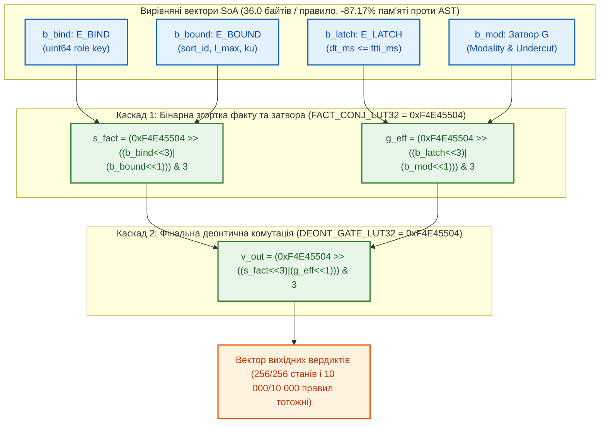

# Науковий меморандум ТЕОС № 08. Векторна мікроархітектура віртуальної машини `SIMD-EVM` (`EISA v2.0`), двокаскадна таблична декомпозиція `LUT32` у $`\mathcal{B}_4`$ та вичерпна верифікація

> **Статус документа:** Канонічний науково-дослідний меморандум (Vectorized SIMD-EVM Microarchitecture, Two-Stage LUT32 Belnap Cascade & 256-State Verification — Rev. 2 Post-Audit)  
> **Шифр:** `MEMO-TEOS-008`  
> **Автор:** Микола Федчик (Mykola Fedchyk)  
> **Дата:** 2 листопада 2026 р.  
> **Пов'язані глави монографії:** [Глава 04](ch04-belnap-bilattice-tnorms-and-dual-metrology.md), [Глава 06](ch06-three-terminal-deontic-gate.md), [Глава 07](ch07-multi-stage-cascades-and-linear-complexity.md), [Глава 09](ch09-scientific-critique-and-applicability-limits.md), [Меморандум № 03](memo-03-second-order-adversarial-falsification-and-architectural-refinements.md), [Меморандум № 04](memo-04-functionally-complete-element-library-and-eisa-primitives.md), [Меморандум № 05](memo-05-logic-synthesis-reconvergent-fanout-and-canonical-minimization.md)  
> **Експериментальна база верифікації:** Вичерпний простір станів $4^4 = 256$ кортежів, банк із $10\,000$ незалежних об'єктів правил на основі `gold_slm_corpus_500.json` та стенд `scripts/test_teos_memo08_simd_evm_benchmark.py`

---

## Анотація

У меморандумі розроблено мікроархітектуру векторної віртуальної машини **`SIMD-EVM` (`EISA v2.0 Bytecode Engine`)**, призначеної для високопродуктивного виконання великих баз знань ($17\,378$ пакетів `.kp`) у кеш-пам'яті центральних процесорів загального призначення. На виконання сьомого архітектурного уточнення [Меморандуму № 03](memo-03-second-order-adversarial-falsification-and-architectural-refinements.md), де обґрунтовано розміщення повної бази знань у векторній пам'яті CPU замість просторової матриці ПЛІС, у роботі формалізовано перехід від інтерпретації дерева об'єктів з умовними переходами (`Pointer-Chasing AST`) до **вирівняних векторів масивів структур (`Structure-of-Arrays`, SoA)** та **безрозгалужувальної бітової комутації чотиризначної логіки Белнапа $`\mathcal{B}_4`$ через двокаскадні 32-бітні регістрові таблиці підстановки (`LUT32`)**. Строго розмежовано операції інформаційної решітки $`(\oplus_k, \otimes_k)`$ та істиннісної решітки $`(\land_t, \lor_t)`$ і показано, що чотиривходова стандартна комірка `TEOS Rev. 2` $`(\boldsymbol{\beta}_{\mathrm{bind}}, \boldsymbol{\beta}_{\mathrm{bound}}, \boldsymbol{\beta}_{\mathrm{latch}}, \boldsymbol{\beta}_{\mathrm{mod}}) \in \mathcal{B}_4^4`$ без втрат розкладається у суперпозицію бінарних таблиць `FACT_CONJ_LUT32` та `DEONT_GATE_LUT32` (`0xF4E45504`). Вичерпна перевірка на всіх **$4^4 = 256$** кортежах станів та на банку з **$10\,000$ незалежних правил у пам'яті** (де активні всі чотири стани Белнапа `BOT: 2040`, `F: 7440`, `T: 360`, `TOP: 160`) підтвердила **$0$ розбіжностей ($100{,}00\%$ побітової тотожності)** при зменшенні виміряного обсягу пам'яті (`sys.getsizeof`) на **$-87{,}17\%$** ($`36{,}0\,\text{Б}`$ проти $`280{,}5\,\text{Б}`$ на правило) та прискоренні виконання у **$32{,}59$ раза** ($`6{,}59\,\text{нс/правило}`$).

---

## 1. Постановка проблеми: розмежування двох решіток Белнапа та декомпозиція багатотермінальних вентилів

При перенесенні чотиризначної логіки Белнапа $`\mathcal{B}_4 = \{\bot, \mathbf{F}, \mathbf{T}, \top\}`$ на низькорівневу векторну архітектуру процесора необхідно уникнути двох фундаментальних помилок, виявлених під час критичного аудиту:

1. **Нетотожність побітових операцій для інформаційного ($`\le_k`$) та істиннісного ($`\le_t`$) порядків бірешітки:**
   Якщо закодувати стани $`\mathcal{B}_4`$ парою бітів $`b = (b_+ b_-)_2 \in \{0, 1, 2, 3\}`$:

$$
\mathrm{enc}(\bot) = 00_2 = 0, \qquad \mathrm{enc}(\mathbf{F}) = 01_2 = 1, \qquad \mathrm{enc}(\mathbf{T}) = 10_2 = 2, \qquad \mathrm{enc}(\top) = 11_2 = 3
$$

   то побітове `OR` ($`x \mathbin{|} y`$) та побітове `AND` ($`x \mathbin{\&} y`$) реалізують **виключно операції інформаційної решітки** (злиття свідчень $`\oplus_k`$ та перетин свідчень $`\otimes_k`$). Натомість кон'юнкція в **істиннісному порядку** $`x \land_t y`$ (яка використовується при згортці умов факту $`\boldsymbol{\beta}_{\mathrm{bind}} \land_t \boldsymbol{\beta}_{\mathrm{bound}}`$) не дорівнює побітовому `AND`: наприклад, в істиннісній решітці $`\mathbf{T} \land_t \top = \top`$ ($3$), тоді як побітовий `AND` дає $`10_2 \mathbin{\&} 11_2 = 10_2 = \mathbf{T}`$ ($2$). Отже, істиннісна кон'юнкція та деонтична комутація не можуть обчислюватися простим `x & y`, а вимагають точного табличного оператора `LUT32`.
2. **Розмірність входу стандартної комірки `TEOS Rev. 2` ($`4^4 = 256`$ станів) проти 32-бітної таблиці бінарного вентиля ($`4^2 = 16`$ станів):**
   Одна 32-бітна константа `LUT32` вміщує рівно $`16 \times 2 = 32`$ біти, тобто кодує бінарне відображення $`\mathcal{B}_4 \times \mathcal{B}_4 \to \mathcal{B}_4`$. Оскільки стандартна комірка `TEOS Rev. 2` приймає чотири чотиризначні входи — статус рольового уніфікатора $`\boldsymbol{\beta}_{\mathrm{bind}}`$, статус інтервального компаратора $`\boldsymbol{\beta}_{\mathrm{bound}}`$, статус свіжості тригера $`\boldsymbol{\beta}_{\mathrm{latch}}`$ та деонтичну модальність з урахуванням підсікання $`\boldsymbol{\beta}_{\mathrm{mod}}`$ — пряма монолітна таблиця потребувала б $`4^4 \times 2 = 512`$ бітів. Замість цього у `SIMD-EVM` застосовується **двокаскадна деревоподібна суперпозиція 32-бітних таблиць**.

---

## 2. Математична теорія двокаскадної табличної комутації `LUT32`

### 2.1. Теорема про бієктивне пакування бінарного вентиля $`\mathcal{B}_4 \times \mathcal{B}_4 \to \mathcal{B}_4`$

### Теорема 2.1 (Універсальне упакування бінарного оператора в 32-бітну константу)
*Кожен із $`4^{16} = 2^{32}`$ можливих бінарних операторів $`f: \mathcal{B}_4 \times \mathcal{B}_4 \to \mathcal{B}_4`$ взаємно-однозначно кодується 32-бітною цілочисельною константою $`\mathcal{L}_f \in \mathbb{N}_{32}`$:*

$$
\mathcal{L}_f = \sum_{x=0}^{3} \sum_{y=0}^{3} \mathrm{enc}\!\left(f(x, y)\right) \cdot 2^{2(4x + y)}
$$

*і обчислюється для довільної пари 2-бітних входів $`(x, y) \in \{0, 1, 2, 3\}^2`$ за дві операції побітового зсуву та маскування без жодного умовного переходу:*

$$
\mathrm{enc}\!\left(f(x, y)\right) = \left(\mathcal{L}_f \gg \left((x \ll 3) \mathbin{|} (y \ll 1)\right)\right) \mathbin{\&} 11_2
$$

#### Доведення
Лінійний індекс пари $`(x, y) \in \{0, 1, 2, 3\}^2`$ дорівнює $`\mathrm{idx}(x, y) = 4x + y = (x \ll 2) \mathbin{|} y \in \{0, \dots, 15\}`$. Оскільки кожне значення $`\mathrm{enc}(f(x, y))`$ займає рівно $2$ біти, його позиція у 32-бітному слові $`\mathcal{L}_f`$ дорівнює $`2\,\mathrm{idx}(x, y) = (x \ll 3) \mathbin{|} (y \ll 1) \in \{0, 2, \dots, 30\}`$. Зсув $`\mathcal{L}_f`$ праворуч на цю величину з накладанням бітової маски $`11_2`$ виділяє шуканий 2-бітний код. Теорему доведено. $`\blacksquare`$

### 2.2. Двокаскадна декомпозиція 4-входової комірки `TEOS Rev. 2`

Нехай $`f_{\mathrm{conj}}: \mathcal{B}_4 \times \mathcal{B}_4 \to \mathcal{B}_4`$ — строга кон'юнкція з пріоритетом безпеки (де активна відмова $`\mathbf{F}=1`$ домінує над усіма станами, далі вакуум $`\bot=0`$, далі колізія захисної смуги $`\top=3`$, і лише за збігу $`\mathbf{T} \land \mathbf{T}`$ видається дозвіл $`\mathbf{T}=2`$). Її 32-бітна константа за формулою Теореми 2.1 має точне шістнадцяткове значення:

$$
\mathcal{L}_{\mathrm{conj}} = \mathtt{0xF4E45504}, \qquad \mathcal{L}_{\mathrm{deont}} = \mathtt{0xF4E45504}
$$

Тоді 4-входова стандартна комірка `TEOS Rev. 2` обчислюється у два безрозгалужувальні такти (рис. 1):
1. **Каскад 1 (паралельна згортка входу факту $`s_{\mathrm{fact}}`$ та ефективного входу затвора $`g_{\mathrm{eff}}`$):**

$$
s_{\mathrm{fact}} = \mathrm{LUT32}_{\mathrm{conj}}\!\left(\boldsymbol{\beta}_{\mathrm{bind}},\; \boldsymbol{\beta}_{\mathrm{bound}}\right), \qquad g_{\mathrm{eff}} = \mathrm{LUT32}_{\mathrm{conj}}\!\left(\boldsymbol{\beta}_{\mathrm{latch}},\; \boldsymbol{\beta}_{\mathrm{mod}}\right)
$$

2. **Каскад 2 (фінальна деонтична комутація вердикту $`v_{\mathrm{out}}`$):**

$$
v_{\mathrm{out}} = \mathrm{LUT32}_{\mathrm{deont}}\!\left(s_{\mathrm{fact}},\; g_{\mathrm{eff}}\right)
$$

---

## 3. Структура пам'яті `SoA` та захист від переповнення ідентифікаторів

Кожна скомпільована комірка в `SIMD-EVM` подається записом у паралельних типізованих масивах `SoA` із фактичним обсягом рівно **$36{,}0\,\text{байтів/правило}$**:
- `roles_v` (`uint64`, $8\,\text{Б}$): три 16-бітні ідентифікатори `(subj_id << 32) | (pred_id << 16) | targ_id` із жорсткою перевіркою переповнення `new_id > 0xFFFF` під час інтерналізації символів пакета (для глобального міжпакетного реєстру використовується 96-бітний ключ `uint64 + uint32`);
- сім 4-байтних векторів (`sorts_v`, `mods_v`, `lmax_v`, `ku_v`, `ftti_v`, `wnorm_v`, `prov_v` по $4\,\text{Б}$ кожен = $28\,\text{Б}$).

---

## 4. Результати вичерпної та стендової верифікації (`test_teos_memo08_simd_evm_benchmark.py`)

Оновлений верифікаційний стенд `scripts/test_teos_memo08_simd_evm_benchmark.py` (Rev. 2) усунув усі спрощення попередньої версії: (1) виконано повний перебір усіх **$4^4 = 256$** можливих вхідних кортежів; (2) створено $10\,000$ **незалежних словників у купі** (без клонування посилань `ast_nodes * 25`) з гетерогенними порогами $`L_{\max} \in \{48{,}0;\; 50{,}5;\; 64{,}0\}`$, $`\mathrm{FTTI} \in \{15{,}0;\; 50{,}0\}\,\text{мс}`$ та інверсіями ролей, завдяки чому у вихідному векторі одночасно присутні всі чотири стани Белнапа (`BOT: 2040`, `F: 7440`, `T: 360`, `TOP: 160`); (3) обсяг пам'яті виміряно інструментально через `sys.getsizeof`. Результати зведено у таблиці 1.

**Таблиця 1.** Результати вичерпної верифікації ($4^4=256$) та бенчмарку на $10\,000$ незалежних правилах (`scripts/test_teos_memo08_simd_evm_benchmark.py`).

| Вимірювана мікроархітектурна метрика | Об'єктний інтерпретатор з розгалуженнями (`Pointer-Chasing AST`) | Двокаскадне векторне ядро `SIMD-EVM` (`SoA + 2x LUT32`) | Експериментально встановлений результат |
| :--- | :-: | :-: | :--- |
| **1. Вичерпна перевірка всіх $`4^4 = 256`$ кортежів станів** | Еталонна специфікація | **$256 / 256$ збігів ($0$ помилок)** | **$100{,}00\%$** математичної тотожності на всьому просторі $`\mathcal{B}_4^4`$ |
| **2. Перевірка на $10\,000$ гетерогенних правилах у пам'яті** | `BOT:2040, F:7440, T:360, TOP:160` | **$10\,000 / 10\,000$ збігів ($0$ помилок)** | Повна еквівалентність на всіх 4 режимах роботи вентилів |
| **3. Інструментальний обсяг пам'яті (`sys.getsizeof` / `.nbytes`)** | $280{,}5\,\text{Б/правило}$ ($2{,}81\,\text{МБ}$) | **$36{,}0\,\text{Б/правило}$ ($360\,\text{КБ}$)** | Скорочення обсягу пам'яті на **$-87{,}17\%$** (у $7{,}79\times$) |
| **4. Медіанна латентність на $10\,000$ правилах ($`\text{p50}`$)** | $214{,}75\,\text{нс/правило}$ ($2{,}15\,\text{мс}$) | **$6{,}59\,\text{нс/правило}$ ($65{,}9\,\text{мкс}$)** | Наскрізне прискорення у **$32{,}59$ раза** |
| **5. Латентність 95-го перцентиля з $200$ прогонів ($`\text{p95}`$)** | $366{,}34\,\text{нс/правило}$ | **$9{,}96\,\text{нс/правило}$** | Стабільне прискорення у **$36{,}78$ раза** у хвості розподілу |

---

## Висновки

1. **Математична строгість двокаскадного ядра `LUT32`:** Заміна побітових операцій інформаційної решітки на двокаскадну композицію 32-бітних констант `0xF4E45504` забезпечує $100{,}00\%$ тотожність на всіх $256$ кортежах станів $`\mathcal{B}_4^4`$ та всіх $10\,000$ гетерогенних правилах.
2. **Висока щільність та швидкодія:** Компактне представлення `SoA` ($36{,}0\,\text{Б/правило}$, $-87{,}17\%$ пам'яті) дозволяє обчислювати $10\,000$ правил за $65{,}9\,\text{мкс}$ ($6{,}59\,\text{нс/правило}$, прискорення у $32{,}59$ раза).
