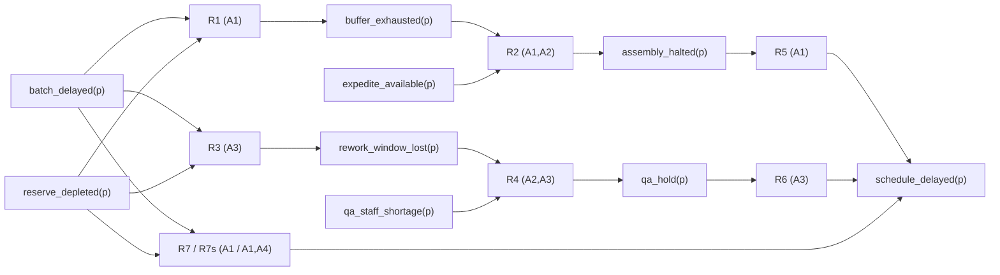

# Протокол другого досліду та промпт для дослідника № 03. Перевірка операторного набору на задачі багатоступеневого прогнозу наслідків

> **Автор досліджуваного задуму:** Микола Мартинович Федчик  
> **Дата затвердження протоколу:** 3 листопада 2026 року  
> **Статус:** затверджений науковим керівником протокол досліду № 02 і завдання для дослідника № 03; підготовлено за участі ШІ. Код другого досліду не написано, перевірки не запущено.  
> **Підстава:** виконання [промпту для наукового керівника № 02](research-prompt-02-supervisor-second-case.md).  
> **Пов'язані матеріали:** [дискусія № 02](draft-discussion-02-inference-state-operators-and-semantic-transformations.md), [промпт для дослідника № 01](research-prompt-01-three-level-inference-model.md), [протокол досліду № 01](src/PREREGISTRATION-2026-11-03-three-level-inference.md), [звіт про дослід № 01](research-report-01-three-level-inference-model.md).

## Анотація

Цей документ виконує завдання наукового керівника з [промпту № 02](research-prompt-02-supervisor-second-case.md). До початку будь-якої реалізації обрано другий предметний випадок, зафіксовано заморожений набір операторів досліду № 01, визначено словник, припущення, правила, ручні очікування для перевірок і критерії оцінки результату, а також сформульовано промпт для дослідника № 03.

Другий випадок — прямий багатоступеневий прогноз у ланцюгу постачання: **«Що станеться з графіком поставок проєкту `p`, якщо постачальник затримає партію комплектуючих?»** На відміну від першого прикладу (зворотний відбір гіпотез-причин наявного перегріву), тут перевіряється пряме виведення наслідків уздовж двох трикрокових ланцюгів правил зі спільними першоджерелами у виведених твердженнях.

## 1. Ревізія репозиторію та опрацьовані матеріали

На момент затвердження цього протоколу зафіксовано такий стан репозиторію:

1. **Поточна ревізія репозиторію (`HEAD`):** `1aa80f9d50834a3061729f11d6d17fe54253ce13` (`1aa80f9`).
2. **Остання ревізія каталогу книги ТЕОС:** `18779a4` (додавання промпту для наукового керівника № 02).
3. **Заморожений еталон операторного набору досліду № 01:** коміт `f5400e0` ([пакет `teosreason`](src/teosreason/reason.go), [сценарії](src/teosreason/scenarios.go), [тести](src/teosreason/reason_test.go)), побудований за [протоколом № 01](src/PREREGISTRATION-2026-11-03-three-level-inference.md) (коміт `7e1ce31`).
4. **Опрацьовані частини звіту № 01:**
   - таблиця дев'яти операторів `INPUT`, `JOIN`, `REFINE`, `PROPOSE`, `DERIVE`, `MATCH`, `STATUS`, `SELECT`, `ANSWER` та розмежування операторів змісту, характеристик і політики вибору ([§2.2 звіту № 01](research-report-01-three-level-inference-model.md));
   - шість виявлених меж першої моделі, зокрема блокування гіпотез за оскарженої передумови (L4), ігнорування слабкості передумови політикою C2, неінтегрованість числових рейтингів, ручна формалізація входів та адаптація інтервального `BOTH` → `UNKNOWN` ([§5.3 звіту № 01](research-report-01-three-level-inference-model.md#discovered-limits));
   - оцінка робочої редакції означення ТЕОС із вимогою явно враховувати тип відповіді та політику вибору ([§7 звіту № 01](research-report-01-three-level-inference-model.md)).

Відповідно до умов [промпту № 02](research-prompt-02-supervisor-second-case.md), межі 1–4 досліду № 01 у цьому протоколі **не виправляються**, щоб не змінювати одночасно задачу й операторний набір.

## 2. Порівняння кандидатів і вибір другого випадку

Кожний кандидат із §3.3 промпту № 02 перевірено за сімома обов'язковими вимогами §3.1:
- **В1** — інший тип відповіді (не напрям перевірки серед гіпотез-пояснень);
- **В2** — інша структура виведення (прямий хід або ланцюг із щонайменше двох послідовних дедуктивних кроків);
- **В3** — інша предметна область (не діагностика несправності пристрою);
- **В4** — спільна підстава у виведених твердженнях (щонайменше два шляхи спираються на те саме першоджерело);
- **В5** — наявність сценаріїв із суперечністю підстав і з браком даних;
- **В6** — прямо названа межа ручної формалізації;
- **В7** — малий обсяг (до 15 атомів і 10 правил, придатний для ручного розрахунку й повного перебору).

| Кандидат | В1 | В2 | В3 | В4 | В5 | В6 | В7 | Рішення наукового керівника та обґрунтування |
|---|---|---|---|---|---|---|---|---|
| 1. «Чи дозволено оператору відкрити клапан?» за регламентом, даними датчиків і винятком | так | частково | частково | так | так | так | так | **Відхилено.** Предметно й структурно перетинається з уже дослідженим шлюзом допуску (глави 01, 06; пакети `teoskernel`, `teosbaseline`). Перевірка ризикує повторно звести ТЕОС до нормативного вентиля, а наявність винятку одразу вимагає підсікання, змішуючи перевірку базової дедукції з нормативною логікою |
| 2. «Що станеться з графіком поставок, якщо постачальник затримає партію?» | так | **так** | **так** | **так** | **так** | **так** | **так** | **Обрано.** Задовольняє всі сім вимог. Має іншу предметну область (логістика й планування виробництва), інший тип відповіді (умовний прогноз наслідку з активними/оскарженими шляхами та вузлами невизначеності) та принципово іншу структуру: прямий трикроковий дедуктивний ланцюг із двома гілками, що розходяться від спільних першоджерел і знову сходяться у висновку |
| 3. «Який із двох проєктних варіантів відповідає вимогам?» | так | ні | так | так | так | так | так | **Відхилено.** Схема «варіант → вимоги → зіставлення з параметрами → вибір варіанта» структурно ізоморфна першому випадку («гіпотеза → прогнози → зіставлення зі спостереженнями → вибір напряму»). Високий ризик потрапити під критерій невизначеного результату через структурну подібність |
| 4. «Чи підтверджує звіт твердження, процитоване у трьох статтях?» | так | ні | так | так | так | так | так | **Відхилено.** Задача зводиться переважно до ототожнення першоджерел в операторі `JOIN` та однокрокової перевірки `Whether`. Вона занадто вузька для перевірки багатоступеневих змістовних переходів |

## 3. Протокол другого досліду

Цей розділ фіксує постановку досліду № 02. Дослідник не має права змінювати наведені нижче правила, сценарії чи очікувані відповіді під час реалізації.

### 3.1. Задача, природномовне питання й тип відповіді

Природномовне питання: **«Що станеться з графіком поставок проєкту `p`, якщо постачальник затримає партію комплектуючих?»** Людина-модельєр вручну перекладає його у формальний запит:

`Forecast(batch_delayed(p), schedule_delayed(p))`

Відмінність від першого прикладу подвійна:
1. У досліді № 01 наслідок `overheat(d)` був уже спостереженим фактом, а система шукала серед готового каталогу гіпотез можливе пояснення й напрям перевірки.
2. У досліді № 02 вхідна подія `batch_delayed(p)` є умовою прогнозу, а система прямим виведенням через проміжні стани обчислює статус цільового наслідку `schedule_delayed(p)` («графік поставок зірвано»: `TRUE` — зірвано, `FALSE` — збережено в межах плану).

Шукана відповідь для `Forecast(premise, target)` містить:
1. **статус вхідної умови** (`PremiseStatus`) та її першоджерела (`PremiseRoots`);
2. **прогнозований статус цільового наслідку** (`TargetStatus` $\in \{\text{UNKNOWN}, \text{FALSE}, \text{TRUE}, \text{BOTH}\}$) та множину його першоджерел (`TargetRoots`);
3. **статуси виведених тверджень** (`Derived`): для кожного проміжного й цільового атома — статус Белнапа, множина першоджерел, правила, якими його виведено, оскаржені правила (`Conflicts`) і невиконані типові правила (`Unmet`);
4. **активні, заблоковані та оскаржені шляхи** (`ActiveRules`, `BlockedRules`, `ContestedRules`);
5. **вузли невизначеності для уточнення прогнозу** (`MissingFacts`): вхідні атоми зі статусом `UNKNOWN`, від яких залежать незавершені ланцюги до цілі;
6. **використані припущення** (`Assumptions`) і **невикористані спостереження** (`UnusedObservations`);
7. **словесну мітку типу відповіді** (`Label`):
   - `прогноз у моделі: графік поставок буде зірвано` (коли `TargetStatus = TRUE` і немає оскаржених правил на шляху до цілі);
   - `прогноз у моделі: графік поставок збережено за рахунок запасу` (коли `TargetStatus = FALSE` і немає оскаржених правил);
   - `прогноз оскаржено суперечливими підставами` (коли `TargetStatus = BOTH` або хоча б одне правило, що веде до цілі, має суперечливу підставу);
   - `прогноз не визначено через брак даних` (коли `PremiseStatus = TRUE`, `TargetStatus = UNKNOWN` і немає оскаржених правил до цілі);
   - `вхідну умову прогнозу не встановлено`, `вхідна умова прогнозу хибна` або `вхідну умову прогнозу оскаржено` (коли `PremiseStatus` дорівнює відповідно `UNKNOWN`, `FALSE` або `BOTH`).

Контрольний запит іншого типу (для перевірки 5а): `Whether(buffer_exhausted(p))` («Чи вичерпано буфер комплектуючих проєкту `p`?»). Його відповідь містить лише чотиризначний стан цільового твердження та множину його першоджерел (із міткою `стан твердження з першоджерелами`), але на відміну від першого прикладу цей атом не заданий прямим спостереженням, а потребує дедуктивного кроку R1.

### 3.2. Словник атомів і тотожність тверджень

Твердження подається атомом `предикат(аргументи)`. Два твердження тотожні тоді й лише тоді, коли збігаються назва предиката та впорядкований список аргументів. Усього використано **9 предикатів**, **1 предметну константу** та **6 символів першоджерел** (разом 9 наземних атомів).

| Символ | Предметне значення в навчальній моделі | Вид у схемі |
|---|---|---|
| `p` | досліджуваний проєкт постачання | константа |
| `sup1` | повідомлення постачальника про затримку відвантаження | першоджерело |
| `car1` | телеметрія транспортного експедитора | першоджерело |
| `erp1` | складський облік системи ERP | першоджерело |
| `aud2` | акт ручної складської інвентаризації | першоджерело |
| `pln3` | диспетчерський графік виробничих змін | першоджерело |
| `qa4` | журнал ресурсів служби вхідного контролю (ВТК) | першоджерело |
| `batch_delayed(p)` | партію комплектуючих від постачальника затримано | вхідна умова прогнозу |
| `reserve_depleted(p)` | страховий складський запас вичерпано (`TRUE` — вичерпано, `FALSE` — запас покриває потребу) | вхідне спостереження |
| `expedite_available(p)` | доступне прискорене складання у додаткову зміну | вхідне спостереження |
| `qa_staff_shortage(p)` | у зміні ВТК бракує персоналу для позапланової перевірки | вхідне спостереження |
| `buffer_exhausted(p)` | оперативний буфер комплектуючих перед лінією складання вичерпано | проміжний висновок, рівень 1 (гілка А) |
| `rework_window_lost(p)` | втрачено штатне часове вікно вхідного контролю партії | проміжний висновок, рівень 1 (гілка Б) |
| `assembly_halted(p)` | лінію складання проєкту `p` зупинено | проміжний висновок, рівень 2 (гілка А) |
| `qa_hold(p)` | партію затримано у черзі обов'язкового контролю якості | проміжний висновок, рівень 2 (гілка Б) |
| `schedule_delayed(p)` | графік поставок проєкту `p` зірвано (`TRUE` — зірвано, `FALSE` — збережено) | цільовий висновок, рівень 3 |
| `courier_color_blue(p)` | стороннє спостереження без правил (колір фургона перевізника) | контрольний атом для перевірки 7c |

### 3.3. Предметні припущення, правила виведення та критерії формування відповіді

Предметні припущення задаються людиною-модельєром і відокремлені від логічних правил.

| Код | Предметне припущення | Стан за замовчуванням |
|---|---|---|
| A1 | Лінія складання не має альтернативного постачальника для цієї партії | діє |
| A2 | План зміни фіксований: зупинку складання або позапланову перевірку можна компенсувати лише явно доступним ресурсом | діє |
| A3 | Партія підлягає обов'язковому вхідному контролю якості перед відвантаженням | діє |
| A4 | Наявний страховий запас повністю сумісний із поточною ревізією виробу без переоснащення | **не діє** |

Правила R1–R7 є спрощеним навчальним законом моделі постачання, а не загальною теорією логістики. Кожне правило задає перехід від однієї або двох передумов до висновку. Як і в протоколі № 01, розрізняються **сильні** та **типові** правила:
- **сильне** правило у прямому виведенні при виконанні всіх передумов встановлює очікуваний біт (`TRUE` або `FALSE`) цільового атома;
- **типове** правило встановлює підтримувальний біт, лише якщо передумови виконані, а за їх невиконання фіксується у списку `Unmet`, не встановлюючи протилежного біта. Зокрема, правило R7 без припущення A4 є лише типовим (наявність запасу без підтвердженої сумісності ревізії A4 не гарантує збереження графіка як сильний закон), а за активного A4 діє сильне правило R7s.

| Код | Передумови (`If`) | Висновок (`Then`) | Сила | Потрібні припущення |
|---|---|---|---|---|
| R1 | `batch_delayed(?p)=TRUE` $\land$ `reserve_depleted(?p)=TRUE` | `buffer_exhausted(?p)=TRUE` | сильне | A1 |
| R2 | `buffer_exhausted(?p)=TRUE` $\land$ `expedite_available(?p)=FALSE` | `assembly_halted(?p)=TRUE` | сильне | A1, A2 |
| R3 | `batch_delayed(?p)=TRUE` $\land$ `reserve_depleted(?p)=TRUE` | `rework_window_lost(?p)=TRUE` | сильне | A3 |
| R4 | `rework_window_lost(?p)=TRUE` $\land$ `qa_staff_shortage(?p)=TRUE` | `qa_hold(?p)=TRUE` | сильне | A2, A3 |
| R5 | `assembly_halted(?p)=TRUE` | `schedule_delayed(?p)=TRUE` | сильне | A1 |
| R6 | `qa_hold(?p)=TRUE` | `schedule_delayed(?p)=TRUE` | сильне | A3 |
| R7 | `batch_delayed(?p)=TRUE` $\land$ `reserve_depleted(?p)=FALSE` | `schedule_delayed(?p)=FALSE` | типове | A1 |
| R7s | `batch_delayed(?p)=TRUE` $\land$ `reserve_depleted(?p)=FALSE` | `schedule_delayed(?p)=FALSE` | сильне | A1, A4 |

Звернемо увагу на структуру графа правил:
- Гілка А: `R1` $\to$ `R2` $\to$ `R5` (три послідовні дедуктивні кроки).
- Гілка Б: `R3` $\to$ `R4` $\to$ `R6` (три послідовні дедуктивні кроки).
- Обидві гілки спираються на спільну пару вхідних тверджень `batch_delayed(p)` та `reserve_depleted(p)`, тому проміжні твердження `buffer_exhausted(p)` і `rework_window_lost(p)` мають **спільні першоджерела**, які далі сходять у `schedule_delayed(p)` через `R5` і `R6`.

**Діаграма 1.** Схема прямого виведення у випадку № 02 зі спільними підставами та розгалуженням на трикрокові ланцюги.

**Логічні правила L1–L4 та їх застосування до прямого ланцюга:**
1. **L1 (Об'єднання станів і першоджерел).** Для кожного атома його стан визначається об'єднанням $\sqcup$ у решітці Белнапа за всіма прямими спостереженнями та всіма чистими висновками правил, що мають цей атом у полі `Then`. Першоджерела об'єднуються як множина (`set union`), тому ні копія спостереження через інший ретранслятор, ні проходження одного першоджерела двома гілками виведення (`R1→R2→R5` і `R3→R4→R6`) не створюють дублікатів у множині першоджерел.
2. **L2 (Зіставлення передумов правила).** Кожна передумова `(atom, expected)` правила зіставляється з поточним об'єднаним станом атома:
   - стан `UNKNOWN` дає `NO_DATA`;
   - стан `BOTH` або наявність оскарженого шляху у виведеного атома-передумови дає `CONFLICTED`;
   - збіг зі значенням `expected` без конфлікту дає `CONFIRMS`;
   - протилежне чисте значення дає `FAILS`.
3. **L3 (Поширення через правило).**
   - Якщо всі передумови активного правила мають `CONFIRMS`, то:
     - **сильне** правило додає до стану атома `Then` біт `Expected` (`TRUE` або `FALSE`) і передає йому множину першоджерел, що містить об'єднання множин першоджерел усіх його передумов за формулою (2);
     - **типове** правило без сильного підтвердження встановлює лише позначку типової підтримки (не змінюючи сильний статус `schedule_delayed(p)` на `FALSE` без A4, або встановлюючи `Unmet`, коли передумова не виконана); щоб перевірити різницю між типовим R7 і сильним R7s (аналог R3 та R3s у протоколі № 01), правило R7 при `reserve_depleted(p)=FALSE` без A4 не дає сильного висновку `schedule_delayed(p)=FALSE` (залишаючи статус `UNKNOWN` із зафіксованим типовим очікуванням R7), тоді як за активного A4 правило R7s встановлює `schedule_delayed(p)=FALSE`.
   - Якщо хоча б одна передумова має `FAILS`, правило блокується (`BlockedRules`), а для типового правила фіксується в `Unmet`.
   - Якщо немає `FAILS`, але хоча б одна передумова має `CONFLICTED`, правило позначається як оскаржене (`ContestedRules`) і додає запис у `Conflicts` атома `Then`, не встановлюючи чистого біта `TRUE` чи `FALSE`. Якщо `Then` лежить на шляху до цілі, оскарження поширюється уздовж ланцюга до цільового атома.
   - Якщо немає `FAILS` і `CONFLICTED`, але хоча б одна передумова має `NO_DATA`, правило не спрацьовує, а невідомі початкові атоми його передумов заносяться до `MissingFacts`.

$$
\mathrm{Roots}(\mathrm{Then}) \supseteq \bigcup_{k=1}^{m} \mathrm{Roots}(\mathrm{If}_k).
$$

**Формула (2).** Перенесення множини першоджерел від передумов активного сильного правила до його висновку.

Тут $`\mathrm{Roots}(X)`$ — скінченна множина ідентифікаторів першоджерел атома $X$, $m \in \{1, 2\}$ — кількість передумов правила в цій моделі, а $`\mathrm{If}_k`$ — $k$-та передумова правила. Завдяки операції об'єднання множин одне першоджерело (наприклад, `sup1` або `erp1`), яке входить у дві різні гілки виведення, враховується в підсумковій множині $`\mathrm{Roots}(\mathrm{Then})`$ рівно один раз.

4. **L4 (Передумова запиту).** Для запиту `Forecast(premise, target)` обчислення наслідків виконується лише тоді, коли об'єднаний стан вхідної умови `premise` дорівнює `TRUE`. Якщо стан `premise` дорівнює `UNKNOWN`, `FALSE` або `BOTH`, повертається відповідна мітка невстановленої, хибної або оскарженої вхідної умови без поширення правил R1–R7s.

**Політика відбору й формування відповіді C1–C3 для випадку № 02:**
- **C1.** Правило належить до `ActiveRules`, якщо воно сильне й усі його передумови мають `CONFIRMS`; до `ContestedRules`, якщо воно має `CONFLICTED` без `FAILS`; до `BlockedRules`, якщо хоча б одна передумова має `FAILS`.
- **C2.** Прогноз для цілі `target` вважається встановленим (`TRUE` або `FALSE`), лише якщо `TargetStatus` дорівнює `TRUE` або `FALSE` і `target` не має записів у `Conflicts`. Якщо `TargetStatus = BOTH` або `target` має непорожній `Conflicts`, прогноз оскаржено (`LabelContested`). Якщо `TargetStatus = UNKNOWN` без конфліктів, прогноз не визначено (`LabelNoDirection` / `прогноз не визначено через брак даних`).
- **C3.** До `MissingFacts` входять усі вхідні (не виведені) атоми зі статусом `UNKNOWN`, які стоять у передумовах правил, що ведуть до `target` і не заблоковані за іншою передумовою (`FAILS`).

### 3.4. Передбачене відображення на заморожений набір операторів

Нижче зафіксовано, яку роль у другому випадку має виконати кожен із дев'яти заморожених операторів коміту `f5400e0`, а де саме виникають **невизначені місця** (`M-1` … `M-4`), які дослідник має перевірити й класифікувати за §4.1.

| Заморожений оператор (`f5400e0`) | Роль у досліді № 01 | Передбачена роль у досліді № 02 | Попередня оцінка сумісності / невизначене місце |
|---|---|---|---|
| `INPUT` | людський ввід запиту та спостережень | людський ввід запиту `Forecast` або `Whether` та початкових спостережень | очікується без змін за семантикою |
| `JOIN` | об'єднання спостережень одного атома за L1 | об'єднання як початкових спостережень, так і кількох гілок виведення одного атома за L1 | **невизначене місце M-1:** у `f5400e0` оператор `JOIN` викликається один раз над початковими спостереженнями; у випадку № 02 потрібне об'єднання першоджерел також у точці сходження виведених гілок (`R5` і `R6` → `schedule_delayed`) |
| `REFINE` | `Why(e)` → ціль `explain(e)` і передумова `e=TRUE` | `Forecast(p, t)` → передумова `p=TRUE` і ціль оцінити `t` | параметризація або узагальнення шаблону запиту |
| `PROPOSE` | висування гіпотез за схемами K1–K3 | у прямому прогнозі каталог абдуктивних гіпотез не використовується | **невизначене місце M-2:** у прямому виведенні `PROPOSE` є порожнім кроком (або вироджується в ініціалізацію цільових гілок); дослідник має зафіксувати, чи є `PROPOSE` специфічним лише для абдуктивних задач |
| `DERIVE` | 1 крок від гіпотези `If` до прогнозу `Then` | покрокове пряме виведення за правилами R1–R7s уздовж ациклічного графа глибини 3 з кон'юнкцією двох передумов | **невизначене місце M-3 (ключове):** у `f5400e0` правило має лише один атом `If` і не підтримує ланцюгів, де висновок `R1` є передумовою `R2`. Потрібно встановити, чи це сумісне узагальнення `DERIVE` (до скінченного списку передумов і топологічного проходу DAG), чи окремий оператор кон'юнкції підстав |
| `MATCH` | зіставлення прогнозу зі спостереженнями | зіставлення передумов правила з поточними (спостереженими або вже виведеними) станами атомів за L2 | **невизначене місце M-4:** у `f5400e0` `MATCH` читає лише початкові спостереження; у випадку № 02 він має читати також проміжні виведені атоми разом із їхніми першоджерелами та конфліктами |
| `STATUS` | агрегація зв'язків гіпотези за L3 | обчислення статусу, першоджерел, конфліктів та `Unmet` для виведеного атома за L3 | очікується збереження логіки L3 з перенесенням на виведені атоми |
| `SELECT` | вибір сумісних/виключених гіпотез і напряму за C1–C2 | класифікація правил (`ActiveRules`, `BlockedRules`, `ContestedRules`) і стану прогнозу за C1–C2 | параметризація політики вибору під тип відповіді `Forecast` |
| `ANSWER` | збирання відповіді `Why` або `Whether` за C3 | збирання відповіді `Forecast` або `Whether` із `MissingFacts` за C3 | параметризація/узагальнення формату відповіді; для `Whether` над виведеним атомом потрібне виконання `DERIVE` перед `STATE` |

### 3.5. Сценарії та очікувані результати, розраховані вручну

Усі очікувані результати нижче розраховано вручну до написання коду за замовчуванням активних припущень **A1, A2, A3** (припущення **A4** не діє, окрім сценарію S7b). Скорочення атомів (усі з аргументом `(p)`):
- `BD` = `batch_delayed(p)`
- `RD` = `reserve_depleted(p)`
- `EA` = `expedite_available(p)`
- `QS` = `qa_staff_shortage(p)`
- `BE` = `buffer_exhausted(p)`
- `RW` = `rework_window_lost(p)`
- `AH` = `assembly_halted(p)`
- `QH` = `qa_hold(p)`
- `SD` = `schedule_delayed(p)`

| Сценарій і перевірка | Вхідні спостереження та умови | Очікуваний результат (розраховано вручну) |
|---|---|---|
| **S1**, перевірка 1 (достатні дані, дві активні гілки зі спільними підставами) | `BD=TRUE` (`sup1`), `RD=TRUE` (`erp1`), `EA=FALSE` (`pln3`), `QS=TRUE` (`qa4`) | Передумова `BD=TRUE` за `{sup1}`. Рівень 1: `BE=TRUE` за `{erp1, sup1}` (R1), `RW=TRUE` за `{erp1, sup1}` (R3). Рівень 2: `AH=TRUE` за `{erp1, pln3, sup1}` (R2), `QH=TRUE` за `{erp1, qa4, sup1}` (R4). Рівень 3: `SD=TRUE` за **`{erp1, pln3, qa4, sup1}`** (4 першоджерела, а не 6: `erp1` і `sup1` спільні для обох виведених гілок R5 і R6). Активні правила: `[R1, R2, R3, R4, R5, R6]`; заблоковані: `[R7]`; `Unmet` для `SD`: `[R7]`. `MissingFacts`: `[]`. Припущення: `[A1, A2, A3]`. Мітка: `прогноз у моделі: графік поставок буде зірвано` |
| **S2**, перевірка 2 (брак даних на другому кроці ланцюга) | лише `BD=TRUE` (`sup1`) та `RD=TRUE` (`erp1`); даних про `EA` і `QS` немає | Передумова `BD=TRUE` за `{sup1}`. Рівень 1 виводиться повністю: `BE=TRUE` за `{erp1, sup1}` (R1), `RW=TRUE` за `{erp1, sup1}` (R3). На рівні 2 правила R2 і R4 мають `NO_DATA`, тому `AH=UNKNOWN`, `QH=UNKNOWN`, і на рівні 3 `SD=UNKNOWN` за `[]`. Активні правила: `[R1, R3]`; заблоковані: `[R7]`. `MissingFacts`: **`[expedite_available(p), qa_staff_shortage(p)]`**. Мітка: `прогноз не визначено через брак даних` |
| **S3**, перевірка 3 (суперечність підстав не стирається уздовж ланцюга) | S1 + інвентаризація `aud2` показує `RD=FALSE` | `RD=BOTH` за `{aud2, erp1}`. Правила R1, R3, R7 отримують `CONFLICTED` на передумові `RD`. Тому `BE=UNKNOWN` з `Conflicts=[R1]`, `RW=UNKNOWN` з `Conflicts=[R3]`, `AH=UNKNOWN` з `Conflicts=[R2]`, `QH=UNKNOWN` з `Conflicts=[R4]`, `SD=UNKNOWN` з `Conflicts=[R5, R6, R7]`. `ContestedRules`: `[R1, R2, R3, R4, R5, R6, R7]`. Жоден чистий біт `SD` не встановлено. Мітка: `прогноз оскаржено суперечливими підставами` |
| **S4a**, перевірка 4 (копія спостереження через ретранслятор) | S1 + копія `RD=TRUE` від `erp1` через ретранслятор `portal` | Усі статуси, множини першоджерел, активні правила та мітка **тотожні S1**; `TargetRoots` дорівнює `{erp1, pln3, qa4, sup1}` |
| **S4b**, перевірка 4 (повне збігання першоджерел двох виведених гілок) | як S1, але `QS=TRUE` походить із того самого документа планування `pln3`, що й `EA=FALSE` | Обидві проміжні гілки рівня 2 (`AH` і `QH`) отримують однакову множину першоджерел `{erp1, pln3, sup1}`. Після сходження R5 і R6 у `SD` множина `TargetRoots` дорівнює **`{erp1, pln3, sup1}`** (3 першоджерела, а не 6 і не імена правил `R1..R6`) |
| **S5a**, перевірка 5 (інший тип запиту над виведеним твердженням) | спостереження S1, але запит `Whether(buffer_exhausted(p))` | Тип відповіді — стан одного твердження: `buffer_exhausted(p)=TRUE` за `{erp1, sup1}`; списків шляхів прогнозу та `MissingFacts` для `SD` немає; мітка: `стан твердження з першоджерелами` |
| **S5b**, перевірка 5 (ті самі числові характеристики входу, інший зміст — одна гілка активна, друга заблокована) | `BD=TRUE` (`sup1`), `RD=TRUE` (`erp1`), `EA=TRUE` (`pln3`), `QS=FALSE` (`qa4`) — та сама кількість спостережень (4), першоджерел (4) і мультимножина вхідних значень (`3×TRUE, 1×FALSE`), що й у S1 | Рівень 1: `BE=TRUE` (R1), `RW=TRUE` (R3). Рівень 2: R2 заблоковано (`EA=TRUE` замість очікуваного `FALSE`), R4 заблоковано (`QS=FALSE` замість очікуваного `TRUE`), тому `AH=UNKNOWN`, `QH=UNKNOWN`, `SD=UNKNOWN` за `[]`. Активні правила: `[R1, R3]`; заблоковані: `[R2, R4, R7]`. `MissingFacts`: `[]`. Мітка: `прогноз не визначено через брак даних` |
| **S6**, перевірка 6 (інваріантність до перейменування та порядку спостережень) | усі сценарії S1–S8 після бієктивного перейменування всіх предикатів, констант, першоджерел, ретрансляторів, правил і припущень (у зворотному лексикографічному порядку), а також усі перестановки порядку вхідних спостережень S1 (24) і S3 (120) | Відповідь після перейменування в точності дорівнює перейменованій канонічній відповіді вихідного сценарію; перестановка спостережень не змінює канонічної відповіді |
| **S7a**, перевірка 7 (вилучення проміжного правила в одній гілці та в обох гілках) | S7a-1: S1 без правила R2; S7a-2: S1 без правил R2 і R4 | У S7a-1 гілка А зупиняється на `BE=TRUE` (`AH=UNKNOWN`), але гілка Б (`R3→R4→R6`) дає `SD=TRUE` за **`{erp1, qa4, sup1}`** (без `pln3`!), а `EA` позначається як невикористане. У S7a-2 обидві гілки зупиняються на рівні 1, `SD=UNKNOWN`, а `EA` і `QS` позначаються як невикористані |
| **S7b**, перевірка 7 (вплив припущення A4 на силу правила R7 проти R7s) | `BD=TRUE` (`sup1`), `RD=FALSE` (`erp1`), `EA=FALSE` (`pln3`), `QS=TRUE` (`qa4`): порівняння без A4 (S7b-0) та з активним A4 (S7b-1) | R1 і R3 заблоковані (`RD=FALSE`). Без A4 (S7b-0): діє лише типове R7, тому сильний статус `SD=UNKNOWN` за `[]` (мітка: `прогноз не визначено через брак даних`), `EA` і `QS` не задіяні в активних гілках. З активним A4 (S7b-1): спрацьовує сильне R7s, `SD=FALSE` за **`{erp1, sup1}`**, використані припущення `[A1, A4]`, мітка: `прогноз у моделі: графік поставок збережено за рахунок запасу` |
| **S7c**, перевірка 7 (висока оцінка надійності без правила) | S1 + спостереження `courier_color_blue(p)=TRUE` від `car1` з `Reliability=1.0` | Прогноз і всі статуси тотожні S1; `courier_color_blue(p)` потрапляє до `UnusedObservations`. Висока надійність без правила не створює жодного переходу |
| **S8**, перевірка L4 на вхідній умові (повторення межі 1 досліду № 01) | S1 + телеметрія `car1` повідомляє `BD=FALSE` | `BD=BOTH` за `{car1, sup1}`. За правилом L4 вхідну умову оскаржено, правила R1–R7s не запускаються, `SD=UNKNOWN`, решта спостережень (`RD`, `EA`, `QS`) у `UnusedObservations`. Мітка: `вхідну умову прогнозу оскаржено` |

### 3.6. Повний перебір і окремий еталон

Для вичерпної перевірки фіксується першоджерело `sup1` зі спостереженням `batch_delayed(p)=TRUE` та перебираються всі $4^4 = 256$ комбінацій чотиризначних станів Белнапа (`UNKNOWN`, `FALSE`, `TRUE`, `BOTH`) для чотирьох незалежних входів:
1. другий звіт про затримку партії `batch_delayed(p)` від `car1`;
2. `reserve_depleted(p)` від `erp1`;
3. `expedite_available(p)` від `pln3`;
4. `qa_staff_shortage(p)` від `qa4`.

Перебір виконується у двох режимах припущень: за замовчуванням (`A1, A2, A3` активні, `A4` неактивне — 256 випадків) та з активним `A4` (ще 256 випадків), разом **512 випадків**.

Очікуваний результат кожного випадку обчислюється окремою еталонною функцією, записаною безпосередньо з таблиць §3.2–§3.3 без виклику універсального рушія виведення чи його допоміжних функцій. Як і в досліді № 01, у звіті обов'язково зазначається, що еталон і модель створені в межах одного проєкту, тому спільні помилки специфікації цим перебором не виключаються.

### 3.7. Контрольні мутації

Дослідник зобов'язаний перевірити дискримінаційну здатність тестів щонайменше на п'яти навмисних мутаціях:
- **M1 (типове правило як сильне):** типове правило R7 без A4 встановлює чистий біт `schedule_delayed(p)=FALSE` (має виявлятися сценарієм S7b-0 та перебором).
- **M2a (ретранслятор як першоджерело):** замість `o.Root` у множину першоджерел записується `o.Relay` (має виявлятися сценарієм S4a).
- **M2b (втрата спільної підстави у виведених твердженнях):** під час застосування правила `DERIVE` виведеному твердженню замість об'єднання першоджерел передумов приписується ідентифікатор самого правила (`r.ID`) або сумується кількість входжень першоджерел з різних гілок (має виявлятися сценаріями S1 і S4b).
- **M3 (обрив багатоступеневого ланцюга):** `MATCH` шукає передумови правил лише серед початкових спостережень і не бачить проміжних виведених тверджень рівня 1 (`buffer_exhausted`, `rework_window_lost`) (має виявлятися сценаріями S1, S5a, S7a та перебором).
- **M4 (стирання суперечності у проміжному вузлі):** статус `CONFLICTED` на проміжному вузлі не передається далі ланцюгом або перетворюється на `UNKNOWN` / `TRUE` (має виявлятися сценарієм S3 та перебором).

## 4. Класифікація змін операторів і критерії висновку

### 4.1. Обов'язкова класифікація кожного оператора

У звіті про дослід № 02 кожен із дев'яти заморожених операторів (`INPUT`, `JOIN`, `REFINE`, `PROPOSE`, `DERIVE`, `MATCH`, `STATUS`, `SELECT`, `ANSWER`) та кожне з правил L1–L4 має отримати рівно одну категорію:
1. **без змін** — використано той самий код і ту саму семантику, що в досліді № 01;
2. **параметризовано** — змінено лише вхідні дані (словник, правила, припущення, таблицю критерію вибору), без зміни семантики оператора;
3. **узагальнено** — семантику оператора розширено так, що дослід № 01 є частинним випадком і всі тести досліду № 01 проходять без зміни їхніх очікувань;
4. **змінено несумісно** — зміна оператора порушує хоча б один очікуваний результат досліду № 01;
5. **новий оператор** — додано операцію, якої не було серед дев'яти операторів досліду № 01 (із поясненням, чому її неможливо подати як параметризацію чи сумісне узагальнення наявних).

Будь-яка зміна коду спільного пакета або узагальнення оператора вимагає запуску повного набору тестів досліду № 01 без редагування файлу очікувань першого досліду.

### 4.2. Критерії висновку, зафіксовані заздалегідь

Науковий керівник фіксує чотири можливі підсумкові оцінки досліду № 02:

1. **Підтвердження операторного базису в межах двох випадків.** Усі дев'ять операторів мають статус «без змін» або «параметризовано» (припускається, що `PROPOSE` у прямому прогнозі залишається неактивним для схем абдукції), і всі сценарії S1–S8 та 512 випадків перебору збігаються з очікуваннями. *(Примітка керівника: з огляду на невизначені місця M-1, M-3 і M-4 в §3.4, буквальне виконання цього критерію без жодного узагальнення `DERIVE`/`MATCH` малоймовірне, тому не слід штучно маскувати узагальнення під «параметризацію»).*
2. **Часткове підтвердження (сумісне розширення).** Для багатоступеневого ланцюга й кон'юнкції передумов потрібне явне **узагальнення** операторів `DERIVE`, `MATCH`, `JOIN` або `REFINE` (і, за потреби, не більше одного чітко відокремленого нового оператора), причому на узагальненій моделі всі перевірки досліду № 01 та всі перевірки досліду № 02 проходять із тими самими очікуваннями. Роль кожного узагальнення й причина неактивності `PROPOSE` у прямому прогнозі названі явно.
3. **Послаблення гіпотези.** Для виконання протоколу № 02 потрібні **несумісні зміни** операторів досліду № 01 або додавання кількох нових змістовних операторів, які фактично утворюють окремий рушій для другого прикладу. У такому разі фіксується висновок: операторний набір досліду № 01 був підігнаний під перший приклад і не є спільним базисом навіть для двох задач.
4. **Невизначений результат.** Якщо під час виконання з'ясується, що обрана формалізація не дозволяє перевірити різницю між варіантами 1–3, це фіксується як дефект протоколу, без оголошення гіпотези підтвердженою.

За жодного з результатів 1–4 висновок не поширюється за межі двох розглянутих випадків і не оголошує ТЕОС завершеною загальною теорією міркування.

## 5. Промпт для дослідника № 03

Нижче наведено пряму інструкцію виконавцю другого досліду.

### 5.1. Роль і обмеження дослідника

Ти — науковий дослідник, який виконує затверджений вище [протокол другого досліду](#protocol-02).
1. **Заборонено змінювати задачу, словник, припущення A1–A4, правила R1–R7s, сценарії S1–S8, очікувані відповіді §3.5, сітку перебору §3.6, мутації §3.7 або критерії висновку §4.2.** Якщо під час роботи виявлено розбіжність між моделлю та очікуванням протоколу, ти зобов'язаний зафіксувати саму розбіжність у звіті, а не підправляти очікування заднім числом.
2. **Заборонено змінювати чинні глави монографії, означення ТЕОС, протокол № 01, звіт № 01 або очікування тестів першого досліду.**
3. Дозволено або розширити пакет `src/teosreason` сумісним чином (так, щоб усі наявні тести досліду № 01 проходили без жодної зміни їхніх очікувань), або реалізувати узагальнене ядро з явною перевіркою обох випадків (№ 01 і № 02) тим самим кодом операторів. Створення окремої одноразової програми, ніяк не пов'язаної з операторами досліду № 01, означає висновок за критерієм 3 («Послаблення гіпотези»).

### 5.2. Порядок роботи дослідника

1. Перевір ревізію репозиторію та переконайся, що наявні тести `go test -race -count=1 ./teosreason ./cmd/teosreason` проходять до початку змін.
2. Розглянь чотири невизначені місця `M-1` … `M-4` із таблиці §3.4:
   - об'єднання першоджерел у точці сходження виведених гілок (`M-1`);
   - роль оператора `PROPOSE` у прямому прогнозі без каталогу абдуктивних гіпотез (`M-2`);
   - багатоступеневе застосування `DERIVE` на ациклічному графі з кон'юнкцією передумов і перенесенням множин першоджерел $`\mathrm{Roots}(\mathrm{Then}) = \bigcup_k \mathrm{Roots}(\mathrm{If}_k)`$ (`M-3`);
   - читання виведених атомів та їхніх конфліктів оператором `MATCH` (`M-4`).
3. Реалізуй виконання випадку № 02 і підтримку трасування, де кожен крок має ідентифікатор оператора, вид переходу, підставу, входи й виходи.
4. Запиши тести для сценаріїв **S1–S8** із ручними очікуваннями з таблиці §3.5, окрему еталонну функцію та тест повного перебору **512 випадків** за §3.6, а також перевір усі п'ять мутацій **M1, M2a, M2b, M3, M4** за §3.7.
5. Запусти тести **обох** дослідів (№ 01 і № 02) з прапорцем `-race` і перевір `go vet`.
6. Склади окремий звіт `research-report-02-second-case-supply-forecast.md` за структурою звіту № 01:
   - розділ 1 — задача, обсяг, припущення та відмінність від випадку № 01;
   - розділ 2 — представлення носія, точні означення операторів і **повна таблиця класифікації змін кожного з 9 операторів та правил L1–L4 за §4.1** (без змін / параметризовано / узагальнено / змінено несумісно / новий оператор);
   - розділ 3 — одна повна траса сценарію S1 з усіма проміжними станами та переліком кроків, виконаних людиною;
   - розділ 4 — зіставлення з попередніми механізмами ТЕОС та відомими методами (поширення обмежень, пряме виведення у Datalog/Horn-мережах, ATMS де Клеєра) з перевіреними джерелами;
   - розділ 5 — результати перевірок S1–S8, перебору 512 випадків, контрольних мутацій M1–M4 та виявлені межі;
   - розділ 6 — обґрунтування властивостей (що доведено в моделі, що перевірено перебором, що лише припущено);
   - розділ 7 — підсумковий висновок строго за одним із критеріїв 1–4 із §4.2 та оцінка того, чи потребує уточнення робоче означення ТЕОС після другого випадку.
7. Після одного повного прогону й оформлення звіту № 02 зупинись. Не переходь до переписування глав монографії.

## 6. Ризики протоколу: що може зробити результат непереконливим і як це буде видно

Науковий керівник фіксує п'ять головних ризиків цього протоколу та ознаки, за якими їх можна розпізнати в майбутньому звіті дослідника:

1. **Приховане створення другого рушія замість перевірки першого.**
   - *У чому ризик:* дослідник може написати окрему функцію спеціально для `Forecast`, залишивши стару функцію `Reason` тільки для `Why`, і оголосити обидва приклади «підтриманими одним пакетом».
   - *Як це буде видно:* у коді матимемо дві окремі гілки обходу правил без спільного виконання операторів `JOIN`, `DERIVE`, `MATCH`, `STATUS`. У таблиці §4.1 таке рішення має класифікуватися не як «параметризовано», а як «новий оператор / змінено несумісно» (критерій 3).
2. **Підміна «узагальнення» словом «параметризація».**
   - *У чому ризик:* у коміті `f5400e0` структура `Rule` містить лише один атом `If`, а `MATCH` звіряється лише з початковими спостереженнями. Перехід до кон'юнкції кількох передумов і трикрокового ланцюга вимагає зміни типів і алгоритму `DERIVE`/`MATCH`.
   - *Як це буде видно:* якщо в коді змінено сигнатуру `Rule` або порядок обходу графа, а в таблиці §4.1 записано «без змін» чи «параметризовано», звіт є методологічно некоректним. Чесна оцінка тут не може бути вищою за критерій 2 («Часткове підтвердження через сумісне узагальнення»).
3. **Приховування зайвості оператора `PROPOSE` у прямому виведенні.**
   - *У чому ризик:* дослідник може штучно додати фіктивну «схему гіпотези» `schedule_delayed(p)` тільки для того, щоб задіяти оператор `PROPOSE` і заявити, ніби всі 9 операторів працюють однаково.
   - *Як це буде видно:* у трасі з'явиться крок `PROPOSE`, який не виконує змістовної абдукції, а просто дублює ціль запиту `Forecast`. Протокол вимагає чесно зафіксувати, що `PROPOSE` є оператором абдуктивного розширення й у прямому дедуктивному прогнозі не задіяний.
4. **Спільна сліпа пляма моделі й еталона перебору.**
   - *У чому ризик:* еталонна функція для 512 випадків і основний код пишуться за тією самою таблицею правил §3.3, тому однакова помилка інтерпретації (наприклад, щодо поширення `CONFLICTED`) дасть «100% збіг» у переборі.
   - *Як це буде видно:* саме для цього в §3.5 заздалегідь виписано ручні очікування для S1–S8, а в §3.7 — п'ять мутацій M1–M4. Якщо мутація M2b або M4 не призводить до падіння тестів, перевірка вважається непереконливою.
5. **Повторне спостереження межі L4 на вхідній умові.**
   - *У чому ризик:* у сценарії S8 суперечність між `sup1` і `car1` щодо самої затримки партії (`batch_delayed(p)=BOTH`) блокує весь прогноз за правилом L4, хоча на практиці диспетчер хотів би бачити умовний прогноз «якщо затримка підтвердиться».
   - *Як це буде видно:* це свідомо збережена межа 1 досліду № 01 (за вимогою §3.2 промпту № 02). У звіті її слід зафіксувати як повторне підтвердження межі L4, а не як несподіване відкриття чи привід змінювати L4 під час досліду № 02.
