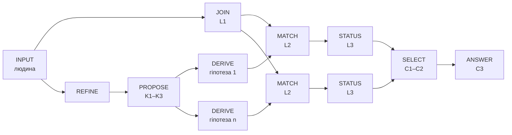

# Звіт про дослід № 01. Мінімальна трирівнева модель одного міркування в ТЕОС

> **Автор досліджуваного задуму:** Микола Мартинович Федчик  
> **Дата:** 3 листопада 2026 року  
> **Статус:** звіт про виконаний обмежений дослід; підготовлено за участі ШІ. Чинні глави, означення та попередні програми не змінено.  
> **Завдання:** [промпт для дослідника № 01](research-prompt-01-three-level-inference-model.md)  
> **Попередня реєстрація:** [протокол досліду № 01](src/PREREGISTRATION-2026-11-03-three-level-inference.md), зафіксований до написання коду  
> **Ревізії:** вихідна `7a061d6`; протокол — коміт `7e1ce31`  
> **Виконувана модель:** [пакет `teosreason`](src/teosreason/reason.go), [сценарії](src/teosreason/scenarios.go), [перевірки](src/teosreason/reason_test.go), [друк траси](src/cmd/teosreason/main.go)

## Анотація

Дослід перевіряє авторську гіпотезу з [дискусії № 02](draft-discussion-02-inference-state-operators-and-semantic-transformations.md): чи можна задати носій стану міркування, елементарні оператори та правила їх композиції так, щоб шлях від змісту питання до змісту відповіді був формалізований. Перевірка обмежена одним навчальним випадком — «Чому пристрій перегрівається?».

Для цього випадку побудовано відтворювану композицію типізованих операторів. Траса від формального запиту до відповіді налічує 25 кроків, і кожен перехід має ідентифікатор оператора, правила або людського вводу. Усі попередньо зареєстровані сценарії та 1024 випадки перебору збіглися з ручними очікуваннями. Чотири навмисні мутації логіки виявлено.

Результат не встановлює ні новизни, ні загальності. Змістовні вхідні рішення виконано людиною: переклад питання у формальний запит, перелік гіпотез, правила прогнозу та критерій вибору. Сама конструкція є застосуванням відомих методів абдуктивної та модельної діагностики в термінах ТЕОС. Найважливіші виявлені межі описано в [§5.3](#discovered-limits).

## 1. Задача, обсяг і припущення

Мета досліду — перевірити не правдоподібність одного висновку, а саму можливість задати шлях міркування явними операціями. Тому до запуску коду зафіксовано тип відповіді, словник, припущення та очікувані результати.

### 1.1. Тип відповіді

Розглянуто три можливі види відповіді: логічно необхідну причину, множину сумісних пояснень і найбільш обґрунтований напрям наступної перевірки. Обрано поєднання двох останніх. Відповідь на `Why(overheat(d))` містить:

1. статус передумови «перегрів є» та її першоджерела;
2. сумісні, виключені й оскаржені гіпотези серед розглянутих;
3. напрям наступної перевірки або явну відмову від вибору;
4. перелік неперевірених наслідків;
5. використані припущення та мітку «причину не доведено».

Відповідь на контрольний запит `Whether(overheat(d))` має інший тип: стан одного твердження з першоджерелами.

### 1.2. Розмежування вхідних знань

Протокол розділяє чотири види вхідних знань, щоб перевірка не змішувала предметну модель із логікою.

| Вид | Що містить | Хто задає |
|---|---|---|
| Предметні припущення | A1 — примусове повітряне охолодження; A2 — не більше одного хибного температурного приладу; A3 — прилади вимірюють ту саму величину; A4 — енергетична модель (за замовчуванням не діє) | людина-модельєр |
| Схеми пояснення | K1 — зростання тепловиділення, K2 — погіршення охолодження, K3 — хибний показ приладу | людина-модельєр, за §6 дискусії № 02 |
| Правила прогнозу | R1–R5 із силою «типове» або «сильне» | людина-модельєр |
| Логічні правила та політика | L1–L4 та критерії ранжування C1–C3 | дослідник, у протоколі до запуску |

Перелік гіпотез не є повним і не виводиться з питання. Правила R1–R5 є спрощеним навчальним законом моделі, а не теорією теплообміну. Зокрема, R3 «зростання тепловиділення ⇒ зростання електричної потужності» є лише типовим. Отже, незмінна потужність без A4 гіпотезу не спростовує.

## 2. Представлення носія та оператори

Носій стану міркування має містити саме твердження, а не лише характеристики його запису. Це перша відмінність від тензора стану Ψ у [формулі (1.2) глави 01](ch01-foundations-and-epistemic-gap.md#epistemic-state). Його компоненти — кастодія, числова частина, підтримка й розмірність — описують запис, але не визначають, **яке** твердження він виражає.

### 2.1. Носій

Стан міркування в моделі складається з двох частин.

1. **Змістова частина** — скінченний типізований граф тверджень. Вузлами є запит, ціль, гіпотези, прогнози, спостереження та відповідь. Твердження записано атомом `предикат(аргументи)`; два атоми тотожні лише за збігу предиката й упорядкованих аргументів. Ребрами є відношення «пояснює», «прогнозує», «підтверджує», «не виконано», «суперечливо» та «немає даних».
2. **Характеристики** — для кожного атома й зв'язку: значення Белнапа, множина першоджерел, множина використаних припущень та ідентифікатор правила.

Спостереження об'єднуються оператором порядку знання Белнапа: біт «за» та біт «проти» об'єднуються незалежно.

$$
(t_1, f_1) \sqcup (t_2, f_2) = (t_1 \lor t_2,\ f_1 \lor f_2)
$$

**Формула 1.** Об'єднання двох значень одного атома за порядком знання.

Тут $t$ означає наявність підстави «за», а $f$ — підстави «проти». Кожна змінна набуває значення 0 або 1. Значенню `UNKNOWN` відповідає $(0,0)$, `TRUE` — $(1,0)$, `FALSE` — $(0,1)$, `BOTH` — $(1,1)$. Наприклад, показ одного анемометра «потік зменшився» $(1,0)$ і показ іншого «не зменшився» $(0,1)$ дають $(1,1)$, тобто `BOTH`. Отже, модель зберігає суперечність і не обирає одне зі значень. Ту саму операцію реалізовано в наявному типі `evidence.State` як побітове «або».

Чому тут не використано векторного додавання? Операція (1) **ідемпотентна**: $x \sqcup x = x$. У векторному просторі рівність $x + x = x$ можлива лише для $x = 0$. Отже, якби підтримку накопичували додаванням, копія того самого показу збільшувала б результат і порушувала б перевірку 4. Цей висновок стосується лише координат підтримки й походження. Він не спростовує авторської інтуїції про напрям міркування: напрям у моделі задається орієнтованими ребрами від цілі до відповіді. Багатокомпонентний носій тут є добутком решіток, а не векторним простором.

### 2.2. Оператори

Для кожного оператора важливо розрізнити, чи **створює** він нове твердження, чи лише змінює характеристику або обирає між альтернативами.

| Оператор | Вхід → вихід | Вид переходу | Чи визначає, яке твердження утворюється |
|---|---|---|---|
| INPUT | природне питання й покази → запит і спостереження | людський ввід | так, але вручну |
| JOIN | спостереження одного атома → значення та множина першоджерел (L1) | характеристика | ні |
| REFINE | `Why(e)` → ціль `explain(e)` і передумова `e=TRUE` | уточнення цілі за шаблоном | так, але тривіально |
| PROPOSE | ціль × схема каталогу → гіпотези з підставленими змінними | пропонування гіпотези, недедуктивно | так, у межах каталогу |
| DERIVE | гіпотеза × активне правило → прогноз із виключеними першоджерелами | дедукція в моделі | **так** |
| MATCH | прогноз × спостереження → зв'язок «підтверджує / не виконано / суперечливо / немає даних» (L2) | зіставлення | так: утворює твердження-відношення |
| STATUS | зв'язки гіпотези → статус Белнапа, першоджерела «за/проти» (L3) | характеристика | ні |
| SELECT | статуси → сумісні, виключені, оскаржені, напрям (C1–C2) | політика ранжування | ні, лише вибір |
| ANSWER | ціль × вибір × зв'язки без даних → відповідь (C3) | формування відповіді | так: збирає відповідь заданого типу |

Отже, змістовне виведення в моделі виконують DERIVE, MATCH і частково PROPOSE. Оператори JOIN і STATUS належать до рівня характеристик, а SELECT — окремий вид, **політика вибору**. Його не можна звести ні до виведення, ні до характеристики.

### 2.3. Композиція

Оператори з'єднано у фіксований скінченний ациклічний граф. Альтернативні гіпотези утворюють паралельні гілки DERIVE → MATCH → STATUS. Спільні підстави ідентифікуються за першоджерелами, а суперечності передаються як `BOTH` і конфлікти. Відсутні дані перетворюються на пункти «наступна перевірка».



**Діаграма 2.** Композиція операторів у вигляді скінченного ациклічного графа.

Цикли залишено поза обсягом. Природна точка замикання — вихід «наступна перевірка»: його виконання дає нове спостереження і повторний прохід графом. Умови завершення такого циклу не досліджено.

## 3. Повна траса міркування

Нижче наведено фактичний вивід команди `go run ./cmd/teosreason -scenario S1` з каталогу `src`. Ним відтворено кожен проміжний стан сценарію S1.

<details>
<summary>Траса сценарію S1: 25 кроків</summary>

```text
 1 INPUT    [людський ввід] запит Why(overheat(d)); airflow_reduced(d)=TRUE від an3;
            overheat(d)=TRUE від ir2; overheat(d)=TRUE від ts1; power_increased(d)=FALSE від wm4
 2 JOIN     [характеристика] airflow_reduced(d)=TRUE за [an3]; overheat(d)=TRUE за [ir2 ts1];
            power_increased(d)=FALSE за [wm4]
 3 REFINE   [уточнення цілі] -> explain(overheat(d)); передумова overheat(d)=TRUE
 4 PROPOSE  [недедуктивно] K1 -> heat_gen_increased(d)
 5 PROPOSE  [недедуктивно] K2 -> cooling_degraded(d)
 6 PROPOSE  [недедуктивно] K3 -> measurement_error(ir2,d), measurement_error(ts1,d)
 7 DERIVE   [дедукція] R1 (typical, A1): cooling_degraded(d) -> прогноз airflow_reduced(d)=TRUE
 8 MATCH    CONFIRMS: спостережено TRUE за [an3]
 9 DERIVE   [дедукція] R2 (typical, A1): -> прогноз fan_speed_reduced(d)=TRUE
10 MATCH    NO_DATA
11 STATUS   cooling_degraded(d): TRUE; за [an3]
12 DERIVE   [дедукція] R3 (typical): heat_gen_increased(d) -> прогноз power_increased(d)=TRUE
13 MATCH    FAILS: спостережено FALSE за [wm4]
14 DERIVE   правило R3s неактивне: бракує припущення A4
15 DERIVE   [дедукція] R4 (typical): -> прогноз load_increased(d)=TRUE
16 MATCH    NO_DATA
17 STATUS   heat_gen_increased(d): UNKNOWN; невиконаний типовий прогноз [R3]
18 DERIVE   [дедукція] R5 (strong, A2 A3): measurement_error(ir2,d) -> прогноз overheat(d)=FALSE без [ir2]
19 MATCH    FAILS: спостережено TRUE за [ts1]
20 STATUS   measurement_error(ir2,d): FALSE; проти [ts1]
21 DERIVE   [дедукція] R5 (strong, A2 A3): measurement_error(ts1,d) -> прогноз overheat(d)=FALSE без [ts1]
22 MATCH    FAILS: спостережено TRUE за [ir2]
23 STATUS   measurement_error(ts1,d): FALSE; проти [ir2]
24 SELECT   [політика] сумісні [cooling_degraded(d) heat_gen_increased(d)];
            виключені [measurement_error(ir2,d) measurement_error(ts1,d)]; напрям cooling_degraded(d)
25 ANSWER   напрям перевірки серед розглянутих гіпотез; причину не доведено;
            перевірити fan_speed_reduced(d) (R2), load_increased(d) (R4)
```

</details>

Траса показує, як зміст змінюється від кроку до кроку. На кроці 6 гіпотезу хибного показу не взято готовою: її утворено підстановкою кожного приладу, що показав перегрів. На кроках 18–23 правило R5 виключає саме **інший** прилад, тому кожна з двох гіпотез спростовується незалежним першоджерелом. Крок 13 фіксує невиконаний типовий прогноз, але не спростовує тепловиділення, а крок 14 явно показує, що для такого спростування бракує A4.

**Кроки, виконані людиною:**

1. переклад природного питання в `Why(overheat(d))` і межі $L = 85\,^{\circ}\mathrm{C}$;
2. переклад показів приладів у атоми;
3. каталог гіпотез K1–K3;
4. правила R1–R5 і їхня сила;
5. припущення A1–A4;
6. критерій ранжування C1–C3.

Програма виконує підстановку, виведення прогнозів, зіставлення, об'єднання характеристик, вибір за заданою політикою та збирання відповіді.

## 4. Зіставлення з попередніми механізмами ТЕОС

Мета зіставлення — встановити місце кожного механізму, а не включити всі механізми штучно.

| Механізм | Роль на трьох рівнях | Передумови | Результат зіставлення |
|---|---|---|---|
| Тензор стану Ψ, [формула (1.2) глави 01](ch01-foundations-and-epistemic-gap.md#epistemic-state) | характеристики запису | кастодія документа, числова частина, $\boldsymbol\beta$, розмірність | **адаптовано**: $\boldsymbol\beta$ звужено до бітів Белнапа, кастодію замінено множиною першоджерел; бракувало змістової частини, тому додано атом |
| Белнапова решітка, [глава 04](ch04-belnap-bilattice-tnorms-and-dual-metrology.md) | статуси спостережень і гіпотез | чотири значення, порядок знання | **використано без змін** через `evidence.State` |
| Порогове відображення інтервалу, [глави 04](ch04-belnap-bilattice-tnorms-and-dual-metrology.md) і [08](ch08-operational-units-adders-multipliers-comparators.md) | перетворення виміру на значення атома | інтервал, одиниця, вікно | **код використано без змін** через `teoscompose.IntervalGuard`; **семантику адаптовано**: перекриття `BOTH` → `UNKNOWN` |
| Облік походження SPPC, [меморандум 05](memo-05-logic-synthesis-reconvergent-fanout-and-canonical-minimization.md) | ідентифікація спільних підстав | рейтинг не залежить від кратності шляхів | **адаптовано**: множини першоджерел замість бітових масок; та сама властивість перевіряється як перевірка 4 |
| Рейтинги й послаблення, [глава 02](ch02-quantitative-measures-and-credibility-attenuation.md) | можлива характеристика надійності | семантика рейтингу | **сумісність не встановлено**: надійність передається, але не впливає на переходи |
| Інваріанти збереження, [глава 03](ch03-topological-conservation-invariants.md) | облік без подвійного рахунку | баланс транзакцій | **не потрібен** у цьому прикладі; заборону подвійного рахунку забезпечує множинна семантика першоджерел |
| Деонтичний вентиль, [глава 06](ch06-three-terminal-deontic-gate.md) | дозвіл нормативного переходу | норма та факт | **не потрібен**: у прикладі немає нормативного питання |
| Зворотна абдукція, [меморандум 06](memo-06-backward-epistemic-abduction-fault-trees-and-minimal-cut-sets.md) | вибір мінімальних наборів ремонтів | покриття множин на DAG | **не потрібна** за A2; можлива для пояснень із кількома несправностями; **сумісність не встановлено**, експериментальну базу меморандуму в цьому циклі не відтворено |
| Дуальні числа $w + u\varepsilon$, глави [01](ch01-foundations-and-epistemic-gap.md) і [04](ch04-belnap-bilattice-tnorms-and-dual-metrology.md) | перенесення чутливості | диференційовна модель величини | **не потрібні**: прогнози моделі якісні |
| Ядро допуску, базові рішення, RTL у [src](src/README.md) | перевірка готової дії | шлюз допуску | **не потрібні**; вони перевіряють дію, а не утворюють зміст |

Нової операції, якої бракувало в наявному апараті, потребували DERIVE, MATCH і PROPOSE. Попередні механізми описують характеристики та допуск, але не утворюють прогнозів і зв'язків «гіпотеза — спостереження». Також бракувало явно відокремленої політики вибору.

**Відомі методи.** Побудована конструкція є невеликим застосуванням відомих методів. Каталог можливих гіпотез відповідає підходу Пула [[1]](#r-1). Спростування гіпотези сильним правилом відповідає діагностиці на основі узгодженості Рейтера [[2]](#r-2). Поєднання підтвердження прогнозом і несуперечності розглянуто в спектрі логічних означень модельної діагностики Консоле й Торассо [[3]](#r-3). Позначки припущень біля виведених тверджень подібні до міток системи підтримання істинності на припущеннях де Клеєра [[4]](#r-4), проте мінімальні середовища тут не обчислюються. Чотиризначні статуси взято з логіки Белнапа [[5]](#r-5). Тому новизну цієї конструкції не встановлено. Її внесок у межах досліду — явна типізація кроків за видом переходу та перевірки, що відокремлюють зміст від характеристик.

## 5. Результати перевірок

Очікувані значення вписано в тести вручну з таблиці протоколу. Їх не копіювали з виводу програми.

### 5.1. Попередньо зареєстровані перевірки

| Перевірка | Сценарії | Результат |
|---|---|---|
| 1. Достатні дані дають відповідь із правильним статусом | S1 | збіг: напрям `cooling_degraded(d)`, `heat_gen_increased(d)` сумісна з невиконаним типовим R3, обидві гіпотези хибного показу спростовано незалежними першоджерелами |
| 2. Брак даних не призводить до прихованого вибору | S2 | збіг: три гіпотези зі статусом `UNKNOWN`, напрям не визначено, п'ять наступних перевірок |
| 3. Суперечності не стираються | S3 | збіг: `airflow_reduced(d)=BOTH` за {an3, an5}, гіпотезу оскаржено, напрям не визначено |
| 4. Копії не стають незалежними | S4a, S4b | збіг: копія через ретранслятор не змінює відповіді; копія термістора не спростовує його хибного показу |
| 5. Різний зміст за однакових чисел | S5a, S5b | збіг: `Whether` дає інший тип відповіді; S5b має той самий профіль характеристик, що й S1, але інший напрям — `heat_gen_increased(d)` |
| 6. Інваріантність до перейменування | усі 11 сценаріїв; 24 + 120 перестановок порядку спостережень | збіг |
| 7. Перехід визначає правило, а не оцінка | S7a, S7b, S7c | збіг: без R1 підтвердження зникає; з A4 правило R3s спростовує тепловиділення; спостереження з надійністю 1.0 без правила не змінює відповіді |
| Адаптація інтервалу | S8 | збіг: `IntervalGuard` дає `BOTH`, після адаптації `UNKNOWN`; гіпотеза хибного показу `ts1` залишається відкритою |
| Перебір | 1024 комбінації п'яти спостережень | збіг з окремою еталонною функцією в усіх випадках |

Профіль характеристик у перевірці 5 містить кількість спостережень і першоджерел, мультимножину значень і мультимножину пар «статус / кількість першоджерел». Для S1 і S5b він однаковий. Обробник, який бачить лише ці числа, не міг би розрізнити двох відповідей.

### 5.2. Розбіжності й контрольні мутації

Під час першого запуску виявилася одна розбіжність, і вона стосувалася тестової обв'язки, а не логіки: канонізація відповіді не сортувала множину першоджерел усередині зв'язку. Через це після перейменування порядок `[s012 s013]` відрізнявся від очікуваного. Виправлено лише канонізацію, логіку міркування не змінювали.

Щоб перевірити здатність тестів розрізняти помилки, внесено чотири навмисні мутації:

| Мутація | Виявили |
|---|---|
| M1: невиконаний типовий прогноз спростовує гіпотезу | перевірки 1, 3, 4, 5, 7, S8, перебір |
| M2: ретранслятор рахується як першоджерело | перевірка 4 |
| M3: нічия розв'язується за іменем символу | лише перебір |
| M4: суперечливий зв'язок зараховується як підтвердження | перевірка 3, перебір |

Мутацію M3 попередньо зареєстрована перевірка 6 не виявила, бо жоден сценарій S1–S8 не містить нічиєї. Після цього додано **позначену як пост-фактум** перевірку перейменування на випадку з нічиєю. Вона виявляє M3.

<a id="discovered-limits"></a>

### 5.3. Виявлені межі

Ці межі є результатами досліду. Протокол заднім числом не змінювався.

1. **Правило L4 блокує саме ту гіпотезу, для якої воно потрібне.** Якщо прилади розходяться (`ir2=FALSE` або `BOTH`), передумова стає `BOTH`, і жодна гіпотеза не висувається. Так завершуються 512 зі 1024 випадків перебору. Проте саме розбіжність приладів є підставою розглядати хибний показ. Отже, правильна поведінка для оскарженої передумови потребує окремого правила.
2. **Політика C2 не враховує слабкості передумови.** У S4b і S8 перегрів підтверджує лише один прилад, а гіпотеза його хибного показу відкрита. Проте напрямом обрано охолодження. Наступна перевірка `overheat(d)` без `ts1` присутня у відповіді, але не має пріоритету.
3. **Рейтинги надійності не інтегровано.** Модель їх передає, але не використовує. Як рейтинги глави 02 мають впливати на статус, не встановлено.
4. **Змістовні вхідні рішення залишаються ручними.** Переклад питання, каталог гіпотез і правила формує людина. PROPOSE лише підставляє значення в задані схеми, а REFINE є шаблоном.
5. **Семантика інтервального `BOTH` розходиться з семантикою суперечності.** Без явної адаптації вимір із недостатньою точністю виглядав би як конфлікт двох підстав.
6. **Відповідь немонотонна щодо додавання спостережень.** Нове спостереження може зняти вже обраний напрям (S1 → S3), бо суперечливий зв'язок перестає бути підтвердженням. Це прямо випливає з L3 і не є помилкою реалізації, але для майбутнього циклу перевірок цю властивість потрібно враховувати.

## 6. Обґрунтування властивостей

Статус кожної властивості визначено окремо, щоб не видавати перевірену поведінку за доведену.

### 6.1. Доведено в моделі коротким міркуванням

1. **Інваріантність до копій.** Об'єднання (1) і об'єднання множин першоджерел ідемпотентні, комутативні й асоціативні. Ретранслятор не читається жодним змістовним оператором. Тому додавання спостереження з тим самим атомом, значенням і першоджерелом не змінює жодного значення JOIN чи MATCH, а отже, і відповіді.
2. **Без правила немає переходу.** Біти статусу гіпотези встановлюються лише в гілці, де є зв'язок від активного правила. Поле надійності не читається функцією `Reason`. Отже, жодна оцінка не змінює статусу без правила.
3. **Завершення й обсяг роботи.** Граф ациклічний, а кожен цикл реалізації проходить скінченні множини. Кількість кроків DERIVE не перевищує $\lvert H \rvert \cdot \lvert R \rvert$, де $\lvert H \rvert$ — кількість гіпотез, а $\lvert R \rvert$ — кількість правил. Для S1 це $4 \cdot 6 = 24$ перевірки застосовності й 6 фактично виведених прогнозів.

### 6.2. Перевірено перебором або тестами

1. Відповідність еталонній функції для всіх 1024 комбінацій. Еталон написано тим самим дослідником, тому спільні помилки специфікації не виключено.
2. Незалежність від порядку спостережень: 24 перестановки S1 і 120 перестановок S3.
3. Еквіваріантність до перейменування на 11 сценаріях і випадку нічиєї. Повного доведення не наведено; аргумент такий: імена використовуються лише через рівність і сортування, а вибір напряму від імен не залежить.

### 6.3. Лише припущено

1. Предметна правильність R1–R5 та A1–A4.
2. Доречність критерію C1–C3 для реальної діагностики.
3. Застосовність того самого набору операторів до інших задач. Цього не перевірено.

## 7. Оцінка робочої редакції означення ТЕОС

Робоча редакція з [§9.3 дискусії № 02](draft-discussion-02-inference-state-operators-and-semantic-transformations.md#three-level-synthesis) описує представлення станів міркування, операції перетворення змісту та їх композицію, а походження, невизначеність, суперечливість і застосовність — як характеристики. Дослід підтверджує, що для одного випадку всі три рівні справді потрібні та роздільно перевірювані. Перевірки 5 і 7 показують, що зміст і характеристики не зводяться одне до одного.

Водночас дослід виявив два елементи, яких у редакції немає.

1. **Політика вибору.** Критерій ранжування не є ні виведенням, ні характеристикою. Його зміна змінює відповідь без зміни правил чи даних.
2. **Тип відповіді.** `Why` і `Whether` за тих самих даних вимагають різних схем. Отже, тип відповіді входить до постановки обчислення.

Крім того, дослід показав, що операції над підтримкою й походженням мають бути ідемпотентними. Тому редакція правильно не фіксує векторного чи тензорного носія.

**Пропозиція наступного уточнення (для розгляду автором, до глав не внесено).** *Теорія епістемічних обчислювальних схем (ТЕОС)* — дослідницький напрям математичної та комп'ютерної інженерії, який вивчає представлення станів міркування, елементарні операції перетворення їхнього змісту — дедуктивне виведення, пропонування гіпотез і зіставлення з даними — та правила композиції цих операцій в обчислювальні схеми, що для запиту заданого типу утворюють відповідь із знань, спостережень і припущень. Походження, невизначеність, суперечливість і застосовність правил розглядаються як характеристики станів і переходів, а критерії вибору між альтернативами — як окремо задані політики схеми.

**Пропозиції наступного досліду**, від найінформативнішого для авторської гіпотези:

1. **Другий, змістовно інший випадок** із тим самим набором операторів. Лише так можна перевірити, чи є оператори елементарним базисом, а не налаштуванням під один приклад.
2. **Правило для оскарженої передумови** (межа 1) як окремий попередньо зареєстрований варіант протоколу.
3. **Замикання циклу** «наступна перевірка → нове спостереження → повторний прохід» з умовою завершення.
4. **Семантика рейтингів глави 02 в операторі STATUS** з перевіркою, що рейтинг не легалізує переходу без правила.

## Висновки

1. **Критерій успіху промпту в обмеженому сенсі виконано.** Для одного випадку побудовано явну, відтворювану композицію змістовних операцій із простежуваними підставами. Траса містить 25 кроків, і кожен має оператор, правило або позначку людського вводу.
2. **Змістовне виведення в моделі виконують DERIVE, MATCH і частково PROPOSE.** JOIN і STATUS є операторами характеристик, а SELECT — окремою політикою вибору.
3. **Попередній апарат ТЕОС частково сумісний з новою постановкою.** Белнапову решітку та інтервальне порівняння використано без змін у коді. Облік першоджерел і семантику перекриття довелося адаптувати. Рейтинги, деонтичний вентиль і дуальні числа в цьому прикладі не знадобилися або їхню сумісність не встановлено.
4. **Векторну форму для підтримки й походження в цьому прикладі не використано.** Копієстійке об'єднання ідемпотентне, тоді як векторне додавання не має цієї властивості для ненульових елементів. Напрям міркування представлено орієнтованим графом, а не довжиною чи напрямом вектора.
5. **Новизни не встановлено.** Конструкція є застосуванням відомих методів абдуктивної та модельної діагностики. Головна межа — ручне формування гіпотез і правил. Головний виявлений недолік — правило L4 для оскарженої передумови.
6. **Робоча редакція означення ТЕОС узгоджується з результатом, але її слід доповнити** типом відповіді та політиками вибору.

## Джерела

<a id="r-1"></a>
[1] Poole D. A logical framework for default reasoning // Artificial Intelligence. — 1988. — Vol. 36, № 1. — P. 27–47. — DOI: [10.1016/0004-3702(88)90077-X](https://doi.org/10.1016/0004-3702(88)90077-X).

<a id="r-2"></a>
[2] Reiter R. A theory of diagnosis from first principles // Artificial Intelligence. — 1987. — Vol. 32, № 1. — P. 57–95. — DOI: [10.1016/0004-3702(87)90062-2](https://doi.org/10.1016/0004-3702(87)90062-2).

<a id="r-3"></a>
[3] Console L., Torasso P. A spectrum of logical definitions of model-based diagnosis // Computational Intelligence. — 1991. — Vol. 7, № 3. — P. 133–141. — DOI: [10.1111/j.1467-8640.1991.tb00388.x](https://doi.org/10.1111/j.1467-8640.1991.tb00388.x).

<a id="r-4"></a>
[4] de Kleer J. An assumption-based TMS // Artificial Intelligence. — 1986. — Vol. 28, № 2. — P. 127–162. — DOI: [10.1016/0004-3702(86)90080-9](https://doi.org/10.1016/0004-3702(86)90080-9).

<a id="r-5"></a>
[5] Belnap N. D. A useful four-valued logic // Modern Uses of Multiple-Valued Logic / ed. by J. M. Dunn, G. Epstein. — Dordrecht : Reidel, 1977. — P. 5–37. — DOI: [10.1007/978-94-010-1161-7_2](https://doi.org/10.1007/978-94-010-1161-7_2).

Бібліографічні дані джерел [1]–[5] звірено через Crossref 3 листопада 2026 року.
