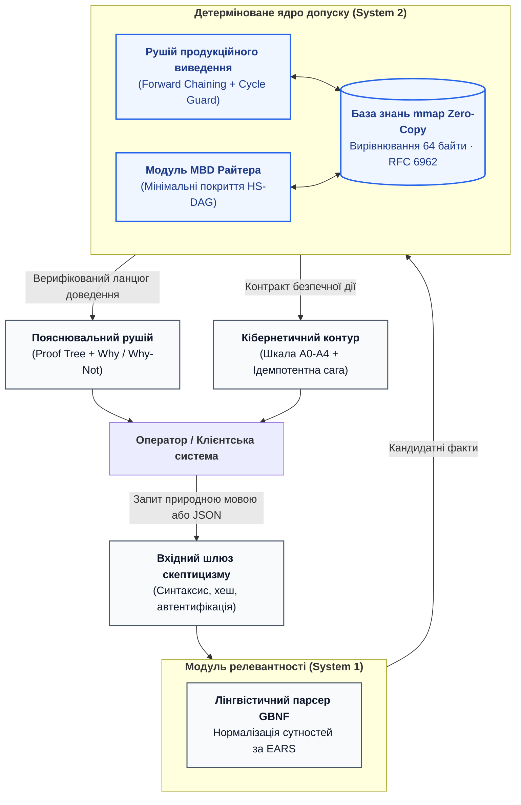

# Специфікація наскрізного курсового проєкту: Проєктування та розробка доказової експертної системи

Курсовий проєкт є підсумковою практичною роботою в межах навчальної дисципліни **«Архітектура доказових експертних систем»** для здобувачів другого (магістерського) та третього (PhD) рівнів вищої освіти спеціальностей 121 «Інженерія програмного забезпечення», 122 «Комп'ютерні науки», 124 «Системний аналіз» та 126 «Інформаційні системи та технології».

Проєкт передбачає самостійну або командну (2–3 особи) розробку повнофункціонального прототипу доказової експертної системи для обраного інженерного домену з дотриманням фундаментальних інваріантів монографії.

---

## 1. Головні архітектурні інваріанти проєкту (Hard Constraints)

Кожен розроблений курсовий проєкт зобов'язаний задовольняти шість непорушних інженерних критеріїв:

1. **Інваріант побайтової доказовості (Evidence Grounding Invariant):**  
   Будь-яка стверджувальна відповідь системи повинна спиратися на дослівно зафіксовану цитату з незмінного першоджерела з точними байтовими межами (`[byte_start, byte_end]`), криптографічним хешем фрагмента (`SHA-256`) та посиланням на ідентифікатор стандарту.
2. **Семантика Fail-Closed Gate (Unknown = Відмова):**  
   Якщо факт відсутній у базі знань, є неоднозначним або виникає нормативна колізія — система повертає типізовану відмову (`REFUSAL / CLARIFICATION`), а не ймовірнісну здогадку ($ZHR = 1.00$).
3. **Нейро-символьний розподіл обов'язків (Relevance vs Eligibility):**  
   Стохастичні моделі (LLM/SLM) відповідають виключно за евристику та семантичний розбір входу (Relevance). Детерміноване символьне ядро (правила, онтології, SMT) відповідає виключно за нормативний допуск (Eligibility) і володіє правом абсолютного вето.
4. **Висока продуктивність та нульове копіювання пам'яті (Zero-Copy):**  
   Контейнер бази знань проєктується під посекційне відображення в адресний простір процесу через системний виклик `mmap(MAP_SHARED)` з вирівнюванням структур даних по 64 байти (Cache Line Alignment) без десеріалізації під час виконання.
5. **Захист від нескінченних циклів (Cycle Guard):**  
   Машина логічного виведення повинна містити математичний захист від циклічних рекурсій ($A \to B \to A$) з гарантованим детермінованим перериванням та поверненням діагностичної помилки.
6. **Криптографічна незмінність ланцюга аудиту (Audit Integrity):**  
   Усі протоколи тестів та нормативні акти пов'язуються у криптографічне дерево Меркла (RFC 6962), що забезпечує верифікацію доказів включення (Inclusion Proofs) за логарифмічний час $O(\log N)$.

---

---

## 2. Типові інженерні домени для вибору теми курсового проєкту

Студентам пропонується обрати одну з чотирьох затверджених предметних областей критичного призначення:

### Домен 1. Автономний експертний верифікатор регламентів технічного обслуговування авіаційних БПЛА
* **Спеціальності:** 121, 126.
* **Нормативна база першоджерел:** Регламенти льотної придатності (STANAG 4703 / DO-178C / DO-254), сервісні мануали виробника двигуна та автопілота.
* **Цільова задача:** Автоматизована перевірка готовності безпілотного комплексу до вильоту на основі телеметрії останніх місій, журналу напрацювання мотогодин та дефектних відомостей. Система генерує сертифікований дозвіл на виліт або блокує старт із посиланням на конкретний пункт бюлетеня безпеки.

### Домен 2. Система модельно-орієнтованої діагностики збоїв інвертора сонячної електростанції (MBD)
* **Спеціальності:** 122, 124.
* **Нормативна база першоджерел:** Стандарти IEC 62109, IEEE 1547, схемотехнічна модель силового трифазного інвертора та масив сенсорних вимірювань (струми, напруги, температура ключів IGBT).
* **Цільова задача:** Реалізація діагностики на основі перших принципів Райтера $(SD, COMP, OBS)$. При фіксації асиметрії фаз система будує конфліктні набори та за допомогою алгоритму HS-DAG локалізує мінімальний перелік несправних компонентів (пробій діода, деградація конденсатора фільтра, збій драйвера затвора).

### Домен 3. Аудитор вимог функціональної безпеки медичного інфузомата (Safety Auditor)
* **Спеціальності:** 121, 124.
* **Нормативна база першоджерел:** Стандарти медичного обладнання IEC 60601-1-8 (сигнали тривоги), IEC 62304 (життєвий цикл ПЗ), ISO 14971 (управління ризиками).
* **Цільова задача:** Наскрізний аудит специфікації вимог та вихідного коду мікроконтролера помпи інфузомата. Побудова графа EKG, детекція незахищених режимів болюсного введення препарату, автоматичний синтез дерева аргументів безпеки GSN та валідація протоколів випробувань через дерево Меркла.

### Домен 4. Доказовий арбітр взаємодії сенсорів автономного транспорту (Sensor Fusion Arbitrator)
* **Спеціальності:** 122, 126.
* **Нормативна база першоджерел:** Стандарти ISO 26262 (ASIL-D), ISO/SAE 21434 (кібербезпека), моделі просторової геометрії та сенсорні потоки лідара, радара й камери.
* **Цільова задача:** Розв'язання колізій між суперечливими показаннями сенсорів в умовах завад або спроби спуфінгу (атаки на оптику). Символьний арбітр усуває суперечності через деонтичні правила безпеки, розраховує реляційний ранг надійності джерел та формує директиву екстреного гальмування рівня A4.

---

## 3. Етапи виконання та графік контрольних точок (Milestones)

Курсовий проєкт виконується синхронно з лекційним курсом та лабораторним практикумом протягом 16 тижнів:

| Етап | Контрольний тиждень | Зміст етапу та очікуваний результат | Вага в оцінці |
|:---:|:---:|---|:---:|
| **M1** | **Тиждень 4** | **Концептуалізація та першоджерела:** Затвердження теми, збір корпусу нормативних документів (PDF/Markdown/JSON), побудова початкового графа сутностей EKG та розрахунок SHA-256 хешів усіх базових фрагментів. | 15% (6 б.) |
| **M2** | **Тиждень 8** | **Формалізація знань та лінтування:** Трансляція вимог у правила на базі шаблонів EARS/GBNF, усунення суперечностей і тавтологій за допомогою лінтера, проєктування онтологічного профілю. | 25% (10 б.) |
| **M3** | **Тиждень 12** | **Ядро виведення та нульове копіювання:** Реалізація детермінованого рушія (Go або Python), забезпечення відсутності алокацій у гарячому циклі, інтеграція діагностичного модуля (MBD або GSN) та побудова дерева Меркла. | 30% (12 б.) |
| **M4** | **Тиждень 16** | **Комплексна верифікація та захист:** Тестування системи за пірамідою KTP, попперівський стрес-тест на контрприкладах, оформлення інженерного звіту та публічний публічний захист прототипу. | 30% (12 б.) |
| **РАЗОМ** | | **Повний обсяг курсового проєкту** | **100% (40 б.)** |

---

## 4. Вимоги до структури та оформлення звіту курсового проєкту

Звіт оформлюється у форматі Markdown (`REPORT.md`) або друкованого документа за стандартами ДСТУ 3008:
1. **Титульний аркуш та метадані:** Назва теми, автори, академічна група, дата випуску.
2. **Постановка інженерної задачі:** Опис досліджуваного об'єкта, ризики помилок, обґрунтування застосування доказової експертної системи.
3. **Аналіз першоджерел та граф EKG:** Перелік нормативних стандартів, карта походження даних (Data Provenance), візуалізація реляційного графа сутностей у Mermaid.
4. **Формалізація бази знань:** Опис граматик GBNF, таблиці продукційних правил, результати лінтування та дедуплікації.
5. **Архітектура програмного комплексу:** Структура модулів, інтерфейси API, механізм відображення пам'яті (`mmap`), алгоритм захисту від циклів (Cycle Guard).
6. **Верифікація та результати тестування:** Протоколи виконання тестів KUT/KIT/KVT, результати автономної попперівської фальсифікації, графіки або лістинги відхилення невалідних станів.
7. **Висновки та інженерна оцінка:** Підтвердження дотримання інваріанта $ZHR = 1.00$, швидкодія системи, межі застосовності.
8. **Додатки:** Посилання на репозиторій Git із повним вихідним кодом, що збирається та запускається однією командою (`make run` або `docker compose up`).

---

## 5. Критерії захисту та шкала оцінювання курсового проєкту

* **Відмінно (36–40 балів / «A»):**  
  Повна працездатність прототипу, 100% покриття висновків побайтовими доказовими першоджерелами, нульовий рівень галюцинацій на всіх тестах фальсифікатора, вичерпне дерево пояснення Why/Why-Not, зразкове оформлення звіту та бездоганні відповіді на запитання комісії.
* **Добре (30–35 балів / «B–C»):**  
  Система стабільно функціонує, реалізовано базові інваріанти доказовості та Fail-Closed відмов, але наявні незначні зауваження до оптимізації пам'яті або неповноти тестового покриття KVT.
* **Задовільно (24–29 балів / «D–E»):**  
  Базові функції виведення працюють, проте модуль перевірки доказів реалізовано спрощено (без точних побайтових зміщень або дерев Меркла), звіт містить методичні прогалини.
* **Незадовільно (< 24 балів / «F»):**  
  Система продукує стохастичні здогадки без доказів ($ZHR < 1.0$), рушій зависає на циклічних правилах, вихідний код не збирається або відсутній робочий прототип.
