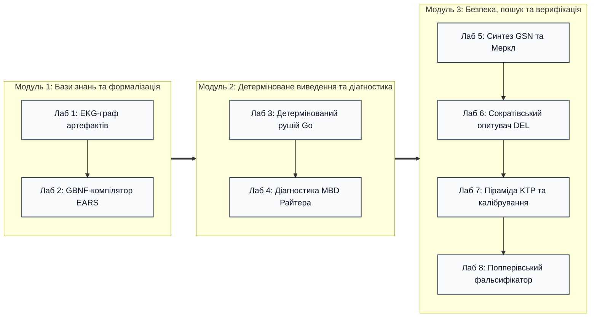

# Лабораторний практикум: Архітектура доказових експертних систем

Практикум призначений для здобувачів другого (магістерського) та третього (освітньо-наукового / PhD) рівнів вищої освіти спеціальностей 121 «Інженерія програмного забезпечення», 122 «Комп'ютерні науки», 124 «Системний аналіз» та 126 «Інформаційні системи та технології».

Практикум є складовою частиною навчально-методичного комплексу монографії «Архітектура доказових експертних систем» та узгоджений із робочою програмою навчальної дисципліни ([SYLLABUS.md](SYLLABUS.md)).

---

## Загальні вимоги до виконання та захисту лабораторних робіт

1. **Технологічний стек:**
   - Мови програмування: **Go 1.22+** (для системних компонентів низького рівня, детермінованих рушіїв та структур нульового копіювання) та **Python 3.10+** (для евристичних модулів, лінгвістичного аналізу та роботи з графами).
   - Інструменти тестування: вбудовані тестові фреймворки `go test -v -race`, `pytest`, сталі лінтери `go vet`, `ruff` / `flake8`.
2. **Інваріанти якості коду:**
   - **Детермінізм та відтворюваність:** Результати роботи логічних рушіїв повинні бути повністю детермінованими на однакових вхідних векторах фактів.
   - **Доказовість (Evidence Grounding):** Будь-яке твердження системи повинно спиратися на конкретні першоджерела з фіксацією точних байтових меж або ідентифікаторів артефактів.
   - **Fail-Closed семантика:** При невизначеності, суперечності або відсутності фактів система зобов'язана повертати безпечну типізовану відмову (`REFUSAL`), а не евристичну здогадку.
3. **Форма звітності:**
   - Вихідний код у системі контролю версій Git.
   - Інженерний звіт у форматі Markdown (`REPORT.md`), що містить мету, постановку задачі, архітектуру рішення, лістинги ключових алгоритмів, скріншоти або логи успішного проходження тестів та відповіді на контрольні запитання.

---



---

## Лабораторна робота №1. Синтаксичний розбір інженерних артефактів та побудова графа простежуваності EKG

* **Теоретичний базис:** Глави 8 та 9 монографії.
* **Обсяг часу:** 4 години аудиторної роботи, 6 годин самостійної підготовки.
* **Стек:** Python 3.10+ (`networkx`, `pydantic`) або Go 1.22+.

### 1. Мета роботи
Опанувати інженерні методи вилучення знань із різнорідних першоджерел (специфікації вимог, вихідний код, тест-кейси) зі збереженням суворої байтової кастодії доказів та побудовою реляційного графа інженерних знань (Engineering Knowledge Graph, EKG).

### 2. Короткі теоретичні відомості
Інженерний артефакт у доказовій експертній системі трактується як первинний immutable-документ. Кожен виділений фрагмент знання (вимога, функція коду, твердження тесту) повинен мати точну адресацію:
$$\text{Evidence} = \langle \text{SourceURI}, \text{ByteStart}, \text{ByteEnd}, \text{SHA256} \rangle$$
Граф EKG формалізується як спрямований мультиграф $G = (V, E, \tau_v, \tau_e)$, де:
* $V$ — множина вершин-артефактів (вимоги, інтерфейси, функції, тест-кейси);
* $E$ — множина ребер трасованості (`SATISFIES`, `VERIFIES`, `DERIVED_FROM`, `CONTRADICTS`);
* $\tau_v, \tau_e$ — функції типізації вузлів і зв'язків.

### 3. Вхідні дані
Набір із трьох зв'язаних артефактів інженерного проєкту (автомобільна підсистема керування гальмуванням):
1. `req_braking.md` — текстова специфікація 5 вимог (SRS);
2. `controller.py` (або `controller.go`) — реалізація логіки контролера;
3. `test_braking.py` — модульні та інтеграційні тести.

### 4. Завдання до виконання
1. Розробити синтаксичний парсер першоджерел, який під час читання файлів фіксує точні зміщення байтів `[ByteStart, ByteEnd]` та обчислює SHA-256 контрольні суми для кожного блоку.
2. Спроєктувати схему реляційних сутностей `ArtifactNode` та `TraceEdge`.
3. Реалізувати алгоритм автоматичного вилучення лінків трасованості на основі анотацій у коді (наприклад, `@satisfies(REQ-BRK-001)`, `@verifies(REQ-BRK-001)`).
4. Побудувати структуру графа EKG та реалізувати верифікатор цілісності ланцюгів:
   - Перевірка наявності ізольованих вимог (Orphan Requirements), які не мають жодної реалізації;
   - Перевірка відсутності неперевіреного коду (Unverified Code), що не покритий тестами;
   - Виявлення циклічних залежностей у похідних вимогах (`DERIVED_FROM`).
5. Експортувати граф у формати JSON Graph та Mermaid.js для візуалізації.

### 5. Критерії приймання (Acceptance Criteria)
* Покриття коду модульними тестами $\ge 85\%$.
* Точність визначення байтових меж перевіряється побайтовим зрізом вихідного файлу `file_bytes[ByteStart:ByteEnd] == block_content`.
* Виявлення 100% навмисно внесених дефектів трасованості (1 ізольована вимога, 1 вимога без тесту, 1 циклічне посилання).

### 6. Контрольні запитання
1. Чому байтове позиціонування (`ByteStart`, `ByteEnd`) є надійнішим за нумерацію рядків у системах аудиту?
2. Яким чином обчислення SHA-256 запобігає атакам на підміну першоджерел доказів?
3. Що таке ізоморфізм графів простежуваності та як він впливає на аналіз впливу змін (Change Impact Analysis)?

---

## Лабораторна робота №2. Розробка GBNF-компілятора вимог природною мовою у формальні правила

* **Теоретичний базис:** Глави 12, 13 та 14 монографії.
* **Обсяг часу:** 4 години аудиторної роботи, 6 годин самостійної підготовки.
* **Стек:** Python 3.10+ або Go 1.22+.

### 1. Мета роботи
Дослідити проблему лінгвістичної варіативності інженерних текстів та розробити компілятор вимог природною мовою у формальні продукційні правила на основі синтаксичних шаблонів EARS та розширеної граматики Беруса-Наура у форматі GBNF.

### 2. Короткі теоретичні відомості
Шаблони Easy Approach to Requirements Syntax (EARS) стандартизують конструкції вимог:
1. **Ubiquitous:** «Система ПОВИННА [дія]»
2. **Event-Driven:** «КОЛИ [подія], система ПОВИННА [дія]»
3. **State-Driven:** «ПОКИ [стан], система ПОВИННА [дія]»
4. **Unwanted Behavior:** «ЯКЩО [стан тривоги], ТОДІ система ПОВИННА [реакція]»

Граматика GBNF (Grammar-Based Context-Free Grammar) дозволяє обмежити генерацію токенів або розбір тексту суворим синтаксичним автоматом, унеможливлюючи появу галюцинацій та невалідних конструкцій.

### 3. Вхідні дані
Корпус із 20 інженерних вимог на природній мові (10 строго нормалізованих за EARS та 10 неструктурованих із дефектами нечіткості: пасивний стан, розмиті квантори «швидко», «можливо», «за необхідності»).

### 4. Завдання до виконання
1. Скласти формальну граматику GBNF для 4 базових типів шаблонів EARS:
   ```bnf
   root ::= (ubiquitous | event_driven | state_driven | unwanted) "\n"
   event_driven ::= "КОЛИ " trigger ", система ПОВИННА " action "."
   unwanted ::= "ЯКЩО " hazard ", ТОДІ система ПОВИННА " mitigation "."
   ...
   ```
2. Реалізувати лексичний та синтаксичний аналізатор, що транслює валідні EARS-вимоги у нормалізований JSON-формат продукційних правил:
   ```json
   {
     "rule_id": "RULE-BRK-001",
     "type": "EVENT_DRIVEN",
     "trigger": {"signal": "brake_pedal", "op": "==", "value": "PRESSED"},
     "action": {"actuator": "brake_caliper", "state": "ENGAGED"}
   }
   ```
3. Реалізувати фільтр лінгвістичного скептицизму, що маркує неструктуровані вимоги статусом `SYNTAX_REJECT` із зазначенням конкретного дефекту (наприклад, `WEAK_MODAL_VERB`, `AMBIGUOUS_QUANTIFIER`).
4. Написати конвертер отриманих продукційних правил у мову символьного предикатного представлення першого порядку.

### 5. Критерії приймання
* Коректний розбір 100% валідних EARS-вимог тестового корпусу.
* Відхилення 100% невалідних або амбівалентних вимог із генерацією інформативного діагностичного повідомлення про порушення шаблону.
* Стійкість граматичного автомата до зловмисних або зациклених конструкцій.

### 6. Контрольні запитання
1. У чому полягає відмінність між евристичним розбором вимог за допомогою нейромережі та детермінованим розбором через GBNF?
2. Чому використання пасивного стану в інженерних специфікаціях створює загрозу безпеці систем реального часу?
3. Які семантичні обмеження накладає синтаксис EARS на опис складних часових залежностей (Temporal Logic)?

---

## Лабораторна робота №3. Реалізація детермінованого рушія продукційного виведення мовою Go із захистом від циклів

* **Теоретичний базис:** Глави 16, 17 та 18 монографії.
* **Обсяг часу:** 4 години аудиторної роботи, 6 годин самостійної підготовки.
* **Стек:** Go 1.22+ (стандартна бібліотека).

### 1. Мета роботи
Розробити високопродуктивний детермінований рушій продукційного прямого виведення (Forward Chaining) з нульовою динамічною алокацією пам'яті в гарячому циклі та формальним математичним захистом від циклічного зависання (Cycle Guard).

### 2. Короткі теоретичні відомості
Продукційна система описується трійкою $\langle \mathcal{F}, \mathcal{R}, \mathcal{I} \rangle$, де $\mathcal{F}$ — робоча пам'ять фактів, $\mathcal{R}$ — множина правил $P \to Q$, $\mathcal{I}$ — машина виведення.
Для гарантії детермінізму латентності та завершуваності алгоритму рушій зобов'язаний:
1. Забезпечувати захист від нескінченних циклів за теоремою Тар'яна про пошук компонент сильної зв'язності (SCC) або через межу глибини $D_{\max} \le |\mathcal{R}|$.
2. Запобігати деградації продуктивності через консервацію адресного простору (Memory Allocations = 0 allocs/op під час резолюції).
3. Формувати невразливий ланцюг деривації для кожного виведеного факту.

### 3. Вхідні дані
База знань із 50 продукційних правил діагностики телекомунікаційного вузла (сигнали тривоги, статуси каналів, відмови живлення) та вектор початкових фактів-спостережень.

### 4. Завдання до виконання
1. Спроєктувати структури даних `Fact`, `Rule`, `InferenceEngine` у Go:
   ```go
   type FactID uint32

   type Fact struct {
       ID        FactID
       Predicate string
       Value     string
       Evidence  string
   }

   type Rule struct {
       ID         uint32
       Conditions []FactID
       Consequent Fact
   }
   ```
2. Реалізувати алгоритм прямого виведення з чергою активних правил та бітовими масками для перевірки виконання передумов ($O(1)$ бітова кон'юнкція).
3. Додати механізм **Cycle Guard**:
   - Детекція циклічної появи однакових станів робочої пам'яті за допомогою хешування простору фактів;
   - Переривання виведення з генерацією типізованої помилки `ErrCyclicDependencyDetected` при виявленні замкненого контуру.
4. Провести бенчмаркінг (`go test -bench=. -benchmem`) і оптимізувати гарячий цикл виведення до 0 алокацій на операцію виведення.
5. Реалізувати генератор дерева доведення (Proof Tree) для цільового факту.

### 5. Критерії приймання
* Тести `go test -race` проходять без помилок конкурентності.
* Бенчмарк показує $0 \text{ B/op}$ та $0 \text{ allocs/op}$ у методі `engine.Step()`.
* Рушій детерміновано зупиняється та повертає помилку на штучно введеному циклі $A \to B \to C \to A$.
* Інваріант $ZHR = 1.0$: якщо цільовий факт не виведений детерміновано, повертається `Refusal`, а не наближене значення.

### 6. Контрольні запитання
1. Чому динамічні алокації пам'яті в середовищах із Garbage Collector (Go, Java) несуть ризик для систем критичного призначення?
2. Яким чином бітові вектори прискорюють пошук спрацьовування правил порівняно з реляційними з'єднаннями Rete?
3. Що таке вакуумна істинність правила та як їй запобігти на етапі ініціалізації фактів?

---

## Лабораторна робота №4. Модельно-орієнтована діагностика складних технічних систем (MBD) методом Райтера

* **Теоретичний базис:** Глави 22, 23 та 24 монографії.
* **Обсяг часу:** 4 години аудиторної роботи, 6 годин самостійної підготовки.
* **Стек:** Python 3.10+ (`z3-solver` або власний SAT-резольвер) чи Go 1.22+.

### 1. Мета роботи
Засвоїти формалізм модельно-орієнтованої діагностики Райтера на основі перших принципів (First Principles) та реалізувати алгоритм пошуку мінімальних множин відмов компонентів за допомогою дерева розщеплення Hitting Set (HS-DAG).

### 2. Короткі теоретичні відомості
Система моделюється трійкою $\langle SD, COMP, OBS \rangle$:
* $SD$ — опис системи (логічні вирази взаємодії компонентів);
* $COMP$ — множина компонентів системи $\{c_1, c_2, \dots, c_n\}$;
* $OBS$ — множина фактичних спостережень на входах і виходах.

Предикат $AB(c)$ позначає «компонент $c$ функціонує аномально (Abnormal)».
Конфліктний набір $CS \subseteq COMP$ — це така підмножина компонентів, припущення про справність яких суперечить спостереженням:
$$SD \cup OBS \cup \{ \neg AB(c) \mid c \in CS \} \vdash \bot$$
Діагноз $\Delta \subseteq COMP$ — це мінімальне покриття (Minimal Hitting Set) усіх можливих конфліктних наборів.

### 3. Вхідні дані
Модель цифрової схеми повнозв'язного трирозрядного суматора (Full Adder) або гідравлічної системи насосної станції (клапани, помпи, сенсори тиску) із зафіксованими аномальними спостереженнями на виходах.

### 4. Завдання до виконання
1. Формалізувати нормальну поведінку компонентів системи мовою пропозиційної логіки або булевих рівнянь:
   $$\neg AB(M_1) \implies \text{Out}(M_1) = \text{In}_1(M_1) \times \text{In}_2(M_1)$$
2. Реалізувати TP-генератор (Theorem Prover interface) для знаходження конфліктних наборів компонентів при подачі вхідних і вихідних сигналів.
3. Реалізувати алгоритм побудови дерева мінімального покриття HS-DAG (Greiner's optimized version):
   - Побудова вузлів дерева, де кожен вузол маркується конфліктним набором;
   - Розгалуження ребер по компонентах конфлікту;
   - Перевірка та відсікання немінімальних гілок (Pruning);
   - Закриття гілок міткою $\checkmark$, якщо підмножина компонентів є консистентною зі спостереженнями.
4. Знайти всі мінімальні діагнози відмов першого ($\Delta_1$) та другого ($\Delta_2$) порядків.

### 5. Критерії приймання
* Алгоритм знаходить точний повний перелік мінімальних діагнозів для класичного бенчмарку суматора Райтера-де Кліра.
* Відсутність у результатах надлишкових (supersets) діагнозів.
* Обробка виродженого випадку: якщо спостереження консистентні з моделлю, повертається порожній діагноз $\Delta = \emptyset$ (система справна).

### 6. Контрольні запитання
1. Чому модельно-орієнтована діагностика на основі перших принципів перевершує табличні експертні правила «симптом-причина» за новизни аварійних режимів?
2. Яка обчислювальна складність задачі знаходження мінімального покриття (Minimal Hitting Set)?
3. Як модифікується алгоритм HS-DAG за наявності апріорних ймовірностей відмов компонентів $P(AB(c_i))$?

---

## Лабораторна робота №5. Автоматичний синтез аргументів безпеки GSN та криптографічна верифікація доказів деревами Меркла

* **Теоретичний базис:** Глави 25, 26 та 27 монографії.
* **Обсяг часу:** 4 години аудиторної роботи, 6 годин самостійної підготовки.
* **Стек:** Go 1.22+ (криптографічний пакет `crypto/sha256`) або Python 3.10+.

### 1. Мета роботи
Розробити підсистему автоматичного синтезу структур аргументів безпеки в нотації Goal Structuring Notation (GSN v3) на основі графа інженерних знань та реалізувати криптографічну верифікацію першоджерел доказів за стандартом RFC 6962 за допомогою дерева Меркла.

### 2. Короткі теоретичні відомості
Нотація GSN структурує аргументацію безпеки через ієрархічні сутності:
* **Goal ($G$):** Загальна ціль безпеки (наприклад, «Підсистема контролю керма стійка до одиничних збоїв сенсора»).
* **Strategy ($S$):** Стратегія декомпозиції аргументу.
* **Context ($C$):** Операційний контекст застосування цілі.
* **Solution ($Sn$):** Фактичний доказ (звіт тестів, верифікаційний лог), що обґрунтовує кінцеву ціль.

Для запобігання фальсифікації доказів $Sn$ будується двійкове дерево Меркла (Merkle Tree). Кожен листок дерева є криптографічним хешем першоджерела. Корінь дерева (Merkle Root) фіксується як криптографічний якір цілісності. Аудитор може перевірити будь-який доказ без передачі всього масиву даних за логарифмічний час $O(\log N)$ за допомогою доказу включення (Inclusion Proof / Audit Path).

### 3. Вхідні дані
База фактів та верифікаційних логів критичного програмно-апаратного контролера (16 файлів протоколів тестів, 4 специфікації стандартів).

### 4. Завдання до виконання
1. Реалізувати алгоритм обходу EKG-графа для автоматичного виділення ланцюжка «Вимога безпеки $\to$ Архітектурне рішення $\to$ Результат валідації» та генерації моделі GSN у форматі Mermaid.
2. Реалізувати структуру даних Merkle Tree згідно з рекомендаціями RFC 6962:
   - Хешування листків: $H(\text{leaf}) = \text{SHA256}(0x00 \parallel \text{data})$;
   - Хешування внутрішніх вузлів: $H(\text{node}) = \text{SHA256}(0x01 \parallel \text{left} \parallel \text{right})$;
   - Вирівнювання непарної кількості вузлів дублюванням або переносом.
3. Реалізувати функцію генерації доказу аудиту `GetAuditPath(leaf_index)` та функцію автономної перевірки валідності `VerifyInclusionProof(leaf, audit_path, root_hash)`.
4. Змоделювати атаку підміни байта у протоколі тестування та перевірити відхилення сфальсифікованого доказу аудитором.

### 5. Критерії приймання
* Коректний розрахунок кореневого хешу дерева Меркла для еталонного вектора тестових блоків.
* Час верифікації Inclusion Proof для $N = 1024$ листків складає $\le 10$ операцій хешування.
* 100% виявлення модифікації навіть одного біта в будь-якому з файлів-першоджерел.

### 6. Контрольні запитання
1. Чому розділення префіксів $0x00$ та $0x01$ у RFC 6962 є обов'язковим для запобігання атакам другого прообразу (Second Preimage Attacks)?
2. Як використання дерев Меркла забезпечує принцип нульового розкриття зайвих знань (Zero-Knowledge Audit)?
3. Які семантичні помилки є неприпустимими при синтезі стратегій декомпозиції в нотації GSN?

---

## Лабораторна робота №6. Реляційний сократівський опитувач з однодотиковою навігацією та максимізацією приросту інформації

* **Теоретичний базис:** Глави 31, 33 та 34 монографії.
* **Обсяг часу:** 4 години аудиторної роботи, 6 годин самостійної підготовки.
* **Стек:** Python 3.10+ або Go 1.22+ (`bubbletea` для TUI).

### 1. Мета роботи
Розробити модуль інтерактивного сократівського діалогу з оператором на основі двонаправленого пошуку в графі бази знань, операторів динамічної епістемічної логіки (DEL) та розрахунку максимального інформаційного виграшу Шеннона для мінімізації кількості запитань.

### 2. Короткі теоретичні відомості
Коли вхідний запит користувача є неповним або недостатнім для однозначного висновку, система не має права галюцинувати. Вона формує інтерактивну сесію уточнення (Socratic Clarification).
Для кожного можливого запитання $q \in Q$ обчислюється інформаційний виграш (Information Gain):
$$IG(q) = H(\mathcal{W}) - \sum_{a \in \text{Answers}(q)} P(a) \cdot H(\mathcal{W} \mid a)$$
де $\mathcal{W}$ — простір можливих епістемічних світів Кріпке (гіпотез про стан досліджуваного об'єкта), $H(\mathcal{W})$ — ентропія Шеннона. Опитувач ранжує запитання за спаданням $IG(q)$, обираючи запитання, яке найшвидше відсікає максимальну кількість недостовірних альтернатив (Minimax reduction).

### 3. Вхідні дані
База знань несправностей бортового обладнання (12 гіпотез поломки, 18 діагностичних симптомів та опитувальних пунктів із таблицею розподілу ймовірностей $P(w_i)$).

### 4. Завдання до виконання
1. Спроєктувати реляційний граф дефектів і спостережень.
2. Реалізувати функцію обчислення ентропії Шеннона та інформаційного виграшу для переліку кандидатних запитань.
3. Розробити алгоритм скорочення можливих світів: після вибору оператором відповіді простір станів редукується до консистентного підпростору $\mathcal{W}' = \{w \in \mathcal{W} \mid \text{Check}(w, a) = \text{True}\}$.
4. Реалізувати консольний інтерфейс користувача (TUI) з однодотиковим вибором варіантів відповідей (гарячі клавіші 1–4, без введення довгих рядків тексту).
5. Продемонструвати локалізацію єдиної кореневої гіпотези з 12 початкових не більше ніж за 3 кроки сократівського діалогу.

### 5. Критерії приймання
* Жадібний алгоритм вибору запитань із максимальним $IG(q)$ скорочує середню кількість кроків діалогу щонайменше на 40% порівняно з випадковим опитуванням.
* Коректна обробка варіанта «Невідомо»: система не видаляє гіпотези, а коригує вагові коефіцієнти.
* Плавний відгук інтерфейсу TUI без блокування основного потоку виконання.

### 6. Контрольні запитання
1. Як теорема Байєса взаємодіє з формулою інформаційного виграшу Шеннона під час ітеративного уточнення знань?
2. Чому парадигма однодотикової навігації (One-Touch Interaction) є критичною для інженерних терміналів в екстремальних польових умовах?
3. Які обмеження накладає модель світів Кріпке на вираження суперечливих показань оператора?

---

## Лабораторна робота №7. Піраміда тестування знань (KTP) та захист від вакуумної істинності

* **Теоретичний базис:** Глави 35, 36 та 37 монографії.
* **Обсяг часу:** 4 години аудиторної роботи, 6 годин самостійної підготовки.
* **Стек:** Go 1.22+ або Python 3.10+.

### 1. Мета роботи
Реалізувати фреймворк багаторівневого тестування бази знань за методологією Knowledge Testing Pyramid (KTP), дослідити поведінку логічного рушія під дією варіаційних збурень та розробити детектор вакуумної істинності (Vacuous Truth Prevention).

### 2. Короткі теоретичні відомості
Піраміда тестування знань (KTP) складається з трьох рівнів:
1. **KUT (Knowledge Unit Testing):** Ізольована перевірка окремих продукційних правил та предикатів на граничних значеннях аргументів.
2. **KIT (Knowledge Integration Testing):** Перевірка ланцюжків взаємодії правил, виявлення конфліктів пріоритетів та циклів виведення.
3. **KVT (Knowledge Validation Testing):** Наскрізна верифікація рішень експертної системи на валідованих індустріальних кейсах.

**Проблема вакуумної істинності:** У класичній математичній логіці імплікація $P \to Q$ є тотожно істинною, якщо умова $P$ хибна ($P \equiv \text{False}$), незалежно від значення $Q$. В інженерних системах це призводить до катастрофічних наслідків: непрацююче правило формально вважається валідним. Фреймворк тестування зобов'язаний перевіряти активуваність передумов ($\exists \text{ Case}: P \equiv \text{True}$).

Критерій Ліпшицевої неперервності перевіряє стійкість системи до малих шумовхідних збурень:
$$\| \text{Decision}(x) - \text{Decision}(x + \delta) \| \le L \cdot \| \delta \|$$

### 3. Вхідні дані
База знань нормативних регламентів експлуатації гідроелектростанції (40 продукційних правил із числовими граничними умовами: рівень води, тиск у турбіні, вібрація валу).

### 4. Завдання до виконання
1. Розробити автоматизований раннер KTP, що підтримує запуск тестових сценаріїв із конфігураційного файлу YAML/JSON.
2. Реалізувати алгоритм виявлення вакуумно істинних правил (Vacuous Truth Detector):
   - Статичний аналіз умов на несумісність (наприклад, $x > 100 \land x < 50$);
   - Динамічний контроль покриття передумов (Precondition Coverage $\ge 1$ спрацьовування за тестовий набір).
3. Реалізувати модуль варіаційного збурення вхідних сигналів $x' = x \pm \epsilon$:
   - Перевірка відсутності стрибкоподібних неконтрольованих змін рекомендацій системи при значеннях у межах похибки сенсора;
   - Фіксація критичних точок біфуркації (порогові перемикання захисних автоматів).
4. Згенерувати зведений звіт аудиту надійності бази знань із розрахунком метрик KUT/KIT coverage та індексу вакуумності.

### 5. Критерії приймання
* 100% виявлення 3 навмисно внесених вакуумно істинних правил у навчальній базі знань.
* Успішне проходження повного циклу тестів KUT, KIT, KVT.
* Генерація попередження при порушенні ліпшицевої стійкості у зоні граничних значень параметрів.

### 6. Контрольні запитання
1. Чому 100% проходження тестів за наявності вакуумної істинності створює ілюзію надійності системи?
2. Яким чином варіаційне тестування граничних умов запобігає ефекту «хибної впевненості» нейро-символьних моделей?
3. Які відмінності між тестуванням традиційного імперативного ПЗ та верифікацією декляративних баз знань?

---

## Лабораторна робота №8. Побудова автономного попперівського фальсифікатора знань на базі нейро-символьного контуру

* **Теоретичний базис:** Глави 38, 39 та 40 монографії.
* **Обсяг часу:** 4 години аудиторної роботи, 6 годин самостійної підготовки.
* **Стек:** Python 3.10+ (`pytest`, `hypothesis` або власна реалізація) чи Go 1.22+.

### 1. Мета роботи
Спроєктувати та реалізувати підсистему автономного попперівського тестування знань (Popperian Falsification Agent), що функціонує за принципом безперервного фальсифікатора: генерація підступних граничних тестів евристичним модулем та їх детермінований розгляд символьним ядром для виявлення прихованих дефектів і прогалин знань.

### 2. Короткі теоретичні відомості
Згідно з принципом фальсифікованості Карла Поппера, жодна кількість успішних тестів не може остаточно підтвердити гіпотезу, проте один неспростовний контрприклад здатний її спростувати:
$$\exists x : (P(x) \land \neg Q(x)) \implies \text{Hypothesis}(P \to Q) \text{ is False}$$
Нейро-символьний контур фальсифікатора організовано як суперництво двох агентів:
1. **Red Team (Фальсифікатор / Евристичний модуль):** Мутує вхідні вектори, комбінує рідкісні стани, формує суперечливі або маніпулятивні запити, спрямовані на порушення інваріантів безпеки.
2. **Blue Team (Символьне ядро допуску):** Перевіряє відповідь системи проти нормативного базису першоджерел, оцінює дотримання інваріанта $ZHR = 1.0$ (Zero Hallucination Rate) та фіксує порушення.

### 3. Вхідні дані
База знань та модуль прийняття рішень для автономної мобільної платформи (робота-маніпулятора або БПЛА): правила безпечного наближення, пріоритети команд аварійної зупинки, обмеження швидкості.

### 4. Завдання до виконання
1. Спроєктувати та реалізувати архітектуру автономного контуру фальсифікації:
   ```mermaid
   sequenceDiagram
       autonumber
       actor Red as Фальсифікатор (Red Team)
       participant SUT as Досліджувана база знань
       participant Host as Символьне ядро верифікації
       participant Report as Реєстр дефектів

       Red->>SUT: Подання агресивного мутованого вектора (Boundary Attack)
       SUT->>Host: Пропонована дія + Ланцюг доведення
       Host->>Host: Перевірка проти першоджерел (Custody Check)
       alt Інваріант порушено або факт не має доказу
           Host->>Report: Реєстрація успішної фальсифікації (Bug Found)
       else Відповідь коректно відхилена (Refusal)
           Host->>Red: Інваріант витримав (Reinforce boundary)
       end
   ```
2. Реалізувати алгоритми мутаційного тестування входів:
   - Екстремальні значення числових параметрів ($NaN$, $\pm \infty$, переповнення розрядної сітки);
   - Суперечливі сенсорні дані (одночасний сигнал аварійної зупинки та максимального прискорення);
   - Запити з відсутніми передумовами (Missing Context Probe).
3. Реалізувати детектор дефіциту знань (Knowledge Deficit Detector), який фіксує зони вхідного простору, де система повертає відмову через відсутність нормативної інформації.
4. Автоматизувати формування підсумкового Popperian Compliance Audit Report із ранжуванням знайдених вразливостей за критичністю.

### 5. Критерії приймання
* Фальсифікатор успішно знаходить щонайменше 2 приховані вразливості у штучно дефектній конфігурації бази знань.
* Відсутність помилкових спрацьовувань (False Positives) у верифікованих безпечних режимах.
* Система підтверджує інваріант $ZHR = 1.0$: у жодному зі стрес-сценаріїв рушій не згенерував необґрунтовану здогадку або позитивне рішення за відсутності доказів.

### 6. Контрольні запитання
1. У чому полягає філософська та практична різниця між верифікацією через підтвердження (Verification) та спростуванням через фальсифікацію (Falsification)?
2. Чому евристичні нейромережеві моделі є ефективними генераторами контрприкладів, але не можуть бути фінальними суддями у контурі верифікації?
3. Як автоматичне попперівське тестування допомагає подолати проблему «мовчазного схвалення» невалідних станів у критичних кіберфізичних системах?

---

## Рекомендовані критерії підсумкового оцінювання виконання лабораторних робіт

| Складова оцінки | Питома вага | Опис критерію |
|---|:---:|---|
| **Працездатність коду та проходження тестів** | 40% | 100% виконання критеріїв приймання (Acceptance Criteria), відсутність регресій, успішне проходження лінтерів та тестів конкурентності |
| **Архітектурна чистота та дотримання інваріантів** | 25% | Дотримання інваріантів нульового копіювання, кастодії доказів, fail-closed відмов та відсутності галюцинацій |
| **Якість оформлення звіту (REPORT.md)** | 15% | Повнота опису алгоритмів, структур даних, логів тестування та наявність діаграм Mermaid |
| **Захист лабораторної роботи** | 20% | Ґрунтовні та математично коректні відповіді на контрольні запитання викладача, володіння матеріалом глави |
| **РАЗОМ** | **100%** | **Максимум 5 балів за роботу (всього 40 балів за курс)** |
