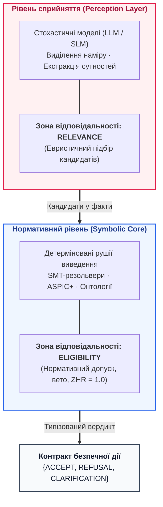

# Типова робоча навчальна програма дисципліни (Syllabus)
# «Архітектура доказових експертних систем та нейро-символьного штучного інтелекту»
## Course Syllabus: Architecture of Evidence-Grounded Expert Systems and Neuro-Symbolic AI

**Академічний рівень:** Другий (магістерський) рівень вищої освіти / Третій (освітньо-науковий, Ph.D.)  
**Галузь знань:** 12 «Інформаційні технології»  
**Спеціальності:**  
* `121` — Інженерія програмного забезпечення  
* `122` — Комп'ютерні науки  
* `124` — Системний аналіз  
* `126` — Інформаційні системи та технології  
**Базовий підручник:** Микола Федчик. *Архітектура доказових експертних систем: від формальних онтологій до нейро-символьного ШІ*. Монографія у 7 частинах і 40 главах, 2026. ([README.md](README.md); облік наукових одиниць — у [зведеному реєстрі](authorial-contributions-registry.md))
**Загальний обсяг:** 5 кредитів ECTS (150 академічних годин)  
**Розподіл годин:**  
* Лекційні заняття: **32 години** (16 лекцій по 2 години)  
* Лабораторні заняття: **32 години** (8 лабораторних робіт по 4 години за [LABS.md](LABS.md))  
* Семінарські та колоквіумні заняття: **16 годин** (8 семінарів по 2 години)  
* Самостійна робота студентів (СРС): **70 годин** (включно з опрацюванням [MATH_PRIMER.md](MATH_PRIMER.md), самоконтролем за [TEST_BANK.md](TEST_BANK.md) та виконанням курсового проєкту за [CAPSTONE.md](CAPSTONE.md))  
**Форма підсумкового контролю:** Екзамен або публічний захист наскрізного курсового проєкту (диференційований залік)  

---

## 1. Опис та концепція навчальної дисципліни

Дисципліна присвячена проєктуванню, формальній верифікації, математичним моделям, компіляції знань та промисловій експлуатації детермінованих, пояснюваних інтелектуальних систем без галюцинацій (Safety-Critical & Evidence-Grounded AI). 

Сучасний стан штучного інтелекту характеризується глибоким епістемічним розривом: статистичні мовні моделі (LLM/SLM) генерують правдоподібний текст, але страждають від стохастичних помилок і не мають математичної доказовості, що блокує їхнє впровадження у доменах із високою ціною помилки (авіоніка DO-178C, автомобільна функціональна безпека ISO 26262 ASIL D, кібербезпека ISO/SAE 21434, медичні протоколи IEC 62304 / ISO 14971, енергетика та автономна робототехніка). Курс вивчає побудову гібридного **доказового нейро-символьного ШІ**, де мовні моделі виконують дорадчу функцію виділення релевантності (*Relevance*) у конвеєрі «Мутатор–Селектор», а детерміноване символьне ядро непорушно гарантує інваріанти логічної несуперечливості, побайтового заземлення фактів у першоджерелах, контролю повноважень та право безумовного вето (*Eligibility*).

---

## 2. Мета, компетентності та програмні результати навчання (ПРН)

### 2.1. Мета дисципліни
Формування у здобувачів вищої освіти теоретичних знань і практичних навичок архітектурного проєктування, компіляції баз знань, розробки та математичної верифікації доказових експертних систем, здатних розв'язувати аналітичні, діагностичні та управлінські задачі в умовах нульової толерантності до галюцинацій ($`ZHR = 1{,}00`$).

### 2.2. Загальні та спеціальні компетентності
* **ЗК-1:** Здатність до наукового аналізу, синтезу та критичного осмислення складних епістемічних проблем на стику дискретної математики, математичної логіки та комп'ютерних наук.
* **ЗК-2:** Здатність оцінювати інженерно-економічну ефективність, експлуатаційні ризики та межі відповідальності інтелектуальних систем за моделлю сукупної вартості володіння знаннями $`TCO_{\mathrm{epist}}(N)`$.
* **СК-1:** Здатність проєктувати модульні архітектури баз знань (продукції, формальні онтології OWL 2, інженерні графи простежуваності EKG, простори конфігурацій CSP та незмінні бінарні контейнери `mmap` нульового копіювання).
* **СК-2:** Здатність розробляти детерміновані алгоритми логічного виведення ($`\mathrm{Horn\text{-}SAT}`$, стратифікований $`\mathrm{Datalog}^{\lnot}`$, двонаправлений BFS, немонотонна аргументація ASPIC+ та ієрархічна FPT-діагностика HS-DAG).
* **СК-3:** Здатність проєктувати двопрохідні лінгвістичні компілятори нормативних вимог (шаблони EARS, граматики GBNF, трансдьюсери WFST, метрологічний контроль термінологічних інваріантів SIF) та шлюзи алгоритмічного скептицизму.
* **СК-4:** Здатність впроваджувати криптографічні протоколи збереження цілісності доказів (дерева Меркла за RFC 6962, невідкличні журнали аудиту WORM, підписи Ed25519 та консорціумні схеми HSM).
* **СК-5:** Здатність проєктувати системи автоматизованого синтезу та ко-інженерії дерев аргументації функціональної безпеки (ISO 26262, DO-178C) та кібербезпеки (ISO/SAE 21434) у нотації GSN, а також апаратні арбітри Сімплекс.
* **СК-6:** Здатність реалізовувати чотирирівневу піраміду тестування знань (KTP), протоколи активного попперівського фальсифікаційного аудиту, розподілені архітектури Epistemic SOA та верифікатори сертифікатів доведення $`\mathrm{TCB}_{\pi}`$.

### 2.3. Програмні результати навчання (ПРН-01..ПРН-08)
* **ПРН-01:** Формулювати математичні інваріанти побайтової доказовості ($`ZHR = 1{,}00`$), будувати багатозначні предикати допуску рішень у логіках Кліні $`\mathbb{K}_3`$ та Белнапа $`\mathcal{B}_4`$, розраховувати сукупну епістемічну вартість володіння $`TCO_{\mathrm{epist}}(N)`$ і точку беззбитковості $`N^*`$.
* **ПРН-02:** Розробляти синтаксичні парсери інженерних артефактів із побайтовою кастодією доказів (`[byte_start, byte_end]`, `SHA-256`), будувати реляційні графи простежуваності EKG та незмінні бінарні пакети знань `mmap(MAP_SHARED)` з асинхронною RCU-міграцією без простою.
* **ПРН-03:** Проєктувати каскадні шлюзи вхідного скептицизму (Fail-Early L0–L3, критерій чутливості LOGO) та двопрохідні компілятори нормативних вимог природною мовою на базі синтаксису EARS, граматик GBNF, трансдьюсерів WFST і реєстрів термінологічних інваріантів SIF.
* **ПРН-04:** Реалізовувати детерміновані рушії виведення з поліноміальною гарантією зупинки ($`\mathrm{Horn\text{-}SAT}`$, стратифікований $`\mathrm{Datalog}^{\lnot}`$, часово-обмежені чисельні оракули $`O_{\mathrm{num}}`$), формувати квадрантні картки висновку, захищені дерева пояснень ($`\mathrm{EIR}_{\mathrm{redacted}}`$) та контракти безпечної дії (рівні A0–A4, ідемпотентні саги).
* **ПРН-05:** Застосовувати формалізм модельно-орієнтованої діагностики Райтера (MBD) та розробляти двокаскадні ієрархічні FPT-алгоритми пошуку мінімальних діагнозів Грайнера (HS-DAG, $`\Theta(w^{k_{\max}})`$), а також процедури AGM-ревізії переконань при неперервному навчанні.
* **ПРН-06:** Автоматизувати синтез і перевірку дерев обґрунтування безпеки GSN v3, розв'язувати колізії між функціональною безпекою та кібербезпекою, будувати криптографічні дерева Меркла (RFC 6962) та гістерезисні автомати апаратного арбітра Сімплекс без граничних циклів.
* **ПРН-07:** Проєктувати дворежимні нейро-символьні системи (System 1 / System 2) з триканальною ортогональною повнотою відбору кандидатів ($`\epsilon_{\mathrm{FN}} \to 0`$), двонаправленим реляційним пошуком BFS, символьною абдукцією Пірса та сократівським діалогом уточнення у динамічній епістемічній логіці Кріпке (DEL).
* **ПРН-08:** Впроваджувати чотирирівневу піраміду тестування знань (KTP: KUT, KIT, KVT, трирівневий UAT) з блокуванням вакуумної істинності та контролем Ліпшицевої стійкості ($`L_{\mathcal{K}} \le L_{\max}`$), налаштовувати профілі епістемічної суворості `ERL-1`..`ERL-4`, будувати автономні попперівські фальсифікатори, лінійні верифікатори сертифікатів доведення $`\mathrm{TCB}_{\pi}`$ та вузли розподіленої Epistemic SOA.

### 2.4. Матриця відповідності компетентностей, ПРН, змістових модулів та видів контролю

| Код ПРН | Забезпечувані компетентності | Змістові модулі та глави підручника | Лабораторні роботи ([LABS.md](LABS.md)) | Методи оцінювання та верифікації |
|:---:|:---:|:---|:---:|:---|
| **ПРН-01** | ЗК-1, ЗК-2, СК-1 | ЗМ 1 (Глави 1–6) | — | Семінари 1, 2; МКР 1 ([TEST_BANK.md](TEST_BANK.md)); Екзамен |
| **ПРН-02** | СК-1, СК-4 | ЗМ 1 (Глави 7, 8, 9, 32) | Лабораторна робота №1 | Захист Лаб. 1; Етап M1 курсового проєкту; МКР 1 |
| **ПРН-03** | ЗК-1, СК-3 | ЗМ 2 (Глави 10–15, 37) | Лабораторна робота №2 | Семінари 3, 4; Захист Лаб. 2; Етап M2; МКР 1 |
| **ПРН-04** | СК-1, СК-2 | ЗМ 3 (Глави 16–21, 31) | Лабораторна робота №3 | Семінар 5; Захист Лаб. 3; МКР 2 |
| **ПРН-05** | ЗК-1, СК-2 | ЗМ 3 (Глави 22–26) | Лабораторна робота №4 | Захист Лаб. 4; Етап M3 курсового проєкту; МКР 2 |
| **ПРН-06** | СК-4, СК-5 | ЗМ 3 (Глави 27, 30), ЗМ 4 (Гл. 28) | Лабораторна робота №5 | Семінари 6, 7; Захист Лаб. 5; Етап M3; МКР 2 |
| **ПРН-07** | ЗК-1, СК-2, СК-6 | ЗМ 4 (Глави 28, 29, 33–35) | Лабораторна робота №6 | Семінар 7; Захист Лаб. 6; МКР 2 |
| **ПРН-08** | ЗК-2, СК-5, СК-6 | ЗМ 4 (Глави 36, 38–40) | Лабораторні роботи №7, №8 | Семінар 8; Захист Лаб. 7, 8; Захист курсового (M4) / Екзамен |

---

## 3. Тематичний план та розподіл годин за видами навчальної роботи

Структура курсу повністю синхронізована з канонічною дедуктивною архітектурою семи частин монографії (40 глав):

| № | Назва змістового модуля та теми | Разом | Лекції | Лабораторні | Семінари | СРС | Розділи підручника |
|:---:|:---|:---:|:---:|:---:|:---:|:---:|:---|
| **ЗМ 1** | **Концептуальний фундамент, математичні моделі та пакети знань** | **34** | **8** | **4** | **4** | **18** | **Частини I, II (Гл. 1–9, 32)** |
| 1.1 | Епістемологія машинного знання, тріада довіри, економіка $`TCO_{\mathrm{epist}}(N)`$ та інваріант $`ZHR=1{,}00`$ | 8 | 2 | — | 2 (Сем. 1) | 4 | Глави 1, 2, 3, 5 |
| 1.2 | Еволюція ШІ та прикладна математика: логіки $`\mathbb{K}_3/\mathcal{B}_4`$, решітки, $`\mathrm{Horn\text{-}SAT}/\mathrm{Datalog}^{\lnot}`$, чисельні оракули | 8 | 2 | — | 2 (Сем. 2) | 4 | Глави 4, 6 + [MATH_PRIMER.md](MATH_PRIMER.md) |
| 1.3 | Типологія баз знань (8 парадигм, OWA/CWA/PCWA) та бінарні `mmap`-контейнери нульового копіювання | 8 | 2 | — | — | 6 | Глави 7, 32 |
| 1.4 | Інженерні артефакти як першоджерела та граф простежуваності EKG (**Лаб. 1**) | 10 | 2 | 4 (Лаб. 1) | — | 4 | Глави 8, 9 |
| **ЗМ 2** | **Вхідний скептицизм, здобуття знань та лінгвістична компіляція** | **36** | **8** | **4** | **4** | **20** | **Частина III + Гл. 13 (Гл. 10–15, 37)** |
| 2.1 | Алгоритмічний скептицизм входу (воронка Fail-Early L0–L3, LOGO) та системи здобуття знань KAS | 8 | 2 | — | 2 (Сем. 3) | 4 | Глави 37, 10, 11 |
| 2.2 | Лінгвістичний аналіз, локальні моделі, термінологічні інваріанти SIF та компіляція сенсу запиту | 8 | 2 | — | — | 6 | Глави 12, 13 |
| 2.3 | Виявлення вимог і деонтичних модальностей: шаблони EARS та GBNF-граматики (**Лаб. 2**) | 12 | 2 | 4 (Лаб. 2) | — | 6 | Глава 14 |
| 2.4 | Двопрохідна екстракція знань (SDIE/WFST/FCA), побудова БЗ та подолання вузького місця Файгенбаума | 8 | 2 | — | 2 (Сем. 4) | 4 | Глава 15 |
| **ЗМ 3** | **Архітектура ядра, детерміноване виведення, діагностика та безпека** | **44** | **8** | **12** | **4** | **20** | **Частини IV, V, VII (Гл. 16–27, 30, 31)** |
| 3.1 | Системна архітектура, технологічний стек, прискорювачі та виведення за нормами (**Лаб. 3**) | 12 | 2 | 4 (Лаб. 3) | — | 6 | Глави 16, 17, 18, 31 |
| 3.2 | Від запитання до доказу (картка висновку), рушій пояснень та шлюз безпечної дії A0–A4 | 8 | 2 | — | 2 (Сем. 5) | 4 | Глави 19, 20, 21 |
| 3.3 | Кібернетичний цикл керування, SMT-верифікація правил та FPT-діагностика MBD Райтера (**Лаб. 4**) | 12 | 2 | 4 (Лаб. 4) | — | 6 | Глави 22, 23, 24 |
| 3.4 | Навчання без регресій, AGM-ревізія, ко-інженерія Safety/Security та синтез GSN і Меркла (**Лаб. 5**) | 12 | 2 | 4 (Лаб. 5) | 2 (Сем. 6) | 4 | Глави 25, 26, 27, 30 |
| **ЗМ 4** | **Нейро-символьні тандеми, абдукція, піраміда KTP, попперівський аудит та SOA** | **36** | **8** | **12** | **4** | **12** | **Частини V, VI, VII (Гл. 28–29, 33–36, 38–40)** |
| 4.1 | Дворежимні системи (Simplex без граничних циклів), триканальна повнота NeSy та синергетика NPU/EPU | 8 | 2 | — | 2 (Сем. 7) | 4 | Глави 28, 29, 35 |
| 4.2 | Міжсистемний обмін, реляційний BFS, символьна абдукція Пірса та сократівський діалог DEL (**Лаб. 6**) | 10 | 2 | 4 (Лаб. 6) | — | 4 | Глави 33, 34 |
| 4.3 | Піраміда тестування знань (KTP, трирівневий UAT), Ліпшицева стійкість та терапія галюцинацій (**Лаб. 7**) | 8 | 2 | 4 (Лаб. 7) | — | 2 | Глави 36, 38; протокол експерименту — Глава 36 §5.9 |
| 4.4 | Автономний попперівський фальсифікатор, шкала `ERL-1..4`, Epistemic SOA та 5 теорем оптимізму (**Лаб. 8**) | 10 | 2 | 4 (Лаб. 8) | 2 (Сем. 8) | 2 | Глави 39, 40 |
| | **РАЗОМ ЗА КУРСОМ** | **150** | **32** | **32** | **16** | **70** | **Усі 40 глав** |

### 3.1. Шкала складності матеріалу (за Дональдом Кнутом) та двопрохідна спіральна траєкторія вивчення

Усі 40 глав монографії промарковано за чотирирівневою шкалою когнітивної, алгоритмічної та математичної складності **`[L1]`–`[L4]`** (у співвіднесенні з логарифмічною шкалою `[10..48]` Д. Кнута, *The Art of Computer Programming*, Vol. 1; докладно див. [Главу 1, розд. 9.1](ch01-introduction-to-expert-systems.md#шкала-складності)):

| Рівень монографії | Еквівалент за Кнутом | Математичний та інженерно-системний профіль | Канонічне охоплення глав (40 документів) |
| :---: | :---: | :--- | :--- |
| **`[L1]` Базовий інженерно-концептуальний** | `[10–18]` | Концептуально-архітектурне ядро, демаркація ролей, економіка $`TCO_{\mathrm{epist}}(N)`$, структура `ProofBundle`, картка висновку та дерева пояснень | **8 глав:** Глави **1, 3, 4, 5, 7, 10, 19, 20** |
| **`[L2]` Прикладний алгоритмічно-системний** | `[20–28]` | Побайтова кастодія артефактів, граф EKG, шаблони EARS, граматики GBNF, трансдьюсери WFST, бінарні контейнери `mmap` (Zero-Copy CSR, RCU), ко-інженерія Safety/Security, піраміда KTP, шкала `ERL-1..4`, Epistemic SOA | **15 глав:** Глави **8, 9, 11, 13, 14, 15, 16, 17, 21, 25, 30, 32, 36, 39, 40** + практикум [LABS.md](LABS.md) |
| **`[L3]` Формально-математичний та верифікаційний** | `[30–38]` | Логіки Кліні $`\mathbb{K}_3`$ і Белнапа $`\mathcal{B}_4`$, решітки Кнастера–Тарського, $`\mathrm{Horn\text{-}SAT}/\mathrm{Datalog}^{\lnot}`$, інваріанти SIF, SMT-верифікація (Z3), FPT-діагностика Райтера (HS-DAG), AGM-ревізія, синтез GSN, Simplex, триканальна повнота NeSy, силогістика ASPIC+, Кріпке DEL, вхідний скептицизм | **14 глав:** Глави **2, 6, 12, 22, 23, 24, 26, 27, 28, 29, 31, 33, 34, 37** (за підтримки [MATH_PRIMER.md](MATH_PRIMER.md)) |
| **`[L4]` Дослідницький, апаратно-кремнієвий та R&D** | `[40–48]` | Апаратні співпроцесори знань EPU/FPGA ($`\le 80\,\text{нс}`$), нелінійна синергетика NPU (параметри порядку Хакена, CSD, синхронізація Курамото), доказова терапія галюцинацій (Boxiness, $`\mathrm{KDI}(w)`$) та **5 теорем конструктивного наукового оптимізму** ($`\mathcal{I}_{\mathrm{sem}}=1`$, СІ-морфізми $`\mathcal{O}(k \log N)`$, $`\mathrm{TCB}_{\pi}`$) | **3 глави:** Глави **18, 35, 38** (та Розділ 9.4 Глави 40) |

* **Прохід I (Перший виток спіралі — Архітектурно-системний каркас, рівні `[L1]` + `[L2]`):** обов'язковий для магістерського потоку. Під час першого ознайомлення з главами рівнів `[L3]`–`[L4]` здобувачі опрацьовують інженерну постановку задачі, діаграми `Mermaid`, таблиці компромісів і підсумкові блоки `> [!NOTE]`, звіряючи базові формалізми за довідником [MATH_PRIMER.md](MATH_PRIMER.md).
* **Прохід II (Другий виток спіралі — Повна формально-математична глибина та верифікація через код, рівні `[L3]` + `[L4]`):** поглиблене опрацювання строгих доведень, алгоритмів у нотації Д. Кнута, промислових лістингів мовами Go/Python у [LABS.md](LABS.md) та виконання дослідницьких завдань для аспірантів (Ph.D.) і R&D-інженерів.

### 3.2. Профільні маршрути індивідуалізації навчання (`Трек A / B / C / D`) та бюджети часу

Для вибіркових магістерських програм, дуальної освіти та корпоративних R&D-курсів програма підтримує чотири спеціалізовані інженерні треки (узгоджені з [README.md](README.md) та [Главою 1, розд. 9.2](ch01-introduction-to-expert-systems.md#оптимальне-вивчення)):

| Інженерний трек | Цільова спеціалізація та роль | Обов'язкове ядро | Профільні глави | Пріоритетні роботи ([LABS.md](LABS.md)) та домен [CAPSTONE.md](CAPSTONE.md) |
|:---|:---|:---:|:---|:---|
| **Трек A. Системна та програмна архітектура** | Системні архітектори, Tech Leads, розробники ядра (Go/Rust) | Глави 1, 2, 3, 5, 6 | Глави 7–9, 16, 17, 19–21, 32, 40 | Лаб. 1, 3, 5, 8 · Домен 1 (UAV DO-178C) |
| **Трек B. Нейро-символьний ШІ та NLP-компіляція** | AI/ML-інженери, дослідники LLM/SLM, інженери знань | Глави 1, 2, 4, 6 | Глави 10–15, 25, 26, 28, 29, 34, 37, 38 | Лаб. 2, 3, 6, 7, 8 · Домен 1 або 3 |
| **Трек C. Функціональна безпека, верифікація та аудит** | Safety/Security-інженери (ISO 26262, DO-178C, ISO 21434), QA/V&V | Глави 1, 2, 5, 6 | Глави 23, 24, 27, 30, 31, 36, 39 | Лаб. 1, 4, 5, 7, 8 · Домен 3 (Infusion Pump IEC 62304) |
| **Трек D. Вбудовані системи, Edge та апаратні прискорювачі** | Embedded/FPGA-інженери, розробники CPS і робототехніки | Глави 1, 6, 16 | Глави 18, 21, 22, 28, 32, 33, 35 | Лаб. 3, 4, 5, 8 · Домен 2 (Inverter MBD) або 4 (AV ASIL-D) |

---

## 4. Потижневий план занять та зміст лекцій, лабораторних і семінарів

### Тиждень 1. Епістемологічна криза штучного інтелекту, тріада довіри та економіка доказовості
* **Лекція 1 (2 год):** Демаркація класичного ПЗ, інформаційно-довідкових систем (RAG/LLM) та доказових експертних систем. Канонічна тріада «Компетентність–Повноваження–Доказовість». Закон асиметрії верифікації згенерованого тексту ($`T_{\mathrm{verify}}(\mathrm{LLM}) > T_{\mathrm{derive}}(\mathrm{Sources})`$). Інваріант побайтової доказовості та нульової толерантності до галюцинацій ($`ZHR = 1{,}00`$). Економічна модель сукупної вартості володіння знаннями $`TCO_{\mathrm{epist}}(N)`$ та розрахунок порогу беззбитковості $`N^*`$.
* **Семінар 1 (2 год):** Декомпозиція епістемічного контракту на сім інженерних перевірок допуску факту; розрахунок порогу окупності $`N^*`$ доказової ЕС проти стохастичного RAG для промислових доменів.
* **Література:** Глави 1, 2, 3, 5.

### Тиждень 2. Еволюція ШІ, багатозначні логіки та обчислювальна розв'язність
* **Лекція 2 (2 год):** Еволюція від теореми Байєса та факторів впевненості MYCIN до доказового ШІ. Тризначна логіка Кліні $`\mathbb{K}_3`$ та чотиризначна параконсистентна логіка Белнапа $`\mathcal{B}_4`$ (блокування принципу вибуху $`\text{Ex Falso Quodlibet}`$). Решітки Скотта, реляційний ранг факту Гаєка ($`\mathrm{Rank}_{\mathrm{rel}} \ge 1{,}00`$) та теорема Кнастера–Тарського ($LFP$). Кількісний аналіз складності за Д. Кнутом: ієрархія обчислювальної розв'язності ($`\mathrm{Horn\text{-}SAT}`$ $\Theta(\lvert P\rvert)$, стратифікований $`\mathrm{Datalog}^{\lnot}`$ у $`\mathrm{PTIME}`$, офлайн-SMT) та принцип часово-обмежених чисельних оракулів $`O_{\mathrm{num}}`$ з бюджетом $`\tau_{\max}`$.
* **Семінар 2 (2 год):** Побудова чотиризначних решіток Белнапа $`\mathcal{B}_4`$, деонтичний аналіз нормативних колізій у системі KD та розрахунок реляційного рангу у багатоджерельних корпусах.
* **Література:** Глави 4, 6; [MATH_PRIMER.md](MATH_PRIMER.md) (розд. 1–3).

### Тиждень 3. Типологія баз знань та незмінні бінарні пакети нульового копіювання (`mmap`)
* **Лекція 3 (2 год):** Таксономія 8 парадигм баз знань: продукції, фрейми, формальні онтології OWL 2, прецеденти (CBR), графи та вектори. Семантика відкритого (OWA), закритого (CWA) та частково закритого світу (PCWA); критерії OntoClean. Архітектура незмінних бінарних пакетів знань `mmap(MAP_SHARED)` (формат ZNAV-INDEX v2): канонічний шар першоджерел, похідний шар індексів CSR з вирівнюванням по 64 байти, субмікросекундний старт без десеріалізації та патерн асинхронної RCU-міграції структури контейнерів із нульовим простоєм ($`0\ \text{downtime}`$).
* **Література:** Глави 7, 32.

### Тиждень 4. Інженерні артефакти як дані та граф простежуваності EKG
* **Лекція 4 (2 год):** Інженерні документи як первинні незмінні артефакти (специфікації вимог, вихідний код, тести, стандарти, телеметрія). Побайтова кастодія доказів $`\langle \mathrm{SourceURI}, \mathrm{ByteStart}, \mathrm{ByteEnd}, \mathrm{SHA256} \rangle`$. Формальна модель інженерного графа знань (EKG), виявлення ізольованих вимог, неперевіреного коду та циклічних залежностей.
* **Лабораторна робота 1 (4 год):** Синтаксичний розбір інженерних артефактів та побудова реляційного графа простежуваності EKG ([LABS.md](LABS.md)).
* **Контрольна точка курсового проєкту M1:** Затвердження теми та домену (1–4), збір корпусу нормативних стандартів та побудова початкового графа сутностей EKG із SHA-256 хешами ([CAPSTONE.md](CAPSTONE.md)).
* **Література:** Глави 8, 9.

### Тиждень 5. Алгоритмічний скептицизм входу та автоматизоване здобуття знань (KAS)
* **Лекція 5 (2 год):** Оцінювання вхідної інформації: чотириешелонна каскадна воронка Fail-Early (L0: синтаксис, L1: криптографічний підпис джерела, L2: побайтова кастодія, L3: семантична несуперечливість). Захист від ефекту інформаційного відлуння (Echo-Chamber) та оцінка чутливості висновків методом Leave-One-Group-Out (LOGO). Архітектура систем здобуття знань (KAS) та когнітивні методи інтерв'ювання експертів (репертуарні решітки Келлі, оцінка Брієра).
* **Семінар 3 (2 год):** Проєктування фільтрів вхідного скептицизму L0–L3 та розбір когнітивних упереджень під час формалізації експертного досвіду.
* **Література:** Глави 37, 10, 11.

### Тиждень 6. Лінгвістичний аналіз, термінологічні інваріанти SIF та компіляція сенсу запиту
* **Лекція 6 (2 год):** Лінгвістична варіативність природної мови проти семантичного детермінізму. Використання локальних мовних моделей (SLM) без втрати походження джерела. Метрологічний контроль термінологічних інваріантів та пошаровий діагностичний конвеєр кваліфікації (SIF). Компіляція вільного запитання користувача у канонічне логічне подання без спотворення модальності.
* **Література:** Глави 12, 13.

### Тиждень 7. Виявлення вимог і модальностей: шаблони EARS та граматики GBNF
* **Лекція 7 (2 год):** Автоматичне виявлення нормативних вимог і модальностей (RFC 2119: `MUST`, `SHOULD`, `MAY`). Синтаксичні шаблони EARS (Ubiquitous, Event-Driven, State-Driven, Unwanted Behavior, Optional). Граматично-керована генерація та синтаксичний розбір через розширені граматики Бекуса–Наура (GBNF) та скінченні автомати.
* **Лабораторна робота 2 (4 год):** Розробка GBNF-компілятора вимог природною мовою у формальні продукційні правила та детектора дефектів нечіткості ([LABS.md](LABS.md)).
* **Література:** Глава 14.

### Тиждень 8. Промислова компіляція баз знань та подолання «вузького місця Файгенбаума»
* **Лекція 8 (2 год):** Двопрохідне вилучення знань із нормативних корпусів (розв'язання анафори та спадковості контексту). Синтаксичні дерева Universal Dependencies, зважені скінченні трансдьюсери (WFST), аналіз формальних понять (FCA) та валідація за SHACL. Три економічні закони автоматизованої компіляції доказових баз знань М. М. Федчика.
* **Семінар 4 (2 год):** Проєктування онтологічного профілю та конвеєра компіляції для галузевого стандарту (ISO/IEC/IETF RFC).
* **Модульний контроль 1 (МКР 1):** Тестування за матеріалами ЗМ 1 та ЗМ 2 ([TEST_BANK.md](TEST_BANK.md), Глави 1–15, 32, 37).
* **Контрольна точка курсового проєкту M2:** Формалізація правил за EARS/GBNF, лінтування та дедуплікація бази знань проєкту ([CAPSTONE.md](CAPSTONE.md)).
* **Література:** Глава 15.

### Тиждень 9. Архітектура ядра, технологічний стек, прискорювачі та виведення за нормами
* **Лекція 9 (2 год):** Архітектурні контракти ядра експертної системи (CQRS, ізоляція стану). Критерії вибору технологічного стеку (Go, Rust, C, Datalog/Rete) та інфраструктури виконання (Edge SoC, NPU, FPGA). Конвеєри прямого (Forward) та зворотного (Backward) виведення із захистом від циклів (Cycle Guard). Силогістичне виведення на решітках відношень, ієрархії предикатів та оспорювані дефітери (rebutting, undercutting, undermining) в ASPIC+.
* **Лабораторна робота 3 (4 год):** Реалізація детермінованого рушія продукційного виведення мовою Go із захистом від циклів ([LABS.md](LABS.md)).
* **Література:** Глави 16, 17, 18, 31.

### Тиждень 10. Від запитання до доказу, рушій пояснень та шлюз безпечної дії
* **Лекція 10 (2 год):** Тракт «від запитання до доказу»: пошук, побайтова прив'язка та інваріант дисоціації фізичної прив'язки від семантичного слідування. Чотири структурні виміри авторської квадрантної картки висновку $`\mathcal{V} = \langle \mathrm{Disp}, \mathrm{Mod}, \mathrm{Cust}, \mathrm{Quote} \rangle`$. Рушій пояснень (Why / Why-Not), метрики вірності ($`C_{\mathrm{facts}}=1{,}00, H_{\mathrm{free}}=1{,}00`$) та редукція $`\mathrm{EIR}_{\mathrm{redacted}}`$ проти витоку таємниць. Перехід від рекомендації до дії: дискретна шкала автономності A0–A4 та ідемпотентні компенсаційні саги зі станом `OutcomeUnknown`.
* **Семінар 5 (2 год):** Аналіз контрфактичних пояснень «Чому не?» та проєктування шлюзу повноважень дії A0–A4 для критичного технологічного процесу.
* **Література:** Глави 19, 20, 21.

### Тиждень 11. Кібернетичний цикл керування, SMT-верифікація та FPT-діагностика Райтера (MBD)
* **Лекція 11 (2 год):** Кібернетичний цикл керування Edge-to-Backend (рівні L0–L4, закон необхідної різноманітності Ешбі) та застосування в автономній робототехніці й навігації без GNSS (TRN/DSMAC/VIO). Статична верифікація бази знань через SMT-солвери (Z3): виявлення суперечностей, мертвих правил та прогалин покриття. Модельно-орієнтована діагностика Райтера $\langle SD, COMP, OBS \rangle$, конфліктні набори та двокаскадний ієрархічний FPT-алгоритм Грайнера HS-DAG ($`\Theta(w^{k_{\max}})`$).
* **Лабораторна робота 4 (4 год):** Розробка модуля модельно-орієнтованої діагностики відмов інженерної системи методом Райтера та HS-DAG ([LABS.md](LABS.md)).
* **Література:** Глави 22, 23, 24; [MATH_PRIMER.md](MATH_PRIMER.md) (розд. 4).

### Тиждень 12. Навчання без регресій, AGM-ревізія, ко-інженерія безпеки та синтез GSN і Меркла
* **Лекція 12 (2 год):** Як навчати експертну систему: екзаменаційні матриці знань, каскадні правила RDR та захист від регресій на корпусах IETF RFC-1000 / W3C-150. Неперервне навчання (Continual Learning), подолання дрейфу журналів та аксіоматика ревізії переконань AGM. Автоматизований синтез дерев обґрунтування безпеки (Goal Structuring Notation, GSN v3), криптографічні дерева Меркла (RFC 6962) та спільне проєктування (co-engineering) функціональної безпеки (ISO 26262) і кібербезпеки (ISO/SAE 21434).
* **Лабораторна робота 5 (4 год):** Автоматичний синтез аргументів безпеки GSN та криптографічна верифікація доказів деревами Меркла ([LABS.md](LABS.md)).
* **Семінар 6 (2 год):** Діалектична аргументація Зунга та ASPIC+: обчислення Grounded Extension для розв'язання колізій між часовим бюджетом безпеки FTTI та криптографічною атестацією.
* **Контрольна точка курсового проєкту M3:** Реалізація детермінованого ядра виведення, нульового копіювання, діагностичного модуля (MBD/GSN) та дерева Меркла ([CAPSTONE.md](CAPSTONE.md)).
* **Література:** Глави 25, 26, 27, 30.

### Тиждень 13. Дворежимні системи, триканальна повнота NeSy, синергетика NPU та нейроморфні обчислювачі
* **Лекція 13 (2 год):** Дворежимні експертні системи: строгий нормативний висновок проти дорадчої гіпотези. Формальна специфікація за Дейкстрою–Лампортом (Safety vs. Liveness) та гістерезисний автомат апаратного арбітра Сімплекс без граничних циклів. Нейро-символьна архітектура System 1 / System 2 та принцип триканальної ортогональної повноти відбору кандидатів ($`\mathcal{C}(q) = C_{\mathrm{dense}} \cup C_{\mathrm{lex}} \cup N_1(\mathcal{G}_{\mathrm{EKG}})`$, $`\epsilon_{\mathrm{FN}} \to 0`$). Реактивна синергетика NPU-рантайму (параметри порядку Хакена, детектор критичного уповільнення CSD) та аналогово-нейроморфні обчислювачі під цифровим доказовим наглядом.
* **Семінар 7 (2 год):** Аналіз гетерогенного конвеєра «Мутатор–Селектор» на Федеративній Zero-Copy Арені (Jetson AGX Orin + PYNQ-Z1 FPGA) та проєктування гістерезисного захисту Simplex.
* **Література:** Глави 28, 29, 35.

### Тиждень 14. Міжсистемний обмін знаннями, реляційний пошук, абдукція та сократівський діалог DEL
* **Лекція 14 (2 год):** Міжсистемний обмін знаннями: підписані пакети правил (Ed25519), числові конверти безпеки для периферійних приводів та контрольоване навчання моделей без отруєння бази. Багатоходовий реляційний аналіз у прогалинах знань: двонаправлений обмежений пошук завширшки (Bidirectional Bounded BFS, $k \le 6$), майнінг AMIE PCA та символьна абдукція Пірса під дедуктивним контролем. Сократівський діалог уточнення та мінімаксне стиснення світів Кріпке за критерієм інформаційного виграшу Шеннона у динамічній епістемічній логіці (DEL).
* **Лабораторна робота 6 (4 год):** Створення модуля сократівського опитувача з розрахунком шеннонівського інформаційного виграшу та стисненням світів Кріпке ([LABS.md](LABS.md)).
* **Література:** Глави 33, 34; [MATH_PRIMER.md](MATH_PRIMER.md) (розд. 5).

### Тиждень 15. Піраміда тестування знань (KTP), Ліпшицева стійкість та терапія машинних галюцинацій
* **Лекція 15 (2 год):** Чотирирівнева піраміда тестування знань (KTP): ізольоване модульне тестування правил (KUT з `PremiseMock`), блокування пастки вакуумної істинності ($P \to Q$ при $`P \equiv \text{False}`$), 6-точковий спектральний аналіз граничних значень (BVA), інтеграційне тестування решіток і дефітерів (KIT), варіаційне калібрування (KVT, $`\mathrm{SIS} \ge 0{,}98`$, Ліпшицева константа $`L_{\mathcal{K}} \le L_{\max}`$) та трирівневий наскрізний приймальний контроль (UAT із попперівськими софізмами). Діагностика та доказова терапія галюцинацій: чотири дефекти синдрому «коробочності» (Boxiness), ковзний індекс дефіциту знань $`\mathrm{KDI}(w)`$ та практичний фреймворк доказового дослідження.
* **Лабораторна робота 7 (4 год):** Реалізація фреймворку піраміди KTP, варіаційного калібрування правил та детектора вакуумної істинності ([LABS.md](LABS.md)).
* **Модульний контроль 2 (МКР 2):** Тестування за матеріалами ЗМ 3 та ЗМ 4 ([TEST_BANK.md](TEST_BANK.md), Глави 16–31, 33–36, 38–40).
* **Література:** Глави 36, 38; [протокол доказового експерименту, Глава 36 §5.9](ch36-knowledge-testing-pyramid-and-variational-calibration.md#59-протокол-доказового-експерименту-та-попередня-реєстрація); [MATH_PRIMER.md](MATH_PRIMER.md) (розд. 6).

### Тиждень 16. Активний попперівський фальсифікатор, розподілена Epistemic SOA та конструктивний науковий оптимізм
* **Лекція 16 (2 год):** Парадигма активного аудитора комплаєнсу (ASPICE 4.0, ISO 26262, ISO 21434) та попперівська фальсифікація деонтичних норм ($`\mathrm{RejectionRate} \ge 1{,}00`$, блокування теоретичного дрейфу `ERR_THEORY_DRIFT`). Чотирирівнева шкала градації епістемічної суворості `ERL-1`..`ERL-4` для гнучкої розробки Agile CI/CD. Розподілена архітектура Epistemic SOA: клієнти нульового сховища ($`S_{\mathrm{client}}=0`$), теорема приховування затримок подвійної буферизації ($`T_{\mathrm{refill}} \le T_{\mathrm{execute}}`$), SimHash-кластеризація у BK-деревах та теорія доказового міжпакетного синтезу (Proof-Carrying Invention). П'ять теорем конструктивного наукового оптимізму М. М. Федчика: двосторонній семантичний ізоморфізм компіляції ($`\mathcal{I}_{\mathrm{sem}}(s, r) = 1`$), поліноміальна редукція міждоменного синтезу за 8D векторами розмірностей СІ ($`\mathcal{O}(k \log N)`$), редукція бази довіри до лінійного верифікатора сертифікатів доведення ($`\mathrm{TCB}_{\pi}`$), ортогональна дискримінація нестаціонарних режимів за парою $`(\varepsilon_{\mathrm{parity}}, \varepsilon_{\mathrm{cons}})`$ та примат творчого дослідника.
* **Лабораторна робота 8 (4 год):** Побудова автономного попперівського фальсифікатора та мікроядра перевірки сертифікатів доведення $`\mathrm{TCB}_{\pi}`$ ([LABS.md](LABS.md)).
* **Семінар 8 / Контрольна точка M4 (2 год):** Публічний захист наскрізних курсових проєктів ([CAPSTONE.md](CAPSTONE.md)) та підсумковий науковий колоквіум курсу.
* **Література:** Глави 39, 40 (зокрема Розділ 9.4).

---

## 5. Система оцінювання знань студентів

Оцінювання здійснюється за 100-бальною кумулятивною шкалою з наступним переведенням у національну шкалу та шкалу ECTS:

| Вид навчальної діяльності | Кількість заходів | Бали за один захід | Максимум балів | Примітка та нормативний документ |
|:---|:---:|:---:|:---:|:---|
| **Лабораторні роботи (Лаб. 1–8)** | 8 робіт | 5 балів | **40 балів** | Виконуваний код + `go test` / `pytest` за [LABS.md](LABS.md) |
| **Семінарські заняття та колоквіуми (Сем. 1–8)** | 8 семінарів | 2 бали | **16 балів** | Доповіді, розв'язання формальних задач, критичне обговорення аргументів і контрприкладів |
| **Модульні контрольні роботи (МКР 1, МКР 2)** | 2 тести (MCQ) | 7 балів | **14 балів** | Автоматизоване тестування з вибірки 240 питань [TEST_BANK.md](TEST_BANK.md) |
| **Підсумковий контроль (Екзамен або Курсовий проєкт)** | 1 захист / іспит | 30 балів | **30 балів** | Екзаменаційний білет або захист проєкту M1–M4 за [CAPSTONE.md](CAPSTONE.md) |
| **РАЗОМ** | | | **100 балів** | |

### Шкала відповідності оцінок (Національна шкала та ECTS)
* **90–100 балів:** Відмінно / Excellent (`A`) — бездоганне володіння формальним апаратом рівнів `[L1]`–`[L4]`, 100% проходження тестів і дотримання всіх 6 архітектурних інваріантів.
* **82–89 балів:** Дуже добре / Very Good (`B`) — повне опанування рівнів `[L1]`–`[L3]`, незначні неточності у другорядних параметрах без порушення інваріанта $`ZHR = 1{,}00`$.
* **74–81 бал:** Добре / Good (`C`) — тверде володіння інженерним ядром `[L1]`–`[L2]` та базовими моделями `[L3]`.
* **64–73 бали:** Задовільно / Satisfactory (`D`) — опанування базового маршруту `[L1]`–`[L2]` із похибками у формальних доведеннях.
* **60–63 бали:** Достатньо / Sufficient (`E`) — мінімально достатнє виконання лабораторного практикуму та вимог безпеки Fail-Closed.
* **0–59 балів:** Незадовільно з можливістю перескладання (`FX`, 35–59 балів) або з обов'язковим повторним вивченням дисципліни (`F`, 0–34 бали).

---

## 6. Політика курсу та академічна доброчесність

1. **Академічна доброчесність та культура цитування:** використання генеративних моделей (ChatGPT, Claude, локальні SLM) дозволяється виключно в режимі Системи 1 (евристичний підбір ідей, генерація чорнових тестів або рефакторинг допоміжного коду) за обов'язкового явного декларування промптів і повної верифікації результату людиною. Подання неперевіреного згенерованого тексту чи коду з галюцинаціями розцінюється як грубе порушення епістемічного контракту курсу й тягне за собою анулювання балів за роботу.
2. **Детермінізм та відтворюваність розв'язків:** кожен розв'язок лабораторної роботи та курсового проєкту повинен супроводжуватися автоматизованими модульними тестами (`go test -v -race` або `pytest`) зі 100% детермінованою відтворюваністю результату та перевіркою граничних негативних сценаріїв (попперівських софізмів).
3. **Дотримання дедлайнів:** затримка подання звіту з лабораторної роботи або контрольної точки курсового проєкту (M1–M4) без поважної документально підтвердженої причини знижує максимальний бал за відповідний етап на 20% за кожен тиждень прострочення.

---

## 7. Навчально-методичне забезпечення дисципліни

1. **Базовий підручник (монографія):**  
   [README.md](README.md) — Микола Федчик. *Архітектура доказових експертних систем: від формальних онтологій до нейро-символьного ШІ*. Монографія у 7 частинах і 40 главах. — К., 2026.
2. **Реферативний реєстр наукового доробку та епістемічної чистоти:**  
   [authorial-contributions-registry.md](authorial-contributions-registry.md) — зведений науково-експертний реєстр паспортизованих наукових одиниць монографії (40 поглавних реєстрів у теці `registry/` із розмежуванням авторських розробок та розширень М. Федчика і класичного наукового фундаменту).
3. **Математичний та логічний адаптаційний практикум:**  
   [MATH_PRIMER.md](MATH_PRIMER.md) — стислий формальний довідник для вирівнювання базової математичної підготовки здобувачів (деонтична модальна логіка KD, тризначні та чотиризначні параконсистентні системи $`\mathbb{K}_3`$ і $`\mathcal{B}_4`$, алгебраїчні решітки та реляційний ранг Гаєка, MBD Райтера та HS-DAG Грайнера, динамічна епістемічна логіка DEL та шеннонівський приріст інформації, Ліпшицева стійкість та критерії вакуумної істинності).
4. **Лабораторний практикум:**  
   [LABS.md](LABS.md) — 8 повнорозмірних інженерних лабораторних робіт (Go 1.22+ / Python 3.10+) із формальними постановками задач, архітектурними інваріантами, еталонними алгоритмами, критеріями приймання та контрольними запитаннями.
5. **Банк тестових завдань для модульного контролю:**  
   [TEST_BANK.md](TEST_BANK.md) — 240 стандартизованих тестових завдань (Single Choice MCQ, по 6 завдань на кожну з 40 глав, згрупованих за змістовими модулями) із ключами відповідей, теоретичним обґрунтуванням та шаблонами експорту в СДО Moodle (Aiken, GIFT) і Canvas.
6. **Специфікація наскрізного курсового проєкту (Capstone Project):**  
   [CAPSTONE.md](CAPSTONE.md) — регламент семестрового проєктування, розробки та верифікації повнофункціональної доказової експертної системи для чотирьох критичних інженерних доменів (UAV Maintenance DO-178C, Solar Inverter MBD, Infusion Pump IEC 62304 / ISO 14971, Autonomous Vehicle Sensor Arbitrator ISO 26262 ASIL-D) за чотирма контрольними точками M1–M4.
