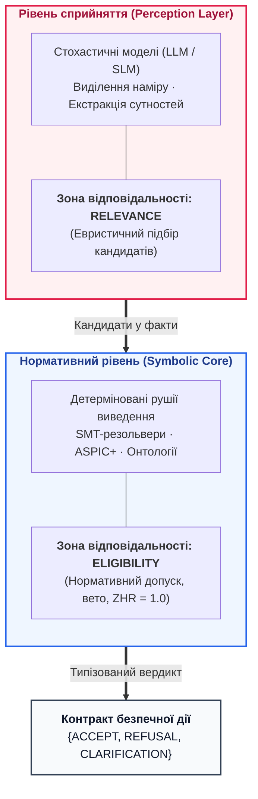

# Типова робоча навчальна програма дисципліни (Syllabus)
# «Архітектура доказових експертних систем та нейро-символьного штучного інтелекту»
## Course Syllabus: Architecture of Evidence-Grounded Expert Systems and Neuro-Symbolic AI

**Академічний рівень:** Другий (магістерський) рівень вищої освіти / Третій (освітньо-науковий, Ph.D.)  
**Галузь знань:** 12 «Інформаційні технології»  
**Спеціальності:**  
* `121` — Інженерія програмного забезпечення  
* `122` — Комп'ютерні науки  
* `124` — Системний аналіз  
* `126` — Інформаційні системи та технології  
**Базовий підручник:** Микола Федчик. *Архітектура доказових експертних систем: від формальних онтологій до нейро-символьного ШІ*. Монографія, 2026.  
**Загальний обсяг:** 5 кредитів ECTS (150 академічних годин)  
**Розподіл годин:**  
* Лекційні заняття: **32 години** (16 лекцій по 2 години)  
* Лабораторні заняття: **32 години** (8 лабораторних робіт по 4 години)  
* Семінарські та колоквіумні заняття: **16 годин** (8 семінарів по 2 години)  
* Самостійна робота студентів (СРС): **70 годин**  
**Форма підсумкового контролю:** Екзамен (диференційований залік)  

---

## 1. Опис та концепція навчальної дисципліни

Дисципліна присвячена проєктуванню, формальній верифікації, математичним моделям та промисловій експлуатації детермінованих, пояснюваних інтелектуальних систем без галюцинацій (Safety-Critical AI). 

Сучасний стан штучного інтелекту характеризується драматичним розривом: статистичні мовні моделі (LLM/SLM) генерують переконливий текст, але страждають від стохастичних помилок і не мають математичної доказовості, що блокує їхнє впровадження у критичних доменах (авіоніка DO-178C, автомобільна безпека ISO 26262 ASIL D, медичні протоколи FDA, енергетика). Курс вивчає побудову гібридного **доказового нейро-символьного ШІ**, де мовні моделі виконують дорадчу функцію виділення релевантності (*Relevance*), а детерміноване символьне ядро непорушно гарантує інваріанти логічної несуперечливості, побайтового заземлення фактів у першоджерелах та право безумовного вето (*Eligibility*).

---

## 2. Мета, компетентності та програмні результати навчання (ПРН)

### 2.1. Мета дисципліни
Формування у здобувачів вищої освіти теоретичних знань і практичних навичок архітектурного проєктування, розробки та математичної верифікації доказових експертних систем, здатних вирішувати аналітичні задачі в умовах нульової толерантності до галюцинацій ($ZHR = 1{,}00$).

### 2.2. Загальні та спеціальні компетентності
* **ЗК-1:** Здатність до наукового аналізу, синтезу та критичного осмислення складних епістемічних проблем на стику дискретної математики та комп'ютерних наук.
* **СК-1:** Здатність проєктувати модульні архітектури баз знань (продукції, формальні онтології OWL 2, інженерні графи EKG, простори конфігурацій CSP).
* **СК-2:** Здатність розробляти детерміновані алгоритми логічного виведення (Forward/Backward Chaining, двонаправлений BFS, немонотонна аргументація ASPIC+).
* **СК-3:** Здатність впроваджувати криптографічні протоколи збереження цілісності доказів (дерева Меркла за RFC 6962, невідкличні журнали аудиту, солі HMAC).
* **СК-4:** Здатність проєктувати системи автоматизованого синтезу та верифікації дерев аргументації безпеки (Goal Structuring Notation, GSN).
* **СК-5:** Здатність реалізовувати протоколи активного попперівського фальсифікаційного тестування та валідації комплаєнсу.

### 2.3. Програмні результати навчання (ПРН)
* **ПРН-1:** Формулювати математичні інваріанти доказовості та будувати формальні предикати допуску рішень.
* **ПРН-2:** Розробляти парсери формалізації вимог природною мовою з використанням синтаксису EARS та граматично-керованої генерації токенів GBNF.
* **ПРН-3:** Реалізовувати високоефективні рушії пошуку закономірностей AMIE PCA та абдуктивного замикання графових лакун.
* **ПРН-4:** Будувати протоколи сократівського діалогу з мінімаксним стисненням світів Кріпке у динамічній епістемічній логіці (DEL).
* **ПРН-5:** Застосовувати піраміду тестування знань (KTP) для усунення вакуумної істинності та гарантування Ліпшицевої неперервності висновків.

---

## 3. Тематичний план та розподіл годин за видами навчальної роботи

| № | Назва модуля та теми | Разом | Лекції | Лабораторні | Семінари | СРС | Розділи підручника |
|:---:|:---|:---:|:---:|:---:|:---:|:---:|:---|
| **ЗМ 1** | **Концептуальний та математичний фундамент доказових систем** | **34** | **8** | **8** | **4** | **14** | **Частина I, II (Гл. 1–9)** |
| 1.1 | Епістемологія машинного знання: факт, цитата, байтове заземлення, $ZHR=1{,}00$ | 8 | 2 | — | 2 | 4 | Глави 1, 2, 3 |
| 1.2 | Математичний апарат: ґратки Скотта, теорія нерухомої точки, інтервальна арифметика | 8 | 2 | — | 2 | 4 | Глави 4, 6 |
| 1.3 | Типологія баз знань: правила, онтології, прецеденти, вектори, семантика OWA/CWA/PCWA | 8 | 2 | — | — | 6 | Глава 7 |
| 1.4 | Інженерні артефакти як дані та граф простежуваності EKG (**Лаб. 1**) | 10 | 2 | 4 (Лаб. 1) | — | 4 | Глави 8, 9 |
| **ЗМ 2** | **Здобуття знань, обробка мови та інженерія вимог** | **38** | **8** | **8** | **4** | **18** | **Частина III (Гл. 10–15)** |
| 2.1 | Конвеєр KAS: вилучення фактів, дедуплікація, онтологічний лінтер | 8 | 2 | — | 2 | 4 | Глави 10, 11 |
| 2.2 | Подолання лінгвістичної варіативності: лексикони, термінологічні замки | 8 | 2 | — | — | 6 | Глави 12, 13 |
| 2.3 | Формалізація вимог: шаблони EARS та GBNF-граматики (**Лаб. 2**) | 12 | 2 | 4 (Лаб. 2) | — | 6 | Глава 14 |
| 2.4 | Екстракція залежностей та побудова доменних онтологій | 10 | 2 | — | 2 | 6 | Глава 15 |
| **ЗМ 3** | **Архітектура, рушії виведення та верифікація безпеки** | **42** | **8** | **8** | **4** | **22** | **Частина IV, V (Гл. 16–27)** |
| 3.1 | Системна архітектура та технологічний стек детермінованого виведення (**Лаб. 3**) | 12 | 2 | 4 (Лаб. 3) | — | 6 | Глави 16, 17, 18 |
| 3.2 | Рушій пояснень (Explainability) та перехід від рекомендації до контракту дії | 8 | 2 | — | 2 | 4 | Глави 19, 20, 21 |
| 3.3 | Модельно-орієнтована діагностика (MBD) та мінімальні конфлікти (**Лаб. 4**) | 12 | 2 | 4 (Лаб. 4) | — | 6 | Глави 22, 23, 24 |
| 3.4 | Синтез дерев безпеки GSN та криптографічні дерева Меркла (**Лаб. 5**) | 10 | 2 | — | 2 | 6 | Глави 25, 26, 27 |
| **ЗМ 4** | **Нейро-символьні тандеми, абдукція та активний аудит** | **36** | **8** | **8** | **4** | **16** | **Частина VI, VII (Гл. 28–40)** |
| 4.1 | Дворежимні системи System 1 / System 2 та кремнієві прискорювачі (EPU/FPGA) | 8 | 2 | — | 2 | 4 | Глави 28, 29, 32 |
| 4.2 | Реляційний BFS, абдукція гіпотез та сократівський діалог DEL (**Лаб. 6**) | 10 | 2 | 4 (Лаб. 6) | — | 4 | Глави 31, 33, 34 |
| 4.3 | Піраміда тестування знань (KTP) та Ліпшицева стабільність (**Лаб. 7**) | 8 | 2 | 4 (Лаб. 7) | — | 2 | Глави 35, 36, 37 |
| 4.4 | Автономний попперівський фальсифікатор та комплаєнс-аудит (**Лаб. 8**) | 10 | 2 | 4 (Лаб. 8) | 2 | 2 | Глави 38, 39, 40 |
| | **РАЗОМ** | **150** | **32** | **32** | **16** | **70** | **Усі 40 Глав** |

### 3.1. Шкала складності матеріалу (за Дональдом Кнутом) та двопрохідна спіральна траєкторія вивчення

Усі 40 глав та 5 додатків монографії промарковано за чотирирівневою шкалою когнітивної та математичної складності **`[L1]`–`[L4]`** (у співвіднесенні з логарифмічною шкалою `00..50` Д. Кнута, *The Art of Computer Programming*, Vol. 1):

| Рівень монографії | Еквівалент за Кнутом | Математичний і системний профіль | Охоплення глав та додатків |
| :---: | :---: | :--- | :--- |
| **`[L1]` (Базовий)** | `[00..19]` | Концептуально-архітектурне ядро, базові теорії множин і графів, інженерія вимог EARS | Глави 1–5, 8, 10–11, 16 |
| **`[L2]` (Інженерно-алгоритмічний)** | `[20..29]` | Граматики GBNF, контейнери `mmap`, дерева Меркла, інтервальна метрологія СІ, KTP, розподілена SOA | Глави 7, 9, 12–15, 17–23, 25, 27–28, 30, 32–33, 36–40; Додатки А, В |
| **`[L3]` (Математично-формальний)** | `[30..39]` | Ґратки Кнастера–Тарського, чотиризначна логіка Белнапа $\mathcal{B}_4$, діагностика Райтера (HS-DAG), Кріпке DEL, ASPIC+ | Глави 6, 24, 26, 29, 31, 34 |
| **`[L4]` (Дослідницький / PhD & R&D)** | `[40..50]` | Нелінійна синергетика NPU, синхронізація Курамото, нейроморфна динаміка та **5 теорем конструктивного наукового оптимізму** ($\mathcal{I}_{\mathrm{sem}}=1$, $\mathcal{O}(k \log N)$ СІ-морфізми, $\mathrm{TCB}_{\pi}$) | Глава 35, Розділ 9.4 Глави 40; Додатки Б, Г, Д |

* **Маршрут А (Перший виток спіралі — Інженерно-системний каркас, рівні `[L1]` + `[L2]`):** обов'язковий для магістерського потоку (опанування наскрізного циклу від першоджерела до верифікованого бінарного контейнера знань та сертифіката доведення).
* **Маршрут Б (Другий виток спіралі — Повна формально-математична глибина, рівні `[L3]` + `[L4]`):** для дослідників R&D та аспірантів Ph.D. (занурення у нерухомі точки, абдуктивне замикання та теореми конструктивного наукового оптимізму).

---

## 4. Потижневий план занять та зміст лекцій

### Тиждень 1. Епістемологічна криза штучного інтелекту та доказовий імператив
* **Лекція 1:** Демаркація класичного софту, LLM та доказових експертних систем. Тріада «Компетентність–Повноваження–Доказовість». Інваріант нульової толерантності до галюцинацій ($ZHR = 1{,}00$).
* **Література:** Глави 1, 2.

### Тиждень 2. Дискретна математика та формальні моделі знання
* **Лекція 2:** Ґратки Скотта, часткові порядки інформативності, інтервальна семантика деонтичних модальностей. Теорема Кнастера–Тарського та обчислення найменшої нерухомої точки ($LFP$).
* **Семінар 1:** Побудова ґраток тверджень та аналіз суперечностей у багатоджерельних корпусах.
* **Література:** Глави 4, 6.

### Тиждень 3. Онтологічна типологія баз знань та семантика OWA/CWA/PCWA
* **Лекція 3:** Таксономія 8 парадигм знань. Порівняння продукцій, фреймів, OWL 2 онтологій та CBR. Моделі відкритого (OWA), закритого (CWA) та частково закритого світу (PCWA). Критерій OntoClean.
* **Література:** Глава 7.

### Тиждень 4. Інженерні артефакти як першоджерела та граф простежуваності EKG
* **Лекція 4:** Структури інженерних документів (код, тести, специфікації, стандарти). Модель апаратної кастодії доказів та побайтового контролю першоджерел. Ізоморфізм графів простежуваності EKG.
* **Лабораторна робота 1:** Синтаксичний розбір інженерних артефактів та побудова реляційного графа EKG.
* **Література:** Глави 8, 9.

### Тиждень 5. Автоматизоване здобуття знань (KAS) та подолання вузького місця
* **Лекція 5:** Архітектура KAS. Алгоритми нормалізації сутностей, виявлення дублікатів та детерміноване лінтування правил.
* **Семінар 2:** Аналіз історичних бар'єрів інженерії знань (Feigenbaum Bottleneck) та сучасні методи їх подолання.
* **Література:** Глави 10, 11.

### Тиждень 6. Комп'ютерна лінгвістика проти стохастичного дрейфу
* **Лекція 6:** Лінгвістична варіативність природної мови проти семантичного детермінізму. Термінологічні замки та онтологічне прив'язування синонімів.
* **Література:** Глави 12, 13.

### Тиждень 7. Формалізація вимог через шаблони EARS та граматики GBNF
* **Лекція 7:** Синтаксичні шаблони EARS (Ubiquitous, Event-Driven, State-Driven, Unwanted Behavior). Граматично-керована генерація токенів через скінченні автомати (GBNF).
* **Лабораторна робота 2:** Розробка GBNF-компілятора вимог природною мовою у формальні правила.
* **Література:** Глава 14.

### Тиждень 8. Екстракція залежностей та побудова доменних онтологій
* **Лекція 8:** Синтаксичне дерево залежностей (Universal Dependencies), алгоритми вилучення семантичних триплетів. Валідація онтологій за SHACL.
* **Семінар 3:** Проєктування онтологічного профілю для нормативного регламенту (ISO/IEC/RFC).
* **Література:** Глава 15.

### Тиждень 9. Архітектура ядра виведення та нульове копіювання пам'яті
* **Лекція 9:** Конвеєри прямого (Forward) та зворотного (Backward) виведення. Пам'ять спільного доступу `mmap(MAP_SHARED)`, вирівнювання структур по 64 байти, детермінізм латентності $O(1)$.
* **Лабораторна робота 3:** Реалізація детермінованого рушія продукційного виведення мовою Go із захистом від циклів.
* **Література:** Глави 16, 17, 18.

### Тиждень 10. Пояснюваність висновків та кібернетика прийняття рішень
* **Лекція 10:** Побудова дерев пояснень (Explainability Trees). Генерація відповідей на запитання «Чому?» та «Чому не?». Перехід від рекомендації до юридично значущого контракту дії.
* **Семінар 4:** Аналіз пояснюваності рішень на прикладі відмови у сертифікаційному допуску виробу.
* **Література:** Глави 19, 20, 21.

### Тиждень 11. Модельно-орієнтована діагностика складних систем (MBD)
* **Лекція 11:** Формалізм Райтера для діагностики на основі перших принципів ($SD, COMP, OBS$). Генерація конфліктів та алгоритм мінімального покриття HS-DAG Грайнера.
* **Лабораторна робота 4:** Розробка модуля діагностики відмов компресора/інвертора методом MBD.
* **Література:** Глави 22, 23, 24.

### Тиждень 12. Синтез аргументів безпеки (GSN) та дерева Меркла
* **Лекція 12:** Нотація структурування цілей (Goal Structuring Notation v3). Автоматичний синтез GSN з графа EKG. Криптографічні дерева Меркла (RFC 6962), солі HMAC та Inclusion Proofs.
* **Лабораторна робота 5:** Автоматичний синтез аргументів безпеки GSN та криптографічна верифікація доказів деревами Меркла.
* **Семінар 5:** Діалектична аргументація Зунга: аналіз атак та обчислення Grounded Extension для оспорюваних тверджень.
* **Література:** Глави 25, 26, 27.

### Тиждень 13. Дворежимний нейро-символьний інтелект (System 1 / System 2)
* **Лекція 13:** Когнітивна синергія: швидке евристичне ранжування (System 1 / SLM) та детермінований цензор нормативного допуску (System 2 / SMT/EPU). Кремнієві прискорювачі знань на FPGA.
* **Література:** Глави 28, 29, 30, 32.

### Тиждень 14. Реляційний пошук, абдукція та сократівський діалог
* **Лекція 14:** Двонаправлений обмежений BFS ($k \le 6$). Евристики Bridge Candidate та Co-occurrence. Оператор мінімаксного стиснення світів Кріпке у динамічній епістемічній логіці (DEL).
* **Лабораторна робота 6:** Створення модуля сократівського опитувача з однодотиковою TUI-навігацією та розрахунком інформаційного виграшу.
* **Література:** Глави 31, 33, 34.

### Тиждень 15. Піраміда тестування знань (KTP) та Ліпшицева стійкість
* **Лекція 15:** Багаторівневе тестування бази знань: KUT, KIT, KVT. Критерій Ліпшицевої неперервності логічного простору. Захист від вакуумної істинності ($P \to Q$ при $P \equiv \text{False}$).
* **Лабораторна робота 7:** Реалізація фреймворку варіаційного калібрування правил та перевірки на вакуумну істинність.
* **Література:** Глави 35, 36, 37.

### Тиждень 16. Автономний попперівський фальсифікатор, конструктивний науковий оптимізм та підсумковий колоквіум
* **Лекція 16:** Парадигма активного аудитора знань за Карлом Поппером. П'ять теорем конструктивного наукового оптимізму М. М. Федчика: двосторонній семантичний ізоморфізм компіляції ($\mathcal{I}_{\mathrm{sem}}(s, r) = 1$), поліноміальна редукція міждоменного синтезу за 8D векторами розмірностей СІ ($\mathcal{O}(k \log N)$), редукція бази довіри до лінійного верифікатора сертифікатів доведення ($\mathrm{TCB}_{\pi}$), ортогональна дискримінація нестаціонарних режимів за парою $(\varepsilon_{\mathrm{parity}}, \varepsilon_{\mathrm{cons}})$ та примат творчого дослідника.
* **Лабораторна робота 8:** Побудова автономного попперівського фальсифікатора та мікроядра перевірки сертифікатів доведення $\mathrm{TCB}_{\pi}$.
* **Семінар 6:** Захист курсових проєктів / фінальний колоквіум курсу.
* **Література:** Глави 38, 39, 40 (зокрема Розділ 9.4).

---

## 5. Система оцінювання знань студентів

Оцінювання здійснюється за 100-бальною шкалою з наступним переведенням у національну шкалу та шкалу ECTS:

| Вид навчальної діяльності | Кількість заходів | Бали за один захід | Максимум балів |
|:---|:---:|:---:|:---:|
| **Лабораторні роботи (Лаб. 1–8)** | 8 робіт | 5 балів | **40 балів** |
| **Семінарські заняття / Виступи** | 6 семінарів | 2 бали | **12 балів** |
| **Модульні контрольні роботи (МКР 1, 2)** | 2 тести (MCQ) | 9 балів | **18 балів** |
| **Семестровий екзамен (письмовий + практика)** | 1 екзамен | 30 балів | **30 балів** |
| **РАЗОМ** | | | **100 балів** |

### Шкала відповідності оцінок
* **90–100 балів:** Відмінно / Excellent (`A`)
* **82–89 балів:** Дуже добре / Very Good (`B`)
* **74–81 бал:** Добре / Good (`C`)
* **64–73 бали:** Задовільно / Satisfactory (`D`)
* **60–63 бали:** Достатньо / Sufficient (`E`)
* **0–59 балів:** Незадовільно з можливістю перескладання (`FX`) / з повторним вивченням (`F`)

---

## 6. Політика курсу та академічна доброчесність

1. **Академічна доброчесність:** використання генеративних моделей (ChatGPT, Claude тощо) дозволяється виключно на етапі евристичного підбору ідей або рефакторингу коду за обов'язкового явного декларування промптів. Генерація готових розв'язків чи звітів без глибокого розуміння карається анулюванням балів.
2. **Детермінізм розв'язків:** кожен розв'язок лабораторної роботи повинен супроводжуватися детермінованими модульними тестами (Unit Tests) зі 100% відтворюваністю результату.
3. **Дотримання дедлайнів:** затримка подання звіту без поважної причини знижує максимальний бал за роботу на 20% за кожен тиждень прострочення.

---

## 7. Навчально-методичне забезпечення дисципліни

1. **Базовий підручник:**  
   Федчик М. *Архітектура доказових експертних систем*. Монографія у 40 главах та 5 додатках. — К.: 2026.
2. **Математичний та логічний адаптаційний практикум:**  
   [MATH_PRIMER.md](MATH_PRIMER.md) — стислий формальний довідник для вирівнювання базової математичної підготовки здобувачів (деонтична логіка KD, тризначні та чотиризначні параконсистентні системи $\mathbb{K}_3$ і $\mathcal{B}_4$, гратки та реляційний ранг Гаєка, MBD Райтера, динамічна епістемічна логіка DEL та шеннонівський приріст інформації, ліпшицева стійкість).
3. **Лабораторний практикум:**  
   [LABS.md](LABS.md) — 8 повнорозмірних інженерних лабораторних робіт (Go 1.22+ / Python 3.10+) із формальними завданнями, вихідним кодом та критеріями прийому.
4. **Банк тестових завдань для модульного контролю:**  
   [TEST_BANK.md](TEST_BANK.md) — 240 стандартизованих тестових завдань (Single Choice MCQ, по 6 завдань на кожну з 40 глав) із ключами відповідей, теоретичним обґрунтуванням та шаблонами експорту в СДО Moodle/Canvas.
5. **Специфікація наскрізного курсового проєкту (Capstone Project):**  
   [CAPSTONE.md](CAPSTONE.md) — регламент семестрового проєктування повнофункціональної доказової експертної системи для критичних інженерних доменів (UAV Maintenance DO-178C, Solar Inverter MBD, Infusion Pump IEC 62304 / ISO 14971, Autonomous Vehicle Sensor Arbitrator ISO 26262 ASIL-D). Для магістерських та PhD програм захист курсового проєкту може зараховуватися як альтернатива екзаменаційній сесії (30–40 балів).
