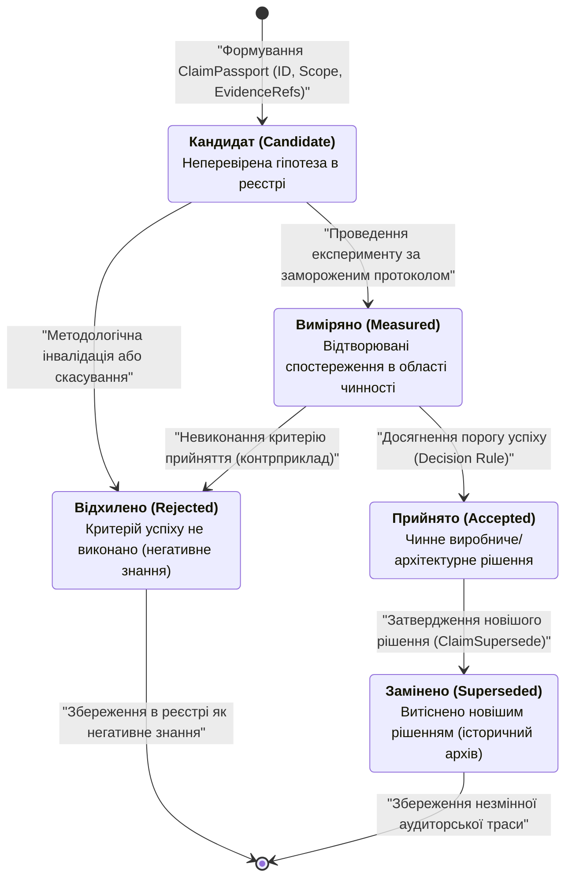
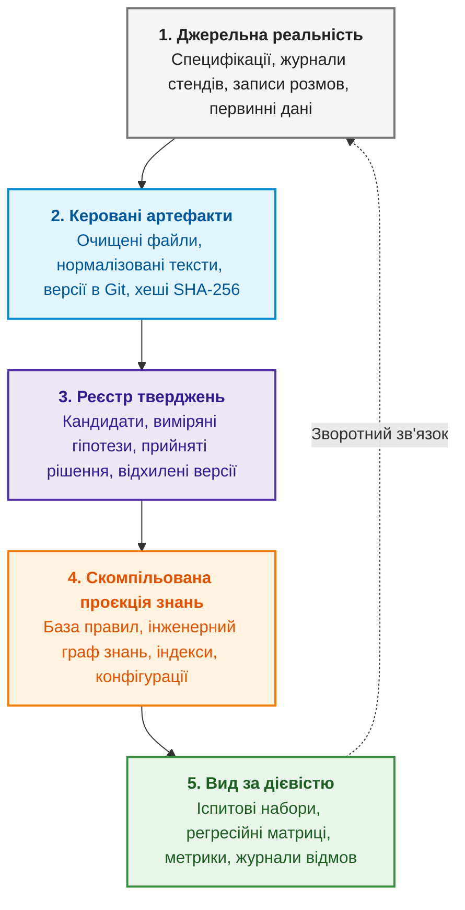
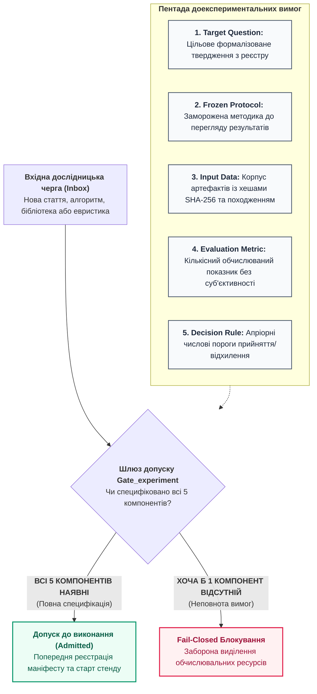
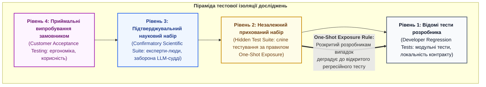
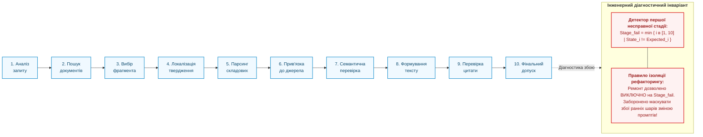

# Додаток А. Практичний фреймворк доказового дослідження у складних інженерних проєктах

> **Книга:** [Архітектура доказових експертних систем](README.md) · Додатки  
> **Зміст книги:** [README.md](README.md)  
> **Автор:** [Микола Федчик](about-the-author.md)  
> **Рівень:** середній і поглиблений: керівники досліджень і розробок, системні архітектори, провідні дослідники, інженери знань  
> **Очікувані результати:** практичний посібник з організації дослідницької пам'яті, реєстрації тверджень, ізоляції випробувальних наборів і побудови наскрізного ланцюга від сирого джерела до виробничого рішення в умовах високої невизначеності.

---

## Анотація

У відповідальних науково-дослідних та інженерних проєктах (NIST AI Risk Management Framework, розробка критичного софту, оборонні та аерокосмічні системи) відсутність дисципліни дослідницької пам'яті спричиняє сформульований автором феномен деструктивного «дрейфу підбору» (*trial-and-error drift*). Коли команда реагує на поодинокі збої хаотичними правками промптів, нефіксованими змінами архітектури чи прихованим навчанням на контрольних вибірках, виникає ілюзія прогресу за повної втрати відтворюваності. Проєкт витрачає місяці й мільйонні бюджети, але не здатен відповісти органам сертифікації чи замовнику, що саме було математично доведено, які припущення спростовано, а які висновки є лише випадковим збігом на шумі.

Цей додаток пропонує розроблений автором референсний каркас доказового дослідження (*Fedchyk Evidence-Governed Research Framework*, EGRF), який трансформує неструктуровані експерименти у сувору суверенну дослідницьку пам'ять (*research memory*). Розглядається авторська архітектура п'яти шарів знань (від сирих журналів через керовані артефакти з хешами SHA-256 до реєстру тверджень, скомпільованої проєкції та оцінки дієвості), типізовані епістемічні статуси дослідницьких заяв (`кандидат`, `виміряно`, `прийнято`, `відхилено`, `замінено`), протоколи ізоляції валідаційних вибірок та наскрізна трасованість від первинного експерименту до промислового коду.

---

## 1. Проблема регресу та «дрейфу підбору» в інженерних дослідженнях

Типовий антипатерн інженерного пошуку автор описує через емпіричну модель *тижневого циклу псевдопрогресу*. У понеділок команда знаходить помилку: невелика експертна система для однієї предметної області не відповідає на просте запитання, хоча відповідь є в її документах. У вівторок команда змінює пошук. У середу команда змінює спосіб поділу тексту. У четвер команда змінює інструкцію для мовної моделі. У п'ятницю нова версія нарешті проходить контрольний приклад.

Наступного понеділка те саме запитання формулюють трохи інакше, і експертна система знову помиляється.

Команда працювала весь тиждень. Є код, звіти, журнали виконання, кілька нових наборів даних і навіть гарний показник точності. Проте виникає *шестивимірний дефіцит дослідницької визначеності* — авторський діагностичний критерій втрати епістемічного контролю, за якого ніхто в команді не може коротко відповісти:

- яку загальну проблему команда перевіряла;
- що саме доведено;
- який результат був лише розвідувальним;
- які приклади експертна система вже бачила під час розробки;
- скільки незалежних перевірок залишилося;
- за якої умови дослідження нарешті завершиться.

Це не рідкісний випадок і не проблема винятково штучного інтелекту. Так буває з компіляторами, пошуковими рушіями, системами керування знаннями, аналізаторами коду, робототехнікою й апаратними прототипами. Тут діє сформульований автором *закон підміни знання обсягом виконаної роботи* (`$`\Delta \mathrm{Artifacts} \not\implies \Delta \mathrm{Knowledge}`$`): що більше в проєкті невизначеності, то легше переплутати кількість згенерованих артефактів із дійсним приростом математично доведеного знання.

Після тривалої серії таких експериментів автором сформовано практичний дослідницький фреймворк (*research framework*), побудований на *принципі інтегративної дослідницької пам'яті*. Він не є новою методологією замість наукового методу, Scrum, системної інженерії чи інженерії життєвого циклу моделей машинного навчання (*Machine Learning Operations*, MLOps). Він також не замінює рамок керування ризиками, як-от рамка керування ризиками штучного інтелекту Національного інституту стандартів і технологій США (*National Institute of Standards and Technology*, NIST), яка описує функції врядування, картографування, вимірювання й керування ризиками [[1]](#src-1). Натомість авторський фреймворк з'єднує корисні частини цих підходів в єдину верифікаційну пам'ять дослідження: від сирого джерела до твердження, від твердження до рішення, від рішення до зміни продукту, а від зміни продукту до незалежного випробування.

## 2. Дослідницьке твердження як ключовий артефакт знань

У програмному проєкті продукт назвати легко: виконуваний файл, бібліотека, сервіс. У дослідженні продукт менш очевидний. Скрипт не є результатом сам по собі. Набір завантажених документів теж не є результатом. Таблиця метрик ще нічого не каже без питання, популяції та правила рішення.

Фундаментальною атомарною одиницею прогресу в авторській онтології є **дослідницьке твердження** (*research claim*, `$`\mathrm{Claim} = \langle \mathrm{ID}, A, B, P, C, O, L, V, \mathrm{Status} \rangle`$`):

> У визначених умовах метод A має таку властивість порівняно з методом B; це підтверджується такими спостереженнями, з такими обмеженнями й рівнем перевірки.

Кожне твердження оформлюється через обов'язковий *структурний паспорт твердження* (`ClaimPassport`): стабільний ідентифікатор (`ID`), область чинності (`Scope`), епістемічний статус (`Status`), криптографічні посилання на докази (`EvidenceRefs`) та відомі обмеження (`KnownLimitations`). За авторською п'ятизначною шкалою статус має одне з таких взаємовиключних значень:

- **кандидат**: ідея або зовнішнє повідомлення, яке ще не перевірено;
- **виміряно**: є відтворювані спостереження у визначеній області;
- **прийнято**: чинне методологічне чи архітектурне рішення;
- **відхилено**: перевірка не виконала зафіксованого критерію;
- **замінено**: старий висновок збережено, але діє новіший.

Ці статуси впроваджують *принцип епістемічної мовної дисципліни*. «Ми реалізували» не означає «ми незалежно перевірили». «Тест пройшов» не означає «гіпотезу підтверджено». «Модель відповіла правильно» не означає «модель використала правильний доказ».



> [!NOTE]
> **П'ятизначна шкала епістемічних статусів дослідницьких тверджень (авторська модель Миколи Федчика)**
> 1. **`кандидат` (*candidate*):** неперевірена гіпотеза або зовнішнє повідомлення в межах структурного паспорта твердження (`ClaimPassport`: `ID`, `Scope`, `Status`, `EvidenceRefs`, `KnownLimitations`), яке очікує на первинну емпіричну верифікацію.
> 2. **`виміряно` (*measured*):** твердження, підкріплене відтворюваними експериментальними спостереженнями у суворо зафіксованій області чинності.
> 3. **`прийнято` (*accepted*):** формально верифіковане методологічне чи архітектурне рішення, введене в дію у виробничій конфігурації експертної системи.
> 4. **`відхилено` (*rejected*):** гіпотеза, експериментальна перевірка якої не виконала апріорно зафіксованого критерію прийняття (результат зберігається як негативне знання).
> 5. **`замінено` (*superseded*):** історично збережений у дослідницькій пам'яті висновок, який офіційно витіснено новішим і точнішим твердженням без фізичного видалення попереднього запису.
> *Інженерний інваріант:* Життєвий цикл знання підпорядкований неперезаписуваній еволюції та принципу епістемічної мовної дисципліни (`$`\text{Implemented} \not\equiv \text{Verified}`$`, `$`\text{PassedTest} \not\equiv \text{Confirmed}`$`, `$`\text{CorrectOutput} \not\equiv \text{ValidProof}`$`).

## 3. П'ять шарів дослідницької пам'яті

**Дослідницька пам'ять** (*research memory*) в авторській архітектурі є ієрархічно стратифікованим сховищем усього, що дослідження знає, робило й вирішило. Наведена нижче схема показує її п'ять шарів.



Зручна тека з Markdown-файлами сама не розв'язує проблеми. Потрібно архітектурно розділити п'ять шарів, які на практиці часто несвідомо змішують.

> [!NOTE]
> **П'ять шарів дослідницької пам'яті (авторський референсний каркас EGRF Миколи Федчика)**
> 1. **Шар 1 — Джерельна реальність (`$`L_1`$`, *Source Reality*):** криптографічно незмінні первинні документи, телеметрія стендів, коди та сирі байти, захищені інваріантом ідентичності SHA-256.
> 2. **Шар 2 — Керовані артефакти (`$`L_2`$`, *Governed Artifacts*):** протоколи, маніфести, нормалізовані дані та журнали запусків, зв'язані авторською тріадною моделлю походження («що отримано», «з яких вхідних байтів», «ким і якою детермінованою операцією»).
> 3. **Шар 3 — Реєстр тверджень (`$`L_3`$`, *Claims Registry*):** машинно-читаний реєстр активних, відхилених і замінених тверджень, організований за принципом неперезаписуваної еволюції.
> 4. **Шар 4 — Скомпільована проєкція знань (`$`L_4`$`, *Compiled Knowledge Projection*):** вторинна база правил, інженерних графів або вікі-синтезу, підпорядкована принципу суворої субординації першоджерелам (`$`\mathrm{Priority}(L_1, L_2, L_3) \gg \mathrm{Priority}(L_4)`$`).
> 5. **Шар 5 — Вид за дієвістю (`$`L_5`$`, *Effectiveness View*):** операційна проєкція поточної уваги за моделлю дисоціації PARA, іспитові набори та регресійні матриці верифікації.
> *Керування рантаймом / Інженерний інваріант:* Потік знань `$`L_1 \to L_2 \to L_3 \to L_4 \to L_5`$` замикається зворотним зв'язком від `$`L_5`$` до `$`L_1`$` через обов'язкову реєстрацію виявлених відмов за повної заборони трактувати вторинну проєкцію `$`L_4`$` як первинний доказ.

### 3.1. Джерельна реальність

Джерельна реальність спирається на *інженерний інваріант криптографічної незмінності* й охоплює сирі документи, вимірювання, версії коду, виконувані файли, ваги моделей і людські оцінки. Ці об'єкти мають бути незмінними (immutable) в межах знімка й мати точну ідентичність: криптографічний хеш SHA-256, версію або інший однозначний ідентифікатор.

Якщо дослідження цитує технічний документ, недостатньо записати назву документа. Потрібно зафіксувати версію, точні байти, сторінку або діапазон координат, а також детермінований спосіб розбору й перетворення.

### 3.2. Керовані артефакти

Керовані артефакти охоплюють протоколи, маніфести, нормалізовані дані, журнали, результати кожного випадку, агреговані метрики й рішення. Артефакти пояснюють, що саме команда зробила із джерельною реальністю.

Тут корисна модель походження PROV консорціуму W3C (*World Wide Web Consortium*): походження описують через сутності, діяльності й людей, які брали участь у створенні результату [[2]](#src-2). Повний семантичний стек W3C впроваджувати не обов'язково. Автором запропоновано прагматичну *тріадну модель походження керованих артефактів* (`$`\mathrm{Provenance}(a) = \langle \mathrm{Entity}_{\mathrm{result}}, \mathrm{Entity}_{\mathrm{source}}, \mathrm{Agent}_{\mathrm{operator}}, \mathrm{Activity}_{\mathrm{transform}} \rangle`$`): будь-який результат зобов'язаний детерміновано показувати не лише «що отримано», а й «з яких вхідних байтів, ким і якою операцією».

### 3.3. Реєстр тверджень

Довгий звіт добре пояснює історію, але погано відповідає на запитання «що команда вважає чинним зараз?». Для цього потрібен компактний машинно-читаний реєстр. Кожне твердження посилається на доказові файли, а не на пам'ять автора.

Тут діє сформульований автором *принцип неперезаписуваної еволюції реєстру тверджень*: якщо висновок змінився, старий запис категорично заборонено переписувати або видаляти заднім числом — новий запис явно замінює старий (переводячи попередника у статус `замінено`). Так негативні результати, контрприклади й помилки не зникають з історії проєкту.

### 3.4. Скомпільована проєкція знань

Коли артефактів стає кілька сотень, читати їх послідовно неможливо. Тут корисною виявилася ідея Андрея Карпаті про постійну пов'язану Markdown-вікі, яку підтримує мовна модель і яка накопичує синтез джерел замість того, щоб виконувати весь пошук заново для кожного запитання [[3]](#src-3). Ця ідея є концептуальною нотаткою, а не експериментально перевіреною методологією.

У дослідницькому проєкті цю ідею підпорядковано авторському *принципу суворої субординації похідної проєкції знань* (`$`\mathrm{Priority}(L_1, L_2, L_3) \gg \mathrm{Priority}(L_4)`$`). Мовна модель може допомагати оновлювати сторінки про поняття, компоненти, результати й відкриті питання, але вікі залишається суто вторинною кешованою проєкцією. Джерела, протоколи, вимірювання й прийняті рішення мають безумовну вищу силу. Інакше хаотична тека документів лише зміниться на переконливо написану, але неперевірену енциклопедію.

### 3.5. Оцінка дієвості у виробничому середовищі

Тип файлу й поточна увага команди є різними речами. Тут добре працює авторська *модель дисоціації структури зберігання та операційної уваги*, побудована як інженерна адаптація методу PARA Тіаго Форте (*Projects, Areas, Resources, Archives*) [[4]](#src-4):

- **проєкти**: активна обмежена робота з критерієм завершення;
- **напрями відповідальності**: постійні процеси на кшталт походження даних, безпеки чи курування корпусу;
- **ресурси**: джерела, методи й інструменти для можливого повторного використання;
- **архів**: завершене, відкладене, помилкове або замінене.

Команда автора не перебудовує за цими чотирма папками фізичне сховище репозиторію: PARA лише задає динамічний операційний вид поверх канонічної структури пам'яті. Архівне негативне спостереження не перестає бути валідним доказом, а корисний ресурс не стає автоматично доведеною істиною.

### 3.6. Відповідність шарів дослідницької пам'яті архітектурі книги

П'ятишаровий фреймворк є не зовнішнім регламентом, а ізоморфною системною проєкцією розробки й супроводу самих експертних систем, які розглядають 40 глав монографії.

| Шар дослідницької пам'яті | Зміст та інженерне призначення | Відповідні частини та глави книги |
| :--- | :--- | :--- |
| **1. Джерельна реальність** | Сирі PDF, стандарти (ISO 26262 [[11]](#src-11), DO-178C [[12]](#src-12)), телеметрія стендів, дампи шин, коміти Git, журнали збоїв | [Частина II (Глави 7–9)](part-02-knowledge-models.md): інженерні артефакти як дані, простежуваність в інженерному графі знань, фіксація джерел |
| **2. Керовані артефакти** | Детерміновані розбори, структури JSON і скінченних автоматів, вилучені нормативні предикати SHALL/MUST, сигнальні маски, хеші SHA-256 | [Частина III (Глави 10–15)](part-03-knowledge-engineering-nlp.md): вилучення знань із неструктурованого тексту, подолання мовного шуму |
| **3. Реєстр тверджень** | Тріада Пірса [[15]](#src-15), гіпотези, кандидатські правила, формальний статус доказовості й походження | [Частина I (Глави 1–6)](part-01-foundations.md) та [Частина V (Глави 23, 24, 27, 30, 36, 39)](part-05-verification-and-learning.md): епістемологія машинного знання, тріада довіри, верифікація правил |
| **4. Скомпільована проєкція** | Рушії Datalog і хорнівські диз'юнкти [[14]](#src-14), обчислення найменшої нерухомої точки, контракти дій, виведення на периферійних пристроях, дерева GSN [[13]](#src-13) | [Частина IV (Глави 16–22, 31)](part-04-architecture-and-inference.md) та [Частина VII (Глави 33, 35, 40)](part-07-runtime-and-knowledge-exchange.md): архітектура виведення, реактивний рантайм, семантична маршрутизація та розподілена SOA |
| **5. Вид за дієвістю** | Регресійні набори еталонних тестів, матриці верифікації, нейро-символьна валідація, вимірювання детекції прогалин знань | [Частина V (Глави 23, 24)](part-05-verification-and-learning.md) та [Частина VI (Глави 25, 26, 28, 29, 34, 38)](part-06-frontiers-neuro-symbolic.md): аудит, нейро-символьні архітектури, верифікація ваг і правил |

Таблиця доводить структурну єдність монографії: кожен шар дослідницької пам'яті спирається на власний математичний та інженерний апарат відповідних частин книги. Наступні розділи описують операційні інваріанти, які не дають шарам змішатися під час щоденної роботи.

## 4. Критерії допуску гіпотез та дисципліна вхідної черги

Нова стаття, бібліотека або цікава ідея спокушає негайно «щось перевірити». Через місяць проєкт має десятки розпочатих напрямів і жодного завершеного питання.

Тому автором запроваджено *правило п'яти доль вхідної дослідницької черги* (*Research Inbox Rule*): кожен новий зовнішній матеріал спочатку потрапляє до вхідної черги й під час тріажу отримує одну з п'яти взаємовиключних доль:

- допомагає чинному проєкту;
- стає постійним правилом або відповідальністю;
- зберігається як довідковий ресурс;
- переходить до архіву;
- видаляється, якщо не має навіть аудиторської цінності.

Щоб перетворитися на експеримент, ідея повинна пройти авторський *інженерний шлюз допуску експерименту* (`$`\mathrm{Gate}_{\mathrm{experiment}}`$`): закривати конкретне невідоме твердження або виміряний дефект і містити повну *пентаду доекспериментальних вимог* — дослідницьке запитання, протокол, вхідні дані, метрику й правило рішення. Сам факт існування цікавої технології експерименту не виправдовує.



> [!NOTE]
> **П'ять доекспериментальних вимог шлюзу допуску гіпотез (авторський інженерний шлюз Миколи Федчика)**
> 1. **Цільове дослідницьке запитання (*Target Question*):** формалізоване невідоме твердження з реєстру або виміряний системний дефект, що блокує прийняття інженерного рішення.
> 2. **Заморожений протокол (*Frozen Protocol*):** однозначна методика проведення випробування, зафіксована до перегляду результатів.
> 3. **Детерміновані вхідні дані (*Input Data*):** криптографічно ідентифікований корпус вхідних артефактів із верифікованим походженням.
> 4. **Кількісна метрика оцінювання (*Evaluation Metric*):** обчислюваний показник якості, що унеможливлює суб'єктивне трактування успіху.
> 5. **Формальне правило рішення (*Decision Rule*):** апріорні числові пороги прийняття, відхилення або методологічної інвалідації експерименту.
> *Інженерний інваріант:* Шлюз допуску `$`\mathrm{Gate}_{\mathrm{experiment}} = \langle \mathrm{TargetQuestion}, \mathrm{FrozenProtocol}, \mathrm{InputData}, \mathrm{EvaluationMetric}, \mathrm{DecisionRule} \rangle`$` автоматично блокує виділення обчислювальних і стендових ресурсів на будь-яку ідею з вхідної черги, якщо не специфіковано всі п'ять компонентів.

## 5. Скінченна дорожня карта досліджень та умови зупинки

Одна з найнеприємніших ознак слабкого дослідження полягає у відповіді «ще один експеримент» на кожне прохання підбити підсумки. На противагу цьому автором сформульовано *принцип скінченної дорожньої карти та заборони рекурсивної пролонгації*: дослідження не має права працювати в режимі нескінченних евристичних ітерацій.

Розроблена автором *семистадійна еталонна дорожня карта доказового дослідження* містить зафіксовані контрольні точки (*milestones*):

1. підготувати корпус і походження;
2. заморозити еталонний набір;
3. порівняти представлення;
4. порівняти пошукові методи;
5. перевірити перенесення між доменами;
6. виміряти вартість;
7. провести фінальний аудит.

Новий блок можна додати, але лише явно: змінити дорожню карту, пов'язати новий блок із неперевіреною гіпотезою й пояснити, яке продуктове рішення без нього неможливе. Фраза «давайте ще спробуємо» не є достатньою інженерною підставою.

Тут діє авторський *критерій логічної замкненості робочого пакета дослідження* (*Definition of Done* для R&D): кожний робочий пакет має бути самодостатнім. Не обов'язково виконувати рівно чотири пункти або один експеримент за розмову. Пакет завершується тоді й лише тоді, коли породжує неподільну квінтесенцію результату: затверджений протокол, відтворюване виконання, аналітичний звіт, перевірені артефакти й оновлену карту знань.

## 6. Протокол попередньої реєстрації експериментів та відхилення від плану

Відкрита наука давно використовує попередню реєстрацію: дослідник фіксує гіпотезу, метод і критерії до перегляду результату. Центр відкритої науки (*Center for Open Science*) формулює сенс попередньої реєстрації як «план, а не в'язниця» [[5]](#src-5): попередня реєстрація не забороняє думати після старту, а дає читачеві змогу бачити різницю між передбаченим апріорі й поясненим заднім числом (*HARKing*).

Автором адаптовано цю концепцію для інженерних досліджень через *восьмипараметричний протокол доекспериментальної фіксації* з криптографічним хешем. До початку виконання обов'язково записують:

- питання й область;
- популяцію, вибірку та винятки;
- базову й нову версії;
- основні й діагностичні метрики;
- критерії прийняття, відхилення та інвалідації;
- умови зупинки;
- форму запису кожного випадку;
- ідентичності коду, моделі, конфігурації й даних.

Після цього ніхто не забороняє зробити новий розвідувальний експеримент. Проте згідно з авторським *правилом суворої ізоляції розвідувальних експериментів* (*Exploratory Isolation Rule*) такий запуск треба явно маркувати як розвідувальний (*exploratory*) і категорично заборонено додавати до підтверджувального набору після того, як команда вже побачила відповіді системи.

> [!NOTE]
> **Вісім параметрів протоколу попередньої реєстрації експерименту (авторський інженерний регламент Миколи Федчика)**
> 1. **Дослідницьке запитання й область чинності:** формальна ціль перевірки та граничні умови експлуатації.
> 2. **Популяція, вибірка та винятки:** правила формування випробувального корпусу й детерміновані критерії відсіву.
> 3. **Базова та модифікована версії:** точна специфікація опорної системи (*baseline*) та досліджуваної архітектурної зміни.
> 4. **Основні й діагностичні метрики:** чітке розмежування цільових критеріїв доведення та допоміжної телеметрії.
> 5. **Критерії прийняття, відхилення та інвалідації:** числові пороги верифікації, спростування або анулювання запуску через методичну ваду.
> 6. **Умови зупинки:** скінченні обмеження ресурсів і часу, що блокують безконтрольне продовження дослідів.
> 7. **Схема запису кожного випадку:** атомарний формат журналювання вхідних даних, проміжних станів і виходу.
> 8. **Криптографічні ідентичності компонентів:** хеші SHA-256 коду, ваг моделі, конфігурації та вхідних наборів даних.
> *Інженерний інваріант:* Маніфест попередньої реєстрації фіксується хешем SHA-256 до запуску конвеєра; за правилом ізоляції розвідувальних експериментів будь-які запуски після огляду результатів ізолюються від підтверджувальної вибірки.

## 7. Рівні валідації та ізоляція тестових наборів

У складних системах найбільше методологічної плутанини виникає між тестами різного призначення. Для її усунення автором розроблено *чотирирівневу стратифікацію валідації та ізоляції тестових корпусів*.

### 7.1. Відомі тести розробника

Модульні, контрактні, негативні й регресійні тести містять уже відомі приклади. За авторським *принципом обмеженості тестів розробника (локальності контракту)* такі тести доводять лише те, що реалізація виконує відомий контракт і не повторює знайомої помилки. Здатність системи до узагальнення (*generalization*) на нових контекстах вони принципово не доводять.

### 7.2. Незалежний прихований набір

Прихований набір обирають лише після повного замороження виконуваного файла, моделі, конфігурації й даних. Експертна система отримує запитання, але не очікувані відповіді. Випробовувач порівнює результат із закритим еталоном.

Тут діє авторське *правило одноразовості прихованого набору* (*One-Shot Exposure Rule*): щойно прихований випадок розкрито розробникам для аналізу помилки, він безповоротно втрачає статус прихованого і під час наступної ітерації автоматично переводиться у відкритий регресійний тест розробника.

### 7.3. Підтверджувальний науковий набір

Підтверджувальний набір потрібний для остаточного рішення про гіпотезу. Якщо правильність має семантичну складову, потрібні незалежні оцінки людей, вимірювання міжсуддівської згоди й розбір розбіжностей. Відповідно до сформульованого автором *інженерного інваріанта незалежності еталона (заборони автореферентного суддівства)* мовна модель може бути допоміжним оцінювачем, але ніколи не має права виступати незалежним еталоном істинності для експертної системи, частиною якої вона сама є.

### 7.4. Приймальні випробування замовником

Приймання перевіряє практичну корисність, взаємодію й відповідність експлуатаційним очікуванням. Приймання не замінює трьох попередніх рівнів: людина може бути задоволена гарною демонстрацією, яка не має відтворюваної доказової основи.



> [!NOTE]
> **Чотири рівні тестової ізоляції у піраміді валідації (авторська архітектура валідації Миколи Федчика)**
> 1. **Рівень 1 — Відомі тести розробника (*Developer Regression Tests*):** модульні, контрактні та регресійні перевірки, які гарантують лише локальне дотримання контракту без доведення генералізації.
> 2. **Рівень 2 — Незалежний прихований набір (*Hidden Test Suite*):** сліпе випробування повністю замороженої системи на закритому еталоні за суворим правилом одноразовості розкриття (*One-Shot Exposure Rule*).
> 3. **Рівень 3 — Підтверджувальний науковий набір (*Confirmatory Scientific Suite*):** верифікація фундаментальних гіпотез із залученням незалежних експертів-людей за повної заборони автореферентного суддівства мовною моделлю.
> 4. **Рівень 4 — Приймальні випробування замовником (*Customer Acceptance Testing*):** валідація практичної придатності та ергономіки, яка є вторинною щодо математичної та емпіричної доказовості рівнів 1–3.
> *Керування рантаймом / Інженерний інваріант:* Перетік прикладів дозволений виключно зверху вниз (розкритий випадок із Рівня 2 деградує до Рівня 1 і замінюється новим закритим випадком), а спроба використати вбудовану LLM як верховний оракул на Рівні 3 блокується як методологічна інвалідація.

## 8. Небезпека поодиноких позитивних прикладів та перенавчання на тесті

Чому один правильний приклад іноді є поганою новиною для дослідника? Автором виділено *епістемічну помилку одиничного позитивного підтвердження* (*Single Cherry-Picked Success*): уявімо, що експертна система має повернути число з одиницею. Після кількох точкових виправлень відомий запит стабільно дає `8 байтів`. Розробник показує правильний доказ, координати й цитату.

Це хороший регресійний результат. Але якщо зовнішній випробовувач одразу повторить те саме запитання, команда отримає не незалежне підтвердження, а другу копію відомого тесту, що маскує перенавчання на контрольному прикладі.

Для подолання цієї пастки автором розроблено *двовісну матрицю стрес-тестування інваріантності відповіді* (`$`\mathbf{M}_{\mathrm{stress}} = \mathrm{ValueForms} \times \mathrm{InterrogationForms}`$`), за якою наступний незалежний пакет повинен взяти інші документи й перетнути дві ортогональні осі (6 форм значення × 4 форми звернення):

- форму значення: число з одиницею, префікс, ідентифікатор, точна фраза, багаторядкове значення, довга константа;
- форму звернення: пряме питання, прохання, запит на доказ, підтвердження.

Тут діє авторський *інваріант семантичної стійкості до перефразування та правило групової невдачі*: якщо три формулювання одного факту дають різні результати, це одна групова невдача (`$`\mathrm{Outcome} = \mathbf{FAIL}`$`), а не «два з трьох майже добре». Діалогова експертна система зобов'язана зберігати інваріантність значення під час будь-якого перефразування.

## 9. Локалізація несправного шару та діагностика розривів трасованості

Фінальна неправильна відповідь не завжди показує, що саме треба лагодити. Автором запропоновано *десятистадійну модель локалізації першого несправного шару* (*First Failing Stage Model*), де діагностика фіксує найпершу стадію конвеєра, на якій зник правильний стан:

1. аналіз запиту;
2. пошук;
3. вибір доказового фрагмента;
4. виявлення потрібного твердження;
5. видобування складових твердження;
6. прив'язування до джерела;
7. семантична перевірка;
8. формування тексту;
9. перевірка цитати;
10. фінальний допуск.

За авторським *принципом локалізації першої точки втрати істинності*, якщо пошук не знайшов доказу, категорично заборонено переписувати модуль генерації відповіді. Якщо доказ уже правильний, але число втратило фізичну одиницю під час формування тексту, не треба перебудовувати пошуковий індекс. Схожу покомпонентну діагностику для систем генерації з пошуковим доповненням (*retrieval-augmented generation*, RAG) пропонує RAGChecker, який окремо оцінює роботу пошуку й генерації [[6]](#src-6).

Водночас діє сформульований автором *критерій обов'язкової підтримки цитатами проти випадкової влучності*: якщо відповідь поверхнево правильна, але наведена цитата її логічно не підтримує, це теж критична невдача (техногенний випадок Геттієра), оскільки правильність була випадковою. Окремо оцінювати правильність відповіді й підтримку цитатами пропонують і автори набору ALCE для перевірки генерації тексту з цитатами [[7]](#src-7).

Саме тут реалізується авторський *принцип повної експлікації станів у дослідницькому журналі*, що протиставляє дослідницький і демонстраційний журнали. Демонстраційний журнал показує лише останню гарну відповідь. Дослідницький журнал персистентно зберігає проміжний стан кожного з 10 шарів, включно з типізованими безпечними відмовами (*Fail-Closed Refusals*).



> [!NOTE]
> **Десять стадій локалізації першого несправного шару (авторська діагностична методологія Миколи Федчика)**
> 1. **Аналіз запиту (*Query Analysis*):** формальна декомпозиція наміру та обмежень запитання.
> 2. **Пошук (*Retrieval*):** відбір кандидатських документів зі сховища джерельної реальності.
> 3. **Вибір доказового фрагмента (*Snippet Selection*):** ізоляція релевантного контекстного сегмента.
> 4. **Виявлення потрібного твердження (*Claim Identification*):** локалізація цільового нормативного чи емпіричного предикату.
> 5. **Видобування складових твердження (*Component Extraction*):** детермінований парсинг величин, параметрів та одиниць вимірювання.
> 6. **Прив'язування до джерела (*Source Grounding*):** фіксація точних байтових або рядкових координат і хешу SHA-256 документа.
> 7. **Семантична перевірка (*Semantic Verification*):** валідація логічної несуперечності та області чинності твердження.
> 8. **Формування тексту (*Surface Realization*):** синтез відповіді зі збереженням усіх фізичних розмірностей і граничних умов.
> 9. **Перевірка цитати (*Citation Verification*):** підтвердження детермінованої вивідності відповіді з наведеної цитати (відсікання випадкової влучності).
> 10. **Фінальний допуск (*Final Compliance Gate*):** випуск верифікованої відповіді або перехід у стан безпечної відмови.
> *Керування рантаймом / Інженерний інваріант:* Діагностичний детектор визначає `$`\mathrm{Stage}_{\mathrm{fail}} = \min \{ i \in [1, 10] \mid \mathrm{State}_i \ne \mathrm{Expected}_i \}`$`; рефакторинг дозволяється виключно на стадії `$`\mathrm{Stage}_{\mathrm{fail}}`$`, а маскування дефектів ранніх шарів змінами промптів на пізніх стадіях блокується як деструктивний дрейф.

## 10. Фіксація негативних результатів та збереження контрприкладів

Під час реальної інженерної роботи автором впроваджено *тривимірну таксономію експериментальних відмов*, яка ортогонально розділяє три різні класи «невдач»:

**Продуктова невдача (*Product Failure*):** експертна система справді виконала операцію й дала неправильний результат або безпідставно відмовилася.

**Інфраструктурно недійсний запуск (*Infrastructure Invalid Run*):** закінчився час на завантаження моделі, не відкрився кеш, змінився виконуваний файл, тестовий скрипт передав неправильну схему. Такий запуск дає важливу інформацію про стенд, але не про якість відповіді.

**Інвалідований експеримент (*Invalidated Experiment*):** після запуску виявили витік між навчальною й тестовою вибірками, помилку протоколу або неправильну популяцію. Артефакти такого експерименту не можна використовувати для початкового висновку, але їх треба зберегти з позначкою й причиною.

Ця таксономія спирається на два авторські імперативи: *принцип збереження негативного знання* (*Negative Knowledge Retention*) та *правило сегрегації інфраструктурних метрик від продуктової оцінки*. Якщо все невдале просто видаляти, команда неминуче повторюватиме ті самі помилки. Якщо ж інфраструктурні збої стенда та продуктові помилки моделі без розбору зливати в одну скалярну метрику, оцінка повністю втратить метрологічний сенс.

## 11. Паспортизація даних та походження результатів (Data Provenance)

Принципи FAIR (*Findable, Accessible, Interoperable, Reusable*) пропонують робити цифрові об'єкти придатними для пошуку, доступними, сумісними й придатними до повторного використання [[8]](#src-8). За авторським *принципом програмно-орієнтованої адаптації директив FAIR для інженерних баз знань* це означає стабільні криптографічні ідентифікатори, строго типізовані метадані, серіалізаційні схеми й умови використання, які здатна автономно валідувати не лише людина, а й програма.

Підхід «паспорти наборів даних» (*datasheets for datasets*) додає запитання, які легко пропустити: навіщо зібрано набір, із чого він складається, кого або чого він не представляє, як його збирали, для яких задач він придатний і де може нашкодити [[9]](#src-9). В авторській *методології паспортизації нормативних та емпіричних корпусів* ці вимоги спеціалізовано для інженерних стандартів і телеметрії стендів з обов'язковим декларуванням меж репрезентативності та зон критичної шкоди.

Водночас публічна доступність не означає дозволу на все. Документ може бути відкритим для завантаження і водночас мати суворі обмеження на повторне розповсюдження. Тому автором введено *п'ятирівневу модель диференціації прав доступу й використання даних* (`$`\mathrm{RightsVector} = \langle \text{Access}, \text{LocalResearch}, \text{DerivativeIndex}, \text{ModelTraining}, \text{FullTextPublish} \rangle`$`): первинний доступ, локальне дослідження, похідне індексування, навчання моделі й публікація повних текстів фіксуються як п'ять окремих незалежних рішень політики безпеки.

## 12. Розмежування ролей мовної моделі та першоджерел знань

Сучасна мовна модель добре зіставляє перефразування, пропонує змістовні ролі, узагальнює результати й пояснює технічний текст. Відмовлятися від цих здібностей нерозумно.

Проте відповідно до сформульованого автором *архітектурного патерна розподілу праці між стохастичною евристикою та детермінованим ядром* так само нерозумно доручати мовній моделі те, що детермінована програма перевіряє з математичною точністю:

- точні байти;
- ідентичність і версію документа;
- координати;
- криптографічні хеші;
- права доступу;
- чинність конфігурації;
- фінальний допуск непідтвердженої відповіді.

За авторським *алгоритмом детермінованої верифікації опорних сегментів першоджерела* практичний поділ праці виглядає так: мовна модель пропонує зміст і дослівні опорні сегменти, а детермінована програма знаходить ці сегменти в незмінному джерелі, перевіряє їхню однозначність, будує точні байтові координати й дозволяє відповідь лише після формальної перевірки повного твердження. Схожий принцип використовує метрика FActScore: вона розкладає згенерований текст на атомарні факти й оцінює частку фактів, які підтримує надійне джерело знань [[10]](#src-10).

Той самий поділ закріплює авторський *інваріант заборони епістемічного автогенезису доказів* (*Anti-Confabulation Invariant*) у самому дослідженні: мовна модель може підтримувати похідну проєкцію знань і допомагати чернетками звіту, але їй категорично заборонено оголошувати власний переказ або синтез новим первинним доказом.

## 13. Мінімальний інженерний комплект розгортання фреймворку

Фреймворк не вимагає дорогого сервісу. Автором спроєктовано *дев'ятикомпонентний референсний макет розгортання дослідницького фреймворку*, для якого достатньо дев'яти структурованих Markdown- і JSON-компонентів:

```text
RESEARCH-GOAL.md       навіщо існує дослідження
RESEARCH-MAP.md        де ми зараз і які контрольні точки лишилися
HYPOTHESES.md          твердження та критерії їх перевірки
experiments/           заморожені протоколи
datasets/              маніфести, еталонні набори й паспорти даних
claims.jsonl           поточні твердження та їхні докази
knowledge/             тематична похідна проєкція
BACKLOG.md             робота й залежності
TRACEABILITY.md        зв'язок питання, експерименту, результату й рішення
```

До комплекту обов'язково входить запропонований автором *автоматизований лінтер дослідницької пам'яті* (`lint`), який статично виявляє зламані посилання, дубльовані ідентифікатори, відсутні докази, цикли заміни (`supersedes`) й застарілий статус у головному README. Тут діє авторський *принцип верифікації документів врядування як виконуваного програмного коду* (*Governance-as-Code*): документи врядування є програмним інтерфейсом проєкту, тому їхня цілісність тестується автоматично під час кожного збирання.

> [!NOTE]
> **Дев'ять базових компонентів інженерного комплекту розгортання (авторський макет репозиторію EGRF Миколи Федчика)**
> 1. **`RESEARCH-GOAL.md`:** формалізація стратегічної мети, меж застосування та критеріїв цінності дослідження.
> 2. **`RESEARCH-MAP.md`:** скінченна дорожня карта з фіксованими контрольними точками та умовами зупинки.
> 3. **`HYPOTHESES.md`:** реєстр дослідницьких гіпотез і доекспериментальних критеріїв їх фальсифікації.
> 4. **`experiments/`:** директорія заморожених протоколів попередньої реєстрації з хешами SHA-256 та журналів запусків.
> 5. **`datasets/`:** маніфести корпусів, заморожені еталонні набори та паспорти даних із векторами прав доступу.
> 6. **`claims.jsonl`:** машинно-читаний реєстр тверджень із типізованими статусами та криптографічними вказівниками на докази.
> 7. **`knowledge/`:** тематична скомпільована похідна проєкція знань, суворо підпорядкована першоджерелам.
> 8. **`BACKLOG.md`:** черга логічно замкнених робочих пакетів та граф інженерних залежностей.
> 9. **`TRACEABILITY.md`:** наскрізна матриця трасованості від дослідницького запитання через експеримент до продуктового рішення.
> *Керування рантаймом / Інженерний інваріант:* За принципом *Governance-as-Code* автоматизований лінтер дослідницької пам'яті (`lint`) блокує конвеєр CI/CD як при помилці компіляції (`build failure`), якщо виявлено розірвані посилання, дубльовані `ID`, відсутні доказові файли або цикли в ланцюжках заміни.

## 14. Метрики та критерії ефективності дослідницького фреймворку

За розробленим автором *десятипунктовим критерієм аудиту дослідницької готовності* (*Research Readiness Checklist*) у здоровому дослідницькому проєкті команда здатна за лічені хвилини детерміновано відповісти на 10 контрольних запитань:

- Яке головне питання?
- Який поточний статус кожної гіпотези?
- Які результати лише розвідувальні?
- Де лежать точні спостереження й вихідні дані?
- Який виконуваний файл, модель і конфігурація створили результат?
- Які приклади відомі розробнику, а які ще приховані?
- Яка перша несправна стадія для кожного провалу?
- Який один клас дефектів виправляється зараз?
- Скільки контрольних точок залишилося?
- За якої умови відкриється наступна контрольна точка?

І ще важливіше — тут діє авторський *епістемічний принцип легітимності визнання невідомості*: зріла команда та експертна система здатні детерміновано відповісти «ми поки не знаємо» (`UNKNOWN`) без спокуси заповнити фактологічну прогалину впевненим правдоподібним текстом.

## 15. Межі застосовності та обмеження підходу

Автором сформульовано *шестифакторну теоретичну модель епістемічних меж формального дослідницького фреймворку*: (1) жодна структура файлів не зробить слабку гіпотезу сильною; (2) криптографічний хеш SHA-256 не доводить семантичної правильності, а лише фіксує тотожність байтів; (3) простежуваність походження не робить джерело автоматично авторитетним; (4) попередня реєстрація не виправляє хибного експериментального дизайну; (5) прихований набір може виявитися нерепрезентативним; (6) незалежні експерти-люди можуть однаково помилятися внаслідок спільних когнітивних упереджень.

Відповідно до авторського *принципу експлікації та контролю невизначеності*, фреймворк потрібний не для ілюзорного усунення невизначеності реального світу. Фреймворк робить невизначеність видимою, вимірюваною та ізольованою і не дозволяє непомітно перетворити її на хибний категоричний висновок.

## Висновки

За запропонованою автором *топологічною мережевою концепцією структури інженерного дослідження*, складне дослідження схоже не на лінійну пряму дорогу, а на орієнтований граф (мережу) взаємопов'язаних гіпотез, джерел, реалізацій і контрприкладів. Гнучкість тут необхідна: інженер повинен змінити напрям, коли докази спростували початковий задум. Але гнучкість без пам'яті швидко перетворюється на блукання.

Практичний дослідницький фреймворк реалізує авторський *принцип діалектичної стійкості доказового дослідження*, поєднуючи дві властивості, які часто помилково протиставляють. Він криптографічно заморожує те, що не можна змінювати після перегляду результату, і залишає відкритим те, що треба адаптувати після отримання нового знання. Він відділяє джерело від переказу, розробку від незалежного випробування, пошук від доказу, невдалий продукт від невдалого стенда, активну роботу від архівної пам'яті.

Найважливіша зміна становить сформульований автором *парадигмальний перехід до епістемічно керованого дослідження* і відбувається не у файловій системі: команда перестає запитувати «який експеримент зробимо далі?» і починає вирішувати строгу оптимізаційну задачу — **«яке невирішене твердження зараз блокує продуктове рішення і який найменший незалежний тест може це рішення верифікувати або спростувати?»**.

Саме в цей момент дослідження починає накопичувати верифіковане знання, а не лише артефакти.

## Словник

| Український термін | Англійський відповідник | Коротке пояснення |
|---|---|---|
| Дослідницьке твердження | *research claim* | Твердження про властивість методу в заданих умовах із доказами, статусом і обмеженнями |
| Дослідницька пам'ять | *research memory* | Впорядковане сховище джерел, артефактів, тверджень і рішень дослідження |
| Джерельна реальність | *source reality* | Незмінні сирі документи, вимірювання, код і оцінки з точною ідентичністю |
| Керований артефакт | *governed artifact* | Протокол, маніфест, журнал чи метрика, що пояснює роботу з джерелами |
| Реєстр тверджень | *claims registry* | Машинно-читаний перелік чинних і замінених тверджень із посиланнями на докази |
| Скомпільована проєкція знань | *compiled knowledge projection* | Похідний синтез знань, підпорядкований джерелам і рішенням |
| Вид за дієвістю | *effectiveness view* | Операційне групування матеріалів за поточною увагою команди |
| Попередня реєстрація | *preregistration* | Фіксація гіпотези, методу й критеріїв до перегляду результатів |
| Прихований набір | *hidden test set* | Випробувальні випадки, відповіді на які розробники не бачили |
| Підтверджувальний набір | *confirmatory set* | Набір для рішення про гіпотезу з незалежним еталоном |
| Інвалідований експеримент | *invalidated experiment* | Експеримент із виявленою методичною вадою, результати якого не використовують для висновку |
| Походження | *provenance* | Відомості про сутності, діяльності й людей, що створили результат |
| Паспорт набору даних | *datasheet for datasets* | Документ про призначення, склад, збирання й обмеження набору даних |
| Перший несправний шар | *first failing stage* | Перша стадія обробки, на якій зник правильний стан |

## Абревіатури

| Скорочення | Розшифрування | Значення |
|---|---|---|
| AI RMF | Artificial Intelligence Risk Management Framework | рамка керування ризиками штучного інтелекту NIST |
| DO-178C | Software Considerations in Airborne Systems and Equipment Certification | авіаційний стандарт розроблення бортового програмного забезпечення |
| FAIR | Findable, Accessible, Interoperable, Reusable | принципи знаходжуваних, доступних, сумісних і придатних до повторного використання даних |
| GSN | Goal Structuring Notation | нотація структурування цілей для безпекових обґрунтувань |
| JSON | JavaScript Object Notation | текстовий формат структурованих даних |
| MLOps | Machine Learning Operations | інженерія життєвого циклу моделей машинного навчання |
| NIST | National Institute of Standards and Technology | Національний інститут стандартів і технологій США |
| PARA | Projects, Areas, Resources, Archives | метод організації матеріалів за проєктами, напрямами, ресурсами й архівом |
| PDF | Portable Document Format | формат документів |
| PROV | Provenance (W3C PROV) | сімейство специфікацій та онтологія моделі походження даних W3C |
| RAG | Retrieval-Augmented Generation | генерація з пошуковим доповненням |
| SHA-256 | Secure Hash Algorithm, 256 bits | криптографічна хеш-функція з 256-бітним результатом |
| W3C | World Wide Web Consortium | консорціум Всесвітньої павутини |

## Джерела

1. <a id="src-1"></a>Elham Tabassi. [*Artificial Intelligence Risk Management Framework (AI RMF 1.0)*](https://doi.org/10.6028/NIST.AI.100-1). NIST AI 100-1, 2023.
2. <a id="src-2"></a>Paul Groth, Luc Moreau (ред.). [*PROV-Overview: An Overview of the PROV Family of Documents*](https://www.w3.org/TR/prov-overview/). W3C Working Group Note, 30 квітня 2013 року; вступ до моделі: Yolanda Gil, Simon Miles (ред.). [*PROV Model Primer*](https://www.w3.org/TR/prov-primer/). W3C Working Group Note, 2013.
3. <a id="src-3"></a>Andrej Karpathy. [*llm-wiki*](https://gist.github.com/karpathy/442a6bf555914893e9891c11519de94f). GitHub Gist, 2026. Концептуальна нотатка про постійну Markdown-вікі, яку підтримує мовна модель.
4. <a id="src-4"></a>Tiago Forte. [*The PARA Method: The Simple System for Organizing Your Digital Life in Seconds*](https://fortelabs.com/blog/para/). Forte Labs; практичний приклад: Daniel Mackay. [*Organising Notes with PARA*](https://www.dandoescode.com/blog/organising-notes-with-para). Dan Does Code, 2025.
5. <a id="src-5"></a>Center for Open Science. [*Preregistration: A Plan, Not a Prison*](https://www.cos.io/blog/preregistration-plan-not-prison). Блог Center for Open Science.
6. <a id="src-6"></a>Dongyu Ru, Lin Qiu, Xiangkun Hu та ін. [*RAGChecker: A Fine-grained Framework for Diagnosing Retrieval-Augmented Generation*](https://arxiv.org/abs/2408.08067). arXiv:2408.08067, 2024.
7. <a id="src-7"></a>Tianyu Gao, Howard Yen, Jiatong Yu, Danqi Chen. [*Enabling Large Language Models to Generate Text with Citations*](https://aclanthology.org/2023.emnlp-main.398/). *Proceedings of EMNLP 2023*.
8. <a id="src-8"></a>Mark D. Wilkinson, Michel Dumontier, IJsbrand Jan Aalbersberg, Gabrielle Appleton та ін. [*The FAIR Guiding Principles for Scientific Data Management and Stewardship*](https://doi.org/10.1038/sdata.2016.18). *Scientific Data*, 3, 160018, 2016.
9. <a id="src-9"></a>Timnit Gebru, Jamie Morgenstern, Briana Vecchione, Jennifer Wortman Vaughan та ін. [*Datasheets for Datasets*](https://doi.org/10.1145/3458723). *Communications of the ACM*, 64(12), 86–92, 2021.
10. <a id="src-10"></a>Sewon Min, Kalpesh Krishna, Xinxi Lyu, Mike Lewis та ін. [*FActScore: Fine-grained Atomic Evaluation of Factual Precision in Long Form Text Generation*](https://aclanthology.org/2023.emnlp-main.741/). *Proceedings of EMNLP 2023*.
11. <a id="src-11"></a>ISO. [*ISO 26262:2018 Road vehicles — Functional safety*](https://www.iso.org/standard/68383.html). International Organization for Standardization, 2018.
12. <a id="src-12"></a>RTCA. [*DO-178C: Software Considerations in Airborne Systems and Equipment Certification*](https://www.rtca.org/). RTCA, Inc. / EUROCAE ED-12C, 2011.
13. <a id="src-13"></a>Assurance Case Working Group (ACWG). [*Goal Structuring Notation Community Standard (Version 3 / SCSC-141C)*](https://scsc.uk/scsc-141C). Safety-Critical Systems Club, 2021.
14. <a id="src-14"></a>Stefano Ceri, Georg Gottlob, Letizia Tanca. [*What You Always Wanted to Know About Datalog (And Never Dared to Ask)*](https://doi.org/10.1109/69.43410). *IEEE Transactions on Knowledge and Data Engineering*, 1(1), 146–166, 1989; Serge Abiteboul, Richard Hull, Victor Vianu. *Foundations of Databases*. Addison-Wesley, 1995.
15. <a id="src-15"></a>Charles Sanders Peirce. *Collected Papers of Charles Sanders Peirce* (Vols. 1–6, ed. Charles Hartshorne, Paul Weiss). Harvard University Press, 1931–1935.

---

[← Глава 40](ch40-distributed-epistemic-architectures-soa-and-cluster-scaling.md) | [Частина VII](part-07-runtime-and-knowledge-exchange.md) | [Зміст книги](README.md) | [Додаток Б →](appendix-b-robotics-and-cyber-physical-systems.md)
