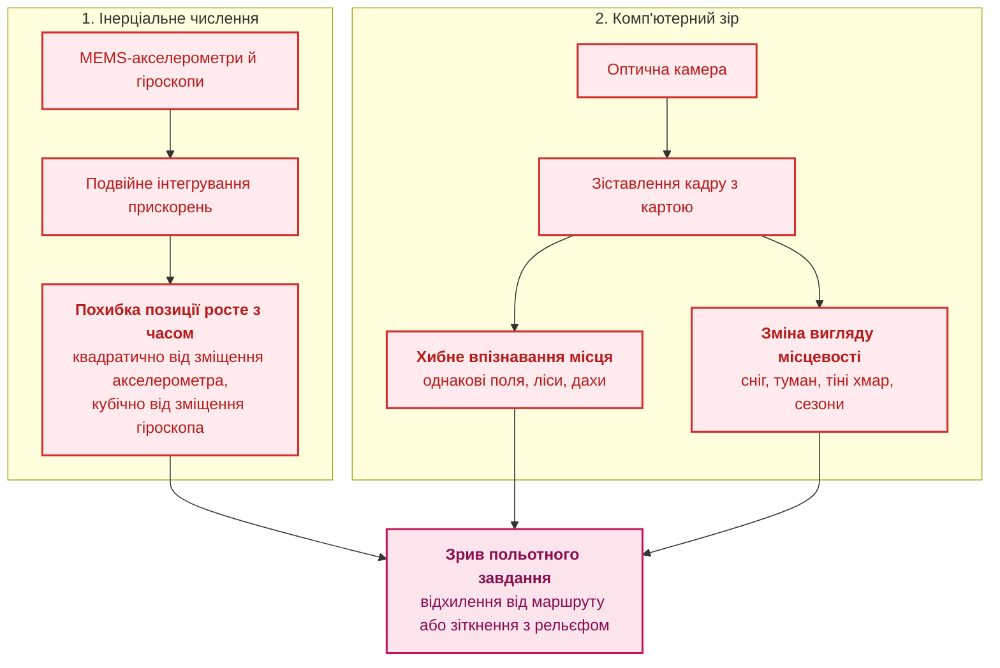
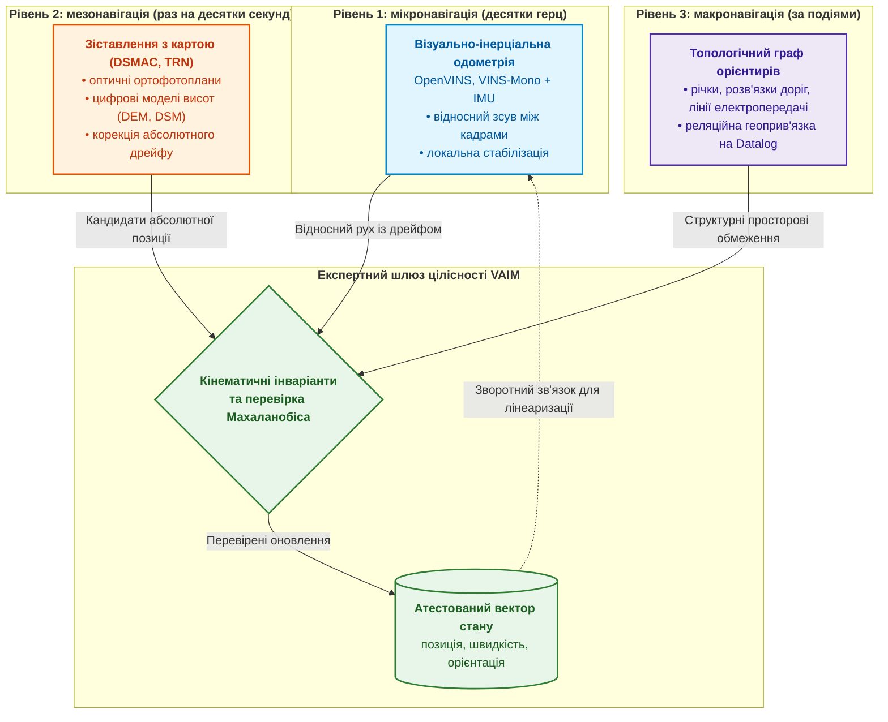
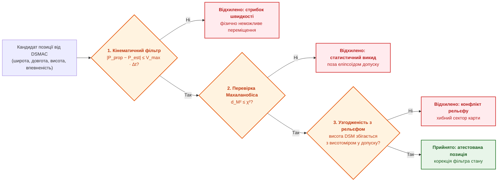
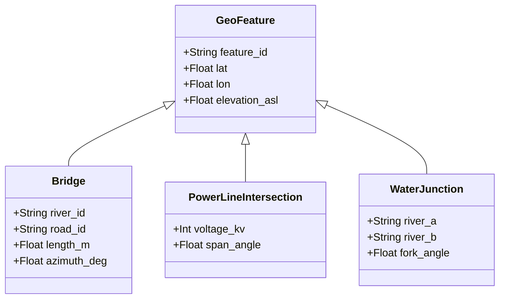
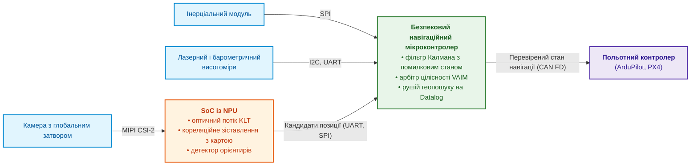
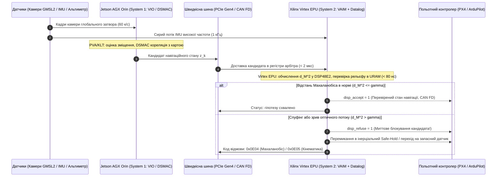

# Додаток В. Автономна навігація без GNSS: геопросторове зіставлення (TRN/DSMAC), візуальна одометрія (VIO) та експертний арбітраж сенсорного злиття

> **Книга:** [Архітектура доказових експертних систем](README.md) · Додатки  
> **Зміст книги:** [README.md](README.md)  
> **Автор:** [Микола Федчик](about-the-author.md)  
> **Рівень складності та оптимальне вивчення:** `[L4]` Дослідницький та навігаційний (індекс Д. Кнута `[45]`) · *Маршрут:* `Трек D` (автономна навігація без GNSS: TRN/DSMAC, VIO та експертний арбітраж сенсорів)  
> **Очікувані результати:** пояснювати, чому інерціальна навігація й комп'ютерний зір окремо не дають надійної позиції без GNSS; будувати трирівневий навігаційний стек; перевіряти кандидата позиції кінематичними, статистичними й рельєфними інваріантами; відокремлювати навігаційну цілісність від рішень, які належать людині.

---

## Анотація

У бойових умовах та зонах активного застосування засобів радіоелектронної боротьби (РЕБ) сигнали глобальних навігаційних систем (GNSS: GPS, Galileo) зазнають тотального придушення завадами або цілеспрямованої підміни координат (*spoofing*). Автономний безпілотний літальний апарат (БПЛА), позбавлений зовнішнього коригування оператором у режимі радіомовчання, залишається сам на сам із бортовими датчиками. Проте ізольована інерціальна система (INS) накопичує похибку за кубічним законом $`\Delta\mathbf{p}(t) \propto t^3`$ через дрейф гіроскопів (відхилення на понад 7 км уже за 20 хвилин польоту), а комп'ютерний зір (TRN, DSMAC, VIO) зазнає хибних зіставлень на монотонній місцевості (однакові поля, лісосмуги, зміна сезонів), що спричиняє зрив польотного завдання або зіткнення з землею.

Цей додаток вирішує проблему на основі запропонованої автором **концепції доказового навігаційного арбітражу Федчика** шляхом побудови детермінованого експертного арбітражу сенсорного злиття, що долає **закон кубічної просторової деградації непідтримуваної інерціальної навігації**. Автором спроєктовано трирівневий навігаційний стек: швидке високочастотне оцінювання на базі INS/VIO, періодичне геопросторове зіставлення оптичних орієнтирів із матрицями висот рельєфу (TRN/DSMAC) та детермінований шлюз арбітражу VAIM, який верифікує запропоновані координати за фізичними інваріантами кінематики, статистичною відстанню Махаланобіса та бар'єрами карти висот, захищаючи автономний борт від катастрофічного дрейфу та сенсорних аномалій.

---

## 1. Механізми деградації автономної орієнтації за відсутності сигналів GNSS

З'ясуємо, чому безпілотник втрачає орієнтацію без GNSS. Глобальні навігаційні супутникові системи (*Global Navigation Satellite System*, GNSS), як-от GPS чи Galileo, більше не гарантують навігації в умовах радіоелектронної боротьби. Сигнал GNSS слабкий, тому його придушують завадами або підміняють: спуфінг транслює хибні сигнали, і приймач обчислює хибні координати й час [[1]](#src-1). Режим радіомовчання водночас не дає операторові коригувати траєкторію через радіолінію. У такій ізоляції безпілотний літальний апарат (БПЛА) залишається лише з бортовими датчиками.



Схема формалізує сформульовану автором **двофакторну модель системної відмови автономного просторового орієнтування (модель навігаційної дилеми Федчика)**: два незалежні й ортогональні механізми — неперервний фізичний розбіг інтегратора INS та дискретні семантичні галюцинації комп'ютерного зору — кожен окремо гарантовано призводять до зриву польотного завдання. Розгляньмо обидва.

**Дрейф інерціальної навігаційної системи (модель кубічно-квадратичного дрейфу незакоригованої MEMS-INS).** Недорогі датчики на мікроелектромеханічних системах (MEMS) мають зміщення нуля. Постійне залишкове зміщення акселерометра $`\mathbf{b}_a`$ після подвійного інтегрування дає похибку позиції, що росте квадратично. Зміщення гіроскопа $`\mathbf{b}_g`$ спершу дає лінійно зростаючу похибку кута нахилу, через неї проєкція сили тяжіння $`\mathbf{g}`$ створює хибне прискорення, і після подвійного інтегрування похибка позиції росте кубічно:

```math
\Delta\mathbf{p}(t)\approx\frac{1}{2}\,\mathbf{b}_a\,t^{2}+\frac{1}{6}\,(\mathbf{b}_g\times\mathbf{g})\,t^{3}.
```

Тут:

- $`\Delta\mathbf{p}(t)`$ є вектором похибки позиції в момент $t$, у метрах;
- $t$ є часом, що минув після останньої корекції позиції, наприклад від останнього сигналу GNSS, у секундах;
- $`\mathbf{b}_a`$ є залишковим зміщенням нуля акселерометра, тобто хибним прискоренням, яке датчик показує навіть у спокої, у м/с²;
- $`\mathbf{b}_g`$ є залишковим зміщенням нуля гіроскопа, тобто хибною кутовою швидкістю, у рад/с;
- $`\mathbf{g}`$ є вектором прискорення вільного падіння, величиною близько $`9{,}81`$ м/с², напрямленим донизу;
- $\times$ є векторним добутком; вираз $`\mathbf{b}_g\times\mathbf{g}`$ дає хибне горизонтальне прискорення, яке з'являється, коли похибка кута нахилу частково «повертає» вектор сили тяжіння в горизонтальну площину;
- множники $\tfrac12$ і $\tfrac16$ є наслідком інтегрування: стала величина $b$ після двох інтегрувань дає $`b\,t^{2}/2`$, а хибне прискорення, яке зростає лінійно, $c\,t$ після двох інтегрувань дає $`c\,t^{3}/6`$.

Формула описує інерціальну навігацію без корекції за сталих зміщень і малих кутів. Справжній фільтр оцінює зміщення й частково їх компенсує, тому вираз показує швидкість зростання похибки без компенсації, а не прогноз для конкретного польоту.

Для умовного залишкового зміщення акселерометра 1 mg, тобто близько $`0{,}0098`$ м/с², лише перший доданок за 20 хвилин ($t=1200$ с) дає $`\tfrac12\cdot0{,}0098\cdot1200^{2}\approx7`$ км, що визначає жорсткий часовий ліміт безкорекційного польоту `` $`t_{\mathrm{crit}} \approx 15\text{--}20\ \text{хв}`$ ``. Число залежить від припущеного зміщення, але квадратична й кубічна залежність від часу не залежить.

**Хибне впізнавання місця та закон перцептивної неоднозначності оптичного розпізнавання ландшафтів (*Perceptual Aliasing Limit*).** Спроба виправляти дрейф лише ймовірнісним зіставленням поточного кадру із супутниковою картою наштовхується на одноманітні ландшафти. Огляд візуального розпізнавання місць Лоурі та співавторів описує дві пов'язані проблеми: різні місця виглядають однаково (*perceptual aliasing*), а те саме місце виглядає по-різному залежно від освітлення, погоди й сезону [[2]](#src-2). Звідси випливає сформульований автором **закон перцептивної неоднозначності оптичного розпізнавання ландшафтів**: скалярна впевненість нейромережевих чи кореляційних моделей оптичного зіставлення кадру є немонотонною та нерелевантною метрикою істинності позиції в умовах перцептивної омонімії місцевості — за наявності повторюваних структур модель зіставлення здатна з високою впевненістю (понад $`0{,}95`$) «впізнати» лісосмугу чи поворот польової дороги, які насправді лежать за десятки кілометрів від апарата.

> [!NOTE]
> **Три засади доказової автономної навігації та модель навігаційної дилеми (за моделлю Миколи Федчика)**
> 1. **Модель навігаційної дилеми Федчика (двофакторна відмова):** автономне орієнтування за відсутності GNSS підлягає дії двох ортогональних механізмів руйнування — детермінованого кубічно-квадратичного розбігу інтегратора MEMS-INS (`` $`\Delta\mathbf{p}(t) \propto t^3`$ ``) та стохастичних помилок комп'ютерного зору через перцептивну омонімію ландшафту (*Perceptual Aliasing Limit*).
> 2. **Фундаментальний інженерний принцип доказової навігації VAIM:** жодне окреме оптичне чи висотне зіставлення не визнається позицією апарата і не допускається до оновлення фільтра стану без проходження візуального автономного монітора цілісності (*Visual Autonomous Integrity Monitor*, VAIM) — детермінованої експертної системи перевірки кінематичних, коваріаційних та рельєфних інваріантів.
> 3. **Тріада Федчика для автономної навігації (тріада дисциплін подолання навігаційного дефіциту):** надійне орієнтування без GNSS спирається на ієрархічний розподіл навігації за часовими масштабами (мікро, мезо, макро), сувору каскадну фільтрацію кандидатів позиції детермінованими інваріантами та доктринальне розмежування повноважень навігаційного рушія від систем ухвалення рішень.
> *Керування рантаймом / Інженерний інваріант:* Жоден кандидат оптичного чи висотного зіставлення не допускається до модифікації вектора стану польотного контролера без проходження детермінованого шлюзу цілісності VAIM за трьома взаємонезамінними бар'єрами.

Звідси головне запитання додатка: **як бортова експертна система може отримати позицію, якій можна довіряти, коли GNSS недоступний, а кожне окреме джерело позиції помиляється по-своєму?** Відповідь становить сформульована автором **тріада Федчика для автономної навігації (тріада дисциплін подолання навігаційного дефіциту за відсутності GNSS)**: розділити навігацію на рівні з різними часовими масштабами, перевіряти кожного кандидата позиції детермінованими інваріантами й чітко обмежити повноваження навігаційної системи.

## 2. Трирівнева архітектура навігаційного стека

Реалізуючи першу складову **тріади Федчика для автономної навігації**, бортовий обчислювач впроваджує розроблену автором **концепцію трирівневого темпорально-просторового навігаційного стека (трирівневий навігаційний стек Федчика)**, рівні якого доповнюють один одного в часі й просторі.



Схема читається знизу вгору за часовим масштабом: мікрорівень ($`10\text{--}100\ \text{Гц}`$) дає часті відносні оцінки, мезорівень ($`0{,}01\text{--}0{,}1\ \text{Гц}`$) рідше дає абсолютні кандидати, макрорівень спрацьовує лише за подіями. При цьому в архітектурі суворо діє сформульований автором **архітектурний інваріант непрямого оновлення вектора стану** (*Indirect Integrity-Gated State Update*): жодна сенсорна підсистема БПЛА (ні VIO, ні DSMAC/TRN, ні топологічний рушій) не має права безпосередньо змінювати вектор стану польотного фільтра — усі три рівні подають вимірювання виключно як непідтверджені гіпотези до шлюзу цілісності VAIM, який виконує авторизацію оновлення.

### 2.1. Мікрорівень: візуально-інерціальна одометрія

**Візуально-інерціальна одометрія** (*visual-inertial odometry*, VIO) оцінює швидкість і відносне переміщення $`\Delta\mathbf{x}_{k-1\to k}`$ між послідовними кадрами камери. Вона відстежує кутові ознаки зображення, обчислює пірамідальний оптичний потік методом Лукаса й Канаде (KLT) та оптимізує стан у ковзному вікні разом з інтегрованими показаннями інерціального вимірювального модуля (*inertial measurement unit*, IMU). Огляд Гуочуаня Хуана систематизує методи візуально-інерціальної навігації [[3]](#src-3), а відкриті реалізації OpenVINS [[4]](#src-4) і VINS-Mono [[5]](#src-5) дають змогу почати з перевіреного коду. VIO працює з малою затримкою й частотою кадрів камери, але похибка VIO повільно накопичується з пройденою відстанню, і для конкретної системи дрейф вимірюють на еталонних траєкторіях.

### 2.2. Мезорівень: зіставлення з картою

Мезорівень реалізує запропонований автором **алгоритм селективної кореляційно-висотної активації мезорівня (DSMAC/TRN)**, який періодично скидає накопичений дрейф VIO, знаходячи абсолютні координати на компактній цифровій карті (підрозділ 6.4). **Кореляційне зіставлення сцени** (*digital scene matching area correlator*, DSMAC) порівнює кадр з ортофотопланом нормалізованою взаємною кореляцією або контурними дескрипторами перепадів яскравості. **Навігація за рельєфом** (*terrain-referenced navigation*, TRN) зіставляє профіль висот, виміряний барометричним чи лазерним висотоміром, із цифровою моделлю рельєфу (*digital elevation model*, DEM) або поверхні (*digital surface model*, DSM). Зіставлення селективно активують лише під час прольоту над топографічно інформативними ділянками (раз на десятки секунд) з обов'язковим спрямуванням кандидатів у шлюз VAIM.

### 2.3. Макрорівень: топологічні орієнтири

Макрорівень втілює розроблений автором **метод дискретної глобальної релокалізації Федчика на стратифікованому топологічному графі**, призначений для відновлення глобальної орієнтації після повної втрати траєкторії, наприклад після тривалого прольоту крізь суцільну хмарність. Замість покладатися на стохастичні нейромережеві дескриптори, механізм виконує реляційну дедукцію взаємного розташування магістралей, водойм, залізниць, мостів і ліній електропередачі за допомогою стратифікованих запитів Datalog над базою просторових фактів [[6]](#src-6). Розділ 4 нижче деталізує онтологію та правила цього методу.

## 3. Експертна система як фільтр цілісності

В авіації для супутникових приймачів давно використовують автономний контроль цілісності в приймачі (*receiver autonomous integrity monitoring*, RAIM): приймач перевіряє узгодженість надлишкових вимірювань і виявляє хибне вимірювання, а Браун показав еквівалентність трьох базових методів RAIM [[7]](#src-7). Запропонована автором **концепція візуального автономного монітора цілісності (VAIM)** переносить і радикально розширює цю ідею на оптико-висотно-інерціальний комплекс БПЛА, реалізуючи її як детерміновану експертну систему символьних і статистичних правил.



Обчислювальний конвеєр на схемі побудовано за сформульованим автором **принципом тристадійної каскадної фільтрації за обчислювальною складністю** (узгодженим із бюджетуванням затримок за моделлю Roofline у [Главі 18](ch18-execution-infrastructure.md)): перевірки впорядковано строго за зростанням обчислювальної трудомісткості. Першим виконується скалярний **кінематичний інваріант граничної фізичної швидкості БПЛА** ($O(1)$ тактів): якщо непряма швидкість переміщення між поточною оцінкою `` $`\mathbf{P}_{\mathrm{est}}(t_{\mathrm{cur}})`$ `` і запропонованим кандидатом `` $`\mathbf{P}_{\mathrm{prop}}(t_{\mathrm{prop}})`$ `` перевищує конструктивну межу платформи, тобто `` $`\lVert\mathbf{P}_{\mathrm{prop}} - \mathbf{P}_{\mathrm{est}}\rVert / (t_{\mathrm{prop}} - t_{\mathrm{cur}}) > V_{\mathrm{max}}`$ ``, кандидат миттєво блокується з вердиктом `REJECT_KINEMATIC_VIOLATION`. Далі виконується матрична перевірка Махаланобіса ($O(m^3)$ тактів), яка відсікає статистичні викиди, а третьою — просторова перевірка висотної відповідності матрицям DEM ($O(\log N)$ звернень до пам'яті), яка відсікає хибні сектори карти, що пройшли попередні стадії.

### 3.1. Відстань Махаланобіса як статистичний допуск

За розробленою автором **математичною моделлю статистичного коваріаційного допуску за відстанню Махаланобіса**, нехай $`\hat{\mathbf{x}}_k`$ є оцінкою стану апарата в момент $`t_k`$, яку дав інерціально-візуальний фільтр, а $`\mathbf{P}_k`$ є відповідною коваріаційною матрицею. Підсистема зіставлення з картою пропонує вимірювання $`\mathbf{z}_k`$ із власною коваріацією $`\mathbf{R}_k`$. Шлюз обчислює інновацію $`\mathbf{y}_k=\mathbf{z}_k-\mathbf{H}\hat{\mathbf{x}}_k`$, де $`\mathbf{H}`$ вибирає зі стану вимірювані компоненти, і квадрат відстані Махаланобіса:

```math
d_M^{2}=\mathbf{y}_k^{\top}\left(\mathbf{H}\mathbf{P}_k\mathbf{H}^{\top}+\mathbf{R}_k\right)^{-1}\mathbf{y}_k .
```

Тут:

- $`d_M^{2}`$ є квадратом відстані Махаланобіса, безрозмірним невід'ємним числом: що воно більше, то гірше інновація узгоджується із заявленою невизначеністю;
- $`\mathbf{y}_k`$ є інновацією, тобто різницею між результатом зіставлення з картою й тим, що очікує фільтр; для горизонтальної позиції це вектор із двох компонент (північ і схід) у метрах;
- $`\mathbf{y}_k^{\top}`$ є транспонованим вектором (рядок замість стовпця), завдяки чому добуток двох векторів і матриці дає одне число;
- $`\mathbf{P}_k`$ є коваріаційною матрицею оцінки стану: на діагоналі стоять дисперсії (квадрати типових похибок) кожної компоненти стану, а поза діагоналлю кореляції між компонентами;
- $`\mathbf{R}_k`$ є коваріаційною матрицею похибки вимірювання, яку підсистема зіставлення з картою заявляє для свого результату;
- $`\mathbf{H}`$ є матрицею вимірювання, яка вибирає з вектора стану ті компоненти, що їх вимірює підсистема зіставлення, наприклад лише горизонтальну позицію;
- $`\mathbf{H}\mathbf{P}_k\mathbf{H}^{\top}+\mathbf{R}_k`$ є коваріацією інновації: вона додає невизначеність фільтра, перенесену у простір вимірювання, до невизначеності самого вимірювання;
- $`(\cdot)^{-1}`$ є оберненою матрицею; множення на неї переводить розбіжність із метрів в одиниці невизначеності.

Практичний зміст формули такий: розбіжність у метрах оцінюють не сама по собі, а відносно невизначеності, яку заявили фільтр і зіставлення. Нехай інновація $`\mathbf{y}_k=(12;\,5)`$ м, а коваріація інновації дорівнює $`\mathrm{diag}(25;\,25)`$ м², тобто типова похибка кожної компоненти становить 5 м. Тоді $`d_M^{2}=12^{2}/25+5^{2}/25=6{,}76`$. Якщо ж невизначеність заявлено заниженою до $`\mathrm{diag}(4;\,4)`$ м² ($\sigma = 2$ м), то $`d_M^{2}=(144+25)/4=42{,}25`$. Розбіжність в обох випадках однакова, 13 м, але в першому вона узгоджується з заявленою точністю, а в другому ні. Числа припущені для ілюстрації.

Якщо модель похибок правильна, $`d_M^{2}`$ має розподіл хі-квадрат із кількістю ступенів свободи, що дорівнює розмірності вимірювання, тому поріг допуску беруть як квантиль цього розподілу; такий допуск (*gating*) описують Бар-Шалом, Лі й Кірубараджан [[8]](#src-8). Згідно з уведеним автором **правилом калібрування квантильних порогів $\chi^2$ для просторового гейтингу**, для горизонтальної позиції (два ступені свободи, $m=2$) з імовірністю 99 % ($`\alpha=0{,}01`$) поріг жорстко фіксується на рівні $`\chi^{2}_{2;0{,}99}\approx9{,}21`$, а для тривимірної позиції ($m=3$) — на рівні $`\chi^{2}_{3;0{,}99}\approx11{,}34`$. Для прикладу вище поріг 9,21 пропускає перший випадок, бо $`6{,}76`$ менше за $`9{,}21`$, і відкидає другий, бо $`42{,}25`$ більше за $`9{,}21`$. Кандидата приймають за сформульованим автором **двокритеріальним предикатом атестації вимірювання**:

```math
\text{ValidMeasurement}(\mathbf{z}_k)\iff d_M^{2}\le\chi^{2}_{m;1-\alpha}\ \land\ \left|h_{\text{baro}}-h_{\text{DEM}}(\mathbf{z}_k)-h_{\text{range}}\right|\le\epsilon_{\text{alt}}.
```

Тут:

- $`\text{ValidMeasurement}(\mathbf{z}_k)`$ є логічним значенням: «істина», якщо кандидат $`\mathbf{z}_k`$ приймають, і «хиба», якщо відкидають;
- $\iff$ читається як «тоді й лише тоді, коли»;
- $\land$ є логічним «і»: кандидата приймають, лише коли виконуються обидві умови, статистична й висотна;
- $`d_M^{2}`$ є квадратом відстані Махаланобіса з попередньої формули;
- $`\chi^{2}_{m;1-\alpha}`$ є квантилем розподілу хі-квадрат із $m$ ступенями свободи рівня $1-\alpha$, тобто порогом, який правильний кандидат перевищує лише з імовірністю $\alpha$;
- $m$ є розмірністю вимірювання: 2 для горизонтальної позиції, 3 для тривимірної;
- $\alpha$ є рівнем значущості, тобто допустимою часткою правильних кандидатів, які шлюз помилково відкине; для порога 99 % значення $`\alpha=0{,}01`$;
- $`h_{\text{baro}}`$ є барометричною висотою апарата, у метрах;
- $`h_{\text{DEM}}(\mathbf{z}_k)`$ є висотою рельєфу під кандидатом $`\mathbf{z}_k`$ за цифровою моделлю рельєфу (DEM), у метрах;
- $`h_{\text{range}}`$ є показом висотоміра, тобто відстанню від апарата до поверхні, у метрах;
- $`\epsilon_{\text{alt}}`$ є допуском на розбіжність висот, у метрах; його вибирають за сумою похибок барометра, висотоміра й моделі рельєфу;
- $\lvert\cdot\rvert$ є модулем, тобто абсолютною величиною числа.

Другий кон'юнкт предиката задає сформульований автором **інваріант тристороннього висотного замикання** (*Three-Way Altitude Consistency Invariant*): умова `` $`\lvert h_{\mathrm{baro}} - (h_{\mathrm{DEM}}(\mathbf{z}_k) + h_{\mathrm{range}})\rvert \le \epsilon_{\mathrm{alt}}`$ `` зіставляє три незалежні фізичні джерела — барометр, активний висотомір і цифрову карту рельєфу. Якщо апарат справді перебуває над точкою кандидата, різниця між барометричною висотою й висотою рельєфу має дорівнювати показу висотоміра (зведеним до єдиного датума, наприклад геоїда EGM96). Нехай $`h_{\text{baro}}=620`$ м, а висотомір показує 212 м. Для кандидата, під яким рельєф лежить на висоті 410 м, маємо $\lvert620-410-212\rvert=2$ м, і за допуску $`\epsilon_{\mathrm{alt}}=10`$ м кандидата приймають. Для хибного кандидата на схилі, де за картою рельєф сягає 470 м, маємо $\lvert620-470-212\rvert=62$ м, і кандидата негайно відкидають із вердиктом `REJECT_TERRAIN_CONFLICT`, навіть якщо статистична перевірка його пропустила. Прийнятий кандидат оновлює фільтр стану, наприклад фільтр Калмана з помилковим станом (*error-state Kalman filter*, ESKF) [[9]](#src-9) або оптимізацію на графі факторів [[10]](#src-10).

> [!NOTE]
> **Трирівневий навігаційний стек та тристадійна каскадна фільтрація VAIM (за моделлю Миколи Федчика)**
> 1. **Трирівневий темпорально-просторовий стек та інваріант непрямого оновлення стану:** навігаційний процес декомпозується на мікрорівень VIO ($`10\text{--}100\ \text{Гц}`$), селективний мезорівень DSMAC/TRN ($`0{,}01\text{--}0{,}1\ \text{Гц}`$) і подієвий макрорівень Datalog, де за архітектурним інваріантом *Indirect Integrity-Gated State Update* жодне джерело не модифікує вектор стану напряму, подаючи гіпотези виключно до шлюзу VAIM.
> 2. **Принцип тристадійної каскадної фільтрації за складністю та кінематичний інваріант:** шлюз VAIM виконує верифікацію за зростанням обчислювальної вартості — від скалярного кінематичного бар'єра `` $`\lVert\mathbf{P}_{\mathrm{prop}} - \mathbf{P}_{\mathrm{est}}\rVert / \Delta t \le V_{\mathrm{max}}`$ `` ($O(1)$) до матричної форми Махаланобіса `` $`d_M^2 \le \chi^2_{m;1-\alpha}`$ `` ($O(m^3)$) та рельєфної вибірки DEM ($O(\log N)$).
> 3. **Інваріант тристороннього висотного замикання та правило порогів $\chi^2$:** ортогональне узгодження барометра, далекоміра та матриці DEM (`` $`\lvert h_{\mathrm{baro}} - h_{\mathrm{DEM}}(\mathbf{z}_k) - h_{\mathrm{range}}\rvert \le \epsilon_{\mathrm{alt}}`$ ``) у поєднанні з каліброваними порогами $`\gamma = 9{,}21`$ ($m=2$) та $`\gamma = 11{,}34`$ ($m=3$) усуває оптичну омонімію на пересіченій місцевості.
> *Керування рантаймом / Інженерний інваріант:* Порушення будь-якої зі стадій каскаду VAIM миттєво блокує інтеграцію вимірювання у фільтр стану ESKF із детермінованим поверненням кодів відмови `REJECT_KINEMATIC_VIOLATION`, `REJECT_MAHALANOBIS_OUTLIER` або `REJECT_TERRAIN_CONFLICT`.

## 4. Топологічний геопошук на стратифікованому Datalog

Якщо апарат виходить із зони хмарності після тривалого сліпого польоту, невизначеність позиції $`\mathbf{P}_k`$ стає завеликою для кореляційного зіставлення з картою. Тоді вмикається топологічний геопошук на базі розробленої автором **онтологічної моделі геопросторових орієнтирів БПЛА** (`GeoFeature`), яка перетворює зорові ознаки на типізовані предикати знань. Бортова база знань містить граф характерних просторових орієнтирів району польоту.



Діаграма задає типи орієнтирів і атрибути, за якими спостереження зіставляють з базою: координати, висоту, кут і довжину. Припустімо, що комп'ютерний зір виділив у кадрі перетин річки й автомобільної дороги під кутом близько $60^\circ$, а висота поверхні близька до 135 м. Розроблений автором **декларативний алгоритм топологічної релокалізації на стратифікованому Datalog** застосовує **правило просторово-кутової селекції інфраструктурних орієнтирів** (розбіжність за кутом перетину $\Delta\theta < 10^\circ$, за лінійною довжиною $`\Delta L < 15\ \text{м}`$, за радіусом еліпсоїда $`\mathrm{Dist} < R_{\max}`$ та за висотою поверхні $`\Delta h < 25\ \text{м}`$):

```prolog
% Кандидат: міст із бази знань, що узгоджується зі спостереженням
candidate_bridge(ID, Lat, Lon) :-
    detected_bridge(VisAngle, VisLen),
    kb_bridge(ID, Lat, Lon, TrueAngle, TrueLen, Elev),
    abs(VisAngle - TrueAngle) < 10,
    abs(VisLen - TrueLen) < 15,
    estimated_position(EstLat, EstLon, MaxRadius),
    geo_distance(EstLat, EstLon, Lat, Lon, Dist),
    Dist < MaxRadius,
    surface_elevation_asl(SurfAlt),
    abs(SurfAlt - Elev) < 25.

% Неоднозначність: у радіусі пошуку є інший кандидат
ambiguous_candidate(ID) :-
    candidate_bridge(ID, _, _),
    candidate_bridge(Other, _, _),
    Other != ID.

% Позицію затверджують лише за єдиного кандидата
verified_relocalization(Lat, Lon) :-
    candidate_bridge(ID, Lat, Lon),
    not ambiguous_candidate(ID).
```

Правило `verified_relocalization` залежить від `ambiguous_candidate` через заперечення, а `ambiguous_candidate` залежить від `candidate_bridge` без заперечення, тому програма стратифікована й має однозначну семантику найменшої нерухомої точки. Ця конструкція втілює сформульований автором **інваріант стратифікованої однозначності топологічного кандидата**: релокалізація вважається доведеною тоді й лише тоді, коли в межах радіуса максимальної невизначеності знайдено строго одного кандидата; якщо в колі невизначеності виявлено два або більше схожих мостів, активується предикат `ambiguous_candidate`, позицію не затверджують за принципом Fail-Closed ([Глава 21](ch21-from-recommendation-to-action.md)), і апарат продовжує пошук.

## 5. Межі навігаційної експертної системи

В основу розмежування відповідальності бортового інтелекту покладено сформульовану автором **доктрину ізоляції навігаційної цілісності від кінетичних рішень застосування сили**: навігаційна експертна система відповідає виключно на два запитання — де перебуває апарат і наскільки ця оцінка просторово достовірна, тоді як рішення про застосування сили чи незворотний фізичний вплив категорично відчужене від навігаційного тракту й не належить до її повноважень. Шість принципів відповідального використання штучного інтелекту в обороні, які схвалили союзники по НАТО, включають законність, відповідальність і підзвітність, пояснюваність і простежуваність, надійність, керованість і зменшення упередженості [[11]](#src-11). Британський документ JSP 936 вимагає, щоб можливості на основі штучного інтелекту мали належний рівень людського нагляду [[12]](#src-12).

Для навігаційного стека з цього випливає розроблена автором **тріада інженерних регламентів автономного польоту в режимі радіомовчання**. Перше правило (повнота метаданих цілісності): VAIM передає далі не лише скалярну позицію, а й атестований статус цілісності та коваріаційну матрицю невизначеності, щоб людина в циклі керування (Human-in-the-Loop), яка ухвалює рішення, бачила точні межі оцінки. Друге правило втілює **принцип замкненого автомата безпечних дій за втрати навігаційної цілісності**: за непереборного дефіциту цілісності навігації апарат переходить виключно до заздалегідь погоджених детермінованих безпечних станів — утримання позиції (`Safe-Hold`), повернення за перевіреним маршрутом (`Return-to-Base`) чи посадки в дозволеній зоні (`Safe-Landing`); такий автомат режимів описує [Додаток Б](appendix-b-robotics-and-cyber-physical-systems.md). Третє правило (контроль повноважень): будь-які дії з незворотними наслідками проходять криптографічний шлюз контролю повноважень, описаний у [Главі 21](ch21-from-recommendation-to-action.md), і правову оцінку, яка виходить за межі цієї книги.

> [!NOTE]
> **Три інваріанти топологічної релокалізації та доктринальної ізоляції навігаційного тракту (за моделлю Миколи Федчика)**
> 1. **Інваріант стратифікованої однозначності топологічного кандидата на Datalog:** глобальна релокалізація над онтологією `GeoFeature` за правилом просторово-кутової селекції ($\Delta\theta < 10^\circ$, $`\Delta L < 15\ \text{м}`$, $`\mathrm{Dist} < R_{\max}`$, $`\Delta h < 25\ \text{м}`$) затверджується предикатом `verified_relocalization` лише за наявності єдиного кандидата ($`\neg\,\mathrm{ambiguous\_candidate}(ID)`$).
> 2. **Доктрина ізоляції навігаційної цілісності від кінетичних рішень:** повноваження бортової експертної системи VAIM строго обмежені обчисленням вектора просторового стану та атестацією його достовірності відповідно до директив НАТО та JSP 936, повністю виключаючи автономне ініціювання застосування сили.
> 3. **Тріада регламентів радіомовчання та принцип замкненого автомата безпечних дій:** обов'язкова трансляція коваріацій невизначеності поєднується з автоматичним переходом у детерміновані стани `Safe-Hold`, `Return-to-Base` або `Safe-Landing` за втрати цілісності та криптографічним контролем повноважень.
> *Керування рантаймом / Інженерний інваріант:* За виявлення двох або більше топологічно ідентичних орієнтирів у радіусі невизначеності релокалізація негайно блокується (Fail-Closed), а за тривалої втрати навігаційної цілісності автомат режимів примусово переводить платформу у захисний маневр без права самостійного виконання незворотних дій.

## 6. Апаратна реалізація бортового навігаційного вузла

Розроблена автором **апаратна дворівнева гетерогенна архітектура бортового навігаційного вузла (SoC/NPU vs. Safety MCU/FPGA)** фізично розділяє задачі між імовірнісним доменом комп'ютерного зору та детермінованим доменом функціональної безпеки.



Нейронний процесор (*neural processing unit*, NPU) виконує важкі й імовірнісні обчислення зору, а безпековий мікроконтролер виконує детерміновані перевірки й веде фільтр стану. Польотний контролер отримує вже перевірений стан навігації, а не сирі кандидати позиції.

---

### 6.1. Дослідницька програма для оптично-навігаційного вузла на базі NVIDIA Jetson AGX Orin (Тракт зорового сприйняття — System 1)

Для експериментальної верифікації **специфікації навігаційного тракту зорового сприйняття (System 1)** автором розгорнуто дослідницький стенд на базі промислового комп'ютера **Seeed Studio reServer Industrial J501** з модулем **NVIDIA Jetson AGX Orin 64GB** (до 275 TOPS, 2048-ядерний GPU Ampere, два рушії NVDLA v2, прискорювач зору PVA v2, 12 ядер ARM Cortex-A78AE, пам'ять LPDDR5 204,8 ГБ/с у захищеному корпусі).

Програмно-апаратний стек об'єднує **NVIDIA JetPack 6.2** (ядро Linux 5.15 PREEMPT_RT, CUDA 12.6, TensorRT 10) та спеціалізовані конвеєри обробки потоків камер:

1. **Апаратний оптичний потік KLT та візуальна одометрія (VIO):**
   * Перенесення обчислення пірамід Лукаса-Канаде (KLT) на програмований прискорювач зору **PVA v2** (*Programmable Vision Accelerator*), що розвантажує основні тензорні ядра та GPU.
   * Отримання сирих кадрів із двох камер глобального затвора (*global shutter*) через інтерфейс **GMSL2 / MIPI CSI-2** у кільцеві буфери DMA із фіксованою затримкою доставки кадру $`< 1{,}5\ \text{мс}`$.
2. **Кореляційне зіставлення з пірамідою тайлів карти (DSMAC / TRN):**
   * Прискорення просторової 2D-кореляції контурних карт перепадів яскравості з рельєфними тайлами COG через рушій **TensorRT 10** у форматі FP8/INT8.
   * Використання 64 ГБ уніфікованої пам'яті для кешування мультиспектральних цифрових моделей рельєфу (DEM/DTM) площею до $`10^4\ \text{км}^2`$ без затримок звернення до повільних накопичувачів NVMe.
3. **Детекція топологічних орієнтирів та локальний SLM-триаж:**
   * Запуск локальних квантованих моделей зорового сприйняття (VLM) через локальний рантайм **Ollama** для семантичної класифікації складних орієнтирів (мости, русла річок, перехрестя магістралей, висотні споруди).
4. **Виведення кандидатів навігаційного стану через CAN FD:**
   * Передавання сформованих гіпотез позиції через один з ізольованих портів **CAN FD** на частоті 50–100 Гц у бінарному форматі з контрольною сумою CRC32.

> [!NOTE]
> **Чотири базові механізми навігаційного тракту сприйняття System 1 та бортової геоіндексації (за моделлю Миколи Федчика)**
> 1. **Локальний мультимодальний триаж орієнтирів ([Глава 12](ch12-linguistic-analysis-and-local-models.md)):** застосування квантованих локальних SLM/VLM у рантаймі Ollama для семантичної екстракції топологічних маркерів із зорових потоків без звернення до зовнішніх хмарних сервісів.
> 2. **Детермінований обчислювальний бюджет та Zero-Copy геоіндексація ([Глава 18](ch18-execution-infrastructure.md), [Глава 32](ch32-high-performance-knowledge-packs-mmap-and-harvesting.md)):** поєднання ядра Linux PREEMPT_RT та апаратного розвантаження KLT на PVA v2 зі статичною геоіндексацією ZNAV-INDEX v2 через `mmap` в уніфікованій пам'яті LPDDR5.
> 3. **Високочастотний сенсорний тракт та ізоляція шин ([Глава 22](ch22-cybernetics-edge-to-backend.md)):** захоплення кадрів глобального затвора через GMSL2 у кільцеві буфери DMA ($`< 1{,}5\ \text{мс}`$) та трансляція кандидатів позиції через шину CAN FD (50–100 Гц, CRC32).
> 4. **Алгоритмічний скептицизм та первинний коваріаційний відбір ([Глава 37](ch37-input-information-assessment-and-algorithmic-skepticism.md)):** селективна активація кореляції DSMAC/TRN у форматі FP8/INT8 виключно над інформативними ділянками маршруту з передаванням матриці власної невизначеності $`\mathbf{R}_k`$ до шлюзу VAIM.
> *Керування рантаймом / Інженерний інваріант:* Тракт зорового сприйняття System 1 виконує всі стохастичні обчислення в ізольованому домені пам'яті без динамічних алокацій купи та не має фізичної лінії прямого керування польотним контролером.

---

### 6.2. Дослідницька програма для апаратного арбітра цілісності на FPGA (Xilinx Virtex — System 2)

Розроблена автором **специфікація апаратного арбітра цілісності VAIM на базі AMD / Xilinx Virtex FPGA (System 2)** (Virtex UltraScale+ / UltraScale) реалізує детермінований периметр захисту та арбітражу цілісності у спеціалізованому процесорі доказових обчислень EPU, де виконується сформульований автором **апаратний часовий інваріант безпекового циклу вето** на рівні наносекунд:

1. **Апаратний обчислювач відстані Махаланобіса на блоках DSP48E2:**
   * Синтез конвеєризованого матричного помножувача:

$$d_M^2 = (\mathbf{z} - \hat{\mathbf{z}})^\top \mathbf{S}^{-1} (\mathbf{z} - \hat{\mathbf{z}})$$

     із фіксованим часом обчислення у **24 такти ($`< 60\ \text{нс}`$ @ 400 МГц)**.
   * Апаратне порівняння з порогом $`\gamma = 9{,}21`$ без залучення процесорних інструкцій.
2. **Апаратна машина запитів над топологічними графами (UltraRAM Zero-Copy):**
   * Розміщення векторної бази орієнтирів та правил стратифікованого Datalog безпосередньо у внутрішніх матрицях UltraRAM обсягом до 36 МБ.
   * Виконання предикатів просторового взаєморозміщення (`visible_landmark`, `corridor_bound`, `prohibited_zone`) за 1–3 такти тактової частоти.
3. **Апаратний замок безпеки (Fail-Closed Safety Veto) та часовий інваріант вето:**
   * Прямі апаратні лінії вето (`disp_accept`, `disp_refuse`), виведені на оптоізольовані ключі переривання керування польотного контролера (Pixhawk / PX4). Згідно з **апаратним часовим інваріантом безпекового циклу вето**, повна атестація у блоках DSP48E2 не перевищує $`60\ \text{нс}`$, а якщо інновація вимірювання перевищує поріг або VIO суперечить кінематиці апарата, лінія `disp_refuse` миттєво блокує небезпечний кандидат та активує режим утримання позиції (*Safe Hold*) за час $`< 5\ \text{нс}`$.

> [!NOTE]
> **Чотири інженерні гарантії апаратного навігаційного арбітра System 2 та передпольотної атестації (за моделлю Миколи Федчика)**
> 1. **Символьний арбітраж у пам'яті UltraRAM без копіювання ([Глава 16](ch16-expert-systems-architecture.md)):** жорстке відокремлення просторових фактів від стратифікованих правил Datalog у внутрішній пам'яті ПЛІС (до 36 МБ) гарантує виконання топологічних запитів за 1–3 такти.
> 2. **Апаратний часовий інваріант безпекового вето ([Глава 21](ch21-from-recommendation-to-action.md)):** конвеєрне обчислення квадратичної форми Махаланобіса на блоках DSP48E2 за 24 такти ($`< 60\ \text{нс}`$) та миттєве спрацьовування оптоізольованої лінії блокування `disp_refuse` за час $`< 5\ \text{нс}`$ унеможливлюють проникнення аномалій у польотний контролер.
> 3. **Деонтичні просторові обмеження та криптографічна автентичність маніфесту ([Глава 30](ch30-safety-cybersecurity-co-engineering.md), [Глава 31](ch31-syllogistic-reasoning-and-relation-lattices.md)):** апаратна перевірка заборонених зон поєднується з інваріантом обов'язкового цифрового підпису навігаційного маніфесту та карт за алгоритмом Ed25519 перед стартом.
> 4. **Попперівський критерій фальсифікації безпеки польоту ([Глава 39](ch39-active-compliance-auditor-and-popperian-testing.md)):** навігаційна архітектура проходить верифікацію на граничну затримку циклу $`T_{\text{loop}} \le 20\ \text{мс}`$ (50 Гц) та верхню межу ймовірності нелокалізованої похибки $`P(\text{uncontained error}) \le 10^{-6}`$ на польотну годину.
> *Керування рантаймом / Інженерний інваріант:* За перевищення порога Махаланобіса ($`d_M^2 > \gamma`$) або відсутності валідного підпису маніфесту Ed25519 апаратний арбітр Virtex EPU переводить бортовий комплекс у стан Fail-Closed із блокуванням неатестованих траєкторій.

---

### 6.3. Дослідження тандему «Jetson AGX Orin + Xilinx Virtex» у режимі радіомовчання

Розроблений автором **протокол міжпроцесорної координації тандему «Jetson AGX Orin + Xilinx Virtex EPU» у режимі радіомовчання** визначає детерміновану взаємодію підсистем під час повної втрати або зловмисного спуфінгу GNSS:



**Попперівський критерій фальсифікації безпеки автономного польоту (*Popperian Navigation Falsification Criterion*):**
За сформульованим автором критерієм, навігаційна гіпотеза вважається емпірично спростованою (непридатною до автономного застосування), якщо за умови внесення штучних завад у зображення (імітація диму, перепадів освітлення чи хибних текстур) або імітації стрибка позиції GNSS:
1. Максимальна затримка циклу допуску перевищує ліміт реального часу:

$$T_{\text{loop}} = T_{\text{infer}} + T_{\text{comm}} + T_{\text{arbiter}} > 20\ \text{мс}\quad (\text{для циклу керування 50 Гц});$$

2. Апарат допускає хоча б одне хибне вимірювання ($`d_M^2 > \gamma`$), що спричиняє просторове відхилення траєкторії понад 5 метрів ($`P(\text{uncontained error}) > 10^{-6}\ \text{на польотну годину}`$).

---

### 6.4. Формат бортових геоданих

Щоб геодані вмістилися у флешпам'ять бортового одноплатного комп'ютера, їх організовують за розробленим автором **стандартом бортового геопросторового кешування Федчика** та **концепцією просторової геоіндексації навігаційних баз**:

- **Піраміда тайлів у форматі Cloud Optimized GeoTIFF** (COG), який стандартизував Відкритий геопросторовий консорціум (*Open Geospatial Consortium*, OGC) [[13]](#src-13): грубий базовий шар для всього маршруту й детальніші тайли для районів, де потрібне точне зіставлення.
- **Контурні карти перепадів яскравості** замість повних зображень: такі карти займають менше місця й менше залежать від сезонних та добових змін освітлення; виграш в обсязі для конкретного району вимірюють емпірично.
- **Векторні шари орієнтирів** у форматах FlatBuffers або SQLite із розширенням SpatiaLite для швидкого доступу до просторових об'єктів.
- **Концепція просторової геоіндексації навігаційних баз (R-Tree Гугмана проти сіток Uber H3 / Google S2 та макета ZNAV-INDEX v2 Федчика):** класичні динамічні дерева обмежувальних прямокутників R-Tree (А. Гугман, 1984) вимагають вказівникових переходів і виділень пам'яті в купі, а дискретні глобальні ієрархічні сітки — гексагональна Uber H3 та сферична Google S2 на кривих Гільберта — дають 64-бітні цілочисельні ключі комірок. В авторській архітектурі дискретне індексування H3/S2 поєднано зі статичним бінарним форматом прямого відображення пам'яті **ZNAV-INDEX v2** ([Глава 32](ch32-high-performance-knowledge-packs-mmap-and-harvesting.md)) через системний виклик `mmap` або розміщення в блоках UltraRAM без жодної динамічної алокації (*zero-allocation*), що гарантує детермінований час вибірки орієнтирів $O(1)$ для клітинки та $O(\log N)$ у впорядкованому масиві.

## 7. Робочий код навігаційного арбітра мовою Go

Код нижче втілює розроблений автором **архітектурний патерн еталонного навігаційного арбітра `ValidateVisualFix` мовою Go** (Zero-Dependency, безалокаційний дизайн) та **алгоритм замкненого безалокаційного 2D-розрахунку квадрата відстані Махаланобіса (`mahalanobis2`)**. Функція `ValidateVisualFix` послідовно перевіряє кандидата за п'ятьма детермінованими бар'єрами: (1) **інваріант первинного відсікання за порогом класифікаційної впевненості** ($`\mathrm{Confidence} \ge \tau_{\mathrm{conf}}`$, інакше `REJECT_LOW_CONFIDENCE`); (2) **темпоральний інваріант монотонності бортового часового штампа** ($`\Delta t = t_{\mathrm{prop}} - t_{\mathrm{cur}} > 0`$, інакше `REJECT_INVALID_TIMESTAMP`); (3) **кінематичний інваріант граничної швидкості** ($`\mathrm{speed} \le V_{\max}`$, інакше `REJECT_KINEMATIC_VIOLATION`); (4) **інваріант тристороннього висотного замикання** ($`\mathrm{diff} \le \epsilon_{\mathrm{alt}}`$, інакше `REJECT_TERRAIN_CONFLICT`); (5) статистичний допуск Махаланобіса ($`d_M^2 \le \chi^2_{2;0{,}99} = 9{,}21`$, інакше `REJECT_MAHALANOBIS_OUTLIER`). Пакет використовує лише стандартну бібліотеку Go.

<details>
<summary>Приклад мовою Go: навігаційний арбітр VAIM</summary>

```go
package navigation

import (
	"errors"
	"fmt"
	"math"
)

// Position3D задає точку в локальній системі NED (північ, схід, вниз), у метрах.
type Position3D struct {
	North, East, Down float64
}

// NavState є поточною оцінкою навігаційного фільтра.
type NavState struct {
	Pos        Position3D
	Covariance [2][2]float64 // коваріація горизонтальної позиції (N, E), м²
	Timestamp  float64       // секунди від старту
}

// VisualFixProposal є кандидатом позиції від зіставлення з картою.
type VisualFixProposal struct {
	Pos         Position3D
	MeasureCov  [2][2]float64 // коваріація вимірювання (N, E), м²
	Confidence  float64       // впевненість моделі зіставлення, від 0 до 1
	DemAltitude float64       // висота рельєфу під кандидатом за DEM, м
	Timestamp   float64
}

// VAIMConfig задає пороги шлюзу цілісності.
type VAIMConfig struct {
	MaxSpeed          float64 // максимальна фізична швидкість апарата, м/с
	Chi2Limit         float64 // квантиль χ² для 2 ступенів свободи, 9.21 для p = 0.01
	MaxAltDiscrepancy float64 // допустима розбіжність висот, м
	MinConfidence     float64 // мінімальна впевненість моделі зіставлення
}

// Verdict пояснює рішення шлюзу.
type Verdict struct {
	Accepted bool
	Code     string
	Detail   string
}

var ErrSingularCovariance = errors.New("singular innovation covariance")

// ValidateVisualFix перевіряє кандидата позиції за чотирма інваріантами.
func ValidateVisualFix(cfg VAIMConfig, cur NavState, p VisualFixProposal, rangeAlt float64) (Verdict, error) {
	if p.Confidence < cfg.MinConfidence {
		return Verdict{false, "REJECT_LOW_CONFIDENCE",
			fmt.Sprintf("confidence %.2f < %.2f", p.Confidence, cfg.MinConfidence)}, nil
	}
	dt := p.Timestamp - cur.Timestamp
	if dt <= 0 {
		return Verdict{false, "REJECT_INVALID_TIMESTAMP", fmt.Sprintf("dt = %.3f s", dt)}, nil
	}
	dN, dE := p.Pos.North-cur.Pos.North, p.Pos.East-cur.Pos.East
	if speed := math.Hypot(dN, dE) / dt; speed > cfg.MaxSpeed {
		return Verdict{false, "REJECT_KINEMATIC_VIOLATION",
			fmt.Sprintf("implied speed %.1f m/s > %.1f m/s", speed, cfg.MaxSpeed)}, nil
	}
	// Барометрична висота має дорівнювати висоті рельєфу під кандидатом плюс показ висотоміра.
	if diff := math.Abs(-cur.Pos.Down - (p.DemAltitude + rangeAlt)); diff > cfg.MaxAltDiscrepancy {
		return Verdict{false, "REJECT_TERRAIN_CONFLICT",
			fmt.Sprintf("altitude discrepancy %.1f m > %.1f m", diff, cfg.MaxAltDiscrepancy)}, nil
	}
	d2, err := mahalanobis2(dN, dE, cur.Covariance, p.MeasureCov)
	if err != nil {
		return Verdict{false, "REJECT_MATH_ERROR", err.Error()}, err
	}
	if d2 > cfg.Chi2Limit {
		return Verdict{false, "REJECT_MAHALANOBIS_OUTLIER",
			fmt.Sprintf("d² = %.2f > %.2f", d2, cfg.Chi2Limit)}, nil
	}
	return Verdict{true, "ACCEPT_VERIFIED_FIX", fmt.Sprintf("d² = %.2f", d2)}, nil
}

// mahalanobis2 обчислює d² = yᵀ(P+R)⁻¹y для горизонтальної інновації y = (dN, dE).
func mahalanobis2(dN, dE float64, P, R [2][2]float64) (float64, error) {
	s00, s01 := P[0][0]+R[0][0], P[0][1]+R[0][1]
	s10, s11 := P[1][0]+R[1][0], P[1][1]+R[1][1]
	det := s00*s11 - s01*s10
	if math.Abs(det) < 1e-9 {
		return 0, ErrSingularCovariance
	}
	return (dN*(s11*dN-s01*dE) + dE*(s00*dE-s10*dN)) / det, nil
}
```

</details>

Щоб перевірити арбітра, сформуємо розроблений автором **емпіричний верифікаційний тестбенч на ортогональних тестових векторах (`ExampleValidateVisualFix`)** у файлі `example_test.go`. Приклад подає чотири кандидати: узгоджений, зі стрибком на 5 км за 10 с, з неузгодженим рельєфом і зі статистичним викидом. Команда `go test -run Example -v` виконує приклад і звіряє надруковане з очікуваним виводом у коментарі `// Output:`.

<details>
<summary>Приклад мовою Go: перевірка арбітра на чотирьох кандидатах позиції</summary>

```go
package navigation

import "fmt"

func ExampleValidateVisualFix() {
	cfg := VAIMConfig{MaxSpeed: 60, Chi2Limit: 9.21, MaxAltDiscrepancy: 25, MinConfidence: 0.6}
	cur := NavState{
		Pos:        Position3D{North: 1000, East: 2000, Down: -450},
		Covariance: [2][2]float64{{900, 0}, {0, 900}},
		Timestamp:  100,
	}
	fix := func(north, east, dem float64) VisualFixProposal {
		return VisualFixProposal{
			Pos:         Position3D{North: north, East: east},
			MeasureCov:  [2][2]float64{{400, 0}, {0, 400}},
			Confidence:  0.9,
			DemAltitude: dem,
			Timestamp:   110,
		}
	}
	for _, p := range []VisualFixProposal{
		fix(1040, 1970, 130), // узгоджений кандидат
		fix(6000, 2000, 130), // стрибок на 5 км за 10 с
		fix(1040, 1970, 180), // рельєф під кандидатом не збігається з висотами
		fix(1150, 2000, 130), // статистичний викид
	} {
		v, _ := ValidateVisualFix(cfg, cur, p, 320)
		fmt.Println(v.Code, v.Detail)
	}
	// Output:
	// ACCEPT_VERIFIED_FIX d² = 1.92
	// REJECT_KINEMATIC_VIOLATION implied speed 500.0 m/s > 60.0 m/s
	// REJECT_TERRAIN_CONFLICT altitude discrepancy 50.0 m > 25.0 m
	// REJECT_MAHALANOBIS_OUTLIER d² = 17.31 > 9.21
}
```

</details>

Приклад проходить (перевірено з Go 1.27). Числа легко перевірити вручну. Узгоджений кандидат зміщений на 40 м на північ і 30 м на захід, а сумарна дисперсія дорівнює $900+400=1300$ м² за кожною віссю, тому $`d_M^{2}=(40^{2}+30^{2})/1300\approx1{,}92`$. Кандидат зі зміщенням 150 м дає $`d_M^{2}=150^{2}/1300\approx17{,}31`$, що перевищує поріг 9,21, хоча кінематично таке зміщення за 10 с можливе. Це доводить сформульований автором **принцип взаємодоповнюваності кінематичного та статистичного фільтрів**: кінематичний і статистичний фільтри є строго взаємонезамінними й потрібні разом — **перший відсікає фізично неможливе, другий відсікає статистично малоймовірне**.

## 8. Перелік перевірок перед польотом у режимі радіомовчання

Перед завантаженням польотного завдання інженерна група виконує розроблений автором **дев'ятипараметричний регламент передпольотної атестації навігаційного комплексу**:

| № | Перевірка цілісності | Механізм контролю | Статус |
| :-: | :--- | :--- | :-: |
| 1 | **Покриття тайлами карти** | Маршрут повністю покритий ортофотопланами з бічним запасом, визначеним для завдання | [ ] |
| 2 | **Актуальність моделі висот** | Модель рельєфу перевірена за контрольними геодезичними точками | [ ] |
| 3 | **Калібрування камери** | Внутрішні параметри, дисторсія й зміщення камери відносно IMU зафіксовані й перевірені | [ ] |
| 4 | **Глобальний затвор** | Камера працює з глобальним затвором, без спотворень рядкового затвора від вібрацій | [ ] |
| 5 | **Пороги шлюзу цілісності** | Поріг χ² відповідає розмірності вимірювання: 9,21 для горизонтальної позиції, 11,34 для тривимірної ($`p=0{,}01`$) | [ ] |
| 6 | **Безпечні дії за втрати цілісності** | Налаштовано й випробувано перехід до утримання позиції, повернення або посадки в дозволеній зоні | [ ] |
| 7 | **Межі польотної зони** | Межі дозволеної зони завантажено й підписано | [ ] |
| 8 | **Стійкість до засліплення** | Випробувано політ на чистому інерціальному численні під час перекриття об'єктива на заданий час | [ ] |
| 9 | **Підпис навігаційного маніфесту** | Польотне завдання, тайли карт і пороги правил підписані ключем розробника (Ed25519) | [ ] |

Кожен рядок переліку відповідає одному з механізмів додатка, тож заповнений перелік є частиною пакета доказів готовності навігаційного комплекту. При цьому дев'ятий пункт закріплює сформульований автором **інваріант криптографічної автентичності навігаційного маніфесту (*Signed Manifest by Ed25519*)** (узгоджений із принципами сумісного проєктування безпеки та кіберзахисту в [Главі 30](ch30-safety-cybersecurity-co-engineering.md)): будь-який навігаційний пакет БПЛА (матриці DEM, ортофотоплани, правила Datalog, пороги VAIM) визнається недійсним та примусово блокується бортовим завантажувачем за замовчуванням (Fail-Closed), якщо він не завірений дійсним асиметричним підписом розробника за алгоритмом Ed25519.

## Висновки

Додаток почався із запитання, як отримати позицію, якій можна довіряти без GNSS, коли кожне окреме джерело помиляється по-своєму. Підсумком проведеного дослідження є сформульована автором **узагальнена теорема доказової автономної навігації Федчика (синтез взаємодоповнюваних недосконалих джерел)**: жодне поодиноке бортове навігаційне джерело за відсутності сигналів GNSS не здатне забезпечити обмежену дисперсію похибки на необмеженому часовому інтервалі — інерціальне числення дає неперервну, але дрейфуючу оцінку, похибка якої росте квадратично й кубічно з часом, а комп'ютерний зір дає абсолютні кандидати, але зазнає зривів через перцептивну омонімію схожих місць. Доказова збіжність траєкторії гарантується виключно тим, що трирівневий стек поєднує обидва джерела й топологічні орієнтири Datalog, а детермінований експертний шлюз VAIM допускає кандидата до фільтра стану лише після проходження каскаду кінематичної, статистичної й рельєфної перевірок за принципом Fail-Closed. Робочий приклад на Go довів, що кінематичний і статистичний фільтри відсікають ортогональні класи помилок і тому є взаємонезамінними.

Межі теж визначені. Пороги й допуски в прикладах є ілюстраціями, а для конкретного апарата їх встановлюють полігонні випробування. Тут діє сформульований автором **методологічний принцип емпіричної валідації коваріаційних моделей датчиків**: статистичний допуск за відстанню Махаланобіса залишається математично коректним тоді й лише тоді, коли апріорна модель похибок адекватно відображає реальні шуми сенсорів, тому коваріаційні матриці фільтра $`\mathbf{P}_k`$ й вимірювань $`\mathbf{R}_k`$ обов'язково калібрують і верифікують на еталонних польотних траєкторіях перед введенням комплексу в експлуатацію. Навігаційна експертна система відповідає виключно за просторову достовірність позиції, а не за рішення, які належать людині. Апаратні основи бортових обчислень продовжує [Додаток Г](appendix-d-analog-expert-systems-and-neuromorphic-computing.md).

## Словник

| Український термін | Англійський відповідник | Коротке пояснення |
|---|---|---|
| Інерціальне числення | *dead reckoning* | Оцінка позиції інтегруванням прискорень і кутових швидкостей |
| Зміщення нуля датчика | *sensor bias* | Постійна складова похибки акселерометра чи гіроскопа |
| Хибне впізнавання місця | *perceptual aliasing* | Ситуація, коли різні місця виглядають однаково для системи зору |
| Візуально-інерціальна одометрія | *visual-inertial odometry* | Оцінка руху за камерою й інерціальним модулем разом |
| Кореляційне зіставлення сцени | *scene matching area correlation* | Пошук положення кадру на ортофотоплані за кореляцією |
| Навігація за рельєфом | *terrain-referenced navigation* | Визначення позиції зіставленням профілю висот із моделлю рельєфу |
| Контроль цілісності | *integrity monitoring* | Виявлення хибних вимірювань за узгодженістю надлишкових даних |
| Інновація | *innovation* | Різниця між вимірюванням і його прогнозом за оцінкою стану |
| Допуск за Махаланобісом | *Mahalanobis gating* | Прийняття вимірювання лише тоді, коли квадрат відстані Махаланобіса не перевищує квантиля χ² |
| Фільтр Калмана з помилковим станом | *error-state Kalman filter* | Варіант фільтра Калмана, що оцінює малу похибку номінального стану |
| Граф факторів | *factor graph* | Двочастковий граф змінних і обмежень для оцінювання стану оптимізацією |
| Стратифікована програма | *stratified program* | Логічна програма, у якій заперечення не створює циклічних залежностей |
| Глобальний затвор | *global shutter* | Режим камери, у якому всі пікселі експонуються одночасно |

## Абревіатури

| Скорочення | Розшифрування | Значення |
|---|---|---|
| БПЛА | безпілотний літальний апарат | літальний апарат без пілота на борту |
| CAN FD | Controller Area Network Flexible Data-Rate | шина CAN зі змінною швидкістю передавання даних |
| COG | Cloud Optimized GeoTIFF | формат GeoTIFF, оптимізований для часткового читання |
| DEM | Digital Elevation Model | цифрова модель висот рельєфу |
| DSM | Digital Surface Model | цифрова модель поверхні з об'єктами на ній |
| DSMAC | Digital Scene Matching Area Correlator | кореляційне зіставлення сцени з картою |
| GNSS | Global Navigation Satellite System | глобальна навігаційна супутникова система |
| IMU | Inertial Measurement Unit | інерціальний вимірювальний модуль |
| KLT | Kanade–Lucas–Tomasi | метод відстеження ознак за оптичним потоком |
| MEMS | Micro-Electro-Mechanical Systems | мікроелектромеханічні системи |
| MIPI CSI-2 | Mobile Industry Processor Interface Camera Serial Interface 2 | послідовний інтерфейс камери |
| NPU | Neural Processing Unit | нейронний процесор |
| OGC | Open Geospatial Consortium | Відкритий геопросторовий консорціум |
| RAIM | Receiver Autonomous Integrity Monitoring | автономний контроль цілісності в приймачі GNSS |
| SoC | System on Chip | система на кристалі |
| TRN | Terrain-Referenced Navigation | навігація за рельєфом |
| VAIM | Visual Autonomous Integrity Monitor | візуальний автономний монітор цілісності |
| VIO | Visual-Inertial Odometry | візуально-інерціальна одометрія |

## Джерела

1. <a id="src-1"></a>Mark L. Psiaki, Todd E. Humphreys. [*GNSS Spoofing and Detection*](https://doi.org/10.1109/JPROC.2016.2526658). *Proceedings of the IEEE*, 104(6), 1258–1270, 2016.
2. <a id="src-2"></a>Stephanie Lowry, Niko Sünderhauf, Paul Newman, John J. Leonard та ін. [*Visual Place Recognition: A Survey*](https://doi.org/10.1109/TRO.2015.2496823). *IEEE Transactions on Robotics*, 32(1), 1–19, 2016.
3. <a id="src-3"></a>Guoquan Huang. [*Visual-Inertial Navigation: A Concise Review*](https://doi.org/10.1109/ICRA.2019.8793604). *2019 International Conference on Robotics and Automation (ICRA)*, 9572–9582, 2019.
4. <a id="src-4"></a>Patrick Geneva, Kevin Eckenhoff, Woosik Lee, Yulin Yang та ін. [*OpenVINS: A Research Platform for Visual-Inertial Estimation*](https://doi.org/10.1109/ICRA40945.2020.9196524). *2020 IEEE International Conference on Robotics and Automation (ICRA)*, 4666–4672, 2020.
5. <a id="src-5"></a>Tong Qin, Peiliang Li, Shaojie Shen. [*VINS-Mono: A Robust and Versatile Monocular Visual-Inertial State Estimator*](https://doi.org/10.1109/TRO.2018.2853729). *IEEE Transactions on Robotics*, 34(4), 1004–1020, 2018.
6. <a id="src-6"></a>S. Ceri, G. Gottlob, L. Tanca. [*What You Always Wanted to Know About Datalog (and Never Dared to Ask)*](https://doi.org/10.1109/69.43410). *IEEE Transactions on Knowledge and Data Engineering*, 1(1), 146–166, 1989.
7. <a id="src-7"></a>R. Grover Brown. [*A Baseline GPS RAIM Scheme and a Note on the Equivalence of Three RAIM Methods*](https://doi.org/10.1002/j.2161-4296.1992.tb02278.x). *Navigation*, 39(3), 301–316, 1992.
8. <a id="src-8"></a>Yaakov Bar-Shalom, X.-Rong Li, Thiagalingam Kirubarajan. [*Estimation with Applications to Tracking and Navigation*](https://doi.org/10.1002/0471221279). Wiley, 2001.
9. <a id="src-9"></a>Joan Solà. [*Quaternion Kinematics for the Error-State Kalman Filter*](https://arxiv.org/abs/1711.02508). arXiv:1711.02508, 2017.
10. <a id="src-10"></a>Frank Dellaert, Michael Kaess. [*Factor Graphs for Robot Perception*](https://doi.org/10.1561/2300000043). *Foundations and Trends in Robotics*, 6(1–2), 1–139, 2017.
11. <a id="src-11"></a>NATO. [*Summary of NATO's Revised Artificial Intelligence (AI) Strategy*](https://www.nato.int/en/about-us/official-texts-and-resources/official-texts/2024/07/10/summary-of-natos-revised-artificial-intelligence-ai-strategy). 10 липня 2024 року.
12. <a id="src-12"></a>UK Ministry of Defence. [*JSP 936: Dependable Artificial Intelligence (AI) in Defence, Part 1: Directive*](https://www.gov.uk/government/publications/jsp-936-dependable-artificial-intelligence-ai-in-defence-part-1-directive). 13 листопада 2024 року.
13. <a id="src-13"></a>Open Geospatial Consortium. [*OGC Cloud Optimized GeoTIFF Standard*](https://docs.ogc.org/is/21-026/21-026.html). OGC 21-026.

---

[← Додаток Б](appendix-b-robotics-and-cyber-physical-systems.md) | [Зміст книги](README.md) | [Додаток Г →](appendix-d-analog-expert-systems-and-neuromorphic-computing.md)
