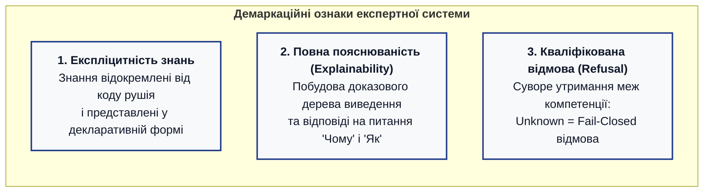
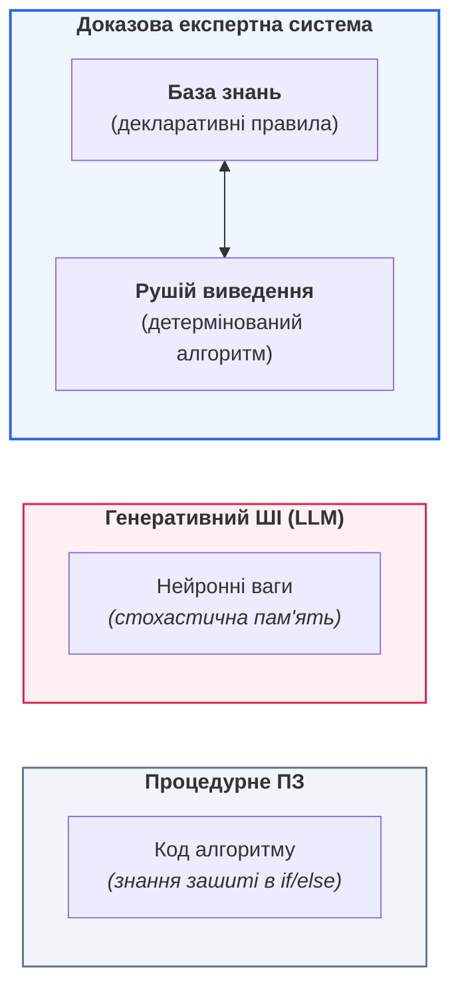
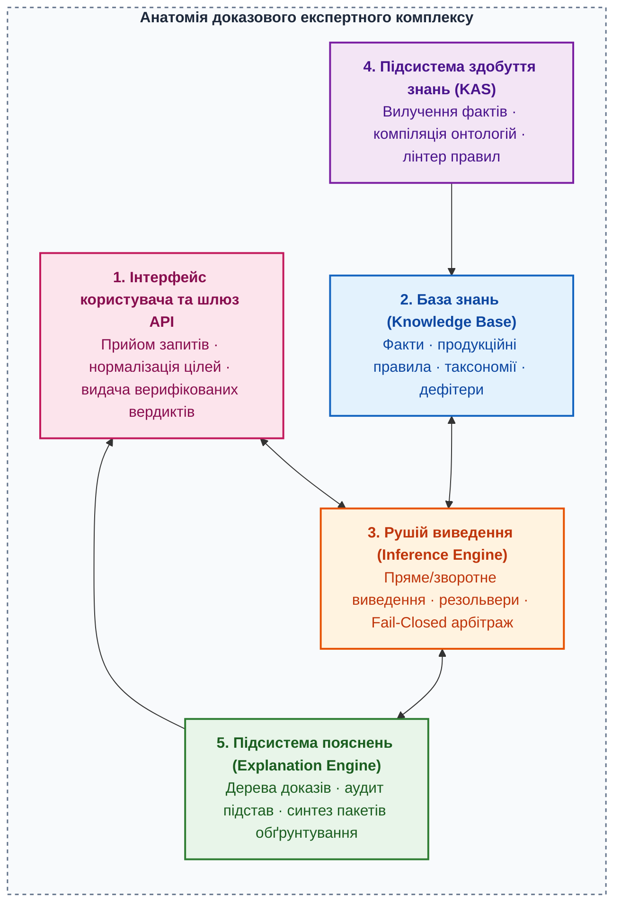
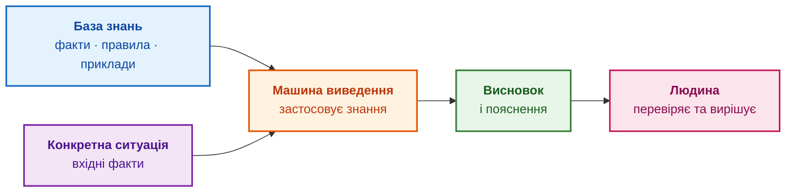

# Глава 1. Вступ до експертних систем: від хаосу до керованих знань

> **Книга:** [Архітектура доказових експертних систем](README.md) · [Частина I: Концептуальний та епістемічний фундамент](part-01-foundations.md)  
> **Попередня глава:** [Частина I. Концептуальний та епістемічний фундамент](part-01-foundations.md)  
> **Наступна глава:** [Глава 2. Філософія для інженера: що машина має право називати знанням](ch02-epistemology-of-machine-knowledge.md)  
> **Зміст книги:** [README.md](README.md)  
> **Автор:** [Микола Федчик](about-the-author.md)  
> **Рівень:** базовий інженерний  
> **Очікувані результати:** відрізняти перевірювану експертну відповідь від результату пошуку й відповіді чатбота; знати складники експертної системи та межі її відповідальності; оцінити, чи варто будувати експертну систему для задачі вашої команди; обрати маршрут читання книги.

## Анотація

У першій главі закладаються концептуальні, історичні та архітектурні засади доказових експертних систем, інженерії знань і детермінованого логічного виведення. Розглядається криза людської інженерної пам'яті в складних технологічних доменах і показано, чому традиційні інформаційно-пошукові каталоги та стохастичні генеративні мовні моделі не здатні нести юридичну й функціональну відповідальність за правильність рішень. Сформульовано строге визначення експертної системи через три демаркаційні ознаки: експліцитність знань, повну пояснюваність та здатність до кваліфікованої відмови від висновку за неповноти або суперечливості фактів.

Висвітлено історичну еволюцію експертних систем: від канонічних систем продукцій Еміля Поста, ідей Алана Тюрінга та перших практичних комплексів (DENDRAL [[1]](#src-1), MYCIN [[2]](#src-2)) через тріумф індустріальної конфігурації XCON [[7]](#src-7), комерційний бум та уроки «зими штучного інтелекту» до сучасного нейро-символьного ренесансу. Детально розібрано ключові архітектурні інваріанти доказових експертних систем, анатомію їхніх п'яти базових підсистем, чотири класичні парадигми формалізації знань, відповідальні сфери застосування з високою ціною помилки (автомобільна безпека ASIL-D [[6]](#src-6), авіоніка DO-178C, клінічні протоколи охорони здоров'я [[5]](#src-5), нормативний комплаєнс [[4]](#src-4)) та вектори переходу до апаратних процесорів знань у кремнії (EPU) й формальних математичних доказових свідків (Lean 4). Главу підсумовують систематизовані висновки, актуалізовані запитання для самоперевірки, архітектурний путівник сімома частинами монографії та віртуальний диспут з провідними теоретиками штучного інтелекту.

---

## 1. Проблематика та передумови: виникнення потреби в експертних системах 

Будь-яка сучасна високотехнологічна індустрія стикається з фундаментальним когнітивним бар'єром: **обсяг накопичених знань експоненційно перевищує фізіологічну пропускну здатність людського мозку**.

Уявімо типову інженерну ситуацію. Розробник вбудованої системи, відкриваючи модуль керування живленням `PowerSupervisor`, бачить константу `40` і стикається з виробничим питанням: *«Чи можна збільшити таймаут холодного старту до 60 мілісекунд для стабілізації низькотемпературного запуску?»*. Відповідь на це начебто просте запитання виявляється розпорошеною між:
- пунктом 7.3.2 стандарту функціональної безпеки ISO 26262;
- приміткою на 340-й сторінці апаратного даташиту мікроконтролера;
- протоколом випробувань трирічної давнини для ревізії C;
- коментарем до дефекту `BUG-817`;
- пам'яттю провідного архітектора, який пів року тому залишив компанію.

Людина в такій ситуації неминуче вдається до здогадок або спирається на неповні дані. Зіставимо результати, які інженер отримає від трьох принципово різних класів інструментів:

| Парадигма інструменту | Отримана відповідь | Що інженеру робити далі |
|---|---|---|
| **Пошук у документації** (Information Retrieval) | Знайдено вимогу `REQ-142`, дефект `BUG-817`, коментар у коді та 40 сторінок специфікації. | Самостійно прочитати всі знайдені документи, встановити актуальність редакцій і вручну провести міркування. |
| **Генеративна мовна модель** (діалогова система / чат-бот) | «Так, 60 мс є цілком безпечним значенням: вимоги стандарту зазвичай задають мінімум 50 мс». | З'ясувати походження числа 50. У реальності воно взяте зі скасованої чернетки, тобто відповідь є гладкою галюцинацією. |
| **Доказова експертна система** (Evidence-Governed ES) | «40 мс порушує правило `R-POWER-03` для ревізії C. Значення 60 мс задовольняє умові $t \ge 55\text{ мс}$, але зміна вимагає повторного тесту `TC-88`. Джерела: `REQ-142` v5, `ADR-31` v3. Рішення ухвалює інженер після проходження тесту». | Перевірити покроковий ланцюг за прямими цитатами першоджерел і запустити вказаний валідаційний тест. |

Жодна з відповідей автоматично не замінює відповідальності інженера. Проте, як констатує автор, відмінність є кардинальною: лише третю відповідь, надану експертною системою, можна верифікувати крок за кроком, спираючись на неспростовні докази, не повторюючи всього циклу розслідування. Пошук перекладає всю логіку виведення на людину. Генеративна мовна модель формулює висновок, але не здатна довести його істинність і часто посилається на неіснуючі джерела. Експертна система робить сам процес міркування прозорим, детермінованим і жорстко прив'язаним до чинних нормативів.

**Потреба в експертних системах виникає там, де ціна помилки несумісна зі стохастичними здогадками.** За спостереженнями та висновками автора, три об'єктивні фактори зумовили гостру потребу в таких системах сьогодні:
1. **Правдоподібний текст знецінився, вартість верифікації зросла:** генеративні нейромережі здатні за мілісекунди створити переконливий текст, але перевірка його достовірності вимагає від інженера більше часу, ніж самостійне виведення відповіді з першоджерел.
2. **Жорсткість регуляторних вимог:** Регламент ЄС про штучний інтелект (EU AI Act 2024/1689 [[4]](#src-4)), настанови щодо медичного софту (FDA CDS Guidance [[5]](#src-5)) та стандарти транспорту (ISO 26262 [[6]](#src-6), DO-178C) законодавчо вимагають наскрізної простежуваності, детермінізму та можливості аудиту кожного висновку людиною.
3. **Криза відчуження корпоративного досвіду:** життєвий цикл складних інженерних систем сягає десятиліть, тоді як ротація фахівців відбувається що кілька років. Експертна система стає єдиним дієвим засобом збереження інженерної пам'яті організації у формі верифікованих та виконуваних правил.

> [!NOTE]
> **Авторський аналітичний висновок: три фактори кризи знань та епістемічна перевага доказових систем**  
> За висновком автора, необхідність переходу до доказових експертних систем зумовлена трьома критичними факторами:
> 1. **Девальвація правдоподібного тексту та асиметрія верифікації:** генеративні нейромережі створюють текст за мілісекунди, але його експертна перевірка людиною вимагає більше часу, ніж самостійне виведення з першоджерел.
> 2. **Законодавча імперативність детермінізму:** міжнародні стандарти та регламенти (EU AI Act 2024/1689, ISO 26262 ASIL-D, FDA CDS, DO-178C) юридично зобов'язують забезпечувати наскрізну простежуваність та покроковий аудит кожного висновку.
> 3. **Криза відчуження корпоративного досвіду:** тривалість життєвого циклу інженерних виробів (десятиліття) перевищує період ротації фахівців, що робить експертну систему єдиним засобом збереження інженерної пам'яті у вигляді виконуваних правил.
> 
> *Епістемічна перевага:* на відміну від пошуку (що перекладає логіку на людину) та мовних моделей (схильних до галюцинацій), доказова система робить виведення детермінованим, прозорим і верифікованим за першоджерелами.

---

## 2. Дефініція та епістемічна сутність: що таке експертна система 

В академічній та прикладній літературі зустрічаються різноманітні визначення, проте в розробленій автором інженерії доказових експертних систем застосовується така строга дефініція:

> **Експертна система (Expert System)** — це інтелектуальна обчислювальна система, яка акумулює формалізовані знання людей-експертів у визначеній предметній області та здатна за допомогою детермінованих алгоритмів логічного виведення розв'язувати складні аналітичні, діагностичні й управлінські задачі на рівні кваліфікованого фахівця, надаючи повне пояснення підстав свого рішення.

На відміну від класичного процедурного коду, де бізнес-правила «зашиті» всередині монолітних алгоритмів численними операторами розгалуження, та на відміну від нейронних мереж, де знання розчинені у неінтерпретованих числових вагах «чорної скриньки», доказова експертна система базується на трьох непорушних демаркаційних засадах, сформульованих автором:

1. **Експліцитність знань:** знання предметної області повністю відокремлені від механізму обчислень. Вони подані у зрозумілому для людини та машини декларативному вигляді (правила, онтології, факти, обмеження), що дозволяє модифікувати базу знань без переписування й перекомпіляції програмного ядра експертної системи.
2. **Пояснюваність (Explainability):** експертна система не виносить голослівних вердиктів. Кожне твердження супроводжується аудиторським ланцюгом міркувань: які саме факти спрацювали, які правила були застосовані, які альтернативи були відкинуті та на які конкретні ревізії документів посилається результат.
3. **Кваліфікована відмова від відповіді (Fail-Closed Gate):** експертна система чітко утримує межі власної компетенції. Якщо вхідна ситуація виходить за рамки закладених правил або вхідні дані є суперечливими, система повертає типізовану відмову (`REFUSAL` або `CLARIFICATION`), блокуючи генерацію здогадок чи правдоподібних вигадок ($ZHR = 1.00$).

Вкрай важливо також розрізняти три споріднені, але не тотожні категорії, демарковані автором:
* **Компетентність (Expertise):** сукупність верифікованих знань та здатності формулювати обґрунтовані рекомендації у визначеному домені.
* **Повноваження (Authority):** формальне право ухвалювати зобов'язуюче рішення (наприклад, санкціонувати реліз чи призначити лікування), яке завжди залишається за визначеною відповідальною людиною.
* **Доказовість (Evidence):** фізично зафіксований першоджерельний факт (норматив, лог, даташит), що має побайтову кастодію і не може бути спотворений під час інтерпретації.

> [!NOTE]
> **Авторська теоретична дефініція: три демаркаційні засади та тріада відповідальності**  
> Сформульоване автором визначення доказової експертної системи базується на строгому розмежуванні:
> 
> *Три непорушні демаркаційні засади:*
> 1. **Повна експліцитність знань:** декларативне відокремлення бази знань від коду рушія логічного виведення (правила, онтології, обмеження).
> 2. **Покрокова пояснюваність (Explainability):** обов'язкова побудова графа доведення та надання аудиторського сліду підстав для кожного висновку.
> 3. **Шлюз гарантованої відмови (Fail-Closed Gate):** суворе утримання меж компетенції; за неповноти чи суперечливості фактів — обов'язкова типізована відмова (`REFUSAL`/`CLARIFICATION`, $ZHR = 1{,}00$).
> 
> *Тріада відповідальності:*
> * **Компетентність (Expertise):** алгоритмічний розрахунок і синтез верифікованої рекомендації обчислювальною системою.
> * **Повноваження (Authority):** виключне юридичне право та відповідальність людини за ухвалення остаточного рішення.
> * **Доказовість (Evidence):** незмінна побайтова кастодія першоджерел (`byte_start`, `byte_end`, `quote_sha256`).

---

## 3. Історія та еволюція: від математичної логіки до сучасного ренесансу 

Еволюція експертних систем налічує понад вісім десятиліть драматичного наукового пошуку, підйомів, криз та концептуального переосмислення:

1. **Логіко-математичний фундамент (1930–1950-ті роки):**  
   Ще у 1943 році математик Еміль Пост сформулював канонічні системи продукцій, довівши, що будь-який обчислювальний процес можна звести до підстановки рядків за формальними правилами переписування. Алан Тюрінг, Клод Шеннон та Норберт Вінер заклали засади кібернетики та теорії інформації. У 1965 році Джон Алан Робінсон створив принцип резолюції та алгоритм уніфікації (MGU), відкривши шлях до автоматичного доведення теорем у численні предикатів першого порядку.
2. **Перша хвиля та народження інженерії знань (1965–1970-ті роки):**  
   Перехід від спроб створити універсальний штучний інтелект (General Problem Solver) до накопичення спеціалізованих предметних знань:
   - **DENDRAL (1965, Едвард Фейгенбаум, Джошуа Ледерберг):** перша експертна система у Стенфордському університеті, що визначала молекулярну будову хімічних сполук за даними мас-спектрометрії [[1]](#src-1).
   - **MYCIN (1972, Едвард Шортліфф):** експертна система діагностики інфекційних захворювань крові та менінгіту. MYCIN вперше реалізувала відділення правил від інтерпретатора, запровадила коефіцієнти впевненості (Certainty Factors) та механізм трасування пояснень міркувань [[2]](#src-2).
   - Едвард Фейгенбаум канонізує термін **«Інженерія знань» (Knowledge Engineering)** як науково-інженерну дисципліну перенесення експертного досвіду в комп'ютерні моделі [[3]](#src-3).
3. **Комерційний бум та індустріалізація (1980–1988 роки):**  
   Широке впровадження систем на виробництві. Програма **R1/XCON** Джона Макдермотта в компанії DEC автоматизувала конфігурацію серверних систем VAX, заощаджуючи понад 40 мільйонів доларів щорічно [[7]](#src-7). З'являються комерційні оболонки (Shells) та спеціалізовані LISP-машини (Symbolics, LMI, Texas Instruments).
4. **«Зима штучного інтелекту» та криза першого покоління (кінець 1980-х – 1990-ті роки):**  
   Бурхливий розвиток зіткнувся з об'єктивними інженерними бар'єрами:
   - *Вузьке місце здобуття знань (Knowledge Acquisition Bottleneck):* ручне кодування тисяч правил через тривалі інтерв'ю з експертами виявилося нестерпно дорогим і повільним процесом.
   - *Крихкість на межах (Brittleness):* класичні експертні системи не вміли деградувати поступово; найменший вихід за рамки набору правил спричиняв фатальні збої.
   - *Криза супроводу баз знань:* бази з понад 10 000 правил ставали хаотичними через приховані суперечності, відсутність версійності та модульності.
   - *Крах спеціалізованого обладнання:* дорогі LISP-машини програли технологічні перегони процесорам загального призначення архітектури x86.
5. **Сучасний нейро-символьний ренесанс (2020-ті роки – дотепер):**  
   Тріумф великих мовних моделей не усунув експертні системи, а навпаки — створив умови для їхнього якісного відродження. Стохастичні мовні моделі ефективно долають «вузьке місце здобуття знань», швидко опрацьовуючи гігабайти сирої документації, тоді як символьне ядро експертної системи бере на себе функцію безапеляційного детермінованого верифікатора, гарантуючи нульовий рівень галюцинацій та відповідність суворим сертифікаційним вимогам.

---

## 4. Основні архітектурні ознаки доказової експертної системи 

Доказова експертна система суттєво відрізняється як від класичного монолітного програмного забезпечення, так і від сучасних генеративних конвеєрів із пошуковим доповненням (RAG):

Головні архітектурні інваріанти доказової експертної системи, сформульовані автором:

* **Ортогональність знань і механізму виведення:** рушій логічного виведення є інваріантним та універсальним. Знання є зовнішніми структурованими даними. Зміна нормативного регламенту виконується як версійне оновлення декларативного пакета бази знань без модифікації та перекомпіляції ядра експертної системи.
* **Нейро-символьний розподіл обов'язків: розмежування релевантності та нормативного допуску (Relevance проти Eligibility):**
  - *Ймовірнісні моделі сприйняття (рівень сприйняття):* відповідають виключно за **релевантність** — пошук евристичних контекстів, виділення наміру користувача з природної мови, вилучення кандидатів у факти з неструктурованих текстів.
  - *Детерміновані символьні рушії (нормативний рівень експертної системи):* відповідають виключно за **нормативний допуск** — сувору перевірку відповідності правилам, верифікацію інваріантів безпеки та право безумовного вето. Жодна ймовірнісна нейромережева модель не має права самостійно ухвалювати остаточне рішення чи санкціонувати дію.
* **Побайтове заземлення фактів у першоджерелах (Evidence Custody):** будь-яке атомарне твердження в базі знань експертної системи повинно спиратися на дослівну цитату з незмінного першоджерела з фіксацією точних байтових меж `[byte_start, byte_end]` та криптографічного гешу `sha256`. Висновок, що не пройшов побайтову перевірку автентичності, математично не може бути згенерований експертною системою.
* **Принцип гарантованої безпеки за неповноти даних (Fail-Closed Gate):** у разі відсутності правила, неповноти або суперечливості фактів експертна система детерміновано повертає типізовану відмову (`REFUSAL`), унеможливлюючи генерацію необґрунтованих здогадок ($ZHR = 1.00$).

> [!NOTE]
> **Авторська інженерна модель: чотири архітектурні інваріанти доказовості (Evidence-Grounded Invariants)**  
> На думку автора, надійність критичних експертних систем гарантується суворим виконанням чотирьох архітектурних інваріантів:
> 1. **Ортогональність знань і механізму виведення:** універсальний детермінований рушій логічного виведення повністю ізольований від декларативної бази знань; модифікація правил відбувається без зміни чи перекомпіляції програмного ядра.
> 2. **Нейро-символьний розподіл обов'язків (Relevance проти Eligibility):** моделі машинного навчання відповідають виключно за евристику й релевантність (пошук кандидатів, вилучення наміру), тоді як символьне ядро одноосібно забезпечує нормативний допуск і має право безумовного вето.
> 3. **Побайтова кастодія фактів (Evidence Custody):** кожне атомарне твердження жорстко заземлене в першоджерелі через точні байтові межі `[byte_start, byte_end]` та криптографічний геш `sha256`.
> 4. **Шлюз гарантованої безпеки (Fail-Closed Gate):** за будь-якої неповноти, суперечливості чи відсутності знань система повертає детерміновану типізовану відмову (`REFUSAL`), забезпечуючи нульову толерантність до галюцинацій ($ZHR = 1{,}00$).

---

## 5. Анатомія експертної системи: п'ять базових підсистем 

Повнофункціональний комплекс доказової експертної системи об'єднує п'ять взаємодіючих підсистем:

1. **База знань (Knowledge Base):** структуроване сховище формалізованого досвіду. Містить онтологічні класи, відношення, таблиці рішень, декларативні продукційні правила та спростовні аргументи (дефітери).
2. **Рушій логічного виведення (Inference Engine):** детермінований обчислювач, який зіставляє вхідні спостереження з правилами бази знань. Підтримує стратегії прямого виведення (Forward Chaining — від відомих фактів до нових висновків) та зворотного виведення (Backward Chaining — від цільової гіпотези до пошуку підтверджувальних фактів).
3. **Підсистема пояснень (Explanation Engine):** інтелектуальний реєстратор ходу міркувань експертної системи. Фіксує послідовність активації правил і генерує для користувача дерево доказів, відповідаючи на запитання: *«Чому система дійшла такого висновку?»* та *«Чому було відхилено альтернативне рішення?»*.
4. **Підсистема здобуття знань (Knowledge Acquisition System, KAS):** конвеєр трансформації сирих інженерних корпусів (стандартів, даташитів, регламентів) у машиночитний верифікований формат бази знань.
5. **Інтерфейс користувача та інтеграційний шлюз (UI / API):** шар комунікації, що забезпечує взаємодію з людиною-оператором, бізнес-системами підприємства або виконавчими контролерами кіберфізичних комплексів.

Для інтуїтивного сприйняття принципу дії експертної системи достатньо розглянути її взаємодію з людиною на найпростішій концептуальній моделі. Експертна система не підміняє людську волю й не ухвалює остаточних зобов'язуючих рішень самостійно. Вона вилучає декларативні правила з бази знань, зіставляє їх із вхідними фактами конкретної робочої ситуації, виводить обґрунтовану рекомендацію й передає повний ланцюг доказів фахівцю, який ухвалює рішення та несе за нього персональну відповідальність:

Такий розподіл ролей гарантує, що експертна система залишається надійним, підконтрольним людині інструментом інтелектуальної підтримки рішень, у якому кожен крок міркування є прозорим і доступним для покрокового аудиту.

---

## 6. Загальні способи та моделі побудови 

Залежно від специфіки домену та природи формалізованого досвіду в інженерії знань виділяють чотири класичні парадигми:

1. **Продукційні системи (Production Rule Systems):**  
   Базуються на правилах вигляду $IF \ \langle \text{умова} \rangle \ THEN \ \langle \text{дія/висновок} \rangle$. Для миттєвого зіставлення сотень тисяч правил із потоком фактів застосовуються високоефективні алгоритми перехресного індексування мереж пам'яті класу **Rete** (Чарльз Форгі, 1979) та **TREAT**.
2. **Фреймові та об'єктно-орієнтовані моделі (Frame Systems):**  
   Запропоновані Марвіном Мінським у 1974 році. Знання групуються навколо концептуальних вузлів — «фреймів», які володіють атрибутами («слотами»), успадкуванням за таксономією та процедурними демонами (тригерами, що автоматично спрацьовують при читанні або зміні значення слота).
3. **Логічні моделі та формальні онтології (Predicate Logic & Datalog):**  
   Знання записуються у вигляді строгої математичної логіки першого порядку або диз'юнктів Хорна. Виведення базується на автоматичній резолюції та уніфікації. Сучасні втілення — мови сімейства Semantic Web (OWL, RDF, SPARQL) та дедуктивні бази даних Datalog.
4. **Спростовні моделі аргументації (Defeasible Reasoning & ASPIC+):**  
   Спеціалізований апарат немонотонної логіки, створений для моделювання інженерних суперечностей та нормативних колізій. Правила вважаються чинними доти, доки не з'явиться сильніший аргумент-спростувач (дефітер). Це дозволяє експертній системі динамічно переглядати попередні гіпотези без руйнування цілісності всієї бази знань.

---

## 7. Основні галузі застосування з високою ціною помилки 

Доказові експертні системи знаходять своє застосування там, де стохастична галюцинація несе пряму загрозу життю людей, національній безпеці або веде до катастрофічних фінансових втрат:

* **Функціональна безпека транспорту та авіоніка (ISO 26262 ASIL-D [[6]](#src-6), DO-178C DAL-A, DO-254):** апаратні інтерлоки та цензори критичних рішень у безпілотних автомобілях, системах керування тягою потягів та бортових авіаційних автопілотах.
* **Охорона здоров'я та клінічні протоколи (FDA CDS Guidance [[5]](#src-5)):** контроль сумісності фармакологічних препаратів, автоматизована верифікація дозувань анестетиків та перевірка схем хіміотерапії згідно з нормативними настановами МОЗ.
* **Критична енергетична інфраструктура:** телеметрична діагностика трансформаторних підстанцій, турбогенераторів атомних електростанцій та автоматичне локалізування аварійних сегментів енергомережі в реальному часі.
* **Юриспруденція, фінансовий нагляд та комплаєнс-аудит (EU AI Act [[4]](#src-4), GDPR, AML):** моніторинг міжнародних фінансових транзакцій, автоматизований аудит контрактів на відповідність антимонопольному законодавству та сертифікація ланцюгів постачання.
* **Оборонні системи та автономна робототехніка:** прийняття рішень автономними комплексами в умовах повної радіоелектронної ізоляції та придушення супутникової навігації (GNSS-Denied), де критично важлива побайтова кастодія наказів та правил ведення дій.

---

## 8. Перспективи розвитку: від програмних правил до кремнієвих процесорів знань 

Майбутнє доказових експертних систем, за висунутою автором інженерною гіпотезою, формується на стику дискретної математики, кремнієвої мікроелектроніки та формальних методів:

1. **Апаратні процесори знань (Epistemic Processing Units, EPU):**  
   Подібно до того, як графічні процесори (GPU) та тензорні прискорювачі (NPU) оптимізовані під матричне множення, сучасні доказові експертні системи рухаються до прямої реалізації рушіїв виведення у кремнії (FPGA та спеціалізовані ASIC). Інструкції перевірки фактів, зіставлення онтологічних предикатів та обчислення гешів виконуються за фіксовані такти апаратного конвеєра (латентність до 80 нс), що дозволяє інтегрувати символьні цензори безпосередньо в цикли керування жорсткого реального часу.
2. **Математичні свідки доведення (Automated Proof Witnesses):**  
   Інтеграція експертних систем із мовами інтерактивного доведення теорем (**Lean 4**, **Coq**) та SMT-резольверами (**Z3**). Рішення експертної системи не просто супроводжується текстовим поясненням, а формує криптографічно підписаний математичний сертифікат доказу, який може бути незалежно перевірений стороннім мінімалістичним пруф-чекером.

> [!NOTE]
> **Авторська інженерна концепція: апаратні процесори знань (EPU) та свідки формального доведення**  
> Запропонована автором інженерна концепція базується на двох взаємодоповнюючих компонентах:
> 1. **Кремнієві процесори знань (Epistemic Processing Units, EPU):** апаратний конвеєр логічного виведення у FPGA/ASIC із фіксованою детермінованою латентністю (до 80 нс), що уможливлює роботу символьного цензора в циклах керування жорсткого реального часу.
> 2. **Математичні свідки доведення (Automated Proof Witnesses):** інтеграція рушія з пруф-асистентами (Lean 4) та SMT-резольверами (Z3) для генерації криптографічно підписаних машинозчитуваних сертифікатів доказу на кожен винесений вердикт.

---

## 9. Архітектурна панорама монографії: путівник сімома частинами 

Матеріал монографії розгортається від теоретичного базису до кремнієвої реалізації та структурований у сім логічних частин: **Частина I** закладає концептуальний та епістемічний фундамент знання і доказовості; **Частина II** розкриває математичні моделі ґраток, типологію баз знань та інженерні графи простежуваності EKG; **Частина III** озброює методами автоматизованого здобуття знань, обробки природної мови й формалізації вимог; **Частина IV** деталізує системну архітектуру, технологічний стек, рушій пояснень та кібернетику прийняття рішень; **Частина V** фокусується на строгій верифікації правил, системній діагностиці та формуванні аргументаційних дерев безпеки (GSN); **Частина VI** досліджує когнітивні фронтири через синергію нейро-символьних моделей (NeSy) та кремнієвих прискорювачів знань (EPU); нарешті, **Частина VII** розгортає розподілені епістемічні архітектури, піраміду тестування знань та активний попперівський фальсифікаційний аудит. Повний каталог глав, детальний зміст та спеціалізовані маршрути вивчення наведено у загальному вступі до книги ([README.md](README.md)).

---

## 10. Діалог Pro et Contra 

> **Епістемічна преамбула та академічний дисклеймер:**  
> Цей розділ моделює віртуальну інтелектуальну дискусію щодо історичного фундаменту, системних меж та обґрунтування доцільності сучасної модернізації експертних систем. До діалогу запрошено фундаторів галузі та авторів канонічних монографій з інженерії знань: лауреата премії Тюрінга **Едварда Фейгенбаума (Edward Feigenbaum)** — творця системи DENDRAL та автора концепції інженерії знань; **Едварда Шортліффа (Edward H. Shortliffe)** — автора системи MYCIN, піонера пояснюваного виведення та факторизації невизначеності; а також **Фредеріка Гейз-Рота (Frederick Hayes-Roth)** — головного редактора та співавтора класичного підручника *Building Expert Systems* (1983).  
> *Дисклеймер:* Ця дискусія є змодельованим науковим синтезом на основі фундаментальних праць запрошених корифейових дослідників і слугує дидактичним обґрунтуванням необхідності якісного переходу від систем першого покоління до сучасних доказових експертних комплексів. Кожен візаві веде діалог безпосередньо з автором монографії.

**Теза глави (Микола Федчик):**  
Класична парадигма експертних систем не є пройденим етапом, а становить незамінний фундамент надійного штучного інтелекту: поєднання символьного детермінізму, експліцитності знань та повної пояснюваності першого покоління із сучасними методами автоматизованого здобуття знань, графовими онтологіями та формальною верифікацією робить модернізацію експертних систем безальтернативною для критичних галузей з нульовою толерантністю до галюцинацій.

**Діалог з Едвардом Фейгенбаумом: чи залишається чинним принцип «Сила — в знаннях» в епоху статистичних моделей?**

- **Едвард Фейгенбаум (Edward Feigenbaum):**  
  *«Миколо Федчику, у 1970-х роках у Стенфорді ми сформулювали фундаментальну гіпотезу інженерії знань: "Сила інтелектуальної системи походить не від витончених методів пошуку чи універсальних логічних числень, а від обсягу та якості специфічних предметних знань (Knowledge is Power)". Проте сьогодні мода змістилася в протилежний бік: багатомільярдні мовні моделі намагаються розв'язувати задачі виключно за рахунок гігантських обчислень та асоціативної пам'яті числових ваг. Чи не вважаєте ви, що наша гіпотеза програла гонку "обчислювальному брутфорсу", і чи є взагалі сенс відроджувати явні бази знань?»*

- **Микола Федчик:**  
  *«Пане професоре Фейгенбаум, ваша гіпотеза не просто вистояла — вона сьогодні переживає драматичне підтвердження.  
  Коли статистичні моделі стикаються з критичними інженерними задачами без явних знань, вони зазнають системного фіаско, генеруючи небезпечні галюцинації замість фактів. Спроба підмінити знання ймовірнісною асоціативністю веде в глухий кут.  
  Ба більше: сучасні мовні моделі стали ідеальним інструментом для подолання проблеми, яку саме ви назвали "вузьким місцем здобуття знань" (Knowledge Acquisition Bottleneck). Вони здатні швидко читати інженерні тексти й вилучати кандидатів у правила. Але остаточна сила системи й сьогодні криється у верифікованій, експліцитній базі знань, де кожен факт має власника, версію та перевірені межі застосування».*

**Діалог з Едвардом Шортліффом: чи потрібне строге трасування правил, коли нейромережі генерують правдоподібні тексти?**

- **Едвард Шортліфф (Edward H. Shortliffe):**  
  *«Миколо, коли ми проєктували MYCIN, ключовою вимогою лікарів була прозорість: клініцист ніколи не призначить токсичний антибіотик за порадою комп'ютера, якщо програма не здатна пояснити, які саме симптоми та бактеріологічні культури привели до висновку. Ми створили рушій пояснень на базі трасування спрацьованих правил. Проте сьогодні генеративні моделі здатні складати витончені, граматично бездоганні текстові виправдання на будь-яке запитання. Чи є сенс ускладнювати архітектуру жорсткими детермінованими деревами доказів, якщо користувачів часто задовольняє гладке словесне пояснення?»*

- **Микола Федчик:**  
  *«Пане докторе Шортліфф, різниця між цими підходами — це прірва між істиною та обманом.  
  Текстові виправдання нейромереж є раціоналізацією постфактум (post-hoc rationalization): вони описують не те, як модель реально рахувала числовий результат у латентному просторі, а лише те, що звучить переконливо для людини. Це створює смертоносну ілюзію довіри.  
  Ваш принцип, закладений у MYCIN, є єдино правильним: пояснення повинно бути ізоморфним реальному процесу виведення. У нашій модернізованій архітектурі підсистема пояснень формує математично строгий аудиторський пакет (Proof Bundle): кожен крок міркування посилається на конкретне активоване правило та дослівну цитату першоджерела з точними байтовими межами. Лікар або інженер бачить не літературну імпровізацію, а юридично зобов'язуючий ланцюг доказів».*

**Діалог з Фредеріком Гейз-Ротом: як уникнути колапсу масштабування та крихкості першого покоління?**

- **Фредерік Гейз-Рот (Frederick Hayes-Roth):**  
  *«Миколо, у нашій праці "Building Expert Systems" (1983) ми оптимістично систематизували інженерію знань, але кінець 1980-х років приніс жорстоке протверезіння. Коли бази знань розросталися понад 10 000 правил, вони колапсували: виникали приховані суперечності, експерти не могли узгодити пріоритети, а на межах закладених умов системи демонстрували катастрофічну крихкість (brittleness). Чому ви впевнені, що пропонована вами модернізація не повторить цей самий цикл розчарування та не спричинить чергову "зиму знань"?»*

- **Микола Федчик:**  
  *«Пане професоре Гейз-Рот, криза систем першого покоління була наслідком не хибності концепції, а незрілості тодішньої інженерної інфраструктури.  
  По-перше, знання тоді зберігалися як неструктуровані монолітні масиви правил без модульності, версійного контролю та тестів. Ми модернізуємо цей підхід на засадах парадигми "Знання як код" (Knowledge as Code): кожне правило має семантичну версію, залежності в інженерному графі знань (EKG) та проходить суворе автоматизоване регресійне тестування у конвеєрах CI/CD.  
  По-друге, замість наївної монотонної логіки ми спираємося на апарат спростовної аргументації (ASPIC+), що математично коректно розв'язує конфлікти правил через механізм дефітерів.  
  По-третє, ми замінили неконтрольовану крихкість на принцип захисного блокування (Fail-Closed Gate): система не ламається на незнайомих фактах, а повертає типізовану кваліфіковану відмову (`REFUSAL`). Нарешті, апаратні процесори знань (EPU) у кремнії усувають проблему швидкодії, перетворюючи експертні системи на надійний фундамент для промисловості XXI століття».*

**Синтез та науковий вердикт глави:**  
Віртуальний диспут класиків підтверджує: фундаментальні принципи інженерії знань — примат експліцитних фактів за Фейгенбаумом, невіддільність пояснення від виведення за Шортліффом та системна типологія задач за Гейз-Ротом — залишаються непорушними. Модернізація доказових експертних систем надає класичній спадщині новий технологічний базис: сучасне подолання вузького місця здобуття знань, захист від галюцинацій та кремнієве апаратне виконання.

---

## Висновки

1. **Епістемічна демаркація експертних систем:** Пошукові інформаційні системи перекладають увесь тягар аналізу та логічного зіставлення фактів на людину, а сучасні генеративні мовні моделі продукують правдоподібні тексти без математичних гарантій істинності. На противагу їм, доказова експертна система перетворює процес розв'язання задачі на прозоре, детерміноване та верифіковане логічне виведення, де кожен крок спирається на явні правила та незмінні першоджерела.
2. **Три фундаментальні ознаки експертної системи:** Комплекс визначається не обсягом коду чи складною евристикою, а трьома системними якостями: повною експліцитністю знань (відділення бази правил від обчислювача), всебічною пояснюваністю рішень (побудова інспектованих дерев доказів «Чому» і «Як») та обов'язковою кваліфікованою відмовою від відповіді за браку або суперечливості фактів (принцип захисного блокування Fail-Closed).
3. **Історичний досвід та нейро-символьне відродження:** Криза першого покоління систем («зима штучного інтелекту» кінця 1980-х років) була зумовлена вузьким місцем ручного здобуття знань, крихкістю правил на межах предметної області та дорожнечею вузькоспеціалізованих комп'ютерів. Сучасний ренесанс розв'язує ці суперечності через синергію: великі мовні моделі беруть на себе первинне автоматизоване читання інженерних корпусів документації, тоді як символьне ядро експертної системи виступає непереборним нормативним арбітром, що гарантує стовідсоткову відсутність вигадок і галюцинацій ($ZHR = 1.00$).
4. **Нейро-символьний розподіл за релевантністю та нормативним допуском:** В архітектурі доказових комплексів запроваджено строгий поділ обов'язків. Ймовірнісні моделі сприйняття відповідають виключно за релевантність — виділення наміру користувача та первинний відбір контексту. Символьний рушій експертної системи відповідає виключно за нормативний допуск — сувору верифікацію правил, дотримання контрактів безпеки та право безумовного вето.
5. **Ортогональність знань та анатомія п'яти підсистем:** Архітектура експертного комплексу спирається на п'ять взаємопов'язаних модулів (База знань, Рушій логічного виведення, Підсистема пояснень, Підсистема здобуття знань та Інтерфейс користувача й інтеграційний шлюз). Головним інженерним імперативом є повна незалежність декларативних знань від виконуваного коду рушія: зміна регламентів чи стандартів здійснюється як версійне оновлення бази знань без перекомпіляції програмного ядра.
6. **Багатоманітність моделей подання знань:** Залежно від вимог предметної області експертна система застосовує продукційні правила зі швидкісними мережами зіставлення шаблонів (класу Rete), фреймові ієрархічні структури з процедурними тригерами, дедуктивні логічні бази чи математичний апарат спростовної аргументації (ASPIC+), здатний моделювати реальні інженерні конфлікти й переглядати висновки без втрати цілісності системи.
7. **Критичні домени високої відповідальності:** Доказові експертні системи є безальтернативними там, де ймовірнісна помилка загрожує життю людей або завдає непоправних збитків: у функціональній безпеці транспорту (ASIL-D, DO-178C), охороні здоров'я та фармакології, оперативному захисті енергомереж, нормативному комплаєнсі та автономних роботизованих комплексах в умовах повної радіоелектронної ізоляції.
8. **Кремнієва кристалізація та математична верифікація:** Еволюційний вектор розвитку доказових систем спрямований на пряме перенесення детермінованих інструкцій виведення у кремній — створення спеціалізованих апаратних процесорів знань (EPU на базі FPGA/ASIC) із гарантованим часом реакції до 80 наносекунд для систем жорсткого реального часу, а також на інтеграцію з інтерактивними доказувачами теорем (Lean 4) для формування криптографічно засвідчених сертифікатів істинності рішень.

---

## Запитання для самоперевірки

1. **Епістемічна демаркація:** У чому полягає принципова різниця в розподілі відповідальності за правильність рішення між пошуковими каталогами, генеративними мовними моделями та доказовими експертними системами?
2. **Демаркаційні критерії:** Назвіть три головні ознаки, які відрізняють експертну систему від звичайного процедурного коду з розгалуженнями `if-else` та від нейромережевої «чорної скриньки».
3. **Історичні уроки:** Які три ключові інженерні обмеження спричинили настання «зими штучного інтелекту» наприкінці 1980-х років, і як сучасні мовні моделі та графові платформи допомагають подолати ці історичні бар'єри?
4. **Принцип ортогональності:** Чому в інженерії знань критично важливо забезпечити повне відокремлення декларативної бази знань від алгоритмічного коду рушія виведення? Які переваги це дає при сертифікації та супроводі продукту?
5. **Розподіл функцій:** Як в архітектурі доказової системи взаємодіють підсистеми релевантності (Relevance) та нормативного допуску (Eligibility)? Чому генеративній моделі категорично заборонено надавати право ухвалення фінального вердикту?
6. **Побайтова кастодія:** Що означає вимога побайтового заземлення фактів (Evidence Custody) і як вона запобігає виникненню прихованих галюцинацій у базі знань?
7. **Анатомія підсистем:** Опишіть ролі кожної з п'яти базових підсистем експертного комплексу. Як саме підсистема пояснень формує обґрунтування для запитань «Чому саме цей висновок?» та «Чому було відхилено альтернативу?»?
8. **Моделі знань:** За яких умов для формалізації інженерного домену доцільніше обрати продукційні правила (Rete), а коли необхідне застосування спростовної аргументації (ASPIC+)?
9. **Захисне блокування:** Що повинно відбутися в доказовій експертній системі, якщо для вхідної комбінації фактів у базі знань відсутнє правило: евристична екстраполяція чи типізована кваліфікована відмова? Який безпековий маневр активується у кіберфізичних системах?
10. **Апаратне майбутнє:** Чому програмна інтерпретація правил на стандартних процесорах загального призначення виявляється недостатньою для критичних систем реального часу (ASIL-D), і які задачі вирішують апаратні процесори знань (EPU) у кремнії?

---

## Словник

| Термін | Англійський еквівалент | Визначення |
|---|---|---|
| **Експертна система** | *Expert System* | Інтелектуальна система, що застосовує формалізовані знання експертів для розв'язання задач предметної області з повним поясненням висновків. |
| **База знань** | *Knowledge Base (KB)* | Структуроване сховище декларативних фактів, правил, онтологій та дефітерів, придатних для машинного виведення. |
| **Рушій виведення** | *Inference Engine* | Детермінований алгоритмічний механізм, що зіставляє вхідні факти з правилами бази знань для отримання нових тверджень. |
| **Підсистема пояснень** | *Explanation Engine* | Модуль трасування міркувань, що трансформує активовані правила в дерево доказів, відповідаючи на запитання «Чому» і «Як». |
| **Підсистема здобуття знань** | *Knowledge Acquisition System (KAS)* | Комплекс інструментів для вилучення, структурування, валідації та компіляції знань із першоджерел у формат бази знань. |
| **Кваліфікована відмова** | *Qualified Refusal* | Детерміноване повернення системою статусу `REFUSAL` за неповноти, неоднозначності або суперечливості фактів. |
| **Побайтове заземлення** | *Evidence Grounding* | Прив'язка кожного факту та правила до точних байтових меж `[byte_start, byte_end]` та гешу першоджерела. |
| **Продукційне правило** | *Production Rule* | Формальний вираз вигляду $IF \ \langle \text{умова} \rangle \ THEN \ \langle \text{дія} \rangle$. |
| **Спростовне міркування** | *Defeasible Reasoning* | Форма немонотонної логіки, в якій висновки можуть бути спростовані або переглянуті при надходженні нових фактів (дефітерів). |

---

## Абревіатури

| Абревіатура | Розшифрування | Опис |
|---|---|---|
| **ASIL** | Automotive Safety Integrity Level | Рівень повноти безпеки автомобіля (ISO 26262, рівні від A до найвищого D). |
| **DAL** | Development Assurance Level | Рівень гарантії розробки програмного забезпечення в авіоніці (DO-178C, від E до найвищого A). |
| **EKG** | Engineering Knowledge Graph | Інженерний граф знань, що відображає простежуваність артефактів проєкту. |
| **EPU** | Epistemic Processing Unit | Кремнієвий процесор знань для апаратного виконання інструкцій логічного виведення. |
| **GOFAI** | Good Old-Fashioned Artificial Intelligence | Класичний символьний штучний інтелект на основі правил і логіки. |
| **KAS** | Knowledge Acquisition System | Підсистема здобуття та формалізації знань. |
| **LLM** | Large Language Model | Велика мовна модель на основі архітектури трансформер. |
| **NeSy** | Neuro-Symbolic AI | Нейро-символьний штучний інтелект, що поєднує нейромережі та символьну логіку. |
| **ZHR** | Zero-Hallucination Rate | Метрика відсутності галюцинацій ($ZHR = 1.00$ означає 100% доведеність відповідей). |

---

## Джерела

1. Robert K. Lindsay, Bruce G. Buchanan, Edward A. Feigenbaum, Joshua Lederberg. [*DENDRAL: A Case Study of the First Expert System for Scientific Hypothesis Formation*](https://doi.org/10.1016/0004-3702(93)90068-M). *Artificial Intelligence*, 61(2), 209–261, 1993.
2. Bruce G. Buchanan, Edward H. Shortliffe (ред.). [*Rule-Based Expert Systems: The MYCIN Experiments of the Stanford Heuristic Programming Project*](https://www.shortliffe.net/Buchanan-Shortliffe-1984/MYCIN%20Book.htm). Addison-Wesley, 1984.
3. Edward A. Feigenbaum. [*The Art of Artificial Intelligence: Themes and Case Studies of Knowledge Engineering*](https://doi.org/10.21236/ADA046289). Stanford University, 1977; також *Proceedings of IJCAI-77*.
4. European Union. [*Regulation (EU) 2024/1689 (Artificial Intelligence Act)*](https://eur-lex.europa.eu/eli/reg/2024/1689/oj). *Official Journal of the European Union*, 2024.
5. FDA. [*Clinical Decision Support Software: Guidance for Industry and Food and Drug Administration Staff*](https://www.fda.gov/regulatory-information/search-fda-guidance-documents/clinical-decision-support-software). Остаточна редакція, 2026.
6. ISO. [*ISO 26262-8:2018. Road vehicles: Functional safety: Part 8: Supporting processes*](https://www.iso.org/standard/68390.html).
7. John McDermott. [*R1: A Rule-Based Configurer of Computer Systems*](https://doi.org/10.1016/0004-3702(82)90021-2). *Artificial Intelligence*, 19(1), 39–88, 1982.
8. Frederick Hayes-Roth, Donald A. Waterman, Douglas B. Lenat (ред.). [*Building Expert Systems*](https://openlibrary.org/works/OL16444441W). Addison-Wesley, 1983.

---

[← До Частини I](part-01-foundations.md) | [Зміст книги](README.md) | [Частина I](part-01-foundations.md) | [Глава 2 →](ch02-epistemology-of-machine-knowledge.md)
