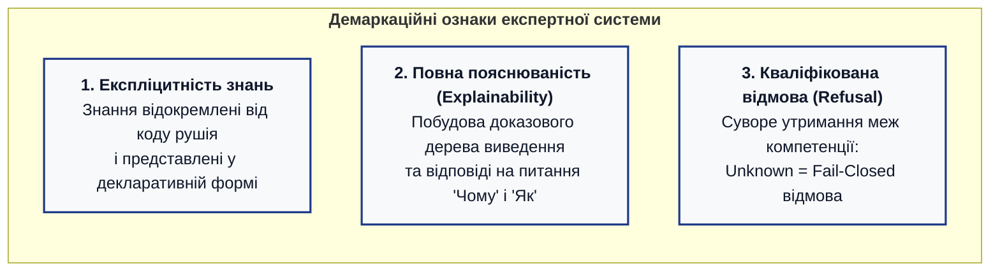
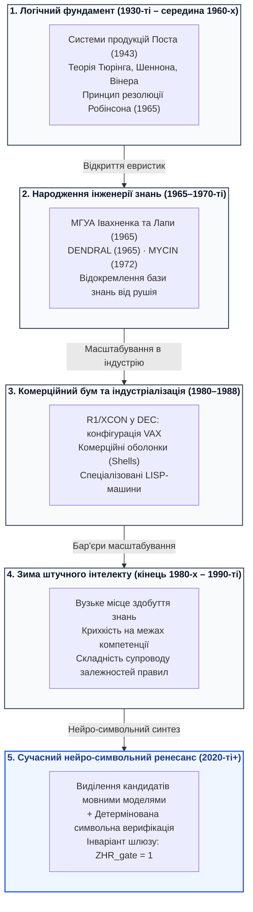
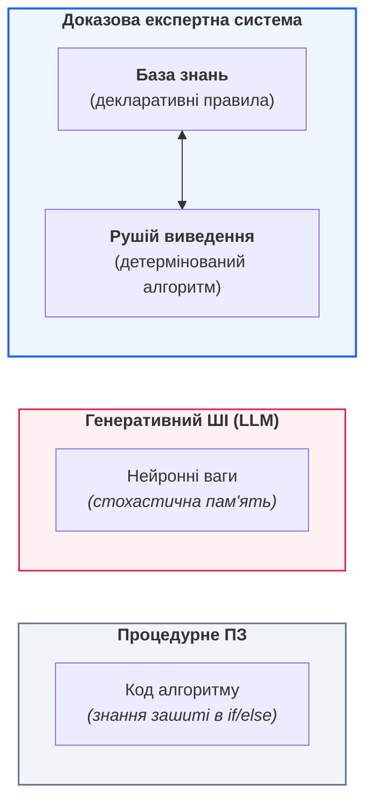
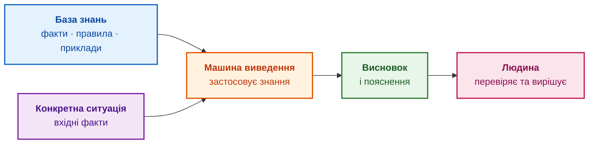
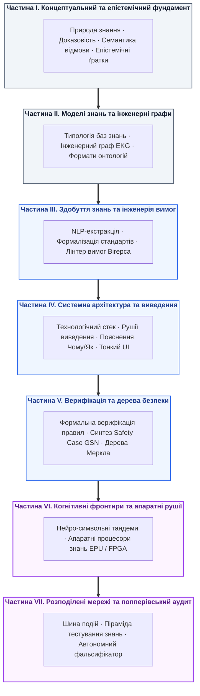
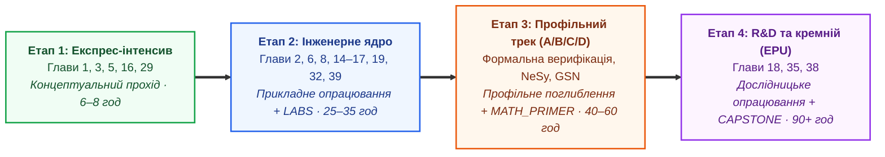

# Глава 1. Вступ до експертних систем: від хаосу до керованих знань

> **Книга:** [Архітектура доказових експертних систем](README.md) · [Частина I: Концептуальні та епістемологічні основи](part-01-foundations.md)
> **Попередня глава:** [Частина I. Концептуальні та епістемологічні основи](part-01-foundations.md)
> **Наступна глава:** [Глава 2. Філософія для інженера: що машина має право називати знанням](ch02-epistemology-of-machine-knowledge.md)
> **Зміст книги:** [README.md](README.md)  
> **Автор:** [Микола Федчик](about-the-author.md)  
> **Рівень складності та оптимальне вивчення:** `[L1]` Базовий інженерно-концептуальний (індекс Д. Кнута `[12]`) · *Маршрут:* Експрес-маршрут та базове ядро всіх треків (`A/B/C/D`); 1 прохід  
> **Очікувані результати:** відрізняти перевірювану експертну відповідь від результату пошуку й відповіді чатбота; знати складники експертної системи та межі її відповідальності; оцінити, чи варто будувати експертну систему для задачі вашої команди; обрати оптимальний маршрут і режим вивчення книги за шкалою складності `[L1]`–`[L4]`.

## Анотація

У першій главі закладаються концептуальні, історичні та архітектурні засади доказових експертних систем, інженерії знань і детермінованого логічного виведення. Розглядається криза людської інженерної пам'яті в складних технологічних доменах і показано, чому традиційні інформаційно-пошукові каталоги та стохастичні генеративні мовні моделі не здатні нести юридичну й функціональну відповідальність за правильність рішень. Сформульовано строге визначення експертної системи через три демаркаційні ознаки: експліцитність знань, повну пояснюваність та здатність до кваліфікованої відмови від висновку за неповноти або суперечливості фактів.

Висвітлено історичну еволюцію експертних систем: від канонічних систем продукцій Еміля Поста, ідей Алана Тюрінга та перших практичних комплексів (DENDRAL [[1]](#src-1), MYCIN [[2]](#src-2)) через тріумф індустріальної конфігурації XCON [[7]](#src-7), комерційний бум та уроки «зими штучного інтелекту» до сучасного нейро-символьного ренесансу. Детально розібрано ключові архітектурні інваріанти доказових експертних систем, анатомію їхніх п'яти базових підсистем, чотири класичні парадигми формалізації знань, відповідальні сфери застосування з високою ціною помилки (автомобільна безпека ASIL-D [[6]](#src-6), авіоніка DO-178C, клінічні протоколи охорони здоров'я [[5]](#src-5), нормативний комплаєнс [[4]](#src-4)) та вектори переходу до апаратних процесорів знань у кремнії (EPU) й формальних математичних доказових свідків (Lean 4). Главу підсумовують систематизовані висновки, актуалізовані запитання для самоперевірки, архітектурний путівник сімома частинами монографії та віртуальний диспут з провідними теоретиками штучного інтелекту.

---

## 1. Проблематика та передумови: виникнення потреби в експертних системах <a id="проблематика-експертних-систем"></a><a id="одне-запитання-три-відповіді"></a>

Потреба в експертній системі виникає, коли обґрунтування інженерного рішення розпорошене між вимогами, кодом, описами апаратури та результатами випробувань. Без керованих зв'язків між цими джерелами фахівець може використати застарілу норму або пропустити обмеження цільової ревізії виробу. Пошук за ключовими словами допомагає знайти документи, але сам по собі не встановлює їхньої чинності та не перевіряє логічного переходу від знайдених фактів до рішення.

Розглянемо умовний інженерний приклад; номери вимог, документів і тестів нижче є навчальними, а не посиланнями на реальний виріб. Розробник вбудованої системи, відкриваючи модуль керування живленням `PowerSupervisor`, бачить константу `40` і ставить питання: *«Чи можна збільшити таймаут холодного старту до 60 мілісекунд для стабілізації низькотемпературного запуску?»*. Обґрунтування зміни розпорошене між:
- вимогою безпеки виробу, розробленою в межах процесу ISO 26262;
- приміткою на 340-й сторінці апаратного даташиту мікроконтролера;
- протоколом випробувань трирічної давнини для ревізії C;
- коментарем до дефекту `BUG-817`;
- пам'яттю провідного архітектора, який пів року тому залишив компанію.

Без перевірки версій і залежностей навіть досвідчений фахівець ризикує ухвалити рішення за неповними даними. Зіставимо три способи роботи з цим запитом; відповіді ілюструють різні архітектурні контракти, а не результати порівняльного експерименту:

| Парадигма інструменту | Отримана відповідь | Що інженеру робити далі |
|---|---|---|
| **Пошук у документації** (Information Retrieval) | Знайдено вимогу `REQ-142`, дефект `BUG-817`, коментар у коді та 40 сторінок специфікації. | Самостійно прочитати всі знайдені документи, встановити актуальність редакцій і вручну провести міркування. |
| **Генеративна мовна модель без незалежного верифікатора** | «Так, 60 мс є цілком безпечним значенням: вимоги стандарту зазвичай задають мінімум 50 мс». | Перевірити походження числа 50. За умовами прикладу його взято зі скасованої чернетки, тому воно не обґрунтовує допуск зміни. |
| **Доказова експертна система** (Evidence-Governed ES) | «40 мс порушує правило `R-POWER-03` для ревізії C. Значення 60 мс задовольняє умові $`t \ge 55\text{ мс}`$, але зміна вимагає повторного тесту `TC-88`. Джерела: `REQ-142` v5, `ADR-31` v3. Рішення ухвалює інженер після проходження тесту». | Перевірити покроковий ланцюг за прямими цитатами першоджерел і запустити вказаний валідаційний тест. |

Жодна з відповідей автоматично не замінює відповідальності інженера. В авторській порівняльній моделі відмінність полягає в наявності перевірюваного ланцюга: третя відповідь явно задає застосоване правило, його джерело та ще не виконане зобов'язання щодо тесту. Мовна модель також може запропонувати правильну відповідь або формальний доказ, але сам факт генерації не засвідчує їхньої правильності: потрібен незалежний перевірник. Експертна система забезпечує такий контракт лише в межах затверджених правил, перевірених джерел і довіреної реалізації.

Щоб наочно побачити цю інженерну різницю на рівні структур даних, порівняймо сирий вивід генеративної моделі (де формальний сертифікат доведення відсутній, $`\pi = \varnothing`$) та машинозчитуваний пакет обґрунтування (`ProofBundle` / сертифікат $`\pi`$), який повертає доказова експертна система для того самого запиту `PowerSupervisor`:

Перша відповідь є несертифікованим текстом:

```json
{
  "answer": "Так, 60 мс є цілком безпечним значенням: стандарт зазвичай дозволяє від 50 мс.",
  "citations": ["ISO 26262-5 (draft)"],
  "proof_certificate": null
}
```

Другий пакет фіксує `QUALIFIED`, а не `ACCEPT`: тест `TC-88` ще не виконано. Байтові межі та геші тут ілюструють формат; без відповідних файлів вони не є відтворюваним криптографічним свідченням.

```json
{
  "verdict": "QUALIFIED",
  "target_parameter": "PowerSupervisor.ColdStartTimeoutMs",
  "proposed_value": { "magnitude": 60, "unit": "ms" },
  "required_gate": "RUN_VERIFICATION_TEST:TC-88",
  "proof_certificate_pi": [
    {
      "step": 1,
      "rule_id": "R-POWER-03@v5.2",
      "predicate": "ColdStartTimeoutMs >= 55 && ColdStartTimeoutMs <= 100",
      "source_doc_id": "REQ-142-revC.pdf",
      "byte_range": [14820, 14912],
      "quote_sha256": "9f86d081884c7d659a2feaa0c55ad015a3bf4f1b2b0b822cd15d6c15b0f00a08"
    },
    {
      "step": 2,
      "rule_id": "ADR-31-OBLIGATION@v3.0",
      "predicate": "Modified(PowerSupervisor) => RequiresRegression(TC-88)",
      "source_doc_id": "ADR-031-PowerArch.md",
      "byte_range": [3104, 3219],
      "quote_sha256": "4b227777d4dd1fc61c6f884f48641d02b4d121d3fd328cb08b5531fcacdabf8a"
    }
  ]
}
```

**Потреба в доказовому виведенні визначається ціною непідтвердженого рішення, а не самим способом генерації тексту.** Автором виділено три фактори:

1. **Вартість перевірки:** без явних підстав інженерові доводиться відновлювати джерела й переходи міркування. Авторський Закон асиметрії верифікації застосовується як умовна інженерна закономірність: перевірка може коштувати дорожче за самостійне розв'язання, якщо до пошуку підстав додається спростування хибних посилань. Універсальної строгої нерівності для всіх запитів немає; наявність сертифіката також не гарантує, що його перевірка завжди швидша за побудову.
2. **Вимоги до обґрунтування та аудиту:** EU AI Act [[4]](#src-4), настанови FDA CDS [[5]](#src-5), ISO 26262 [[6]](#src-6) і RTCA DO-178C [[13]](#src-13) мають різні сфери застосування й правовий статус. Для конкретного виробу потрібно встановити застосовні вимоги до документації, простежуваності, верифікації та людського нагляду. Вони не задають єдиної обов'язкової архітектури експертної системи й не означають вимоги формально доводити кожне речення довільної відповіді.
3. **Збереження корпоративного досвіду:** довготривалий супровід виробу потребує правил із власником, версією та межами чинності. Експертна система робить такі правила виконуваними, доповнюючи керування вимогами, документацією та конфігурацією, а не замінюючи ці процеси.

Практичне завдання верифікатора — вкласти перевірку пакета в заданий бюджет часу, вимірюваний у секундах. Для формату з обмеженими локальними перевірками правил і послідовним гешуванням цитат можна використати таку верхню оцінку:

$$
T_{\mathrm{check}} \le k\,t_{\mathrm{rule}} + \frac{B}{R_{\mathrm{hash}}} + T_{\mathrm{other}}.
$$

Тут:
- $`T_{\mathrm{check}} \ge 0`$ — тривалість перевірки пакета, с;
- $`k \in \{0,1,\dots,k_{\max}\}`$ — кількість кроків доказу; ліміт задається форматом пакета;
- $`t_{\mathrm{rule}} \ge 0`$ — верхня межа часу локальної перевірки одного кроку, с; вона включає перевірку його посилань і застосовності правила;
- $`B \in \{0,1,\dots,B_{\max}\}`$ — сумарний обсяг цитованих байтів, які потрібно перевірити;
- $`R_{\mathrm{hash}} > 0`$ — гарантована для обраної платформи нижня межа швидкості гешування, байт/с;
- $`T_{\mathrm{other}} \ge 0`$ — верхня межа решти витрат, с: доступу до джерел, розбору, перевірки підписів, планування та журналювання;
- $`k_{\max}`$ і $`B_{\max}`$ — скінченні конфігураційні ліміти кількості кроків і обсягу цитат.

Оцінка стає часовою гарантією лише після обґрунтування всіх меж для цільової платформи. Довільний запуск SMT-солвера всередині кроку не можна приховати в константі без окремого обмеження його часу.

**Дія рантайму:** пакет, який перевищує ліміти або не може бути перевірений до дедлайну, не отримує `ACCEPT`; повертається типізована відмова. Завершена вчасно перевірка є необхідною, але не достатньою умовою допуску: ще потрібно виконати всі змістовні зобов'язання, зокрема `TC-88`.

**Апаратний сайзинг і числовий приклад:** припустімо, для 200 кроків установлено межу 20 мкс на крок, для 64 КіБ цитат — швидкість не нижче 100 МіБ/с, а решта перевірки займає не більше 2 мс. Отримано межу 4 + 0,625 + 2 = 6,625 мс за бюджету 10 мс. Якщо дескриптор кроку займає 64 байти, зберігання дескрипторів і всіх цитат потребує щонайменше 76,5 КіБ без урахування робочої пам'яті перевірника. За зниження швидкості гешування до 10 МіБ/с межа зростає до 12,25 мс: для гарантованого обслуговування потрібно зменшити пакет або змінити платформу, а не пропускати перевірку. Це умовний розрахунок, не результат вимірювання.

> [!NOTE]
> **Три фактори кризи знань та Закон асиметрії верифікації за моделлю М. М. Федчика**
> 1. **Умовна асиметрія верифікації:** непідтверджений текст може збільшувати витрати перевірки; авторська закономірність не є універсальною теоремою про співвідношення часу пошуку й перевірки.
> 2. **Застосовні вимоги до доказів:** склад документації, верифікації та нагляду визначається доменом і класифікацією виробу, а не загальним посиланням на стандарт.
> 3. **Збереження інженерної пам'яті:** версійовані виконувані правила доповнюють процеси керування вимогами й конфігурацією.
> *Керування рантаймом / Інженерний інваріант:* Перевищення бюджету або неперевірений крок блокує допуск; побайтова тотожність цитати не замінює перевірки її змісту та застосовності.

---

## 2. Дефініція та епістемічна сутність: що таке експертна система <a id="дефініція-експертної-системи"></a><a id="документ-не-дорівнює-знанню"></a>

Визначення експертної системи потрібне, щоб відрізняти наявність бази документів від здатності застосувати знання до конкретного випадку. Класичний поділ на базу знань і механізм виведення [[2]](#src-2), [[8]](#src-8) у цій монографії доповнено авторськими вимогами до доказового допуску та відмови. Без цього уточнення правильне за формою пояснення можна помилково прийняти за перевірене рішення; наведена нижче дефініція стосується саме доказової архітектури, а не всіх історичних експертних систем.

> **Експертна система (Expert System)** — це інтелектуальна обчислювальна система, яка акумулює формалізовані знання людей-експертів у визначеній предметній області та здатна за допомогою детермінованих алгоритмів логічного виведення розв'язувати складні аналітичні, діагностичні й управлінські задачі на рівні кваліфікованого фахівця, надаючи повне пояснення підстав свого рішення.

На відміну від класичного процедурного коду, де бізнес-правила «зашиті» всередині монолітних алгоритмів численними операторами розгалуження, та на відміну від нейронних мереж, де знання розчинені у неінтерпретованих числових вагах «чорної скриньки», доказова експертна система базується на трьох непорушних демаркаційних засадах, сформульованих автором:



1. **Експліцитність знань:** знання предметної області повністю відокремлені від механізму обчислень. Вони подані у зрозумілому для людини та машини декларативному вигляді (правила, онтології, факти, обмеження), що дозволяє модифікувати базу знань без переписування й перекомпіляції програмного ядра експертної системи.
2. **Пояснюваність (Explainability):** експертна система не виносить голослівних вердиктів. Кожне твердження супроводжується аудиторським ланцюгом міркувань: які саме факти спрацювали, які правила були застосовані, які альтернативи були відкинуті та на які конкретні ревізії документів посилається результат.
3. **Кваліфікована відмова від відповіді (Fail-Closed Gate):** експертна система чітко утримує межі власної компетенції. Якщо вхідна ситуація виходить за рамки закладених правил або вхідні дані є суперечливими, система повертає типізовану відмову (`REFUSAL` або `CLARIFICATION`), блокуючи генерацію здогадок чи правдоподібних вигадок ($`\mathrm{ZHR}_{\mathrm{gate}} = 1{,}00`$). У монографії суворо розмежовано два поняття, пов'язані з метрикою нульових галюцинацій: (а) **конструктивний інваріант шлюзу допуску** ($`\mathrm{ZHR}_{\mathrm{gate}} = 1{,}00`$), за яким кожне допущене до видачі твердження обов'язково містить побайтово звірену цитату з незмінного першоджерела (а будь-яке непідтверджене твердження детерміновано блокується шлюзом), та (б) **емпірична статистична верхня межа частоти галюцинацій** на скінченній тестовій вибірці з $`N`$ запитів при нулі спостережених помилок ($`p_U = 1 - 0{,}05^{1/N}`$ на рівні довірчої ймовірності 95 %, детально обґрунтована в [Главі 36](ch36-knowledge-testing-pyramid-and-variational-calibration.md), підрозділ 5.5).

У статистичній формулі $`N \ge 1`$ — кількість незалежних випробувань із бінарним результатом за незмінної процедури оцінювання; $`p_U \in (0,1)`$ — однобічна 95-відсоткова верхня довірча межа ймовірності помилки, застосовна саме за нуля спостережених помилок. Для 300 таких випробувань отримано приблизно 0,00994, тобто 0,994 %. Це дозволяє оцінити виконання, наприклад, заздалегідь заданого дослідницького критерію «верхня межа не більше 1 %», але не доводить нульового ризику і не санкціонує критичну дію. Кількість прогонів і зберігання їхніх журналів плануються під потрібну статистичну межу; корельовані перефразування не можна без обґрунтування рахувати незалежними випробуваннями.

Важливо також розрізняти три споріднені, але не тотожні категорії, демарковані автором:
* **Компетентність (Expertise):** сукупність верифікованих знань та здатності формулювати обґрунтовані рекомендації у визначеному домені.
* **Повноваження (Authority):** формальне право ухвалювати зобов'язуюче рішення, підпорядковане **тристоронньому розподілу епістемічних повноважень**: (1) людина — профільний експерт предметної області (*Domain Expert*) затверджує специфікації та знання під час їх внесення до базової версії бази знань (*baseline knowledge base*) і санкціонує відповідальні дії; (2) детермінований рантайм-верифікатор допускає відповідь на конкретний запит виключно на підставі верифікованих доказів; (3) мовна модель не має жодного з цих двох повноважень.
* **Доказовість (Evidence):** наявність перевірюваних підстав із зафіксованим походженням, цілісністю та межами застосовності. Побайтова кастодія захищає від непомітної зміни тексту, але не усуває помилок його інтерпретації.

> [!NOTE]
> **Авторська теоретична дефініція: три демаркаційні засади та тріада відповідальності**  
> 1. **Повна експліцитність знань:** декларативне відокремлення бази знань від коду рушія логічного виведення (правила, онтології, обмеження).
> 2. **Покрокова пояснюваність (Explainability):** обов'язкова побудова графа доведення та надання аудиторського сліду підстав для кожного висновку.
> 3. **Захисна відмова (Fail-Closed Gate):** за недостатніх підстав для остаточного рішення — відмова в допуску; у дорадчому режимі можливе уточнення (`CLARIFICATION`) без дозволу на дію.
> 4. **Тріада відповідальності:** компетентність означає здатність сформувати рекомендацію; повноваження розподілено між експертом, який затверджує правила, та верифікатором, який перевіряє конкретний запит; доказовість потребує цілісних джерел і перевірених переходів. Мовна модель не затверджує ні правила, ні остаточний допуск.
> *Інженерний інваріант:* Наявність цитати є необхідною умовою заземлення, але не достатньою умовою істинності висновку.

---

## 3. Історія та еволюція: від математичної логіки до сучасного ренесансу <a id="історія-експертних-систем"></a>

Історія експертних систем пояснює, чому сучасна доказова архітектура поєднує явні правила, перевірку джерел і контроль змін. Її математичні передумови сформовано раніше за перші прикладні системи; досвід впровадження показав, що сам обсяг правил не забезпечує ані їхньої узгодженості, ані керованого супроводу. Нижче виділено п'ять етапів — від логічного фундаменту до сучасних гібридних підходів.

1. **Логіко-математичний фундамент (1930-ті – середина 1960-х років):**  
   Ще у 1943 році математик Еміль Пост сформулював канонічні системи продукцій [[9]](#src-9), довівши, що будь-який обчислювальний процес можна звести до підстановки рядків за формальними правилами переписування. Алан Тюрінг, Клод Шеннон та Норберт Вінер заклали засади кібернетики та теорії інформації. У 1965 році Джон Алан Робінсон створив принцип резолюції та алгоритм уніфікації (MGU) [[10]](#src-10), відкривши шлях до автоматичного доведення теорем у численні предикатів першого порядку.
2. **Перша хвиля та народження інженерії знань і багатошарової селекції гіпотез (1965–1970-ті роки):**  
   Перехід від спроб створити універсальний штучний інтелект (General Problem Solver) до накопичення спеціалізованих предметних знань та індуктивної самоорганізації моделей:
   - **Кібернетичні передбачувальні пристрої та МГУА (1965–1968, Олексій Івахненко, Валентин Лапа):** українська школа кібернетики розвинула методи індуктивного моделювання та багатошарового відбору моделей [[15]](#src-15), [[16]](#src-16). **Метод групового урахування аргументів (МГУА, англ. GMDH)** розглянуто в огляді Юргена Шмідхубера як ранній підхід до навчання глибоких мереж [[17]](#src-17). Для інженерії знань важливий зовнішній критерій селекції: якість кандидата оцінюється не лише на даних, за якими підібрано його параметри. Цей методологічний принцип не слід підмінювати загальною забороною самоперевірки, нібито виведеною з другої теореми Геделя: вона стосується доведення несуперечності формальних теорій за визначених умов.
   - **Українська традиція формальних методів та інженерії знань (друга половина XX століття – 2020-ті роки):** паралельно в Інституті кібернетики розвивалися споріднені підходи, які в цій монографії розглядаються як **споріднені праці**, а не як підґрунтя її тверджень. Олександр Летічевський із колегами розвинув теорію взаємодії агентів і середовищ: складну систему подано як середовище, у яке вставлено агентів, а нову поведінку середовища обчислює «функція вставки»; методологію застосовано до верифікації специфікацій вимог розподілених систем [[18]](#src-18), [[19]](#src-19). Олександр Палагін із співавторами запропонував формальне подання комп'ютерної онтології як трійки концептів, відношень і функцій інтерпретації та описав проєктування онтолого-керованих систем [[20]](#src-20), [[21]](#src-21); Григорій Гогерчак показав застосування дескриптивних логік до баз знань, побудованих з природномовних текстів [[22]](#src-22). У Главі 12 ці праці порівнюються з вимогою доказового заземлення термінів.
   - **DENDRAL (1965, Едвард Фейгенбаум, Джошуа Ледерберг):** перша експертна система у Стенфордському університеті, що визначала молекулярну будову хімічних сполук за даними мас-спектрометрії [[1]](#src-1).
   - **MYCIN (початок розроблення — 1972, Едвард Шортліфф):** експертна система для рекомендацій щодо діагностики й лікування бактеріальних інфекцій. У ній поєднано відокремлені від інтерпретатора правила, коефіцієнти впевненості (Certainty Factors) та механізм пояснення міркувань [[2]](#src-2); це важливий приклад архітектури, а не твердження про першість самого відокремлення правил.
   - Едвард Фейгенбаум канонізує термін **«Інженерія знань» (Knowledge Engineering)** як науково-інженерну дисципліну перенесення експертного досвіду в комп'ютерні моделі [[3]](#src-3).
3. **Комерційний бум та індустріалізація (1980–1988 роки):**  
   Широке впровадження систем на виробництві. Програма **R1/XCON** Джона Макдермотта в компанії DEC автоматизувала конфігурацію комп'ютерних систем VAX [[7]](#src-7). Цей приклад демонструє промислове застосування правил до конфігураційних обмежень; кількісну економію без окремого джерела й періоду оцінки тут не наведено. З'являються комерційні оболонки (Shells) та спеціалізовані LISP-машини (Symbolics, LMI, Texas Instruments).
4. **«Зима штучного інтелекту» та криза першого покоління (кінець 1980-х – 1990-ті роки):**  
   Бурхливий розвиток зіткнувся з об'єктивними інженерними бар'єрами:
   - *Вузьке місце здобуття знань (Knowledge Acquisition Bottleneck):* ручне кодування тисяч правил через тривалі інтерв'ю з експертами виявилося нестерпно дорогим і повільним процесом.
   - *Крихкість на межах (Brittleness):* вихід за межі формалізованого домену міг давати неправильну пораду або залишати систему без відповіді; поведінку за неповноти потрібно було проєктувати окремо.
   - *Криза супроводу баз знань:* зі зростанням взаємозалежностей правил складніше виявляти суперечності й оцінювати вплив змін. Універсальної критичної кількості правил немає.
   - *Крах спеціалізованого обладнання:* дорогі LISP-машини програли технологічні перегони процесорам загального призначення архітектури x86.
5. **Сучасний нейро-символьний ренесанс (2020-ті роки – дотепер):**  
   Мовні моделі дають змогу автоматизувати первинне виділення кандидатів у факти й правила. Проте перевірка вилучених знань, затвердження базової версії та сертифікаційне обґрунтування залишаються окремими завданнями. У запропонованій автором архітектурі символьне ядро обмежує допуск перевіреними підставами; це конструктивний контракт шлюзу, а не виміряна гарантія безпомилковості всієї системи.

П'ять хвиль історичної еволюції систем штучного інтелекту та сходження до сучасної доказової парадигми проілюстровано на діаграмі.



---

## 4. Основні архітектурні ознаки доказової експертної системи <a id="архітектурні-ознаки"></a>

Архітектурні ознаки доказової експертної системи визначають, яка підсистема зберігає правила, яка пропонує кандидата і яка має право його допустити. Якщо ці ролі змішано, оновлення документа може непомітно змінити поведінку, а висока оцінка релевантності — підмінити перевірку застосовності норми. Нижче зіставлено спрощені базові схеми; процедурне ПЗ також може мати зовнішні правила, а RAG — незалежний верифікатор, тому назва технології сама по собі не встановлює межі довіри.



Головні архітектурні інваріанти доказової експертної системи, сформульовані автором:

* **Ортогональність знань і механізму виведення:** рушій логічного виведення є інваріантним та універсальним. Знання є зовнішніми структурованими даними. Зміна нормативного регламенту виконується як версійне оновлення декларативного пакета бази знань без модифікації та перекомпіляції ядра експертної системи.
* **Розподіл релевантності та нормативного допуску (Relevance vs Eligibility):**
  - *Ймовірнісні моделі сприйняття (рівень сприйняття):* відповідають виключно за **релевантність** — пошук евристичних контекстів, виділення наміру користувача з природної мови, вилучення кандидатів у факти з неструктурованих текстів.
  - *Детерміновані символьні рушії (нормативний рівень експертної системи):* відповідають виключно за **нормативний допуск** — сувору перевірку відповідності правилам, верифікацію інваріантів безпеки та право безумовного вето. Жодна ймовірнісна нейромережева модель не має права самостійно ухвалювати остаточне рішення чи санкціонувати дію.
* **Побайтове заземлення фактів у першоджерелах (Evidence Custody):** атомарне джерельне твердження пов'язується з дослівною цитатою незмінного документа, напіввідкритим інтервалом `[byte_start, byte_end)` і гешем `sha256`; `byte_end` указує на перший байт після цитати, як у зрізі `raw[byte_start:byte_end]`. Для похідного висновку додатково потрібен перевірений ланцюг застосування правил. Невідповідність байтів блокує допуск, проте збіг гешу не доводить правильності джерела, інтерпретації або самого правила.
* **Захисна відмова за недостатніх підстав (Fail-Closed Gate):** якщо застосовного правила або достатнього несуперечливого набору фактів немає, система блокує остаточний допуск. Конструктивний інваріант $`\mathrm{ZHR}_{\mathrm{gate}} = 1{,}00`$ означає контроль заземлення, а не гарантію фізичної безпеки виробу.

> [!NOTE]
> **Чотири архітектурні інваріанти доказовості за моделлю М. М. Федчика**
> 1. **Ортогональність знань і механізму виведення:** універсальний детермінований рушій логічного виведення повністю ізольований від декларативної бази знань; модифікація правил відбувається без зміни чи перекомпіляції програмного ядра.
> 2. **Закон нейро-символьного розподілу повноважень (Relevance vs Eligibility) М. Федчика:** моделі машинного навчання відповідають виключно за евристику й релевантність (пошук кандидатів, вилучення наміру), тоді як символьне ядро одноосібно забезпечує нормативний допуск і має право безумовного вето.
> 3. **Побайтова кастодія фактів (Evidence Custody):** джерельне твердження має цитату з межами `[byte_start, byte_end)` і гешем `sha256`; похідний висновок — ланцюг правил до таких підстав. Цілісність і семантична правильність перевіряються окремо.
> 4. **Захисне блокування (Fail-Closed Gate):** недостатні або неврегульовані суперечливі підстави не дозволяють остаточного допуску; показник $`\mathrm{ZHR}_{\mathrm{gate}} = 1{,}00`$ не підмінює статистичного оцінювання помилок.
> *Керування рантаймом / Інженерний інваріант:* Пропозиція мовної моделі не змінює затверджених правил і не дозволяє дію без перевірки її підстав, застосовності та повноважень.

### 4.1. Кібернетичне коріння нейро-символьного розподілу: МГУА простою мовою (для нефахівців)

Зовнішній критерій МГУА дає корисну інженерну аналогію для розподілу повноважень між генератором кандидатів і перевірником. Під час підбору моделі за тими самими даними, на яких оцінюється її якість, виникає ризик перенавчання: добра відповідність наявним прикладам не засвідчує придатності до нових випадків. У доказовій експертній системі споріднений ризик виникає, коли пояснення генератора приймається за незалежну перевірку його відповіді.

Наприклад, модель навантаження мосту можна підібрати за одним набором вимірювань, а її прогностичну похибку перевірити на відкладеному наборі. МГУА використовує зовнішній критерій для відбору кандидатних моделей [[15]](#src-15), [[16]](#src-16); повторне налаштування за перевірочним набором теж потребує контролю, бо послаблює незалежність оцінки. Такий відбір оцінює якість прогнозу, але сам по собі не є формальним доказом міцності конструкції.

Автором перенесено принцип розділення ролей у доказову архітектуру: мовна модель пропонує кандидата, а символьне ядро перевіряє джерела, правила та межі застосовності. Це архітектурне рішення щодо повноважень, а не висновок про математичну неможливість будь-якої самоперевірки мовної моделі.

> [!NOTE]
> **Три принципи спадкоємності від зовнішнього критерію МГУА до нейро-символьної архітектури за моделлю М. М. Федчика**
> 1. **Масове висування гіпотез на перцептивному шарі:** подібно до генератора комбінацій у МГУА, локальна мовна модель на першому тракті переформульовує розмовні запити користувача у канонічні терміни та добирає синоніми, не маючи повноважень затверджувати істинність фактів.
> 2. **Незалежна перевірка:** за аналогією із зовнішнім критерієм МГУА остаточний допуск відокремлено від генерації кандидата; побайтова перевірка доповнюється перевіркою змістовних підстав.
> 3. **Обмеження самопідтвердження:** модель може допомагати знаходити помилки, але її самооцінка чи вердикт іншої мовної моделі (`LLM-as-a-Judge`) не замінюють незалежного доказового допуску. Це авторський контракт архітектури, не наслідок теореми Геделя.
> *Керування рантаймом / Інженерний інваріант:* Жоден кандидат, згенерований індуктивним або нейромережевим трактом, не переходить у статус доведеного висновку без проходження зовнішнього детермінованого фільтра на незалежному доказовому базисі ($`\mathrm{ZHR}_{\mathrm{gate}} = 1{,}00`$).

---

## 5. Анатомія експертної системи: п'ять базових підсистем <a id="анатомія-підсистем"></a>

Анатомія доказової експертної системи визначається розподілом роботи між п'ятьма підсистемами: здобуттям знань, їх зберіганням, виведенням, поясненням та взаємодією з користувачем. Якщо, наприклад, конвеєр здобуття може без перевірки змінювати чинні правила, правильність самого рушія не захищає від хибної бази знань. Тому на схемі важливі не лише компоненти, а й межі їхніх повноважень.


1. **База знань (Knowledge Base):** структуроване сховище формалізованого досвіду. Містить онтологічні класи, відношення, таблиці рішень, декларативні продукційні правила та спростовні аргументи (дефітери).
2. **Рушій логічного виведення (Inference Engine):** детермінований обчислювач, який зіставляє вхідні спостереження з правилами бази знань. Підтримує стратегії прямого виведення (Forward Chaining — від відомих фактів до нових висновків) та зворотного виведення (Backward Chaining — від цільової гіпотези до пошуку підтверджувальних фактів).
3. **Підсистема пояснень (Explanation Engine):** інтелектуальний реєстратор ходу міркувань експертної системи. Фіксує послідовність активації правил і генерує для користувача дерево доказів, відповідаючи на запитання: *«Чому система дійшла такого висновку?»* та *«Чому було відхилено альтернативне рішення?»*.
4. **Підсистема здобуття знань (Knowledge Acquisition System, KAS):** конвеєр трансформації сирих інженерних корпусів (стандартів, даташитів, регламентів) у машиночитний верифікований формат бази знань.
5. **Інтерфейс користувача та інтеграційний шлюз (UI / API):** шар комунікації, що забезпечує взаємодію з людиною-оператором, бізнес-системами підприємства або виконавчими контролерами кіберфізичних комплексів.

На найпростішій дорадчій моделі експертна система застосовує правила до фактів робочої ситуації та передає рекомендацію з поясненням фахівцю. У цьому режимі він ухвалює рішення; в автоматизованому режимі рантайм може виконувати дії в межах заздалегідь затвердженої політики та апаратних запобіжників, як розглянуто в [главі 21](ch21-from-recommendation-to-action.md). Схема нижче показує саме дорадчий режим, а не загальну заборону автономного виконання.



Такий розподіл ролей робить підстави рекомендації доступними для аудиту. Надійність додатково залежить від якості джерел, правил, реалізації та процесу їх зміни; сама структурна схема цих властивостей не доводить.

---

## 6. Загальні способи та моделі побудови <a id="способи-побудови"></a>

Спосіб побудови експертної системи визначає, як зберігаються знання та які операції над ними виконує рушій. Вибір лише за зручністю синтаксису небезпечний: монотонні правила не дають автоматичного перегляду висновків, а виразніша логіка може порушити часовий бюджет. Нижче зіставлено чотири поширені підходи; у практичній системі їх можна поєднувати.

1. **Продукційні системи (Production Rule Systems):**  
   Правило «якщо виконано умову, то додати висновок або запропонувати дію» відокремлюється від рушія. **Rete** (Чарльз Форгі [[11]](#src-11)) повторно використовує результати часткового зіставлення; це скорочує повторні обчислення ціною пам'яті, але не встановлює універсальної сталої затримки для довільного набору правил. **TREAT** є альтернативою з іншим компромісом між пам'яттю та повторним зіставленням.
2. **Фреймові та об'єктно-орієнтовані моделі (Frame Systems):**  
   Запропоновані Марвіном Мінським у 1974 році [[12]](#src-12). Знання групуються навколо концептуальних вузлів — «фреймів», які володіють атрибутами («слотами»), успадкуванням за таксономією та процедурними демонами (тригерами, що автоматично спрацьовують при читанні або зміні значення слота).
3. **Логічні моделі та формальні онтології (Predicate Logic & Datalog):**  
   Знання подаються формулами або правилами, наприклад диз'юнктами Хорна. Механізм виконання залежить від формалізму: резолюція та уніфікація застосовуються в логічному програмуванні, Datalog може обчислювати найменшу нерухому точку, а OWL має власні режими логічного виведення. RDF задає модель даних, SPARQL — мову запитів; їх не слід ототожнювати з одним алгоритмом доведення.
4. **Спростовні моделі аргументації (Defeasible Reasoning & ASPIC+):**  
   Спеціалізований апарат немонотонної логіки Санджая Модгіла та Генрі Праккена [[14]](#src-14), створений для моделювання інженерних суперечностей та нормативних колізій. Правила вважаються чинними доти, доки не з'явиться сильніший аргумент-спростувач (дефітер). Згідно з канонічним правилом розв'язання колізій ([Глава 14](ch14-requirements-detection-and-formalization.md)), коли конфліктні норми мають різний ранг пріоритету ($`\Delta r > 0`$ за юридично-нормативними принципами *Lex Superior, Lex Posterior, Lex Specialis*), рушій ASPIC+ детерміновано долає слабшу норму за рангом; якщо ж ранги рівні ($`\Delta r = 0`$) або пріоритет не визначено, спрацьовує захисний шлюз `Fail-Closed` зі статусом `REFUSAL_NORMATIVE_CONFLICT` (`QUALIFIED_CONFLICT`) та ескалацією експерту. Це дозволяє експертній системі динамічно переглядати попередні гіпотези без руйнування цілісності всієї бази знань.

### 6.1. Еволюційна ієрархія доказових експертних систем за творчою та епістемічною функцією

Еволюційна ієрархія в цьому підрозділі описує додавання функцій, а не заміну продукційних, фреймових або логічних моделей. Класична типологія Ф. Гейз-Рота, Д. Вотермана та Д. Лената (1983 [[8]](#src-8)) розрізняє предметні задачі, зокрема діагностику, моніторинг, планування й проєктування. Авторська класифікація натомість розмежовує **глибину перетворення знань і повноваження результату**: консультація не дорівнює допуску, а синтез гіпотези — доведенню її фізичної здійсненності.

В авторській теорії Миколи Федчика виділено **дорадчо-консультативні**, **рекомендаційні** та **винахідницькі** експертні системи. У запропонованій архітектурі наступний рівень зберігає базові функції попереднього й додає нові. Це відношення нарощування можливостей, а не доведене строге включення множин усіх реальних систем цих класів. Для кожного рівня зберігається контракт доказового допуску, а неперевірена гіпотеза не отримує статусу доведеного факту.

> [!NOTE]
> **Три еволюційні класи доказових експертних систем за класифікацією Миколи Федчика**
> 1. **Дорадчо-консультативні експертні системи (`Consultative / Advisory Expert Systems`):** виконують сократівське уточнення неповного опису ситуації (`CLARIFICATION`), здійснюють багатовимірну навігацію по нормах, прецедентах і граничних умовах кількох стандартів та окреслюють простір допустимих інженерних варіантів без винесення імперативного вердикту до моменту усунення інформаційної невизначеності.
> 2. **Рекомендаційні (нормативно-верифікаційні) експертні системи (`Recommendatory / Normative-Verification Expert Systems`):** застосовують дедуктивні правила, інтервальну арифметику та немонотонну аргументацію ASPIC+ до повного набору фактів конкретного випадку $C$, формуючи юридично та технічно значущу рекомендацію або контракт дії (`ACCEPT`, `REFUSAL`, `VERIFIED_FACT`) із побайтовим слідом доведення.
> 3. **Винахідницькі (евристично-синтезуючі) експертні системи (`Inventive / Heuristic-Synthesizing Expert Systems`):** у ситуації, коли жодне окреме джерело не містить готового розв'язку через міждоменне технічне протиріччя, поєднують векторно-алгебраїчну абдукцію на ваговій базі моделей (System 1) із перехресним синтезом у Федеративній Арені над декількома пакетами знань (System 2 / FPGA), формуючи кандидатів композиції (`SYNTHESIZED`) або локалізуючи відсутню наукову ланку (`BOUNDED_HYPOTHESIS`).
> *Керування рантаймом / Інженерний інваріант:* Перехід системи від дорадчо-консультативного до рекомендаційного чи винахідницького режиму керується виключно повнотою вхідних фактів та наявністю побайтово підтвердженого міжпакетного ланцюжка доведення (побайтовий захист ідентичності та незмінності), не допускаючи підміни відсутніх доказів імовірнісною генерацією.

---

## 7. Основні галузі застосування з високою ціною помилки <a id="галузі-застосування"></a><a id="як-довести-що-експертна-система-корисна"></a>

Доказові експертні системи знаходять своє застосування там, де стохастична галюцинація несе пряму загрозу життю людей, національній безпеці або веде до катастрофічних фінансових втрат:

* **Функціональна безпека транспорту та авіоніка (ISO 26262 ASIL-D [[6]](#src-6), DO-178C DAL-A, DO-254):** апаратні інтерлоки та цензори критичних рішень у безпілотних автомобілях, системах керування тягою потягів та бортових авіаційних автопілотах.
* **Охорона здоров'я та клінічні протоколи (FDA CDS Guidance [[5]](#src-5)):** контроль сумісності фармакологічних препаратів, автоматизована верифікація дозувань анестетиків та перевірка схем хіміотерапії згідно з нормативними настановами МОЗ.
* **Критична енергетична інфраструктура:** телеметрична діагностика трансформаторних підстанцій, турбогенераторів атомних електростанцій та автоматичне локалізування аварійних сегментів енергомережі в реальному часі.
* **Юриспруденція, фінансовий нагляд та комплаєнс-аудит (EU AI Act [[4]](#src-4), GDPR, AML):** моніторинг міжнародних фінансових транзакцій, автоматизований аудит контрактів на відповідність антимонопольному законодавству та сертифікація ланцюгів постачання.
* **Оборонні системи та автономна робототехніка:** прийняття рішень автономними комплексами в умовах повної радіоелектронної ізоляції та придушення супутникової навігації (GNSS-Denied), де критично важлива побайтова кастодія наказів та правил ведення дій.

### 7.1. Стейкхолдери та кінцева ціль споживача: кому і на якому етапі потрібні три класи експертних систем

Ролі стейкхолдерів пов'язують класи експертних систем із перевірюваними результатами життєвого циклу виробу. Консультативний режим допомагає знаходити й уточнювати вимоги; рекомендаційний — перевіряти виконання формалізованих умов допуску; винахідницький — пропонувати композиції та експерименти. Жоден із режимів не гарантує відсутності аварій, юридичних претензій або патентних порушень: ці висновки потребують окремих випробувань і профільної експертизи.

В авторській моделі Миколи Федчика кожен із трьох класів експертних систем обслуговує чітко визначену ланку спеціалістів у наскрізному ланцюгу створення високотехнологічного продукту — від першого контакту технічного маркетолога з ринком до лабораторного відкриття та фінальної сертифікації безпеки:

| Роль стейкхолдера | Етап життєвого циклу продукту | Цільовий клас ЕС | Очікуваний вихідний артефакт і кінцева ціль |
| :--- | :--- | :--- | :--- |
| **1. Продуктовий та технічний маркетолог (`PMM / TME / FAE`)** | Виявлення ринкового болю, аудит клієнтських `RFP/RFQ`, позиціонування | $`\mathrm{ES}_{\mathrm{consultative}}`$ + $`\mathrm{ES}_{\mathrm{recommendatory}}`$ | Опитувальник уточнення вимог клієнта (`CLARIFICATION`), побайтова матриця відповідності `RFP` та агрегований звіт прогалин (`KnowledgeGapTicket`) для формування дорожньої карти нових продуктів. |
| **2. Технічний програмний менеджер та інженер вимог (`TPM / SysEng`)** | Декомпозиція вимог `SHR–SWR–ADR`, міжкомандне узгодження інтерфейсів | $`\mathrm{ES}_{\mathrm{consultative}}`$ + $`\mathrm{ES}_{\mathrm{recommendatory}}`$ | Автоматичне відсікання нечітких формулювань (лінтер Вігерса/EARS) та раннє виявлення міжпакетних розбіжностей одиниць і діапазонів SI (`0x0422 ReasonDimensionalMismatch`). |
| **3. Винахідник та головний архітектор (`Principal Architect / Fellow`)** | Розв'язання антагоністичних технічних протиріч на стику дисциплін | $`\mathrm{ES}_{\mathrm{inventive}}`$ (`SYNTHESIZED`) | **Паспорт кандидата композиції (`SynthesisPassport`)** із перевіреним сертифікатом та робочим вікном сходження інтервалів SI та побайтовими цитатами з $K$ незалежних галузевих бінарних пакетів знань. |
| **4. Науковець та R&D-дослідник (`Research Scientist / Lab Lead`)** | Пошук невідомих фізичних ефектів та планування лабораторних експериментів | $`\mathrm{ES}_{\mathrm{inventive}}`$ (`BOUNDED_HYPOTHESIS`) | Локалізація рівно однієї відсутньої наукової ланки ($`A \to \text{?} \to C`$) за критерієм максимальної типізованої відсутньої ділянки Глави 25 §12.1 та технічне завдання на стендовий експеримент (`ExperimentPlan`). |
| **5. Патентний інженер та IP-стратег (`Patent Attorney / IP Strategist`)** | Обхід патентів конкурентів (`Design-Around`) та захист власних розробок | $`\mathrm{ES}_{\mathrm{inventive}}`$ + $`\mathrm{ES}_{\mathrm{recommendatory}}`$ | Автоматичне блокування запатентованих конкурентами рішень через дефітери `FORB` та генерація структури незалежного пункту патентної формули на основі міждоменного мосту. |
| **6. Аудитор функціональної безпеки (`Safety Assessor / QA Compliance`)** | Сертифікаційний допуск (`Sign-Off`) за `ISO 26262`, `DO-178C`, `IEC 61508` | $`\mathrm{ES}_{\mathrm{recommendatory}}`$ | Детермінований вердикт `ACCEPT` / `REFUSAL` із криптографічною побайтовою кастодією (`SHA-256`, `Merkle Root`, побайтовий аудит-слід) та незмінним журналом аудиту. |

> [!NOTE]
> **Шість ключових ролей у наскрізному епістемічному ланцюгу створення цінності (модель Миколи Федчика)**
> 1. **Технічні та продуктові маркетологи (`TME / PMM / FAE`):** використовують систему як інструмент доказової інженерної розвідки для миттєвої верифікації клієнтських запитів (`RFP`) та перетворення статистики відмов (`Gap Tickets`) на об'єктивне замовлення для R&D.
> 2. **Технічні програмні менеджери та системні аналітики (`TPM / Requirements Engineers`):** застосовують систему як безперервний фільтр якості вимог та детектор міжпідсистемних колізій розмірностей SI ще до початку написання коду чи розведення плати.
> 3. **Винахідники та головні архітектори (`Inventors / Principal Architects`):** звертаються до режиму Федеративної Арени та Векторного Колайдера у точці, де однодоменна логіка виносить вердикт `REFUSAL`, щоб підготувати кандидата компенсатора в суміжній галузі (`SYNTHESIZED`) за [Главою 25 §12.1](ch25-how-expert-systems-learn.md#121-синтетичні-машинні-міркування-дистиляція-векторних-припущень-у-верифіковані-правила); це ще не допуск до бази знань.
> 4. **Науковці та дослідники лабораторій (`R&D Researchers`):** отримують обмежену наявними знаннями гіпотезу (`BOUNDED_HYPOTHESIS`) і план її перевірки; зменшення кількості дослідів потрібно підтвердити окремим порівнянням.
> 5. **Патентні повірені та IP-стратеги (`IP & Patent Engineers`):** використовують крос-пакетний синтез для пошуку альтернативних конструкцій (`Design-Around`); висновок про патентну чистоту потребує правової оцінки, а не лише формального зіставлення ознак.
> 6. **Аудитори безпеки та сертифікації (`Safety & Compliance Assessors`):** використовують незмінний криптографічний слід доведення для обґрунтування рішення про допуск продукції в серійне виробництво разом із результатами випробувань, оцінкою ризиків і профільною експертизою; сам слід не гарантує безпеки виробу.
> *Інженерний інваріант:* Дослідницький режим може працювати з явно позначеною неперевіреною гіпотезою та планом її перевірки, але не видавати її за доведений факт або дозвіл на дію. Конструктивний показник $`\mathrm{ZHR}_{\mathrm{gate}} = 1{,}00`$ характеризує контроль заземлення, а не нульовий сукупний ризик.

---

## 8. Перспективи розвитку: від програмних правил до кремнієвих процесорів знань <a id="перспективи-розвитку"></a>

Перспективи апаратного виконання стосуються тих частин експертної системи, для яких програмний рушій не вкладається в обґрунтований часовий бюджет. Автором запропоновано досліджувати спеціалізовані прискорювачі та незалежні перевірники доказів; ці напрями не означають, що загальнопризначений процесор непридатний до критичних задач. Небезпечно переносити затримку одного апаратного етапу на весь запит із доступом до джерел і криптографічними перевірками.

1. **Апаратні процесори знань (Epistemic Processing Units, EPU):**  
   Для зіставлення предикатів і перевірки обмежених правил можна проєктувати FPGA- або ASIC-конвеєри з визначеною кількістю тактів. Значення 80 нс тут є цільовою оцінкою окремого резидентного етапу, а не виміряною затримкою повного висновку. Наприклад, 16 тактів за частоти 200 МГц дають 80 нс без урахування завантаження даних, арбітражу й перевірки підписів. Для заяви про час усього запиту потрібні реалізація, часовий аналіз і протокол на цільовій платформі.
2. **Математичні свідки доведення (Automated Proof Witnesses):**  
   Інтеграція експертних систем із мовами інтерактивного доведення теорем (**Lean 4**, **Coq**) та SMT-резольверами (**Z3**). Рішення експертної системи не просто супроводжується текстовим поясненням, а формує криптографічно підписаний математичний сертифікат доказу, який може бути незалежно перевірений стороннім мінімалістичним пруф-чекером.

> [!NOTE]
> **Авторська інженерна концепція: апаратні процесори знань (EPU) та свідки формального доведення**  
> 1. **Кремнієві процесори знань (Epistemic Processing Units, EPU):** запропоновано прискорювати обмежені операції у FPGA/ASIC; 80 нс є цільовою оцінкою окремого етапу, яку потрібно підтвердити для конкретної реалізації.
> 2. **Математичні свідки доведення (Automated Proof Witnesses):** інтеграція рушія з пруф-асистентами (Lean 4) та SMT-резольверами (Z3) для генерації криптографічно підписаних машинозчитуваних сертифікатів доказу на кожен винесений вердикт.
> *Інженерний інваріант:* Підпис засвідчує походження й цілісність сертифіката; коректність доказу встановлює окремий перевірник.

---

## 9. Архітектурна панорама монографії: путівник сімома частинами <a id="путівник-книгою"></a><a id="з-чого-почати-в-команді"></a>

Матеріал монографії розгортається від теоретичного базису до кремнієвої реалізації та структурований у сім логічних частин: **Частина I** закладає концептуальний та епістемічний фундамент знання і доказовості; **Частина II** розкриває математичні моделі ґраток, типологію баз знань та інженерні графи простежуваності EKG; **Частина III** озброює методами автоматизованого здобуття знань, обробки природної мови й формалізації вимог; **Частина IV** деталізує системну архітектуру, технологічний стек, рушій пояснень та кібернетику прийняття рішень; **Частина V** фокусується на строгій верифікації правил, системній діагностиці та формуванні аргументаційних дерев безпеки (GSN); **Частина VI** досліджує когнітивні фронтири через синергію нейро-символьних моделей (NeSy) та кремнієвих прискорювачів знань (EPU); нарешті, **Частина VII** розгортає розподілені епістемічні архітектури, піраміду тестування знань та активний попперівський фальсифікаційний аудит. Повний каталог глав, детальний зміст та спеціалізовані маршрути вивчення наведено у загальному вступі до книги ([README.md](README.md)).

Концептуальну траєкторію та наскрізний взаємозв'язок семи частин монографії представлено на структурній схемі архітектурної панорами.



### 9.1. Шкала складності матеріалу монографії (за традицією Д. Кнута) <a id="шкала-складності"></a>

Шкала складності допомагає вибрати глибину читання відповідно до інженерної задачі: від базових понять до математичних доведень і апаратного проєктування. Автором запроваджено чотири орієнтовні рівні `L1`–`L4` та числові індекси за аналогією з позначеннями складності у *«Мистецтві програмування»* Дональда Кнута. Це авторська адаптація для глав, а не тотожність шкалі задач Кнута чи виміряна логарифмічна залежність навчальних зусиль.

| Рівень складності | Орієнтовний індекс за аналогією зі шкалою Д. Кнута | Необхідна попередня підготовка читача | Які глави входять до рівня | Що читач здобуває на виході |
| :--- | :---: | :--- | :--- | :--- |
| **`[L1]` Базовий інженерно-концептуальний** | `[10–18]` | Досвід комерційної розробки ПЗ, розуміння життєвого циклу вимог, базової логіки та git/CI/CD (без спеціальної вищої математики) | Глави **1, 3, 4, 5, 7, 10, 19, 20** | Чітке розуміння меж RAG/LLM, економіки $`TCO_{\mathrm{epist}}`$, структури пакетів обґрунтування (`ProofBundle`) та критеріїв доцільності побудови ЕС |
| **`[L2]` Прикладний алгоритмічно-системний** | `[20–28]` | Рівень Middle/Senior Software Engineer або Solution Architect; володіння Go/Python/Rust, алгоритмами на графах та системним програмуванням (`mmap`, IPC) | Глави **8, 9, 11, 13, 14, 15, 16, 17, 21, 25, 30, 32, 36, 39, 40** + [`LABS.md`](LABS.md) | Здатність спроєктувати та написати в коді двопрохідний компілятор знань, zero-copy сховище CSR, рушій Datalog/Rete, Simplex-арбітр і CI/CD-гейти |
| **`[L3]` Формально-математичний та верифікаційний** | `[30–38]` | Рівень Staff/Principal Architect, Formal Methods / Safety Engineer або AI Researcher; дискретна математика, логіка Кліні–Белнапа, теорія ймовірностей (підтримується [`MATH_PRIMER.md`](MATH_PRIMER.md)) | Глави **2, 6, 12, 22, 23, 24, 26, 27, 28, 29, 31, 33, 34, 37** | Володіння апаратом немонотонної аргументації ASPIC+, SMT-верифікації правил (Z3), FPT-діагностики HS-DAG, каузального $do$-числення Перла та синтезу GSN |
| **`[L4]` Дослідницький, апаратно-кремнієвий та R&D** | `[40–48]` | Рівень R&D Fellow, Hardware/FPGA Architect або наукового дослідника; цифрова схемотехніка (Verilog/SystemVerilog), теорія керування (Ляпунов), фізика | Глави **18, 35, 38** | Проєктування співпроцесорів знань EPU з перевіркою часових бюджетів, реактивного рантайму та засобів контролю непідтверджених відповідей |

### 9.2. Рекомендації щодо оптимального вивчення книги: спіральний метод двох проходів та рольові маршрути <a id="оптимальне-вивчення"></a>

Рекомендації щодо вивчення поєднують загальне ознайомлення з цільовим опрацюванням потрібних алгоритмів. Лінійне читання може бути придатним для дослідника, проте інженерові з конкретною виробничою задачею автор рекомендує **спіральний метод двох проходів (Two-Pass Spiral Strategy)** і профільний трек. Наведені нижче бюджети часу є орієнтовними авторськими оцінками, а не результатами вимірювання швидкості засвоєння.

1. **Прохід I — Архітектурно-концептуальний скелет (без занурення у важкі доведення `[L3–L4]`):**
   Під час першого ознайомлення з будь-якою главою рівня `[L3]` або `[L4]` читайте інженерну постановку проблеми на початку глави, таблиці архітектурних компромісів, діаграми `Mermaid`, підсумкові блоки `> [!NOTE]` та розділ «Діалог Pro et Contra». Суворі математичні виведення та апаратні розрахунки на першому проході можна оглядати по діагоналі (або звірятися зі стислим інженерним довідником [`MATH_PRIMER.md`](MATH_PRIMER.md)). Це формує цілісну ментальну карту системи за мінімальний час.
2. **Прохід II — Цільова імплементація та верифікація через код:**
   Оберіть свій професійний маршрут (деталізований у [`README.md`](README.md)) і на другому проході детально опрацюйте формули, алгоритми в нотації Кнута та Go/Python-лістинги лише тих глав, які безпосередньо розв'язують задачу вашої команди, обов'язково запускаючи відповідні лабораторні роботи з практикуму [`LABS.md`](LABS.md).

| Режим опанування книги | Бюджет часу | Оптимальна послідовність глав | Для кого і якої мети оптимально підходить |
| :--- | :---: | :--- | :--- |
| **1. Експрес-маршрут («Архітектурний інтенсив на вихідні»)** | **6–8 год** | Глави **1 $\to$ 3 $\to$ 5 $\to$ 16 $\to$ 29** | **CTO, Solution Architects, Tech Leads, читачі з індустрії:** швидко зрозуміти, чому класичний RAG не підходить для критичних задач, як працює тандем `Relevance vs Eligibility`, порахувати $TCO$ та оцінити архітектуру. |
| **2. Інженерне ядро розробника («Практикум побудови ЕС»)** | **25–35 год** | Глави **1, 2, 6, 8, 14, 15, 16, 17, 19, 32, 39** + Лабораторні **1–4, 8** із [`LABS.md`](LABS.md) | **Senior Backend / Systems / AI Engineers:** власноруч зібрати робочий конвеєр компіляції документів у `mmap`-пакети знань, запустити детермінований рушій виведення з побайтовою кастодією та попперівські тести в CI/CD. |
| **3. Профільна спеціалізація за треками (`Трек A / B / C / D`)** | **40–60 год** | Базове ядро (Глави **1–6**) + профільні глави обраного треку за картою в [`README.md`](README.md) | **Вузькопрофільні команди:** NLP-компіляція та боротьба з галюцинаціями (`Трек B`), сертифікація безпеки ISO 26262 / DO-178C (`Трек C`) або вбудовані реалтайм-системи й ПЛІС (`Трек D`). |
| **4. Повний академічний та R&D-курс** | **90–180 год** (1–2 семестри) | Усі 7 частин за програмою [`SYLLABUS.md`](SYLLABUS.md) + [`LABS.md`](LABS.md) + [`TEST_BANK.md`](TEST_BANK.md) + [`CAPSTONE.md`](CAPSTONE.md) | **Магістри, аспіранти, дослідники R&D-лабораторій та головні архітектори:** повне опанування теорії доказових систем із захистом наскрізного курсового проєкту. |



> [!NOTE]
> **Чотири правила оптимального опанування монографії за шкалою складності (за методом Д. Кнута та моделлю автора)**
> 1. **Градуйована оцінка складності (`L1`–`L4`):** кожна глава маркована від базового концептуального рівня `[L1]` (індекси Кнута `10–18`) та прикладного системного кодування `[L2]` (`20–28`) до строгої формальної верифікації `[L3]` (`30–38`) і кремнієво-дослідницьких фронтирів `[L4]` (`40–48`).
> 2. **Спіральний принцип двох проходів:** на першому проході читач фокусується на інженерній постановці, діаграмах, таблицях компромісів та резюме `> [!NOTE]`, відкладаючи поглиблені математичні доведення рівня `[L3–L4]` до другого, прикладного проходу або звіряючись із довідником [`MATH_PRIMER.md`](MATH_PRIMER.md).
> 3. **Профільна маршрутизація за роллю:** замість суцільного лінійного читання інженер обирає один із чотирьох цільових треків (`Трек A` — Архітектура/Backend, `Трек B` — NeSy/NLP, `Трек C` — Safety/V&V, `Трек D` — Embedded/FPGA), починаючи з 6-годинного експрес-маршруту (Глави 1, 3, 5, 16, 29).
> 4. **Верифікація розуміння через виконуваний код:** кожен теоретичний блок закріплюється запуском промислових лістингів мовою Go/Python у лабораторному практикумі [`LABS.md`](LABS.md) та автоматизованим самоконтролем за банком завдань [`TEST_BANK.md`](TEST_BANK.md).
> *Дидактичний інваріант:* Жоден математичний формалізм у монографії не вводиться заради абстрактної теорії — кожна формула рівня `[L3–L4]` транслюється у детермінований алгоритм рівня `[L2]` із чітко визначеним інженерно-економічним ефектом рівня `[L1]`.

---

## Висновки

1. **Епістемічна демаркація експертних систем:** Пошукові інформаційні системи перекладають увесь тягар аналізу та логічного зіставлення фактів на людину, а сучасні генеративні мовні моделі продукують правдоподібні тексти без математичних гарантій істинності. На противагу їм, доказова експертна система перетворює процес розв'язання задачі на прозоре, детерміноване та верифіковане логічне виведення, де кожен крок спирається на явні правила та незмінні першоджерела.
2. **Три фундаментальні ознаки експертної системи:** Комплекс визначається не обсягом коду чи складною евристикою, а трьома системними якостями: повною експліцитністю знань (відділення бази правил від обчислювача), всебічною пояснюваністю рішень (побудова інспектованих дерев доказів «Чому» і «Як») та обов'язковою кваліфікованою відмовою від відповіді за браку або суперечливості фактів (принцип захисного блокування Fail-Closed).
3. **Історичний досвід та нейро-символьне відродження:** Криза першого покоління систем («зима штучного інтелекту» кінця 1980-х років) була зумовлена вузьким місцем ручного здобуття знань, крихкістю правил на межах предметної області та дорожнечею вузькоспеціалізованих комп'ютерів. Сучасний ренесанс розв'язує ці суперечності через синергію: великі мовні моделі беруть на себе первинне автоматизоване читання інженерних корпусів документації, тоді як символьне ядро експертної системи виступає непереборним нормативним арбітром, що гарантує дотримання конструктивного інваріанта шлюзу нульових галюцинацій ($`\mathrm{ZHR}_{\mathrm{gate}} = 1{,}00`$).
4. **Нейро-символьний розподіл за релевантністю та нормативним допуском:** В архітектурі доказових комплексів запроваджено строгий поділ обов'язків. Ймовірнісні моделі сприйняття відповідають виключно за релевантність — виділення наміру користувача та первинний відбір контексту. Символьний рушій експертної системи відповідає виключно за нормативний допуск — сувору верифікацію правил, дотримання контрактів безпеки та право безумовного вето.
5. **Ортогональність знань та анатомія п'яти підсистем:** Архітектура експертного комплексу спирається на п'ять взаємопов'язаних модулів (База знань, Рушій логічного виведення, Підсистема пояснень, Підсистема здобуття знань та Інтерфейс користувача й інтеграційний шлюз). Головним інженерним імперативом є повна незалежність декларативних знань від виконуваного коду рушія: зміна регламентів чи стандартів здійснюється як версійне оновлення бази знань без перекомпіляції програмного ядра.
6. **Багатоманітність моделей подання знань:** Залежно від вимог предметної області експертна система застосовує продукційні правила зі швидкісними мережами зіставлення шаблонів (класу Rete), фреймові ієрархічні структури з процедурними тригерами, дедуктивні логічні бази чи математичний апарат спростовної аргументації (ASPIC+), здатний моделювати реальні інженерні конфлікти й переглядати висновки без втрати цілісності системи.
7. **Критичні домени високої відповідальності:** Доказові експертні системи є безальтернативними там, де ймовірнісна помилка загрожує життю людей або завдає непоправних збитків: у функціональній безпеці транспорту (ASIL-D, DO-178C), охороні здоров'я та фармакології, оперативному захисті енергомереж, нормативному комплаєнсі та автономних роботизованих комплексах в умовах повної радіоелектронної ізоляції.
8. **Кремнієва кристалізація та математична верифікація:** Еволюційний вектор розвитку доказових систем спрямований на пряме перенесення детермінованих інструкцій виведення у кремній — створення спеціалізованих апаратних процесорів знань (EPU на базі FPGA/ASIC) із цільовою оцінкою 80 нс для окремого резидентного етапу, що потребує підтвердження на конкретній реалізації. Час повного запиту обґрунтовується окремо. Інший напрям — інтеграція з інтерактивними доказувачами теорем (Lean 4) для формування криптографічно засвідчених сертифікатів, правильність яких перевіряє незалежний перевірник.

---

## Словник

| Термін | Англійський еквівалент | Визначення |
|---|---|---|
| **Експертна система** | *Expert System* | Інтелектуальна система, що застосовує формалізовані знання експертів для розв'язання задач предметної області з повним поясненням висновків. |
| **База знань** | *Knowledge Base (KB)* | Структуроване сховище декларативних фактів, правил, онтологій та дефітерів, придатних для машинного виведення. |
| **Рушій виведення** | *Inference Engine* | Детермінований алгоритмічний механізм, що зіставляє вхідні факти з правилами бази знань для отримання нових тверджень. |
| **Підсистема пояснень** | *Explanation Engine* | Модуль трасування міркувань, що трансформує активовані правила в дерево доказів, відповідаючи на запитання «Чому» і «Як». |
| **Підсистема здобуття знань** | *Knowledge Acquisition System (KAS)* | Комплекс інструментів для вилучення, структурування, валідації та компіляції знань із першоджерел у формат бази знань. |
| **Кваліфікована відмова** | *Qualified Refusal* | Детерміноване повернення системою статусу `REFUSAL` за неповноти, неоднозначності або суперечливості фактів. |
| **Побайтове заземлення** | *Evidence Grounding* | Прив'язка кожного факту та правила до точних байтових меж `[byte_start, byte_end)` (напіввідкритий інтервал, `byte_end` не входить у цитату) та гешу першоджерела. |
| **Продукційне правило** | *Production Rule* | Формальний вираз вигляду $`IF \ \langle \text{умова} \rangle \ THEN \ \langle \text{дія} \rangle`$. |
| **Спростовне міркування** | *Defeasible Reasoning* | Форма немонотонної логіки, в якій висновки можуть бути спростовані або переглянуті при надходженні нових фактів (дефітерів). |
| **Принцип зовнішнього доповнення** | *External Complementation Principle* | Фундаментальне положення теорії МГУА (О. Г. Івахненко, В. Г. Лапа), за яким вибір істинної моделі серед згенерованих гіпотез вимагає незалежного зовнішнього критерію селекції. |

---

## Абревіатури

| Абревіатура | Розшифрування | Опис |
|---|---|---|
| **ASIL** | Automotive Safety Integrity Level | Рівень повноти безпеки автомобіля (ISO 26262, рівні від A до найвищого D). |
| **DAL** | Development Assurance Level | Рівень гарантії розробки програмного забезпечення в авіоніці (DO-178C, від E до найвищого A). |
| **EKG** | Engineering Knowledge Graph | Інженерний граф знань, що відображає простежуваність артефактів проєкту. |
| **EPU** | Epistemic Processing Unit | Кремнієвий процесор знань для апаратного виконання інструкцій логічного виведення. |
| **GMDH (МГУА)** | Group Method of Data Handling | Метод групового урахування аргументів (О. Г. Івахненко, В. Г. Лапа) — сімейство індуктивних алгоритмів багатошарової селекції моделей за зовнішнім критерієм. |
| **GOFAI** | Good Old-Fashioned Artificial Intelligence | Класичний символьний штучний інтелект на основі правил і логіки. |
| **KAS** | Knowledge Acquisition System | Підсистема здобуття та формалізації знань. |
| **LLM** | Large Language Model | Велика мовна модель на основі архітектури трансформер. |
| **NeSy** | Neuro-Symbolic AI | Нейро-символьний штучний інтелект, що поєднує нейромережі та символьну логіку. |
| **ZHR** | Zero-Hallucination Rate | Показник відсутності галюцинацій: конструктивний інваріант шлюзу допуску ($`\mathrm{ZHR}_{\mathrm{gate}} = 1{,}00`$ — кожне допущене твердження має побайтово верифіковану цитату першоджерела) на противагу емпіричній статистичній верхній межі частоти галюцинацій $`p_U = 1 - 0{,}05^{1/N}`$ на скінченній вибірці з $`N`$ запитів при довірчій імовірності 95 % ([Глава 36](ch36-knowledge-testing-pyramid-and-variational-calibration.md), підрозділ 5.5). |

---

## Джерела

1. <a id="src-1"></a>Robert K. Lindsay, Bruce G. Buchanan, Edward A. Feigenbaum, Joshua Lederberg. [*DENDRAL: A Case Study of the First Expert System for Scientific Hypothesis Formation*](https://doi.org/10.1016/0004-3702(93)90068-M). *Artificial Intelligence*, 61(2), 209–261, 1993.
2. <a id="src-2"></a>Bruce G. Buchanan, Edward H. Shortliffe (ред.). [*Rule-Based Expert Systems: The MYCIN Experiments of the Stanford Heuristic Programming Project*](https://www.shortliffe.net/Buchanan-Shortliffe-1984/MYCIN%20Book.htm). Addison-Wesley, 1984.
3. <a id="src-3"></a>Edward A. Feigenbaum. [*The Art of Artificial Intelligence: Themes and Case Studies of Knowledge Engineering*](https://doi.org/10.21236/ADA046289). Stanford University, 1977; також *Proceedings of IJCAI-77*.
4. <a id="src-4"></a>European Union. [*Regulation (EU) 2024/1689 (Artificial Intelligence Act)*](https://eur-lex.europa.eu/eli/reg/2024/1689/oj). *Official Journal of the European Union*, 2024.
5. <a id="src-5"></a>FDA. [*Clinical Decision Support Software: Guidance for Industry and Food and Drug Administration Staff*](https://www.fda.gov/regulatory-information/search-fda-guidance-documents/clinical-decision-support-software). Остаточна редакція, 2026.
6. <a id="src-6"></a>ISO. [*ISO 26262-8:2018. Road vehicles: Functional safety: Part 8: Supporting processes*](https://www.iso.org/standard/68390.html).
7. <a id="src-7"></a>John McDermott. [*R1: A Rule-Based Configurer of Computer Systems*](https://doi.org/10.1016/0004-3702(82)90021-2). *Artificial Intelligence*, 19(1), 39–88, 1982.
8. <a id="src-8"></a>Frederick Hayes-Roth, Donald A. Waterman, Douglas B. Lenat (ред.). [*Building Expert Systems*](https://openlibrary.org/works/OL16444441W). Addison-Wesley, 1983.
9. <a id="src-9"></a>Emil L. Post. [*Formal Reductions of the General Combinatorial Decision Problem*](https://doi.org/10.2307/2371809). *American Journal of Mathematics*, 65(2), 197–215, 1943.
10. <a id="src-10"></a>John Alan Robinson. [*A Machine-Oriented Logic Based on the Resolution Principle*](https://doi.org/10.1145/321250.321253). *Journal of the ACM*, 12(1), 23–41, 1965.
11. <a id="src-11"></a>Charles L. Forgy. [*Rete: A Fast Algorithm for the Many Pattern/Many Object Pattern Match Problem*](https://doi.org/10.1016/0004-3702(82)90020-0). *Artificial Intelligence*, 19(1), 17–37, 1982.
12. <a id="src-12"></a>Marvin Minsky. [*A Framework for Representing Knowledge*](https://dspace.mit.edu/handle/1721.1/6089). MIT-AI Laboratory Memo 306, 1974.
13. <a id="src-13"></a>RTCA / EUROCAE. [*DO-178C / ED-12C: Software Considerations in Airborne Systems and Equipment Certification*](https://www.rtca.org/). RTCA, Washington D.C., 2011.
14. <a id="src-14"></a>Sanjay Modgil, Henry Prakken. [*The ASPIC+ Framework for Structured Defeasible Argumentation: A Tutorial*](https://doi.org/10.1007/s10506-014-9158-2). *Argument & Computation*, 5(1), 31–62, 2014.
15. <a id="src-15"></a>Alexey G. Ivakhnenko, Valentin G. Lapa. [*Cybernetics and Forecasting Techniques*](https://openlibrary.org/works/OL5532645W) (пер. з вид.: О. Г. Івахненко, В. Г. Лапа. *Кибернетические предсказывающие устройства*, Київ: Наукова думка, 1965). American Elsevier Publishing Company, New York, 1967.
16. <a id="src-16"></a>Alexey G. Ivakhnenko. [*Polynomial Theory of Complex Systems*](https://doi.org/10.1109/TSMC.1971.4308320). *IEEE Transactions on Systems, Man, and Cybernetics*, SMC-1(4), 364–378, 1971.
17. <a id="src-17"></a>Jürgen Schmidhuber. [*Deep Learning in Neural Networks: An Overview*](https://doi.org/10.1016/j.neunet.2014.09.003). *Neural Networks*, 61, 85–117, 2015.
18. <a id="src-18"></a>A. A. Letichevsky, O. A. Letychevskyi, V. S. Peschanenko, I. O. Blynov, D. M. Klionov. [*Insertion Modeling System and Constraint Programming*](https://ceur-ws.org/Vol-716/ICTERI-2011-CEUR-WS-paper-3-p-51-64.pdf). *ICTERI 2011*, CEUR Workshop Proceedings, Vol-716, 51–64, 2011.
19. <a id="src-19"></a>A. Letichevsky, D. Gilbert. [*A Model for Interaction of Agents and Environments*](https://doi.org/10.1007/978-3-540-44616-3_18). *Recent Trends in Algebraic Development Techniques*, Lecture Notes in Computer Science, vol. 1827, Springer, 2000.
20. <a id="src-20"></a>А. В. Палагин, Н. Г. Петренко, К. С. Малахов. [*Методика проектирования онтологии предметной области*](https://arxiv.org/abs/1802.06769). *Комп'ютерні засоби, мережі та системи*, № 10, 2011.
21. <a id="src-21"></a>Oleksandr Palagin, Mykola Petrenko, Sergii Kryvyi, Mykola Boyko, Kyrylo Malakhov. [*Ontology-Driven Processing of Transdisciplinary Domain Knowledge*](https://arxiv.org/abs/2311.04910). Monograph, Iowa State University Digital Press, 2023.
22. <a id="src-22"></a>Г. І. Гогерчак. [*Застосування баз знань та дескриптивних логік до аналізу природномовних текстів*](https://doi.org/10.15407/pp2020.02-03.259). *Проблеми програмування*, № 2–3, 259–269, 2020.

---

[← До Частини I](part-01-foundations.md) | [Зміст книги](README.md) | [Частина I](part-01-foundations.md) | [Глава 2 →](ch02-epistemology-of-machine-knowledge.md)
