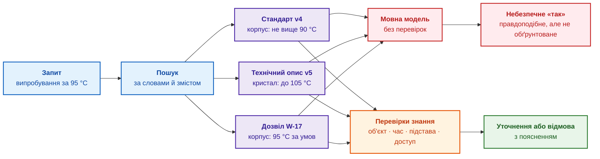
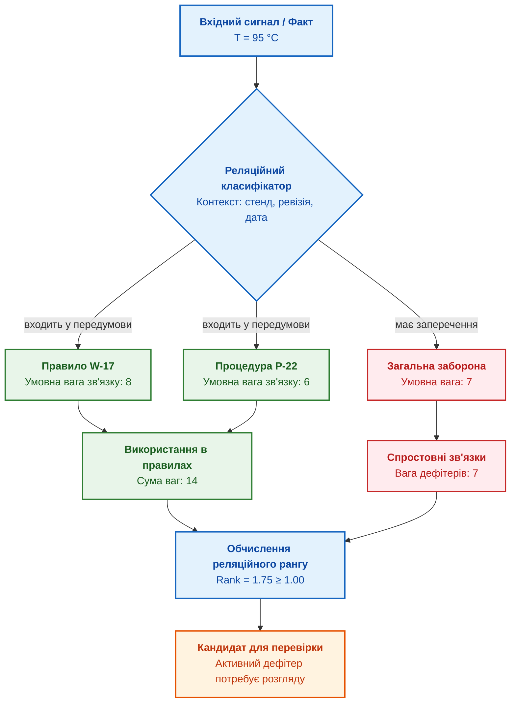
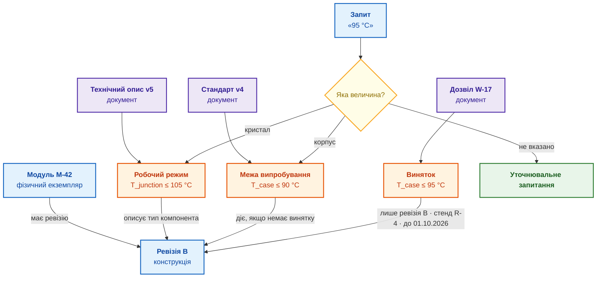
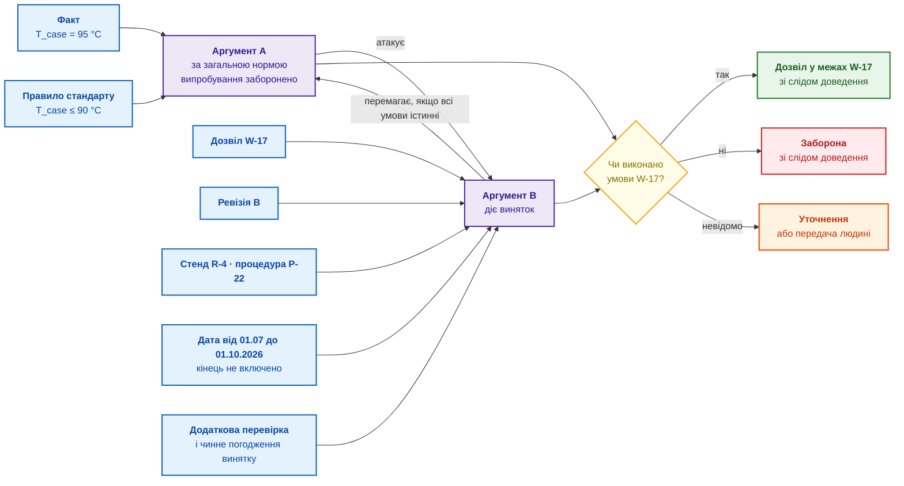
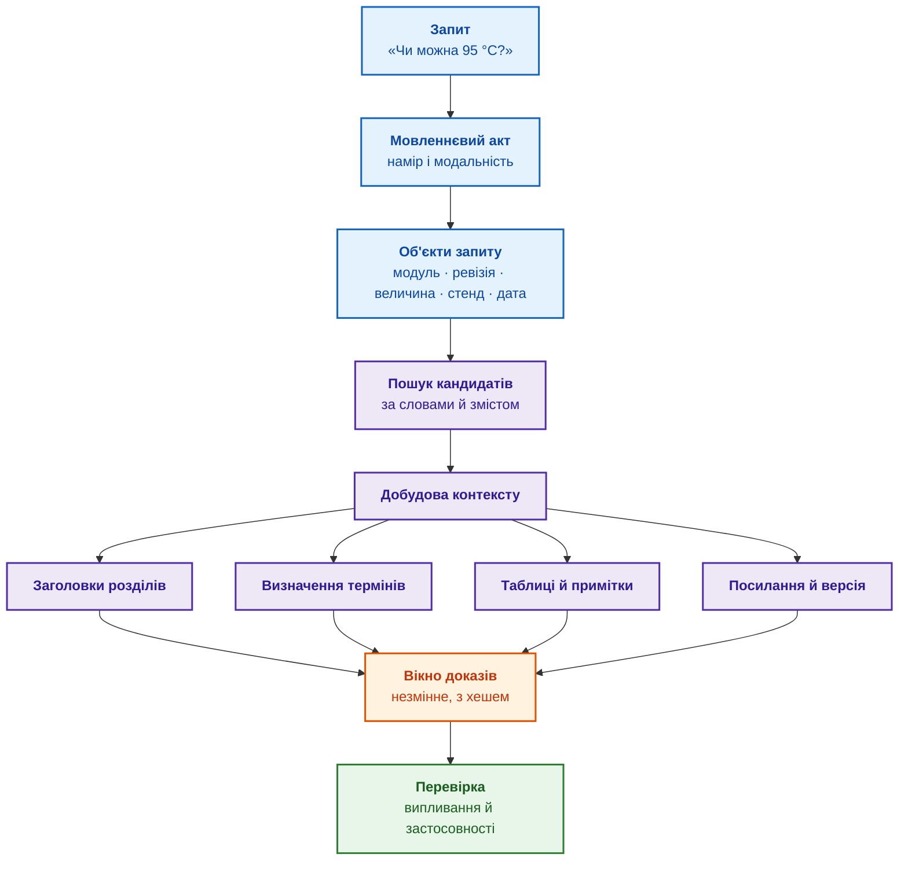
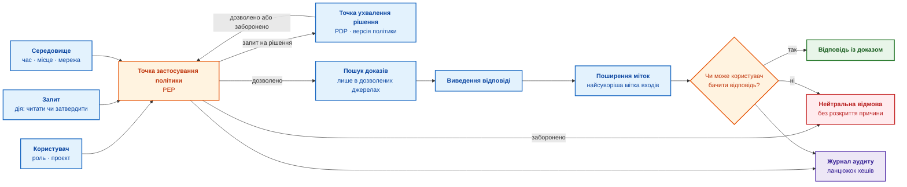
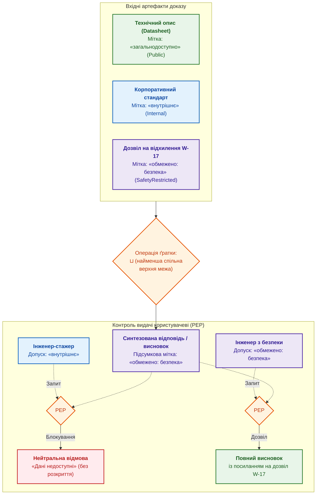
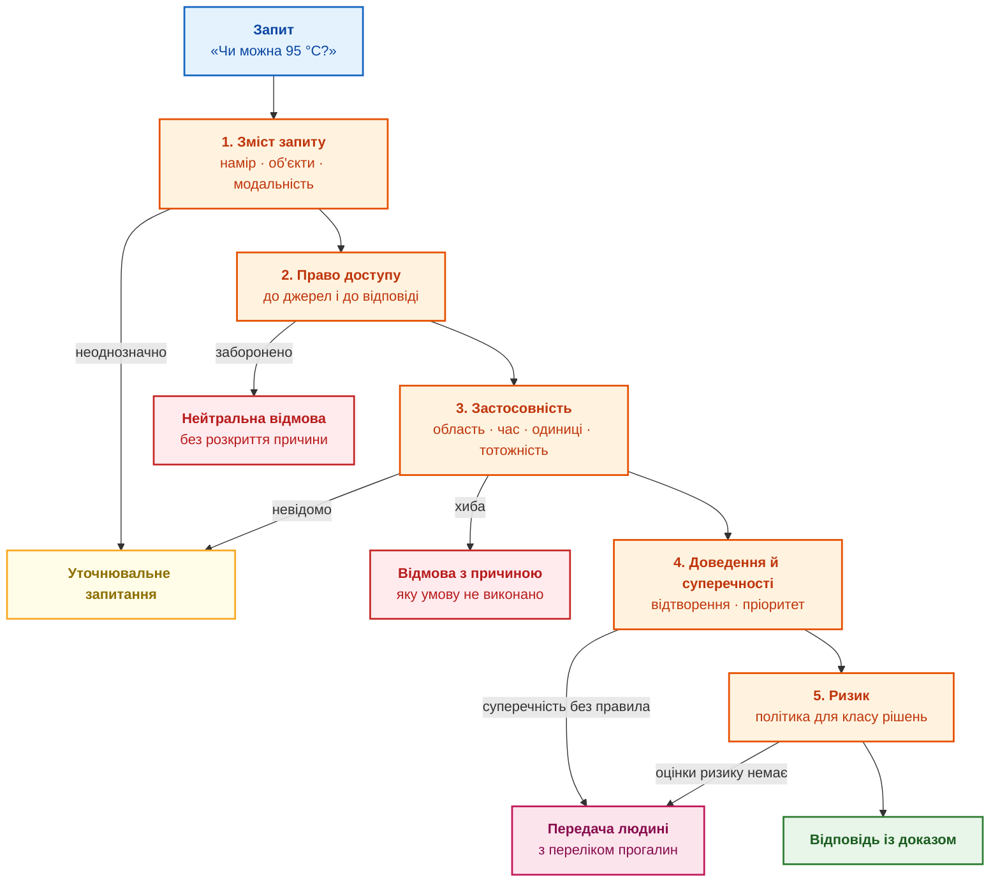

# Глава 2. Філософія для інженера: що машина має право називати знанням

> **Книга:** [Архітектура доказових експертних систем](README.md) · [Частина I: Концептуальні та епістемологічні основи](part-01-foundations.md)
> **Попередня глава:** [Глава 1. Вступ до експертних систем: від хаосу до керованих знань](ch01-introduction-to-expert-systems.md)
> **Наступна глава:** [Глава 3. Чим експертна система відрізняється від інформаційно-довідкової системи](ch03-beyond-reference-information-systems.md)
> **Зміст книги:** [README.md](README.md)  
> **Автор:** [Микола Мартинович Федчик](about-the-author.md)\
> **Попередня підготовка:** базові поняття експертної системи з глави 1, порівняння чисел і робота з умовами «якщо ... то». Формальні позначення розглядаються після задач, для яких вони потрібні.\
> **Очікувані результати:** пояснити, чому правдоподібна відповідь ще не є знанням; розкласти інженерне запитання на сім перевірок (підстава, об'єкт, спосіб виведення, зміст запиту, контекст цитати, спосіб перевірки, повноваження); сформулювати умову, за якої експертна система відповідає, уточнює запитання, передає рішення людині або відмовляє.

## Анотація

Експертна система має не лише знайти відповідь, а й перевірити, на чому вона ґрунтується та до якої ситуації застосовна. У цій главі пояснено, чому правильне число ще не є достатньою підставою для рішення і які відомості слід зберігати разом із твердженням. Наскрізний навчальний приклад ставить одне питання: чи можна випробувати силовий модуль за температури 95 °C, якщо документи називають різні межі й умови?

На цьому прикладі послідовно розглянуто підставу відповіді, розрізнення об'єктів і величин, логіку висновку, зміст запиту, контекст цитати, перевірку вимірювань і повноваження користувача. Філософські поняття вводяться як назви цих практичних питань. Авторське робоче визначення машинного знання об'єднує їх у правила допуску тверджень до використання. Такі правила не роблять першоджерело непомильним: вони дають змогу перевірити підстави рішення, знайти пропущену умову й визначити, коли потрібні уточнення, передавання рішення людині або відмова.

## 1. Інженерний контракт доказової відповіді: сім епістемічних критеріїв

Інженерний контракт доказової відповіді задає умови, за яких експертна система може використати твердження у висновку. У главі 1 було показано різницю між пошуком документа, правдоподібною відповіддю та обґрунтованим рішенням. Тепер потрібно з'ясувати, як перевірити це обґрунтування: знайдений документ може описувати інший об'єкт, застарілу версію або виняток, умови якого не виконано.

У цій монографії автором запропоновано організувати перевірку навколо семи питань: **на якій підставі стверджуємо; про який об'єкт ідеться; як отримано висновок; що саме запитано; який контекст має цитата; як перевірити твердження; хто має право його бачити й затверджувати**. Разом відповіді утворюють контракт: явний перелік умов допуску, а не обіцянку безпомилковості. Відсутність потрібного параметра вимагає уточнення; відсутність достатньої підстави не дозволяє видати стверджувальну відповідь; обмеження доступу не можна обходити заради повнішого пояснення.

Щоб ці питання не залишилися абстрактним переліком, спочатку розглянемо одне випробування та три документи про нього. Далі кожна нова перевірка повертатиметься до цієї самої задачі й пояснюватиме, чого ще бракує для відповіді.

## 2. Практичний кейс: семантична колізія трьох першоджерел при випробуваннях силового модуля

Практичний приклад має показати, чому для доказової відповіді недостатньо знайти найбільше число в документах. Розглянемо навчальний сценарій: інженер запитує, чи можна провести стендове випробування силового модуля за температури 95 °C. Назви документів, позначення модуля й стендів, дати та числові межі в цьому сценарії умовні; вони не є вимогами конкретного зовнішнього стандарту або звітом про реальне випробування.

Пошук знаходить три документи. Усі вони стосуються температури, але відповідають на різні питання: що дозволяє процедура випробування, який режим витримує компонент і за яких умов погоджено виняток. У цій монографії автором запропоновано розбирати таку колізію через умови застосування кожного твердження: об'єкт, ревізію, стенд, дату й вимірювану величину. Спочатку встановимо ці умови, а вже потім порівнюватимемо числа.

Третій знайдений документ є **дозволом на відхилення** (*waiver*): погодженим документом, який дозволяє відступити від вимоги стандарту в обмежених умовах і на обмежений час. Таблиця показує, що каже кожен документ і чого документ не каже.

**Таблиця 2.1. Три джерела та межі їхніх тверджень.**

| Документ | Що в документі сказано | Про яку температуру | Чого документ не каже |
|---|---|---|---|
| Корпоративний стандарт випробувань, версія 4 | під час випробування не вище 90 °C | температура корпусу модуля | чи бувають винятки |
| Технічний опис компонента (*datasheet*) від постачальника, версія 5, новіший за стандарт | компонент працює до 105 °C | температура кристала, тобто напівпровідникової структури всередині корпусу | чи дозволено випробування за такої температури |
| Дозвіл на відхилення W-17 | випробування за 95 °C дозволено | температура корпусу модуля | чи діє дозвіл поза своїми умовами: дозвіл чинний лише для прототипу ревізії B, на стенді R-4, до 1 жовтня 2026 року й після додаткової перевірки |

Є ще дві величини: температура повітря всередині термокамери та температура зовнішнього повітря навколо стенда. Разом із температурою корпусу й кристала це чотири різні характеристики. У запиті не названо жодної з них. Налаштувати камеру на 95 °C не означає отримати рівно 95 °C на корпусі: нагрів залежить від часу, теплообміну й роботи самого модуля. Тому в авторській моделі спочатку встановлюється, що саме виміряно. Порівнювати різні температури для перевірки одного обмеження можна лише за явно заданою моделлю переходу між ними, а не через однакову одиницю °C.

Один із можливих хибних висновків звучить переконливо: «так, адже 95 менше за 105, а дозвіл на відхилення підтверджує виняток». Його може сформувати як людина, так і мовна модель, якщо обмежитися числами та близькими за змістом фрагментами. Ця відповідь не обґрунтована з трьох причин:

1. Технічний опис компонента описує фізичну здатність кристала витримати температуру, а не дозвіл проводити випробування.
2. Дозвіл на відхилення може не стосуватися модуля, стенда чи дати із запиту, а користувач може не мати права бачити цей дозвіл.
3. Число 95 °C без назви вимірюваної величини не можна порівняти з жодною межею: 95 °C повітря в камері, корпусу й кристала означають три різні режими випробування.

Експертна система, побудована за правилами цієї глави, відповідає інакше:

> Дозволити випробування за наданим запитом експертна система не може. Для прототипу ревізії B існує потенційно застосовний виняток, але спершу треба уточнити, яку температуру мають на увазі, на якому стенді й коли відбудеться випробування та чи має користувач повноваження на таке рішення. До уточнення чинною лишається межа корпоративного стандарту: 90 °C для корпусу модуля.

Якщо користувач не має права бачити дозвіл W-17, експертна система не повинна навіть натякати на виняток, бо сам факт існування закритого документа може бути закритою інформацією:

> Доступних підстав недостатньо, щоб дозволити випробування. Передайте запит інженерові, відповідальному за безпеку випробувань.

Ці відповіді не дають бажаного дозволу, проте не приховують нестачі підстав. За авторським підходом **безпечна відмова** (*fail-closed*) означає, що система не дозволяє дію, доки потрібні умови не підтверджено. Сама кількість відмов не вимірює якість: система, що відмовляє завжди, теж може бути некорисною. Тут перевіряється конкретна поведінка: не видати необґрунтованого дозволу й пояснити доступний користувачеві наступний крок. Схема нижче порівнює два шляхи від документів до відповіді.

**Схема 2.2. Три документи й два шляхи до відповіді.**



Схема читається зліва направо. Синім позначено запит і пошук, фіолетовим три знайдені документи. Червоний шлях показує мовну модель, яка отримує документи без перевірок і складає небезпечне «так». Помаранчевий блок означає перевірки знання, які виконує експертна система: про який об'єкт ідеться, чи чинний документ на дату випробування, чи справді документ підтримує висновок і чи має користувач право доступу. Зелений блок показує результат перевірок: уточнювальне запитання або відмову з поясненням.

Розділ [«Одне запитання, три відповіді»](ch01-introduction-to-expert-systems.md#одне-запитання-три-відповіді) Глави 1 уже порівнював пошук, чатбот і експертну систему на прикладі таймауту. Приклад із температурою складніший: у ньому чотири величини з однаковою назвою, документ, що описує можливість замість дозволу, виняток з умовами та закритий доступ. Кожна складність відповідає окремому філософському запитанню, і тому приклад проходить через усю главу.

Знайти документи замало. Експертна система мусить знати, що саме стверджує кожен документ, про який об'єкт, на якій підставі, коли й для кого. Щоб перевіряти ці умови, спершу треба домовитися, що експертна система взагалі вважає знанням.

## 3. Еволюція концепції знання: від обґрунтованого істинного переконання (JTB) до проблеми Геттієра

Проблема обґрунтованого істинного переконання потрібна тут для перевірки вже знайденої межі 90 °C: чи достатньо того, що відповідь збіглася з правильним числом? Один виконавець може прочитати межу в чинному стандарті, інший випадково її вгадати. Текст відповіді однаковий, але перевірити спосіб його отримання можна лише в першому випадку. **Епістемологія** є розділом філософії про знання, його підстави й межі; далі її питання застосовуються до нашого прикладу, а не до здатності машини мати людську свідомість.

Епістемологія давно відрізняє знання від вдалої здогадки. У діалозі Платона «Теетет» Сократ показує, що істинної думки для знання замало: оратор може переконати суддів у тому, що випадково виявилося правдою, але судді від цього не знають, як усе було насправді [[1]](#src-1). З таких міркувань виросла тричленна формула: людина знає твердження, якщо твердження істинне, людина вірить у твердження і віра обґрунтована. Формулу скорочено називають JTB (*justified true belief*, обґрунтоване істинне переконання). Цю формулу часто називають класичною, хоча, як зауважують автори огляду в Стенфордській філософській енциклопедії, у чіткому вигляді формулу записали переважно у XX столітті, і здебільшого ті, хто формулу критикував [[1]](#src-1).

У 1963 році Едмунд Геттієр опублікував статтю на три сторінки й навів два приклади, у яких усі три умови виконано, а знання немає [[2]](#src-2). У прикладах Геттієра людина робить правильний висновок із хибного, але обґрунтованого припущення, і висновок виявляється істинним випадково. Схожі приклади відомі й раніше. Індійський філософ Дгармоттара у VIII столітті описав мандрівника, який бачить міраж, вирішує, що попереду вода, і справді знаходить воду під каменем. Бертран Рассел описав людину, яка дивиться на зупинений годинник саме тоді, коли годинник показує правильний час [[1]](#src-1). В усіх прикладах переконання істинне й має підставу, але підстава й істина збіглися випадково. Такі приклади називають **випадками Геттієра**.

В інженерії випадки Геттієра трапляються щодня. Датчик температури в термокамері завис і вже годину показує 94 °C. Випадково в камері зараз справді 94 °C. Запис у журналі випробування істинний і спирається на відкалібрований прилад, але правильний лише випадково: через десять хвилин у камері буде 97 °C, а журнал і далі показуватиме 94 °C.

Той самий ефект виникає в мовних моделях, які відповідають за знайденими фрагментами. Мовна модель відповіла, що межа випробування дорівнює 90 °C, і послалася на технічний опис компонента. Число правильне, але технічний опис такого числа не містить: 90 °C узято зі стандарту, фрагмент якого мовна модель бачила поруч. Перевірка, яка порівнює лише кінцеву відповідь з еталоном, зарахує успіх, хоча посилання не підтримує відповідь.

У цій монографії автором запропоновано називати такий дефект **техногенним випадком Геттієра**: відповідь збігається з правильним результатом, але наведена підстава цього результату не обґрунтовує. Це інженерна аналогія з класичною проблемою, а не твердження, що програма має переконання в тому самому значенні, що людина.

Практичний висновок авторського підходу: перевіряти потрібно не лише відповідь, а й зв'язок відповіді з підставою. Чи справді цитата містить потрібну норму? Чи справний прилад, що дав вимірювання? Перевірка числа не замінює цих питань. Наступний розділ об'єднує їх у робоче визначення знання експертної системи.

## 4. Канонічне інженерне визначення машинного знання <a id="робоче-визначення-знання-експертної-системи"></a>

Канонічне інженерне визначення потрібне, щоб перетворити питання «на чому ґрунтується відповідь?» на перевірки конкретного запису. Філософські трактування знання залишаються предметом дискусій [[1]](#src-1); для цієї книги достатньо явно домовитися, які твердження допускаються до використання. Наприклад, запис про 95 °C має зберігати не лише число, а й документ, умови винятку та відомості про перевірку.

Автор монографії пропонує таке правило:

> **Знанням експертної системи** автор монографії називає твердження, яке має версію, перевірну підставу, визначену область застосування й час чинності, відомий спосіб отримання та пройшло всі перевірки й погодження, потрібні для тверджень такого класу.

Визначення навмисно процедурне. На думку автора, визначення не пояснює, що таке знання взагалі, а описує, що має бути відомо про твердження, щоб експертна система мала право застосувати твердження. Таке визначення є авторським проєктним рішенням, яке можна перевірити тестами: для кожного твердження можна з'ясувати, чи виконано кожну умову. Визначення забороняє вважати знанням те, що часто плутають зі знанням: ймовірність наступного слова в мовній моделі, схожість векторних представлень (*embeddings*), посаду автора документа чи впевнений тон тексту.

Визначення доповнює Главу 1. У розділі [«Документ не дорівнює знанню»](ch01-introduction-to-expert-systems.md#документ-не-дорівнює-знанню) документ розбирають на об'єкти знань п'яти типів: спостереження, твердження, доказове джерело, правило, рекомендацію або рішення. Визначення вище відповідає на наступне запитання: коли об'єкт знань типу «твердження» отримує право брати участь у висновку.

Набір перевірок із визначення автор називає **епістемічним контрактом** (від грецького *epistēmē*, знання). Слово «контракт» запозичене з програмування: у підході «проєктування за контрактом» (*design by contract*) Бертрана Меєра функція оголошує умови, які мають виконуватися до й після виклику функції [[3]](#src-3). Епістемічний контракт так само оголошує умови, але не для функції, а для твердження.

> [!NOTE]
> **Авторська модель епістемічного контракту машинного знання: сім груп перевірок**
> 1. **Підстава:** зберегти джерело та перевірити, чи підтримує воно саме це твердження.
> 2. **Об'єкт:** установити, до якого модуля, величини й версії належить твердження.
> 3. **Виведення:** показати засновки й кроки, що привели до висновку, та не приховувати суперечностей.
> 4. **Зміст запиту:** розрізнити фізичну можливість, нормативний дозвіл і прохання про погодження.
> 5. **Контекст:** прочитати цитату разом з умовами, визначеннями й примітками, які змінюють її зміст.
> 6. **Перевірка:** установити, як підтвердити або спростувати твердження; не плутати вимірювання з прогнозом чи нормою.
> 7. **Повноваження:** перевірити право бачити джерело й ухвалювати рішення, зберегти запис про виконані дії.
> *Інженерний інваріант:* Кожна потрібна для цього класу рішень умова перевіряється явно. Прогалина не замінюється припущенням: система уточнює дані, передає рішення людині або утримується від твердження.

Умови контракту зручно згрупувати за сімома філософськими дисциплінами. Кожна дисципліна ставить до твердження одне запитання, і кожне запитання має інженерну відповідь:

**Таблиця 2.3. Сім питань до знання експертної системи.**

| Дисципліна | Запитання до твердження | Що зберігає експертна система | Типова помилка в прикладі з 95 °C |
|---|---|---|---|
| Епістемологія: наука про знання | На якій підставі твердження допущено? | доказ, походження, заперечувальні обставини | правильне число з хибним посиланням |
| Онтологія: наука про те, що існує і як розрізняти об'єкти | Про який об'єкт, величину й версію йдеться? | ідентифікатори, вимірювані величини, одиниці, область застосування | межу кристала прийнято за межу випробування |
| Логіка | Як саме отримано висновок? | спосіб виведення, слід доведення, стан суперечностей | припущення видано за доведений факт |
| Філософія мови | Що означає запит у цьому контексті? | намір, об'єкти запиту, модальність | «чи можна» як фізичну здатність сплутано з дозволом |
| Герменевтика: теорія тлумачення текстів | Який контекст робить цитату чинною? | розділ, визначення, примітки, версію документа | виняток відірвано від примітки «лише ревізія B» |
| Філософія науки | Як твердження перевірити або спростувати? | метод, невизначеність, протокол, критерій приймання | прогноз моделі видано за вимірювання |
| Соціальна епістемологія | Хто має право бачити, заперечити й затвердити? | ролі, права доступу, рецензування, оскарження | авторитет прирівняно до істини, доступ до дозволу |

Таблиця є картою глави. Наступні розділи йдуть у тому самому порядку: для кожної дисципліни спершу показано проблему на прикладі 95 °C, потім спосіб, яким експертна система розв'язує проблему, і наприкінці короткий підсумок.

## 5. Епістемологічний базис: твердження, докази та походження фактів (Provenance)

В інженерії знань збереження документів у вигляді монолітних неструктурованих файлів є джерелом критичних дефектів простежуваності: три знайдені пошуковим механізмом нормативні тексти ще не утворюють верифікованої фактологічної бази. Стандарт випробувань регламентує десятки фізичних параметрів, специфікація виробника містить сотні характеристик, а для аргументації конкретного допуску потрібні два-три атомарні твердження з точними координатами. Якщо система оперує документом або багатосторінковим фрагментом як неподільним цілим, символьний рушій втрачає здатність довести, яке саме нормативне положення обґрунтовує висновок і чи зберігає воно чинність. Саме в такій непрозорій архітектурі виникають техногенні випадки Геттієра: формальне посилання на релевантний стандарт існує, проте фактичний зміст рішення ним не підтримується.

Тому одиницею знання в експертній системі є не документ і не абзац, а окреме твердження. Для дозволу W-17 твердження має такі частини:

**Таблиця 2.4. Складові твердження про дозвіл W-17.**

| Частина твердження | Значення для дозволу W-17 |
|---|---|
| Предмет | випробування модуля на стенді |
| Що стверджується | дозволено максимальну температуру корпусу 95 °C |
| Область застосування | прототип ревізії B, стенд R-4, процедура випробування P-22 |
| Час чинності | з 1 липня до 1 жовтня 2026 року, дату закінчення не включено |
| Час запису | з 2 липня 2026 року, 09:15 за всесвітнім координованим часом (UTC) |
| Вид твердження | нормативний виняток |
| Версія | друга редакція документа W-17 |

Час чинності стосується самого дозволу, а час запису показує, коли про нього дізналася система. Чому ці дати не можна об'єднати, розглянуто в підрозділі 6.1 на прикладі запізнілого запису про відкликання W-17.

Доказ є окремим від твердження об'єктом. Доказом може бути незмінний фрагмент доказового джерела (цитата з хешем і точними координатами в конкретній версії документа), запис вимірювання, підписане погодження або слід виведення. Походження (*provenance*) відповідає на запитання, звідки взявся доказ і хто що з доказом робив. Стандарт PROV-O Консорціуму Всесвітньої павутини (World Wide Web Consortium, W3C) пропонує для опису походження базові поняття: сутність (*Entity*), дію (*Activity*), виконавця (*Agent*) і відношення «отримано з» (*wasDerivedFrom*) [[4]](#src-4). Походження не доводить істинності: докладна історія помилкового документа лишається докладною історією помилки.

Третій об'єкт, який експертна система зберігає окремо, це заперечувальні обставини. **Заперечувальною обставиною** (*defeater*) називають обставину, яка скасовує або послаблює підставу твердження. Термін став стандартним у працях Джона Поллока про спростовні міркування, і Поллок розрізняє два види заперечувальних обставин [[5]](#src-5). Обставина першого виду підтримує протилежний висновок: дозвіл W-17 заперечує загальну заборону температур корпусу понад 90 °C, але лише в межах ревізії B і стенда R-4. Обставина другого виду руйнує зв'язок між підставою й висновком, не стверджуючи протилежного: якщо з'ясувалося, що датчик у камері мав помилку калібрування, запис вимірювання перестає підтримувати висновок про температуру, хоча й не доводить, що температура була іншою.

Схема показує, як ці об'єкти пов'язані в прикладі з 95 °C.

**Схема 2.5. Джерела, твердження та заперечення.**

```mermaid
flowchart LR
  accTitle: Граф підтримки й заперечення тверджень про 95 °C
    accDescr: Стандарт через незмінну цитату підтримує загальну заборону. Дозвіл на відхилення W-17 підтримує виняток. Загальна заборона й виняток атакують одне одного, а експертна система зберігає обидва твердження до рішення.

    STD["<b>Стандарт v4</b><br/>документ"] -->|"містить"| SP["<b>Цитата з п. 5.3</b><br/>незмінний фрагмент"]
    OWN["<b>Власник стандарту</b>"] -->|"затвердив"| STD
    SP -->|"підтримує"| C1["<b>Твердження C1</b><br/>корпус понад 90 °C заборонено"]
    W["<b>Дозвіл W-17</b><br/>документ"] -->|"підтримує"| C2["<b>Твердження C2</b><br/>95 °C дозволено для ревізії B"]
    SAF["<b>Інженер з безпеки</b>"] -->|"затвердив"| W
    C2 -->|"атакує в межах ревізії B"| C1
    C1 -->|"атакує поза умовами W-17"| C2
    C1 & C2 --> G["<b>Граф аргументів</b><br/>обидва твердження збережено"]
    G --> O["<b>Рішення</b><br/>після перевірки умов"]

    classDef doc fill:#e8eaf6,stroke:#3f51b5,stroke-width:2px,color:#1a237e;
    classDef claim fill:#e1f5fe,stroke:#0288d1,stroke-width:2px,color:#01579b;
    classDef actor fill:#fce4ec,stroke:#c2185b,stroke-width:2px,color:#880e4f;
    classDef grf fill:#fff3e0,stroke:#e65100,stroke-width:2px,color:#bf360c;
    classDef out fill:#e8f5e9,stroke:#2e7d32,stroke-width:2px,color:#1b5e20;

    class STD,SP,W doc;
    class OWN,SAF actor;
    class C1,C2 claim;
    class G grf;
    class O out;
```



Індиговими блоками позначено документи й цитату, рожевими людей, що документи затвердили, блакитними твердження, помаранчевим граф аргументів, зеленим рішення. Стандарт через незмінну цитату з пункту 5.3 підтримує твердження C1 про загальну заборону. Дозвіл W-17 підтримує твердження C2 про виняток. Твердження атакують одне одного: C2 перемагає C1 у межах ревізії B, а C1 перемагає C2 поза умовами дозволу. Експертна система не видаляє жодне твердження, а зберігає обидва до рішення, яке залежить від умов запиту. Як ухвалюють таке рішення, показує розділ про логіку.

На практиці разом із кожним твердженням зберігають щонайменше:

- незмінний ідентифікатор і канонічний запис твердження;
- епістемічний статус: процитовано, спостережено, виведено, припущено або нормативно встановлено;
- фрагмент джерела з хешем і координатами в конкретній версії документа;
- хто або що створило твердження: програма розбору документа, модель видобування, правило чи рецензент;
- область застосування, одиниці, час чинності й час запису;
- докази на підтримку й проти;
- спосіб виведення й слід доведення;
- мітку доступу й рішення рецензента;
- стан життєвого циклу: чинне, замінене, відкликане, оскаржене або невідоме.

Приклад такого запису у форматі JSON наведено в розділі «Умова відповіді» нижче, а життєвий цикл твердження від кандидата до відкликання описує [Глава 25](ch25-how-expert-systems-learn.md).

Одне поле `confidence=0.93` (упевненість) не замінює жодного з цих полів. З такого поля невідомо, що саме має ймовірність 0,93, на яких даних число відкалібровано і чи можна показувати твердження цьому користувачеві.

З епістемології для експертної системи випливає правило: зберігати твердження, доказ, походження й заперечувальні обставини як окремі пов'язані об'єкти. Тільки тоді експертна система може перевірити кожен зв'язок і не потрапити у випадок Геттієра. Але навіть добре підкріплене твердження може стосуватися іншого об'єкта, ніж той, про який питають.

### 5.1. Реляційна природа машинного знання: «Сенсорний порядок» Фрідріха Гаєка проти наївного позитивізму

Реляційна природа знання означає, що для рішення важливі зв'язки твердження з іншими записами. Число 95 °C саме по собі не вказує, чи випробування дозволено: потрібні зв'язки з модулем, вимірюваною величиною, правилом і винятком. «Реляційний» тут означає «пов'язаний відношеннями», а не протиставлення графа реляційній базі даних: таблиці також можуть зберігати ці зв'язки.

У праці «Сенсорний порядок» Фрідріх Гаєк розглядав сприйняття як класифікацію сигналів у мережі відношень [[32]](#src-32). Для цієї глави це філософська аналогія: запис набуває значення в контексті зв'язків. Вона не доводить жодної формули допуску й не встановлює переваги одного нормативного документа над іншим. Далі розглянемо окрему авторську евристику: як за зв'язками вибрати кандидатів для подальшого аналізу.

**Схема 2.6. Попередній відбір кандидата за зв'язками.**



Для оцінки структурної залученості факту автором запропоновано **реляційний ранг**. Він збільшується, коли факт використовується в передумовах правил, і зменшується за наявності врахованих заперечень. Це безрозмірна евристична оцінка для відбору кандидатів, не ймовірність істинності, не сила доказу й не правило нормативного пріоритету.

**Формула (2.7). Реляційний ранг кандидата.**

$$
\mathrm{Rank}_{\mathrm{rel}}(f, \mathcal{K}) = \frac{\sum_{r \in \mathcal{R}} \mathbb{I}(f \in \mathrm{Prem}(r)) \cdot w(r)}{1 + \sum_{d \in \mathcal{D}} \mathbb{I}(d \text{ defeats } f) \cdot w(d)}
$$

де:
- $`f \in \mathcal{F}`$ — твердження-кандидат із множини фактів $`\mathcal{F}`$; $`\mathcal{K} = \langle \mathcal{F}, \mathcal{R}, \mathcal{D} \rangle`$ позначає враховані факти, правила й заперечення;
- $`\mathcal{R}`$ — множина правил; $`\mathrm{Prem}(r)`$ є множиною передумов правила $r$, а $w(r)$ є умовною вагою зв'язку з цілим значенням від 1 до 10;
- $`\mathcal{D}`$ — множина врахованих заперечувальних обставин; їхні ваги $w(d)$ також є цілими числами від 1 до 10, без фізичних одиниць;
- $`\mathbb{I}(\cdot) \in \{0, 1\}`$ — індикаторна функція входження факту в передумови правила або у сферу дії дефітера;
- $`\mathrm{Rank}_{\mathrm{rel}} \in [0, +\infty)`$ — невід'ємна оцінка структурних зв'язків; одиниця в знаменнику не дає ділити на нуль, коли заперечень немає.

У навчальному графі факт про температуру корпусу входить до передумов двох правил із вагами 8 і 6. Для цього кандидата враховано одне заперечення з вагою 7. Усі три ваги обрано для прикладу, а не виміряно й не взято зі стандарту. Обчислимо ранг крок за кроком: сума у чисельнику дорівнює 14, знаменник дорівнює 8, отже результат становить 1,75.

**Формула (2.8). Навчальний розрахунок реляційного рангу.**

$$
\mathrm{Rank}_{\mathrm{rel}}(f, \mathcal{K}) = \frac{8 \cdot 1 + 6 \cdot 1}{1 + 7 \cdot 1} = \frac{14}{8} = 1{,}75 \ge 1{,}00
$$

У цьому прикладі авторський поріг відбору дорівнює 1. Ранг 1,75 дозволяє розглянути кандидата далі, але не скасовує заборону. Якщо перше правило не застосовне, його індикатор у чисельнику стає нулем: залишається 6, а результат зменшується до 0,75. Вага правила при цьому не змінюється. Поріг і ваги мають окремо перевірятися для обраної задачі; без такої перевірки це лише навчальна схема. Допуск W-17 усе одно визначають його чинність, область застосування та повноваження на виняток, а не порівняння рангу з одиницею.

> [!NOTE]
> **Авторська модель реляційного рангу: три результати попереднього відбору**
> 1. **Нуль:** факт не використано в передумовах врахованих правил; це не означає, що факт хибний або не має інших зв'язків.
> 2. **Між нулем і порогом:** кандидат не проходить цей евристичний відбір; причина й повнота правил потребують перевірки.
> 3. **Не нижче порога:** кандидат передається на перевірку походження, застосовності й заперечень; автоматичного дозволу ще немає.
> *Інженерний інваріант:* Ранг не встановлює нормативного пріоритету. Подання графа в пам'яті розглянуто в [главі 32](ch32-high-performance-knowledge-packs-mmap-and-harvesting.md); для розуміння цього відбору апаратний розрахунок не потрібний.

## 6. Онтологічна ідентифікація: подолання семантичної омонімії та контекстні обмеження

У трьох документах прикладу тричі трапляється слово «температура» і двічі слово «модуль», але за однаковими словами стоять різні об'єкти. Онтологія, розділ філософії про те, що існує і як розрізняти сутності, в інженерії перетворюється на практичне запитання: чи описують два записи той самий об'єкт? В інформатиці онтологією також називають формальну модель понять предметної області (див. Словник [Глави 1](ch01-introduction-to-expert-systems.md)). Онтологічна помилка в робочому коді рідко виглядає філософською. Частіше це з'єднання таблиць за назвою компонента, невдале перетворення одиниць або відношення `owl:sameAs` («той самий, що»), поставлене між схожими, але не тотожними сутностями в мові онтологій W3C (Web Ontology Language, OWL) [[6]](#src-6).

Щоб відповісти на запит про 95 °C, експертна система мусить розрізняти:

- фізичний модуль M-42, тип компонента й ревізію конструкції B;
- технічний опис як документ і допустимий робочий режим, який технічний опис описує;
- межу випробування в стандарті як нормативне обмеження;
- дозвіл на відхилення як тимчасовий виняток, а не нову загальну межу;
- вимірювані величини: температуру корпусу $`T_{\mathrm{case}}`$, температуру кристала $`T_{\mathrm{junction}}`$ і температуру повітря в камері $`T_{\mathrm{chamber}}`$;
- випробування, план випробування, стенд, конфігурацію стенда й результат вимірювання.

**Вимірювана величина** (*measurand*) означає, що саме вимірюють: не просто «температуру», а температуру конкретної частини конкретного об'єкта в конкретних умовах.

Розрізняти об'єкти допомагає правило: назву читає людина, ідентифікатор читає програма. Ідентифікатор об'єкта має бути стабільним. Синоніми, переклади й старі коди зберігають як атрибути або як окремі твердження про відповідність, і кожне таке твердження має власне походження. Об'єднання двох ідентифікаторів в один є версіонованою операцією, яку можна скасувати, а не незворотним перезаписом бази знань. Схема показує, які об'єкти стоять за словами із запиту.

**Схема 2.9. Об'єкт, вимірювана величина й застосовна межа.**



Синім позначено фізичні об'єкти й запит, фіолетовим документи, помаранчевим межі й режими, які документи встановлюють. Кожна межа стосується своєї величини: технічний опис говорить про кристал, стандарт і дозвіл W-17 про корпус. Жовтий ромб показує розгалуження за вимірюваною величиною: якщо запит не називає величину, експертна система не вибирає межу навмання, а ставить уточнювальне запитання (зелений блок).

Найпростіший спосіб не переплутати температуру повітря в камері з межею для корпусу модуля полягає в тому, щоб зберігати назву величини разом із числом і перевіряти її в методі порівняння. Приклад мовою Go реалізує саме цю перевірку: це контроль під час виконання, а не статична заборона компілятора. Вхідні числа в прикладі наперед задані й коректні; перевірка повного запису вимірювання потрібна окремо.

<details>
<summary>Приклад мовою Go: температура з назвою вимірюваної величини</summary>

Програма є повною й запускається командою `go run main.go`. Тип `Temperature` зберігає разом зі значенням назву вимірюваної величини, а метод `NotAbove` порівнює лише однакові величини.

```go
package main

import (
	"errors"
	"fmt"
)

// Measurand називає, що саме виміряно, а не лише одиницю.
type Measurand string

const (
	CaseTemp     Measurand = "T_case"
	JunctionTemp Measurand = "T_junction"
	ChamberTemp  Measurand = "T_chamber"
)

type Temperature struct {
	What   Measurand
	Kelvin float64
}

func Celsius(what Measurand, c float64) Temperature {
	return Temperature{What: what, Kelvin: c + 273.15}
}

var ErrDifferentMeasurands = errors.New("різні вимірювані величини")

func (t Temperature) NotAbove(limit Temperature) (bool, error) {
	if t.What != limit.What {
		return false, fmt.Errorf("%w: %s і %s", ErrDifferentMeasurands, t.What, limit.What)
	}
	return t.Kelvin <= limit.Kelvin, nil
}

func main() {
	standardLimit := Celsius(CaseTemp, 90)

	request := Celsius(ChamberTemp, 95)
	if _, err := request.NotAbove(standardLimit); err != nil {
		fmt.Println("порівняння заборонено:", err)
	}

	measured := Celsius(CaseTemp, 94.6)
	ok, _ := measured.NotAbove(standardLimit)
	fmt.Println("корпус 94,6 °C у межах 90 °C:", ok)
}
```

Програма друкує:

```text
порівняння заборонено: різні вимірювані величини: T_chamber і T_case
корпус 94,6 °C у межах 90 °C: false
```

Перший рядок показує, що порівняння температури повітря в камері з межею для корпусу заборонено: метод повертає помилку, а не `false`, бо «порівнювати не можна» і «межу перевищено» означають різне. Другий рядок показує звичайне порівняння однакових величин: 94,6 °C корпусу перевищують межу 90 °C. Значення зберігаються в кельвінах, базовій одиниці температури в Міжнародній системі одиниць (SI), тому порівняння не залежить від того, в яких одиницях значення ввели.

</details>

Одиниці теж мають збігатися або явно перераховуватися: 95 °C відповідають 368,15 К, а не 95 К. Саме тому приклад зберігає значення в кельвінах. Але однакові одиниці не усувають різниці між температурою корпусу та кристала: перевірка величини й перерахунок одиниць розв'язують різні задачі.

Підсумок онтології для інженера: порівнювати можна лише величини одного виду й лише об'єкти, тотожність яких встановлено. Два наступні підрозділи розглядають ще дві властивості, без яких застосувати твердження неможливо: час і область застосування.

### 6.1. Двовимірна темпоральність: бітемпоральний облік валідності фактів (Valid Time vs Transaction Time)

Через місяць після випробування аудитор запитує: чому 22 вересня експертна система дозволила випробування за 95 °C, якщо дозвіл W-17 відкликали 20 вересня? Одне поле `updated_at` (час останнього оновлення запису) не допоможе відповісти: поле показує лише, коли запис змінили востаннє, але не показує, що експертна система знала 22 вересня.

Бази даних, що зберігають історію, розрізняють два незалежні види часу. Цю термінологію запропонували Річард Снодграсс та Ілсу Ан [[7]](#src-7):

- **час чинності** (*valid time*): коли твердження правдиве в предметному світі; для W-17 це проміжок з 1 липня до 1 жовтня 2026 року;
- **час запису** (*transaction time*): коли твердження записали в базу знань і доки запис вважався поточним; для W-17 це проміжок від 2 липня 2026 року.

Нехай W-17 відкликали 20 вересня, а в базі знань відкликання записали лише 25 вересня. Тоді запитання «що експертна система знала 22 вересня про 22 вересня?» має відповідь «W-17 чинний», а запитання «що відомо сьогодні про 22 вересня?» має відповідь «W-17 уже не діяв». Обидві відповіді правильні й потрібні: перша пояснює поведінку експертної системи 22 вересня, друга показує справжній стан справ. Без двох видів часу аудитор не відрізнить помилку експертної системи від запізнілого внесення даних.

**Запропонована автором інженерна формалізація бітемпорального зрізу знань:**
Під час регуляторного аудиту або ретроспективного розслідування інцидентів виникає задача точного відтворення стану знань експертної системи на конкретну дату в минулому. Вимірюваним результатом є дискретна множина тверджень $`K(t_v, t_s)`$, що одночасно задовольняють дві часові координати у просторі $`\mathbb{T} \times \mathbb{T}`$ (де $`\mathbb{T}`$ є шкалою посекундного всесвітнього координованого часу UTC). Це авторська формалізація аудиторського запиту, а не формула, приписана ISO 26262-8.

**Формула (2.10). Бітемпоральний зріз збережених тверджень.**

```math
K(t_v,t_s)=\{\,c \in \mathcal{KB} \mid t_v\in I_v(c)\ \wedge\ t_s\in I_s(c)\,\}
```

Параметри та діапазони значень:
- $`c \in \mathcal{KB}`$ — версіоноване атомарне твердження з простору бази знань $`\mathcal{KB}`$;
- $`t_v \in \mathbb{T}`$ — момент валідності в предметній області (Valid Time), для якого перевіряється фізичний або нормативний стан (наприклад, запланована дата стендового випробування);
- $`t_s \in \mathbb{T}`$ — момент транзакційної фіксації в системі (Transaction Time), тобто відмітка часу, на яку проводиться аудит бази знань (стан коміту сховища);
- $`I_v(c) = [t_{v,\text{start}}, t_{v,\text{end}}) \subset \mathbb{T}`$ — інтервал фізичної та нормативної чинності твердження $c$;
- $`I_s(c) = [t_{s,\text{commit}}, t_{s,\text{retire}}) \subset \mathbb{T}`$ — інтервал системної актуальності запису $c$ у незмінному журналі аудиту (доки версію не було замінено або відкликано);
- $\mid$ відокремлює предикатні умови від елементів множини, $\wedge$ означає логічну кон'юнкцію умов належності точок відповідним інтервалам.

Практичне застосування та інженерні висновки:
Обчислення $`K(t_v, t_s)`$ дає часовий зріз усієї бази знань. Для конкретного запиту $`q`$ експертна система окремо відбирає з цього зрізу кандидати за предметом і запитуваним відношенням; позначимо цю вибірку $`K_q(t_v,t_s)`$. Тематичний відбір ще не є перевіркою застосовності чи несуперечності. Далі експертна система розглядає три випадки:
1. **$`K_q(t_v, t_s) = \emptyset`$:** У перевіреній вибірці кандидатів не знайдено запису для заданих часових координат. Експертна система не використовує відсутнє твердження як підставу і повідомляє про нестачу підтвердження; порожній результат сам по собі не доводить відсутності норми поза перевіреною областю.
2. **$`|K_q(t_v, t_s)| = 1`$:** Єдиний знайдений кандидат передається на перевірку застосовності, походження та інших умов допуску. Однаковість часових меж не доводить істинності кандидата.
3. **$`|K_q(t_v, t_s)| > 1`$:** Кілька кандидатів передаються на перевірку змісту, контексту та зв'язків між редакціями. Саме число кандидатів не доводить конфлікту: твердження можуть бути сумісними, доповнювати одне одного або стосуватися різних умов. Якщо виявлено взаємовиключні застосовні приписи, їх подальший розгляд залежить від політики нормативних колізій.

Нехай запит $`q`$ стосується саме запису W-17, а знайдено дві його версії. Перша версія: $`I_v=[\text{01.07},\ \text{01.10})`$, $`I_s=[\text{02.07},\ \text{25.09})`$. Друга версія, внесена після відкликання: $`I_v=[\text{01.07},\ \text{20.09})`$, $`I_s=[\text{25.09},\ \infty)`$. Для $`t_v=\text{22.09}`$ і $`t_s=\text{22.09}`$ до вибірки W-17 потрапляє перша версія, тож дозвіл W-17 вважався чинним. Для $`t_v=\text{22.09}`$ і $`t_s=\text{30.09}`$ жодна версія W-17 не потрапляє до вибірки: перша вже не поточна, а друга закінчилася 20 вересня. Інші записи бази знань не впливають на кількість версій W-17 у цій вибірці.

Різниця між двома результатами сама є інформацією: експертна система діяла на знаннях, які пізніше виправили, і видно, коли саме виправили. Межі формули: формула відбирає записи лише за часом і не перевіряє ні області застосування, ні істинності; повнота вибірки для запиту залежить від пошуку й доступних джерел. У наведеному прикладі обидва інтервали напіввідкриті: початок включено, кінець виключено. Історичний зріз можливий, лише якщо старі версії записів збережено й доступ до них дозволений.

> [!NOTE]
> **Авторська модель темпорального аудиту: три результати вибірки**
> 1. **Порожня вибірка ($`|K_q(t_v, t_s)| = 0`$):** У перевірених кандидатах для запиту немає запису на задані часові координати; експертна система повідомляє про нестачу підтвердження і не використовує відсутній запис як підставу.
> 2. **Один кандидат ($`|K_q(t_v, t_s)| = 1`$):** Знайдений запис передається на перевірку застосовності $`\mathrm{Applicable}`$ та інших умов допуску; його істинність не встановлюється самою кількістю записів.
> 3. **Кілька кандидатів ($`|K_q(t_v, t_s)| > 1`$):** Експертна система перевіряє зміст, контекст і зв'язки редакцій; кілька записів можуть бути сумісними й самі по собі не означають нормативної колізії.
> *Інженерний інваріант:* Часовий зріз має відтворювати збережену історію. Формула відбору сама не забезпечує незмінності даних: це окрема вимога до збереження версій.

Стандарт W3C OWL-Time пропонує словник для опису моментів та інтервалів часу [[8]](#src-8), але правила меж інтервалів і політику виправлення минулих записів команда визначає сама. Як система здобуття знань зберігає обидва часи під час завантаження документів, показує [Глава 10](ch10-knowledge-acquisition-systems.md).

Отже, для аудиту й відтворення відповідей експертна система зберігає кожне твердження з двома інтервалами часу й ніколи не перезаписує старі версії. Тоді на запитання «що було відомо тоді?» є точна відповідь.

### 6.2. Верифікація застосовності: оцінка області чинності твердження <a id="чи-застосовне-твердження-до-запиту"></a>

Дозвіл W-17 існує, чинний і правдивий, але стосується лише вузької області: ревізії B, стенда R-4 і певного проміжку дат. Запит «Чи можна 95 °C?» не називає ні ревізії, ні стенда, ні дати. Експертна система мусить вирішити, чи застосовний W-17 до запиту, і не має права вгадувати відсутні дані за схожістю слів.

Для такого рішення двох значень «так» і «ні» замало. Потрібне третє значення, «невідомо», яке означає, що для рішення бракує даних. Правила обчислень із трьома значеннями описує тризначна логіка Стівена Кліні [[9]](#src-9), докладно розглянута в [Главі 6](ch06-applied-mathematics-for-expert-systems.md). Для кон'юнкції, тобто зв'язки «і», правило таке: якщо хоча б одна умова хибна, результат хибний; якщо всі умови істинні, результат істинний; у решті випадків результат невідомий.

Щоб записати ці перевірки компактно, у цій монографії автором запропоновано предикат **застосовності**. Предикат є функцією, яка відповідає на питання про умову; тут відповідь має три значення: $`\mathbf{T}`$ означає «умову виконано», $`\mathbf{F}`$ означає «умову порушено», $`\mathbf{U}`$ означає «даних бракує». Символ $\wedge$ читається як «і»: потрібні всі п'ять умов.

**Формула (2.11). П'ять умов застосовності твердження.**

```math
\begin{aligned}
\mathrm{Applicable}(c,q,t_v,t_s)={}&\mathrm{Scope}(c,q)\wedge \mathrm{Valid}(c,t_v)\wedge \mathrm{Known}(c,t_s)\\
&\wedge \mathrm{Units}(c,q)\wedge \mathrm{Identity}(c,q)
\end{aligned}
```

Параметри та діапазони значень:
- $`c \in \mathcal{KB}`$ — твердження-кандидат, $`q \in \mathcal{Q}`$ — структурований запит користувача; $`t_v \in \mathbb{T} \cup \{\bot\}`$ — предметний час, де $\bot$ означає неназвану дату; $`t_s \in \mathbb{T}`$ — час визначеного знімка аудиту;
- $`\mathrm{Scope}(c,q) \in \{\mathbf{T}, \mathbf{F}, \mathbf{U}\}`$ — збіг граничних умов застосування (ревізія зразка, тип випробувального стенда, регламент процедури);
- $`\mathrm{Valid}(c,t_v) \in \{\mathbf{T}, \mathbf{F}, \mathbf{U}\}`$ — перевірка виконання умови $`t_v \in I_v(c)`$ для заданої дати; за $`t_v = \bot`$ результат $\mathbf{U}$, а не $\mathbf{F}$;
- $`\mathrm{Known}(c,t_s) \in \{\mathbf{T}, \mathbf{F}\}`$ — перевірка присутності факту в сховищі на момент транзакції $`t_s \in I_s(c)`$;
- $`\mathrm{Units}(c,q) \in \{\mathbf{T}, \mathbf{F}, \mathbf{U}\}`$ — сумісність вимірюваних величин і перерахунку одиниць SI; неназвана величина або відсутні потрібні одиниці дають $\mathbf{U}$, відома несумісність — $\mathbf{F}$;
- $`\mathrm{Identity}(c,q) \in \{\mathbf{T}, \mathbf{F}, \mathbf{U}\}`$ — однозначність розпізнавання екземпляра компонента за стабільним глобальним ідентифікатором (UUID / URI);
- $\wedge$ — оператор кон'юнкції у сильній тризначній логіці Кліні (де $`\mathbf{F} \wedge \mathbf{U} = \mathbf{F}`$, але $`\mathbf{T} \wedge \mathbf{U} = \mathbf{U}`$).

Практичне застосування та інженерні висновки:
Предикат розраховується модулем фільтрації перед побудовою дерева доведення. Залежно від отриманого значення логічний рушій виконує одну з трьох штатних дій:
- **$`\mathrm{Applicable} = \mathbf{T}`$:** Кандидат підходить до контексту запиту. Далі перевіряються його джерело, виведення, суперечності й доступ; застосовність сама не робить твердження істинним.
- **$`\mathrm{Applicable} = \mathbf{F}`$:** Кандидат не використовується саме для цього запиту. Наприклад, дозвіл для ревізії B не застосовний до ревізії C, але не стає від цього хибним або недійсним для всіх інших запитів.
- **$`\mathrm{Applicable} = \mathbf{U}`$:** Система зупиняє формування висновку й формує автоматичний запит на уточнення (`ClarificationRequest`). Уточнення містить точний перелік атрибутів із невизначеним значенням (наприклад: *«Вкажіть ревізію силового модуля та номер випробувального стенда»*). Будь-яка стохастична екстраполяція за браку даних суворо блокується.

Для запиту про модуль M-42 ревізії B на стенді R-4 від 15 вересня 2026 року припустімо, що величина названа й потрібний запис є в знімку. Усі п'ять перевірок дають істину, тому їхня кон'юнкція також істинна. Якщо ревізію не названо, перевірка області дає «невідомо», а решта лишаються істинними: весь результат невідомий. Якщо відомо, що ревізія C, результат хибний навіть за неназваної дати, бо одна з необхідних умов уже порушена. Ці три випадки пояснюють, навіщо відрізняти відсутність даних від встановленої невідповідності.

> [!NOTE]
> **Авторська логічна модель застосовності: п'ять умов у логіці Кліні**
> 1. $`\mathrm{Scope}(c,q) \in \{\mathbf{T}, \mathbf{F}, \mathbf{U}\}`$ — збіг граничних умов контексту (ревізія зразка, випробувальний стенд, регламент).
> 2. $`\mathrm{Valid}(c,t_v) \in \{\mathbf{T}, \mathbf{F}, \mathbf{U}\}`$ — чинність у заданому предметному часі ($`t_v \in I_v(c)`$); неназвана дата дає $\mathbf{U}$.
> 3. $`\mathrm{Known}(c,t_s) \in \{\mathbf{T}, \mathbf{F}\}`$ — транзакційна фіксація факту в базі на момент аудиту ($`t_s \in I_s(c)`$).
> 4. $`\mathrm{Units}(c,q) \in \{\mathbf{T}, \mathbf{F}, \mathbf{U}\}`$ — сумісність величин і перерахунку одиниць; брак потрібних атрибутів дає $\mathbf{U}$, відома несумісність — $\mathbf{F}$.
> 5. $`\mathrm{Identity}(c,q) \in \{\mathbf{T}, \mathbf{F}, \mathbf{U}\}`$ — однозначна ідентифікація екземпляра компонента за стабільним UUID/URI.
> *Інженерний інваріант:* Істина дозволяє продовжити перевірку кандидата, хиба виключає його з цього запиту, невідомість вимагає потрібного уточнення. Жоден із цих результатів сам не є остаточним дозволом на випробування.

<details>
<summary>Приклад мовою Go: застосовність дозволу W-17 у тризначній логіці</summary>

Програма є повною й запускається командою `go run main.go`. Приклад спрощено: перевірено лише область застосування (ревізію й стенд) і час чинності. Дати записано у форматі РРРР-ММ-ДД, тому звичайне порівняння рядків дає правильний порядок дат.

```go
package main

import "fmt"

// Truth є тризначним значенням; нульове значення навмисно дорівнює Unknown.
type Truth int8

const (
	Unknown Truth = iota
	False
	True
)

func (t Truth) String() string {
	return [...]string{"невідомо", "хиба", "істина"}[t]
}

// And обчислює кон'юнкцію за сильними таблицями Кліні.
func And(values ...Truth) Truth {
	result := True
	for _, v := range values {
		switch v {
		case False:
			return False
		case Unknown:
			result = Unknown
		}
	}
	return result
}

type Query struct {
	Revision string // порожній рядок: користувач ревізію не назвав
	Rig      string
	Date     string // РРРР-ММ-ДД
}

func matches(requested, allowed string) Truth {
	switch {
	case requested == "":
		return Unknown
	case requested == allowed:
		return True
	default:
		return False
	}
}

func within(date, from, toExclusive string) Truth {
	switch {
	case date == "":
		return Unknown
	case date >= from && date < toExclusive:
		return True
	default:
		return False
	}
}

func waiverW17Applies(q Query) Truth {
	return And(
		matches(q.Revision, "B"),
		matches(q.Rig, "R-4"),
		within(q.Date, "2026-07-01", "2026-10-01"),
	)
}

func main() {
	fmt.Println(waiverW17Applies(Query{Rig: "R-4", Date: "2026-09-15"}))
	fmt.Println(waiverW17Applies(Query{Revision: "B", Rig: "R-4", Date: "2026-09-15"}))
	fmt.Println(waiverW17Applies(Query{Revision: "B", Rig: "R-4", Date: "2026-10-15"}))
}
```

Програма друкує:

```text
невідомо
істина
хиба
```

Перший запит не називає ревізію, тому результат невідомий, і експертна система має перепитати. Другий запит містить усі дані й потрапляє в умови W-17. Третій запит має дату після 1 жовтня, тому дозвіл не застосовується. Нульове значення типу `Truth` навмисно дорівнює `Unknown`: якщо програміст забуде заповнити поле, результат буде «невідомо», а не «істина».

</details>

Для перевірки таких умов на рівні всієї бази знань існують стандарти W3C. OWL 2 описує класи й відношення та дає змогу виводити неявні факти [[6]](#src-6). SHACL (Shapes Constraint Language, мова обмежень форми) перевіряє, чи відповідають дані заданим формам, і повертає звіт перевірки [[10]](#src-10). SHACL-перевірка наявності дати початку чинності не доводить, що дата правильна, а несуперечність онтології OWL не означає, що дані повні. Механізми доповнюють один одного, але не замінюють. Докладніше про OWL і SHACL пише [Глава 6](ch06-applied-mathematics-for-expert-systems.md), про перевірку бази знань [Глава 23](ch23-knowledge-base-verification.md).

Твердження застосовують до запиту лише тоді, коли всі п'ять умов істинні, а значення «невідомо» перетворюють на уточнювальне запитання. Наступне запитання стосується вже не твердження, а висновку: як саме експертна система висновок отримала.

## 7. Логічний резольвер: експлікація методів виведення та правила доведення

Поле `inferred=true` («виведено») у записі висновку приховує надто багато. Висновок «межу 90 °C перевищено» і висновок «перезапуск модуля спричинив перегрів кристала» обидва виведені, але мають зовсім різну надійність. Користувач, який бачить лише позначку «виведено», не відрізнить доведений факт від правдоподібної здогадки.

Логіка розрізняє способи отримання висновку, і кожен спосіб має власні гарантії:

- **Дедукція**: якщо засновки й правила прийняті, висновок випливає з необхідністю. Приклад: «температура корпусу 95 °C, стандарт дозволяє не більше 90 °C, отже межу перевищено».
- **Індукція**: спостереження підтримують узагальнення з певною невизначеністю. Приклад: «двадцять модулів ревізії B пройшли випробування за 95 °C без відмов, отже модулі ревізії B, імовірно, витримують 95 °C».
- **Абдукція**: висновок до найкращого пояснення доступних спостережень, який лишається гіпотезою. Термін увів Чарльз Пірс, хоча Пірс мав на увазі насамперед висування гіпотез; сучасне значення терміна описує Ігор Дувен [[11]](#src-11). Приклад: «модуль перезапустився; найкраще пояснення перезапуску полягає в перегріві кристала».
- **Спростовне міркування** (*defeasible reasoning*): висновок чинний, доки не з'явилася заперечувальна обставина. Приклад: «межа 90 °C чинна, якщо не діє дозвіл на відхилення».

Тріаду Пірса (дедукція, індукція, абдукція) докладніше розглядає [Глава 6](ch06-applied-mathematics-for-expert-systems.md), а те, як експертна система відокремлює суворі висновки від дорадчих гіпотез, [Глава 28](ch28-dual-mode-expert-systems.md).

Щоб користувач бачив спосіб отримання висновку, відповідь містить не лише висновок, а й **слід доведення** (*proof trace*): ідентифікатори засновків і правил, версії засновків і правил та проміжні кроки. Слід доведення має бути відтворюваним: повторне виконання на тих самих знімках бази знань і правил дає той самий висновок. **Знімок бази знань** (*snapshot*) є незмінним станом бази знань на певний момент. Якщо висновок залежить від зовнішньої мовної моделі, шаблону запиту до мовної моделі або плаваючого псевдоніма версії на кшталт `latest`, відтворюваність уже порушена, бо за тим самим іменем завтра може стояти інша модель. Як експертна система будує пояснення зі сліду доведення, показує [Глава 20](ch20-explanation-engine.md).

Логіка вимагає від експертної системи двох речей: позначки способу отримання для кожного висновку й відтворюваного сліду доведення. Два підрозділи нижче розглядають дві логічні пастки, у які найчастіше потрапляють програми: відсутній запис і суперечливі записи.

### 7.1. Семантика відкритого та замкненого світу: детермінація стану «не знайдено»

Експертна система шукає в реєстрі дозволів на відхилення запис для модуля M-42 і нічого не знаходить. Що означає порожній результат? Що виняток заборонено, що винятку немає чи що експертна система просто не бачить потрібного запису?

За **припущенням замкненого світу** (*closed-world assumption*, CWA) відсутність факту дозволяє вважати його хибним у визначеній моделі. Раймонд Рейтер формально описав це припущення 1978 року [[12]](#src-12). Воно корисне для повного реєстру, але не є автоматичною властивістю будь-якої бази даних. Мова онтологій OWL 2 використовує **припущення відкритого світу** (*open-world assumption*, OWA): відсутність факту сама не доводить його хибності [[6]](#src-6). Режим потрібно вибирати явно й окремо для кожного виду тверджень:

- реєстр затверджених дозволів на відхилення можна вважати замкненим лише тоді, коли реєстр повний, синхронізований і запит мав доступ до всіх записів реєстру;
- знання про можливі види відмов фізичних компонентів майже завжди відкрите: відсутність запису про відмову не доводить, що відмова неможлива;
- правило політики доступу «заборонено все, що явно не дозволено» (*deny-by-default*) стосується доступу й не означає, що твердження в предметній області хибне.

Тому «не знайдено», «хибно», «немає права доступу» і «не застосовується» є чотирма різними результатами. Якщо звести всі чотири результати до одного значення `null`, виникають і логічні помилки, і вразливості безпеки. Наприклад, відмову в доступі до закритого дозволу W-17 експертна система може помилково витлумачити як відсутність дозволу й заборонити випробування, яке насправді дозволено. Типізовані відповіді на основі тризначної логіки описує [Глава 6](ch06-applied-mathematics-for-expert-systems.md).

Порожній результат є не відповіддю, а приводом з'ясувати причину. Тому для кожного виду тверджень явно вказано, чи вважати світ відкритим, чи замкненим, а різні причини порожнього результату мають різні типи.

### 7.2. Параконсистентна логіка: локалізація суперечностей та запобігання принципу вибуху

Параконсистентний облік потрібний, коли джерела дають аргументи і за дозвіл, і проти нього, а система ще не встановила, яке правило застосувати. У класичній логіці з твердження та його заперечення можна вивести довільне твердження; це називають **принципом вибуху**. Проблема виникає, якщо обидва суперечливі записи без перевірки прийняти як засновки однієї класичної теорії. Це не робить класичну логіку непридатною взагалі: можна перевіряти узгоджені підмножини або окремо враховувати аргументи й заперечення. Розглянемо другий підхід.

Корисне подання суперечностей запропонував Нуел Белнап у чотиризначній логіці [[13]](#src-13). Замість одного значення «істина чи хиба» експертна система зберігає два незалежні біти: чи є аргумент на підтримку твердження і чи є аргумент проти. Чотири комбінації дають чотири стани: «лише за», «лише проти», «обидва», тобто суперечність, і «жодного», тобто невідомо.

**Запропонована автором інженерна реалізація параконсистентного обліку та маршрутизації аргументів:**
У промислових системах суперечність між різними вимогами (наприклад, жорстким стандартом та локальним тимчасовим відхиленням) є штатною ситуацією. Застосування класичної логіки призводить до принципу вибуху ($`\text{Ex Falso Quodlibet}`$), коли з суперечності випливає довільний хибний висновок. Задача параконсистентного обліку полягає в локалізації суперечностей та недопущенні деградації логічного рушія. Вимірюваним результатом є двійковий вектор доказового статусу твердження $`V(c) \in \{0, 1\}^2`$ у чотиризначній моделі Белнапа $`\mathcal{B}_4`$.

**Формула (2.12). Незалежний облік підтримки й заперечення.**

```math
V(c)=\bigl(P(c),\,N(c)\bigr)\in\{(1,0),\ (0,1),\ (1,1),\ (0,0)\}
```

Параметри та діапазони значень:
- $`c \in \mathcal{KB}`$ — цільове інженерне твердження (наприклад, «випробування модуля з температурою корпусу 95 °C дозволено»);
- $`P(c) \in \{0, 1\}`$ — наявність верифікованого аргументу «ЗА» (позитивне свідчення: $P(c) = 1$, якщо існує хоча б одне чинне застосовне правило або вимірювання на підтримку $c$, інакше 0);
- $`N(c) \in \{0, 1\}`$ — наявність верифікованого аргументу «ПРОТИ» (негативне свідчення: $N(c) = 1$, якщо існує хоча б один спростовний контрприклад чи обмежувальне правило проти $c$, інакше 0);
- $\in$ — належність вектора до дискретної множини чотирьох станів аргументації Белнапа.

Практичне застосування та інженерні висновки:
Вектор $V(c)$ розраховується модулем детекції конфліктів на етапі оцінки доказової бази. Система детерміновано маршрутизує процес міркувань за чотирма квадрантами станів:
1. **$V(c) = (1, 0)$ [лише підтримка]:** У перевірених джерелах є аргумент за й немає аргументу проти. Це стан наявних свідчень, не гарантія істинності чи автоматичний дозвіл дії.
2. **$V(c) = (0, 1)$ [лише заперечення]:** Є аргумент проти, який потрібно перевірити в контексті запиту. Сам запис біта не встановлює юридичної сили заборони.
3. **$V(c) = (1, 1)$ [обидва]:** Система зберігає конфлікт і перевіряє аргументи та явне правило пріоритету. Вужча область дії або новіша дата не надають переваги автоматично. Якщо погодженого правила немає, рішення передається відповідальній людині.
4. **$V(c) = (0, 0)$ [Стан Незнання $`\mathbf{N}`$ (None)]:** Епістемічний вакуум. Залежно від конфігурації підсистеми (CWA або OWA) система фіксує відсутність даних і переходить у стан безпечного утримання від відповіді (*abstention*). На відміну від емпіричної вибіркової класифікації в нейромережах, де утримання ґрунтується на евристичному порозі впевненості (Йонатан Гейфман та Ран Ель-Янів [[30]](#src-30)), доказова експертна система здійснює детерміноване утримання за формальними правилами відкритого світу.

> [!NOTE]
> **Авторська методика обліку аргументів: чотири стани Белнапа**
> 1. **Лише підтримка:** перевірити решту умов допуску, не прирівнюючи підтримку до істини.
> 2. **Лише заперечення:** зберегти його джерело й перевірити застосовність обмеження.
> 3. **Обидва:** не приховувати конфлікт; застосувати явне правило його розв'язання або передати рішення людині.
> 4. **Жодного:** зафіксувати відсутність свідчень у перевіреній області, а не вигадувати дозвіл чи заборону.
> *Інженерний інваріант:* Облік двох незалежних бітів відрізняє суперечність від незнання. Невибуховий висновок додатково потребує відповідних правил логіки; саме збереження пари бітів цього не забезпечує.

Стан «обидва» не вирішує, який аргумент переможе. Для цього використовують аргументаційні схеми. Фан Мінь Зунг (Phan Minh Dung) 1995 року запропонував абстрактну **аргументаційну схему** (*argumentation framework*): множину аргументів і відношення атаки між аргументами [[14]](#src-14). Які аргументи приймаються, визначає обрана семантика, тобто правило вибору узгодженої множини аргументів, і семантику треба фіксувати разом із версією правил. Схема нижче показує аргументи прикладу.

**Схема 2.13. Розгляд загальної заборони й погодженого винятку.**



Сині блоки показують засновки, фіолетові є аргументами. Для нашого навчального сценарію припускається, що W-17 погоджено уповноваженою особою й політика явно дозволяє цей виняток. Лише разом із ревізією B, потрібним стендом і процедурою, чинною датою та додатковою перевіркою це дає підставу подолати загальну заборону. Факт перевищення 90 °C не скасовується: 95 °C лишається більшим за 90 °C. Якщо хоча б однієї потрібної умови не встановлено, зелена гілка недоступна.

Для інженера будову окремого аргументу найзрозуміліше пояснює модель Стівена Тулміна [[15]](#src-15). Тулмін розклав аргумент на шість частин, і кожна частина має відповідник в експертній системі:

**Таблиця 2.14. Частини аргументу за Тулміном у навчальному прикладі.**

| Частина аргументу за Тулміном | Що означає | Відповідник в експертній системі | Приклад з 95 °C |
|---|---|---|---|
| Твердження (*claim*) | що стверджують | висновок | «випробування за 95 °C дозволено» |
| Дані (*data*) | факти, на які спираються | доказ | температура корпусу 95 °C, ревізія B, стенд R-4 |
| Підстава (*warrant*) | чому з даних випливає твердження | версіоноване правило | «виняток W-17 діє для ревізії B на стенді R-4» |
| Підкріплення (*backing*) | чому підставі можна довіряти | джерело правила | дозвіл W-17, затверджений інженером з безпеки |
| Кваліфікатор (*qualifier*) | наскільки сильне твердження або за якої умови діє | умова висновку | «до 1 жовтня 2026 року й після додаткової перевірки» |
| Застереження (*rebuttal*) | за яких обставин твердження не діє | заперечувальна обставина | «якщо W-17 відкликано» |

Кваліфікатор не треба автоматично перетворювати на ймовірність: «до 1 жовтня» є умовою, а не числом.

Лишається правило пріоритету. «Новіший документ перемагає» і «вища посада перемагає» не є законами логіки, це правила керування знаннями, які встановлює організація. Залежно від галузі пріоритет визначають нормативний статус документа, явна заміна старої редакції новою, вужча область застосування, дата або підпис певної ролі. Правило пріоритету має бути записане, протестоване й показане в сліді доведення. Як аргументи безпеки збирають у формальне обґрунтування безпеки, показує [Глава 27](ch27-safety-case-gsn-synthesis.md).

Суперечність не видаляють і не ховають: експертна система зберігає стан «обидва» й розв'язує суперечність записаним правилом пріоритету, а за відсутності такого правила передає рішення людині. Досі йшлося про твердження в базі знань; наступний розділ повертається до самого запиту.

## 8. Філософія мови: формалізація семантичного ядра запиту інженера

Запит «Чи можна проводити випробування за 95 °C?» здається однозначним, але слово «можна» має щонайменше чотири значення, і кожне значення вимагає іншої перевірки. Якщо експертна система мовчки вибере одне значення, експертна система може правильно відповісти на запитання, якого ніхто не ставив.

**Таблиця 2.15. Чотири різні питання за словом «можна».**

| Значення «можна» | Приклад формулювання | Що перевіряє експертна система |
|---|---|---|
| Фізична здатність | «Чи витримає компонент 95 °C?» | технічний опис компонента, результати випробувань |
| Нормативний дозвіл | «Чи дозволяє стандарт 95 °C?» | стандарт, дозволи на відхилення, область застосування |
| Практична здійсненність | «Чи здатен стенд R-4 утримувати 95 °C?» | характеристики й калібрування стенда |
| Прохання про погодження | «Погодьте, будь ласка, випробування за 95 °C» | повноваження користувача й процедуру погодження |

Розрізнення дозволу й здатності не вигадане для цієї книги. Правила оформлення міжнародних стандартів Міжнародної організації зі стандартизації (ISO) та Міжнародної електротехнічної комісії (IEC) вимагають розрізняти в тексті стандарту вимогу (англійське *shall*), рекомендацію (*should*), дозвіл (*may*) і можливість або здатність (*can*), бо плутанина цих форм змінює зміст положення стандарту [[16]](#src-16). Українське «можна» покриває і *may*, і *can*, тому для україномовної експертної системи проблема ще гостріша.

Філософія мови пояснює, чому буквального значення слів замало. Джон Остін показав, що висловлювання часто є дією: запитуючи «чи можна?», випробувач може насправді просити дозволу [[17]](#src-17). Джон Серль систематизував такі **мовленнєві акти** (*speech acts*) [[18]](#src-18). Пол Грайс описав **імплікатуру** (*implicature*): зміст, який мовець передає понад буквальне значення слів, розраховуючи, що співрозмовник зрозуміє зміст із контексту [[19]](#src-19). Коли випробувач пише «95 градусів», випробувач розраховує, що співрозмовник зрозуміє, про яку температуру йдеться. Колега з лабораторії зазвичай зрозуміє, а експертна система без явного уточнення не зрозуміє.

Інженерний наслідок: до пошуку доказів запит перетворюють на структурований запис. Такий запис містить:

- намір: дізнатися, отримати дозвіл або погодити;
- об'єкти запиту: модуль, ревізію, стенд, вимірювану величину, процедуру;
- область застосування й час події;
- модальність, тобто одне з чотирьох значень «можна» з таблиці вище;
- які докази потрібні для відповіді;
- хто запитує і в якій ролі;
- контекст політики доступу.

Якщо модальність або об'єкт запиту не визначено, мовна модель не повинна тихо вибирати найзручніше значення. Мовна модель має або поставити уточнювальне запитання, або повернути кілька явно позначених тлумачень запиту. Як локальні мовні моделі й лінгвістичний аналіз будують такий запис, розглядають [Глава 12](ch12-linguistic-analysis-and-local-models.md) і [Глава 13](ch13-language-variability-vs-determinism.md).

З філософії мови для експертної системи випливає правило: відповідати на запит лише після того, як визначено намір, об'єкти й модальність запиту. Але навіть правильно зрозумілий запит може отримати хибну відповідь, якщо знайдену цитату прочитано без контексту.

## 9. Герменевтичний аналіз: цілісність нормативного контексту проти атомарного цитування

Пошук знайшов у дозволі W-17 речення «Допускається температура 95 °C». Відірване від документа, речення нібито підтримує будь-який запит про 95 °C. Насправді зміст речення залежить від заголовка розділу, визначення $`T_{\mathrm{case}}`$ у першому розділі, примітки «лише для прототипу ревізії B», таблиці з налаштуваннями стенда й посилання на процедуру P-22. Розбиття документа на фрагменти фіксованої довжини (*chunking*), яке часто використовують для пошуку, може відрізати будь-яку з цих умов.

Герменевтика, теорія тлумачення текстів, описує цю проблему як **герменевтичне коло**: щоб зрозуміти частину тексту, треба розуміти ціле, а щоб зрозуміти ціле, треба розуміти частини [[20]](#src-20). В інженерії герменевтичне коло означає таке: знайдений фрагмент перевіряють через контекст документа, а контекст добирають за тим, що потрібно для правильного прочитання фрагмента.

Тому доказом є не голий фрагмент, а **вікно доказів** (*evidence window*): фрагмент разом із контекстом, без якого фрагмент не можна правильно прочитати. Експертна система будує вікно доказів детерміновано, тобто однаково для тієї самої версії документа: додає заголовки розділів, у яких лежить фрагмент, визначення вжитих термінів, заголовки й примітки таблиці та документи, на які фрагмент посилається. Кожен доданий елемент має власний ідентифікатор і причину включення, а хеш усього вікна записують у слід відповіді. Оцінка пошуку визначає лише кандидата на доказ, але не силу доказу.

У цій монографії автором запропоновано збирати контекст у множину фрагментів. Для речення з W-17 потрібні принаймні його заголовок, визначення температури корпусу та примітка про ревізію B. Позначимо початкове речення через $e$, а зібране вікно через $W(e)$. Знак $\cup$ означає об'єднання множин: однаковий фрагмент, знайдений двома шляхами, включається один раз.

**Формула (2.16). Збирання фрагмента та його контексту.**

```math
W(e)=\{e\}\ \cup\ \mathrm{Headings}_d(e)\ \cup\ \mathrm{Definitions}(e)\ \cup\ \mathrm{TableContext}(e)\ \cup\ \mathrm{Refs}_k(e)
```

Параметри та допустимі межі:
- $e$ — вилучений атомарний фрагмент тексту (речення, пункт вимоги) з фіксованими байтовими межами $`[b_{\text{start}}, b_{\text{end}})`$ у канонічному документі;
- $`\mathrm{Headings}_d(e)`$ — множина заголовків батьківських розділів; $d$ є додатним цілим числом рівнів підйому, а допустиму верхню межу визначають структура документа й політика обробки, не назва стандарту;
- $`\mathrm{Definitions}(e)`$ — множина термінологічних статей стандарту для лексем, присутніх у $e$ (автоматично вилучаються з розділу «Терміни та визначення» документа);
- $`\mathrm{TableContext}(e)`$ — структурне оточення таблиці (заголовок таблиці, назви стовпців, примітки до клітинок), якщо $e$ належить до табличних даних;
- $`\mathrm{Refs}_k(e)`$ — множина пов'язаних пунктів, знайдених переходами за посиланнями; $k$ є невід'ємним цілим числом переходів, обмеженим доступним бюджетом обробки;
- $\cup$ — операція теоретико-множинного об'єднання контекстних фрагментів.

Практичне застосування та інженерні висновки:
Нехай речення, два заголовки, одне визначення, одна примітка й пункт процедури є шістьма різними фрагментами. Їх об'єднання дає шість елементів вікна, а не дозвіл на випробування: далі ще треба перевірити зміст і застосовність. Якщо пункт процедури посилається на потрібну додаткову умову, обхід продовжується й для нього. Коли бюджет вичерпано раніше, це фіксується як незавершений збір контексту, а не як доказ його повноти.

Порожня множина посилань може означати, що посилань справді немає, але також помилку розбору, брак доступу чи досягнуту межу обходу. Ці причини зберігаються окремо. Якщо потрібного визначення або умови немає, фрагмент не дає достатньої підстави для стверджувальної відповіді. Хеш обчислюють для канонічно впорядкованого запису фрагментів із версіями й координатами; він підтверджує незмінність цього запису, не правильність тлумачення й не повноту вікна.

> [!NOTE]
> **Авторська модель збирання контексту: п'ять компонентів вікна доказів**
> 1. $e$ — вилучений атомарний текстовий фрагмент із фіксованими байтовими межами $`[b_{\text{start}}, b_{\text{end}})`$ у канонічному документі.
> 2. $`\mathrm{Headings}_d(e)`$ — заголовки батьківських розділів у межах явно заданої політики обходу.
> 3. $`\mathrm{Definitions}(e)`$ — нормативні визначення термінів і лексем, присутніх у $e$, вилучені з розділу визначень специфікації.
> 4. $`\mathrm{TableContext}(e)`$ — структурне табличне оточення (заголовки таблиць, назви стовпців, примітки до клітинок).
> 5. $`\mathrm{Refs}_k(e)`$ — пов'язані пункти з відомими версіями та результатами перевірки доступу.
> *Інженерний інваріант:* Невирішене потрібне посилання або обрізаний контекст не приховуються за хешем; їх фіксують як прогалину перевірки.

Схема показує шлях від запиту до вікна доказів.

**Схема 2.17. Побудова вікна доказів для перевірки.**



Сині блоки належать до розуміння запиту: сам запит, мовленнєвий акт і об'єкти запиту. Фіолетові блоки є пошуком і добудовою контексту з чотирьох джерел: заголовків, визначень, таблиць і посилань. Помаранчевий блок є результатом, вікном доказів із хешем. Зелений блок є перевіркою: чи логічно випливає твердження з вікна доказів і чи застосовне твердження до запиту.

Контекст визначає й силу тексту. Правила ISO та IEC поділяють елементи стандарту на нормативні, які встановлюють положення стандарту, і довідкові (*informative*), які лише допомагають зрозуміти документ [[16]](#src-16). Речення «температура не повинна перевищувати 90 °C» у довідковому додатку з прикладом розрахунку не є обов'язковою умовою відповідності стандарту, хоча й сформульоване як вимога. Тому разом із фрагментом зберігають, у якому елементі документа фрагмент стоїть, і нормативну силу надають лише фрагментам із нормативних елементів.

Контекст має й межі доступу. Не можна спершу передати мовній моделі закритий фрагмент, а потім просто прибрати з відповіді посилання на фрагмент: інформація з закритого фрагмента вже вплинула на текст відповіді. Право доступу перевіряють до пошуку, під час переходів між пов'язаними документами і перед видачею відповіді; як саме, пояснює розділ про соціальну епістемологію. Прив'язку відповіді до точних фрагментів джерел докладно описують [Глава 13](ch13-language-variability-vs-determinism.md) і [Глава 19](ch19-from-question-to-evidence.md).

Отже, доказом є вікно доказів, а не окремий фрагмент, і вікно будують однаково для тієї самої версії документа. Контекст відповідає на запитання, що саме каже документ. Наступне запитання: як перевірити, чи правдиве сказане.

## 10. Епістемологія науки: розмежування емпіричних вимірювань, прогнозів та нормативних обмежень

У базі знань експертної системи для досліджень і розробки поруч лежать вимірювання, результати моделювання, прогнози моделей машинного навчання, причинні гіпотези й нормативні вимоги. Якщо всім цим записам дати один статус «факт», експертна система не відрізнить виміряну температуру від передбаченої, а норму від спостереження. Філософія науки якраз досліджує, як різні види тверджень перевіряють і спростовують.

Запис вимірювання має містити вимірювану величину, результат, одиницю, метод, прилад, калібрування, умови, зразок, час і невизначеність. Чому остання потрібна? У нашому прикладі прилад показав 94,6 °C, лише на 0,4 °C нижче дозволеної межі. Якщо невизначеність більша за цей запас, одного порівняння чисел недостатньо.

Нехай розширена невизначеність $U$ дорівнює 1,2 °C за коефіцієнта охоплення $k=2$. $U$ має одиницю температурної різниці, $k$ є додатним безрозмірним множником; тут він означає подвоєну стандартну невизначеність. За приблизно нормального розподілу й достатньої кількості ефективних ступенів свободи такий інтервал має рівень охоплення близько 95 % [[21]](#src-21). Це властивість прийнятої моделі невизначеності, не безумовна гарантія положення істинного значення.

Віднімемо й додамо 1,2 °C до результату 94,6 °C: нижня межа становить 93,4 °C, верхня 95,8 °C. Дозволені 95 °C лежать усередині цього інтервалу. Отже, показання приладу саме по собі не підтверджує дотримання межі з обраним рівнем охоплення.

Тому правило ухвалення рішення про відповідність визначають до випробування, а не після. Настанова JCGM 106 Спільного комітету з настанов у метрології описує кілька таких правил [[22]](#src-22): наприклад, вважати межу дотриманою лише тоді, коли весь інтервал невизначеності лежить нижче межі. За таким правилом результат 94,6 ± 1,2 °C не підтверджує дотримання межі 95 °C, і випробування доведеться повторити з точнішим приладом або явно прийняти ризик.

Прогноз моделі машинного навчання має інший контракт: хеш файлу моделі, схему вхідних ознак, знімок навчальних даних, налаштування запуску, перевірку того, чи не виходять вхідні дані за межі навчального розподілу, і відкалібровану невизначеність на відповідній сукупності випадків. Навіть добре відкалібрований прогноз не стає вимірюванням. Як оновлювати впевненість за нових даних і чому калібрування важливе, пояснює [Глава 4](ch04-evolution-from-bayes-to-evidence-ai.md).

Гіпотеза стає інженерно корисною, коли наперед визначено, як гіпотезу перевірити й що гіпотезу спростує: прогноз, протокол перевірки, контрольні умови, метрику, область результатів, яку вважають підтвердженням, строк і відповідальну людину. Карл Поппер вимагав від наукових тверджень **фальсифікованості**, тобто можливості спростування перевіркою [[23]](#src-23). Вимога корисна, бо не дає підганяти пояснення під будь-який результат заднім числом. Але фальсифікованість не є універсальним тестом для всіх видів знання: нормативний дозвіл перевіряють процедурою ухвалення, а не фізичним експериментом.

Для причинних тверджень кореляції зі спостережень замало. Припустімо, модулі, які довше працювали за 95 °C, частіше відмовляли. Звідси не випливає, що нагрів спричинив відмови: можливо, довше випробовували модулі зі старої партії, у якій був інший дефект. Джудея Перл запропонував числення, яке формально розрізняє спостереження за умовою («модулі, що працювали за 95 °C») і втручання («встановити 95 °C для випадково вибраних модулів») [[24]](#src-24). Причинний висновок потребує або контрольованого експерименту, або явно записаних причинних припущень.

Тому експертна система формулює результат із вказанням способу отримання, наприклад:

- «виміряно за процедурою P-22»;
- «передбачено моделлю TH-3 версії 2»;
- «виведено правилом RULE-12 стандарту випробувань версії 4»;
- «припущено як найкраще пояснення»;
- «дозволено згідно з W-17»;

а не згортає все у фразу «штучний інтелект встановив факт».

Вимірювання, прогноз, гіпотеза й норма мають різні способи перевірки, тому експертна система зберігає для них різні поля й різні статуси. Останнє запитання з таблиці стосується людей: хто вирішує, чому вірити, і хто що має право бачити.

## 11. Соціальна епістемологія: ієрархія авторитетів, решітки безпеки та незмінний аудит

База знань є результатом роботи людей та організацій. Стандарт затвердив власник стандарту, дозвіл W-17 підписав інженер з безпеки, запис вимірювання вніс лаборант. Кожна з цих людей має певний авторитет, і кожен документ має певний рівень доступу. Небезпечно змішати ці властивості з істинністю: підпис керівника не робить твердження правдивим, а знайдений документ не дає користувачеві права документ бачити.

Соціальна епістемологія вивчає, як знання виникає в спільнотах: через свідчення інших людей, довіру, незгоду й установлені практики [[25]](#src-25). Для експертної системи з цього випливають три незалежні осі:

1. **Нормативна вага джерела**: яку силу має джерело в цій області застосування, наприклад стандарт, дозвіл чи технічний опис.
2. **Повноваження на рецензування**: хто може прийняти, оскаржити, замінити або затвердити твердження.
3. **Право доступу**: хто може читати джерело чи похідне твердження.

Жодна вісь не гарантує істинності. Підпис відповідального за безпеку робить рішення організаційно чинним, але не змінює фізики. Думка молодшого інженера може виявитися правильною, тому експертна система має канал оскарження. Водночас доречність документа для запиту не надає користувачеві права документ бачити.

Право доступу перевіряють за політиками. **Керування доступом за атрибутами** (*Attribute-Based Access Control*, ABAC) визначає право через атрибути користувача, об'єкта, дії й середовища [[26]](#src-26). Для прикладу з 95 °C політика може враховувати роль користувача, проєкт, гриф дозволу W-17, дію («читати» чи «затвердити»), місце й час. Простіший підхід, **керування доступом за ролями** (*Role-Based Access Control*, RBAC), враховує лише роль. Та сама настанова Національного інституту стандартів і технологій США (National Institute of Standards and Technology, NIST) описує поділ обов'язків між **точкою ухвалення рішення** (*Policy Decision Point*, PDP), яка обчислює рішення за політикою, і **точкою застосування політики** (*Policy Enforcement Point*, PEP), яка перехоплює запит і виконує рішення [[26]](#src-26). Мова ODRL (Open Digital Rights Language, відкрита мова цифрових прав) уміє записувати дозволи, заборони й обов'язки [[27]](#src-27), але мова запису політик не виконує політики сама: застосування політик, заборону всього, що явно не дозволено, і аудит забезпечує архітектура експертної системи. Схема показує, де перевіряють доступ під час відповіді на запит.

**Схема 2.18. Перевірка доступу до пошуку й видачі відповіді.**



Сині блоки є учасниками й кроками обробки: користувач, запит, середовище, точка ухвалення рішення, пошук, виведення й поширення міток. Помаранчеві блоки є двома місцями перевірки доступу: точка застосування політики перед пошуком і перевірка мітки перед видачею відповіді. Зелений блок є дозволеною відповіддю, червоний нейтральною відмовою, фіолетовий журналом аудиту, куди потрапляють обидва рішення про доступ.

Відповідь експертної системи є похідним документом, і похідний документ теж має мітку доступу. Консервативне правило: мітка відповіді дорівнює найсуворішій мітці серед усіх даних, використаних для відповіді, включно з прихованим контекстом, правилами й проміжними твердженнями, а не лише з показаними посиланнями. Математичну основу такого правила, ґратку класів безпеки, запропонувала Дороті Деннінг 1976 року [[28]](#src-28).

Поширення міток потрібне, щоб переказ закритого W-17 не став загальнодоступним лише через нове формулювання. Спочатку розглянемо простий порядок: «загальнодоступно», «внутрішнє», «конфіденційне», «обмежене». Відповідь успадковує найсуворішу мітку використаних даних. У загальному випадку мітки можуть містити незалежні категорії, тому потрібна **найменша спільна верхня межа**: найменша мітка, що охоплює кожний вхід. Саме це означає операція $\sqcup$ у ґратці Деннінг [[28]](#src-28). Формула обчислює мітку; перевірки читання й запису в моделі Белла та ЛаПадули є окремими правилами [[34]](#src-34).

У розрахунку використовуються такі параметри:

**Формула (2.19). Мітка доступу похідної відповіді.**

```math
\ell(o)=\bigsqcup_{a\,\in\,\mathrm{In}(o)}\ell(a)
```

- $`o \in \mathcal{O}`$ — синтезований артефакт або твердження відповіді експертної системи;
- $`\mathrm{In}(o) \subset \mathcal{A}`$ — скінченна множина всіх вхідних сутностей і контекстів, залучених до виведення $o$ (знайдені фрагменти бази знань, системні директиви, онтологічні правила, проміжні леми);
- $`a \in \mathrm{In}(o)`$ — конкретний атомарний артефакт або факт зі складу входів;
- $`\ell: \mathcal{A} \cup \mathcal{O} \to L`$ — функція маркування, що зіставляє артефакту елемент решітки безпеки $L$;
- $`(L, \sqsubseteq)`$ — ґратка міток доступу з найменшим елементом $`\bot_L`$;
- $\bigsqcup$ — найменша верхня межа (join); для скінченної множини вона визначена в цій ґратці, а для порожньої множини за означенням дорівнює найменшому елементу: $`\bigsqcup \emptyset = \bot_L`$.

**Практичне застосування та інженерні висновки:**
1. Перед присвоєнням мітки PEP перевіряє, що для відповіді справді задано вхідні докази й контексти. Якщо $`\mathrm{In}(o)=\emptyset`$, система відмовляється від видачі: мітка $`\bot_L`$ є лише математичним результатом порожнього приєднання, а не підтвердженням відповіді.
2. Для непорожньої множини входів точка застосування політики (Policy Enforcement Point, PEP) обчислює мітку безпосередньо перед формуванням вихідного мережевого пакета.
3. Для лінійно впорядкованого простору безпеки $`L = \{\text{Public} \sqsubset \text{Internal} \sqsubset \text{Confidential} \sqsubset \text{SafetyRestricted}\}`$ операція $\bigsqcup$ збігається з вибором максимуму для непорожньої множини входів: $`\ell(o) = \max_{a \in \mathrm{In}(o)} \ell(a)`$. Наприклад, якщо до виведення залучено публічний datasheet ($`\ell = \text{Public}`$), корпоративний стандарт ($`\ell = \text{Internal}`$) та дозвіл на відхилення W-17 ($`\ell = \text{SafetyRestricted}`$), висновок детерміновано отримує мітку $`\ell(o) = \text{SafetyRestricted}`$.
4. Якщо рівень допуску користувача $u$ задовольняє умову $`\ell(o) \sqsubseteq \mathrm{Clearance}(u)`$, система може передати відповідь разом зі слідом доказів, лише якщо окремі перевірки доказовості й повноти також пройшли.
5. Якщо $`\ell(o) \not\sqsubseteq \mathrm{Clearance}(u)`$, видача блокується й повертається нейтральна відмова без назв закритих джерел. Це зменшує розкриття змісту, але не доводить відсутності всіх побічних каналів: окремо перевіряються час відповіді, розмір повідомлення й інші спостережувані відмінності. Зниження мітки допускається лише явно авторизованою процедурою, не переказом мовної моделі.

**Схема 2.20. Приклад успадкування мітки дозволу W-17.**



<details>
<summary>Приклад мовою Go: поширення міток доступу</summary>

Програма є повною й запускається командою `go run main.go` (потрібна Go 1.21 або новіша через вбудовану функцію `max`). Приклад використовує спрощений лінійний порядок міток.

```go
package main

import "fmt"

// Level є спрощеним лінійним порядком міток; реальні ґратки можуть бути частковими.
type Level int

const (
	Public Level = iota
	Internal
	ProjectConfidential
	SafetyRestricted
)

func (l Level) String() string {
	return [...]string{"загальнодоступно", "внутрішнє", "конфіденційно для проєкту", "обмежено: безпека"}[l]
}

// OutputLabel повертає найсуворішу мітку всіх входів, включно з прихованим контекстом.
func OutputLabel(inputs ...Level) Level {
	out := Public
	for _, l := range inputs {
		out = max(out, l)
	}
	return out
}

func CanRead(clearance, label Level) bool {
	return clearance >= label
}

func main() {
	standard := Internal
	datasheet := Public
	waiverW17 := SafetyRestricted

	label := OutputLabel(standard, datasheet, waiverW17)
	fmt.Println("мітка відповіді:", label)
	fmt.Println("інженер проєкту може прочитати:", CanRead(ProjectConfidential, label))
	fmt.Println("інженер з безпеки може прочитати:", CanRead(SafetyRestricted, label))
}
```

Програма друкує:

```text
мітка відповіді: обмежено: безпека
інженер проєкту може прочитати: false
інженер з безпеки може прочитати: true
```

Відповідь успадкувала мітку дозволу W-17, хоча два інші джерела мали м'якші мітки. Тому інженер проєкту без допуску до матеріалів безпеки отримає нейтральну відмову, а інженер з безпеки побачить відповідь разом із доказами.

</details>

Знизити мітку (зняти гриф) може лише окрема авторизована дія, а не переказ тексту мовною моделлю: перефразований секрет лишається секретом. Якщо навіть сам факт існування дозволу W-17 є закритою інформацією, відмова не повинна пояснювати приховану причину, бо пояснення розкриє існування документа. Класифікацію корпоративних даних і перевірку доступу під час здобуття знань розглядає [Глава 10](ch10-knowledge-acquisition-systems.md).

Відповідальність потребує журналу. Подія аудиту містить виконавця, мету запиту, версію політики, знімок бази знань, хеш запиту, ідентифікатори використаних доказів, рішення, мітку відповіді й ідентифікатор, за яким зв'язують пов'язані події. Щоб журнал не можна було непомітно змінити, події зв'язують ланцюжком хешів: кожен запис містить хеш попереднього запису. Метод захищених журналів аудиту описали Брюс Шнайєр і Джон Келсі [[29]](#src-29).

Криптографічний ланцюжок потрібний, щоб під час повторної перевірки помітити зміну вже зафіксованих подій. У цій монографії автором запропоновано включати до події запит, версію правил і результат перевірок, а кожний новий хеш обчислювати з попереднього хешу та поточної події. Тоді зміна старого запису змінює всі наступні значення. Юридичну силу журналу визначають окремі правові й організаційні умови; з самої формули вона не випливає.

У розрахунку використовуються такі параметри:

**Формула (2.21). Зв'язування послідовних подій аудиту.**

```math
h_i=H\bigl(h_{i-1}\ \Vert\ \mathrm{canon}(e_i)\bigr),\qquad i=1,2,3,\dots
```

- $`e_i \in \mathcal{E}`$ — $i$-та подія аудиту (структурований запис: ідентифікатор сесії, знімок бази знань, хеш запиту, виведені предикати, версія політики, статус PEP);
- $`\mathrm{canon}: \mathcal{E} \to \{0,1\}^*`$ — детермінована функція канонічної серіалізації (наприклад, RFC 8785 Canonical JSON [[36]](#src-36) або ASN.1 DER), яка фіксує лексикографічний порядок ключів і схему кодування байтів;
- $\Vert$ — операція конкатенації двійкових послідовностей;
- $`H: \{0,1\}^* \to \{0,1\}^{256}`$ — криптографічна геш-функція зі стійкістю до колізій і пошуку прообразу (SHA-256 або SHA3-256);
- $`h_0 \in \{0,1\}^{256}`$ — початкове значення ланцюжка, явно задане й пов'язане з ідентифікатором журналу;
- $`h_{i-1}, h_i`$ — відповідно попередній та поточний кумулятивні геші стану журналу.

**Практичне застосування та інженерні висновки:**
1. Після першої події обчислюється перший хеш; після другої вхід уже містить цей перший хеш. Наприклад, у події записано «запит про 95 °C повернув уточнення». Заміна «уточнення» на «дозвіл» змінює байти події, тому повторне обчислення не збігається зі збереженим значенням.
2. Для перевірки всього журналу обчислення повторюють послідовно від початкового значення до події з номером $N$, де $N$ є невід'ємним цілим числом подій. Перевіряються також очікувана довжина й кінцевий хеш.
3. Кінцеве значення з номером події зберігається незалежно від журналу, наприклад підписується й передається зовнішньому сховищу або сервісу часових позначок [[35]](#src-35). Без такої контрольної точки нападник із правом переписати журнал може перерахувати весь ланцюжок або відкинути його кінець.
4. Розбіжність означає, що на цей журнал не можна спиратися без розслідування. Реакцію задає політика системи: універсальний наказ негайно зупинити обладнання може сам бути небезпечним. Захист від переписування, розмежування доступу й процедура відновлення доповнюють хешування [[29]](#src-29).

> [!NOTE]
> **Авторська модель перевірного аудиту: три взаємодоповнювальні засоби**
> 1. **Зв'язування подій:** однакове канонічне подання записів і послідовне хешування дають змогу перевірити ланцюжок.
> 2. **Збереження історії:** захист від переписування та незалежна контрольна точка обмежують можливість підміни всього журналу.
> 3. **Перевірка й реагування:** визначена процедура виявляє розбіжності та передає їх на розслідування; криптографічний механізм не визначає сам ані юридичної сили, ані безпечної реакції обладнання.
> *Інженерний інваріант:* Перевіряється не тільки внутрішня зв'язаність журналу, а й відповідність довіреній контрольній точці та очікуваній довжині.

Ланцюжок хешів допомагає виявити зміну або вилучення подій, але не запобігає компрометації програми, що записує журнал. Тому потрібні розділення доступу, цифрові підписи або зовнішнє закріплення, тобто періодична публікація поточного хешу в незалежному місці, політика зберігання й регулярна перевірка. Журнал аудиту без процедури розслідування є лише дорогим архівом. Місце журналу аудиту в архітектурі експертної системи показує [Глава 16](ch16-expert-systems-architecture.md).

Підсумок розділу: авторитет, повноваження й доступ є трьома окремими властивостями, і жодна не доводить істинності. Відповідь успадковує найсуворішу мітку вхідних даних, відмова не розкриває закритих джерел, а журнал аудиту дає змогу відтворити, хто, що й на якій підставі вирішив. Тепер усі сім перевірок можна зібрати в одну умову.

## 12. Формальний критерій права на твердження (Entitlement to Assert)

Сім попередніх розділів дали сім груп перевірок. Але користувач отримує одну відповідь, а не сім звітів. Експертній системі потрібна одна умова, яка з результатів усіх перевірок визначає, що робити: відповісти, уточнити запитання, передати рішення людині чи відмовити.

Експертна система має право видати твердження як відповідь лише тоді, коли одночасно виконано шість умов:

1. запис твердження структурно правильний;
2. твердження застосовне до запиту: збігаються область застосування, час, величини, одиниці й тотожність об'єкта;
3. слід доведення відтворюється на тих самих знімках бази знань і правил;
4. суперечності щодо твердження розв'язано записаним правилом пріоритету;
5. користувач має право бачити твердження й усе, з чого твердження виведено;
6. виконано вимоги політики ризику для класу рішень, до якого належить запит.

Результат залежить від того, яка умова не виконана, і має чотири типи. Якщо всі умови істинні, експертна система відповідає з доказом. Якщо предметна умова хибна, експертна система відмовляє й називає причину. Якщо предметна умова невідома або суперечність не має правила пріоритету, експертна система ставить уточнювальне запитання або передає рішення людині з переліком прогалин. Якщо доступ заборонено, експертна система дає нейтральну відмову без причини. Епістемічне «невідомо» і заборону доступу не можна зводити в один стан: перше запрошує уточнити, друге не повинно нічого розкривати. Схема показує порядок перевірок.

**Схема 2.22. Від перевірки запиту до типу відповіді.**



Синій блок є запитом, помаранчеві блоки п'ятьма групами перевірок у порядку виконання. Перевірку змісту запиту роблять першою, бо без визначених об'єктів нема що шукати; перевірку доступу роблять до пошуку, щоб закриті джерела не потрапили в обробку. Жовтий блок є уточнювальним запитанням, червоні блоки є двома видами відмови, рожевий блок є передачею рішення людині, зелений блок є відповіддю з доказом. Перевірку мітки відповіді перед видачею, показану на схемі доступу в попередньому розділі, тут включено в групу 2.

**Формально: розроблений автором інженерний критерій допуску висновку до публікації (Entitlement to Assert).**
Інженерна проблема запобігання неавторизованим або недостовірним висновкам: в експлуатації критичних систем неприпустимо спиратися на евристичну «впевненість» моделі. Необхідно мати детермінований булевий предикат шлюзу допуску, який об'єднує результати синтаксичних, епістемічних, часових, нормативних та безпекових валідацій. Мета розрахунку — обчислення бінарного висновку $`\mathrm{Answerable} \in \{\mathbf{True}, \mathbf{False}\}`$, що санкціонує або категорично забороняє публікацію твердження-кандидата $g$ користувачеві $u$ за запитом $q$.

У розрахунку використовуються такі параметри:

**Формула (2.23). Умова допуску стверджувальної відповіді.**

```math
\begin{aligned}
\mathrm{Answerable}(g,u,q,t_v,t_s)={}&\mathrm{Schema}(g)\wedge [\mathrm{Applicable}(g,q,t_v,t_s)=\mathbf{True}]\wedge \mathrm{Replay}(g)\\
&\wedge \mathrm{Resolved}(g)\wedge \mathrm{Authorized}(u,g)\wedge \mathrm{Risk}(g,q)
\end{aligned}
```

- $`g \in \mathcal{G}`$ — твердження-кандидат для відповіді, згенероване механізмом логічного виведення;
- $`u \in \mathcal{U}`$ — суб'єкт запиту з фіксованим профілем повноважень та рівнем допуску $`\mathrm{Clearance}(u)`$;
- $`q \in \mathcal{Q}`$ — нормалізований запит користувача з явно виділеними сутностями та модальностями;
- $`t_v, t_s \in \mathbb{T}`$ — позначки дійсного часу події ($`t_v`$, valid time) та часу транзакції у базі знань ($`t_s`$, transaction time);
- $`\mathrm{Schema}(g) \in \{\mathbf{True}, \mathbf{False}\}`$ — предикат структурної валідності запису твердження (JSON Schema, SHACL);
- $`\mathrm{Applicable}(g,q,t_v,t_s) \in \{\mathbf{True}, \mathbf{False}, \mathbf{Unknown}\}`$ — тризначний предикат відповідності контексту, часу чинності, фізичних одиниць і тотожності об'єкта;
- $`[\mathrm{Applicable}=\mathbf{True}]`$ є булевою перевіркою: вона дорівнює $`\mathbf{True}`$ лише за встановленої застосовності та $`\mathbf{False}`$ для $`\mathbf{False}`$ або $`\mathbf{Unknown}`$; початковий тризначний результат зберігається для вибору причини відповіді;
- $`\mathrm{Replay}(g) \in \{\mathbf{True}, \mathbf{False}\}`$ — предикат верифікації детермінізму: можливість повторити трасу доведення на зафіксованому знімку бази фактів;
- $`\mathrm{Resolved}(g) \in \{\mathbf{True}, \mathbf{False}\}`$ — предикат відсутності відкритих конфліктів у графі аргументації Dung або їх розв'язання чинним правилом пріоритету;
- $`\mathrm{Authorized}(u,g) \in \{\mathbf{True}, \mathbf{False}\}`$ — предикат відповідності допуску користувача результуючій мітці безпеки твердження $\ell(g)$ згідно з ґраткою Деннінг;
- $`\mathrm{Risk}(g,q) \in \{\mathbf{True}, \mathbf{False}\}`$ — результат перевірки за наперед визначеною політикою ризику для цього класу рішень. Числові пороги й потрібні погодження задаються окремо; назва рівня безпеки сама не є формулою ризику.

Читається так: твердження можна опублікувати лише за успішної структури, встановленої застосовності, відтворюваного доведення, розглянутих суперечностей, дозволеного доступу й допустимого ризику. Умовний приклад: якщо п'ять булевих перевірок дають $`\mathbf{True}`$, а $`\mathrm{Applicable}=\mathbf{Unknown}`$, перевірка застосовності в квадратних дужках дорівнює $`\mathbf{False}`$ і $`\mathrm{Answerable}=\mathbf{False}`$. Це заборона стверджувальної відповіді, а не висновок, що саме твердження хибне. Перш ніж повідомити причину, експертна система перевіряє право доступу до відповідних відомостей.

**Практичне застосування та інженерні висновки:**
1. Розрахунок є фінальним шлюзом допуску (Final Gatekeeper) і обчислюється консервативно (fail-closed): твердження санкціонується до видачі виключно за умови, коли всі кон'юнкти строго повертають $`\mathbf{True}`$.
2. Якщо $`\mathrm{Answerable} = \mathbf{True}`$, система видає відповідь користувачеві, долучаючи повний верифікований ланцюжок доведення (Proof Witness) та ідентифікатори зафіксованих джерел.
3. Якщо $`\mathrm{Authorized}(u,g) = \mathbf{False}`$, система негайно повертає нейтральну відмову (`DENY_ACCESS`) без надання деталей про те, які саме закриті джерела були залучені.
4. Якщо $`\mathrm{Applicable} = \mathbf{Unknown}`$ або $`\mathrm{Resolved} = \mathbf{False}`$, система генерує структурований запит на уточнення (`CLARIFICATION_REQUIRED`) або ескалацію на людину в циклі керування (HITL) із переліком відкритих суперечностей.
5. Якщо перевірку структури, доведення або ризику не пройдено, твердження не допускається до цієї відповіді. Це не тотожне доведенню його хибності. Причина зберігається окремо: помилка формату, відсутній крок доведення, порушений поріг або непроведена оцінка вимагають різних наступних дій. Висока впевненість мовної моделі не компенсує невиконаної умови.

> [!NOTE]
> **Авторська модель шлюзу допуску: шість умов доказової відповіді**
> 1. $`\mathrm{Schema}(g) \in \{\mathbf{True}, \mathbf{False}\}`$ — структурна валідність запису за канонічною схемою (JSON Schema / SHACL).
> 2. $`\mathrm{Applicable}(g,q,t_v,t_s) \in \{\mathbf{True}, \mathbf{False}, \mathbf{Unknown}\}`$ — предикатна застосовність у часі ($`t_v, t_s`$), області дії, одиницях вимірювання та стабільних ID.
> 3. $`\mathrm{Replay}(g) \in \{\mathbf{True}, \mathbf{False}\}`$ — повна відтворюваність сліду виведення (Proof Witness) на зафіксованому знімку бази правил.
> 4. $`\mathrm{Resolved}(g) \in \{\mathbf{True}, \mathbf{False}\}`$ — відсутність відкритих суперечностей в аргументаційному графі Dung або їх розв'язання зафіксованим правилом переваги.
> 5. $`\mathrm{Authorized}(u,g) \in \{\mathbf{True}, \mathbf{False}\}`$ — відповідність повноважень запитувача $`\mathrm{Clearance}(u)`$ результуючій мітці безпеки твердження $\ell(g)$ за ґраткою Деннінг.
> 6. $`\mathrm{Risk}(g,q) \in \{\mathbf{True}, \mathbf{False}\}`$ — виконання визначеної для цього рішення політики ризику, включно з потрібними погодженнями.
> *Керування рантаймом / Інженерний інваріант:* Булевий предикат $`\mathrm{Answerable}`$ із перевіркою $`[\mathrm{Applicable}=\mathbf{True}]`$ допускає стверджувальну відповідь лише за успішних шести умов; результат $`\mathbf{Unknown}`$ зберігається для уточнення й не дорівнює хибності предметного твердження.

Повернімося до запиту про 95 °C і пройдімо умову для чотирьох варіантів запиту:

**Таблиця 2.24. Результати перевірок для варіантів одного запиту.**

| Варіант запиту | Що дають перевірки | Відповідь експертної системи |
|---|---|---|
| Величину, ревізію й стенд не вказано | застосовність W-17 невідома | уточнювальне запитання про величину, ревізію, стенд і дату |
| $`T_{\mathrm{case}}`$, ревізія B, стенд R-4, процедура P-22, 15.09.2026; доступ є, але додаткову перевірку ще не підтверджено | область застосування збігається; одна з умов допуску лишається відкритою | перелік потрібних перевірок і передавання на погодження; починати випробування ще не дозволено |
| Той самий контекст; усі потрібні перевірки й погодження підтверджено, джерела та правило винятку перевірено | усі шість умов істинні | дозвіл лише в межах W-17 зі слідом доведення й зазначенням умов |
| Те саме, але дата 15.10.2026 | час чинності W-17 минув, застосовність хибна | заборонено: W-17 не діє після 01.10.2026, чинна межа стандарту 90 °C |
| Те саме, що в другому рядку, але користувач не має доступу до W-17 | доступ заборонено | нейтральна відмова з порадою звернутися до інженера з безпеки випробувань |

Запис твердження, який проходить ці перевірки, можна подати у форматі JSON (JavaScript Object Notation). Приклад у згорнутому блоці показує запис твердження з дозволу W-17 до того, як рецензент перевірив твердження.

<details>
<summary>Приклад у форматі JSON: запис твердження з дозволу W-17</summary>

Приклад показує форму запису, а не готову схему для копіювання. Назви полів англійські, бо запис читають програми.

```json
{
  "claim_id": "claim:W17:max-case-temperature",
  "proposition": {
    "subject": "test-run:pending",
    "predicate": "permittedMaxCaseTemperature",
    "object": {"value": 95, "unit": "°C", "measurand": "T_case"}
  },
  "epistemic_status": "normative-exception",
  "scope": {
    "component_revision": "B",
    "rig": "R-4",
    "procedure": "P-22"
  },
  "valid_time": {"from": "2026-07-01", "to_exclusive": "2026-10-01"},
  "transaction_time": {
    "recorded_from": "2026-07-02T09:15:00Z",
    "recorded_to_exclusive": null
  },
  "evidence": [
    {"span_id": "doc:W17@r2#section-3", "relation": "supports"}
  ],
  "inference": {
    "kind": "defeasible-deduction",
    "rule_set": "test-policy@4.2",
    "proof_id": "proof:7f3a"
  },
  "truth_status": "supported-only",
  "admission_state": "candidate",
  "defeaters": ["missing:component_identity", "missing:test_date"],
  "uncertainty": {"kind": "not-applicable"},
  "policy": {"label": "safety-restricted", "decision_id": "pdp:81ab"},
  "review": {"state": "pending", "owner_role": "safety-reviewer"}
}
```

Поле `truth_status` зі значенням `supported-only` відповідає стану «лише за» з підрозділу про суперечності, але твердження ще не допущене до відповідей: `admission_state` дорівнює `candidate`. Предмет `test-run:pending` означає, що твердження ще не прив'язане до конкретного випробування, тому застосовність твердження не можна оголосити істинною. Поле `defeaters` перелічує відсутні дані, які блокують застосування: тотожність компонента й дату випробування. Поле `uncertainty` має значення `not-applicable`, бо нормативний виняток не є вимірюванням. Поле `policy.label` є міткою доступу, яку успадкує відповідь.

</details>

Різні умови перевіряють різні компоненти експертної системи:

**Таблиця 2.25. Розподіл перевірок між компонентами.**

| Умова | Хто перевіряє |
|---|---|
| структура запису | схема JSON або форми SHACL |
| одиниці, інтервали часу, повнота тотожності | предметні валідатори експертної системи |
| відтворення доведення й суперечності | машина виведення |
| право доступу | точка ухвалення рішення рушія політик доступу |
| рішення, яке не можна автоматизувати | рецензент |

Епістемічний контракт не повинен жити лише в інструкції для мовної моделі (промпті): мовна модель може інструкцію не виконати. Умову відповіді обчислюють детерміновані компоненти експертної системи до й після генерації тексту. Мовна модель корисна для тлумачення запиту, видобування тверджень-кандидатів і формулювання відповіді, але не є джерелом дозволу, не встановлює тотожність об'єктів лише за схожістю назв і не обходить перевірку доступу. Де ці компоненти розташовані в архітектурі, показують [Глава 16](ch16-expert-systems-architecture.md) і [Глава 19](ch19-from-question-to-evidence.md), а поєднання мовних моделей із детермінованою перевіркою описує [Глава 29](ch29-neuro-symbolic-architecture.md).

Право стверджувати, як показав розділ, є не властивістю тексту, а результатом обчислення умови відповіді. Умова має чотири можливі результати, і кожен результат є правильною поведінкою експертної системи за відповідних даних. Лишається перевірити, що умова справді працює в конкретній експертній системі.

## 13. Таксономія відмов та методика експрес-аудиту експертної системи

Епістемічний контракт легко описати й легко непомітно порушити: одна зміна в коді пошуку чи в шаблоні запиту до мовної моделі може тихо вимкнути перевірку. Потрібні тести, які ловлять порушення кожної умови, і швидкий спосіб перевірити окрему відповідь.

У таблиці нижче згадано три види тестів. **Тест властивостей** (*property-based testing*) перевіряє правило на тисячах автоматично згенерованих випадків. **Мутаційний тест** (*mutation testing*) навмисно псує програму або базу знань і перевіряє, що тести помітять зміну. **Сигнальний секрет** (*canary*) є випадковим рядком, навмисно вставленим у закритий документ: поява рядка у відповіді доводить витік.

**Таблиця 2.26. Дефекти доказової відповіді та перевірки проти них.**

| Вид відмови | Найменший корисний захід | Тест, що перевіряє захід |
|---|---|---|
| Цитата містить потрібне число, але не підтримує твердження | перевірка логічного випливання на рівні твердження й хеш фрагмента | замінити фрагмент нерелевантним і вимагати, щоб перевірка не пройшла |
| Стару версію документа змішано з новою | незмінні версії та явна заміна версій | запит «станом на дату» відтворює історичну відповідь |
| Температуру корпусу сплутано з температурою кристала | типізовані величини з назвою вимірюваної величини | тест властивостей забороняє порівнювати різні величини |
| Відсутність запису сприйнято як заборону або дозвіл | явний вибір відкритого чи замкненого світу для кожного виду тверджень | вилучення факту дає «невідомо» там, де світ відкритий |
| Суперечність сховано ранжуванням джерел | граф аргументів і чотири стани | одночасні аргументи за й проти дають стан «обидва» |
| Дозвіл на відхилення застосовано поза датою чи областю | предикат застосовності | граничні тести на дату закінчення й невідповідну ревізію |
| Закритий фрагмент вплинув на загальнодоступну відповідь | перевірка доступу до пошуку й перед видачею, поширення міток | сигнальний секрет не з'являється у відповіді ні дослівно, ні в переказі |
| Високу схожість пошуку видано за впевненість | окремі типи для оцінок пошуку й ризику | схема запису не приймає оцінку пошуку як оцінку ризику |
| Мовна модель вигадала правило | повторне відтворення доведення й перелік дозволених ідентифікаторів правил | мутаційний тест вилучає правило, і відповідь блокується |
| Рецензент помилився або мав конфлікт інтересів | розподіл обов'язків і оскарження | політика відхиляє схвалення власного запису |
| Журнал аудиту переписано | ланцюжок хешів і зовнішня перевірка | зміна старої події ламає перевірку ланцюжка |

Для початкової перевірки окремої відповіді використаємо дванадцять запитань. Час перевірки залежить від складності джерел; перелік не замінює повного аудиту:

1. Чи можна виділити кожне твердження відповіді, яке піддається зовнішній перевірці?
2. Чи має кожне твердження доказ, який справді підтримує твердження, а не лише схожий за темою?
3. Чи простежується походження доказу до незмінної версії джерела?
4. Чи визначено об'єкт, вимірювану величину, одиниці, область застосування й час чинності?
5. Чи видно окремо дедукцію, індукцію, абдукцію й погодження людиною?
6. Чи збережено контраргументи й заперечувальні обставини?
7. Чи розрізняє експертна система «хибно», «невідомо», «суперечність», «не застосовується» і «немає права доступу»?
8. Чи можна повторно відтворити доведення на тих самих знімках бази знань?
9. Чи перевіряли право доступу до пошуку доказів і перед видачею відповіді?
10. Чи не розкриває відмова існування закритого джерела?
11. Чи має прогноз модель і версію моделі, а вимірювання метод і невизначеність?
12. Хто може затвердити твердження, оскаржити рішення й розслідувати подію аудиту?

Якщо на три запитання поспіль відповідь звучить «це знає мовна модель», експертна система має приховану залежність від мовної моделі, і таку залежність треба замінити явною перевіркою.

Для оцінки експертної системи на сотнях запитів потрібні числа. Частку відповідей без достатніх доказів і частку запитів, на які експертна система дала змістовну відповідь, визначає розділ [«Як довести, що експертна система корисна»](ch01-introduction-to-expert-systems.md#як-довести-що-експертна-система-корисна) Глави 1. До цих чисел варто додати частку відповідей, що спираються на замінені або незастосовні докази, частку успішно відтворених доведень і кількість витоків сигнальних секретів. Для витоків умова випуску нової версії є нульовою, але нуль на малій вибірці не доводить відсутності витоків, тому потрібні атакувальні тести з різними ролями й непрямими посиланнями. Як перетворити вимірювання на іспит для кожної версії бази знань, описує [Глава 25](ch25-how-expert-systems-learn.md).

Впроваджувати контракт варто з одного класу рішень, наприклад з дозволів на стендові випробування, а не з універсальної онтології для всієї організації. Покроковий план першого проєкту наведено в розділі [«З чого почати в команді»](ch01-introduction-to-expert-systems.md#з-чого-почати-в-команді) Глави 1; протокол доказового експерименту та попередню реєстрацію — у [Главі 36 §5.9](ch36-knowledge-testing-pyramid-and-variational-calibration.md#59-протокол-доказового-експерименту-та-попередня-реєстрація). Профіль NIST для генеративного штучного інтелекту радить керувати ризиками протягом усього життєвого циклу, а не покладатися на одну метрику моделі [[31]](#src-31), тому критерії приймання, моніторинг і розбір інцидентів є частиною експертної системи, а не завданням «на потім».

Кожна умова контракту має тест, що ловить порушення умови, а кожну окрему відповідь можна перевірити дванадцятьма запитаннями. Без таких тестів епістемічний контракт лишається намірами.

### 13.1. Тріада інженерних інваріантів доказовості: від філософії до виконуваного коду

Теоретичні вимоги епістемології набувають практичної сили лише тоді, коли вони трансформуються у незмінні інваріанти програмної архітектури. Якщо система не здатна автоматично заблокувати твердження без походження або відхилити сумнівний факт, філософські настанови перетворюються на декларації без механізму примусового виконання. У розробленій автором системній архітектурі епістемічний контракт спирається на тріаду фундаментальних інженерних інваріантів доказовості:

1. **Інваріант побайтової доказовості (Evidence-Grounded Invariant):**
  Джерельна передумова має прив'язку до незмінної редакції першоджерела через напіввідкритий інтервал `[byte_start, byte_end)` і геш фрагмента `quote_sha256`. Перед видачею висновку шлюз звіряє цитату з канонічним текстом; невідповідність блокує її використання як підстави. Збіг байтів підтверджує відповідність цитати джерелу, але не істинність джерела або випливання висновку з цитати. Для похідного висновку додатково перевіряються застосовність і кожний перехід виведення. Конструктивний показник $`\mathrm{ZHR}_{\mathrm{gate}} = 1{,}00`$ означає відсутність допущених незаземлених тверджень у визначеному контракті шлюзу, не нульову частоту всіх фактуальних помилок.

2. **Шлюз безпечної відмови (Fail-Closed Gate Invariant):**
  Якщо потрібної підстави немає, система не підміняє її здогадкою. Результат залежить від причини: уточнення відсутнього параметра, передавання нерозв'язаного конфлікту людині або відмова в доступі. Це проєктна вимога, а не вже виміряна точність. Щоб оцінити якість відмов, потрібні тестові запити з незалежно перевіреними очікуваними результатами.

3. **Детермінізм предикатного виведення (Rule-Based Reasoning Invariant):**
   Остаточне рішення ухвалюється виключно через простежувані правила предикатної логіки та формальні силогізми в символьному ядрі. Мовні моделі можуть виконувати допоміжну консультативну роль — класифікувати намір запиту, нормалізувати природномовний текст чи видобувати сутності-кандидати, — але позбавлені повноважень самостійно оголошувати гіпотезу доведеним знанням або генерувати нормативні висновки в обхід логічного рушія.

> [!NOTE]
> **Авторська інженерна тріада вимог до доказової відповіді**
> 1. **Інваріант побайтової доказовості (Evidence-Grounded Invariant):** Джерельні передумови мають перевірену цитату з межами `[byte_start, byte_end)` і гешем `quote_sha256`; похідний висновок потребує перевіреного ланцюга правил. Показник $`\mathrm{ZHR}_{\mathrm{gate}} = 1{,}00`$ характеризує заземлення, не гарантує істинності джерел або всіх фактуальних висновків.
> 2. **Шлюз безпечної відмови:** за нестачі підстав система не видає необґрунтованого дозволу; причини відмови розрізняються й перевіряються тестами.
> 3. **Детермінізм предикатного виведення (Rule-Based Reasoning Invariant):** Нормативні висновки ухвалюються виключно символьним резольвером за правилами логіки першого порядку; стохастичні моделі позбавлені права санкціонувати інженерні вердикти.
> *Інженерний інваріант:* Вимоги перевіряються навмисно неповними, суперечливими та недоступними запитами; декларація вимоги не є результатом експерименту.

Розглянемо навчальну вибірку: система повернула десять відмов, із яких незалежна перевірка визнала дев'ять обґрунтованими. Точність відмов становить дев'ять із десяти, тобто 90 %, а не 100 %. Але й це не показує, скільки необґрунтованих дозволів система могла видати серед решти відповідей: їх перевіряють окремо. Нуль помилок на скінченній вибірці не доводить безпомилковості на всіх майбутніх запитах.

Для відтворюваних перевірок можна використовувати документи з відомими редакціями й явно визначеною мовою вимог, наприклад специфікації W3C та IETF RFC [[37]](#src-37). Це інші предметні області, не додаткові умови нашого випробування. Їхня роль тут лише методична: показати, як перевіряти той самий контракт на незалежних наборах джерел.

Детальна методологія побудови екзаменаційних матриць знань, стрес-тестування на тисячах дійсних специфікацій та математичний апарат метрик ZHR і FCP розглядаються в [Главі 23](ch23-knowledge-base-verification.md) та [Главі 25](ch25-how-expert-systems-learn.md). Апаратні випробування, детерміноване керування пам'яттю через `mmap` та досягнення мікросекундної швидкодії без десеріалізації описує [Глава 32](ch32-high-performance-knowledge-packs-mmap-and-harvesting.md), тоді як методи виявлення та подолання машинних галюцинацій у порівнянні з нейромережевими підходами викладено в [Главі 38](ch38-curing-machine-hallucinations-and-knowledge-deficits.md).

### 13.2. Епістемічний парадокс «Пастки Абсолютного Наглядача» та збереження походження при композиції

При переході від інформаційно-довідкового цитування стандартів до синтезу принципово нових інженерних рішень виникає фундаментальна методологічна колізія, яку автор формулює як **епістемічний парадокс «Пастки Абсолютного Наглядача»** (*Absolute Custodian Trap*). Якщо інваріант побайтової доказовості застосовувати буквально до *фінального речення* відповіді — вимагаючи, щоб увесь синтезований інженерний висновок уже існував як єдиний неперервний текстовий фрагмент `[byte_start, byte_end]` в одному конкретному першоджерелі, — то система виявляється принципово нездатною видати жодної новаторської інженерної пропозиції. Будь-яке нове рішення, що виникає на перетині кількох незалежних стандартів, автоматично блокувалося б шлюзом `Fail-Closed Gate` як відмова (`REFUSAL`), назавжди замикаючи систему в межах репродуктивного довідника (RAG).

У цій монографії автором сформульовано **умовне твердження про збереження походження при композиції**. Нехай кожна початкова передумова має посилання на незмінне джерело, а кожний крок висновку зберігає правило й посилання на свої передумови. Тоді кінцевий висновок може не бути цитатою, але його зв'язок із джерелами лишається перевірним. Це властивість записаного сліду, не доказ новизни рішення чи істинності першоджерел.

Наприклад, запис вимірювання дає 95 °C для корпусу, а чинний стандарт задає межу 90 °C. Правило порівняння виводить «загальну межу перевищено». Цього речення може не бути в жодному документі: воно отримане з двох передумов одним кроком. Тому кількість джерельних посилань і кількість кроків не обов'язково однакові. Для дозволу випробування додатково потрібен розгляд W-17; саме арифметичне порівняння цього не вирішує.

**Ескіз доведення.** Використаємо математичну індукцію: спочатку перевіряють початковий випадок, потім показують, що властивість зберігається при додаванні одного кроку. Початкові передумови вже мають перевірені посилання. Кожне наступне правило зберігає ці посилання й додає власний ідентифікатор і версію, отже після скінченного числа кроків посилання збережено й для кінцевого висновку. Доведено збереження походження, не правдивість джерел або чинність висновку в іншому контексті.

> [!NOTE]
> **Чотири положення авторського підходу до доказового інженерного синтезу**
> 1. **Розмежування пошуку й композиції:** пошук і генерація з пошуком добирають кандидатні фрагменти; самі по собі вони не підтверджують правильності нового висновку, який потребує окремої перевірки композиції.
> 2. **Умовна пропозиція про збереження походження:** за перевірених передумов і кожного кроку виведення композиційний висновок може нести вектор байтових дескрипторів джерел; це не доказ істинності джерел або висновку.
> 3. **Принцип локалізованої абдуктивної гіпотези (Bounded Hypothesis Principle):** У авторській моделі запропоновано механізм, за якого при відсутності однієї ланки у міждоменному ланцюжку з $N$ кроків система не генерує бездоказову фантазію і не обмежується німою відмовою, а ізолює розрив $`(N-1 \text{ доведено} + 1 \text{ гіпотеза})`$ та автоматично синтезує специфікацію верифікаційного експерименту.
> 4. **Перевірка новизни й допустимості:** статистична новизна кандидата не підтверджує його інженерної новизни чи придатності; новизну й обмеження перевіряють окремо, а неперевірена пропозиція лишається гіпотезою.
> *Інженерний інваріант:* Для похідного висновку перевіряють джерела передумов і кожний крок композиції. Для неперевіреної ланки зберігається статус гіпотези, а не готового інженерного дозволу.

<a id="133-умовна-теорема-епістемічної-трилеми-за-м-федчиком"></a>

### 13.3. Умовна теорема про межу доказової відповіді (за М. Федчиком)

У проєктуванні критичної експертної системи важливо відокремити вимогу обґрунтованої відповіді від вимоги відповідати категорично на кожен запит і від часового бюджету. За умов, наведених нижче, несумісними є перші дві вимоги; обмежений час не створює цієї суперечності й має перевірятися окремо.

Повернімося до датчика нашого стенда. У базі немає даних ні про чинний сертифікат калібрування, ні про його відкликання. На питання «чи чинний сертифікат?» не можна обґрунтовано відповісти ані «так», ані «ні». Додатковий час не створює відсутнього джерела. Цей приклад пояснює обмеження без аналогій з іншими теоремами: проблема вже в несумісності безумовної вимоги відповісти та вимоги мати підставу.

Нехай $`\mathcal{K}`$ є зафіксованою моделлю знань, а множина допустимих запитів $`\mathcal{Q}_{\mathrm{open}}`$ містить хоча б один запит $q$, для якого ні твердження, ні його заперечення не виводиться з цієї моделі. До моделі під час відповіді не надходять нові засновки. Вимога $`\mathcal{S}`$ дозволяє категоричну відповідь лише за наявності перевірного доведення; $`\mathcal{A}`$ вимагає такої відповіді на кожен запит без відмови або уточнення. $`\mathcal{T}`$ — окрема вимога скінченного часового бюджету для кожного дозволеного шляху виконання, включно з відмовою. За цих передумов авторська умовна теорема встановлює:

**Формула (2.27). Умовна несумісність доказовості й тотальної категоричної відповіді.**

$$
\neg(\mathcal{S}\land\mathcal{A})
$$

де:
- $`\mathcal{S}`$ — вимога доказово обґрунтованої категоричної відповіді в заявленій моделі. Це сильніше за саме збереження цитати: потрібне виведення відповіді або її заперечення;
- $`\mathcal{A}`$ (*Total Availability / Zero Refusal*) — система формує змістовну категоричну відповідь (дозвіл чи заборону) на будь-який синтаксично коректний запит $`q \in \mathcal{Q}_{\mathrm{open}}`$ без `UNKNOWN`, відмови або запиту на уточнення ($`\mathrm{RefusalRate}=0`$);
- $`\mathcal{T}`$ (*Bounded Real-Time Execution*) — окремий часовий інваріант: для цільового профілю кожен шлях, зокрема шлях відмови, має підтверджену верхню межу часу ($`\mathrm{WCET} \le T_{\max} < \infty`$).

**Доведення.** Припустімо $`\mathcal{S}`$ і $`\mathcal{A}`$ одночасно. Для запиту $q$, який за умовою не виводиться і не спростовується в $`\mathcal{K}`$, властивість $`\mathcal{A}`$ вимагає категоричної відповіді «так» або «ні». Жоден варіант не має потрібного сліду в моделі, отже порушує $`\mathcal{S}`$. Маємо суперечність, тому $`\neg(\mathcal{S}\land\mathcal{A})`$. Часової вимоги в доведенні не використано.

**Як використати висновок.** Для запиту без доведення система має відмовитися від категоричної відповіді: повернути `UNKNOWN`, запросити уточнення, передати випадок експерту або завершити безпечною відмовою. Цей вибір відкидає $`\mathcal{A}`$ для такого класу запитів і може зберегти $`\mathcal{S}`$, але не гарантує $`\mathcal{T}`$: WCET кожного шляху треба окремо обґрунтувати вимірами чи аналізом цільової реалізації. Отже, тут не доведено тристоронньої дилеми або несумісності будь-яких двох із трьох вимог; доведено лише умовну межу між доказовістю й вимогою завжди відповідати категорично.

<details>
<summary>Додатковий розрахунок: як залишити час на повернення відмови</summary>

1. **Керування рантаймом і потоком обчислень (Control Flow & Runtime Decisions):**
  Архітектура може відмовитися від тотальної доступності $`\mathcal{A}`$: якщо запит невідомий або виведення вичерпало бюджет, шлюз повертає типізований `REFUSAL` чи `QUALIFIED_CLARIFICATION`. Це підтримує $`\mathcal{S}`$ лише за валідованих засновків і правил, а $`\mathcal{T}`$ — лише якщо шлях виявлення межі, формування та видачі відмови включено до доведеного часового бюджету. Сам факт наявності Fail-Closed Gate цих властивостей не доводить.
2. **Апаратний сайзинг та інфраструктурні обмеження (Hardware Dimensioning):**
  Ліміт кроків обчислюють після резервування часу на оброблення входу, планування, завершення, обов'язкове журналювання й видачу відповіді. Інакше кроки можуть вичерпати весь дедлайн, не залишивши часу навіть на повернення відмови:

**Формула (2.28). Ліміт кроків із резервом часу на завершення.**

$$
N_{\mathrm{steps}} \le N_{\max} = \left\lfloor \frac{(T_{\max}-T_{\mathrm{overhead}})\,f_{\mathrm{cpu}}}{C_{\mathrm{step}}} \right\rfloor.
$$

Тут $`N_{\mathrm{steps}}, N_{\max} \in \mathbb{N}_0`$ — фактична кількість і ліміт кроків; $`T_{\max}>0`$ — повний часовий бюджет у секундах; $`0 \le T_{\mathrm{overhead}} < T_{\max}`$ — обґрунтована верхня межа решти витрат у секундах, включно з завершенням і видачею результату; $`f_{\mathrm{cpu}}>0`$ — гарантована для профілю частота в тактах за секунду; $`C_{\mathrm{step}}>0`$ — верхня межа кількості тактів на крок, включно з перевіркою його лічильника, а не середня виміряна вартість. Для часової гарантії всі межі мають бути підтверджені для цільової реалізації й режиму навантаження.

Для умовного профілю $`f_{\mathrm{cpu}}=1{,}2\,\text{ГГц}`$, $`T_{\max}=100\,\text{мс}`$, $`T_{\mathrm{overhead}}=1\,\text{мс}`$ і $`C_{\mathrm{step}}=1200`$ отримано $`N_{\max}=99\,000`$: кроки займають не більше 99 мс, решта витрат — не більше 1 мс. Ліміт 100 000 кроків вичерпав би всі 100 мс без резерву. При досягненні 99 000 кроків рантайм припиняє виведення й повертає `WCET_BUDGET_EXHAUSTED` у межах уже врахованого завершення, без обіцянки зробити це за один додатковий такт. Якщо резерв не обґрунтований або не менший за дедлайн, профіль не використовують як часову гарантію. Це розрахунковий приклад, не вимірювання WCET; місткість BRAM/DRAM і ліміт пам'яті визначаються окремо.

Отже, ліміт кроків є корисним лише разом із підтвердженою верхньою межею часу одного кроку та всіх накладних витрат. Сам лічильник не доводить швидкодії на довільній платформі й не визначає, чи справді джерело підтримує висновок. Детальний аналіз часових бюджетів належить до архітектурних та апаратних глав, а не до доказу цієї теореми.

</details>

**Навчальний приклад оцінювання.** Припустімо, з 10 000 запитів 8 840 мають достатні підстави для категоричної відповіді, а 1 160 потребують уточнення або нових джерел. Тоді частка неготових категоричних відповідей дорівнює 1 160 / 10 000, тобто 11,6 %. Це умовні числа, не результати приймальних випробувань. Вони показують, як описувати межі покриття знань; жодної гарантії істинності чи WCET із цього відсотка не випливає.

> [!NOTE]
> **Умовна межа доказової відповіді: дві вимоги й окремий WCET**
> 1. **Доказовість ($`\mathcal{S}`$):** категорична відповідь має виводитися з перевіреної моделі й супроводжуватися потрібними підставами; ланцюг походження не гарантує істинності хибного джерела.
> 2. **Тотальна категорична відповідь ($`\mathcal{A}`$):** система відповідає «так» або «ні» на кожен коректний запит відкритого домену без `UNKNOWN`, відмови або уточнення.
> *Керування рантаймом / Інженерний інваріант:* Якщо модель містить запит, ні твердження, ні заперечення якого не виводиться, ці дві вимоги несумісні. Для такого запиту система повертає `UNKNOWN`, уточнює контекст, ескалує людині або безпечно відмовляє.
> *Окремий часовий інваріант:* $`\mathcal{T}`$ вимагає підтвердженої межі WCET для цільового профілю й кожного шляху, включно з відмовою; це не третя властивість у доведеному протиріччі.

## Висновки
Глава почалася із запитання, що машина має право називати знанням. Відповідь книги процедурна: знанням експертної системи є твердження, яке має перевірну підставу, визначений об'єкт, область застосування й час чинності, відомий спосіб отримання, розв'язані суперечності, дозволений доступ і пройшло потрібні погодження. Правдоподібний текст, схожість векторних представлень чи авторитет автора такого права не дають.

На прикладі запиту про 95 °C і тріади інженерних інваріантів глава показала, як сім філософських дисциплін стають перевірками:

- епістемологія відокремлює твердження від доказу, походження й заперечувальних обставин;
- онтологія не дає назві підмінити тотожність об'єкта, вимірювану величину й версію;
- логіка фіксує спосіб отримання висновку й зберігає суперечності;
- філософія мови забороняє мовчки вгадувати модальність і об'єкти запиту;
- герменевтика робить вікно доказів відтворюваним;
- філософія науки відділяє вимірювання, прогноз, гіпотезу й норму;
- соціальна епістемологія розводить авторитет, повноваження й доступ.

Разом перевірки утворюють умову відповіді з чотирма результатами: відповідь із доказом, уточнення, передача людині, відмова. У прикладі експертна система не «обрала правильний документ», а встановила, про яку температуру й який модуль ідеться, знайшла чинні твердження, відтворила походження тверджень, зберегла конфлікт, перевірила область застосування, час і доступ і лише тоді відповіла або відмовила.

Межі підходу теж треба назвати. Процедурне визначення не гарантує істинності: якщо джерело помилкове, експертна система застосує помилку, хоча й покаже повний слід походження помилки. Правила пріоритету й політики доступу є рішеннями організації, і організація може задати їх неправильно. Контракт зменшує кількість помилок і робить помилки видимими, але не усуває потреби в людині, яка відповідає за рішення.

Наступна [Глава 3](ch03-beyond-reference-information-systems.md) порівнює експертну систему з інформаційно-довідковими системами (пошуковими системами, базами даних, мовними моделями) і показує, яких складників епістемічного контракту кожній з них бракує. Як мовний аналіз і локальні мовні моделі визначають намір, об'єкти запиту й структуру твердження, не отримуючи права самостійно оголошувати гіпотезу знанням, розглядає [Глава 12](ch12-linguistic-analysis-and-local-models.md).

## Словник
**Таблиця 2.29. Основні поняття глави.**

| Український термін | Англійський відповідник | Коротке пояснення |
|---|---|---|
| Епістемологія | *epistemology* | Розділ філософії про знання, підстави знання й межі знання |
| Обґрунтоване істинне переконання | *justified true belief*, JTB | Тричленний аналіз знання: твердження істинне, людина вірить у твердження, віра обґрунтована |
| Випадок Геттієра | *Gettier case* | Обґрунтоване істинне переконання, яке правильне лише випадково |
| Знання експертної системи | *expert system knowledge* | У цій книзі: твердження, що пройшло епістемічний контракт |
| Епістемічний контракт | *epistemic contract* | Набір перевірок, які твердження мусить пройти, щоб експертна система мала право застосувати твердження |
| Дозвіл на відхилення | *waiver* | Погоджений документ, що дозволяє відступити від вимоги стандарту в обмежених умовах і на обмежений час |
| Технічний опис компонента | *datasheet* | Документ виробника з характеристиками й граничними режимами компонента |
| Вимірювана величина | *measurand* | Величина, яку саме вимірюють, наприклад температура корпусу, а не кристала |
| Заперечувальна обставина | *defeater* | Обставина, що скасовує або послаблює підставу твердження |
| Тотожність | *identity* | Встановлений факт, що два записи описують той самий об'єкт |
| Час чинності | *valid time* | Проміжок, коли твердження правдиве в предметному світі |
| Час запису | *transaction time* | Проміжок, коли запис твердження був поточним у базі знань |
| Знімок бази знань | *snapshot* | Незмінний стан бази знань на певний момент |
| Тризначна логіка | *three-valued logic* | Логіка зі значеннями «істина», «хиба» і «невідомо» |
| Абдукція | *abduction* | Висновок до найкращого пояснення, який лишається гіпотезою |
| Спростовне міркування | *defeasible reasoning* | Міркування, висновок якого чинний, доки не з'явилася заперечувальна обставина |
| Слід доведення | *proof trace* | Перелік засновків, правил, версій і кроків, що привели до висновку |
| Припущення замкненого світу | *closed-world assumption*, CWA | Те, чого немає в базі, вважають хибним |
| Припущення відкритого світу | *open-world assumption*, OWA | Відсутній факт вважають невідомим |
| Аргументаційна схема | *argumentation framework* | Множина аргументів і відношення атаки між аргументами |
| Мовленнєвий акт | *speech act* | Висловлювання як дія: запитання, прохання, дозвіл |
| Імплікатура | *implicature* | Зміст, який мовець передає понад буквальне значення слів |
| Інваріант побайтової доказовості | *evidence-grounded invariant* | Архітектурна вимога прив'язки кожного твердження до незмінних байтових меж і гешу цитати в першоджерелі |
| Модальність запиту | *modality* | Вид «можна» в запиті: здатність, дозвіл, здійсненність або прохання про погодження |
| Герменевтичне коло | *hermeneutic circle* | Принцип тлумачення: частину тексту розуміють через ціле, а ціле через частини |
| Вікно доказів | *evidence window* | Знайдений фрагмент разом із контекстом, потрібним для правильного прочитання фрагмента |
| Розширена невизначеність | *expanded uncertainty* | Інтервал навколо результату вимірювання, який із заданою ймовірністю охоплює справжнє значення |
| Фальсифікованість | *falsifiability* | Здатність твердження бути спростованим перевіркою |
| Емпіричний дефітер | *empirical defeater* | Автоматично згенерований контрприклад розбіжності між нормативною моделлю та фізичними спостереженнями |
| Епістемічна аномалія | *epistemic anomaly* | Прапорець блокування допуску операцій при виявленні суперечності між стандартом та емпіричною дійсністю |
| Мітка доступу | *security label* | Позначка рівня й категорії доступу до даних |
| Поширення міток доступу | *label propagation* | Правило, за яким похідний результат успадковує найсуворішу мітку вхідних даних |
| Утримання від відповіді | *abstention* | Типізована відмова відповідати, коли умову відповіді не виконано |
| Шлюз безпечної відмови | *fail-closed gate* | Механізм типізованої відмови замість евристичного домислювання за браку або суперечливості фактів |

## Абревіатури
**Таблиця 2.30. Скорочення, використані в главі.**

| Скорочення | Розшифрування | Значення |
|---|---|---|
| ABAC | Attribute-Based Access Control | керування доступом за атрибутами |
| CWA | Closed-World Assumption | припущення замкненого світу |
| FCP | Fail-Closed Precision | точність безпечної відмови (частка коректних відмов за відсутності доказів) |
| IEC | International Electrotechnical Commission | Міжнародна електротехнічна комісія |
| IETF | Internet Engineering Task Force | інженерна група зі стандартизації інтернету |
| ISO | International Organization for Standardization | Міжнародна організація зі стандартизації |
| JCGM | Joint Committee for Guides in Metrology | Спільний комітет з настанов у метрології |
| JSON | JavaScript Object Notation | текстовий формат обміну даними |
| JTB | Justified True Belief | обґрунтоване істинне переконання |
| NIST | National Institute of Standards and Technology | Національний інститут стандартів і технологій США |
| ODRL | Open Digital Rights Language | відкрита мова цифрових прав |
| OWA | Open-World Assumption | припущення відкритого світу |
| OWL | Web Ontology Language | мова онтологій W3C |
| PDP | Policy Decision Point | точка ухвалення рішення за політикою доступу |
| PEP | Policy Enforcement Point | точка застосування політики доступу |
| PROV-O | PROV Ontology | онтологія W3C для опису походження даних |
| RBAC | Role-Based Access Control | керування доступом за ролями |
| RFC | Request for Comments | серія робочих документів та специфікацій стандартів інтернету |
| SHA-256 | Secure Hash Algorithm, 256 bits | криптографічна хеш-функція з результатом 256 бітів |
| SHACL | Shapes Constraint Language | мова обмежень форми для перевірки графів даних |
| SI | Système international d'unités | Міжнародна система одиниць |
| UTC | Coordinated Universal Time | всесвітній координований час |
| W3C | World Wide Web Consortium | Консорціум Всесвітньої павутини |
| ZHR | Zero-Hallucination Rate | коефіцієнт нульових галюцинацій (частка відповідей із доведеним заземленням) |

## Джерела
1. <a id="src-1"></a>Jonathan Ichikawa, Matthias Steup. [*The Analysis of Knowledge*](https://plato.stanford.edu/entries/knowledge-analysis/). *Stanford Encyclopedia of Philosophy*, перша публікація 2001, редакція 2026. Тричленний аналіз знання, приклад із «Теетета», приклади Дгармоттари й Рассела.
2. <a id="src-2"></a>Edmund L. Gettier. [*Is Justified True Belief Knowledge?*](https://doi.org/10.1093/analys/23.6.121). *Analysis*, 23(6), 121–123, 1963.
3. <a id="src-3"></a>Bertrand Meyer. [*Applying "Design by Contract"*](https://doi.org/10.1109/2.161279). *Computer*, 25(10), 40–51, 1992.
4. <a id="src-4"></a>Timothy Lebo, Satya Sahoo, Deborah McGuinness (ред.). [*PROV-O: The PROV Ontology*](https://www.w3.org/TR/prov-o/). W3C Recommendation, 2013.
5. <a id="src-5"></a>John L. Pollock. [*Defeasible Reasoning*](https://doi.org/10.1207/s15516709cog1104_4). *Cognitive Science*, 11(4), 481–518, 1987.
6. <a id="src-6"></a>W3C OWL Working Group. [*OWL 2 Web Ontology Language: Primer (Second Edition)*](https://www.w3.org/TR/owl2-primer/). W3C Recommendation, 2012.
7. <a id="src-7"></a>Richard Snodgrass, Ilsoo Ahn. [*A Taxonomy of Time in Databases*](https://doi.org/10.1145/318898.318921). *Proceedings of the 1985 ACM SIGMOD International Conference on Management of Data*, 236–246, 1985.
8. <a id="src-8"></a>Simon Cox, Chris Little (ред.). [*Time Ontology in OWL*](https://www.w3.org/TR/owl-time/). W3C Candidate Recommendation Draft, 15 листопада 2022; попередня редакція 2017 року мала статус W3C Recommendation.
9. <a id="src-9"></a>Stephen Cole Kleene. [*Introduction to Metamathematics*](https://openlibrary.org/works/OL5959470W). Amsterdam: North-Holland, 1952. Сильні таблиці тризначної логіки.
10. <a id="src-10"></a>Holger Knublauch, Dimitris Kontokostas (ред.). [*Shapes Constraint Language (SHACL)*](https://www.w3.org/TR/shacl/). W3C Recommendation, 2017.
11. <a id="src-11"></a>Igor Douven. [*Abduction*](https://plato.stanford.edu/entries/abduction/). *Stanford Encyclopedia of Philosophy*, перша публікація 2011, редакція 2025.
12. <a id="src-12"></a>Raymond Reiter. [*On Closed World Data Bases*](https://doi.org/10.1007/978-1-4684-3384-5_3). In H. Gallaire, J. Minker (ред.), *Logic and Data Bases*, 55–76. New York: Plenum Press, 1978.
13. <a id="src-13"></a>Nuel D. Belnap. [*A Useful Four-Valued Logic*](https://doi.org/10.1007/978-94-010-1161-7_2). In J. M. Dunn, G. Epstein (ред.), *Modern Uses of Multiple-Valued Logic*, 5–37. Dordrecht: Reidel, 1977.
14. <a id="src-14"></a>Phan Minh Dung. [*On the Acceptability of Arguments and its Fundamental Role in Nonmonotonic Reasoning, Logic Programming and n-Person Games*](https://doi.org/10.1016/0004-3702(94)00041-X). *Artificial Intelligence*, 77(2), 321–357, 1995.
15. <a id="src-15"></a>Stephen E. Toulmin. [*The Uses of Argument*](https://doi.org/10.1017/CBO9780511840005). Cambridge University Press, оновлене видання 2003; перше видання 1958.
16. <a id="src-16"></a>ISO, IEC. [*ISO/IEC Directives, Part 2: Principles and rules for the structure and drafting of ISO and IEC documents*](https://www.iso.org/sites/directives/current/part2/index.xhtml). 9-те видання, 2021. Нормативні й довідкові елементи (п. 3.2), дієслівні форми вимоги, рекомендації, дозволу й можливості (розділ 7).
17. <a id="src-17"></a>J. L. Austin. [*How to Do Things with Words*](https://openlibrary.org/works/OL6408872W). Oxford: Clarendon Press, 1962.
18. <a id="src-18"></a>John R. Searle. [*Speech Acts: An Essay in the Philosophy of Language*](https://doi.org/10.1017/CBO9781139173438). Cambridge University Press, 1969.
19. <a id="src-19"></a>H. Paul Grice. [*Logic and Conversation*](https://doi.org/10.1163/9789004368811_003). In P. Cole, J. L. Morgan (ред.), *Syntax and Semantics 3: Speech Acts*, 41–58. New York: Academic Press, 1975.
20. <a id="src-20"></a>Theodore George. [*Hermeneutics*](https://plato.stanford.edu/entries/hermeneutics/). *Stanford Encyclopedia of Philosophy*, перша публікація 2020, редакція 2025.
21. <a id="src-21"></a>JCGM. [*Evaluation of Measurement Data: Guide to the Expression of Uncertainty in Measurement*](https://doi.org/10.59161/JCGM100-2008E). JCGM 100:2008 (GUM).
22. <a id="src-22"></a>JCGM. [*Evaluation of Measurement Data: The Role of Measurement Uncertainty in Conformity Assessment*](https://doi.org/10.59161/JCGM106-2012). JCGM 106:2012.
23. <a id="src-23"></a>Karl Popper. [*The Logic of Scientific Discovery*](https://www.routledge.com/The-Logic-of-Scientific-Discovery/Popper/p/book/9780415278447). Перше англійське видання: London: Hutchinson, 1959 (посилання веде на перевидання Routledge Classics); німецьке видання *Logik der Forschung*, 1934.
24. <a id="src-24"></a>Judea Pearl. [*A Causal Calculus for Statistical Research*](https://proceedings.mlr.press/r0/pearl95a.html). *Pre-proceedings of the Fifth International Workshop on Artificial Intelligence and Statistics*, PMLR R0, 430–449, 1995.
25. <a id="src-25"></a>Cailin O'Connor, Sanford Goldberg, Alvin Goldman. [*Social Epistemology*](https://plato.stanford.edu/entries/epistemology-social/). *Stanford Encyclopedia of Philosophy*, перша публікація 2001, редакція 2024.
26. <a id="src-26"></a>Vincent C. Hu та ін. [*Guide to Attribute Based Access Control (ABAC) Definition and Considerations*](https://doi.org/10.6028/NIST.SP.800-162). NIST SP 800-162, 2014, оновлення 2019.
27. <a id="src-27"></a>Renato Iannella, Serena Villata (ред.). [*ODRL Information Model 2.2*](https://www.w3.org/TR/odrl-model/). W3C Recommendation, 2018.
28. <a id="src-28"></a>Dorothy E. Denning. [*A Lattice Model of Secure Information Flow*](https://doi.org/10.1145/360051.360056). *Communications of the ACM*, 19(5), 236–243, 1976.
29. <a id="src-29"></a>Bruce Schneier, John Kelsey. [*Secure Audit Logs to Support Computer Forensics*](https://doi.org/10.1145/317087.317089). *ACM Transactions on Information and System Security*, 2(2), 159–176, 1999.
30. <a id="src-30"></a>Yonatan Geifman, Ran El-Yaniv. [*Selective Classification for Deep Neural Networks*](https://papers.nips.cc/paper_files/paper/2017/hash/4a8423d5e91fda00bb7e46540e2b0cf1-Abstract.html). NeurIPS, 2017.
31. <a id="src-31"></a>NIST. [*Artificial Intelligence Risk Management Framework: Generative Artificial Intelligence Profile*](https://doi.org/10.6028/NIST.AI.600-1). NIST AI 600-1, 2024.
32. <a id="src-32"></a>Friedrich A. Hayek. [*The Sensory Order: An Inquiry into the Foundations of Theoretical Psychology*](https://press.uchicago.edu/ucp/books/book/chicago/S/bo3684126.html). University of Chicago Press, 1952. Реляційна теорія перцепції та класифікаційні мережі знань.
33. <a id="src-33"></a>Luciano Floridi. [*The Philosophy of Information*](https://doi.org/10.1093/acprof:oso/9780199232383.001.0001). Oxford University Press, 2011. Семантична інформація, синтаксичний редукціонізм та аналіз семантичного розриву.
34. <a id="src-34"></a>David E. Bell, Leonard J. LaPadula. [*Secure Computer Systems: Mathematical Foundations*](https://doi.org/10.21236/AD0770768). MITRE Corporation Technical Report MTR-2547, Vol. I, 1973. Мандатна модель безпеки та правила заборони читання вгору і запису вниз (no read up, no write down).
35. <a id="src-35"></a>C. Adams, P. Cain, D. Pinkas, R. Zuccherato. [*Internet X.509 Public Key Infrastructure Time-Stamp Protocol (TSP)*](https://doi.org/10.17487/RFC3161). IETF RFC 3161, 2001. Протокол довіреної нотаризації часовими штампами.
36. <a id="src-36"></a>A. Rundgren, P. Jordan, S. Erdtman. [*JSON Canonicalization Scheme (JCS)*](https://doi.org/10.17487/RFC8785). IETF RFC 8785, 2020. Схема канонічної серіалізації структур даних перед гешуванням.
37. <a id="src-37"></a>S. Bradner. [*Key words for use in RFCs to Indicate Requirement Levels*](https://doi.org/10.17487/RFC2119). BCP 14, IETF RFC 2119, 1997. Модальні конвенції інженерних вимог (MUST, SHALL, SHOULD, MAY).
38. <a id="src-38"></a>ISO. [*ISO 26262:2018: Road vehicles — Functional safety*](https://www.iso.org/standard/68383.html). 2nd Edition, Geneva: International Organization for Standardization, 2018. Регуляторні вимоги до функціональної безпеки та рівнів ASIL A–D.

---

[← Глава 1](ch01-introduction-to-expert-systems.md) | [Зміст книги](README.md) | [Частина I](part-01-foundations.md) | [Глава 3 →](ch03-beyond-reference-information-systems.md)
