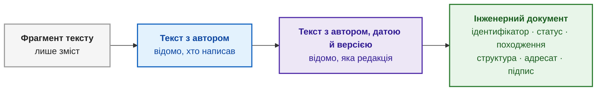
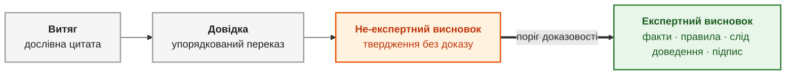
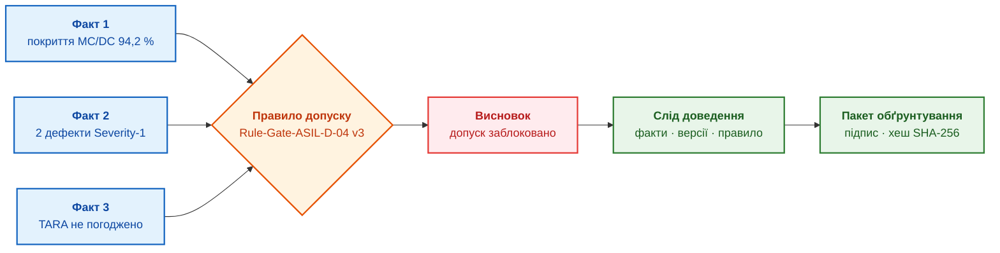
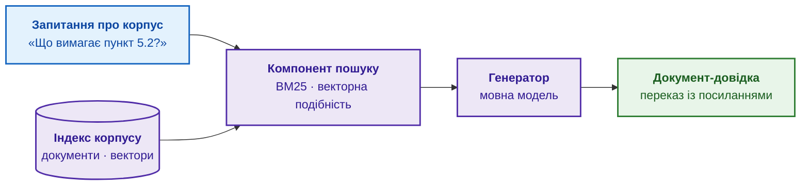
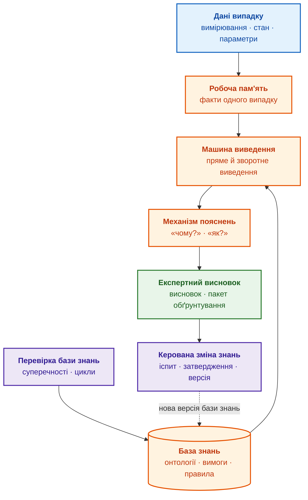
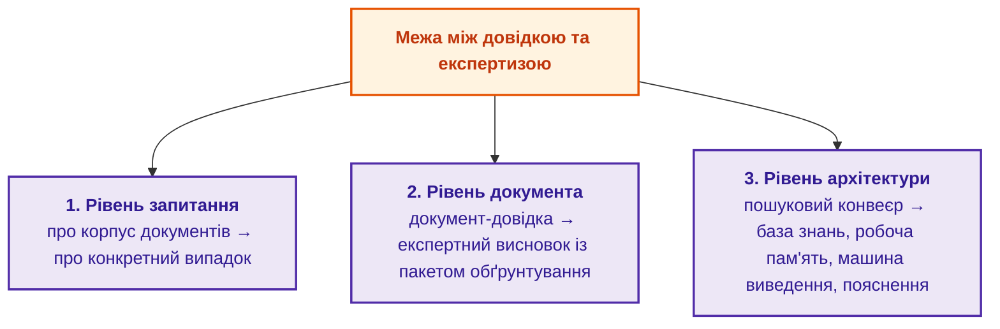

# Глава 3. Чим експертна система відрізняється від інформаційно-довідкової системи

> **Книга:** [Архітектура доказових експертних систем](README.md) · [Частина I: Концептуальні та епістемологічні основи](part-01-foundations.md)
> **Попередня глава:** [Глава 2. Філософія для інженера: що машина має право називати знанням](ch02-epistemology-of-machine-knowledge.md)
> **Наступна глава:** [Глава 4. Еволюція експертних систем: від теореми Байєса до доказових рішень ШІ](ch04-evolution-from-bayes-to-evidence-ai.md)
> **Зміст книги:** [README.md](README.md)  
> **Автор:** [Микола Мартинович Федчик](about-the-author.md)\
> **Попередня підготовка:** різниця між документом, твердженням і підставою з глав 1–2. Порівняння систем пояснюється на запитах і результатах їхньої роботи; професійний досвід не є передумовою.\
> **Очікувані результати:** відрізнити запитання про корпус документів від запитання про конкретний випадок; пояснити, чим документ-довідка відрізняється від експертного висновку; назвати механізми, яких бракує пошуковій системі, базі даних, мовній моделі й генерації з пошуком, щоб стати експертною системою; пояснити, чому експертна система змінює знання лише через перевірену нову версію бази знань.

## Анотація
Щоб вибрати інструмент для експертної системи, потрібно розрізняти дві задачі: знайти записане правило й перевірити, що воно означає для конкретної ситуації. Глава продовжує приклад із температурою з глави 2: цитата про 95 °C ще не дає дозволу випробувати будь-який модуль. На цій відмінності пояснено призначення довідкових, діалогових, рекомендаційних та експертних систем.

Порівняння розгортається від запиту до результату й архітектури. Спочатку читач визначає, що саме потрібно отримати; потім перевіряє різницю між довідкою та висновком; далі з'ясовує, які компоненти забезпечують потрібні перевірки. Окремий навчальний приклад випуску прошивки показує застосування заданих правил і слід доведення, а не підтвердження сертифікації за зовнішнім стандартом.

Перший крок до «експертної системи» команди інженерів часто роблять однаково: беруть теку з технічною документацією й додають до теки пошук або велику мовну модель (*large language model*, LLM), яка читає знайдені фрагменти й відповідає на запитання. Такий інструмент корисний, і в книзі він має власну назву: **інформаційно-довідкова система**, тобто інформаційна система, яка знаходить і подає вже записані відомості. Проблема виникає тоді, коли інформаційно-довідкову систему вважають експертною і довіряють відповіді інформаційно-довідкової системи там, де потрібен доведений висновок про конкретний випадок: про допуск прошивки до випробувань чи про режим стендового випробування.

Мета глави: показати, де саме проходить межа між інформаційно-довідковою та експертною системою, і перевірити межу на трьох рівнях: на рівні запитання, на рівні вихідного документа й на рівні архітектури. Мірилом слугує епістемічний контракт із [Глави 2](ch02-epistemology-of-machine-knowledge.md), тобто набір перевірок, які твердження мусить пройти, перш ніж експертна система застосує твердження. Для кожного класу інформаційних систем, від пошукової системи до мовної моделі, глава показує, яких перевірок контракту бракує. Досвід автора з системами електронної звітності, електронним підписом і процесами функціональної безпеки автомобільної електроніки дає тут одне мірило: відповідь інформаційної системи варта довіри лише тоді, коли відповідь має джерело, версію, відповідального власника й слід перевірки.

## 1. Типологічна таксономія інформаційних систем: чотири базові класи

Слова «довідкова», «консультаційна», «система підтримки рішень» і «експертна» часто вживають як синоніми. Через таку плутанину команда очікує від інструмента того, чого інструмент не вміє: від пошуку чекає висновку, а від чат-бота чекає відповідальності за висновок. Щоб порівнювати інструменти, спершу треба домовитися, за якою ознакою розрізняти класи інформаційних систем.

У цій монографії автором запропоновано порівнювати системи за призначенням, вихідним результатом і способом його перевірки. Форма інтерфейсу цього не визначає: однаковий чат може повертати цитати або передавати запит машині виведення. Так само нейронна мережа може бути компонентом різних систем, наприклад допомагати шукати документи або розбирати запит. Таблиця є робочою класифікацією для цього порівняння, не твердженням про взаємно неперетинні класи всього програмного забезпечення.

**Таблиця 3.1. Робоче порівняння призначень інформаційних систем.**

| Клас інформаційної системи | Головне призначення | Що повертає | Межа класу |
|---|---|---|---|
| **Інформаційно-довідкова система** | знайти й подати відомості, уже записані в корпусі документів | цитату, посилання, переказ джерел | пошук не будує висновку про конкретний випадок |
| **Консультаційна (діалогова) система** | вести діалог, пояснити варіанти, зібрати дані для фахівця | пораду, уточнювальне запитання, сценарій дій | діалог сам не створює перевірного висновку |
| **Система підтримки рішень** (*decision support system*, DSS) | допомогти людині порівняти варіанти й оцінити наслідки | рейтинг варіантів, прогноз, рекомендацію | рекомендація часто спирається на статистику без логічного доведення |
| **Експертна система** | застосувати записані знання до фактів конкретного випадку | висновок або обґрунтовану відмову разом із фактами, правилами й доказами | висновок чинний лише в межах бази знань і наданих фактів |

Класи можуть перетинатися. Дорадча експертна система підтримує рішення людини, тому в широкому розумінні належить і до систем підтримки рішень. Зворотне не обов'язкове: таблиця порівняння витрат або оптимізатор розкладу теж підтримує рішення, але не стає експертною системою лише через корисну рекомендацію. Такі засоби можуть бути детермінованими; важливо не протиставляти «статистику» й «логіку» як два вичерпні класи, а встановити, які саме предметні знання й перевірки реалізовано.

Приклад. Дві команди мають однаковий чат-інтерфейс. У першій команді чат передає запитання пошуковому індексу стандартів і повертає цитати, і за класом такий інструмент є інформаційно-довідковою системою. У другій команді чат передає запитання машині виведення, яка перевіряє факти випуску прошивки за правилами допуску й повертає висновок зі слідом доведення, і за класом такий інструмент є експертною системою. Користувач бачить те саме вікно, але отримує результати різної сили.

Клас інформаційної системи визначають не інтерфейс і не наявність нейронної мережі, а те, що інформаційна система повертає і як обґрунтовує повернене. Далі межу між довідкою та експертизою перевірено на трьох рівнях, і перший рівень стосується самого запитання.

> [!NOTE]
> **Авторська робоча класифікація: чотири призначення систем**
> 1. **Інформаційно-довідкова система:** пошук і пасивний переказ уже зафіксованих у корпусі відомостей без синтезу висновків для конкретного випадку.
> 2. **Консультаційна система:** зібрати дані й пояснити можливі подальші дії; сам діалог не підтверджує правильності поради.
> 3. **Система підтримки рішень:** порівняти варіанти, спрогнозувати наслідки або розрахувати план; конкретний метод і його межі перевіряються окремо.
> 4. **Доказова експертна система:** застосувати явні предметні знання до фактів випадку й надати перевірний висновок або пояснити, чого для нього бракує.
> *Інженерний інваріант:* Для вибору системи потрібно перевірити її фактичні можливості та обґрунтування результату; назва продукту чи вигляд чату цього не замінюють.

### 1.1. Внутрішня стратифікація класу доказових експертних систем: дорадчо-консультативні, рекомендаційні та винахідницькі

Поділ усередині класу експертних систем потрібний, бо користувач може просити різну допомогу: уточнити задачу, оцінити готовий варіант або шукати новий. У цій монографії автором запропоновано три функціональні режими. Назви описують роботу з даними й знаннями, не професійний ранг користувача або вже доведену новизну результату.

**Таблиця 3.2. Три задачі допомоги в авторській моделі.**

| Режим | Яку задачу розв'язує | Приклад із випробуванням | Що отримує читач або інженер |
|---|---|---|---|
| **Дорадчо-консультативний** | з'ясувати, яких даних бракує для висновку | у запиті є 95 °C, але не названо корпус чи кристал | уточнювальне питання та пояснення, чому відповідь залежить від цієї величини |
| **Рекомендаційний** | застосувати відомі правила до заданого випадку | перевірити ревізію B, стенд R-4, дату й усі умови W-17 | перевірний висновок у визначених межах або мотивовану відмову |
| **Винахідницький** | запропонувати варіант, якого немає серед перевірених рішень | шукати інший спосіб охолодження, якщо наявні варіанти не виконують вимог | кандидата з явними припущеннями й планом перевірки, не автоматичний дозвіл на застосування |

Кандидат, уточнення й остаточний висновок мають різні статуси. Сумісність числових меж не замінює доказу, а нове правило не можна додати до чинної бази знань лише тому, що воно виглядає корисним. Докладні формати відповідей наведено в [главі 16](ch16-expert-systems-architecture.md#11-канонічний-словник-вердиктів-рантайму-та-межі-повноважень), кероване приймання нових правил у [главі 25](ch25-how-expert-systems-learn.md).

Відмінність консультації від вільної розмови полягає в підставі питання: система просить ревізію чи дату тому, що вони потрібні певному правилу. Пошук нового рішення теж має межі: збережене походження передумов дозволяє перевірити джерела, але не підтверджує фізичної працездатності нового поєднання. Детальні методи побудови кандидатів розглянуто в [главі 34](ch34-deterministic-relational-analysis-abduction-and-socratic-dialogue.md); тут важливо розрізняти мету роботи й статус результату.

> [!NOTE]
> **Авторський поділ: три задачі експертної допомоги**
> 1. **Уточнити:** визначити відсутні передумови й пояснити, навіщо вони потрібні.
> 2. **Перевірити:** застосувати відомі правила й показати підстави висновку про конкретний випадок.
> 3. **Запропонувати:** сформувати нового кандидата й назвати неперевірені припущення та спосіб їх перевірки.
> *Інженерний інваріант:* Перехід до пошуку нового рішення не скасовує перевірок джерел, застосовності й ризику та не перетворює гіпотезу на доведений результат.

### 1.2. Епістемічна спіраль від маркетингу потреб до винахідницького паспорта та патентної формули

Епістемічна спіраль у цьому підрозділі означає повернення від невиконаної потреби до точніше поставленої задачі. Якщо випробування за 95 °C не можна дозволити, наступний крок залежить від причини: доповнити відсутні дані, виправити джерело, змінити умови або дослідити інший технічний варіант. У цій монографії автором запропоновано зберігати таку причину в **картці прогалини**: записі потреби, перевірених обмежень і того, чого саме бракує.

Наприклад, відсутня дата випробування є прогалиною запиту, не доказом потреби винаходити новий модуль. Якщо ж усі перевірені варіанти не виконують обмеження охолодження, картка може стати вхідним матеріалом дослідження. Повторювані картки допомагають помітити потреби користувачів, але їхня частота не є автоматично точною оцінкою ринкового попиту: запити можуть повторюватися або надходити від нерепрезентативної групи.

> [!NOTE]
> **Три кроки авторського процесу роботи з незадоволеною потребою**
> 1. **Зафіксувати причину:** відрізнити нестачу даних від відхилення готового варіанта й від справді відкритої дослідницької задачі.
> 2. **Підготувати перевірку:** зберегти початкові вимоги, одиниці, межі й джерела; для нового кандидата сформулювати випробування та критерій результату.
> 3. **Передати результат за призначенням:** інженерові потрібне обґрунтування, дослідникові план перевірки, а патентному фахівцеві окремий аналіз новизни. Один запис може допомагати всім трьом, але не замінює цих процедур.
> *Інженерний інваріант:* Відмова не є автоматичним доказом винаходу. На кожному переході зберігають зміст потреби й позначають, що перевірено, а що ще припущено.

### 1.3. Три вкладені операційні режими доказових експертних систем: інженерні механізми доопрацювання від консультації до винахідництва

Три операційні режими потребують різних дій, але спільних перевірок підстав. Наприклад, консультація про W-17 має зберегти умови винятку, рекомендація має зіставити їх із випадком, а новий спосіб охолодження потребує окремої перевірки. В авторській моделі можливості можуть розширюватися від консультації до пошуку кандидатів; це проєктний задум, а не теорема, що більша кількість джерел автоматично дає сильніший висновок.

Нижче збережено дев'ять механізмів авторської моделі, по три для кожного режиму. Позначення на кшталт `CONS-1` є короткими назвами пунктів, не машинними командами, які читач уже повинен знати.

**Таблиця 3.3. Дев'ять механізмів роботи з рішенням.**

| Операційний режим ЕС | Код і назва інженерного доопрацювання | Сутність алгоритмічного механізму в ядрі виведення |
| :--- | :--- | :--- |
| **1. Консультативний** | **`CONS-1`: Умови й винятки** | разом із межею 95 °C показати, для якої ревізії та дати вона дозволена |
| | **`CONS-2`: Визначення термінів** | додати визначення температури корпусу, щоб не підмінити її температурою камери |
| | **`CONS-3`: Межа консультації** | не видавати припущення з іншої області за пряму вимогу цього джерела |
| **2. Рекомендаційний** | **`REC-1`: Запас до меж** | серед уже допустимих варіантів порівняти відстань до заданих обмежень |
| | **`REC-2`: Пошук заміни** | знайти інший перевірений варіант, якщо поточний порушує умову |
| | **`REC-3`: Компроміси** | показати, чим варіанти відрізняються за кількома критеріями та в якому діапазоні дозволена робота |
| **3. Винахідницький** | **`INV-1`: Різноманітність пошуку** | розглядати кандидати з різними ознаками, не прирівнюючи відмінність до новизни |
| | **`INV-2`: Перевірка поєднання** | перевірити припущення, одиниці, межі й сумісність нового рішення, а не лише схожість описів |
| | **`INV-3`: План досліду** | для неперевіреної ланки записати питання, умови випробування та очікуваний результат |

Два приклади покажуть, чому числовий відбір ще не є доказом. У `REC-1` припускається, що весь робочий діапазон кандидата вже вміщується в допустимий інтервал однієї величини. Авторський нормований запас порівнює найменшу відстань до меж із повною шириною допустимого інтервалу:

**Формула (3.4). Нормований найменший запас до меж.**

$$
\mathcal{M}(a,R)=\frac{\min(v_{\max}^{(R)}-v_{\max}^{(a)},\;v_{\min}^{(a)}-v_{\min}^{(R)})}{v_{\max}^{(R)}-v_{\min}^{(R)}}.
$$

Тут $a$ є кандидатом, $R$ є локальним профілем допустимості; нижні й верхні межі позначені індексами $`\min`$ та $`\max`$. Усі чотири числа стосуються тієї самої величини в однакових одиницях, ширина профілю додатна, а діапазон кандидата повністю вкладений у профіль. Тоді безрозмірна оцінка лежить від 0 до 0,5. Нуль означає дотик до межі, більша оцінка означає більший найменший запас, але не вищу ймовірність істинності.

Для умовного температурного профілю від 0 до 100 °C і робочого діапазону від 10 до 80 °C запаси становлять 10 і 20 °C. Беремо менший, 10 °C, і ділимо на 100 °C: отримуємо 0,10. Це навчальні межі, не умови W-17. Порівняння може допомогти вибрати вже допустимий варіант; воно не перевіряє решти вимог і не замінює порівняння за кількома критеріями.

У `INV-1` для різноманітності кандидатів використовується відстань Жаккара між множинами ознак:

**Формула (3.5). Відстань Жаккара для двох непорожніх у сукупності описів.**

$$
d_J(A,B)=1-\frac{\lvert A\cap B\rvert}{\lvert A\cup B\rvert},\qquad A\cup B\ne\varnothing.
$$

$A$ і $B$ є скінченними множинами ознак двох описів; $\cap$ означає спільні ознаки, $\cup$ усі різні ознаки, а вертикальні дужки кількість елементів. Відстань не має одиниць і лежить від 0 до 1. Для описів «температура, охолодження» та «температура, живлення» спільна одна ознака з трьох, тому відстань дорівнює двом третинам. Для двох порожніх множин ця формула не визначена. Авторський приклад порога 0,50 відбирає цей кандидат для розгляду, але нічого не доводить про новизну, фізичну сумісність або патентоздатність: усе це перевіряється окремо.

> [!NOTE]
> **Авторська модель: три групи механізмів роботи з рішенням**
> 1. **Консультація:** зберегти визначення й винятки та не виходити за перевірені підстави.
> 2. **Рекомендація:** відсіяти недопустимі варіанти, потім порівняти допустимі та показати компроміси.
> 3. **Пошук нового:** розширити коло кандидатів, окремо перевірити їх поєднання й підготувати дослід для прогалини.
> *Інженерний інваріант:* Евристика керує пошуком, а перевірки підстав і обмежень керують допуском. Одне число не виконує обидві ролі.

Отже, проєктна вимога перевіряти підстави й результат випробування є різними речами. Точна цитата не робить джерело істинним, а нуль помилок на скінченній вибірці не доводить безпомилковості на всіх запитах. Методи статистичного оцінювання цієї межі розглянуто в [главі 36](ch36-knowledge-testing-pyramid-and-variational-calibration.md). Тепер повернімося до головного порівняння: що саме запитує користувач і яка робота потрібна для відповіді.

## 2. Семантичний рівень запиту: диференціація аналізу корпусу документів та фактів конкретного випадку

Запитання користувачів схожі за формою, але належать до двох різних типів. Якщо типи не розрізняти, інформаційно-довідкова система береться відповідати на запитання, на яке відповісти не може, і відповідь при цьому звучить переконливо.

**Запитання про корпус** стосується того, що написано в документах: «Що корпоративний стандарт випробувань каже про максимальну температуру корпусу модуля?», «Де описано вимоги до ізоляції?». Корпусом називають сукупність документів, у яких шукають відповідь. Відповідь на запитання про корпус уже існує в документі, і завдання інформаційно-довідкової системи полягає в тому, щоб знайти потрібний фрагмент і подати фрагмент зрозуміло. Навіть якщо знайдені фрагменти гладко переказує нейронна мережа, суть роботи не змінюється: інформаційно-довідкова система виконує пошук і виклад.

**Запитання про випадок** стосується однієї конкретної ситуації: «Чи можна 15 вересня 2026 року випробувати прототип ревізії B на стенді R-4 за температури корпусу 95 °C?» Відповіді на таке запитання немає дослівно в жодному документі. У прикладі з [Глави 2](ch02-epistemology-of-machine-knowledge.md) корпоративний стандарт обмежує температуру корпусу 90 °C, а дозвіл на відхилення W-17 дозволяє 95 °C лише для ревізії B, лише на стенді R-4 і лише до 1 жовтня 2026 року. Відповідь з'являється тільки після того, як правила зі стандарту й дозволу застосовано до фактів випадку: ревізії, стенда, дати й вимірюваної величини. Застосування правил до фактів виконує машина виведення, тобто програмний механізм, який бере факти конкретної ситуації, знаходить придатні правила й отримує новий висновок ([Глава 1](ch01-introduction-to-expert-systems.md)).

Запит із [Глави 1](ch01-introduction-to-expert-systems.md) про зміну таймауту `PowerSupervisor` має ту саму природу: знайти числову межу в `REQ-142` недостатньо, доки не перевірено застосовність вимоги до потрібної ревізії та стан тесту `TC-88`. До виконання цього тесту задана модель повертає `QUALIFIED`, а не `ACCEPT`; пошук фрагмента документа не може сам змінити цей статус.

> **Авторський початковий тест розрізнення результатів.** «Ось що сказано в джерелах» є довідкою. «Для цього випадку дію заборонено за таким правилом і такими фактами» претендує на експертний висновок. Далі потрібно перевірити названі факти, правило та слід: саме формулювання ще не доводить, що система справді виконала цю роботу.

Експертна система може відповідати й на запитання про корпус, якщо має компонент пошуку. Авторський принцип тут простий: знайти загальне правило недостатньо, щоб установити його застосовність до випадку. Для W-17 потрібно ще перевірити ревізію, стенд, процедуру, дату й потрібні погодження. Це різниця між двома задачами, а не формула логічного слідування між самими запитаннями.

Система, що виконує лише пошук і виклад, не має механізму застосування правил до фактів випадку; для такої системи відповідь на запитання про випадок лишається цитатою або неперевіреною гіпотезою.

Корпус документів спільний для багатьох випадків і змінюється рідко, а кожен випадок має власні факти. Пошук піднімає з корпусу загальні правила, але перенести загальне правило на конкретний випадок пошук не може: таке перенесення виконує машина виведення. Наступний розділ з'ясовує, де в цьому поділі стоїть велика мовна модель, яку найчастіше плутають з експертною системою.

> [!NOTE]
> **Авторське розрізнення: два типи запитань**
> 1. **Про корпус:** що саме записано в джерелах; перевіряються точність цитування, редакція й контекст.
> 2. **Про випадок:** чи застосовні ці положення до заданої ситуації та який висновок із них випливає; перевіряються також факти й кроки виведення.
> *Інженерний інваріант:* Цитата не замінює перевірки застосовності. Якщо готовий висновок про випадок уже записаний, його також можна знайти, але потрібно перевірити, що він стосується саме потрібної версії й умов.

## 3. Функціональна роль великих мовних моделей в архітектурі аналітичних систем

Загальнодоступні чат-сервіси на основі великих мовних моделей, такі як ChatGPT, Claude чи Gemini, одні користувачі називають довідковими, інші експертними системами. Обидві назви неточні, бо велика мовна модель сама по собі не є завершеною інформаційною системою. Велика мовна модель є компонентом, і клас результату визначає архітектура, у яку компонент вбудовано.

Велика мовна модель генерує текст на основі параметрів нейронної мережі, навченої на великому масиві текстів. Відомості, засвоєні під час навчання, розподілені по параметрах моделі, тому модель не може надійно вказати документ, з якого взято конкретне твердження. Звідси три фундаментальні обмеження:

- **Доступ до потрібного джерела не виникає з навчання автоматично.** Без наданої внутрішньої документації модель не має надійної підстави цитувати її актуальну редакцію. Вона може утриматися від відповіді або створити непідтверджений текст; останнє називають галюцинацією [[1]](#src-1).
- **Контекст не замінює перевіреного обліку фактів.** До контекстного вікна, тобто оброблюваного моделлю тексту, можна передати версії й джерела. Але окремий компонент має перевірити й зберегти ці відомості, щоб вони не залежали лише від переказу моделі.
- **Згенероване доведення ще треба перевірити.** Модель може запропонувати послідовність «факт, правило, висновок» або формальний доказ. Допуск залежить від незалежної перевірки кожного кроку, не від переконливості написаного пояснення.

Від архітектури, у яку вбудовано мовну модель, залежить клас результату:

1. Мовна модель разом із пошуком у контрольованому корпусі утворює **генерацію з пошуком** (*retrieval-augmented generation*, RAG). Патрік Льюїс і співавтори запропонували поєднати параметричну пам'ять мовної моделі з непараметричною пам'яттю, тобто з індексом документів, з якого перед генерацією добирають релевантні фрагменти [[2]](#src-2). Відповіді RAG мають посилання на документи компанії, але за класом RAG є сучасною інформаційно-довідковою системою.
2. Мовна модель разом із базою знань, машиною виведення, робочою пам'яттю випадку й механізмом пояснень утворює **нейро-символьну експертну систему** ([Глава 29](ch29-neuro-symbolic-architecture.md)). У нейро-символьній експертній системі мовна модель перекладає запитання людини мовою фактів і правил та переказує висновок зрозумілою мовою, але не вирішує, що є істинним.

Повернімося до прототипу ревізії B за 95 °C. Без наданих документів мовна модель не має достатніх підстав для перевірного дозволу. Базовий RAG може знайти й переказати стандарт та W-17, але сам пошук не забезпечує зіставлення всіх умов. Якщо додано валідатори й машину виведення, вони перевіряють ревізію, стенд, процедуру, дату й погодження, а мовна модель допомагає пояснити результат. Отже, оцінюється весь тракт перевірки, не сама наявність RAG.

Окреме питання стосується місця обробки. Якщо політика конкретного проєкту забороняє передавати його дані зовнішньому постачальнику, потрібний відповідний локальний або інший дозволений спосіб розгортання. Автор рекомендує вибирати його за моделлю загроз і правилами доступу. Локальність сама не робить висновок істинним, а фізична ізоляція не є універсальною ознакою експертної системи ([глава 18](ch18-execution-infrastructure.md)).

Тут знаходить свій вираз **принцип інструментальної субординації великих мовних моделей М. Федчика**: велика мовна модель є сильним мовним компонентом, але не арбітром істини. Без пошуку мовна модель переказує засвоєне під час навчання, разом із пошуком мовна модель стає частиною інформаційно-довідкової системи, і лише разом із базою знань і машиною виведення мовна модель стає частиною експертної системи. Наступний рівень розрізнення стосується того, що інформаційна система видає на виході.

## 4. Документальний рівень: концептуальна межа між інформаційною довідкою та експертним висновком

Документальний рівень показує, як перевірити результат, коли два тексти мають однаковий вигляд. Довідка може точно відтворювати правило й бути корисним доказовим матеріалом; висновок про випадок додатково потребує фактів і перевірки їх застосування. Юридичну або сертифікаційну силу не визначає сама назва «експертний». Спочатку з'ясуємо, які відомості роблять документ ідентифікованим і перевірним.

### 4.1. Генезис інженерного документа: від сирого тексту до юридично значущого артефакту

Генезис інженерного документа тут означає послідовне додавання відомостей, потрібних для перевірки. У цій монографії автором запропоновано починати не з оформлення, а з питань: хто створив текст, яка його редакція, для чого він призначений і хто його погодив? Текстовий фрагмент уже може бути документальним свідченням, але без цих атрибутів складніше встановити його походження та застосовність. Набір атрибутів нижче є інженерною моделлю, не універсальним юридичним визначенням документа.

Текст набуває статусу документа поступово, і кожен крок додає атрибут, без якого певна перевірка неможлива:

1. **Фрагмент тексту** містить лише зміст.
2. **Текст з автором** показує джерело, але без дати не можна встановити, чи текст актуальний.
3. **Текст з автором, датою й версією** дає змогу однозначно зіставити цитату з конкретною редакцією.
4. **Інженерний документ** має повний набір атрибутів:
   - стабільний ідентифікатор, наприклад інвентарний номер;
   - автора й відповідального власника, тобто людину, яка відповідає за зміст;
   - статус життєвого циклу: чернетка, на рецензії, затверджено або виведено з ужитку;
   - походження (*provenance*): з яких вхідних даних і якими діями документ отримано; модель PROV-O Консорціуму Всесвітньої павутини (World Wide Web Consortium, W3C) описує походження через сутності, дії та учасників [[3]](#src-3);
   - структуру: типізовані розділи й поля, які програма може прочитати;
   - призначення, адресата й рівень доступу;
   - підпис відповідальної особи.

Схема показує ту саму послідовність.

**Схема 3.6. Додавання відомостей для перевірки документа.**



Сірий блок є фрагментом без контексту, синій і фіолетовий блоки додають автора, дату й версію, зелений блок є інженерним документом. Кожна стрілка додає атрибут, який робить можливою нову перевірку: автор дає змогу знайти відповідального, версія дає змогу перевірити актуальність, а статус і підпис дають змогу використати документ в аудиті.

Електронний підпис є окремим механізмом підтвердження походження й цілісності. Наприклад, стаття 25 регламенту eIDAS розрізняє юридичну силу електронних підписів і надає кваліфікованому підпису еквівалентність власноручному [[4]](#src-4). Це правова властивість належного підпису за застосовних умов, а не наслідок того, що текст згенерувала експертна система.

Ця правова еквівалентність стосується підпису, а не автоматичного визнання істинності підписаного висновку. Криптографічна перевірка засвідчує походження й цілісність у межах моделі довіри, але правильність передумов і виведення перевіряють окремо. Службовий підпис системи сам по собі не прирівнюється до КЕП відповідальної особи й не надає висновку наперед визначеної сили в аудиті чи сертифікації.

Для експертної системи з цього випливає вимога зберігати перевірні підстави й походження висновку. Підпис додається там, де його вимагає процедура; він не робить неправильне виведення правильним. Відсутність підпису або сліду потрібно називати конкретною прогалиною, а не змішувати з відсутністю самого документа.

### 4.2. Онтологічна диференціація: пасивний переказ джерел проти детермінованого виведення

Онтологічне розрізнення довідки та висновку в цьому підрозділі означає просте питання: що представляє документ? За авторським підходом слід відокремити переказ джерел від застосування знань до випадку. Обидва тексти можуть посилатися на ті самі документи, тому сама тема чи список посилань їх не розрізняє.

**Документ-довідка** у цьому порівнянні передає зміст джерел: наприклад, витяг зі стандарту чи інструкції з калібрування. Перевіряються точність переказу, редакція й контекст. Якщо укладач додав розрахунок або висновок про випадок, це вже окрема дія, підстави якої треба перевірити. Відповідальність укладача визначається його повноваженнями й застосовними правилами, не самою назвою документа.

**Експертний висновок** є новим судженням про конкретний випадок: оцінкою безпеки електронного вузла, рішенням про готовність прошивки до випробувань, локалізацією дефекту. Критерієм правильності висновку є коректність виведення з перевірених фактів за затвердженими правилами. Слідом є ланцюжок «факт, правило, проміжний висновок, висновок» із версіями й походженням кожного елемента. Експертний висновок містить твердження, якого немає в жодному вихідному документі, явно називає область застосування й припущення та має підпис експерта або службовий підпис експертної системи, за яким стоїть відповідальна особа.

**Таблиця 3.7. Довідка та висновок про конкретний випадок.**

| Ознака | Документ-довідка | Експертний висновок |
|---|---|---|
| Природа документа | переказ відомого | нове судження про випадок |
| Критерій правильності | відповідність першоджерелу | коректне виведення з фактів за правилами |
| Нові твердження | немає | є: висновок про випадок |
| Слід | посилання на джерела | слід доведення з версіями й походженням |
| Межі застосування | задані джерелом | названі явно: область, припущення, статус |
| Використання | довідкова інформація | доказ в аудиті чи сертифікації |

> [!TIP]
> **Умовний навчальний приклад: межі довідки в апаратних системах**\
> Розглянемо умовний модуль DI-4. На запитання *«Чи можна подати 24 В на цифровий вхід?»* довідковий тракт може повернути рядок «номінальна напруга входу: 24 В постійного струму», не перевіривши поточної конфігурації.\
> Для цього сценарію задано локальні блокувальні умови: режим ТТЛ (5 В) або температура корпусу понад 70 °C. Експертна система застосовує їх до **фактів поточного підключення** й блокує дію. Назва модуля та умови тут є навчальними даними, а не протоколом випробувань чи характеристиками конкретного виробу; механізм його можливої відмови потребував би окремої апаратної перевірки. Довідка цитує специфікацію; експертна система перевіряє застосовність правила до випадку.

Між дослівною цитатою й експертним висновком лежать чотири щаблі доказовості:

1. **Витяг:** дослівний фрагмент джерела, наприклад точна цитата пункту регламенту.
2. **Довідка:** упорядкований переказ фрагментів кількох джерел, наприклад зведена таблиця параметрів. Нового знання на цьому щаблі ще немає.
3. **Висновок без наданого обґрунтування:** твердження на кшталт «схоже, компонент підійде». Його можна незалежно перевірити, але з самого тексту невідомо, які факти й правила використано.
4. **Експертний висновок:** судження про випадок зі слідом доведення, походженням кожної передумови й підписаним пакетом обґрунтування. **Пакетом обґрунтування** (*proof packet*) книга називає висновок разом із фактами, правилами, джерелами з версіями, межами застосування й відповідальною особою ([Глава 1](ch01-introduction-to-expert-systems.md)).

Схема показує щаблі й поріг між третім і четвертим щаблем.

**Схема 3.8. Підстави, що додаються до вихідного тексту.**



Сірі блоки не створюють нового знання, помаранчевий блок створює нове твердження без доказу, зелений блок створює нове твердження з доказом. Подвійна стрілка позначає поріг доказовості: щоб перейти поріг, потрібне не краще формулювання, а факти, правила й слід доведення.

Різницю між третім і четвертим щаблем визначає не стиль тексту, а надані підстави. Висновок без готового сліду теж можна перевіряти, але перевіряльнику доведеться самостійно відновлювати факти й міркування. Слід дозволяє перевіряти запропоновані кроки; час залежить від їх кількості та вартості кожної перевірки, тому універсальної лінійної гарантії тут немає. Наступний підрозділ покаже це на навчальному рішенні про випуск прошивки.

> [!NOTE]
> **Авторська модель: чотири форми подання підстав**
> 1. **Витяг:** дослівний текстовий фрагмент першоджерела без синтезу нового змісту.
> 2. **Довідка:** структурований реферативний звід кількох цитат; нове знання відсутнє.
> 3. **Висновок без наданого сліду:** перевіряльник має самостійно встановити факти й міркування, не покладаючись на переконливість тексту.
> 4. **Експертний висновок:** детерміноване судження про випадок, що перетинає *поріг доказовості* завдяки наявності повного сліду виведення, походження кожної передумови та підписаного пакета обґрунтування (*proof packet*).
> *Інженерний інваріант:* У запропонованому доказовому профілі стверджувальна відповідь має перевірні передумови й кроки висновку. Підписування та право затвердження визначаються окремою процедурою.

### 4.3. Практичний кейс: верифікація допуску вбудованого ПЗ (Release Gate ASIL D) за стандартом ISO 26262

Практичну дію онтологічного розмежування найвиразніше демонструє процедура випуску місійно-критичного програмного забезпечення, де ціною плутанини між довідкою та експертним висновком є системна аварія. Розглянемо сценарій, у якому команда розробляє прошивку, тобто вбудоване програмне забезпечення блока керування автомобіля, і має вирішити, чи допускати ревізію прошивки v2.4.1 до випробувань на треку. Таку контрольну точку в розробці називають рішенням про допуск (*release gate*). Вимоги функціональної безпеки, які реалізує прошивка, мають рівень ASIL D (*Automotive Safety Integrity Level*, рівень повноти безпеки автомобільних систем): стандарт ISO 26262 визначає чотири рівні, від A до D, і рівень D ставить найсуворіші вимоги. Три інформаційні системи відповідають на запитання «чи готова прошивка?» по-різному:

У цьому навчальному сценарії версії прошивки, дати звітів, ідентифікатори й скорочений хеш є умовними; наведені значення ілюструють логіку локальної політики, а не оприлюднений протокол реального випуску чи сертифікації.

- **Інформаційно-довідкова система** знаходить контрольний перелік випуску, звіт тестувальників, нотатки з кібербезпеки й посилання на стандарт ISO 26262.
- **Чат-бот на основі мовної моделі** підсумовує: «Більшість тестів успішні, прошивка виглядає готовою до випробувань».
- **Експертна система** формує висновок:

> **Рішення:** допуск прошивки v2.4.1 до випробувань на треку заблоковано.
> **Факти:**
> 1. Покриття модифікованих умов і рішень (*modified condition/decision coverage*, MC/DC) модульними тестами становить 94,2 %, а внутрішнє правило випуску вимагає 100 % для модулів рівня ASIL D (звіт покриття від 25.09.2026).
> 2. Звіт статичного аналізу для версії коду `a1f9c8` містить два відкриті дефекти найвищої критичності (*Severity-1*) (журнал аналізатора від 26.09.2026).
> 3. Аналіз загроз і оцінку ризиків (*threat analysis and risk assessment*, TARA) не погоджено відповідальним за кібербезпеку.
> **Правило:** `Rule-Gate-ASIL-D-04`, версія 3, забороняє допуск до випробувань, доки відкрита хоча б одна блокувальна умова.
> **Пакет обґрунтування:** підписаний, хеш SHA-256 `8b4a7…`.

У цьому прикладі поріг покриття 100 %, вимога нуля відкритих дефектів і погодження TARA задані локальною політикою команди. ISO 26262-6 стосується розробки програмного забезпечення автомобільних систем безпеки [[5]](#src-5), ISO/SAE 21434 стосується інженерії кібербезпеки [[6]](#src-6). Для реального рішення потрібно окремо встановити застосовні положення й повний перелік перевірок; назви стандартів не замінюють цих підстав. Навчальний шлюз нижче не є процедурою сертифікації ASIL D.

Запишемо авторську модель локального правила. Спочатку позначимо через $B(c)$ результат питання «чи є хоча б один блокер для випадку $c$?». Кожне порівняння має три значення: істина, хиба або невідомо. Відсутній факт дає невідомо, а не нуль.

**Формула (3.9). Наявність блокувальної умови.**

$$
B(c)=[\mathrm{MC/DC}(c)<100]\lor[\mathrm{Defects}(c)>0]\lor[\mathrm{TARA}(c)=0].
$$

Тут $c$ є записом фактів однієї версії прошивки; $`\mathrm{MC/DC}(c)`$ є відсотком покриття від 0 до 100, $`\mathrm{Defects}(c)`$ є невід'ємним цілим числом відкритих критичних дефектів, $`\mathrm{TARA}(c)`$ дорівнює 1 за підтвердженого погодження й 0 за підтвердженої його відсутності. Кожне поле також може бути невідомим. Оператор $\lor$ читається як «або»: істина хоча б одного блокера робить весь результат істинним; якщо істинних немає, але є невідоме значення, результат невідомий. Усі відомі факти попередньо перевірені за версією, походженням і допустимим діапазоном.

За цим результатом визначається тип відповіді:

**Формула (3.10). Тризначний результат локального правила допуску.**

$$
\mathrm{Gate}(c) = \begin{cases}
\mathrm{Blocked}, & B(c)=\mathbf{T}, \\
\mathrm{Clarification}, & B(c)=\mathbf{U}, \\
\mathrm{Admitted}, & B(c)=\mathbf{F}.
\end{cases}
$$

Значення $`\mathbf{T}`$, $`\mathbf{F}`$, $`\mathbf{U}`$ означають істину, хибу й невідомість у логіці Кліні з глави 2. Виходи `Blocked`, `Clarification`, `Admitted` означають відповідно блокування, запит на уточнення й виконання цього локального правила. Останній вихід не підтверджує виконання всіх інших вимог до реального випуску.

Для v2.4.1 перевіряємо три факти окремо: 94,2 менше за 100, два дефекти більше за нуль, погодження дорівнює нулю. Усі три блокери істинні, тому результат `Blocked`. Якби погодження було невідомим, але два дефекти залишалися відкритими, результат усе одно був би `Blocked`: уже є достатня причина не допустити випуск. Якщо покриття дорівнює 100, дефектів немає, а погодження невідоме, отримуємо `Clarification`. Тільки три хибні блокери дають `Admitted` у межах цього прикладу.

Схема показує, як три факти проходять через правило допуску до висновку й пакета обґрунтування.

**Схема 3.11. Від фактів прошивки до перевірного рішення.**



Сині блоки є перевіреними фактами випадку, помаранчевий ромб є правилом із бази знань, червоний блок є висновком, зелені блоки є слідом доведення й підписаним пакетом обґрунтування. Кожен факт має власне джерело, тому висновок можна перевірити по частинах.

Такий висновок дає змогу вести аргументовану інженерну розмову. Розробник може оскаржити конкретний факт, наприклад довести, що один із дефектів є хибним спрацюванням аналізатора (*false positive*) і вже закритий документально. Власник правила може змінити правило через процедуру керування змінами. Із висновком «схоже, все гаразд» сперечатися неможливо, бо під таким висновком немає ні фактів, ні правила.

Як машина виведення отримує такий висновок, показує короткий приклад мовою Go. Правило в прикладі записано як дані, а не як код програми: умови й пороги можна змінити без зміни програми.

<details>
<summary>Приклад мовою Go: правило допуску як дані й слід спрацювання умов</summary>

Програма є повною й запускається командою `go run main.go`. Правило `Rule-Gate-ASIL-D-04` містить три блокувальні умови; функція `evaluate` перевіряє кожну умову на фактах випадку й друкує слід спрацювання умов. Прошивка v2.4.2 навмисно не має факту про погодження TARA. Непідтримуваний оператор, нечисловий або нескінченний операнд та порожній набір умов потребують уточнення, а не дають дозволу. Перевірку походження, одиниць і допустимих діапазонів фактів за моделлю вище в цьому навчальному лістингу припущено виконаною до виклику; лістинг не є повним валідатором вхідних даних чи виробничим шлюзом безпеки.

```go
package main

import (
  "fmt"
  "math"
)

// Condition є однією умовою правила: назва факту, операція порівняння й поріг.
type Condition struct {
	Fact  string
	Op    string // "<", ">" або "=="
	Value float64
}

// Rule зберігається в базі знань як дані з ідентифікатором і версією.
type Rule struct {
	ID       string
	Version  int
	Blockers []Condition // кожна істинна умова блокує допуск
}

// holds повертає значення умови й ознаку того, що факт відомий.
func holds(condition Condition, facts map[string]float64) (value, known bool) {
  factValue, exists := facts[condition.Fact]
  if !exists || math.IsNaN(factValue) || math.IsInf(factValue, 0) ||
    math.IsNaN(condition.Value) || math.IsInf(condition.Value, 0) {
		return false, false
	}
  switch condition.Op {
	case "<":
    return factValue < condition.Value, true
	case ">":
    return factValue > condition.Value, true
  case "==":
    return factValue == condition.Value, true
	default:
    return false, false
	}
}

// evaluate застосовує правило до фактів випадку й друкує слід спрацювання умов.
func evaluate(r Rule, facts map[string]float64) string {
  blocked, unknown := false, len(r.Blockers) == 0
	for _, c := range r.Blockers {
		value, known := holds(c, facts)
		switch {
		case !known:
			unknown = true
      fmt.Printf("  %s: умову не оцінено (факт відсутній або вхід некоректний)\n", c.Fact)
		case value:
			blocked = true
			fmt.Printf("  %s = %g %s %g: умова блокує допуск\n", c.Fact, facts[c.Fact], c.Op, c.Value)
		}
	}
	switch {
	case blocked:
		return "заблоковано"
	case unknown:
		return "потрібне уточнення"
	default:
		return "дозволено"
	}
}

func main() {
	rule := Rule{ID: "Rule-Gate-ASIL-D-04", Version: 3, Blockers: []Condition{
		{Fact: "mcdc_coverage_pct", Op: "<", Value: 100},
		{Fact: "open_sev1_defects", Op: ">", Value: 0},
		{Fact: "tara_approved", Op: "==", Value: 0},
	}}

	cases := []struct {
		firmware string
		facts    map[string]float64
	}{
		{"v2.4.1", map[string]float64{"mcdc_coverage_pct": 94.2, "open_sev1_defects": 2, "tara_approved": 0}},
		{"v2.4.2", map[string]float64{"mcdc_coverage_pct": 100, "open_sev1_defects": 0}},
    {"v2.4.3", map[string]float64{"mcdc_coverage_pct": 100, "open_sev1_defects": 0, "tara_approved": 1}},
    {"v2.4.4", map[string]float64{"mcdc_coverage_pct": 100, "open_sev1_defects": 2}},
	}
	for _, c := range cases {
		fmt.Printf("прошивка %s\n", c.firmware)
		fmt.Printf("  висновок: %s за правилом %s v%d\n", evaluate(rule, c.facts), rule.ID, rule.Version)
	}
}
```

Програма друкує:

```text
прошивка v2.4.1
  mcdc_coverage_pct = 94.2 < 100: умова блокує допуск
  open_sev1_defects = 2 > 0: умова блокує допуск
  tara_approved = 0 == 0: умова блокує допуск
  висновок: заблоковано за правилом Rule-Gate-ASIL-D-04 v3
прошивка v2.4.2
  tara_approved: умову не оцінено (факт відсутній або вхід некоректний)
  висновок: потрібне уточнення за правилом Rule-Gate-ASIL-D-04 v3
прошивка v2.4.3
  висновок: дозволено за правилом Rule-Gate-ASIL-D-04 v3
прошивка v2.4.4
  open_sev1_defects = 2 > 0: умова блокує допуск
  tara_approved: умову не оцінено (факт відсутній або вхід некоректний)
  висновок: заблоковано за правилом Rule-Gate-ASIL-D-04 v3
```

Для v2.4.1 спрацювали три блокери. Для v2.4.2 відомих блокерів немає, але погодження невідоме, тому потрібне уточнення. У v2.4.3 усі три блокери хибні, отже локальне правило дозволяє перехід. У v2.4.4 відомий критичний дефект уже блокує перехід, хоча погодження також невідоме. Це реалізація сильної тризначної диз'юнкції Кліні [[16]](#src-16), а не повний доказ безпеки прошивки. Для реальної системи додатково потрібні валідація фактів, доступ, повний перелік правил і перевірка їхнього походження ([глави 6](ch06-applied-mathematics-for-expert-systems.md) і [16](ch16-expert-systems-architecture.md)).

</details>

Приклад показує різницю трьох результатів. Довідка дає матеріали для рішення, чат-бот дає враження про рішення, а експертна система дає рішення, яке можна перевірити, оскаржити й відтворити.

На рівні документа межа проходить через слід доведення: без сліду доведення навіть правильний за змістом висновок лишається не-експертним. Щоб інформаційна система могла будувати слід доведення, архітектура інформаційної системи потребує компонентів, яких немає в пошуковому конвеєрі.

## 5. Архітектурний рівень: лінійний конвеєр генерації з пошуком (RAG) проти машини логічного виведення

Різниця між довідкою й експертизою є структурною і визначає склад компонентів інформаційної системи. Щоб побачити склад компонентів, порівняймо дві архітектури: генерацію з пошуком і експертну систему.

### 5.1. Принципи організації лінійного конвеєра генерації з пошуком (RAG)

Найпоширенішим сучасним патерном побудови інформаційно-довідкових комплексів є архітектура генерації з пошуковим доповненням, яка реалізує відкритий конвеєр трансформації неструктурованого тексту. Генерація з пошуком (RAG) є лінійним конвеєром із трьох компонентів:

1. **Індекс** зберігає документи корпусу в повнотекстовому або векторному вигляді. Векторне представлення (*embedding*) перетворює фрагмент тексту на числовий вектор так, щоб близькі за змістом фрагменти мали близькі вектори.
2. **Компонент пошуку** (*retriever*) добирає найрелевантніші фрагменти (*chunks*) за функцією ранжування BM25, яка оцінює документ за частотою слів запиту в документі, рідкістю слів у корпусі й довжиною документа [[7]](#src-7), або за косинусною подібністю векторних представлень. Часто обидва способи поєднують, і такий пошук називають гібридним.
3. **Генератор**, тобто мовна модель, переказує знайдені фрагменти зрозумілою мовою.

Схема показує шлях запитання через конвеєр.

**Схема 3.12. Базовий конвеєр пошуку й генерації.**



Синій блок є запитанням про корпус, фіолетові блоки є компонентами конвеєра, зелений блок є документом-довідкою. Стрілки йдуть в одному напрямку: базовий конвеєр не зберігає фактів випадку, не застосовує правил і не перевіряє суперечностей між знайденими фрагментами.

Для запитань про корпус такий конвеєр добре підходить і коштує недорого. Для запитань про випадок конвеєру бракує місця, де зберігаються факти випадку, і механізму, який застосовує правила до фактів.

### 5.2. Структурна декомпозиція ядра доказової експертної системи

Експертна система містить пошук і мовну модель як допоміжні компоненти, але основу експертної системи утворюють інші компоненти. Схема показує, як дані випадку проходять крізь ядро експертної системи до висновку.

**Схема 3.13. Основні функції доказової експертної системи.**



Синій блок є даними випадку, помаранчеві блоки утворюють ядро експертної системи, зелений блок є висновком, фіолетові блоки відповідають за перевірку й зміну знань. Пунктирна стрілка показує, що досвід із висновків повертається до бази знань не напряму, а через перевірку й затвердження нової версії бази знань.

Ядро експертної системи утворюють компоненти, яких немає в базовому конвеєрі RAG:

- **База знань** (*knowledge base*) зберігає онтології, вимоги, обмеження й правила як структуровані дані, окремо від тексту документів ([Глава 7](ch07-knowledge-base-typology.md)).
- **Робоча пам'ять** (*working memory*) зберігає факти одного випадку окремо від фактів інших випадків, тому факти прошивки v2.4.1 не змішуються з фактами прошивки v2.4.2.
- **Машина виведення** (*inference engine*) застосовує правила до фактів детермінованим алгоритмом: той самий набір фактів і правил дає той самий висновок. Пряме виведення (*forward chaining*) рухається від фактів до висновків, зворотне виведення (*backward chaining*) рухається від гіпотези до фактів, які гіпотезу підтверджують. Для швидкого зіставлення тисяч правил із фактами Чарльз Форджі запропонував алгоритм Rete [[8]](#src-8); як працює алгоритм Rete, пояснює [Глава 6](ch06-applied-mathematics-for-expert-systems.md).
- **Механізм пояснень** (*explanation engine*) відповідає на запитання «чому висновок саме такий?» і «як висновок отримано?», показуючи слід доведення ([Глава 20](ch20-explanation-engine.md)).
- **Перевірка бази знань** шукає суперечливі правила, цикли й недосяжні умови до того, як правило потрапить у роботу ([Глава 23](ch23-knowledge-base-verification.md)).
- **Керована зміна знань** перетворює досвід експлуатації на нову перевірену версію бази знань (підрозділ [«7.1. Еволюція знань через версіонування та регресійне тестування на еталонних вибірках»](#навчання-лише-через-перевірену-нову-версію-бази-знань) нижче).

> [!NOTE]
> **Авторська архітектурна модель: шість функцій доказової системи**
> 1. **База знань (KB):** структуроване сховище онтологій, вимог і правил, відокремлене від сирого тексту документів.
> 2. **Робоча пам'ять випадку (WM):** ізольований контекстний простір фактів поточного інженерного випадку, захищений від перехресного забруднення іншими сеансами.
> 3. **Машина логічного виведення (Inference Engine):** детермінований алгоритмічний рушій (Rete/SMT) прямого та зворотного виведення без стохастичних варіацій.
> 4. **Механізм пояснень (Explanation Engine):** двонаправлений генератор сліду доведення за запитами «чому?» та «як?».
> 5. **Підсистема перевірки бази знань:** модуль статичного аудиту нормативних суперечностей, замкнених циклів і мертвих правил до введення в експлуатацію.
> 6. **Підсистема керованої зміни знань:** шлюз верифікації та регресійного тестування на еталонних вибірках (*Golden Sets*) перед випуском кожної нової версії.
> *Інженерний інваріант:* Перевіряється виконання потрібних функцій, не кількість окремих програм. Кілька функцій можуть поєднуватися в одному компоненті; відсутність перевірки є конкретною прогалиною архітектури, а не автоматичним доказом, що будь-яка така система є лише пошуком.

Якщо з експертної системи прибрати машину виведення, робочу пам'ять і механізм пояснень, експертна система перетвориться на інформаційно-довідкову систему: пошук і мовна модель залишаться, але висновку про випадок уже не буде. Архітектурна різниця пояснює, чому одні класи інформаційних систем проходять перевірки епістемічного контракту, а інші ні. Наступний розділ зводить порівняння в одну таблицю.

## 6. Порівняльний аналіз класів систем за критеріями епістемічного контракту

Порівнювати інформаційні системи за враженням від відповіді ненадійно: гладка відповідь мовної моделі справляє сильніше враження, ніж сухий висновок експертної системи. [Глава 2](ch02-epistemology-of-machine-knowledge.md) сформулювала епістемічний контракт: сім перевірок, які твердження мусить пройти, перш ніж експертна система застосує твердження, і чотири допустимі результати відповіді: висновок із доказом, уточнювальне запитання, передачу людині й обґрунтовану відмову. Контракт дає змогу порівнювати інформаційні системи за конкретними механізмами.

Таблиця зіставляє шість спрощених профілів: пошук, базу даних під керуванням системи керування базами даних (СКБД), мовну модель, базовий RAG, підтримку рішень і проєктований профіль доказової експертної системи. Це навчальне порівняння, не результати випробувань усіх продуктів цих класів. Позначка ✓ означає явно передбачений механізм у цьому профілі, ~ часткове забезпечення, ✗ відсутність у базовій конфігурації. Додаткові компоненти можуть змінити оцінку конкретної реалізації.

**Таблиця 3.14. Навчальне порівняння шести архітектурних профілів.**

| Перевірка або властивість | Пошукова система | База даних (СКБД) | Велика мовна модель | Генерація з пошуком (RAG) | Підтримка рішень (DSS) | Експертна система |
|---|---|---|---|---|---|---|
| Головне призначення | знайти документ | зберегти й видати записи | згенерувати текст | знайти й переказати фрагменти | допомогти обрати варіант | вивести висновок про випадок |
| Підстава й походження (епістемологія) | ~ посилання на документ | ~ журнал змін записів | ✗ | ~ посилання на фрагменти | ~ вхідні дані розрахунку | ✓ доказ і походження кожної передумови |
| Об'єкт, величина й версія (онтологія) | ✗ збіг слів | ✓ ключі й схема даних | ✗ | ~ схожість векторів | ~ фактори моделі | ✓ ідентифікатори, величини, версії |
| Спосіб виведення й слід доведення (логіка) | ✗ | ~ відтворюваний запит | ✗ | ✗ | ~ модель розрахунку | ✓ правила й слід доведення |
| Намір і модальність запиту (філософія мови) | ✗ | ~ запит формалізує користувач | ~ неявно | ~ неявно | ~ задано формою введення | ✓ визначено або уточнено |
| Контекст цитати (герменевтика) | ~ сторінка документа | ✗ | ✗ | ~ сусідні фрагменти | ✗ | ✓ вікно доказів |
| Спосіб перевірки й невизначеність (філософія науки) | ✗ | ✗ | ✗ | ✗ | ~ точність моделі | ✓ метод, невизначеність, статус |
| Повноваження й доступ (соціальна епістемологія) | ~ права на документи | ✓ права на записи | ✗ | ~ фільтр доступу до фрагментів | ~ ролі користувачів | ✓ ролі, мітки доступу, погодження |
| Уточнення й типізована відмова | ✗ | ✗ порожній результат | ~ відмова без типу причини | ~ відмова без типу причини | ~ залежить від реалізації | ✓ чотири результати відповіді |
| Робоча пам'ять випадку | ✗ | ~ записи сеансу | ~ контекстне вікно | ~ контекстне вікно | ~ змінні сеансу | ✓ факти випадку окремо |
| Зміна знань | переіндексація | зміна записів | донавчання | переіндексація | переналаштування моделі | ✓ нова версія після регресійних тестів |
| Вихідний артефакт | список документів | набір записів | текст | документ-довідка | звіт або прогноз | експертний висновок із пакетом обґрунтування |

Таблицю слід читати як перелік питань до реалізації. Схема бази даних дозволяє задати ключі й типи, але не встановлює фізичної тотожності об'єктів сама; оптимізатор може мати перевірний розрахунок, навіть якщо не називається експертною системою. RAG можна доповнити перевірками, але саме посилання на знайдений фрагмент ще не перевіряє застосовності. Тому вирішальним є фактично реалізований контроль, не назва стовпця.

Тут діє сформульований автором **принцип меж лінійного семантичного пошуку**: ретрівер повертає релевантні фрагменти, але сам по собі не встановлює їхньої композиційної повноти, несуперечливості чи застосовності до конкретного випадку; це потребує окремих правил і перевірок.

Експертна система відрізняється не кращою генерацією тексту, а іншим набором механізмів: явними правилами, слідом доведення, походженням кожної передумови й типізованими результатами відповіді. Інші класи інформаційних систем корисні як компоненти експертної системи, але перелічених механізмів не замінюють. Порівняння описує експертну систему в момент випуску; наступний розділ розглядає, що відбувається з експертною системою під час експлуатації.

## 7. Експлуатаційна валідація: керування еволюцією бази знань, калібрування впевненості та виконавчі дії

Після випуску експертна система працює місяцями й роками. За цей час змінюються стандарти й компоненти, з'являються нові помилки й нові випадки, а частину рішень хочеться автоматизувати. Кожна з трьох змін може зруйнувати довіру до експертної системи, якщо зміну не контролювати. Три підрозділи коротко описують правила експлуатації й посилаються на глави, де теми розкрито детально.

### 7.1. Еволюція знань через версіонування та регресійне тестування на еталонних вибірках (Golden Sets) <a id="навчання-лише-через-перевірену-нову-версію-бази-знань"></a>

Застарівають нормативні документи, оновлюються версії компонентів, у базі знань знаходять помилки. Експертна система, яку не оновлюють, поступово стає неправильною. Але експертна система, яка змінює власні правила після кожного сеансу без контролю, стає невідтворюваною: той самий запит сьогодні й завтра отримує різні відповіді, і ніхто не може пояснити причину. У критичних галузях така неконтрольована зміна закріплює випадкові помилки.

Тому експертна система навчається лише через керовану зміну знань. Сигнал з експлуатації, наприклад інцидент чи нова редакція стандарту, породжує кандидата на зміну: нове правило, новий поріг або нову версію моделі. Кандидат проходить перевірку походження, розгляд експертом та іспит на еталонному наборі випадків (*golden set*), тобто на зафіксованому наборі минулих випадків із відомими правильними висновками. Лише після іспиту й затвердження з'являється нова версія бази знань, а попередня версія залишається доступною для відкату. Якщо кандидат містить модель машинного навчання, до кандидата додають картку моделі (*model card*): документ про призначення моделі, умови оцінювання й відомі обмеження, який запропонували Маргарет Мітчелл і співавтори [[9]](#src-9).

Навчальний приклад: припустімо, нова редакція корпоративного стандарту знижує межу температури корпусу з 90 °C до 88 °C. Інженер знань готує зміну правила й перевіряє її на 120 заданих випадках. У трьох висновок змінюється: випробування за 89 °C раніше дозволялися, а тепер не проходять нове обмеження. Рецензент має зіставити кожну зміну з новою редакцією, включно з часом її чинності та винятками. Зміна відповіді сама по собі не є ні помилкою, ні доказом поліпшення; потрібна її причина. Усі числа цього прикладу умовні.

Матеріалом для змін слугують не випадкові тексти з інтернету, а інженерні артефакти: зміни стандартів і вимог, результати стендових і кліматичних випробувань, дані виробничого контролю, звіти про аналіз першопричин дефектів (*root cause analysis*, RCA) і затверджені рішення провідних інженерів ([Глава 8](ch08-engineering-artifacts-as-data.md)). Повний життєвий цикл зміни знань, склад еталонних наборів і критерії допуску змін описує [Глава 25](ch25-how-expert-systems-learn.md), навчання без забування перевірених випадків розглядає [Глава 26](ch26-continual-learning.md).

Експертна система навчається, але кожна зміна знань стає новою версією бази знань з іспитом, рецензентом і можливістю відкату. Відтворюваність зберігається: кожну відповідь можна пов'язати з версією бази знань, на якій відповідь отримано.

### 7.2. Метрологія та калібрування числової впевненості: аналіз очікуваної похибки калібрування (ECE)

Калібрування потрібне, коли допоміжний класифікатор супроводжує вибраний клас оцінкою впевненості. Наприклад, він передбачає «дефект» і дає цьому класу 90 %. Якщо з багатьох порівнянних прогнозів із такою оцінкою приблизно 90 % правильні, оцінка узгоджується зі спостереженою частотою. Таку відповідність називають **калібруванням**. Це властивість сукупності прогнозів, не гарантія окремої відповіді.

Спершу треба з'ясувати, що саме означає число. Висновок правила є детермінованим наслідком фактів і не має ймовірності, тому показувати висновок правила як «99 % істина» некоректно. Оцінка релевантності пошуку чи схожості прецедентів теж не є ймовірністю. Має сенс калібрувати лише ті компоненти, які справді видають ймовірність: класифікатори, ймовірнісні моделі, оцінки ризику.

Калібрування перевіряють на перевірених випадках, яких модель не бачила під час навчання. Висновки групують за заявленою впевненістю й у кожній групі порівнюють заявлену впевненість із часткою правильних висновків за допомогою **математичної моделі очікуваної похибки калібрування (Expected Calibration Error, ECE)** [[10]](#src-10):

**Формула (3.15). Зважена невідповідність упевненості й точності.**

$$
\mathrm{ECE} = \sum_{m=1}^M \frac{|B_m|}{N} \left| \mathrm{acc}(B_m) - \mathrm{conf}(B_m) \right|
$$

де:
- $M$ — додатне ціле число непорожніх інтервальних груп (бінів); їхні межі й правило включення граничних значень задаються наперед;
- $`|B_m|`$ — кількість контрольних прецедентів, що потрапили в групу $`B_m`$;
- $N$ — додатне ціле число випадків незалежної перевіркової вибірки; кожен випадок належить рівно одній групі, тому сума розмірів груп дорівнює $N$;
- $`\mathrm{acc}(B_m)`$ — емпірична точність (фактична частка правильних висновків) у групі $`B_m`$;
- $`\mathrm{conf}(B_m)`$ — середня впевненість у вибраному класі для групи $`B_m`$; вона та емпірична точність лежать від 0 до 1. ECE також безрозмірна й лежить від 0 до 1; порожні групи не включаються, щоб не обчислювати для них невизначену частку.

*Керування рантаймом та інженерні рішення:*
1. **Control Flow:** За запропонованої політики показу числова ймовірність допускається до відображення оператору, якщо на визначеній незалежній вибірці $`\mathrm{ECE} \le 0{,}05`$. Якщо $`\mathrm{ECE} > 0{,}05`$ або перевірку не проведено, експертна система приховує числову ймовірність і показує застосовний якісний статус (`«підтверджено правилом»`, `«гіпотеза»`, `«даних недостатньо»`). Поріг 0,05 потребує узгодження з політикою відповідного проєкту.
2. **Worked Numerical Example:** Для 200 випадків із двома бінами ($M=2$, $N=200$, $`|B_1|=100`$, $`|B_2|=100`$) за $`\mathrm{acc}(B_1)=0{,}72, \mathrm{conf}(B_1)=0{,}90`$ та $`\mathrm{acc}(B_2)=0{,}58, \mathrm{conf}(B_2)=0{,}60`$ маємо:

**Формула (3.16). Навчальний розрахунок ECE для двох груп.**

$$
\mathrm{ECE} = \frac{100}{200}\lvert 0{,}72 - 0{,}90 \rvert + \frac{100}{200}\lvert 0{,}58 - 0{,}60 \rvert = 0{,}5 \cdot 0{,}18 + 0{,}5 \cdot 0{,}02 = 0{,}10.
$$

Спочатку знаходимо розриви 0,18 та 0,02, потім множимо кожен на частку своєї групи, 0,5, і додаємо. Результат 0,10 означає середню зважену невідповідність у 10 відсоткових пунктів, не зниження точності на 10 %. За наведеною локальною політикою поріг 0,05 перевищено, тому числову впевненість не показують як перевірену. Це рішення про спосіб подання прогнозу, не автоматичний доказ хибності кожного результату й не команда зупинити обладнання.

Чуань Го та співавтори показали, що сучасні глибокі нейронні мережі часто погано калібровані навіть тоді, коли мають високу точність [[11]](#src-11). Обчислений ECE залежить від складу й обсягу вибірки та способу групування оцінок; низьке середнє значення не гарантує калібрування кожної групи або правильності окремого прогнозу. Тому звіт має називати версію моделі, вибірку й спосіб групування, а застосовність результату до інших умов потрібно перевіряти окремо. Формулу ECE, діаграми надійності й методи перекалібрування розглядає [Глава 25](ch25-how-expert-systems-learn.md), математичні основи ймовірнісних оцінок пояснює [Глава 6](ch06-applied-mathematics-for-expert-systems.md).

### 7.3. Ієрархія операційної автономності: від дорадчого висновку до автоматизованого блокування

Найчастіше експертна система працює в дорадчому режимі: експертна система обґрунтовує висновок, а людина затверджує рішення (*human-in-the-loop*). Проте частину дій вигідно доручити програмі: заблокувати розгортання коду, який не пройшов тестів безпеки, зупинити високовольтний стенд, коли температура виходить за допуск, розподілити інциденти в системі обліку дефектів. Постає запитання, чи змінюються вимоги до експертної системи, коли висновок сам запускає дію.

Тут діє сформульований автором **принцип невідчужуваності доказовості при делегуванні дій**: доручення програмі виконати дію саме по собі не передає їй доказової підстави чи організаційної відповідальності. Рівень автономії має бути узгоджений із перевірюваністю сліду, захисним блокуванням і визначеною відповідальною особою. Рамка керування ризиками штучного інтелекту NIST AI RMF так само радить організаціям визначати й документувати ролі та відповідальність людей, які наглядають за системами штучного інтелекту [[12]](#src-12).

Приклад. Аварійну зупинку високовольтного стенда зазвичай забезпечує апаратне блокування, яке працює незалежно від програм. Експертна система може ініціювати зупинку раніше, помітивши сукупність ознак перегріву, але апаратного захисту не замінює. Після автоматичної зупинки експертна система записує до журналу аудиту факти, правило й версію бази знань, а інженер переглядає рішення після події й за потреби змінює правило через керовану зміну знань.

Автономність є властивістю не експертної системи загалом, а кожної окремої дії, і рівень автономності кожної дії задають явно. П'ять рівнів автономності, від поради до повністю автоматичної дії, і захист людини від втоми від погоджень описує [Глава 21](ch21-from-recommendation-to-action.md).

Три правила експлуатації мають спільну основу: жодна зміна знань, жодне число впевненості й жодна автоматична дія не з'являються без перевірного сліду. Вимога перевірного сліду та сама, що відрізняє експертний висновок від довідки, лише застосована до експертної системи після випуску.

> [!NOTE]
> **Авторська тріада експлуатаційної перевірки**
> 1. **Керована еволюція знань через версіонування:** заборона неконтрольованого онлайнового самонавчання; внесення змін виключно через ізольовану пропозицію, аудит походження, валідацію на фіксованих еталонних вибірках (*Golden Sets*) та публікацію нової версії з можливістю відкату.
> 2. **Метрологічне калібрування числової впевненості ($ECE \to 0$):** суворе розмежування детермінованого логічного виведення (ймовірність відсутня) від стохастичних оцінок класифікаторів; обов'язковий аудит очікуваної похибки калібрування (ECE) перед демонстрацією відсоткових значень оператору.
> 3. **Керована автономність:** для кожної дії визначити повноваження, ризик, журналювання й безпечну реакцію на відмову; незалежний апаратний захист потрібний там, де цього вимагає аналіз небезпек фізичної системи.
> *Інженерний інваріант:* Зміна знань, показ імовірності та виконання фізичної дії мають різні критерії. Погіршення ECE або збій журналу потребують визначеної політикою реакції, а не універсального апаратного вимкнення.

### 7.4. Трирівнева стратифікація епістемічних систем поза межами RAG: репродукція, комбінаторний синтез та локалізована абдуктивна гіпотеза

Трирівневий поділ підсумовує, що саме можна сказати про отриманий результат. У нашому прикладі цитата «межа 90 °C» відтворює джерело; висновок про випробування застосовує джерела до випадку; новий спосіб охолодження може містити ще не перевірене припущення. Авторська класифікація розрізняє ці статуси, щоб пропозиція не отримала силу доведеного дозволу лише через переконливе формулювання.

1. **Відтворення:** установлено, що записано в джерелі, у якій редакції й за яких умов. Це перевірка цитування, не гарантія істинності джерела.
2. **Композиція:** висновок побудовано з передумов за явними правилами. Потрібні перевірки кожного кроку та області застосування; сама сумісність числових інтервалів такого доведення не замінює.
3. **Локалізована гіпотеза:** відомі перевірені частини й точно названо неперевірене припущення між ними. Для нього готують перевірку, а не видають остаточний дозвіл. Відома несумісність вимог є причиною відхилити варіант, а не автоматичним відкриттям нової закономірності.

**Таблиця 3.17. Цитата, складений висновок і гіпотеза.**

| Результат | Що відомо | Що потрібно перевірити додатково |
|---|---|---|
| **Відтворена цитата** | зміст і редакція джерела | істинність, чинність та застосовність до випадку |
| **Складений висновок** | передумови й кроки виведення | повнота умов, конфлікти, повноваження та ризик рішення |
| **Гіпотеза з названою прогалиною** | обґрунтована частина й неперевірений перехід | саме припущення за наперед визначеним дослідом або доказом |

Кількість джерел не задає рівня доказовості: один документ може містити багато правил, а десять документів можуть лише повторювати ту саму неперевірену тезу. Статуси кандидатів і процедура їх приймання докладніше визначені в [главі 25](ch25-how-expert-systems-learn.md); тут важливе розрізнення перевіреного й припущеного.

> [!NOTE]
> **Три статуси результату за авторською класифікацією**
> 1. **Відтворено:** показано, звідки взято зміст; застосовність ще перевіряється.
> 2. **Виведено:** показано передумови й перевірні переходи; межі моделі зберігаються.
> 3. **Припущено:** названо прогалину й спосіб її перевірки; результат не видається за доведений факт.
> *Інженерний інваріант:* Джерельна простежуваність, логічне доведення й експериментальне підтвердження є різними підставами, які не підміняють одна одну.

## Висновки
Глава почалася з поширеного рішення: взяти теку з документацією, додати пошук або мовну модель і назвати результат експертною системою. Результат такого рішення корисний, але є інформаційно-довідковою системою. Межа між інформаційно-довідковою та експертною системою проходить на трьох рівнях, і схема підсумовує всі три рівні.

**Схема 3.18. Підсумок трьох рівнів порівняння.**



Помаранчевий блок є межею, фіолетові блоки є трьома рівнями розрізнення. На кожному рівні ліворуч від стрілки стоїть довідка, праворуч експертиза.

Глава показала:

- на рівні запитання довідка відповідає про корпус документів, а експертиза про конкретний випадок, і перенесення загального правила на випадок виконує машина виведення;
- на рівні документа довідку звіряють із джерелом, а експертний висновок перевіряють повторним виведенням за слідом доведення й пакетом обґрунтування;
- на рівні архітектури експертна система має базу знань, робочу пам'ять, машину виведення й механізм пояснень, яких немає в пошуковому конвеєрі;
- за епістемічним контрактом перевіряються конкретні механізми реалізації, а не лише назва класу системи;
- після випуску експертна система змінює знання лише новими перевіреними версіями бази знань, показує числову впевненість лише після перевірки калібрування й доручає програмі дії, але не доказовість.

Межі висновку глави теж треба назвати. Експертна система потребує витрат на формалізацію правил, їхніх власників і тести. Для запитань лише про зміст документів довідкова система може бути простішим достатнім вибором. Експертна система виправдана там, де потрібен перевірний висновок про конкретний випадок: допуск до випробувань, оцінка безпеки, рішення про випуск. Остаточний вибір залежить від задачі, доступних даних і потрібних гарантій.

Експертні системи не з'явилися одразу в сучасному вигляді. Наступна [Глава 4](ch04-evolution-from-bayes-to-evidence-ai.md) простежує, як методи ухвалення рішень пройшли шлях від теореми Байєса й перших продукційних систем до сучасних доказових рішень штучного інтелекту.

## Словник
**Таблиця 3.19. Основні поняття глави.**

| Український термін | Англійський відповідник | Коротке пояснення |
|---|---|---|
| Інформаційно-довідкова система | *information retrieval system*, *reference system* | Інформаційна система, яка знаходить і подає відомості, уже записані в корпусі документів |
| Консультаційна (діалогова) система | *consultation system*, *dialogue system* | Інформаційна система, яка веде діалог, пояснює варіанти й збирає дані для фахівця |
| Система підтримки рішень | *decision support system* | Інформаційна система, яка допомагає людині порівняти варіанти й оцінити наслідки |
| Корпус документів | *document corpus* | Сукупність документів, у яких шукають відповідь |
| Запитання про корпус | *corpus question* | Запитання про те, що написано в документах; відповідь уже існує в документі |
| Запитання про випадок | *case question* | Запитання про конкретну ситуацію; відповідь виводять із правил і фактів випадку |
| Велика мовна модель | *large language model* | Нейронна мережа, навчена на великому масиві текстів, яка генерує текст |
| Галюцинація мовної моделі | *hallucination* | Правдоподібний текст, не підтверджений джерелом або даними |
| Контекстне вікно | *context window* | Фрагмент тексту, який мовна модель обробляє за один раз |
| Генерація з пошуком | *retrieval-augmented generation* | Поєднання пошуку в індексі документів із мовною моделлю, яка переказує знайдені фрагменти |
| Векторне представлення | *embedding* | Числовий вектор, у якому близькі за змістом фрагменти тексту мають близькі значення |
| Фрагмент | *chunk* | Частина документа, яку індексують і повертають як одиницю пошуку |
| Компонент пошуку | *retriever* | Компонент, який добирає найрелевантніші фрагменти для запитання |
| Походження | *provenance* | Відомості про те, з яких вхідних даних і якими діями отримано документ чи твердження |
| Кваліфікований електронний підпис | *qualified electronic signature* | Електронний підпис, який має таку саму юридичну силу, як власноручний підпис |
| Документ-довідка | *reference document* | Переказ наявних знань із посиланнями на джерела |
| Експертний висновок | *expert conclusion* | Нове судження про конкретний випадок, виведене з фактів за правилами |
| Пакет обґрунтування | *proof packet* | Висновок разом із фактами, правилами, джерелами з версіями, межами застосування й відповідальною особою |
| Слід доведення | *proof trace* | Перелік фактів, правил, версій і кроків, які привели до висновку |
| Рішення про допуск | *release gate* | Контрольна точка, на якій вирішують, чи передавати ревізію на наступний етап |
| Покриття модифікованих умов і рішень | *modified condition/decision coverage* | Метрика тестування: кожна умова в рішенні хоча б в одному тесті має незалежно змінити результат рішення |
| Хибне спрацювання | *false positive* | Повідомлення про дефект там, де дефекту немає |
| База знань | *knowledge base* | Сховище онтологій, вимог, обмежень і правил у структурованому вигляді |
| Робоча пам'ять | *working memory* | Сховище фактів одного випадку, окреме від фактів інших випадків |
| Машина виведення | *inference engine* | Механізм, який застосовує правила з бази знань до фактів конкретного випадку |
| Пряме виведення | *forward chaining* | Виведення від фактів до висновків |
| Зворотне виведення | *backward chaining* | Виведення від гіпотези до фактів, які гіпотезу підтверджують |
| Механізм пояснень | *explanation engine* | Компонент, який відповідає на запитання «чому?» і «як?» за слідом доведення |
| Керована зміна знань | *controlled knowledge update* | Зміна бази знань через іспит, рецензію, затвердження й нову версію |
| Еталонний набір випадків | *golden set* | Зафіксований набір минулих випадків із відомими правильними висновками |
| Картка моделі | *model card* | Документ про призначення моделі машинного навчання, умови оцінювання й обмеження |
| Інженер знань | *knowledge engineer* | Фахівець, який переносить знання експертів і документів до бази знань |
| Калібрування | *calibration* | Відповідність заявленої впевненості фактичній частці правильних висновків |
| Очікувана похибка калібрування | *expected calibration error* | Середній розрив між заявленою впевненістю й часткою правильних висновків, зважений за розміром груп |
| Людина затверджує рішення | *human-in-the-loop* | Режим, у якому експертна система обґрунтовує висновок, а рішення ухвалює людина |
| Аварійний вимикач | *kill switch* | Засіб, який негайно зупиняє автоматичні дії |

## Абревіатури
**Таблиця 3.20. Скорочення, використані в главі.**

| Скорочення | Розшифрування | Значення |
|---|---|---|
| AI RMF | Artificial Intelligence Risk Management Framework | рамка керування ризиками штучного інтелекту NIST |
| ASIL | Automotive Safety Integrity Level | рівень повноти безпеки автомобільних систем |
| BM25 | Best Matching 25 | функція ранжування документів у пошуку |
| DSS | Decision Support System | система підтримки рішень |
| ECE | Expected Calibration Error | очікувана похибка калібрування |
| ISO | International Organization for Standardization | Міжнародна організація зі стандартизації |
| LLM | Large Language Model | велика мовна модель |
| MC/DC | Modified Condition/Decision Coverage | покриття модифікованих умов і рішень |
| NIST | National Institute of Standards and Technology | Національний інститут стандартів і технологій США |
| PROV-O | PROV Ontology | онтологія W3C для опису походження даних |
| RAG | Retrieval-Augmented Generation | генерація з пошуком |
| RCA | Root Cause Analysis | аналіз першопричин |
| SAE | SAE International, раніше Society of Automotive Engineers | міжнародна асоціація інженерів автомобільної галузі |
| SHA-256 | Secure Hash Algorithm, 256 bits | криптографічна хеш-функція з результатом 256 бітів |
| TARA | Threat Analysis and Risk Assessment | аналіз загроз і оцінка ризиків |
| W3C | World Wide Web Consortium | Консорціум Всесвітньої павутини |
| КЕП | кваліфікований електронний підпис | *qualified electronic signature* |
| СКБД | система керування базами даних | *database management system* |

## Джерела
1. <a id="src-1"></a>Ziwei Ji, Nayeon Lee, Rita Frieske та ін. [*Survey of Hallucination in Natural Language Generation*](https://doi.org/10.1145/3571730). *ACM Computing Surveys*, 55(12), 1–38, 2023.
2. <a id="src-2"></a>Patrick Lewis, Ethan Perez, Aleksandra Piktus та ін. [*Retrieval-Augmented Generation for Knowledge-Intensive NLP Tasks*](https://arxiv.org/abs/2005.11401). *Advances in Neural Information Processing Systems 33* (NeurIPS), 2020.
3. <a id="src-3"></a>Timothy Lebo, Satya Sahoo, Deborah McGuinness (ред.). [*PROV-O: The PROV Ontology*](https://www.w3.org/TR/prov-o/). W3C Recommendation, 2013.
4. <a id="src-4"></a>[*Regulation (EU) No 910/2014 on electronic identification and trust services for electronic transactions in the internal market (eIDAS)*](https://eur-lex.europa.eu/eli/reg/2014/910/oj). *Official Journal of the European Union*, L 257, 2014. Стаття 25 (юридична сила електронних підписів), стаття 32 (перевірка кваліфікованих електронних підписів).
5. <a id="src-5"></a>ISO. [*ISO 26262-6:2018. Road vehicles: Functional safety. Part 6: Product development at the software level*](https://www.iso.org/standard/68388.html). 2-ге видання, 2018.
6. <a id="src-6"></a>ISO, SAE International. [*ISO/SAE 21434:2021. Road vehicles: Cybersecurity engineering*](https://www.iso.org/standard/70918.html). 2021.
7. <a id="src-7"></a>Stephen Robertson, Hugo Zaragoza. [*The Probabilistic Relevance Framework: BM25 and Beyond*](https://doi.org/10.1561/1500000019). *Foundations and Trends in Information Retrieval*, 2009.
8. <a id="src-8"></a>Charles L. Forgy. [*Rete: A Fast Algorithm for the Many Pattern/Many Object Pattern Match Problem*](https://doi.org/10.1016/0004-3702(82)90020-0). *Artificial Intelligence*, 19(1), 17–37, 1982.
9. <a id="src-9"></a>Margaret Mitchell, Simone Wu, Andrew Zaldivar та ін. [*Model Cards for Model Reporting*](https://doi.org/10.1145/3287560.3287596). *Proceedings of the Conference on Fairness, Accountability, and Transparency*, 220–229, 2019.
10. <a id="src-10"></a>Mahdi Pakdaman Naeini, Gregory Cooper, Milos Hauskrecht. [*Obtaining Well Calibrated Probabilities Using Bayesian Binning*](https://doi.org/10.1609/aaai.v29i1.9602). *Proceedings of the AAAI Conference on Artificial Intelligence*, 29(1), 2015.
11. <a id="src-11"></a>Chuan Guo, Geoff Pleiss, Yu Sun, Kilian Q. Weinberger. [*On Calibration of Modern Neural Networks*](https://proceedings.mlr.press/v70/guo17a.html). *Proceedings of the 34th International Conference on Machine Learning*, PMLR 70, 1321–1330, 2017.
12. <a id="src-12"></a>Elham Tabassi. [*Artificial Intelligence Risk Management Framework (AI RMF 1.0)*](https://doi.org/10.6028/NIST.AI.100-1). NIST AI 100-1, 2023.
13. <a id="src-13"></a>David Deutsch. [*The Beginning of Infinity: Explanations That Transform the World*](https://www.penguin.co.uk/books/55823/the-beginning-of-infinity-by-david-deutsch/9780140278163). Allen Lane, 2011. Концепція якісного пояснення (Good Explanation), критика індуктивізму та фалібілізм.
14. <a id="src-14"></a>Bertrand Meyer. [*Object-Oriented Software Construction*](https://openlibrary.org/works/OL1814674W). 2nd Edition, Prentice Hall, 1997. Парадигма проєктування за контрактом (Design by Contract), передумови, постумови та інваріанти.
15. <a id="src-15"></a>Leonardo de Moura, Nikolaj Bjørner. [*Z3: An Efficient SMT Solver*](https://doi.org/10.1007/978-3-540-78800-3_24). In C. R. Ramakrishnan, J. Rehof (ред.), *Tools and Algorithms for the Construction and Analysis of Systems (TACAS 2008)*, LNCS 4963, 337–340. Springer, 2008.
16. <a id="src-16"></a>Stephen Cole Kleene. [*Introduction to Metamathematics*](https://openlibrary.org/works/OL5959470W). Amsterdam: North-Holland, 1952. Сильні таблиці тризначної логіки $`\mathbb{K}_3`$.

---

[← Глава 2](ch02-epistemology-of-machine-knowledge.md) | [Зміст книги](README.md) | [Частина I](part-01-foundations.md) | [Глава 4 →](ch04-evolution-from-bayes-to-evidence-ai.md)

---

[← Глава 2](ch02-epistemology-of-machine-knowledge.md) | [Зміст книги](README.md) | [Частина I](part-01-foundations.md) | [Глава 4 →](ch04-evolution-from-bayes-to-evidence-ai.md)
