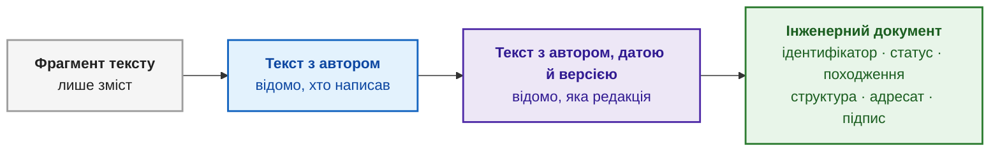
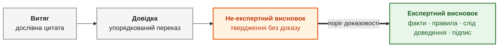
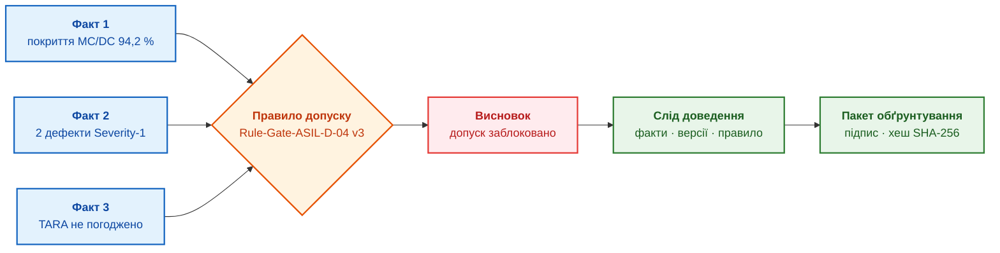
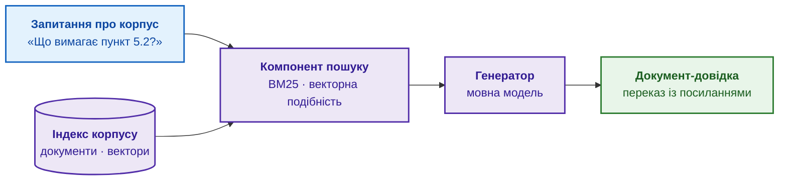
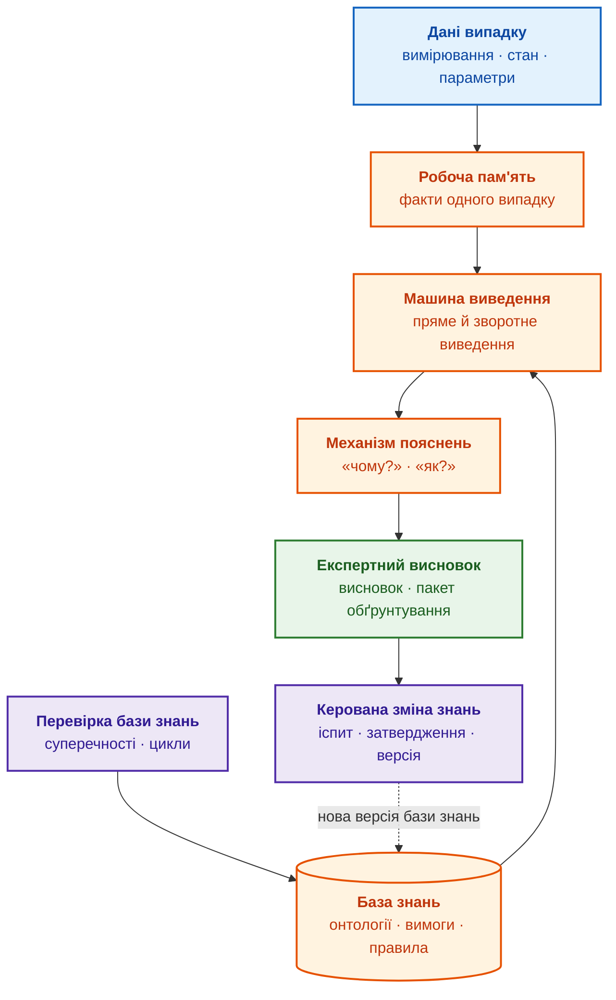
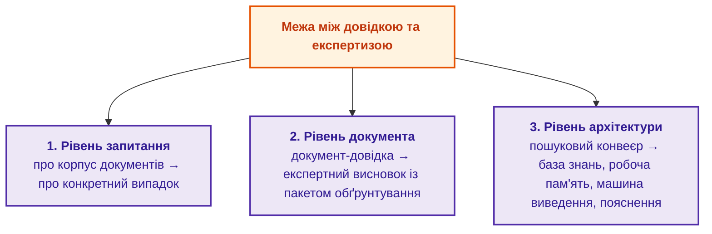

# Глава 3. Чим експертна система відрізняється від інформаційно-довідкової системи

> **Книга:** [Архітектура доказових експертних систем](README.md) · [Частина I: Концептуальні та епістемологічні основи](part-01-foundations.md)
> **Попередня глава:** [Глава 2. Філософія для інженера: що машина має право називати знанням](ch02-epistemology-of-machine-knowledge.md)
> **Наступна глава:** [Глава 4. Еволюція експертних систем: від теореми Байєса до доказових рішень ШІ](ch04-evolution-from-bayes-to-evidence-ai.md)
> **Зміст книги:** [README.md](README.md)  
> **Автор:** [Микола Федчик](about-the-author.md)  
> **Рівень складності та оптимальне вивчення:** `[L1]` Базовий інженерно-концептуальний (індекс Д. Кнута `[14]`) · *Маршрут:* Експрес-маршрут та `Трек A`; 1 прохід  
> **Очікувані результати:** відрізнити запитання про корпус документів від запитання про конкретний випадок; пояснити, чим документ-довідка відрізняється від експертного висновку; назвати механізми, яких бракує пошуковій системі, базі даних, мовній моделі й генерації з пошуком, щоб стати експертною системою; пояснити, чому експертна система змінює знання лише через перевірену нову версію бази знань.

## Анотація
У главі розкрито концептуальну, документальну та архітектурну межу між інформаційно-довідковими системами (включно з архітектурами RAG та автономними мовними моделями) і доказовими експертними системами. Наведено типологічну таксономію інформаційних систем та продемонстровано відмінність між пошуком у корпусі документів і логічним виведенням нового знання для конкретного інженерного випадку. Детально проаналізовано генезис інженерного документа, рівні доказовості вихідних артефактів та порівняно шість класів систем за сімома критеріями епістемічного контракту. На практичному прикладі верифікації допуску автомобільної прошивки рівня ASIL D (ISO 26262 / ISO/SAE 21434) продемонстровано функціонування машини логічного виведення та сліду доведення.

Перший крок до «експертної системи» команди інженерів часто роблять однаково: беруть теку з технічною документацією й додають до теки пошук або велику мовну модель (*large language model*, LLM), яка читає знайдені фрагменти й відповідає на запитання. Такий інструмент корисний, і в книзі він має власну назву: **інформаційно-довідкова система**, тобто інформаційна система, яка знаходить і подає вже записані відомості. Проблема виникає тоді, коли інформаційно-довідкову систему вважають експертною і довіряють відповіді інформаційно-довідкової системи там, де потрібен доведений висновок про конкретний випадок: про допуск прошивки до випробувань чи про режим стендового випробування.

Мета глави: показати, де саме проходить межа між інформаційно-довідковою та експертною системою, і перевірити межу на трьох рівнях: на рівні запитання, на рівні вихідного документа й на рівні архітектури. Мірилом слугує епістемічний контракт із [Глави 2](ch02-epistemology-of-machine-knowledge.md), тобто набір перевірок, які твердження мусить пройти, перш ніж експертна система застосує твердження. Для кожного класу інформаційних систем, від пошукової системи до мовної моделі, глава показує, яких перевірок контракту бракує. Досвід автора з системами електронної звітності, електронним підписом і процесами функціональної безпеки автомобільної електроніки дає тут одне мірило: відповідь інформаційної системи варта довіри лише тоді, коли відповідь має джерело, версію, відповідального власника й слід перевірки.

## 1. Типологічна таксономія інформаційних систем: чотири базові класи

Слова «довідкова», «консультаційна», «система підтримки рішень» і «експертна» часто вживають як синоніми. Через таку плутанину команда очікує від інструмента того, чого інструмент не вміє: від пошуку чекає висновку, а від чат-бота чекає відповідальності за висновок. Щоб порівнювати інструменти, спершу треба домовитися, за якою ознакою розрізняти класи інформаційних систем.

У монографії класи розрізняються за призначенням і за тим, що саме інформаційна система повертає користувачеві. Тут діє сформульований автором **принцип інваріантності інтерфейсу та обчислювальної підкладки (Interface & Substrate Invariance) М. Федчика**: клас інформаційної системи є інваріантним до форми інтерфейсу користувача та типу обчислювальної підкладки. Той самий чат може слугувати шлюзом як до пасивної довідкової бази цитат, так і до машини детермінованого виведення, а нейронна мережа може функціонувати всередині будь-якого класу (як семантичний ретрівер або як лінгвістичний транслятор). Таблиця описує чотири класи.

| Клас інформаційної системи | Головне призначення | Що повертає | Межа класу |
|---|---|---|---|
| **Інформаційно-довідкова система** | знайти й подати відомості, уже записані в корпусі документів | цитату, посилання, переказ джерел | пошук не будує висновку про конкретний випадок |
| **Консультаційна (діалогова) система** | вести діалог, пояснити варіанти, зібрати дані для фахівця | пораду, уточнювальне запитання, сценарій дій | діалог сам не створює перевірного висновку |
| **Система підтримки рішень** (*decision support system*, DSS) | допомогти людині порівняти варіанти й оцінити наслідки | рейтинг варіантів, прогноз, рекомендацію | рекомендація часто спирається на статистику без логічного доведення |
| **Експертна система** | застосувати записані знання до фактів конкретного випадку | висновок або обґрунтовану відмову разом із фактами, правилами й доказами | висновок чинний лише в межах бази знань і наданих фактів |

Класи перетинаються за сформульованим автором **принципом асиметрії включення систем підтримки рішень та експертних систем (Inclusion Asymmetry Principle) М. Федчика**: дорадча експертна система є окремим, найбільш суворо формалізованим підвидом систем підтримки рішень:

$$
\mathrm{ES}_{\mathrm{advisory}} \subset \mathrm{DSS}
$$

проте зворотне відношення категорично не виконується:

$$
\mathrm{DSS} \not\subset \mathrm{ES}
$$

Стохастичні моделі прогнозування часових рядів, баєсівські класифікатори ризику чи симплекс-оптимізатори розкладу допомагають людині ухвалювати рішення (тобто належать до $`\mathrm{DSS}`$), але принципово не є експертними системами, оскільки позбавлені записаних символьних правил предметної області та відтворюваного дискретного сліду доведення.

Приклад. Дві команди мають однаковий чат-інтерфейс. У першій команді чат передає запитання пошуковому індексу стандартів і повертає цитати, і за класом такий інструмент є інформаційно-довідковою системою. У другій команді чат передає запитання машині виведення, яка перевіряє факти випуску прошивки за правилами допуску й повертає висновок зі слідом доведення, і за класом такий інструмент є експертною системою. Користувач бачить те саме вікно, але отримує результати різної сили.

Клас інформаційної системи визначають не інтерфейс і не наявність нейронної мережі, а те, що інформаційна система повертає і як обґрунтовує повернене. Далі межу між довідкою та експертизою перевірено на трьох рівнях, і перший рівень стосується самого запитання.

> [!NOTE]
> **Авторська типологічна таксономія інформаційних систем М. М. Федчика (Чотири функціональні класи за вихідним артефактом)**  
> 1. **Інформаційно-довідкова система:** пошук і пасивний переказ уже зафіксованих у корпусі відомостей без синтезу висновків для конкретного випадку.
> 2. **Консультаційна (діалогова) система:** ведення людино-машинного діалогу, збір первинних даних та сценарії роз'яснення без юридично значущої доказовості.
> 3. **Система підтримки рішень (DSS):** статистичне ранжування альтернатив, прогнозування та оптимізація без детермінованого логічного сліду доведення.
> 4. **Доказова експертна система:** детерміноване застосування нормативних правил до фактів конкретного випадку з генерацією сліду доведення та підписаного пакета обґрунтування.
> *Інженерний інваріант:* Клас системи є інваріантним до форми інтерфейсу й обчислювальної підкладки та визначається виключно епістемічною силою вихідного артефакту й наявністю верифікованого сліду доведення.

### 1.1. Внутрішня стратифікація класу доказових експертних систем: дорадчо-консультативні, рекомендаційні та винахідницькі

Якщо зовнішня типологія (Розділ 1) проводить сувору демаркаційну лінію між пасивними інформаційно-довідковими системами ($`\mathrm{RIS}`$), статистичними системами підтримки рішень ($`\mathrm{DSS}`$) та класом доказових експертних систем ($`\mathrm{ES}`$), то всередині самого класу $`\mathrm{ES}`$ постає наступне фундаментальне питання: **яку саме інтелектуальну роботу виконує машина виведення над побайтово верифікованими знаннями?**

В авторській концепції Миколи Федчика клас доказових експертних систем $`\mathrm{ES}`$ внутрішньо стратифікується на три функціональні ешелони за характером синтезованого висновку та глибиною подолання інженерних протиріч (авторські терміни «Федеративна Арена» і «гіперпростір HV4096» з таблиці докладно розкрито в [Главі 28](ch28-dual-mode-expert-systems.md) і [Главі 34](ch34-deterministic-relational-analysis-abduction-and-socratic-dialogue.md)):

| Ешелон експертної системи | Вхідна епістемічна ситуація | Механізм логічного та векторного виведення | Канонічний тип вихідного вердикту |
| :--- | :--- | :--- | :--- |
| **1. Дорадчо-консультативна ($`\mathrm{ES}_{\mathrm{consultative}}`$)** | Неповний вектор фактів випадку $C$ або дослідницький запит на межі застосовності норм | Зворотний абдуктивний аналіз дефіциту передумов, сократівська генерація запитань та огляд суміжних прецедентів | `CLARIFICATION` / `QUALIFIED_NONANSWER` зі списком відсутніх параметрів та картою застосовних норм |
| **2. Рекомендаційна ($`\mathrm{ES}_{\mathrm{recommendatory}}`$)** | Повний вектор фактів випадку $C$ у межах одного або кількох узгоджених стандартів | Пряме та зворотне дедуктивне виведення, інтервальний контроль SI та розв'язання нормативних колізій ASPIC+ | `VERIFIED_FACT` / `ACCEPT` / `REFUSAL` із підписаним контрактом дії та побайтовою трасою |
| **3. Винахідницька ($`\mathrm{ES}_{\mathrm{inventive}}`$)** | Локальна нерозв'язність у домені $`D_1`$ (антагоністичне протиріччя $`M_1 \implies \mathrm{IMPROVES}(P_1) \land \mathrm{DEGRADES}(P_2)`$) | Векторно-алгебраїчна абдукція ізоморфних мостів на ваговій базі + крос-пакетний синтез у Федеративній Арені ($`D_1 \oplus \dots \oplus D_k`$) | `SYNTHESIZED` (кандидат із сертифікатом сумісності) або `BOUNDED_HYPOTHESIS` (паспорт відсутньої ланки) |

Канонічний словник [Глави 16 §1.1](ch16-expert-systems-architecture.md#11-канонічний-словник-вердиктів-рантайму-та-межі-повноважень) відокремлює походження кандидата від остаточного вердикту: `SYNTHESIZED` і `BOUNDED_HYPOTHESIS` відображаються на `QUALIFIED_PROVISIONAL`, а консультативне уточнення — на `QUALIFIED_CLARIFICATION_REQUIRED`. Верифікований факт може отримати `ACCEPT` лише після загальних доказових перевірок; для нового міжпакетного моста додатково потрібен допуск конкретної зміни baseline за [Главою 25 §12.1](ch25-how-expert-systems-learn.md#121-синтетичні-машинні-міркування-дистиляція-векторних-припущень-у-верифіковані-правила). Сумісність інтервалів не є самодостатнім логічним доказом. `REFUSAL` зберігає причину недостатності підстав або конфлікту.

Принципова наукова новизна цього поділу полягає в тому, що **дорадчо-консультативна експертна система** в архітектурі М. Федчика докорінно відрізняється від побутової діалогової системи (клас 2 зовнішньої таксономії): вона веде консультацію не шляхом вільного переказу тексту, а шляхом строгого обчислення недовизначених змінних у формальному графі правил. Своєю чергою, **винахідницька експертна система** вперше виводить символьний штучний інтелект за межі репродуктивного застосування готових інструкцій у площину **відкриття нових міждоменних інженерних рішень**, де кожна складова ланка винаходу захищена побайтовою кастодією першоджерела.

> [!NOTE]
> **Три ступені епістемічної потужності експертних систем за моделлю М. М. Федчика**
> 1. **Консультативна навігація через детерміноване виявлення прогалин (`Consultative Epistemic Guidance`):** коли даних для однозначного присуду недостатньо, експертна система не вгадує відповідь і не обмежується пасивним пошуком, а обчислює мінімальний набір відсутніх вимірювань і консультує інженера щодо умов входу в кожну гілку нормативного дерева.
> 2. **Рекомендаційна верифікація та нормативний присуд (`Recommendatory Normative Adjudication`):** за наявності всіх вхідних параметрів випадку система виконує детерміновану перевірку сумісності та видає зобов'язуючу інженерну рекомендацію або заборону з повною криптографічною прив'язкою до чинних аксіом.
> 3. **Винахідницький міждоменний синтез та абдукція відсутньої ланки (`Inventive Cross-Domain Synthesis`):** коли штатні правила одного домену заходять у глухий кут технічного протиріччя, система переходить у режим Федеративної Арени та векторно-алгебраїчного колайдера, реєструючи кандидата багатопакетного рішення (`SYNTHESIZED`) або формулюючи точне технічне завдання на експериментальне відкриття (`BOUNDED_HYPOTHESIS`).
> *Інженерний інваріант:* Усі три класи функціонують над єдиним незмінним форматом знань і підпорядковуються спільному апаратно-програмному шлюзу істинності, який відокремлює кандидатів і гіпотези від допущеного знання та не дозволяє активувати їх без перевірки й затвердження.

### 1.2. Епістемічна спіраль від маркетингу потреб до винахідницького паспорта та патентної формули

У традиційних корпораціях між відділом маркетингу, системними інженерами, дослідницькою лабораторією та патентним бюро існує глибокий семантичний розрив: маркетологи оперують презентаціями й побажаннями клієнтів, інженери — розрізненими таблицями вимог, а винахідники покладаються на випадкове осяяння. Запропонована М. М. Федчиком трирівнева архітектура експертної системи зшиває ці підрозділи в **єдиний замкнений кібернетичний цикл винаходження потреб і створення технологій**.

Механізм цієї спіралі працює так: коли інженер із застосування (`FAE`) або технічний маркетолог (`TME`) перевіряє складний запит клієнта через рекомендаційний рівень ($`\mathrm{ES}_{\mathrm{recommendatory}}`$) і отримує детерміновану відмову `REFUSAL` через фізичне чи нормативне протиріччя (наприклад, неможливість одночасно забезпечити швидкість комутації та норму електромагнітної сумісності в межах наявного каталогу), система не просто відхиляє запит. Вона автоматично реєструє **формалізований квиток епістемічної та продуктової прогалини (`KnowledgeGapTicket`)**. Накопичений масив таких квитків дає продуктовому маркетингу точну кількісну карту незадоволеного попиту ринку і автоматично запускає тракт **винахідницької експертної системи ($`\mathrm{ES}_{\mathrm{inventive}}`$)** для синтезу рішення наступного покоління.

> [!NOTE]
> **Три закони трансформації незадоволеної потреби ринку на верифікований винахід (за М. М. Федчиком)**
> 1. **Закон продуктивної відмови (`Refusal-as-Invention-Trigger`):** кожна детермінована відмова рекомендаційної експертної системи (`REFUSAL`) на реальний запит замовника через конфлікт параметрів фіксується у вигляді структурованого `KnowledgeGapTicket` і стає формальним технічним завданням для винахідницького синтезу.
> 2. **Закон доказової розвідки в технічному маркетингу (`Evidence-Driven Technical Marketing`):** продуктові та технічні маркетологи (`PMM/TME/FAE`) використовують статистику нерозв'язаних прогалин та граничних запитів `CLARIFICATION` для об'єктивного виявлення «білих плям» ринку та формування специфікацій нових продуктів без суб'єктивного вгадування.
> 3. **Закон триєдності Паспорта Синтезу (`Tri-Role Invention Passport`):** вихідний документ винахідницької системи (`SynthesisPassport`) одночасно слугує матеріалом для проєктного перегляду інженером-розробником (`SYNTHESIZED`), точним планом лабораторного досліду для науковця (`BOUNDED_HYPOTHESIS`) та готовим каркасом незалежного пункту патентної формули для патентного повіреного.
> *Керування рантаймом / Інженерний інваріант:* Передача задачі від маркетингового запиту до R&D-синтезу відбувається без втрати формальних одиниць вимірювання SI та граничних інтервалів `[ValMin..ValMax]`, що унеможливлює спотворення потреби клієнта на шляху до лабораторії.

### 1.3. Три вкладені операційні режими доказових експертних систем: інженерні механізми доопрацювання від консультації до винахідництва

Класична література з експертних систем першого та другого поколінь розглядала базу знань як статичний однодоменний консультант. У розвиненій у цій монографії теорії М. М. Федчика доказова експертна система визначається як **трирівневий вкладений епістемічний автомат**, де кожен вищий режим строго включає гарантії нижчого, але розширює простір допустимих операцій над компільованими пакетами знань та бінарним графом онтології:

$$
\begin{aligned}
\mathrm{ES}_{\mathrm{consultative}} &\quad (|\mathcal{P}| = 1,\; \text{Аудит норми}) \\
\subset\; \mathrm{ES}_{\mathrm{recommendatory}} &\quad (|\mathcal{P}| \ge 2,\; \text{Парето-відбір}) \\
\subset\; \mathrm{ES}_{\mathrm{inventive}} &\quad (\text{Крос-доменна абдукція } \mathrm{HV4096} + \mathrm{FP16} \to \text{System 2})
\end{aligned}
$$

Для того щоб кожен із цих трьох режимів видавав промислово придатний, юридично й фізично захищений інженерний артефакт, автором розроблено дев'ять спеціалізованих механізмів доопрацювання (по три на кожен режим роботи):

| Операційний режим ЕС | Код і назва інженерного доопрацювання | Сутність алгоритмічного механізму в ядрі виведення |
| :--- | :--- | :--- |
| **1. Порадчо-консультативний ($`\mathrm{ES}_{\mathrm{consultative}}`$)** | **`CONS-1`: Обов'язкове розкриття деонтичних винятків (*Defeater Disclosure*)** | Жодна консультативна відповідь `ACCEPT` не повертається ізольовано: ядро автоматично перевіряє секцію дефітерів того самого пакета знань і додає до паспорта всі умови-винятки (`UNLESS`, `EXCEPT WHEN`) з їхніми байтовими координатами. |
| | **`CONS-2`: Каскадне зв'язування дефініцій із нормою (*Definition-to-Norm Citation*)** | Поруч із нормативним правилом (`MUST`/`FORB`) система автоматично підтягує канонічну дефініцію (`DEFINITION`) суб'єкта та об'єкта з того самого першоджерела у дволанковий мікропаспорт. |
| | **`CONS-3`: Блокування міжпакетної екстраполяції (*Single-Source Isolation Lock*)** | Будь-які міждоменні містки (`IsomorphicBridge`) у консультативному режимі апаратно заборонені: за відсутності прямої норми в обраному стандарті негайно повертається `REFUSAL` або `CLARIFICATION`. |
| **2. Рекомендаційний ($`\mathrm{ES}_{\mathrm{recommendatory}}`$)** | **`REC-1`: Парето-ранжування за нормованим запасом міцності ($`\mathcal{M}`$)** | Усі сумісні альтернативи, що пройшли перетин інтервалів $`\bigcap_k [v_{\min}^{(k)}, v_{\max}^{(k)}] \neq \emptyset`$ в одиницях SI, ранжуються за індексом запасу надійності $`\mathcal{M}(a, R) = \frac{\min(v_{\max}^{(R)} - v_{\max}^{(a)},\; v_{\min}^{(a)} - v_{\min}^{(R)})}{v_{\max}^{(R)} - v_{\min}^{(R)}}`$. |
| | **`REC-2`: Контрфактична заміна при колізії (*Defeater Remediation*)** | Якщо кандидат відхиляється через деонтичний конфлікт (`0x0408`) або несумісність інтервалів (`0x0409`), ядро автоматично шукає в сусідніх пакетах домену альтернативний елемент, що усуває причину відмови. |
| | **`REC-3`: Таблиця інженерних компромісів (*Trade-Off Matrix Passport*)** | Рекомендаційний паспорт містить порівняльну таблицю всіх допустимих конфігурацій із шириною спільного робочого вікна $`\Delta V = v_{\max}^* - v_{\min}^*`$ та посиланнями на байти кожного обмеження. |
| **3. Винахідницький ($`\mathrm{ES}_{\mathrm{inventive}}`$)** | **`INV-1`: Фільтр міждоменної ортогональності та новизни ($`\mathcal{N}_{\mathrm{orth}}`$)** | Для відокремлення тривіальної компіляції від справжнього винаходу введено метрику ортогональності доменів за бітовими масками $`\mathcal{N}_{\mathrm{orth}}(P_i, P_j) = 1 - \frac{\mathrm{popcnt}(\mathrm{DomainMask}_{P_i} \land \mathrm{DomainMask}_{P_j})}{\mathrm{popcnt}(\mathrm{DomainMask}_{P_i} \lor \mathrm{DomainMask}_{P_j})} \ge 0{,}50`$. |
| | **`INV-2`: Шлюз перевірки пропозицій розв'язання фізичних суперечностей ТРВЗ** | Перетворення у просторі, часі чи масштабі є пропозицією, не доказом. `SYNTHESIZED 0x0205` можливий лише за повним сертифікатом Глави 25 §12.1; відношення поза його унарним фрагментом цього статусу не дають. |
| | **`INV-3`: Автоматична диспетчеризація гіпотез у чергу дослідницьких прогалин** | Кожен вердикт `BOUNDED_HYPOTHESIS (0x0305)` із єдиною відсутньою ланкою автоматично серіалізується у вигляді структурованого технічного завдання на лабораторний експеримент (`ExperimentPlan`). |

> [!NOTE]
> **Три операційні режими та дев'ять інженерних механізмів розширення доказових експертних систем (модель Миколи Федчика)**
> 1. **Порадчо-консультативний режим ($`\mathrm{ES}_{\mathrm{consultative}}`$ — дослівний нормативний аудит у межах одного першоджерела):** включає обов'язкове розкриття всіх деонтичних винятків `SECTION_DEFEATERS` поруч із основною нормою (`CONS-1`), автоматичне каскадне приєднання канонічних дефініцій термінів до цитованого правила (`CONS-2`) та жорстке блокування будь-яких міжпакетних припущень чи аналогій (`CONS-3`).
> 2. **Рекомендаційний режим ($`\mathrm{ES}_{\mathrm{recommendatory}}`$ — багатокритеріальний Парето-відбір над множиною пакетів знань):** реалізує детерміноване ранжування сумісних альтернатив за нормованим запасом міцності $`\mathcal{M}(a, R)`$ в одиницях SI (`REC-1`), автоматичний контрфактичний підбір заміни при спрацюванні дефітера колізії `0x0408`/`0x0409` (`REC-2`) та генерацію таблиці інженерних компромісів із точним робочим вікном $\Delta V$ (`REC-3`).
> 3. **Винахідницький режим ($`\mathrm{ES}_{\mathrm{inventive}}`$ — крос-доменна векторно-алгебраїчна абдукція та детермінований синтез):** забезпечує кількісну фільтрацію міждоменної новизни за індексом ортогональності Жаккара $`\mathcal{N}_{\mathrm{orth}} \ge 0{,}50`$ (`INV-1`), формальну перевірку розв'язання фізичних суперечностей у просторі, часі або масштабі за законами ТРВЗ та SI (`INV-2`) і автоматичну генерацію паспорта лабораторного експерименту для єдиної відсутньої ланки в чергу дослідницьких прогалин (`INV-3`).
> *Керування рантаймом / Інженерний інваріант:* Перехід системи від консультативного до рекомендаційного та винахідницького режиму розширює виключно топологію пошуку кандидатів (System 1), але залишає незмінним криміналістичний поріг допуску System 2 (конструктивний інваріант шлюзу $`\mathrm{ZHR}_{\mathrm{gate}} = 1{,}00`$, стовідсоткова побайтова кастодія `%ebx`).

При цьому в інженерній верифікації суворо розмежовуються дві різні величини: (а) **конструктивний інваріант шлюзу допуску** ($`\mathrm{ZHR}_{\mathrm{gate}} = 1{,}00`$, який у логах апаратного шлюзу записується з фіксованою точністю як `ZHR = 1,000000`), що гарантує: кожне допущене до відповіді твердження має побайтово звірену цитату в першоджерелі, а будь-який непідтверджений кандидат детерміновано відсікається; та (б) **емпірична статистична верхня межа частоти галюцинацій** на скінченній випробувальній вибірці з $`N`$ запитів при нулі зафіксованих помилок, яка за рівня довіри 95 % становить $`p_U = 1 - 0{,}05^{1/N}`$ (методика статистичної атестації детально викладена в [Главі 36](ch36-knowledge-testing-pyramid-and-variational-calibration.md), підрозділ 5.5).

## 2. Семантичний рівень запиту: диференціація аналізу корпусу документів та фактів конкретного випадку

Запитання користувачів схожі за формою, але належать до двох різних типів. Якщо типи не розрізняти, інформаційно-довідкова система береться відповідати на запитання, на яке відповісти не може, і відповідь при цьому звучить переконливо.

**Запитання про корпус** стосується того, що написано в документах: «Що корпоративний стандарт випробувань каже про максимальну температуру корпусу модуля?», «Де описано вимоги до ізоляції?». Корпусом називають сукупність документів, у яких шукають відповідь. Відповідь на запитання про корпус уже існує в документі, і завдання інформаційно-довідкової системи полягає в тому, щоб знайти потрібний фрагмент і подати фрагмент зрозуміло. Навіть якщо знайдені фрагменти гладко переказує нейронна мережа, суть роботи не змінюється: інформаційно-довідкова система виконує пошук і виклад.

**Запитання про випадок** стосується однієї конкретної ситуації: «Чи можна 15 вересня 2026 року випробувати прототип ревізії B на стенді R-4 за температури корпусу 95 °C?» Відповіді на таке запитання немає дослівно в жодному документі. У прикладі з [Глави 2](ch02-epistemology-of-machine-knowledge.md) корпоративний стандарт обмежує температуру корпусу 90 °C, а дозвіл на відхилення W-17 дозволяє 95 °C лише для ревізії B, лише на стенді R-4 і лише до 1 жовтня 2026 року. Відповідь з'являється тільки після того, як правила зі стандарту й дозволу застосовано до фактів випадку: ревізії, стенда, дати й вимірюваної величини. Застосування правил до фактів виконує машина виведення, тобто програмний механізм, який бере факти конкретної ситуації, знаходить придатні правила й отримує новий висновок ([Глава 1](ch01-introduction-to-expert-systems.md)).

> **Оперативний інженерний тест диференціації запитів М. Федчика.** Якщо на будь-яке запитання інформаційна система відповідає «ось що про це сказано в джерелах», перед вами інформаційно-довідкова система. Якщо інформаційна система відповідає «для випадку C операцію заборонено за правилом R на підставі фактів F1 і F2, взятих із документа S версії 4; ось слід доведення», перед вами експертна система.

Експертна система вміє відповідати й на запитання про корпус, бо пошук є одним із компонентів експертної системи. Зворотне категорично забороняє сформульований автором **закон неможливості стохастичного переходу від корпусу до випадку М. Федчика**:

$$
Q_{\mathrm{corpus}} \not\implies Q_{\mathrm{case}}
$$

Інформаційно-довідкова система не має механізму, який застосовує правила до фактів випадку, тому на запитання про випадок інформаційно-довідкова система може відповісти лише цитатою або здогадкою.

Корпус документів спільний для багатьох випадків і змінюється рідко, а кожен випадок має власні факти. Пошук піднімає з корпусу загальні правила, але перенести загальне правило на конкретний випадок пошук не може: таке перенесення виконує машина виведення. Наступний розділ з'ясовує, де в цьому поділі стоїть велика мовна модель, яку найчастіше плутають з експертною системою.

> [!NOTE]
> **Авторська модель семантичної демаркації запитів М. М. Федчика (Два типи інженерних запитань)**  
> 1. **Запитання про корпус ($`Q_{\text{corpus}}`$):** пошуковий запит щодо наявного змісту документів («Що стандарт вимагає для ізоляції?»); відповідь уже зафіксована в тексті першоджерела у вигляді цитати чи нормативного витягу.
> 2. **Запитання про випадок ($`Q_{\text{case}}`$):** аналітичний запит щодо конкретної емпіричної ситуації $`C = \langle \text{об'єкт}, \text{вимірювання}, \text{контекст} \rangle`$; відповіді немає дослівно в жодному документі, вона потребує логічного виведення машиною резолюції на базі фактів і правил.
> *Інженерний інваріант:* Прямий перехід від $`Q_{\mathrm{corpus}}`$ до $`Q_{\mathrm{case}}`$ засобами стохастичного пошуку є алгоритмічно некоректним ($`Q_{\mathrm{corpus}} \not\implies Q_{\mathrm{case}}`$) і вимагає обов'язкового застосування детермінованої машини логічного виведення.

## 3. Функціональна роль великих мовних моделей в архітектурі аналітичних систем

Загальнодоступні чат-сервіси на основі великих мовних моделей, такі як ChatGPT, Claude чи Gemini, одні користувачі називають довідковими, інші експертними системами. Обидві назви неточні, бо велика мовна модель сама по собі не є завершеною інформаційною системою. Велика мовна модель є компонентом, і клас результату визначає архітектура, у яку компонент вбудовано.

Велика мовна модель генерує текст на основі параметрів нейронної мережі, навченої на великому масиві текстів. Відомості, засвоєні під час навчання, розподілені по параметрах моделі, тому модель не може надійно вказати документ, з якого взято конкретне твердження. Звідси три фундаментальні обмеження:

- **Мовна модель не знає внутрішнього корпусу компанії.** На запитання «де це записано в нашій документації?» модель без доступу до документації дасть упевнений, але, можливо, вигаданий переказ. Схильність генеративних моделей створювати правдоподібний текст, не підтверджений джерелом, дослідники називають галюцинаціями (*hallucination*) [[1]](#src-1).
- **Мовна модель не зберігає фактів випадку як окремих перевірених записів.** Текст запиту модель бачить у контекстному вікні, тобто у фрагменті тексту, який модель обробляє за один раз. Джерела й версії окремих фактів у контекстному вікні не відстежуються.
- **Мовна модель не будує дискретного ланцюжка «факт, правило, висновок».** Текст моделі може мати вигляд вердикту, але під текстом немає сліду доведення, походження фактів і відповідальної особи.

Від архітектури, у яку вбудовано мовну модель, залежить клас результату:

1. Мовна модель разом із пошуком у контрольованому корпусі утворює **генерацію з пошуком** (*retrieval-augmented generation*, RAG). Патрік Льюїс і співавтори запропонували поєднати параметричну пам'ять мовної моделі з непараметричною пам'яттю, тобто з індексом документів, з якого перед генерацією добирають релевантні фрагменти [[2]](#src-2). Відповіді RAG мають посилання на документи компанії, але за класом RAG є сучасною інформаційно-довідковою системою.
2. Мовна модель разом із базою знань, машиною виведення, робочою пам'яттю випадку й механізмом пояснень утворює **нейро-символьну експертну систему** ([Глава 29](ch29-neuro-symbolic-architecture.md)). У нейро-символьній експертній системі мовна модель перекладає запитання людини мовою фактів і правил та переказує висновок зрозумілою мовою, але не вирішує, що є істинним.

Приклад. На запитання «чи можна випробувати прототип ревізії B за 95 °C?» мовна модель без доступу до документів відповість загальними міркуваннями про температурні режими. RAG знайде стандарт і дозвіл W-17 та перекаже обидва документи з посиланнями, але не перевірить, чи збігаються ревізія, стенд і дата із запиту з умовами дозволу. Нейро-символьна експертна система отримає від мовної моделі структуровані факти запиту, машина виведення перевірить умови W-17, а мовна модель перекаже результат разом зі слідом доведення.

Для інженерних досліджень і розробок діє сформульований автором **інваріант локального суверенітету та замкненого середовища виконання (Local Air-Gapped Inference) М. Федчика**: щоб отримати відповідь від хмарної мовної моделі, параметри дефекту чи конструкції доводиться передати зовнішньому постачальнику послуги, а політика безпеки конфіденційних розробок часто таке передавання категорично забороняє. У таких умовах мовну модель і решту компонентів експертної системи розгортають локально в ізольованому периметрі ([Глава 18](ch18-execution-infrastructure.md)).

Тут знаходить свій вираз **принцип інструментальної субординації великих мовних моделей М. Федчика**: велика мовна модель є сильним мовним компонентом, але не арбітром істини. Без пошуку мовна модель переказує засвоєне під час навчання, разом із пошуком мовна модель стає частиною інформаційно-довідкової системи, і лише разом із базою знань і машиною виведення мовна модель стає частиною експертної системи. Наступний рівень розрізнення стосується того, що інформаційна система видає на виході.

## 4. Документальний рівень: концептуальна межа між інформаційною довідкою та експертним висновком

На виході й інформаційно-довідкова, й експертна система видають текст, і обидва тексти можуть мати однаковий вигляд. Проте в аудиті, під час сертифікації чи в суперечці між командами лише один із двох текстів має силу доказу. Щоб побачити різницю, спершу треба з'ясувати, що перетворює текст на документ.

### 4.1. Генезис інженерного документа: від сирого тексту до юридично значущого артефакту

Трансформація неструктурованих даних у доказову базу описується **чотирифакторною моделлю генезису інженерного документа ($`T \to \mathrm{Doc}`$) М. Федчика**: сирий текстовий фрагмент стає легітимним артефактом лише в міру набуття атрибутів авторства, версії, типізованої структури та юридичної сили. Фрагмент тексту на екрані ще не є документом: невідомо, хто фрагмент написав, коли, для кого і чи фрагмент досі чинний. Такий фрагмент не можна ні перевірити, ні долучити до звіту.

Текст набуває статусу документа поступово, і кожен крок додає атрибут, без якого певна перевірка неможлива:

1. **Фрагмент тексту** містить лише зміст.
2. **Текст з автором** показує джерело, але без дати не можна встановити, чи текст актуальний.
3. **Текст з автором, датою й версією** дає змогу однозначно зіставити цитату з конкретною редакцією.
4. **Інженерний документ** має повний набір атрибутів:
   - стабільний ідентифікатор, наприклад інвентарний номер;
   - автора й відповідального власника, тобто людину, яка відповідає за зміст;
   - статус життєвого циклу: чернетка, на рецензії, затверджено або виведено з ужитку;
   - походження (*provenance*): з яких вхідних даних і якими діями документ отримано; модель PROV-O Консорціуму Всесвітньої павутини (World Wide Web Consortium, W3C) описує походження через сутності, дії та учасників [[3]](#src-3);
   - структуру: типізовані розділи й поля, які програма може прочитати;
   - призначення, адресата й рівень доступу;
   - підпис відповідальної особи.

Схема показує ту саму послідовність.



Сірий блок є фрагментом без контексту, синій і фіолетовий блоки додають автора, дату й версію, зелений блок є інженерним документом. Кожна стрілка додає атрибут, який робить можливою нову перевірку: автор дає змогу знайти відповідального, версія дає змогу перевірити актуальність, а статус і підпис дають змогу використати документ в аудиті.

Тут діє сформульований автором **принцип юридичної еквівалентності машинного висновку М. Федчика**: сила машинного документа походить не з оформлення інтерфейсу, а з криптографічно верифікованого зв'язку між виведеними предикатами та сертифікатом цифрового підпису. У Європейському Союзі кваліфікований електронний підпис (КЕП) має таку саму юридичну силу, як власноручний підпис, а перевірка кваліфікованого підпису включає перевірку сертифіката підписувача, чинного на момент підписання [[4]](#src-4).

Для експертної системи з аналогії випливає вимога: висновок набуває ваги не від вдалого формулювання, а від зв'язку з підписаним і перевірним слідом доведення. Висновок без такого зв'язку залишається фрагментом тексту, хоч би як переконливо висновок звучав.

### 4.2. Онтологічна диференціація: пасивний переказ джерел проти детермінованого виведення

Тут діє **інженерний принцип диференціації довідки та висновку (Passive Reference vs Assertive Verdict) М. Федчика**: фундаментальна онтологічна межа між довідкою та експертним висновком полягає у відмінності між пасивною ретрансляцією зафіксованих фактів і синтезом нового знання шляхом логічної дедукції. Обидва вихідні документи можуть посилатися на ті самі джерела, тому відмінність між документами треба шукати не в темі, а в природі документа.

**Документ-довідка** переказує наявні знання: витяг із державного стандарту, технічного опису транзистора (*datasheet*) чи інструкції з калібрування. Критерієм правильності довідки є точність переказу першоджерела, слідом є посилання на розділ або сторінку, нових тверджень довідка не містить. Укладач довідки відповідає за точність переказу, але не за наслідки застосування переказаної вимоги.

**Експертний висновок** є новим судженням про конкретний випадок: оцінкою безпеки електронного вузла, рішенням про готовність прошивки до випробувань, локалізацією дефекту. Критерієм правильності висновку є коректність виведення з перевірених фактів за затвердженими правилами. Слідом є ланцюжок «факт, правило, проміжний висновок, висновок» із версіями й походженням кожного елемента. Експертний висновок містить твердження, якого немає в жодному вихідному документі, явно називає область застосування й припущення та має підпис експерта або службовий підпис експертної системи, за яким стоїть відповідальна особа.

| Ознака | Документ-довідка | Експертний висновок |
|---|---|---|
| Природа документа | переказ відомого | нове судження про випадок |
| Критерій правильності | відповідність першоджерелу | коректне виведення з фактів за правилами |
| Нові твердження | немає | є: висновок про випадок |
| Слід | посилання на джерела | слід доведення з версіями й походженням |
| Межі застосування | задані джерелом | названі явно: область, припущення, статус |
| Використання | довідкова інформація | доказ в аудиті чи сертифікації |

> [!TIP]
> **Інженерний приклад: чому довідка не рятує в апаратних системах**  
> Якщо запитати типову RAG-систему: *«Чи можна подати 24 В на цифровий вхід модуля DI-4?»*, вона знайде специфікацію «номінальна напруга входу: 24 В постійного струму» й відповість ствердно.  
> Але експертна система перевіряє **факти поточного підключення**: якщо конфігурація плати переведена джампером у режим ТТЛ (5 В) або температура корпусу модуля перевищує 70 °C, подача 24 В спалить вхідний оптрон. Експертна система заблокує дію, вказавши на апаратний конфлікт конфігурації. Довідка цитує текст специфікації; експертна система обчислює наслідок для конкретного пристрою.

Між дослівною цитатою й експертним висновком лежать чотири щаблі доказовості:

1. **Витяг:** дослівний фрагмент джерела, наприклад точна цитата пункту регламенту.
2. **Довідка:** упорядкований переказ фрагментів кількох джерел, наприклад зведена таблиця параметрів. Нового знання на цьому щаблі ще немає.
3. **Не-експертний висновок:** твердження про випадок без ланцюжка фактів і правил. Типовий приклад дає мовна модель без доступу до даних випадку: «схоже, цей компонент підійде для вашої схеми». Перевірити таке твердження неможливо.
4. **Експертний висновок:** судження про випадок зі слідом доведення, походженням кожної передумови й підписаним пакетом обґрунтування. **Пакетом обґрунтування** (*proof packet*) книга називає висновок разом із фактами, правилами, джерелами з версіями, межами застосування й відповідальною особою ([Глава 1](ch01-introduction-to-expert-systems.md)).

Схема показує щаблі й поріг між третім і четвертим щаблем.



Сірі блоки не створюють нового знання, помаранчевий блок створює нове твердження без доказу, зелений блок створює нове твердження з доказом. Подвійна стрілка позначає поріг доказовості: щоб перейти поріг, потрібне не краще формулювання, а факти, правила й слід доведення.

Межу між третім і четвертим щаблем визначає не стилістична якість тексту, а наявність формального сертифіката виведення $`\pi = \langle F, R, E_{\mathrm{bytes}}, \sigma_{\mathrm{hash}} \rangle`$. У термінах теорії обчислювальної складності та аналізу алгоритмів Д. Кнута перетин порогу доказовості переводить задачу аудиту з класу повної реконструкції з нуля ($`T_{\mathrm{verify}}(y, \varnothing) = T_{\mathrm{derive}} + \Delta T_{\mathrm{de\text{-}bias}}`$, третій щабель) у клас лінійної локальної верифікації крокових переходів сертифіката ($`T_{\mathrm{verify}}(y, \pi) = \Theta(|\pi|)`$, четвертий щабель). Наступний підрозділ показує різницю між щаблями на прикладі рішення, від якого залежать подальші випробування.

> [!NOTE]
> **Авторська модель рівнів доказовості вихідних артефактів М. М. Федчика (Чотири щаблі та поріг експертизи)**  
> 1. **Витяг:** дослівний текстовий фрагмент першоджерела без синтезу нового змісту.
> 2. **Довідка:** структурований реферативний звід кількох цитат; нове знання відсутнє.
> 3. **Не-експертний висновок:** твердження про випадок, згенероване евристично або стохастичною мовною моделлю без машинного сліду фактів і правил (не піддається верифікації).
> 4. **Експертний висновок:** детерміноване судження про випадок, що перетинає *поріг доказовості* завдяки наявності повного сліду виведення, походження кожної передумови та підписаного пакета обґрунтування (*proof packet*).
> *Інженерний інваріант:* Перетин порогу доказовості вимагає обов'язкової наявності машинного сліду виведення та криптографічно підписаного пакета обґрунтування; текстові твердження без сліду доведення автоматично класифікуються як не-експертні та відхиляються шлюзом безпеки.

### 4.3. Практичний кейс: верифікація допуску вбудованого ПЗ (Release Gate ASIL D) за стандартом ISO 26262

Практичну дію онтологічного розмежування найвиразніше демонструє процедура випуску місійно-критичного програмного забезпечення, де ціною плутанини між довідкою та експертним висновком є системна аварія. Розглянемо сценарій, у якому команда розробляє прошивку, тобто вбудоване програмне забезпечення блока керування автомобіля, і має вирішити, чи допускати ревізію прошивки v2.4.1 до випробувань на треку. Таку контрольну точку в розробці називають рішенням про допуск (*release gate*). Вимоги функціональної безпеки, які реалізує прошивка, мають рівень ASIL D (*Automotive Safety Integrity Level*, рівень повноти безпеки автомобільних систем): стандарт ISO 26262 визначає чотири рівні, від A до D, і рівень D ставить найсуворіші вимоги. Три інформаційні системи відповідають на запитання «чи готова прошивка?» по-різному:

- **Інформаційно-довідкова система** знаходить контрольний перелік випуску, звіт тестувальників, нотатки з кібербезпеки й посилання на стандарт ISO 26262.
- **Чат-бот на основі мовної моделі** підсумовує: «Більшість тестів успішні, прошивка виглядає готовою до випробувань».
- **Експертна система** формує висновок:

> **Рішення:** допуск прошивки v2.4.1 до випробувань на треку заблоковано.
> **Факти:**
> 1. Покриття модифікованих умов і рішень (*modified condition/decision coverage*, MC/DC) модульними тестами становить 94,2 %, а внутрішнє правило випуску вимагає 100 % для модулів рівня ASIL D (звіт покриття від 25.09.2026).
> 2. Звіт статичного аналізу для версії коду `a1f9c8` містить два відкриті дефекти найвищої критичності (*Severity-1*) (журнал аналізатора від 26.09.2026).
> 3. Аналіз загроз і оцінку ризиків (*threat analysis and risk assessment*, TARA) не погоджено відповідальним за кібербезпеку.
> **Правило:** `Rule-Gate-ASIL-D-04`, версія 3, забороняє допуск до випробувань, доки відкрита хоча б одна блокувальна умова.
> **Пакет обґрунтування:** підписаний, хеш SHA-256 `8b4a7…`.

Експертний висновок зберігає джерело кожного правила, бо правила походять із різних документів. ISO 26262-6 для програмних модулів рівня ASIL D наполегливо рекомендує вимірювати саме покриття MC/DC [[5]](#src-5), але поріг 100 % встановлює не стандарт, а внутрішнє правило випуску команди. Аналіз TARA описує стандарт кібербезпеки автомобільних систем ISO/SAE 21434 [[6]](#src-6). Якби висновок посилався на стандарт там, де діє внутрішнє правило, аудитор знайшов би невідповідність уже в першому факті.

Формально логіка шлюзу випуску описується **математичною моделлю шлюзу допуску ASIL D М. Федчика**:

$$
\mathrm{Gate}_{\mathrm{ASIL\text{-}D}}(c) = \begin{cases}
\mathbf{Blocked}, & \text{якщо } (\mathrm{MC/DC} < 100\%) \lor (\mathrm{Defects}_{\mathrm{Sev\text{-}1}} > 0) \lor (\mathrm{TARA} = 0) \\
\mathbf{Clarification}, & \text{якщо } \exists f \in \mathrm{Req}(c) : \mathrm{Status}(f) = \mathbf{U} \in \mathbb{K}_3 \\
\mathbf{Admitted}, & \text{якщо всі нормативні передумови виконано детерміновано}
\end{cases}
$$

де:
- $c$ — кортеж перевірених фактів конкретної версії прошивки;
- $`\mathrm{MC/DC}`$ — виміряний відсоток покриття рішень ($[0, 100]\%$);
- $`\mathrm{Defects}_{\mathrm{Sev\text{-}1}}`$ — кількість відкритих дефектів критичного класу ($`\mathbb{N}_0`$);
- $`\mathrm{TARA} \in \{0, 1\}`$ — факт наявності цифрового погодження звіту з кібербезпеки;
- $`\mathbb{K}_3 = \{\mathbf{T}, \mathbf{F}, \mathbf{U}\}`$ — множина значень тризначної логіки Кліні.

*Керування рантаймом та інженерні рішення:*
1. **Control Flow:** За статусу $`\mathbf{Blocked}`$ система генерує криптографічний вердикт відмови, блокує конвеєр CI/CD та надсилає сповіщення інженеру функціональної безпеки. За статусу $`\mathbf{Clarification}`$ автоматичний допуск призупиняється до надання відсутнього артефакту (TARA).
2. **Worked Numerical Example:** Для прошивки v2.4.1 маємо $`\mathrm{MC/DC} = 94{,}2\% < 100\%`$, $`\mathrm{Defects}_{\mathrm{Sev\text{-}1}} = 2 > 0`$ та $`\mathrm{TARA} = 0`$. Усі три блокувальні диз'юнкти істинні $\to$ кінцевий вердикт системи: $`\mathbf{Blocked}`$.

Схема показує, як три факти проходять через правило допуску до висновку й пакета обґрунтування.



Сині блоки є перевіреними фактами випадку, помаранчевий ромб є правилом із бази знань, червоний блок є висновком, зелені блоки є слідом доведення й підписаним пакетом обґрунтування. Кожен факт має власне джерело, тому висновок можна перевірити по частинах.

Такий висновок дає змогу вести аргументовану інженерну розмову. Розробник може оскаржити конкретний факт, наприклад довести, що один із дефектів є хибним спрацюванням аналізатора (*false positive*) і вже закритий документально. Власник правила може змінити правило через процедуру керування змінами. Із висновком «схоже, все гаразд» сперечатися неможливо, бо під таким висновком немає ні фактів, ні правила.

Як машина виведення отримує такий висновок, показує короткий приклад мовою Go. Правило в прикладі записано як дані, а не як код програми: умови й пороги можна змінити без зміни програми.

<details>
<summary>Приклад мовою Go: правило допуску як дані й слід спрацювання умов</summary>

Програма є повною й запускається командою `go run main.go`. Правило `Rule-Gate-ASIL-D-04` містить три блокувальні умови; функція `evaluate` перевіряє кожну умову на фактах випадку й друкує слід спрацювання умов. Прошивка v2.4.2 навмисно не має факту про погодження TARA.

```go
package main

import "fmt"

// Condition є однією умовою правила: назва факту, операція порівняння й поріг.
type Condition struct {
	Fact  string
	Op    string // "<", ">" або "=="
	Value float64
}

// Rule зберігається в базі знань як дані з ідентифікатором і версією.
type Rule struct {
	ID       string
	Version  int
	Blockers []Condition // кожна істинна умова блокує допуск
}

// holds повертає значення умови й ознаку того, що факт відомий.
func holds(c Condition, facts map[string]float64) (value, known bool) {
	v, ok := facts[c.Fact]
	if !ok {
		return false, false
	}
	switch c.Op {
	case "<":
		return v < c.Value, true
	case ">":
		return v > c.Value, true
	default:
		return v == c.Value, true
	}
}

// evaluate застосовує правило до фактів випадку й друкує слід спрацювання умов.
func evaluate(r Rule, facts map[string]float64) string {
	blocked, unknown := false, false
	for _, c := range r.Blockers {
		value, known := holds(c, facts)
		switch {
		case !known:
			unknown = true
			fmt.Printf("  %s: факт невідомий\n", c.Fact)
		case value:
			blocked = true
			fmt.Printf("  %s = %g %s %g: умова блокує допуск\n", c.Fact, facts[c.Fact], c.Op, c.Value)
		}
	}
	switch {
	case blocked:
		return "заблоковано"
	case unknown:
		return "потрібне уточнення"
	default:
		return "дозволено"
	}
}

func main() {
	rule := Rule{ID: "Rule-Gate-ASIL-D-04", Version: 3, Blockers: []Condition{
		{Fact: "mcdc_coverage_pct", Op: "<", Value: 100},
		{Fact: "open_sev1_defects", Op: ">", Value: 0},
		{Fact: "tara_approved", Op: "==", Value: 0},
	}}

	cases := []struct {
		firmware string
		facts    map[string]float64
	}{
		{"v2.4.1", map[string]float64{"mcdc_coverage_pct": 94.2, "open_sev1_defects": 2, "tara_approved": 0}},
		{"v2.4.2", map[string]float64{"mcdc_coverage_pct": 100, "open_sev1_defects": 0}},
	}
	for _, c := range cases {
		fmt.Printf("прошивка %s\n", c.firmware)
		fmt.Printf("  висновок: %s за правилом %s v%d\n", evaluate(rule, c.facts), rule.ID, rule.Version)
	}
}
```

Програма друкує:

```text
прошивка v2.4.1
  mcdc_coverage_pct = 94.2 < 100: умова блокує допуск
  open_sev1_defects = 2 > 0: умова блокує допуск
  tara_approved = 0 == 0: умова блокує допуск
  висновок: заблоковано за правилом Rule-Gate-ASIL-D-04 v3
прошивка v2.4.2
  tara_approved: факт невідомий
  висновок: потрібне уточнення за правилом Rule-Gate-ASIL-D-04 v3
```

Для прошивки v2.4.1 спрацювали всі три блокувальні умови, і кожен рядок сліду називає факт, значення й поріг. Для прошивки v2.4.2 покриття й дефекти в нормі, але факту про погодження TARA немає, тому машина виведення не вважає відсутній факт виконаною умовою й повертає «потрібне уточнення». Така поведінка відповідає сильній тризначній логіці Стівена Кліні $`\mathbb{K}_3`$ [[16]](#src-16), де значення «невідомо» ($`\mathbf{U}`$) не дорівнює ні «так», ні «ні» ([Глава 2](ch02-epistemology-of-machine-knowledge.md#чи-застосовне-твердження-до-запиту)). Приклад спрощено: справжня машина виведення обробляє тисячі правил, і висновок одного правила може ставати фактом для іншого правила ([Глава 6](ch06-applied-mathematics-for-expert-systems.md), [Глава 16](ch16-expert-systems-architecture.md)).

</details>

Приклад показує різницю трьох результатів. Довідка дає матеріали для рішення, чат-бот дає враження про рішення, а експертна система дає рішення, яке можна перевірити, оскаржити й відтворити.

На рівні документа межа проходить через слід доведення: без сліду доведення навіть правильний за змістом висновок лишається не-експертним. Щоб інформаційна система могла будувати слід доведення, архітектура інформаційної системи потребує компонентів, яких немає в пошуковому конвеєрі.

## 5. Архітектурний рівень: лінійний конвеєр генерації з пошуком (RAG) проти машини логічного виведення

Різниця між довідкою й експертизою є структурною і визначає склад компонентів інформаційної системи. Щоб побачити склад компонентів, порівняймо дві архітектури: генерацію з пошуком і експертну систему.

### 5.1. Принципи організації лінійного конвеєра генерації з пошуком (RAG)

Найпоширенішим сучасним патерном побудови інформаційно-довідкових комплексів є архітектура генерації з пошуковим доповненням, яка реалізує відкритий конвеєр трансформації неструктурованого тексту. Генерація з пошуком (RAG) є лінійним конвеєром із трьох компонентів:

1. **Індекс** зберігає документи корпусу в повнотекстовому або векторному вигляді. Векторне представлення (*embedding*) перетворює фрагмент тексту на числовий вектор так, щоб близькі за змістом фрагменти мали близькі вектори.
2. **Компонент пошуку** (*retriever*) добирає найрелевантніші фрагменти (*chunks*) за функцією ранжування BM25, яка оцінює документ за частотою слів запиту в документі, рідкістю слів у корпусі й довжиною документа [[7]](#src-7), або за косинусною подібністю векторних представлень. Часто обидва способи поєднують, і такий пошук називають гібридним.
3. **Генератор**, тобто мовна модель, переказує знайдені фрагменти зрозумілою мовою.

Схема показує шлях запитання через конвеєр.



Синій блок є запитанням про корпус, фіолетові блоки є компонентами конвеєра, зелений блок є документом-довідкою. Стрілки йдуть в одному напрямку: базовий конвеєр не зберігає фактів випадку, не застосовує правил і не перевіряє суперечностей між знайденими фрагментами.

Для запитань про корпус такий конвеєр добре підходить і коштує недорого. Для запитань про випадок конвеєру бракує місця, де зберігаються факти випадку, і механізму, який застосовує правила до фактів.

### 5.2. Структурна декомпозиція ядра доказової експертної системи

Експертна система містить пошук і мовну модель як допоміжні компоненти, але основу експертної системи утворюють інші компоненти. Схема показує, як дані випадку проходять крізь ядро експертної системи до висновку.



Синій блок є даними випадку, помаранчеві блоки утворюють ядро експертної системи, зелений блок є висновком, фіолетові блоки відповідають за перевірку й зміну знань. Пунктирна стрілка показує, що досвід із висновків повертається до бази знань не напряму, а через перевірку й затвердження нової версії бази знань.

Ядро експертної системи утворюють компоненти, яких немає в базовому конвеєрі RAG:

- **База знань** (*knowledge base*) зберігає онтології, вимоги, обмеження й правила як структуровані дані, окремо від тексту документів ([Глава 7](ch07-knowledge-base-typology.md)).
- **Робоча пам'ять** (*working memory*) зберігає факти одного випадку окремо від фактів інших випадків, тому факти прошивки v2.4.1 не змішуються з фактами прошивки v2.4.2.
- **Машина виведення** (*inference engine*) застосовує правила до фактів детермінованим алгоритмом: той самий набір фактів і правил дає той самий висновок. Пряме виведення (*forward chaining*) рухається від фактів до висновків, зворотне виведення (*backward chaining*) рухається від гіпотези до фактів, які гіпотезу підтверджують. Для швидкого зіставлення тисяч правил із фактами Чарльз Форджі запропонував алгоритм Rete [[8]](#src-8); як працює алгоритм Rete, пояснює [Глава 6](ch06-applied-mathematics-for-expert-systems.md).
- **Механізм пояснень** (*explanation engine*) відповідає на запитання «чому висновок саме такий?» і «як висновок отримано?», показуючи слід доведення ([Глава 20](ch20-explanation-engine.md)).
- **Перевірка бази знань** шукає суперечливі правила, цикли й недосяжні умови до того, як правило потрапить у роботу ([Глава 23](ch23-knowledge-base-verification.md)).
- **Керована зміна знань** перетворює досвід експлуатації на нову перевірену версію бази знань (підрозділ [«7.1. Еволюція знань через версіонування та регресійне тестування на еталонних вибірках»](#навчання-лише-через-перевірену-нову-версію-бази-знань) нижче).

> [!NOTE]
> **Авторська архітектурна модель ядра доказової експертної системи М. М. Федчика (Шість інваріантних підсистем)**  
> 1. **База знань (KB):** структуроване сховище онтологій, вимог і правил, відокремлене від сирого тексту документів.
> 2. **Робоча пам'ять випадку (WM):** ізольований контекстний простір фактів поточного інженерного випадку, захищений від перехресного забруднення іншими сеансами.
> 3. **Машина логічного виведення (Inference Engine):** детермінований алгоритмічний рушій (Rete/SMT) прямого та зворотного виведення без стохастичних варіацій.
> 4. **Механізм пояснень (Explanation Engine):** двонаправлений генератор сліду доведення за запитами «чому?» та «як?».
> 5. **Підсистема перевірки бази знань:** модуль статичного аудиту нормативних суперечностей, замкнених циклів і мертвих правил до введення в експлуатацію.
> 6. **Підсистема керованої зміни знань:** шлюз верифікації та регресійного тестування на еталонних вибірках (*Golden Sets*) перед випуском кожної нової версії.
> *Інженерний інваріант:* Відсутність будь-якої з шести інваріантних підсистем (зокрема ізольованої робочої пам'яті WM або верифікатора суперечностей) автоматично редукує архітектуру до рівня інформаційно-довідкового конвеєра, позбавляючи систему статусу доказової експертної системи.

Якщо з експертної системи прибрати машину виведення, робочу пам'ять і механізм пояснень, експертна система перетвориться на інформаційно-довідкову систему: пошук і мовна модель залишаться, але висновку про випадок уже не буде. Архітектурна різниця пояснює, чому одні класи інформаційних систем проходять перевірки епістемічного контракту, а інші ні. Наступний розділ зводить порівняння в одну таблицю.

## 6. Порівняльний аналіз класів систем за критеріями епістемічного контракту

Порівнювати інформаційні системи за враженням від відповіді ненадійно: гладка відповідь мовної моделі справляє сильніше враження, ніж сухий висновок експертної системи. [Глава 2](ch02-epistemology-of-machine-knowledge.md) сформулювала епістемічний контракт: сім перевірок, які твердження мусить пройти, перш ніж експертна система застосує твердження, і чотири допустимі результати відповіді: висновок із доказом, уточнювальне запитання, передачу людині й обґрунтовану відмову. Контракт дає змогу порівнювати інформаційні системи за конкретними механізмами.

Таблиця порівнює шість класів: пошукову систему, базу даних під керуванням системи керування базами даних (СКБД), велику мовну модель, генерацію з пошуком, систему підтримки рішень і експертну систему. Позначка ✓ означає, що механізм є і працює явно, ~ означає, що механізм є частково або неявно, ✗ означає, що механізму немає.

| Перевірка або властивість | Пошукова система | База даних (СКБД) | Велика мовна модель | Генерація з пошуком (RAG) | Підтримка рішень (DSS) | Експертна система |
|---|---|---|---|---|---|---|
| Головне призначення | знайти документ | зберегти й видати записи | згенерувати текст | знайти й переказати фрагменти | допомогти обрати варіант | вивести висновок про випадок |
| Підстава й походження (епістемологія) | ~ посилання на документ | ~ журнал змін записів | ✗ | ~ посилання на фрагменти | ~ вхідні дані розрахунку | ✓ доказ і походження кожної передумови |
| Об'єкт, величина й версія (онтологія) | ✗ збіг слів | ✓ ключі й схема даних | ✗ | ~ схожість векторів | ~ фактори моделі | ✓ ідентифікатори, величини, версії |
| Спосіб виведення й слід доведення (логіка) | ✗ | ~ відтворюваний запит | ✗ | ✗ | ~ модель розрахунку | ✓ правила й слід доведення |
| Намір і модальність запиту (філософія мови) | ✗ | ~ запит формалізує користувач | ~ неявно | ~ неявно | ~ задано формою введення | ✓ визначено або уточнено |
| Контекст цитати (герменевтика) | ~ сторінка документа | ✗ | ✗ | ~ сусідні фрагменти | ✗ | ✓ вікно доказів |
| Спосіб перевірки й невизначеність (філософія науки) | ✗ | ✗ | ✗ | ✗ | ~ точність моделі | ✓ метод, невизначеність, статус |
| Повноваження й доступ (соціальна епістемологія) | ~ права на документи | ✓ права на записи | ✗ | ~ фільтр доступу до фрагментів | ~ ролі користувачів | ✓ ролі, мітки доступу, погодження |
| Уточнення й типізована відмова | ✗ | ✗ порожній результат | ~ відмова без типу причини | ~ відмова без типу причини | ~ залежить від реалізації | ✓ чотири результати відповіді |
| Робоча пам'ять випадку | ✗ | ~ записи сеансу | ~ контекстне вікно | ~ контекстне вікно | ~ змінні сеансу | ✓ факти випадку окремо |
| Зміна знань | переіндексація | зміна записів | донавчання | переіндексація | переналаштування моделі | ✓ нова версія після регресійних тестів |
| Вихідний артефакт | список документів | набір записів | текст | документ-довідка | звіт або прогноз | експертний висновок із пакетом обґрунтування |

Таблицю зручно читати по рядках. Жоден клас, крім експертної системи, не має позначки ✓ у рядку «спосіб виведення й слід доведення», і саме цей рядок відділяє висновок від переказу. База даних випереджає мовну модель за онтологією й доступом, бо схема даних і права на записи задані явно, але звичайна реляційна база даних повертає записи, які відповідають запиту, і не застосовує правил предметної області, якщо правила не запрограмовано окремо. Генерація з пошуком покращує мовну модель посиланнями на джерела, проте посилання на фрагмент не перевіряє, чи фрагмент застосовний до випадку.

Тут діє сформульований автором **закон епістемічної неповноти лінійного пошуку М. Федчика**: семантичний ретрівер здатен повернути релевантні фрагменти тексту, але принципово не спроможний гарантувати їхню композиційну повноту та несуперечливість для конкретного випадку без символьного механізму дедукції.

Експертна система відрізняється не кращою генерацією тексту, а іншим набором механізмів: явними правилами, слідом доведення, походженням кожної передумови й типізованими результатами відповіді. Інші класи інформаційних систем корисні як компоненти експертної системи, але перелічених механізмів не замінюють. Порівняння описує експертну систему в момент випуску; наступний розділ розглядає, що відбувається з експертною системою під час експлуатації.

## 7. Експлуатаційна валідація: керування еволюцією бази знань, калібрування впевненості та виконавчі дії

Після випуску експертна система працює місяцями й роками. За цей час змінюються стандарти й компоненти, з'являються нові помилки й нові випадки, а частину рішень хочеться автоматизувати. Кожна з трьох змін може зруйнувати довіру до експертної системи, якщо зміну не контролювати. Три підрозділи коротко описують правила експлуатації й посилаються на глави, де теми розкрито детально.

### 7.1. Еволюція знань через версіонування та регресійне тестування на еталонних вибірках (Golden Sets) <a id="навчання-лише-через-перевірену-нову-версію-бази-знань"></a>

Застарівають нормативні документи, оновлюються версії компонентів, у базі знань знаходять помилки. Експертна система, яку не оновлюють, поступово стає неправильною. Але експертна система, яка змінює власні правила після кожного сеансу без контролю, стає невідтворюваною: той самий запит сьогодні й завтра отримує різні відповіді, і ніхто не може пояснити причину. У критичних галузях така неконтрольована зміна закріплює випадкові помилки.

Тому експертна система навчається лише через керовану зміну знань. Сигнал з експлуатації, наприклад інцидент чи нова редакція стандарту, породжує кандидата на зміну: нове правило, новий поріг або нову версію моделі. Кандидат проходить перевірку походження, розгляд експертом та іспит на еталонному наборі випадків (*golden set*), тобто на зафіксованому наборі минулих випадків із відомими правильними висновками. Лише після іспиту й затвердження з'являється нова версія бази знань, а попередня версія залишається доступною для відкату. Якщо кандидат містить модель машинного навчання, до кандидата додають картку моделі (*model card*): документ про призначення моделі, умови оцінювання й відомі обмеження, який запропонували Маргарет Мітчелл і співавтори [[9]](#src-9).

Приклад. Нова редакція корпоративного стандарту знижує межу температури корпусу з 90 °C до 88 °C. Інженер знань, тобто фахівець, який переносить знання експертів і документів до бази знань, готує зміну правила. Іспит на 120 минулих випадках показує, що висновок змінився у трьох випадках: випробування за 89 °C раніше дозволялися, а тепер забороняються. Рецензент підтверджує, що зміна висновку очікувана й відповідає новій редакції стандарту, і затверджує нову версію бази знань. Якби іспит показав зміну висновку у випадку, якого нова редакція не стосується, кандидата відхилили б із записаною причиною.

Матеріалом для змін слугують не випадкові тексти з інтернету, а інженерні артефакти: зміни стандартів і вимог, результати стендових і кліматичних випробувань, дані виробничого контролю, звіти про аналіз першопричин дефектів (*root cause analysis*, RCA) і затверджені рішення провідних інженерів ([Глава 8](ch08-engineering-artifacts-as-data.md)). Повний життєвий цикл зміни знань, склад еталонних наборів і критерії допуску змін описує [Глава 25](ch25-how-expert-systems-learn.md), навчання без забування перевірених випадків розглядає [Глава 26](ch26-continual-learning.md).

Експертна система навчається, але кожна зміна знань стає новою версією бази знань з іспитом, рецензентом і можливістю відкату. Відтворюваність зберігається: кожну відповідь можна пов'язати з версією бази знань, на якій відповідь отримано.

### 7.2. Метрологія та калібрування числової впевненості: аналіз очікуваної похибки калібрування (ECE)

Частина висновків експертної системи супроводжується числом, наприклад «ймовірність дефекту 90 %». Таке число корисне лише тоді, коли відповідає дійсності: зі 100 висновків із позначкою 90 % правильними мають виявитися приблизно 90. Відповідність заявленої впевненості фактичній частці правильних висновків називають **калібруванням** (*calibration*).

Спершу треба з'ясувати, що саме означає число. Висновок правила є детермінованим наслідком фактів і не має ймовірності, тому показувати висновок правила як «99 % істина» некоректно. Оцінка релевантності пошуку чи схожості прецедентів теж не є ймовірністю. Має сенс калібрувати лише ті компоненти, які справді видають ймовірність: класифікатори, ймовірнісні моделі, оцінки ризику.

Калібрування перевіряють на перевірених випадках, яких модель не бачила під час навчання. Висновки групують за заявленою впевненістю й у кожній групі порівнюють заявлену впевненість із часткою правильних висновків за допомогою **математичної моделі очікуваної похибки калібрування (Expected Calibration Error, ECE)** [[10]](#src-10):

$$
\mathrm{ECE} = \sum_{m=1}^M \frac{|B_m|}{N} \left| \mathrm{acc}(B_m) - \mathrm{conf}(B_m) \right|
$$

де:
- $M$ — кількість інтервальних груп (бінів) розбиття шкали ймовірностей $[0, 1]$;
- $`|B_m|`$ — кількість контрольних прецедентів, що потрапили в групу $`B_m`$;
- $N$ — сукупний обсяг перевіркової вибірки;
- $`\mathrm{acc}(B_m)`$ — емпірична точність (фактична частка правильних висновків) у групі $`B_m`$;
- $`\mathrm{conf}(B_m)`$ — середня заявлена моделлю впевненість для зразків із групи $`B_m`$.

*Керування рантаймом та інженерні рішення:*
1. **Control Flow:** За запропонованої політики показу числова ймовірність допускається до відображення оператору, якщо на визначеній незалежній вибірці $`\mathrm{ECE} \le 0{,}05`$. Якщо $`\mathrm{ECE} > 0{,}05`$ або перевірку не проведено, експертна система приховує числову ймовірність і показує застосовний якісний статус (`«підтверджено правилом»`, `«гіпотеза»`, `«даних недостатньо»`). Поріг 0,05 потребує узгодження з політикою відповідного проєкту.
2. **Worked Numerical Example:** Для 200 випадків із двома бінами ($M=2$, $N=200$, $`|B_1|=100`$, $`|B_2|=100`$) за $`\mathrm{acc}(B_1)=0{,}72, \mathrm{conf}(B_1)=0{,}90`$ та $`\mathrm{acc}(B_2)=0{,}58, \mathrm{conf}(B_2)=0{,}60`$ маємо:

$$
\mathrm{ECE} = \frac{100}{200}\lvert 0{,}72 - 0{,}90 \rvert + \frac{100}{200}\lvert 0{,}58 - 0{,}60 \rvert = 0{,}5 \cdot 0{,}18 + 0{,}5 \cdot 0{,}02 = 0{,}10 \quad (10\%)
$$

Оскільки $`\mathrm{ECE} = 0{,}10 > 0{,}05`$, система автоматично блокує показ числових імовірностей і видає попередження про невідкаліброваність моделі.

Чуань Го та співавтори показали, що сучасні глибокі нейронні мережі часто погано калібровані навіть тоді, коли мають високу точність [[11]](#src-11). Обчислений ECE залежить від складу й обсягу вибірки та способу групування оцінок; низьке середнє значення не гарантує калібрування кожної групи або правильності окремого прогнозу. Тому звіт має називати версію моделі, вибірку й спосіб групування, а застосовність результату до інших умов потрібно перевіряти окремо. Формулу ECE, діаграми надійності й методи перекалібрування розглядає [Глава 25](ch25-how-expert-systems-learn.md), математичні основи ймовірнісних оцінок пояснює [Глава 6](ch06-applied-mathematics-for-expert-systems.md).

### 7.3. Ієрархія операційної автономності: від дорадчого висновку до автоматизованого блокування

Найчастіше експертна система працює в дорадчому режимі: експертна система обґрунтовує висновок, а людина затверджує рішення (*human-in-the-loop*). Проте частину дій вигідно доручити програмі: заблокувати розгортання коду, який не пройшов тестів безпеки, зупинити високовольтний стенд, коли температура виходить за допуск, розподілити інциденти в системі обліку дефектів. Постає запитання, чи змінюються вимоги до експертної системи, коли висновок сам запускає дію.

Тут діє сформульований автором **закон невідчужуваності доказовості при делегуванні дій М. Федчика**: доручити програмі можна виконання дії, але не доказовість чи відповідальність за неї. Що більше автономії має експертна система, то суворіші вимоги до цілісності сліду доведення, до обов'язкового **інваріанта захисного блокування (Kill Switch) М. Федчика** (аварійного вимикача, який апаратно зупиняє автоматичні дії), і до названої відповідальної особи, яка відповідає за правило. Рамка керування ризиками штучного інтелекту NIST AI RMF так само радить організаціям визначати й документувати ролі та відповідальність людей, які наглядають за системами штучного інтелекту [[12]](#src-12).

Приклад. Аварійну зупинку високовольтного стенда зазвичай забезпечує апаратне блокування, яке працює незалежно від програм. Експертна система може ініціювати зупинку раніше, помітивши сукупність ознак перегріву, але апаратного захисту не замінює. Після автоматичної зупинки експертна система записує до журналу аудиту факти, правило й версію бази знань, а інженер переглядає рішення після події й за потреби змінює правило через керовану зміну знань.

Автономність є властивістю не експертної системи загалом, а кожної окремої дії, і рівень автономності кожної дії задають явно. П'ять рівнів автономності, від поради до повністю автоматичної дії, і захист людини від втоми від погоджень описує [Глава 21](ch21-from-recommendation-to-action.md).

Три правила експлуатації мають спільну основу: жодна зміна знань, жодне число впевненості й жодна автоматична дія не з'являються без перевірного сліду. Вимога перевірного сліду та сама, що відрізняє експертний висновок від довідки, лише застосована до експертної системи після випуску.

> [!NOTE]
> **Авторська тріада експлуатаційної валідації доказових систем М. М. Федчика (Три інваріанти життєвого циклу)**  
> 1. **Керована еволюція знань через версіонування:** заборона неконтрольованого онлайнового самонавчання; внесення змін виключно через ізольовану пропозицію, аудит походження, валідацію на фіксованих еталонних вибірках (*Golden Sets*) та публікацію нової версії з можливістю відкату.
> 2. **Метрологічне калібрування числової впевненості ($ECE \to 0$):** суворе розмежування детермінованого логічного виведення (ймовірність відсутня) від стохастичних оцінок класифікаторів; обов'язковий аудит очікуваної похибки калібрування (ECE) перед демонстрацією відсоткових значень оператору.
> 3. **Гранулярна автономність дії та аварійний бар'єр (Kill-Switch):** призначення автономії не системі в цілому, а конкретному кортежу «дія, середовище, рівень ризику»; безумовна наявність незалежного апаратного вимикача; інваріант невідчужуваності доказовості (делегування дії програмі не скасовує вимоги 100% сліду аудиту).
> *Інженерний інваріант:* Делегування автоматичної дії програмі не відчужує вимоги доказовості: відсутність безперервного сліду аудиту або деградація $ECE$ вище порогу допуску негайно активує апаратний бар'єр Kill-Switch.

### 7.4. Трирівнева стратифікація епістемічних систем поза межами RAG: репродукція, комбінаторний синтез та локалізована абдуктивна гіпотеза

Досвід побудови доказових інженерних ядер виявляє фундаментальну межу, за якою навіть бездоганно верифікований інформаційно-довідковий тракт перестає задовольняти вимоги високої інженерії. Система, що лише відшукує готову відповідь в одному джерелі та супроводжує її побайтовим посиланням, працює у **репродуктивному режимі** (*Reproductive Lookup*). Вона захищає інженера від галюцинацій ($`ZHR = 1{,}00`$), але принципово не здатна запропонувати нове конструкторське чи системне рішення, якого ще не існує як готового абзацу в жодному окремому файлі. Водночас імовірнісні великі мовні моделі (LLM) через статистичне тяжіння авторегресії до моди розподілу навчального корпусу (*Modal Mediocrity*) не здатні генерувати інженерні винаходи на перетині суворих фізичних і нормативних обмежень, підмінюючи синтез або тривіальними узагальненнями, або небезпечними вигадками.

Для подолання цієї межі в монографії запроваджується **авторська трирівнева стратифікація інженерного інтелекту поза межами RAG М. М. Федчика**, яка класифікує епістемічні стани виведення за глибиною композиції першоджерел:

1. **Рівень I — Доказова репродукція (`VERIFIED_FACT`):** пряме або однопакетне детерміноване виведення в межах одного нормативного документа $`P_a`$, де і передумова, і висновок локалізовані в єдиному просторі кастодії `%ebx`. Це базовий рівень довідкової надійності, що усуває галюцинації при читанні стандартів.
2. **Рівень II — Міжпакетний комбінаторний синтез (`SYNTHESIZED`):** кандидат ланцюга $\pi$ над щонайменше двома незалежними контейнерами отримує цей статус лише після незалежної перевірки восьми умов сертифіката за [Главою 25 §12.1](ch25-how-expert-systems-learn.md#121-синтетичні-машинні-міркування-дистиляція-векторних-припущень-у-верифіковані-правила). Сумісність перевіряють окремо для кожної величини, з типами, одиницями, явними межами та чинним аргументаційним фоном. Сертифікат доводить сумісність, не вивідність; до допуску міст не є знанням baseline.
3. **Рівень III — Локалізована абдуктивна гіпотеза (`BOUNDED_HYPOTHESIS`):** відсутня рівно одна максимальна ділянка між доведеними портами з повністю заданою типізованою сигнатурою, яку не з'єднує жоден ланцюг чинних правил. Відома частина відповідає сертифікату Глави 25 §12.1; для прогалини готують план випробування. Несумісні інтервали означають суперечність і `REFUSAL`, а не відсутню фізичну закономірність.

| Рівень стратифікації | Код вердикту ядра | Кількість задіяних джерел (`.kp`) | Статус побайтової кастодії (`%ebx`) | Інженерний результат для архітектора |
|---|---|---|---|---|
| **I. Репродуктивний** | `VERIFIED_FACT` | $m = 1$ (одне джерело) | Прямий дескриптор цитати `%ebx[1]` | Точна нормативна довідка без вигадок |
| **II. Комбінаторно-синтетичний** | `SYNTHESIZED` | $m \ge 2$ (федеративна композиція) | Вектор дескрипторів $`\vec{E} = \langle \%ebx[1..k] \rangle`$ | Кандидат рішення з сертифікатом сумісності, не автоматичний `ACCEPT` |
| **III. Пошуково-абдуктивний** | `BOUNDED_HYPOTHESIS` | $m \ge 2$ із локалізованим розривом | Доведена частина та одна максимальна типізована відсутня ділянка | Перспективна гіпотеза + технічне завдання на експеримент |

> [!NOTE]
> **Три рівні авторської стратифікації епістемічних систем поза межами RAG М. М. Федчика**
> 1. **Рівень доказової репродукції (`VERIFIED_FACT`):** автором виокремлено базовий режим безпомилкового відтворення наявних нормативних знань з одного першоджерела з побайтовою фіксацією кастодії, який повністю усуває галюцинації, проте обмежується межами вже записаних фактів.
> 2. **Рівень міжпакетного комбінаторного синтезу (`SYNTHESIZED`):** авторська модель реєструє кандидата лише за незалежно перевіреним сертифікатом сумісності; допуск знання й логічний доказ є наступними окремими перевірками.
> 3. **Рівень локалізованої абдуктивної гіпотези (`BOUNDED_HYPOTHESIS`):** автором визначено одну максимальну відсутню ділянку з типізованими кінцевими портами; подрібнення шаблону не збільшує її кількості, а суперечність не перетворюється на гіпотезу.
> *Керування рантаймом / Інженерний інваріант:* Статуси кандидатів визначаються сертифікатом Глави 25 §12.1; ні кількість джерел, ні перетин інтервалів самі по собі не переводять результат у `ACCEPT`.

## 8. Діалог Pro et Contra

> **Епістемічна преамбула та академічний дисклеймер:**  
> Цей розділ моделює віртуальну інтелектуальну дискусію заради всебічного стрес-тестування викладених у главі критеріїв демаркації між довідковими системами та доказовими експертними ядрами. До діалогу запрошено провідних представників філософії науки та методології програмної інженерії: професора Оксфордського університету **Девіда Дойча (David Deutsch)** [[13]](#src-13) — піонера квантових обчислень та ідеолога критичного раціоналізму, а також професора ETH Zurich **Бертрана Мейєра (Bertrand Meyer)** [[14]](#src-14) — творця парадигми контрактного програмування (Design by Contract).  
> *Дисклеймер:* Ця дискусія є змодельованим евристичним синтезом, створеним виключно в науковому та педагогічному контексті цієї монографії на базі фундаментальних публікацій, монографій та концепцій запрошених дослідників. Вона не є прямою стенограмою і не претендує на статус реальних висловлювань авторів, а слугує інструментом фальсифікаційного аналізу авторських інженерних тез. Кожен візаві веде діалог безпосередньо з автором монографії.

**Теза глави (Микола Федчик):**  
Експертна система принципово відрізняється від пошуку та мовних моделей тим, що не генерує правдоподібний текст і не залишає міркування користувачу, а синтезує формально перевірний пакет обґрунтування на базі інженерних контрактів із гарантованою відмовою Fail-Closed за браку доказів.

**Діалог з Девідом Дойчем: евристичні здогадки проти апаратних фальсифікаторів**

- **Девід Дойч (David Deutsch):**  
  *«Миколо Федчику, ви стверджуєте, що ваша доказова система перевершує пошук та LLM завдяки усуненню галюцинацій та фіксації правил у залізі. Проте в книзі "Початок нескінченності" я доводжу: знання зростає виключно через сміливі здогадки (Conjectures) та їх подальшу критику. Ваше прагнення затиснути систему в жорсткі межі наперед скомпільованих правил та кастодії перетворює її на догматичний оракул Віденського гуртка. Замкнена база правил неспроможна породити якісне пояснення (Good Explanation), якщо нова ситуація виходить за рамки закладеного в неї коду».*

- **Микола Федчик (Інженерний принцип криптографічного спростовного графа М. Федчика):**  
  *«Пане Девіде Дойчу, авторська архітектура в жодному разі не претендує на створення остаточного всезнаючого оракула. Навпаки, генерацію творчих здогадок (System 1) автор залишає людині-інженеру або стохастичній моделі. Проте в критичній інженерії діє інший закон: смілива здогадка без негайної фальсифікації перед виконавчим механізмом коштує людських життів.  
  Розроблена автором машина виведення (EVM) є саме втіленням попперівського фальсифікатора: вона не "підтверджує" здогадку індуктивно, а активує банк дефітерів і контрприкладів. Більше того, якісне пояснення за Дойчем — це пояснення, деталі якого важко змінити без руйнування всієї конструкції. Саме це гарантує криптографічний граф доведення: жоден крок виведення не можна підробити чи змінити заднім числом без порушення Merkle-кореня».*

- **Девід Дойч (David Deutsch):**  
  *«Але чи не виникає тут глибокий парадокс пояснення? Ви кажете, що графовий слід виведення є "якісним поясненням" (Good Explanation) за моїм критерієм, бо його важко змінити без порушення Merkle-кореня. Проте криптографічна незмінність — це лише синтаксична жорсткість структури даних, а не фундаментальне пояснення явища! Якісне пояснення розкриває внутрішню сутність реальності: чому певні фізичні параметри призводять саме до таких наслідків. Якщо ваша експертна система повертає інженеру формальний ланцюжок із п'ятдесяти предикатів типу "Правило R17 вимагає V <= 48V, бо Стандарт S розділ 4.2", вона пояснює лише бюрократичну процедуру, а не фізику процесу. Хіба інженер не залишається сам на сам із довідковим пошуком першопричин?»*

- **Микола Федчик (Модель криптографічного спростовного графа пояснення М. Федчика):**  
  *«Пане Дойчу, це вкрай глибоке розрізнення між нормативним регуляторним обґрунтуванням та фізичним причинно-наслідковим поясненням.  
  Саме тому авторська архітектура розмежовує інформаційно-довідковий витяг нормативної статті та обчислення предикатів інженерного випадку.  
  Пакет обґрунтування (Justification Bundle) не просто цитує текст стандарту: він синтезує формальний доказ виконання фізичного контракту. Кожен предикат прив'язаний до виміряних фізичних величин стенда ($`T_{\mathrm{case}}`$, струм, напруга, час перехідного процесу) та обчислює запас надійності до критичної межі відмови.  
  Більше того, якщо ситуація виходить за допустимі межі, система не генерує містифікацію чи правдоподібну гіпотезу, а видає мінімальний контрприклад (Minimal Unsatisfiable Core, MUC) із точним зазначенням, яка саме фізична передумова порушена. Це перетворює бюрократичний ланцюжок на функціональне інженерне пояснення, яке точно вказує на фізичну причину заборони операції».*

**Діалог з Бертраном Мейєром: контрактна строгість та межі автономної дії**

- **Бертран Мейєр (Bertrand Meyer):**  
  *«Миколо Федчику, як творець Design by Contract я цілком підтримую вашу відмову від стохастичних "чорних скриньок" на користь явних попередніх і наступних умов (Preconditions & Postconditions). Проте ви переносите контрактну логіку на динамічну зміну правил у реальному часі. Якщо правила оновлюються на льоту, як ви гарантуєте несуперечливість контрактів та унеможливлюєте взаємне блокування (Deadlock) правил без повної зупинки системи?»*

- **Микола Федчик (Дворівнева контрактна архітектура унеможливлення дедлоків М. Федчика):**  
  *«Пане професоре Бертране Мейєре, вирішення цієї проблеми покладено на розроблену автором дворівневу архітектуру: на етапі компіляції компілятор бази знань (Knowledge Compiler) перевіряє глобальні інваріанти через SMT-солвер Z3 [[15]](#src-15), відсікаючи циклічні та взаємовиключні предикати ще до випуску пакета.  
  А під час рантайму, якщо через збій датчиків або непередбачений вхід передумови правила не виконуються, система не падає в невизначений стан — вона детерміновано фіксує типізовану відмову з видачею діагностичного сліду і переводить керований вузол у безпечний стан Fail-Closed. Контракт Мейєра в авторській архітектурі стає непорушним апаратним бар'єром».*

- **Бертран Мейєр (Bertrand Meyer):**  
  *«Ваш підхід до перевірки інваріантів компілятором бази знань через SMT-солвер бездоганний для статичних систем. Проте в теорії контрактів існує проблема субконтрактингу та наслідування поведінки: системи безпеки автомобіля чи авіоніки складаються з десятків взаємодіючих підсистем, де кожен постачальник надає власні компоненти з власними специфікаціями. Якщо експертна система повинна оцінити комбінований випадок, де перетинаються загальні стандарти ISO 26262, специфікації виробника OEM та тимчасові інженерні допуски (Waivers), виникає комбінаторний вибух перехресних постумов. Чи не призведе строга контрактна семантика Fail-Closed до повної паралізації промислового об'єкта через надмірну обережність?»*

- **Микола Федчик (Ієрархічна модель типізованих контрактних винятків та деонтичного витіснення М. Федчика):**  
  *«Пане професоре Бертране, це класичний виклик безпекової інженерії, відомий як ризик хибного спрацьовування (False Tripping).  
  Для запобігання паралічу система використовує ієрархічну типізацію контрактних винятків та принцип деонтичного витіснення:  
  1. Інженерні дозволи на відхилення (*Waivers*) формалізуються не як грубе ігнорування інваріанта, а як строге локальне звуження контексту з обмеженим часовим вікном дії $`[t_{\mathrm{start}}, t_{\mathrm{end}}]`$ та підвищеним рівнем моніторингу за супутніми параметрами.  
  2. Замість бінарного колапсу "працювати або аварійно впасти" архітектура запроваджує типізовані рівні деградації (Graceful Degradation): за незначного конфлікту допоміжних постумов система відмовляє у видачі автоматичного дозволу (`QUALIFIED_DISPENSATION`), вимагаючи явної авторизації головного конструктора, але зберігає безаварійний режим функціонування.  
  Автор не жертвує безпекою заради доступності: якщо порушено базовий інваріант рівня ASIL D, зупинка процесу є єдиним морально та юридично законним рішенням».*

**Синтез та науковий вердикт глави:**  
Демаркація між довідкою та експертною системою полягає у відповідальності та фальсифікованості: пошук знаходить документи, генеративна модель формулює припущення, а експертна система забезпечує суворе виконання контрактів і детерміновано зупиняє виконання за найменшого сумніву.

## Висновки
Глава почалася з поширеного рішення: взяти теку з документацією, додати пошук або мовну модель і назвати результат експертною системою. Результат такого рішення корисний, але є інформаційно-довідковою системою. Межа між інформаційно-довідковою та експертною системою проходить на трьох рівнях, і схема підсумовує всі три рівні.



Помаранчевий блок є межею, фіолетові блоки є трьома рівнями розрізнення. На кожному рівні ліворуч від стрілки стоїть довідка, праворуч експертиза.

Глава показала:

- на рівні запитання довідка відповідає про корпус документів, а експертиза про конкретний випадок, і перенесення загального правила на випадок виконує машина виведення;
- на рівні документа довідку звіряють із джерелом, а експертний висновок перевіряють повторним виведенням за слідом доведення й пакетом обґрунтування;
- на рівні архітектури експертна система має базу знань, робочу пам'ять, машину виведення й механізм пояснень, яких немає в пошуковому конвеєрі;
- за епістемічним контрактом жоден інший клас інформаційних систем не має явного сліду доведення й типізованих результатів відповіді;
- після випуску експертна система змінює знання лише новими перевіреними версіями бази знань, показує числову впевненість лише після перевірки калібрування й доручає програмі дії, але не доказовість.

Межі висновку глави теж треба назвати. Експертна система дорожча у створенні: правила потрібно формалізувати, а кожне правило потребує власника й тестів. Для запитань про корпус документів інформаційно-довідкова система є правильним і дешевшим вибором. Експертна система виправдана там, де потрібен висновок про випадок, за який хтось відповідає: допуск до випробувань, оцінка безпеки, рішення про випуск.

Експертні системи не з'явилися одразу в сучасному вигляді. Наступна [Глава 4](ch04-evolution-from-bayes-to-evidence-ai.md) простежує, як методи ухвалення рішень пройшли шлях від теореми Байєса й перших продукційних систем до сучасних доказових рішень штучного інтелекту.

## Запитання для самоперевірки
1. Чи траплялося у вашій практиці, що переказ документів від чат-бота прийняли за перевірений експертний висновок? До якої помилки призвела така підміна?
2. Які рішення у вашому процесі розробки вже ухвалює програма без людини, і чи можна для кожного такого рішення відновити факти, правило й версію знань?
3. Як ваша команда перевіряє оновлення бази знань чи правил, щоб не допустити суперечливих або застарілих вимог?
4. Чи перевіряли ви калібрування числової впевненості моделей у ваших внутрішніх інструментах?

## Словник
| Український термін | Англійський відповідник | Коротке пояснення |
|---|---|---|
| Інформаційно-довідкова система | *information retrieval system*, *reference system* | Інформаційна система, яка знаходить і подає відомості, уже записані в корпусі документів |
| Консультаційна (діалогова) система | *consultation system*, *dialogue system* | Інформаційна система, яка веде діалог, пояснює варіанти й збирає дані для фахівця |
| Система підтримки рішень | *decision support system* | Інформаційна система, яка допомагає людині порівняти варіанти й оцінити наслідки |
| Корпус документів | *document corpus* | Сукупність документів, у яких шукають відповідь |
| Запитання про корпус | *corpus question* | Запитання про те, що написано в документах; відповідь уже існує в документі |
| Запитання про випадок | *case question* | Запитання про конкретну ситуацію; відповідь виводять із правил і фактів випадку |
| Велика мовна модель | *large language model* | Нейронна мережа, навчена на великому масиві текстів, яка генерує текст |
| Галюцинація мовної моделі | *hallucination* | Правдоподібний текст, не підтверджений джерелом або даними |
| Контекстне вікно | *context window* | Фрагмент тексту, який мовна модель обробляє за один раз |
| Генерація з пошуком | *retrieval-augmented generation* | Поєднання пошуку в індексі документів із мовною моделлю, яка переказує знайдені фрагменти |
| Векторне представлення | *embedding* | Числовий вектор, у якому близькі за змістом фрагменти тексту мають близькі значення |
| Фрагмент | *chunk* | Частина документа, яку індексують і повертають як одиницю пошуку |
| Компонент пошуку | *retriever* | Компонент, який добирає найрелевантніші фрагменти для запитання |
| Походження | *provenance* | Відомості про те, з яких вхідних даних і якими діями отримано документ чи твердження |
| Кваліфікований електронний підпис | *qualified electronic signature* | Електронний підпис, який має таку саму юридичну силу, як власноручний підпис |
| Документ-довідка | *reference document* | Переказ наявних знань із посиланнями на джерела |
| Експертний висновок | *expert conclusion* | Нове судження про конкретний випадок, виведене з фактів за правилами |
| Пакет обґрунтування | *proof packet* | Висновок разом із фактами, правилами, джерелами з версіями, межами застосування й відповідальною особою |
| Слід доведення | *proof trace* | Перелік фактів, правил, версій і кроків, які привели до висновку |
| Рішення про допуск | *release gate* | Контрольна точка, на якій вирішують, чи передавати ревізію на наступний етап |
| Покриття модифікованих умов і рішень | *modified condition/decision coverage* | Метрика тестування: кожна умова в рішенні хоча б в одному тесті має незалежно змінити результат рішення |
| Хибне спрацювання | *false positive* | Повідомлення про дефект там, де дефекту немає |
| База знань | *knowledge base* | Сховище онтологій, вимог, обмежень і правил у структурованому вигляді |
| Робоча пам'ять | *working memory* | Сховище фактів одного випадку, окреме від фактів інших випадків |
| Машина виведення | *inference engine* | Механізм, який застосовує правила з бази знань до фактів конкретного випадку |
| Пряме виведення | *forward chaining* | Виведення від фактів до висновків |
| Зворотне виведення | *backward chaining* | Виведення від гіпотези до фактів, які гіпотезу підтверджують |
| Механізм пояснень | *explanation engine* | Компонент, який відповідає на запитання «чому?» і «як?» за слідом доведення |
| Керована зміна знань | *controlled knowledge update* | Зміна бази знань через іспит, рецензію, затвердження й нову версію |
| Еталонний набір випадків | *golden set* | Зафіксований набір минулих випадків із відомими правильними висновками |
| Картка моделі | *model card* | Документ про призначення моделі машинного навчання, умови оцінювання й обмеження |
| Інженер знань | *knowledge engineer* | Фахівець, який переносить знання експертів і документів до бази знань |
| Калібрування | *calibration* | Відповідність заявленої впевненості фактичній частці правильних висновків |
| Очікувана похибка калібрування | *expected calibration error* | Середній розрив між заявленою впевненістю й часткою правильних висновків, зважений за розміром груп |
| Людина затверджує рішення | *human-in-the-loop* | Режим, у якому експертна система обґрунтовує висновок, а рішення ухвалює людина |
| Аварійний вимикач | *kill switch* | Засіб, який негайно зупиняє автоматичні дії |

## Абревіатури
| Скорочення | Розшифрування | Значення |
|---|---|---|
| AI RMF | Artificial Intelligence Risk Management Framework | рамка керування ризиками штучного інтелекту NIST |
| ASIL | Automotive Safety Integrity Level | рівень повноти безпеки автомобільних систем |
| BM25 | Best Matching 25 | функція ранжування документів у пошуку |
| DSS | Decision Support System | система підтримки рішень |
| ECE | Expected Calibration Error | очікувана похибка калібрування |
| ISO | International Organization for Standardization | Міжнародна організація зі стандартизації |
| LLM | Large Language Model | велика мовна модель |
| MC/DC | Modified Condition/Decision Coverage | покриття модифікованих умов і рішень |
| NIST | National Institute of Standards and Technology | Національний інститут стандартів і технологій США |
| PROV-O | PROV Ontology | онтологія W3C для опису походження даних |
| RAG | Retrieval-Augmented Generation | генерація з пошуком |
| RCA | Root Cause Analysis | аналіз першопричин |
| SAE | SAE International, раніше Society of Automotive Engineers | міжнародна асоціація інженерів автомобільної галузі |
| SHA-256 | Secure Hash Algorithm, 256 bits | криптографічна хеш-функція з результатом 256 бітів |
| TARA | Threat Analysis and Risk Assessment | аналіз загроз і оцінка ризиків |
| W3C | World Wide Web Consortium | Консорціум Всесвітньої павутини |
| КЕП | кваліфікований електронний підпис | *qualified electronic signature* |
| СКБД | система керування базами даних | *database management system* |

## Джерела
1. <a id="src-1"></a>Ziwei Ji, Nayeon Lee, Rita Frieske та ін. [*Survey of Hallucination in Natural Language Generation*](https://doi.org/10.1145/3571730). *ACM Computing Surveys*, 55(12), 1–38, 2023.
2. <a id="src-2"></a>Patrick Lewis, Ethan Perez, Aleksandra Piktus та ін. [*Retrieval-Augmented Generation for Knowledge-Intensive NLP Tasks*](https://arxiv.org/abs/2005.11401). *Advances in Neural Information Processing Systems 33* (NeurIPS), 2020.
3. <a id="src-3"></a>Timothy Lebo, Satya Sahoo, Deborah McGuinness (ред.). [*PROV-O: The PROV Ontology*](https://www.w3.org/TR/prov-o/). W3C Recommendation, 2013.
4. <a id="src-4"></a>[*Regulation (EU) No 910/2014 on electronic identification and trust services for electronic transactions in the internal market (eIDAS)*](https://eur-lex.europa.eu/eli/reg/2014/910/oj). *Official Journal of the European Union*, L 257, 2014. Стаття 25 (юридична сила електронних підписів), стаття 32 (перевірка кваліфікованих електронних підписів).
5. <a id="src-5"></a>ISO. [*ISO 26262-6:2018. Road vehicles: Functional safety. Part 6: Product development at the software level*](https://www.iso.org/standard/68388.html). 2-ге видання, 2018.
6. <a id="src-6"></a>ISO, SAE International. [*ISO/SAE 21434:2021. Road vehicles: Cybersecurity engineering*](https://www.iso.org/standard/70918.html). 2021.
7. <a id="src-7"></a>Stephen Robertson, Hugo Zaragoza. [*The Probabilistic Relevance Framework: BM25 and Beyond*](https://doi.org/10.1561/1500000019). *Foundations and Trends in Information Retrieval*, 2009.
8. <a id="src-8"></a>Charles L. Forgy. [*Rete: A Fast Algorithm for the Many Pattern/Many Object Pattern Match Problem*](https://doi.org/10.1016/0004-3702(82)90020-0). *Artificial Intelligence*, 19(1), 17–37, 1982.
9. <a id="src-9"></a>Margaret Mitchell, Simone Wu, Andrew Zaldivar та ін. [*Model Cards for Model Reporting*](https://doi.org/10.1145/3287560.3287596). *Proceedings of the Conference on Fairness, Accountability, and Transparency*, 220–229, 2019.
10. <a id="src-10"></a>Mahdi Pakdaman Naeini, Gregory Cooper, Milos Hauskrecht. [*Obtaining Well Calibrated Probabilities Using Bayesian Binning*](https://doi.org/10.1609/aaai.v29i1.9602). *Proceedings of the AAAI Conference on Artificial Intelligence*, 29(1), 2015.
11. <a id="src-11"></a>Chuan Guo, Geoff Pleiss, Yu Sun, Kilian Q. Weinberger. [*On Calibration of Modern Neural Networks*](https://proceedings.mlr.press/v70/guo17a.html). *Proceedings of the 34th International Conference on Machine Learning*, PMLR 70, 1321–1330, 2017.
12. <a id="src-12"></a>Elham Tabassi. [*Artificial Intelligence Risk Management Framework (AI RMF 1.0)*](https://doi.org/10.6028/NIST.AI.100-1). NIST AI 100-1, 2023.
13. <a id="src-13"></a>David Deutsch. [*The Beginning of Infinity: Explanations That Transform the World*](https://www.penguin.co.uk/books/55823/the-beginning-of-infinity-by-david-deutsch/9780140278163). Allen Lane, 2011. Концепція якісного пояснення (Good Explanation), критика індуктивізму та фалібілізм.
14. <a id="src-14"></a>Bertrand Meyer. [*Object-Oriented Software Construction*](https://openlibrary.org/works/OL1814674W). 2nd Edition, Prentice Hall, 1997. Парадигма проєктування за контрактом (Design by Contract), передумови, постумови та інваріанти.
15. <a id="src-15"></a>Leonardo de Moura, Nikolaj Bjørner. [*Z3: An Efficient SMT Solver*](https://doi.org/10.1007/978-3-540-78800-3_24). In C. R. Ramakrishnan, J. Rehof (ред.), *Tools and Algorithms for the Construction and Analysis of Systems (TACAS 2008)*, LNCS 4963, 337–340. Springer, 2008.
16. <a id="src-16"></a>Stephen Cole Kleene. [*Introduction to Metamathematics*](https://openlibrary.org/works/OL5959470W). Amsterdam: North-Holland, 1952. Сильні таблиці тризначної логіки $`\mathbb{K}_3`$.

---

[← Глава 2](ch02-epistemology-of-machine-knowledge.md) | [Зміст книги](README.md) | [Частина I](part-01-foundations.md) | [Глава 4 →](ch04-evolution-from-bayes-to-evidence-ai.md)

---

[← Глава 2](ch02-epistemology-of-machine-knowledge.md) | [Зміст книги](README.md) | [Частина I](part-01-foundations.md) | [Глава 4 →](ch04-evolution-from-bayes-to-evidence-ai.md)
