# Глава 4. Еволюція експертних систем: від теореми Байєса до доказових рішень ШІ

> **Книга:** [Архітектура доказових експертних систем](README.md) · [Частина I: Концептуальні та епістемологічні основи](part-01-foundations.md)
> **Попередня глава:** [Глава 3. Чим експертна система відрізняється від інформаційно-довідкової системи](ch03-beyond-reference-information-systems.md)
> **Наступна глава:** [Глава 5. Тріада довіри: експертна система, доказова рекомендація та корпоративна пам'ять](ch05-triad-of-trust-and-corporate-memory.md)
> **Зміст книги:** [README.md](README.md)  
> **Автор:** [Микола Мартинович Федчик](about-the-author.md)\
> **Попередня підготовка:** поняття правила, висновку й підстави з глав 1–3, дроби та відсотки. Потрібні властивості логіки й імовірності нагадуються перед застосуванням.\
> **Очікувані результати:** простежити шлях від логіки й теореми Байєса через перші експертні системи на правилах (DENDRAL, MYCIN, PROSPECTOR, XCON) до сучасних доказових архітектур; обирати математичний апарат за типом невизначеності (правила, ймовірності, нечітка логіка, графи); пояснити інженерні причини «зим штучного інтелекту» й вимоги до доказовості висновку.

## Анотація
Експертні системи розвивалися через пошук різних відповідей на одну потребу: як застосувати знання до задачі й пояснити результат. У главі історію систем на правилах пов'язано з вибором сучасних методів: логіки, ймовірності, нечітких множин, графів і міркування за прецедентами. Важливо не запам'ятати перелік назв, а встановити, яке питання розв'язує кожен метод і які дані йому потрібні.

Наскрізний навчальний випадок стосується тесту, який спочатку завершився невдачею, а після повтору пройшов. Правило визначає, як поводитися з нез'ясованою відмовою; ймовірнісна модель оцінює, що нове спостереження означає для гіпотези дефекту; граф пов'язує тест із вимогою та версією коду. Формули розглядаються як інструменти цих задач, не як самодостатні гарантії безпеки або істинності.

Уявімо підготовку випуску прошивки з попередньої глави. Критичний регресійний тест упав, але повторний запуск був успішним. Чи можна на цій підставі продовжувати випуск? Успішний повтор не пояснює початкової відмови: причиною можуть бути дефект коду, стан стенда або помилка самого тесту. Це умовний сценарій, не протокол реального випробування.

Потрібно відокремити кілька задач. Перша: що вимагає локальне правило випуску за нез'ясованого падіння? Друга: як спостереження змінює оцінку наявності дефекту? Третя: які версії коду, тесту й обладнання були залучені? Правило, ймовірнісна модель і граф зв'язків допомагають відповідати на різні питання. Історія методів далі пояснює, чому жодне з них не варто підміняти одним числом «упевненості».

Мета глави — розібрати еволюцію машинного міркування як послідовність інженерних відповідей на системні кризи та навчитися обирати обчислювальний апарат відповідно до типу невизначеності вхідних даних. Кожен метод розглядається крізь призму його ролі в архітектурі експертної системи: фізична сутність, числовий алгоритм, межі застосовності та спосіб передачі результату в шлюз допуску рішень.

## 1. Методологічний базис: класифікація невизначеності та вибір обчислювального апарату

Класифікація невизначеності починається з визначення потрібного результату. «Чи виконано правило?» і «наскільки ймовірний дефект?» можуть стосуватися того самого тесту, але потребують різних даних і різної перевірки відповіді. Спочатку розрізнимо ці питання, потім пов'яжемо їх із методами.

> [!NOTE]
> **Авторський принцип вибору обчислювального апарату**
> 1. У цій монографії автором запропоновано вибирати метод за поставленим питанням, потрібними даними та межами допустимого висновку, а не за популярністю інструмента.
> 2. Детерміноване правило може вимагати дії за невизначеності, але не замінює ймовірнісної оцінки. Імовірність може бути входом правила, але сама не встановлює нормативного дозволу.

Інженерні запитання відрізняються не стільки предметною темою, скільки типом очікуваного результату. В одних ситуаціях необхідно суворо з'ясувати, чи логічно випливає висновок із зафіксованих фактів; в інших — оцінити, наскільки нове спостереження змістило апостеріорний ризик відмови; у третіх — обчислити ступінь належності об'єкта до нечіткого інженерного критерію на кшталт «достатня зрілість архітектури». Для кожного типу невизначеності в теорії штучного інтелекту розроблено спеціалізований математичний метод, і жоден із них не є універсальною панацеєю. У таблиці нижче наведено базовий понятійний базис цього розділу.

**Таблиця 4.1. Базові поняття вибору методу.**

| Термін | Пояснення |
|---|---|
| Факт | відомість про конкретний випадок, яку експертна система приймає як вхідні дані |
| Правило | явний зв'язок виду «якщо виконано умови, то випливає висновок» |
| Виведення | застосування правил або математичної моделі до фактів |
| Гіпотеза | можливе пояснення, яке перевіряють, наприклад «реліз проблемний» |
| Невизначеність | стан, у якому наявних відомостей недостатньо для однозначного висновку |
| Свідчення (*evidence*) | нове спостереження, документ чи вимірювання, яке підтримує або послаблює гіпотезу |
| Ймовірність | число від 0 до 1, яке в межах визначеної моделі описує невизначеність події |
| Детерміноване обчислення | обчислення, яке для однакових вхідних даних і версії формули дає однаковий результат |

Таблиця методів показує, на яке запитання відповідає кожен метод і чого метод сам по собі не гарантує.

**Таблиця 4.2. Питання, на які відповідають різні методи.**

| Метод | На яке запитання відповідає | Чого сам не гарантує |
|---|---|---|
| Правила й логічне виведення | Чи виконано явну умову, що випливає з перевірених фактів? | повноти правил і правильності вхідних фактів |
| Байєсівська модель | Як новий сигнал змінює оцінку ризику за визначеною ймовірнісною моделлю? | правильності початкових ймовірностей і припущень про залежності |
| Нечітка логіка | Наскільки об'єкт належить до проєктно визначеного поняття на кшталт «достатньо готовий»? | що довільна частка чи оцінка вже є нечіткою належністю |
| Граф знань | Які артефакти, версії та зв'язки утворюють ланцюжок доказів? | рішення без додаткових правил |
| Пошук джерел | Які документи чи фрагменти варто показати людині або мовній моделі? | істинності відповіді й повноти джерел |
| Детерміноване обчислення | Який результат дає зафіксована формула для зафіксованих входів? | правильності самої формули, вхідних даних і меж застосування |

Схема показує, як тип запитання спрямовує вибір методу.

**Схема 4.3. Вибір методу за потрібним результатом.**

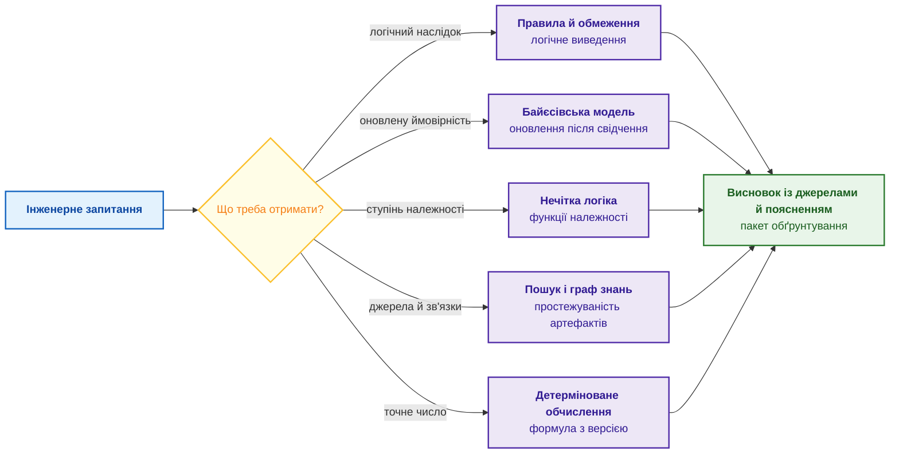

Синій блок є запитанням, жовтий ромб є вибором за типом потрібного результату, фіолетові блоки є методами, зелений блок є пакетом обґрунтування, тобто висновком разом із фактами, правилами, джерелами й межами застосування ([Глава 1](ch01-introduction-to-expert-systems.md)). Методи не конкурують: одна експертна система може використовувати всі п'ять методів, але кожен метод відповідає за свій тип результату.

У прикладі з тестом, який то падає, то проходить, методи розподіляються так: правило випуску каже, чи дозволено повторний запуск; байєсівська модель оцінює, наскільки падіння змінило ризик; граф знань показує, які вимоги перевіряє тест; детермінований розрахунок обчислює метрики покриття. Пошук знаходить звіти, але жодного висновку сам не робить.

Вибір методу починається із запитання «що саме треба отримати?», а не з назви технології. Методи з'являлися в певному порядку, і кожна нова хвиля розв'язувала проблему попередньої. Наступний розділ простежує порядок появи методів.

> [!NOTE]
> **Авторська карта вибору: п'ять ролей методів**
> 1. **Логіка:** установити, який висновок випливає з прийнятих засновків; нестачу засновків потрібно врахувати явно.
> 2. **Імовірність:** оновити оцінку гіпотези після спостереження за визначеною моделлю.
> 3. **Нечітка належність:** описати проєктно задане поняття на кшталт «висока температура», не змішуючи його з імовірністю події.
> 4. **Граф і пошук:** знайти джерела й зв'язки; самі ребра графа ще не доводять висновку.
> 5. **Розрахунок:** відтворювано обчислити формулу за перевірених входів; правильність самої моделі встановлюється окремо.
> *Інженерний інваріант:* Результати різних типів зберігають своє значення, передумови й одиниці, навіть коли використовуються разом.

## 2. Чотири хвилі еволюції експертних систем: від ранніх прототипів до нейро-символьного ШІ

Історія штучного інтелекту (ШІ) не є лінійним поступом. Періоди надмірних сподівань і промислових бумів чергувалися з розчаруваннями, які називають «зимами ШІ» [[2]](#src-2). Причини зим були інженерними, тому сучасний проєкт може повторити давні помилки в новій обгортці. Поділ історії на чотири хвилі нижче є спрощенням для інженера, а межі хвиль приблизні.

**Схема 4.4. Умовна періодизація чотирьох хвиль.**

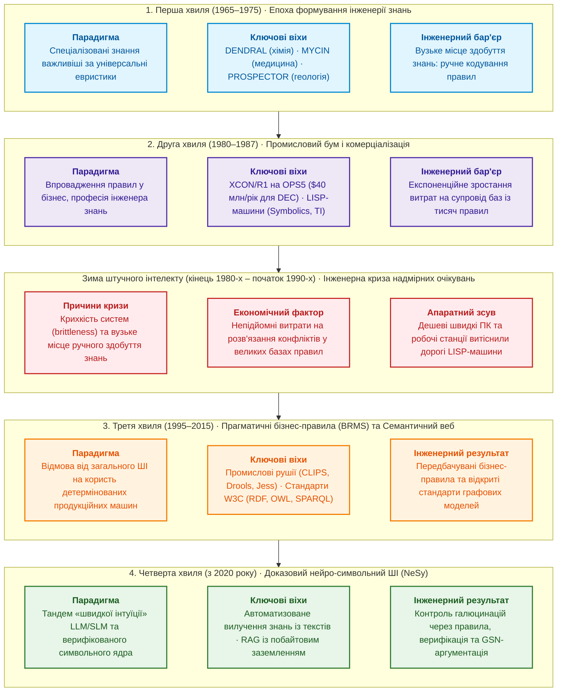

Синя, фіолетова, помаранчева й зелена хвилі є періодами зростання, червоний блок є зимою. Кожна наступна хвиля відповідала на проблему попередньої: промисловий бум виріс із перших успіхів, зима настала через ціну супроводу, третя хвиля відмовилася від претензій на загальний розум, четверта використовує мовні моделі там, де раніше бракувало ручної праці.

### 2.1. Перша хвиля (1965–1975): пріоритет предметних знань над універсальними евристиками

У 1950–1960-х роках дослідники сподівалися відтворити мислення кількома універсальними законами. Програма «Загальний розв'язувач задач» (*General Problem Solver*) Аллена Ньюелла й Герберта Саймона шукала розв'язок перебором станів, але захлиналася в комбінаторному вибуху, щойно задача виходила за межі головоломок [[2]](#src-2), [[32]](#src-32). Едвард Фейгенбаум зі Стенфордського університету сформулював протилежний принцип: сила інтелектуальної програми залежить передусім від кількості та якості знань про конкретну задачу, а не від універсальності алгоритму [[3]](#src-3). Цей принцип став основою інженерії знань (*knowledge engineering*). На принципі Фейгенбаума побудовано перші відомі експертні системи:

- **DENDRAL** (Стенфорд, з 1965 року; Едвард Фейгенбаум, Брюс Бьюкенен, Джошуа Ледерберг разом із лабораторією хіміка Карла Джерассі) пропонувала структурні формули органічних сполук за даними мас-спектрометрії. Автори називають DENDRAL першою експертною системою для формування наукових гіпотез [[4]](#src-4).
- **MYCIN** (Стенфорд, з 1972 року; Едвард Шортліфф) радив лікарям антибактеріальну терапію при бактеріємії та менінгіті й пояснював свої висновки відповідями на запитання «чому?» і «як?» [[5]](#src-5). У MYCIN з'явилися коефіцієнти впевненості, до яких глава повернеться нижче [[6]](#src-6).
- **PROSPECTOR** (SRI International, кінець 1970-х) оцінював перспективність родовищ корисних копалин за правилами геологів. 1982 року за геологічними картами гори Толман у штаті Вашингтон PROSPECTOR указав місце раніше невідомого промислового зруденіння молібдену [[7]](#src-7).

Перша хвиля показала, що експертна система сильна знаннями, а не алгоритмом. Знання доводилося переносити від експертів вручну, і саме ця праця згодом стала вузьким місцем.

### 2.2. Друга хвиля (1980–1987): промислова комерціалізація та LISP-машини

У 1980-х експертні системи перейшли з лабораторій у промисловість. Компанія Digital Equipment Corporation (DEC) продавала міні-комп'ютери VAX у тисячах конфігурацій модулів, кабелів і шасі, і люди-комплектувальники помилялися. Експертна система R1, згодом перейменована на XCON, яку Джон Макдермотт побудував мовою продукційних правил сімейства OPS, автоматизувала конфігурування замовлень [[8]](#src-8). За оцінкою, яку наводять Стюарт Расселл і Пітер Норвіг, до 1986 року XCON заощаджувала DEC близько 40 млн доларів на рік [[2]](#src-2). Виникли компанії, що випускали спеціалізовані LISP-машини (Symbolics, Lisp Machines Inc., Texas Instruments), і нова професія інженера знань: фахівця, який опитує експертів і перетворює досвід експертів на правила.

Друга хвиля довела комерційну цінність правил, але база знань XCON зросла до тисяч правил, і вартість супроводу почала рости швидше за користь.

### 2.3. Криза надмірних очікувань: чотири інженерні причини «Зими ШІ»

Наприкінці 1980-х ринок експертних систем обвалився: багато компаній не виконали обіцянок і збанкрутували [[2]](#src-2). Причин було чотири, і всі чотири інженерні:

1. **Вузьке місце здобуття знань** (*knowledge acquisition bottleneck*). Експерти не могли чітко сформулювати власні неявні евристики, а ручний запис правил тривав роки [[9]](#src-9).
2. **Крихкість** (*brittleness*). Експертна система не знала меж своєї компетентності: випадок, якого не передбачили автори правил, отримував хибний або безглуздий висновок замість відмови [[9]](#src-9).
3. **Складний супровід.** Порядок спрацювання правил залежав від стратегії розв'язання конфліктів і від порядку появи фактів, тому наслідки нового правила в базі з тисяч правил було важко передбачити, а будувати й супроводжувати експертні системи для складних предметних областей виявилося дорого [[2]](#src-2).
4. **Дорога інфраструктура.** Спеціалізовані LISP-машини програли звичайним робочим станціям і персональним комп'ютерам, які швидко дешевшали й наздоганяли LISP-машини за швидкодією.

Кожна з чотирьох причин має сучасний відповідник. Здобуття знань із документів розглядає [Глава 10](ch10-knowledge-acquisition-systems.md), межі компетентності й право на відмову [Глава 2](ch02-epistemology-of-machine-knowledge.md), перевірку бази знань [Глава 23](ch23-knowledge-base-verification.md), доступну обчислювальну інфраструктуру [Глава 18](ch18-execution-infrastructure.md).

### 2.4. Третя хвиля (1995–2015): продукційні рушії бізнес-правил (BRMS) та Семантичний веб

Після зими промисловість відмовилася від претензій на «загальний розум» і зосередилася на вузькій користі. Рушії бізнес-правил (*business rule engines*) CLIPS, Jess і Drools стали вбудованими бібліотеками для мов C і Java та зайняли ніші страхових розрахунків, банківського оцінювання ризиків і логістики. Консорціум Всесвітньої павутини (World Wide Web Consortium, W3C) стандартизував подання знань у вигляді графа: модель RDF описує твердження трійками «суб'єкт, предикат, об'єкт» [[10]](#src-10), мова OWL описує онтології, а мова запитів SPARQL дає змогу шукати в графі.

Третя хвиля зробила правила й графи знань звичайними інженерними компонентами, але не розв'язала проблеми здобуття знань: правила й онтології, як і раніше, писали люди.

### 2.5. Четверта хвиля (з 2020 року): доказовий нейро-символьний ШІ та конвергенція з мовними моделями

Великі мовні моделі (*large language models*, LLM) спершу хитнули маятник у бік чисто статистичного підходу. У регульованих галузях інженерні команди швидко натрапили на обмеження: вигадані твердження, різні відповіді на той самий запит, відсутність простежуваного зв'язку з джерелом і неможливість сертифікації ([Глава 3](ch03-beyond-reference-information-systems.md)). Сучасні доказові експертні системи поєднують два шари. Мовний шар, зокрема локальні мовні моделі, пришвидшує здобуття знань: знаходить у документах сутності, вимоги й зв'язки ([Глава 12](ch12-linguistic-analysis-and-local-models.md)). Символьний шар, тобто правила, графи знань і машина виведення, забезпечує перевірне виведення, відмову за браку доказів і матеріали для обґрунтування безпеки ([Глава 27](ch27-safety-case-gsn-synthesis.md), [Глава 29](ch29-neuro-symbolic-architecture.md)).

Історія повторює один урок: експертна система корисна настільки, наскільки знання експертної системи повні, перевірені й підтримувані. Мовні моделі полегшують здобуття знань, але не знімають потреби в явних правилах. З явних правил і варто почати огляд методів.

> [!NOTE]
> **Авторська періодизація чотирьох хвиль еволюції експертних систем М. М. Федчика (Чотири парадигмальні хвилі)**
> 1. **Перша хвиля (1965–1975, Формування інженерії знань):** Пріоритет спеціалізованих предметних знань над універсальними евристиками (DENDRAL, MYCIN, PROSPECTOR); бар'єр — ручне кодування правил (*Knowledge Acquisition Bottleneck*).
> 2. **Друга хвиля (1980–1987, Промисловий бум і LISP-машини):** Комерціалізація експертних систем (XCON/R1) та поява апаратних робочих станцій; бар'єр — експоненційне зростання вартості супроводу тисяч взаємодіючих правил та крихкість (*brittleness*).
> 3. **Третя хвиля (1995–2015, Продукційні рушії BRMS та Семантичний веб):** Відмова від загального ШІ на користь детермінованих вбудованих рушіїв (CLIPS, Drools) та відкритих стандартів графів (W3C RDF/OWL/SPARQL); бар'єр — збереження високої частки ручного моделювання онтологій.
> 4. **Четверта хвиля (з 2020 року, Доказовий нейро-символьний ШІ NeSy):** Синергія швидкої статистичної інтуїції мовних моделей (екстракція та пошук) із верифікованим символьним ядром (детерміноване виведення, побайтове заземлення, GSN-аргументація та Fail-Closed відмова).
> *Інженерний інваріант еволюції NeSy М. Федчика:* Статистичні мовні моделі виконують суто функцію екстракції та первинного видобутку фактів, тоді як сертифікаційний вердикт генерується виключно символьним верифікованим ядром у режимі Fail-Closed.

### 2.6. Діалектика символьного та коннекціоністського ШІ: гіпотези та дослідницька програма експертних систем нового покоління

Поєднання символьних і нейронних методів потрібне, бо вони мають різні сильні сторони й обмеження. Символьна модель робить правило явним, але його потрібно правильно сформулювати й підтримувати. Навчена модель допомагає працювати з різноманітним текстом, але запропонований нею зміст ще потребує перевірки. Далі наведено авторську дослідницьку програму: не звіт про усунення всіх обмежень, а припущення про те, які механізми варто перевіряти разом.

Для постановки цих досліджень достатньо розрізнити чотири труднощі:

1. **Асиметрія масштабування здобуття знань проти самокерованого навчання.** У класичних символьних системах поповнення бази знань вимагало лінійно-квадратичних витрат висококваліфікованої людської праці (явище, яке Е. Фейгенбаум означив як «вузьке місце здобуття знань» [[3]](#src-3)): інженери знань вручну транслювали неструктуровані документи та усні евристики фахівців у формальні предикати. Проєкт Cyc Дугласа Лената [[9]](#src-9), попри десятиліття ручної формалізації мільйонів аксіом здорового глузду, продемонстрував неможливість ручного охоплення динамічного світу. Натомість коннекціоністські трансформери (архітектура Васуані та співавт. [[39]](#src-39)) реалізували парадигму самокерованого навчання (*Self-Supervised Learning*), поглинаючи терабайти сирого нерозміченого тексту без участі інженерів знань.
2. **Проблема заземлення символів та крихкість до вхідного шуму.** Згідно з формулюванням С. Гарнада (*Symbol Grounding Problem*) [[36]](#src-36), класичні дедуктивні машини оперували дискретними символьними токенами, відірваними від неперервної варіативності реальних даних. Найменша термінологічна розбіжність, синонімія, одруківка або неканонічна побудова фрази у технічному звіті призводили до повної відмови зіставлення зі зразком (*pattern matching failure*). Коннекціоністські моделі замінили дискретні символи неперервними багатовимірними векторними просторами (*embeddings*), де семантична близькість забезпечує природну стійкість до лексичного шуму та неповноти формулювань.
3. **Ентропія суперечностей і комбінаторний вибух дедуктивного пошуку.** У класичній монотонній логіці першого порядку поява хоча б однієї суперечності ($A \land \neg A$) при інтеграції тисяч відомчих нормативів активує принцип вибуху (*ex falso quodlibet*), руйнуючи коректність усього виведення. За теоремою С. Кука [[38]](#src-38), SAT є NP-повною задачею; повний перебір для $n$ булевих змінних розглядає $2^n$ наборів значень із додатковими витратами на перевірку формули. Це характеристика перебору, а не доведена експоненційна нижня межа для всіх SAT-алгоритмів. Практичний ризик довгого пошуку потребує обмеження бюджету й захисної відмови. Прямий прохід (*forward pass*) фіксованої нейронної мережі має визначену схему обчислень, але час повної генерації залежить також від довжини входу й виходу та платформи; це не є гарантією WCET чи змістовної правильності.
4. **Апаратна несумісність та «Гіркий урок» Р. Саттона.** Як слушно узагальнив Р. Саттон (*The Bitter Lesson*) [[35]](#src-35), у ретроспективі комп'ютерних наук перемагали ті методи, які найефективніше утилізували експоненційне зростання апаратної обчислювальної потужності за законом Г. Мура [[37]](#src-37) через універсальні операції. Навчання та виведення глибоких нейромереж зводяться до щільного матричного множення (*General Matrix Multiply*, GEMM), яке ідеально розпаралелюється на тисячах тензорних ядер графічних процесорів (SIMD/SIMT) із високою пропускною здатністю пам'яті. Натомість класичні алгоритми символьного виведення (пошук на графах, уніфікація термів, розіменування ланцюжків указівників) породжують хаотичні звернення до пам'яті (*pointer chasing*), промахи кешу та розбіжність гілок виконання (*branch divergence*), через що вони не отримали прямого виграшу від революції GPU.

Обмеження мовної моделі з попередніх глав лишається чинним: правдоподібний текст сам не підтверджує виконання правила. Модель може запропонувати й формальний доказ, але його потрібно перевірити окремим засобом. Звідси не випливає універсальна неможливість використання мовних моделей у критичних системах: потрібно визначити їхню роль, потрібні перевірки й застосовні вимоги.

Авторська вимога до роботи з нормативами полягає у збереженні їхніх редакцій і часу чинності. Наприклад, якщо локальне правило випуску змінилося, потрібно перевірити, яка редакція застосовна до поточної прошивки, а стару зберегти для відтворення попередніх відповідей. Зростання обчислювальної потужності, описане Річардом Саттоном [[35]](#src-35), саме не розв'язує цього питання. Але й з історії ігрових програм не випливає загальна заборона нейронного підходу: порівнюються різні задачі, умови й критерії перевірки.

**Формально: математична модель асиметрії формалізації та епістемічного ризику.**
При проєктуванні архітектури експертної системи інженер зіставляє витрати на формалізацію корпусу з $N$ нормативних положень $`C_{\mathrm{formal}}(N)`$ із цільовою вимогою не пропускати непідтверджені висновки. Людино-години та машино-години обліковуються окремо, а не як взаємозамінні витрати. Нижче наведено навчальну модель: трудомісткість оцінено за припущенням перевірки всіх пар правил, а ризик $`R_{\mathrm{epistemic}} \in [0, 1]`$ означає ймовірність принаймні одного хибного кроку в ланцюгу завдовжки $K$, який не буде відсічено шлюзом. Для ймовірнісної частини припущено незалежність помилок кроків та однакову покрокову ймовірність; за залежних помилок потрібна їхня спільна модель. Нульовий ризик тут є умовним результатом ідеалізованої перевірки, а не виміряною гарантією системи:

**Формула (4.5). Навчальні витрати формалізації та умовна модель ризику.**

```math
C_{\mathrm{formal}}(N) = c_{\mathrm{extract}} \cdot N + c_{\mathrm{conflict}} \cdot \frac{N(N - 1)}{2}, \qquad R_{\mathrm{epistemic}}(K) = (1 - \mathbb{I}_{\mathrm{verifier}}) \cdot \left[1 - (1 - p_{\mathrm{halluc}})^K\right]
```

- $`N \in \mathbb{N}^+`$ — загальна кількість атомарних нормативних правил і предикатів у предметній базі знань; діапазон $`10^3\text{--}10^5`$ норм тут є навчальним припущенням;
- $`c_{\mathrm{extract}} \ge 0`$ — питомі витрати часу на вилучення та синтаксичну формалізацію одного правила з первинного документа; для навчального розрахунку прийнято $`c_{\mathrm{extract}}^{\mathrm{manual}} \in [0.5, 4.0]`$ людино-год/правило та $`c_{\mathrm{extract}}^{\mathrm{auto}} \in [10^{-4}, 10^{-3}]`$ машино-год/правило, без твердження про виміряну продуктивність;
- $`c_{\mathrm{conflict}} \ge 0`$ — питомі витрати на перевірку однієї пари правил (людино-год/пару або машино-год/пару відповідно до сценарію); модульна ізоляція може зменшити кількість потрібних зіставлень, але виграш потребує окремого вимірювання;
- $`K \in \mathbb{N}^+`$ — глибина дедуктивного ланцюга виведення (кількість послідовних кроків аргументації);
- $`p_{\mathrm{halluc}} \in [0, 1]`$ — імовірність хибного твердження на одному кроці неконтрольованого стохастичного виведення; діапазон $`[0.01, 0.08]`$ є ілюстративним, а не оцінкою конкретної моделі чи корпусу;
- $`\mathbb{I}_{\mathrm{verifier}} \in \{0, 1\}`$ — індикатор ідеалізованого режиму перевірки: 0 означає відсутність відсікання, 1 — припущення, що кожен хибний крок блокується. Значення 1 вимагає коректних засновків і правил, коректного верифікатора та неможливості обійти шлюз; сама наявність детермінованого ядра цього не доводить.

**Практичне застосування та інженерні висновки (Actionable Closed Loop):**
1. **Керування рантаймом і потоком обчислень:** У чисто стохастичній моделі ($`\mathbb{I}_{\mathrm{verifier}} = 0`$) за незалежних помилок із $`p_{\mathrm{halluc}} = 0.02`$ та $K = 15$ отримано $`R_{\mathrm{epistemic}} = 1 - (0.98)^{15} \approx 0.2614`$ ($26.14\,\%$). Це ілюструє накопичення ризику, але саме по собі не встановлює нормативного порогу допуску. В авторській архітектурі крок без належного дерева доведення переводиться у `REFUSAL` або ескалацію `QUALIFIED`. За ідеалізованого $`\mathbb{I}_{\mathrm{verifier}} = 1`$ модель дає 0; для реальної реалізації залишковий ризик невідомий без перевірки засновків, правил і самого шлюзу. Дерево доведення встановлює наслідок із засновків, а хеш засвідчує цілісність джерела, не істинність його змісту.
2. **Апаратний сайзинг та інфраструктурні обмеження:** Квадратичний член $N(N - 1)/2$ оцінює кількість попарних зіставлень і мотивує перенесення цієї роботи в автономний конвеєр підготовки (*Build-Time Crystallization*). Він не визначає обсяг оперативної пам'яті та не доводить Fixed WCET. Для середовища виконання окремо задають межі розміру пакета, кількості переходів і ресурсів та перевіряють час на цільовій платформі; попередня компіляція й вирівнювання самі цих гарантій не надають.
3. **Практичний числовий приклад:** Для навчального корпусу $N = 4\,000$ припустімо $`c_{\mathrm{extract}}^{\mathrm{manual}} = 1.5\,\text{людино-год/правило}`$ та $`c_{\mathrm{conflict}}^{\mathrm{manual}} = 10^{-3}\,\text{людино-год/пару}`$. Тоді $`C_{\mathrm{formal}}^{\mathrm{manual}} = 1.5 \cdot 4000 + 10^{-3} \cdot (4000 \cdot 3999 / 2) = 6000 + 7998 = 13\,998\,\text{людино-годин}`$. Для окремого автоматизованого сценарію припустімо $`c_{\mathrm{extract}}^{\mathrm{auto}} = 5 \cdot 10^{-4}\,\text{машино-год/правило}`$ та $`c_{\mathrm{conflict}}^{\mathrm{auto}} = 10^{-7}\,\text{машино-год/пару}`$: $`C_{\mathrm{formal}}^{\mathrm{auto}} = 2.0 + 0.7998 = 2.7998 \approx 2.8\,\text{машино-год}`$. Це розрахунки за заданими коефіцієнтами, не експериментальне прискорення; витрати експертної перевірки екстракції, апаратний профіль і залишкові помилки тут не оцінено. Інженер використовує їх для планування вимірювань, а не для випуску системи без валідації.

Саме на перетині цих історичних уроків у даній монографії формулюються **наукові наміри, фундаментальні гіпотези та програма досліджень і розробок експертної системи нового покоління**:

- **Гіпотеза керованого видобування:** мовна модель може зменшити ручну працю, якщо її результати перевіряються щодо джерела й схеми. Граматика контролює форму запису, але не доводить правильності змісту; перевіряються пропуски, хибні зв'язки та витрати рецензента ([глави 10](ch10-knowledge-acquisition-systems.md) і [12](ch12-linguistic-analysis-and-local-models.md)).
- **Гіпотеза керованої аргументації:** спростовні правила й явна політика пріоритетів можуть локалізувати конфлікти [[40]](#src-40). Перевага новішої або спеціальнішої норми не припускається автоматично; її застосовність має бути визначена й перевірена на контрприкладах ([глави 6](ch06-applied-mathematics-for-expert-systems.md) і [16](ch16-expert-systems-architecture.md)).
- **Гіпотеза обмеженого виконання:** попередня підготовка даних і ліміти переходів можуть зробити виконання передбачуванішим у визначеному профілі. Часова гарантія потребує окремих меж вартості кроків, пам'яті й завершення відповіді; сама компіляція її не доводить ([глави 18](ch18-execution-infrastructure.md) і [32](ch32-high-performance-knowledge-packs-mmap-and-harvesting.md)).
- **Гіпотеза перевірного виходу:** формування відповіді з перевірених передумов і переходів може блокувати непідтверджені твердження в межах заданого контракту. Це не гарантія істинності джерел, повноти моделі або нульової частоти всіх помилок ([глави 23](ch23-knowledge-base-verification.md) і [29](ch29-neuro-symbolic-architecture.md)).

Схема пов'язує труднощі з чотирма напрямами перевірки. Стрілка означає «цей механізм досліджується для цієї проблеми», а не «проблему вже усунено».

**Схема 4.6. Напрями перевірки авторських гіпотез.**

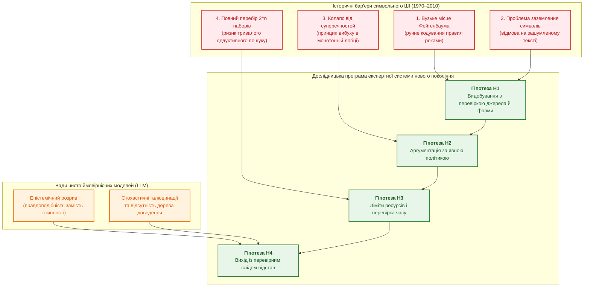

Отже, створення інтелектуальної експертної системи без галюцинацій не є спробою повернути індустрію в епоху ручних продукційних машин. Це закономірний виток діалектичної спіралі: використання досягнень коннекціонізму в тракті первинного сприйняття природної мови у поєднанні з безкомпромісним математичним та апаратним детермінізмом у ядрі логічного виведення.

> [!NOTE]
> **Авторська дослідницька програма: чотири гіпотези для перевірки**
> 1. **Видобування:** перевірити, скільки ручної праці зменшує модель і які змістові помилки лишаються після контролю форми.
> 2. **Аргументація:** перевірити поведінку за конфліктів, неповних передумов і різних застосовних політик пріоритету.
> 3. **Ресурси:** установити межі пам'яті й часу для конкретної реалізації, включно з поверненням відмови.
> 4. **Вихід:** перевірити, чи кожне допущене твердження має потрібні підстави й чи неможливо обійти перевірку.
> *Методологічна межа:* Це програма досліджень, не твердження про доведену новизну або досягнуту безпомилковість.

## 3. Математична логіка та продукційні правила (Modus Ponens, Rete)

Найпростішим і найбільш надійним для верифікації видом знання в архітектурі експертної системи є явне формальне правило. Логічне правило відповідає на запитання, чи випливає висновок із перевірених фактів (Logical Entailment). На відміну від стохастичних нейромереж, результат логічного виведення не є ймовірністю: якщо перевірені засновки істинні й правило застосовне, висновок доведено цим правилом. Якщо потрібного засновку немає, висновок не доведено, але його хибність із цього не випливає.

**Формально: дедуктивне виведення за правилом Modus Ponens.**
Інженерна проблема недетермінізму та галюцинацій у шлюзах допуску: у критичних доменах (ISO 26262 [[22]](#src-22), IEC 61508 [[33]](#src-33)) неприпустимо ухвалювати інженерні рішення на основі статистичної кореляції слів. Потрібен механізм формальної дедукції, який дає висновок $B$ за істинних засновку $A$ та правила $A \rightarrow B$. Мета розрахунку: сформувати перевірний крок виведення в дереві доказів. Бінарні значення у формулі стосуються класичної логіки; за неповної бази знань відсутність встановленого значення обробляють окремо як невідомість ([глава 02](ch02-epistemology-of-machine-knowledge.md), §7.1).

У правилі використовуються такі позначення:

**Формула (4.7). Правило відокремлення Modus Ponens.**

```math
\frac{A\rightarrow B,\qquad A}{B}
```

- $`A \in \{\mathbf{True}, \mathbf{False}\}`$ — атомарний факт або кон'юнкція фактів, зафіксованих у базі знань (засновок);
- $A\rightarrow B$ — продукційне правило або нормативна вимога: матеріальна імплікація, де істинність $A$ гарантує істинність $B$;
- $`B \in \{\mathbf{True}, \mathbf{False}\}`$ — цільовий логічний наслідок (висновок або дія безпеки);
- горизонтальна риска — символ дедуктивного відокремлення в численні висловлювань.

**Практичне застосування та інженерні висновки:**
1. Розрахунок викликається алгоритмом зіставлення зі зразком (Pattern Matching у рушіях Rete [[30]](#src-30) / Treat) під час кожної зміни робочої пам'яті (Working Memory).
2. Якщо факт $`A = \mathbf{True}`$ та правило $A \rightarrow B$ активоване, рушій детерміновано додає факт $B$ до робочої пам'яті та записує крок виведення у сертифікат доведення (Proof Witness).
3. Якщо $`A = \mathbf{False}`$ або $A$ невідоме, це правило не виводить $B$; рушій не домислює істинність або хибність $B$ лише з цього правила і фіксує відсутність підстави. Інше застосовне правило або свідчення може встановити $B$ чи його заперечення.
4. Приклад у системі функціональної безпеки:
```text
Правило: Якщо зміна зачіпає вимогу безпеки (A), то обов'язковий аналіз впливу (B).
Факт: Зміна CR-17 зачіпає вимогу безпеки SR-42 (A = True).
Висновок: Для CR-17 обов'язковий аналіз впливу (B = True).
```
Будь-яка спроба проігнорувати крок $B$ блокує проходження шлюзу валідації релізу.

1965 року Джон Алан Робінсон запропонував принцип резолюції, який дав змогу машині автоматично доводити твердження логіки першого порядку [[11]](#src-11). Ідея полягала в автоматичному доведенні теорем над формалізованим корпусом знань.

Проте інженерна практика засвідчила, що реальні нормативи формулюються не у вигляді чистих математичних теорем, а у формі **продукційних правил** із пріоритетами та винятками. Продукційне правило фіксує зв'язок:

```text
ЯКЩО умова
ТО висновок або дія
```

Машина виведення застосовує продукційні правила двома основними способами, які залишаються базовими для промислових систем:

**Пряме виведення** (*forward chaining*) рухається від наявних фактів до отримання нових висновків. Нехай на початку відомі факти $A$, $B$ і $C$, а база знань містить два правила:

**Формула (4.8). Початкові факти та продукційні правила.**

```math
F_0=\{A,B,C\},
\qquad
R=\{A\land B\rightarrow D,\;D\land C\rightarrow E\}.
```

- $`F_0`$ — початкова множина верифікованих фактів у робочій пам'яті;
- $R$ — множина скомпільованих продукційних правил;
- $A, B, C, D, E$ — атомарні предикати;
- $\land$ — логічна кон'юнкція, $\rightarrow$ — продукційна дія.

На першому циклі роботи рушія спрацьовує перше правило, додаючи факт $D$, а на наступному — друге правило:

**Формула (4.9). Два кроки прямого виведення.**

```math
F_1=F_0\cup\{D\},
\qquad
F_2=F_1\cup\{E\}.
```

Виведення завершується, коли досягнуто нерухомої точки (Fixed Point) і жодне нове правило не додає фактів. Пряме виведення використовується в системах моніторингу та перевірки інваріантів: виявлення конфліктів у проєктній документації, діагностика відмов за сигналами телеметрії.

**Зворотне виведення** (*backward chaining*) рухається від поставленої цілі до пошуку підтверджувальних фактів:

**Формула (4.10). Розкладання цілі на підцілі.**

```math
E
\Longleftarrow D\land C
\Longleftarrow (A\land B)\land C.
```

- $E$ — цільова гіпотеза, яку необхідно підтвердити або спростувати;
- $D$ і $C$ — підцілі першого рівня редукції;
- $A$ і $B$ — первинні факти, необхідні для виведення підцілі $D$;
- $\Longleftarrow$ — оператор редукції цілі до кон'юнкції підцілей.

Якщо ціллю є «готовність релізу до сертифікації», рушій розгортає дерево вимог униз: до конкретних звітів статичного аналізу, тестів покриття гілок та підписів відповідальних інженерів. Кожен відсутній лист дерева перетворюється на структурований інженерний дефект.

### 3.1. Символьні парадигми раннього ШІ: функціональний LISP та дескриптивний PROLOG

Символьні мови програмування LISP та PROLOG заклали два фундаментальні підходи до виконання логічних правил в експертних системах: імперативно-функціональне маніпулювання символьними структурами та дескриптивне логічне виведення за принципом резолюції Робінсона. Розуміння цих архітектурних концепцій критично важливе для інженера, оскільки саме вони визначають механіку роботи промислових рушіїв правил (Drools, CLIPS) та сучасних верифікаторів знань.

LISP був природним середовищем для символьного ШІ: списки, дерева, рекурсія й правила як дані, які програма може змінювати й виконувати. Мова правил CLIPS, яку в NASA почали розробляти 1985 року, успадкувала від LISP синтаксис із дужками. Правило в CLIPS є окремим артефактом: правило можна прочитати, протестувати, змінити й зберегти у версіях, а не ховати в довгій інструкції до мовної моделі.

PROLOG пішов іншим шляхом, шляхом логічного програмування: програміст описує факти й правила, а PROLOG сам шукає доведення. Пошук доведення в PROLOG є зворотним виведенням: запит стає ціллю, і PROLOG розкладає ціль на підцілі, доки не дійде до фактів.

<details>
<summary>Приклади мовами CLIPS і PROLOG: правило випуску й прогалини в доказах</summary>

Правило мовою CLIPS блокує випуск, якщо на випуск впливає відкритий критичний дефект. Конструкція `deffacts` задає факти прикладу.

```clips
(defrule vypusk-zablokovano-krytychnym-defektom
   (vypusk ?r)
   (defekt ?d)
   (vplyvaye ?d ?r)
   (seryoznist ?d krytychna)
   (stan ?d vidkrytyy)
   =>
   (assert (status-vypusku ?r zablokovano)))

(deffacts pryklad
   (vypusk v2.4.1)
   (defekt D-4)
   (vplyvaye D-4 v2.4.1)
   (seryoznist D-4 krytychna)
   (stan D-4 vidkrytyy))
```

Після команд `(reset)` і `(run)` правило спрацьовує й додає факт `(status-vypusku v2.4.1 zablokovano)`. Змінні `?r` і `?d` зв'язуються з конкретними випуском і дефектом, тож те саме правило працює для будь-якого випуску.

Мовою PROLOG правило з початку розділу записують так:

```prolog
vymoga_bezpeky(sr_42).
zachipaye(cr_17, sr_42).

potrebuye_analizu_vplyvu(Zmina) :-
    zachipaye(Zmina, Vymoga),
    vymoga_bezpeky(Vymoga).
```

Запит `?- potrebuye_analizu_vplyvu(cr_17).` отримує відповідь «так», а запит `?- potrebuye_analizu_vplyvu(X).` знаходить усі зміни, для яких потрібен аналіз впливу, у прикладі `X = cr_17`. Такий запит уже є не пошуком у документах, а міркуванням над базою фактів.

Той самий підхід знаходить прогалини в доказах. Програма нижче є не реалізацією стандарту функціональної безпеки, а прикладом локальної політики проєкту: політика шукає технічні вимоги безпеки без зв'язку з вищою вимогою, без перевірки або з проваленим тестом.

```prolog
technical_safety_requirement(tsr_enter_degraded_mode).
technical_safety_requirement(tsr_report_diagnostic_fault).

derived_from(tsr_enter_degraded_mode, fsr_detect_sensor_fault).
derived_from(tsr_report_diagnostic_fault, fsr_detect_sensor_fault).

verified_by(tsr_enter_degraded_mode, test_tsr_014).
test_passed(test_tsr_014).

includes(release_2026_05, tsr_enter_degraded_mode).
includes(release_2026_05, tsr_report_diagnostic_fault).

missing_safety_evidence(Req, safety_trace) :-
    technical_safety_requirement(Req),
    \+ derived_from(Req, _).
missing_safety_evidence(Req, verification) :-
    technical_safety_requirement(Req),
    \+ verified_by(Req, _).
missing_safety_evidence(Req, failed_test) :-
    verified_by(Req, Test),
    \+ test_passed(Test).

release_requires_safety_review(Release) :-
    includes(Release, Req),
    missing_safety_evidence(Req, _).
```

Запит `?- missing_safety_evidence(tsr_report_diagnostic_fault, Reason).` повертає `Reason = verification`: вимога має зв'язок із вищою вимогою, але не має перевірки. Запит `?- release_requires_safety_review(release_2026_05).` отримує відповідь «так», бо випуск містить вимогу без перевірки. Оператор `\+` означає «не вдалося довести», тобто PROLOG вважає відсутній факт хибним; таке припущення замкненого світу допустиме лише для повного переліку фактів ([Глава 2](ch02-epistemology-of-machine-knowledge.md)). Так само перевіряють ланцюжок «загроза, рішення щодо ризику, вимога, перевірка» для вимог кібербезпеки автомобільних систем за ISO/SAE 21434 [[12]](#src-12).

</details>

LISP показав, як будувати гнучкі символьні рушії правил, а PROLOG показав, як формально ставити запитання до знань: що доводиться, чого бракує, які факти потрібні. Сучасні експертні системи рідко пишуть цими мовами, але архітектура «база знань, правила, виведення, пояснення» залишилася.

## 4. Байєсівська парадигма: оновлення апріорної впевненості за наявності емпіричних свідчень

Байєсівське оновлення потрібне для другого питання нашого випадку: як падіння тесту змінює оцінку наявності дефекту? Логічне правило може вимагати повтору, уточнення або розслідування, але саме не задає ймовірностей причин. Імовірнісна модель доповнює правило, не скасовує його. «Апріорна» оцінка означає оцінку до нового спостереження, «апостеріорна» після нього; слово «свідчення» тут називає спостереження, не математичний доказ.

**Формально: інженерна модель байєсівського оновлення ризику дефекту.**
Інженерна проблема кількісної оцінки ймовірності відмови на основі неідеальних діагностичних сигналів: одиничне падіння тесту може свідчити як про критичну регресію, так і про нестабільність самого тестового оточення (Flaky Test). Спроба діяти евристично призводить або до зупинки конвеєра через хибні спрацьовування, або до випуску дефектного ПЗ. Мета розрахунку — точне обчислення апостеріорної ймовірності наявності дефекту $\Pr(H\mid E) \in [0, 1]$ на основі зафіксованої чутливості діагностичного тесту та базового рівня дефектності.

У розрахунку використовуються такі параметри:

**Формула (4.11). Теорема Байєса для нового свідчення.**

```math
\Pr(H\mid E)=\frac{\Pr(E\mid H)\,\Pr(H)}{\Pr(E)},\qquad \Pr(E)>0
```

- $`H \in \{0, 1\}`$ — гіпотеза про наявність критичного дефекту в релізі ($H=1$ — дефект наявний);
- $`E \in \{0, 1\}`$ — емпіричне свідчення ($E=1$ — тест зафіксував падіння);
- $\Pr(H) \in [0, 1]$ — апріорна ймовірність дефекту (базовий рівень відмов за історичними даними);
- $\Pr(E\mid H) \in [0, 1]$ — чутливість тесту (ймовірність падіння тесту за умови реального дефекту, True Positive Rate);
- $\Pr(E) \in (0, 1]$ — повна ймовірність падіння тесту з урахуванням хибних тривог;
- $\Pr(H\mid E) \in [0, 1]$ — апостеріорна ймовірність дефекту після врахування результату тесту.

Повна ймовірність свідчення для двох взаємовиключних станів ($H$ і $\neg H$) обчислюється за формулою повної ймовірності:

**Формула (4.12). Повна ймовірність падіння тесту.**

```math
\Pr(E)=\Pr(E\mid H)\Pr(H)+\Pr(E\mid\neg H)\Pr(\neg H),\qquad \Pr(\neg H)=1-\Pr(H)
```

де $\Pr(E\mid\neg H)$ — рівень хибних тривог тесту (False Positive Rate) на стабільних релізах.

**Практичне застосування та інженерні висновки:**
1. Розрахунок викликається автоматично підсистемою контролю якості при отриманні негативного результату автоматизованого тестування.
2. Для навчального розрахунку припустімо, що для визначеного класу релізів $`\Pr(H)=0{,}05`$, чутливість тесту $`\Pr(E\mid H)=0{,}80`$, а частота хибних тривог $`\Pr(E\mid\neg H)=0{,}10`$. Це задані числа, не вимірювання конкретного продукту.
3. Повна ймовірність падіння становить $`\Pr(E) = 0{,}80\cdot 0{,}05 + 0{,}10\cdot 0{,}95 = 0{,}135`$. Апостеріорний ризик:
**Формула (4.13). Оновлення ймовірності дефекту після падіння.**

```math
\Pr(H\mid E)=\frac{0{,}80\cdot 0{,}05}{0{,}135} = \frac{0{,}04}{0{,}135} \approx 0{,}296\quad (29{,}6\,\%).
```
4. Інженерні висновки експертної системи:
   - Падіння тесту підняло ризик дефекту з 5 % до 29,6 % (зростання у 6 разів).
    - За цією моделлю ймовірність відсутності дефекту після падіння становить 70,4 %. Це не є дозволом на випуск і не скасовує застосовного правила блокування: рішення потребує затвердженої політики та з'ясування причини збою.
    - Система призначає ізольований повторний тест або ручний інженерний перегляд для пошуку підтверджувальних доказів; чинний безпековий блокер зберігається до виконання його умов зняття.

**Формально: відношення правдоподібностей (Likelihood Ratio) та фактор сили свідчення.**
Для оцінки діагностичної спроможності самого тесту окремо від апріорного браку обчислюють відношення правдоподібностей:

**Формула (4.14). Відношення правдоподібностей падіння тесту.**

```math
\mathrm{LR}^{+}=\frac{\Pr(E\mid H)}{\Pr(E\mid\neg H)}=\frac{0{,}80}{0{,}10}=8
```

- $`\mathrm{LR}^{+} \in [0, \infty)`$ — безрозмірне відношення для свідчення $E$; наведений дріб визначений за додатної частоти хибних тривог;
- значення більше за 1 збільшує шанси дефекту, менше за 1 зменшує, рівне 1 не змінює їх саме за цим свідченням; це не оцінка всієї діагностичної користі тесту;
- Значення $`\mathrm{LR}^{+}=8`$ показує, що падіння тесту у 8 разів більш характерне для дефектного коду, ніж для справного.

Через відношення шансів (*odds*) формула Байєса набуває мультиплікативного вигляду:

**Формула (4.15). Оновлення через відношення шансів.**

```math
\frac{\Pr(H\mid E)}{1-\Pr(H\mid E)}=\frac{\Pr(H)}{1-\Pr(H)}\cdot\mathrm{LR}^{+}
```

Початкові шанси $`\frac{0{,}05}{0{,}95} \approx 0{,}0526`$, помножені на $`\mathrm{LR}^{+}=8`$, дають апостеріорні шанси $`\approx 0{,}421`$, що відповідає ймовірності $`\frac{0{,}421}{1 + 0{,}421} \approx 0{,}296`$. Відношення правдоподібностей характеризує силу цього сигналу, але не задає універсального порогу допуску чи заборони блокування. Слабкий сигнал не скасовує жорсткого інваріанта; подальшу перевірку й умови зняття блокування визначає затверджена політика застосування.

- $\Pr(H)$ є початковою ймовірністю, а $\Pr(H\mid E)$ є ймовірністю після свідчення;
- $p/(1-p)$ перетворює ймовірність $p$ на шанси, тобто відношення ймовірності події до ймовірності протилежної події;
- $`\mathrm{LR}^{+}`$ є відношенням правдоподібностей свідчення, визначеним вище;
- для скінченних шансів потрібні ймовірності строго між 0 і 1.

Початкові шанси множать на силу свідчення й отримують оновлені шанси. Для прикладу $`\frac{0{,}05}{0{,}95}\cdot 8=\frac{8}{19}`$, звідки $`\Pr(H\mid E)=\frac{8}{8+19}=\frac{8}{27}`$, тобто ті самі 29,6 %.

**Формально: кілька свідчень.** Для двох свідчень $`E_1`$ і $`E_2`$ загальна формула не потребує припущення про незалежність:

**Формула (4.16). Спільне врахування двох свідчень.**

```math
\Pr(H\mid E_1,E_2)=\frac{\Pr(E_1,E_2\mid H)\,\Pr(H)}{\Pr(E_1,E_2)}.
```

Складники спільного оновлення:

- $H$ є гіпотезою, а $`E_1`$ і $`E_2`$ є двома свідченнями;
- кома між $`E_1`$ і $`E_2`$ означає, що спостерігають обидва свідчення разом;
- $`\Pr(E_1,E_2\mid H)`$ є ймовірністю обох свідчень за умови $H$;
- $`\Pr(E_1,E_2)`$ є загальною ймовірністю обох свідчень і має бути більшою за нуль;
- $`\Pr(H\mid E_1,E_2)`$ є ймовірністю гіпотези після обох свідчень; вона лежить у $[0,1]$.

Оновлювати можна й послідовно, якщо на другому кроці взяти правдоподібність, яка вже враховує перше свідчення:

**Формула (4.17). Послідовне оновлення з урахуванням залежності.**

```math
\Pr(H\mid E_1,E_2)=\frac{\Pr(E_2\mid H,E_1)\,\Pr(H\mid E_1)}{\Pr(E_2\mid E_1)}.
```

- $`\Pr(H\mid E_1)`$ є ймовірністю гіпотези після першого свідчення;
- $`\Pr(E_2\mid H,E_1)`$ є ймовірністю другого свідчення з урахуванням $H$ і вже відомого $`E_1`$;
- $`\Pr(E_2\mid E_1)`$ є ймовірністю другого свідчення після першого й має бути більшою за нуль;
- результат $`\Pr(H\mid E_1,E_2)`$ знову лежить у $[0,1]$.

Лише коли свідчення $`E_1`$ і $`E_2`$ умовно незалежні за кожного зі станів $H$ і $\neg H$, шанси можна множити на відношення правдоподібностей кожного свідчення:

**Формула (4.18). Множення шансів за умовної незалежності.**

```math
\mathrm{Odds}(H\mid E_1,E_2)=\mathrm{Odds}(H)\cdot\mathrm{LR}_1\cdot\mathrm{LR}_2.
```

- $`\mathrm{Odds}(H)`$ є початковими шансами гіпотези $H$;
- $`\mathrm{LR}_1`$ і $`\mathrm{LR}_2`$ є відношеннями правдоподібностей першого й другого свідчень;
- $`\mathrm{Odds}(H\mid E_1,E_2)`$ є шансами після обох свідчень; шанси є невід'ємними, але не є ймовірностями в $[0,1]$;
- умова формули: $`E_1`$ і $`E_2`$ умовно незалежні за кожного зі станів $H$ і $\neg H$.

Тепер повернімося до успішного повтору. Якщо два запуски умовно незалежні за кожного зі станів «дефект є» й «дефекту немає», і характеристики тесту незмінні, ймовірності успішного запуску становлять 0,20 та 0,90 відповідно. Відношення правдоподібностей успіху дорівнює 2/9. Після першого падіння шанси були 8/19; множення на 2/9 дає 16/171, а повернення до ймовірності дає 16/187, приблизно 8,6 %. Отже, успіх знижує оцінку 29,6 %, але не повертає її автоматично до початкових 5 % і не знімає блокер випуску.

Це результат за названих припущень. Два запуски на тому самому стенді можуть мати спільну причину помилки; тоді незалежність не встановлена й наведене множення не обґрунтоване. Так само повторно врахований звіт про той самий дефект не є другим незалежним свідченням. Потрібна спільна або умовна модель залежностей.

Оновлена ймовірність має сенс лише разом із паспортом моделі: визначеннями $H$ і $E$; джерелом і часовим вікном для початкових і умовних ймовірностей; способом обробки пропущених даних; припущеннями про залежності між свідченнями; версією моделі й результатами калібрування ([Глава 25](ch25-how-expert-systems-learn.md)); політикою, що перетворює оцінку на додатковий тест або людський перегляд.

> [!NOTE]
> **Авторський принцип розмежування оцінки й розслідування**
> 1. Оновлення ймовірності не приховує спостереженої аномалії й не замінює її розслідування. Потрібну дію, блокування чи ескалацію визначає застосовна політика; універсальна вимога зупинити будь-яку фізичну систему з формули Байєса не випливає.

Теорема Байєса дає точний спосіб оновлювати впевненість, але вимагає початкових і умовних ймовірностей, які в складній предметній області важко оцінити й підтримувати. Експерт може сказати «це сильний сигнал», але не може обґрунтувати, що $`\Pr(E\mid H)=0{,}73`$. Тому поряд із теоремою Байєса розвивалися простіші моделі невизначеності.

## 5. Евристичні моделі невизначеності за неповної апріорної інформації

Три підходи нижче з'явилися саме тоді, коли повної ймовірнісної моделі побудувати не вдавалося. Кожен підхід вимірює власну величину, і величини трьох підходів не можна змішувати ні між собою, ні з ймовірністю.

**Схема 4.19. Різні подання невизначеності.**

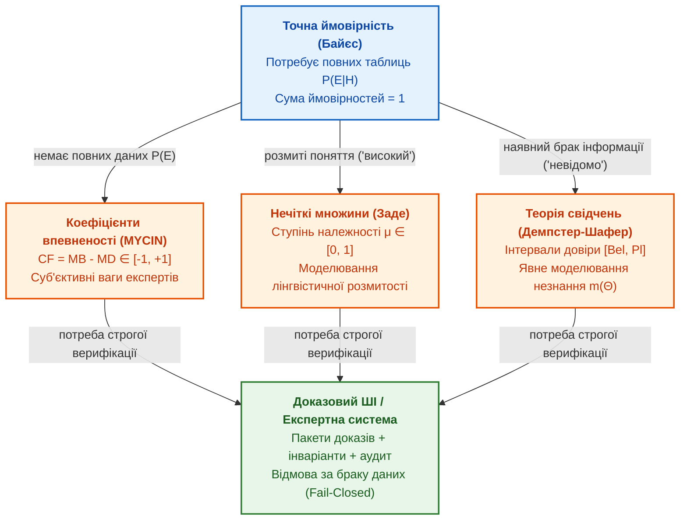

### 5.1. Числення коефіцієнтів впевненості в системі MYCIN

Творці медичної експертної системи MYCIN (Стенфорд, 1970-ті роки) зіткнулися з інженерною проблемою: експерти-практики не володіли точними таблицями апостеріорних і умовних ймовірностей для сотень симптомів, але впевнено оцінювали спрямованість свідчень. Едвард Шортліфф і Брюс Бьюкенен запропонували апарат коефіцієнтів впевненості (*certainty factors*, CF) [[6]](#src-6) як альтернативу байєсівському виведенню, що не потребує знання апріорних розподілів.

**Формально: інженерна модель коефіцієнта впевненості.**
Інженерна проблема агрегування експертних суджень за браку статистичних розподілів: якщо вимагати від інженерів точних ймовірностей відмов рідкісних компонентів, система отримує вигадані або некогерентні числа. Мета розрахунку — обчислення нормованого коефіцієнта $CF(H, E) \in [-1, 1]$, що відображає ступінь підтвердження або спростування гіпотези $H$ свідченням $E$ без вимоги адитивності (сума $CF$ за всіма гіпотезами не зобов'язана дорівнювати 1).

У розрахунку використовуються такі параметри:

**Формула (4.20). Коефіцієнт упевненості MYCIN.**

```math
CF(H,E)=MB(H,E)-MD(H,E)
```

- $`H \in \mathcal{H}`$ — аналізована гіпотеза (наприклад, «причиною відмови є пробій ізоляції»);
- $`E \in \mathcal{E}`$ — спостережуване свідчення (симптом, помилка телеметрії);
- $MB(H,E) \in [0, 1]$ — міра зростання впевненості (Measure of Increased Belief);
- $MD(H,E) \in [0, 1]$ — міра зростання невпевненості (Measure of Increased Disbelief);
- $CF(H,E) \in [-1, 1]$ — результуючий коефіцієнт впевненості.

Для поєднання двох незалежних свідчень $`E_1`$ та $`E_2`$, що підтримують одну й ту саму гіпотезу ($`CF_1, CF_2 \ge 0`$), застосовується асимптотична формула накопичення:

**Формула (4.21). Поєднання двох додатних коефіцієнтів.**

```math
CF_{1\oplus2}=CF_1+CF_2\,(1-CF_1),\qquad 0\le CF_1,CF_2\le1
```

- $`CF_1, CF_2 \in [0, 1]`$ — первинні коефіцієнти впевненості від двох незалежних евристичних правил;
- $`1 - CF_1`$ — залишкова частка невизначеності;
- $`CF_{1\oplus2} \in [0, 1]`$ — кумулятивна впевненість ($`CF_{1\oplus2} \ge \max(CF_1, CF_2)`$).

**Практичне застосування та інженерні висновки:**
1. Розрахунок виконується рушієм продукційних правил під час обробки експертних діагностичних матриць.
2. Нехай тест шини дав $`CF_1 = 0{,}60`$, а термодатчик додав свідчення з $`CF_2 = 0{,}50`$. Підсумкова впевненість становить $`CF_{1\oplus2} = 0{,}60 + 0{,}50 \cdot (1 - 0{,}60) = 0{,}80`$.
3. Інженерний висновок: досягнення рівня $`CF \ge 0{,}75`$ є тригером для призначення цільового інспектування вузла. Проте $CF$ не є фізичною ймовірністю і не може використовуватися для розрахунку гарантійних строків чи сертифікаційних метрик надійності (FIT/MTBF).

### 5.2. Апарат нечіткої логіки (Fuzzy Logic) Заде: функції належності та фазифікація

Нечітка належність потрібна для питань на кшталт «наскільки температура висока?», а не «з якою ймовірністю є дефект?». Лотфі Заде запропонував описувати такі поняття функціями зі значеннями від 0 до 1 [[14]](#src-14). Плавна оцінка може бути корисним входом керування, але сама не усуває перемикання біля порога: для цього окремо задають гістерезис, фільтрацію й правила виконання дії. Обов'язкова межа температури не стає розмитою лише через застосування нечіткої моделі.

**Формально: інженерна модель функції належності та нечіткої кон'юнкції.**
Інженерна проблема усунення стрибкоподібної дестабілізації в циклі керування: дискретні логічні пороги спричиняють високочастотні перемикання виконавчих механізмів. Мета розрахунку — відображення неперервної фізичної величини $x \in X$ у ступінь належності $`\mu_A(x) \in [0, 1]`$ з наступним обчисленням узагальненого рівня готовності чи ризику за Т-нормою Заде.

У розрахунку використовуються такі параметри:

**Формула (4.22). Функція належності нечіткій множині.**

```math
\mu_A:X\to[0,1],\qquad x\mapsto\mu_A(x)
```

- $`X \subseteq \mathbb{R}`$ — фізичний універсум вимірюваної величини (температура в °C, тиск у барах, покриття тестами у %);
- $x \in X$ — конкретне виміряне значення параметра з каліброваного датчика;
- $A$ — нечітка множина, що представляє поняття на кшталт «висока температура»; функцію належності задають як частину моделі;
- $`\mu_A(x) \in [0, 1]`$ — ступінь належності виміру $x$ до поняття $A$ (0 — не належить, 1 — повністю належить за обраною функцією), без фізичних одиниць і без значення ймовірності.

Наприклад, у навчальній моделі «висока температура» має нульову належність до 70 °C, одиничну від 90 °C і лінійне зростання між ними. Для 80 °C відстань від нижньої межі дорівнює 10 °C із перехідного діапазону 20 °C, тому ступінь становить 0,5. Це не «50 % імовірності перегріву», а результат заданої функції. Межі 70 і 90 °C тут умовні, не приписи стандарту чи умови W-17.

Для оцінки готовності релізу за трьома критичними критеріями («покриття тестами», «наявність погоджень», «відсутність блокувальних дефектів») застосовується консервативна Т-норма мінімуму (найслабша ланка системи безпеки):

**Формула (4.23). Мінімум трьох заданих ступенів належності.**

```math
\mu_{\text{готовність}}=\min\bigl(\mu_{\text{тести}}(x_1),\ \mu_{\text{погодження}}(x_2),\ \mu_{\text{дефекти}}(x_3)\bigr)
```

Тут $`x_1, x_2, x_3`$ — входи проєктно визначених функцій оцінювання тестів, комплектності погоджень і стану дефектів відповідно; усі три вихідні ступені належності безрозмірні. Значення нижче задано для навчального прикладу, а функції та їх калібрування тут не наведено. Це дорадчі індикатори підготовки, не частки виконання обов'язкових норм і не ступені юридичної чинності окремого підпису.

**Практичне застосування та інженерні висновки:**
1. Розрахунок викликається циклічно в оперативному середовищі моніторингу або перед формуванням звіту про готовність.
2. Для навчального прикладу задано $`\mu_{\text{тести}} = 0{,}70`$, $`\mu_{\text{дефекти}} = 0{,}60`$ та $`\mu_{\text{погодження}} = 0{,}40`$: найменш підготовленим є комплект погоджень.
3. Підсумкова готовність: $`\mu_{\text{готовність}} = \min(0{,}70;\ 0{,}40;\ 0{,}60) = 0{,}40`$.
4. Інженерний висновок: найслабша ланка ($`\mu = 0{,}40`$) не досягає ілюстративного порогу 0,80 для призначення перегляду комплекту погоджень. Цей поріг не є сертифікаційним і не надає дозволу на випуск навіть за високої оцінки. Відсутність обов'язкового підпису блокує випуск окремим детермінованим правилом незалежно від нечіткого балу; наведені значення лише допомагають визначити пріоритет роботи.

#### 5.2.1. Апаратна реалізація та інтеграція нечіткої логіки з мовними моделями

Поширена ілюзія сучасної інженерії полягає в спробі замінити функції належності ймовірнісним виходом великих мовних моделей (LLM). Проте ймовірнісний апарат мовних моделей і нечітка логіка розв'язують різні класи невизначеності:
1. **Ймовірність проти ступеня істинності:** Шар $`\mathrm{Softmax}`$ мовної моделі розподіляє одиничну ймовірність ($`\sum P_i = 1`$) між взаємовиключними токенами (випадковість), тоді як нечітка логіка Заде оперує незалежними ступенями відповідності розмитому поняттю ($\mu \in [0, 1]$), де кілька протилежних властивостей можуть бути одночасно істинними зі своїми вагами без вимоги суми в одиницю.
2. **Нейро-символьний розподіл праці:** Мовна модель непридатна для ролі числового рушія нечіткого виведення через арифметичні галюцинації та стохастичний дрейф. Проте в нейро-символьному тандемі ([Глава 29](ch29-neuro-symbolic-architecture.md)) мовна модель є інструментом **лінгвістичної фазифікації** (переклад описів природною мовою «дещо завищений струм», «критично висока вібрація» у числові модифікатори) та **лінгвістичної дефазифікації** (пояснення підсумкового висновку людині-оператору).
3. **Обчислювальні платформи:** операції мінімуму й максимуму можуть виконуватися програмно або апаратно. Вибір залежить від кількості правил, точності й часового бюджету. Без конкретної реалізації та протоколу вимірювання не задається швидкість у наносекундах; назва рівня безпеки не визначає обов'язкової платформи.

Повний математичний апарат нечітких Т-норм, формули дефазифікації Мамдані й Такагі–Сугено, векторну оптимізацію та апаратні архітектури викладено в [Главі 6](ch06-applied-mathematics-for-expert-systems.md#нечітка-логіка-ступінь-замість-різкої-межі).

### 5.3. Теорія свідчень Демпстера–Шафера: базовий розподіл довіри та міри вірогідності

В інженерній діагностиці спостереження часто свідчить не про одну конкретну відмову, а про підмножину можливих несправностей, залишаючи частину довіри нерозподіленою між ними. Для точкового ймовірнісного розрахунку потрібен заданий розподіл; вибір рівномірного розподілу за браку даних (принцип недостатнього обґрунтування Лапласа) є додатковим припущенням, а не вимогою аксіом імовірності. Теорія свідчень Демпстера–Шафера [[15]](#src-15), [[16]](#src-16) пропонує інше подання: базова маса довіри призначається підмножинам простору гіпотез, а маса універсальної множини $\Theta$ явно зберігає незнання про те, яку саме з передбачених моделлю гіпотез підтримано.

**Формально: інженерна модель правила поєднання свідчень Демпстера.**
Інженерна проблема агрегування суперечливих показань гетерогенних датчиків: коли один сенсор підтримує дефект компонента $S$, а інший — обрив лінії $L$, потрібно показати конфлікт і нерозподілену підтримку, не приховуючи їх одним числом. Мета розрахунку — оцінити безрозмірний рівень міжсенсорного конфлікту $K$ та межі підтримки $`[\mathrm{Bel}(A), \mathrm{Pl}(A)]`$ за заданими масами. Це не статистичний довірчий інтервал із заданим рівнем покриття і не доведення фізичної істинності $A$.

У розрахунку використовуються такі параметри:

**Формула (4.24). Конфлікт і поєднання мас довіри.**

```math
\begin{aligned}
K&=\sum_{B\cap C=\varnothing}m_1(B)\,m_2(C),\\
m_{1\oplus2}(A)&=\frac{\displaystyle\sum_{B\cap C=A}m_1(B)\,m_2(C)}{1-K},\qquad A\ne\varnothing,\ K<1
\end{aligned}
```

- $`\Theta = \{H_1, H_2, \dots, H_n\}`$ — скінченний простір взаємовиключних елементарних гіпотез (Frame of Discernment);
- $`2^{\Theta}`$ — булеан (множина всіх підмножин $\Theta$);
- $`m_1, m_2: 2^{\Theta} \to [0, 1]`$ — базові розподіли ймовірнісної маси (Basic Belief Assignment, BBA) двох незалежних джерел, де $m(\varnothing) = 0$ та $`\sum_{A \subseteq \Theta} m(A) = 1`$;
- $m(\Theta) \in [0, 1]$ — маса, призначена повному незнанню (нерозподілена довіра);
- $K \in [0, 1]$ — коефіцієнт конфлікту між джерелами (сума добутків мас для неперетинних гіпотез);
- $`m_{1\oplus2}(A)`$ — комбінована маса довіри за ортогональним правилом Демпстера;
- $`\mathrm{Bel}(A) = \sum_{B \subseteq A} m(B)`$ — функція довіри (нижня межа підтримки $A$ за заданими масами);
- $`\mathrm{Pl}(A) = \sum_{B \cap A \ne \varnothing} m(B)`$ — функція правдоподібності (верхня межа підтримки, сумісної з $A$); різниця між межами відображає масу, не розподілену між $A$ та його запереченням, у межах цієї моделі.

**Практичне застосування та інженерні висновки:**
1. Розрахунок викликається підсистемою комплексування інформації (Sensor Fusion) у багатоканальних діагностичних комплексах.
2. У навчальній моделі $`\Theta = \{S,L\}`$ містить два взаємовиключні пояснення: пробій компонента $S$ та обрив лінії $L$. Датчик струму задає $`m_1(\{S\}) = 0{,}60`$ і $`m_1(\Theta) = 0{,}40`$; акустичний датчик — $`m_2(\{L\}) = 0{,}50`$ та $`m_2(\Theta) = 0{,}50`$. Незалежність джерел тут припущено для розрахунку; різний фізичний тип датчиків сам по собі її не доводить.
3. Конфлікт між датчиками: $`K = m_1(\{S\}) \cdot m_2(\{L\}) = 0{,}60 \cdot 0{,}50 = 0{,}30`$.
4. Нормувальний коефіцієнт: $`1 - K = 0{,}70`$.
5. Об'єднані маси:
    - $`m_{1\oplus2}(\{S\}) = 0{,}30 / 0{,}70 = 3/7 \approx 0{,}43`$;
    - $`m_{1\oplus2}(\{L\}) = 0{,}20 / 0{,}70 = 2/7 \approx 0{,}29`$;
    - $`m_{1\oplus2}(\Theta) = 0{,}20 / 0{,}70 = 2/7 \approx 0{,}29`$.
6. Межі підтримки обчислюють із неокруглених мас:
    - Для пробою компонента $S$: $`[\mathrm{Bel}(\{S\}), \mathrm{Pl}(\{S\})] = [3/7;\ 5/7] \approx [0{,}43;\ 0{,}71]`$;
    - Для обриву лінії $L$: $`[\mathrm{Bel}(\{L\}), \mathrm{Pl}(\{L\})] = [2/7;\ 4/7] \approx [0{,}29;\ 0{,}57]`$.
    Точні маси нормовані: $`3/7 + 2/7 + 2/7 = 1`$. Їхні окремо округлені записи дають 1,01, тому проміжні значення не округлюють перед обчисленням меж. Ці межі описують підтримку в заданій моделі, а не підтверджують діагноз чи повноту переліку можливих несправностей.
7. Параметр допустимого конфлікту $`\tau_K`$ та реакцію на його досягнення має встановлювати обґрунтована політика конкретного застосування. Діапазон $`[0{,}50; 0{,}80]`$ і значення 0,50 та 0,75 тут є навчальними прикладами, а не вимогами ISO 26262 чи типовими порогами ASIL D; калібрування для виробу не наведено. За $`K \ge \tau_K`$ затверджена політика блокує нормалізацію та сигналізує «Sensor Discrepancy Fault»; відповідний безпечний стан визначається функцією й аналізом небезпек. За $K = 1$ правило математично невизначене й не застосовується незалежно від порога. Саме значення $K$ не доводить коректності об'єднання: незалежність джерел, якість мас і ризик парадоксального підсилення слабкої спільної підтримки перевіряють окремо. Без цих підстав об'єднана маса не є доказом безпечного рішення.

**Схема 4.25. Межі підтримки та точкова ймовірність.**

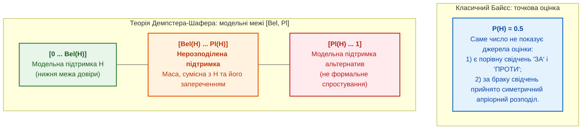

Теорія Демпстера–Шафера не стала масовою, бо теорію складніше пояснювати й підтримувати, ніж простіші оцінки. Проте ідея теорії важлива для доказових експертних систем: джерела можуть підтримувати висновок по-різному й суперечити одне одному, і експертна система має вміти сказати не лише «так» чи «ні», а й «джерела суперечать одне одному». Якщо тест каже одне, статус задачі інше, а вимога змінилася після базової версії, експертна система не вибирає найкрасивіший текст, а показує конфлікт.

Коефіцієнти впевненості, ступені належності й маси довіри вимірюють різні величини. Помилкою є не вибір одного з трьох методів, а змішування шкал у спільне число «впевненості». Наступний розділ переходить від величин до структури: як зберігати зв'язки між фактами, джерелами й досвідом.

## 6. Онтологічний простір: типізовані зв'язки, джерела та моделі інженерного досвіду

Числа, ймовірності та функції належності позбавлені сенсу, якщо експертна система не знає, як факти структуровані, де розташовані первинні джерела та як спиратися на накопичений інженерний досвід. Доказовий висновок завжди спирається на непорушну тріаду: **Джерело** забезпечує фактологічну автентичність, **Зв'язок** задає семантичну структуру міркування, а **Досвід** дозволяє системі еволюціонувати без повторення минулих помилок.

### 6.1. Фундаментальна тріада знань: Джерело, Зв'язок та Інженерний досвід

Щоб відрізнити доказовий штучний інтелект від хаотичного набору неперевірених фрагментів тексту, експертна система спирається на строгі визначення трьох базових складових:

**Схема 4.26. Джерело, відношення та досвід.**

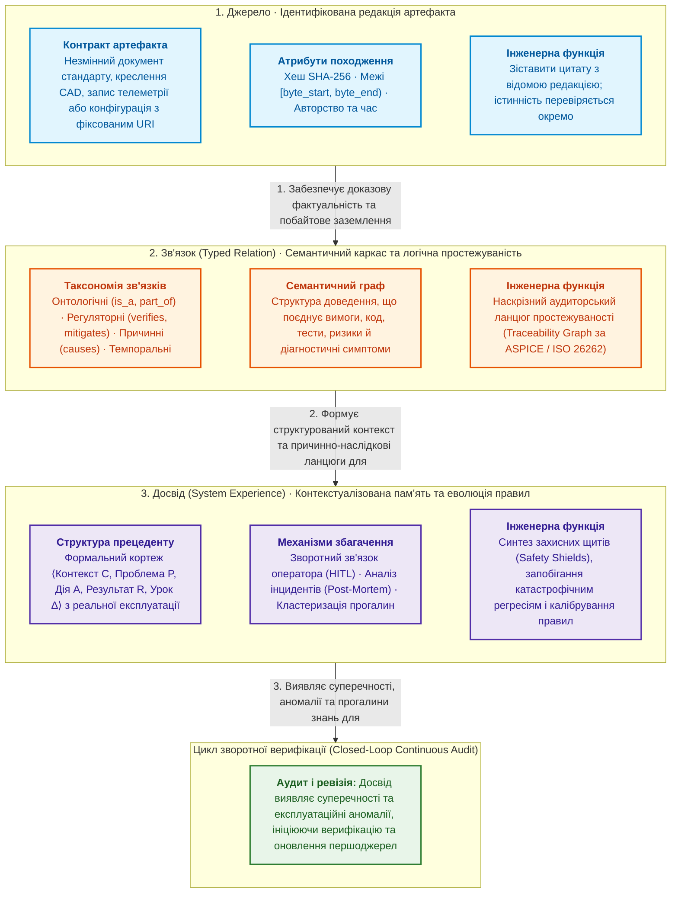

#### 6.1.1. Джерело доказовості (Evidence Source) та його атрибути
Атрибути джерела потрібні, щоб повторно знайти саме ту редакцію, на яку спирався висновок. **Джерелом** тут називається ідентифікований артефакт або його збережена версія: документ, креслення, конфігурація, журнал чи протокол. Збережена редакція не повинна непомітно змінюватися, але це не робить її вміст безпомилковим.

На відміну від «сирих даних» або знеособленої текстової цитати, джерело в доказовій експертній системі ([Глава 8](ch08-engineering-artifacts-as-data.md)) має строгий контракт:
- **Унікальний ідентифікатор і версія:** сталий URI або коміт системи контролю версій;
- **Хеш вмісту:** наприклад, SHA-256 для порівняння з незалежно збереженим довіреним значенням; якщо можна підмінити й файл, і еталонний хеш, сам запис хешу не захищає історію;
- **Побайтові координати:** напіввідкритий діапазон `[byte_start, byte_end)` у визначеному кодуванні й редакції; початок включено, кінець ні. Це координати байтів, не обов'язково номер фізичного рядка ([глава 2](ch02-epistemology-of-machine-knowledge.md));
- **Походження (Provenance):** авторство, часова мітка затвердження, статус чинності (дійсний, проєкт, відкликаний).

#### 6.1.2. Типізовані семантичні зв'язки (Typed Relations)
Типізований зв'язок потрібний, щоб розрізнити «тест перевіряє вимогу», «дефект зачіпає вимогу» й «новий документ замінює старий». **Зв'язок** є записом відношення між сутностями з явним значенням і походженням. Ланцюг таких записів забезпечує простежуваність, але стає доведенням лише за перевірених засновків і правил переходу.

В інженерних експертних системах зв'язки поділяють на чотири фундаментальні класи:

**Схема 4.27. Чотири типи відношень між артефактами.**

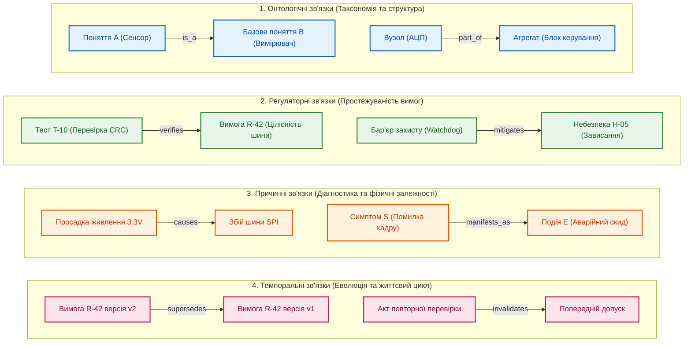

1. **Онтологічні та структурні зв'язки:** задають належність до класу або частини цілого (`is_a`, `part_of`, `subClassOf`). Які властивості можна переносити цими зв'язками, визначає формальна модель; сама схожість назви не переносить усіх фізичних вимог одного приладу на інший.
2. **Регуляторні зв'язки та простежуваність (Traceability):** пов'язують вимоги стандартів, проєктні рішення, код і тести (`satisfies`, `verifies`, `mitigates`, `traces_to`). Саме ці зв'язки формують матрицю відповідності для сертифікаційного аудиту ([Глава 9](ch09-engineering-knowledge-graph-traceability.md)).
3. **Причинно-наслідкові та діагностичні зв'язки:** описують фізичні залежності між дефектами, відмовами та спостережуваними симптомами (`causes`, `manifests_as`, `indicates`). Вони утворюють основу для байєсівських мереж та дерев відмов (FTA) ([Глава 24](ch24-system-diagnosis.md)).
4. **Темпоральні та еволюційні зв'язки:** фіксують заміну, скасування й порядок (`supersedes`, `invalidates`, `precedes`). Щоб не застосувати стару норму, рушій має врахувати ці записи, час чинності та політику перегляду; наявність ребра сама не виконує відкату.

#### 6.1.3. Інженерний досвід як формалізований корпус прецедентів <a id="кортеж-інженерного-досвіду"></a>
Формалізація досвіду потрібна, щоб після наступного падіння тесту знайти попереднє розслідування й перевірити відмінності випадків. **Досвід** тут є структурованим записом контексту, проблеми, дії, результату й уроку. Він допомагає сформувати кандидата пояснення або перевірки, але не гарантує повторення результату в іншій версії системи.

**Формально: інженерна модель прецеденту досвіду М. Федчика.**
Інженерна проблема повторення раніше зафіксованих критичних помилок: якщо знання системи обмежені статичним зводом нормативів, система щоразу наступає на відомі граничні колізії реального обладнання. Мета розрахунку — формалізація одиниці емпіричного досвіду у вигляді структурованого кортежу $E$ для швидкого міркування за аналогією (CBR) та автоматичного формування захисних контрправил (Safety Shields).

У моделі прецеденту використовуються такі параметри:

**Формула (4.28). Параметри навчального прецеденту.**

```math
E = \langle \mathcal{C},\ \mathcal{P},\ \mathcal{A},\ \mathcal{R},\ \Delta \rangle
```

- $`\mathcal{C} \in \mathbb{C}`$ — робочий контекст інженерного середовища (версія апаратної ревізії, діапазон температур довкілля, режим навантаження);
- $`\mathcal{P} \in \mathbb{P}`$ — формалізована інженерна проблема або вектор симптомів аномалії;
- $`\mathcal{A} \in \mathbb{A}`$ — виконана дія керування або застосована гіпотеза виведення;
- $`\mathcal{R} \in \{\text{Success}, \text{Degraded}, \text{CriticalFailure}\}`$ — фактично зареєстрований фізичний результат;
- $`\Delta \in \mathbb{D}`$ — зафіксований інженерний інваріант: коригування порогу спрацьовування, нове заборонне правило або контрприклад для валідаційного тестування.

**Практичне застосування та інженерні висновки:**
1. Прецедент витягується як кандидат за порогом контекстної подібності; $`\mathrm{Sim}(\mathcal{C}_{\text{new}}, \mathcal{C}) \ge \tau_{\mathrm{case}} = 0{,}85`$ є навчальною конфігурацією пошуку, а не доведенням застосовності уроку.
2. Якщо знайдено прецедент із результатом $`\mathcal{R} = \text{CriticalFailure}`$, рушій перевіряє застосовність його підтвердженого заборонного правила до нового контексту. Лише за виконання передумов цього правила дія $`\mathcal{A}`$ блокується захисним щитом (Safety Shield); числова подібність сама по собі не встановлює заборони чи дозволу.
3. Якщо $`\mathcal{R} = \text{Success}`$, дія $`\mathcal{A}`$ пропонується як пріоритетна робоча гіпотеза для скорочення часу розв'язання задачі.

У навчальному прецеденті контекстом є версія прошивки й конфігурація стенда, проблемою повторюване падіння тесту, дією ізольований повтор зі збереженням журналів. Результат може показати, що причина ще не встановлена; урок тоді полягає не в дозволі випуску, а в потребі перевірити стан стенда. Цей запис корисний для планування наступного розслідування, але не стає новим правилом автоматично.

> [!NOTE]
> **Авторський інваріант повноти прецеденту**
> 1. **Інваріант доказової повноти інженерного прецеденту М. Федчика:** Кожен прецедент $E$ є валідним для використання у виведенні лише за умови наявності всіх п'яти складових кортежу $`\langle \mathcal{C}, \mathcal{P}, \mathcal{A}, \mathcal{R}, \Delta \rangle`$ та підтвердженого цифрового підпису інженера або тестового стенда. Прецедент без зафіксованого результату $`\mathcal{R}`$ або уроку $\Delta$ вважається сирим спостереженням і не допускається до формування захисних щитів безпеки.

#### 6.1.4. Протоколи накопичення емпіричного досвіду
Експертна система не є статичним оракулом; вона накопичує досвід чотирма вивіреними інженерними каналами:

**Схема 4.29. Канали підготовки кандидатів досвіду.**

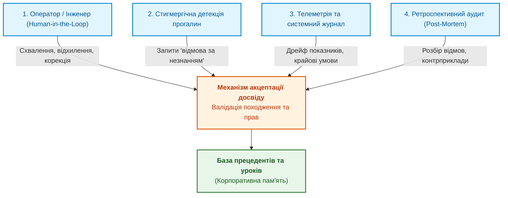

1. **Зворотний зв'язок від уповноваженого експерта (Human-in-the-Loop):** Коли система формує рекомендацію, людина приймає або спростовує її. У разі відхилення обов'язково фіксується причина спростування (*undercutting defeater*), що додає до системи нове негативне обмеження ([Глава 2](ch02-epistemology-of-machine-knowledge.md), [Глава 11](ch11-knowledge-elicitation-from-experts.md)).
2. **Накопичення прогалин:** запити без достатніх підстав групуються за причиною. Нестача даних не означає автоматично припущення замкненого світу; повторювана прогалина є кандидатом для дослідження, не доведеним новим знанням ([глава 34](ch34-deterministic-relational-analysis-abduction-and-socratic-dialogue.md)).
3. **Моніторинг розбіжностей у реальній експлуатації:** Порівняння прогнозованої поведінки об'єкта (наприклад, очікуваного струму двигуна) з показаннями фізичних сенсорів. Розбіжність понад гарантований поріг записується як новий граничний стан.
4. **Аналіз інцидентів та ретроспективні випробування (Post-Mortem):** Після кожної аварії чи відмови контрприклад кодується як обов'язковий тест, який система повинна проходити під час кожного оновлення правил ([Глава 25](ch25-how-expert-systems-learn.md)).

> [!NOTE]
> **Авторське правило аудиту прецедентів**
> 1. **Правило регламентного аудиту бази прецедентів М. Федчика:** Усі нові прецеденти, накопичені каналами телеметрії або стигмергії, спершу поміщаються в карантинний буфер `quarantine_case_buffer`. Їхня міграція до активної бази прецедентів здійснюється виключно після експертної верифікації (Human-in-the-Loop) та успішного проходження повного регресійного тестування на еталонному наборі Golden Set.

#### 6.1.5. Механізми застосування накопиченого досвіду у виведенні
Накопичений досвід задіюється у чотирьох ключових режимах:
- **Міркування за аналогією (CBR):** Пошук прецедентів зі схожим контекстом за комбінованою графово-векторною метрикою для швидкої генерації робочої гіпотези без повного вичерпного перебору.
- **Перевірюване оновлення параметрів:** досвід може запропонувати зміну ймовірностей або функцій належності. Її оцінюють на визначених даних, версіонують і приймають через керовану процедуру, не змінюють непомітно після кожного сеансу.
- **Синтез формальних щитів безпеки (Safety Shields):** Прецеденти критичних помилок перетворюються на жорсткі предикатні бар'єри: навіть якщо нейромережа чи оператор пропонує небезпечну дію, щит на базі минулого досвіду блокує її виконання ([Глава 27](ch27-safety-case-gsn-synthesis.md), [Глава 38](ch38-curing-machine-hallucinations-and-knowledge-deficits.md)).
- **Безперервний захист від регресій (Continual Learning):** Кожен зафіксований історичний випадок формує частину екзаменаційної матриці знань; нова версія системи не може піти у виробництво, якщо вона порушує хоча б один урок з минулого ([Глава 26](ch26-continual-learning.md), [Глава 36](ch36-knowledge-testing-pyramid-and-variational-calibration.md)).

На ці інженерні виклики послідовно відповіли чотири історичні лінії розвитку: семантичні мережі й графи знань, байєсівські мережі, інформаційний пошук та міркування за прецедентами.

> [!NOTE]
> **Авторська архітектурна модель тріади знань та замкненого аудиту М. М. Федчика (Чотири складові доказового простору)**
> 1. **Джерело:** ідентифікована редакція з координатами цитати, хешем і описом походження; PROV-O є моделлю опису, не автоматичним сертифікатом істинності.
> 2. **Зв'язок (Typed Relation):** Спрямоване типізоване відношення чотирьох фундаментальних класів: онтологічні (`is_a`, `part_of`), регуляторні (`verifies`, `mitigates`), причинно-діагностичні (`causes`, `manifests_as`) та темпорально-версійні (`supersedes`, `invalidates`).
> 3. **Досвід (System Experience):** Формалізований кортеж емпіричного прецеденту $`E = \langle \mathcal{C}, \mathcal{P}, \mathcal{A}, \mathcal{R}, \Delta \rangle`$ (робочий контекст, проблема, виконана дія, зареєстрований фізичний результат, скоригований інваріант/урок).
> 4. **Замкнений цикл безперервного аудиту (Closed-Loop Audit):** Чотиривимірний протокол накопичення досвіду (зворотний зв'язок експерта HITL, стигмергічне виявлення прогалин CWA, телеметричний моніторинг розбіжностей і post-mortem аналіз) для автономного синтезу захисних щитів безпеки (Safety Shields) та регресійного тестування.
> *Інженерний інваріант доказової повноти М. Федчика:* Будь-який факт у робочій пам'яті без верифікованого джерела (URI + SHA-256) та типізованого зв'язку блокується шлюзом допуску зі статусом відмови `UNVERIFIED_PREMISE`.

### 6.2. Еволюція реляційного подання: від семантичних мереж Квілліана до промислових графів знань

У 1960–1970-х роках поширилися семантичні мережі й фрейми Росса Квілліана [[31]](#src-31), тобто подання знань як понять, властивостей і зв'язків:

```text
Вимога R-17 перевіряється тестом T-9.
Тест T-9 упав на базовій версії B-3.
Дефект D-4 зачіпає вимогу R-17.
```

Три рядки вже є не текстом, а графом: вершинами є вимога, тест, версія й дефект, ребрами є типізовані зв'язки. Сучасні графи знань, онтології й графи простежуваності є прямими нащадками семантичних мереж. Граф потрібен там, де важливий ланцюжок: від вимоги до тесту, від тесту до дефекту, від дефекту до ризику, від ризику до рішення про випуск. Мовна модель без графа бачить купу документів, а з графом бачить ланцюжок доказів. Як будувати інженерний граф знань, розповідає [Глава 9](ch09-engineering-knowledge-graph-traceability.md).

### 6.3. Байєсівські мережі довіри (DAG) та факторні графи Перла

У 1980-х Джудея Перл поєднав теорему Байєса з графами [[17]](#src-17). Байєсівська мережа є спрямованим ациклічним графом, у якому вершини є випадковими величинами, а ребра показують залежності.

**Формально: інженерна модель факторизації спільного розподілу в байєсівській мережі.**
Факторизація потрібна, щоб не задавати окремо ймовірність кожної комбінації станів. Три бінарні величини вже мають вісім комбінацій; сім імовірностей задаються незалежно, а восьма визначається вимогою суми в одиницю. Байєсівська мережа використовує явно прийняті умовні незалежності, щоб описати розподіл локальними таблицями. Це припущення моделі, яке потрібно обґрунтувати, не властивість будь-якого намальованого графа.

У розрахунку використовуються такі параметри:

**Формула (4.30). Факторизація байєсівської мережі.**

```math
P(X_1,\ldots,X_n)=\prod_{i=1}^{n}P\bigl(X_i\mid \mathrm{Pa}(X_i)\bigr)
```

- $`X_1, \dots, X_n`$ — дискретні випадкові величини станів вузлів системи (наприклад, $`X_i \in \{\text{OK}, \text{Fault}\}`$);
- $`\mathrm{Pa}(X_i)`$ — множина безпосередніх предків (батьківських вузлів) вершини $`X_i`$ в орієнтованому ациклічному графі $`\mathcal{G}`$;
- $`P(X_i\mid\mathrm{Pa}(X_i))`$ — таблиця умовних ймовірностей (Conditional Probability Table, CPT) для вузла $`X_i`$ за заданих значень його батьків;
- $`\prod_{i=1}^{n}`$ — добуток локальних факторів. Для бінарних вузлів їхні таблиці містять $`\sum_{i=1}^{n}2^{k_i} \le n\,2^k`$ незалежних імовірнісних параметрів, де $`k_i = \lvert\mathrm{Pa}(X_i)\rvert`$, а $`k = \max_i k_i`$ — найбільша кількість батьків вузла. Розмір лінійний за $n$ лише за фіксованої межі $k$ і експоненційний за $k$, а не поліноміальний за зв'язністю.

Для навчальної мережі з $n = 50$ бінарних вузлів і не більш ніж трьома батьками на вузол потрібно не більш ніж $`50 \cdot 2^3 = 400`$ незалежних параметрів: 3200 байтів за збереження кожного в 8 байтах без службових даних. Проте компактне подання не гарантує дешевого точного виведення: його витрати залежать також від структури мережі, зокрема ширини дерева. Інженер окремо перевіряє пам'ять проміжних факторів і бюджет часу, а за вичерпання бюджету не видає непідтвердженого результату.

Для малого розрахунку припустімо ланцюжок «дефект -> падіння тесту -> додатковий сигнал», у якому останній вузол умовно незалежний від першого за відомого другого. Якщо три потрібні множники дорівнюють 0,10, 0,80 і 0,90, їх добуток становить 0,072. Це 7,2 % для спільної події «дефект є, тест упав і сигнал з'явився» за цією моделлю, а не ймовірність дефекту після сигналу. Для останнього питання ще потрібне умовне оновлення за теоремою Байєса.

**Практичне застосування та інженерні висновки:**
1. Розрахунок викликається підсистемою онлайн-діагностики при надходженні вектора свідчень телеметрії $`\mathbf{e} = \{X_k = x_k\}`$.
2. Маргінальну апостеріорну ймовірність $`P(X_{\text{target}} = \text{Fault} \mid \mathbf{e})`$ обчислюють алгоритмом, придатним для структури й бюджету мережі: поширення переконань (Belief Propagation) дає точний результат на деревах, тоді як для загального графа можна застосувати дерево зчленувань (Junction Tree) з контролем розміру його кластерів. Ітеративне поширення у мережі з неорієнтованими циклами саме по собі не гарантує збіжності чи точності.
3. Значення $`P(X_{\text{target}} = \text{Fault} \mid \mathbf{e}) \ge 0{,}80`$ може бути навчальним тригером поглибленої діагностики, але не універсальною директивою фізичної ізоляції. Таку дію дозволяє лише затверджена політика з перевіркою небезпек і передумов; сама ймовірність не встановлює несправності. Зміни оцінки простежуються за факторами моделі, а причинне тлумачення ребер потребує окремого обґрунтування. Докладніше байєсівські мережі розглядає [Глава 6](ch06-applied-mathematics-for-expert-systems.md), діагностичні застосування — [Глава 24](ch24-system-diagnosis.md).

### 6.4. Еволюція інформаційного пошуку: від лексичного зважування TF-IDF/BM25 до векторних ембедингів

Жодне символьне виведення чи верифікація не мають сенсу, якщо експертна система не здатна знайти первинні факти та підтверджувальні свідоцтва у масиві технічної документації. Еволюція пошуку пройшла шлях від бінарного збігу слів до **зважування інформаційної сили термінів**, а відтак — до **геометричних векторних просторів контексту**.

#### 6.4.1. Лексичне зважування слів: матриці інцидентності, TF-IDF та BM25

У наївному пошуку документ розглядають як невпорядкований набір слів, перевіряючи лише присутність або кількість входжень терма. Проте проста частота появи слова ($`f_{t,d}`$) вводить систему в оману: загальновживані слова (наприклад, «система», «вимога», «помилка», «параметр») зустрічаються в кожному документі, проте мають нульову роздільну здатність. Навпаки, вузькоспеціалізовані терміни (наприклад, `CRC32`, `SPI_ERR_TIMEOUT`, `ISO26262-5`) зустрічаються рідко, але несуть максимальну інформаційну цінність.

**Формально: інженерна модель лексичного зважування термінів (TF-IDF).**
Інженерна проблема вилучення специфічних технічних маркерів (кодів помилок, назв регістрів, пунктів стандартів) з великих масивів документації: наївний частотний пошук тоне в загальновживаних словах («система», «вимога»), тоді як критичні ідентифікатори (`CRC32`, `SPI_ERR_TIMEOUT`) зустрічаються рідко. Мета розрахунку — обчислення інформативної ваги слова $w(t, d, D) \ge 0$, що відображає його селективність щодо всієї бази знань $D$.

У розрахунку використовуються такі параметри:

**Формула (4.31). Лексична вага терма TF-IDF.**

```math
w(t, d, D) = \mathrm{TF}(t, d) \cdot \mathrm{IDF}(t, D) = \frac{f_{t,d}}{\lvert d \rvert} \cdot \ln\left(1 + \frac{\lvert D \rvert}{\lvert\{d' \in D : t \in d'\}\rvert}\right)
```

- $t$ — пошуковий терм (атомарне слово або технічний токен);
- $d \in D$ — аналізований інженерний документ або знімок вимоги;
- $`\lvert d \rvert \in \mathbb{N}^+`$ — загальна кількість слів у документі $d$;
- $`f_{t,d} \in \mathbb{N}`$ — абсолютна частота появи терма $t$ у документі $d$;
- $D$ — повна база знань (корпус документів), де $`\lvert D \rvert \in \mathbb{N}^+`$ — загальна кількість документів;
- $`\lvert\{d' \in D : t \in d'\}\rvert`$ — кількість документів у базі, які містять терм $t$;
- $w(t, d, D) \in [0, \infty)$ — підсумкова вага дискримінаційної сили терма.

**Практичне застосування та інженерні висновки:**
1. Розрахунок викликається підсистемою індексації при створенні інвертованого індексу бази знань.
2. Якщо терм є в кожному документі, множник IDF у наведеній згладженій формулі дорівнює приблизно 0,693. Повна вага ще множиться на частоту TF, тому це не сама вага документа. У класичному варіанті без додавання одиниці IDF для такого терма дорівнює нулю. Видалення стоп-слів є окремою політикою, не автоматичним наслідком формули.
3. Якщо терм є унікальним кодом помилки, що зустрічається лише в 1 документі з $100\,000$, його $`\mathrm{IDF} = \ln(1 + 100\,000) \approx 11{,}51`$, що максимізує його вагу у видачі.
4. Для повного навчального розрахунку нехай у документі 200 слів, терм трапляється двічі й є у двох із десяти документів корпусу. TF дорівнює 2/200, тобто 0,01; IDF дорівнює натуральному логарифму 6, приблизно 1,792. Добуток становить приблизно 0,0179, без одиниць. Він допомагає впорядкувати документи за цим термом, але не підтверджує правильності їхнього змісту. Якщо терма немає в корпусі, наведений дріб із нульовою документною частотою не обчислюють: пошук повертає відсутність збігу або застосовує окрему визначену схему згладжування.
5. BM25 додає насичення частоти та нормалізацію за довжиною [[19]](#src-19). Це інша функція ранжування з власними параметрами, не гарантія, що кожна коротка специфікація буде знайдена.

#### 6.4.2. Геометричні векторні простори та семантична щільність

Перехід від зважування окремих слів до векторних моделей розділив інформаційний пошук на два взаємодоповнюючі класи подання знань:

**Схема 4.32. Розріджене та щільне подання тексту.**

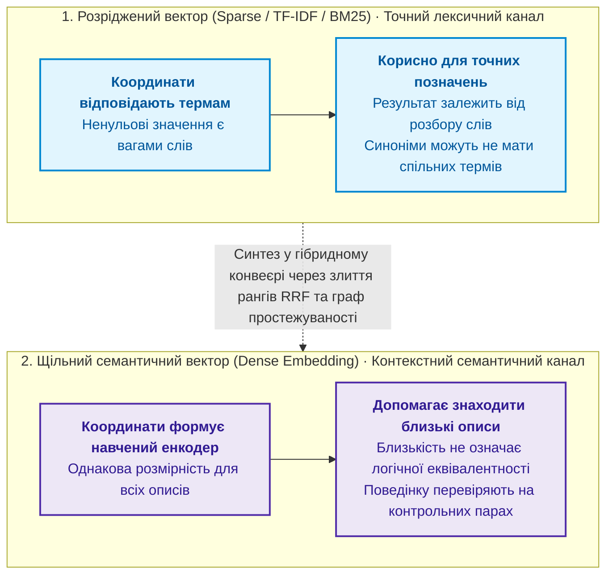

1. **Розріджений вектор (Sparse Vector, простір слів):** Документ подається вектором $`\mathbf{x} \in \mathbb{R}^{|V|}`$, розмірність якого дорівнює розміру словника мови ($10^5$–$10^6$ елементів). Переважна більшість координат дорівнює нулю, а ненульові координати є вагами $w(t, d)$.
   - *Проблема лексичного розриву:* Якщо у запиті написано «несправність приводу», а в регламенті «дефект сервомотора», їхні розріджені вектори не перетинаються (ортогональні), і традиційний пошук не знайде зв'язку.
2. **Щільний семантичний вектор (Dense Vector / Embedding):** Текст пропускається крізь трансформерний енкодер, який відображає фрагмент у неперервний геометричний вектор фіксованої розмірності ($d = 384, 768, 1536$). Координати кодують латентні семантичні зв'язки.

**Формально: інженерна модель косинусної подібності контекстів.**
Інженерна проблема подолання синонімії в технічній мові (Lexical Chasm): різні інженери описують одну проблему різними словами. Мета розрахунку — визначення кутової близькості контекстних векторів $\cos(\mathbf a, \mathbf b) \in [-1, 1]$ без залежності від масштабу чи довжини тексту.

У розрахунку використовуються такі параметри:

**Формула (4.33). Косинусна подібність ненульових векторів.**

```math
\cos(\mathbf a,\mathbf b)=\frac{\mathbf a^{\mathsf T}\mathbf b}{\lVert\mathbf a\rVert_2\,\lVert\mathbf b\rVert_2} = \frac{\sum_{i=1}^d a_i\,b_i}{\sqrt{\sum_{i=1}^d a_i^2}\cdot\sqrt{\sum_{i=1}^d b_i^2}}
```

- $`\mathbf a, \mathbf b \in \mathbb{R}^d`$ — ненульові вектори запиту та кандидата в одній системі координат; $d$ є додатним цілим числом координат. Попередня нормалізація можлива, але для наведеної формули не обов'язкова;
- $`\mathbf a^{\mathsf T}\mathbf b = \sum_{i=1}^d a_i b_i`$ — скалярний добуток, що підсумовує збіг проекцій за всіма латентними осями;
- $`\lVert\mathbf a\rVert_2 = \sqrt{\sum a_i^2}`$ — евклідова норма (довжина) вектора;
- $\cos(\mathbf a, \mathbf b) \in [-1, 1]$ — косинус кута між векторами.

**Практичне застосування та інженерні висновки:**
1. Розрахунок викликається векторним рушієм пошуку (HNSW / ScaNN) на першому етапі відбору семантичних кандидатів.
2. Для навчальних двовимірних векторів $(1,0)$ і $(1,1)$ скалярний добуток дорівнює 1, довжини дорівнюють 1 і квадратному кореню з 2. Результат становить приблизно 0,707. Це геометрична близькість, не 70,7 % імовірності істинності. Для нульового вектора знаменник дорівнює нулю, тому така оцінка не визначена.
3. Ілюстративна політика може передавати оцінки від 0,65 до 0,82 на повторне ранжування, але ці межі потрібно перевірити для конкретної моделі й корпусу. Відхилення за порогом є рішенням відбору, не доказом, що джерело нерелевантне або хибне.
4. Висока подібність не гарантує розрізнення заперечень: описи «клапан відкрито» та «клапан закрито» можуть бути близькими, бо стосуються того самого об'єкта. Конкретну поведінку перевіряють на контрольних парах, а знайдені фрагменти передають на перевірку застосовності та змісту.

#### 6.4.3. Семантична короткозорість та фундаментальні межі чисто векторного пошуку

Векторний пошук не є логічним виведенням. Косинусна близькість оцінює **контекстну подібність, а не фактичну істинність чи логічну еквівалентність**.

> [!NOTE]
> **Авторський принцип меж семантичного векторного пошуку**
> 1. Косинусна близькість у просторі ембедингів оцінює подібність подань, а не істинність або логічну еквівалентність тверджень. Висока близькість сама по собі не гарантує розрізнення предикатного заперечення; конкретну поведінку потрібно перевіряти на парах контрольних тверджень для вибраної моделі.

Два твердження з прямо протилежним інженерним значенням — наприклад, *«запобіжний клапан відкрито»* та *«запобіжний клапан закрито»* — можуть мати косинусну близькість понад 0,9 (ілюстративне значення; для конкретної моделі векторизації його вимірюють на контрольних парах тверджень), оскільки обидві фрази мають спільне лексичне оточення і стосуються одного й того самого фізичного вузла. Довірити векторному пошуку прийняття рішення без детермінованого логічного фільтра — прямий шлях до критичної відмови системи.

#### 6.4.4. Двоканальний гібридний пошук інженерних доказів (Dense + Sparse Retrieval)

Сучасна доказова експертна система не обирає між лексичним зважуванням і семантичними векторами, а об'єднує їх у **двоканальний гібридний конвеєр (Hybrid Search Pipeline)** із графовою та логічною верифікацією:

**Схема 4.34. Два канали пошуку та подальші перевірки.**

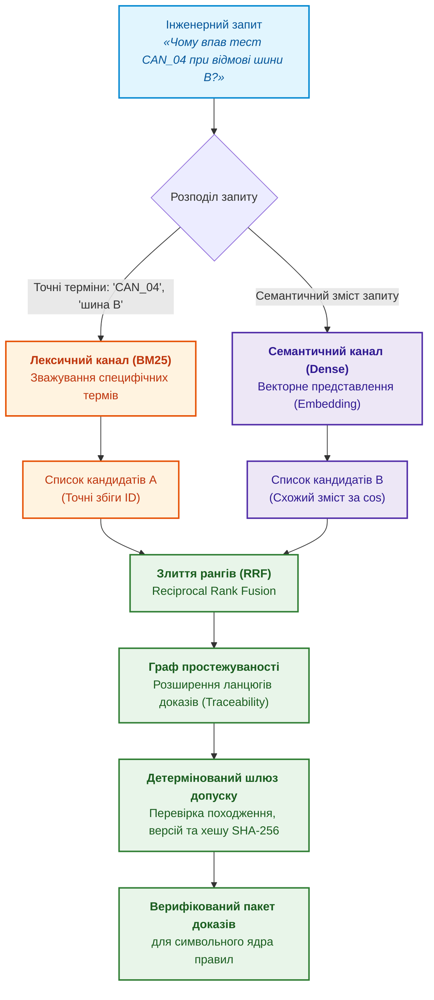

Генерація з пошуком (*retrieval-augmented generation*, RAG) стоїть на тій самій історичній лінії: мовна модель відповідає не з власної пам'яті, а на основі знайдених джерел [[20]](#src-20). Проте для інженерних доказів результати ранжування обов'язково фільтруються через детерміновані правила допуску: знайдені фрагменти повинні мати чинний статус, підтверджені дати затвердження та зафіксовані зміщення `[byte_start, byte_end]`.

Математичні деталі формування векторних просторів, функцію Reciprocal Rank Fusion (RRF) та крос-енкодери детально розглядає [Глава 6](ch06-applied-mathematics-for-expert-systems.md#пошук-інформації-зважування-слів-та-вектори), а практичну побудову конвеєра від запиту до доказу — [Глава 19](ch19-from-question-to-evidence.md).

### 6.5. Міркування за прецедентами (Case-Based Reasoning, CBR)

У 1980–1990-х роках сформувалося міркування за прецедентами (*case-based reasoning*, CBR). Логіка CBR людська: для нового випадку знайти схожий старий, використати рішення старого випадку, переглянути рішення з урахуванням відмінностей і зберегти новий досвід. Агнар Аамодт і Енрік Пласа описали цикл CBR чотирма кроками: знайти, використати, переглянути, зберегти (*retrieve, reuse, revise, retain*) [[21]](#src-21).

У сучасній інженерії прецедентами є схожий дефект, схожа затримка постачальника, схоже зауваження аудитора. Організації мають уроки з минулих проєктів, але уроки не з'являються в момент рішення. Мовна модель допомагає описати випадок і знайти схожі випадки, але остаточне порівняння відмінностей між випадками залишається за правилами й людиною.

Графи зберігають зв'язки, байєсівські мережі розкладають ймовірність на локальні частини, пошук знаходить джерела, прецеденти повертають досвід. Жоден із чотирьох інструментів сам не ухвалює рішення: рішення потребує порівняння альтернатив і точних розрахунків.

## 7. Багатокритеріальне оцінювання альтернатив та детерміновані обчислювальні ядра

Багато інженерних рішень у критичних доменах не мають єдиної ідеальної відповіді: архітектор змушений обирати між конфліктуючими показниками продуктивності, вартості та повноти покриття вимог. Інші рішення, навпаки, вимагають детермінованого обчислення нормативних інженерних метрик згідно з міжнародними стандартами (ISO 26262, IEC 61508). Для обох випадків експертна система зобов'язана спиратися на прозорі математичні алгоритми, а не на стохастичну генерацію тексту.

### 7.1. Зважене багатокритеріальне оцінювання (Trade-Off Matrix, AHP)

**Формально: інженерна модель зваженого компромісного оцінювання (Trade-Off Matrix).**
Інженерна проблема формалізації компромісів між конфліктуючими цілями проєкту (швидкість постачання, вартість, залишкові ризики безпеки): якщо вибір архітектури ухвалюється суб'єктивно, рішення неможливо захистити перед регулятором чи аудитором. Мета розрахунку — детерміноване обчислення синтетичного балу альтернативи $S(a) \in [0, 1]$ на основі фіксованої матриці пріоритетів і нормованих показників, що забезпечує простежуваність вибору та можливість аналізу чутливості.

Перед ранжуванням окремо перевіряють усі обов'язкові обмеження безпеки та нормативні умови. Недопустимі альтернативи не беруть участі у виборі незалежно від їхнього балу; відповідність обов'язковій вимозі не можна компенсувати бізнес-цінністю. Формула нижче порівнює переваги вже допустимих варіантів, а не замінює шлюз допуску.

У розрахунку використовуються такі параметри:

**Формула (4.35). Зважена оцінка допустимої альтернативи.**

```math
S(a)=\frac{\sum_{i=1}^{m}w_i\,x_i(a)}{\sum_{i=1}^{m}w_i},\qquad w_i\ge0,\quad \sum_{i=1}^{m}w_i>0
```

- $`a \in \mathcal{A}`$ — оцінювана інженерна альтернатива (архітектурний шаблон, конфігурація випуску, постачальник компонентів);
- $`m \in \mathbb{N}^+`$ — кількість критеріїв; їх потрібно визначити так, щоб приховані дублікати не отримали зайвої ваги;
- $`x_i(a) \in [0, 1]`$ — нормоване значення $i$-го критерію для альтернативи $a$ (де 1 — найкраще, 0 — найгірше значення шкали); допустимість визначається окремими обов'язковими обмеженнями;
- $`w_i \ge 0`$ — безрозмірна вага переваги $i$-го критерію, узгоджена для цього рішення; це не юридична сила норми;
- $S(a) \in [0, 1]$ — підсумковий зважений рейтинг альтернативи.

**Практичне застосування та інженерні висновки:**
1. Розрахунок викликається підсистемою підтримки рішень під час вибору архітектурних опцій або сценаріїв випуску.
2. У навчальному прикладі три сценарії вже пройшли перевірку обов'язкових умов. Порівняймо користувацьку цінність із вагою 0,4, запас продуктивності з вагою 0,3 і простоту супроводу з вагою 0,3. Всі бали умовні, нормовані від 0 до 1; більше означає краще саме за відповідним критерієм, не більшу ймовірність безпеки.

**Таблиця 4.36. Навчальна матриця переваг трьох варіантів.**

| Альтернатива | Цінність ($`w=0{,}4`$) | Запас продуктивності ($`w=0{,}3`$) | Простота супроводу ($`w=0{,}3`$) | Рейтинг $S$ |
|---|---:|---:|---:|---:|
| A: терміновий випуск | 0,90 | 0,45 | 0,60 | 0,675 |
| B: плановий випуск | 0,70 | 0,70 | 0,85 | 0,745 |
| C: мінімальний реліз | 0,50 | 0,90 | 0,80 | 0,710 |

3. Для варіанта B множимо 0,70 на 0,4, 0,70 на 0,3 і 0,85 на 0,3: отримуємо 0,280, 0,210 та 0,255. Сума дорівнює 0,745; сума ваг дорівнює 1, тому ділити на інше число не потрібно. Це найбільший рейтинг у таблиці. Він обґрунтовує перевагу B лише за прийнятих шкал, ваг і попередньої допустимості варіантів.
4. Аналіз стійкості (Sensitivity Analysis): якщо вагу бізнес-цінності підвищити до $`w_1 = 0{,}6`$ (інші знизити до 0,2), рейтинг $A$ зростає до 0,75 проти 0,73 для $B$. Числовим лідером стає $A$, але переможцем серед допустимих варіантів він може бути лише за збереження всіх обов'язкових умов. Якщо $A$ має безпековий блокер, він залишається відсіяним, а $B$ з рейтингом 0,73 випереджає $C$ з рейтингом 0,64. Журнал фіксує ваги, бали та результати перевірки обмежень; зміна бізнес-пріоритету не скасовує нормативної заборони.

### 7.2. Інтеграція детермінованих розрахункових ядер та верифікованих фізичних моделей

Критичні інженерні розрахунки (наприклад, FMEDA-аналіз надійності, розрахунок термічного навантаження) категорично заборонено доручати генеративним нейромережам через ризик арифметичних галюцинацій. Їх реалізують у вигляді автономних детермінованих обчислювальних ядер (Deterministic Calculation Cores), сертифікованих за відповідним стандартом.

**Формально: інженерний розрахунок метрики одноточкових відмов (SPFM, ISO 26262-5).**
Мета навчального розрахунку SPFM полягає в тому, щоб за заданою класифікацією відмов обчислити частку, яку не становлять одноточкові й залишкові відмови. Цей показник використовується в аналізі апаратної безпеки ISO 26262-5 [[22]](#src-22), але приклад не відтворює повної процедури стандарту. Інтенсивності мають однакові одиниці: один FIT означає одну відмову на мільярд годин, тобто одну мільярдну оберненої години.

У розрахунку використовуються такі параметри:

**Формула (4.37). Розрахункова модель SPFM.**

```math
\mathrm{SPFM}=1-\frac{\sum\lambda_{\mathrm{SPF}}+\sum\lambda_{\mathrm{RF}}}{\sum\lambda_{\mathrm{total}}}
```

- $`\lambda_{\mathrm{SPF}} \ge 0`$ — інтенсивність одноточкових відмов у врахованій класифікації, FIT;
- $`\lambda_{\mathrm{RF}} \ge 0`$ — інтенсивність залишкових відмов, не перекритих врахованим механізмом безпеки, FIT;
- $`\lambda_{\mathrm{total}} \in \mathbb{R}^+`$ — загальна інтенсивність усіх відмов апаратних елементів, що належать до функцій безпеки (FIT);
- $`\mathrm{SPFM} \in [0, 1]`$ — безрозмірна метрика; для цього діапазону чисельник має бути невід'ємним і не перевищувати додатного знаменника. Категорії мають стосуватися одного й того самого обсягу аналізу без подвійного підрахунку.

**Практичне застосування та інженерні висновки:**
1. Розрахунок викликається автоматично верифікаційним шлюзом після оновлення переліку компонентів (BOM / FMEDA-таблиць).
2. Нехай аналіз мікроконтролера дав: $`\sum\lambda_{\mathrm{total}}=100`$ FIT, $`\sum\lambda_{\mathrm{SPF}}=2`$ FIT, $`\sum\lambda_{\mathrm{RF}}=1`$ FIT.
**Формула (4.38). Навчальний розрахунок SPFM.**

```math
\mathrm{SPFM}=1-\frac{2+1}{100}=1-0{,}03=0{,}97\quad (97\,\%)
```
3. Для порівняння припустімо три навчальні цілі профілю: 90 %, 97 % і 99 %. Отримані 97 % досягають перших двох, але не третьої. Прив'язка конкретної мети до рівня ASIL у реальному проєкті потребує звірення застосовного положення й повного обсягу аналізу; тут цього рішення не зроблено.
4. Якщо локальна ціль дорівнює 99 %, а знаменник лишається 100 FIT, на одноточкові й залишкові відмови разом може припадати не більше 1 FIT. Межа 1 FIT включена; у прикладі маємо 3 FIT, тож ціль не виконано. Це підстава переглянути аналіз, не автоматично обрати певний захисний компонент. Після зміни архітектури перевіряються нові категорії, інтенсивності й знаменник.

## 8. Синтетична спадщина доказової експертної системи: інтеграція класичних та сучасних методів

Історію методів можна звести в одну таблицю: що було тоді й що з давнього методу виросло тепер.

**Таблиця 4.39. Історичні методи та сучасні ролі.**

| Історичний підхід | Що було тоді | Що маємо зараз |
|---|---|---|
| Логіка й правила | ЯКЩО … ТО, пряме й зворотне виведення | рушії правил, політики перевірки, перевірка відповідності |
| LISP і символьний ШІ | правила як дані, списки, дерева | мови правил, подання знань, пояснювана автоматизація |
| PROLOG і логічне програмування | факти, правила, запити, зворотне виведення | бази знань із запитами, виведення політик |
| Теорема Байєса | оновлення ймовірності після свідчення | оцінювання ризику, калібрування впевненості, байєсівські мережі |
| Коефіцієнти впевненості | практична впевненість без повної моделі | оцінки впевненості, пороги людського перегляду |
| Нечітка логіка | розмиті межі й ступені належності | рівні готовності, діапазони ризику |
| Теорія Демпстера–Шафера | поєднання неповних свідчень | явне повідомлення про конфлікт і незнання |
| Семантичні мережі | граф понять і зв'язків | графи знань, онтології, графи простежуваності |
| Пояснення в MYCIN | відповіді на «чому?» і «як?» | сліди доведення, журнали аудиту, пояснення з посиланнями |
| Міркування за прецедентами | пошук схожих випадків | повторне використання уроків, пошук за схожістю |
| Пошук інформації | TF-IDF, BM25, векторна модель | гібридний пошук, RAG, точний пошук ідентифікаторів |
| Аналіз рішень | зважені критерії | досьє рішень, аналіз чутливості |
| Формальні обчислення | окремі моделі й формули | детерміновані ядра з версіями й аудитом |

Сучасна експертна система не заперечує старих методів, а збирає методи в нову архітектуру. Проте та сама математика по-різному обмежена в різних галузях. П'ять галузей, які [Глава 1](ch01-introduction-to-expert-systems.md) обрала наскрізними для книги, показують межі інтерпретації чисел.

**Таблиця 4.40. Галузеві межі тлумачення оцінок.**

| Галузь | Де корисне оновлення впевненості | Типова помилка | Межа рішення |
|---|---|---|---|
| Автомобільна інженерія | діагностика відмов, оцінювання ризику в експлуатації, вибір наступного тесту | перенести частоту дефектів іншої конфігурації на поточний виріб як апріорну ймовірність | модель визначає пріоритет перевірки; обґрунтування безпеки, випуск і рішення про ремонт мають визначених відповідальних [[22]](#src-22) |
| Авіація | діагностика під час обслуговування, аналіз несправностей і аномалій | вважати пов'язані датчики незалежними або переносити статистику між парками й конфігураціями без перевірки | імовірнісний висновок є дорадчим свідченням; затверджені дані, процес забезпечення довіри й повноваження людини залишаються визначальними [[23]](#src-23) |
| Медицина | оновлення діагностичної гіпотези після аналізу, оцінка ризику для визначеної групи пацієнтів | сплутати $\Pr(E\mid H)$ і $\Pr(H\mid E)$, не врахувати поширеність стану чи зміну характеристик пацієнтів | результат підтримує клінічне рішення лише в межах заявленого призначення й не підміняє лікаря [[24]](#src-24) |
| Оборона | об'єднання невизначених повідомлень, технічна діагностика, оцінювання готовності й логістика | повторно врахувати залежні джерела, не врахувати дезінформацію чи деградацію датчиків | експертна система показує походження даних, конфлікт і невизначеність; командні повноваження й правова оцінка до моделі не переходять [[25]](#src-25), [[26]](#src-26) |
| Законодавство | порядок читання норм і справ, оцінка ризику пропустити важливе джерело | видати оцінку відповідності пошуку за юридичну чинність норми | чинність визначають юрисдикція, дата, редакція, ієрархія джерел і компетентна особа |

У законодавстві різниця найпомітніша. Висока оцінка відповідності пошуку допомагає визначити порядок читання документів, але не встановлює, яка норма чинна. Для чинності потрібні стабільний ідентифікатор, офіційне джерело, часові межі, редакція, юрисдикція й зв'язки між актами. Європейський ідентифікатор законодавства (*European Legislation Identifier*, ELI) підтримує ідентифікацію й структуровані метадані законодавчих актів [[27]](#src-27), а стандарт LegalRuleML описує подання юридичних норм і властивостей правил [[28]](#src-28); жоден із двох стандартів не передає машині юридичних повноважень. Схема показує, де закінчується модель і починається відповідальність.

**Схема 4.41. Від оцінки до відповідальної процедури.**

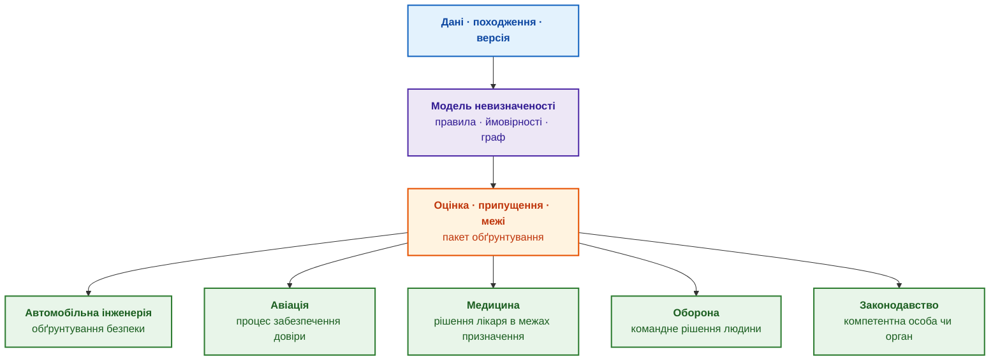

Синій блок є вхідними даними, фіолетовий блок є моделлю, помаранчевий блок є оцінкою разом із пакетом обґрунтування, зелені блоки є галузевими процедурами. Стрілки закінчуються не автоматичним рішенням, а процедурою з відповідальною людиною чи органом.

> [!NOTE]
> **Авторський принцип субординації обчислювальних методів**
> 1. Автором монографії сформульовано **Принцип субординації обчислювальних методів під егідою детермінованого ядра (Deterministic Core Subordination Principle) М. Федчика**: евристичні, стохастичні та векторні методи (LLM, RAG, Bayesian Networks, Fuzzy Logic) у критичних доменах виконують виключно дорадчу, пошукову та трансляційну функцію, підпорядковуючись детермінованому логічному та сертифікаційному ядру. Жодне ймовірнісне чи евристичне число не може скасувати або обійти формальний безпековий інваріант чи нормативне правило допуску. Математика однакова для всіх галузей, але право на остаточне рішення належить визначеній людині чи органу за наявності повного підтвердженого пакета доказів. Тому головною вимогою до експертної системи є доказовість висновку.

## 9. Доказовість як головна вимога до систем критичного призначення

Найважливіша зміна в експертних системах полягає не в тому, що експертні системи навчилися розмовляти природною мовою, а в переході від відповіді до пакета обґрунтування. Мовна модель може зробити поганий висновок дуже переконливим; експертна система має зробити навіть добрий висновок перевірним. Порівняймо дві відповіді на запитання про готовність випуску.

Слабка відповідь:

```text
Реліз виглядає готовим.
```

Сильна відповідь:

```text
Пакет випуску має 84 % покриття вимог тестами.
Три вимоги змінилися після базової версії B-17.
Два критичні дефекти закрито, але повторного запуску одного тесту немає.
Ризик R-12 прийнято, але погодження ще не підписане.
Висновок: готовність часткова, рішення про випуск потребує перегляду.
Джерела: вимоги, тести, дефекти, ризики, записи погоджень.
```

Різниця між відповідями не в стилі: другу відповідь можна перевірити по кожному рядку. Доказова експертна система повертає не лише висновок, а й джерела, версії, правила, припущення, рівень впевненості, прогалини, конфлікти, відповідального за перегляд і слід доведення. Навіть повноту пакета краще показати числом, а не прикметником «достатній»:

**Формально: інженерна метрика повноти доказового пакета.**
Потрібно бачити, які саме перевірки доказового пакета виконано. Для цього автором запропоновано частку виконаних пунктів наперед визначеного переліку. Перелік складають для конкретного рішення з застосовних вимог і політик; одна назва стандарту не задає універсального знаменника. Частка є показником комплектності, а не достатності всього обґрунтування безпеки.

У розрахунку використовуються такі параметри:

**Формула (4.42). Комплектність визначеного переліку перевірок.**

```math
C_{\mathrm{evidence}}=\frac{\lvert V \rvert}{\lvert R \rvert},\qquad \lvert R \rvert>0
```

- $R$ — непорожня скінченна множина конкретних обов'язкових пунктів перевірки з ідентифікаторами, версіями й критеріями завершення;
- $V \subseteq R$ — підмножина пунктів, для яких ці критерії виконано й підтверджено; наявність файла сама не завершує пункт;
- $`\lvert R \rvert`$ є додатним цілим числом, $`\lvert V \rvert`$ цілим від нуля до розміру $R$; вертикальні дужки означають кількість елементів;
- $`C_{\mathrm{evidence}} \in [0, 1]`$ — безрозмірна частка виконаних пунктів саме цього переліку.

**Практичне застосування та інженерні висновки:**
1. Розрахунок викликається автоматично контрольно-пропускним шлюзом (Release Gate) перед фінальним підписанням пакета постачання.
2. Нехай перевірено 4 типи артефактів із 5 обов'язкових: $`\lvert V \rvert = 4, \lvert R \rvert = 5 \implies C_{\mathrm{evidence}} = 0{,}80`$ (80 %).
3. Інженерний висновок експертної системи:
   - Метрика $`C_{\mathrm{evidence}}`$ не є ймовірністю успішної роботи і не допускає усереднення: навіть $`C_{\mathrm{evidence}} = 0{,}99`$ означає блокування випуску в режимі Fail-Closed, якщо відсутній критичний артефакт (наприклад, підпис офіцера функціональної безпеки).

> [!NOTE]
> **Авторські правила роботи з неповним доказовим пакетом**
> 1. **Перевірити перелік:** стовідсоткове виконання потрібне там, де кожний пункт обов'язковий, але не доводить повноти самого переліку або відсутності всіх ризиків.
> 2. **Назвати прогалину:** за невиконаного пункту не видавати позитивного результату цієї перевірки; показати потрібну дію відповідальній людині в межах її доступу. Це блокування допуску, не універсальна команда аварійно вимкнути фізичну систему.

Великі мовні моделі не є ворогами експертних систем: мовні моделі закривають давню слабкість експертних систем, тобто незручний інтерфейс і складну роботу з текстом. Мовна модель формулює запити людською мовою, пояснює правила різним ролям, готує чернетки й допомагає знайти схожі фрагменти. Але правило має бути явним, формула детермінованою, доказ має вести до джерела, а перегляд належати людині. Найсильніша сучасна архітектура є гібридною:

```text
мовна модель для мови й пошуку
+ правила для перевірок
+ граф знань для зв'язків
+ пошук для джерел
+ детерміновані ядра для чисел
+ модель впевненості для невизначеності
+ слід доведення для пояснення
+ людський перегляд для відповідальності
```

Розподіл ролей між мовною моделлю й символьним виведенням докладно описує [Глава 29](ch29-neuro-symbolic-architecture.md). Будь-якого «ШІ-порадника» можна швидко перевірити сімома запитаннями:

1. Чи показує інформаційна система джерело кожного суттєвого твердження?
2. Чи розрізняє інформаційна система факт, припущення, висновок і рекомендацію?
3. Чи має інформаційна система явні правила, чи всі правила сховано в інструкції до моделі?
4. Чи може інформаційна система сказати «даних недостатньо»?
5. Чи видно, яку версію знань, моделі, формули або набору правил використано?
6. Чи можна повторити результат через місяць?
7. Хто ухвалює остаточне рішення: програма чи людина?

Якщо відповіді нечіткі, перед вами, можливо, добрий асистент, але ще не доказова експертна система. Розгорнутий аудит із дванадцяти запитань наводить [Глава 2](ch02-epistemology-of-machine-knowledge.md).

Доказовість не додають наприкінці: пакет обґрунтування має з'являтися з кожним висновком. На практиці доказовість найчастіше ламається в чотирьох місцях, які описує наступний розділ.

> [!NOTE]
> **Авторська модель доказового пакета: чотири засади перевірки**
> 1. **Комплектність:** частка виконаних пунктів визначеного переліку не доводить повноти самого переліку або безпеки системи.
> 2. **Утримання від допуску:** невиконаний обов'язковий пункт не компенсується високим середнім балом; чернетку з прогалинами можна показати з явним статусом, не як готовий дозвіл.
> 3. **Нейро-символьна архітектурна композиція:** Поєднання евристичного мовного інтерфейсу (екстракція, пошук, вербалізація) із символьними предикатами (детерміновані правила, графи зв'язків, числові розрахункові ядра, сліди доведення та обов'язковий людський перегляд критичних рішень).
> 4. **Семифакторний верифікаційний аудит:** Обов'язкова перевірка доказової спроможності системи за сімома питаннями (джерела, розрізнення модальностей, явні правила, право на відмову, версіонування, відтворюваність, фіксація повноважень людини).
> *Інженерний інваріант:* Система зберігає причини прогалин і не видає неповний пакет за завершене обґрунтування; повноваження затвердження визначаються окремо.

## 10. Інженерні уроки історії експертних систем для сучасних NeSy-архітектур

Історичні методи добре описано в підручниках, але в щоденній практиці системи ШІ спотикаються в чотирьох місцях, про які підручники говорять рідко. Для уроків знадобляться кілька термінів. **Фрагмент** (*chunk*) є невеликим шматком документа, наприклад абзацом. **Індекс** є покажчиком, який підказує, у якому фрагменті є потрібні слова чи поняття. **Компонент пошуку** (*retriever*) дістає з індексу найвідповідніші фрагменти. **Вхідна інструкція** (*prompt*) є текстом, який отримує мовна модель: запитання користувача, знайдені фрагменти й правила відповіді. **Оцінка відповідності** (*relevance score*) є внутрішнім числом конкретного рушія пошуку, шкала якого залежить від алгоритму й не є ні ймовірністю, ні універсальним числом від 0 до 1.

### 10.1. Фільтрація вхідних даних: санітизація нормативного корпусу перед індексацією

Уявіть бібліотекаря, у якого зламався сканер: замість літер на сторінках з'являються випадкові знаки, але книжки все одно стають на полицю й потрапляють до каталогу. Читач побачить у каталозі джерело на потрібну тему, хоча прочитати джерело неможливо. Те саме трапляється з документами у форматі PDF (*Portable Document Format*): літери всередині PDF часто записано номерами гліфів, тобто зображень символів у вбудованому шрифті, і для перетворення номерів назад на текст потрібна таблиця відповідності. Якщо таблиці немає або таблиця пошкоджена, програма розбору витягує не текст, а послідовність кодів, схожу на двійковий шум. Для конвеєра обробки шум є звичайним рядком, який потрапляє в індекс, знаходиться на запит користувача, потрапляє до вхідної інструкції, і мовна модель ще й цитує таке «джерело».

**Формально: інженерна метрика придатності текстового фрагмента (Printable Ratio).**
Інженерна проблема виявлення пошкоджених артефактів на етапі завантаження знань (ETL Ingestion Gate): якщо пошкоджений файл зі зламаною таблицею гліфів потрапляє в базу, пошуковий компонент підсуне двійковий шум мовній моделі, спричинивши непередбачувану галюцинацію. Мета розрахунку — детермінована фільтрація фрагментів тексту $c$ за часткою друкованих символів $r(c) \in [0, 1]$ перед формуванням векторних ембедингів.

У розрахунку використовуються такі параметри:

**Формула (4.43). Частка друкованих символів.**

```math
r(c)=\frac{N_{\mathrm{print}}(c)}{N_{\mathrm{all}}(c)},\qquad N_{\mathrm{all}}(c)>0
```

- $c$ — екстрагований текстовий фрагмент документа;
- $`N_{\mathrm{all}}(c) \in \mathbb{N}^+`$ — загальна кількість символів у фрагменті;
- $`N_{\mathrm{print}}(c) \in \mathbb{N}`$ — кількість друкованих ASCII/Unicode символів (літери, цифри, пунктуація, стандартні пробіли);
- $r(c) \in [0, 1]$ — коефіцієнт якості тексту.

**Практичне застосування та інженерні висновки:**
1. Розрахунок викликається санітарним шлюзом конвеєра індексації для кожного згенерованого чанка.
2. Фрагмент допускається до індексування виключно за умови виконання нерівності $`r(c) \ge \tau_{\mathrm{print}}`$.
3. Для навчальної політики припустімо різні пороги залежно від типу артефакту; їхня придатність потребує перевірки на визначеному корпусі:
   - Для нормативних специфікацій та описових звітів: $`\tau_{\mathrm{print}} = 0{,}70`$;
   - Для вихідного коду, структур даних та таблиць телеметрії: $`\tau_{\mathrm{print}} = 0{,}50`$ (враховуючи велику кількість символів табуляції та службових роздільників).
4. Якщо частка нижча за поріг, фрагмент передається на перевірку способу видобування. Низький результат сам не доводить дефекту PDF, а високий не доводить читабельності: неправильні літери теж можуть бути друкованими. Оптичне розпізнавання є можливим наступним кроком, не універсальним виправленням.

**Числовий приклад розрахунку:**
Аналізується екстрагований текстовий фрагмент нормативного розділу ISO 26262 загальним обсягом $`N_{\mathrm{all}}(c) = 450`$ символів. Після вилучення недрукованих керуючих байтів підраховано $`N_{\mathrm{print}}(c) = 380`$ друкованих символів.
**Формула (4.44). Навчальний розрахунок придатності тексту.**

```math
r(c) = \frac{380}{450} \approx 0{,}844
```
Оскільки $`r(c) = 0{,}844 \ge \tau_{\mathrm{print}} = 0{,}70`$, шлюз допуску пропускає фрагмент на етап генерації ембедингів. Якби через бінарний збій парсингу кодування збереглося лише $`N_{\mathrm{print}}(c) = 280`$ символів ($`r(c) \approx 0{,}622 < 0{,}70`$), чанк було б заблоковано та скеровано в карантинний буфер `quarantine_doc_queue`.

### 10.2. Шлюз верифікації: семантичний фільтр між пошуковою видачею та генератором

Уявіть оператора кол-центру банку, якому архів видав п'ять папок, і жодна папка не стосується клієнта. Дисциплінований оператор скаже клієнтові, що документів не знайдено, а недисциплінований упевнено зачитає чужі папки, бо «папки ж є». Мовна модель поводиться як другий оператор: якщо до вхідної інструкції покласти будь-які знайдені фрагменти, мовна модель побудує впевнену відповідь навіть тоді, коли всі фрагменти непридатні. Компонент пошуку повертає фрагменти й тоді, коли всі фрагменти мають оцінку нижче порогу, підібраного для цього індексу, або складаються зі сміття з уроку 1, або належать іншому проєкту з тієї самої бази знань. Формально джерела є, а по суті джерел немає.

Один із потрібних механізмів є фільтром між пошуком і мовною моделлю. У прикладі він перевіряє оцінку, частку друкованих символів і позначення корпусу. Це попередній відбір, не повна перевірка доказу або прав доступу. Авторизація користувача має виконуватися до передавання закритого тексту на обробку, а джерело, редакція й застосовність перевіряються окремо. Коли кандидати не пройшли цей відбір, система повідомляє про відсутність придатних кандидатів у перевіреній вибірці, не про відсутність усіх можливих джерел.

<details>
<summary>Приклад мовою Go: фільтр придатних фрагментів</summary>

Програма є повною й запускається командою `go run main.go`. Функція `printableRatio` рахує частку друкованих символів з уроку 1, функція `admit` відбирає придатні фрагменти й пояснює кожне відхилення. Пороги 0,35 і 0,70 є ілюстративними.

```go
package main

import (
	"fmt"
    "math"
	"unicode"
    "unicode/utf8"
)

// Chunk є фрагментом документа, який повернув компонент пошуку.
type Chunk struct {
	ID     string
	Corpus string
	Score  float64 // нормована оцінка відповідності для цієї версії індексу
	Text   string
}

// printableRatio повертає частку друкованих символів у тексті фрагмента.
func printableRatio(s string) float64 {
    if !utf8.ValidString(s) {
        return 0
    }
	total, printable := 0, 0
	for _, r := range s {
		total++
        if unicode.IsPrint(r) || unicode.IsSpace(r) {
			printable++
		}
	}
	if total == 0 {
		return 0
	}
	return float64(printable) / float64(total)
}

// admit залишає лише придатні фрагменти й пояснює кожне відхилення.
func admit(chunks []Chunk, corpus string, minScore, minPrintable float64) []Chunk {
    if math.IsNaN(minScore) || math.IsNaN(minPrintable) ||
        minScore < 0 || minScore > 1 || minPrintable < 0 || minPrintable > 1 {
        fmt.Println("  відхилено: некоректні пороги фільтра")
        return nil
    }
	var ok []Chunk
	for _, c := range chunks {
		switch p := printableRatio(c.Text); {
        case c.Corpus != corpus:
            fmt.Printf("  %s: відхилено, чужий корпус %s\n", c.ID, c.Corpus)
        case math.IsNaN(c.Score) || math.IsInf(c.Score, 0) || c.Score < 0 || c.Score > 1:
            fmt.Printf("  %s: відхилено, некоректна оцінка\n", c.ID)
		case c.Score < minScore:
			fmt.Printf("  %s: відхилено, оцінка %.2f < %.2f\n", c.ID, c.Score, minScore)
		case p < minPrintable:
			fmt.Printf("  %s: відхилено, друкованих символів %.0f %%\n", c.ID, 100*p)
		default:
			ok = append(ok, c)
		}
	}
	return ok
}

func main() {
	found := []Chunk{
		{ID: "A-1", Corpus: "project-a", Score: 0.31, Text: "Вимога SR-42 обмежує час реакції 50 мс."},
		{ID: "A-2", Corpus: "project-a", Score: 0.62, Text: "\x02\x03\x1f\x07\x02\x03\x1f\x07 SR-42"},
		{ID: "B-7", Corpus: "project-b", Score: 0.74, Text: "Вимога SR-42 проєкту B: 80 мс."},
	}
	ok := admit(found, "project-a", 0.35, 0.70)
	if len(ok) == 0 {
		fmt.Println("до мовної моделі: «релевантні локальні джерела не знайдено»")
		return
	}
	for _, c := range ok {
		fmt.Println("до мовної моделі:", c.ID)
	}
}
```

Програма друкує:

```text
  A-1: відхилено, оцінка 0.31 < 0.35
  A-2: відхилено, друкованих символів 43 %
  B-7: відхилено, чужий корпус project-b
до мовної моделі: «релевантні локальні джерела не знайдено»
```

Кожен із трьох фрагментів відхилено з окремої причини: низька оцінка відповідності, сміття після розбору PDF і чужий корпус. Фрагмент A-2 має високу оцінку пошуку, але лише 6 друкованих символів із 14, тобто 43 %. Оскільки придатних фрагментів немає, мовна модель отримує явну примітку замість чужих чи пошкоджених джерел.

</details>

Відповідь «за наявними джерелами даних немає» менш ефектна, ніж упевнений абзац із псевдоцитатами, але не вводить користувача в оману.

### 10.3. Детермінована відтворюваність: фіксація знімків бази знань і хешів правил

Відтворюваність потрібна, коли через місяць треба пояснити рішення щодо прошивки з нашого прикладу. Для повтору потрібні та сама версія коду, ті самі результати тесту, конфігурація стенда й правило випуску. Оновлення правила може змінити відповідь обґрунтовано; непомічена зміна не дозволить установити причину. Для мовного тракту додатково фіксують модель, інструкцію, індекс і параметри запуску. Повтор детермінованого висновку й побайтовий повтор згенерованого пояснення є різними вимогами.

Рішення полягає в тому, щоб разом із кожною відповіддю зберігати паспорт повтору, тобто перелік версій та ідентифікаторів, від яких залежав результат:

**Таблиця 4.45. Паспорт версій для повтору результату.**

| Поле паспорта | Приклад | Що фіксує |
|---|---|---|
| Знімок корпусу | `snap-2026-06-02-a1b2c3` | стан бази знань у момент відповіді |
| Мовна модель | `local-8b@v1.4` | яка модель і яка версія моделі відповідала |
| Системна інструкція | `v3` | редакцію інструкції для моделі |
| Набір правил | `1.12` | які правила діяли |
| Формули | `SPFM 1.0` | версії детермінованих обчислень |
| Налаштування пошуку | `hash:9f0e…` | пороги, ваги й інші параметри пошуку |

Паспорт повтору відрізняє «експерт сказав» від «експертна система довела й може показати, як саме». Регресійне тестування конвеєра обробки запитів і випуск нових версій розглядає [Глава 19](ch19-from-question-to-evidence.md).

### 10.4. Багатовимірна оцінка невизначеності: відмова від єдиного псевдочисла

Приладова панель автомобіля не має однієї лампи «щось не так»: окремі стрілки показують пальне, температуру, тиск оливи й заряд акумулятора, і кожна стрілка підказує окрему дію. Інформаційні системи ШІ натомість часто показують одне число, наприклад «впевненість 0,62», і користувач не знає, що робити. Число 0,62 може означати щонайменше п'ять різних станів: знайдено мало джерел, джерела застаріли, джерела суперечать одне одному, бракує обов'язкового доказу, докази є, але слабкі. Кожен стан вимагає іншої дії.

Корисніший звіт називає тип кожного показника. Кількість виконаних перевірок може бути часткою, чинність редакції є окремою умовою, а нерозв'язаний конфлікт не потребує вигаданого балу 0,55:

**Таблиця 4.46. Типізовані стани замість довільних балів.**

| Складник | Стан у навчальному прикладі | Що потрібно встановити | Наступна дія |
|---|---:|---|---|
| Покриття | знайдено дані для 42 із 50 заданих пунктів | які вісім пунктів не підтверджено | перевірити відсутні підстави |
| Чинність | редакцію одного правила не підтверджено | яка версія діяла на дату випадку | звірити історію редакцій |
| Узгодженість | два звіти задають різний стан тесту | чи збігаються версії й час | розв'язати конкретний конфлікт |
| Комплектність | немає потрібного погодження | чи воно обов'язкове й хто його надає | отримати погодження або лишити блокер |
| Якість | метод перевірки одного висновку не вказано | чи підтримують дані цей висновок | провести предметний перегляд |

У першому рядку частка 42 із 50 дорівнює 84 %, але вона не замінює решти станів. Наприклад, відсутній обов'язковий підпис лишається блокером за будь-якого покриття. Причина перегляду тепер конкретна: невідома редакція, конфлікт звітів або пропущене погодження. Якщо показник справді є ймовірністю, його калібрування перевіряють на визначених випадках [[29]](#src-29), а не переносять вимоги до ймовірностей на всі числа інтерфейсу.

Принципи якості даних, відтворюваності й аудиту існували й у класичній інженерії знань, але мовні моделі, зовнішні моделі, що змінюються без попередження, векторні індекси й корпуси з десятків тисяч неоднорідних PDF збільшили масштаб ризиків. Без явної перевірки входу, версій і складників невизначеності експертна система перетворюється на переконливого, але непередбачуваного «оракула».

> [!NOTE]
> **Авторський чотирирівневий інженерний бар'єр надійності NeSy-архітектур М. М. Федчика (Чотири інженерні бар'єри)**
> 1. **Вхідна санітизація нормативного корпусу (ETL Ingestion Gate):** Автоматична фільтрація пошкоджених PDF-артефактів зі збитими таблицями гліфів за метрикою частки друкованих символів ($`r(c) = \frac{N_{\mathrm{print}}(c)}{N_{\mathrm{all}}(c)} \ge \tau_{\mathrm{print}}`$) з ізоляцією сміття в карантинну чергу `quarantine_doc_queue`.
> 2. **Шлюз верифікації пошукової видачі:** Детермінований фільтр між компонентом пошуку та мовною моделлю, що блокує нерелевантні фрагменти, відсікає чужі корпуси та генерує експліцитне повідомлення про відсутність даних замість провокування галюцинацій генератора.
> 3. **Паспорт детермінованої відтворюваності:** Обов'язкова фіксація повного кортежу стану системи (знімок корпусу, версія моделі, системна інструкція, хеш правил, версії формул, параметри пошуку) для відтворення детермінованої частини висновку під час ретроспективного аудиту; генеративний текст відтворюється лише за зафіксованих параметрів декодування і без гарантії побайтового збігу.
> 4. **Багатовимірний вектор невизначеності:** Повна відмова від скалярного псевдочисла «впевненості» на користь компонентного вектору $`\langle\text{Покриття}, \text{Свіжість}, \text{Узгодженість}, \text{Повнота}, \text{Якість}\rangle`$, де кожен індикатор однозначно визначає коригувальну інженерну дію.
> *Інженерний інваріант:* Невиконана потрібна перевірка блокує позитивний допуск відповідного результату й має явну причину. Реакція фізичної системи та спосіб ескалації визначаються її політикою ризику, не самим числом або назвою бар'єра.

## Висновки
Глава почалася із запитання, чи можна випускати версію після тесту, який то падає, то проходить. Історія методів відповідає: спершу визначити тип невизначеності, потім обрати метод, а висновок подати разом із пакетом обґрунтування. Глава показала:

- правила дають однозначний і відтворюваний висновок, але лише за повних і правильних фактів;
- теорема Байєса оновлює ймовірність, у прикладі з 5 % до приблизно 30 %, але дію визначає записана політика, а не модель;
- коефіцієнти впевненості, ступені належності й маси довіри вимірюють різні величини, і змішувати шкали в одне число не можна;
- графи знань, пошук і прецеденти забезпечують зв'язки, джерела й досвід, а зважене оцінювання й детерміновані ядра роблять вибір і числа прозорими;
- зими ШІ мали інженерні причини, і сучасна експертна система мусить закривати ті самі ризики: здобуття знань, крихкість, супровід, вартість інфраструктури.

Межі глави теж треба назвати. Глава не заміняє курсу теорії ймовірностей і не є оцінкою безпеки за стандартом: числа в прикладах навчальні, а цільові значення й формули в реальному проєкті беруть із чинних редакцій стандартів.

Майбутнє експертних систем гібридне: мовні моделі роблять знання доступнішими, а класичний математичний та інженерний апарат робить висновки перевірними. Інакше стара помилка повториться в новій обгортці: інформаційна система говорить красиво, але не може довести, чому їй варто вірити. Як експертна система, доказова рекомендація й корпоративна пам'ять поєднуються в одну модель довіри, пояснює [Глава 5](ch05-triad-of-trust-and-corporate-memory.md).

## Словник
**Таблиця 4.47. Основні поняття глави.**

| Український термін | Англійський відповідник | Коротке пояснення |
|---|---|---|
| Свідчення | *evidence* | Спостереження, документ чи вимірювання, яке підтримує або послаблює гіпотезу |
| Правило відокремлення | *modus ponens* | Правило логіки: з «якщо $A$, то $B$» і $A$ випливає $B$ |
| Принцип резолюції | *resolution principle* | Метод автоматичного доведення тверджень логіки першого порядку |
| Продукційне правило | *production rule* | Запис «якщо виконано умову, то зробити висновок або дію» |
| Пряме виведення | *forward chaining* | Виведення від фактів до висновків |
| Зворотне виведення | *backward chaining* | Виведення від цілі до фактів, які ціль підтверджують |
| Інженерія знань | *knowledge engineering* | Дисципліна перенесення знань експертів і документів у базу знань |
| Інженер знань | *knowledge engineer* | Фахівець, який опитує експертів і перетворює досвід експертів на правила |
| Вузьке місце здобуття знань | *knowledge acquisition bottleneck* | Обмеження, за якого ручне здобуття знань стає найповільнішою частиною розробки |
| Крихкість | *brittleness* | Хибні висновки експертної системи на випадках, яких не передбачили автори правил |
| Рушій бізнес-правил | *business rule engine* | Бібліотека, яка виконує правила, записані окремо від коду програми |
| Семантичний веб | *Semantic Web* | Набір стандартів W3C для подання знань графами: RDF, OWL, SPARQL |
| Апріорна ймовірність | *prior probability* | Ймовірність гіпотези до нового свідчення |
| Апостеріорна ймовірність | *posterior probability* | Ймовірність гіпотези після нового свідчення |
| Правдоподібність | *likelihood* | Ймовірність свідчення за умови гіпотези |
| Відношення правдоподібностей | *likelihood ratio* | Відношення правдоподібностей свідчення за гіпотези та за її заперечення |
| Шанси | *odds* | Відношення ймовірності події до ймовірності протилежної події |
| Умовна незалежність | *conditional independence* | Незалежність двох свідчень за відомого стану гіпотези |
| Коефіцієнт впевненості | *certainty factor* | Евристична оцінка підтримки гіпотези від $-1$ до 1, запроваджена в MYCIN |
| Нечітка множина | *fuzzy set* | Множина, належність до якої має ступінь від 0 до 1 |
| Функція належності | *membership function* | Функція, що задає ступінь належності значення до нечіткої множини |
| Маса довіри | *basic mass assignment* | Частка впевненості, призначена множині гіпотез у теорії Демпстера–Шафера |
| Довіра й правдоподібність | *belief, plausibility* | Нижня й верхня межі підтримки множини гіпотез |
| Маса конфлікту | *conflict mass* | Сума мас, які джерела призначили множинам, що не перетинаються |
| Семантична мережа | *semantic network* | Подання знань як понять, властивостей і зв'язків |
| Граф знань | *knowledge graph* | Граф, у якому вершини є об'єктами, а ребра типізованими зв'язками |
| Байєсівська мережа | *Bayesian network* | Спрямований ациклічний граф, що розкладає спільний розподіл на локальні множники |
| Векторне представлення | *embedding* | Числовий вектор, що кодує зміст фрагмента тексту |
| Косинусна подібність | *cosine similarity* | Косинус кута між двома векторами як міра їхньої близькості |
| Міркування за прецедентами | *case-based reasoning* | Розв'язання нової задачі за аналогією зі схожими минулими випадками |
| Зважене оцінювання | *weighted scoring* | Порівняння альтернатив за зваженою сумою нормованих критеріїв |
| Аналіз чутливості | *sensitivity analysis* | Перевірка, як зміна ваг чи вхідних даних змінює рекомендацію |
| Детерміноване обчислювальне ядро | *deterministic computation kernel* | Код, що рахує результат за версійною формулою й записує обчислення в аудит |
| Метрика одноточкових відмов | *single-point fault metric* | Частка відмов апаратури, пов'язаної з безпекою, що не є одноточковими чи залишковими |
| Пакет обґрунтування | *proof packet* | Висновок разом із фактами, правилами, джерелами з версіями й межами застосування |
| Покриття доказами | *evidence coverage* | Частка обов'язкових типів доказів, які знайдено й перевірено |
| Фрагмент | *chunk* | Невеликий шматок документа, який індексують і повертають як одиницю пошуку |
| Компонент пошуку | *retriever* | Компонент, що дістає з індексу найвідповідніші фрагменти |
| Вхідна інструкція | *prompt* | Текст, який отримує мовна модель: запитання, фрагменти й правила відповіді |
| Оцінка відповідності | *relevance score* | Внутрішнє число рушія пошуку для впорядкування фрагментів |
| Паспорт повтору | *replay record* | Перелік версій та ідентифікаторів, потрібних для повторення відповіді |
| Калібрування | *calibration* | Відповідність заявленої впевненості фактичній частці правильних висновків |

## Абревіатури
**Таблиця 4.48. Скорочення глави.**

| Скорочення | Розшифрування | Значення |
|---|---|---|
| ASIL | Automotive Safety Integrity Level | рівень повноти безпеки автомобільних систем |
| BM25 | Best Matching 25 | функція ранжування документів у пошуку |
| CBR | Case-Based Reasoning | міркування за прецедентами |
| CF | Certainty Factor | коефіцієнт впевненості |
| CLIPS | C Language Integrated Production System | мова й рушій продукційних правил |
| DEC | Digital Equipment Corporation | американський виробник комп'ютерів |
| ELI | European Legislation Identifier | європейський ідентифікатор законодавства |
| FAA | Federal Aviation Administration | Федеральне управління авіації США |
| FDA | Food and Drug Administration | Управління з контролю за харчовими продуктами й ліками США |
| FIT | Failures In Time | кількість відмов на мільярд годин роботи |
| FMEDA | Failure Modes, Effects and Diagnostic Analysis | аналіз видів, наслідків і діагностики відмов |
| ISO | International Organization for Standardization | Міжнародна організація зі стандартизації |
| JSP | Joint Service Publication | нормативна публікація Міністерства оборони Великої Британії |
| LISP | LISt Processing | мова програмування для обробки списків і символів |
| LLM | Large Language Model | велика мовна модель |
| MB, MD | Measure of Belief, Measure of Disbelief | міри підтримки й заперечення гіпотези в MYCIN |
| NASA | National Aeronautics and Space Administration | Національне управління з аеронавтики й дослідження космічного простору США |
| NATO | North Atlantic Treaty Organization | Організація Північноатлантичного договору |
| OPS | Official Production System | сімейство мов продукційних правил |
| OWL | Web Ontology Language | мова онтологій W3C |
| PDF | Portable Document Format | формат документів |
| PROLOG | PROgrammation en LOGique | мова логічного програмування |
| RAG | Retrieval-Augmented Generation | генерація з пошуком |
| RDF | Resource Description Framework | модель опису ресурсів трійками |
| SAE | SAE International, раніше Society of Automotive Engineers | міжнародна асоціація інженерів автомобільної галузі |
| SPARQL | SPARQL Protocol and RDF Query Language | мова запитів до графів RDF |
| SPFM | Single-Point Fault Metric | метрика одноточкових відмов |
| SRI | SRI International, раніше Stanford Research Institute | американський дослідницький інститут |
| TF-IDF | Term Frequency, Inverse Document Frequency | зважування слова за частотою в документі й рідкістю в корпусі |
| W3C | World Wide Web Consortium | Консорціум Всесвітньої павутини |
| XCON | eXpert CONfigurer | експертна система конфігурування комп'ютерів DEC, раніше R1 |
| ШІ | штучний інтелект | *artificial intelligence*, AI |

## Джерела
1. <a id="src-1"></a>J. L. Alty, M. J. Coombs. [*Expert Systems: Concepts and Examples*](https://openlibrary.org/works/OL24825917W). Manchester: NCC Publications, 1984. ISBN 0-85012-399-2.
2. <a id="src-2"></a>Stuart Russell, Peter Norvig. [*Artificial Intelligence: A Modern Approach*](https://aima.cs.berkeley.edu/). 4-те видання. Pearson, 2020. Розділ 1.3: історія ШІ, промисловий бум і «зима ШІ».
3. <a id="src-3"></a>Edward A. Feigenbaum. [*The Art of Artificial Intelligence: Themes and Case Studies of Knowledge Engineering*](https://doi.org/10.21236/ADA046289). Stanford University, 1977; також *Proceedings of the 5th International Joint Conference on Artificial Intelligence (IJCAI-77)*.
4. <a id="src-4"></a>Robert K. Lindsay, Bruce G. Buchanan, Edward A. Feigenbaum, Joshua Lederberg. [*DENDRAL: A Case Study of the First Expert System for Scientific Hypothesis Formation*](https://doi.org/10.1016/0004-3702(93)90068-M). *Artificial Intelligence*, 61(2), 209–261, 1993.
5. <a id="src-5"></a>Edward H. Shortliffe та ін. [*Computer-Based Consultations in Clinical Therapeutics: Explanation and Rule Acquisition Capabilities of the MYCIN System*](https://doi.org/10.1016/0010-4809(75)90009-9). *Computers and Biomedical Research*, 8(4), 303–320, 1975.
6. <a id="src-6"></a>Edward H. Shortliffe, Bruce G. Buchanan. [*A Model of Inexact Reasoning in Medicine*](https://doi.org/10.1016/0025-5564(75)90047-4). *Mathematical Biosciences*, 23(3–4), 351–379, 1975.
7. <a id="src-7"></a>A. N. Campbell, V. F. Hollister, R. O. Duda, P. E. Hart. [*Recognition of a Hidden Mineral Deposit by an Artificial Intelligence Program*](https://doi.org/10.1126/science.217.4563.927). *Science*, 217(4563), 927–929, 1982.
8. <a id="src-8"></a>John McDermott. [*R1: A Rule-Based Configurer of Computer Systems*](https://doi.org/10.1016/0004-3702(82)90021-2). *Artificial Intelligence*, 19(1), 39–88, 1982.
9. <a id="src-9"></a>Douglas B. Lenat, Mayank Prakash, Mary Shepherd. [*CYC: Using Common Sense Knowledge to Overcome Brittleness and Knowledge Acquisition Bottlenecks*](https://ojs.aaai.org/aimagazine/index.php/aimagazine/article/view/510). *AI Magazine*, 6(4), 65–85, 1985.
10. <a id="src-10"></a>W3C. [*RDF 1.1 Concepts and Abstract Syntax*](https://www.w3.org/TR/rdf11-concepts/). W3C Recommendation, 2014.
11. <a id="src-11"></a>John Alan Robinson. [*A Machine-Oriented Logic Based on the Resolution Principle*](https://doi.org/10.1145/321250.321253). *Journal of the ACM*, 12(1), 23–41, 1965.
12. <a id="src-12"></a>ISO, SAE International. [*ISO/SAE 21434:2021. Road vehicles: Cybersecurity engineering*](https://www.iso.org/standard/70918.html). 2021.
13. <a id="src-13"></a>Thomas Bayes, Richard Price. [*An Essay towards Solving a Problem in the Doctrine of Chances*](https://doi.org/10.1098/rstl.1763.0053). *Philosophical Transactions of the Royal Society of London*, 53, 370–418, 1763. Сучасний запис теореми використовує пізнішу нотацію.
14. <a id="src-14"></a>Lotfi A. Zadeh. [*Fuzzy Sets*](https://doi.org/10.1016/S0019-9958(65)90241-X). *Information and Control*, 8(3), 338–353, 1965.
15. <a id="src-15"></a>A. P. Dempster. [*Upper and Lower Probabilities Induced by a Multivalued Mapping*](https://doi.org/10.1214/aoms/1177698950). *The Annals of Mathematical Statistics*, 38(2), 325–339, 1967.
16. <a id="src-16"></a>Glenn Shafer. [*A Mathematical Theory of Evidence*](https://doi.org/10.1515/9780691214696). Princeton University Press, 1976.
17. <a id="src-17"></a>Judea Pearl. [*Probabilistic Reasoning in Intelligent Systems: Networks of Plausible Inference*](https://doi.org/10.1016/C2009-0-27609-4). San Mateo: Morgan Kaufmann, 1988.
18. <a id="src-18"></a>Gerard Salton, Christopher Buckley. [*Term-Weighting Approaches in Automatic Text Retrieval*](https://doi.org/10.1016/0306-4573(88)90021-0). *Information Processing & Management*, 24(5), 513–523, 1988.
19. <a id="src-19"></a>Stephen Robertson, Hugo Zaragoza. [*The Probabilistic Relevance Framework: BM25 and Beyond*](https://doi.org/10.1561/1500000019). *Foundations and Trends in Information Retrieval*, 2009.
20. <a id="src-20"></a>Patrick Lewis, Ethan Perez, Aleksandra Piktus та ін. [*Retrieval-Augmented Generation for Knowledge-Intensive NLP Tasks*](https://arxiv.org/abs/2005.11401). *Advances in Neural Information Processing Systems 33* (NeurIPS), 2020.
21. <a id="src-21"></a>Agnar Aamodt, Enric Plaza. [*Case-Based Reasoning: Foundational Issues, Methodological Variations, and System Approaches*](https://doi.org/10.3233/AIC-1994-7104). *AI Communications*, 7(1), 39–59, 1994.
22. <a id="src-22"></a>ISO. [*ISO 26262-5:2018. Road vehicles: Functional safety. Part 5: Product development at the hardware level*](https://www.iso.org/standard/68387.html). 2-ге видання, 2018. Частина серії ISO 26262 про функціональну безпеку дорожніх транспортних засобів.
23. <a id="src-23"></a>FAA. [*Roadmap for Artificial Intelligence Safety Assurance, Version I*](https://www.faa.gov/aircraft/air_cert/step/roadmap_for_AI_safety_assurance). Federal Aviation Administration, 2024.
24. <a id="src-24"></a>FDA. [*Clinical Decision Support Software: Guidance for Industry and Food and Drug Administration Staff*](https://www.fda.gov/regulatory-information/search-fda-guidance-documents/clinical-decision-support-software). Остаточна редакція, січень 2026 року.
25. <a id="src-25"></a>NATO. [*Summary of NATO's Revised Artificial Intelligence (AI) Strategy*](https://www.nato.int/en/about-us/official-texts-and-resources/official-texts/2024/07/10/summary-of-natos-revised-artificial-intelligence-ai-strategy). 10 липня 2024 року.
26. <a id="src-26"></a>UK Ministry of Defence. [*JSP 936: Dependable Artificial Intelligence (AI) in Defence, Part 1: Directive*](https://www.gov.uk/government/publications/jsp-936-dependable-artificial-intelligence-ai-in-defence-part-1-directive). 13 листопада 2024 року.
27. <a id="src-27"></a>Publications Office of the European Union. [*European Legislation Identifier (ELI)*](https://op.europa.eu/en/web/eu-vocabularies/eli).
28. <a id="src-28"></a>OASIS. [*LegalRuleML Core Specification Version 1.0*](https://docs.oasis-open.org/legalruleml/legalruleml-core-spec/v1.0/os/legalruleml-core-spec-v1.0-os.html). OASIS Standard, 2021.
29. <a id="src-29"></a>Chuan Guo, Geoff Pleiss, Yu Sun, Kilian Q. Weinberger. [*On Calibration of Modern Neural Networks*](https://proceedings.mlr.press/v70/guo17a.html). *Proceedings of the 34th International Conference on Machine Learning*, PMLR 70, 1321–1330, 2017.
30. <a id="src-30"></a>Charles L. Forgy. [*Rete: A Fast Algorithm for the Many Pattern/Many Object Pattern Match Problem*](https://doi.org/10.1016/0004-3702(82)90020-0). *Artificial Intelligence*, 19(1), 17–37, 1982.
31. <a id="src-31"></a>M. Ross Quillian. [*Semantic Memory*](https://openlibrary.org/books/OL5615707M). In Marvin Minsky (Ed.), *Semantic Information Processing*, MIT Press, Cambridge, MA, 227–270, 1968.
32. <a id="src-32"></a>Allen Newell, Herbert A. Simon. [*GPS, A Program That Simulates Human Thought*](https://doi.org/10.1007/978-3-642-49877-0_8). In *Lernende Automaten*, R. Oldenbourg, München, 109–124, 1961.
33. <a id="src-33"></a>IEC. [*IEC 61508: Functional Safety of Electrical/Electronic/Programmable Electronic Safety-related Systems*](https://www.iec.ch/functional-safety). International Electrotechnical Commission, 2010.
34. <a id="src-34"></a>RTCA. [*DO-178C: Software Considerations in Airborne Systems and Equipment Certification*](https://www.rtca.org/). Radio Technical Commission for Aeronautics, 2011.
35. <a id="src-35"></a>Richard S. Sutton. [*The Bitter Lesson*](http://www.incompleteideas.net/IncIdeas/BitterLesson.html). Incomplete Ideas (Blog), March 13, 2019.
36. <a id="src-36"></a>Stevan Harnad. [*The Symbol Grounding Problem*](https://doi.org/10.1016/0167-2789(90)90087-6). *Physica D: Nonlinear Phenomena*, 42(1–3), 335–346, 1990.
37. <a id="src-37"></a>Gordon E. Moore. [*Cramming more components onto integrated circuits*](https://doi.org/10.1109/JPROC.1998.658762). *Electronics*, 38(8), 114–117, 1965 (перевид. у *Proceedings of the IEEE*, 86(1), 82–85, 1998).
38. <a id="src-38"></a>Stephen A. Cook. [*The complexity of theorem-proving procedures*](https://doi.org/10.1145/800157.805047). *Proceedings of the 3rd Annual ACM Symposium on Theory of Computing (STOC)*, 151–158, 1971.
39. <a id="src-39"></a>Ashish Vaswani, Noam Shazeer, Niki Parmar та ін. [*Attention Is All You Need*](https://arxiv.org/abs/1706.03762). *Advances in Neural Information Processing Systems 30 (NeurIPS)*, 2017.
40. <a id="src-40"></a>Sanjay Modgil, Henry Prakken. [*A general account of argumentation with preferences*](https://doi.org/10.1016/j.artint.2012.10.002). *Artificial Intelligence*, 195, 361–397, 2013.

---

[← Глава 3](ch03-beyond-reference-information-systems.md) | [Зміст книги](README.md) | [Частина I](part-01-foundations.md) | [Глава 5 →](ch05-triad-of-trust-and-corporate-memory.md)
