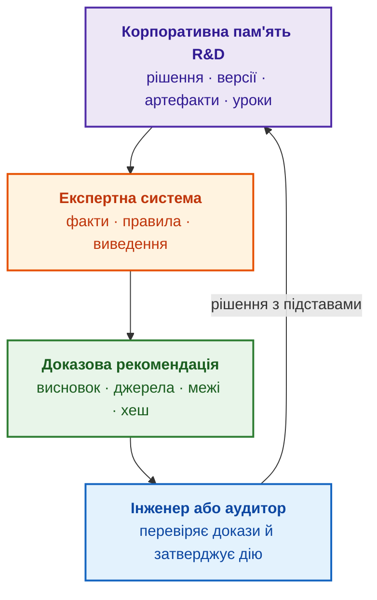
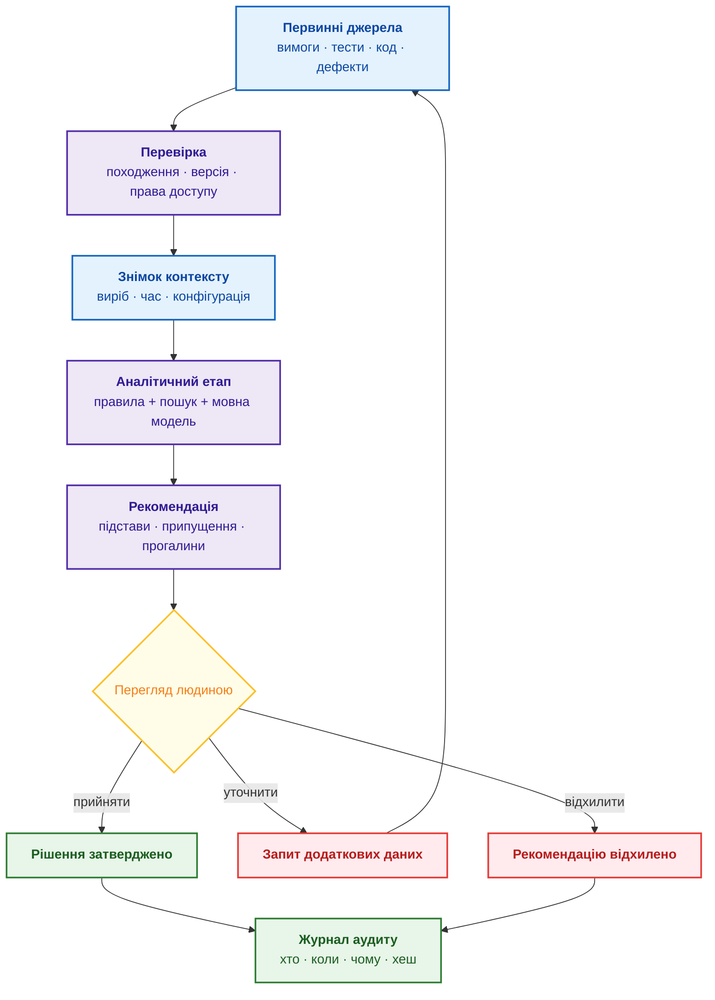
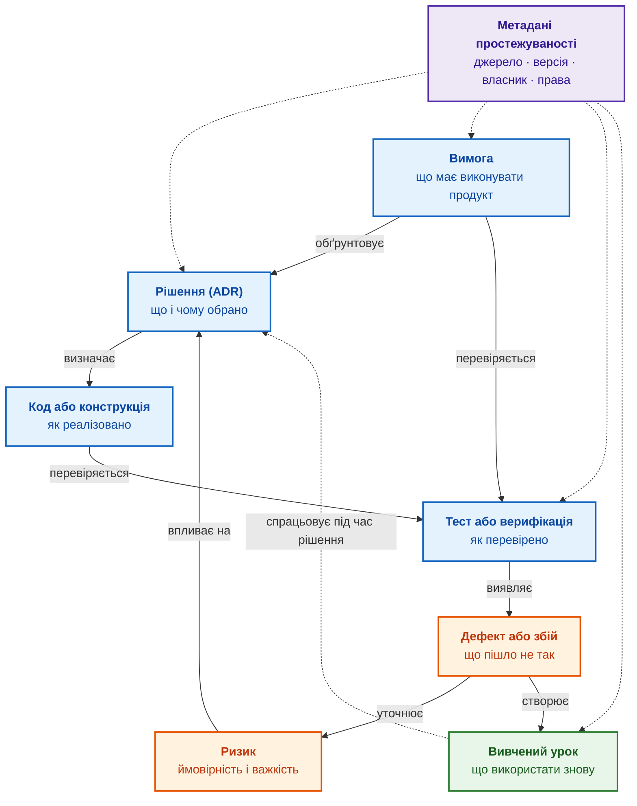
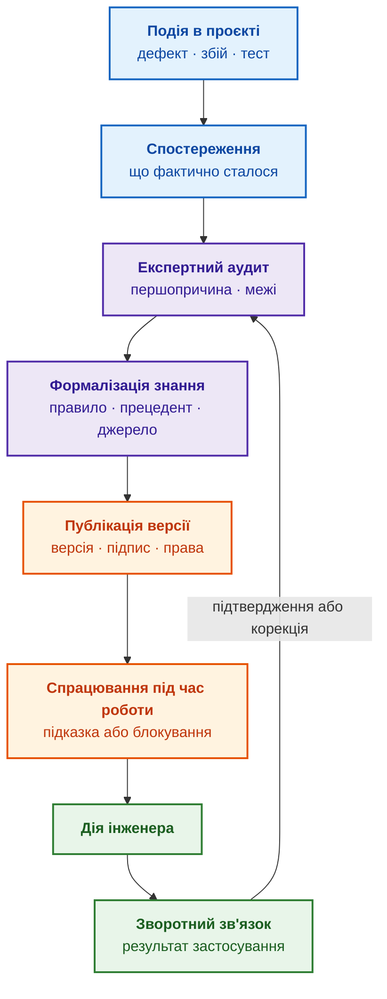
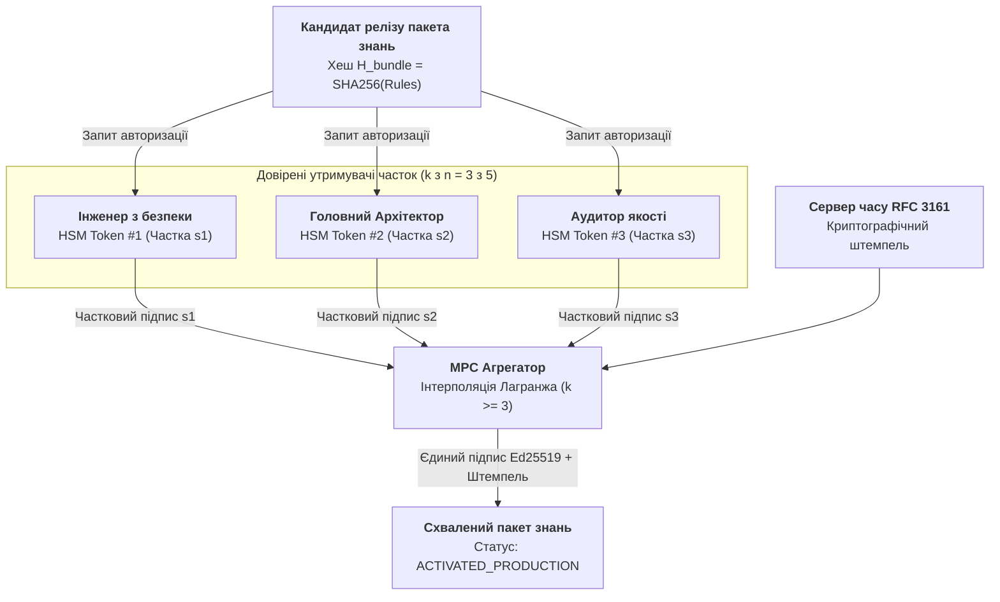

# Глава 5. Тріада довіри: експертна система, доказова рекомендація та корпоративна пам'ять

> **Книга:** [Архітектура доказових експертних систем](README.md) · [Частина I: Концептуальні та епістемологічні основи](part-01-foundations.md)
> **Попередня глава:** [Глава 4. Еволюція експертних систем: від теореми Байєса до доказових рішень ШІ](ch04-evolution-from-bayes-to-evidence-ai.md)
> **Наступна глава:** [Глава 6. Прикладна математика експертних систем: правила, ймовірності, графи та причинність](ch06-applied-mathematics-for-expert-systems.md)
> **Зміст книги:** [README.md](README.md)
> **Автор:** [Микола Федчик](about-the-author.md)
> **Рівень складності та оптимальне вивчення:** `[L1]` Базовий інженерно-концептуальний (індекс Д. Кнута `[16]`) · *Маршрут:* Експрес-маршрут та треки `A/C` (оцінка $TCO$ і корпоративної пам'яті); 1 прохід  
> **Очікувані результати:** пояснити, як експертна система, доказова рекомендація й корпоративна пам'ять підтримують одна одну; скласти мінімальний доказовий запис для рекомендації штучного інтелекту (ШІ) і перелік полів журналу аудиту; відрізнити сховище документів від пам'яті інженерних рішень і прецедентів; оцінити зрілість корпоративної пам'яті за адаптацією нових інженерів і повторенням відомих помилок.

## Анотація

У главі досліджено концептуальну тріаду довіри до систем штучного інтелекту в критичній інженерії, що об'єднує символьну експертну систему, доказову рекомендацію та корпоративну пам'ять досліджень і розробки (R&D). Здійснено демаркацію функцій генеративних мовних моделей (як семантичного інтерфейсу та інструменту первинної обробки тексту) і детермінованих рушіїв логічного виведення. Визначено структуру мінімального доказового запису рекомендації, специфікацію криптографічного журналу аудиту (audit trail) відповідно до стандартів ISO 26262, ISO/SAE 21434 та моделі W3C PROV-O, а також механізм нерозривної криптографічної кустодії доказів із побайтовим заземленням нормативних фактів ($`\mathcal{G}`$). Запропоновано протокол порогової багатосторонньої авторизації ($k$-of-$n$) змін бази знань на базі апаратних модулів безпеки (HSM) та часових міток RFC 3161 для захисту від внутрішніх загроз (Insider Threat). Обґрунтовано методологію перетворення пасивної документації на активний реляційний граф корпоративної пам'яті за моделлю SECI, наведено кількісні метрики вимірювання інженерної зрілості процесів передавання знань і підсумовано концептуальні засади Частини I монографії.

Досвідчений інженер перейшов до іншої команди. Новачок бачить у коді вимкнений режим зв'язку й запитує: «Чому режим не використовують?» Пошукова система повертає десяток документів зі словом «режим». Чат-бот над документацією відповідає: «Через нестабільність зв'язку». Але хто вирішив вимкнути режим, для якої версії продукту, після якого тесту й чи досі рішення чинне, залишається невідомим. У новачка лишаються два погані варіанти, які Майкл Найгард описав ще 2011 року: сліпо прийняти старе рішення або сліпо змінити рішення, не знаючи причин і наслідків [[1]](#src-1).

Приклад поєднує три різні потреби, і глава розглядає кожну потребу як кут одного трикутника довіри. **Експертна система** застосовує перевірені знання до конкретного запитання. **Доказова рекомендація** (*evidence-based recommendation*) показує джерела, припущення й межі висновку, тому уповноважена людина може рекомендацію перевірити, прийняти або відхилити. **Корпоративна пам'ять** (*corporate memory*) досліджень і розробки (*Research and Development*, R&D) зберігає не лише файл, а й причину рішення, версію, наслідки та відповідального. Мета глави: показати, чому жоден кут не працює без двох інших, який мінімальний запис робить рекомендацію ШІ придатною до аудиту і як виміряти, чи організація справді пам'ятає власні рішення. Глава завершує Частину I, тому наприкінці підсумовано частину й показано, куди книга рухається далі.

## 1. Пам'ять інженерних рішень: від неструктурованого тексту до версійного прецеденту

Формування корпоративної пам'яті як базису експертної системи вимагає переходу від неструктурованих текстових архівів до суворо формалізованих і версіонованих інженерних прецедентів. Для новачка з прикладу пам'ять має повернути не випадковий абзац про нестабільність, а структурований запис архітектурного рішення. У навчальному записі команда вимкнула режим для версії 2.1 після проваленого тесту; команда також записала відкинуту альтернативу й умову перегляду.

| Поле | Навчальний зміст |
|---|---|
| рішення й область | `ADR-7`: вимкнути режим лише для версії 2.1 |
| підстави | `RUN-88`: збій у заданій конфігурації; посилання на вимогу й звіт |
| відкинута альтернатива | збільшення числа повторів не прибрало спостережений збій |
| відповідальність | рішення схвалив власник компонента; строк перегляду задано окремо |
| умова перегляду | нова реалізація або застосовний успішний тест породжують кандидата на перегляд |

Експертна система може перевірити, чи нова зміна порушує ще чинне рішення, і показати підстави обмеження. Автором сформульовано *інженерний інваріант неможливості безумовної генералізації локального прецеденту М. Федчика*: експертна система не має права екстраполювати обмеження чи дефекти, зафіксовані для локального прецеденту конкретної версії ($v = 2.1$), на наступні ревізії системи або перетворювати локальне історичне фіаско на безумовне глобальне правило виведення без автоматичного виявлення верифікованого контрприкладу в новому контексті.

Відповідно до запропонованого автором *Попперівського критерію якості корпоративної пам'яті М. Федчика*, зрілість та епістемічна якість бази знань визначається не валовим обсягом заархівованих текстових документів, а оперативною алгоритмічною здатністю системи детерміновано відтворити причинно-наслідковий ланцюг ухвалення рішення та знайти релевантний фальсифікуючий контрприклад у просторі інженерних артефактів. Це практичний зміст тріади, яку далі розглянуто докладніше.

## 2. Тріада довіри: концептуальна синергія експертної системи, доказу та пам'яті

Три поняття з назви глави часто плутають. Через плутанину команда очікує, що чат-бот над документацією одночасно стане пам'яттю організації, перевірником процесів і системою підтримки рішень. Коли ж рішенню потрібні підстави, інженери перевіряють кожну відповідь чат-бота вручну, і вигода від ШІ зникає.

Кути трикутника взаємозалежні. Цю залежність формалізовано як *принцип топологічної неподільності Тріади довіри М. Федчика*: жоден із компонентів Тріади довіри не спроможний забезпечити детерміновану довіру ізольовано: експертна система без пам'яті деградує на застарілих знаннях; рекомендація без простежуваного доказового запису позбавлена верифікованості; а пам'ять без замикання на затверджене людиною рішення позбавлена механізму збагачення та верифікації актуальності. Розрив будь-якого ребра трикутника призводить до колапсу доказовості. Схема показує, як три кути з'єднані з людиною, яка ухвалює рішення.



Фіолетовий блок позначає корпоративну пам'ять, помаранчевий експертну систему, зелений доказову рекомендацію, синій людину. Хеш у зеленому блоці є контрольним значенням вмісту рекомендації: за хешем видно будь-яку зміну запису після перевірки, а механізм хешу на прикладі звіту тесту пояснює [Глава 1](ch01-introduction-to-expert-systems.md). Коло замикається на людині: затверджене рішення разом із підставами повертається до пам'яті й стає знанням для наступного випадку. Якщо розірвати будь-яку стрілку, трикутник втрачає цінність. Без пам'яті експертна система працює на застарілих знаннях, без доказового запису рекомендацію неможливо перевірити, а без повернення рішення пам'ять не дізнається, чим закінчився випадок.

Для подальшого читання знадобляться п'ять понять:

| Термін | Просте пояснення |
|---|---|
| Велика мовна модель (*Large Language Model*, LLM) | програма, яка опрацьовує й створює текст; мовна модель може бути частиною експертної системи, але не замінює експертної системи |
| Первинний доказ (*primary evidence*) | безпосередній результат вимірювання чи тесту, затверджена вимога або інший запис із відомим походженням |
| Похідний аналітичний запис (*derived analytical record*) | висновок, створений на основі первинних доказів; похідний запис можна перевірити, але похідний запис не замінює джерел |
| Простежуваність (*traceability*) | можливість пройти від висновку до правил, фактів, версій і первинних джерел |
| Система підтримки рішень (*decision support system*) | інформаційна система, яка допомагає людині ухвалити рішення, але не ухвалює рішення замість людини |

Жоден кут трикутника не працює окремо: довіра виникає з руху по всьому колу, від пам'яті до рішення й назад. Далі глава розглядає кути по черзі й починає з найчастішої плутанини, між експертною системою й чат-ботом.

> [!NOTE]
> **Авторська концептуальна модель Тріади довіри М. М. Федчика (Чотири складові периметра довіри)**
> 1. **Корпоративна пам'ять R&D:** Зберігає незмінні артефакти, структуровані записи рішень (ADR), дефекти, версії та вивчені уроки із зазначенням контексту й меж чинності.
> 2. **Символьна експертна система:** Застосовує детерміновані правила виведення та графи зв'язків до робочої пам'яті поточного прецеденту, виявляючи нормативні суперечності.
> 3. **Доказова рекомендація (*Evidence-Based Recommendation*):** Формує типізований пакет обґрунтування із зазначенням першоджерел, припущень, рівня впевненості та криптографічного хешу для перевірки цілісності.
> 4. **Замкнений цикл людського затвердження (*Closed-Loop Human-in-the-Loop*):** Уповноважений інженер верифікує підстави, ухвалює рішення й повертає його разом із прецедентним контекстом у корпоративну пам'ять для збагачення бази знань.
> *Керування рантаймом / Інженерний інваріант:* Довіра до рекомендації виникає виключно за умови проходження замкненого циклу через усі чотири компоненти; розрив будь-якого ребра трикутника автоматично анулює доказовий статус висновку.

## 3. Перший компонент тріади: демаркація експертної системи та генеративного чат-бота

Після кількох років захоплення великими мовними моделями багато команд опинилися в однаковій ситуації: чат-бот під'єднано до документації, відповіді звучать переконливо, а довіри для інженерних рішень немає. Демонстрація вражає, але щойно рішенню потрібні підстави, інженери перевіряють усе вручну. Причина не в мовній моделі, а в очікуванні, що мовна модель сама виконає три різні завдання: пам'ятатиме, перевірятиме й підтримуватиме рішення. Розділ розподіляє ці завдання між мовною моделлю й експертною системою.

### 3.1. Функціональні можливості та лінгвістичні межі великих мовних моделей

Сила великої мовної моделі полягає в роботі з мовою. Мовна модель підсумовує різнорідні документи, пояснює складне відповідно до підготовки читача, готує чернетки, виявляє двозначності й знаходить схожі за змістом фрагменти. У проєктній роботі такі вміння справді економлять час.

Корисність залежить від типу моделі. Розмовна модель слугує інтерфейсом і редактором. Модель для коду допомагає з попереднім оглядом реалізації. Модель векторних представлень (*embedding model*) перетворює текст на числові вектори й тому знаходить схожі документи, дефекти чи уроки, навіть коли слова не збігаються. Класифікаційна модель розподіляє документи за типами або рівнями чутливості. Локальна модель, яка працює на серверах організації, потрібна там, де дані не можна передавати назовні.

В експертній системі мовна модель найкорисніша не як «мозок, що все вирішує», а як мовний шар навколо контрольованого міркування. Мовна модель перетворює запит людини на структуроване запитання до бази знань, виділяє з тексту можливі факти, пояснює результат правила й готує чернетку обґрунтування. Остаточні підстави залишаються в правилах, джерелах, версіях і рішенні людини.

### 3.2. Детерміновані переваги символьної експертної системи

Будову експертної системи описала [Глава 1](ch01-introduction-to-expert-systems.md). База знань (*knowledge base*) зберігає правила, факти, обмеження й приклади предметної області. Робоча пам'ять (*working memory*) зберігає факти поточного випадку, наприклад версію виробу, результати тесту й відкриті дефекти. Машина виведення (*inference engine*) застосовує знання до випадку. Механізм пояснень (*explanation facility*) показує, які правила спрацювали, які факти використано й чого бракує. Система здобуття знань (*knowledge acquisition system*) додає, перевіряє й оновлює знання в базі знань. Чим експертний висновок відрізняється від довідки, пояснила [Глава 3](ch03-beyond-reference-information-systems.md), а архітектуру компонентів докладно розглядає [Глава 16](ch16-expert-systems-architecture.md).

Для тріади важлива одна відмінність. Чат-бот повертає відповідь у тому форматі, у якому отримав запит. Експертна система показує ланцюжок міркування: конкретні правила, факти й обмеження. Чат-бот є інтерфейсом, а підтримка рішень є призначенням. Експертна система в дорадчому режимі є формалізованим видом системи підтримки рішень, але не кожна система підтримки рішень має правила виведення й доказовий слід.

Різниця стає вирішальною там, де рішення залишають довгий слід: у функціональній безпеці, кібербезпеці й відповідності вимогам. Слід складається з обґрунтування безпеки, журналу аудиту, сертифікаційних доказів і договірних зобов'язань. У монографії цей фундаментальний зв'язок формалізовано як *закон збереження детермінізму в критичних ланцюгах рішень М. Федчика*: у сертифікаційних та безпекових доменах аудиторська сила інженерного рішення визначається детермінізмом його доказового сліду; будь-який недетермінований ймовірнісний висновок генеративного ШІ без посилання на формальні правила та незмінні артефакти є непідтвердженою евристичною гіпотезою з нульовою юридичною валідністю.

### 3.3. Розподіл архітектурних ролей та ієрархія корпоративних знань

Якщо мовна модель і експертна частина виконують ті самі завдання, помилка мовної моделі непомітно стає «висновком». Тому ролі треба розділити явно. Автором запропоновано *принцип архітектурної демаркації мовного інтерфейсу та детермінованого ядра М. Федчика* (*LLM-as-Linguistic-Layer Principle*): у доказовій архітектурі мовна модель функціонує виключно як семантичний та лінгвістичний інтерфейс (трансляція природномовного запиту у формальний синтаксис, виділення сутностей, лексична нормалізація та попередній огляд), тоді як детерміноване символьне ядро (машина виведення, база знань і верифікатор правил) виконує формальну верифікацію та логічний висновок. Мовна модель не вдає експерта, а експертна система не вдає співрозмовника. Цей поділ закріплює **тристоронній розподіл епістемічних повноважень**: (1) людина — профільний експерт предметної області затверджує специфікації та правила під час їх внесення до базової версії бази знань (*baseline knowledge base*); (2) детермінований рантайм-верифікатор допускає відповідь на конкретний запит виключно на основі перевірених доказів; (3) мовна модель не має жодного з цих двох повноважень.

Знання предметної області структуруються відповідно до запропонованої автором *трирівневої таксономії ієрархії знань R&D М. Федчика*:
1. **Рівень організації (*Enterprise Tier*):** Загальні корпоративні політики якості, функціональної безпеки та класифікації даних (найвищий нормативний пріоритет, глобальна дія).
2. **Рівень підрозділу (*Division Tier*):** Інженерні стандарти розробки, архітектурні шаблони та протоколи тестування.
3. **Рівень проєкту (*Project Tier*):** Локальні параметри, проєктні винятки, ADR та конфігурації компонентів.

*Інженерний інваріант пріоритету:* Проєктний виняток має право послаблювати правило підрозділу лише в межах заданого продукту та ревізії, але позбавлений права скасовувати інваріанти організаційного рівня безпеки.

Експертна система без знань є порожнім рушієм виведення. В основу керування базою покладено *інваріант життєвого циклу знань та інституту кураторства М. Федчика*: база знань безперервно верифікується за п'ятиетапним циклом (додавання $\to$ формальна верифікація $\to$ затвердження $\to$ версіонування $\to$ вилучення застарілого); кожна група правил зобов'язана мати персонального власника знань (*Knowledge Owner*), без якого правила автоматично переводяться в карантинний статус неактивних знань (*quarantined*). Як експертна система навчається через нові версії бази знань, розповідають [Глава 25](ch25-how-expert-systems-learn.md) і [Глава 26](ch26-continual-learning.md).

### 3.4. Інженерні метрики якості та процедури верифікації (TEVV)

Якість експертної системи не вимірюють природністю розмови. Автором розроблено *п'ятивекторну метричну модель якості експертної системи за TEVV М. Федчика*, яка формалізує оцінку кортежем вимірюваних параметрів:

```math
\mathbf{Q}_{\mathrm{ES}} = \langle M_{\mathrm{correctness}}, \ M_{\mathrm{completeness}}, \ M_{\mathrm{explainability}}, \ M_{\mathrm{maintainability}}, \ M_{\mathrm{accountability}} \rangle
```

де складові вектора визначають:
- $`M_{\mathrm{correctness}}`$ — правильність: правила застосовуються стабільно й на тих самих фактах дають той самий висновок;
- $`M_{\mathrm{completeness}}`$ — повнота: експертна система детектує відсутні обов'язкові відомості;
- $`M_{\mathrm{explainability}}`$ — пояснюваність: користувач бачить факти, правила, припущення й прогалини;
- $`M_{\mathrm{maintainability}}`$ — супроводжуваність: правило можна оновити, перевірити тестами й відтворити за номером версії;
- $`M_{\mathrm{accountability}}`$ — відповідальність: кожна група правил має призначеного власника знань.

Згідно з виведеним автором *правилом скептичної відмови за неповноти даних М. Федчика* (*Skeptical Refusal Rule*), експертна система зобов'язана віддавати пріоритет обґрунтованій зупинці та запиту додаткових даних перед спробою генерації правдоподібної відповіді: частка коректних відмов за браку інформації є прямою метрикою безпеки системи ($`R_{\mathrm{refusal}} \to \max`$ при дефіциті первинних фактів у захисному режимі *Fail-Closed*). Для впровадження критерії перетворюють на перевірки: набір відомих інженерних випадків із правильними відповідями, частку тверджень із коректними посиланнями, частку правильних відмов за браку даних, тести правил і свіжість джерел. Для кожної метрики фіксують початкове значення, допустиму межу й відповідального. Рамка керування ризиками ШІ Національного інституту стандартів і технологій США (*National Institute of Standards and Technology*, NIST) називає такий набір робіт тестуванням, оцінюванням, верифікацією й валідацією (*Test, Evaluation, Verification and Validation*, TEVV) [[2]](#src-2). Практичні запитання для перевірки корисності експертної системи наводить [Глава 1](ch01-introduction-to-expert-systems.md), а формальну верифікацію бази знань розглядає [Глава 23](ch23-knowledge-base-verification.md).

Підсумок розділу: мовна модель і експертна система не конкурують. Мовна модель пояснює, експертна система перевіряє, а явний поділ ролей, власники знань і вимірювані критерії роблять поєднання корисним. Але навіть правильно побудована експертна система видає лише рекомендацію, тому наступне запитання звучить так: коли рекомендацію можна долучити до рішення.

## 4. Другий компонент тріади: трансформація рекомендацій ШІ в доказові артефакти

Сама по собі відповідь ШІ є текстом, а не доказом. Відповідь стає перевірним входом у рішення людини лише тоді, коли зберігає зв'язок із первинними доказами й умовами аналізу. Розділ показує, на якому прикладі автор дійшов такого висновку, що в інженерії вважають доказом і який мінімальний запис перетворює відповідь ШІ на придатний матеріал для рішення.

### 4.1. Практичний прецедент: кваліфікація драйвера складного пристрою (CDD)

З інженерної практики автора показовим є випадок із розробки прототипу складного драйвера пристрою (*Complex Device Driver*, CDD), тобто програмного модуля для нестандартної апаратури, який не покривають типові драйвери. Випуск охоплював понад триста програмних вимог (*software requirements*, SWR), а ручна перевірка відповідності коду вимогам затягувалася. ШІ сформував акуратну рекомендацію «ризик випуску прийнятний». Але на запитання «які саме тести провалено, які дефекти відкрито й які вимоги підтверджено реалізацією?» повної відповіді не було. Рекомендація виглядала корисною, але не мала обґрунтування.

Автором було переглянуто підхід до взаємодії з генеративними моделями: запроваджено структуровані запити, багаторівневу верифікацію та вимогу обов'язкового зв'язування висновків із нормативними вимогами, кодом і тестовими сценаріями. Лише після змін висновки ШІ стали корисним підготовленим матеріалом для оцінювання людиною. Приклад описує практичний досвід автора, а не контрольований експеримент чи загальну оцінку ШІ.

### 4.2. Онтологія інженерного доказу та модель походження PROV-O

У регульованій інженерії доказ має конкретну форму. Первинний доказ, наприклад результат тесту чи затверджена вимога, потребує простежуваного походження й цілісності:

- **джерело:** який інструмент, яка людина й який процес створили доказ;
- **версія або незмінний ідентифікатор:** до якої версії продукту, документа чи базової версії (*baseline*) належить доказ;
- **контекст:** за яких умов доказ отримано, які припущення й обмеження діяли;
- **власник:** хто відповідає за актуальність та інтерпретацію доказу.

Модель походження PROV-O (*PROV Ontology*) Консорціуму Всесвітньої павутини (*World Wide Web Consortium*, W3C) описує походження доказу трьома поняттями: сутністю (*entity*), тобто самим доказом; дією (*activity*), яка сутність створила; агентом (*agent*), тобто людиною, програмою чи організацією, що відповідає за дію [[3]](#src-3). Докладно доказ як окремий від твердження об'єкт розглядає [Глава 2](ch02-epistemology-of-machine-knowledge.md).

Затвердження є окремим атрибутом рішення: хто й коли визнав набір доказів достатнім для конкретної мети. Не кожен сирий журнал виконання чи результат тесту потребує ручного погодження, але кожен такий запис має бути незмінно пов'язаний із запуском, версією й джерелом.

Доказами можуть бути результат тесту, запис перегляду коду, сертифікат кваліфікації постачальника, аналіз видів і наслідків відмов (*Failure Mode and Effects Analysis*, FMEA), аналіз небезпек і затверджена вимога. Текст ШІ без посилань на такі матеріали доказом не є. Текст ШІ є похідним аналітичним записом: похідний запис тлумачить докази, але не замінює доказів.

### 4.3. Структура мінімального доказового запису рекомендації

Відповідь ШІ не стає первинним доказом про продукт, але може стати придатним похідним записом. Для цього відповідь супроводжують чотири складники:

- **джерела:** посилання на конкретні матеріали, наприклад вимогу REQ-1234, тест TST-5678, ризик RSK-091, базову версію B-2026.04 і запит на зміну CR-77, а не на «галузеві стандарти» загалом;
- **версії:** прив'язка до версії продукту, базової версії й застосовного нормативного контексту; зміна будь-якої залежності позначає рекомендацію як таку, що потребує повторного оцінювання;
- **припущення:** усі неявні припущення винесено в явний список;
- **рівень упевненості:** оцінка впевненості разом з описом того, що впевненість знижує; чому впевненість краще подавати набором індикаторів, а не одним числом, пояснює урок 4 у [Главі 4](ch04-evolution-from-bayes-to-evidence-ai.md).

До чотирьох складників додають трасований ланцюжок міркування й остаточне рішення людини з власником і датою. У такій обгортці висновок ШІ перестає бути аргументом «ШІ так сказав» і стає перевірним входом у рішення: уповноважена людина може рекомендацію прийняти, доповнити або відхилити разом із посиланнями на первинні докази. Принцип простий: ШІ радить, але не затверджує.

Для базового інженерного сценарію досить одного короткого запису. Запис схожий на пакет обґрунтування з [Глави 1](ch01-introduction-to-expert-systems.md) і [Глави 3](ch03-beyond-reference-information-systems.md), але додає два поля, потрібні саме для ШІ: конфігурацію ШІ й рішення людини щодо рекомендації.

| Поле | Що фіксують |
|---|---|
| Твердження або рекомендація | що саме пропонує експертна система чи мовна модель і для якого рішення |
| Первинні джерела | ідентифікатори вимог, тестів, дефектів, ризиків і посилання на точні фрагменти |
| Знімок контексту | базова версія продукту, знімок корпусу знань і час отримання |
| Правила та припущення | версія правила або політики, застосовані припущення, прогалини й конфлікти |
| Конфігурація ШІ | модель, версія системної інструкції (*system prompt*), налаштування пошуку, версії індексу й засобу повторного впорядкування результатів пошуку (*reranker*) |
| Ідентифікатор аналізу | незмінний ідентифікатор або хеш вхідного пакета й відповіді |
| Рішення людини | хто, коли й чому прийняв, відхилив або повернув рекомендацію на додатковий перегляд |

Запис відділяє доказ від інтерпретації доказу й дає змогу повторити або оскаржити висновок. Чому знімок і версії роблять відповідь відтворюваною, показує урок 3 у [Главі 4](ch04-evolution-from-bayes-to-evidence-ai.md). Поле «Конфігурація ШІ» зручно заповнювати з картки моделі (*model card*): Маргарет Мітчелл і співавтори запропонували фіксувати в картці призначення моделі, умови оцінювання й відомі обмеження [[4]](#src-4). Походження довідкових і навчальних даних описує паспорт набору даних (*datasheet for datasets*), який запропонували Тімніт Гебру та співавтори: паспорт фіксує мотивацію створення набору, склад, спосіб збирання й рекомендоване використання [[5]](#src-5).

Схема показує повний шлях від первинних джерел до рішення, яке можна перевірити.



Сині блоки є вхідними даними: первинні джерела й знімок контексту. Фіолетові блоки є обробкою: перевірка походження, версій і прав доступу, аналітичний етап і сама рекомендація. Жовтий ромб позначає перегляд людиною. Зелені блоки є затвердженим рішенням і журналом аудиту, а червоні блоки є шляхами «уточнити» й «відхилити». Відхилена рекомендація теж потрапляє до журналу аудиту: відмова від поради ШІ є таким самим рішенням із підставами, як і прийняття поради.

Полноту запису легко перевіряти автоматично. Програма нижче не оцінює, чи правильна рекомендація, а відповідає на вужче запитання: чи має рекомендація поля, без яких запис лишається просто текстом.

<details>
<summary>Приклад мовою Go: перевірка мінімального доказового запису</summary>

Програма є повною й запускається командою `go run main.go`. Тип `Recommendation` містить основні поля запису з таблиці, а метод `Missing` повертає назви відсутніх обов'язкових полів. Ідентифікатори й версії в прикладі умовні.

```go
package main

import (
	"fmt"
	"strings"
)

// Recommendation є мінімальним доказовим записом рекомендації ШІ.
type Recommendation struct {
	Claim       string
	Sources     []string // ідентифікатори первинних джерел
	Baseline    string   // базова версія продукту
	Snapshot    string   // знімок корпусу знань
	RuleVersion string
	ModelConfig string // модель, версія інструкції, налаштування пошуку
	AnalysisID  string // хеш вхідного пакета й відповіді
	Decision    string // хто, коли й чому ухвалив рішення
}

// Missing повертає поля, без яких рекомендація лишається лише текстом.
func (r Recommendation) Missing() []string {
	var m []string
	check := func(ok bool, field string) {
		if !ok {
			m = append(m, field)
		}
	}
	check(len(r.Sources) > 0, "первинні джерела")
	check(r.Baseline != "" && r.Snapshot != "", "знімок контексту")
	check(r.RuleVersion != "", "версія правила")
	check(r.ModelConfig != "", "конфігурація ШІ")
	check(r.AnalysisID != "", "ідентифікатор аналізу")
	return m
}

func main() {
	chat := Recommendation{Claim: "Ризик випуску прийнятний"}
	record := Recommendation{
		Claim:       "Ризик випуску прийнятний після повторного тесту TST-5678",
		Sources:     []string{"REQ-1234", "TST-5678", "RSK-091"},
		Baseline:    "B-2026.04",
		Snapshot:    "snap-2026-04-18",
		RuleVersion: "release-policy 2.3",
		ModelConfig: "local-8b@v1.4, prompt v3",
		AnalysisID:  "sha256:5c1e…",
	}
	for _, r := range []Recommendation{chat, record} {
		if m := r.Missing(); len(m) > 0 {
			fmt.Printf("%q: лише текст, бракує: %s\n", r.Claim, strings.Join(m, ", "))
			continue
		}
		status := "чекає рішення людини"
		if r.Decision != "" {
			status = "рішення: " + r.Decision
		}
		fmt.Printf("%q: придатний похідний запис, %s\n", r.Claim, status)
	}
}
```

Програма друкує:

```text
"Ризик випуску прийнятний": лише текст, бракує: первинні джерела, знімок контексту, версія правила, конфігурація ШІ, ідентифікатор аналізу
"Ризик випуску прийнятний після повторного тесту TST-5678": придатний похідний запис, чекає рішення людини
```

Перша рекомендація повторює фразу з прикладу автора: фраза може бути правильною, але без джерел, знімка й версій перевірити фразу неможливо. Друга рекомендація має всі обов'язкові поля, проте поле `Decision` порожнє, тому програма не називає рекомендацію затвердженою. Програма перевіряє лише наявність полів. Чи справді тест TST-5678 існує й чи підтримує висновок, перевіряють експертна система, яка застосовує умову відповіді з [Глави 2](ch02-epistemology-of-machine-knowledge.md), і людина.

</details>

Автоматична перевірка повноти не робить рекомендацію істинною, але відсікає найпоширенішу ваду: переконливий висновок без жодної зачіпки для перевірки.

> [!NOTE]
> **Авторська модель мінімального доказового запису М. М. Федчика (Сім полів доказовості)**
> 1. **Твердження або рекомендація:** Однозначно сформульована пропозиція із зазначенням цільової дії.
> 2. **Первинні джерела:** Криптографічно верифіковані ідентифікатори вимог, тестів, дефектів та зрізів коду.
> 3. **Знімок контексту:** Незмінна фіксація базової версії продукту, зрізу корпусу знань та часових координат.
> 4. **Правила та припущення:** Версії застосованих нормативних політик, явні припущення та виявлені конфлікти.
> 5. **Конфігурація ШІ:** Версії моделі, системної інструкції (*system prompt*), параметри пошуку та хеш індексу.
> 6. **Ідентифікатор аналізу:** Криптографічний хеш ($`\mathrm{SHA\text{-}256}`$) повного вхідного пакета й отриманого результату.
> 7. **Рішення людини:** Фіксація статусу (`прийнято`, `відхилено`, `повернуто на доопрацювання`), аргументації та підпису уповноваженої особи.
> *Керування рантаймом / Інженерний інваріант:* Валідатор $`\mathtt{IsValidRecord}(R)`$ блокує передачу рекомендації інженеру за відсутності хоча б одного обов'язкового поля, унеможливлюючи потрапляння неперевірних висновків у сертифікаційний конвеєр.

### 4.4. Дисципліна контракту рецензента: аудит коду за ISO 26262 та ISO/SAE 21434

Різницю між текстом і доказовим записом добре видно на аналізі відповідності коду. В автомобільній електроніці діють стандарт функціональної безпеки ISO 26262 Міжнародної організації зі стандартизації (*International Organization for Standardization*, ISO), частина 6 якого задає вимоги до розроблення програмного забезпечення [[6]](#src-6), і стандарт інженерії кібербезпеки ISO/SAE 21434, який ISO розробила разом з асоціацією SAE International [[7]](#src-7). У таких проєктах ШІ просять не просто «подивитися код», а знайти дефекти, що порушують конкретні вимоги, правила кодування чи проєктний профіль перевірки (*project verification profile*), тобто затверджений у проєкті набір очікувань до коду. Поганий запит звучить як «Перевір цей код на помилки». Кращий запит задає мовній моделі контракт рецензента: що модель отримує на вході, що саме перевіряє й у якій формі відповідає.

<details>
<summary>Шаблон запиту: контракт рецензента для перевірки відповідності коду</summary>

Шаблон є текстом вхідної інструкції (*prompt*) до мовної моделі. Три крапки в лапках позначають місця, куди вставляють точний текст вимоги, правил кодування й проєктного профілю; ідентифікатори умовні.

```text
Ти виконуєш попередній аналіз відповідності коду вимогам безпеки й кібербезпеки.

Контекст:
- Вимога: REQ-SAFE-017, точний текст: "..."
- Правила кодування: CS-C-012, CS-C-019, точний текст правил: "..."
- Проєктний профіль перевірки: SAF-C-017 і SEC-C-011; точний текст, межа застосування та критерій приймання: "..."
- Нормативний контекст: застосовні частини ISO 26262-6 та ISO/SAE 21434 є джерелом для проєктного профілю, а не самодостатнім правилом.
- Базова версія: B-2026.04
- Файл коду: src/speed_monitor.c, зміна abc123

Завдання:
1. Переформулюй вимогу у перевірні твердження.
2. Перевір код тільки проти наданих вимог, правил кодування і проєктного профілю.
3. Для кожного дефекту наведи: ідентифікатор вимоги, правило кодування, проєктний профіль,
   фрагмент коду, чому це дефект, вплив, рівень упевненості (високий/середній/низький),
   припущення, відсутню інформацію, приклад коректного коду.
4. Якщо доказів недостатньо, не вигадуй дефект. Познач як "потребує перегляду людиною".
5. Не посилайся на стандарти загальними словами. Пояснюй конкретне інженерне очікування.
```

За таким шаблоном рецензент отримує для кожного дефекту однакові поля, тому відповіді різних запусків можна порівнювати між собою.

</details>

Шаблон важливий не стилем, а дисципліною: мовна модель працює не як оракул, а як рецензент, що показує ланцюжок доказів. Не варто просити «перевірити код на відповідність ISO 26262». Частина 6 стандарту ISO 26262 задає вимоги до процесу розроблення програмного забезпечення та робочих продуктів, від вимог безпеки до перевірки модулів та інтеграції [[6]](#src-6), а ISO/SAE 21434 задає інженерні вимоги до керування ризиками кібербезпеки [[7]](#src-7). Жоден зі стандартів не є статичним аналізатором коду. Краще давати мовній моделі конкретні схвалені проєктні очікування: вимога безпеки повинна мати простежувану реалізацію й перевірні тести; пов'язаний із безпекою код має уникати невизначеної поведінки, неініціалізованих значень і виходу за межі масиву; зовнішні дані треба перевіряти до копіювання в пам'ять; критична для захисту дія повинна мати явну перевірку повноважень. Кожне очікування має вести до правила кодування, проєктного профілю чи вимоги, бо перелік очікувань не є прямим текстом стандарту.

Для практичного перегляду від мовної моделі вимагають не вільний текст, а стабільну таблицю для кожного дефекту: ідентифікатор, зв'язок із вимогою, доказ у коді, вплив, рівень упевненості, припущення, відсутні докази, приклад виправлення й потрібні тести. Підтверджений дефект, можливий дефект і випадок для перегляду людиною мають бути різними станами. Рецензент бачить не лише висновок, а й шлях до висновку, а аудитор бачить зв'язок із вимогою, доказ у коді й рішення людини після перегляду.

Поле рівня впевненості тут критичне. Мовна модель може впевнено вказати на ризик переповнення буфера, якщо бачить неперевірену довжину вхідних даних. Щодо авторизації мовна модель має відповісти інакше: «У цьому фрагменті не видно перевірки повноважень; якщо перевірка є вище в ланцюжку викликів, надайте доказ». Така відповідь менш ефектна, але точно називає межу побаченого фрагмента коду.

### 4.5. Криптографічний журнал аудиту та протокол простежуваності

У регульованому середовищі взаємодії з ШІ, які вплинули на рішення, мають бути записані. Мінімальний запис журналу аудиту (*audit trail*) містить: хто поставив запит; який контекст передали мовній моделі; які джерела мовна модель використала; яку відповідь і рівень упевненості отримано; яке рішення ухвалила людина й чи відрізнялося рішення від рекомендації ШІ; власника й дату. Без журналу аудиту ШІ в регульованому середовищі залишається чорною скринькою. Як захистити журнал аудиту від непомітних змін ланцюжком хешів, пояснює [Глава 2](ch02-epistemology-of-machine-knowledge.md), а як механізм пояснень відтворює шлях до висновку, показує [Глава 20](ch20-explanation-engine.md).

На рівні інтерфейсу кожна рекомендація має показувати джерела, явні припущення, рівень упевненості з поясненням, умову «що змінило б відповідь», власника й прив'язку до базової версії. Для коду додають трасування до вимоги, правило кодування, доказ у коді й результат перегляду коду. Тоді ШІ перестає бути оракулом і стає одним із входів у звичайний інженерний перегляд.

Рекомендація ШІ стає доказовою не завдяки кращій моделі, а завдяки запису навколо відповіді: джерелам, знімку контексту, версіям, припущенням, рівню впевненості, ідентифікатору аналізу й рішенню людини. Але джерела й версії мусять десь зберігатися разом зі зв'язками між собою. Де саме, пояснює третій кут трикутника.

### 4.6. Криптографічна кустодія доказів та побайтове заземлення інженерних знань

У сертифікаційному аудиті критичних систем (за стандартами ISO 26262, DO-178C, IEC 61508) однією з найбільш руйнівних причин втрати довіри до рекомендацій штучного інтелекту є розрив ланцюга походження даних (*Broken Traceability Chain*). Коли мовна модель або евристичний транслятор видає вердикт із посиланням на норматив («згідно з п. 8.4.3 ISO 26262-5...»), інженер або аудитор найчастіше не має змоги миттєво перевірити, чи дійсно це положення існує в такій редакції, чи воно було домислене або спотворене під час вилучення. Будь-яка неточність цитування або втрата первинного контексту позбавляє висновок експертної системи юридичної сили, перетворюючи його на недоказову іграшку. Для подолання цього дефекту автором розроблено та впроваджено концепцію **криптографічної кустодії доказів (Evidence Custody) та побайтового заземлення інженерних знань**.

1. **Нерозривний дескриптор заземлення (Span Grounding Tuple):**
   Будь-який нормативний факт або правило, допущене до бази знань експертної системи, обов'язково супроводжується криптографічно захищеним кортежем заземлення $`\mathcal{G}`$:

```math
\mathcal{G} = \langle \mathrm{DocID}, \ \mathrm{SHA256}(\mathrm{RawDoc}), \ \mathrm{StartByte}, \ \mathrm{EndByte}, \ \mathrm{NormalizedPredicate} \rangle
```

де:
- $`\mathrm{DocID}`$ — глобальний унікальний ідентифікатор першоджерела (стандарту, технічного паспорта, протоколу випробувань);
- $`\mathrm{SHA256}(\mathrm{RawDoc})`$ — криптографічний геш-образ немодифікованого бінарного файлу першоджерела;
- $`\mathrm{StartByte}, \ \mathrm{EndByte}`$ — точні зміщення вхідного байтового зрізу в пам'яті (`mmap`), що містить досліджуване твердження;
- $`\mathrm{NormalizedPredicate}`$ — канонічний предикат першого порядку (FOL) або деонтичний мікрокод EISA, отриманий детермінованим транслятором.

2. **Ізоляція ненормативних фактів (Non-Normative Isolation):**
   Доказове ядро системи встановлює суворий бар'єр демаркації між нормативними імперативами (`SHALL`, `MUST`, `REQUIRED`) та інформативно-описовими фрагментами (приклади, інформативні додатки, примітки *Notes*). Будь-який текст без деонтичної модальності автоматично поміщається в ізольований інформаційний клас: він слугує евристичним підґрунтям для генерації людино-орієнтованих пояснень, але позбавлений права породжувати обов'язкові інваріанти або блокувати релізи.

3. **Непорушність ланцюга володіння доказами (Chain-of-Custody Invariant):**
   Будь-яка несанкціонована зміна вихідного документа хоча б на 1 біт змінює його значення $`\mathrm{SHA256}(\mathrm{RawDoc})`$. При зверненні до правила детектується порушення кустодії (*Custody Breach*), що негайно анулює статус валідності скомпільованого пакета знань та переводить систему в режим захисної відмови (*Fail-Closed*).

> [!NOTE]
> **Авторська модель криптографічної кустодії доказів та побайтового заземлення інженерних знань М. М. Федчика (Чотири складові ланцюга кустодії)**
> 1. **Дескриптор заземлення ($`\mathcal{G}`$):** Кортеж $`\langle \mathrm{DocID}, \mathrm{SHA256}(\mathrm{RawDoc}), \mathrm{StartByte}, \mathrm{EndByte}, \mathrm{NormalizedPredicate} \rangle`$, що побайтово фіксує прив'язку правила до бінарного першоджерела в пам'яті `mmap`.
> 2. **Ізоляція ненормативних фактів:** Автоматичне відсікання інформативно-описових фрагментів без деонтичної модальності (`SHALL`, `MUST`) від формування критичних інваріантів блокування релізів.
> 3. **Інваріант ланцюга володіння (Chain-of-Custody Invariant):** Зміна навіть одного біта першоджерела викликає апаратне переривання `ERR_CUSTODY_VIOLATION` та переводить систему в режим захисної відмови (`Fail-Closed`).
> 4. **Апаратна оптимізація розміщення:** Фіксований розмір дескриптора (64 байти) забезпечує повне кешування таблиці нормативних вимог у кеші L3 процесора або BRAM контролера ($`t_{\mathrm{lookup}} < 12\,\text{нс}`$).
> *Керування рантаймом / Інженерний інваріант:* Будь-яке розходження між обчисленим хешем двійкового зрізу та еталоном негайно генерує апаратне переривання `ERR_CUSTODY_VIOLATION` зі статусом `REFUSAL`, блокуючи спрацювання скомпрометованого правила в рантаймі.

#### 4.6.1. Замкнений цикл побайтової кустодії доказів

1. **Керування рантаймом і потоком обчислень (Control Flow & Runtime Decisions):**
   Під час завантаження бази знань ядро перевірки фактів зчитує першоджерело через пряме відображення пам'яті `mmap`. Регістр `%ebx` процесора або дескриптор пам'яті фіксує перевірочний хеш. Якщо $`\mathrm{SHA256}(\mathrm{RawDoc}[\mathrm{StartByte}:\mathrm{EndByte}]) \neq \mathrm{ExpectedHash}`$, рушій інференсу генерує апаратне переривання `ERR_CUSTODY_VIOLATION`, скидає прапорець валідності правила та блокує рекомендацію зі статусом `REFUSAL`.
2. **Апаратний сайзинг та інфраструктурні обмеження (Hardware Dimensioning):**
   Зберігання дескриптора $`\mathcal{G}`$ вимагає фіксованих $`64\,\text{байти}`$ на кожну нормативну вимогу (16 байтів DocID, 32 байти SHA-256, по 8 байтів на зміщення). Для промислової бази з $N = 10\,000$ нормативних пунктів сукупний обсяг пам'яті дескрипторів становить лише $`640\,\text{КБ}`$, що дозволяє тримати всю таблицю кустодії в кеші L3 центрального процесора або BRAM контролера, усуваючи затримки доступу до зовнішніх накопичувачів ($`t_{\mathrm{lookup}} < 12\,\text{нс}`$).
3. **Практичний числовий приклад (Worked Numerical Example):**
   Аналізатор перевіряє вимогу ISO 26262-5 Clause 8.4.2 щодо одноточкових відмов. Дескриптор $`\mathcal{G}`$ вказує на діапазон байтів $[1\,048\,576 \dots 1\,049\,120]$ у файлі стандарту вагою $`12{,}4\,\text{МБ}`$. Рушій обчислює локальний хеш зрізу за $`18\,\mu\text{с}`$, підтверджуючи збіг із еталоном `0x9f83...a12c`. Спроба підмінити в документі нормативний поріг $99\%$ на $90\%$ змінює хеш зрізу на `0x3b11...77fa`, внаслідок чого система негайно видає вердикт `REFUSAL: Custody breach on ISO 26262-5 [1048576..1049120]`, унеможливлюючи диверсію на рівні знань.

## 5. Третій компонент тріади: корпоративна пам'ять R&D як реляційний граф

Третій кут тримає два попередні: без пам'яті і експертна система, і дисципліна доказових записів лишаються паперовими. У дослідженнях і розробці знання губляться не від браку документів, адже документів часто забагато, а від браку **зв'язків**: між рішенням і вимогою, дефектом і причиною, проваленим тестом і архітектурним рішенням, старим уроком і новим проєктом.

З інженерного досвіду автора, відповідь на технічне чи управлінське запитання здебільшого вже існувала в реалізованих раніше проєктах: хтось аналізував подібний дефект, пояснював відхилену архітектуру, писав обхідне рішення для постачальника, проходив таке саме зауваження аудитора. Але назви змінилися, люди перейшли в інші команди, а рішення заховане в коментарях до задач. Тому книга визначає корпоративну пам'ять не як архів документів, а як здатність організації **згадати потрібний контекст у потрібний момент** і застосувати контекст до нового рішення.

### 5.1. Топологія розподілених знань R&D та записи архітектурних рішень (ADR)

Знання розподілені між багатьма місцями. У коді залишаються технічні рішення й обхідні шляхи. У трекері задач (*issue tracker*) залишаються дефекти та причини дефектів. У запитах на злиття коду (*merge request*, *pull request*) залишаються компроміси реалізації. На внутрішніх вікі-сторінках залишаються пояснення архітектури. Системи керування вимогами зберігають формальний задум, звіти тестування зберігають результати перевірок, нотатки до випуску зберігають прийняті обмеження, а в головах людей лишається неявний контекст.

Для архітектурних рішень Майкл Найгард запропонував короткий окремий документ, запис архітектурного рішення (*architecture decision record*, ADR), з п'ятьма частинами: назвою, контекстом, рішенням, статусом і наслідками [[1]](#src-1). Поле статусу розв'язує проблему новачка зі вступу. Скасоване рішення не видаляють, а позначають як замінене новим записом, тому видно, яке рішення діяло раніше й яке діє зараз. Схема показує, як запис рішення пов'язаний з іншими артефактами.



Сині блоки є інженерними артефактами: рішення, вимога, код і тест. Помаранчеві блоки є сигналами проблем: дефект і ризик. Зелений блок є вивченим уроком, а фіолетовий блок є метаданими простежуваності, які додають кожному артефакту джерело, версію, власника й права доступу. Пунктирна стрілка від уроку до рішення означає, що урок має спрацювати в момент нового рішення, а не лежати в архіві. Запропонована автором *графова онтологія корпоративної пам'яті R&D М. Федчика* формалізується гетерогенним реляційним графом:

```math
\mathcal{G}_{\mathrm{R\&D}} = \langle \mathcal{V}_{\mathrm{art}}, \ \mathcal{E}_{\mathrm{rel}}, \ \mathcal{M}_{\mathrm{trace}} \rangle
```

де множина вершин $`\mathcal{V}_{\mathrm{art}} = \{DEC, REQ, CODE, TEST, DEF, RISK, LES\}`$ представляє архітектурні рішення, вимоги, код, тести, дефекти, ризики та вивчені уроки; $`\mathcal{E}_{\mathrm{rel}}`$ — типізовані семантичні ребра залежності; $`\mathcal{M}_{\mathrm{trace}}`$ — кортеж метаданих походження (версія, джерело, власник, права доступу).

Джерела знань не рівноцінні й не пов'язуються між собою автоматично. Затверджена вимога й коментар у задачі мають різну вагу, а доказ тестування й знімок екрана в презентації не є одним і тим самим. Якщо інформаційна система пам'яті не розрізняє статус, джерело й відповідального, така інформаційна система не пам'ятає, а лише зберігає текст.

### 5.2. Фундаментальні обмеження лексичного й векторного пошуку без семантичного графа

Звичайний пошук допомагає, якщо інженер знає, що шукати. Але корпоративна пам'ять часто потрібна саме тоді, коли інженер не знає правильних слів. Компонент перейменували. Дефект у минулому проєкті мав іншу назву. Постачальник змінив номер деталі. Вимогу переформулювали. Команда використовувала внутрішній жаргон, якого нова команда не знає.

Пошук знаходить документи, а пам'ять має знаходити **зміст рішення**. На запитання «чому ми не використовуємо цей режим зв'язку?» корпоративна пам'ять має повернути не лише документ, а й рішення, відхилену альтернативу, пов'язаний дефект, результат тесту й відповідального. Для цього потрібні зв'язки, метадані й модель предметної області. Граф знань (*knowledge graph*) пов'язує компонент, вимогу, дефект, тест, рішення, ризик і урок; інженерний граф знань і простежуваність від вимог до апаратури докладно розглядає [Глава 9](ch09-engineering-knowledge-graph-traceability.md).

Генерація з пошуком (*Retrieval-Augmented Generation*, RAG) розв'язує проблему лише частково. Патрік Льюїс і співавтори поєднали параметричну пам'ять (*parametric memory*) мовної моделі, тобто знання, закладені у ваги моделі під час навчання, з явною зовнішньою пам'яттю, тобто індексом документів [[8]](#src-8). Але якість зовнішньої пам'яті визначає не мовна модель, а структура індексу. Якщо індекс не знає про перейменування компонента й статус рішення, мовна модель отримає ті самі розрізнені документи, що й звичайний пошук. Чому між пошуком і мовною моделлю потрібен фільтр придатних фрагментів, пояснює урок 2 у [Главі 4](ch04-evolution-from-bayes-to-evidence-ai.md).

Автором сформульовано *теорему неповноти лексичного та векторного пошуку в інженерній пам'яті М. Федчика*: будь-який механізм інформаційного пошуку, побудований виключно на лексичній близькості (BM25) або щільних векторних ембедингах (RAG), алгоритмічно неповно відтворює контекст інженерного рішення за наявності перейменувань сутностей, зміни артикулів постачальників або модифікації статусів ADR: точне вилучення контексту вимагає наявності типізованого реляційного графа зв'язків.

### 5.3. Адаптація нових інженерів і фактор автобуса (Bus Factor) як критерії зрілості пам'яті

Найкращий тест корпоративної пам'яті дає адаптація нових інженерів. Якщо новачок залежить лише від старшого інженера, пам'ять слабка: роль досвідченого фахівця не в тому, щоб щоразу переказувати історію проєкту з нуля. Добра пам'ять пояснює будову продукту, головні рішення й причини рішень, відомі помилки, критичні компоненти, авторитетні джерела й відповідальних людей.

Якщо знання живуть тільки в людях, досвідчені інженери повторюють ті самі пояснення, новачки відтворюють старі помилки, а знання губляться під час зміни команди. Новачок зі вступу глави є саме таким випадком: відповідь на запитання «чому режим вимкнено?» існувала, але пішла з команди разом з інженером.

> [!WARNING]
> **Ризики «синдрому незамінного інженера» та критичного автобусного числа (Три фактори ризику Bus Factor = 1)**
> 1. **Концентрація критичних знань:** Ключова інформація про апаратні таймінги шин, недокументовані баги кремнію та архітектурні компроміси зосереджується в усному фольклорі окремих фахівців.
> 2. **Ефект «чорної скриньки»:** Команда уникає рефакторингу або оптимізації критичного модуля через відсутність формалізованих вимог та страх внести приховану регресію.
> 3. **Втрата інституційної безперервності:** Звільнення або тимчасова відсутність ключового інженера блокує сертифікацію та розвиток продукту, паралізуючи інженерний процес.
> *Інженерний інваріант подолання ризику:* Корпоративна пам'ять експертної системи відчужує знання від індивідів у формі формальних інваріантів, предикатних правил лінтерів та автоматизованих регресійних тестів у конвеєрі CI/CD.

#### 5.3.1. Паспорти епістемічних рішень (Institutional Memory Passports) та принцип неруйнівного спадкування знань

Ротація провідних архітекторів та інженерів є головним джерелом амнезії знань на підприємстві. Коли розробник залишає команду, усна традиція та неявний контекст компромісів безповоротно втрачаються, перетворюючи критичні підсистеми на непідтримувану спадщину, яку команда боїться модифікувати через ризик прихованих регресій.

Автором сформульовано **принцип неруйнівного спадкування корпоративних знань М. Федчика**: *будь-яке інженерне рішення, архітектурний компроміс чи схемотехнічне обмеження в критичній системі повинно супроводжуватися детермінованим криптографічним паспортом епістемічного рішення (`Institutional Memory Passport`), що унеможливлює втрату контексту та деградацію надійності при повній зміні авторського складу команди*.

Паспорт епістемічного рішення фіксується незмінним кортежем:

```math
\Pi = \langle \mathrm{ID}, \mathcal{C}_{\mathrm{rationale}}, \mathcal{D}_{\mathrm{falsifiers}}, \mathcal{V}_{\mathrm{scope}}, \mathcal{A}_{\mathrm{author}}, \sigma_{\mathrm{Ed25519}} \rangle
```

де $`\mathrm{ID}`$ — канонічний ідентифікатор архітектурного прецеденту; $`\mathcal{C}_{\mathrm{rationale}}`$ — формалізоване обґрунтування вибору з аналізом відкинутих альтернатив; $`\mathcal{D}_{\mathrm{falsifiers}}`$ — емпіричні умови фальсифікації (за яких обставин рішення втрачає чинність); $`\mathcal{V}_{\mathrm{scope}}`$ — область застосовності; $`\mathcal{A}_{\mathrm{author}}`$ — ідентифікатор та відкритий ключ автора; $`\sigma_{\mathrm{Ed25519}}`$ — цифровий підпис на апаратному ключі HSM.

Динаміка інституційного капіталу знань організації $`\mathcal{I}_{\mathrm{mem}}(t)`$ за умови експоненційного згасання недокументованої пам'яті та компенсації паспортизованими прецедентами описується виразом:

$$
\mathcal{I}_{\mathrm{mem}}(t) = \mathcal{I}_{\mathrm{mem}}(0) \cdot e^{-\lambda_{\mathrm{turnover}} \cdot t} + \sum_{k=1}^{N_p} \Delta \mathcal{I}_k \cdot \sigma(\tau_k)
$$

**Параметри та розмірності математичної моделі:**
- $`\mathcal{I}_{\mathrm{mem}}(t) \in [0, 1]`$ — нормований індекс повноти інституційної пам'яті в момент часу $t$ (безрозмірний);
- $t$ — час спостереження за еволюцією проєкту (роки);
- $`\lambda_{\mathrm{turnover}} = -\ln(1 - \rho_{\mathrm{turnover}})`$ — коефіцієнт інтенсивності ротації інженерних кадрів ($`\text{рік}^{-1}`$), де $`\rho_{\mathrm{turnover}} \in [0, 1)`$ — щорічна частка зміни ключових фахівців;
- $`N_p`$ — кількість верифікованих паспортів епістемічних рішень у базі знань (одиниць);
- $`\Delta \mathcal{I}_k = \frac{w_k}{\sum_{j=1}^{N_p} w_j}`$ — відносна вага $k$-го паспорта у декомпозиції вимог системи ($`w_k > 0`$);
- $`\sigma(\tau_k) = \frac{1}{1 + e^{-(\tau_{\mathrm{review}} - \Delta t_k)}}`$ — логістичний коефіцієнт свіжості прецеденту, де $`\Delta t_k`$ — інтервал від останнього аудиту, а $`\tau_{\mathrm{review}}`$ — нормативний період актуалізації (зазвичай 1–2 роки).

**Імператив замкненого циклу розрахунку (Actionable Closed Loop):**
1. **Керування рантаймом і потоком обчислень (Control Flow & Runtime Decisions):**
   Семантичний валідатор репозиторію обчислює $`\mathcal{I}_{\mathrm{mem}}`$ для кожного модуля під час перевірки запиту на злиття коду (Pull Request) у конвеєрі CI/CD. Якщо $`\mathcal{I}_{\mathrm{mem}}(\mathrm{module}) < \tau_{\mathrm{critical}} = 0.85`$, CI/CD блокує злиття зі статусом `MERGE_BLOCKED_KNOWLEDGE_AMNESIA` та переводить процес у захисний режим Fail-Closed: рефакторинг заборонено доти, доки для всіх модифікованих компонентів не буде випущено підписані паспорти рішень із закриттям альтернатив.
2. **Апаратний сайзинг та інфраструктурні обмеження (Hardware Dimensioning):**
   Кожен паспорт $\Pi$ у серіалізованому бінарному форматі займає $`V_{\mathrm{pass}} \le 2\,\text{КБ}`$. Для сховища з $`N_p = 10\,000`$ рішень необхідний обсяг незмінного носія WORM становить $`V_{\mathrm{total}} = 20\,\text{МБ}`$. Час верифікації цифрового підпису Ed25519 та криптографічного хешу артефактів для одного паспорта на процесорі сервера становить $`t_{\mathrm{verify}} = 48\,\mu\text{с}`$, що дає змогу перевірити повний граф рішень системи менш ніж за $`0.5\,\text{с}`$.
3. **Практичний числовий приклад (Worked Numerical Example):**
   Нехай щорічна ротація фахівців становить $`\rho_{\mathrm{turnover}} = 0.25`$ (25% інженерів щорічно змінюють команду), звідки $`\lambda_{\mathrm{turnover}} = -\ln(0.75) \approx 0.2877\,\text{рік}^{-1}`$. Без паспортизації через $t = 3$ роки від початкової бази знань залишиться лише:

$$
\mathcal{I}_{\mathrm{mem}}(3) = 1.0 \cdot e^{-0.2877 \cdot 3} = e^{-0.8631} \approx 0.422 \quad (42.2\%)
$$

   що спричиняє катастрофічну амнезію та параліч модернізації. За наявності автоматизованої паспортизації, де за 3 роки сформовано $`N_p = 250`$ паспортів із сумарним внеском $`\sum_{k=1}^{250} \Delta \mathcal{I}_k \cdot \sigma(\tau_k) = 0.535`$, поточний рівень інституційного капіталу становить:

$$
\mathcal{I}_{\mathrm{mem}}(3) = 0.422 + 0.535 = 0.957 \ge \tau_{\mathrm{critical}} = 0.85
$$

   Система детерміновано підтверджує стійкість архітектури до кадрової ротації та схвалює виконання планового рефакторингу.

> [!NOTE]
> **Авторський принцип неруйнівного спадкування корпоративних знань та паспорти рішень М. М. Федчика (Чотири інваріанти збереження)**
> 1. *Формальна криптографічна паспортизація*: кожне критичне рішення фіксується незмінним паспортом $\Pi$ із цифровим підписом автора та хешем артефактів.
> 2. *Детермінація умов фальсифікації*: обов'язкове явне внесення в паспорт спостережуваних критеріїв $`\mathcal{D}_{\mathrm{falsifiers}}`$, за настання яких компроміс вимагає ревізії.
> 3. *Моніторинг інституційного капіталу $`\mathcal{I}_{\mathrm{mem}}`$*: автоматичний розрахунок згасання знань у CI/CD з блокуванням злиття при падінні нижче $`\tau_{\mathrm{critical}} = 0.85`$.
> 4. *Відчуження контексту від індивіда*: перетворення неявного інженерного досвіду на перевірювані предикати експертної системи з нульовою залежністю від ротації розробників.
> *Керування рантаймом / Інженерний інваріант:* Запобігає утворенню непідтримуваного коду та катастрофічній амнезії знань при будь-якій інтенсивності зміни кадрового складу команди.

### 5.4. Активні вивчені уроки (Active Lessons Learned) у виробничому циклі

У багатьох організаціях вивчені уроки (*lessons learned*) залишаються ритуалом після завершення проєкту: команда пише кілька пунктів, кладе документ у папку, і через рік хтось повторює ту саму помилку. Активний урок спрацьовує саме під час нового рішення. Наприклад, запит на зміну в схожій підсистемі автоматично підтягує історичні дефекти й перевірки, які тоді допомогли.

Для цього вивчений урок має бути структурованим: умови виникнення, проблема, першопричина, вплив, виправна дія, межі застосування, власник і пов'язані робочі матеріали. Не кожен урок універсальний: рішення, правильне для однієї продуктової родини, може бути хибним для іншої. Тому межі застосування є обов'язковим полем, а не приміткою. Схема показує, як подія в проєкті перетворюється на активне знання.



Сині блоки фіксують подію та спостереження. Фіолетові блоки є роботою експерта: аудит першопричини й формалізація знання. Помаранчеві блоки є публікацією версії знання та спрацюванням під час роботи експертної системи, тобто підказкою або блокуванням дії. Зелені блоки є дією інженера й зворотним зв'язком. Стрілка від зворотного зв'язку до експертного аудиту робить урок живим: результат застосування підтверджує урок або уточнює межі уроку. Як експертна система навчається з таких повернень, розглядають [Глава 25](ch25-how-expert-systems-learn.md) і [Глава 26](ch26-continual-learning.md).

> [!NOTE]
> **Авторська шестиетапна модель конвеєра активних уроків М. М. Федчика (Шість етапів життєвого циклу)**
> 1. **Детекція та спостереження:** Фіксація аномальної події (збійний тест, дефект, відхилення телеметрії).
> 2. **Експертний аудит першопричини:** Визначення фізичного або логічного дефекту та окреслення меж його чинності.
> 3. **Формалізація знання:** Трансляція інциденту в типізоване правило або прецедент із зазначенням контексту застосування.
> 4. **Консорціумна публікація версії:** Валідація за регресійним стендом, підписання уповноваженими особами та публікація ревізії.
> 5. **Превентивне спрацювання:** Автоматичне блокування або генерація попередження при появі подібного контексту в нових проєктах.
> 6. **Калібрувальний зворотний зв'язок:** Оновлення меж застосування правила на основі результатів практичної експлуатації.
> *Керування рантаймом / Інженерний інваріант:* Зафіксований урок активується в середовищі розробки як предикатне обмеження, автоматично сигналізуючи про спробу повторення архітектурної або схемотехнічної помилки.

### 5.5. Конвергентна взаємодія мовної моделі, графа знань та експертної системи

Тут три кути трикутника сходяться в єдину систему. Автором запропоновано *конвергентну трикомпонентну архітектуру відновлення контексту М. Федчика* (*LLM + KG + ES Synergy*): відновлення інженерного контексту здійснюється через синергію трьох технологій, де велика мовна модель виконує семантичний пошук та первинне підсумовування тексту; граф знань детерміновано зберігає топологічні зв'язки між артефактами; а експертна система верифікує чинність нормативних правил і доводить застосовність прецеденту до нового інженерного завдання.

Наприклад, інженер відкриває новий дефект, а помічник на основі мовної моделі знаходить схожі випадки: пов'язані компоненти, причини, виправлення й тести. Правила експертної системи додають вимогу: якщо дефект стосується безпеки, треба перевірити зачеплені вимоги й результати перевірки цих вимог. Керівник проєкту бачить схожі затримки, фахівець із забезпечення якості бачить провали тестування, архітектор бачить відхилені альтернативи.

Відповідь помічника теж має бути доказовою, і тут третій кут повертає до другого: потрібні джерела, версії, рівень упевненості й припущення. Корпоративна пам'ять не має перетворюватися на «модель так згадала». Корпоративна пам'ять має показувати, що саме знайдено й чому знайдене стосується нової задачі.

### 5.6. Власники предметних знань, спільноти практики та модель екстерналізації SECI

Корпоративна пам'ять не з'являється сама. Хтось має визначати авторитетні джерела, позначати застаріле, підтримувати класифікацію знань і правила доступу. Цю роль може виконувати власник знань, проєктний офіс, служба якості або центр експертизи; назва ролі менш важлива за відповідальність.

Найважче зберегти неявне знання (*tacit knowledge*): людина знає більше, ніж записує. Ікудзіро Нонака й Хіротака Такеучі описали перехід між неявним і явним (*explicit*) знанням моделлю SECI з чотирьох кроків [[9]](#src-9): соціалізація (*Socialization*), тобто передавання досвіду через спільну роботу; екстерналізація (*Externalization*), тобто запис неявного знання словами, схемами чи правилами; комбінація (*Combination*), тобто поєднання явних знань із різних джерел; інтерналізація (*Internalization*), тобто засвоєння явного знання в щоденній практиці. Томас Девенпорт і Лоуренс Прусак визначили знання як плинне поєднання структурованого досвіду, цінностей, контекстної інформації й експертного бачення, яке дає рамку для оцінювання нового досвіду й нової інформації [[10]](#src-10). З визначення випливає, що запис у базі без контексту й досвіду лишається даними, а не знанням.

Етьєн Венгер показав, що знання живуть у спільнотах практики (*communities of practice*): групах людей, які через спільну справу й регулярну взаємодію виробляють спільний набір прийомів, історій і понять [[11]](#src-11). Пітер Сенге описав організацію, що навчається (*learning organization*), через п'ять дисциплін: особисту майстерність, ментальні моделі, спільне бачення, командне навчання й системне мислення [[12]](#src-12). Для корпоративної пам'яті обидві ідеї означають одне: вивчений урок корисний лише тоді, коли змінює спосіб роботи спільноти, а не лише додає файл у папку.

Для експертної системи звідси випливає практичне правило: база знань не дорівнює сховищу файлів. Неявне знання експертів треба переводити в правила, приклади, винятки й межі застосування; як проводити інтерв'ю з експертами, пояснює [Глава 11](ch11-knowledge-elicitation-from-experts.md). Явні знання треба регулярно перевіряти, а застарілі знання позначати або вилучати.

### 5.7. Моделі конфіденційності, політики доступу та безпека корпоративної пам'яті

Знання про дослідження й розробку часто конфіденційні: код, звіти постачальників, аналіз вразливостей, вимоги замовника й неопубліковані плани. Існування знання не означає, що знання мають бачити всі. Якщо чутливий документ потрапив до пошукового індексу без належних прав доступу, витік може статися через знайдений фрагмент або через підсумок, який мовна модель склала з фрагмента. Тому класифікація, керування доступом і журнали аудиту є частиною архітектури корпоративної пам'яті, а не надбудовою.

Автором сформульовано *інженерний інваріант спадкування міток конфіденційності в семантичному індексі М. Федчика*: будь-який похідний семантичний артефакт (векторне представлення, фрагмент ембедингу чи текстовий підсумок LLM) зобов'язаний автоматично успадковувати найвищий рівень конфіденційності своїх першоджерел; заборонено вилучення та передачу інформації через семантичний індекс користувачам, які не володіють явними правами доступу до вихідного бінарного артефакту. Як відповідь успадковує найсуворішу мітку конфіденційності вхідних даних, пояснює [Глава 2](ch02-epistemology-of-machine-knowledge.md), а як система здобуття знань збирає досвід без витоку даних, показує [Глава 10](ch10-knowledge-acquisition-systems.md).

### 5.8. Кількісні метрики зрілості та ефективності корпоративної пам'яті

Корпоративну пам'ять можна оцінювати практичними запитаннями. Скільки часу потрібно новому інженерові, щоб зрозуміти головні архітектурні рішення? Скільки разів команда повторює відому помилку? Чи можна знайти причину старого дефекту без людини, яка дефект розслідувала? Чи бачить керівник проєкту історичні затримки перед плануванням схожої роботи?

Ще один показник вимірює залежність від конкретних людей. Якщо відповідь зазвичай звучить як «запитай Олену», організація має пам'ять окремих експертів, а не спільну пам'ять. Корисно вимірювати, скільки попередніх рішень використано повторно й скільки уроків змінили шаблон, контрольний список чи стратегію тестування. Водночас зріла пам'ять позначає або вилучає застаріле.

Для кількісної верифікації автором запропоновано *векторну систему кількісних метрик зрілості корпоративної пам'яті М. Федчика*:

```math
\mathbf{M}_{\mathrm{mem}} = \langle T_{\mathrm{onboarding}}, \ R_{\mathrm{recurrence}}, \ T_{\mathrm{root\_cause}}, \ P_{\mathrm{attributed}}, \ P_{\mathrm{deprecated}} \rangle
```

де параметри вектора вимірюють:
- $`T_{\mathrm{onboarding}}`$ — медіанний час введення нового інженера в архітектурний контекст;
- $`R_{\mathrm{recurrence}}`$ — частота повторення раніше зафіксованих дефектів або інцидентів;
- $`T_{\mathrm{root\_cause}}`$ — час локалізації та розслідування збою без прямого залучення автора вихідного коду;
- $`P_{\mathrm{attributed}}`$ — частка прецедентів і правил із явно призначеним власником і першоджерелом;
- $`P_{\mathrm{deprecated}}`$ — частка своєчасно вилучених або переведених у карантин застарілих знань.

Так корпоративну пам'ять оцінюють не за розміром сховища, а за вимірюваним впливом на надійність інженерної роботи. Наступний підрозділ розглядає захист цих активів від внутрішніх загроз.

### 5.9. Криптографічна кустодія ключів та багатостороння авторизація змін бази знань

Декларування криптографічного захисту артефактів цифровими підписами (наприклад, за алгоритмом Ed25519 [[16]](#src-16)) залишається небезпечною ілюзією надійності, якщо в корпоративній системі не розв'язано проблему управління закритими ключами та захисту від внутрішнього порушника (*Insider Threat*). Зберігання закритого ключа підпису на робочій станції одного розробника чи адміністратора створює катастрофічну єдину точку відмови: компрометація комп'ютера інженера дає змогу зловмиснику підписати фальсифікований набір правил, який уся розподілена мережа сприйме як легітимний нормативний базис. Для відповідності вимогам суворого аудиту за стандартами ISO/IEC 27001:2022 (контроль A.8.2 та «принцип чотирьох очей») [[18]](#src-18) автором розроблено та інтегровано архітектуру **розподіленого управління ключами та порогової авторизації оновлень бази знань**.



1. **Пороговий консорціумний підпис (Threshold Cryptography $k$-of-$n$):**
   Жоден окремий інженер або адміністратор не володіє повним закритим ключем публікації правил. Створення валідного цифрового підпису для нового релізу бази знань або двійкового пакета правил вимагає консенсусу щонайменше $k$ незалежних утримувачів часток із загальної кількості $n$ довірених сторін (наприклад, Інженер з безпеки + Провідний технолог + Аудитор якості, $k=3, n=5$).
   Застосовується схема розділення секрету Шаміра (*Shamir's Secret Sharing*) [[13]](#src-13) або багатосторонні обчислення (*Multi-Party Computation*, MPC), де результуючий підпис синтезується за поліноміальною схемою Лагранжа:

```math
S = \sum_{i=1}^{k} s_i \cdot \ell_i(0) \pmod{q}, \quad \ell_i(0) = \prod_{j \neq i, j=1}^{k} \frac{x_j}{x_j - x_i} \pmod{q}
```

де:
- $`s_i`$ — частка підпису, сформована $i$-м учасником за допомогою його локального секрету $`x_i`$;
- $`\ell_i(0)`$ — базисний коефіцієнт інтерполяції Лагранжа в нулі;
- $q$ — простий порядок підгрупи еліптичної кривої (для Ed25519: $`q = 2^{252} + 27742317777372353535851937790883648493`$) [[16]](#src-16).

Повний приватний ключ ніколи не відновлюється в пам'яті жодного окремого пристрою.

2. **Апаратна ізоляція та штемпелювання часу RFC 3161:**
   Частки ключів зберігаються виключно в апаратних модулях безпеки (HSM / Hardware Security Tokens за стандартом FIPS 140-3 Level 3) [[17]](#src-17). Спроба вивантаження закритого ключа апаратно блокується на рівні кремнію. Журнал спроб підписання ведеться у незмінному розподіленому сховищі аудиту із фіксацією часових міток за протоколом RFC 3161 від незалежного довіреного сервера (TSA) [[14]](#src-14).

> [!NOTE]
> **Авторська архітектура консорціумної авторизації та порогового керування ключами бази знань М. М. Федчика (Чотири рівні криптографічного захисту)**
> 1. **Пороговий консорціумний підпис ($k$-of-$n$):** Розподіл закритого ключа публікації бази знань за схемою Шаміра між $n$ довіреними сторонами з необхідністю консенсусу щонайменше $k$ учасників ($k=3, n=5$).
> 2. **Поліноміальна агрегація Лагранжа:** Синтез результуючого підпису Ed25519 через багатосторонні обчислення (MPC) без відновлення повного закритого ключа в пам'яті жодного пристрою.
> 3. **Апаратна ізоляція (HSM):** Зберігання часток ключів виключно в апаратних модулях FIPS 140-3 Level 3 із захистом від фізичного вивантаження.
> 4. **Незмінне штемпелювання часу:** Фіксація кожної спроби підписання та релізу міткою RFC 3161 від незалежного довіреного сервера (TSA).
> *Керування рантаймом / Інженерний інваріант:* Допоки кількість валідних часток підпису $m < k$, рушій інференсу утримує базу знань у заблокованому стані `AWAITING_CONSENSUS`, запобігаючи несанкціонованій модифікації правил.

#### 5.9.1. Замкнений цикл консорціумної авторизації знань

1. **Керування рантаймом і потоком обчислень (Control Flow & Runtime Decisions):**
   При підготовці нового релізу бази знань система розсилає криптографічний хеш пакету $`H_{\mathrm{bundle}}`$ уповноваженим сторонам. Кожен учасник перевіряє артефакти та підписує хеш на своєму апаратному токені. Колектор збирає частки $`s_i`$. Якщо кількість часток $m < k$, конвеєр блокує активацію бази знань і переходить у стан `AWAITING_CONSENSUS`. Якщо $m \ge k$, рушій синтезує підсумковий підпис $S$, додає штемпель RFC 3161 та переводить статус бази знань у стан `ACTIVATED_PRODUCTION`.
2. **Апаратний сайзинг та інфраструктурні обмеження (Hardware Dimensioning):**
   Операція інтерполяції Лагранжа та агрегації $k=3$ часток підпису на кривій Ed25519 вимагає менше $`1{,}2\,\text{мс}`$ обчислювального часу центрального процесора та менше $`16\,\text{КБ}`$ RAM, що дозволяє виконувати порогову верифікацію навіть на бортових вбудованих контролерах під час польового оновлення (OTA).
3. **Практичний числовий приклад (Worked Numerical Example):**
   Сформовано критичний патч бази знань, що модифікує допустимий часовий інтервал стійкості до відмов FTTI для гальмівної підсистеми. У схемі беруть участь $n=5$ сторін із порогом $k=3$. Інженер з безпеки та головний архітектор надали підписи ($m=2 < 3$). Спроба активувати патч викликає блокування `ERR_THRESHOLD_NOT_MET (2/3 signatures)`. Лише після того, як провідний аудитор провалідував звіт випробувань і надав третю частку підпису на своєму HSM, система синтезувала валідний консорціумний підпис $S$ та активувала правило в оперативній пам'яті.

### 5.10. Економічна модель сукупної вартості володіння знаннями ($`TCO_{\mathrm{epist}}`$) та поріг беззбитковості $`N^*`$

Популярне індустріальне упередження стверджує, що побудова формалізованої бази знань є економічно невиправданою порівняно з розгортанням векторного пошуку (RAG) за вихідні дні («парадокс початкової вартості Файгенбаума»). Проте таке порівняння ігнорує приховані операційні витрати на ручну верифікацію стохастичних відповідей інженерами та фінансову відповідальність за помилки у критичних доменах. Автор формулює **математичну модель сукупної епістемічної вартості володіння системою знань ($`TCO_{\mathrm{epist}}(N)`$)** як функцію від кумулятивної кількості операційних запитів або аудитів $N$:

$$
TCO_{\mathrm{epist}}(N) = C_{\mathrm{init}} + N \cdot \Bigl( C_{\mathrm{infer}} + P_{\mathrm{err}} \cdot C_{\mathrm{liability}} + \alpha_{\mathrm{audit}} \cdot C_{\mathrm{human}} \Bigr)
$$

де:
- $`C_{\mathrm{init}}`$ — капітальні витрати на первинну інженерію, екстракцію та верифікацію бази знань (у грошових одиницях);
- $`C_{\mathrm{infer}}`$ — пряма обчислювальна собівартість одного виведення (енергоспоживання GPU/CPU, оренда API);
- $`P_{\mathrm{err}} = 1 - \mathrm{ZHR}`$ — імовірність невиявленої фактуальної помилки (галюцинації або пропуску дефітера);
- $`C_{\mathrm{liability}}`$ — очікувана вартість інженерного інциденту, відкликання партії виробів або регуляторного штрафу;
- $`\alpha_{\mathrm{audit}} \in [0, 1]`$ — частка відповідей, що потребують ручної побайтової перевірки людиною-експертом через відсутність машиноперевірюваного сертифіката доведення $\pi$;
- $`C_{\mathrm{human}}`$ — вартість робочого часу висококваліфікованого інженера на верифікацію одного висновку з першоджерелами.

Для стохастичного RAG початковий поріг низький ($`C_{\mathrm{init}}^{\mathrm{RAG}} \to \min`$), але через відсутність формального сертифіката ($\pi = \varnothing$, $`\alpha_{\mathrm{audit}}^{\mathrm{RAG}} \approx 1{,}0`$ у відповідальних рішеннях) та ненульовий ризик галюцинацій ($`P_{\mathrm{err}}^{\mathrm{RAG}} \in [0{,}02; 0{,}15]`$) нахил прямої операційних витрат є крутим. У доказовій експертній системі завдяки автоматизованим граматичним компіляторам екстракції ([Глава 15](ch15-knowledge-extraction-and-kb-construction.md)) початкова вартість $`C_{\mathrm{init}}^{\mathrm{ES}}`$ знижується на порядок порівняно з ручними системами 1980-х років, водночас детерміноване виведення в пам'яті забезпечує $`C_{\mathrm{infer}}^{\mathrm{ES}} \to 0`$, $`P_{\mathrm{err}}^{\mathrm{ES}} = 0`$ ($`\mathrm{ZHR} = 1{,}00`$) та локальну машинну верифікацію сертифіката ($`\alpha_{\mathrm{audit}}^{\mathrm{ES}} \ll 0{,}05`$). Точка беззбитковості (Break-Even Point) $`N^*`$, після якої доказова експертна система стає економічно дешевшою за RAG, визначається точною формулою:

$$
N^* = \frac{C_{\mathrm{init}}^{\mathrm{ES}} - C_{\mathrm{init}}^{\mathrm{RAG}}}{\bigl(C_{\mathrm{infer}}^{\mathrm{RAG}} - C_{\mathrm{infer}}^{\mathrm{ES}}\bigr) + P_{\mathrm{err}}^{\mathrm{RAG}} \cdot C_{\mathrm{liability}} + \bigl(\alpha_{\mathrm{audit}}^{\mathrm{RAG}} - \alpha_{\mathrm{audit}}^{\mathrm{ES}}\bigr) \cdot C_{\mathrm{human}}}
$$

У серійному інженерному виробництві та сертифікаційному комплаєнсі ($`C_{\mathrm{human}} \approx \$25`$ за перевірку норми, $`P_{\mathrm{err}}^{\mathrm{RAG}} \cdot C_{\mathrm{liability}} \approx \$15`$) навіть за початкових інвестицій $`C_{\mathrm{init}}^{\mathrm{ES}} - C_{\mathrm{init}}^{\mathrm{RAG}} = \$40\,000`$ поріг окупності настає вже при $`N^* \approx 1\,000`$ відповідальних інженерних запитів (менше ніж за 2–4 тижні експлуатації відділом R&D).

## 6. Галузева специфіка тріади довіри у критичних доменах

Книга повертається до п'яти галузей, які [Глава 1](ch01-introduction-to-expert-systems.md) назвала опорними. У кожній галузі схема однакова: пам'ять зберігає перевірений досвід, експертна система застосовує досвід до нового випадку, а людина отримує рекомендацію з джерелами й межами. Відрізняються зміст знань і межі повноважень.

| Галузь | Що має пам'ятати організація | Приклад доказової рекомендації |
|---|---|---|
| Автомобільна інженерія | конфігурації, відмови, вимоги, тести й рішення щодо безпеки | які компоненти та перевірки зачіпає зміна; випуск затверджує відповідальний інженер |
| Авіація | затверджені конфігурації, обслуговування, події та керівництва | можлива причина несправності й послідовність перевірок; рішення ухвалює уповноважений фахівець |
| Медицина | дані пацієнта, настанови, протипоказання й межі застосування | можливі пояснення та потрібні додаткові дослідження; клінічне рішення залишається за медичним працівником |
| Військові й оборонні технології | походження повідомлень, стан техніки, журнали обслуговування й правила | суперечності у відомостях або потреба в технічній перевірці; командні повноваження не переходять до експертної системи |
| Законодавство | юрисдикції, редакції норм, дати чинності, зв'язки між актами й практику застосування | норми, які можуть стосуватися ситуації, з точними джерелами; юридичний наслідок визначає компетентна особа |

Остання колонка таблиці в кожному рядку закінчується однаково: рішення ухвалює уповноважена людина. У монографії це положення закріплено як *загальний інваріант невідчужуваної людської відповідальності у критичних доменах М. Федчика*: у всіх критичних доменах експертна система формує виключно доказову рекомендацію із зазначенням меж чинності; повноваження ухвалення рішення, клінічна відповідальність, командний наказ або юридичний вердикт залишаються невідчужуваною прерогативою уповноваженої людини й за жодних умов не можуть бути делеговані алгоритму. Галузі відрізняються тим, хто саме уповноважений і якою є ціна помилки, але в жодній галузі рекомендація не переносить відповідальність на експертну систему.

## 7. Діалог Pro et Contra

> **Епістемічна преамбула та академічний дисклеймер:**
> Цей розділ моделює віртуальну інтелектуальну дискусію заради всебічного стрес-тестування інженерних рішень монографії щодо збереження корпоративної пам'яті та криптографічної кастодії знань. До діалогу запрошено легендарних діячів комп'ютерної науки та творців семантичних стандартів: лауреата премії Тюрінга **Едварда Файгенбаума (Edward Feigenbaum)** [[15]](#src-15) — піонера інженерії знань і творця перших експертних систем (Dendral, MYCIN), а також професора Політехнічного інституту Ренсселера **Дебору МакГіннесс (Deborah McGuinness)** [[3]](#src-3) — ключового архітектора онтологічної мови OWL та стандарту походження даних W3C PROV-O.
> *Дисклеймер:* Ця дискусія є змодельованим евристичним синтезом, створеним виключно в науковому та дидактичному контексті цієї книги на базі опублікованих монографій, статей і виступів запрошених корифеїв. Вона не є прямою стенограмою і не відображає особистих заяв учасників у реальному часі, а слугує інструментом критичного аналізу авторських архітектурних інваріантів. Кожен візаві дискутує безпосередньо з автором монографії.

**Теза глави (Микола Федчик):**
Корпоративна пам'ять про критичні рішення не може зберігатися у неструктурованих базах чи неперевірних текстах: вона вимагає відчуження знань у формі незмінних двійкових пакетів знань із побайтовим заземленням першоджерел, пороговим підписом консорціуму ($k$-of-$n$) та штампами часу RFC 3161 [[14]](#src-14).

**Діалог з Едвардом Файгенбаумом: подолання «пляшкового горла» здобуття знань та людський фактор**

- **Едвард Файгенбаум (Edward Feigenbaum):**
  *«Миколо Федчику, у 1970–1980-х роках ми створили революційні системи Dendral та MYCIN, але зрештою вперлися у фундаментальне "пляшкове горло здобуття знань" (Knowledge Acquisition Bottleneck) [[15]](#src-15). Експерти-люди йшли з компаній, правила застарівали, а підтримка бази знань ставала дорожчою за розробку нового ПЗ. Ви намагаєтеся законсервувати знання за допомогою апаратних токенів HSM і криптографії, але знання — це живий когнітивний процес інженера, а не мертвий хеш на диску! Як ваші незмінні двійкові пакунки вирішують проблему еволюції та оновлення бази, яка знищила перше покоління експертних систем?»*

- **Микола Федчик:**
  *«Пане Едварде Файгенбаум, ваша історична спадщина є фундаментом, на якому стоїть уся ця книга. Перше покоління експертних систем зазнало кризи саме тому, що знання фіксувалися у вигляді монолітних, нетипізованих текстових правил без апаратної ізоляції та без чіткого розмежування відповідальності.
  В авторській архітектурі криптографічна кастодія не консервує знання навічно — вона захищає ланцюг довіри (Chain of Custody). Оновлення знань є керованим інженерним процесом: новий двійковий пакунок правил проходить через конвеєр регресійного тестування, отримує порогові підписи експертів консорціуму через апаратні модулі безпеки (HSM) і публікується із часовою міткою RFC 3161. В запропонованій архітектурі експертиза не утримується виключно в головах ветеранів: система перетворює її на машиночитаний інженерний актив, який не деградує при зміні поколінь у команді».*

- **Едвард Файгенбаум (Edward Feigenbaum):**
  *«Але ж у реальній інженерній практиці левова частка експертизи — це неявне знання (Tacit Knowledge), інтуїтивні евристики та емпіричні правила великого пальця (Rules of Thumb), які досвідчений головний конструктор формулює роками! Такі евристики неможливо побайтово прив'язати до параграфів офіційних стандартів за допомогою спан-дескрипторів, бо їх просто немає в підручниках чи регламентах. Якщо ви вимагаєте абсолютної побайтової кастодії до першоджерел для кожного правила, чи не позбавляєте ви експертну систему тієї евристичної гнучкості, яка й робила системи на кшталт Dendral успішними в умовах неповної інформації?»*

- **Микола Федчик:**
  *«Пане Едварде, це критично важливе розмежування між евристичним пошуком гіпотез та обов'язковим нормативним обмеженням.
  Для розв'язання цієї дилеми автором розроблено концепцію *евристично-нормативної дихотомії подолання пляшкового горла здобуття знань М. Федчика* (*Feigenbaum-Fedchyk Heuristic-Normative Duality*): неявні інтуїтивні евристики інженерів каналізуються виключно на рівень планування та висування кандидатних гіпотез (System 1).
  Проте в місійно-критичній інженерії діє непорушний принцип функціональної безпеки: жодна інтуїтивна евристика не має права самостійно видавати дозвіл на дію або керувати приводом, доки вона не верифікована формальним периметром безпеки (System 2).
  Більше того, корпоративна пам'ять дозволяє відчужувати навіть неявні евристики: через протокол інженерних прецедентів (ADR) та фіксацію уроків збійної експлуатації (Post-Mortem) інтуїція ветерана кристалізується в типізоване правило з чітко окресленим контекстом застосування. Архітектура перетворює суб'єктивну інтуїцію на верифікований корпоративний актив».*

**Діалог з Деборою МакГіннесс: часове застарівання знань та походження артефактів**

- **Дебора МакГіннесс (Deborah McGuinness):**
  *«Миколо Федчику, фіксація побайтової хеш-суми SHA-256 для кожного фрагмента стандарту захищає від фальсифікації байтів, але не захищає від застарівання знань! Якщо в інженерному стандарті трирічної давнини містилася помилка або якщо регламент було відкликано регулятором, ваша система із математичною точністю видаватиме фатально застарілий вердикт просто тому, що криптографічний хеш ідеально зійшовся з архівним документом. Як ви забезпечуєте актуальність і динамічну простежуваність пояснень?»*

- **Микола Федчик:**
  *«Пані професорко Деборо МакГіннесс, саме для запобігання цьому сценарію в монографії впроваджено *модель темпоральної простежуваності та пріоритету ревізій Lex Posterior М. Федчика*: кожен спан-дескриптор $`\mathcal{G}`$ розширюється інтервалом чинності $`\mathcal{G}_t = \langle \mathcal{G}, [t_{\mathrm{start}}, t_{\mathrm{end}}], \mathrm{RevisionPriority} \rangle`$.
  Коли регулятор публікує офіційне виправлення (Errata), компілятор генерує точковий ремонтний патч знань із вищим пріоритетом ревізії. За принципом Lex Posterior Derogat Legi Priori, якщо розслідується інцидент трирічної давнини, система на базі Merkle-дерева доводить: на момент події дія відповідала стандарту версії 1.0; проте для поточного часу та сама дія детерміновано блокується новим стандартом версії 2.0. Це забезпечує повну простежуваність (Provenance), яка не просто фіксує ланцюг фактів, а робить його неспростовним для будь-якого зовнішнього аудитора».*

- **Дебора МакГіннесс (Deborah McGuinness):**
  *«Ваша темпоральна модель Lex Posterior чудово працює всередині єдиної організації. Проте в глобальних ланцюгах постачання сучасної авіоніки чи автомобілебудування (Tier-1 та Tier-2) граф походження W3C PROV-O неминуче перетинає корпоративні кордони з асиметричною довірою та різними онтологіями. Постачальники гальмівного контролера чи сенсорного модуля ніколи не передадуть вам відкриті внутрішні специфікації, посилаючись на комерційну таємницю. Як ваша експертна система може побудувати нерозривний граф кастодії та доказове обґрунтування, якщо вузли простежуваності опиняються за закритими дверима сторонніх корпорацій?»*

- **Микола Федчик:**
  *«Пані професорко Деборо, це виклик, який неможливо вирішити наївною вимогою "відкрити всі внутрішні документи".
  Запропонована автором *архітектура контрактної простежуваності з нульовим розкриттям у ланцюгах постачання М. Федчика* розв'язує цей виклик через криптографічні зобов'язання (Cryptographic Commitments):
  1. Постачальник компонентів передає не сирий текст конфіденційних креслень чи код, а формалізований інтерфейсний контракт у формі SMT-інваріантів разом із криптографічним сертифікатом дотримання вимог безпеки.
  2. У графі PROV-O такий вузол маркується як типізована чорна скринька із зовнішнім верифікованим зобов'язанням (Black-Box Assertion with Verifiable Attestation).
  3. Машина логічного виведення OEM-виробника перевіряє сумісність зовнішнього контракту із загальносистемними вимогами ASIL D на рівні математичного доведення, не вимагаючи розкриття пропрієтарного коду постачальника.
  Ланцюг кастодії не розривається: він спирається на юридично зобов'язуючі криптографічні атестації та формальні межі відповідальності».*

**Синтез та науковий вердикт глави:**
Підсумовуючи дискусію, автор формулює *закон інфраструктурної капіталізації знань М. Федчика*: корпоративна пам'ять трансформується з деградуючого пасивного архіву в інфраструктурний капітал організації тоді й лише тоді, коли знання відчужуються від індивідів у формі незмінних двійкових пакетів правил із побайтовим заземленням першоджерел, пороговим консорціумним консенсусом ($k$-of-$n$) та штемпелюванням часу RFC 3161.

## Висновки
**Трикутник довіри замість чату над документацією.** Глава почалася з новачка, який не може дізнатися, чому режим зв'язку вимкнено. Відповідь потребує всіх трьох кутів: корпоративної пам'яті, яка зберегла рішення зі статусом і зв'язками; експертної системи, яка застосувала правила до поточної версії продукту; доказової рекомендації, яку людина може перевірити й затвердити. Глава показала:

- мовна модель є мовним шаром навколо контрольованого міркування, а експертна система додає правила, простежуваність, власників знань і вимірювані критерії якості;
- рекомендація ШІ стає придатним похідним записом лише разом із джерелами, знімком контексту, версіями правил, конфігурацією ШІ, ідентифікатором аналізу й рішенням людини, а повноту такого запису можна перевіряти автоматично;
- корпоративна пам'ять є мережею пов'язаних рішень, артефактів і уроків, а не архівом файлів, і зрілість пам'яті вимірюють адаптацією новачків та повторенням відомих помилок.

Межі глави теж треба назвати. Приклад із драйвером пристрою описує досвід одного проєкту, а не контрольований експеримент. Метрики корпоративної пам'яті потребують початкових значень, без яких покращення неможливо довести. Жоден доказовий запис не компенсує відсутності власників знань. Технічні засоби глави роблять довіру перевірною, але не створюють довіри без людей, які відповідають за знання.

### Підсумки Частини I

Частина I заклала концептуальну основу книги в п'яти главах:

1. [Глава 1](ch01-introduction-to-expert-systems.md) пояснила, хто такий експерт, що таке експертна система, як експертна система отримує дані й міркує та чим експертна відповідь із пакетом обґрунтування відрізняється від звичайного тексту.
2. [Глава 2](ch02-epistemology-of-machine-knowledge.md) визначила, коли експертна система має право назвати твердження знанням: потрібні доказ із відомим походженням, застосовність до запиту, коректний спосіб виведення й відповідальність за доступ.
3. [Глава 3](ch03-beyond-reference-information-systems.md) відділила експертний висновок від довідки й порівняла чотири класи інформаційних систем за гарантіями, які кожен клас дає користувачеві.
4. [Глава 4](ch04-evolution-from-bayes-to-evidence-ai.md) простежила шістдесят років методів машинного міркування й показала, як обирати метод за типом невизначеності.
5. [Глава 5](ch05-triad-of-trust-and-corporate-memory.md) поєднала експертну систему, доказову рекомендацію й корпоративну пам'ять у трикутник довіри.

Разом п'ять глав дають початкову карту: **знання → міркування → пояснений висновок → рішення людини → збережений досвід**.

### Подальший шлях пізнання

Далі книга переходить від концептуальних засад до інженерних методів:

- **[Частина II. Математичні моделі, подання та зберігання знань](part-02-knowledge-models.md)**: прикладна математика правил, ймовірностей, графів і причинності, типи баз знань, інженерні артефакти як дані та інженерний граф знань для простежуваності.
- **[Частина III. Здобуття знань, мовний аналіз та оцінювання входу](part-03-knowledge-engineering-nlp.md)**: системи здобуття знань, інтерв'ю з експертами, обробка природної мови (*Natural Language Processing*, NLP) локальними мовними моделями й перетворення вимог із модальними словами на кшталт англійських SHALL і MUST на формальні інваріанти.
- **[Частина IV. Архітектура, технологічний стек, виведення та дія](part-04-architecture-and-inference.md)**: системна архітектура, критерії вибору технологічного стеку (Go/Rust/Python), апаратне виконання (Edge/FPGA/On-Premise), шлях від запитання до доказу, виведення за нормами, рушій пояснень та кібернетичний цикл керування.
- **[Частина V. Верифікація, тестування, діагностика та обґрунтування безпеки](part-05-verification-and-learning.md)**: формальна перевірка несуперечливості й повноти бази знань на SMT-солверах Z3, піраміда тестування знань (KTP), активний попперівський аудит, технічна діагностика першопричин та аргументи функціональної безпеки й кібербезпеки (GSN).
- **[Частина VI. Нейро-символьні моделі, когнітивні фронтири та неперервне навчання](part-06-frontiers-neuro-symbolic.md)**: дворежимні архітектури (System 1 / System 2), нейро-символьна інтеграція, розв'язання прогалин знань через абдукцію, контроль галюцинацій та неперервне навчання на системних журналах.
- **[Частина VII. Реактивне виконання, міжсистемний обмін знаннями та розподілена SOA](part-07-runtime-and-knowledge-exchange.md)**: реактивне виконання правил за подіями, фазові переходи знань у синергетиці, захищений міжсистемний обмін знаннями й розподілена епістемічна SOA кластерного масштабу.

## Запитання для самоперевірки
1. Чи траплялося вам, що відповідь ШІ звучала переконливо, але під відповіддю не було джерел, на які можна послатися в рішенні?
2. Де у ваших проєктах відповідь без посилань на первинні джерела вже точно не пройшла б, а де таку відповідь поки що приймають мовчки?
3. Як часто відповідь на запитання вже існувала в минулому проєкті, але відповідь не вдавалося швидко знайти?
4. Що болючіше для вашої команди: розрив між чатом і реальними даними, відсутність зв'язків між документами чи залежність знань від конкретних людей?
5. Скільки часу новому інженерові потрібно, щоб зрозуміти головні рішення у вашому продукті, і від чого залежить цей час?
6. Як дескриптор заземлення $`\mathcal{G}`$ запобігає розриву ланцюга походження даних (Broken Traceability Chain) і чому ненормативні коментарі ізолюються від обов'язкових інваріантів?
7. Чому консорціумний підпис $k$-of-$n$ на базі апаратних токенів HSM і протоколу Шаміра є обов'язковим для захисту бази знань від внутрішніх загроз (Insider Threat)?

## Словник
| Український термін | Англійський відповідник | Коротке пояснення |
|---|---|---|
| Тріада довіри | *triad of trust* | Модель, у якій корпоративна пам'ять, експертна система й доказова рекомендація підтримують одна одну |
| Доказова рекомендація | *evidence-based recommendation* | Рекомендація разом із джерелами, версіями, припущеннями, рівнем упевненості й рішенням людини |
| Корпоративна пам'ять | *corporate memory, organizational memory* | Здатність організації зберігати, знаходити, перевіряти й повторно застосовувати знання про рішення та досвід |
| Чат-бот | *chatbot* | Програма, що веде діалог із користувачем природною мовою |
| Велика мовна модель | *large language model* | Модель машинного навчання, що опрацьовує й створює текст |
| Модель векторних представлень | *embedding model* | Модель, що перетворює текст на числові вектори для пошуку схожого змісту |
| База знань | *knowledge base* | Упорядковані правила, факти, обмеження й приклади предметної області |
| Робоча пам'ять | *working memory* | Факти поточного випадку, з якими працює машина виведення |
| Машина виведення | *inference engine* | Компонент, що застосовує знання до фактів випадку й отримує висновок |
| Механізм пояснень | *explanation facility* | Компонент, що показує спрацьовані правила, використані факти й прогалини |
| Система здобуття знань | *knowledge acquisition system* | Засоби додавання, перевірки, оновлення й узгодження знань у базі знань |
| Система підтримки рішень | *decision support system* | Інформаційна система, що допомагає людині ухвалити рішення, але не ухвалює рішення замість людини |
| Власник знань | *knowledge owner* | Людина, відповідальна за актуальність і правильність знань певної предметної області |
| Життєвий цикл знань | *knowledge lifecycle* | Додавання, перевірка, затвердження, версіювання й вилучення застарілих знань |
| Первинний доказ | *primary evidence* | Безпосередній результат вимірювання чи тесту, затверджена вимога або інший запис із відомим походженням |
| Похідний аналітичний запис | *derived analytical record* | Висновок на основі первинних доказів, який тлумачить докази, але не замінює доказів |
| Походження | *provenance* | Відомості про те, з яких вхідних даних, якими діями й ким отримано доказ |
| Простежуваність | *traceability* | Можливість пройти від висновку до правил, фактів, версій і первинних джерел |
| Базова версія | *baseline* | Зафіксований і затверджений стан продукту чи документації, до якого прив'язують докази |
| Знімок контексту | *context snapshot* | Зафіксовані версія продукту, стан корпусу знань і час, на яких побудовано висновок |
| Хеш | *hash* | Контрольне значення фіксованої довжини, обчислене з вмісту; зміна вмісту змінює хеш |
| Мінімальний доказовий запис | *minimal evidence record* | Набір полів, без яких рекомендацію ШІ неможливо перевірити чи відтворити |
| Вхідна інструкція | *prompt* | Текст, який отримує мовна модель: завдання, контекст і правила відповіді |
| Системна інструкція | *system prompt* | Постійна частина вхідної інструкції, яка задає мовній моделі роль і правила відповіді |
| Засіб повторного впорядкування | *reranker* | Модель, яка заново впорядковує знайдені фрагменти за відповідністю запиту |
| Картка моделі | *model card* | Короткий документ про призначення, умови оцінювання й обмеження моделі |
| Паспорт набору даних | *datasheet for datasets* | Документ про мотивацію, склад, спосіб збирання й рекомендоване використання набору даних |
| Проєктний профіль перевірки | *project verification profile* | Затверджений у проєкті набір очікувань до коду, виведений зі стандартів і вимог |
| Статичний аналізатор коду | *static code analyzer* | Програма, що шукає дефекти в коді без запуску коду |
| Журнал аудиту | *audit trail* | Незмінний запис того, хто, що, коли й на якій підставі вирішив |
| Запис архітектурного рішення | *architecture decision record* | Короткий документ із назвою, контекстом, рішенням, статусом і наслідками архітектурного рішення |
| Трекер задач | *issue tracker* | Інформаційна система для обліку задач і дефектів |
| Запит на злиття коду | *merge request, pull request* | Запит на перегляд і внесення змін коду до спільної гілки репозиторію |
| Граф знань | *knowledge graph* | Граф, у якому вершини є об'єктами, а ребра типізованими зв'язками |
| Генерація з пошуком | *retrieval-augmented generation* | Підхід, у якому мовна модель відповідає на основі фрагментів, знайдених у зовнішньому індексі |
| Параметрична пам'ять | *parametric memory* | Знання, закладені у ваги мовної моделі під час навчання |
| Вивчений урок | *lesson learned* | Структурований запис про проблему, першопричину, виправну дію й межі застосування |
| Неявне знання | *tacit knowledge* | Знання, яке людина застосовує, але не записала й часто не може легко сформулювати |
| Явне знання | *explicit knowledge* | Знання, записане в документі, правилі чи моделі |
| Спільнота практики | *community of practice* | Група людей зі спільною справою, яка через регулярну взаємодію виробляє спільні прийоми й поняття |
| Організація, що навчається | *learning organization* | Організація, яка систематично змінює способи роботи на основі досвіду |
| Аналіз видів і наслідків відмов | *failure mode and effects analysis* | Метод систематичного пошуку можливих відмов, наслідків відмов і заходів проти відмов |
| Складний драйвер пристрою | *complex device driver* | Програмний модуль для нестандартної апаратури, який не покривають типові драйвери |
| Програмна вимога | *software requirement* | Вимога до поведінки чи властивостей програмного забезпечення |
| Криптографічна кустодія доказів | *evidence custody* | Гарантія цілісності й автентичності доказового ланцюга від байтів першоджерела до висновку системи |
| Дескриптор заземлення | *span grounding tuple* | Кортеж $`\mathcal{G}`$, що побайтово фіксує прив'язку нормативного правила до двійкового зрізу першоджерела |
| Ізоляція ненормативних фактів | *non-normative isolation* | Відокремлення інформативно-довідкових фрагментів документа від деонтичних обов'язкових норм |
| Порогова криптографія | *threshold cryptography* | Криптографічний протокол ($k$-of-$n$), у якому для створення підпису потрібна співпраця $k$ незалежних утримувачів часток |
| Апаратний модуль безпеки | *hardware security module, HSM* | Фізичний пристрій для надійної генерації, зберігання та виконання криптографічних операцій без експорту ключів |

## Абревіатури
| Скорочення | Розшифрування | Значення |
|---|---|---|
| ADR | Architecture Decision Record | запис архітектурного рішення |
| CDD | Complex Device Driver | складний драйвер пристрою |
| FMEA | Failure Mode and Effects Analysis | аналіз видів і наслідків відмов |
| GSN | Goal Structuring Notation | нотація структурування цілей для обґрунтування безпеки |
| ISO | International Organization for Standardization | Міжнародна організація зі стандартизації |
| LLM | Large Language Model | велика мовна модель |
| NIST | National Institute of Standards and Technology | Національний інститут стандартів і технологій США |
| NLP | Natural Language Processing | обробка природної мови |
| PROV-O | PROV Ontology | онтологія W3C для опису походження даних |
| R&D | Research and Development | дослідження й розробка |
| RAG | Retrieval-Augmented Generation | генерація з пошуком |
| SAE | SAE International, раніше Society of Automotive Engineers | міжнародна асоціація інженерів автомобільної галузі |
| SECI | Socialization, Externalization, Combination, Internalization | модель перетворення знань Нонаки й Такеучі |
| SWR | Software Requirement | програмна вимога |
| TEVV | Test, Evaluation, Verification and Validation | тестування, оцінювання, верифікація й валідація |
| W3C | World Wide Web Consortium | Консорціум Всесвітньої павутини |
| ШІ | штучний інтелект | *artificial intelligence*, AI |
| HSM | Hardware Security Module | апаратний модуль безпеки |
| MPC | Multi-Party Computation | багатосторонні обчислення |
| TSA | Time Stamping Authority | довірений сервер штемпелювання часу |
| FIPS | Federal Information Processing Standards | Федеральні стандарти обробки інформації США |

## Джерела
1. <a id="src-1"></a>Michael Nygard. [*Documenting Architecture Decisions*](https://cognitect.com/blog/2011/11/15/documenting-architecture-decisions). Cognitect Blog, 15 листопада 2011 року.
2. <a id="src-2"></a>Elham Tabassi. [*Artificial Intelligence Risk Management Framework (AI RMF 1.0)*](https://doi.org/10.6028/NIST.AI.100-1). NIST AI 100-1. Gaithersburg: National Institute of Standards and Technology, 2023.
3. <a id="src-3"></a>Timothy Lebo, Satya Sahoo, Deborah McGuinness (ред.). [*PROV-O: The PROV Ontology*](https://www.w3.org/TR/prov-o/). W3C Recommendation, 2013.
4. <a id="src-4"></a>Margaret Mitchell, Simone Wu, Andrew Zaldivar, Parker Barnes, Lucy Vasserman, Ben Hutchinson, Elena Spitzer, Inioluwa Deborah Raji, Timnit Gebru. [*Model Cards for Model Reporting*](https://doi.org/10.1145/3287560.3287596). *Proceedings of the Conference on Fairness, Accountability, and Transparency* (FAT* 2019), 220–229, 2019.
5. <a id="src-5"></a>Timnit Gebru, Jamie Morgenstern, Briana Vecchione, Jennifer Wortman Vaughan, Hanna Wallach, Hal Daumé III, Kate Crawford. [*Datasheets for Datasets*](https://doi.org/10.1145/3458723). *Communications of the ACM*, 64(12), 86–92, 2021.
6. <a id="src-6"></a>ISO. [*ISO 26262-6:2018. Road vehicles: Functional safety. Part 6: Product development at the software level*](https://www.iso.org/standard/68388.html). 2-ге видання, 2018.
7. <a id="src-7"></a>ISO, SAE International. [*ISO/SAE 21434:2021. Road vehicles: Cybersecurity engineering*](https://www.iso.org/standard/70918.html). 2021.
8. <a id="src-8"></a>Patrick Lewis, Ethan Perez, Aleksandra Piktus та ін. [*Retrieval-Augmented Generation for Knowledge-Intensive NLP Tasks*](https://arxiv.org/abs/2005.11401). *Advances in Neural Information Processing Systems 33* (NeurIPS), 2020.
9. <a id="src-9"></a>Ikujiro Nonaka, Hirotaka Takeuchi. [*The Knowledge-Creating Company: How Japanese Companies Create the Dynamics of Innovation*](https://doi.org/10.1093/oso/9780195092691.001.0001). New York: Oxford University Press, 1995.
10. <a id="src-10"></a>Thomas H. Davenport, Laurence Prusak. [*Working Knowledge: How Organizations Manage What They Know*](https://books.google.com/books/about/Working_Knowledge.html?id=-4-7vmCVG5cC). Boston: Harvard Business School Press, 1998.
11. <a id="src-11"></a>Etienne Wenger. [*Communities of Practice: Learning, Meaning, and Identity*](https://doi.org/10.1017/CBO9780511803932). Cambridge University Press, 1998.
12. <a id="src-12"></a>Peter M. Senge. [*The Fifth Discipline: The Art and Practice of the Learning Organization*](https://books.google.com/books/about/The_Fifth_Discipline.html?id=bVZqAAAAMAAJ). New York: Doubleday, 1990.
13. <a id="src-13"></a>Adi Shamir. [*How to Share a Secret*](https://doi.org/10.1145/359168.359176). *Communications of the ACM*, 22(11), 612–613, 1979.
14. <a id="src-14"></a>C. Adams, P. Cain, D. Pinkas, R. Zuccherato. [*Internet X.509 Public Key Infrastructure Time-Stamp Protocol (TSP)*](https://www.rfc-editor.org/rfc/rfc3161). RFC 3161, 2001.
15. <a id="src-15"></a>Edward A. Feigenbaum. [*The Art of Artificial Intelligence: Themes and Case Studies of Knowledge Engineering*](https://doi.org/10.1016/B978-0-934613-03-3.50008-3). In: *Proceedings of the 5th International Joint Conference on Artificial Intelligence* (IJCAI-77), 1014–1029, 1977; Stanford Heuristic Programming Project Memo HPP-84-1, 1984.
16. <a id="src-16"></a>Daniel J. Bernstein, Niels Duif, Tanja Lange, Peter Schwabe, Bo-Yin Yang. [*High-speed high-security signatures*](https://doi.org/10.1007/s13389-012-0027-1). *Journal of Cryptographic Engineering*, 2(2), 77–89, 2012.
17. <a id="src-17"></a>NIST. [*FIPS PUB 140-3: Security Requirements for Cryptographic Modules*](https://doi.org/10.6028/NIST.FIPS.140-3). Gaithersburg: National Institute of Standards and Technology, 2019.
18. <a id="src-18"></a>ISO, IEC. [*ISO/IEC 27001:2022. Information security, cybersecurity and privacy protection — Information security management systems — Requirements*](https://www.iso.org/standard/27001). 3-тє видання, 2022.

---

[← Глава 4](ch04-evolution-from-bayes-to-evidence-ai.md) | [Зміст книги](README.md) | [Частина I](part-01-foundations.md) | [Глава 6 →](ch06-applied-mathematics-for-expert-systems.md)
