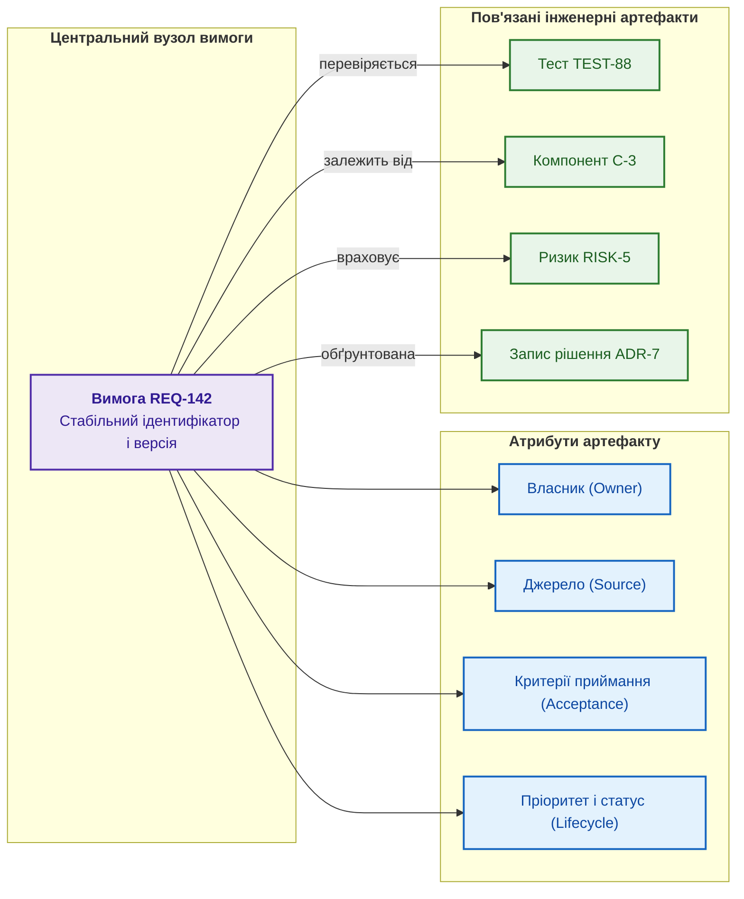
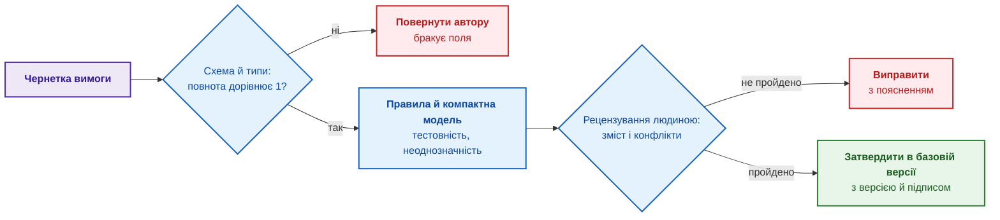
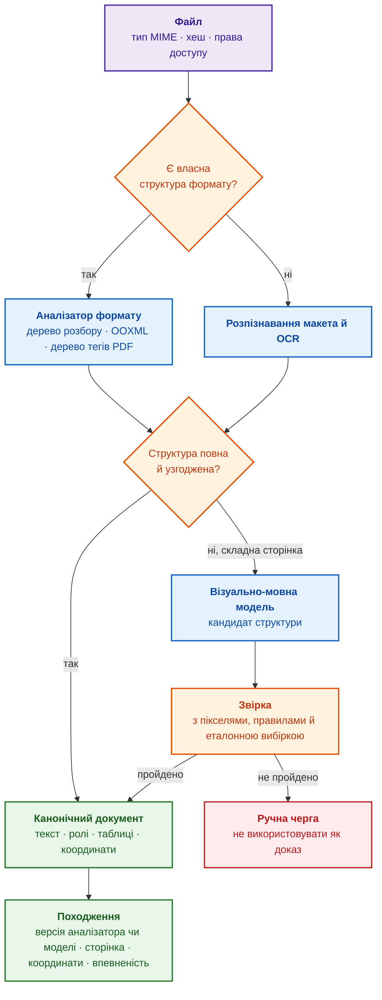
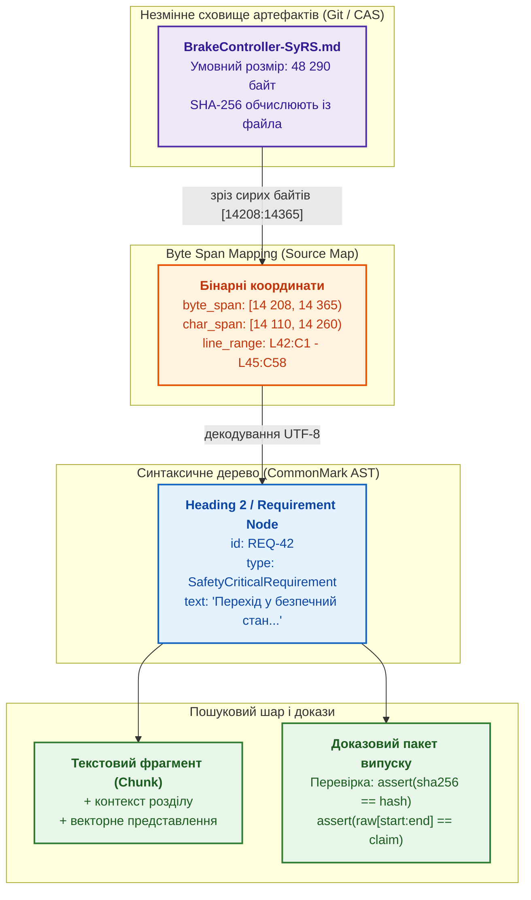
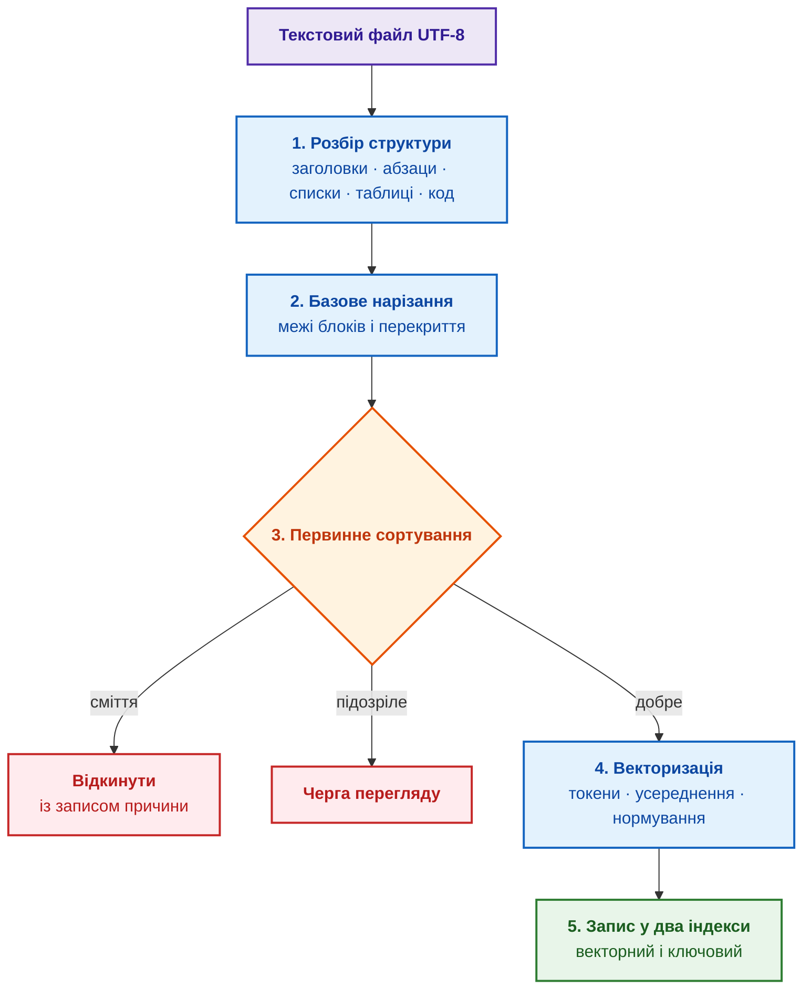
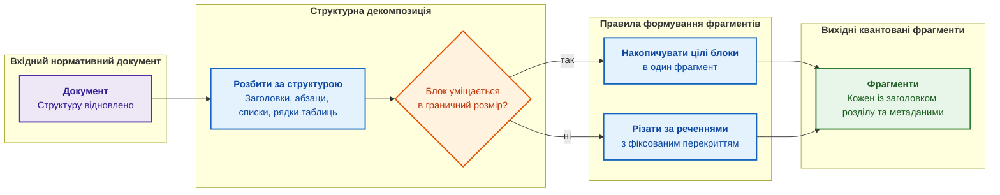
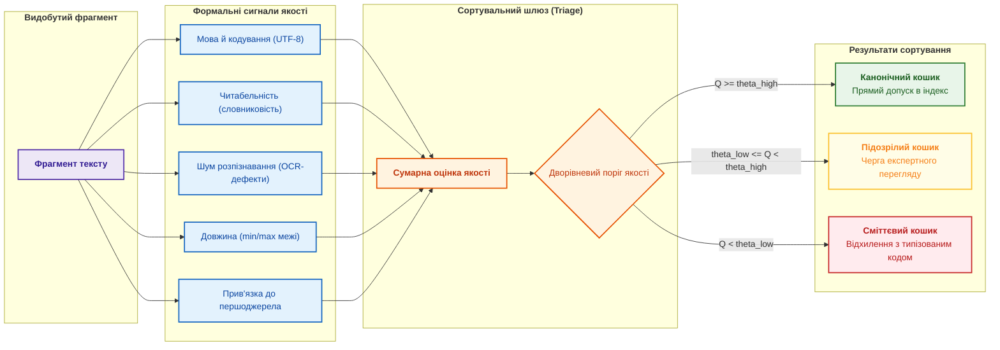
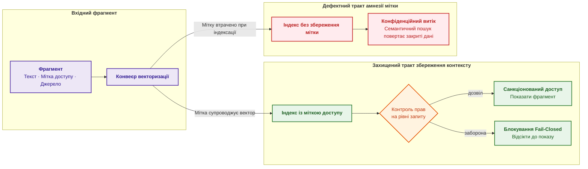
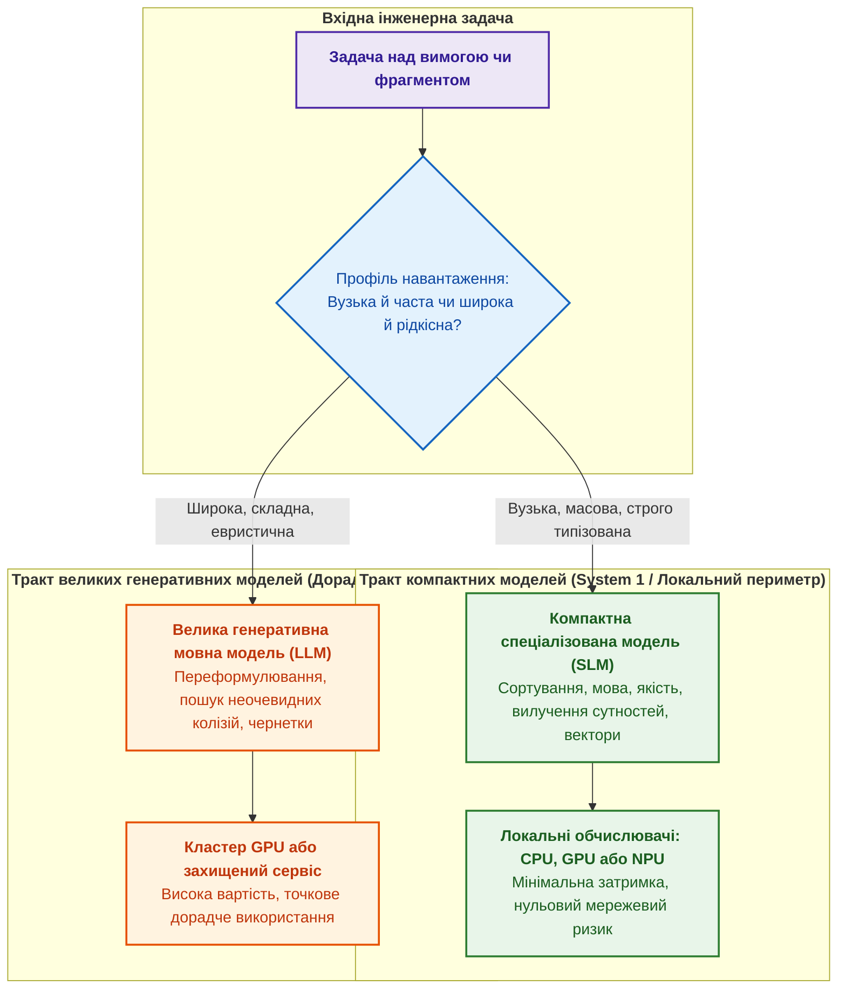

# Глава 8. Інженерні артефакти як дані експертної системи

> **Книга:** [Архітектура доказових експертних систем](README.md) · [Частина II: Математичні моделі, представлення та збереження знань](part-02-knowledge-models.md)
> **Попередня глава:** [Глава 7. Типологія баз знань: правила, онтології, прецеденти та вектори](ch07-knowledge-base-typology.md)
> **Наступна глава:** [Глава 9. Інженерний граф знань: простежуваність від вимог до апаратури](ch09-engineering-knowledge-graph-traceability.md)
> **Зміст книги:** [README.md](README.md)
> **Автор:** [Микола Мартинович Федчик](about-the-author.md)\
> **Попередня підготовка:** поняття вимоги, версії, факту й джерела з попередніх глав. Поля об'єкта, правила перевірки й походження фрагмента пояснюються в тексті; практикум наведено в [лабораторних роботах](LABS.md).\
> **Очікувані результати:** описати вимогу, план чи ризик як версійований об'єкт даних; оцінити, скільки структури зберігає формат файла; пройти шлях від файла до фрагмента з походженням, перевіркою якості, векторним представленням і міткою доступу; обирати між правилом, компактною моделлю й великою мовною моделлю за виміряним результатом.

## Анотація

Експертна система має пов'язати твердження з потрібною версією вимоги, тестом і звітом, а не лише переказати знайдений документ. Для цього інженерні артефакти, тобто вимоги, рішення, плани й результати роботи, подаються як об'єкти з визначеними полями та зв'язками. Глава пояснює, як перевірити ці поля, зберегти походження фрагмента й підготувати матеріал до пошуку та подальшого виведення. Структура й карта походження дають перевірні операції над даними, але не доводять істинності змісту або юридичної достатності документа. Навчальні оцінки якості й ресурсів розглянуто разом із передумовами, обчисленням і межами використання.

Після глави 7 відомо, чому тест і його окремий запуск треба розрізняти. Тепер потрібно отримати відповідні дані з реального артефакта. Візьмемо навчальну вимогу REQ-142: «контролер має швидко реагувати на зниження напруги». Перш ніж перевіряти її тестом TEST-88, потрібно визначити поріг напруги, допустимий час, версію вимоги й відповідального за погодження. Простий переказ речення цих відомостей не створює. Якщо вони розкидані між файлами, експертна система повинна зберегти їхні джерела, а не вгадати відсутні значення.

Маршрут глави: потрібні запитання до артефакта, модель полів і версій, перевірка якості, вилучення з файла, збереження походження, пошук і контроль доступу. Структурований запис може бути авторитетним реєстром у погодженому процесі, але імпортований об'єкт не скасовує статусу підписаного першоджерела. Зв'язування об'єктів у граф продовжує [Глава 9](ch09-engineering-knowledge-graph-traceability.md), повний процес здобуття знань розглядає [Глава 10](ch10-knowledge-acquisition-systems.md).

## 1. Карта дослідження: проблеми обробки артефактів, інженерні методи та метрики якості

У стандартах і процесних моделях результати роботи називають робочими продуктами (*work products*): вимога, план, протокол тестування, запис рішення, доказовий пакет. Поруч існують робочі елементи (*work items*): задача, дефект, запит на зміну, у яких теж осідають рішення й контекст. Для експертної системи обидва види є артефактами, тобто об'єктами зі стабільним ідентифікатором, зв'язками, статусом і доказами. Автором запропоновано таксономічну матрицю подолання дефектів обробки інженерних артефактів (Таблиця 8.1), яка формалізує п'ять критичних дефектів при переході від документів до даних, зіставляючи для кожного дефекту цільовий метод, обчислювану метрику, типову системну відмову та алгоритмічний шлях виправлення.

*Таблиця 8.1. Таксономічна матриця подолання дефектів обробки інженерних артефактів Федчика*

| Проблема | Метод | Що вимірюють | Типова відмова | Шлях виправлення |
| --- | --- | --- | --- | --- |
| Вимога неповна або нечітка | схема об'єкта й контрольна точка якості | повнота полів, частка прийнятих вимог, дефекти після рецензування | перевірка приймає граматично чисту, але нетестовну вимогу | числові критерії й погодження людиною |
| Зв'язки існують лише в тексті | граф простежуваності | покриття вимог тестами й доказами | посилання існує, але веде на неактуальну версію | версійовані зв'язки й перевірка змісту зв'язку |
| Файл PDF або скан втрачає структуру | синтаксичний аналізатор, розпізнавання макета й символів, модель для документів | порядок читання, точність таблиць і формул, походження | візуально-мовна модель створює правдоподібний, але відсутній у джерелі текст | звірка з координатами, оцінка впевненості й ручна черга |
| Фрагмент не знаходиться за запитом | структурне нарізання й гібридний пошук | повнота й якість ранжування на перших позиціях, затримка | оптимізація лише косинусної подібності | ключовий і векторний пошук, злиття рангів, повторне ранжування |
| Закритий текст з'являється у відповіді | фільтр доступу до пошуку | нуль несанкціонованих видач у негативних тестах | права доступу перевіряють уже після пошуку | фільтрація кандидатів до ранжування |

Таблиця 8.1 задає фундаментальний авторський імператив — *методологічний принцип статистичної незавершеності без контрольного шлюзу*: будь-яке евристичне твердження на кшталт «модель запрацювала» позбавлене інженерного змісту й не є критерієм готовності. Жоден статистичний або евристичний крок конвеєра обробки артефактів не вважається завершеним без зафіксованої контрольної вибірки, числової метрики, детермінованого порога приймання та регламентованої безпечної поведінки у захисному режимі відмови (Fail-Closed), коли поріг не пройдено. Наступні розділи розбирають рядки таблиці по черзі, починаючи з того, чому вільного тексту недостатньо.

## 2. Обмеження неструктурованого природномовного тексту в критичних системах

Неструктурований текст може містити потрібну відповідь, але для машинної перевірки її треба вилучити й зв'язати з артефактом. Кожний етап такого вилучення може помилитися. У цій монографії автором застосовано класичне правило добутку умовних імовірностей: успіх усіх етапів дорівнює добутку ймовірностей кожного успіху за правильного попереднього префікса. Ця модель не описує подальшого виправлення помилок і не перетворює загальну точність екстрактора на довіру до кожного окремого ребра:

$$
P_{\mathrm{trace}}(\mathcal{A}) = \prod_{i=1}^{k} \big(1 - \varepsilon_i\big)
$$

де $`P_{\mathrm{trace}}(\mathcal{A})\in[0,1]`$ — безрозмірна ймовірність успіху всього ланцюга обробки артефакту $\mathcal{A}$; $k\ge1$ — кількість етапів; $`A_i`$ — подія правильного виконання етапу $i$. Для ненульового правильного префікса $`\varepsilon_i=P(\neg A_i\mid A_1\cap\dots\cap A_{i-1})\in[0,1]`$ є умовною ймовірністю помилки, а для першого етапу $`\varepsilon_1=P(\neg A_1)`$. Якщо ймовірність префікса вже нульова, наскрізний успіх дорівнює нулю без обчислення невизначеної наступної умовної ймовірності. Загальні похибки етапів на окремих вибірках не можна підставляти замість умовних без обґрунтування незалежності. Невідомі оцінки не замінюються нулями й не дають підстав для автоматичного підтвердження зв'язку.

За оцінених умовних похибок рішення приймають так:
1. **Керування рантаймом і потоком обчислень:** у цьому авторському навчальному профілі поріг $`\tau_{\mathrm{trace}} = 0{,}95`$ є параметром політики, а не вимогою стандарту; для іншого виробу його потрібно обґрунтувати й затвердити. При $`P_{\mathrm{trace}}(\mathcal{A}) < \tau_{\mathrm{trace}}`$ конвеєр припиняє автоматичну фіксацію зв'язку й скеровує ребро графа до черги обов'язкового ручного підтвердження інженером (Fail-Closed); невідоме значення не дає автоматичного запису.
2. **Апаратний сайзинг:** за збереження запису для кожного фрагмента на кожному етапі кількість записів журналу зростає як $`O(k \cdot N_{\mathrm{span}})`$, де $`N_{\mathrm{span}}`$ — кількість фрагментів. Це оцінка кількості записів, не числовий бюджет у байтах: обсяг визначається форматом запису та накладними витратами сховища. Саме значення $k\ge4$ не встановлює окремої апаратної межі; резервування виконується за фактичним форматом, а не за позначенням складності.
3. **Практичний числовий приклад:** для навчального триетапного конвеєра ($k=3$) із умовними похибками сегментації $`\varepsilon_1 = 0{,}05`$, класифікації сутностей $`\varepsilon_2 = 0{,}08`$ та екстракції зв'язків $`\varepsilon_3 = 0{,}12`$, результуюча ймовірність цілісності зв'язку складає $`P_{\mathrm{trace}} = (1 - 0{,}05)(1 - 0{,}08)(1 - 0{,}12) = 0{,}95 \times 0{,}92 \times 0{,}88 \approx 0{,}769 < 0{,}95`$. Система блокує прямий запис у базу фактів і ескалує транзакцію інженеру-валідатору.

Тому навколо текстових вимог завжди виростає ручна праця: хтось веде окрему матрицю простежуваності (*traceability matrix*), хтось вручну звіряє тести з вимогами, хтось перед аудитом збирає докази з листування й старих версій документів.

Проєктні плани мають ту саму проблему. У складному апаратно-програмному чи регульованому проєкті артефактів багато: структура декомпозиції робіт (*Work Breakdown Structure*, WBS), графік, карта залежностей, запити на зміну, записи базових версій (*baselines*), план верифікації, тренди дефектів, статус постачальників, висновки аудиту, перелік перевірок готовності до випуску. Якщо всі артефакти живуть у документах, команда переходить від керування проєктом до ручної синхронізації документів. Аналіз впливу (*impact analysis*) теж залежить від дисципліни людей: після зміни вимоги платформа керування життєвим циклом застосунків (*Application Lifecycle Management*, ALM) або експертна система мала б показати зачеплені пакети робіт, тести, ризики й погодження, але текстовий документ зв'язків не виконує. У цьому полягає сформульована автором *концепція руйнування динамічного аналізу впливу через текстову ізоляцію*: природномовний документ не містить виконуваних семантичних ребер, тому оновлення нормативного твердження в тексті не активує автоматичний перерахунок верифікаційного статусу залежних компонентів, породжуючи латентні невідповідності перед сертифікаційним аудитом (детально формалізовано в [Главі 9](ch09-engineering-knowledge-graph-traceability.md)). Люди під тиском термінів рідко оновлюють три місця одночасно.

Підсумок розділу: текст зрозумілий людині, але не дає відтворюваних відповідей на структурні запити, а кожне автоматичне вилучення полів із тексту додає похибку. Вихід полягає в тому, щоб змінити роль документа.

## 3. Парадигма інженерного артефакту як типізованого об'єкта даних

Типізований об'єкт потрібний, щоб система могла обробляти зміни однаково: поле має назву й тип, зв'язок ціль, а запис версію. З такого реєстру можна створювати звіт або PDF як подання даних. Проте імпортований об'єкт не стає авторитетнішим за підписану специфікацію лише через формат; процес має визначити, яке джерело керівне й як погоджуються розбіжності.

Автором запропоновано системне розширення парадигми «Все як код» на інженерні артефакти (*Artifacts as Code*): за аналогією до того, як індустрія розробки програмного забезпечення пережила трансформацію мислення до парадигми «все як код» (*Everything as Code* — інфраструктура як код, політики як код і документація як код (текст під контролем версій із рецензуванням через запити на злиття й перевірками в конвеєрі) переконливо довели, що знімок екрана чи локальний файл конфігурації не є джерелом істини. Парадигма *Artifacts as Code* поширює ці принципи на плани робіт (WBS as Code), моделі ризиків (Risks as Code) та контрольні точки релізу (Gates as Code). Практичний критерій простий: якщо зміна в артефакті має наслідки, інструмент керування вимогами, ризиками чи випуском повинен ці наслідки бачити. Якщо контрольну точку пересунули на два тижні, мають підсвітитися залежні постачання, точки випуску й зобов'язання перед замовником.

Природна мова залишається придатною для нормативних документів і пояснень. За авторським підходом слід розрізняти інтерфейс створення чернетки та процедуру її затвердження. Мовна модель може запропонувати поля й формулювання, але не отримує повноваження на погодження. Текст людини й текст моделі проходять однакові застосовні перевірки; структура полегшує їх виконання, не замінюючи оцінки змісту.

Структурований об'єкт корисний не лише експертній системі: довідкова інформаційна система, консультаційний інтерфейс і система підтримки рішень теж отримують надійніший пошук, фільтрацію й аналіз впливу. Експертною система стає тоді, коли поверх фактів і зв'язків застосовує кодифіковані знання до конкретного випадку й показує доказовий ланцюжок висновку ([Глава 3](ch03-beyond-reference-information-systems.md)). Структура дає матеріал для міркування, але не замінює міркування. Найважливіший випадок структурування становлять вимоги.

## 4. Структурна модель вимоги: атрибути, версійність та семантичні зв'язки

Структурована вимога є об'єктом з обов'язковими атрибутами:

- **власник** (*owner*): хто відповідає за зміст і актуальність вимоги;
- **джерело** (*source*): стандарт, замовник, регуляторний документ або рішення архітектора, з якого походить вимога;
- **критерії приймання** (*acceptance criteria*): як перевірити, що вимогу виконано;
- **пріоритет і статус**: важливість і стан життєвого циклу (чернетка, затверджено, змінено після базової версії, застаріло);
- **зв'язки**: інші вимоги, компоненти, тести, ризики й рішення, з якими пов'язана вимога.

Схема показує вимогу як вузол графа: у центрі вимога зі стабільним ідентифікатором, навколо поля, а стрілки ведуть до пов'язаних об'єктів.



Фіолетовий вузол є вимогою, сині вузли є атрибутами, зелені вузли є пов'язаними об'єктами: тестом, компонентом, ризиком і записом архітектурного рішення (*Architecture Decision Record*, ADR). Коли вимога має таку структуру, можна виконати запити «покажи всі затверджені вимоги без жодного тесту», «знайди вимоги, змінені після заморожування базової версії» чи «які вимоги залежать від компонента, сертифікацію якого ще не завершено». Над текстом такі запити потребують ручного читання або статистичного вилучення, а над графом об'єктів виконуються детерміновано.

Структура тримається на стабільному ідентифікаторі й версії. Ідентифікатор дозволяє простежити історію вимоги після зміни формулювання, але зв'язок тесту й свідчення має називати також перевірену версію. Інакше старий успішний запуск помилково підтвердить нову вимогу. Версійність зберігає знімки базових версій, а зміна змісту робить пов'язані підтвердження кандидатами на повторну перевірку, не стираючи історії. Наступний крок полягає в автоматичних перевірках якості таких об'єктів.

> [!NOTE]
> **Авторська парадигма «Інженерний артефакт як типізований об'єкт даних» (чотири постулати)**
> 1. У пропонованому процесі звіт є поданням керованих даних; авторитетність реєстру й першоджерел визначається процедурою, не самим форматом.
> 2. П'ять обов'язкових атрибутів вимоги: стабільний ідентифікатор із версією, відповідальний власник, нормативне джерело походження, квантифіковані критерії приймання та статус життєвого циклу.
> 3. Чотиривимірний кортеж зв'язків: обов'язкова типізована трасованість до залікових тестів ($T$), системних компонентів ($C$), матриці ризиків ($K$) та архітектурних рішень ($D$).
> 4. Свідчення посилається на конкретну версію вимоги. Зміна створює потребу оцінити вплив і допустимість повторного використання свідчення; попередній історичний результат не стирається.
> *Керування рантаймом / Інженерний інваріант:* неперевірений артефакт може зберігатися як чернетка чи кандидат, але не має автоматично ставати затвердженою підставою висновку.

## 5. Автоматизований контроль якості та формальна валідація вимог (ISO/IEC/IEEE 29148)

Автоматизований контроль вимог починається зі структурних перевірок і сигналів для рецензента. ISO/IEC/IEEE 29148 описує властивості вимог [[1]](#src-1), але наявність полів або відсутність певного прислівника не доводить їх усіх. Для REQ-142 корисно окремо перевірити чотири аспекти:

- **повнота**: вимога має власника, джерело й критерії приймання;
- **тестовність** (*testability*): для вимоги можна побудувати перевірку; формулювання «інтерфейс має бути зручним» одразу позначають як проблемне;
- **однозначність**: чи визначено значення термінів і умов; слова «швидко» або «за потреби» є сигналами для перегляду, не вичерпним тестом;
- **несуперечність**: чи сумісні застосовні умови й обмеження. Дві різні межі параметра не обов'язково конфліктують, якщо діють у різних режимах.

Найпростіша числова оцінка є структурною повнотою вимоги:

```math
C_{\text{req}}(r)=\frac{1}{m}\sum_{j=1}^{m} I_j(r)
```

Величини структурної повноти:

- $r$ є вимогою, $m>0$ є кількістю обов'язкових полів схеми, а $j$ позначає поле;
- $`I_j(r)`$ дорівнює 1, якщо поле $j$ заповнене значенням правильного типу, і 0 інакше;
- $`\sum_{j=1}^{m}`$ додає результати перевірок усіх полів, а ділення на $m$ обчислює їхню частку.

Результат лежить між 0 і 1: за чотирьох заповнених полів із п'яти $`C_{\text{req}}=4/5=0{,}8`$. Заповнене поле ще не є якісним полем: запис `owner: TBD` формально існує, але не називає відповідального. Тому контрольну точку якості (*quality gate*) записують як добуток бінарних перевірок, без припущення статистичної незалежності:

```math
Q_{\text{gate}}(r)=\mathbf{1}[C_{\text{req}}(r)=1]\cdot\mathbf{1}[T(r)=1]\cdot\mathbf{1}[A(r)=1]\cdot\mathbf{1}[S(r)=1]
```

Перевірки контрольної точки:

- $r$ є вимогою, а $`C_{\text{req}}(r)=1`$ означає, що всі обов'язкові поля заповнено коректно;
- $`\mathbf{1}[\cdot]`$ дорівнює 1, якщо умова в дужках істинна, і 0 інакше;
- $T(r)$ позначає підтверджену перевірюваність, $A(r)$ підтверджену однозначність у погодженому контексті, а $S(r)$ результат перевірки сумісності з визначеною базовою версією; для цієї навчальної формули лише завершена позитивна перевірка має значення 1;
- знак множення вимагає, щоб кожна блокувальна перевірка дорівнювала 1.

Отже, $`Q_{\text{gate}}(r)`$ набуває лише значень 0 і 1 та дорівнює 1, коли пройдено всі умови. Статистична модель може оцінити $T$ або запропонувати проблему, але контрольна точка не повинна мовчки замінювати оцінкою моделі інженерне рішення.

**Застосування результату:** одиниця дозволяє розглянути вимогу для затвердження в межах цієї політики, але не замінює повноваження погоджувача. Нуль блокує цей перехід і зберігає діагностику. Чернетка лишається доступною для виправлення. Невідомий стан не стає одиницею; разом із двійковим рішенням слід зберігати причину: дефект, незавершена перевірка чи технічна помилка. Криптографічний підпис є окремою операцією над погодженою версією.

**Числовий приклад розрахунку:**
Повернімося до REQ-142 про реакцію на зниження напруги. П'ять структурних полів присутні, тому оцінка структури дорівнює 1. У тексті не визначено порога напруги й допустимого часу, отже перевірюваність та однозначність ще не підтверджені: $T=0$, $A=0$. Припустімо, окрему перевірку сумісності з базовою версією завершено позитивно: $S=1$. Тоді маємо:
```math
Q_{\text{gate}}(\text{REQ-142}) = 1 \cdot 0 \cdot 0 \cdot 1 = 0
```
Результат блокує затвердження, а не збереження чернетки. Автор має погодити діапазон напруги, початкові умови, реакцію й допустимий час, після чого T та A перевіряються повторно. Відсутні числа не можна довільно дописати заради проходження фільтра.

> [!NOTE]
> **Авторський детермінований шлюз валідації інженерних вимог ($`Q_{\text{gate}}`$, чотири фільтри)**
> 1. Структурна повнота ($`C_{\text{req}} = 1`$): обов'язкова наявність усіх $m$ полів схеми без фіктивних заповнювачів (TBD/NA).
> 2. Формальна тестовність ($T = 1$): вимога має однозначний верифікаційний предикат, придатний для апаратного чи програмного тесту.
> 3. Однозначність специфікації ($A = 1$): відсутність якісних прислівників («швидко», «надійно») без визначених числових метрик і допусків.
> 4. Несуперечність чинній базовій версії ($S = 1$): відсутність колізій із затвердженими вимогами та фізичними обмеженнями середовища.
> *Керування рантаймом / Інженерний інваріант:* нуль або незавершена перевірка блокує затвердження за цим профілем, зберігаючи чернетку й діагностику. Лінгвістична евристика не засвідчує зміст усієї вимоги.



Сині блоки є перевірками, червоні блоки повертають вимогу на доопрацювання, зелений блок фіксує вимогу в базовій версії. Дефекти вимог ловлять під час написання, а не на аудиті чи в тестуванні.

### 5.1. Архітектура шаруватого інструментального стеку валідації прози

Автором запропоновано архітектуру шаруватого інструментального стеку валідації інженерної прози: єдиного універсального інструмента для якості вимог немає, тож перевірка організується у вигляді детермінованого багатошарового фільтра. Статичний аналізатор прози [Vale](https://github.com/vale-cli/vale) з власними українськими правилами ловить слова-пастки й порушення шаблону просто в конвеєрі безперервної інтеграції. Бібліотека мовою Go [prose](https://github.com/jdkato/prose) дає токенізацію, поділ на речення, розмітку частин мови й розпізнавання іменованих сутностей (*named entity recognition*, NER) з точними зміщеннями в тексті, але навчені моделі бібліотеки англомовні, тож переносити оцінки на українські вимоги не можна. Для виконання нейронних моделей у Go можна оцінити [Cybertron](https://github.com/nlpodyssey/cybertron) або [Hugot](https://github.com/knights-analytics/hugot) поверх ONNX Runtime; сумісність архітектури моделі, токенізатора й апаратного прискорення перевіряють тестом. Модель [GLiNER](https://github.com/urchade/GLiNER) корисна як кандидат для гнучкого вилучення сутностей, але розпізнавання сутностей не замінює вилучення відношень (*relation extraction*) і перевірки схеми. Комерційні інструменти оцінюють тим самим протоколом, не вважаючи закриту оцінку інструмента доказом якості.

Помічник на основі великої мовної моделі може запропонувати чіткіше формулювання, підказати відсутні критерії приймання, виявити можливу суперечність із сусідньою вимогою чи запропонувати тест для критерію. Пропозиції помічника лишаються пропозиціями: рішення ухвалює людина, а зміна фіксується як зміна об'єкта з історією. Підсумок розділу: структура робить якість вимоги вимірюваною, але остаточну оцінку змісту дає людина. Найсильніший аргумент за структуру, проте, не перевірка якості, а простежуваність.

## 6. Наскрізна простежуваність інженерних артефактів як основа системної архітектури

У регульованих дослідженнях і розробці треба показати неперервний ланцюжок: потреба зацікавленої сторони, вимога системного рівня, вимога до програмного забезпечення, проєктне рішення, тест, доказ виконання. Стандарт ISO/IEC/IEEE 29148 вимагає двобічної простежуваності вимог [[1]](#src-1). Якщо будь-яка ланка існує лише як текст, ланцюжок рветься й відновлюється вручну.

Структура робить ланцюжок навігаційним. Аналіз впливу стає швидким і відтворюваним настільки, наскільки актуальний граф: після зміни вимоги платформа показує зачеплені тести, ризики, рішення й контрольні точки випуску; після провалу тесту видно непідтверджені вимоги; після оновлення стандарту знаходяться пов'язані заходи контролю. Механізм зводиться до обходу графа зв'язків і перевірки цілісності, тож пропущений чи хибний зв'язок дає пропущений чи хибний вплив. Першу діагностичну метрику графа легко пояснити без теорії графів:

```math
\mathrm{Coverage}_{R\rightarrow T}=\frac{\left\lvert\left\{r\in R:\ \exists\,t\in T,\ (r,t)\in E_{RT}\right\}\right\rvert}{\lvert R \rvert}
```

Позначення покриття:

- $R$ є повною множиною чинних версій вимог у зафіксованому релізному зрізі, $T$ є множиною тестів, а $`E_{RT}`$ є множиною підтверджених зв'язків «ця версія вимоги має реалізацію та тест із вердиктом `PASS` для цільового випуску»;
- $r$ позначає одну вимогу, $t$ один тест, а $`(r,t)\in E_{RT}`$ означає, що підтверджений зв'язок поєднує саме цю пару;
- $\exists$ означає «існує хоча б один», а $\lvert\cdot\rvert$ є кількістю елементів множини;
- згідно з канонічною формалізацією множини прогалин $`\mathcal{U}_R`$ у [Главі 9](ch09-engineering-knowledge-graph-traceability.md) (підрозділ 4.1), чисельник $`\mathrm{Coverage}_{R\rightarrow T}`$ рахує виключно ті вимоги $`r \in R`$, які мають реалізацію та принаймні один верифікаційний тест із підтвердженим вердиктом `PASS` для цільового релізу (тоді як голе ребро у графі без вердикту `PASS` фіксує лише структурну наявність зв'язку, а не верифікаційне покриття), а знаменник рахує всі чинні вимоги.

Формула визначена лише за $`\lvert R\rvert>0`$ і вимірює наявність хоча б одного успішного тесту для кожної вимоги, а не виконання всіх її критеріїв приймання. За $`\lvert R\rvert=0`$ значення не обчислюють і не підміняють одиницею: застосовність визначається схваленим профілем, а недоступний чи неповний реєстр не видається за порожню множину. Якщо вимога має два обов'язкові тести зі статусами `PASS` і `FAIL`, її внесок у чисельник уже дорівнює 1, але випуск лишається заблокованим перевіркою всіх обов'язків за §7. Отже, одиничне покриття є необхідною умовою описаного профілю, не достатнім доказом повної верифікації чи безпеки.

**Керування рантаймом і авторська умова допуску за профілем (Інваріант повного верифікаційного покриття Федчика):**
- **Умова розглянутого профілю, не самостійна вимога стандарту:** для конкретного профілю, пов'язаного з ISO 26262 ASIL D / DO-178C Level A, автор задає необхідну умову $`\mathrm{Coverage}_{R\rightarrow T} = 1{,}00`$. Будь-яке значення нижче одиниці вказує на прогалину навіть за цією обмеженою метрикою. Одиниця не замінює перевірки всіх застосовних критеріїв і не є самостійним критерієм сертифікації;
- **Дія конвеєра:** якщо $`\mathrm{Coverage}_{R\rightarrow T} < 1{,}00`$, компілятор звіту про безпеку генерує подію `FAIL_CLOSED`, блокує створення підписаного пакета релізу й експортує перелік непокритих вимог до трекера інцидентів.

**Числовий приклад розрахунку:**
У поточному релізному зрізі міститься $\lvert R \rvert = 120$ вимог безпеки. За результатами автоматизованого аудиту тестового стенду зв'язки з успішними заліковими тестами зафіксовано для 118 вимог:
```math
\mathrm{Coverage}_{R\rightarrow T} = \frac{118}{120} \approx 0{,}9833
```
Оскільки $`\mathrm{Coverage}_{R\rightarrow T} = 0{,}9833 < 1{,}00`$, система блокує випуск прошивки, попри 98,3 % за цією діагностичною метрикою, та вказує на дві непокриті вимоги: `REQ-045` (скидання WDT) та `REQ-089` (діагностика обриву CAN).

## 7. Моделювання планів, ризиків та контрольних точок як типізованих об'єктів

Принцип перетворення тексту на типізовані об'єкти даних не вичерпується інженерними вимогами. Він так само необхідний для проєктних графіків, моделей ризиків і контрольних точок випуску продукту. У традиційному документоцентричному підході план релізу є статичною таблицею в Excel або сторінкою у вікі з контрольними точками, прізвищами й дедлайнами плюс кількома формальними абзацами про ризики. Такий документ починає відхилятися від дійсності вже на другий день після затвердження, оскільки він відірваний від реального стану кодової бази, стендових тестів та ланцюжка постачання апаратури. У машинно-орієнтованому світі план випуску складається з динамічно пов'язаних об'єктів даних.

Контрольна точка має критерії входу й виходу, пов'язані з вимогами, тестами чи погодженнями. Пакет робіт має залежності й розподіл потужностей. Ризик має тригер, оцінку ймовірності й наслідків, заходи зниження, відповідального й правило ескалації.

Автором запропоновано *об'єктну модель релізної контрольної точки з машинно-перевірними критеріями*, у якій повнота конфігурації перевіряється **до** кон'юнкції результатів. Порожня кон'юнкція математично істинна, тому недоступний реєстр не можна представляти успішно завантаженим порожнім списком. Для критичного профілю очікуваний набір обов'язкових критеріїв має бути непорожнім і визначеним схваленою базовою лінією, а не випадково наявними рядками графа.

Статус готовності для конкретного випуску та зрізу фактів обчислюється так:

$$
\mathrm{Gate}_{\mathrm{release}}(G)=
\begin{cases}
0, & \mathrm{ConfigValid}(G)=0,\\
\displaystyle
\bigwedge_{c\in\mathcal{C}_{\mathrm{crit}}}
\mathbf{1}\!\left[\mathrm{eval}(c)=\mathsf{true}\right]
\wedge
\bigwedge_{w\in\mathcal{W}}
\mathbf{1}\!\left[\mathrm{approved}(w)=\mathsf{true}\right],
& \mathrm{ConfigValid}(G)=1.
\end{cases}
$$

Позначення та допустимі стани:

- $G$ — типізована контрольна точка з ідентичністю цільового випуску, версією схваленої політики, ідентичністю локального зрізу фактів і моментом оцінювання; ці ідентичності не підміняються тільки назвою проєкту;
- $`\mathrm{ConfigValid}(G)\in\{0,1\}`$ — ознака перевіреної повноти й застосовності конфігурації. Значення 1 вимагає завантажених і чинних для цього випуску реєстрів критеріїв та винятків, відповідності схваленій версії політики, наявності всіх очікуваних унікальних ID і доступності обов'язкових входів кожного критерію. Пропущений, дубльований, невідомий чи нечинний запис дає 0 з діагностикою;
- $`\mathcal{C}_{\mathrm{crit}}`$ — повний набір застосовних критичних критеріїв зі схваленого профілю: відсутність блокуючих дефектів, проходження обов'язкових тестів, завершення перевірок безпеки. Для цього критичного шлюзу $`\lvert\mathcal{C}_{\mathrm{crit}}\rvert>0`$; набір звіряється за ID, а не лише за кількістю завантажених рядків;
- $`\mathcal{W}`$ — повний набір винятків, що потребують перевірки для цього випуску. Він може бути порожнім, **якщо** реєстр успішно завантажено й схвалений профіль підтверджує відсутність необхідних винятків; відсутній реєстр, незавершений запит або втрата запису не є порожньою множиною;
- $`\mathrm{eval}(c)`$ — типізований результат перевірки критерію за доказами цього зрізу; $`\mathrm{approved}(w)`$ — підтвердження чинного погодження саме цього винятку уповноваженою роллю в його межах застосування. Лише явний булевий результат $\mathsf{true}$ дає одиницю індикатору $\mathbf{1}$; хибність, невідомість, помилка чи тайм-аут не перетворюються на успіх;
- обидві кон'юнкції та $`\mathrm{Gate}_{\mathrm{release}}(G)\in\{0,1\}`$ безрозмірні. Схвалений виняток сам по собі не робить хибний критичний критерій істинним: його можливий вплив на застосовність визначається політикою до формування очікуваного набору.

1. **Керування рантаймом і потоком обчислень:** за $`\mathrm{ConfigValid}(G)=0`$ критерії не обчислюються як кон'юнкція порожнього списку, а генерація підписаного маніфесту блокується подією `RELEASE_GATE_BLOCK` із причиною дефекту конфігурації. За коректної конфігурації результат 0 супроводжується переліком невиконаних або невизначених перевірок. Результат 1 санкціонує маніфест лише для зафіксованих випуску, політики й зрізу; він не переноситься на інший стан і не замінює повноважень підписанта.
2. **Апаратний сайзинг:** для описаного локального профілю погоджений бюджет перевірки конфігурації та оцінювання становить $`T\le500\,\text{мс}`$ без зовнішніх мережевих звернень. Це вимога профілю, не виміряний тут WCET. За умовного формату 64 байти на запис-підставу вісім критеріїв і один виняток потребують 576 байтів без індексів, конфігурації та власне доказів. Бюджет пам'яті має враховувати весь очікуваний набір; його нестача не дозволяє оцінити скорочений набір як повний. Перевищення часу блокує маніфест із явною діагностикою.
3. **Практичний числовий приклад:** для схваленого профілю очікується вісім критеріїв. Якщо всі вісім завантажено й виконано, але є один необхідний виняток зі статусом `PENDING`, маємо $`\mathrm{Gate}_{\mathrm{release}}(G)=1\wedge0=0`$. Після чинного погодження винятку й за незмінності решти підстав результат може стати 1. Якщо необхідних винятків немає й це підтверджено коректно завантаженим реєстром, порожня друга кон'юнкція дорівнює 1 і не блокує готовий випуск.

| Конфігурація та дані | Результат | Причина |
|---|---|---|
| Очікуються 8 критеріїв; завантажено всі 8, усі істинні; винятки явно відсутні | 1 | Повноту підтверджено, усі обов'язки виконано |
| Очікуються 8 критеріїв; через збій повернуто два порожні списки | 0, `RELEASE_GATE_BLOCK` | Реєстр критеріїв не відновлено; істинність порожніх кон'юнкцій не використовується |
| Очікуються 8 критеріїв; завантажено 7 істинних або 7 унікальних ID та дублікат | 0, `RELEASE_GATE_BLOCK` | Кількість рядків не замінює звірки повного набору ID |
| Усі критерії істинні; реєстр винятків недоступний | 0, `RELEASE_GATE_BLOCK` | Невідомий стан не прирівняно до відсутності винятків |
| Усі записи завантажено; один критерій хибний або один необхідний виняток не погоджено | 0, `RELEASE_GATE_BLOCK` | Конфігурація повна, але обов'язок не виконано |
| Усі локальні результати позитивні, але належать іншій версії політики чи випуску | 0, `RELEASE_GATE_BLOCK` | Підстави не застосовні до цільового маніфесту |

З тих самих об'єктів генерують щотижневий статус, але звіт відображає машинний стан, а не створює стан. Тут реалізовано *інженерний принцип захисту від презентаційного оптимізму Федчика*: якщо звіт красивий, а об'єкти під звітом червоні, панель готовності безапеляційно виставляє статус відмови (Fail-Closed), унеможливлюючи приховування технічного боргу. Модель об'єктів готова; тепер треба з'ясувати, скільки структури доживає до експертної системи, коли об'єкт лежить у файлі.

## 8. Вплив фізичного формату носія на рівень збереження інженерної структури

Кожен артефакт зберігається у файлі певного формату, і формат визначає, скільки структури доживе до індексатора, експертної системи чи аудиторського конвеєра. Той самий план у форматі розмітки й у вигляді сканованого PDF є для машини двома різними джерелами. Автором запропоновано *чотирирівневу таксономію збереження інженерної структури носіїв (шкалу збереження структури носіїв Федчика)*, яка впорядковує формати за рівнем експліцитності структури:

- **текст і розмітка** (*plain text, markup*): Markdown, HTML, reStructuredText, AsciiDoc, а в інженерії формати на основі XML (*eXtensible Markup Language*), наприклад обмінний формат вимог ReqIF (*Requirements Interchange Format*) [[2]](#src-2). Структуру записано прямо в тексті: заголовок позначено символом, таблицю роздільниками, зв'язок ідентифікатором. Файл можна порівнювати порядково, тримати під контролем версій і адресувати до рядка;
- **структуровані двійкові формати** (*structured binary*): офісні файли .docx і .xlsx є ZIP-архівами з XML-частинами формату Office Open XML (OOXML). Структура є, але схована за упаковкою й стилями, і зв'язок між стилем і змістом не завжди однозначний;
- **формати верстки** (*layout-oriented*): звичайний, особливо нетегований PDF описує розташування тексту й графіки на сторінці, тож порядок читання, межі таблиць та ієрархію заголовків доводиться відновлювати. Тегований PDF (*tagged PDF*) має дерево логічної структури, а стандарт PDF/UA задає вимоги до семантичних тегів і порядку читання [[3]](#src-3); проте автоматично створене дерево тегів буває неповним і потребує перевірки;
- **растрові зображення** (*raster scans*): растр без прихованого текстового шару містить лише пікселі, тож кожен символ спершу розпізнають оптично, і кожне розпізнавання може помилитися.

Це класи можливих способів вилучення, не універсальний порядок якості. Коректно тегований PDF може передати потрібні поля краще за неузгоджені Markdown-таблиці; ключовими є сам документ, аналізатор і задача. Замість невизначеної «ентропії вилучення» для порівняння потрібен еталон. У простому контрольному наборі кожне очікуване поле позначається як правильне, пропущене або неправильне:

$$
E_{\mathrm{fields}}=\frac{N_{\mathrm{missing}}+N_{\mathrm{wrong}}}{N_{\mathrm{expected}}}.
$$

Тут кількості полів цілі й невід'ємні, $`N_{\mathrm{expected}}>0`$ є числом очікуваних полів еталона, $`N_{\mathrm{missing}}`$ числом пропущених, а $`N_{\mathrm{wrong}}`$ числом присутніх, але неправильних. Останні дві категорії не перетинаються, їхня сума не перевищує знаменника. Безрозмірна частка помилок лежить між 0 і 1; менше значення краще.

Якщо з п'яти очікуваних полів вимоги три відтворено правильно, одне втрачено, а одне має неправильне значення, отримано (1 + 1) / 5 = 0,4, тобто 40 % полів з дефектом. Це сигнал переглянути спосіб вилучення. Результат не є ймовірністю істинності документа. Зайві вигадані поля, критичність помилки, таблиці й порядок читання перевіряються окремо; нуль за цією вузькою метрикою не закриває всіх перевірок.

Окремий клас становлять формати серіалізації, створені для обміну структурованими даними між програмами. XML описує дані вкладеними тегами (`<owner>Storage</owner>`), але багатослівний. JSON (*JavaScript Object Notation*) узяв синтаксис об'єктів мови JavaScript і став звичним форматом обміну між сервером і браузером [[4]](#src-4). YAML (*YAML Ain't Markup Language*) тримає структуру відступами, тож людині легко читати й писати YAML руками, і тому YAML часто використовують для конфігурацій [[5]](#src-5). У трьох форматах ключ прямо називає поле (`owner`, `acceptance_criteria`), тож формати природно зберігають «артефакт як об'єкт». Є три застороги:

1. запис перевіряють схемою до індексації: JSON Schema [[6]](#src-6), схема XML (*XML Schema Definition*, XSD) або мова обмежень форми SHACL [[7]](#src-7) відсікають хибні типи, пропущені поля й заборонені зв'язки;
2. YAML читають безпечним синтаксичним аналізатором із визначеною версією специфікації й політикою щодо дублікатів ключів, псевдонімів (*aliases*) і нестандартних типів, щоб конфігурація не стала каналом виконання коду;
3. сиру серіалізацію не варто сліпо перетворювати на вектор: службовий синтаксис додає шум, хоча змістовні назви полів іноді допомагають. На власних запитах порівнюють щонайменше два подання (сирий запис і канонічно відтворений текст), а структурні поля зберігають як метадані й фільтри. Нарізають файл за об'єктами (запис масиву, елемент XML, блок ключів разом зі шляхом), а не через фіксовану кількість символів.

Підсумок розділу: формат є питанням доказовості, а не естетики. Автором сформульовано *тріаду інженерних правил збереження доказовості першоджерел*:
1. Зберігати першоджерело у форматі з явною структурою (текст під контролем версій замість експорту в PDF, ReqIF замість роздруківки).
2. Фіксувати спосіб вилучення кожного фрагмента, оскільки фрагменти з чистої розмітки, відновленої верстки та оптичного розпізнавання мають принципово різні класи довіри.
3. Нести квантифіковану оцінку якості вилучення ($`S_{\text{triage}}`$) разом із фрагментом крізь усі етапи векторизації та індексування.

Як саме машина дістає структуру з файлів різних форматів, показує наступний розділ.

## 9. Первинне перетворення: синтаксичний аналіз та нормалізація сирих байтів у канонічний документ

Первинне перетворення має зберегти ті поля й зв'язки REQ-142, які можна звірити з джерелом. Для розмітки спочатку читається синтаксис, для офісного пакета його внутрішні частини, для скану розпізнаються символи й макет. Складність і затримка залежать від обсягу, якості входу та реалізації; ані мікросекундного часу, ані відсутності втрат сам формат не гарантує. Обраний шлях перевіряється на потрібних типах артефактів.

**Розмітка.** Синтаксичний аналізатор (*parser*) перетворює текст із розміткою на абстрактне синтаксичне дерево (*abstract syntax tree*, AST). Ідею показує простий прохід рядками, хоча повна реалізація специфікації CommonMark [[8]](#src-8) враховує блоки коду, вкладені списки й вирівнювання таблиць.

<details>
<summary>Псевдокод: розбір розмітки в дерево</summary>

```text
прочитати файл як рядок UTF-8
для кожного рядка:
    якщо рядок починається з '#'    -> вузол «заголовок», рівень = кількість '#'
    якщо рядок має вигляд '| ... |' -> рядок таблиці
    якщо рядок починається з '- '   -> елемент списку
    якщо рядок містить '[текст](ціль)' -> зв'язок (текст, ціль)
зібрати вузли в дерево за рівнями заголовків
```

</details>

Розбір розмітки дає синтаксичні заголовки, таблиці, списки й посилання; значення вимоги чи придатність посилання все одно потребують окремої перевірки. PDF та формати зображень також мають формальні специфікації. Складність не у відсутності граматики файла, а в тому, що коректні команди розміщення символів або масив пікселів не задають однозначно порядку читання та предметного змісту. Аналізатор може правильно прочитати формат і помилково відновити таблицю. Детермінованість синтаксичного розбору не означає відсутності дефектів аналізатора.

**Проміжні формати.** У нетегованому PDF символи прив'язані до геометрії сторінки, тож порядок читання, колонки й межі таблиць відновлюють евристиками; тегований PDF спершу читають за деревом структури, але перевіряють узгодженість дерева з видимою сторінкою. Формат .docx надійніший, бо є пакетом XML-частин, однак семантика теж залежить від дисципліни авторів: якщо заголовок зроблено більшим шрифтом, а не стилем заголовка, роль тексту доводиться вгадувати.

**Растр.** Скан проходить найдовший і найкрихкіший шлях: вирівнювання нахилу, бінаризацію, розбиття сторінки на текст, таблиці й рисунки та оптичне розпізнавання символів (*optical character recognition*, OCR).

<details>
<summary>Псевдокод: розпізнавання скану</summary>

```text
зображення -> вирівнювання нахилу -> бінаризація
розбиття сторінки: де текст, де таблиця, де рисунок
для кожної текстової області: OCR -> символи + впевненість від 0 до 1
якщо середня впевненість нижча за поріг -> у чергу ручної перевірки
```

</details>

Помилка можлива в кожному символі, тож впевненість розпізнавання несуть далі як метадані: фрагмент із низькою якістю розпізнавання не можна мовчки цитувати як доказ.

Станом на 2026 рік конвеєр інтелектуальної обробки документів (*document AI*) доцільно будувати каскадом: від найдешевшого й найбільш відтворюваного методу до статистичного запасного варіанта.

| Вхід і проблема | Перший метод | Коли підключати машинне навчання | Критерій приймання |
| --- | --- | --- | --- |
| Markdown, HTML, XML, ReqIF | синтаксичний аналізатор формату й дерево розбору | майже ніколи для синтаксису; модель лише для змістовних полів | дерево коректне, посилання й ідентифікатори збережено |
| .docx, .xlsx, .pptx | аналізатор OOXML; для масового завантаження Apache Tika [[9]](#src-9) або Docling [[10]](#src-10) | коли стилі не передають ролей тексту | заголовки, таблиці, примітки й зв'язки звірено з еталоном |
| тегований PDF | дерево структури й геометрія сторінки | якщо теги відсутні або суперечать сторінці | правильний порядок читання й семантичні ролі |
| складний PDF або скан | розпізнавання макета й OCR, наприклад Docling або PP-StructureV3 [[11]](#src-11) | візуально-мовна модель для формул, таблиць, графіків і складної верстки | частка помилкових символів і слів, точність клітинок таблиць, формул і порядку читання |
| критичний доказ | детермінований аналізатор і координати джерела | модель створює лише кандидата | підтвердження людиною або подвійна незалежна перевірка |

Моделі з урахуванням макета, як LayoutLMv3 [[12]](#src-12), поєднують текст, зображення й координати; візуально-мовні моделі (*vision-language models*, VLM) можуть повертати Markdown або JSON. Їхню перевагу над звичайним OCR потрібно перевірити для конкретних сторінок і полів, не припускати автоматично. Генеративний вихід може містити вигаданий символ: номер сторінки й координати забезпечують можливість звірки, але самі не роблять текст доказом. Походження перетворень можна описати за PROV-O [[13]](#src-13); фактична перевірка відповідності джерелу залишається окремою дією.



Сині блоки обробляють файл, помаранчеві блоки перевіряють результат, зелені блоки є канонічним документом із походженням, червоний блок є ручною чергою. Візуально-мовна модель вмикається лише тоді, коли дешевші методи не дали повної структури. Тут діє сформульований автором *інженерний принцип заборони неперевіреного генеративного свідчення*: вихід генеративної або візуально-мовної моделі категорично не може виступати доказом чи змінювати стан системи без суворої перевірки геометричними координатами першоджерела, правилами лінтингу та підписом інженера-валідатора (Fail-Closed).

### 9.1. Простежуваність на рівні байтів: побудова Source Map для вихідних артефактів

Коли доказова експертна система чи зовнішній аудитор верифікує критичну вимогу REQ-42 («за відмови watchdog контролер гальм переходить у безпечний стан за 100 мс»), абстрактного посилання на кшталт «знайдено десь у файлі специфікації SyRS_v3.2.md» категорично недостатньо. Для відтворюваного аудиту в регульованих інженерних галузях (функціональна безпека ISO 26262 ASIL D, авіоніка DO-178C DAL A, залізнична автоматика CENELEC EN 50128) потрібні ідентичність ревізії джерела та перевірна карта походження (*provenance*) цитати. Сам збіг SHA-256 не встановлює авторства, чинності документа або правильності його інженерного змісту.

Якщо система оперує лише «відновленим текстом» без жорстких координат у файлі, виникає *проблема семантичного спотворення при нормалізації символів та генеративній екстракції*:
- перекодування UTF-8 або нормалізація Unicode (наприклад, заміна символу дефіса на тире чи латинської літери «c» на кириличну «с») спотворює пошукові хеші;
- агресивний токенізатор або VLM-модель може непомітно «округлити» час реакції зі «100 ms» на «10 ms», викликавши катастрофічну галюцинацію у висновку безпеки;
- відсутність точних координат унеможливлює інтеграцію з середовищами розробки (IDE), де інженер має натиснути на посилання у звіті й миттєво побачити підсвічений вихідний рядок у редакторі коду чи специфікацій.

Щоб простежити вилучені знання до первинного джерела, архітектура обробки інженерних документів використовує механізм **Source Map на рівні байтів**: кожен вузол AST-дерева, вилучений атрибут і текстовий фрагмент для пошуку пов'язуються з первинним бінарним файлом набором детермінованих координат. Пряме порівняння цитати зі зрізом застосовне, коли текст буквально міститься у джерелі, як у наведеному UTF-8-файлі. Для стисненого PDF, OOXML чи скану розкодований або розпізнаний текст зазвичай не є таким зрізом: зберігають хеш оригіналу, версію похідного подання, перетворення та перевірну відповідність сторінці й геометрії. На схемі нижче ім'я файла, розмір і координати є умовними; хеш для реального файла обчислюють за його фактичними байтами.



Комплексний дескриптор походження для кожного артефакту містить п'ять взаємопов'язаних вимірів:

1. **Криптографічний хеш джерела (`file_sha256`):** ідентифікує бінарний вміст для звірки з довіреним знімком. Сам хеш не робить сховище незмінним; інша версія потребує повторної перевірки відповідності очікуваному дайджесту.
2. **Зріз байтів (`byte_span`):** напіввідкритий інтервал байтів $`[b_{\text{start}}, b_{\text{end}})`$ у вихідному файлі. Для непорожньої дослівної цитати обидві межі цілі й задовольняють $`0\le b_{\text{start}}<b_{\text{end}}\le\mathrm{len}(\mathrm{raw})`$; декодування в UTF-8 має бути коректним. Байтові координати похідного тексту не видаються за координати стисненого оригіналу.
3. **Зсув символів (`char_span`):** зсув Unicode-символів у декодованому тексті канонічного документа, необхідний для роботи внутрішніх бібліотек обробки тексту.
4. **Координати рядка й колонки (`line_col`):** кортеж $`[l_{\text{start}}, c_{\text{start}}, l_{\text{end}}, c_{\text{end}}]`$, що дозволяє миттєво відкривати та підсвічувати відповідний фрагмент у середовищах розробки (VS Code, CLion тощо).
5. **Геометричний обмежувальний прямокутник (`bbox`):** для PDF-файлів, креслень або сканів — номер сторінки та нормалізовані просторові координати $`[x_0, y_0, x_1, y_1]`$ прямокутника на сторінці.

Наведений YAML є макетом: значення `null` позначають поля, які треба отримати з конкретної ревізії файла та байтового зрізу. Умовні координати й текст не є результатом перевірки реального файла.

<details>
<summary>Приклад YAML: метадані походження фрагмента з координатами байтів</summary>

```yaml
{
    chunk_id: CHK-REQ-42-01,
    target_entity: REQ-42,
    provenance: {
        file_path: "specs/safety/BrakeController-SyRS.md",
        file_git_commit: null,
        file_sha256: null,
        byte_span: [14208, 14365],
        char_span: [14110, 14260],
        line_col: {start_line: 42, start_col: 1, end_line: 45, end_col: 58},
        extracted_by: "CommonMarkParser_v2.4",
        verification_checksum: null
    },
    text_payload: "Перехід BrakeController у безпечний стан за відмови watchdog: не пізніше ніж за 100 ms"
}
```

</details>

Наступний фрагмент є схемою перевірки дослівної непорожньої цитати UTF-8, а не самостійною програмою: об'єкт `claim` і сховище `artifact_store` мають бути надані реалізацією, а поля макета заповнені з реального файла. Очікуваний хеш у канонічному нижньому регістрі має походити з довіреного маніфесту ревізії: хеш, наданий разом із довільно підміненим файлом, не доводить його автентичності. Перевірка відхиляє некоректні межі до зрізання; відсутність даних, відома помилка сховища чи декодування не стають успіхом:

```python
import hashlib


def verify_claim_provenance(claim) -> bool:
    try:
        digest = claim.provenance.file_sha256
        span = claim.provenance.byte_span
        text = claim.text_payload
        if not isinstance(digest, str) or len(digest) != 64:
            return False
        if any(symbol not in '0123456789abcdef' for symbol in digest):
            return False
        if not isinstance(span, (list, tuple)) or len(span) != 2:
            return False
        start, end = span
        if type(start) is not int or type(end) is not int:
            return False
        if not isinstance(text, str) or not text:
            return False
        raw_bytes = artifact_store.read_bytes(digest)
        if not isinstance(raw_bytes, bytes):
            return False
        if not 0 <= start < end <= len(raw_bytes):
            return False
        if hashlib.sha256(raw_bytes).hexdigest() != digest:
            return False
        return raw_bytes[start:end].decode('utf-8') == text
    except (AttributeError, OSError, KeyError, TypeError, ValueError):
        return False
```

Така перевірка підтверджує відповідність цитати зафіксованому знімку: заміна «100 ms» на «10 ms» за незмінних довіреного хешу й координат поверне `False`. Це необхідна перевірка цілісності цитування, а не доказ істинності твердження, повноти контексту або юридичної неспростовності. Підписи, повноваження підписанта й чинність джерела перевіряються окремо.

> [!NOTE]
> **Авторська модель п'яти вимірів криптографічного заземлення артефактів (Byte-Level Source Map)**
> 1. Криптографічний хеш джерела (`file_sha256`): незмінний бінарний знімок вихідного артефакту в сховищі CAS/Git.
> 2. Бінарний інтервал байтів (`byte_span`): валідний напіввідкритий інтервал $`[b_{\text{start}}, b_{\text{end}})`$, за яким перевіряється відповідність дослівної цитати довіреному знімку текстового джерела.
> 3. Символьний зсув канонічного тексту (`char_span`): діапазон декодованих Unicode-символів для роботи текстових аналізаторів.
> 4. Текстова координатна сітка (`line_col`): кортеж $`[l_{\text{start}}, c_{\text{start}}, l_{\text{end}}, c_{\text{end}}]`$ для навігації та підсвічування в середовищах розробки (IDE).
> 5. Просторова 2D-геометрія (`bbox`): номер сторінки та геометричний прямокутник $`[x_0, y_0, x_1, y_1]`$ для PDF-документів і креслень.
> *Керування рантаймом / Інженерний інваріант:* невідповідність сирих байтів довіреному хешу, некоректні координати або непідтверджена карта походження анулюють сертифікат доказовості (Proof Certificate) і блокують залежне виведення. Нормалізоване подання зберігається окремо й не видається за дослівну цитату оригіналу.

## 10. Декомпозиція документа на структурні фрагменти (Chunking)

Канонічний документ ще не потрапляє в пошук цілим. Пошуковий шар працює з фрагментами (*chunks*), тобто невеликими самодостатніми частинами тексту, за якими виконується пошук і які перетворюються на векторні представлення. Розділ показує конвеєр оглядово; як будується повна система здобуття знань, що знаходить, класифікує, усуває дублікати, індексує потік файлів і не пропускає застарілого чи забороненого, розбирає [Глава 10](ch10-knowledge-acquisition-systems.md).

Постає запитання: якщо розбір структури є компілятором, чому б не «скомпілювати» й зміст вимоги в однозначне машинне подання замість нарізання й векторизації? Тому що на вході тепер людська проза без граматики, яку можна передати аналізатору: зміст речення «відповідь має бути швидкою» не виводиться із синтаксису так, як значення програми. Компілятор перекладає одну строгу мову в іншу зі збереженням точної семантики, а конвеєр знань проєктує зміст у простір, де близькі за змістом фрагменти лежать поруч, щоб фрагменти можна було знаходити. Тому інструмент інший: статистичне векторне представлення з порогами, підозрілими випадками й переглядом людиною. Схема показує п'ять кроків від файла до записаного знання.



Сині блоки є кроками обробки, помаранчевий ромб сортує фрагменти, червоні блоки відкидають або відкладають фрагмент, зелений блок є записом в індекси. Цілий документ не індексують з двох причин. Модель векторних представлень (*embedding model*) обмежує довжину входу й стосторінкову специфікацію одним шматком просто не побачить. Крім того, вектор усього документа стає усередненим і погано влучає в конкретне запитання, тоді як дрібніший фрагмент дає точніший пошук.

Автором запропоновано *принцип первинності структурних меж при нарізанні тексту (принцип структурного нарізання Федчика)*: текст нарізається не через кожні $N$ символів, а спершу строго за природними синтаксичними й семантичними межами (заголовок, абзац, пункт списку, рядок таблиці, логічний предикат), і лише після цього обмежується розмір вікна. Завеликий структурний блок ділять на частини з невеликим перекриттям (*overlap*), щоб думка не обірвалася на стику. Кількість фрагментів для одного блоку дає формула:

```math
N(L,c,o)=1+\left\lceil\frac{\max(0,\ L-c)}{c-o}\right\rceil
```

У формулі нарізання:

- $L$ є довжиною блоку в токенах, $c$ є граничним розміром фрагмента, а $o$ є кількістю токенів перекриття, де $0\le o<c$;
- $\max(0,L-c)$ є довжиною понад межу першого фрагмента, а $c-o$ є кроком між початками сусідніх фрагментів;
- $\lceil z\rceil$ означає округлення числа $z$ угору до цілого, а доданок 1 враховує перший фрагмент.

Результат є цілим числом не менше 1: блок, коротший за $c$, дає один фрагмент, а за умовних значень $L=1000$, $c=400$, $o=80$ маємо $1+\lceil600/320\rceil=3$ фрагменти. Більше перекриття зменшує ризик втрати контексту на межі, але збільшує індекс, затримку й кількість майже однакових фрагментів серед перших результатів. Тому $c$ і $o$ обирають на наборі реальних запитів за повнотою пошуку й витратами, а межа вимоги, таблиці чи розділу має пріоритет над формулою.

**Апаратний сайзинг пам'яті та бюджетування контексту:**
Кількість фрагментів $N(L, c, o)$ визначає лише корисний обсяг вихідних векторів партії, а не всю пам'ять векторайзера чи індексу:
```math
M_{\mathrm{emb}} = N \cdot d_{\mathrm{model}} \cdot b_{\mathrm{elem}}
```
де $N\ge1$ — ціла кількість фрагментів партії, $`d_{\mathrm{model}}\ge1`$ — ціла розмірність векторного представлення (наприклад, 768 чисел), а $`b_{\mathrm{elem}}>0`$ — кількість байтів на елемент (2 байти для FP16 або 1 байт для INT8). Результат $`M_{\mathrm{emb}}`$ вимірюється в байтах без вирівнювання й службових полів. Окремо враховують ваги моделі, вхідні токени, проміжні активації та робочу пам'ять середовища виконання, метадані й структуру пошукового індексу. Придатність буфера для DMA залежить також від вимог інтерфейсу до вирівнювання та відображення пам'яті; ця формула їх не встановлює.

**Числовий приклад розрахунку:**
Специфікація апаратної підсистеми містить великий розділ опису протоколу обсягом $L = 2500$ токенів. Параметри конвеєра нарізання: розмір вікна $c = 512$ токенів, перекриття $o = 64$ токени (крок зміщення $c - o = 448$ токенів).
```math
N(2500, 512, 64) = 1 + \left\lceil\frac{\max(0, 2500 - 512)}{448}\right\rceil = 1 + \left\lceil\frac{1988}{448}\right\rceil = 1 + \lceil 4{,}4375 \rceil = 1 + 5 = 6 \text{ фрагментів}
```
Для зберігання векторів цих 6 фрагментів у форматі FP16 ($`d_{\mathrm{model}} = 768`$) потрібно:
```math
M_{\mathrm{emb}} = 6 \cdot 768 \cdot 2\,\text{байти} = 9\,216\,\text{байт} = 9{,}0\,\text{КіБ}
```
Отже, для самих вихідних векторів резервують щонайменше 9 216 байтів корисної місткості; за меншого бюджету зменшують партію або не запускають її. Повний бюджет пам'яті й транспортні буфери перевіряють окремо: наведений розрахунок не гарантує відсутності динамічних алокацій або достатності всього середовища виконання. Схема показує алгоритм.



Цілі блоки накопичуються в один фрагмент, доки вміщаються, а завеликий блок ріжуть за межами речень. Псевдокод і приклад розділу специфікації наведено нижче.

<details>
<summary>Псевдокод базового нарізання й приклад розділу специфікації</summary>

```text
функція базове_нарізання(документ, граничний_розмір, перекриття):
    блоки = розбити_за_структурою(документ)
    фрагменти = []
    буфер = ""
    для кожного блоку в блоки:
        якщо довжина(буфер) + довжина(блок) <= граничний_розмір:
            буфер = буфер + блок
        інакше:
            якщо буфер не порожній:
                фрагменти.додати(буфер)
            якщо довжина(блок) > граничний_розмір:
                для частини в різати_за_реченнями(блок, граничний_розмір, перекриття):
                    фрагменти.додати(частина)
                буфер = ""
            інакше:
                буфер = блок
    якщо буфер не порожній:
        фрагменти.додати(буфер)
    повернути фрагменти
```

```text
3.2 Електроживлення
Модуль має живитися від 24 В постійного струму.
Допустиме відхилення напруги: ±10 %.
Споживаний струм у режимі очікування не перевищує 50 мА.

3.3 Робоча температура
Діапазон робочих температур: від -20 °C до +60 °C.
```

</details>

Нарізання за заголовками дає два охайні фрагменти, «3.2 Електроживлення» і «3.3 Робоча температура», а не один склеєний шматок і не обірване «не переви» на двохсотому символі. Кожен фрагмент зберігає заголовок розділу як контекст, тож пошуковий шар згодом покаже, що відповідь узято саме з пункту 3.2. Семантичне нарізання за межами думок і прийом батьківського документа належать до розширеного нарізання, яке розбирає [Глава 10](ch10-knowledge-acquisition-systems.md). Базове правило звучить так: різати за структурою, не рвати думки, нести контекст разом із фрагментом. Проте не кожен отриманий фрагмент вартий індексації.

## 11. Первинна фільтрація та семантична класифікація видобутих фрагментів

Після нарізання кожен фрагмент проходить первинне сортування (тріаж, *triage*): швидку перевірку за формальними сигналами якості, яка вирішує, чи індексувати фрагмент. Сортування не розуміє змісту, а оцінює сигнали:

- **мова й кодування:** мова визначається впевнено, UTF-8 коректний, немає поламаних послідовностей байтів;
- **читабельність:** частка справжніх слів проти випадкових наборів символів, частка розділових знаків і цифр (ознака зламаної таблиці чи сміття після OCR);
- **шум розпізнавання:** поодинокі літери, плутанина «l/1/I», «rn» замість «m», розірвані слова, латинські літери посеред кириличного слова;
- **довжина:** фрагмент із двох слів майже не несе знання, надто довгий фрагмент міг злитися помилково;
- **прив'язка до джерела:** посилання на документ, розділ і сторінку, без якого фрагмент не може бути доказом.



Сині блоки є сигналами, помаранчеві блоки зводять сигнали в оцінку й порівнюють оцінку з двома порогами, а кольорові кошики є рішеннями. У загальному вигляді оцінку записують так:

```math
S_{\text{triage}}(x)=\sum_i w_i\,q_i(x)-\sum_j v_j\,n_j(x),\qquad w_i,\ v_j\ge 0
```

Складники оцінки:

- $x$ є фрагментом, $`q_i(x)\in[0,1]`$ є нормованими корисними ознаками, а $`n_j(x)\in[0,1]`$ є нормованими ознаками шуму;
- $i$ та $j$ індексують відповідні ознаки, а $`w_i\ge0`$ і $`v_j\ge0`$ є вагами їхнього впливу;
- перша сума додає зважені корисні ознаки, друга віднімає зважені ознаки шуму.

Оцінка лежить між $`-\sum_j v_j`$ і $`\sum_i w_i`$. Два пороги дають три рішення: за $`S\ge\tau_{\text{accept}}`$ фрагмент індексують, за $`S<\tau_{\text{reject}}`$ відхиляють із причиною, а між порогами фрагмент перевіряє людина. Проміжна зона не маскує невпевненості під бінарну істину.

**Керування рантаймом та пороги сортування:**
- **Автоматичний допуск (`Direct Admission`):** якщо $`S_{\text{triage}}(x) \ge \tau_{\text{accept}} = 0{,}75`$, фрагмент вважається чистим і негайно передається до модуля векторизації;
- **Карантинна ескалація (`Human-in-the-Loop Triage`):** якщо $`\tau_{\text{reject}} \le S_{\text{triage}}(x) < \tau_{\text{accept}}`$ (де $`\tau_{\text{reject}} = 0{,}20`$), чанк позначається прапорцем `SUSPICIOUS_ARTIFACT` та скеровується в чергу ручної ревізії куратора;
- **Безумовне відкидання (`Drop Noise`):** якщо $`S_{\text{triage}}(x) < \tau_{\text{reject}} = 0{,}20`$, чанк відкидається як артефакт невдалого розбору або шум сканування, генеруючи сповіщення в системний журнал без забруднення векторного сховища.

**Числовий приклад сортування:**
Оцінюється текстовий чанк із PDF-специфікації: частка друкованих символів $`q_1 = 0{,}95`$ ($`w_1 = 0{,}6`$), наявність нормативного ідентифікатора $`q_2 = 1{,}0`$ ($`w_2 = 0{,}4`$), частка змішаних алфавітів у словах через OCR $`n_1 = 0{,}05`$ ($`v_1 = 0{,}5`$):
```math
S_{\text{triage}}(x) = (0{,}6 \cdot 0{,}95 + 0{,}4 \cdot 1{,}0) - (0{,}5 \cdot 0{,}05) = (0{,}57 + 0{,}40) - 0{,}025 = 0{,}945
```
Оскільки $`S_{\text{triage}}(x) = 0{,}945 \ge \tau_{\text{accept}} = 0{,}75`$, фрагмент автоматично проходить санітарний шлюз і спрямовується до індексу.

> [!NOTE]
> **Авторська чотирикомпонентна модель санітарного тріажу інженерних фрагментів ($`S_{\text{triage}}`$, чотири компоненти)**
> 1. П'ять сигналів оцінки якості: мовна валідність UTF-8, синтаксична читабельність слів, детекція шуму OCR (змішування алфавітів), інформаційна щільність за довжиною та нерозривна прив'язка до першоджерела.
> 2. Зона автоматичного допуску ($`S_{\text{triage}} \ge \tau_{\text{accept}} = 0{,}75`$): пряма передача чистого фрагмента на векторизацію та індексування.
> 3. Зона ручного карантину ($`\tau_{\text{reject}} \le S_{\text{triage}} < \tau_{\text{accept}}`$): маркування прапорцем `SUSPICIOUS_ARTIFACT` та ескалація в чергу експертної верифікації (Human-in-the-Loop).
> 4. Зона безумовного відкидання ($`S_{\text{triage}} < \tau_{\text{reject}} = 0{,}20`$): видалення артефактів невдалого розбору з фіксацією діагностики в системному журналі без засмічення векторного індексу.
> *Керування рантаймом / Інженерний інваріант:* фрагменти з $`S_{\text{triage}} < \tau_{\text{reject}}`$ безумовно відкидаються, з $`\tau_{\text{reject}} \le S_{\text{triage}} < \tau_{\text{accept}}`$ скеровуються на експертну ревізію (Human-in-the-Loop), а з $`S_{\text{triage}} \ge \tau_{\text{accept}}`$ автоматично індексуються.

<details>
<summary>Приклад мовою Go: первинне сортування чистого фрагмента й фрагмента після OCR</summary>

Програма є повною й запускається командою `go run main.go`. Цілочислові бали є навчальним варіантом формули $`S_{\text{triage}}`$, а не готовою моделлю: слово з кириличними й латинськими літерами одночасно програма вважає шумом розпізнавання.

```go
package main

import (
	"fmt"
	"strings"
	"unicode"
	"unicode/utf8"
)

// Fragment є фрагментом тексту з посиланням на джерело.
type Fragment struct {
	Text   string
	Source string
}

// mixedScript повідомляє, чи містить слово одночасно кириличні й латинські літери.
func mixedScript(word string) bool {
	var cyr, lat bool
	for _, r := range word {
		switch {
		case unicode.Is(unicode.Cyrillic, r):
			cyr = true
		case unicode.Is(unicode.Latin, r):
			lat = true
		}
	}
	return cyr && lat
}

// triage повертає бали, кількість чистих слів і кошик фрагмента.
func triage(f Fragment) (score, clean, total int, verdict string) {
	if utf8.ValidString(f.Text) {
		score += 2
	}
	words := strings.Fields(f.Text)
	total = len(words)
	for _, w := range words {
		if !mixedScript(w) {
			clean++
		}
	}
	if total > 0 && float64(clean)/float64(total) > 0.9 {
		score += 3
	}
	if f.Source != "" {
		score += 2
	}
	if total >= 8 && total <= 300 {
		score++
	}
	switch {
	case score >= 7:
		verdict = "добре: в індекс"
	case score >= 4:
		verdict = "підозріле: черга перегляду"
	default:
		verdict = "сміття: відкинути з причиною"
	}
	return score, clean, total, verdict
}

func main() {
	fragments := []Fragment{
		{"3.2 Електроживлення. Модуль має живитися від 24 В постійного струму, допустиме відхилення ±10 %.", "spec-power.md#3.2"},
		{"3.2 Eлeктpoживлeння Moдyль мaє живи тися вiд 24В пocт. cтpyмy ±1O% rn", "scan-power.pdf#p4"},
	}
	for _, f := range fragments {
		score, clean, total, verdict := triage(f)
		fmt.Printf("%d балів, чистих слів %d з %d: %s\n", score, clean, total, verdict)
	}
}
```

Програма друкує:

```text
8 балів, чистих слів 14 з 14: добре: в індекс
5 балів, чистих слів 6 з 12: підозріле: черга перегляду
```

У другому фрагменті латинські «e», «p», «o», «y», «a», «i», «c» підмішано в кириличні слова, тож половина слів має змішане письмо. Фрагмент має джерело, тому не потрапляє у сміття, але й не потрапляє в індекс без перегляду людиною.

</details>

Перший фрагмент, вилучений із розмітки, проходить усі перевірки й потрапляє в індекс. Другий фрагмент є тим самим текстом після поганого розпізнавання скану: латиниця в кириличних словах, «1O» замість «10», розірвані слова й зайве «rn». Такий фрагмент не повинен мовчки потрапити в індекс, інакше пошуковий помічник упевнено процитує сміття. Фрагмент із розмітки й фрагмент після розпізнавання мають різний клас довіри ще до того, як людина прочитає текст.

Сигнали залежать від мови: те, що в англійській виглядає шумом, в українській із багатою словозміною буває нормою, тож словники й пороги налаштовують окремо. Тут діє сформульоване автором *інженерне правило збереження щільних параметричних таблиць*: табличні та параметричні фрагменти інженерних специфікацій (наприклад «24 В; ±10 %; 50 мА») мають високу числову щільність за низької частки зв'язного природного тексту. Заборонено застосовувати до них штрафи за співвідношення алфавітних і цифрових символів; оцінка таких чанків здійснюється виключно за збереженням зв'язку «параметр — числове значення — допуск — одиниця вимірювання за UCUM».

Первинне сортування є класичною роботою для правил або компактного класифікатора: рішення вузьке, однотипне й повторюється на кожному фрагменті. Генеративна мовна модель може допомогти розмітити початкову вибірку чи розібрати неоднозначні випадки, але пропускати через генеративну модель кожен фрагмент варто лише після виміряного приросту точності й повноти, бо затримка, ціна й нестабільність відповіді можуть переважити користь. Фрагмент, що пройшов сортування, рухається до векторизації.

## 12. Векторизація фрагментів та гібридне індексування

Векторизація перетворює текст фрагмента на векторне представлення (*embedding*), тобто список чисел, який відображає зміст фрагмента. Щоб зрозуміти векторизацію, спершу треба зрозуміти, з чим працює модель.

### 12.1. Токенізація інженерного тексту: підходи та вплив на семантику

Модель не бачить ні літер, ні слів у звичному вигляді. Вхід моделі є послідовністю токенів (*tokens*), а кожен токен є номером у заздалегідь складеному словнику. Для машини текст є не рядком символів, а списком цілих чисел.

Сучасні моделі застосовують підслівну токенізацію (*subword tokenization*): часте слово лишається одним токеном, а рідкісне чи довге слово розпадається на кілька частин. Для української мови з багатою словозміною такий поділ доречний: «живлення», «живленню», «живленням» можуть мати спільну основу-підслово, а закінчення стає окремим токеном. Словник лишається компактним, а незнайоме слово збирається з відомих частин.

```mermaid
flowchart LR
    accTitle: Підслівна токенізація інженерного тексту
    accDescr: Текст «Електроживлення модуля» токенізатор ділить на підслова, підслова отримують числові номери, а кожен номер вибирає рядок у таблиці векторів моделі.

    subgraph UserText["<b>Природний текст</b>"]
        H["<b>Людина бачить текст</b><br/>«Електроживлення модуля»"]
    end

    subgraph SubwordTokenizer["<b>Підслівний розбір (Subword Split)</b>"]
        Tz["<b>Токенізатор моделі</b><br/>Поділ на канонічні BPE/WordPiece лексеми"]
        Sub["<b>Виділені підслова</b><br/>Елект · ро · живлення · модуля"]
        Tz --> Sub
    end

    subgraph VocabularyMapping["<b>Числове кодування (Vocabulary ID)</b>"]
        ID["<b>Машинні індекси</b><br/>1423 · 88 · 9102 · 377"]
    end

    subgraph EmbeddingTable["<b>Таблиця ембедингів моделі</b>"]
        E["<b>Рядки таблиці векторів</b><br/>Один вектор розмірності d_model на номер"]
    end

    H --> Tz
    Sub --> ID
    ID --> E

    classDef hum fill:#ede7f6,stroke:#512da8,stroke-width:2px,color:#311b92;
    classDef tok fill:#e3f2fd,stroke:#1565c0,stroke-width:2px,color:#0d47a1;
    classDef num fill:#fff3e0,stroke:#e65100,stroke-width:2px,color:#bf360c;
    classDef emb fill:#e8f5e9,stroke:#2e7d32,stroke-width:2px,color:#1b5e20;

    class H hum;
    class Tz,Sub tok;
    class ID num;
    class E emb;
```



Поділ на підслова й номери умовні: кожен токенізатор має власний словник. Модель замінює номер на рядок чисел зі своєї таблиці, враховує контекст сусідніх токенів і лише потім збирає з усіх токенів один вектор фрагмента.

### 12.2. Побудова контекстних векторних представлень структурних фрагментів

Модель векторних представлень відображає фрагмент у точку багатовимірного простору так, що близькі за змістом тексти лежать поруч. «Напруга живлення 24 В» і «живиться постійним струмом 24 вольти» стануть близькими векторами, хоча спільних слів майже немає: так працює семантичний пошук за змістом, а не за точним словом. Сучасні моделі векторних представлень речень навчають так, щоб косинусна подібність відображала близькість змісту; класичним прикладом є Sentence-BERT Нільса Раймерса й Ірини Гуревич [[14]](#src-14). Вектор фрагмента часто отримують усередненням контекстних векторів токенів із маскою (*masked mean pooling*) і нормуванням довжини до одиниці; формули усереднення й косинусної подібності наведено в [Главі 7](ch07-knowledge-base-typology.md), а контрастне навчання векторних представлень пояснює [Глава 6](ch06-applied-mathematics-for-expert-systems.md). Частина моделей бере спеціальний токен-агрегатор або останній токен, а моделі, навчені за інструкціями, чутливі до префікса завдання. Тут діє сформульований автором *принцип семантичної обмеженості векторів Федчика*: висока косинусна подібність векторів є виключно статистичною евристикою топологічної близькості в просторі конкретної моделі. Вона категорично не є свідченням логічної істинності, дедуктивної несуперечності чи нормативного допуску до інформації.

Векторизацію виконує переважно спеціалізований кодувальник (*encoder*). Генеративна мовна модель теж може дати приховані представлення, але звичайний режим генерації не оптимізований під масовий пошук і коштує дорожче. Менша модель не є автоматично кращою: модель перевіряють на власній мові, домені й типах запитів. Набори тестів MTEB [[15]](#src-15) і багатомовний MMTEB [[16]](#src-16) корисні як початковий фільтр, але остаточний вибір визначають повнота й якість ранжування, затримка й пам'ять на власному корпусі, зокрема на українських і змішаних запитах.

Готовий вектор записують разом із текстом і метаданими у два індекси одночасно: векторний індекс для пошуку за близькістю змісту й ключовий індекс BM25 (*Best Matching 25*) для точного пошуку за словами, кодами й ідентифікаторами вимог, які вектор може розмити.

<details>
<summary>Псевдокод: запис фрагмента у сховище</summary>

```text
запис_у_сховище(
    id      = фрагмент.id,                # стабільний ідентифікатор
    текст   = фрагмент.текст,
    вектор  = вектор,                     # векторний індекс, косинусна подібність
    ключі   = токени_для_bm25(фрагмент),  # ключовий індекс
    джерело = фрагмент.посилання,         # документ, розділ, версія
    доступ  = фрагмент.мітка_доступу,     # мітка доступу рухається разом із фрагментом
    якість  = фрагмент.оцінка_сортування
)
```

</details>

Два індекси закривають слабкості один одного: вектор ловить перефразування й синоніми, але плутається на точних кодах і артикулах, а ключовий пошук точний на словах, але сліпий до синонімів. Функцію BM25 Стівена Робертсона й Уго Сарагоси [[17]](#src-17) і злиття рангів Гордона Кормака та співавторів [[18]](#src-18), яке поєднує два списки без зведення різних шкал оцінок, пояснює [Глава 6](ch06-applied-mathematics-for-expert-systems.md). Після злиття перших кандидатів може перевпорядкувати модель повторного ранжування (*reranker*) на основі крос-кодувальника (*cross-encoder*). Увесь каскад працює після попереднього обмеження доступу й версії, а не отримує закритих кандидатів у надії відфільтрувати кандидатів наприкінці.

Автором запропоновано *інженерне правило збалансованої лематизації для інженерних термінів та скорочень*: для загальної мовної прози застосовується повнотекстова лематизація зі зведенням відмінкових форм до канонічної леми, тоді як для стандартизованих кодів, мнемонік, скорочень та параметричних позначень нормалізація суворо вимикається з дублюванням точного текстового поля в інвертованому індексі.

### 12.3. Безпека даних: успадкування та поширення міток доступу у векторному просторі

Фрагмент несе не лише текст: крізь увесь конвеєр разом із фрагментом рухаються мітка доступу, клас чутливості й посилання на джерело. Нехай абзац закритого договору має мітку «обмежений доступ». Якщо на кроці векторизації мітка загубиться, вектор ляже в індекс без обмежень, і користувач без прав на буденний запит «яка неустойка за прострочення» отримає саме закритий абзац, знайдений за змістом. Витік стається навіть тоді, коли ніхто не просить цитувати файл дослівно.



Зелений шлях зберігає мітку й відсікає заборонене до показу, червоний шлях губить мітку й призводить до витоку. Мітка доступу лишається прикріпленою до фрагмента на вході й на виході конвеєра, а пошук відсікає заборонене ще до ранжування; як мітка переходить на висновки й пояснення, пояснює [Глава 2](ch02-epistemology-of-machine-knowledge.md).

### 12.4. Методологія емпіричної оцінки точності та повноти гібридного пошуку

Косинусна подібність окремої пари не відповідає на запитання, чи покращився пошук. Потрібен набір реальних запитів, для кожного з яких експерт позначив релевантні фрагменти. Середня повнота на перших $k$ позиціях:

```math
\mathrm{Recall@}k=\frac{1}{|Q|}\sum_{q\in Q}\frac{|\mathrm{Rel}(q)\cap\mathrm{Top}_k(q)|}{|\mathrm{Rel}(q)|}
```

Параметри метрики:

- $Q$ є набором запитів, а $q$ позначає один запит;
- $`\mathrm{Rel}(q)`$ є множиною відомих релевантних фрагментів для запиту, а $`\mathrm{Top}_k(q)`$ є першими $k$ фрагментами, повернутими пошуком;
- $`|\cdot|`$ рахує елементи множини, а зовнішня сума й ділення на $`|Q|`$ обчислюють середнє за запитами.

Значення лежить між 0 і 1 і показує, яку частку потрібних доказів пошук підняв на перші позиції. Наприклад, за умовних оцінок 2 з 4 релевантних фрагментів у першому запиті та 3 з 3 у другому, середня повнота дорівнює $`(2/4+3/3)/2=0{,}75`$. Метрика визначена для запитів, у яких $`|\mathrm{Rel}(q)|>0`$; порожні еталонні множини треба обробити окремо. Нормований дисконтований сукупний виграш (*normalized Discounted Cumulative Gain*, nDCG@k) додатково штрафує неправильний порядок, а середній обернений ранг (*Mean Reciprocal Rank*, MRR) корисний, коли очікується одна головна відповідь.

Автором розроблено *методологічний протокол абляційного тестування пошукового тракту*: будь-яка зміна алгоритмів індексування проходить обов'язкове чотирикрокове порівняльне тестування на фіксованому знімку корпусу: (1) базовий спарс-пошук (лише BM25); (2) щільний семантичний пошук (лише вектори); (3) гібрид зі злиттям рангів (RRF); (4) повний каскад із повторним ранжуванням (Cross-Encoder). Метричний профіль обов'язково включає $`\mathrm{Recall@}k`$, $`\mathrm{nDCG@}k`$, затримку $p95$ та нульовий рівень витоку прав доступу в негативних тестах. Типова ситуація «повнота на тестовому наборі зросла, а відповіді погіршилися» означає, що загубилося походження, модель повторного ранжування налаштована на інший домен або генератор не цитує піднятих доказів; кожна причина стосується іншого компонента й має інше виправлення.

## 13. Апаратне профілювання: розподіл обчислювальних навантажень обробки артефактів

Кожен крок конвеєра має власний характер обчислень, і характер пояснює, коли доречний центральний процесор (*Central Processing Unit*, CPU), графічний процесор (*Graphics Processing Unit*, GPU) чи нейронний процесор (*Neural Processing Unit*, NPU):

- **розбір структури й базове нарізання** працюють із рядками, деревами й численними розгалуженнями. Це задача CPU; виграш дають потокове читання, паралелізм на рівні файлів і контроль пам'яті, а не перенесення аналізатора на GPU;
- **OCR, розпізнавання макета й візуально-мовні моделі** виконують згортки, механізм уваги й декодування над зображеннями. На малому потоці досить CPU, пакетна обробка сторінок природно масштабується на GPU, компактні моделі можна запускати на NPU. Важлива не назва пристрою, а підтримка всіх операцій моделі, обсяг пам'яті й виміряна точність конкретного середовища виконання;
- **первинне сортування** є легкою статистикою: частки символів, n-грами, визначення мови. Правила виконуються на CPU; невеликий нейронний класифікатор може працювати на CPU, GPU чи NPU залежно від розміру пакета (*batch*) і доступного середовища виконання;
- **векторизація** є щільною лінійною алгеброю, тобто множенням матриць. Велику пакетну індексацію вигідно виконувати на GPU, а безперервний малий потік на підтримуваному NPU може мати кращу енергоефективність. Середовище виконання ONNX Runtime підключає різні постачальники виконання (*execution providers*): CUDA, TensorRT, OpenVINO, DirectML, Core ML [[19]](#src-19); розбиття моделі між пристроями й резервне виконання окремих операцій на CPU (*CPU fallback*) треба бачити в профілювальнику;
- **пошук в індексі** поєднує дві різні математики. BM25 обходить інвертований індекс і добре масштабується на CPU. Наближений пошук найближчих сусідів графами HNSW (*Hierarchical Navigable Small World*) теж часто працює на CPU, а великі плоскі індекси чи індекси зі стисненням векторів прискорює GPU або спеціалізований векторний рушій. NPU зазвичай прискорює обчислення векторних представлень, а не обхід графа HNSW.

Звідси практичне правило: розбір, нарізання, правила, BM25 і керування конвеєром лишаються на CPU; OCR, візуально-мовні моделі й пакетна векторизація є кандидатами на GPU; малий стабільний кодувальник можна перенести на NPU, якщо середовище виконання справді виконує модель без дорогого повернення на CPU. Класи обладнання докладно розбирає [Глава 18](ch18-execution-infrastructure.md). Форма обчислення звужує вибір, але остаточне рішення дає вимірювання всього конвеєра, а не пікова продуктивність чипа.

Експеримент автора з вилучення знань із документів [[20]](#src-20) ілюструє обережність, потрібну для таких висновків. Той самий конвеєр векторизації виконали на CPU, вбудованому графічному процесорі й NPU одного ноутбука: косинусна подібність між векторами, отриманими на різних пристроях, становила близько 0,99998, а NPU працював приблизно в 3,5 раза швидше за CPU. Результат стосується конкретної моделі, середовища виконання, точності обчислень, розміру пакета й пристрою і не є універсальним рейтингом NPU проти CPU чи GPU. Звідси випливає сформульоване автором *інженерне правило повної метричної валідації при зміні апаратного прискорювача*: міграція конвеєра векторизації на новий апаратний прискорювач (GPU/NPU) чи квантований числовий формат (FP16/INT8) неприпустима на основі лише ізольованої косинусної подібності векторів. Обов'язковій наскрізній валідації підлягають кінцеві метрики пошукового тракту ($`\mathrm{Recall@}k`$, $`\mathrm{nDCG@}k`$), хвостова затримка 95-го процентиля ($p95$) та відсутність неконтрольованого скидання обчислень на CPU (*CPU fallback*).

## 14. Трансформація текстових фрагментів у типізовані екземпляри онтологічних сутностей

Автором запропоновано *двоетапну парадигму переходу від пошукового фрагмента до типізованого об'єкта*: пошуковий шар (Retrieval) забезпечує лише первинну просторову локалізацію релевантного текстового вікна; трансформація неструктурованого фрагмента на доказовий артефакт бази знань відбувається на автономному етапі екстракції полів і зв'язків із валідацією типів за онтологічною схемою (детально формалізовано в [Главі 15](ch15-knowledge-extraction-and-kb-construction.md)).

Вилучення перетворює абзац специфікації на об'єкт вимоги: виділяє кандидата у формулювання, пропонує власника за розділом-джерелом, переносить числові пороги в критерії приймання, знаходить посилання на тести й сусідні вимоги. Модель дає чернетку полів і зв'язків, інженер підтверджує або виправляє, а зміна фіксується як зміна об'єкта з історією. Регулярні поля спершу вилучають правилами аналізатора, розпізнаванням сутностей або компактною моделлю під конкретну задачу; велику мовну чи візуально-мовну модель підключають до складних таблиць і неоднозначних абзаців і вимагають від моделі відповіді за схемою. Маршрутизатор між моделями може спиратися на оцінку впевненості, але оцінку треба калібрувати: низька впевненість означає передачу людині, а не автоматичне прийняття гарнішої відповіді. Так старий корпус документів переходить у машинно-орієнтовану модель без ручного перенесення тисяч файлів, а методи вилучення докладно розбирає [Глава 15](ch15-knowledge-extraction-and-kb-construction.md). Без кроку вилучення конвеєр дає лише кращий пошук у тексті, а не структуру.

Коли артефакти надходять у систему не одноразовим завантаженням, а безперервним інженерним потоком, якість структурованих об'єктів потребує систематичної валідації даних. Брек та співавтори у дослідженні системи валідації даних для конвеєрів машинного навчання показали, що розрахунок імовірнісних моделей без постійного контролю структури входу породжує тихі збої: пропуски обов'язкових полів, зсув типів чи несподівані категорії руйнують якість виведення [[21]](#src-21). Автоматичне виведення схем (*schema inference*) фіксує допустимі типи, допустимі частки пропущених значень і граничні діапазони для кожного атрибута вимоги, а детектор аномалій відстежує розбіжності між тренувальним корпусом і потоком нових документів (*data drift / schema skew*). Без такого контролю похибка вилучення непомітно потрапляє у граф знань під виглядом валідного об'єкта.

## 15. Парадигма «Артефакти як код»: інженерні інваріанти, лінтинг та безперервна інтеграція

Автором запропоновано *парадигму самодокументованих інженерних артефактів (парадигму «Артефакти як код» Федчика)*: подібна до чистого програмного коду, якісна інженерна сутність є самодокументованою. Вона інкапсулює семантичний контекст, квантифіковані критерії приймання, відношення дочірності та механізми власної верифікації без потреби в додаткових суб'єктивних роз'ясненнях від автора. Поганий проєктний документ нагадує функцію на тисячу рядків: усе є, але знайти потрібне важко, змінити небезпечно, перевірити майже неможливо. Добра машинно-орієнтована модель нагадує набір добре названих модулів: пакет робіт знає залежності, вимога знає тести, ризик знає заходи зниження, випуск знає контрольні точки, запис рішення знає факти, на яких рішення базувалося. Два записи однієї вимоги показують різницю. Перший запис:

> «Інформаційна система має надійно зберігати дані користувача.»

Запис не називає власника, не пояснює слова «надійно» й не вказує, хто вимогу перевіряє. Другий запис:

> **REQ-204 «Збереження даних користувача»**
>
> - Власник: команда Storage · Джерело: вимога зацікавленої сторони SHR-12 · Статус: затверджено (базова версія 2.1)
> - Критерій приймання: втрата даних після підтвердженого запису дорівнює нулю; час відновлення не перевищує 5 хв
> - Зв'язки: тести TEST-330, TEST-331 · ризик RISK-9 · запис рішення ADR-4

Другий запис можна перевірити автоматично, знайти за власником і простежити до тестів. Практичне правило: писати артефакт так, щоб артефакт, як добрий код, був зрозумілим без усного переказу автора.

## 16. Симбіоз структурованих даних та штучного інтелекту: від класифікації до логічного виведення

Штучний інтелект (ШІ) корисніший, коли працює зі структурованими артефактами, а не із суцільним текстом. Користь проявляється на двох рівнях: яку модель обрати для потоку артефактів і як модель відповідає на запит над графом об'єктів.

### 16.1. Архітектурний вибір: генеративні LLM проти спеціалізованих SLM

Велика мовна модель сильна там, де треба зіставити багато контексту, запропонувати переформулювання чи пояснити статус готовності. Такі виклики відносно рідкі й дорогі, а висновок моделі однаково потребує доказів. У конвеєрі багато вузьких, однотипних і частих кроків, де кращим вибором є компактна спеціалізована модель: кодувальник, класифікатор, модель розпізнавання сутностей і відношень або мала мовна модель (*small language model*, SLM). Важливе не рекламне слово «мала», а відповідність цільовій метриці й контрольованій схемі виходу.

Компактні моделі закривають покрокову роботу над потоком фрагментів: сортування, визначення мови, оцінку якості вилучення, вилучення полів і зв'язків, векторні представлення. Компактну модель можна тримати локально й навчити повертати закритий набір класів або схему. Проте локальне виконання саме не гарантує конфіденційності: лишаються журнали, кеші, телеметрія, файли моделей і контроль доступу. Велику модель підключають лише там, де виміряний виграш виправдовує затримку, ціну й ризик.

| Критерій | Компактна спеціалізована модель | Велика генеративна модель |
| --- | --- | --- |
| Межа застосування | задача, схема виходу й класи визначені заздалегідь | задача потребує змінного контексту й відкритої відповіді |
| Де працює | локально або в сервісі; CPU, GPU чи NPU за профілем | локальний кластер GPU або керований програмний інтерфейс постачальника |
| Затримка | зазвичай нижча й стабільніша | зазвичай вища; залежить від довжини запиту й відповіді |
| Контроль виходу | клас, фрагмент тексту, відношення, вектор; легко перевірити | обмеження схемою JSON допомагають, але не доводять правильності змісту |
| Дані | простіше лишити в контрольованому периметрі | потрібні явні правила передавання, зберігання й журналювання |
| Сильна сторона | масове сортування, вилучення, векторні представлення | неоднозначні випадки, синтез і пояснення з доказами |



Зелена гілка є масовою роботою компактних моделей, помаранчева гілка є точковими викликами великої моделі. Орієнтир простий: якщо задача має фіксовані класи, повторюється тисячі разів і має розмічений набір, спершу пробують правила або компактну модель; якщо треба зважити багато різнорідних зв'язків і пояснити висновок, тестують велику модель, але з доказами з пошуку й правом утриматися від відповіді (*abstention*).

В експериментальних випробуваннях класифікації інженерних текстів [[20]](#src-20) двокласову задачу «нормативна вимога чи структурне означення» порівнювали на двох моделях: компактний класифікатор дав 93,1 % проти 88,1 % у генеративної моделі із сімома мільярдами параметрів і працював приблизно у 130 разів швидше. Еталонні мітки створило детерміноване правило, тому відсотки означають згоду з правилом-учителем, не підтверджену незалежними експертами семантичну точність. Деталі й обмеження наведено в [Главі 10](ch10-knowledge-acquisition-systems.md). Для наукового порівняння потрібні незалежна розмітка, поділ без витоку між редакціями, однакова попередня обробка, визначення метрики й довірчі інтервали. Результат підтримує перевірку компактного класифікатора для вузької задачі, але не доводить, що широка генерація зайва для всіх випадків.

> [!NOTE]
> **Авторський принцип нейро-символічного розподілу задач обробки інженерних артефактів (чотири рівні обробки)**
> 1. Детерміновані парсери й лінтери: синтаксичний розбір AST, перевірка схем JSON/XSD/SHACL та валідація прози за правилами.
> 2. Компактні спеціалізовані моделі (SLM / Encoders): потоковий санітарний тріаж, розпізнавання іменованих сутностей (NER) та генерація векторних представлень.
> 3. Генеративні мовні моделі (LLM): виключно дорадча функція (System 1) для синтезу чернеток вимог, пошуку прихованих суперечностей та генерації пояснень.
> 4. Символьне ядро й логічні правила: остаточне детерміноване санкціонування рішень (Eligibility / System 2) та обчислення статусів релізних шлюзів.
> *Керування рантаймом / Інженерний інваріант:* генеративні результати рівня 3 не мають права змінювати стан системи або відкривати релізний шлюз без підтвердження детермінованими перевірками рівня 1 та формальними правилами рівня 4.

### 16.2. Детерміновані запити та логічний висновок над графом об'єктів

Другий рівень є відповіддю на запит людини, наприклад «чи готова команда до кандидата на випуск (*release candidate*)?». У світі документів відповідь потребує читання звіту про статус, результатів тестів, переліку дефектів, реєстру ризиків і нотаток погоджень, і модель залежить від якості текстів. У машинно-орієнтованому світі помічник проходить об'єктами: контрольна точка випуску, невиконані критерії, відкриті дефекти, зачеплені вимоги, погодження в очікуванні. Відповідь стає простежуваною: не «готовність середня», а «контрольну точку заблоковано двома тестами, які не пройшли; один дозвіл на виняток очікує затвердження; критичний ризик не має відповідального за зниження». Кожне твердження спирається на конкретний об'єкт. Тут діє запропонована автором *модель детермінованого логічного виведення над графом об'єктів для релізних шлюзів*: оцінка готовності системи є детермінованим предикатом над топологією графа артефактів, де статус `READY` обчислюється символьним рушієм правил, а генеративна мовна модель виконує виключно допоміжну пояснювальну функцію без права модифікації статусу. Перед цим обов'язково перевіряється повнота застосовної конфігурації за §7: відсутність вузла критерію через збій завантаження не є доказом відсутності невиконаних обов'язків.

У цьому полягає сформульована автором *концепція активного евристичного аудиту структурної повноти інженерного графа*: експертна система функціонує як проактивний лінтер інженерного середовища, виявляючи структурні дефекти топології (пакети робіт без призначеного власника, ризики без верифікованих заходів зниження, релізні контрольні точки без прив'язаних доказів). Помічник не замінює людину, але прибирає частину нудної перевірки узгодженості перед важливими переглядами. Відповідь приходить не як гладкий абзац, а зі списком об'єктів, які можна відкрити й перевірити, і саме тому таку відповідь можна використати в рішенні.

## 17. Аудитоване проходження сертифікації та відповідність регуляторним стандартам

Для регульованих проєктів машинно-орієнтований підхід дає можливість аудиту (*auditability*). Аудитора цікавить не красивий PDF, а контрольованість процесу: чи видно простежуваність, хто затвердив зміну, чи є доказ для вимоги, чи можна відтворити базову версію, чому прийнято дозвіл на виняток. Якщо джерелом істини є набір документів, відповідь збирають вручну. Автором запропоновано *концепцію динамічного синтезу сертифікаційного аудиторського пакета*: сертифікаційне досьє формується як детерміноване динамічне вивантаження графа простежуваності, де кожна вимога, тестовий вердикт і запис рішення забезпечені криптографічним ланцюгом підписів і посилань на незмінні першоджерела (CAS/Git).

Аудитор просить показати, що вимогу REQ-204 протестовано й затверджено саме у випуску 2.1. У світі документів пошук займає день-два в теках і листуванні. У структурованій моделі ланцюжок готовий: вимога, базова версія 2.1, результат тесту TEST-330, запис погодження, і кожна ланка має дату й автора. Аудит перестає бути авралом, бо доказ збирається переходами за зв'язками, а не відновленням історії з пам'яті команди. Людської відповідальності структура не скасовує, але зменшує випадковість.

## 18. Ризики надмірної формалізації та межі гранулярності інженерних схем

Переведення інженерних артефактів у форму типізованих об'єктів даних (*machine-first*) несе для живої команди два небезпечні психологічні та організаційні ризики: **бюрократичний саботаж через надмірну деталізацію** та **втрату цілісного інженерного контексту через подрібнення знань**.

Тут проявляється сформульований автором *закон бюрократичного відторгнення надмірно формалізованих схем (закон бюрократичного відторгнення Федчика)*: якщо кількість обов'язкових полів у схемі реєстрації артефакту перевищує когнітивний поріг швидкої фіксації факту, інженерна команда переходить до саботажу системи, вносячи фіктивні заповнювачі («TBD», «N/A»), що призводить до деградації довіри до всієї бази знань. Перший ризик полягає саме в такому бюрократичному паралічі, коли архітектори процесів захоплюються надмірною структуризацією, в інструментах відстеження задач і вимог з'являються екранні форми з десятками обов'язкових полів. Рядовий інженер-розробник чи тестувальник, який хоче швидко зафіксувати знайдений дефект — наприклад, плаваючий збій синхронізації або дрейф напруги під навантаженням, — раптом змушений відповідати на нескінченні запити валідатора: класифікувати категорію стандарту, оцінити ймовірний комерційний ризик, заповнити матрицю впливу. Якщо для реєстрації однієї аномалії потрібно заповнити п'ятнадцять обов'язкових полів, людська поведінка стає передбачуваною: інженери або відкладають заведення записів до останнього дня перед випуском, або заповнюють поля формальним сміттям на кшталт «TBD», «N/A» чи першим випадковим значенням зі списку. Формалізація перетворюється на карго-культ, де база переповнена записами, але жодному з них не можна довіряти. Практичне правило для лідера інженерної команди: кожне нове поле схеми має зменшувати рутинний час інженера на узгодження, а не забирати час на механічну писанину. Звідси випливає сформульоване автором *інженерне правило функціональної виправданості атрибутів схеми*: будь-який новий атрибут вводиться в обов'язкову схему інженерного артефакту тоді й лише тоді, коли його значення безпосередньо обчислюється автоматичним правилом, перевіряється шлюзом безпеки або є обов'язковим вхідним параметром для ухвалення нормативного рішення.

У цьому виражається сформульований автором *закон деградації наративного контексту при гіпергрануляції знань*: механічне подрібнення технічного опису на множину ізольованих атомарних сутностей без збереження контекстного полотна руйнує цілісне інженерне сприйняття архітектури людиною, перетворюючи живу систему на розрізнену мозаїку беззмістовних числових ідентифікаторів. Другий ризик полягає саме у відчуженні від технічного змісту та втраті читабельності. Спеціаліст бачить мозаїку з окремих ідентифікаторів `REQ-142` чи `INT-88`, але перестає розуміти загальну системну логіку, взаємодію підсистем і мотивацію архітектурних компромісів. База стає формально правильною для комп'ютера, але мертвою для людини: її важко осягнути, неприємно читати й неможливо показати новому члену команди як вступну документацію.

Машинно-орієнтований підхід не означає «людина в останню чергу». Автором запропоновано *модель чотиривимірних роле-орієнтованих проєкцій над графом знань*: система ліквідує розрив між атомарними даними та людським розумінням шляхом динамічного синтезу чотирьох цільових подань (*views*) із єдиного джерела істини:
1. **Архітектурна проєкція:** зв'язний технічний опис системи з фізичним контекстом і структурними діаграмами для системного архітектора.
2. **Верифікаційна проєкція:** вичерпні критерії приймання, інтерфейси та статуси залікових тестів для розробників і тестувальників.
3. **Проєктно-координаційна проєкція:** динамічний критичний шлях, стан заблокованих задач і графік контрольних точок для керівників проєктів.
4. **Доказово-аудиторська проєкція:** повний криптографічний ланцюг походження з версіями, датами, хешами та кваліфікованими підписами для аудиторів і регуляторів.

Подання різні, але джерело істини залишається єдиним. Крім того, не вся інженерна думка підлягає негайній формалізації: ранній мозковий штурм, неформальні зауваження до прототипу чи стратегічні дискусії біля дошки цілком можуть залишатися вільним текстом. Але щойно технічна домовленість перетворюється на контракт — вимогу, обмеження безпеки, параметр інтерфейсу, ризик чи критерій готовності до випуску, — вона зобов'язана отримати машинну структуру, версію та конкретного власника.

## 19. Стратегія поетапного впровадження об'єктно-орієнтованих артефактів у наявні процеси

Тут діє сформульований автором *методологічний принцип неприпустимості стратегії «Великого вибуху»*: перехід інженерної організації до парадигми типізованих артефактів неприпустимо здійснювати директивною одномоментною заміною процесів; успішна адоптація вимагає еволюційного розгортання, починаючи з найболючішої ізольованої точки відмов. Спроба «великого вибуху» (*Big Bang adoption*), коли керівництво закуповує важку платформу керування життєвим циклом (ALM) або видає розпорядження «з понеділка весь проєкт ведеться виключно за новими формальними схемами», є гарантовано провальним сценарієм. Для рядових інженерів це виглядає як чергова каральна надбудова, яка різко знижує швидкість розробки й додає купу незрозумілої роботи. Команда негайно саботує підхід, і формалізація зазнає фіаско.

Еволюційне впровадження завжди починають з однієї конкретної інженерної точки болю, де ручна робота вже зараз спалює години робочого часу й породжує дорогі помилки:
1. **Контрольна точка готовності до випуску (*Release Gate / Definition of Done*):** замість багатогодинних суперечок напередодні релізу про те, чи всі тести пройшли й чи узгоджено відхилення, команда описує перелік критеріїв готовності як типізований об'єкт із кількома машинно-зчитуваними полями. Автоматичний скрипт за секунди підсвічує блокуючі дефекти, закриваючи нараду до її початку.
2. **Пакет ради з контролю змін (*Change Control Board*, CCB):** замість ручного збирання звітів про вплив зміни коду на документацію, інженери зв'язують лише критичні вимоги з відповідними тестами. Коли система автоматично виводить список тестів, які треба перезапустити після зміни вимоги, користь структури стає очевидною кожному розробнику.
3. **Реєстр ризиків або інженерних припущень:** замість мертвої таблиці Excel, яку відкривають раз на квартал перед аудитом, створюють простий YAML- або Markdown-файл під контролем версій у репозиторії проєкту, де кожен ризик має тригер, кількісну оцінку й відповідального інженера.

Команда обирає лише один такий артефакт, фіксує його мінімальну схему й налаштовує дві-три автоматичні перевірки в CI/CD конвеєрі. Найпростіша перевірка — «кожна нова вимога в пул-реквесті повинна мати власника й кількісний критерій приймання» — за лічені хвилини знаходить застарілі та безхазяйні формулювання, яких роками ніхто не перевіряв. Коли розробники на практиці бачать, що структурований артефакт захищає їх від раптових претензій на релізі, автоматично генерує звіти й прибирає нудну рутину, опір нововведенням зникає. Машинна структура даних повинна завойовувати авторитет відчутним полегшенням щоденної інженерної праці, а не адміністративним наказом.

## Висновки
Глава почалася з менеджера, який перед кожним засіданням вручну збирає статус, і з вимоги, на яку текст не дає відповіді. Відповідь глави: вимоги й проєктні документи не зникають, а змінюють роль. Вимога, план, структура робіт, реєстр ризиків, запит на зміну, контрольна точка випуску й аудиторський пакет мають існувати як дані, які можна перевірити, зв'язати, проаналізувати й відтворити, а документ стає поданням над даними. Глава показала:

- структурний об'єкт зі стабільним ідентифікатором і версіями робить якість вимоги вимірюваною ($`C_{\text{req}}`$, $`Q_{\text{gate}}`$), а покриття графа обчислюваним ($`\mathrm{Coverage}_{R\rightarrow T}`$), причому обидві метрики є індикаторами прогалин, а не доказом якості;
- формат файла визначає, скільки структури збережеться: розмітку розбирає детермінований аналізатор, а верстку й растр відновлюють евристиками й моделями з перевіркою та походженням;
- конвеєр від файла до індексу (розбір, нарізання, первинне сортування, векторизація, два індекси) несе разом із фрагментом джерело, оцінку якості й мітку доступу, а покращення пошуку доводять повнотою й якістю ранжування на власних запитах;
- правило або компактна модель виконують масові вузькі кроки, а велика мовна модель підключається там, де виміряний виграш виправдовує ризик і вартість.

Межі глави: кількісні результати експериментів автора стосуються конкретного корпусу, моделей і обладнання й потребують відтворення на власних даних; пороги сортування й параметри нарізання не універсальні. Зокрема, за інженерною оцінкою автора на основі практики промислового аудиту та перевірки на промисловому корпусі майже з десяти тисяч технічних специфікацій, пошук за вилученими об'єктами знань випереджав пошук за сирим текстом, а як контекст для мовної моделі ті самі об'єкти давали не гіршу відповідь за меншого контексту [[20]](#src-20); цей результат є практичною інженерною гіпотезою для повторення, а не універсальним еталоном. Коли артефакти стали типізованими об'єктами, наступний крок полягає в об'єднанні об'єктів у наскрізний граф простежуваності, який розглядає [Глава 9](ch09-engineering-knowledge-graph-traceability.md).

## Словник
| Український термін | Англійський відповідник | Коротке пояснення |
|---|---|---|
| Артефакт | *artifact* | Результат роботи зі стабільним ідентифікатором, зв'язками, статусом і доказами |
| Робочий продукт | *work product* | Результат процесу: вимога, план, протокол тестування, запис рішення, доказовий пакет |
| Робочий елемент | *work item* | Відстежувана одиниця роботи: задача, дефект, запит на зміну |
| Джерело істини | *source of truth* | Місце, зміна в якому вважається справжньою зміною даних |
| Подання | *view* | Згенерований із даних документ, сторінка чи панель для людини |
| Машинно-орієнтований підхід | *machine-first* | Підхід, у якому артефакт спершу є структурованими даними, а вже потім документом |
| Базова версія | *baseline* | Затверджений знімок набору артефактів, від якого відраховують зміни |
| Аналіз впливу | *impact analysis* | Визначення артефактів, яких торкається зміна |
| Матриця простежуваності | *traceability matrix* | Таблиця зв'язків між вимогами, тестами й іншими артефактами |
| Критерії приймання | *acceptance criteria* | Умови, за якими перевіряють виконання вимоги |
| Тестовність | *testability* | Можливість побудувати перевірку вимоги |
| Контрольна точка якості | *quality gate* | Набір машинно-перевірюваних умов, які артефакт має пройти перед затвердженням |
| Дозвіл на виняток | *waiver* | Затверджене відхилення від вимоги чи правила з обґрунтуванням |
| Простежуваність | *traceability* | Можливість пройти зв'язками від потреби до вимоги, рішення, тесту й доказу |
| Синтаксичний аналізатор | *parser* | Програма, що будує дерево структури з тексту за граматикою формату |
| Абстрактне синтаксичне дерево | *abstract syntax tree* | Дерево елементів, отримане синтаксичним аналізатором |
| Тегований PDF | *tagged PDF* | PDF із деревом логічної структури й семантичними тегами |
| Оптичне розпізнавання символів | *optical character recognition* | Перетворення зображення тексту на символи з оцінкою впевненості |
| Розпізнавання макета | *layout analysis* | Визначення на сторінці областей тексту, таблиць і рисунків та порядку читання |
| Інтелектуальна обробка документів | *document AI* | Відновлення структури документів методами машинного навчання |
| Візуально-мовна модель | *vision-language model* | Модель, що одночасно обробляє зображення й текст |
| Походження | *provenance* | Запис того, звідки взято фрагмент і якими перетвореннями отримано |
| Канонічний документ | *canonical document* | Єдине внутрішнє подання документа з текстом, ролями, таблицями й координатами |
| Фрагмент | *chunk* | Самодостатня частина тексту для пошуку й векторизації |
| Базове нарізання | *basic chunking* | Поділ тексту на фрагменти за структурними межами з обмеженням розміру |
| Перекриття | *overlap* | Спільна частина сусідніх фрагментів, що зберігає контекст на межі |
| Первинне сортування | *triage* | Перевірка фрагмента за формальними сигналами якості перед індексацією |
| Токен | *token* | Одиниця тексту для моделі, подана номером у словнику |
| Підслівна токенізація | *subword tokenization* | Поділ рідкісних слів на частини зі словника |
| Векторне представлення | *embedding* | Числовий вектор, що кодує зміст фрагмента |
| Модель векторних представлень | *embedding model* | Модель, що перетворює текст на векторні представлення |
| Кодувальник | *encoder* | Нейронна модель, що перетворює вхід на внутрішні представлення без генерації тексту |
| Усереднення з маскою | *masked mean pooling* | Середнє векторів токенів без службових позицій |
| Повторне ранжування | *reranking* | Уточнення порядку знайдених кандидатів окремою моделлю |
| Крос-кодувальник | *cross-encoder* | Модель, що оцінює запит і фрагмент разом |
| Лематизація | *lemmatization* | Зведення словоформ до словникової форми |
| Абляційне порівняння | *ablation* | Порівняння варіантів конвеєра з вимкненими чи заміненими компонентами |
| Мітка доступу | *security label* | Позначка рівня доступу, що рухається разом із фрагментом і висновком |
| Вилучення відношень | *relation extraction* | Знаходження в тексті зв'язків між сутностями |
| Вилучення полів і зв'язків | *field and relation extraction* | Заповнення полів і зв'язків об'єкта за текстом |
| Розмір пакета | *batch size* | Кількість входів, які модель обробляє за один виклик |
| Середовище виконання | *runtime* | Програмний шар, що виконує модель на конкретному обладнанні |
| Постачальник виконання | *execution provider* | Модуль середовища виконання, що передає операції конкретному прискорювачу |
| Резервне виконання на CPU | *CPU fallback* | Виконання непідтримуваних прискорювачем операцій на центральному процесорі |
| Мала мовна модель | *small language model* | Компактна мовна модель для вузьких задач |
| Утримання від відповіді | *abstention* | Відмова відповідати, коли доказів недостатньо |
| Можливість аудиту | *auditability* | Здатність показати, хто, коли й на якій підставі змінив артефакт |
| «Артефакти як код» | *Artifacts as Code* | Парадигма зберігання системних артефактів (вимог, планів, ризиків) у формі декларативного коду під контролем версій із валідацією в CI/CD |
| Семантичне спотворення нормалізації | *Normalization Semantic Distortion* | Спотворення змісту або хешів артефактів унаслідок неконтрольованої нормалізації Unicode, перекодування або генеративних галюцинацій |

## Абревіатури
| Скорочення | Розшифрування | Значення |
|---|---|---|
| ADR | Architecture Decision Record | запис архітектурного рішення |
| ALM | Application Lifecycle Management | керування життєвим циклом застосунків |
| AST | Abstract Syntax Tree | абстрактне синтаксичне дерево |
| BM25 | Best Matching 25 | функція ранжування документів за словами |
| CCB | Change Control Board | рада з контролю змін |
| CPU | Central Processing Unit | центральний процесор |
| GPU | Graphics Processing Unit | графічний процесор |
| HNSW | Hierarchical Navigable Small World | ієрархічний граф для наближеного пошуку найближчих сусідів |
| JSON | JavaScript Object Notation | текстовий формат обміну структурованими даними |
| LLM | Large Language Model | велика мовна модель |
| MIME | Multipurpose Internet Mail Extensions | стандарт позначення типу вмісту файла |
| MRR | Mean Reciprocal Rank | середній обернений ранг |
| nDCG | normalized Discounted Cumulative Gain | нормований дисконтований сукупний виграш |
| NER | Named Entity Recognition | розпізнавання іменованих сутностей |
| NPU | Neural Processing Unit | нейронний процесор |
| OCR | Optical Character Recognition | оптичне розпізнавання символів |
| OOXML | Office Open XML | формат офісних документів на основі XML |
| PDF/UA | PDF/Universal Accessibility | стандарт доступного PDF із семантичними тегами |
| PROV-O | PROV Ontology | онтологія W3C для запису походження |
| ReqIF | Requirements Interchange Format | обмінний формат вимог |
| SHACL | Shapes Constraint Language | мова обмежень форми для графів RDF |
| SLM | Small Language Model | мала мовна модель |
| UTF-8 | Unicode Transformation Format, 8-bit | кодування символів Unicode |
| VLM | Vision-Language Model | візуально-мовна модель |
| WBS | Work Breakdown Structure | структура декомпозиції робіт |
| XML | eXtensible Markup Language | розширювана мова розмітки |
| XSD | XML Schema Definition | мова схем XML |
| YAML | YAML Ain't Markup Language | текстовий формат структурованих даних |
| ШІ | штучний інтелект | *artificial intelligence*, AI |

## Джерела
1. <a id="src-1"></a>ISO, IEC, IEEE. [*ISO/IEC/IEEE 29148:2018 Systems and software engineering: Life cycle processes: Requirements engineering*](https://www.iso.org/standard/72089.html). 2018.
2. <a id="src-2"></a>Object Management Group. [*Requirements Interchange Format (ReqIF), Version 1.2*](https://www.omg.org/spec/ReqIF/1.2/About-ReqIF). 2016.
3. <a id="src-3"></a>ISO. [*ISO 14289-1:2014 Document management applications: Electronic document file format enhancement for accessibility: Part 1: Use of ISO 32000-1 (PDF/UA-1)*](https://www.iso.org/standard/64599.html). 2014.
4. <a id="src-4"></a>Tim Bray (ред.). [*RFC 8259: The JavaScript Object Notation (JSON) Data Interchange Format*](https://www.rfc-editor.org/info/rfc8259/). IETF, 2017.
5. <a id="src-5"></a>YAML Language Development Team. [*YAML Ain't Markup Language (YAML) Version 1.2.2*](https://yaml.org/spec/1.2.2/). 2021.
6. <a id="src-6"></a>Austin Wright, Henry Andrews, Ben Hutton, Greg Dennis. [*JSON Schema: A Media Type for Describing JSON Documents, Draft 2020-12*](https://json-schema.org/draft/2020-12).
7. <a id="src-7"></a>Holger Knublauch, Dimitris Kontokostas (ред.). [*Shapes Constraint Language (SHACL)*](https://www.w3.org/TR/shacl/). W3C Recommendation, 2017.
8. <a id="src-8"></a>John MacFarlane. [*CommonMark Spec, Version 0.31.2*](https://spec.commonmark.org/0.31.2/). 2024.
9. <a id="src-9"></a>Apache Software Foundation. [*Apache Tika: a content analysis toolkit*](https://tika.apache.org/).
10. <a id="src-10"></a>Docling Project. [*Docling: document conversion*](https://github.com/docling-project/docling).
11. <a id="src-11"></a>PaddlePaddle Authors. [*PP-StructureV3 Pipeline*](https://github.com/PaddlePaddle/PaddleOCR/blob/main/docs/version3.x/pipeline_usage/PP-StructureV3.en.md).
12. <a id="src-12"></a>Yupan Huang, Tengchao Lv, Lei Cui, Yutong Lu, Furu Wei. [*LayoutLMv3: Pre-training for Document AI with Unified Text and Image Masking*](https://arxiv.org/abs/2204.08387). *Proceedings of ACM Multimedia 2022*, 2022.
13. <a id="src-13"></a>Timothy Lebo, Satya Sahoo, Deborah McGuinness (ред.). [*PROV-O: The PROV Ontology*](https://www.w3.org/TR/prov-o/). W3C Recommendation, 2013.
14. <a id="src-14"></a>Nils Reimers, Iryna Gurevych. [*Sentence-BERT: Sentence Embeddings using Siamese BERT-Networks*](https://aclanthology.org/D19-1410/). *Proceedings of EMNLP-IJCNLP 2019*, 3982–3992, 2019.
15. <a id="src-15"></a>Niklas Muennighoff, Nouamane Tazi, Loïc Magne, Nils Reimers. [*MTEB: Massive Text Embedding Benchmark*](https://aclanthology.org/2023.eacl-main.148/). *Proceedings of EACL 2023*, 2023.
16. <a id="src-16"></a>Kenneth Enevoldsen та ін. [*MMTEB: Massive Multilingual Text Embedding Benchmark*](https://arxiv.org/abs/2502.13595). arXiv:2502.13595, 2025.
17. <a id="src-17"></a>Stephen Robertson, Hugo Zaragoza. [*The Probabilistic Relevance Framework: BM25 and Beyond*](https://doi.org/10.1561/1500000019). *Foundations and Trends in Information Retrieval*, 3(4), 333–389, 2009.
18. <a id="src-18"></a>Gordon V. Cormack, Charles L. A. Clarke, Stefan Büttcher. [*Reciprocal Rank Fusion Outperforms Condorcet and Individual Rank Learning Methods*](https://doi.org/10.1145/1571941.1572114). *Proceedings of SIGIR 2009*, 758–759, 2009.
19. <a id="src-19"></a>ONNX Runtime. [*Execution Providers*](https://onnxruntime.ai/docs/execution-providers/).
20. <a id="src-20"></a>Микола Федчик. [*Детекція знань у документах*](https://dou.ua/forums/topic/60526/). DOU.
21. <a id="src-21"></a>Eric Breck, Neoklis Polyzotis, Sudip Roy, Steven Whang, Marty Zinkevich. [*Data Validation for Machine Learning*](https://research.google/pubs/data-validation-for-machine-learning/). *Proceedings of SysML 2019*, 2019.

---

[← Глава 7](ch07-knowledge-base-typology.md) | [Зміст книги](README.md) | [Частина II](part-02-knowledge-models.md) | [Глава 9 →](ch09-engineering-knowledge-graph-traceability.md)
