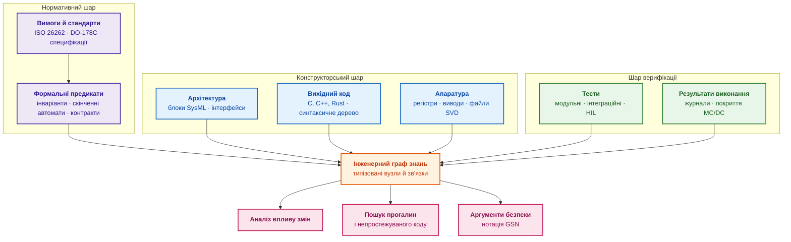
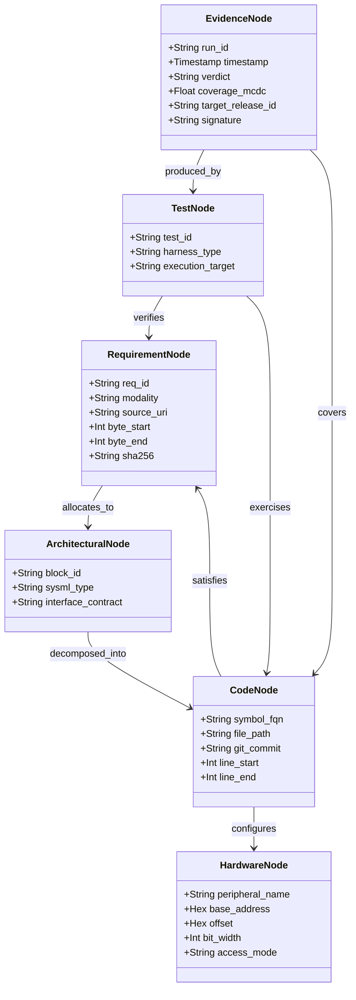
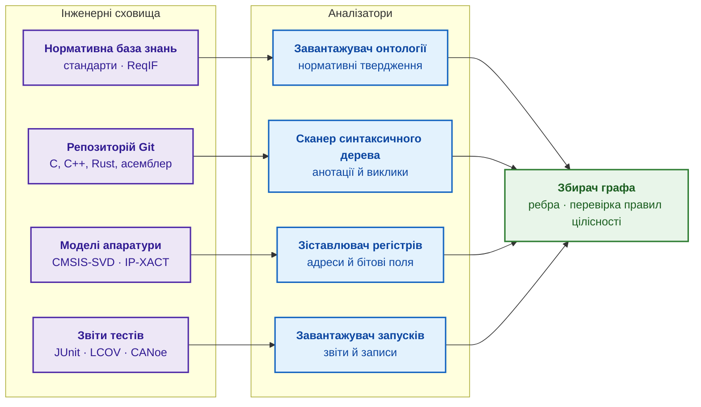
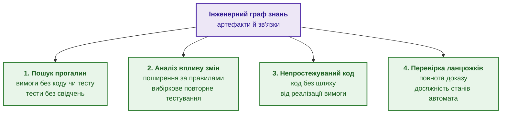
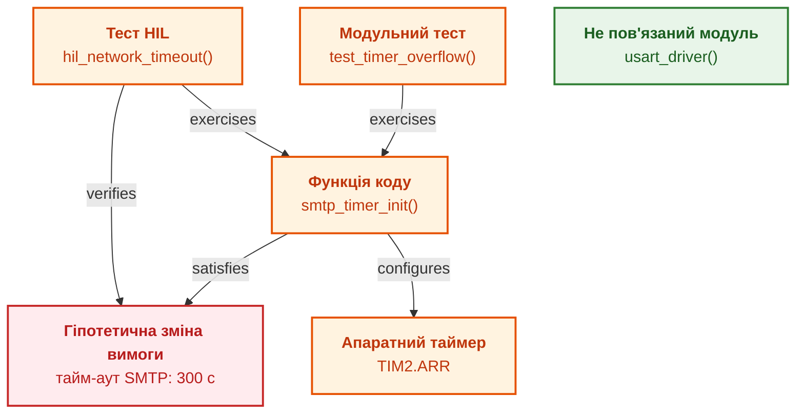
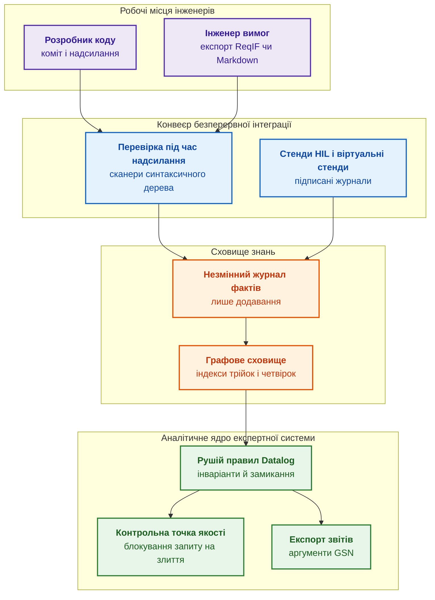
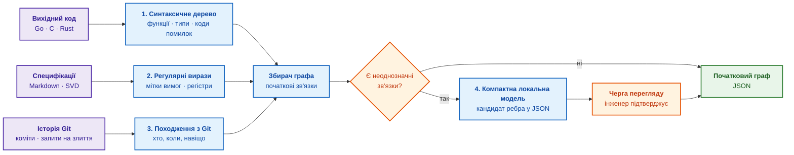
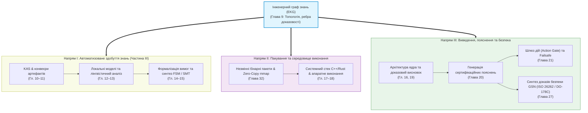

# Глава 9. Інженерний граф знань: простежуваність від вимог до апаратури

> **Книга:** [Архітектура доказових експертних систем](README.md) · [Частина II: Математичні моделі, представлення та збереження знань](part-02-knowledge-models.md)
> **Попередня глава:** [Глава 8. Інженерні артефакти як дані експертної системи](ch08-engineering-artifacts-as-data.md)
> **Наступна глава:** [Глава 32. Незмінні пакети знань: побайтовий допуск, індекси та відображення в пам'ять](ch32-high-performance-knowledge-packs-mmap-and-harvesting.md)
> **Зміст книги:** [README.md](README.md)
> **Автор:** [Микола Мартинович Федчик](about-the-author.md)
> **Передумови:** поняття множини, орієнтованого графа, функції та модульного тесту; потрібні означення нагадано в тексті. Практикум: [Лабораторна робота №1](learning/LABS.md).
> **Очікувані результати:** пояснити, що таке інженерний граф знань і чим граф відрізняється від таблиці простежуваності; описати типи вузлів і ребер від вимоги до біта апаратного регістра; сформулювати запити пошуку прогалин, непростежуваного коду й впливу змін; побудувати початкову версію графа автоматично з репозиторію.

## Анотація

Інженерний граф знань допомагає експертній системі відповісти на практичне питання: якщо змінено вимогу, який код, апаратуру й тести потрібно переглянути та якими результатами перевірок підтверджено їхню відповідність? Простежуваність означає можливість пройти такі зв'язки в обох потрібних напрямках, а не лише знайти однаковий ідентифікатор у документах. У главі крок за кроком побудовано шлях від окремого артефакту до типізованого графа, запиту до нього й перевірюваного програмного прикладу; сам факт наявності ребра не приймається за доказ правильності реалізації.

Для конкретного інженерного профілю простежуваності в монографії запропоновано архітектурний варіант графа знань (*Engineering Knowledge Graph*, EKG), що поєднує вимоги, архітектуру, код, апаратуру, тести й результати запусків. Це застосування типізованих графів, а не нова загальна теорія графів; новизну інтеграції можна оцінювати лише через зіставлення з наявними підходами та вимірювання. Розглянуто три запити: пошук прогалин верифікації, виявлення непростежуваних функцій і аналіз впливу змін. Для кожного визначено вхідний знімок, правила обходу та межі висновку. Прогнозування пропущених зв'язків дає лише кандидатів для перегляду. Незмінний журнал і шлюз якості показують, як зберігати підстави між версіями; навчальна програма Go відтворює тільки початкове вилучення явних заяв. Відповідність конкретним цілям сертифікації потребує окремого обґрунтування, не випливає з наявності графа.

У навчальному сценарії контролер на стенді несподівано отримує переривання від апаратного таймера. Треба з'ясувати, яка вимога задає його налаштування, яка функція записує регістр і який тест перевіряв цю поведінку. Матриця проєкту містить вручну скопійовані ідентифікатори, але після перейменування функції один запис не оновлено, а результат тесту належить старому випуску. Записи простежуваності існують, проте їх недостатньо для потрібного пояснення: рядок «тест `test_network_timeout` перевіряє REQ-402» ще не доводить, що тест перевіряє граничні значення з вимоги. Сценарій ілюструє механізм розриву; тривалості пошуку причини тут не виміряно.

Далі наведено формальне подання EKG як типізованого графа простежуваності між вимогами, архітектурою, кодом, апаратними регістрами, тестами й результатами випробувань. Глава показує, як граф будується з коду, описів апаратури й звітів тестів, розглядає три аналізи (прогалини, непростежуваний код, вплив змін) і завершується програмою мовою Go для початкового вилучення явних зв'язків із репозиторію. Матеріал спирається на [Главу 7](ch07-knowledge-base-typology.md), де розглянуто семантичні графи й онтології, та на [Главу 8](ch08-engineering-artifacts-as-data.md), присвячену артефактам як об'єктам даних; формалізацію вимог у предикатах і скінченних автоматах розглянуто в [Главі 14](ch14-requirements-detection-and-formalization.md). Схема показує місце графа між шарами розробки.

**Діаграма 9.1. Тришарове подання інженерних знань: нормативний, конструкторський і верифікаційний шари**



Фіолетові блоки є нормативним шаром, сині блоки є конструкторським шаром, зелені блоки є верифікацією, помаранчевий блок є графом, рожеві блоки є аналізами, які граф уможливлює. Тести на апаратному стенді з імітацією оточення (*Hardware-in-the-Loop*, HIL) і покриття модифікованих умов і рішень (*Modified Condition/Decision Coverage*, MC/DC) належать до шару верифікації, а нотацію структурування цілей (*Goal Structuring Notation*, GSN) для аргументів безпеки розбирає [Глава 27](ch27-safety-case-gsn-synthesis.md). Спершу треба зрозуміти, чому зв'язки між шарами рвуться.

<a id="1-проблема-розриву-простежуваності-в-інженерних-середовищах"></a>
<a id="1-проблема-розриву-простежуваності-в-інженерних-екосистемах"></a>

## 1. Проблема розриву простежуваності між ізольованими інженерними ролями

Розрив простежуваності починається не з помилки у графі, а з різних способів описати той самий виріб. Аналітик бачить вимогу до таймера, програміст — функцію його налаштування, а випробувач — результат запуску тесту. Щоб поєднати ці описи, спочатку треба встановити, де зберігається кожен із них. Для навчального розбору використано евристичну карту п'яти груп джерел інженерної інформації; вона допомагає конкретній команді знайти місця можливого розриву, але не задає універсальної структури організацій:

1. **системні інженери й аналітики** ведуть вимоги в спеціалізованих базах (IBM DOORS, Jama Connect, PTC Windchill) або в обмінному форматі ReqIF;
2. **системні архітектори** моделюють компоненти мовою системного моделювання (*Systems Modeling Language*, SysML) чи в середовищі Enterprise Architect;
3. **програмісти** пишуть код у репозиторіях Git і розбивають роботу на задачі в трекерах;
4. **інженери з верифікації** пишуть тести (Python, Robot Framework, Vector CANoe), результати яких осідають у звітах конвеєра безперервної інтеграції;
5. **схемотехніки й розробники апаратури** описують регістри у форматах CMSIS-SVD (розділ 3.2) чи IP-XACT (стандарт IEEE 1685 для XML-опису електронних компонентів і карт адрес їхніх регістрів [[13]](#src-13)), таблицях Excel або технічних описах.

Зв'язок між просторами забезпечує матриця простежуваності (*traceability matrix*), тобто таблиця, куди інженери вручну копіюють ідентифікатори вимог, назви файлів коду й номери тестів. На основі огляду проблем простежуваності Джейн Клеланд-Гуанг і співавторів [[1]](#src-1) автором узагальнено чотири типові механізми розходження окремо керованої матриці. Це навчальна систематизація відомих ризиків, а не емпірично підтверджена модель чи доведення монотонного «закону» для кожного процесу:

- **застарівання після зміни:** якщо розробник змінив логіку чи перейменував функцію без оновлення пов'язаного запису, статична таблиця перестає відображати код;
- **ілюзія покриття:** запис `REQ-402 -> test_network_timeout()` не гарантує, що тест перевіряє граничні значення з вимоги REQ-402, а не завершується статусом «пройдено» через закоментовану перевірку;
- **ускладнений зворотний аналіз:** якщо таблиця містить лише пари «вимога — тест», шлях від біта регістра до системної вимоги доводиться відновлювати за іншими джерелами;
- **непомічений непростежуваний код:** якщо до таблиці занесено тільки відомі зв'язки, функції без таких зв'язків не потраплять у звіт. Для їх пошуку потрібен ще й повний перелік функцій. Тут корисно розрізняти зайвий код (*extraneous code*), що не простежується до вимог, мертвий код (*dead code*), який неможливо виконати, та деактивований код (*deactivated code*), навмисно не виконуваний у певних конфігураціях. Ці поняття розглядаються в контексті DO-178C [[2]](#src-2); конкретне нормативне рішення щодо вилучення чи обґрунтування коду потребує застосовного тексту стандарту, а не самого результату графового запиту.

Наприклад, після перейменування `timer_init` на `watchdog_init` вимога може залишитися незмінною, а старе посилання на символ — стати нерозв'язним. Перевірка має або знайти новий символ і підтвердити відповідність, або повідомити про втрату зв'язку. Такий контроль можна реалізувати і над реляційними таблицями: проблема полягає не у формі таблиці, а у відсутності повного реєстру та правил оновлення.

Підсумок розділу: окремо керовані зв'язки можуть відстати від артефактів. Звідси випливає сформульований автором *інженерний принцип синхронної еволюції зв'язків та артефактів*: після зміни першоджерела залежні зв'язки треба повторно перевірити в тій самій процедурі підготовки версії; непідтверджені зв'язки не переносити як чинні. Детерміноване вилучення автоматизує структурні перевірки, а змістове схвалення залишається окремою дією. Для точного запису цих відмінностей потрібна формальна модель графа.

## 2. Формальна модель інженерного графа знань (EKG)

Формальна модель потрібна, щоб питання «який тест перевіряв цю реалізацію?» мало однаковий зміст для людини й програми. Нагадаємо: орієнтований граф складається з вузлів і спрямованих ребер; семантична мережа додає до зв'язків імена [[3]](#src-3). В авторській моделі EKG вузол має тип, наприклад «вимога» чи «функція», а ребро — зміст, наприклад «реалізує». Мультиграф дозволяє кілька різних ребер між тією самою парою вузлів. Запишемо склад одного скінченного знімка графа:

**Формула (9.2). Склад інженерного графа знань**

```math
\mathcal{G}_{\mathrm{EKG}}=\big(\mathcal{V},\ \mathcal{E},\ s,\ t,\ \tau_v,\ \tau_e,\ \mathcal{A}_v,\ \mathcal{A}_e,\ \mathcal{P}\big)
```

Компоненти цього кортежу з дев'яти елементів:

- $`\mathcal{V}`$ є множиною вузлів, а $`\mathcal{E}`$ є множиною орієнтованих ребер з власними ідентифікаторами;
- $`s,t:\mathcal{E}\to\mathcal{V}`$ повертають початковий і кінцевий вузол ребра;
- $`\tau_v:\mathcal{V}\to\mathcal{T}_V`$ і $`\tau_e:\mathcal{E}\to\mathcal{T}_E`$ присвоюють типи вузлам і ребрам, а $`\mathcal{T}_V`$ та $`\mathcal{T}_E`$ є множинами відповідних типів;
- $`\mathcal{A}_v`$ і $`\mathcal{A}_e`$ є атрибутами вузлів і ребер, наприклад хешами, часовими мітками, зміщеннями в тексті й результатами вимірювань;
- $`\mathcal{P}`$ є множиною правил цілісності й логічного виведення, а дужки групують усі компоненти в один кортеж.

Це визначення задає структуру, а не виміряну величину: ідентифікатори й типи не мають фізичних одиниць; байтові зміщення, секунди чи відсотки належать конкретним атрибутам. У навчальному знімку візьмемо три вузли: вимогу R, функцію F і тест T. Ребро F → R типу `declares_satisfies` записує намір, а T → R типу `verifies` — призначення тесту. Отже, маємо три вузли і два ребра, але ще не маємо підтвердженої реалізації чи результату запуску. Саме це обмеження не дозволяє сплутати наявність структури з доказом. Діаграма показує, які атрибути знадобляться для її доповнення.

**Діаграма 9.3. Основні класи вузлів і напрямки зв'язків EKG**



Назви класів і атрибутів записано як ідентифікатори схеми даних, тому англійською. Вимога зберігає зміщення цитати в джерелі й хеш, код зберігає коміт і діапазон рядків, апаратний вузол зберігає адресу й ширину поля, свідчення зберігає вердикт, покриття, ідентифікатор цільового випуску й підпис стенда. Ідентифікатор має однозначно визначати випуск, для якого виконано запуск; сама версія стенда не прив'язує свідчення до перевірюваного коду.

### 2.1. Типологія вузлів: від системних вимог до апаратних регістрів

Типи вузлів визначають, які дані треба зіставляти у шляху «вимога — реалізація — перевірка». Наприклад, тестовий випадок описує дію, а свідчення фіксує результат одного її виконання: повторний запуск створює нове свідчення, не новий тестовий випадок. Позначення нижче задають підмножини скінченної множини вузлів; вони не є числовими метриками.

1. **Нормативні вузли** $`V_R\subset\mathcal{V}`$: розділи стандартів, нормативні твердження з модальностями (SHALL, MUST, REQUIRED), стани й переходи скінченних автоматів (*finite state machines*, FSM). Кожен нормативний вузол має прив'язку до джерела (*evidence grounding*): файл, точні межі цитати в байтах і хеш SHA-256 цитованого фрагмента.
2. **Архітектурні вузли** $`V_A\subset\mathcal{V}`$: компоненти, підсистеми, канали зв'язку, шини даних, контракти інтерфейсів (мови опису інтерфейсів, Protobuf, блоки SysML).
3. **Програмні вузли** $`V_C\subset\mathcal{V}`$: вузли абстрактного синтаксичного дерева (*abstract syntax tree*, AST), тобто модулі, структури, функції, методи й точки розгалуження, разом із хешем коміту й діапазоном рядків.
4. **Апаратні вузли** $`V_H\subset\mathcal{V}`$: периферійні контролери (UART, SPI, CAN, Ethernet), адреси регістрів у відображеному на пам'ять просторі введення-виведення (*memory-mapped I/O*), бітові поля регістрів, лінії переривань (IRQ), налаштування виводів (GPIO).
5. **Тестові вузли** $`V_T\subset\mathcal{V}`$: тестові випадки, сценарії введення несправностей (*fault injection*), специфікації тестів HIL, моделі для фазингу.
6. **Вузли свідчень** $`V_E\subset\mathcal{V}`$: конкретні запуски тестів, звіти про структурне покриття коду (операторами, гілками, MC/DC), записи логічних аналізаторів, дампи шин CAN чи Ethernet, підписані ключами стендів.

Для відношення `mitigates` у графі також використовуються вузли визначених небезпек $`V_{\mathrm{Hazard}}\subset\mathcal{V}`$. Перелік шести класів вище описує основні класи, але не визначає, чи перетинаються множини вузлів і чи охоплює перелік усі класи.

### 2.2. Семантична класифікація ребер та правила цілісності

Ребра графа задають не довільні асоціації, а інженерні відношення з визначеним змістом. Таблиця перелічує основні типи.

**Таблиця 9.4. Основні інженерні відношення**

| Тип ребра | Напрямок | Зміст | Де потрібне |
|---|---|---|---|
| `allocates_to` | $`V_R\to V_A`$ | вимогу призначено архітектурному блоку | розподіл вимог за ISO 26262-4 [[4]](#src-4) і DO-178C [[2]](#src-2) |
| `satisfies` | $`V_C\to V_R`$ | функція чи модуль реалізує вимогу; закрите ребро записують за умовами розділу 3.1 | простежуваність коду до низькорівневих вимог за DO-178C |
| `configures` | $`V_C\to V_H`$ | код налаштовує або читає фізичний регістр | пакет підтримки плати, описи CMSIS-SVD |
| `verifies` | $`V_T\to V_R`$ | тест призначено для перевірки вимоги; це заява каркаса тестів, а в покриття вона входить лише разом із `exercises` до коду з `satisfies` для тієї самої вимоги, `produced_by` і вердиктом PASS | верифікація й валідація за IEEE 1012 [[5]](#src-5) |
| `exercises` | $`V_T\to V_C`$ | тест викликає й навантажує блок коду | аналіз структурного покриття |
| `mitigates` | $`V_R\to V_{\mathrm{Hazard}}`$ | вимога є заходом проти визначеної небезпеки | аналіз небезпек і оцінка ризиків |
| `derived_from` | $`V_R\to V_R`$ | низькорівневу вимогу виведено із системної | походження вимог |
| `obsoletes` | $`V_R\to V_R`$ | нова редакція замінює або скасовує стару | керування версіями вимог |

Типи ребер є словником, з якого складаються запити аналізу. Збирач із розділів 3 і 6 та правила цілісності розділу 4 використовують також допоміжні відношення збирача й походження. Друга таблиця перелічує їх разом з участю в обчисленнях розділу 4: «так» означає, що тип ребра входить у означення множини, «ні» означає, що не входить, а «не визначено» означає, що глава правила не дає.

**Таблиця 9.5. Допоміжні відношення та їх участь у запитах**

| Тип ребра | Напрямок | Зміст | Статус | $`\mathcal{U}_R`$ | $`\mathcal{C}_{\mathrm{untraced}}`$ | $`\mathrm{Impact}`$ |
|---|---|---|---|---|---|---|
| `produced_by` | $`V_E\to V_T`$ | свідчення створене запуском тесту | факт стенда з підписом | так, разом із `verifies`, `exercises` до реалізації цієї вимоги й PASS | ні | не визначено |
| `calls` | $`V_C\to V_C`$ | функція викликає функцію | факт статичного аналізу | ні | так, через `calls*` | не визначено |
| `declared_in` | $`V_C\to V_C`$ | функцію оголошено в модулі, тобто у файлі вихідного коду | факт синтаксичного аналізу | ні | ні | не визначено |
| `declares_satisfies` | $`V_C\to V_R`$ | розробник або мовна модель заявляє, що функція реалізує вимогу | заява | ні | ні | не визначено |
| `decomposed_into` | $`V_A\to V_C`$ | архітектурний блок розкладено на програмні вузли | є лише на схемі розділу 2 | не використовується | не використовується | не визначено |
| `covers` | $`V_E\to V_C`$ | запис свідчення про покриття вказує на покритий код | є лише на схемі розділу 2 | не використовується | не використовується | не визначено |

Заява `declares_satisfies` і закрите ребро `satisfies` є різними записами: заяву створює збирач, а закрите ребро виникає лише за умовами розділу 3.1. Згадування вимоги в повідомленні коміту не є ребром, бо коміт не є вузлом графа: його ідентифікатор зберігає поле Context четвірки (розділ 5.1). Відношення `decomposed_into` і `covers` є лише на схемі, їхні сигнатури потребують підтвердження автора. Назву `declares_satisfies` збережено, бо вона стоїть у коді навчального збирача, у тесті й у виводі розділу 6; відмінність між «оголошено в мові програмування» (`declared_in`) і «заявлено розробником» (`declares_satisfies`) задають визначення в таблиці.

Порівняння з відкритими словниками обмежено тим, що перевірено за текстом специфікацій. У словнику походження PROV-O [[14]](#src-14) відношення `prov:wasDerivedFrom` веде від похідної сутності до вихідної, як і `derived_from`. Відношення `prov:wasGeneratedBy` пов'язує сутність із діяльністю, що її створила, тому для `produced_by` відповідність часткова: книжкове ребро веде від свідчення до тестового вузла, а запуск тесту за змістом ближчий до діяльності, ніж тестовий випадок. Відкритий словник Open Services for Lifecycle Collaboration (OSLC) для керування вимогами [[15]](#src-15) має відношення `satisfies` з тією самою назвою й напрямком, але приклад стандарту з'єднує системну вимогу з вимогою користувача, а не код із вимогою. Словник OSLC для керування якістю [[16]](#src-16) має `validatesRequirement` (від тестового випадку до вимоги, як `verifies`) і `reportsOnTestCase` (від результату тесту до тестового випадку, як `produced_by`). Відношень, що відповідали б `exercises` і `configures`, та розрізнення заяви й підтвердженого ребра в цих словниках немає; відповідність SysML і ReqIF не перевірено.

Підсумок розділу: граф має типізовані вузли основних шести класів і вузли небезпек, а також типізовані ребра двох груп (вісім основних типів і допоміжні відношення збирача й походження) з визначеним змістом; правила $`\mathcal{P}`$ перевіряють цілісність. Модель корисна лише тоді, коли граф будується й оновлюється автоматично.

> [!NOTE]
> **Авторська формальна модель інженерного графа знань ($`\mathcal{G}_{\mathrm{EKG}}`$, чотири групи складників)**
> 1. Шість основних класів вузлів: нормативні вимоги ($`V_R`$), архітектурні блоки ($`V_A`$), символи коду ($`V_C`$), периферійні регістри апаратури ($`V_H`$), верифікаційні тести ($`V_T`$) та свідчення виконання ($`V_E`$); для відношення `mitigates` використовуються також вузли небезпек ($`V_{\mathrm{Hazard}}`$).
> 2. Семантично типізовані орієнтовані ребра: визначені інженерні відношення розподілу (`allocates_to`), реалізації (`satisfies`), налаштування (`configures`), перевірки (`verifies`) та покриття (`exercises`).
> 3. Доказові атрибутивні дескриптори ($`\mathcal{A}_v, \mathcal{A}_e`$): прив'язка до криптографічних хешів комітів Git, байтових інтервалів цитат, фізичних адрес пам'яті MMIO та підписів тестових стендів.
> 4. Формальні правила цілісності та верифікаційні інваріанти ($`\mathcal{P}`$): детерміновані предикати логічного виведення для контролю замкненості та повноти графа.
> *Керування рантаймом / Інженерний інваріант:* кожне ребро має тип і походження; підпис підтверджує походження запису, але не доводить змістової правильності зв'язку. Статус заяви зберігається окремо від статусу підтвердженої реалізації.

## 3. Автоматизоване вилучення артефактів та конструювання графа

Автоматизоване вилучення відповідає на наступне питання: як отримати вузли й ребра з файлів, не переписуючи їх щоразу вручну? Детермінований аналізатор дає однаковий результат для однакових вхідних байтів і налаштувань; це властивість процедури, не доказ істинності вхідного документа. Як один із варіантів реалізації розглянуто конвеєр з окремими аналізаторами нормативних даних, коду, машинних описів апаратури й звітів тестів. Це приклад розподілу обов'язків, а не новий архітектурний патерн. Ручне змістове схвалення не заборонене: його також записують із походженням і перевіряють після зміни залежних артефактів. Локальна мовна модель може запропонувати неоднозначний зв'язок, але не підтвердити його (розділ 6).

**Діаграма 9.6. Чотири джерела й детерміновані аналізатори графа**



Фіолетові блоки є джерелами, сині блоки є аналізаторами, зелений блок збирає граф і перевіряє правила. Кожен аналізатор читає формат зі строгою структурою, тож ребра з цих форматів створюються детерміновано, без статистичних моделей. Наступні підрозділи показують чотири аналізатори на прикладах.

### 3.1. Зв'язування вихідного коду та вимог через абстрактне синтаксичне дерево (AST)

Зв'язування коду з вимогою починається з пошуку явної заяви, а не з автоматичного висновку про правильність програми. Абстрактне синтаксичне дерево (AST) подає функції, параметри й оператори як структуровані вузли; сканер може прив'язати коментар до конкретного оголошення. Нижче анотація `@satisfies` задає вхід для такого сканера. Це навчальний фрагмент C з умовними типами й станами, а не повна реалізація SMTP чи перевірена байтова цитата RFC.

<details>
<summary>Приклад мовою C: функція з анотаціями простежуваності</summary>

```c
/**
 * @brief Перевірка послідовності команд згідно зі станом сесії.
 * @satisfies REQ-PROTO-MAIL-042
 * @trace навчальна специфікація: розділ «Порядок команд»
 * @fsm_state TRANSACTION_READY
 */
protocol_status_t validate_command_sequence(session_context_t *ctx, command_t cmd) {
    if (ctx->state != STATE_TRANSACTION_READY) {
        return STATUS_ERR_BAD_SEQUENCE;
    }
    return STATUS_OK;
}
```

</details>

Сканер обходить синтаксичне дерево, знаходить символ `validate_command_sequence`, фіксує сигнатуру й розташування та вилучає заяву `declares_satisfies` до `REQ-PROTO-MAIL-042`. Тут застосовується сформульований автором *демаркаційний принцип розділення заявленої та підтвердженої реалізації*: коментар чи анотація не доводять виконання вимоги. Збирач графа зберігає заяву як запис про намір розробника, але перевірка покриття її не враховує. Закрите ребро `satisfies` експертна система записує лише за трьох підстав: є запис перегляду змісту коду, є залікований результат верифікаційного тесту цієї вимоги, є цифровий підпис уповноваженого власника вимоги. Закрите ребро додається новою четвіркою, контекст якої посилається на заяву, запис перегляду, свідчення тесту й підпис; заява лишається в історії (розділ 5.1). Хеш цитати не належить до підстав закриття. Хеш є атрибутом нормативного вузла (розділ 2.1) і підтверджує, що цитований фрагмент джерела не змінився після прив'язки; виконання описаної поведінки кодом хеш не підтверджує. Ця різниця однакова для анотації людини й пропозиції моделі. Повного критерію залікового результату тесту ця глава не дає: формула розділу 4.1 вимагає щонайменше вердикту PASS для поточного випуску.

Поведінку фрагмента можна перевірити двома входами: за коректного ненульового `ctx` зі станом, відмінним від `STATE_TRANSACTION_READY`, очікується `STATUS_ERR_BAD_SEQUENCE`; за вказаного стану — `STATUS_OK`. Параметр `cmd` тут не аналізується, тому фрагмент не перевіряє допустимості конкретної команди. Отже, навіть ці два успішні контролі не довели б виконання повної протокольної вимоги.

### 3.2. Картування вихідного коду на апаратні регістри за специфікаціями SVD та IP-XACT

Щоб дослідити зв'язок між драйверами й описами апаратури, у главі запропоновано алгоритм-прототип картування доступів до регістрів MMIO за CMSIS-SVD / IP-XACT: аналізатор завантажує машинний опис мікроконтролера у форматі CMSIS-SVD (*Common Microcontroller Software Interface Standard, System View Description*) [[6]](#src-6), а сканер коду низького рівня аналізує розіменування вказівників і макроси (детально формалізовано в [Главі 18](ch18-execution-infrastructure.md)). Це пропозиція для обмеженого набору конструкцій, а не перевірений універсальний метод; готовність потребує реалізації та тестового набору з відомими відповідностями й хибними спрацьовуваннями.

<details>
<summary>Приклад XML і C: опис регістра USART1 і функція, що вмикає приймач-передавач</summary>

```xml
<peripheral>
  <name>USART1</name>
  <baseAddress>0x40013800</baseAddress>
  <registers>
    <register>
      <name>CR1</name>
      <description>Control register 1</description>
      <addressOffset>0x00</addressOffset>
      <fields>
        <field>
          <name>UE</name>
          <description>USART enable</description>
          <bitOffset>13</bitOffset>
          <bitWidth>1</bitWidth>
        </field>
      </fields>
    </register>
  </registers>
</peripheral>
```

```c
#define USART1_BASE 0x40013800
#define USART1_CR1  (*(volatile uint32_t *)(USART1_BASE + 0x00))

void usart_enable(void) {
    USART1_CR1 |= (1 << 13); /* вмикання USART */
}
```

</details>

Символьний аналіз обчислює адресу `0x40013800 + 0x00` і маску біта 13 та зіставляє адресу з полем `UE` регістра `CR1`. Граф отримує ребро `configures` від функції `usart_enable` до апаратного вузла `HW_REG:USART1.CR1.UE`. Якщо в новій редакції технічного опису виробник змінив бітову маску чи оголосив поле зарезервованим, експертна система позначає ребро як конфліктне. Приклад охоплює лише CMSIS-SVD: стандарт IP-XACT [[13]](#src-13) описує карти пам'яті й регістри в іншому XML-форматі, тому для нього потрібен окремий аналізатор.

У попередньому прикладі база й зміщення — адресні величини в байтах; їх додавання дає адресу `0x40013800`. Нумерація бітів починається з нуля: зсув одиниці на 13 позицій дає маску `0x2000` у 32-бітному слові. Операція `|=` встановлює цей біт, зберігаючи інші. Таке зіставлення описує запис у регістр, а не доводить коректності драйвера: потрібні правильна ревізія опису, допустимість читання-модифікації-запису й відсутність конкурентної зміни регістра. XML тут є фрагментом опису периферії, не повним файлом пристрою.

### 3.3. Трасування верифікаційних артефактів: прив'язка тестів до вимог

Прив'язка тесту до вимоги потрібна, щоб відрізнити заплановану перевірку від успішно проведеної. Навчальний фрагмент pytest нижче реалізує перевірку очікуваного коду відповіді: вхід — команда `DATA` після скидання сесії, очікуваний результат — код 503, перевірка — оператор `assert`. Об'єкт `dut_client` має надавати тестовий стенд; без нього це не автономний тест. Позначка `verifies` описує призначення, а не засвідчує проходження.

<details>
<summary>Приклад мовою Python: тест із позначкою перевірюваної вимоги</summary>

```python
@pytest.mark.verifies("REQ-PROTO-MAIL-042")
@pytest.mark.target_state("TRANSACTION_READY")
def test_reject_out_of_sequence_command(dut_client):
    """Перевірка повернення помилки 503 при порушенні порядку команд."""
    dut_client.reset_state()
    response = dut_client.send_raw("DATA\r\n")
    assert response.code == 503, f"Очікувався код 503, отримано {response.code}"
```

</details>

Під час запуску тестів у конвеєрі аналізатор звітів фіксує три факти. Тест `test_reject_out_of_sequence_command` пов'язаний ребром `verifies` з вимогою `REQ-PROTO-MAIL-042`. Тест викликає функцію `validate_command_sequence` (ребро `exercises`), що підтверджують дані профілювання чи трасування. Нарешті, з'являється вузол свідчення з вердиктом, часом виконання, версією стенда, ідентифікатором цільового випуску й хешем журналу взаємодії. Цей ідентифікатор має однозначно вказувати на код або образ, що перевірявся; запуск з іншим ідентифікатором не зараховується для випуску $`\rho`$. Тут діє запропонований автором *патерн трифакторного підтвердження верифікації вимог*: граф строго розрізняє декларативне твердження розробника (`verifies`), виміряне покриття коду тестом (`exercises`) та зафіксований верифікаційний факт: вузол свідчення $`V_E`$ із підписом стенда та хешем журналу (детально формалізовано в [Главі 36](ch36-knowledge-testing-pyramid-and-variational-calibration.md)).

### 3.4. Нормалізація сутностей, розділення кореферентності та часова чинність фактів

Коли частина графа будується з неструктурованої документації, наївного розбиття тексту на фрагменти недостатньо. Наприклад, назви «сторожовий таймер», `WDT` і «він» можуть позначати один пристрій, але `WDT` двох різних мікроконтролерів не є одним вузлом. Спочатку встановлюють виріб і ревізію, потім зіставляють згадки. Неоднозначну пару залишають для перегляду: передчасне злиття вузлів створило б хибний шлях впливу. Дам'єн Березенко розглядає побудову графів знань для генерації з пошуком за участю агентів [[7]](#src-7), а для інженерного графа важливі чотири вимоги.

1. **Багаторівнева типізація сутностей.** Вузли мають семантичні категорії: активні модулі й керовані компоненти, рівні архітектури (від комплексу до мікросхеми чи регістра) і поняття, що охоплюють кілька підсистем («термомеханічна втома», «гальванічна розв'язка»).
2. **Розв'язання кореферентності (*coreference resolution*) й канонізація.** Технічний текст згадує ту саму сутність повною назвою, абревіатурою, займенником чи заводським артикулом. Перед створенням ребер кожну згадку зводять до одного канонічного ідентифікатора через зв'язування сутностей (*entity linking*), інакше граф може розпадатися на незв'язні фрагменти.
3. **Розріджений керований граф замість усіх можливих асоціацій.** Імовірнісні підходи, зокрема Knowledge Vault [[11]](#src-11), дають контекст для порівняння способів інтеграції знань, але ймовірнісність сама по собі не визначає щільності графа. В авторському профілі EKG до підтверджених шляхів допускають лише зв'язки визначених типів із належними підставами. Це зменшує кількість сторонніх шляхів; довільно видаляти підтверджене ребро заради розрідженості не можна.
4. **Часова чинність і дрейф понять (*concept drift*).** Перехід плати з ревізії 1.1 на ревізію 2.0 може змінити допустимі напруги чи призначення виводів. Кожен вузол і кожне ребро мають часові мітки й межі чинності за ревізіями, тож аудит поточної конфігурації може відсіяти знання, чинні лише для попередніх ревізій, якщо мітки чинності повні.

Підсумок розділу: ребра зі строгих форматів створюють детерміновані аналізатори, а ребра з неструктурованого тексту потребують канонізації сутностей, типізації й меж чинності. Побудований граф відкриває аналізи, які на розрізнених таблицях потребують ручної звірки.

> [!NOTE]
> **Авторські інваріанти розрідженого інженерного графа знань (чотири інваріанти)**
> 1. Багаторівнева семантична типізація сутностей: суворе розмежування рівнів абстракції від системного комплексу до мікросхеми, шини та бітового регістра.
> 2. Детермінована канонізація та розв'язання кореферентності: зведення підтверджених згадок однієї сутності до її стабільного ідентифікатора без ототожнення різних сутностей.
> 3. Топологічна розрідженість замість надлишкової щільності: заборона довільних евристичних асоціацій заради усунення комбінаторного шуму під час багатокрокових обходів.
> 4. Темпоральна чинність та ізоляція дрейфу ревізій: суворе версійне розмежування фізичних станів і констант між ревізіями апаратури та прошивок.
> *Керування рантаймом / Інженерний інваріант:* ребра без строгого онтологічного зв'язку або з порушенням меж часової чинності відхиляються на стадії прийому до графа і не беруть участі в обчисленні метрик безпеки.

## 4. Детерміновані алгоритми аналізу на інженерному графі

Детерміновані алгоритми аналізу перетворюють зібрані зв'язки на відповіді: що не перевірено, який код не простежується до вимог і що переглянути після зміни? Передумовою є визначений знімок графа й однакові правила запиту. Такий запит можна реалізувати і в реляційній базі; графова модель робить багатокрокові шляхи явними. Спочатку розглянемо прогалини, потім пошук кандидатів у пропущені зв'язки, непростежуваний код і вплив змін.

**Діаграма 9.7. Основні запити до інженерного графа**



Кожен клас є запитом до графа з формальним визначенням. Три перші аналізи розглянуто нижче, а перевірку доказових ланцюжків для аргументів безпеки розбирає [Глава 27](ch27-safety-case-gsn-synthesis.md).

### 4.1. Обчислення метрик покриття вимог та виявлення прогалин верифікації

Покриття вимог у критичних до безпеки виробах визначають суворіше, ніж покриття рядків коду. Треба показати, що кожна вимога має підтверджену реалізацію, тест, який навантажує цю реалізацію, і успішний запуск для потрібного випуску. У наступній навчальній формулі множини вже відфільтровано за чинною версією, схваленням, доступом і відсутністю відкликання. Заявлені й прогнозовані ребра, тобто заяви `declares_satisfies` і кандидати розділу 4.2, не входять до множини підтверджених зв'язків. Ребра `verifies` та `exercises` самі по собі є відповідно заявою каркаса тестів і фактом навантаження коду (розділ 3.3); формула зараховує тест лише за наявності обох ребер, зв'язку `satisfies` від навантаженого коду до тієї самої вимоги, ребра `produced_by` та вердикту PASS для поточного випуску. Перелік вимог і потрібні ділянки реєстрів мають бути оголошені повними; інакше відсутність ребра означає невідомість, а не доведену прогалину.

**Формула (9.8). Вимоги без підтвердженої реалізації або залікового запуску**

```math
\mathcal{U}_R=\Big\{\,r\in V_R\ \Big|\ \big(\neg\exists\,c\in V_C:\ c\xrightarrow{\mathrm{satisfies}}r\big)\ \lor\ \big(\neg\exists\,t\in V_T,\ e\in V_E,\ c\in V_C:\ t\xrightarrow{\mathrm{verifies}}r\ \land\ t\xrightarrow{\mathrm{exercises}}c\ \land\ c\xrightarrow{\mathrm{satisfies}}r\ \land\ e\xrightarrow{\mathrm{produced\_by}}t\ \land\ \mathrm{verdict}(e)=\mathrm{PASS}\ \land\ \mathrm{release}(e)=\rho\big)\,\Big\}
```

Як читати множину прогалин:

- $r$ є вимогою, $c$ є вузлом коду, $t$ є тестом, а $e$ є свідченням запуску тесту; код $c$ у тестовому ланцюгу має бути тим самим вузлом, що задовольняє вимогу й навантажується тестом;
- $`V_R`$, $`V_C`$, $`V_T`$ і $`V_E`$ є множинами вузлів вимог, коду, тестів і свідчень відповідно, а $\rho$ є поточним випуском;
- стрілки $`\xrightarrow{\mathrm{satisfies}}`$, $`\xrightarrow{\mathrm{verifies}}`$, $`\xrightarrow{\mathrm{exercises}}`$ і $`\xrightarrow{\mathrm{produced\_by}}`$ означають відповідно «реалізує вимогу», «перевіряє вимогу», «тест навантажує код» і «свідчення створене тестом»;
- $`\mathrm{verdict}(e)=\mathrm{PASS}`$ вимагає успішного результату, а $`\mathrm{release}(e)=\rho`$ вимагає, щоб запуск належав поточному випуску;
- $\neg\exists$ означає «не існує», $\lor$ означає «або», а $\land$ означає «і»; круглі дужки задають область дії кожного квантора, тому перший $\neg\exists$ стосується лише ребра $\mathrm{satisfies}$, а другий вимагає єдиного ланцюга з тестом, кодом, який тест навантажує та який задовольняє цю саму вимогу, і свідченням; фігурні дужки збирають усі вимоги, для яких виконується умова після вертикальної риски.

Вимога потрапляє в множину, якщо немає коду, що її реалізує, або немає тесту, який навантажує цей код і має успішне свідчення у поточному випуску. Кількість елементів лежить від 0 до $`\lvert V_R \rvert`$. Для непорожньої множини вимог частку покриття обчислимо у формулі (9.9). Якщо $`\lvert V_R \rvert = 0`$, частка не визначена: порожня множина прогалин сама по собі не підтверджує повноти вимог. Дію конвеєра для порожнього зрізу потрібно окремо погодити.

Розберімо логічний крок до підрахунку. Для R1 є підтверджена реалізація F1, тест T1 перевіряє R1 і навантажує F1, а свідчення E1 має `PASS` для поточного випуску: обидві умови відсутності хибні, тому R1 не є прогалиною. Якщо єдиний успішний запуск T1 належить попередньому випуску, друга умова істинна й R1 входить до множини прогалин. Так само не зараховується тест, що навантажив іншу функцію F2 без `satisfies` до R1. Це перевірка структури наявних підстав, а не достатності тестових сценаріїв.

**Керування рантаймом та критерій повноти верифікації:**
- **Локальний критерій релізного профілю:** для визначеного повного зрізу вимог перевіряють умову $`\lvert\mathcal{U}_R\rvert = 0`$. Для непорожнього зрізу це відповідає $100\%$ покриття за наведеною метрикою; перед оцінюванням окремо перевіряють повноту зрізу та правильність зв'язків. Відповідність конкретним цілям ISO 26262 і DO-178C потребує окремого обґрунтування;
- **Дія конвеєра:** якщо $`\lvert\mathcal{U}_R\rvert > 0`$, шлюз складання блокує збирання образу мікроконтролера, повертає код відмови `ERR_SAFETY_GAPS_DETECTED` та експортує звіт із переліком непокритих вимог.

**Числовий приклад розрахунку:**
У навчальному прикладі релізний зріз містить $`\lvert V_R \rvert = 150`$ вимог безпеки. Для 148 вимог зафіксовано реалізацію в коді та принаймні по одному тесту, який навантажує відповідну реалізацію й має свідчення зі статусом `PASS`. Для 2 вимог (`REQ-088` та `REQ-142`) тести завершилися з вердиктом `FAIL`, а інших придатних свідчень `PASS` у цьому випуску немає:

**Формула (9.9). Частка вимог із заліковими ланцюгами та її навчальний розрахунок**

```math
\mathrm{Coverage}(V_R)=1-\frac{\lvert\mathcal{U}_R\rvert}{\lvert V_R\rvert}
=1-\frac{2}{150}=\frac{148}{150}\approx 0{,}9867
```

Тут $`\mathrm{Coverage}`$ — безрозмірна частка від 0 до 1, $`\lvert\mathcal{U}_R\rvert`$ — число прогалин (2 вимоги), $`\lvert V_R\rvert`$ — загальне число вимог (150, строго додатне). Спочатку ділимо 2 на 150 і отримуємо приблизно 0,0133, потім віднімаємо від одиниці: покриття становить близько 98,67 %. Оскільки дві прогалини залишилися, авторський шлюз блокує випуск. Метрика рахує вимоги однаково й не вимірює ймовірності відмови чи сили окремого тесту.

> [!NOTE]
> **Авторський детермінований шлюз верифікації повноти покриття вимог ($`\mathcal{U}_R`$, три інваріанти)**
> 1. Інваріант повноти реалізації: кожна затверджена нормативна вимога $`r \in V_R`$ зобов'язана мати пряме ребро $`c \xrightarrow{\mathrm{satisfies}} r`$ від валідного символу вихідного коду.
> 2. Інваріант залікової верифікації: кожна вимога зобов'язана мати тест $`t \xrightarrow{\mathrm{verifies}} r`$, який навантажує код $`c`$, що має ребро $`c \xrightarrow{\mathrm{satisfies}} r`$, і успішне свідчення $`e \xrightarrow{\mathrm{produced\_by}} t`$ зі статусом $`\mathrm{PASS}`$.
> 3. Релізна ізоляція свідчень: тестові свідчення є дійсними виключно для цільового випуску $`\mathrm{release}(e) = \rho`$.
> *Керування рантаймом / Інженерний інваріант:* за наявності хоча б однієї прогалини ($`\lvert\mathcal{U}_R\rvert > 0`$) конвеєр активує блокування `ERR_SAFETY_GAPS_DETECTED` за правилом Fail-Closed.

### 4.2. Евристичне прогнозування пропущених зв'язків за мірою Адамік — Адара

Множина прогалин $`\mathcal{U}_R`$ показує вимоги без реалізації або без успішно виконаного тесту, але не каже, чи потрібного ребра справді немає, чи його просто не записали. У великих проєктах частина тестів фактично перевіряє певну вимогу, але ребро `verifies` між тестом і вимогою ніхто не провів. Прогнозування зв'язків (*link prediction*) пропонує кандидатів у такі ребра.

Метод має добре досліджене підґрунтя в аналізі мереж. Лібен-Новелл і Клейнберг порівняли міри близькості у графі на п'яти мережах співавторства з архіву препринтів arXiv з фізики й показали, що низка мір, зокрема міра спільних сусідів і міра Адамік і Адара, значно перевершує випадковий вибір пар: випадкова пара збігається з майбутнім зв'язком із імовірністю від 0,15 до 0,48 % залежно від мережі, але сира точність усіх мір відносно низька, а єдиного переможця серед мір немає [[8]](#src-8). Фам Тхі Тху Туї та Тхінь Тхі Туї додали до структурних ознак часові й семантичні: дані бібліографічних сервісів AMiner, DBLP і Mendeley звели до спільної онтології, узгодженої зі словниками SKOS (*Simple Knowledge Organization System*) і Dublin Core, і на цих ознаках випадковий ліс (*random forest*) і графові нейронні мережі з [Глави 6](ch06-applied-mathematics-for-expert-systems.md) суттєво перевершили традиційні моделі [[9]](#src-9). Автори застосували метод до прогнозування наукової співпраці, тож для інженерного графа схема є гіпотезою, яку перевіряють на власних даних: для пари «вимога, тест» ознаками стають спільні терміни словника домену, спільні сигнали й регістри, спільний компонент і часова близькість змін.

Для експертної системи важлива не лише точність прогнозу, а й пояснення, чому кандидата запропоновано. У главі розглянуто застосування класичної міри Адамік—Адара [[10]](#src-10) для ранжування можливих зв'язків «вимога — тест» і пояснення оцінки внесками спільних сусідів. Це адаптація відомої евристики, а не нова метрика; пропозиція не є доказом зв'язку, а її корисність треба оцінювати за precision/recall на незалежному розміченому наборі. Для наступного навчального розрахунку явно обираємо просту неорієнтовану проєкцію: враховуємо лише підтверджені зв'язки артефактів із сигналами, регістрами, компонентами й термінами, прибираємо напрямки, петлі та дублікати ребер. Це допоміжний граф ранжування, не заміна орієнтованого EKG; інша проєкція дасть інші оцінки.

**Формула (9.10). Оцінка кандидата за спільними сусідами**

```math
\mathrm{AA}(x, y) = \sum_{z \in N(x) \cap N(y)} \frac{1}{\ln \lvert N(z) \rvert}
```

Складники міри Адамік і Адара:

- $x$ і $y$ є вузлами пари-кандидата, наприклад вимогою й тестом;
- $N(v)$ є множиною сусідів вузла $v$ у графі: сигналів, регістрів, компонентів і термінів словника;
- $z$ пробігає спільних сусідів обох вузлів, а $\cap$ означає перетин множин;
- $\lvert N(z) \rvert$ є степенем спільного сусіда, тобто кількістю його сусідів, а $\ln$ є натуральним логарифмом;
- $`\mathrm{AA}(x, y)`$ є невід'ємною оцінкою для ранжування пар, а не ймовірністю.

Рідкісний спільний сусід має більшу вагу за частого: специфічний регістр дає більший внесок, ніж загальний термін, але не доводить потрібного зв'язку. Для різних $x$ і $y$ в обраній проєкції спільний сусід має степінь щонайменше 2, тому логарифм додатний. Оцінка безрозмірна, невід'ємна й не має універсальної верхньої межі; за відсутності спільних сусідів порожня сума дорівнює нулю. Формула симетрична, а напрямок кандидата `verifies` від тесту до вимоги задає схема типів. Виробничий вибір проєкції та порога потребує перевірки на розмічених даних.

**Керування рантаймом та інженерні пороги фільтрації:**
- **Поріг рекомендації кандидата ($`\tau_{\mathrm{suggest}} = 1{,}00`$):** якщо $`\mathrm{AA}(x, y) \ge \tau_{\mathrm{suggest}}`$, пара «вимога — тест» автоматично додається у вхідну чергу ревізії інженера (`review_inbox`) разом із поясненням спільних структурних маркерів;
- **Фільтрація за порогом:** якщо $`\mathrm{AA}(x, y) < 1{,}00`$, пара не потрапляє до черги. Поріг $1{,}00$ є авторською пропозицією; його точність і частку пропущених зв'язків треба перевірити на даних проєкту.

**Числовий приклад розрахунку:**
Розгляньмо вимогу про тайм-аут сторожового таймера і тест T-204, які мають трьох спільних сусідів: регістр `WDT_CTRL` зі степенем 4, сигнал `wdt_timeout` зі степенем 6 і термін «тайм-аут» зі степенем 120. Оцінка становить:

**Формула (9.11). Кандидат T-204 зі специфічними спільними сусідами**

```math
\mathrm{AA}(\text{REQ}, \text{T-204}) = \frac{1}{\ln 4} + \frac{1}{\ln 6} + \frac{1}{\ln 120} \approx 0{,}721 + 0{,}558 + 0{,}209 \approx 1{,}49
```

Числа 4, 6 і 120 — цілі степені сусідів у тій самій проєкції, не фізичні одиниці. Натуральні логарифми приблизно дорівнюють 1,386, 1,792 і 4,787; обернення й додавання дають безрозмірну оцінку 1,49. Рідкісний регістр додає більше за поширений термін.
Та сама вимога й тест T-090 мають лише термін «тайм-аут» і компонент керування живленням зі степенем 40:

**Формула (9.12). Кандидат T-090 лише із загальними сусідами**

```math
\mathrm{AA}(\text{REQ}, \text{T-090}) = \frac{1}{\ln 120} + \frac{1}{\ln 40} \approx 0{,}209 + 0{,}271 \approx 0{,}48
```

Тут REQ і T-090 — ідентифікатори другої пари, а 120 і 40 — степені двох її спільних сусідів, кожен щонайменше 2. Зокрема, логарифм 40 приблизно дорівнює 3,689; його обернене значення 0,271 разом із внеском 0,209 дає 0,48. Оцінки можна порівнювати, бо проєкція й спосіб підрахунку степеня незмінні; жодна з них не є ймовірністю істинності ребра.
Оскільки $`\mathrm{AA}(\text{REQ}, \text{T-204}) \approx 1{,}49 \ge 1{,}00`$, за запропонованим порогом інженер отримує пропозицію зв'язати тест T-204 з вимогою. Пара з тестом T-090 ($`0{,}48 < 1{,}00`$) не потрапляє до черги, але це не доводить відсутності зв'язку.

### 4.3. Виявлення непростежуваного коду та його відмінність від мертвого коду за DO-178C

Код, що не простежується до вимог, є потенційною загрозою безпеці: забуті налагоджувальні заглушки, недокументовані функції чи навмисно вбудовані вектори атаки. Наївне правило «функція без прямого ребра `satisfies` є зайвою» дає хибні спрацювання на допоміжних функціях, які викликає функція, що реалізує вимогу. Точніше визначення враховує ланцюжки викликів:

Для цього запиту $`V_C`$ означає саме функції визначеного зрізу: модулі, типи й точки розгалуження з ширшої моделі розділу 2 не включаємо до рахунку функцій. Інакше запит помилково позначав би модуль як непростежуваний лише тому, що функції не викликають файли.

**Формула (9.13). Функції без шляху від підтвердженої реалізації вимоги**

```math
\mathcal{C}_{\mathrm{untraced}}=\big\{\,c\in V_C\ \big|\ \neg\exists\,c'\in V_C,\ r\in V_R:\ c'\xrightarrow{\mathrm{satisfies}}r\ \land\ c'\xrightarrow{\mathrm{calls}^{*}}c\,\big\}
```

Позначення непростежуваного коду:

- $c$ є вузлом коду, який перевіряють, $c'$ є вузлом коду, що реалізує вимогу $r$, а $`V_C`$ і $`V_R`$ є множинами вузлів коду й вимог;
- $`\xrightarrow{\mathrm{satisfies}}`$ позначає реалізацію вимоги, а $`\xrightarrow{\mathrm{calls}^{*}}`$ позначає шлях викликів від $c'$ до $c$;
- зірочка в $`\mathrm{calls}^{*}`$ означає рефлексивно-транзитивне замикання: шлях може мати нуль кроків, один прямий виклик або кілька послідовних викликів;
- $\neg\exists$ означає, що не існує вузла, який задовольняє описаний шлях, а фігурні дужки формують множину таких вузлів $c$.

Результатом є множина функцій, до яких не веде записаний шлях від реалізації вимоги; її розмір лежить від 0 до $`\lvert V_C \rvert`$. Цикли викликів не порушують означення досяжності: наприклад, за взаємних викликів двох функцій обидві досяжні, якщо перша реалізує вимогу. Відсутність шляху в неповному графі не доводить його відсутності в програмі. Непростежуваний код може виконуватися, а мертвий код потребує окремого аналізу можливості виконання; ці поняття не тотожні.

Для ручної перевірки візьмемо чотири функції: `control`, `read_sensor`, `convert` і `debug`. Перша має `satisfies` до R1, вона викликає другу, а друга — третю. Починаємо з `control` (шлях нульової довжини), додаємо `read_sensor`, потім `convert`. До `debug` шляху немає, тому результат містить лише її: одна непростежувана функція з чотирьох. У програмі такий обхід виконується чергою або стеком із множиною вже відвіданих вузлів; вона запобігає зацикленню. Це не оцінка часу виконання функцій і не підстава автоматично видаляти `debug`.

**Керування рантаймом та шлюз статичного аналізу коду:**
- **Локальний контрольний показник:** кількість функцій без записаного шляху $`\lvert\mathcal{C}_{\mathrm{untraced}}\rvert`$ інтерпретують лише для повного й визначеного зрізу коду та графа. Нульове значення саме по собі не доводить безпечності, а ненульове не доводить наявності дефекту; застосування до цілей DO-178C потребує окремого обґрунтування.
- **Дія конвеєра збирання:** перевірка `untraced-symbol` після компонування зіставляє таблицю символів образу з графом і спрямовує нерозв'язані випадки на інженерний розгляд. Випуск блокується, якщо після перевірки повноти графа залишився невирішений обов'язок за затвердженим профілем. Інженер може відновити трасування, обґрунтувати допоміжний чи згенерований код або розглянути похідну вимогу (*derived requirement*); перелік рішень і їх затвердження визначає процес.

**Числовий приклад:**
У навчальному прикладі граф кодової бази мікроконтролера керування гальмами містить $`\lvert V_C \rvert = 84`$ функції. Функція `dbg_force_override()` не має записаного шляху виклику від реалізації вимоги ($`\lvert\mathcal{C}_{\mathrm{untraced}}\rvert = 1`$). Перевірка блокує випуск до розгляду функції та можливих прогалин графа; наведені дані не доводять, що функція є мертвою.

> [!NOTE]
> **Аналіз непростежуваного коду за графом викликів ($`\mathcal{C}_{\mathrm{untraced}}`$, три кроки)**
> 1. Графовий аналіз досяжності: обчислення рефлексивно-транзитивного шляху викликів $`c' \xrightarrow{\mathrm{calls}^*} c`$ від кореневих функцій, що реалізують нормативні вимоги $`c' \xrightarrow{\mathrm{satisfies}} r`$.
> 2. Захист службових функцій: виключення хибнопозитивних дефектів для допоміжних утиліт і бібліотечних модулів, досяжних із завірених реалізацій.
> 3. Виявлення непростежуваного коду: ізоляція функцій без записаного шляху від реалізації вимоги ($`\lvert\mathcal{C}_{\mathrm{untraced}}\rvert > 0`$) для окремого розгляду.
> *Керування рантаймом / Інженерний інваріант:* результат аналізу передається на перевірку повноти графа й класифікацію коду; шлюз блокує випуск лише за невирішеної невідповідності затвердженому профілю.

### 4.4. Алгоритми аналізу впливу змін (Change Impact Analysis)

Зміна вимоги ставить питання, які артефакти й тести вона зачіпає. Що станеться, якщо комітет випустить нову редакцію стандарту зі зміненим тайм-аутом або замовник змінить максимальний час відповіді приводу? Без графа відповідь дає ручне перечитування документів або повторний запуск усього набору тестів, а на апаратних стендах повний набір може тривати значно довше за вибірковий; тривалість залежить від проєкту й у цій главі не виміряна. Для описаного графа зручно формально задати запит спрямованого аналізу впливу змін $`\mathrm{Impact}(v^*)`$ за правилами семантичного поширення $\delta$:

**Формула (9.14). Зона впливу зміни за заданими правилами обходу**

```math
\mathrm{Impact}(v^{*})=\big\{\,u\in\mathcal{V}\ \big|\ v^{*}\leadsto_{\delta}u\,\big\}
```

Що означає досяжність:

- $`v^{*}`$ є зміненим вузлом, $u$ є будь-яким вузлом графа, а $`\mathcal{V}`$ є множиною всіх вузлів;
- $`v^{*}\leadsto_{\delta}u`$ означає, що існує шлях від зміненого вузла до $u$, а $\delta$ задає напрямок обходу для кожного типу ребра;
- $`\mathrm{Impact}(v^{*})`$ є множиною вузлів, досяжних за цими правилами, включно з початковим вузлом, якщо дозволено шлях нульової довжини;
- $`\{v^{*}\}`$ є множиною з одним початковим вузлом, а фігурні дужки в означенні формують усі вузли, що відповідають умові шляху.

**Прикладове правило планування регресії з умовним порогом 15 %**

Множина впливу й її потужність не мають фізичних одиниць. У наступних прикладах дозволено шлях нульової довжини, тому результат містить від 1 до загальної кількості вузлів непорожнього знімка. Наприклад, для вимоги R1, функції F1 з `satisfies` до R1 і тесту T1 з `exercises` до F1 починаємо з R1, переходимо проти `satisfies` до F1, а потім проти `exercises` до T1. Отримано три вузли; це список кандидатів на перегляд, а не твердження, що всі три обов'язково зміняться.
- У цьому навчальному прикладі, якщо відношення $`\lvert\mathrm{Impact}(v^{*})\rvert / \lvert\mathcal{V}\rvert \le 0{,}15`$, планувальник призначає **селективну регресію**: до плану входять тести з підмножини $`\mathrm{Impact}(v^{*}) \cap V_T`$;
- Якщо $`\lvert\mathrm{Impact}(v^{*})\rvert / \lvert\mathcal{V}\rvert > 0{,}15`$, навчальне правило призначає повний прогін регресійних випробувань. Для виробничого використання потрібні передумови, наведені далі.

Поріг $15\%$ є авторською пропозицією, а не підтвердженою універсальною межею або критерієм безпечності вибіркової регресії. Мала частка вузлів сама по собі не дозволяє пропускати тести: потрібні обґрунтовані правила поширення, достатньо повні залежності й затверджений план випробувань. До підтвердження цих передумов правило придатне для навчального планування, не як єдина підстава виробничого допуску. Наявність зміненого вузла передбачає непорожню множину $`\mathcal{V}`$; обробку порожнього або неповного графа потрібно погодити окремо.

**Числовий приклад розрахунку:**
У навчальному прикладі граф керування трансмісією має $`\lvert\mathcal{V}\rvert = 1\,200`$ вузлів, а змінено вузол драйвера CAN ($`v^*`$). Якщо шлях нульової довжини дозволено, зона впливу містить $`\lvert\mathrm{Impact}(v^*)\rvert = 18`$ вузлів: змінений драйвер, один інтерфейсний файл і 16 модульних тестів:

**Формула (9.15). Частка зони впливу в навчальному знімку**

```math
\frac{\lvert\mathrm{Impact}(v^*)\rvert}{\lvert\mathcal{V}\rvert} = \frac{18}{1\,200} = 0{,}015 \le 0{,}15
```

У чисельнику — 18 досяжних вузлів включно зі зміненим, у знаменнику — 1200 вузлів того самого знімка. Ділення дає безрозмірну частку 0,015, тобто 1,5 %; порівняння з авторським порогом 0,15 (15 %) обирає навчальну гілку вибіркового прогону, але не доводить його достатності.
За запропонованим правилом конвеєр призначає 16 тестів. Якщо для ілюстрації припустити тривалість 12 с замість 45 хв для повного набору, співвідношення становить 225:1; це не вимірювання і не гарантія виграшу. Пропущені зв'язки або недостатні правила поширення можуть залишити частину фактичного впливу поза вибіркою.

Для зміни вимоги в наведеному прикладі поширення йде проти напрямку ребер `satisfies` і `verifies`, за напрямком `configures` і проти напрямку `exercises`. Ці напрямки застосовують послідовно на допустимих шляхах; повний набір правил для інших типів ребер і змін потребує визначення. Запропоновано обходити лише підтверджені ребра: заяви `declares_satisfies` у множину впливу й у поріг 15 % не входять, а за потреби їх виводять окремим переліком; це правило потрібно окремо погодити. Схема показує приклад, а не доказ повноти аналізу.

**Діаграма 9.16. Напрямки ребер і зона впливу зміни вимоги**



Червоний вузол є зміненою вимогою, помаранчеві вузли є зоною впливу, зелений вузол лишається поза зоною на цій схемі. Алгоритм знаходить функцію `smtp_timer_init()` проти ребра `satisfies`, регістр `TIM2.ARR` за ребром `configures` і два тести: `test_timer_overflow` та `hil_network_timeout`. Вибіркове регресійне тестування (*selective regression testing*) лишає інші тести поза цим прогоном. Пропущене ребро може приховати вплив; періодичний повний прогін є додатковою перевіркою, але не доводить повноти графа чи тестів.

Підсумок розділу: три аналізи є формальними запитами до графа з визначеними множинами-результатами, а корисність запитів залежить від повноти ребер і правил поширення. Щоб запити працювали на кожній зміні, граф має бути частиною конвеєра розробки.

## 5. Архітектура промислової платформи управління графом знань

Архітектура платформи має зберегти відповіді попереднього розділу після наступного коміту: аудитору потрібен не лише поточний граф, а й підстави попереднього висновку. Один із можливих варіантів реалізації EKG поєднує незмінний журнал фактів, графове сховище, рушій правил і шлюз якості. Журнал зберігає події, сховище індексує зв'язки для запитів, а правила визначають, які підстави зараховувати. Це можливий розподіл відповідальності, а не новий промисловий патерн і не вимога розгортати чотири окремі сервери; альтернативи залежать від обсягу даних і вимог до запитів.

**Діаграма 9.17. Від події зміни до індексу графа й рішення шлюзу**



Фіолетові блоки є джерелами змін, сині блоки є конвеєром, помаранчеві блоки є сховищем, зелені блоки є аналітичним ядром. Рушій правил мовою Datalog, яку пояснила [Глава 6](ch06-applied-mathematics-for-expert-systems.md), обчислює інваріанти й транзитивні замикання, а результати використовують контрольна точка якості й експорт звітів.

Тут застосовується сформульоване автором *інженерне правило шардування графа за виробом і базовою версією* (детально формалізовано в [Главі 7](ch07-knowledge-base-typology.md)): коли граф перестає вміщатися на одному вузлі, його розбивають на шарди за ключем виробу й базової версії, а не за типом вузла, бо запит простежуваності проходить від вимоги через функцію до тесту. Якщо розмістити вимоги на одному вузлі, функції на іншому, а тести на третьому, кожен шлях простежуваності стає міжшардовим. Мірою якості розбиття є частка розрізаних ребер графа. За мовчання шарда запит повертає «невідомо», а не «зв'язку немає», інакше відсутнє ребро простежуваності буде прочитане як відсутній тест. Визначення й правила розбиття наведено в [Главі 7](ch07-knowledge-base-typology.md).

### 5.1. Незмінний лог версійованих четвірок (RDF-Quads / PROV-O)

Незмінний журнал потрібен, щоб нове схвалення чи відкликання не стирало стару підставу. Нагадаємо різницю двох часів: час чинності каже, коли факт стосується виробу, а час запису — коли система про нього дізналася. Авторська *модель версійованих незмінних четвірок із контекстом походження* використовує RDF-трійку «суб'єкт — предикат — об'єкт» і четверте поле, яке посилається на опис походження та версії:

**Формула (9.18). Запис зв'язку з ідентифікатором контексту**

```math
\langle\,\mathrm{Subject},\ \mathrm{Predicate},\ \mathrm{Object},\ \mathrm{Context}\,\rangle
```

Поля незмінного факту:

- $`\mathrm{Subject}`$ є вузлом-джерелом, наприклад функцією;
- $`\mathrm{Predicate}`$ є типом зв'язку, наприклад `satisfies`, а $`\mathrm{Object}`$ є вузлом-ціллю, наприклад вимогою;
- $`\mathrm{Context}`$ є ідентифікатором контексту походження; пов'язаний запис зберігає коміт чи ревізію, автора, час і підпис інструмента. У RDF-четвірці це ім'я графа, не довільний вкладений об'єкт;
- кутові дужки й коми задають упорядкований кортеж із чотирьох полів; трійка перших полів відповідає моделі RDF, а четверте розрізняє контекст факту.

Перші три поля позначають сутності й відношення, а четверте — іменований контекст; сам кортеж не має фізичних одиниць. У навчальному прикладі запис «F, `declares_satisfies`, R, C1» фіксує анотацію. Після перегляду, тесту й підпису додається «F, `satisfies`, R, C2», а C2 посилається на ці підстави. Запит до C1 не повинен бачити пізніше схвалення C2. Для відкликання також додають запис, не видаляючи старого. Отже, відновлення минулого стану можливе лише за збережених контекстів, меж чинності й правил відбору; сама незмінність журналу цього не забезпечує.

Модель RDF описано в [[12]](#src-12); авторський внесок тут — інженерний профіль версій, походження та допуску, а не винайдення RDF-четвірки. PROV-O [[14]](#src-14) дає словник сутностей, діяльностей і агентів; точне відображення полів контексту на його терміни й повний протокол відкликання в цій главі не задано.

### 5.2. Шлюз контролю якості в конвеєрі безперервної інтеграції (CI/CD Quality Gate)

Шлюз якості використовує історію й запити, щоб відповісти, чи вистачає підстав для злиття конкретної зміни. Він перевіряє знімок кандидата, а не тільки вже опубліковану головну гілку. Нижче наведено три правила авторського профілю; позначки ASIL D і рівня A задають можливий контекст виробу, але не перетворюють ці правила на дослівні приписи стандартів:

1. **збереження цілісності:** нову функцію не можна додати без ребра `satisfies` до затвердженої вимоги або без шляху викликів від такої функції;
2. **перевірюваність:** зміна логіки функції робить результати старих запусків недостатніми для нового коміту; визначення тесту й заявлений зв'язок `verifies` можуть залишитися чинними. Новий запуск створює окремий запис, а старий лишається в історії;
3. **перевірка зачеплених вимог:** для вимог прийнятого профілю критичності, яких торкнулася зміна, наявні залікові ланцюги розділу 4.1 у знімку кандидата. Для набору змінених вузлів аналіз повторюють для кожного й об'єднують результати; це не доказ відсутності будь-якої регресії.

Наприклад, для нової функції F1 спочатку збирають і тестують кандидат випуску, отримують запис перегляду та підпис власника вимоги, а вже потім перевіряють підтверджене `satisfies` у цьому кандидаті. Це усуває логічне коло «тестувати лише після злиття, зливати лише після тесту»: підстави можна отримати на гілці кандидата. За браком підстав суворий шлюз чекає, а не підвищує `declares_satisfies` до підтвердженого зв'язку. Конкретне зв'язування ідентифікатора кандидата з остаточним комітом злиття потребує окремого протоколу; автоматично переносити результати на змінений образ не можна.

> [!NOTE]
> **Авторські правила блокувального шлюзу якості (CI/CD Graph Quality Gate, три правила)**
> 1. Збереження топологічної цілісності: заборона злиття коду з новими функціями без явного ребра `satisfies` до вимоги або підтвердженого шляху виклику від валідованого символу.
> 2. Версійна актуальність свідчень: старий запуск не зараховується для зміненої реалізації; визначення тесту зберігається. Зміна хешу AST є одним із сигналів перегляду, але незмінний AST не виключає змін компілятора, залежностей або конфігурації.
> 3. Перевірка зачеплених вимог: для вимог прийнятого профілю критичності в об'єднаній зоні впливу потрібні залікові ланцюги кандидата. Це умова авторського шлюзу, не загальна гарантія безпеки чи відсутності регресії.
> *Керування рантаймом / Інженерний інваріант:* порушення будь-якого з трьох правил блокує злиття кандидата; перевірку можна розмістити в CI або серверному хуку. Місце запуску не замінює перевірки ідентичності кандидата й свідчень.

Підсумок розділу: незмінний журнал четвірок дає відтворюваність, а правила в конвеєрі змін не дають графу застаріти. Лишається головне заперечення скептиків: скільки коштує побудувати граф уперше.

## 6. Стратегія холодного старту: автоматична ініціалізація графа знань із репозиторію

Холодний старт розв'язує задачу порожнього сховища: з чого почати, коли файли вже існують, але вузлів і ребер ще немає? Для початкового наповнення графа автором запропоновано практичну послідовність із чотирьох етапів: (1) зібрати ідентифіковані артефакти; (2) вилучити явні заяви синтаксичними аналізаторами й правилами; (3) додати походження з історії змін; (4) передати неоднозначні зв'язки на ручний розгляд. Це workflow, а не окрема методологія. Автоматизація зменшує копіювання, але не скасовує інженерного моделювання: початкова версія з анотацій є реєстром заявлених зв'язків, не готовим доказом виконання вимог.

**Діаграма 9.19. Ініціалізація графа та відокремлення кандидатів**



Фіолетові блоки є джерелами, сині блоки є кроками, помаранчеві блоки відокремлюють неоднозначні зв'язки й перегляд людиною, зелений блок є результатом. Кроки працюють так.

1. **Синтаксичне дерево коду.** Аналізатор (стандартний пакет `go/parser` мови Go чи універсальний tree-sitter) обходить файли репозиторію: кожен файл стає вузлом модуля, кожна функція вузлом функції з ребром `declared_in`. Повніший збирач може додати кожен виклик як ребро `calls` і кожен код повернення помилки як вузол контракту помилки; навчальна програма нижче цього не робить.
2. **Регулярні вирази для вимог і апаратури.** Детерміновані шаблони визначення вимог виду `[REQ-SYS-XXX]:` чи `[REQ-SW-XXX]:` у документах створюють вузли вимог (навчальна програма читає лише файли Markdown), а файли CMSIS-SVD у повнішому збирачі створюють вузли регістрів із бітовими полями (навчальна програма їх не читає).
3. **Походження з Git.** У повнішому збирачі згадування `REQ-214` у повідомленні коміту записується як поле контексту (розділ 5.1), а не як ребро, бо коміт не є вузлом графа, а `@satisfies REQ-214` створює заяву про реалізацію. Обидва записи отримують коміт як контекст, але сам коміт не перетворює заяву на підтверджене `satisfies`.
4. **Вузька компактна модель для неоднозначних зв'язків.** Коли прямого збігу ідентифікаторів немає (функція називається `ApplyThermalCutoff()`, а специфікація каже «пристрій зобов'язаний аварійно вимкнути силове коло при перегріві»), реалізується авторський *патерн гібридної демаркації*: збирач графа звертається до компактної локальної мовної моделі (SLM через середовище Ollama, пор. [Глава 12](ch12-linguistic-analysis-and-local-models.md) та [Глава 38](ch38-curing-machine-hallucinations-and-knowledge-deficits.md)). Модель функціонує лише як генератор гіпотез: вона повертає валідний JSON із кандидатом ребра й оцінкою впевненості; кандидат маркується прапорцем і спрямовується до черги `review_inbox` для верифікації провідним інженером (Human-in-the-Loop), не блокуючи побудову решти графа.

Програма нижче читає визначення вимог, функції й анотації, тобто виконує кроки 1 і 2 лише для файлів Markdown і Go; кроки 3 і 4 вона не виконує. Вона не читає історію Git, не обчислює граф викликів і не перевіряє поведінку. Типи вузлів програми відповідають класам розділу 2.1: `Requirement` належить до $`V_R`$, а `Module` і `Function` належать до $`V_C`$; вузли вимог програми не мають меж цитати й хешу, тому прив'язки до джерела з розділу 2.1 вони не виконують. Ідентифікатор функції включає файл і тип отримувача методу. Для функцій `init`, яких може бути кілька в одному файлі, ідентифікатор додатково містить байтову позицію оголошення. Переміщення файла або зміна тексту перед `init` можуть змінити навчальний ідентифікатор; стійка міжверсійна ідентичність потребує окремої моделі відповідності.

<details>
<summary>Приклад мовою Go: початковий граф із репозиторію</summary>

Формат навчального входу навмисно вузький: ідентифікатор має вигляд `REQ-SW-214` або `REQ-SYS-214`, тобто один буквений сегмент і десяткове число. Складений ідентифікатор `REQ-PROTO-MAIL-042` з прикладу C цей регулярний вираз не розпізнає. Визначення вимог у вхідних файлах мають бути унікальними; збирач не діагностує дублікати й не відрізняє визначення в тексті від демонстрації в кодовій огорожі. Це передумови цього прикладу, не обмеження формальної моделі EKG.

Збирач реалізує метод початкового вилучення: `WalkDir` перелічує файли, `go/parser` знаходить оголошення, регулярні вирази читають явні ідентифікатори, а перевірка `known` розділяє розв'язні та розірвані посилання. Програма складається з одного файла й запускається командою `go run main.go sample`, де `sample` містить лише наведені далі `requirements.md` і `thermal.go`. Очікуються п'ять вузлів, три ребра й одне розірване посилання; JSON нижче є контрольним результатом для цього входу. Поведінку перевіряє також наступний модульний тест.

```go
package main

import (
	"encoding/json"
	"fmt"
	"go/ast"
	"go/format"
	"go/parser"
	"go/token"
	"io/fs"
	"os"
	"path/filepath"
	"regexp"
	"strings"
)

// Node є вузлом графа: вимогою, модулем або функцією.
type Node struct {
	ID   string `json:"id"`
	Type string `json:"type"`
	File string `json:"file"`
}

// Edge є типізованим ребром графа.
type Edge struct {
	Source   string `json:"source"`
	Relation string `json:"relation"`
	Target   string `json:"target"`
}

// Graph є початковою версією інженерного графа знань.
type Graph struct {
	Nodes  []Node   `json:"nodes"`
	Edges  []Edge   `json:"edges"`
	Broken []string `json:"broken_links"`
}

var (
	reqDef   = regexp.MustCompile(`\[(REQ-[A-Z]+-[0-9]+)\]:`)
	reqTrace = regexp.MustCompile(`@satisfies\s+(REQ-[A-Z]+-[0-9]+)`)
)

// bootstrap обходить каталог, збирає вимоги з Markdown і функції з коду Go.
func bootstrap(root string) (*Graph, error) {
	g := &Graph{}
	fset := token.NewFileSet()
	var traces []Edge
	err := filepath.WalkDir(root, func(path string, d fs.DirEntry, err error) error {
		if err != nil || d.IsDir() {
			return err
		}
		p := filepath.ToSlash(path)
		switch filepath.Ext(path) {
		case ".md":
			data, err := os.ReadFile(path)
			if err != nil {
				return err
			}
			for _, m := range reqDef.FindAllStringSubmatch(string(data), -1) {
				g.Nodes = append(g.Nodes, Node{ID: m[1], Type: "Requirement", File: p})
			}
		case ".go":
			file, err := parser.ParseFile(fset, path, nil, parser.ParseComments)
			if err != nil {
				return err
			}
			module := "module:" + p
			g.Nodes = append(g.Nodes, Node{ID: module, Type: "Module", File: p})
			for _, decl := range file.Decls {
				fn, ok := decl.(*ast.FuncDecl)
				if !ok {
					continue
				}
				receiver := ""
				if fn.Recv != nil {
					var receiverText strings.Builder
					if err := format.Node(&receiverText, fset, fn.Recv.List[0].Type); err != nil {
						return err
					}
					receiver = receiverText.String() + "."
				}
				id := "func:" + p + "#" + receiver + fn.Name.Name
				if fn.Recv == nil && fn.Name.Name == "init" {
					id = fmt.Sprintf("%s@%d", id, fset.Position(fn.Pos()).Offset)
				}
				g.Nodes = append(g.Nodes, Node{ID: id, Type: "Function", File: p})
				g.Edges = append(g.Edges, Edge{id, "declared_in", module})
				if fn.Doc == nil {
					continue
				}
				for _, m := range reqTrace.FindAllStringSubmatch(fn.Doc.Text(), -1) {
					traces = append(traces, Edge{id, "declares_satisfies", m[1]})
				}
			}
		}
		return nil
	})
	if err != nil {
		return nil, err
	}
	known := map[string]bool{}
	for _, n := range g.Nodes {
		known[n.ID] = true
	}
	for _, e := range traces {
		if known[e.Target] {
			g.Edges = append(g.Edges, e)
		} else {
			g.Broken = append(g.Broken, e.Source+" → "+e.Target)
		}
	}
	return g, nil
}

func main() {
	root := "."
	if len(os.Args) > 1 {
		root = os.Args[1]
	}
	g, err := bootstrap(root)
	if err != nil {
		fmt.Fprintln(os.Stderr, "помилка:", err)
		os.Exit(1)
	}
	out, err := json.MarshalIndent(g, "", "  ")
	if err != nil {
		fmt.Fprintln(os.Stderr, "помилка:", err)
		os.Exit(1)
	}
	fmt.Println(string(out))
}
```

Файл `sample/requirements.md`:

```markdown
# Вимоги до контролера живлення

[REQ-SYS-214]: Пристрій вимикає силове коло, якщо температура перевищує 105 °C.
[REQ-SW-214]: Функція захисту перевіряє температуру кожні 10 мс.
```

Файл `sample/thermal.go`:

```go
package thermal

// ApplyThermalCutoff вимикає силове коло за перегріву.
// @satisfies REQ-SW-214
func ApplyThermalCutoff(tempC float64) bool {
	return tempC > 105
}

// LogTemperature записує температуру в журнал.
// @satisfies REQ-SW-215
func LogTemperature(tempC float64) {}
```

Програма друкує:

```json
{
  "nodes": [
    {
      "id": "REQ-SYS-214",
      "type": "Requirement",
      "file": "sample/requirements.md"
    },
    {
      "id": "REQ-SW-214",
      "type": "Requirement",
      "file": "sample/requirements.md"
    },
    {
      "id": "module:sample/thermal.go",
      "type": "Module",
      "file": "sample/thermal.go"
    },
    {
      "id": "func:sample/thermal.go#ApplyThermalCutoff",
      "type": "Function",
      "file": "sample/thermal.go"
    },
    {
      "id": "func:sample/thermal.go#LogTemperature",
      "type": "Function",
      "file": "sample/thermal.go"
    }
  ],
  "edges": [
    {
      "source": "func:sample/thermal.go#ApplyThermalCutoff",
      "relation": "declared_in",
      "target": "module:sample/thermal.go"
    },
    {
      "source": "func:sample/thermal.go#LogTemperature",
      "relation": "declared_in",
      "target": "module:sample/thermal.go"
    },
    {
      "source": "func:sample/thermal.go#ApplyThermalCutoff",
      "relation": "declares_satisfies",
      "target": "REQ-SW-214"
    }
  ],
  "broken_links": [
    "func:sample/thermal.go#LogTemperature → REQ-SW-215"
  ]
}
```

Програма знайшла заяву для `ApplyThermalCutoff` і розірване посилання для `LogTemperature`. Вона не довела виконання жодної вимоги. Ба більше, REQ-SW-214 задає період 10 мс, а функція лише порівнює температуру; приклад навмисно показує, чому правильний ідентифікатор не означає змістового покриття. Для відсутніх підтверджень потрібен звіт прогалин або невідомостей за оголошеною повнотою реєстру.

Наступний тест перевіряє саме межі збирача: однойменні функції та методи мають різні ідентифікатори, неіснуюча вимога дає розірване посилання, а збирач створює лише заяву `declares_satisfies` і ніколи `satisfies`. Остання перевірка фіксує поведінку цього навчального збирача і не доводить, що повніший збирач не створює підтвердженого ребра без перегляду. Тест розміщують поруч із програмою як `main_test.go` і виконують `go test main.go main_test.go`.

```go
package main

import (
	"os"
	"path/filepath"
	"testing"
)

func TestBootstrapIdentityAndClaims(t *testing.T) {
	root := t.TempDir()
	files := map[string]string{
		"requirements.md": "[REQ-SW-1]: example\n",
		"a/code.go":       "package a\ntype First struct{}\ntype Second struct{}\n// @satisfies REQ-SW-1\nfunc Run() {}\n// @satisfies REQ-SW-1\nfunc (First) Run() {}\n// @satisfies REQ-SW-9\nfunc (Second) Run() {}\n",
		"a/init.go":       "package a\nfunc init() {}\nfunc init() {}\n",
		"b/code.go":       "package b\n// @satisfies REQ-SW-1\nfunc Run() {}\n",
	}
	for relative, content := range files {
		path := filepath.Join(root, relative)
		if err := os.MkdirAll(filepath.Dir(path), 0700); err != nil {
			t.Fatal(err)
		}
		if err := os.WriteFile(path, []byte(content), 0600); err != nil {
			t.Fatal(err)
		}
	}
	graph, err := bootstrap(root)
	if err != nil {
		t.Fatal(err)
	}
	identifiers := map[string]bool{}
	for _, node := range graph.Nodes {
		if node.Type == "Function" {
			if identifiers[node.ID] {
				t.Fatalf("duplicate function ID: %s", node.ID)
			}
			identifiers[node.ID] = true
		}
	}
	if len(identifiers) != 6 || len(graph.Broken) != 1 {
		t.Fatalf("unexpected functions or broken links: %d, %v", len(identifiers), graph.Broken)
	}
	claims := 0
	for _, edge := range graph.Edges {
		if edge.Relation == "satisfies" {
			t.Fatal("annotation promoted to verified realization")
		}
		if edge.Relation == "declares_satisfies" {
			claims++
		}
	}
	if claims != 3 {
		t.Fatalf("expected three claims, got %d", claims)
	}
}
```

</details>

Навчальний збирач формує початковий граф і повідомляє про анотації, що посилаються на відсутні визначення вимог. Збирач не обчислює покриття й не знаходить усіх непокритих вимог: для цього потрібні окремі перевірки та визначена область повноти. Регулярні вирази й анотації відображають лише явно позначені дані, тому початковий граф може бути неповним.

## 7. Порівняльний аналіз: матриці простежуваності проти інженерного графа

Порівняння потрібне, щоб вибрати спосіб підтримки зв'язків, а не оголосити граф універсально кращим за таблицю. У цій главі процеси зіставлено за сімома навчальними критеріями: окремо підтримуваною ручною матрицею та автоматизованим типізованим графом. Це схема для обговорення компромісів, а не виміряна порівняльна оцінка. DOORS або реляційна база також можуть мати автоматизацію, типи й аналіз впливу; сам формат зберігання не визначає результату.

<a id="таблиця-91"></a>

**Таблиця 9.20. Порівняння ручного й автоматизованого процесів простежуваності**

| Критерій | Окремо підтримувана ручна матриця | Автоматизований інженерний граф знань |
|---|---|---|
| Спосіб створення | ручне заповнення й копіювання ідентифікаторів | автоматичне вилучення із синтаксичних дерев, описів SVD, звітів тестів і бази знань |
| Синхронізація з кодом | залежить від окремого оновлення; можливе відставання | повторне вилучення й перевірка залежних зв'язків на коміті |
| Зміст зв'язку | обмежений погодженими колонками й дисципліною заповнення | явно задані типи ребер, статуси та походження |
| Аналіз впливу | ручна звірка зв'язків і додаткових джерел | досяжність за правилами поширення; повнота залежить від графа |
| Непростежуваний код | потрібне зіставлення з повним переліком символів | та сама передумова плюс обхід графа викликів |
| Апаратура | потребує окремих колонок або посилань на описи | апаратні вузли й ребра до полів регістрів |
| Підготовка до аудиту | зведення записів і перевірка їх актуальності | експорт знімка з походженням і перевірка його достатності |

Наприклад, для десяти вимог і двох типів зв'язку ручна матриця може бути достатньою, якщо оновлення перевіряється разом із кодом. Коли запит проходить через вимогу, функцію, регістр, тест і запуск, типізований граф робить ці переходи явними. Він потребує підтримки аналізаторів і власника схеми; порівняння не містить виміряних трудовитрат чи гарантії економії. Отже, вибір визначається потрібними запитами й дисципліною оновлення, а не назвою сховища.

## Висновки
**Зв'язки стають перевірюваними записами.** Для початкового питання про переривання таймера тепер можна відновити шлях «вимога — функція — регістр» і перевірити, який тест виконав цю функцію та для якого випуску збережено результат. Якщо шляху бракує, відповідь залежить від повноти знімка: встановлена прогалина або невідомість, але не вигаданий зв'язок. Глава показала:

- формальну модель графа з шістьма класами вузлів, типізованими ребрами й правилами цілісності;
- детерміновані аналізатори, що створюють ребра з анотацій коду, описів регістрів CMSIS-SVD і звітів тестів, і вимоги до ребер із неструктурованого тексту: канонізацію сутностей, розрідженість і межі чинності за ревізіями;
- три аналізи як формальні запити: множину непокритих вимог, множину непростежуваного коду з урахуванням ланцюжків викликів і вплив зміни за правилами поширення;
- прогнозування пропущених ребер між вимогами й тестами мірою Адамік і Адара, яка пояснює кандидата спільними сусідами, і правило, за яким кандидат не впливає на покриття до підтвердження власником вимоги;
- архітектуру з незмінним журналом четвірок і контрольною точкою якості в конвеєрі змін, а також мінімальний збирач початкового графа мовою Go.

Межі глави: граф залежить від повноти джерел і аналізаторів. Навчальний збирач узагалі не будує граф викликів; повніші статичні аналізатори можуть не відновити частину непрямих викликів. Вибіркова регресія потребує обґрунтованого відбору, а не лише малої частки вузлів. Кандидати мовної моделі й Адамік–Адара не зараховуються як підтверджені зв'язки. Граф підтримує аргументи безпеки ([Глава 27](ch27-safety-case-gsn-synthesis.md)), але не замінює їхнього змістового обґрунтування.

### 8.1. Підсумки маршруту від математичної моделі до графа<a id="підсумки-маршруту-від-математичної-моделі-до-графа"></a>

У підсумку глави 6–9 утворюють навчальну послідовність від математичних методів до типізованого графа доказових зв'язків:

1. [Глава 6](ch06-applied-mathematics-for-expert-systems.md) озброїла інженера прикладним математичним апаратом: дедуктивною логікою, байєсівськими мережами, нечіткими множинами Заде та причинно-наслідковим аналізом Перла (Do-Calculus).
2. [Глава 7](ch07-knowledge-base-typology.md) систематизувала типи баз знань (продукції, фрейми, онтології, прецеденти, векторні простори) та формальні критерії перевірки онтологічної чистоти методом OntoClean.
3. [Глава 8](ch08-engineering-artifacts-as-data.md) визначила інженерні артефакти як структуровані дані з незмінним походженням, байтовими координатами цитат і картами вирівнювання джерел.
4. [Глава 9](ch09-engineering-knowledge-graph-traceability.md) поєднала вимоги, архітектуру, код, тести й регістри апаратури в типізований граф; повнота простежуваності залежить від джерел і перевірки ребер.

Разом чотири глави забезпечують перехід: **математичний метод → тип подання → типізований артефакт → граф доказових зв'язків**.

### 8.2. Подальший шлях пізнання<a id="подальший-шлях-пізнання"></a>

Подальший шлях випливає з отриманого результату: є схема зв'язків і запити, але ще треба регулярно отримувати дані, доставляти потрібний знімок до виконавця й пояснювати висновок. Це три пов'язані напрями, а не три гарантії готовності системи. Схема 9.21 показує відповідні теми книги; конкретний порядок їх опрацювання залежить від задачі.

**Схема 9.21. Від графа простежуваності до наповнення, виконання й пояснення**



#### 8.2.1. Звідки беруться знання: Інженерія здобуття та мовний аналіз<a id="1-звідки-беруться-знання-інженерія-здобуття-та-мовний-аналіз"></a>
Здобуття знань продовжує приклад холодного старту: явні анотації вже прочитано, а неформальні описи ще треба перетворити на перевірювані записи. [Частина III](part-03-knowledge-engineering-nlp.md) пояснює організацію збирання ([Глава 10](ch10-knowledge-acquisition-systems.md)), отримання знань від експертів ([Глава 11](ch11-knowledge-elicitation-from-experts.md)), мовний аналіз і нормалізацію термінів ([Глави 12](ch12-linguistic-analysis-and-local-models.md) та [13](ch13-language-variability-vs-determinism.md)), а далі формалізацію вимог і побудову бази ([Глави 14](ch14-requirements-detection-and-formalization.md) та [15](ch15-knowledge-extraction-and-kb-construction.md)). Мета цього напряму — зменшити ручне перенесення, не втратити походження й не видати мовну пропозицію за підтверджений факт.

#### 8.2.2. Як доставити граф у середовище реального часу: Пакування та рантайм<a id="2-як-доставити-граф-у-середовище-реального-часу-пакування-та-рантайм"></a>
Пакування потрібне, коли виконавцю слід передати визначений незмінний знімок без залежності від живого графового сервера. [Глава 32](ch32-high-performance-knowledge-packs-mmap-and-harvesting.md) розглядає бінарне подання й відображення в пам'ять через `mmap` у [Частині VII](part-07-runtime-and-knowledge-exchange.md). Вибір системного стека та організацію виконання пояснюють [Глави 17](ch17-implementation-stack.md) і [18](ch18-execution-infrastructure.md). Прямий доступ може усунути частину копіювання, але не встановлює універсального часу запиту: його перевіряють для конкретних індексів, обсягу й платформи.

#### 8.2.3. Як перетворити зв'язки на рішення: Логічний висновок, пояснення та безпека<a id="3-як-перетворити-звязки-на-рішення-логічний-висновок-пояснення-та-безпека"></a>
Логічний висновок додає до шляху пояснення: не лише «T пов'язаний із R», а «які підстави дозволили зарахувати T для R і чого бракує за відмови». [Частина IV](part-04-architecture-and-inference.md), зокрема [Глави 16](ch16-expert-systems-architecture.md), [19](ch19-from-question-to-evidence.md) і [20](ch20-explanation-engine.md), розглядає архітектуру, доказовий висновок та пояснення. [Глава 21](ch21-from-recommendation-to-action.md) відокремлює рекомендацію від фізичної дії, а [Глава 27](ch27-safety-case-gsn-synthesis.md) використовує зв'язки для структурування аргументу безпеки. Згенерована структура такого аргументу не є автоматично прийнятим сертифікаційним доказом.

## Словник

**Таблиця 9.22. Терміни графової простежуваності**

| Український термін | Англійський відповідник | Коротке пояснення |
|---|---|---|
| Інженерний граф знань | *engineering knowledge graph* | Типізований граф вимог, архітектури, коду, апаратури, тестів і свідчень із правилами цілісності |
| Простежуваність | *traceability* | Можливість пройти зв'язками від вимоги до реалізації, тесту й доказу та назад |
| Двобічна простежуваність | *bidirectional traceability* | Простежуваність в обох напрямках: від вимоги до коду й від коду до вимоги |
| Матриця простежуваності | *traceability matrix* | Табличне подання зв'язків між артефактами; спосіб його оновлення може бути ручним або автоматизованим |
| Мультиграф | *multigraph* | Граф, у якому два вузли можуть мати кілька ребер |
| Правила цілісності | *integrity rules* | Правила, які мають виконуватися для графа, наприклад «кожна функція простежується до вимоги» |
| Прив'язка до джерела | *evidence grounding* | Посилання нормативного вузла на файл, межі цитати й хеш фрагмента |
| Скінченний автомат | *finite state machine* | Модель зі скінченною множиною станів і переходів між станами |
| Абстрактне синтаксичне дерево | *abstract syntax tree* | Дерево елементів програми, яке будує синтаксичний аналізатор |
| Відображений на пам'ять простір введення-виведення | *memory-mapped I/O* | Доступ до регістрів периферії через адреси пам'яті |
| Введення несправностей | *fault injection* | Навмисне створення несправностей для перевірки реакції |
| Свідчення | *evidence* | Запис конкретного запуску тесту з вердиктом, покриттям і підписом стенда |
| Зайвий код | *extraneous code* | Код, що не простежується до жодної вимоги |
| Мертвий код | *dead code* | Частина зайвого коду, яку неможливо виконати в жодній конфігурації |
| Деактивований код | *deactivated code* | Код, навмисно не виконуваний у певних конфігураціях |
| Похідна вимога | *derived requirement* | Вимога, що виникає з проєктних рішень, а не безпосередньо з вимог вищого рівня |
| Прогнозування зв'язків | *link prediction* | Оцінка того, які відсутні ребра графа ймовірно існують або з'являться |
| Міра Адамік і Адара | *Adamic–Adar index* | Сума внесків спільних сусідів двох вузлів, де рідкісні сусіди важать більше |
| Випадковий ліс | *random forest* | Ансамбль дерев рішень, навчених на випадкових підвибірках даних і ознак, що голосують за відповідь |
| Рефлексивно-транзитивне замикання | *reflexive-transitive closure* | Відношення «дорівнює або досяжний ланцюжком кроків» |
| Аналіз впливу змін | *change impact analysis* | Визначення вузлів, яких торкається зміна |
| Правило поширення | *propagation rule* | Напрямок, у якому зміна поширюється ребром певного типу |
| Вибіркове регресійне тестування | *selective regression testing* | Повторний запуск лише тестів, зачеплених зміною |
| Розв'язання кореферентності | *coreference resolution* | Визначення, що різні згадки в тексті стосуються однієї сутності |
| Зв'язування сутностей | *entity linking* | Зведення згадки до канонічного ідентифікатора сутності |
| Дрейф понять | *concept drift* | Зміна змісту поняття чи параметра з часом або між ревізіями |
| Часова чинність | *temporal validity* | Межі часу чи ревізій, у яких факт є чинним |
| Четвірка | *quad* | Трійка «суб'єкт, предикат, об'єкт» разом із контекстом походження |
| Іменований граф | *named graph* | Набір трійок RDF з власним іменем; значення цього імені як контексту походження задає прикладна модель |
| Контрольна точка якості | *quality gate* | Автоматична перевірка, яка блокує злиття змін за порушення правил |
| Вузьке місце здобуття знань | *knowledge acquisition bottleneck* | Висока вартість перенесення знань від експертів і документів у формальну модель |
| Шард | *shard* | Частина бази знань, яку обслуговує один вузол; визначення наведено в Главі 7 |
| Частка розрізаних ребер | *edge cut fraction* | Частка зв'язків графа, кінці яких розміщено в різних шардах |
| Семантичний зір EKG | *EKG Semantic Vision* | Здатність системи автоматично виявляти наскрізний архітектурний, апаратний і нормативний вплив змін коду через транзитивне замикання графа зв'язків |

## Абревіатури

**Таблиця 9.23. Скорочення, використані для опису графа та його застосувань**

| Скорочення | Розшифрування | Значення |
|---|---|---|
| AA | Adamic–Adar | міра Адамік і Адара для оцінки пар вузлів за спільними сусідами |
| ADR | Architecture Decision Record | запис архітектурного рішення |
| ARR | Auto-Reload Register | регістр автоперезавантаження апаратного таймера; у прикладі на схемі розділу 4.4 це умовний регістр TIM2.ARR |
| ASIL | Automotive Safety Integrity Level | рівень цілісності безпеки автомобільних систем |
| ASPICE | Automotive SPICE (Software Process Improvement and Capability dEtermination) | модель оцінювання процесів розробки автомобільного програмного забезпечення |
| AST | Abstract Syntax Tree | абстрактне синтаксичне дерево |
| CAN | Controller Area Network | послідовна шина мережі контролерів |
| CI | Continuous Integration | безперервна інтеграція змін у спільну гілку з автоматичними перевірками |
| CI/CD | Continuous Integration / Continuous Delivery | безперервна інтеграція та безперервна доставка змін |
| CMSIS-SVD | Common Microcontroller Software Interface Standard, System View Description | формат машинного опису регістрів мікроконтролера |
| CTL | Computation Tree Logic | логіка дерева обчислень |
| CWA | Closed World Assumption | гіпотеза замкненого світу: те, чого немає в базі, вважають хибним |
| DAG | Directed Acyclic Graph | напрямлений ациклічний граф |
| DAL | Development Assurance Level | рівень гарантії розробки програмного забезпечення в авіоніці за DO-178C |
| DBLP | DataBase systems and Logic Programming (історична назва) | бібліографічна база публікацій з інформатики |
| DNS | Domain Name System | система доменних імен |
| EARS | Easy Approach to Requirements Syntax | шаблони синтаксису вимог |
| EKG | Engineering Knowledge Graph | інженерний граф знань |
| FSM | Finite State Machine | скінченний автомат |
| GPIO | General-Purpose Input/Output | вивід загального призначення |
| GSN | Goal Structuring Notation | нотація структурування цілей для аргументів безпеки |
| HIL | Hardware-in-the-Loop | тестування з реальною апаратурою в циклі імітованого оточення |
| HTTP | Hypertext Transfer Protocol | протокол передачі гіпертексту |
| IEC | International Electrotechnical Commission | Міжнародна електротехнічна комісія |
| IEEE | Institute of Electrical and Electronics Engineers | Інститут інженерів з електротехніки та електроніки |
| IP | Intellectual Property | інтелектуальна власність; у складі IP-XACT означає повторно використовуваний блок електронної схеми |
| IP-XACT | IEEE 1685: Standard Structure for Packaging, Integrating, and Reusing IP within Tool Flows (IP: Intellectual Property) | XML-формат опису повторно використовуваних електронних компонентів, шин і карт регістрів |
| IRQ | Interrupt Request | запит переривання |
| ISO | International Organization for Standardization | Міжнародна організація зі стандартизації |
| JSON | JavaScript Object Notation | текстовий формат обміну даними |
| KAS | Knowledge Acquisition Systems | системи здобуття знань |
| LTL | Linear Temporal Logic | лінійна темпоральна логіка |
| MC/DC | Modified Condition/Decision Coverage | покриття модифікованих умов і рішень |
| MMIO | Memory-Mapped Input/Output | введення-виведення, відображене на адреси пам'яті |
| NHTSA | National Highway Traffic Safety Administration | Національна адміністрація безпеки дорожнього руху США |
| NLP | Natural Language Processing | обробка природної мови |
| OASIS | Organization for the Advancement of Structured Information Standards | міжнародний консорціум, що публікує відкриті стандарти, зокрема словники OSLC |
| OSLC | Open Services for Lifecycle Collaboration | відкрита специфікація інтеграції інструментів керування життєвим циклом розроблення |
| OWA | Open World Assumption | гіпотеза відкритого світу: те, чого немає в базі, вважають невідомим |
| OWL | Web Ontology Language | мова веб-онтологій |
| PROV-O | PROV Ontology | онтологія походження даних Консорціуму Всесвітньої павутини |
| RDF | Resource Description Framework | модель опису ресурсів трійками |
| ReqIF | Requirements Interchange Format | обмінний формат вимог |
| RFC | Request for Comments | серія документів Інтернету зі специфікаціями протоколів і практик |
| SHA-256 | Secure Hash Algorithm, 256 bits | алгоритм хешування з 256-бітним результатом |
| SHR | Stakeholder Requirement | вимога зацікавленої сторони |
| SKOS | Simple Knowledge Organization System | словник Консорціуму Всесвітньої павутини для тезаурусів і класифікаторів у RDF |
| SLM | Small Language Model | компактна мовна модель |
| SMT | Satisfiability Modulo Theories | виконуваність формул з урахуванням теорій |
| SMTP | Simple Mail Transfer Protocol | простий протокол передачі пошти |
| SPARQL | SPARQL Protocol and RDF Query Language | мова запитів до даних RDF |
| SPI | Serial Peripheral Interface | послідовний периферійний інтерфейс |
| SVD | System View Description | опис системного подання мікроконтролера |
| SWR | Software Requirement | програмна вимога |
| SysML | Systems Modeling Language | мова системного моделювання |
| UART | Universal Asynchronous Receiver-Transmitter | універсальний асинхронний приймач-передавач |
| URI | Uniform Resource Identifier | уніфікований ідентифікатор ресурсу |
| USART | Universal Synchronous/Asynchronous Receiver-Transmitter | універсальний синхронно-асинхронний приймач-передавач |
| W3C | World Wide Web Consortium | Консорціум Всесвітньої павутини |
| WWW | World Wide Web | Всесвітня павутина |
| XML | Extensible Markup Language | розширювана мова розмітки |

## Джерела
1. <a id="src-1"></a>Jane Cleland-Huang, Orlena C. Z. Gotel, Jane Huffman Hayes, Patrick Mäder, Andrea Zisman. [*Software Traceability: Trends and Future Directions*](https://doi.org/10.1145/2593882.2593891). *Future of Software Engineering Proceedings* (FOSE 2014, у складі конференції ICSE '14), 55–69. New York: ACM, 2014.
2. <a id="src-2"></a>RTCA. [*DO-178C: Software Considerations in Airborne Systems and Equipment Certification*](https://www.rtca.org/do-178/). 2011.
3. <a id="src-3"></a>John F. Sowa (ред.). [*Principles of Semantic Networks: Explorations in the Representation of Knowledge*](https://openlibrary.org/works/OL9203874W). San Mateo: Morgan Kaufmann, 1991.
4. <a id="src-4"></a>ISO. [*ISO 26262-4:2018 Road vehicles: Functional safety: Part 4: Product development at the system level*](https://www.iso.org/standard/68386.html). 2018.
5. <a id="src-5"></a>IEEE. [*IEEE 1012-2016: IEEE Standard for System, Software, and Hardware Verification and Validation*](https://doi.org/10.1109/IEEESTD.2017.8055462). Стандарт 2016 року; запис у IEEE Xplore 2017 року.
6. <a id="src-6"></a>Arm Limited. [*CMSIS-SVD: System View Description*](https://open-cmsis-pack.github.io/svd-spec/main/index.html). Специфікація формату SVD проєкту Open-CMSIS-Pack. Розшифровку CMSIS наведено в документації [*CMSIS Version 6*](https://arm-software.github.io/CMSIS_6/latest/General/index.html).
7. <a id="src-7"></a>Damien Berezenko. [*Що таке граф знань та як їх приміряти в Agentic RAG із LLM*](https://dou.ua/forums/topic/49883/). DOU, 27 серпня 2024 року.
8. <a id="src-8"></a>David Liben-Nowell, Jon Kleinberg. [*The link-prediction problem for social networks*](https://doi.org/10.1002/asi.20591). *Journal of the American Society for Information Science and Technology*, 58(7), 1019–1031, 2007.
9. <a id="src-9"></a>Pham Thi Thu Thuy, Thinh Thi Thuy. [*Ontology-based semantic link prediction for enhancing academic collaboration through knowledge management*](https://doi.org/10.11591/ijeecs.v41.i3.pp1040-1048). *Indonesian Journal of Electrical Engineering and Computer Science*, 41(3), 1040–1048, 2026.
10. <a id="src-10"></a>Lada A. Adamic, Eytan Adar. [*Friends and neighbors on the Web*](https://doi.org/10.1016/S0378-8733(03)00009-1). *Social Networks*, 25(3), 211–230, 2003.
11. <a id="src-11"></a>Xin Luna Dong et al. [*Knowledge Vault: A Web-Scale Approach to Probabilistic Knowledge Fusion*](https://doi.org/10.1145/2623330.2623623). *Proceedings of the 20th ACM SIGKDD International Conference on Knowledge Discovery and Data Mining (KDD '14)*, 601–610, 2014.
12. <a id="src-12"></a>Grigoris Antoniou, Paul Groth, Frank van Harmelen, Rinke Hoekstra. [*A Semantic Web Primer*](https://openlibrary.org/works/OL16585333W). 3-тє видання. MIT Press, 2012.
13. <a id="src-13"></a>IEEE. [*IEEE 1685-2022: IEEE Standard for IP-XACT, Standard Structure for Packaging, Integrating, and Reusing IP within Tool Flows*](https://doi.org/10.1109/IEEESTD.2023.10054520). Затверджено 2022-09-21; запис у IEEE Xplore 2023 року.
14. <a id="src-14"></a>Timothy Lebo, Satya Sahoo, Deborah McGuinness (ред.). [*PROV-O: The PROV Ontology*](https://www.w3.org/TR/prov-o/). W3C Recommendation, 30 квітня 2013 року.
15. <a id="src-15"></a>Mark Schulte, Jad El-khoury (ред.). [*OSLC Requirements Management Version 2.1. Part 2: Vocabulary*](https://docs.oasis-open-projects.org/oslc-op/rm/v2.1/os/requirements-management-vocab.html). OASIS Standard, 21 червня 2021 року.
16. <a id="src-16"></a>Jim Amsden, Andrii Berezovskyi, Gray Bachelor (ред.). [*OSLC Quality Management Version 2.1. Part 2: Vocabulary*](https://docs.oasis-open-projects.org/oslc-op/qm/v2.1/os/quality-management-vocab.html). OASIS Standard, 19 січня 2022 року.

---

[← Глава 8](ch08-engineering-artifacts-as-data.md) | [Зміст книги](README.md) | [Частина II](part-02-knowledge-models.md) | [Глава 32 →](ch32-high-performance-knowledge-packs-mmap-and-harvesting.md)
