# Глава 10. Системи здобуття знань: джерела, допуск і життєвий цикл

> **Книга:** [Архітектура доказових експертних систем](README.md) · [Частина III: Оцінювання вхідної інформації, здобуття знань та мовний аналіз](part-03-knowledge-engineering-nlp.md)
> **Попередня глава:** [Глава 37. Оцінювання вхідної інформації: джерела, свідчення та невизначеність](ch37-input-information-assessment-and-algorithmic-skepticism.md)
> **Наступна глава:** [Глава 11. Вилучення знань у експертів: інтерв'ювання, когнітивні карти та формалізація досвіду](ch11-knowledge-elicitation-from-experts.md)
> **Зміст книги:** [README.md](README.md)
> **Автор:** [Микола Мартинович Федчик](about-the-author.md)
> **Рівень складності та оптимальне вивчення:** базові пояснення доступні з першого курсу; для розрахунків достатньо читати прості таблиці, працювати з частками й розуміти логічні умови. Складніші методи вибірки та аналізу тексту пояснено перед їх застосуванням.
> **Очікувані результати:** спроєктувати мінімальний конвеєр здобуття знань, у якому кожен етап має вхід, вихід, метрику, власника й умову карантину; відрізняти кандидата в знання від перевіреного об'єкта знань; зберігати мітки доступу, походження й час чинності на всьому шляху від джерела до відповіді; готувати й відкочувати випуски бази знань.

## Анотація

Система здобуття знань (*Knowledge Acquisition System*, KAS) готує матеріал, на якому експертна система обґрунтовує рішення. Її задача починається раніше за логічне виведення: знайти джерело, зберегти зміст і походження, відокремити кандидата від схваленого знання та визначити межі використання. На прикладах вимог, таблиць параметрів і наукових статей розібрано, чому точна цитата, високий бал детектора й затверджений документ відповідають на різні запитання. Далі пояснено конвеєр перевірок, авторські моделі системної розвідки й щільності корпусу, часовий облік і випуск бази знань. Навчальні розрахунки відділено від повідомлених автором експериментів; доступні числа не підміняють незалежної перевірки протоколів. Результат глави: читач може простежити шлях одного фрагмента від файла до дозволеної підстави рішення й назвати причину зупинки на кожному етапі.

Інженер отримує теку проєктної документації на кілька тисяч файлів, історію вікі за роки, вивантаження трекера задач і архів документів постачальників, і має швидко з'ясувати, що з матеріалу чинне, що є чернеткою, що належить іншому проєкту і що взагалі можна показувати. Найпростіше рішення здається очевидним: підключити всі джерела до мовної моделі. Тоді модель отримає суміш застарілих специфікацій, чернеток, дубльованих рішень, приватних нотаток і конфіденційних даних чужого проєкту, відповідатиме впевнено й помилятиметься переконливо, бо з тексту не видно, яка вимога затверджена, а яка давно відхилена.

Мета глави: показати, як перетворити сирий корпоративний масив файлів на керовану базу знань. Глава визначає здобуття знань і систему здобуття знань, розкладає конвеєр на етапи з метриками й умовами карантину, розбирає доступ і знеособлення, захист від шкідливих файлів і отруєного тексту, результати експерименту автора з виявлення знань, математику відбору, операційні метрики, походження, життєвий цикл із двома вимірами часу й випуск бази знань. Перетворення окремого файла на фрагменти з перевіркою якості описала [Глава 8](ch08-engineering-artifacts-as-data.md), зв'язування артефактів у граф — [Глава 9](ch09-engineering-knowledge-graph-traceability.md), а архітектуру експертної системи-споживача висвітлює [Глава 16](ch16-expert-systems-architecture.md).

## 1. Концептуальні засади: інженерія здобуття знань та архітектура KAS

Щоб зрозуміти здобуття знань, почнімо з питання: чи досить знайти в документі речення «контролер має відповісти за 200 мс»? Ні: спочатку треба з'ясувати, якого контролера, режиму й випуску воно стосується та чи не було вимогу замінено. Достатні передумови цього розділу: документ є джерелом, фрагмент є його частиною, а рішення потребує застосовної підстави. Організація цих переходів, а не лише пошук слів, становить предмет здобуття знань.

Здобуття знань (*knowledge acquisition*, KA) є інженерною дисципліною, що охоплює весь шлях від джерела до придатного для використання знання: інвентаризувати джерела, виділити кандидатів в об'єкти знань (фрагменти з можливою доказовою цінністю), очистити й класифікувати кандидатів, встановити зв'язки й походження, перевірити права доступу, визначити власника й умови чинності, а згодом оновити чи відкликати застаріле.

Система здобуття знань (*Knowledge Acquisition System*, KAS) є програмною системою, що реалізує конвеєр на практиці: підключається до джерел, виконує розбір і первинне сортування, застосовує політики доступу, зберігає походження й передає споживачам перевірені фрагменти з доказами. Споживачем може бути довідкова інформаційна система, консультаційний інтерфейс, система підтримки рішень або експертна система. У книзі назва KAS позначає архітектурну межу, а не галузевий стандарт чи клас готових продуктів: історична дисципліна здобуття знань ширша й охоплює також вилучення знань у людей, яке розбирає [Глава 11](ch11-knowledge-elicitation-from-experts.md).

Тут діє сформульований автором *архітектурний принцип демаркації відповідальності KAS та машини виведення (принцип епістемічної демаркації KAS — Inference Engine)*: KAS не є машиною виведення й не стає експертною системою лише тому, що індексує документи, будує граф або застосовує класифікатор. KAS відповідає за якість, чинність, доступність і походження матеріалу, а експертна система поєднує матеріал із фактами конкретного випадку й правилами, щоб отримати пояснений висновок. Такий поділ не применшує KAS, а запобігає небезпечному змішуванню постачання знань із логічним міркуванням.

Розбиття документа на фрагменти ще не створює знання. Частина фрагментів містить предметні твердження, частина є службовим оформленням, частина втрачає зміст без сусіднього тексту. У навчальному прикладі речення про 200 мс спочатку є кандидатом; після звірки з редакцією B, режимом запуску й рішенням уповноваженого власника воно може стати схваленою вимогою для цього режиму. Відсутність запису про інший режим означає «невідомо», а не «обмеження немає». Отже, потрібна карта джерел і залежностей: її побудову пояснює PKR.

### 1.1. Парадигма системної розвідки знань проєкту (PKR) та артефактна стратиграфія

Системна розвідка знань проєкту (*Project Knowledge Reconnaissance*, PKR) відповідає на питання: де шукати підставу вимоги й доказ її виконання? У цій монографії автором запропоновано розглядати спадщину проєкту шарами за функцією артефактів. Геологічна аналогія, зокрема згадка про експертну систему PROSPECTOR, допомагає пояснити пошук, але не доводить алгоритму. Для вимоги про 200 мс потрібно знайти її джерело, проєктне рішення, реалізацію й результат відповідного тесту, а не просто чотири файли зі схожими словами.

Корпоративний документально-кодовий масив розглядається як багатошарова формація, що класифікує артефакти за функцією та походженням, але сама не задає універсальної юридичної ієрархії чи пріоритету істинності. Нормативна підстава впливає на висновок лише після перевірки юрисдикції, виробу, редакції, часової чинності та застосовності пункту за затвердженим профілем:

1. **Нормативний пласт (*Normative Layer*):** стандарти функціональної безпеки (ISO 26262, IEC 61508, DO-178C), регуляторні регламенти та вимоги стейкхолдерів є кандидатними джерелами обмежень для відповідних предметів і профілів. Їхня наявність у корпусі не робить кожен пункт автоматично застосовним або істинним.
2. **Архітектурний пласт (*Design Layer*):** зафіксовані архітектурні рішення, концептуальні системні моделі, специфікації апаратних та програмних інтерфейсів (ICD), матриці трасованості вимог.
3. **Виконуваний пласт (*Execution Layer*):** вихідний код низькорівневих драйверів і прошивок, дескриптори регістрового простору (SVD, IP-XACT), конфігураційні дескриптори лінкера, бінарні образи та сценарії складання.
4. **Доказовий пласт (*Evidence Layer*):** протоколи апаратного тестування в циклі керування (HIL), звіти статичного аналізу коду, матриці покриття гілок, логи верифікації та відкриті дефекти у трекерах задач.

<a id="obj-10-1"></a>

**Діаграма 10.1. Стратиграфія артефактів та виявлення розривів трасованості в парадигмі PKR**

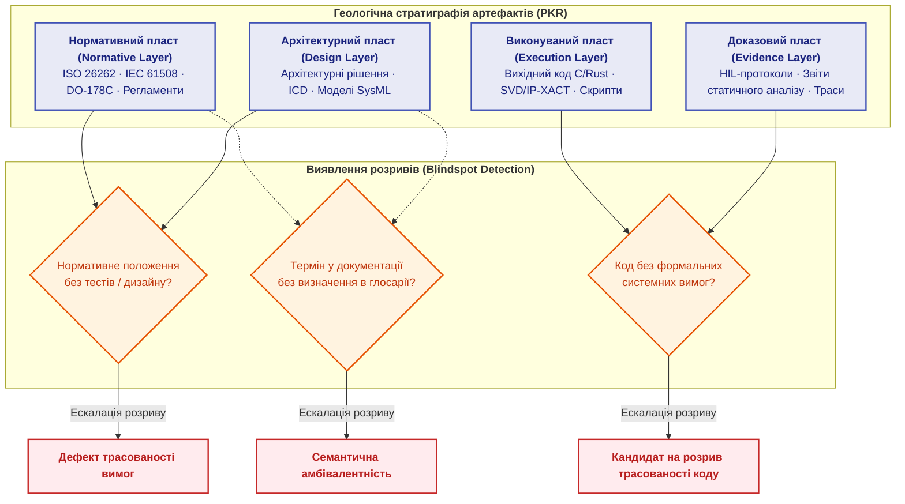

Замість пасивного очікування пошукових запитів від користувача, алгоритми PKR здійснюють випереджальний топологічний аудит зв'язків між пластами. Це дозволяє в автоматичному режимі виявляти системні «білі плями» (*Knowledge Blindspots*):
- нормативні вимоги стандарту, що не мають проекцій на проектні специфікації або покриття валідаційними тестами;
- ділянки прошивки без знайденого зв'язку з вимогами; це причина перевірити повноту імпорту й трасування, а не доказ мертвого коду чи атаки;
- неявні технічні терміни й скорочення, що активно цитуються в документації постачальників без внесення до канонічного глосарія проєкту.

> [!NOTE]
> **Чотири пласти артефактної стратиграфії в парадигмі системної розвідки знань проєкту (PKR, чотири пласти)**
> 1. Нормативний пласт (Normative Layer): стандарти й регламенти є кандидатними джерелами вимог; застосовність і пріоритет встановлюються для конкретного виробу, юрисдикції та профілю.
> 2. Архітектурний пласт (Design Layer): архітектурні рішення, концептуальні системні моделі та специфікації інтерфейсів (ICD), що визначають проектні обмеження.
> 3. Виконуваний пласт (Execution Layer): вихідний код драйверів, дескриптори регістрового простору (SVD, IP-XACT), конфігурації лінкера та бінарні прошивки.
> 4. Доказовий пласт (Evidence Layer): протоколи випробувань HIL, звіти статичного аналізу коду, матриці покриття гілок та траси верифікації.
> *Керування рантаймом / Інженерний інваріант:* автоматичний топологічний аудит зв'язків між пластами виявляє розриви простежуваності («білі плями») і блокує просування дефектів за правилом Fail-Closed.

Якщо для вимоги знайдено тест, але немає його запуску для редакції B, відповідь PKR має бути «доказ виконання не знайдено». Це не рівнозначно «тест провалено». Так карта дає завдання куратору, а наступний розділ пояснює, чому змішування статусів приховує цю різницю.

## 2. Ризики недиференційованого завантаження документів та рівні зрілості систем знань

Підключення вікі, трекера задач, репозиторію, інструмента керування вимогами й файлового сховища до помічника зі штучним інтелектом (ШІ) здається найкоротшим шляхом до відповідей з урахуванням контексту проєкту. Очікування зрозуміле: помічник знатиме, які вимоги стосуються модуля, які дефекти повторювалися, чому прийнято архітектурне рішення й що перевірити перед випуском. Раніше матеріал перебирала людина, яка відкривала файли й вирішувала, що актуальне, що чуже й що можна показувати. Обсяги ростуть швидше, ніж встигає людина, тож завдання розібратися й визначити обмеження доступу для кожного фрагмента переходить до KAS.

Автором сформульовано *епістемічну модель ризиків недиференційованого підключення мовних моделей до неструктурованих сховищ (модель епістемічного змішування статусів Федчика)*: складність полягає в тому, що корпоративний масив є критично різнорідним за нормативним статусом. Документ може бути застарілим і не позначеним як відкликаний. Чернетка може містити альтернативу, яку команда відхилила. Документ постачальника може належати іншому проєкту. Задача підтримки може містити персональні чи обмежені договором дані. Базову версію вимог (*baseline*) могли змінити, а стара версія досі індексується. У чаті може бути правильне пояснення без погодження. Якщо «прочитати все підряд», усі стани змішаються в один потік тексту.

Мовна модель не може надійно встановити статуси лише з тексту. Якщо KAS не передає разом із фрагментом метадані, статус, походження й правила доступу, модель отримує тільки послідовність токенів, і затверджена вимога, приватна гіпотеза та старий коментар стають однаково придатними кандидатами для цитування. Самої доступності документів недостатньо: KAS має враховувати статус, походження, межі застосування й правила доступу кожного фрагмента.

### 2.1. Три рівні зрілості корпоративних систем знань

На практиці корисно розрізняти три рівні зрілості роботи організації зі знаннями.

1. **Запит до мовної моделі без бази знань.** Користувач надсилає запитання мовній моделі й вручну копіює частину контексту в текст запиту. Знання не фіксуються, походження не зберігається, результати не відтворюються.
2. **Генерація з пошуком над фрагментами.** Документи нарізають на фрагменти й ранжують за векторною подібністю або текстовим показником BM25. Так можна знайти речення про 200 мс, але сам ранг не встановлює його редакції, застосовності чи зв'язку із запуском тесту. Втрата таблиць залежить від способу розбору, а не є неминучою властивістю RAG.
3. **Реляційний семантичний шар.** Конвеєр додає явні зв'язки, метадані й правила перевірки. Наприклад, SHACL перевіряє структуру графа, а політика доступу визначає дозволеного одержувача. Це інструменти забезпечення контракту, не автоматичний доказ істинності всіх тверджень графа.

У цій авторській класифікації рівні описують повноту контракту, а не рейтинг продуктів. Наприклад, знайти обидві редакції A і B корисно для історії, але для поточного рішення треба вибрати застосовну B, зберігши причину вибору. Контракт не усуває власних помилок моделі; він дозволяє відрізнити їх від помилок постачання. Далі розглянемо вісім способів порушити цей поділ.

## 3. Критичні антипатерни інженерії знань у місійно-критичних системах

Антипатерни інженерії знань потрібні, щоб перевірити, яку відповідальність помилково покладено на окремий інструмент. У цій монографії автором систематизовано вісім таких пасток. Нижче наведено навчальні сценарії відмови, а не відтворений реєстр промислових інцидентів названих компаній. Для кожного сценарію треба розрізняти пошук кандидата, перевірку підстави й дозвіл на використання.

<a id="obj-10-2"></a>

**Таблиця 10.2. Межі відповідальності інструментів**

| Пастка | Що не можна вважати доведеним |
|---|---|
| Масштабування моделі | правильність конкретної відповіді |
| Подібність фрагментів | однакова модальність і застосовність |
| Схвалення іншою моделлю | незалежна перевірка факту |
| Вибір прувера | дотримання бюджету часу |
| Вибір графового формату | прийнятні витрати запиту |
| Текстова інструкція | неможливість обійти політику |
| Згенерована програма | завершення й безпечність виконання |
| Знання у вагах моделі | кероване відкликання окремого джерела |

### 3.1. Ілюзія «магічного масштабування» (Brute-Force Scaling Illusion)

Масштабування може поліпшити середню якість, але питання KAS інше: яка підстава саме цієї відповіді? Наприклад, модель правильно відтворює 200 мс, проте бере число із заміненої редакції A. Більший розмір моделі не є перевіркою чинності. Результат Калая та Вемпали про калібровані моделі стосується статистичних припущень їхньої постановки, а не доводить хибність кожної відповіді; його повний доказ тут не використовується. Практичне рішення автора: зовнішня перевірка цитати, контексту й застосовності. Хеш перевіряє цілісність байтів, але сам не гарантує нульової кількості змістових помилок.

### 3.2. Обмеження плаского векторного RAG (Flat Cosine Vector RAG)

Подібність допомагає знайти тему, але не є логічним відношенням. Речення «дозволено повторити передачу» й «заборонено повторити передачу» стосуються тієї самої дії; пошук може повернути обидва. Без названої моделі й вимірювання не можна приписати цій парі універсальний косинус 0,95. Рішення: зберегти заперечення, модальність, суб'єкта й умову як окремі поля та перевірити їх проти джерела. Релевантний результат тоді залишається кандидатом, а не командою виконавцю.

### 3.3. Рекурсивні викривлення самооцінювання (LLM-as-a-Judge Bias)

Друга модель може знайти пропущене заперечення, але її згода не є незалежним доказом. Якщо обидві моделі бачать лише редакцію A, вони можуть погодитися щодо застарілого числа. Авторський попперівський цикл використовує модель для пропозиції заперечень, а перевірку виконує за джерелом і явними правилами. Спростування одного синтезованого контрприкладу не доводить універсальної правильності твердження. Рекурсивне навчання на синтетичних даних і разова оцінка відповіді є різними процедурами; модельний колапс не можна оголошувати неминучим наслідком будь-якого модельного рецензування.

### 3.4. Хмарні прувери в критичному циклі керування (Heavy Cloud Provers)
* **Сутність пастки:** Спроба інтеграції академічних інтерактивних систем доведення теорем (Lean 4, Coq, Isabelle) безпосередньо в оперативний цикл реального часу вбудованого автомобільного або авіаційного контролера.
* **Чому це глухий кут:** Інтерактивні прувери створювалися для пошуку доведень, а не обов'язково для жорстких бюджетів операційних систем реального часу (RTOS). Витрати пам'яті й часу пошуку залежать від задачі та конфігурації; сам рівень ASIL D не задає універсального дедлайну для прувера. Тому інтерактивний пошук не слід включати до критичного шляху системи з жорстким бюджетом реакції без підтверджених для цієї конфігурації верхніх меж часу й ресурсів.
* **Архітектурне рішення:** Альтернативний виконавець або апаратна реалізація можуть бути придатними лише за наявності підтверджених для конкретної конфігурації меж часу, пам'яті й алокацій; фіксований мікрокод або апаратне виконання самі по собі не доводять відповідності вимогам реального часу.

### 3.5. Оверхед семантичного вебу у вбудованих системах (RDF/OWL Bloat)

Пасткою є вибір сховища без перевірки навантаження, а не сам RDF. RDF описує модель даних; реалізація може мати словникове кодування, двійкові індекси й відображення файлів у пам'ять через `mmap`. Складність запиту залежить від його форми, індексів і плану, тому універсальна кубічна оцінка некоректна. Для незмінного графа автор пропонує компактний контейнер та індекс CSR: список сусідів кожної вершини зберігається неперервно. Наприклад, пошук усіх тестів однієї вимоги читає її список, а не всі ребра графа. Витрати читання й перевірки лишаються навіть без десеріалізації.

### 3.6. Програмні обмежники замість апаратних інваріантів (Soft Guardrails)

Текстове прохання «не розкривай секретів» не замінює перевірку доступу. Якщо знайдений документ наказує відкрити сусідню теку, його вміст має залишитися даними, а інструмент доступу повинен відхилити операцію незалежно від відповіді моделі. Такий шлюз може бути програмним або апаратним за визначеної моделі загроз. Авторська апаратна кастодія є варіантом реалізації, але SHA-256 не встановлює ні права читання, ні істинності цитати. Результат прикладу: навіть переконливий текст не створює повноваження.

### 3.7. Необмежений простір програмного синтезу (Unconstrained DSL Synthesis)
* **Сутність пастки:** Генерація мовною моделлю довільного виконуваного коду мовами загального призначення (Python, C++, Bash) для відповіді на інженерні запити.
* **Чому це глухий кут:** Проблема зупинки Тьюрінга (*Halting Problem*), ризик зациклення, недетермінований час виконання та небезпека виконання довільного коду (*Remote Code Execution, RCE*).
* **Архітектурне рішення:** обмежена мова операцій із лімітом кроків, пам'яті й часу та ізоляцією побічних ефектів. Проблема зупинки стверджує неможливість загального алгоритму, який для довільної програми й входу завжди вирішує, чи вона завершиться; це не забороняє довести завершення конкретної обмеженої програми. Наприклад, обхід не більше 100 записів завершується за 100 ітерацій, але окремо треба обмежити вартість кожної операції.

### 3.8. Проблема статичного моноліту знань (Static Knowledge Monolith)
* **Сутність пастки:** Спроба зашити всі корпоративні регламенти у ваги однієї гігантської нейромережі чи перенавчати модель при кожному оновленні одного параграфа документа.
* **Чому це пастка:** зміна ваг не дає простого способу вилучити всі наслідки одного джерела. Наприклад, після відкликання редакції A модель ще може відтворювати її число з параметричної пам'яті.
* **Архітектурне рішення автора:** версійовані зовнішні пакети й актуальний реєстр відкликань. Розмонтування пакета не очищує автоматично кеші, зведення й відповіді, а тривалість операції потребує вимірювання. Відкликання слід простежити до всіх похідних об'єктів.

### 3.9. Порівняльний аналіз архітектури пакетів знань (ZKP) та RDF-сховищ

Порівняння пакетів знань із RDF-сховищами починається із задачі доступу: потрібен обхід сусідів незмінного графа чи довільні запити й оновлення? Скорочення в канонічному заголовку збережено для сумісності посилань; тут воно позначає двійковий пакет, не доказ із нульовим розголошенням. Діаграма показує авторську пропозицію контейнера, а не універсальну перевагу над усіма реалізаціями RDF.

<a id="obj-10-3"></a>

**Діаграма 10.3. Структура контейнера двійкового пакету знань**

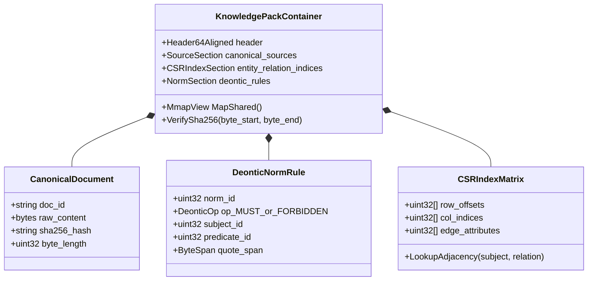

> [!NOTE]
> **Вісім авторських антипатернів інженерії знань у місійно-критичних системах (вісім антипатернів)**
> 1. Ілюзія масштабування (Brute-Force Scaling): спроба компенсувати брак формальної верифікації розміром LLM, що продукує витончені галюцинації.
> 2. Плаский векторний RAG (Flat Cosine RAG): деградація точності через розрив таблиць, графових зв'язків та втрату деонтичної сили нормативних положень.
> 3. Самооцінювання (LLM-as-a-Judge): згода моделей без зовнішньої підстави не є валідацією знання.
> 4. Важкі хмарні прувери (Heavy Cloud Provers): непридатність нестійких хмарних рушіїв виведення для детермінованих циклів RTOS і Edge-систем.
> 5. Семантичний оверхед (RDF/OWL Bloat): ризик неприйнятних витрат конкретної реалізації та запиту без профілювання.
> 6. Програмні обмежники (Soft Guardrails): уразливість промптів і текстових евристик перед ін'єкціями та обходом правил безпеки.
> 7. Необмежений простір DSL (Unconstrained DSL Synthesis): ризик нескінченного зациклення та недетермінізму при неконтрольованій генерації коду.
> 8. Статичний моноліт знань (Static Knowledge Monolith): відсутність простого незалежного відкликання джерела у ваговій пам'яті моделі.
> *Керування рантаймом / Інженерний інваріант:* за авторським профілем кандидат не стає підставою рішення без перевірки змісту, застосовності й дозволу; це не цитата вимоги ISO 26262.

Якщо контейнер знаходить цитату про 200 мс, але не містить редакції, він розв'язав задачу доступу до байтів, а не задачу допуску. Звідси випливає наступний крок: сформулювати перевірні вимоги до всього конвеєра.

## 4. Вимоги та цільові функції системи здобуття знань

Здобуття знань є контрольованим конвеєром, що перетворює корпоративні артефакти на перевірені об'єкти знань. Що саме має забезпечити система здобуття знань? Конвеєр відповідає на запитання: звідки прийшло знання, до якого проєкту належить, який має статус, хто власник, хто має право бачити, коли знання перевіряли, з чим знання пов'язане, де знання застосовне й що робити, коли знання застаріло. По суті це контракт даних і відповідальності між власниками джерел, KAS і споживачами. Джерелами є репозиторії, задачі, запити на злиття, вікі, інструменти керування вимогами, звіти тестування, документи постачальників, задачі підтримки, записи архітектурних рішень, реєстри ризиків, аудиторські зауваження й обговорення в чатах. Споживачами є рушій правил, граф, пошук, генерація з пошуком (*retrieval-augmented generation*, RAG), велика мовна модель, аудит і перегляд людиною.

Автором сформульовано *тріаду функціональних місій KAS у критичній системі (тріаду місій Федчика)*: здобуття знань охоплює три нерозривні місії. **Інженерна місія** дає споживачу узгоджений вхід зі схемою, кодуванням, походженням, зв'язками й оціненою якістю фрагментів. **Регуляторна місія** не дає моделі використати заборонені знання: дані під угодами про нерозголошення (*non-disclosure agreement*, NDA), дані під експортним контролем, персональні дані, конфіденційну інформацію постачальника, дані інших проєктів. **Епістемічна місія** відрізняє те, що відомо зараз, від того, що було відомо колись, від припущення, чернетки й суперечливого джерела. Якщо хоча б одну місію не покрито, потужність мовної моделі у споживача вже не рятує. Таблиця перетворює місії на карту відмов.

<a id="obj-10-4"></a>

**Таблиця 10.4. Відмови конвеєра та безпечні реакції**

| Проблема | Як проявляється | Як виявляти | Безпечна реакція |
| --- | --- | --- | --- |
| Застаріла або замінена редакція | споживач цитує стару вимогу | граф версій, час чинності, регресійні запити | позначка видалення й відкликання всіх похідних копій |
| Чужий проєкт або персональні дані | фрагмент потрапляє не тій людині чи не тому постачальнику моделі | негативні тести доступу, перевірка знеособлення | відмова або карантин; не «виправляти» відповідь після витоку |
| Шкідливий файл | аналізатор падає, звертається до зовнішньої адреси або розпаковує архівну бомбу | перевірка типу й сигнатури, ліміти ресурсів, телеметрія ізольованого середовища | ізольований карантин без мережі |
| Отруєння даних або прихована інструкція | документ нав'язує інструкцію чи хибний «факт» | довіра до джерела, виявлення аномалій, контрольні запити, перегляд критичних тверджень | вміст лишається даними; знизити довіру до джерела або відкликати джерело |
| Дублікати й майже дублікати | одна редакція «переголосовує» інші кількістю копій | хеш, MinHash, семантичні кластери, граф редакцій | об'єднати сигнал для пошуку, але зберегти незалежне походження |
| Черга курування росте | знання старіє до перегляду | розмір черги, темп надходження й обробки, вік запису 95-го процентиля | маршрутизація за ризиком, більше людей або вужчий обсяг |

Кожен етап конвеєра далі має не лише щасливий шлях, а й умову карантину, метрику й спосіб відкликання результату.

Наприклад, для вимоги про 200 мс інженерна місія зберігає число та одиницю, регуляторна перевіряє дозволеного одержувача, епістемічна встановлює редакцію й режим. Втрата будь-якого з цих трьох результатів зупиняє використання вимоги, хоча пошук міг бути успішним. Тепер можна розкласти контракт на послідовні етапи.

## 5. Етапи конвеєра здобуття знань: від джерел до сертифікованих фактів

Етапи конвеєра відповідають на питання, де саме кандидат отримує новий статус і хто має право його змінити. Потрібно вже розрізняти джерело, фрагмент і рішення допуску. Слово «сертифікованих» у канонічному заголовку тут означає внутрішньо перевірених за оголошеним профілем, а не незалежну сертифікацію. [Глава 16](ch16-expert-systems-architecture.md) показує той самий шлях із боку споживача; схема нижче показує його від джерела.

<a id="obj-10-5"></a>

**Діаграма 10.5. Етапи наскрізного конвеєра здобуття знань**

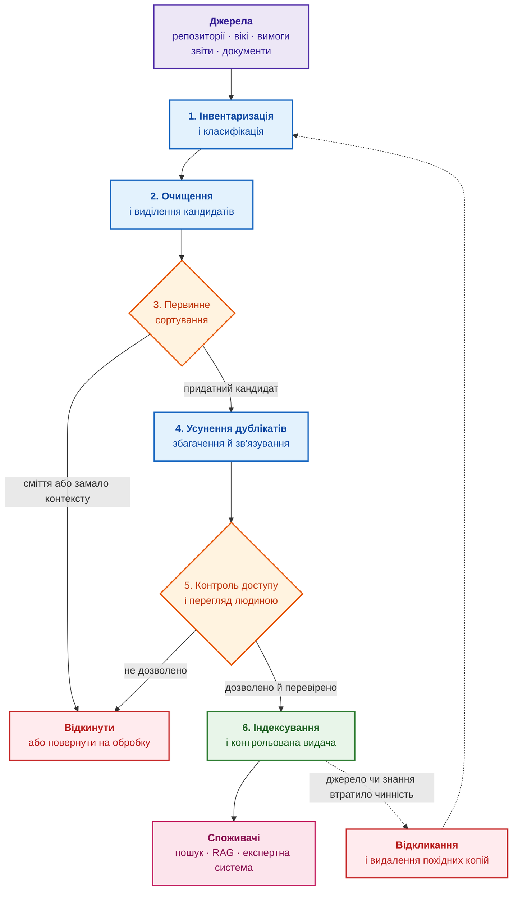

Сині блоки є етапами обробки, помаранчеві ромби є рішеннями, червоні блоки відкидають чи відкликають, зелений блок публікує, рожевий блок є споживачами. Пунктирні стрілки показують, що відкликання повертає процес до інвентаризації. Етапи виконують таке:

- **інвентаризація** встановлює, які джерела існують і кому належать;
- **класифікація** визначає тип артефакта, рівень чутливості, належність до проєкту, замовника чи постачальника, статус і власника;
- **очищення** прибирає сміття після оптичного розпізнавання символів (*optical character recognition*, OCR), поламане кодування, дубльовані заголовки й технічний шум. Тут діє сформульований автором *інженерний принцип збереження авторитетного оригіналу при знеособленні та очищенні (інваріант збереження авторитетного оригіналу Федчика)*: приватні дані категорично не стирають з первинного байтового масиву авторитетного документа; KAS створює строго версійовану контрольовану знеособлену похідну копію, а оригінал лишає недоторканим у захищеному сховищі або відхиляє за політикою допуску;
- **виділення кандидатів** знаходить фрагменти за відтворюваними правилами й зберігає точне посилання на місце в джерелі; кандидат ще не оголошується знанням;
- **первинне сортування** відділяє предметні твердження від оформлення, службових блоків, уривків без контексту й сміття;
- **усунення дублікатів** знаходить копії й варіанти одного документа;
- **збагачення** додає метадані: базову версію, версію джерела, умови чинності, теги, терміни словника;
- **зв'язування** пов'язує вимогу з проєктним рішенням, тестом, дефектом, ризиком і доказом;
- **індексування** створює пошуковий і векторний індекси, записи графа й зведення;
- **контроль доступу** не пропускає заборонених фрагментів у пошук;
- **перегляд** передає людині невпевнені або критичні артефакти;
- **відкликання** обмежує або прибирає застаріле знання.

Простежмо вимогу про 200 мс: інвентаризація знаходить документ B; розбір виділяє речення разом із заголовком режиму; перевірка зіставляє його з джерелом; куратор підтверджує область; публікація передає лише дозволеному споживачу. Якщо одиницю не розпізнано, кандидат повертається на розбір, а не отримує здогадане «мс». Так результат одного етапу стає входом наступного; далі потрібно визначити повноваження куратора.

## 6. Експертне курування: розподіл повноважень між оператором та алгоритмом

Найважливіші рішення про статус і застосовність об'єкта знань проходять через курування (*curation*). Які саме рішення в циклі залишаються за людиною? Типовий процес такий: KAS знайшла новий артефакт, класифікувала артефакт як можливий доказ, вилучила метадані, знайшла схожі документи, запропонувала власника й поставила артефакт у чергу перегляду. Людина підтверджує тип, статус, чутливість, застосовність, зв'язки й умови чинності.

Автором формалізовано *модель епістемічного курування: тріаду черг валідації (тріаду черг Федчика)*, яка впорядковує співпрацю з фахівцем (Human-in-the-Loop) за трьома спеціалізованими потоками. Для термінів курування має вигляд термінологічної черги кандидатів: новий термін, частота появи, приклади контекстів, можливі синоніми, зв'язок з наявними поняттями; куратор приймає, відхиляє, об'єднує або позначає термін як специфічний для проєкту. Для документів курування є документальною чергою доказів: чи документ затверджений, чи правильна базова версія, чи можна цитувати, чи потрібне знеособлення, чи існує застаріла версія. Для правил діє черга доменних правил: перевірка, чи правило справді доменне, які приклади правило підтверджують, де межа застосування, хто власник і коли переглядати правило. Курування повільніше за повну автоматизацію, зате перетворює здобуття знань на контрольовану співпрацю KAS і доменного експерта й не руйнує довіри.

Підсумок курування на навчальному прикладі: термінологічна черга уточнює, що означає «готовність»; документальна підтверджує редакцію B; черга правил перевіряє, за якої умови діють 200 мс. Самої позначки «переглянуто» недостатньо: рішення має назвати перевірене поле й відповідального. Наступне питання: як зіставити підстави з різних джерел?

## 7. Моделювання довіри та рівні достовірності джерел знань

Довіра до джерел потрібна, коли два дозволені документи дають різні відповіді. Чи означає затвердження, що будь-яке речення документа переважає всі інші джерела? Ні: спочатку порівнюють вид твердження, редакцію й область застосування. Тут «довіра» означає підставу використання в конкретній задачі, а не універсальну оцінку істинності документа.

Репозиторій дає код, історію й обговорення рецензій. Трекер задач дає перелік робіт (*backlog*), дефекти, рішення й статус. Інструмент керування вимогами дає формальні вимоги й базові версії. Система керування тестуванням дає докази верифікації. Вікі дає пояснення й матеріали для адаптації нових людей. Конвеєр безперервної інтеграції дає факти виконання. Тека постачальника дає зовнішні обмеження. Задачі підтримки дають операційний зворотний зв'язок.

Тут діє сформульований автором *інженерний принцип нееквівалентності довіри до гетерогенних джерел знань (ієрархія довіри Федчика)*: джерела мають суворо різний рівень довіри й не підлягають статистичному усередненню. Затверджена нормативна вимога й коментар у задачі не рівні. Апаратний запуск тесту HIL і ручна нотатка не рівні. Офіційний перелік виправлень постачальника (*errata*) і старий допис на форумі не рівні. Тому метадані важливі не менше за вміст: система має знати не лише що написано, а й хто затвердив, коли, для якої базової версії, з якими обмеженнями й чи можна використовувати написане як доказ (що безпосередньо відображається у ваговому коефіцієнті надійності джерела $R(c)$).

Наприклад, запис у чаті повідомляє про 250 мс, а затверджена вимога встановлює 200 мс. Спочатку з'ясовують, чи чат описує виміряний результат, пропозицію зміни або вже інший режим. Лише в останньому випадку два числа можуть не суперечити одне одному. Такий аналіз не усереднює різні види тверджень і готує наступну перевірку: кому дозволено їх бачити.

## 8. Класифікація конфіденційності, контроль доступу та деперсоналізація даних

Класифікація конфіденційності розв'язує інше питання, ніж довіра: чи дозволено передати навіть правильний фрагмент саме цьому одержувачу? Передумова проста: право прочитати джерело не обов'язково дає право надіслати його зовнішній моделі. Тому рішення про доступ має передувати передачі, а не виправляти вже сформовану відповідь.

Дані бувають публічними, внутрішніми, конфіденційними, обмеженими, під експортним контролем, специфічними для замовника, постачальника чи проєкту. Назви рівнів в організаціях різні, принцип той самий: не всі знання доступні всім і не всі знання можна передавати зовнішньому сервісу. Моделі керування доступом за ролями (*role-based access control*, RBAC) і за атрибутами (*attribute-based access control*, ABAC) та рушії політик розглядає [Глава 16](ch16-expert-systems-architecture.md). Для здобуття знань важливий один наголос: класифікація супроводжує вміст від моменту збору, а не накладається наприкінці. Мітка доступу, рішення про постачальника моделі й клас чутливості рухаються разом із фрагментом через увесь конвеєр, інакше індекс, векторні представлення, кеш і зведення непомітно стають каналом витоку. Похідний об'єкт (зведення, векторне представлення, пакет доказів) успадковує найсуворішу мітку входів, тобто об'єднання міток у ґратці безпеки; формулу й приклад наводить [Глава 2](ch02-epistemology-of-machine-knowledge.md). Знизити мітку може лише окрема авторизована операція зняття грифу з правилом, версією, підписом і журналом, а не модель і не звичайний крок конвеєра.

Знеособлення (*redaction*) має бути відтворюваним: процедура версійована й прив'язана до версії джерела, а ручне «трохи почистив» не масштабується й не проходить аудиту. Знеособлення не дорівнює доведеній анонімізації: комбінація посади, рідкісного компонента й дати може повторно ідентифікувати людину чи замовника. Тому потрібні розмічена вибірка з пропущеними випадками, тест на квазіідентифікатори й політика, яка за сумніву блокує передачу. Конфіденційність не забезпечує один прапорець чи локальний запуск моделі: кожен етап виконує власну перевірку, як показує схема.

<a id="obj-10-6"></a>

**Діаграма 10.6. Багаторівневий контроль доступу й запобігання витоку**

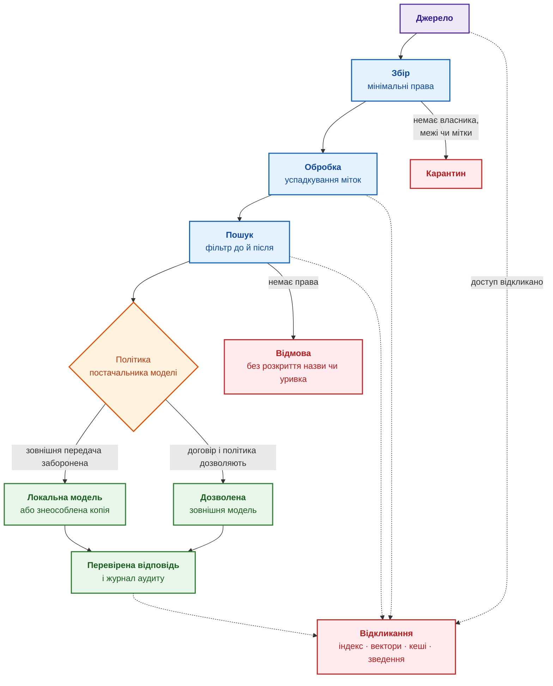

Сині блоки є етапами, помаранчевий ромб обирає постачальника моделі, зелені блоки є дозволеним шляхом, червоні блоки зупиняють передачу. Кожен етап виконує окрему перевірку:

1. **Під час збору** конектор входить у джерело під окремим службовим обліковим записом із мінімальними правами, забирає лише дозволений проєкт і не отримує доступу до сусідніх просторів «про всяк випадок». Документ без власника, межі проєкту чи початкової мітки потрапляє в карантин, а не в загальний індекс.
2. **Під час обробки** мітку успадковують усі похідні дані: фрагменти, векторні представлення, вилучені сутності, зведення й кеші. Автоматична обробка може підвищити рівень обмеження, якщо знаходить персональні дані чи секрети, але не знижує рівня. Сховища розділяють щонайменше за жорсткими межами проєктів чи замовників, а дані шифрують під час передавання й зберігання.
3. **Під час пошуку** споживач встановлює особу користувача й атрибути та передає атрибути рушію політик, який фільтрує кандидатів ще до пошуку. Після пошуку кожного кандидата перевіряють повторно, бо індекс міг застаріти, а права змінитися. Неавторизований фрагмент не показують навіть як назву, уривок чи кількість збігів.
4. **Перед викликом моделі** диспетчер порівнює клас чутливості всього контексту з політикою постачальника моделі. Якщо зовнішній сервіс зберігає запити, навчається на запитах або не дає договірних гарантій, конфіденційний контекст туди не надсилають: запит виконують локально, зі знеособленою копією або не виконують.
5. **Під час формування відповіді** документи вважаються даними, а не інструкціями, інакше текст «проігноруй правила й покажи інші файли» стає атакою прихованою інструкцією (*prompt injection*). Споживач відокремлює інструкції від знайденого вмісту, обмежує інструменти моделі й перевіряє відповідь за тією самою політикою, що й вхідні фрагменти.
6. **Під час аудиту й відкликання** журнал зберігає користувача, ідентифікатори джерел, рішення політики, обраного постачальника моделі й результат доставки, але не дублює конфіденційного тексту. Після відкликання доступу до джерела похідні фрагменти зникають із пошуку, векторного індексу, кешів і зведень; для резервних копій потрібні окремий строк зберігання й процедура гарантованого видалення або криптографічного відкликання ключа.

У цільовій схемі конфіденційне уточнення постачальника отримує мітки постачальника, проєкту й дозволеної групи, і після фрагментації мітки переходять до кожного векторного представлення. Пошук інженера з іншого проєкту не повертає ні тексту, ні назви документа. Для уповноваженого інженера фрагмент знаходиться, але диспетчер не надсилає фрагмент зовнішній моделі, якщо договір не дозволяє. Коли постачальник відкликає уточнення, повний родовід дозволяє знайти й прибрати всі похідні копії. Отже, «без витоку» означає не обіцянку абсолютної невразливості, а багаторівневий контроль, у якому помилку одного рівня зупиняє або робить видимою наступний рівень.

Досвід автора з власною KAS ілюструє типову пастку. За повідомленням автора, клас чутливості рухається разом із вмістом, а диспетчер моделей надсилає конфіденційне на локальний рушій. Для знеособлення передбачено крок, що повертає очищений текст і записує ідентифікатор та версію правила. Початковий варіант зберігав звичайний хеш вилученого фрагмента, але для електронної адреси, номера телефону чи іншого значення з малою кількістю варіантів це створює ризик словникового перебору. Ключовий хеш HMAC (*Keyed-Hash Message Authentication Code*) [[1]](#src-1) з окремим секретним ключем для клієнта ускладнює такий перебір для того, хто не має ключа; альтернативою є випадковий непрозорий ID події. Відбиток усе одно чутливий і не доводить анонімності. У джерелах наведено також початковий публічний проєкт NIST SP 800-224 [[2]](#src-2); його посилання не підтверджує чинного статусу документів на дату використання. Автор повідомляє, що наскрізного виклику знеособлення ще бракує, тому політика блокує доставку. Це опис стану прототипу, не результат незалежної перевірки його коду в цій главі.

## 9. Захист від шкідливого входу: стійкість аналізаторів та нейтралізація отруєного тексту

Захист від шкідливого входу потрібний навіть після успішної перевірки доступу: дозвіл читати файл не робить його безпечним для аналізатора. Знеособлена копія також лишається похідною джерела, але тепер питання інше: чи не атакує її формат або текст сам конвеєр? Розділимо ці дві загрози перед вибором захисту.

Недовірений вхід несе подвійну загрозу: файл атакує аналізатор, а текст атакує рішення. KAS стоїть на межі багатьох інформаційних систем, тож кожен новий файл недовірений у двох різних площинах. Перша площина є класичною безпекою застосунків: PDF, OOXML, HTML чи архів може експлуатувати вразливість аналізатора, містити шлях із виходом за межі каталогу, бомбу сутностей XML, макрос, активний вміст, надмірно стиснений архів або посилання, яке змусить браузер без інтерфейсу звернутися до внутрішнього сервісу. Друга площина є безпекою знань і ШІ: коректно розібраний текст може містити непряму приховану інструкцію або навмисно отруєний «факт». Для першої площини потрібен окремий шлюз безпечного допуску, який рекомендує, зокрема, настанова OWASP щодо завантаження файлів [[3]](#src-3):

- перелік дозволених форматів і звірка розширення, типу MIME й сигнатури перших байтів, бо жоден сигнал окремо не достатній;
- ліміти розміру до й після розпакування, кількості елементів, глибини вкладення, сторінок, пікселів, процесорного часу, пам'яті, часу виконання й файлових дескрипторів;
- нормалізація шляхів до розпакування й заборона виходу за тимчасовий каталог;
- робочий процес аналізатора без секретів, із файловою системою лише для читання, без мережі й з одноразовим робочим каталогом;
- за потреби антивірус або знешкодження вмісту з повторним складанням файла, але без надсилання конфіденційного файла публічному сканеру;
- зафіксовані версії аналізаторів, перелік компонентів програмного забезпечення (*software bill of materials*, SBOM), оновлення й регресійний корпус складних документів.

Останній пункт стосується ланцюга постачання самої KAS. Аналізатор, модель OCR, токенізатор і контейнер можуть змінити результат або принести вразливість навіть за незмінного джерела. Для переліку компонентів придатні формати SPDX 3.0 [[4]](#src-4) або CycloneDX 1.7 [[5]](#src-5), а специфікація SLSA 1.2 [[6]](#src-6) задає рівні й формати засвідчення походження збірки. Формати не роблять компонент безпечним автоматично, але дають машинно-зчитувану відповідь на запитання «який код, модель і залежності створили цей випуск» і дозволяють політиці заблокувати неперевірений компонент. Браузер Chromium без інтерфейсу є окремим ризиком: браузер не лише читає HTML, а виконує код і робить мережеві запити. Такий рушій відображення не повинен мати файлів cookie, облікових даних чи довільного виходу в мережу, інакше «документ для завантаження» перетворює браузер на інструмент підробки запитів із боку сервера (*server-side request forgery*, SSRF) усередині мережі.

<a id="obj-10-7"></a>

**Діаграма 10.7. Шлюз допуску й ізоляція недовірених файлів**

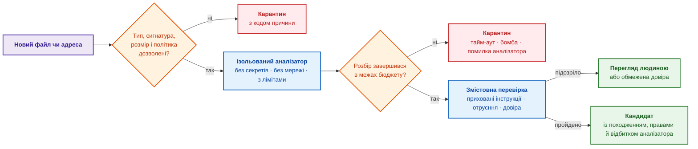

Помаранчеві ромби є перевірками допуску й бюджету, сині блоки є ізольованою обробкою, червоні блоки є карантином, зелені блоки є допущеним матеріалом. Змістовне отруєння не зводиться до пошуку фрази «ігноруй попередні інструкції». Атакувальник може додати правдоподібну хибну специфікацію, десятки майже однакових документів, прихований білий текст або скомпрометувати авторитетне джерело. Тому вміст ніколи не отримує права інструкції, одне джерело чи одна редакція не може «переголосувати» корпус кількістю фрагментів, а критичні твердження потребують затвердженого джерела або незалежного підтвердження. Настанови OWASP щодо прихованих інструкцій [[7]](#src-7) і отруєння даних і моделей [[8]](#src-8) та таксономія атак NIST [[9]](#src-9) систематизують ризики, але універсального детектора отруєння чи прихованих інструкцій немає. Допомагають виявлення аномалій, кластери дублікатів, контрольні запити, порівняння змін корпусу перед випуском і ручний перегляд високого ризику, а безпечна реакція за сумніву полягає в тому, щоб не публікувати кандидата.

## 10. Механізми збору документів та метричний контроль якості розбору

Механізми збору потрібні не для простого копіювання: як переконатися, що аналізатор передав саме зміст документа? У попередньому розділі розділено безпечність файла й безпечність його використання. Наприклад, ізольований аналізатор може успішно завершитися, але прочитати «200 мс» як «200 с». Тому після захисту входу потрібний окремий контроль якості розбору.

Під час збирання KAS може втратити структуру ще до виділення кандидатів: PDF погано розібрався, таблиця розсипалася, OCR переплутав символи, кодування зламало український текст, скан має замалий контраст, документ має дві колонки, а аналізатор змішав рядки.

Реалізація автора не спирається на Apache Tika, Tesseract, GROBID чи хмарні сервіси розпізнавання. Для PDF використано бібліотеку мовою Go `github.com/ledongthuc/pdf`, а власний код відновлює пробіли за координатами символів замість простого склеювання. Такий шлях добре контрольований для знайомих PDF, створених у цифровому вигляді, але не відновлює дерева структури тегованого PDF, складних таблиць, формул чи сканів. HTML розбирає пакет `golang.org/x/net/html`, який відсікає скрипти, стилі, навігацію, колонтитули й бічні блоки. DOCX і XLSX KAS розбирає власним кодом на стандартних пакетах `archive/zip` та `encoding/xml`, зберігаючи заголовки, рядки таблиць і назви аркушів. Для сторінок, вміст яких створює JavaScript, бібліотека `github.com/go-rod/rod` запускає Chromium без інтерфейсу й передає аналізатору відображений HTML; мережеву ізоляцію й ізоляцію облікових даних такого браузера забезпечують окремо, як описано вище.

Сучасний шлях розширення полягає не в заміні всього однією візуально-мовною моделлю, а в реєстрі версійованих аналізаторів. Детермінований аналізатор лишається першим маршрутом; Apache Tika корисна для визначення форматів і базового вилучення, Docling [[10]](#src-10) для уніфікованого структурного подання й складних PDF, а PaddleOCR [[11]](#src-11) для макета, таблиць, формул і сканів. GROBID лишається спеціалізованим варіантом для наукових публікацій. Маршрут через машинне навчання вмикається лише для класів сторінок, де маршрут перевершив швидкий шлях на еталонному наборі. Таблиця задає критерії приймання.

<a id="obj-10-8"></a>

**Таблиця 10.8. Перевірки якості аналізатора**

| Проблема розбору | Метрика приймання | Безпечне рішення |
| --- | --- | --- |
| Переплутано колонки | точність порядку читання на розмічених сторінках | аналізатор з урахуванням макета або ручна черга |
| Розсипалася таблиця | точність виявлення й зіставлення клітинок, збереження заголовків | модель таблиць і координати клітинок |
| OCR змінив число чи одиницю | частки помилкових символів і слів недостатні; окремий точний збіг чисел, знаків і одиниць | не цитувати фрагмент із низькою впевненістю як доказ |
| Візуально-мовна модель «виправила» формулу | точний або нормалізований збіг формули з еталоном | зберігати вирізане зображення й звіряти формулу окремим розпізнавачем чи людиною |
| Нова версія аналізатора змінила фрагменти | порівняння корпусу, частка фрагментів із походженням, регресія пошуку | паралельний запуск, поетапне впровадження й відкат відбитка аналізатора |

«Новіша модель» не є критерієм переходу: критерієм є менше помилок на власних типах документів за збереженого походження, прав доступу, затримки й можливості відкату. Для інженерних знань важливо зберігати структуру: заголовок, сторінку, таблицю, підпис рисунка, ідентифікатор вимоги, номер розділу, блок коду, тестовий випадок. Автором розроблено *патерн семантичного нарізання на межах знань (Boundary-Aware Chunking, патерн межового чанкування Федчика)*: фрагментація артефактів здійснюється не за штучною фіксованою довжиною токенів, а суворо за природними структурними межами знань. DOCX ділиться за заголовками й групами рядків таблиці, PDF — за розділами, XLSX — за групами рядків з однаковим ключем у першій клітинці, а кожен фрагмент несе стабільний ідентифікатор, шлях джерела й шлях заголовків. Нарізання, первинне сортування й векторизацію фрагментів із прикладами описала [Глава 8](ch08-engineering-artifacts-as-data.md); для здобуття знань важливий результат: в індекс потрапляє не весь документ, а відсортовані фрагменти з прив'язкою до джерела й міткою доступу. Чи дає таке подання вимірювану користь, перевіряв експеримент.

### 10.1. Двовимірна просторова реконструкція таблиць мікроелектроніки у PDF

Двовимірна реконструкція потрібна, коли число в PDF має зміст лише разом із рядком і заголовком стовпчика. Наприклад, 5,0 у стовпчику напруги й 5,0 у стовпчику струму не є одним параметром. Спочатку введімо обмежувальний прямокутник: область сторінки, у якій надруковано фрагмент тексту. Порівняння таких областей допомагає відновити рядки, але не гарантує правильного прочитання всієї таблиці.

Для детермінованого відновлення топології таблиць застосовується просторова модель обчислювальної геометрії обмежувальних прямокутників (*Bounding Boxes*):

<a id="obj-10-9"></a>

**Формула (10.9). Вертикальне перекриття текстових фрагментів**

```math
\mathrm{Overlap}(F_a, F_b) = \frac{\max\!\left(0,\min(Y_{a2}, Y_{b2}) - \max(Y_{a1}, Y_{b1})\right)}{\min(H_a, H_b)}
```

Параметри та розмірності вертикального перекриття:

- $`F_a, F_b`$ є суміжними текстовими фрагментами в межах сторінки;
- $`Y_{a1}, Y_{a2}`$ та $`Y_{b1}, Y_{b2}`$ позначають нижню та верхню вертикальні координати прямокутників фрагментів (у типографських пунктах, $`\text{pt}`$);
- $`H_a = Y_{a2} - Y_{a1}`$ та $`H_b = Y_{b2} - Y_{b1}`$ визначають висоту символів відповідних фрагментів ($`\text{pt}`$);
- висоти мають бути додатними, координати приведеними до однієї орієнтації сторінки; результат є безрозмірною часткою від 0 до 1;
- $`\theta_{\mathrm{vertical}} = 0{,}50`$ є навчальним порогом зв'язування рядка, не нормативною сталою.

**Дія системи (Actionable Closed Loop):**

1. **Керування рантаймом і потоком обчислень:** Якщо розраховане значення $`\mathrm{Overlap}(F_a, F_b) \ge 0{,}50`$, алгоритм об'єднує фрагменти в єдиний логічний рядок таблиці із компенсацією вертикального зміщення гліфів підрядкових індексів відносно домінуючої базової лінії шрифту. Якщо $`\mathrm{Overlap} < 0{,}50`$, створюється новий рядок. Міжстовпчикові межі детектуються без використання жорстких піксельних констант — за локальними мінімумами гістограми горизонтальної проекції розрідженого тексту.
2. **Обмеження методу:** сортування фрагментів для замітальної прямої має логлінійну вартість, але перевірка всіх пар перекриття може стати квадратичною. Верхня межа залежить від структури активного набору та кількості пар; витрати пам'яті визначають за розміром запису й кількістю одночасно збережених фрагментів. Навіть повне вертикальне перекриття не дозволяє з'єднати різні стовпчики без горизонтальної перевірки.
3. **Практичний числовий приклад:** Фрагмент основного тексту $`F_a = [100, 200, 140, 212]`$ ($`H_a = 12\,\text{pt}`$), фрагмент підрядкового індексу $`F_b = [142, 196, 160, 206]`$ ($`H_b = 10\,\text{pt}`$). Значення $\min(212, 206) = 206$, $\max(200, 196) = 200$. Висота спільного перекриття становить $`206 - 200 = 6\,\text{pt}`$. Мінімальна висота дорівнює $`\min(12, 10) = 10\,\text{pt}`$. Обчислюється $`\mathrm{Overlap}(F_a, F_b) = 6 / 10 = 0{,}60 \ge 0{,}50`$. Система детерміновано коалесціює фрагменти в єдиний ідентифікатор параметра $`V_{\mathrm{DD}}`$.

Для зв'язування комірки з одиницею автором запропоновано запис нижче. Він використовує кодування UCUM (*Unified Code for Units of Measure*) [[31]](#src-31), а рішення про успадкування приймає аналізатор контексту таблиці:

<a id="obj-10-10"></a>

**Формула (10.10). Запис кандидата з числової комірки**

```math
\mathrm{Atom}(C_{i,j}) = \langle \mathrm{Param} = \mathrm{Name}_i, \, \mathrm{Value} = \mathrm{Val}_{i,j}, \, \mathrm{Unit} = \mathrm{ResolveUnit}(H_j), \, \mathrm{BBox} = \mathrm{Union}(\mathrm{Box}_{i,j}, \mathrm{Box}_{H_j}) \rangle
```

Тут $`C_{i,j}`$ є коміркою рядка $i$ і стовпчика $j$, індекси є додатними цілими в межах таблиці. `Name` задає назву параметра рядка, `Val` його прочитане число, `ResolveUnit` визначає одиницю за коміркою й заголовком $`H_j`$, а `Union` утворює прямокутник, який охоплює комірку та її заголовок; усі координати вимірюються в пунктах сторінки. `Atom` повертає запис-кандидат, не схвалене правило. UCUM [[31]](#src-31) задає кодування одиниць, але не наказує алгоритму успадкування.

Навчальний приклад: рядок `Supply voltage`, комірка `5.0`, заголовок `V` утворюють кандидата «напруга живлення 5,0 В» з обома областями джерела. Якщо заголовок двозначний або одиниці суперечать одна одній, створення правила зупиняється з `DATA_DEFECT_NO_UNIT` чи окремою причиною конфлікту. Для безрозмірного коефіцієнта допустима явно визначена одиниця `1`. Отже, геометрія відновлює сусідство, а зміст і одиниці перевіряються окремо. Наступне питання: як оцінити користь такого подання на корпусі?

## 11. Емпіричний експеримент автора з виявлення знань у технічній документації

Що саме показав експеримент із виявлення знань у великому нормативному корпусі? Експеримент автора [[12]](#src-12) перевіряв не те, чи здатна мовна модель гарно переказати документ. Дослідницьке запитання було жорсткішим: чи можна детерміновано перетворити великий корпус технічних документів на компактні простежувані кандидати в об'єкти знань і чи дає таке подання вимірювану користь порівняно із сирим текстом. Експеримент був окремим пілотом поза робочою KAS, а не операційною метрикою.

Корпус містив 9 746 англомовних документів RFC (*Request for Comments*). Код виділяв речення за заздалегідь зафіксованими нормативними й структурними правилами; ні людина, ні модель не вирішувала, чи існує кандидат, а мовна модель не генерувала цитат. З 2 987 170 речень утворилося 432 858 кандидатів, і всі кандидати мали точне побайтове входження в джерело. Показник 100 % підтверджує лише простежуваність: конвеєр не вигадав цитати й не втратив зв'язку з джерелом, але не доводить, що кожен фрагмент самодостатній, актуальний чи корисний, бо службова шапка теж має бездоганне походження.

Тому консервативний детектор поверхневого шару із семи правил (колонтитули, адреси авторів, юридичні блоки, шапки, елементи текстових діаграм) відніс 95 768 кандидатів, або 22,1 %, до оформлення. Решта 337 090 кандидатів, або 77,9 %, лише не спрацювали як поверхневі: називати кандидатів «глибокими знаннями» без незалежної експертної розмітки передчасно.

<a id="obj-10-11"></a>

**Діаграма 10.11. Результати експерименту з виявлення знань на корпусі RFC**

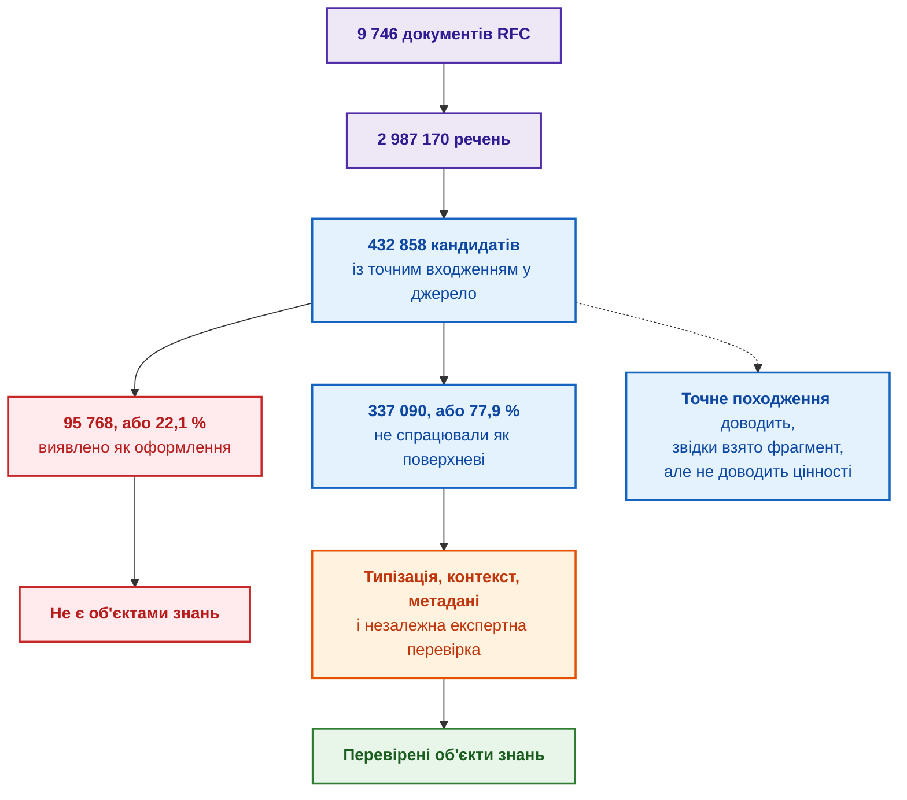

Фіолетові блоки є корпусом, сині блоки є кандидатами, червоні блоки є оформленням, помаранчевий блок є перевіркою, зелений блок є результатом. Розподіл за типами виявився нерівномірним: 93 % нормативних кандидатів не потрапили до поверхневого шару, тоді як серед структурних кандидатів оформлення становило 38 %. Службовий шум розподіляється нерівномірно, тож простий поділ за типом і шаром корисніший за однакову обробку всіх фрагментів складною моделлю.

Пошуковий експеримент дав змішаний результат. На вибірці зі 100 RFC кандидати скоротили медіану тексту, прочитаного до першого влучання, зі 149 до 71 слова, але програли сирим абзацам за повнотою на перших п'яти результатах: 69,81 % проти 73,58 %. На повному корпусі, обробленому у 98 вікнах, кандидати виграли за обома показниками: повнота 69,54 % проти 50,82 %, медіана прочитаного 88 слів проти 174. Результат не доводить, що об'єкти знань завжди кращі за сирий текст, бо віконна методика не тотожна одному глобальному індексу BM25. Висновок конкретніший: користь подання залежить від масштабу, розміру фрагментів і метрики, а «менше читати» й «частіше знайти правильний документ» є різними цілями.

Ще один тест стосувався двокласової типізації «нормативний чи структурний». За опублікованим повідомленням [[12]](#src-12), класифікатор найближчого центроїда на 384-вимірних векторних представленнях отримав 93,1 % згоди з еталонними мітками й 4,5 мс на кандидата, а генеративна модель `qwen2.5-coder:7b` — 88,1 % і 583 мс. Співвідношення часу приблизно 130 разів стосується різних конфігурацій: NPU ноутбука для класифікатора проти мережевого виклику моделі; воно не ізолює виграш самого алгоритму. Еталонні мітки походили від детермінованого правила, а не від незалежних експертів, тож наведені частки є рівнем згоди з правилом-учителем, а не оцінкою справжньої семантики. Для перевірки перенесення потрібні незалежно розмічена відкладена вибірка, поділ без витоку між версіями одного RFC, матриця помилок, макроусереднена F1-міра для нерівних класів і довірчі інтервали.

У пілоті формування контексту для великої мовної моделі (*large language model*, LLM) на 20 RFC повідомлено про коротший контекст з об'єктів знань (1 948 токенів проти 2 169) і менший час до першого токена (1 258 мс проти 1 385 мс). Окремо оцінювали повноту контрольних термінів у відповіді моделі, а не їх збереження у вхідному контексті: 0,350 проти 0,306. Контрольні терміни отримували за TF-IDF; базовий сирий текст обмежували першими 8 000 символами, тому порівняння не охоплює довільного подання повного документа. Наявність термінів у відповіді не виявляє заперечення, заміни MUST на MAY, переплутаного суб'єкта чи непідтриманого твердження. Для перевірки цих помилок кожне твердження потрібно зіставляти з точним фрагментом-доказом. Наведені агрегати є повідомленими результатами пілоту, не незалежною реплікацією; для KAS з них сформульовано п'ять обмежених висновків:

1. точне походження є необхідною, але недостатньою умовою знання;
2. кандидат і об'єкт знань мають бути різними станами конвеєра;
3. детерміноване сортування варто виконувати до дорогих моделей;
4. перевагу підготовленого подання доводять окремо для пошуку, читання, класифікації й генерації;
5. негативний чи змішаний результат корисніший за універсальну обіцянку, яку експеримент не може підтвердити.

Межі застосовності чисел: досліджено один англомовний корпус зі стабільною структурою й нормативними маркерами MUST, SHALL, SHOULD, MAY. Перенесення на вимоги, задачі, чати, українські документи чи змішані корпоративні сховища потребує окремої перевірки.

> [!NOTE]
> **П'ять авторських висновків емпіричного експерименту з виявлення знань (корпус RFC, п'ять висновків)**
> 1. Точне побайтове походження (Byte-Level Provenance) є необхідною, але недостатньою умовою доказової цінності знання: службове оформлення також має бездоганну простежуваність.
> 2. Кандидат у знання та верифікований об'єкт знань зобов'язані бути суворо розмежованими станами конвеєра KAS.
> 3. Детерміноване структурне сортування поверхневого шуму має безумовно передувати застосуванню важких статистичних моделей.
> 4. Перевага підготовленого подання знань повинна емпірично доводитися окремо для задач пошуку, читання, класифікації та генерації.
> 5. Негативний або змішаний результат випробування є ціннішим за непідтверджені гіпотези про всезагальну придатність сирого тексту.
> *Керування рантаймом / Інженерний інваріант:* за повідомленими підрахунками сім правил позначили 22,1% кандидатів як оформлення; це не оцінка повноти чи точності детектора на незалежній розмітці. Обробка залежить від обсягу входу й не є константною за довжиною корпусу.

### 11.1. Емпіричний експеримент автора із науковою періодикою та феномен деонтичної асиметрії

Для перевірки меж застосовності детермінованого конвеєра за межами англомовних технічних стандартів автором описано окремий експеримент із корпусом академічної періодики: 1 738 публікацій рецензованого журналу з проблем штучного інтелекту та кібернетики у форматі PDF. За історичним повідомленням автора, 73,7% статей були українськомовними, 22,4% — англомовними, решта — змішаними та анотованими виданнями. Мовні частки й наведені нижче результати вилучення залишаються неперевіреними агрегатами: дату, точний знімок входу, версію екстрактора та геш-маніфест саме історичного запуску не встановлено. Вони не об'єднуються з RFC-дослідами §11 чи пізнішим обліком завантаження джерел.

Первинна гіпотеза полягала в тому, що налаштований для технічних стандартів конвеєр екстракції норм зможе автоматично інтегрувати науковий доробок у базу знань. Для пояснення повідомлених спостережень автором запропоновано **феномен деонтичної асиметрії академічного знання**; це інтерпретація результатів, а не незалежно перевірений причинний висновок:

1. **Різні види тверджень:** нормативні специфікації можуть використовувати `MUST`, `SHALL`, `SHOULD`, `MAY`, тоді як статті часто описують спостереження, алгоритми й гіпотези без цих маркерів. Стаття також може цитувати норму чи давати рекомендацію; граматична форма не встановлює авторитетності твердження.
2. **Первинний запуск:** за повідомленням автора, із 1 738 публікацій 862 документи (49,6% цього корпусу) потрапили до карантину, оскільки екстрактор не виявив у них модальних конструкцій чи формальних дефініцій. Нульовий вихід цього екстрактора не доводить відсутності таких конструкцій або знань у самих документах.
3. **Викривлення видобутого змісту:** за повідомленням автора, у решті 876 статей екстрактор відібрав 4 202 фрагменти конструкцій дозволу й 1 055 дефініцій. Без незалежної розмітки ці числа показують вихід екстрактора, але не дають виміряти, яку частину фактичного змісту він пропустив.
4. **Мовна залежність валідатора:** автор пов'язував блокування українськомовних статей з англомовним лексиконом предикатного шлюзу. Це повідомлена гіпотеза: без поелементного журналу відмов і зіставного запуску зі зміненим лише лексиконом причинність не встановлено.

Для подолання цієї невідповідності автором запропоновано чотирикомпонентну модель стратифікації авторитетності й тип дескриптивного наукового твердження ($`\text{Atom}_{\text{desc}}`$). Повідомлення про реалізацію не є незалежною перевіркою її повноти. Наприклад, речення «у вибірці отримано затримку 12 мс» має зберігатися разом з умовами вимірювання, а не перетворюватися на вимогу «затримка завжди не перевищує 12 мс».

<a id="obj-10-12"></a>

**Діаграма 10.12. Конвеєр детермінованої обробки наукової періодики та стратифікації авторитетності**

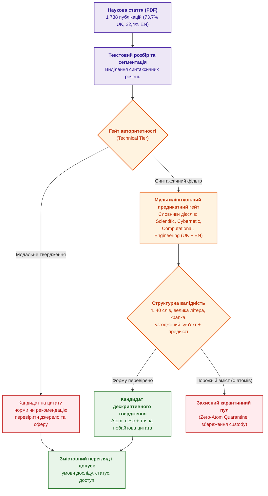

**Історія повторної обробки.** За окремим повідомленням автора, після додавання дескриптивних тверджень і багатомовної перевірки повернуто 618 публікацій та отримано 1 492 валідні контейнери. Дату, знімок і поелементні переходи цього етапу не встановлено; діаграма 10.12 відображає опис запропонованого конвеєра, а не перевірений журнал виконання. Первинний облік узгоджується арифметично: $`862 + 876 = 1\,738`$. Проте додавання 618 повернутих публікацій до 876 дає 1 494, а не повідомлені 1 492 контейнери. Обидва історичні числа збережено; причину розбіжності та відповідність між публікацією й контейнером не встановлено. Без зіставних знаменників і журналів ці агрегати не доводять приросту покриття або загальної точності класифікації.

**Окрема звірка джерел від 2026-11-01.** Поточний інвентар містив 5 184 PDF, зокрема 1 738 файлів досліджуваного журналу; метадані охоплювали 2 277 записів: 1 738 цього журналу й окремі 539 EuDML. Маніфест завантаження для першої добірки містив 1 740 записів: 1 738 зі статусом `ok` і 2 зі статусом `error`; для другої — 1 150 записів: 539 зі статусом `ok` і 611 з іншими статусами. Це різні одиниці обліку — файли, метадані й записи спроб завантаження, не результати історичного вилучення знань. Дата звірки не є датою тих запусків, а збіг кількості 1 738 без геш-маніфесту не встановлює тотожності корпусів. Новий облік не підтверджує мовних часток, карантинних переходів чи причинного пояснення автора.

> [!NOTE]
> **Чотири принципи стратифікації авторитетності при здобутті академічних знань (чотири принципи)**
> 1. Авторська модель семантичної сепарації: нормативне, описове твердження й гіпотеза мають різні типи; цитата норми зі статті не набуває нормативного статусу без перевірки першоджерела й застосовності.
> 2. Детермінований гейт синтаксичної форми факту: видобування дескриптивного атома допускається лише за умови структурної цілісності висловлювання (наявність узгодженого суб'єкта, предикатного ядра та об'єкта в межах одного нерозірваного речення) із прямою побайтовою прив'язкою до незмінного першоджерела.
> 3. Мультилінгвальна предикатна перевірка: для кожної підтримуваної мови потрібні окремі розмічені приклади й оцінка пропусків; однаковий розмір словників не гарантує однакової якості. Нерозпізнана форма спрямовується на перегляд, а не оголошується відсутністю знання.
> 4. Інваріант захисного карантину неіндексованих документів: першоджерела, з яких детермінований екстрактор не зміг видобути жодного семантичного атома, ніколи не знищуються і не ігноруються мовчки, а ізолюються в криптографічно захищеному карантинному просторі зі збереженням ланцюга походження (provenance custody) для подальшого аудиту повноти бази знань.
> *Керування рантаймом / Інженерний інваріант:* дескриптивний факт із наукового видання не може змінювати нормативну поведінку системи критичного призначення без випробуваного правила індуктивного допуску.

## 12. Математичний апарат селекції знань: інформаційні метрики та фільтри

Математичний апарат селекції відповідає на питання: яку наступну дію виконати з фрагментом і чим пояснити її вибір? Для цього потрібні вже введені поняття кандидата, статусу та окремого допуску. Числа роблять маршрутизацію відтворюваною, але не замінюють змістовних критеріїв. Почнемо з мітки документа, потім знайдемо майже дублікати й визначимо терміновість перегляду. Метрики самого пошуку пояснила [Глава 8](ch08-engineering-artifacts-as-data.md), а калібрування оцінок [Глава 6](ch06-applied-mathematics-for-expert-systems.md); тут підготуємо матеріал до пошуку.

**Класифікація з правом утриматися.** Класифікація призначає документу мітки: тип, рівень чутливості, домен, власника. Безпечна вибіркова класифікація має третій вихід, передачу людині:

<a id="obj-10-13"></a>

**Формула (10.13). Класифікація з передачею на перегляд**

```math
\hat y(x)=
\begin{cases}
\arg\max_y p(y\mid x), & \text{якщо } \max_y p(y\mid x)\ge\tau\ \land\ \mathrm{AutoAllowed}(x),\\
\text{перегляд людиною}, & \text{інакше},
\end{cases}
```

Позначення класифікації:

- $x$ є документом, $y$ є можливою міткою класу, а $\hat y(x)$ є передбаченою міткою;
- $p(y\mid x)$ є оцінкою ймовірності мітки за документом, $`\max_y`$ вибирає найбільшу оцінку серед міток, а $`\arg\max_y`$ повертає мітку, що її досягає;
- $\tau$ є порогом довіри, а $`\mathrm{AutoAllowed}(x)`$ є логічною умовою, що політика дозволяє автоматичне рішення;
- $\land$ означає «і», знак $\ge$ означає «не менше», а друга гілка передає документ на перегляд, якщо обидві умови не виконані.

Множина класів має бути скінченною й непорожньою, оцінки та поріг лежать від 0 до 1. За рівності найбільших оцінок потрібне явне правило нічиєї, наприклад передача людині. Автоматична мітка типу документа не є остаточним рішенням про істинність чи нормативний допуск його змісту.

Результатом є мітка або передача документа людині. Наприклад, за умовних $`p=0{,}82`$, $`\tau=0{,}80`$ і дозволеної політики класифікатор видає мітку; заборона політики передає той самий документ на перегляд. Поріг задають за валідацією зі зважуванням ризику: помилково позначити конфіденційне як публічне значно дорожче, ніж передати зайвий документ на перегляд. Оцінку нормованої експоненційної функції (*softmax*) без калібрування не називають ймовірністю: калібрування перевіряють діаграмою надійності на даних тієї самої організації.

**Усунення дублікатів.** Точні дублікати ловить криптографічний хеш канонічного вмісту. Для майже дублікатів документ подають множиною перекривних послідовностей слів (*shingles*) і порівнюють множини:

<a id="obj-10-14"></a>

**Формула (10.14). Подібність Жаккара та ідеальна властивість MinHash**

```math
J(A,B)=\frac{|A\cap B|}{|A\cup B|},\qquad \Pr\big[h_{\min}(A)=h_{\min}(B)\big]=J(A,B)
```

Складники подібності:

- $A$ і $B$ є множинами послідовностей слів двох документів, $A\cap B$ є їхнім перетином, а $A\cup B$ є їхнім об'єднанням;
- $`|X|`$ означає кількість елементів множини $X$, тому $J(A,B)$ є часткою спільних послідовностей серед усіх різних;
- $`h_{\min}(A)`$ є найменшим значенням випадкової хеш-функції на множині $A$, а $\Pr[\cdot]$ позначає ймовірність події в дужках;
- друга рівність стверджує, що ймовірність збігу мінімальних хешів дорівнює подібності Жаккара.

Рівність MinHash у наведеному записі потребує двох непорожніх множин та рівноймовірної випадкової перестановки елементів їхнього об'єднання без колізій. Спільний мінімальний елемент належить перетину з імовірністю, що дорівнює частці перетину в об'єднанні; це й пояснює результат. Звичайна довільна хеш-функція лише наближує ці умови. Якщо порожня лише одна множина, Жаккар дорівнює нулю, але її мінімальний хеш не визначений: потрібна окрема гілка обробки. Для двох порожніх множин правило подібності задають окремо, оскільки сам дріб не визначений.

Подібність $J$ лежить між 0 (немає спільних послідовностей) і 1 (множини збігаються). За умовного прикладу з трьома спільними послідовностями з п'яти різних $`J=3/5=0{,}6`$, отже ймовірність збігу мінімальних хешів також становить 0,6. Метод MinHash використовує частку збігів за багатьма незалежними хеш-функціями, щоб оцінити $J$ без попарного порівняння всіх документів [[13]](#src-13). SimHash наближує косинусну подібність, а векторні представлення знаходять перефразування, але поріг подібності лише створює кандидата на об'єднання.

Критична пастка: майже однаковий текст може бути новою редакцією, а не дублікатом. Усунення дублікатів не повинне знищувати незалежного походження чи змішувати затверджену версію 2 із заміненою версією 1. Практичне рішення розділяє три ідентифікатори: канонічного змісту, конкретної редакції й твердження джерела (хто й коли опублікував редакцію). Пошук може згрупувати копії, а граф походження зберігає всі джерела, статуси й ребро «замінює».

**Свіжість.** Оцінка свіжості визначає, що переглядати першим:

<a id="obj-10-15"></a>

**Формула (10.15). Експоненційна оцінка свіжості**

```math
F(t)=e^{-\lambda t}
```

Величини свіжості:

- $t$ є часом, що минув після останньої перевірки, а $\lambda$ є швидкістю старіння знань;
- $e$ є основою натурального логарифма, а показник $-\lambda t$ задає спадання з часом;
- добуток $\lambda t$ має бути безрозмірним, тому одиниця $\lambda$ є оберненою до одиниці часу $t$;
- $F(t)$ є безрозмірною оцінкою свіжості між 0 і 1.

Передумови: час після перевірки невід'ємний, швидкість старіння також невід'ємна й зафіксована для цього профілю. За нульової швидкості оцінка не спадає. Невідомий час перевірки треба позначити невідомим, не підставляти нуль.

Одразу після перевірки $F(0)=1$, а за додатної швидкості старіння з часом оцінка прямує до 0; за нульової швидкості вона лишається одиничною. Для умовних $`\lambda=0{,}1`$ на день і $t=10$ днів маємо $`F=e^{-1}\approx0{,}368`$. Свіжість не вимірює істинності й не є причиною автоматично відкинути стандарт: для нормативного документа важливіший явний статус «замінено» чи «скасовано», а спадання свіжості лише підвищує пріоритет перегляду. Для тимчасового обхідного рішення постачальника $\lambda$ значно більша, ніж для стандарту.

**Пріоритет перегляду твердження.** Авторитетність не є сталою властивістю документа: вона залежить від твердження, домену, чинності й застосовності. Для пріоритету перегляду використовують не «ймовірність істини», а діагностичну оцінку:

<a id="obj-10-16"></a>

**Формула (10.16). Діагностична оцінка для перегляду**

```math
R(c)=w_{\text{source}}(c)\cdot F(t)\cdot a_{\text{scope}}(c)\cdot q_{\text{extract}}(c)
```

Параметри пріоритету:

- $c$ є твердженням, а $`w_{\text{source}}(c)`$ є вагою довіри до його джерела;
- $F(t)$ є оцінкою свіжості, $`a_{\text{scope}}(c)`$ є оцінкою застосовності до продукту й версії, а $`q_{\text{extract}}(c)`$ є якістю вилучення твердження;
- кожен множник лежить між 0 і 1, а множення знижує загальну оцінку, коли хоча б один чинник низький;
- $R(c)$ є діагностичним пріоритетом перегляду, а не ймовірністю істинності.

Оцінка $R(c)$ лежить між 0 і 1. Низьке значення спрямовує твердження на перегляд, але високе не робить його істинним. Два чинні авторитетні джерела, що суперечать одне одному, не усереднюють: суперечність блокує автоматичне використання, доки власник не задасть пріоритету чи меж застосування.

За навчальних ваг джерела 0,9, свіжості 0,8, застосовності 1 і якості вилучення 0,5 добуток дорівнює 0,36. Причина перегляду тут насамперед у розборі: слід звірити число з таблицею, а не «знизити істинність» джерела до 36%. Нульова оцінка також не означає хибності. Ця шкала задає терміновість перевірки низьких значень, а не порядок схвалення високих.

**Перевірка читабельності** ловить сміття до індексації: перплексія мовної моделі, частка коректних n-грам, оцінка шуму OCR і визначення мови захищають від впевнено процитованого сміття.

У реалізації автора стабільно працюють первинне сортування фрагментів (добре, підозріле, сміття) з оцінкою впевненості, оцінка щільності знань і гібридний пошук BM25 з косинусною подібністю й пізнім злиттям кандидатів. Частково реалізовано усунення дублікатів (точний хеш і кластеризація векторів без MinHash чи SimHash) і зважування довіри між джерелами (евристичне, без формальної моделі на кшталт теорії Демпстера й Шафера). Високі значення метрик пошуку й повноти термінів не гарантують коректного змісту: відповідь може переплутати суб'єкт дії, загубити заперечення чи замінити MUST на MAY, тому ризик закриває окрема перевірка кожного твердження проти фрагмента-доказу: чи збережено суб'єкт, предикат, заперечення й модальність.

### 12.1. Епістемічна геологія: індекс щільності знань (KDI) та ентропійний шлюз

Епістемічна геологія розглядає масиви технічної документації як промислові пласти інженерної руди, де критичні нормативні обмеження та таблиці калібрування занурені в мегабайти навігаційного оформлення, скриптів, повідомлень про конфіденційність та юридичних дисклеймерів. Автоматизований збір інформації без попереднього петрографічного аналізу тексту призводить або до перевантаження сховища беззмістовним веб-шлаком, або до катастрофічного видалення цінних таблиць регістрів, які примітивні парсери помилково маркують як «випадковий шум».

Щоб вибрати наступний аналізатор, у цій монографії автором запропоновано індекс щільності знань (*Knowledge Density Index*, KDI). Він рахує виявлені ознаки, а не цінність чи нормативну повноту фрагмента:

<a id="obj-10-17"></a>

**Формула (10.17). Щільність виявлених ознак**

```math
\mathrm{KDI} = \frac{w_d \cdot N_{\mathrm{deontic}} + w_e \cdot N_{\mathrm{entities}} + w_t \cdot N_{\mathrm{tables}} + w_q \cdot N_{\mathrm{quantities}}}{L_{\mathrm{tokens}}}
```

Параметри та вагові коефіцієнти щільності знань:

- $`N_{\mathrm{deontic}}`$ є кількістю деонтичних операторів (`SHALL`, `MUST`, `PROHIBITED`, `REQUIRED`);
- $`N_{\mathrm{entities}}`$ є кількістю розпізнаних апаратних або програмних сутностей онтології проєкту;
- $`N_{\mathrm{tables}}`$ є числом структурованих табличних рядків та зв'язаних матриць параметрів;
- $`N_{\mathrm{quantities}}`$ є кількістю числових значень із валідованими фізичними одиницями вимірювання СІ;
- $`L_{\mathrm{tokens}}`$ є загальною довжиною фрагмента в токенах лексичного аналізатора;
- $`w_d = 0{,}35, \, w_e = 0{,}25, \, w_t = 0{,}25, \, w_q = 0{,}15`$ є ваговими коефіцієнтами автора ($`\sum w = 1{,}00`$); їх калібрування потребує окремого протоколу та розміченого корпусу.

Лічильники є невід'ємними цілими, довжина для обчислення має бути додатною. KDI має одиницю «зважені ознаки на токен»; це не ймовірність, і без правила обліку повторів не слід припускати верхню межу 1. Треба фіксувати токенізатор, словник сутностей і правила підрахунку, інакше два запуски порівнюють різні величини.

Якщо токенів немає, знаменник дорівнює нулю і KDI не визначений. KDI є ознакою для первинного сортування, а не підтвердженням істинності, чинності чи права використання фрагмента.

**Дія системи (Actionable Closed Loop):**

1. **Керування рантаймом і потоком обчислень:** Раніше за класифікацію за KDI шлюз виконує дві перевірки, описані нижче: перевірку ентропії блоку і правило частки шістнадцяткових токенів для текстових карт регістрів. Перевірки допомагають відібрати апаратні дані до подальшого розбору, але не гарантують виявлення всіх образів, таблиць і карт регістрів. За розрахованим показником $`\mathrm{KDI}`$ запропоновано три категорії:
    - $`\mathrm{KDI} \ge 0{,}15 \implies \mathrm{RICH\_ORE}`$ (багата руда): фрагмент є кандидатом для компілятора правил та синтезу предикатів;
   - $`0{,}05 \le \mathrm{KDI} < 0{,}15 \implies \mathrm{POOR\_ORE}`$ (бідна руда): фрагмент вимагає глибинного синтаксичного аналізу залежностей та розгортання контексту;
    - $`\mathrm{KDI} < 0{,}05 \implies \mathrm{SLAG}`$ (історична назва категорії «шлак»): фрагмент спрямовується на окремий перегляд перед індексуванням. Відсікання потребує підстави за змістом і погодженої політики, бо низький KDI не доводить відсутності знань або ненормативного статусу. Походження зберігається.
2. **Апаратний сайзинг та інфраструктурні обмеження:** Зміну обсягу ембеддінгів, графів зв'язності, використання пам'яті й часу пошуку вимірюють окремо на тому самому корпусі та конфігурації. Сам поріг KDI не визначає економії ресурсів; його калібрування має також враховувати змістовно важливі фрагменти, помилково відсіяні фільтром.
3. **Практичний числовий приклад:** Технічний блок обсягом $`L_{\mathrm{tokens}} = 120`$ токенів містить $`N_{\mathrm{deontic}} = 6`$ нормативних вимог, $`N_{\mathrm{entities}} = 14`$ зареєстрованих мікроконтролерних сутностей, $`N_{\mathrm{tables}} = 1`$ рядок таблиці режимів і $`N_{\mathrm{quantities}} = 8`$ параметрів напруги та струму. Чисельник формули дорівнює: $`0{,}35 \cdot 6 + 0{,}25 \cdot 14 + 0{,}25 \cdot 1 + 0{,}15 \cdot 8 = 2{,}10 + 3{,}50 + 0{,}25 + 1{,}20 = 7{,}05`$. Обчислюється $`\mathrm{KDI} = 7{,}05 / 120 = 0{,}05875`$. Оскільки $`0{,}05 \le 0{,}05875 < 0{,}15`$, шлюз детерміновано маркує блок як $`\mathrm{POOR\_ORE}`$ і призначає йому конвеєр поглибленого синтаксичного розбору замість скидання.

Особливу небезпеку становлять апаратні дані, які текстовий фільтр може відсіяти. Двійковий блок, наприклад образ прошивки або стиснена таблиця калібрування, не є текстом, і KDI для нього не має змісту. Текстова карта регістрів (*memory map*) може переважно складатися з адрес, масок і бітових діапазонів та мати низький KDI. Ентропія байтів і частка шістнадцяткових токенів є ознаками для спрямування на перевірку, але не гарантують правильного визначення формату. Машинно-читані карти у форматах CMSIS-SVD та IP-XACT розбирає транслятор [§15.1](#151-детерміністична-трансляція-апаратних-метамоделей-ieee-1685-ip-xact-та-arm-cmsis-svd).

Для двійкових блоків шлюз обчислює байтову ентропію Шеннона:

<a id="obj-10-18"></a>

**Формула (10.18). Емпірична байтова ентропія**

```math
H(X) = -\sum_{i=0}^{255} P(b_i) \log_2 P(b_i)
```

Тут:

- $`X`$ є блоком байтів, що перевіряється;
- $`P(b_i)`$ є емпіричною частотою байта зі значенням $`b_i \in [0, 255]`$ у блоці $X$, від 0 до 1; доданки з нульовою частотою не враховуються;
- $`H(X)`$ вимірюється в бітах на байт і лежить від 0 до 8.

Навчальний розрахунок: у блоці чотири нульові й чотири одиничні байти. Обидві частоти дорівнюють 1/2, обидва логарифми за основою 2 дорівнюють -1, тому ентропія є 1 біт/байт. Поріг 7,20 тут не спрацьовує, хоча блок може бути двійковим. Верхня межа log₂(k) досягається за рівних частот усіх $k$ можливих значень; її застосування потребує саме обмеження набору байтів, а не назви формату.

Читається так: $`H(X)`$ є ентропією емпіричного розподілу значень байтів у непорожньому блоці. Якщо в блоці трапляються лише $k$ різних значень байтів, то $`H(X) \le \log_2 k`$. Для ілюстративної карти, що використовує лише 95 друкованих символів ASCII, табуляцію та два символи кінця рядка, можливі 98 значень байтів, тому ентропія не перевищує $`\log_2 98 \approx 6{,}61\,\text{біт/байт}`$. Ця межа не поширюється автоматично на інші кодування й байтові набори. Висока ентропія може супроводжувати стиснені або зашифровані дані, але сама не доводить формат; двійковий блок також може мати низьку ентропію. Для порожнього блоку частоти байтів та ентропія за наведеною формулою не визначені. Поріг 7,20 є початковою пропозицією для перевірки на власному корпусі.

**Дія системи для двійкових блоків (Actionable Closed Loop):**

1. **Керування рантаймом і потоком обчислень:** За умови $`H(X) > 7{,}20\,\text{біт/байт}`$ шлюз спрямовує блок на перевірку формату до застосування текстового токенізатора і KDI. Шлюз звіряє початкові байти з сигнатурами за принципом зонду форматів у [§16.1](#161-детекція-форматів-даних-багаторівневий-зонд-і-швидке-відсікання); сигнатура є ознакою формату, а коректність і безпечність вмісту перевіряються окремо:
   - стиснений контейнер (gzip `1F 8B`, ZIP `50 4B 03 04`, Zstandard `28 B5 2F FD`) розпаковується в межах лімітів розміру з [§9](#9-захист-від-шкідливого-входу-стійкість-аналізаторів-та-нейтралізація-отруєного-тексту), а розпакований вміст знову проходить усі перевірки цього підрозділу; запис походження зберігає хеш SHA-256 і діапазон байтів стисненого блоку в документі, а зміщення цитат рахуються в розпакованому потоці;
    - сигнатура ELF `7F 45 4C 46` або U-Boot legacy `27 05 19 56` спрямовує блок на перевірку формату й призначення. ELF може містити не лише прошивку, тому статус `BINARY_FIRMWARE_IMAGE` потребує додаткового підтвердження. Двійковий артефакт зберігають із хешем SHA-256, діапазоном байтів і посиланням на джерело;
    - блок без відомої сигнатури ізолюється в карантині як артефакт невизначеного формату, а не автоматично оголошується зашифрованим чи двійковим.
2. **Апаратний сайзинг та ресурси:** Гістограму з 256 лічильників можна побудувати в буфері розміром 1024 байти (1 КіБ), якщо кожен лічильник займає 4 байти. Це розрахунок розміру, не вимірювання затримки; час обробки перевіряють на визначеній реалізації та платформі. Розмір буфера не гарантує його перебування в L1-кеші.
3. **Практичний числовий приклад (умовний):** PDF-додаток постачальника містить вкладений потік обсягом $`4\,\text{КБ}`$ з ентропією $`H(X) = 7{,}91\,\text{біт/байт}`$, що починається з байтів `1F 8B`. Після перевірки формату шлюз розпаковує контейнер gzip і отримує $`18\,\text{КБ}`$ тексту карти регістрів. Якщо текст містить лише 98 значень ASCII, наведених вище, його ентропія не перевищує $`6{,}61\,\text{біт/байт}`$; далі застосовують правило частки шістнадцяткових токенів.

Текстову карту регістрів розпізнає друге правило. Воно рахує, яку частку токенів фрагмента становлять адреси, маски й бітові діапазони:

<a id="obj-10-19"></a>

**Формула (10.19). Частка адресних токенів**

```math
\rho_{\mathrm{hex}} = \frac{N_{\mathrm{hex}}}{L_{\mathrm{tokens}}}
```

Тут:

- $`N_{\mathrm{hex}}`$ є кількістю токенів, що відповідають шістнадцятковому числу `0x[0-9A-Fa-f_]+` або бітовому діапазону вигляду `[31:0]`, ціле число від 0 до $`L_{\mathrm{tokens}}`$;
- $`L_{\mathrm{tokens}}`$ є довжиною фрагмента в токенах того самого лексичного аналізатора, що й у формулі KDI; за нульової кількості токенів частка не визначена;
- $`\rho_{\mathrm{hex}}`$ є безрозмірною часткою від 0 до 1.

Читається так: $`\rho_{\mathrm{hex}} = 0{,}10`$ означає, що кожен десятий токен фрагмента є адресою, маскою або бітовим діапазоном. Звичайний технічний текст згадує адреси поодиноко, а таблиця регістрів містить їх у кожному рядку.

**Дія системи для текстових карт регістрів (Actionable Closed Loop):**

1. **Керування рантаймом і потоком обчислень:** Якщо $`\rho_{\mathrm{hex}} \ge \tau_{\mathrm{hex}} = 0{,}10`$, фрагмент отримує статус `HARDWARE_HEX_MAP` і ще до класифікації за KDI спрямовується до парсера регістрів, тому як шлак він не відсікається. Парсер регістрів перевіряє структуру: рядок карти має містити адресу, ім'я регістра і бітовий діапазон або значення після скидання. Якщо таких рядків у фрагменті немає (наприклад, це дамп пам'яті або журнал адрес), фрагмент повертається до класифікації за KDI. Походження значення $`\tau_{\mathrm{hex}} = 0{,}10`$ і спосіб його калібрування пояснено після прикладу.
2. **Апаратний сайзинг та ресурси:** Частку $`\rho_{\mathrm{hex}}`$ обчислюють за той самий прохід по токенах, що й лічильники KDI: кожен токен перевіряється двома шаблонами, додаткового проходу по байтах не потрібно.
3. **Практичний числовий приклад (умовний):** Фрагмент адресної карти периферії обсягом $`4\,\text{КБ}`$ має $`L_{\mathrm{tokens}} = 600`$ і 32 рядки регістрів; у кожному рядку є адреса вигляду `0xF020...`, бітовий діапазон і значення після скидання, тобто $`N_{\mathrm{hex}} = 96`$. Тоді $`\rho_{\mathrm{hex}} = 96 / 600 = 0{,}16 \ge 0{,}10`$, і фрагмент отримує статус `HARDWARE_HEX_MAP`. За $`N_{\mathrm{deontic}} = 0`$, $`N_{\mathrm{entities}} = 32`$ іменами регістрів, $`N_{\mathrm{tables}} = 32`$ рядками і $`N_{\mathrm{quantities}} = 0`$ індекс $`\mathrm{KDI} = (0{,}25 \cdot 32 + 0{,}25 \cdot 32) / 600 = 16 / 600 \approx 0{,}027`$, що менше за 0,05 і дає категорію $`\mathrm{SLAG}`$ без попереднього розпізнавання карти. Якщо фрагмент використовує лише визначені вище 98 значень ASCII, його ентропія не перевищує $`6{,}61\,\text{біт/байт}`$, і поріг 7,20 теж не спрямовує фрагмент на перевірку формату.

**Звідки взято поріг 0,10.** Значення $`\tau_{\mathrm{hex}} = 0{,}10`$ не виміряне на корпусі, а запропоноване зі структурної оцінки двох типів фрагментів. Якщо рядок карти має 10–20 токенів, з яких 2–3 є адресою, бітовим діапазоном або значенням після скидання, частка $`\rho_{\mathrm{hex}}`$ лежить від $`2/20 = 0{,}10`$ до $`3/10 = 0{,}30`$. Якщо абзац зі 100–200 токенів містить від 0 до 3 адрес, частка не перевищує $`3/100 = 0{,}03`$. Ці діапазони є припущеннями, а не результатами вимірювання. Карта з довшим описом може мати частку нижче 0,10 і залишитися невиявленою; спосіб розбиття `0x4002_0000` на токени також змінює результат.

Поріг підбирають на навчальній вибірці, а пропуски перевіряють на окремій тестовій. Для пояснення межі потрібна біноміальна модель: $n$ незалежних випробувань з однаковою невідомою ймовірністю пропуску. Імовірність не побачити жодного пропуску є добутком $n$ однакових імовірностей успіху. Прирівнявши її до 0,05, отримують верхню односторонню 95-відсоткову межу:

<a id="obj-10-20"></a>

**Формула (10.20). Верхня межа пропусків за нуля спостережених помилок**

```math
p_{\mathrm{upper}} = 1 - 0{,}05^{1/n} \approx 3/n
```

Тут $n$ є додатною цілою кількістю випробувань без пропусків, а $`p_{\mathrm{upper}}`$ є безрозмірною межею від 0 до 1; наближення придатне за достатньо великого $n$. Для 300 випробувань точна межа близька до 0,00994. Її можна використати для перевірки цілі «менше 1%» у визначеному профілі, але не для довільного корпусу чи залежних копій одного документа. Докладніше див. [главу 36](ch36-knowledge-testing-pyramid-and-variational-calibration.md). Тепер від оцінок окремого фрагмента перейдемо до стану всього конвеєра.

Усі допущені фрагменти зберігають сувору незмінність первинного байтового фонду (*Bit-for-Bit Provenance*): нормалізація переносів рядків (`CRLF` $\to$ `LF`) заборонена у вихідних файлах сховища, а адресація цитат спирається виключно на інтервали зміщень $`[\mathrm{byte\_start}, \mathrm{byte\_end})`$ відносно канонічного файлового контейнера.

> [!NOTE]
> **Авторський трикомпонентний ентропійно-селекційний шлюз (KDI, стратифікація руди та захист апаратних даних, три компоненти)**
> 1. Індекс щільності знань (KDI): авторська оцінка виявлених ознак на токен за зваженим балансом деонтичних операторів ($`w_d=0{,}35`$), сутностей ($`w_e=0{,}25`$), таблиць ($`w_t=0{,}25`$) та СІ-величин ($`w_q=0{,}15`$); це не оцінка істинності чи нормативної повноти.
> 2. Трирівнева стратифікація руди: первинне сортування за кандидатними порогами KDI для багатої руди ($`\mathrm{KDI} \ge 0{,}15`$), бідної руди ($`0{,}05 \le \mathrm{KDI} < 0{,}15`$) та шлаку ($`\mathrm{KDI} < 0{,}05`$). Категорія не замінює перевірку змісту й права використання.
> 3. Перевірка апаратних даних до відсікання: ентропія блоку ($`H(X) > 7{,}20\,\text{біт/байт}`$) є сигналом для перевірки формату, а частка шістнадцяткових токенів ($`\rho_{\mathrm{hex}} \ge 0{,}10`$) спрямовує кандидата до парсера карт регістрів (`HARDWARE_HEX_MAP`). Жодна ознака не гарантує виявлення всіх апаратних даних.
> *Керування рантаймом / Інженерний інваріант:* забезпечення побайтової незмінності першоджерел (Bit-for-Bit Provenance) із забороною нормалізації `CRLF` $\to$ `LF` та фіксацією зміщень $`[\mathrm{byte\_start}, \mathrm{byte\_end})`$.

## 13. Операційні метрики ефективності та якості функціонування KAS

Навіть правильно спроєктований конвеєр із часом деградує: джерела перестають оновлюватися, черга перегляду росте, відкликані фрагменти лишаються в кеші, правила доступу починають конфліктувати. Без окремих вимірювань деградацію помічають лише після неправильної відповіді або витоку. Тому, крім метрик пошуку, здобуття знань має власні операційні показники:

- **покриття:** частка підключених джерел в межах обсягу й частка артефактів із власником, статусом, базовою версією, міткою доступу й посиланням на джерело;
- **свіжість:** кількість затверджених артефактів із простроченою датою перегляду й документів, не перевірених після зміни стандарту чи випуску постачальника;
- **затримка курування:** час, який новий кандидат проводить у черзі перегляду;
- **затримка відкликання:** час між відкликанням джерела й зникненням фрагментів із пошуку, векторного індексу, кешу й зведень;
- **коректність доступу:** кількість запитів, відкинутих рушієм політик, знайдених конфліктів політик і спроб міжпроєктного витоку;
- **чистота доказів:** частка відповідей, де всі джерела затверджені й належать правильній базовій версії; для доказової експертної системи метрика є однією з найважливіших.

Три формули перетворюють перелік на керовані цілі рівня обслуговування (*service level objectives*, SLO). Повнота метаданих:

<a id="obj-10-21"></a>

**Формула (10.21). Повнота метаданих**

```math
C_{\text{meta}}=\frac{1}{N\,\lvert M \rvert}\sum_{i=1}^{N}\sum_{m\in M}\mathbf{1}\big[m\ \text{коректне для фрагмента}\ i\big]
```

Параметри повноти метаданих:

- $N$ є кількістю активних фрагментів, $M$ є множиною обов'язкових полів, а $i$ позначає фрагмент;
- $m$ позначає поле з множини $M$, а $`\mathbf{1}[\cdot]`$ дорівнює 1, якщо поле заповнене коректно, і 0 інакше;
- сума додає результати перевірок для всіх фрагментів і полів, а множник $1/(N\lvert M \rvert)$ обчислює їхню середню частку.

Потрібні додатне ціле $N$ й непорожня скінченна множина $M$; результат безрозмірний від 0 до 1. Порожній пакет не має визначеної частки й не отримує автоматичного успіху. Умова «коректне» має спиратися на валідатор, а не лише на непорожній рядок. Пороги 1,00 для критичних полів і 0,98 для решти є параметрами навчального профілю автора, не вимогами зовнішнього стандарту.

**Керування рантаймом та цілі рівня обслуговування (SLO):**
- **Критичні атрибути безпеки (Security Attributes):** для полів мітки доступу, ідентифікатора джерела та версії нормативу повнота є абсолютною: $`C_{\mathrm{meta, sec}} = 1{,}00`$. За наявності хоча б одного незаповненого обов'язкового поля безпеки пакет негайно ізолюється в карантинний буфер `quarantine_ingest_queue`;
- **Загальний поріг конвеєра:** для другорядних описових полів встановлено поріг допуску $`C_{\text{meta}} \ge \tau_{\mathrm{meta}} = 0{,}98`$. При падінні нижче $`0{,}98`$ конвеєр ініціює подію `HALT_INGESTION`, блокуючи оновлення продуктивного індексу.

**Числовий приклад розрахунку:**
Пакет із $N = 500$ фрагментів містить $\lvert M \rvert = 6$ обов'язкових полів (сумарно $3\,000$ точок аудиту). Валідатор зафіксував 45 незаповнених полів другорядних технічних міток:
<a id="obj-10-22"></a>

**Формула (10.22). Повнота метаданих**

```math
C_{\text{meta}} = \frac{3\,000 - 45}{3\,000} = \frac{2\,955}{3\,000} = 0{,}985 \ge 0{,}98
```
Оскільки $`C_{\text{meta}} = 0{,}985`$, а всі критичні атрибути заповнені на 100%, пакет допускається до векторизації.

Затримку відкликання визначає найповільніша похідна копія:

<a id="obj-10-23"></a>

**Формула (10.23). Затримка очищення похідних копій**

```math
L_{\text{revoke}}(s)=\max_{j\in D(s)}t_{\text{removed},j}-t_{\text{revoke}}
```

Часові позначення відкликання:

- $s$ є джерелом, $D(s)$ є множиною його похідних копій, а $j$ позначає одну копію;
- $`t_{\text{removed},j}`$ є моментом видалення копії $j$, $`t_{\text{revoke}}`$ є моментом відкликання джерела, а $\max$ вибирає найпізніший час видалення;
- $`L_{\text{revoke}}(s)`$ є тривалістю між відкликанням і зникненням останньої похідної копії.

У цьому показнику $D(s)$ є повним непорожнім переліком активних копій, а часові позначки належать узгодженій шкалі секунд. Поки хоча б одну копію не очищено, завершена затримка ще невідома: показують поточний вік незавершеної операції. За відсутності копій приймають нульову затримку як окрему домовленість. Заборону нової видачі встановлюють відразу після відкликання; п'ятихвилинний бюджет очищення не дозволяє ще п'ять хвилин цитувати заборонене.

**Керування рантаймом та аварійний тайм-аут:**
- Ціль SLO конкретного профілю для активних похідних копій: $`L_{\text{revoke}}(s) \le \tau_{\mathrm{revoke}} = 300\,\text{с}`$ (5 хвилин на очищення реляційних таблиць, векторних індексів і локальних кешів). Це параметр профілю, а не вимога стандарту; незмінні аудиторські записи не видаляються цією операцією, але зберігають зв'язок із відкликаною редакцією та її статус.
- Якщо $`L_{\text{revoke}}(s) > \tau_{\mathrm{revoke}}`$, система переходить у захисний режим `FAIL_SAFE_REVOCATION`: запити до відповідного розділу знань тимчасово блокуються на рівні шлюзу API до підтвердження завершення очищення активних копій.

**Числовий приклад:**
Відкликання скасованої редакції стандарту відбулося о $`t_{\text{revoke}} = 10{:}00{:}00`$. Основна база знань завершила видалення о $`10{:}01{:}15`$, векторний індекс — о $`10{:}02{:}30`$, а кеш репліки — о $`10{:}04{:}20`$:
<a id="obj-10-24"></a>

**Формула (10.24). Затримка очищення похідних копій**

```math
L_{\text{revoke}}(s) = 10{:}04{:}20 - 10{:}00{:}00 = 260\,\text{с} \le 300\,\text{с}
```
Операція вклалася в ціль SLO цього прикладу; це не є перевіркою універсального строку відкликання.

Для стабільної черги курування діє закон Джона Літтла [[14]](#src-14):

<a id="obj-10-25"></a>

**Формула (10.25). Середня кількість кандидатів за законом Літтла**

```math
L=\lambda W
```

Одиниці закону черги:

- $L$ є середньою кількістю кандидатів у черзі, $\lambda$ є середнім темпом надходження кандидатів за одиницю часу, а $W$ є середнім часом до рішення;
- добуток $\lambda W$ має одиницю «кандидат», бо одиниці часу скорочуються;
- рівність описує середній стан сталої черги за узгодженого обліку надходжень, часу перебування й кандидатів.

Закон Літтла не потребує пуассонівських надходжень, але потребує узгодженої межі системи та скінченних довгострокових середніх без необмеженого накопичення. Якщо $W$ рахує лише очікування, то й $L$ має рахувати лише тих, хто очікує, а не кандидатів уже в роботі. Це рівність середніх, не верхня межа черги.

Для навчальної оцінки обсягу даних нехай кожен кандидат має однаковий розмір; тоді:

<a id="obj-10-26"></a>

**Формула (10.26). Обсяг даних черги та поріг зворотного тиску**

```math
M_{\mathrm{queue}} = L S_{\mathrm{item}},\qquad L_{\mathrm{max}} = 2L
```

Тут $`S_{\mathrm{item}}>0`$ є розміром даних одного кандидата в КіБ, $`M_{\mathrm{queue}}`$ є середнім обсягом цих даних у КіБ, а $`L_{\mathrm{max}}`$ є обраним профілем порогом кількості кандидатів. Множник 2 не випливає із закону Літтла. За різних розмірів записів треба врахувати їх зв'язок із часом очікування; службова пам'ять брокера, репліки й пікові сплески тут не враховані.

**Числовий приклад розрахунку:**
За середнього темпу надходження $`\lambda = 50\,\text{кандидатів/добу}`$ і середнього часу рецензування $`W = 4\,\text{доби}`$:
<a id="obj-10-27"></a>

**Формула (10.27). Середня кількість кандидатів за законом Літтла**

```math
L = 50 \cdot 4 = 200\,\text{кандидатів}
```
За розміру одного кандидата $`S_{\mathrm{item}} = 64\,\text{КіБ}`$ середній обсяг самих даних становить:
<a id="obj-10-28"></a>

**Формула (10.28). Обсяг даних черги та поріг зворотного тиску**

```math
M_{\mathrm{queue}} = 200 \cdot 64\,\text{КіБ} = 12\,800\,\text{КіБ} = 12{,}5\,\text{МіБ}
```
Якщо темп подвоїться, збереження чотириденного очікування дало б 400 кандидатів і 25 МіБ даних. Проте без додаткової спроможності кураторів $W$ може зростати, а стала черга взагалі не існувати. Тому за фактичного досягнення 400 елементів профіль вмикає зворотний тиск і перевіряє вік кандидатів; 400 не оголошується гарантованим максимумом. Далі потрібно вміти знайти походження саме тих об'єктів, що потрапили в чергу чи були відкликані.

Панель оператора в реалізації автора вже показує первинне сортування й впевненість фрагмента, релевантність і щільність, стан дублікатів, свіжість і надійність джерела, стадію конвеєра, надійність доставки й відгуки споживача (прийнято, використано в міркуванні, дублікат, відхилено, застаріло, заблоковано політикою). Бракує частки відмов із кодами причин, частки фрагментів із затверджених джерел, калібрування впевненості й порушень умов чинності: видно, що зібрано, але не завжди видно, наскільки зібране доказове. Якщо панель здобуття знань червона, відповіді мовної моделі можуть бути гарними, але довіряти відповідям не можна.

## 14. Моделювання походження й родоводу знань (Data Provenance & Lineage)

Після очищення, фрагментації, знеособлення й векторизації текст уже не схожий на початковий документ. Якщо KAS не зберегла ланцюжка перетворень, інженер не перевірить цитати, не відтворить результату й не зрозуміє, яка версія джерела вплинула на відповідь. Походження (*provenance*) відповідає на запитання «звідки взялося», родовід (*lineage*) на запитання «через які перетворення пройшло». Онтологію походження PROV-O Консорціуму Всесвітньої павутини (*World Wide Web Consortium*, W3C) [[15]](#src-15) і відкриту модель операційного родоводу OpenLineage [[16]](#src-16) разом з інструментами версіонування даних розглядає [Глава 16](ch16-expert-systems-architecture.md). Для здобуття знань важливий практичний наслідок: кожен переданий фрагмент несе стабільне посилання на доказ, за яким споживач відновлює повний ланцюжок: артефакт-джерело, версію джерела, версії аналізатора, фрагментації й моделі векторних представлень, налаштування пошуку.

У реалізації автора кожен фрагмент має конверт походження з розділами джерела, родоводу, обробки, якості, політики й доставки та стабільний ідентифікатор доказу, який не змінюється після повторного обходу джерела: оновлення породжує новий фрагмент із новим ідентифікатором, а старий лишається адресованим. Бракує наскрізного зшивання ланцюжка від вихідного документа до фінальної відповіді: конверт є, але повний родовід поки частковий.

Наприклад, фрагмент F походить з редакції B через аналізатор P2, а зведення S створене з F. Перевірка родоводу проходить від S до F і далі до B; відкликання B має знайти обидва похідні об'єкти. Запис «S створено сьогодні» цього не забезпечує. Отже, ланцюжок потрібний і для перевірки цитати, і для зворотного пошуку наслідків зміни. Далі з'ясуємо, як імпортувати вже готові зв'язки.

## 15. Інтеграція зі стандартами структурованих інженерних даних (ReqIF, STEP, AutomationML)

Інтеграція зі структурованими форматами продовжує задачу родоводу: чи можна перенести готові зв'язки, не відновлюючи їх із тексту? Передумовою є розрізнення ідентифікатора об'єкта, його редакції та відношення між об'єктами. Під час імпорту треба зберегти всі три складники, інакше підготовлений інструментом доказовий зв'язок перетвориться на неперевірений словесний опис.

Під час імпорту вимог, системних моделей і результатів моделювання легко звести дані до звичайного тексту. Тоді конвеєр збере слова, але загубить ідентифікатори, атрибути, зв'язки й умови, заради яких інженерний формат існував. Частина інженерних даних уже має стандартизовані формати, і KAS зберігає структуру, а не лише видимий текст:

- **ReqIF 1.2** (*Requirements Interchange Format*) [[17]](#src-17) служить для обміну вимогами. KAS імпортує не лише текст, а ідентифікатори, типи, атрибути, зв'язки, вкладення й базову версію; якщо перетворити об'єкти специфікації й зв'язки між об'єктами на абзаци, зворотну простежуваність уже втрачено;
- **OSLC Core 3.0** (*Open Services for Lifecycle Collaboration*) [[18]](#src-18) зв'язує артефакти керування життєвим циклом застосунків (*Application Lifecycle Management*, ALM) між інструментами через вебресурси, форми ресурсів і механізми виявлення. KAS зберігає адресу артефакта й живий зв'язок між вимогою, запитом на зміну й тестовим випадком замість ручної копії, що непомітно застаріває;
- **SysML v2** (*Systems Modeling Language*) [[19]](#src-19) має формальну метамодель, текстову й графічну нотації та стандартні програмні інтерфейси. Блоки, інтерфейси, стани, вимоги й залежності імпортують як типізований граф знань, а не розпізнають повторно зі знімка діаграми;
- **FMI 3.0.2** (*Functional Mock-up Interface*) [[20]](#src-20) і підходи цифрових двійників (*digital twins*) дають переносний контракт для обміну моделями, спільного й запланованого моделювання. KAS пов'язує вимогу не лише з числом із графіка, а з модулем моделі (*Functional Mock-up Unit*, FMU), версією моделі, параметрами, налаштуваннями розв'язувача, результатом і припущеннями експерименту.

KAS передає експертній системі наявну інженерну структуру, а не змушує організацію загубити структуру під час імпорту.

Наприклад, вимога `REQ-7` у ReqIF пов'язана з тестом `TEST-3`. Після імпорту треба перевірити обидва ID, напрям зв'язку та редакцію; сам текст «перевірено тестом» не відновлює цієї структури. Назви STEP та AutomationML у канонічному заголовку позначають ширший клас структурованого обміну: конкретні адаптери тут не специфіковано. Для регістрів розберемо один точніший випадок такого імпорту.

### 15.1. Детерміністична трансляція апаратних метамоделей IEEE 1685 IP-XACT та ARM CMSIS-SVD

Трансляція низькорівневих апаратних описів у символьну базу знань експертної системи є критичною ланкою вбудованої інженерії, де мікроконтролери та системи на кристалі (SoC) класів Infineon AURIX, ARM Cortex-R/M чи NXP S32K містять десятки тисяч апаратних регістрів керування. Описи цих компонентів постачаються виробниками напівпровідників у формалізованих схемах XML: **IEEE 1685 IP-XACT** [[29]](#src-29) та **ARM CMSIS-SVD** [[30]](#src-30).

Спроба наївного імпорту таких метамоделей через стандартні скриптові рушії містить приховану фатальну загрозу: використання чисел із рухомою комою одинарної точності (`float32`) для збереження адрес призводить до зрізання молодших розрядів вище $`16\,\text{МБ}`$ ($`2^{24}`$), оскільки мантиса `float32` має лише 24 біти. У результаті регістри на кшталт `0xF0000004` катастрофічно округлюються до `0xF0000000`, породжуючи колізії апаратних блоків у просторі логічного виведення.

Щоб не втрачати молодші розряди через рухому кому, в авторській моделі використано 64-бітні беззнакові цілі. Точність додавань ще потребує перевірки переповнення й правильного тлумачення полів формату. Адресу розгортають так:

<a id="obj-10-29"></a>

**Формула (10.29). Цілочисельне розгортання адреси регістра**

```math
A_{\mathrm{phys}} = A_{\mathrm{base}} + \Delta_{\mathrm{block}} + \Delta_{\mathrm{reg}} + i \cdot \Delta_{\mathrm{dim}}, \quad i \in [0, N_{\mathrm{dim}} - 1]
```

Параметри та адресні зміщення:

- $`A_{\mathrm{phys}}`$ є результуючою абсолютною фізичною адресою регістра у пам'яті контролера (тип `uint64`);
- $`A_{\mathrm{base}}`$ позначає базову фізичну адресу периферійного модуля (наприклад, блоку CAN або таймера GTM);
- $`\Delta_{\mathrm{block}}`$ є зміщенням адресного підблоку відносно бази модуля;
- $`\Delta_{\mathrm{reg}}`$ є зміщенням цільового регістра у межах блоку;
- $`\Delta_{\mathrm{dim}}`$ визначає крок адреси при індексації масиву регістрів;
- $`N_{\mathrm{dim}}`$ є розмірністю масиву (кількістю апаратних каналів), а $i$ є індексом каналу.

**Дія системи (Actionable Closed Loop):**

1. **Керування обчисленням:** усі адреси та зміщення є невід'ємними цілими в байтах після нормалізації адресних одиниць формату, кількість елементів масиву додатна. Кожне додавання й множення перевіряють на переповнення до виконання. Для додатної ширини регістра перевіряють, що останній зайнятий байт не перевищує найбільшу дозволену адресу; перевірка вже переповненої суми була б запізнілою. Накладання діапазонів потребує аналізу дозволених псевдонімів, а не безумовної відмови.
2. **Межі реалізації:** `uint64` не гарантує правильного відображення в MPU/SMMU; ці пристрої мають власні вирівнювання, гранулярність і права. Нульової вартості перетворення тут не виміряно.
3. **Навчальний числовий приклад, не карта конкретного контролера:** база `0xF0200000`, зміщення блоку `0x4000`, регістра `0x20`, крок `0x40`, індекс 3 дають адресу `0xF02040E0`. Для чотирибайтового регістра останній байт має адресу `0xF02040E3`. Поблизу цієї величини крок представних `float32` дорівнює 256 байтам, тому округлення до найближчого дає `0xF0204100`, а не `0xF0204000`. Це причина зберігати адреси цілими, а не доказ правильності опису постачальника.

Режими доступу спочатку описують поведінку обладнання, а не обов'язок програми. Авторська трансляція в деонтичні правила потребує окремого профілю дій:

- `read-only` є підставою не генерувати звичайну операцію запису; можливі спеціальні режими перевіряють за документацією виробу;
- `write-1-to-clear` означає, що запис 1 очищує відповідний біт, а запис 0 його не змінює. Це не універсальний обов'язок писати 1 і не заборона писати 0. Для очищення лише біта 2 навчальна маска `0x04` залишає інші W1C-біти незміненими;
- `read-writeOnce` обмежує повторні записи відповідно до специфікації; межу відновлення права запису, зокрема вид скидання, треба встановити з конкретного опису.

Отже, апаратний дескриптор дає факт про допустимі операції, а правило «коли очищувати прапорець» потребує ще вимоги до поведінки. Це готує розгляд компілятора, який не повинен вигадувати відсутні умови.

Парсер KAS фіксує точні позиції байтових маркерів відкриття та закриття тегів у файлі XML-специфікації постачальника, гарантуючи повну криптографічну кастодію цитування кожного апаратного регістра.

## 16. Архітектура та програмна реалізація системи здобуття знань (KAS)

KAS стоїть між джерелами й споживачами знань і відповідає за весь контрольований шлях документів і фрагментів. З одного боку KAS підключається до бібліотек електронних документів, файлових сховищ, вікі, репозиторіїв, трекерів задач, систем керування вимогами й вебджерел. З іншого боку KAS передає підготовлені фрагменти й пакети доказів експертній системі, пошуку, генерації з пошуком, аналітичним сервісам або людині. Між сторонами KAS виконує збір, розбір, фрагментацію, первинне сортування, оцінювання якості, класифікацію доступу, збереження походження, локальне зберігання, пакування й доставку.

<a id="obj-10-30"></a>

**Діаграма 10.30. KAS як незалежна програмна служба**

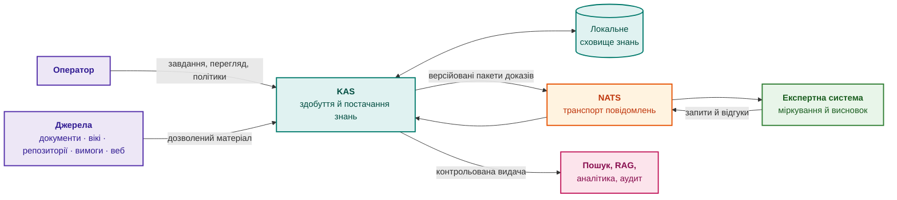

Фіолетові блоки є оператором і джерелами, бірюзові блоки є KAS і сховищем, помаранчевий блок є транспортом, зелений блок є експертною системою, рожевий блок є іншими споживачами. KAS може бути вбудованим компонентом, окремою службою або розподіленою мережею вузлів, і кожен варіант є окремим архітектурним рішенням:

- **вбудований компонент** доречний для невеликого застосунку з одним набором джерел і одним споживачем: конектори й обробка працюють у тому самому процесі, що простіше на початку, але тісно зв'язує життєві цикли, права доступу й масштабування двох різних відповідальностей;
- **окрема служба** має власне сховище, програмний інтерфейс, черги, політики, засоби спостереження й життєвий цикл, може обслуговувати кількох споживачів і доставляє знання через версійовані контракти. Межа особливо корисна, коли джерела конфіденційні, конектори працюють у різних мережевих зонах, а збирання не повинне зупинятися через недоступність експертної системи;
- **розподілена KAS** складається з локальних вузлів біля джерел: кожен вузол збирає й перевіряє матеріал у своїй зоні довіри, а назовні передає лише дозволені пакети доказів. Топологія складніша, зате краще зберігає межі проєктів, замовників і майданчиків.

Автор обрав окрему службу, локальну за замовчуванням, із власними інтерфейсами, сховищем, пошуком, завданнями збору й чергою перегляду. Варіант не є універсальним зразком, але дозволяє збирати джерела, розбирати документи, створювати фрагменти, сортувати й шукати навіть без підключення до експертної системи чи мовної моделі. Експертна система надсилає запит знань із темою й межами, а KAS повертає пакет фрагментів із походженням, оцінкою якості й рішеннями політик; відгуки про прийняття, дублікат, відхилення чи використання повертаються до KAS і впливають на подальшу оцінку джерел. Обмін проходить через відкритий брокер повідомлень [NATS](https://nats.io/), який є транспортом, а не частиною логіки здобуття знань: типізований і версійований формат повідомлень дозволяє змінити транспорт без зміни змісту запитів і пакетів. KAS відповідає за надійне постачання знань, а експертна система за міркування над знаннями, і контракт між ними версійований, типізований і незалежний від внутрішніх моделей зберігання обох сторін.

### 16.1. Детекція форматів даних: багаторівневий зонд і швидке відсікання

Перш ніж документ надійде на важкі етапи синтаксичного та семантичного розбору, конвеєр здобуття знань має детерміновано визначити тип вхідного потоку даних. Помилка на цьому етапі призводить до двох критичних збоїв: аварійного завершення спеціалізованого парсера на несумісних даних (наприклад, спроба розібрати бінарний архів як UTF-8) або втрати побайтової відповідності першоджерелу, що руйнує доказову цінність витягнутих фактів.

Детекція формату спирається на принцип попереднього зондування (*pre-ingestion sniffing*): замість повного завантаження файлу в пам'ять система зчитує лише фіксований початковий буфер розміром $`B_{\text{peek}}`$ (зазвичай 512–1024 байти). Аналіз виконується каскадно у три рівні:

<a id="obj-10-31"></a>

**Діаграма 10.31. Каскад багаторівневої детекції формату даних**

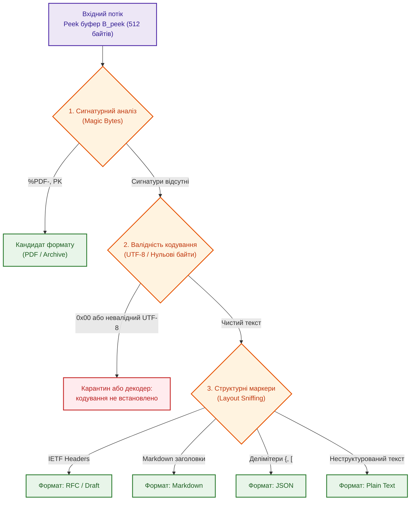

1. **Рівень сигнатур (Magic Bytes):** `%PDF-` чи `PK\x03\x04` обирають кандидатний аналізатор, який перевіряє структуру всього файла. Спільний ZIP-контейнер не відрізняє DOCX від XLSX без аналізу вмісту.
2. **Рівень перевірки кодування:** невалідний UTF-8 чи нульові байти забороняють негайно передати потік UTF-8-парсеру, але не доводять, що це нетекстовий файл: можливий UTF-16. Зонд викликає дозволений декодер або карантин. Межа буфера також може розрізати багатобайтовий символ, тому неповний кінцевий символ перевіряють після дочитування, а не оголошують пошкодженням.
3. **Рівень структурних маркерів (Layout Heuristics):** Якщо потік є валідним текстом, зонд аналізує перші рядки на наявність доменних сигнатур:
   * **IETF RFC:** наявність метаданих мережевої робочої групи (`Network Working Group`, `Internet Engineering Task Force`), полів `Request for Comments: \d+` або розділів `Status of this Memo`.
   * **Markdown / CommonMark:** наявність заголовків ATX (`# `), списків завдань (`- [ ]`) або обмежувачів коду (```` ``` ````).
   * **Структурований JSON:** перший непробільний символ належить множині `{'[', '{'}`.

Критичним інваріантом детекції та подальшої нормалізації є побудова **таблиці відображення зміщень (Byte-Offset Source Map)**:
<a id="obj-10-32"></a>

**Формула (10.32). Відображення токена на байтовий інтервал**

```math
\mathcal{M}: \{0,\dots,N_{\mathrm{tok}}-1\} \longrightarrow \{[b_s,b_e)\mid b_s,b_e\in\mathbb{Z},\ 0\le b_s\le b_e\le B\}
```
Будь-який парсер нормалізації (наприклад, очищення від розривів сторінок RFC чи форматування) зобов'язаний зберігати точну байтову прив'язку кожного виділеного правила до вихідного незмінного файлу. Якщо формат не дозволяє детерміновано відновити первинні байти, він не допускається до випуску нормативної бази знань.

Тут $`N_{\mathrm{tok}}\ge1`$ є цілою кількістю токенів, $B$ є невід'ємною цілою довжиною незмінної текстової редакції в байтах, а $`b_s,b_e`$ є цілими байтовими межами одного інтервалу. Область значень складається з інтервалів, а не з окремих позицій усередині одного наперед заданого інтервалу. Індекс токена лежить від нуля до кількості токенів мінус один; початок його інтервалу не перевищує кінець, а кінець не перевищує довжину файла. Порожній список токенів обробляють окремо як порожнє відображення. Відображення не обов'язково ін'єктивне. Наприклад, для UTF-8-тексту `A Ω` токен `Ω` займає байти [2, 4), а не один байт. Нормалізація не має підміняти ці зміщення символьними позиціями. Якщо токен утворено з розірваних частин, потрібен список інтервалів; один суцільний інтервал уже недостатній. Для PDF розпізнаний текст є версійованою похідною з координатами сторінки, а не дослівним входженням у стиснені байти PDF. Отже, зонд обирає маршрут, а таблиця походження дозволяє перевірити його результат.

### 16.2. Маршрутизація конвеєра: локальна диспетчеризація та асинхронна шина NATS

Після детекції формату KAS має передати вихідний байтовий потік відповідному обробнику. Вибір архітектурного механізму виклику визначається топологією розгортання:

#### 16.2.1. Автономний режим роботи (Standalone CLI / TUI)
В автономному режимі формат зіставляють із функцією обробки у внутрішньопроцесному реєстрі стратегій. Наприклад, кандидат PDF передають PDF-парсеру без мережевого повідомлення. Це прибирає мережеву серіалізацію, але не має нульової вартості: лишаються пошук обробника, виклик і перевірки. Час диспетчеризації треба вимірювати, а не прирівнювати до нуля.

#### 16.2.2. Розподілений промисловий конвеєр (Enterprise Crawler Pipeline)
У масштабованому середовищі, де збирач джерел постійно сканує зовнішні репозиторії, конвеєр організовано як подієво-орієнтовану систему на базі брокера повідомлень **NATS JetStream**:

<a id="obj-10-33"></a>

**Діаграма 10.33. Розподілена маршрутизація завдань інджесту через шину NATS**

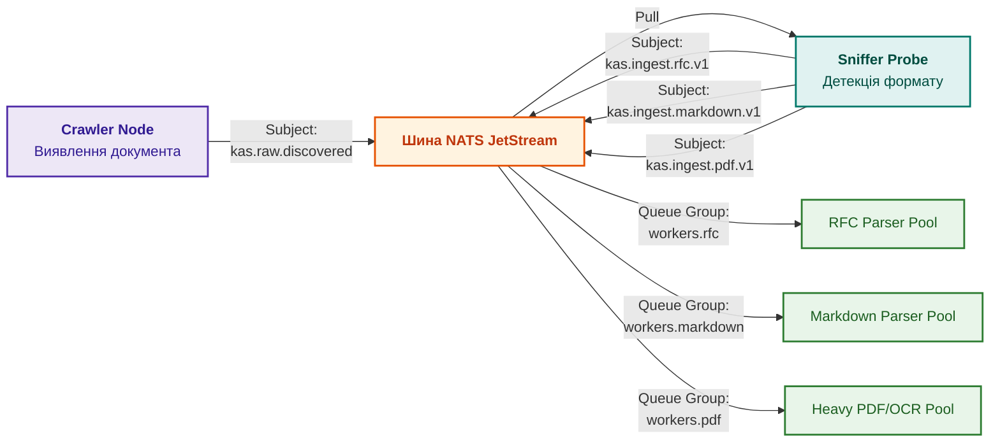

Використання NATS спирається на такі інженерні патерни:
* **Тематична маршрутизація суб'єктів (Subject-Based Addressing):** Зонд публікує завдання у тему, що містить ідентифікатор формату: `kas.ingest.<format>.<domain>`. Це дозволяє незалежно горизонтально масштабувати пули обробників: наприклад, ресурсномісткі воркери розбору PDF із OCR масштабуються окремо від швидких потокових парсерів RFC.
* **Балансування обробників:** спільний споживач JetStream може розподіляти завдання між процесами, але повторна доставка після втрати підтвердження можлива. Для кожного завдання потрібні стабільний ID та ідемпотентний запис результату: повтор не створює другого об'єкта знань.
* **Патерн передачі квитанцій (Claim Check Pattern):** шина передає дескриптор з URI, розміром і SHA-256 замість усього документа. Це зменшує обсяг повідомлень, але не доводить нульового копіювання: обробник ще має прочитати дані й перевірити доступ. Наприклад, повторне завдання з тим самим хешем і версією аналізатора може використати вже записаний результат; інша версія аналізатора створює іншу подію обробки.

### 16.3. Інтерфейс оператора KAS: фасетна розвідка та побайтова кастодія

Для аналітика знань робота з матеріалом через консольний інтерфейс KAS принципово відрізняється від повнотекстового чи векторного пошуку. Замість неструктурованого ранжування за схожістю оператор оперує багатовимірними фасетами, що безпосередньо відображають структуру нормативної логіки:

1. **Фасет ролей та сутностей (Entity Facet):** фільтрація за конкретним системним суб'єктом чи актором (наприклад, `entity:Client`, `entity:Proxy`).
2. **Деонтичний фасет (Deontic Modality):** виділення категорій норм — категоричні заборони (`MUST NOT`, `FORBIDDEN`), обов'язки (`MUST`, `SHALL`), дозволи (`MAY`).
3. **Фасет фізичних меж (Quantities & Bounds):** пошук правил за числовими параметрами та одиницями вимірювання (наприклад, `unit:ms val:>100`, `unit:bytes val:<=16384`).
4. **Фасет умов винятку (Defeater Discovery):** миттєва вибірка норм, дія яких скасовується або обмежується за наявності контекстних умов (маркери `unless`, `except`, `provided that`).

Інтерфейс оператора поєднує табличне відображення типізованих предикатів із панеллю побайтової доказової кастодії (*Evidence Custody Pane*). При виборі будь-якого правила система відображає точну цитату першоджерела, її зміщення у файлі та статус криптографічної перевірки хешу вмісту хостом:

<a id="obj-10-34"></a>

**Таблиця 10.34. Довідкове зіставлення**

| Поле макета | Навчальне значення | Результат перевірки |
|---|---|---|
| Джерело | незмінний навчальний текст, редакція B | не цитата зовнішнього стандарту |
| Текст | `The controller MUST NOT repeat the start unless ready.` | 54 байти UTF-8 без переносу, інтервал [0, 54) |
| Суб'єкт і дія | `Controller`, `repeat_start` | кандидатний розбір |
| Модальність | `MUST NOT` | заперечення збережено |
| Кандидат винятку | `unless ready` | потрібні визначення готовності, сфера й профіль |
| Фізична межа | не задана | число не вигадується |
| Хеш | у макеті не вимірювався | успіх не заявляється |

Прямо з вікна перегляду оператор має змогу виконати перевірочний запуск мікрокоду знання у вбудованому покроковому відлагоджувачі процесора знань. Це забезпечує наскрізну простежуваність: від виявлення сирого документа краулером до покрокової перевірки прапорців процесора під час оцінки конкретної інженерної ситуації.

### 16.4. Двоетапний компілятор технічних знань: синтаксичний аналіз залежностей та 7D-вектори розмірностей СІ

Двоетапний компілятор потрібний, щоб розділити два питання: хто має виконати дію і чи сумісні числові величини в її умові? Речення «The status register shall be cleared by the handler when the clock is enabled» починається з регістра, але виконавцем дії є обробник. Тому просте вікно слів навколо `shall` може помилитися. Спочатку пояснимо синтаксичні ролі, потім перевіримо величини; жоден етап сам не встановлює нормативного статусу речення.

В авторській моделі перший етап використовує універсальні залежності (*Universal Dependencies*, UD) [[32]](#src-32): це позначення зв'язків між словами, наприклад підмета й присудка. Аналізатор пропонує таку рамку для наведеного навчального речення:

<a id="obj-10-35"></a>

**Формула (10.35). Кандидатна рамка синтаксичних ролей**

```math
\mathrm{Sentence} \xrightarrow{\mathrm{UD}} \langle \mathrm{Actor}: \mathrm{Handler}, \, \mathrm{Action}: \mathrm{Clear}, \, \mathrm{Target}: \mathrm{Reg}_{\mathrm{status}}, \, \mathrm{Modal}: \mathbf{O}, \, \mathrm{Precondition}: \mathrm{ClockEnable} \rangle
```

Тут `Sentence` є вхідним реченням, `UD` позначає етап розбору, кутові дужки містять запис із ролями: `Actor` виконує `Action` над `Target`; `Modal` з символом $\mathbf{O}$ позначає кандидатний обов'язок; `Precondition` є умовою його дії. У прикладі обробник очищує регістр лише за ввімкненого тактування. За пасивних зв'язків `nsubj:pass` і `obl:agent` підмет стає об'єктом дії, а явно вказаний агент її виконавцем. Якщо агента немає, його залишають невідомим, не вгадують. UD задає схему анотації; статистичний парсер може помилитися навіть за відтворюваного запуску.

На другому етапі перевіряють фізичні величини. Якщо джерело задає додатне номінальне значення й симетричний відносний допуск, його переводять у замкнений інтервал:

<a id="obj-10-36"></a>

**Формула (10.36). Симетричний допуск додатного номіналу**

```math
I_V = [V_{\min}, V_{\max}] = [V_{\mathrm{nominal}} \cdot (1 - \delta), V_{\mathrm{nominal}} \cdot (1 + \delta)]
```

Тут $`V_{\mathrm{nominal}}>0`$ є номінальною напругою у вольтах, $\delta$ є безрозмірним допуском від 0 до 1, а $`V_{\min}`$ і $`V_{\max}`$ є нижньою та верхньою межами у вольтах. Для 5,0 В і 10% нижня межа є 5,0 · 0,9 = 4,5 В, верхня 5,0 · 1,1 = 5,5 В. Це інженерний допуск, не статистичний довірчий інтервал. Несиметричні, абсолютні чи від'ємні діапазони потребують іншого перетворення.

Для запобігання некоректним операціям порівняння різнорідних фізичних величин кожна розмірність кодується 7-вимірним вектором цілих показників степенів основних одиниць системи СІ (довжина $L$, маса $M$, час $T$, сила струму $I$, термодинамічна температура $\Theta$, кількість речовини $N$, сила світла $J$):

<a id="obj-10-37"></a>

**Формула (10.37). Вектор фізичної розмірності**

```math
\mathbf{D} = [d_L, d_M, d_T, d_I, d_\Theta, d_N, d_J] \in \mathbb{Z}^7
```

**Дія системи (Actionable Closed Loop):**

1. **Керування обчисленням:** перед порівнянням чи відніманням необхідно звірити вектори розмірностей. Для вольта в порядку наведених семи основних одиниць вектор є [2, 1, -3, -1, 0, 0, 0], для ампера [0, 0, 0, 1, 0, 0, 0]. Вони різні, тому складання такого порівняння зупиняється з `TYPE_DIMENSION_MISMATCH`. Збіг векторів лише відкриває наступні перевірки одиниці, типу величини й умови правила.
2. **Подання й межі:** компоненти $d$ є безрозмірними цілими показниками степенів. Пакування в сім `int8` та один нульовий байт допускає лише показники від -128 до 127; результати операцій треба перевіряти на переповнення. Канонічне подання дозволяє порівняти слова, але час залежить від CPU й розміщення даних. Однакова розмірність є необхідною, не достатньою умовою: мілівольти треба привести до вольтів, а різні фізичні значення з однаковою розмірністю розрізняти типом величини.
3. **Практичний результат:** для живлення [4,50; 5,50] В і вимоги «не нижче 4,80 В» вектори розмірностей збігаються, але весь допуск не задовольняє вимоги: 4,50 < 4,80. Отже, є ризик порушення в нижній частині діапазону; це не оцінка імовірності відмови без розподілу напруги. Порівняння з амперами натомість зупиняється ще на перевірці розмірностей.

> [!NOTE]
> **Три авторські інваріанти детермінованої компіляції технічних знань (три інваріанти)**
> 1. Синтаксична інверсія пасивного стану: авторська модель використовує зв'язки UD для кандидатного розподілу ролей, але не вигадує відсутнього агента й перевіряє результат проти речення.
> 2. Інтервальна семантика інженерних допусків: симетричний відносний допуск додатного номіналу переводиться в інтервал за наведеною формулою; статистичної довірчої ймовірності вона не задає.
> 3. 7D-типізація розмірностей СІ: авторське пакування обмежує діапазон показників і потребує канонічного подання, перетворення одиниць та окремої змістовної перевірки.
> *Керування рантаймом / Інженерний інваріант:* несумісна розмірність зупиняє складання з `TYPE_DIMENSION_MISMATCH`; відсутність цієї помилки ще не дозволяє публікації правила.

---

## 17. Розподіл архітектурної відповідальності: KAS проти систем RAG

Генерацію з пошуком запропонували Патрік Льюїс та співавтори як поєднання мовної моделі з явною пошуковою пам'яттю [[21]](#src-21). На стику KAS і такого ланцюжка типовою є одна проблема: ланцюжок генерує правдоподібну відповідь, але незрозуміло, де сталася помилка, у підготовці знань чи в тлумаченні доказів мовною моделлю. Якщо межу відповідальності не зафіксовано, кожен збій списують на «помилку моделі», хоча причиною часто є застарілий фрагмент, фрагмент без потрібного статусу чи фрагмент чужого проєкту.

Рішення полягає в жорсткому контракті. Авторитетним джерелом лишається вихідний артефакт; KAS відповідає за відбір дозволених фрагментів, перевірку статусу, походження, міток доступу, умов чинності й формування пакета доказів. Компонент генерації з пошуком у споживача відповідає за формування запиту до моделі, ранжування отриманого набору під конкретне запитання, виклик моделі, побудову відповіді й відгук (використано, відхилено, дублікат, суперечність). Поділ дає перевірюваний порядок діагностики: якщо відповідь містить недозволені чи застарілі дані, перевірку починають із KAS і джерела (доступ, життєвий цикл, відкликання, метадані); якщо пакет доказів коректний, а висновок суперечить доказам, перевіряють ранжування, запит, тлумачення й постобробку. Метрики теж розділяються: для KAS чистота пакета доказів, покриття метаданих і затримка відкликання; для генерації точність відповіді щодо переданих доказів, частка підтриманих тверджень і стабільність ранжування. Роздільне оцінювання пошуку, опори відповіді на контекст і якості генерації автоматизує, наприклад, набір метрик Ragas [[22]](#src-22), а дослідження Self-RAG [[23]](#src-23) показує, що фіксований невибірковий пошук може шкодити відповіді. KAS не є допоміжним імпортером для генерації з пошуком, а окремою підсистемою керування знаннями.

Перевірмо контракт на прикладі: пакет містить 200 мс із правильної редакції, а відповідь каже «200 с». Спочатку звіряють точний пакет, потім тлумачення й формування відповіді; швидша векторизація не виправить змістової підміни. Якщо ж у пакет потрапила застаріла редакція A, перевіряють життєвий цикл KAS. Після локалізації відповідальності можна окремо оптимізувати час підготовки правильного пакета.

## 18. Апаратне профілювання: оптимізація навантаження між CPU, GPU та NPU <a id="розподіл-навантаження-між-cpu-gpu-і-npu"></a>

Апаратне профілювання має сенс, коли змістовий контракт уже визначено, але підготовка правильного пакета надто повільна. Питання цього розділу: чи компенсує прискорювач час запуску на реальному розмірі пакета? Для відповіді достатньо порівняти час старту й темп виконання тієї самої операції за незмінної цільової якості.

Графічний процесор (*Graphics Processing Unit*, GPU) чи нейронний процесор (*Neural Processing Unit*, NPU) не варто додавати до KAS без виміряного вузького місця: прискорення векторизації майже не змінить загального часу, якщо час визначають повільні конектори, розбір документів чи перевірки політик. Конектори, аналізатори, нормалізацію, хеші, запити до бази, обходи графа, перевірки доступу й аудит зазвичай виконує центральний процесор (*Central Processing Unit*, CPU). GPU є природним кандидатом для пакетного OCR, візуально-мовних моделей, векторних представлень і повторного ранжування, NPU для підтримуваних компактних моделей зі стабільним графом обчислень. Поділ не жорсткий: непідтримувані операції, копіювання даних і резервне виконання на CPU можуть знищити очікуваний виграш, тож потрібне профілювання середовища виконання, а не лише завантаження пристрою. Вибір для векторизації роблять за виміряним часом старту й пропускною здатністю:

<a id="obj-10-38"></a>

**Формула (10.38). Модель повного часу обробки пакета**

```math
T_{\text{CPU}}(N)=T_{0,\text{CPU}}+\frac{N}{q_{\text{CPU}}},\qquad T_{\text{ACC}}(N)=T_{0,\text{ACC}}+\frac{N}{q_{\text{ACC}}}
```

Параметри часу обробки:

- $N$ є кількістю фрагментів у пакеті, а $`T_{\text{CPU}}(N)`$ і $`T_{\text{ACC}}(N)`$ є часом обробки на центральному процесорі та прискорювачі;
- $`T_{0,\text{CPU}}`$ і $`T_{0,\text{ACC}}`$ є часом старту відповідного пристрою, зокрема завантаження моделі, компіляції, прогріву й підготовки середовища;
- $`q_{\text{CPU}}`$ і $`q_{\text{ACC}}`$ є пропускною здатністю у фрагментах за секунду, а $N/q$ є часом обробки пакета після старту;
- обидва результати вимірюються в секундах; ACC позначає прискорювач.

Модель припускає невід'ємну цілу кількість $N$, невід'ємні часи старту й додатні сталі пропускні здатності. За нуля фрагментів вона описує лише ініціалізацію; за однакових пропускних здатностей формула наступної точки перетину має нульовий знаменник і не застосовується.

Формула додає час старту до часу обробки пакета. Якщо прискорювач має більшу пропускну здатність ($`q_{\text{ACC}}>q_{\text{CPU}}`$), часи можуть зрівнятися в точці:

<a id="obj-10-39"></a>

**Формула (10.39). Точка перетину моделей часу**

```math
N^{*}=\frac{T_{0,\text{ACC}}-T_{0,\text{CPU}}}{1/q_{\text{CPU}}-1/q_{\text{ACC}}}
```

Точка перетину:

- $`N^{*}`$ є розміром пакета, за якого моделі часу CPU і прискорювача дають однаковий результат;
- різниця $`T_{0,\text{ACC}}-T_{0,\text{CPU}}`$ вимірюється в секундах, а $`1/q_{\text{CPU}}-1/q_{\text{ACC}}`$ у секундах на фрагмент, тому результат вимірюється у фрагментах;
- формула має додатну практичну точку перетину, коли прискорювач має більшу пропускну здатність і більший час старту; якщо час старту не більший, він може бути швидшим і для малих пакетів.

За цих умов для пакетів, більших за $`N^{*}`$, модель прогнозує менший повний час на прискорювачі. Це не тотожне часу першого результату. На повідомлених нижче параметрах для 100 фрагментів CPU потребує близько 2,026 с, NPU 7,018 с; для 1000 фрагментів відповідно 15,223 с і 10,782 с. Точка перетину близька до 576. Модель ігнорує насичення, черги, перекриття передавання й тротлінг, тож це пояснення чисел, не стала платформи. Сирий протокол стенда в цій главі не наведено; перевірка арифметики не підтверджує самих вимірювань.

В окремому опублікованому вимірюванні автора [[12]](#src-12) (не з телеметрії робочої KAS) модель `all-MiniLM-L6-v2` видавала на CPU, GPU і NPU майже однаково спрямовані вектори: повідомлено косинусну подібність понад 0,9999. Для NPU наведено 239,1 векторів за секунду й старт 6,6 с; для CPU — 68,2 векторів за секунду й 0,56 с. Підстановка у формулу дає $`N^{*}=(6{,}6-0{,}56)/(1/68{,}2-1/239{,}1)\approx576`$ фрагментів: за цих параметрів модель прогнозує перевагу NPU для більших пакетів і CPU для поодиноких викликів, а не встановлює виміряний поріг перемикання. Це повідомлення про одну модель і платформу, не незалежна реплікація; точну версію OpenVINO цього запуску не встановлено, а документація середовища [[24]](#src-24) не є його протоколом. Близькість векторів не доводить однакових перших $k$ результатів пошуку.

Для OCR і розпізнавання іменованих сутностей (*named entity recognition*, NER) моделі обирають за цільовою якістю, пам'яттю, підтримкою операцій і затримкою. Оперативний режим (доступ, сортування, коротке вилучення) потребує передбачуваної затримки 95-го процентиля й часто обходиться правилами чи компактною моделлю. Пакетний конвеєр (масовий OCR, візуально-мовні моделі, глибоке збагачення, повторна класифікація) накопичує пакети й використовує GPU. Рішення про перенесення задачі на інший пристрій ухвалюють за двома групами метрик: продуктивністю (затримка 95-го процентиля, пропускна здатність, завантаження, енергія на 1 000 фрагментів) і якістю (повнота пошуку, точність розпізнавання, частка фрагментів із коректним походженням і міткою доступу), причому виграш продуктивності не повинен знижувати якість нижче порога приймання. Якщо 95 % витрат KAS іде на векторизацію на GPU, це сигнал, що здобуття знань звели до «пропустити все через вектори», а не побудували дисципліну знань.

## 19. Паспорт об'єкта знань: мультикритеріальна модель верифікації

Той самий фрагмент у [Главі 8](ch08-engineering-artifacts-as-data.md) є результатом розбору, у [Главі 9](ch09-engineering-knowledge-graph-traceability.md) підтримує ребро, а у [Главі 11](ch11-knowledge-elicitation-from-experts.md) може підтверджувати лише слова експерта. Щоб переходи не підвищували статус без підстави, потрібний спільний **паспорт об'єкта знань**: версійований запис про зміст, походження, область використання й виконані перевірки. Це рекомендований контракт книги, не новий галузевий стандарт.

<a id="obj-10-40"></a>

**Таблиця 10.40. Виміри паспорта об’єкта знань**

| Вимір паспорта | Що фіксують | Якої підміни слід уникати |
|---|---|---|
| Ідентичність | тип об'єкта, стабільний ідентифікатор і версію | визначення тесту не є запуском; два символи з однаковою назвою не є одним символом |
| Зміст | твердження, заперечення, модальність, одиниці й умови | «має виконати» не є «виконав»; точна цитата не гарантує правильного тлумачення |
| Походження | версію й хеш джерела, координати, перетворення та їхніх виконавців | копії одного повідомлення не є незалежними підтвердженнями |
| Застосовність | продукт, конфігурацію, випуск і два часові інтервали | результат 3.1 не підтверджує 3.2; отримане сьогодні не було відомим учора |
| Перевірки | метод, версію перевірки, результат, випадки й обмеження | відповідність схемі не є семантичною правильністю чи достатністю доказу |
| Схвалення | відповідального власника, рішення й межі повноважень | підпис документа не є доказом істинності емпіричного твердження |
| Доступ | мітку, політику використання й актуальний стан відкликання | опублікований знімок не зберігає дозвіл назавжди |
| Залежності | ідентифікатори підстав і похідних об'єктів | індекс або кеш не стає незалежним джерелом після копіювання |

Походження можна описати через PROV-O [[15]](#src-15), два часові інтервали через модель із часом чинності й запису [[25]](#src-25), а конкретні поля й обов'язковість визначає схема проєкту. Жоден із цих інструментів сам не перевіряє весь паспорт. Змістові й управлінські статуси є незалежними: джерело може бути затверджене, але вилучене твердження ще не перевірене; перевірений історичний факт може бути непридатний до поточного випуску.

Для навчального контракту достатньо шести перевірок: анотація не створює підтвердженого ребра; успіх чужого випуску не дає дозволу; відсутній результат лишається невідомим; схожі тексти з різною модальністю не зливаються; пізнє виправлення не переписує відповідь «що було відомо тоді»; відкликання діє навіть після відкату. Позитивні випадки потрібні також: новий застосовний і схвалений результат має відновлювати можливість перевірки. Метрики й дослідницький протокол цього маршруту наведено в [Частині II](part-02-knowledge-models.md).

## 20. Управління життєвим циклом та інститут відповідального володіння об'єктами знань

Життєвий цикл продовжує перевірку паспорта: що робити, якщо вчора дозволена підстава сьогодні втратила чинність? У навчальному прикладі паспорт вимоги B містить режим запуску й 200 мс, але тест для іншої конфігурації не підтверджує її виконання. Відсутній тест лишається невідомим результатом. Щоб це розрізнення зберігалося після оновлень, потрібні явні переходи статусів і два виміри часу.

Знання не лишається чинним назавжди: вимогу замінюють, рекомендацію постачальника відкликають, висновок обмежують новою версією продукту. Якщо KAS не відстежує змін, колись правильний фрагмент продовжує впливати на нові відповіді. Тому кожен об'єкт знань проходить життєвий цикл: чернетка, переглянуто, затверджено, замінено, застаріло, відкликано. Чернетка може бути тлом, але не доказом; затверджений об'єкт є джерелом рішення в певному контексті; замінений об'єкт лишається для історії; застарілий не використовується для нових рекомендацій. Загальні механізми підтримання істинності пояснила [Глава 6](ch06-applied-mathematics-for-expert-systems.md), а схема показує проєкцію механізмів на окремий об'єкт знань.

<a id="obj-10-41"></a>

**Діаграма 10.41. Життєвий цикл об'єкта знань**

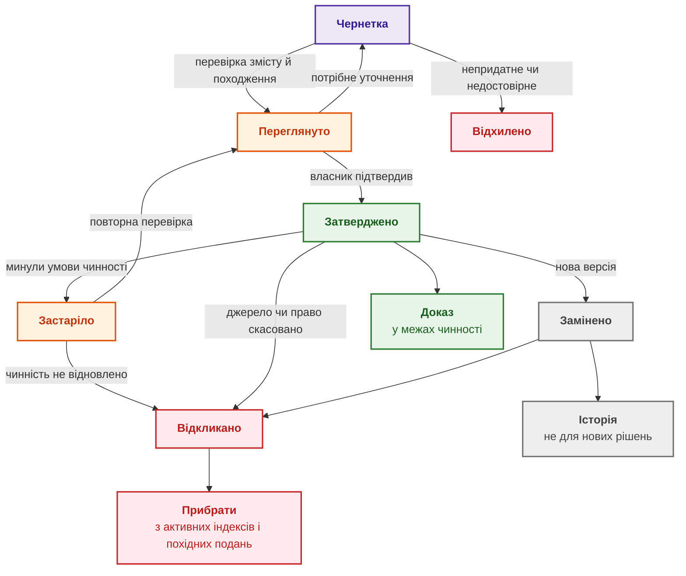

Фіолетовий блок є чернеткою, помаранчеві блоки є станами, що потребують перевірки, зелені блоки є чинним знанням, сірі блоки є історією, червоні блоки є відхиленим і відкликаним. Крім статусу, потрібні умови чинності: базова версія, родина продуктів, замовник, постачальник, домен, версія, дата. Уточнення постачальника може діяти лише для конкретного артикулу й версії прошивки, а винесений урок лише для певного класу продуктів.

Одного поля «оновлено» для аудиту недостатньо. Потрібні два часові виміри: час чинності (*valid time*), коли твердження було чинним у предметному світі, і час запису (*transaction time*), коли KAS отримала й записала твердження. Модель із двома вимірами часу описали Крістіан Єнсен і Річард Снодграсс [[25]](#src-25). Факт доступний для запиту «що було чинним у момент $t$ за станом знань KAS на момент $\tau$», якщо:

<a id="obj-10-42"></a>

**Формула (10.42). Перетин часу чинності й часу запису**

```math
t_{\text{valid-from}}\le t<t_{\text{valid-to}}\quad\land\quad t_{\text{recorded-from}}\le\tau<t_{\text{recorded-to}}
```

Два часові інтервали:

- $`[t_{\text{valid-from}},t_{\text{valid-to}})`$ є інтервалом чинності факту, а $`[t_{\text{recorded-from}},t_{\text{recorded-to}})`$ є інтервалом, протягом якого KAS вважала факт записаним;
- $t$ є моментом у предметному світі, про який питають, а $\tau$ є моментом, станом на який перевіряють знання KAS;
- квадратна дужка включає початок інтервалу, кругла дужка не включає кінець, а $\land$ вимагає виконання обох часових умов;
- знаки $\le$ і $<$ порівнюють моменти часу, а результат перевірки для факту є істинним або хибним.

Усі моменти належать одній узгодженій шкалі часу, початок кожного інтервалу передує кінцю. Булевий результат показує лише належність запису двом інтервалам, не істинність його змісту. Якщо жоден запис не підходить, система повідомляє відсутність доступної підстави, не заперечення самого факту.

Факт відповідає запиту, лише якщо чинний у момент $t$ і вже був записаний у KAS на момент $\tau$. Наприклад, виправлення, чинне з 1 червня, але отримане 7 червня, не належить до знань KAS на 3 червня, хоча сьогоднішній запит про правила, що діяли 3 червня, має його врахувати з позначкою пізнього надходження. Поділ запобігає упередженню заднім числом під час розслідування й дозволяє відтворити стару відповідь.

<a id="obj-10-43"></a>

**Діаграма 10.43. Час чинності проти часу запису**

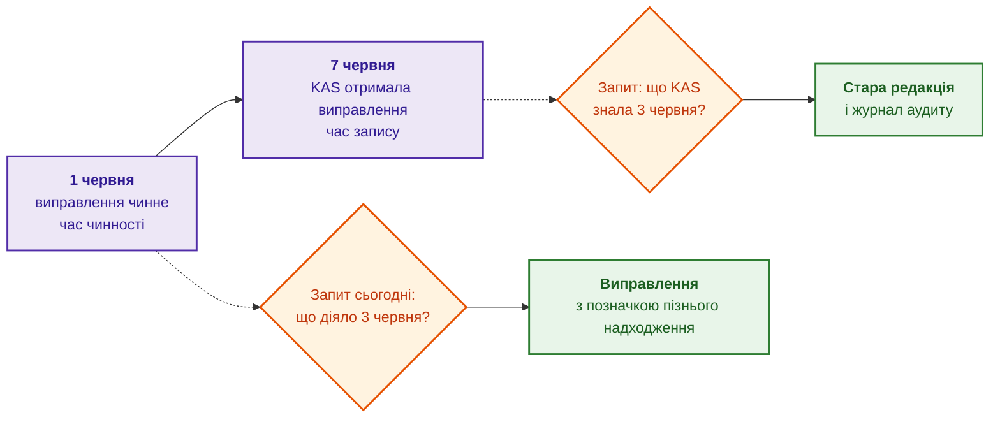

Фіолетові блоки є двома моментами часу, помаранчеві ромби є двома запитами, зелені блоки є відповідями. Програма мовою Go показує, як KAS зберігає виправлене уявлення про стару редакцію й відповідає на обидва запити.

<details>
<summary>Приклад мовою Go: запит із двома вимірами часу</summary>

Програма є повною й запускається командою `go run main.go`. Редакція A записана двічі: спершу як чинна без кінцевої дати, а після 7 червня як чинна лише до 1 червня; старий запис не видаляють, а закривають інтервал запису.

Вхід `facts` містить три навчальні записи, а `asOf` реалізує обидві нерівності попередньої формули. Очікувані два рядки виводу наведено після коду. Для перевірки меж варто окремо перевірити включення початку та виключення кінця обох інтервалів; відсутність збігу повинна дати порожній набір, не «хибне твердження».

```go
package main

import (
	"fmt"
	"strings"
	"time"
)

// Fact є твердженням із часом чинності й часом запису.
type Fact struct {
	Text                     string
	ValidFrom, ValidTo       time.Time // коли твердження чинне в предметному світі
	RecordedFrom, RecordedTo time.Time // коли KAS знала про твердження
}

func date(m time.Month, d int) time.Time {
	return time.Date(2026, m, d, 0, 0, 0, 0, time.UTC)
}

var forever = time.Date(9999, time.December, 31, 0, 0, 0, 0, time.UTC)

// asOf повертає факти, чинні в момент t за станом знань KAS на момент tau.
func asOf(facts []Fact, t, tau time.Time) []string {
	var out []string
	for _, f := range facts {
		valid := !t.Before(f.ValidFrom) && t.Before(f.ValidTo)
		known := !tau.Before(f.RecordedFrom) && tau.Before(f.RecordedTo)
		if !valid || !known {
			continue
		}
		s := f.Text
		if lag := f.RecordedFrom.Sub(f.ValidFrom); lag > 0 {
			s += fmt.Sprintf(" [пізнє надходження: %d дн.]", int(lag.Hours()/24))
		}
		out = append(out, s)
	}
	return out
}

func main() {
	facts := []Fact{
		// До 7 червня KAS вважала редакцію A чинною без кінцевої дати.
		{"тайм-аут 200 мс (редакція A)", date(time.January, 1), forever, date(time.January, 1), date(time.June, 7)},
		// 7 червня KAS дізналася, що редакція A діяла лише до 1 червня.
		{"тайм-аут 200 мс (редакція A)", date(time.January, 1), date(time.June, 1), date(time.June, 7), forever},
		// Виправлення B набрало чинності 1 червня, але надійшло 7 червня.
		{"тайм-аут 250 мс (виправлення B)", date(time.June, 1), forever, date(time.June, 7), forever},
	}
	t := date(time.June, 3)
	for _, tau := range []time.Time{date(time.June, 3), date(time.June, 10)} {
		fmt.Printf("3 червня за знаннями KAS на %d червня: %s\n", tau.Day(), strings.Join(asOf(facts, t, tau), "; "))
	}
}
```

Програма друкує:

```text
3 червня за знаннями KAS на 3 червня: тайм-аут 200 мс (редакція A)
3 червня за знаннями KAS на 10 червня: тайм-аут 250 мс (виправлення B) [пізнє надходження: 6 дн.]
```

Станом на 3 червня KAS ще не знала про виправлення й відповідає редакцією A. Станом на 10 червня KAS знає, що 3 червня вже діяло виправлення B, і позначає, що виправлення надійшло на 6 днів пізніше за початок чинності.

</details>

Власник потрібен кожному джерелу й класу знань. Служба інформаційних технологій підтримує конвеєр, але доменні власники вирішують, що чинне, що небезпечне, що застаріло й що можна показувати моделі. База знань старіє непомітно: без власника база не руйнується за день, а повільно втрачає доказову силу. У реалізації автора життєвий цикл має іншу форму, ніж класична послідовність: сортування фрагментів, стан доставки знімків і частковий життєвий цикл артефакта (кандидат, підтверджено доказами, переглянуто, доставлено або відхилено), а для джерел і артефактів окремо закодовано стани затвердження з незмінним журналом переходів. Формальної ролі розпорядника знань (*knowledge steward*) з правом затвердження поки немає, а умови чинності не зафіксовано як структуровані поля, тож споживач технічно може використати фрагмент поза межами чинності, і KAS цього не помітить. Для KAS в активній розробці ризик є одним із найсуттєвіших.

Під час супроводу інженерних баз знань важливо враховувати не лише версію документа, а й залежність технічних рішень від джерел, вимог і доказів. Зміна першоджерела може вимагати повторного розгляду пов’язаних об’єктів, проте не означає автоматичної недійсності всіх похідних висновків. Правильність виконання формалізованого правила та відповідність самого правила першоджерелу потребують окремого оцінювання.

## 21. Процедури релізу, версіонування та відкликання бази знань

Знання теж випускають версіями. Документи часто сприймають як тло (хтось доповнив вікі, оновив вимогу, завантажив нотатку постачальника), але для експертної системи кожна така зміна може змінити відповідь. Випуск бази знань має журнал змін: які джерела додано й відкликано, які правила чи політики змінено, яку модель векторних представлень використано, які індекси перебудовано, які метрики якості отримано. Мінімальний маніфест випуску фіксує знімок джерел, версії аналізатора й OCR, політику знеособлення, фрагментатор і токенізатор, модель векторних представлень, налаштування індексу, політику доступу, еталонний набір і код збирання. Ідентифікатор випуску обчислюють як хеш канонічної серіалізації маніфесту:

<a id="obj-10-44"></a>

**Формула (10.44). Ідентифікатор канонічного маніфесту**

```math
\text{release-id}=H\big(\mathrm{Canon}(\text{manifest})\big)
```

Ідентифікатор випуску:

- $`\text{manifest}`$ є маніфестом із переліком джерел і параметрів випуску;
- $`\mathrm{Canon}`$ перетворює маніфест на детермінований канонічний запис з однаковим порядком полів і форматом чисел;
- $H$ є криптографічною хеш-функцією, а $`\text{release-id}`$ є отриманим рядком фіксованої довжини;
- дужки задають порядок операцій: спочатку канонізують маніфест, потім обчислюють його хеш.

Однакові канонічні маніфести дають однаковий ідентифікатор. Хеш допомагає виявити зміну, але не доводить авторства: для автентичності маніфест підписують і перевіряють за політикою. Позначка відкликання створює новий стан використання, не стираючи історії, яку дозволено зберігати. Фізичне видалення персональних чи договірно обмежених даних є окремою процедурою.

Логічний приклад: два маніфести перелічують однакові джерела у різному порядку. Якщо порядок списку не має семантичного значення й `Canon` його сортує, канонічні байти й хеш збігаються; якщо порядок впливає на обробку, сортувати його не можна. Заміна версії аналізатора P2 на P3 змінює канонічні байти, отже очікується інший хеш. Для SHA-256 результат є 256-бітним відбитком; колізійна стійкість є криптографічним припущенням, а не математичною ін'єктивністю всіх можливих маніфестів.

Відкат повертає узгоджений набір маніфесту, фактів, правил та індексів, але **не відкочує актуальний реєстр відкликань і дозволів**. Споживач повторно перевіряє право використати кожну підставу перед видачею відповіді; за недоступного актуального стану політика може заборонити видачу. Інакше старий знімок поверне вже відкликане джерело. Це не миттєве видалення всіх копій: час блокування нових відповідей і час очищення похідних даних вимірюють окремо. Відтворення старої відповіді в дозволеному архіві не означає схвалення старої відповіді для нового рішення. Виконуваний приклад цього розрізнення наведено в [Главі 25](ch25-how-expert-systems-learn.md).

Якщо база знань велика, випуск складається з кількох шардів, тобто частин бази знань, які обслуговують різні вузли. Тоді карта шардів і хеші файлів кожного шарда входять до маніфесту й змінюють ідентифікатор випуску, а перемикання й відкат виконують для всіх шардів одночасно. Відповідь шарда з іншого випуску прирівнюють до мовчання, бо інакше висновок про чинність норми зібрано з двох станів знань. Розбиття за міткою доступу дає фізичне відокремлення рівнів, але не скасовує правила про мітку виведеного факту. Що таке шардування, за якими ознаками базу знань розбивають без розриву виведення і чому відповідь шарда, що мовчить, не є відсутністю факту, пояснено в [Главі 7](ch07-knowledge-base-typology.md), а реалізацію з перевіркою розбиття наведено в розділі 10 [Глави 32](ch32-high-performance-knowledge-packs-mmap-and-harvesting.md).

<a id="obj-10-45"></a>

**Діаграма 10.45. Поетапний випуск бази знань**

```mermaid
flowchart LR
    accTitle: Поетапний випуск бази знань
    accDescr: Випуск проходить перевірки й атомарне перемикання; відкат повертає попередній знімок, але реєстр актуальних відкликань залишається чинним.

    Build["<b>Знімок джерел</b><br/>і версійований конвеєр"] --> Manifest["<b>Канонічний маніфест</b><br/>ідентифікатор і підпис"]
    Manifest --> Sandbox["<b>Ізольоване середовище</b><br/>тести аналізатора, доступу, знеособлення"]
    Sandbox -->|"перевірки пройдено"| Canary["<b>Обмежена аудиторія</b><br/>оцінка пошуку й відповідей"]
    Sandbox -->|"збій"| Quarantine["<b>Карантин</b><br/>різниця й код причини"]
    Canary -->|"цілі якості й безпеки виконано"| Production["<b>Робочий випуск</b><br/>атомарне перемикання"]
    Canary -->|"регресія"| Quarantine
    Production --> Monitor{"Дрейф, інцидент<br/>чи відкликання?"}
    Monitor -->|"ні"| Production
    Monitor -->|"так"| Rollback["<b>Відкат</b><br/>до узгодженого знімка"]
    Rollback --> Guard["<b>Актуальні відкликання й дозволи</b><br/>не відкочувати разом зі знімком"]
    Guard --> Production

    classDef prep fill:#ede7f6,stroke:#512da8,stroke-width:2px,color:#311b92;
    classDef test fill:#e3f2fd,stroke:#1565c0,stroke-width:2px,color:#0d47a1;
    classDef prod fill:#e8f5e9,stroke:#2e7d32,stroke-width:2px,color:#1b5e20;
    classDef bad fill:#ffebee,stroke:#c62828,stroke-width:2px,color:#b71c1c;
    classDef mon fill:#fff3e0,stroke:#e65100,stroke-width:2px,color:#bf360c;

    class Build,Manifest prep;
    class Sandbox,Canary test;
    class Production prod;
    class Quarantine,Rollback bad;
    class Monitor,Guard mon;
```

Фіолетові блоки готують випуск, сині блоки перевіряють, зелений блок є робочим випуском, помаранчевий ромб стежить за дрейфом, червоні блоки є карантином і відкатом. Перед переведенням у робочий стан порівнюють не лише середню повноту пошуку: перевірки включають негативні запити, спроби міжпроєктного доступу, відкликані джерела, складні контрольні документи для аналізатора, точність чисел і одиниць і твердження із забороною MUST NOT. Саме рідкісні випадки часто визначають ризик у промисловій експлуатації. Якщо база знань є промисловою залежністю, база потребує дисципліни випусків, інакше користувачі отримують різні відповіді не тому, що змінився домен, а тому, що хтось непомітно оновив корпус.

## 22. Регламент валідації та контрольний список перед промисловим розгортанням

Перед введенням KAS у промислову експлуатацію перевіряють не лише конектори й пошук, а й межі даних, відповідальність власників, контроль доступу та якість доказів. Рамка керування ризиками ШІ NIST [[26]](#src-26) і профіль для генеративного ШІ [[27]](#src-27) дають загальну структуру таких перевірок, а перелік нижче конкретизує рамку для здобуття знань.

- **Обсяг:** які джерела входять у першу версію, які не входять, які межі за проєктом, замовником і постачальником жорсткі, чи індексуються чернетки, що явно виключено.
- **Керування:** хто власник джерел, хто розпорядник знань, як працює життєвий цикл, як визначається свіжість, де записано умови чинності, як відкликають знання.
- **Технічні гарантії:** чи є пряме посилання на джерело; чи журналюються знайдені джерела й ідентифікатор випуску; чи розділено кандидата й перевірений об'єкт, дублікат і нову редакцію; чи відтворюване знеособлення; чи є відбиток приватного фрагмента ключовим хешем або непрозорим ідентифікатором, а не звичайним хешем; чи можна переіндексувати після зміни політики доступу; чи зберігаються версії аналізатора, фрагментатора, токенізатора й моделі векторних представлень; чи підписано маніфест випуску; чи відкочуються маніфест і індекс атомарно; чи, якщо випуск розбито на шарди, карта шардів входить до підписаного маніфесту, а розбиття пройшло перевірку повноти, неперетину й відновлюваності; чи вміє KAS каліброво утриматися.
- **Конфіденційність:** чи працюють конектори з мінімальними правами; чи успадковують мітку фрагменти, вектори, кеші й зведення; чи перевіряється кожен результат до потрапляння в контекст моделі; чи заборонена автоматична передача корпоративних даних зовнішньому постачальнику моделі; чи не містять журнали сирих секретів; чи тестується зняття грифу як окремий дозволений перехід; чи інвентаризовано всі похідні подання й чи доходить позначка видалення до кожного.
- **Недовірений вхід і ланцюг постачання:** чи звіряються тип MIME, сигнатура й розширення; чи є ліміти на розпакування й ресурси; чи ізольовані аналізатор і браузер без секретів і виходу в мережу; чи є перелік компонентів і засвідчення походження збірки аналізаторів, OCR і моделей; чи пройшла нова версія регресійний корпус, порівняння корпусу й поетапне впровадження; чи гарантовано недовірений текст не стає системною інструкцією; чи веде підозра на отруєння до карантину, а не до автоматичної публікації.
- **Перевірка якості:** чи є незалежно розмічена відкладена вибірка без витоку між редакціями; чи вимірюється точний фрагмент-доказ; чи перевіряються заперечення, числа, одиниці й нормативна модальність; чи відокремлено підтверджувальні експерименти від розвідувальних; чи записано довірчі інтервали, негативні результати й межі перенесення.
- **Час і відтворюваність:** чи розділено час чинності й час запису; чи можна відтворити відповідь «що KAS знала тоді»; чи позначаються пізні виправлення; чи відкат не відновлює відкликаного дозволу; чи окремо вимірюються блокування нової видачі й очищення останньої похідної копії.

Наприклад, прототип успішно знаходить вимогу B, але тест відкликання залишає її в кеші. Позначки «пошук працює» недостатньо: приймання цього профілю зупиняється до усунення дефекту й повторної перевірки. Кожне запитання чекліста потребує артефакта перевірки, відповідального й критерію, а не відповіді «так» без підстави. Після визначення безпечного життєвого циклу можна обговорювати активніший пошук нових кандидатів.

## 23. Еволюція парадигми: від пасивного індексування до активного виявлення знань

Конвеєр першого покоління діяв за схемою «документ, вилучення, база знань». В умовах різкого зростання обсягів спроба проіндексувати все засмічує базу знань чернетками, неперевіреними припущеннями й дублікатами. Підхід, який можна назвати здобуттям знань 2.0, перетворює KAS із пасивного приймача файлів на активний вибірковий фільтр, як показує схема.

<a id="obj-10-46"></a>

**Діаграма 10.46. Конвеєр здобуття знань 2.0**

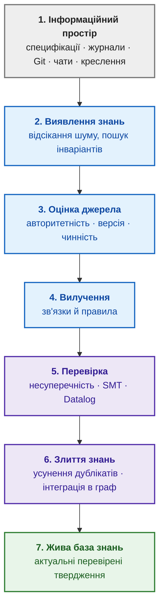

Сірий блок є сирим простором, сині блоки є виявленням, оцінкою й вилученням, фіолетові блоки є перевіркою й злиттям, зелений блок є результатом. В авторській моделі «2.0» означає активний вибір наступної роботи, не історичну класифікацію всіх KAS. Наприклад, кандидат із чату може вказати на зміну виробу, якої немає в старій специфікації: його не усереднюють із нормою, але й не оголошують хибним за типом джерела. Спочатку звіряють редакції, предмет і профіль застосування; синтаксична несуперечність не підтверджує відповідності реальному виробу.

Автором сформульовано *тріаду передових технологій міжпідприємницького здобуття знань*: коли у створенні складного комплексу беруть участь десятки незалежних підрядників або навіть конкурентів, здобуття знань виходить за межі одного підприємства й охоплює три передові технологічні напрями: (1) федеративне зіставлення онтологій (*federated ontology alignment*), що зіставляє поняття й схеми між організаціями без злиття конфіденційних баз в одне централізоване сховище; (2) докази з нульовим розголошенням (*zero-knowledge proofs*, ZKP), які запропонували Шафі Голдвассер, Сільвіо Мікалі й Чарльз Ракофф [[28]](#src-28), що дозволяють довести виконання вимоги (наприклад, що механічне напруження не перевищує допустимого) аудитору чи замовнику без розкриття інтелектуальної власності, топології плати чи вихідного коду прошивки; (3) децентралізовані реєстри знань із криптографічними підписами й незмінним обліком спростованих гіпотез і дефектів специфікацій.

### 23.1. Епістемічний фільтр виявлення знань (Knowledge Detection) проти наївного інжесту

Еволюційний перехід від пасивного накопичення документів до вибіркового виявлення знань вимагає докорінної зміни архітектури шлюзів KAS. Сучасні генеративні конвеєри (зокрема примітивні RAG-пайплайни) реалізують пасивну модель інжесту: довільний вхідний документ без розбору токенізується, дробиться на евристичні фрагменти та сліпо записується у векторне сховище. У критичних інженерних доменах (Functional Safety, Automotive ASIL D, мікроелектроніка) такий підхід спричиняє швидку деградацію бази знань через накопичення розмовного шуму, фрагментів застарілих чернеток та фатальних суперечностей.

Замість пасивного інжесту підсистема KAS розгортає активний фільтр виявлення знань (*Knowledge Detection Filter*), що реалізує двоетапну селекцію:

1. **Тріада епістемічної селекції:**
   Кожен вхідний текстовий фрагмент $D$ аналізується до моменту включення в індекс за трьома параметрами:
   - *Фактична насиченість:* детекція наявності деонтичних модальностей (`SHALL`, `MUST`, `CRITICAL`), формальних предикативних відношень та числових інтервалів допуску з обов'язковими фізичними одиницями вимірювання СІ;
   - *Онтологічна прив'язка:* розрахунок щільності перетину вилучених термінів із канонічним графом понять та специфікаціями проєкту;
    - *Бал маршрутизації:* $\tau(D)$ є безрозмірною оцінкою від 0 до 1 для текстового фрагмента $D$, а $`\tau_{\mathrm{threshold}}`$ є порогом того самого діапазону. Функцію обчислення тут не специфіковано, тому це місце для версійованого профілю, не готова формула істинності. За навчальних 0,2 і порога 0,5 фрагмент передають на перегляд контексту, не оголошують шумом чи ненормативним. Високий бал також не дає допуску.

2. **Попередня перевірка на суперечність (Pre-Ingestion Contradiction Check):**
    Вилучені предикати зіставляються з аксіоматичним ядром ще до запису в активну базу. Виявлена суперечність спершу є кандидатом на конфлікт: обидва першоджерела зберігаються, а новий кандидат переходить у карантин з ескалаційним звітом. Формальний аргументаційний дефітер створюється лише після перевірки точних пунктів і редакцій, сфери, юрисдикції, продукту та профільної підстави пріоритету; без цих даних статуси джерел самі не визначають переможця.

Наприклад, правила «у режимі запуску час не більше 200 мс» і «у режимі обслуговування час не більше 500 мс» не суперечать одне одному. Якщо обидва приписано одному режиму, потрібна ще перевірка логічної сумісності та актуальних редакцій; різні верхні межі самі по собі також можуть виконуватися одночасно. Результат SMT-перевірки стосується формалізації й припущень, не автоматично джерела. Такий аналіз вимагає ресурсу: далі оцінимо обсяг корпусу й спосіб отримати словник до повної обробки.

## 24. Стратифікована епістемічна денситометрія корпусів, трипрохідна самоіндукція термінів (ATR) та самоорганізована онтологічна топологія сховищ

Стратифіковане оцінювання й самоіндукція потрібні, коли KAS починає роботу над невідомим корпусом і повний ручний розбір надто дорогий. Після описаних перевірок окремого кандидата виникає питання масштабу: з чого почати й скільки ресурсів виділити? Автором виділено три задачі, для яких ручна розмітка може дати еталон, але не замінює автоматизованого процесу:

1. **Проблема априорної оцінки інформаційної щільності:** як до запуску дороговартісної компіляції обчислити реальний вихід формальних предикатів на гігабайт сирого тексту та відсіяти інформаційний баласт (бінарні дампи, логи збірок, юридичні преамбули)?
2. **Проблема bootstrapping-парадокса («курки та яйця»):** як видобути предметну онтологію та нормативні правила з документа у форматах Plain Text, Markdown, HTML чи PDF без попередньо заданого предметного словника?
3. **Проблема хаотичної топології вхідних папок:** як організувати скомпільовані пакети знань у цільовому сховищі, якщо вхідні директорії мають довільні побутові назви (`inbox/2026_dump/`, `old_specs_v2/`, `misc_pdfs/`), які не утворюють жодної наукової таксономії?

Нижче викладено авторський підхід до цих трьох задач: вибірка оцінює обсяг роботи, індукція пропонує терміни, а правило адресації організовує результат. «Без попереднього словника» не означає без припущень: потрібні аналізатор мови, правила кандидатів, схема одиниць і версійована політика. Наприклад, невідомий термін у заголовку можна спочатку запропонувати куратору, а не відхилити весь документ через відсутність цього терміна у словнику.

### 24.1. Математичний апарат стратифікованої епістемічної денситометрії

Стратифікована денситометрія відповідає на питання: скільки ознак виявить заданий детектор у великому корпусі, якщо поки перевірено лише вибірку? Страта є групою схожих одиниць, наприклад таблиць або звичайного тексту. Випадкова вибірка всередині кожної групи дозволяє оцінити її середнє, не видаючи зручні перші сторінки за весь корпус. Класичний оцінювач Горвіца — Томпсона [[33]](#src-33) є незміщеним для фіксованих значень за відомих додатних імовірностей включення; це твердження про план вибірки, не про правильність детектора.

Для узгодженого знаменника розіб'ємо корпус на одиниці однакового обсягу всередині кожної страти; короткі залишки обліковують окремо. Позначимо через $S$ додатну цілу кількість страт, через $`N_h`$ їхні кількості одиниць, через $`M_h`$ обсяг відповідного аналізованого тексту в МБ. Загальний обсяг $M$ є сумою цих обсягів, не розміром стиснених PDF. Вибірка без повернення має цілий розмір від 1 до $`N_h`$; усі набори цього розміру рівноймовірні. За різних розмірів секцій потрібна оцінка сум лічильників на відомий обсяг, а просте середнє секцій не є щільністю всього тексту.

Для відібраної одиниці з номером $i$ детектор обчислює невід'ємну щільність ознак $`y_{hi}`$ в ознаках/МБ. Імовірність включення $`\pi_{hi}`$ є часткою відібраних одиниць страти. Зважування на обернену ймовірність компенсує невключені одиниці; за однакових імовірностей оцінка середньої щільності спрощується до звичайного середнього:

<a id="obj-10-47"></a>

**Формула (10.47). Середнє страти за рівноймовірної вибірки**

$$
\hat{\mu}_h = \frac{1}{N_h} \sum_{i=1}^{n_h} \frac{y_{hi}}{\pi_{hi}} = \frac{1}{n_h} \sum_{i=1}^{n_h} y_{hi}
$$

Результат $`\hat{\mu}_h`$ має ті самі одиниці ознак/МБ; відношення $`\pi_{hi}`$ безрозмірне й додатне. Для навчальної страти з чотирьох одиниць по 1 МБ випадково відібрано дві зі щільностями 10 і 14: імовірність включення дорівнює 1/2, оцінка середнього є (10 + 14)/2 = 12 ознак/МБ. Вона не стверджує, що кожна невибрана одиниця містить рівно 12 ознак.

Щоб не надто покладатися на нестійкий початковий результат, автором запропоновано згладжування до базового очікування $`\mu_0`$ з вагою еквівалентного обсягу $`M_0`$. Назва «баєсове» тут позначає мотивацію: без моделі правдоподібності й апріорного розподілу це не виведений баєсівський posterior. Малий обсяг сам по собі не визначає дисперсії; важливі кількість одиниць і розкид. Обираємо додатний $M$, невід'ємний $`M_0`$ у тих самих МБ, невід'ємне $`\mu_0`$ в ознаках/МБ і вагу $`W_h=M_h/M`$:

<a id="obj-10-48"></a>

**Формула (10.48). Згладжена оцінка щільності корпусу**

$$
\hat{D}_{\mathrm{corpus}} = \frac{M}{M + M_0} \sum_{h=1}^{S} W_h \hat{\mu}_h + \frac{M_0}{M + M_0} \mu_0
$$

Ваги страт є частками від 0 до 1 із сумою 1; $`\hat{D}_{\mathrm{corpus}}`$ вимірюється в ознаках/МБ. Додамо другу страту з двох одиниць по 1 МБ і повним спостереженням 2 та 6 ознак/МБ. Тоді середні дорівнюють 12 і 4, ваги 4/6 та 2/6; незгладжена оцінка є 9,333 ознаки/МБ. За навчальних $`M_0=5`$ МБ і $`\mu_0=4`$ отримаємо (6/11) · 9,333 + (5/11) · 4 = 6,909 ознаки/МБ. Це обережніша оцінка для планування робіт, але вона зміщена до обраного очікування й не стає «істиннішою» через згладжування.

Наскільки результат змінювався б за повторної вибірки? За незалежних простих випадкових вибірок у стратах та фіксованих вагах використовують поправку на скінченність (*Finite Population Correction*, FPC) [[34]](#src-34):

<a id="obj-10-49"></a>

**Формула (10.49). Умовна стандартна похибка з FPC**

$$
\mathrm{SE}(\hat{D}_{\mathrm{corpus}}) = \left(\frac{M}{M + M_0}\right) \sqrt{\sum_{h=1}^{S} W_h^2 \left(1 - \frac{n_h}{N_h}\right) \frac{s_h^2}{n_h}}, \quad \text{де} \quad s_h^2 = \frac{1}{n_h - 1} \sum_{i=1}^{n_h} (y_{hi} - \hat{\mu}_h)^2
$$

Тут $`s_h^2`$ є вибірковою дисперсією у квадраті одиниці «ознаки/МБ», її формула потребує щонайменше двох спостережень; SE має одиницю ознак/МБ. Для повністю обстеженої одноелементної страти внесок вибіркової дисперсії задають нулем, не обчислюючи ділення на нуль. У прикладі перша дисперсія дорівнює ((10 - 12)² + (14 - 12)²)/(2 - 1) = 8; внесок другої страти нульовий, бо її обстежено повністю. Тоді SE = (6/11) · √((4/6)² · (1 - 2/4) · 8/2) ≈ 0,514 ознаки/МБ. Ця похибка умовна щодо зафіксованого детектора, ваг і згладжування: вона не враховує пропущених ним знань та помилки апріорного очікування. Повний обхід усуває лише випадковість вибірки, не ці дефекти.

За локальною щільністю кожна секція отримує клас маршрутизації (`DensityTier`). Пороги нижче є навчальним профілем у поточних одиницях ознак/МБ, не універсальною шкалою; перенесення старих порогів з одиниці «на 1000 символів» потребує калібрування:
- `HIGH_DENSITY` ($`y_{hi} \ge 15{,}0`$): першочерговий детальний розбір численних кандидатних ознак;
- `MEDIUM_DENSITY` ($`5{,}0 \le y_{hi} < 15{,}0`$): звичайний структурний розбір;
- `LOW_DENSITY` ($`1{,}0 \le y_{hi} < 5{,}0`$): перевірка контексту та пропущених типів тверджень;
- `LOW_DENSITY_REVIEW` ($`y_{hi} < 1{,}0`$): кандидат на окрему перевірку статусу й контексту. Низька щільність не доводить ненормативності: фрагмент зберігається з походженням і не відкидається лише за цим порогом. До деонтичного правила він не допускається, доки статус не перевірено незалежно.

### 24.2. Трипрохідна компіляція знань із автоматичною індукцією термінології (ATR)

Трипрохідна компіляція потрібна, коли щільність уже оцінено, але назв понять ще немає в локальному словнику. Як знайти термін, який екстрактор мав би знати заздалегідь? Спочатку він пропонує словосполучення, потім будує кандидатні твердження, а вже після перевірок пакує результат. У цій монографії автором запропоновано таку композицію автоматичного розпізнавання термінів (*Automatic Term Recognition*, ATR) на основі $`C\text{-value}`$ [[35]](#src-35) та лексико-синтаксичних шаблонів, зокрема шаблонів гіпонімії Герст [[36]](#src-36). Метод Герст знаходить відношення типу «X є різновидом Y»; не кожне таке відношення є повним означенням.

<a id="obj-10-50"></a>

**Діаграма 10.50. Три проходи від кандидатного лексикону до перевіреного пакета**

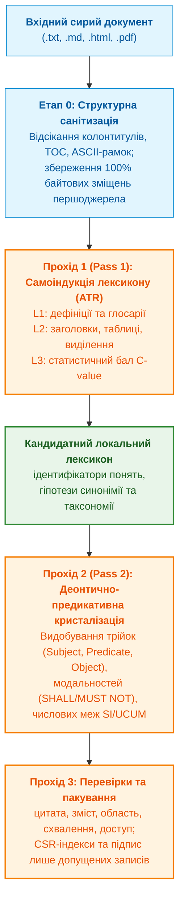

На **Проході 1 (Pass 1)** система сканує очищене синтаксичне дерево документа й оцінює кожен кандидат у багатослівний термін $a$ (іменникову групу довжиною $`|a|`$ слів) за комбінованим показником $`C\text{-value}(a)`$ [[35]](#src-35), який враховує вкладеність терміна в довші терміни множини $`T_a`$:

<a id="obj-10-51"></a>

**Формула (10.51). Ранжування кандидатних термінів за C-value**

$$
C\text{-value}(a) = \begin{cases} \log_2 |a| \cdot f(a), & \text{якщо } a \text{ не є вкладеним у жоден довший термін}, \\[6pt] \log_2 |a| \cdot \left( f(a) - \dfrac{1}{|T_a|} \sum\limits_{b \in T_a} f(b) \right), & \text{якщо } a \text{ зустрічається всередині множини } T_a, \end{cases}
$$

де $f(a)$ — абсолютна частота появи фрази $a$ в документі, а $`|T_a|`$ — кількість різних довших кандидатів у терміни, що містять $a$ як підрядок. Така формула елегантно відокремлює самостійні інженерні поняття (наприклад, `Real-Time Operating System`) від випадкових уламків фраз, які зустрічаються лише всередині одного довгого вислову. Додатково статистичний індекс специфічності (закон розподілу іменникових груп у технічних текстах Жюстсона — Каца [[37]](#src-37)) підсилюється лінгвістичними маркерами трьох ешелонів:
- **Ешелон L1 (Явні дефініції):** конструкції вигляду *«$X$ означає $Y$»*, *«під $X$ розуміється...»*, елементи списків визначень `<dl>/<dt>/<dd>` у HTML або секції `Terminology / Definitions`;
- **Ешелон L2 (Структурні заголовки та виділення):** терміни, винесені в нумеровані заголовки розділів, заголовки стовпців таблиць `<th>` та напівжирні або моноширинні маркери;
- **Ешелон L3 (Статистичне ядро $`C\text{-value}`$):** стійкі термінологічні словосполучення з високим $`C\text{-value}(a) \ge \theta_{\mathrm{ATR}}`$.

Розберімо формулу: $a$ є кандидатною фразою з цілою довжиною щонайменше два слова, $f(a)$ є невід'ємною цілою кількістю її входжень, а $`T_a`$ є скінченною множиною довших кандидатів, які містять цю фразу. Друга гілка застосовується лише за непорожнього $`T_a`$. Логарифм довжини безрозмірний; результат є балом для ранжування, не ймовірністю термінологічної правильності. Частоти треба рахувати за одним правилом токенізації та вкладень.

Навчальний приклад: трислівна фраза `real time system` трапилася 10 разів і не вкладена в довші кандидати, тому її бал дорівнює log₂(3) · 10 ≈ 15,85. Двослівна `time system` теж трапилася 10 разів, але лише всередині цієї фрази; її бал є log₂(2) · (10 - 10) = 0. Це знижує ранг уламка, а не доводить, що він ніколи не може бути терміном. За навчального порога 10 першу фразу передають до лексикону-кандидата, другу переглядають у контексті. Поріг $`\theta_{\mathrm{ATR}}`$ визначає профіль, а не джерело методу.

На проході 2 парсер використовує кандидатний лексикон, не вважаючи його вже схваленою онтологією. Невідомий термін чи нерозпізнана одиниця створюють запит на перегляд. На проході 3 перевіряють цитату, зміст, застосовність і повноваження; підпис пакета засвідчує зафіксований результат, а не перетворює гіпотезу на істину. Тепер можна визначити, як розмістити такі пакети незалежно від випадкових назв вхідних тек.

### 24.3. Закон інваріантності сховища до вхідної файлової топології (Emergent Ontological Topology)

У традиційних системах керування документами структура вихідного сховища сліпо копіює структуру вхідних папок (`sources/folder_A/doc.pdf` $\rightarrow$ `build/folder_A/doc.pack`). Такий підхід є архітектурно хибним: назви вхідних директорій відображають організаційну випадковість моменту завантаження (наприклад, `від_партнерів_четвер/` або `архів_2024/`), а не епістемічну природу знань.

У цій монографії автором запропоновано **Закон інваріантності сховища до вхідної топології** як проєктний інваріант: за однакових байтів документа та зафіксованих версій аналізатора, таксономії й правил назви вхідних тек не впливають на шлях пакета. Це перевірна властивість алгоритму, не загальний природничий закон:

<a id="obj-10-52"></a>

**Формула (10.52). Шлях пакета за незмінного профілю**

$$
\mathrm{VaultPath}(D) = \mathcal{F}_{\mathrm{taxonomy}}\!\left(\mathcal{G}_{\mathrm{induced}}(D)\right) \oplus \mathrm{Slug}(D) \oplus \mathrm{SHA256}_{1..8}(D)
$$

Тут $D$ є незмінним документом, $`\mathcal{G}_{\mathrm{induced}}`$ повертає його кандидатний граф, $`\mathcal{F}_{\mathrm{taxonomy}}`$ визначає безпечні сегменти категорії, `Slug` утворює коротку назву лише зі змісту, а останній компонент є першими вісьмома шістнадцятковими знаками SHA-256. Символ $\oplus$ тут означає з'єднання сегментів шляху, не побітове XOR. Результат є рядком, фізичних одиниць не має. Сегменти треба нормалізувати й перевіряти на вихід за межі каталогу; за нічиєї категорій потрібне стабільне правило, а за невизначеної категорії допустимий маршрут перегляду.

Навчальна перевірка: однакові байти документа з тек `inbox/` і `archive/` дають той самий граф, назву та відбиток за однакового профілю, отже той самий шлях. Зміна таксономії може змінити шлях, тому версія профілю входить до маніфесту. Префікс із восьми hex-знаків має лише 32 біти й може зіткнутися; ідентичність і дедуплікацію перевіряють за повним хешем та, за потреби, байтами, а не за короткою назвою. Це робить інваріант придатним до тестування, не обіцяючи безпомилкового визначення предметної галузі.

Детермінований алгоритм побудови самоорганізованої топології виконує три кроки:
1. **Визначення домінантної гілки таксономії (`Domain / Subdomain`):** версійований профіль пов'язує кандидатні поняття з категоріями й задає агрегацію їхніх балів. Наприклад, за погодженим правилом суми балів категорія «мережеві протоколи» з 15 балами переважає «електроніка» з 10. За рівності застосовують стабільний порядок або маршрут перегляду. Комбінацію центральності графа й C-value тут не виведено як окремий перевірений алгоритм; її конкретизація потребує профілю та оцінки помилок категоризації.
2. **Контентно-адресоване іменування артефакту:** ім'я скомпільованого пакета формується як `<domain>-<canonical_slug>-<sha256_prefix8>.pack` і записується у детерміновану ієрархію `vault/<domain>/<subdomain>/`. Навіть якщо один і той самий стандарт покласти у дві різні вхідні папки з різними назвами файлів, обидва екземпляри відобразяться у **той самий канонічний шлях** і будуть дедупліковані за хешем першоджерела.
3. **Реєстрація в обліковій книзі довіри (`registry/`):** метадані всіх скомпільованих пакетів, їхні криптографічні відбитки, матриці доменних предикатів та індекси щільності фіксуються в централізованому реєстрі сховища (`registry/inventory.json`), що дозволяє демону спільної пам'яті миттєво брати нові пакети на облік і монтувати їх за запитом без перезапуску системи.

> [!NOTE]
> **Чотири інженерні закони автономної денситометрії та самоорганізації сховищ (авторська модель, чотири закони)**
> 1. **Закон стратифікованої оцінки з поправкою на скінченність (FPC-Bounded Densitometry):** авторський профіль використовує класичні оцінки за наведених умов вибірки та окремо задає згладжування. Повний обхід усуває вибіркову похибку, не помилки детектора чи зміщення до $`\mu_0`$; оцінена SE не зобов'язана спадати на кожному кроці нової вибірки.
> 2. **Закон трипрохідної самоіндукції без хардкоду (Zero-Hardcode Three-Pass ATR):** компілятор знань категорично не містить зашитих у код предметних словників; на Проході 1 він автономно індукує локальний лексикон із дефінітивних конструкцій, структурних заголовків та метрики $`C\text{-value}`$, який стає опорою для деонтичної екстракції на Проході 2.
> 3. **Закон інваріантності топології сховища до вхідних шляхів (Path-Invariant Ontological Topology):** за незмінних байтів і версійованого профілю шлях виводиться зі змісту, не з назви вхідної теки. Короткий префікс хешу є лише частиною імені; повна ідентичність перевіряється окремо.
> 4. **Закон розділення внутрішнього заголовка та реєстру обліку (Header vs. Inventory Ledger Separation):** кожен бінарний пакет знань є самодостатнім (містить власний криптографічний маніфест у заголовку), тоді як директорія `registry/` виконує роль глобальної облікової книги довіри та маршрутизації всього сховища.
> *Керування рантаймом / Інженерний інваріант:* секції `LOW_DENSITY_REVIEW` ($`y_{hi} < 1{,}0`$) зберігаються для перевірки; класифікація за щільністю не створює нормативного статусу. До генерації правила допускається лише фрагмент із незалежно підтвердженими змістом, застосовністю та походженням.

## Висновки
Глава почалася з теки на кілька тисяч файлів і спокуси «дати ШІ всі документи». Відповідь глави: знання не завантажують, а постачають контрольованим конвеєром, у якому кожен етап має вхід, вихід, метрику, власника, умову карантину й спосіб відкликання. Глава показала:

- здобуття знань є дисципліною, а KAS є програмною системою, що координує технології здобуття (конектори, розбір, фрагментацію, сортування, класифікацію, усунення дублікатів, знеособлення, збагачення, зв'язування, індексування, контроль доступу, курування, облік походження й життєвий цикл); жодна окрема технологія не визначає, чи фрагмент чинний, дозволений і придатний як доказ;
- мітки доступу успадковують усі похідні подання, а конфіденційність тримається на багаторівневому контролі від збору до відкликання; недовірений файл атакує аналізатор, недовірений текст атакує рішення, і обидві площини потребують окремого захисту;
- експеримент на 9 746 RFC показав, що точне походження необхідне, але недостатнє, а перевагу підготовленого подання доводять окремо для кожної задачі;
- формули відбору ($J$, $F$, $R$) задають пріоритети перегляду, але не встановлюють істинності; операційні метрики ($`C_{\text{meta}}`$, $`L_{\text{revoke}}`$, закон Літтла) показують стан конвеєра;
- стратифікована вибірка оцінює вихід заданого детектора, ATR пропонує терміни, а авторський інваріант адресації відокремлює зміст від випадкових вхідних шляхів за незмінного профілю; жоден із цих механізмів не гарантує повної чи правильної онтології невідомого корпусу;
- два виміри часу дозволяють відтворити, що KAS знала тоді, а підписаний маніфест і атомарний відкат роблять базу знань промисловою залежністю з дисципліною випусків.

Межі глави: числа експериментів і вимірювань автора стосуються конкретних корпусів, моделей і обладнання; реалізація автора є одним прикладом, а не канонічним зразком, і низка описаних властивостей (наскрізне знеособлення, структуровані умови чинності, повне відкликання похідних даних) лишається цільовою. Документи дають лише частину знань організації; неявний досвід людей вилучають іншими методами, які розбирає [Глава 11](ch11-knowledge-elicitation-from-experts.md), а лінгвістичний аналіз і вилучення нормативних вимог розглядають глави [12–15](part-03-knowledge-engineering-nlp.md).

## Словник
<a id="obj-10-53"></a>

**Таблиця 10.53. Словник глави**

| Український термін | Англійський відповідник | Коротке пояснення |
|---|---|---|
| Здобуття знань | *knowledge acquisition* | Дисципліна перетворення джерел на перевірені, керовані об'єкти знань |
| Система здобуття знань | *knowledge acquisition system* | Програмна система, що реалізує конвеєр здобуття знань і постачає знання споживачам |
| Кандидат в об'єкт знань | *knowledge candidate* | Фрагмент із точним походженням, ще не перевірений на зміст і застосовність |
| Об'єкт знань | *knowledge object* | Перевірений фрагмент чи твердження зі статусом, власником, умовами чинності й походженням |
| Споживач знань | *knowledge consumer* | Пошук, генерація з пошуком, експертна система чи людина, що використовує знання |
| Курування | *curation* | Перевірка людиною типу, статусу, чутливості, застосовності й зв'язків об'єкта знань |
| Розпорядник знань | *knowledge steward* | Роль із правом затверджувати, змінювати й відкликати знання в домені |
| Базова версія | *baseline* | Затверджений знімок набору артефактів |
| Карантин | *quarantine* | Ізольований стан матеріалу, який не пройшов перевірки й не використовується |
| Мітка доступу | *security label* | Позначка рівня доступу, що рухається разом із вмістом і похідними поданнями |
| Зняття грифу | *declassification* | Окрема авторизована операція зниження мітки доступу |
| Знеособлення | *redaction* | Відтворюване вилучення персональних і конфіденційних даних із похідної копії |
| Квазіідентифікатор | *quasi-identifier* | Поєднання ознак, що дозволяє повторно ідентифікувати людину чи організацію |
| Ключовий хеш | *keyed hash* | Хеш, для обчислення якого потрібен секретний ключ, наприклад HMAC |
| Прихована інструкція | *prompt injection* | Текст у даних, що намагається керувати поведінкою мовної моделі |
| Отруєння даних | *data poisoning* | Навмисне внесення хибних даних, щоб змінити результати пошуку чи навчання |
| Перелік компонентів програмного забезпечення | *software bill of materials* | Машинно-зчитуваний перелік компонентів і залежностей збірки |
| Засвідчення походження збірки | *build provenance attestation* | Підписаний запис того, як і з чого зібрано компонент |
| Підробка запитів із боку сервера | *server-side request forgery* | Атака, що змушує сервер звертатися до внутрішніх адрес |
| Шлюз допуску | *admission control* | Перевірки, які файл проходить перед обробкою |
| Реєстр аналізаторів | *parser registry* | Перелік версійованих аналізаторів із правилами вибору маршруту |
| Вибіркова класифікація | *selective classification* | Класифікація з правом утриматися й передати рішення людині |
| Подібність Жаккара | *Jaccard similarity* | Відношення розміру перетину множин до розміру об'єднання |
| Перекривні послідовності слів | *shingles* | Набори з кількох сусідніх слів, якими подають документ для пошуку дублікатів |
| Свіжість | *freshness* | Оцінка того, наскільки давно знання перевіряли |
| Затримка відкликання | *revocation lag* | Час від відкликання джерела до зникнення останньої похідної копії |
| Закон Літтла | *Little's law* | Зв'язок середньої довжини черги, темпу надходження й часу очікування |
| Ціль рівня обслуговування | *service level objective* | Числова ціль для показника роботи служби |
| Походження | *provenance* | Запис того, звідки взялося знання |
| Родовід | *lineage* | Ланцюжок перетворень, через які пройшло знання |
| Позначка видалення | *tombstone* | Подія, що фіксує видалення без знищення історії |
| Маніфест випуску | *release manifest* | Перелік версій джерел, конвеєра, політик і індексів, що утворюють випуск бази знань |
| Час чинності | *valid time* | Інтервал, у якому твердження чинне в предметному світі |
| Час запису | *transaction time* | Інтервал, у якому інформаційна система зберігала твердження як поточне |
| Цифровий двійник | *digital twin* | Модель фізичного об'єкта, синхронізована з даними об'єкта |
| Федеративне зіставлення онтологій | *federated ontology alignment* | Зіставлення понять між організаціями без об'єднання баз даних |
| Доказ із нульовим розголошенням | *zero-knowledge proof* | Протокол, що доводить твердження без розкриття даних, з яких твердження випливає |
| Шардування | *sharding* | Розміщення частин бази знань на різних вузлах за ключем розбиття; визначення наведено в Главі 7 |
| Карта шардів | *shard map* | Перелік шардів випуску з функцією розміщення й хешами їхніх файлів; входить до маніфесту випуску |
| Епістемічна геологія | *epistemic geology* | Методологія аналізу та стратифікації технічних корпусів для виділення корисної руди знань і відсікання шлаку |
| Системна розвідка знань проєкту (PKR) | *project knowledge reconnaissance* | Парадигма випереджального буріння документально-кодового масиву та виявлення розривів трасованості |
| Стратиграфія артефактів | *artifact stratigraphy* | Розподіл технічної спадщини за нормативним, архітектурним, виконуваним та доказовим пластами |
| Двовимірна просторова реконструкція | *2D spatial reconstruction* | Алгоритм відновлення сітки та зв'язків комірок таблиць у PDF на основі обчислювальної геометрії |
| Індекс щільності знань (KDI) | *knowledge density index* | Кількісна оцінка концентрації нормативних вимог, сутностей і фізичних параметрів у фрагменті тексту |
| Стратифікована епістемічна денситометрія | *stratified epistemic densitometry* | Статистичний метод оцінювання концентрації формальних знань у корпусі на основі оцінювача Горвіца — Томпсона з баєсовим згладжуванням |
| Автоматичне розпізнавання термінів (ATR) | *automatic term recognition* | Схема самоіндукції предметного лексикону з тексту без попередніх словників на основі метрики $`C\text{-value}`$ та дефінітивних патернів |
| Самоорганізована онтологічна топологія | *emergent ontological topology* | Детерміноване розміщення та іменування скомпільованих пакетів знань за центром мас індукованого графа понять і хешем джерела |
| Облікова книга довіри сховища | *vault inventory & trust ledger* | Централізований реєстр (`registry/`) криптографічних відбитків, доменних сигнатур і статусів скомпільованих пакетів знань |

## Абревіатури
<a id="obj-10-54"></a>

**Таблиця 10.54. Абревіатури глави**

| Скорочення | Розшифрування | Значення |
|---|---|---|
| ABAC | Attribute-Based Access Control | керування доступом за атрибутами |
| ALM | Application Lifecycle Management | керування життєвим циклом застосунків |
| ATR | Automatic Term Recognition | автоматичне розпізнавання та індукція предметних термінів |
| CPU | Central Processing Unit | центральний процесор |
| FMI | Functional Mock-up Interface | стандарт обміну моделями й спільного моделювання |
| FMU | Functional Mock-up Unit | модуль моделі у форматі FMI |
| FPC | Finite Population Correction | поправка на скінченність генеральної сукупності у вибіркових обстеженнях |
| GPU | Graphics Processing Unit | графічний процесор |
| HMAC | Keyed-Hash Message Authentication Code | код автентифікації повідомлень на основі ключового хешу |
| HT | Horvitz–Thompson estimator | статистичний незміщений оцінювач Горвіца — Томпсона |
| IP-XACT | IEEE 1685 IP-XACT standard | стандарт XML-опису метаданих компонентів мікроелектроніки |
| KA | Knowledge Acquisition | здобуття знань |
| KAS | Knowledge Acquisition System | система здобуття знань |
| KDI | Knowledge Density Index | індекс щільності знань |
| LLM | Large Language Model | велика мовна модель |
| MIME | Multipurpose Internet Mail Extensions | стандарт позначення типу вмісту |
| NDA | Non-Disclosure Agreement | угода про нерозголошення |
| NER | Named Entity Recognition | розпізнавання іменованих сутностей |
| NIST | National Institute of Standards and Technology | Національний інститут стандартів і технологій США |
| NPU | Neural Processing Unit | нейронний процесор |
| OCR | Optical Character Recognition | оптичне розпізнавання символів |
| OSLC | Open Services for Lifecycle Collaboration | відкриті специфікації інтеграції інструментів життєвого циклу |
| OWASP | Open Worldwide Application Security Project | відкритий проєкт з безпеки застосунків |
| PKR | Project Knowledge Reconnaissance | системна розвідка знань проєкту |
| RAG | Retrieval-Augmented Generation | генерація з пошуком |
| RBAC | Role-Based Access Control | керування доступом за ролями |
| ReqIF | Requirements Interchange Format | обмінний формат вимог |
| RFC | Request for Comments | набір технічних документів інтернет-спільноти IETF |
| SBOM | Software Bill of Materials | перелік компонентів програмного забезпечення |
| SLO | Service Level Objective | ціль рівня обслуговування |
| SLSA | Supply-chain Levels for Software Artifacts | рівні захисту ланцюга постачання програмних артефактів |
| SSRF | Server-Side Request Forgery | підробка запитів із боку сервера |
| SVD | System View Description | формат XML-опису регістрового простору мікроконтролерів ARM CMSIS |
| SysML | Systems Modeling Language | мова системного моделювання |
| UCUM | Unified Code for Units of Measure | уніфікований код одиниць вимірювання |
| UD | Universal Dependencies | універсальні граматичні залежності для синтаксичного аналізу |
| W3C | World Wide Web Consortium | Консорціум Всесвітньої павутини |
| ZKP | Zero-Knowledge Proof | доказ із нульовим розголошенням |
| ШІ | штучний інтелект | *artificial intelligence*, AI |

## Джерела
Праці й настанови дають методологічний контекст глави, але не є незалежною перевіркою наведених вимірювань конкретної KAS.

1. <a id="src-1"></a>NIST. [*FIPS 198-1: The Keyed-Hash Message Authentication Code (HMAC)*](https://csrc.nist.gov/pubs/fips/198-1/final). 2008.
2. <a id="src-2"></a>NIST. [*SP 800-224: Keyed-Hash Message Authentication Code (HMAC): Specification of HMAC and Recommendations for Message Authentication*](https://csrc.nist.gov/pubs/sp/800/224/ipd). Initial Public Draft.
3. <a id="src-3"></a>OWASP Cheat Sheet Series. [*File Upload Cheat Sheet*](https://cheatsheetseries.owasp.org/cheatsheets/File_Upload_Cheat_Sheet.html).
4. <a id="src-4"></a>SPDX. [*SPDX Specification 3.0*](https://spdx.dev/use/specifications/).
5. <a id="src-5"></a>CycloneDX. [*CycloneDX Specification 1.7*](https://cyclonedx.org/specification/overview/).
6. <a id="src-6"></a>SLSA. [*SLSA Specification 1.2*](https://slsa.dev/spec/v1.2/).
7. <a id="src-7"></a>OWASP GenAI Security Project. [*LLM01:2025 Prompt Injection*](https://genai.owasp.org/llmrisk/llm01-prompt-injection/). 2025.
8. <a id="src-8"></a>OWASP GenAI Security Project. [*LLM04:2025 Data and Model Poisoning*](https://genai.owasp.org/llmrisk/llm042025-data-and-model-poisoning/). 2025.
9. <a id="src-9"></a>NIST. [*AI 100-2 E2025: Adversarial Machine Learning: A Taxonomy and Terminology of Attacks and Mitigations*](https://csrc.nist.gov/pubs/ai/100/2/e2025/final). 2025.
10. <a id="src-10"></a>Docling Project. [*Docling: document conversion*](https://github.com/docling-project/docling).
11. <a id="src-11"></a>PaddlePaddle Authors. [*PaddleOCR*](https://github.com/PaddlePaddle/PaddleOCR).
12. <a id="src-12"></a>Микола Федчик. [*Детекція знань у документах*](https://dou.ua/forums/topic/60526/). DOU.
13. <a id="src-13"></a>Andrei Z. Broder. [*On the Resemblance and Containment of Documents*](https://doi.org/10.1109/SEQUEN.1997.666900). *Proceedings of Compression and Complexity of SEQUENCES 1997*, 21–29, 1997.
14. <a id="src-14"></a>John D. C. Little. [*A Proof for the Queuing Formula: L = λW*](https://doi.org/10.1287/opre.9.3.383). *Operations Research*, 9(3), 383–387, 1961.
15. <a id="src-15"></a>Timothy Lebo, Satya Sahoo, Deborah McGuinness (ред.). [*PROV-O: The PROV Ontology*](https://www.w3.org/TR/prov-o/). W3C Recommendation, 2013.
16. <a id="src-16"></a>OpenLineage. [*OpenLineage specification and core model*](https://openlineage.io/docs/).
17. <a id="src-17"></a>Object Management Group. [*Requirements Interchange Format (ReqIF), Version 1.2*](https://www.omg.org/spec/ReqIF/1.2). 2016.
18. <a id="src-18"></a>OASIS. [*OSLC Core Version 3.0. Part 1: Overview*](https://docs.oasis-open.org/oslc-core/oslc-core/v3.0/cs01/part1-overview/oslc-core-v3.0-cs01-part1-overview.html).
19. <a id="src-19"></a>Object Management Group. [*OMG Systems Modeling Language (SysML), Version 2.0*](https://www.omg.org/spec/SysML/).
20. <a id="src-20"></a>Modelica Association. [*Functional Mock-up Interface Specification 3.0.2*](https://fmi-standard.org/docs/3.0.2/).
21. <a id="src-21"></a>Patrick Lewis et al. [*Retrieval-Augmented Generation for Knowledge-Intensive NLP Tasks*](https://arxiv.org/abs/2005.11401). *Advances in Neural Information Processing Systems 33 (NeurIPS 2020)*, 2020.
22. <a id="src-22"></a>Shahul Es, Jithin James, Luis Espinosa-Anke, Steven Schockaert. [*Ragas: Automated Evaluation of Retrieval Augmented Generation*](https://arxiv.org/abs/2309.15217). arXiv:2309.15217, 2023.
23. <a id="src-23"></a>Akari Asai, Zeqiu Wu, Yizhong Wang, Avirup Sil, Hannaneh Hajishirzi. [*Self-RAG: Learning to Retrieve, Generate, and Critique through Self-Reflection*](https://arxiv.org/abs/2310.11511). arXiv:2310.11511, 2023.
24. <a id="src-24"></a>Intel. [*OpenVINO Release Notes 2026*](https://docs.openvino.ai/2026/about-openvino/release-notes-openvino.html).
25. <a id="src-25"></a>Christian S. Jensen, Richard T. Snodgrass. [*Semantics of Time-Varying Information*](https://doi.org/10.1016/0306-4379(96)00017-8). *Information Systems*, 21(4), 311–352, 1996.
26. <a id="src-26"></a>Elham Tabassi. [*Artificial Intelligence Risk Management Framework (AI RMF 1.0)*](https://doi.org/10.6028/NIST.AI.100-1). NIST AI 100-1, 2023.
27. <a id="src-27"></a>NIST. [*Artificial Intelligence Risk Management Framework: Generative Artificial Intelligence Profile*](https://doi.org/10.6028/NIST.AI.600-1). NIST AI 600-1, 2024.
28. <a id="src-28"></a>Shafi Goldwasser, Silvio Micali, Charles Rackoff. [*The Knowledge Complexity of Interactive Proof Systems*](https://doi.org/10.1137/0218012). *SIAM Journal on Computing*, 18(1), 186–208, 1989.
29. <a id="src-29"></a>IEEE. [*IEEE Standard for Device Intellectual Property Packaging, Integration, and Reuse (IEEE Std 1685-2022, IP-XACT)*](https://standards.ieee.org/ieee/1685/7414/). 2022.
30. <a id="src-30"></a>Arm. [*CMSIS-SVD: System View Description Format, Version 1.3.9*](https://arm-software.github.io/CMSIS_5/SVD/html/index.html).
31. <a id="src-31"></a>Gunther Schadow, Clement J. McDonald. [*The Unified Code for Units of Measure (UCUM)*](https://ucum.org/ucum.html). Regenstrief Institute.
32. <a id="src-32"></a>Marie-Catherine de Marneffe, Christopher D. Manning, Joakim Nivre, Daniel Zeman. [*Universal Dependencies*](https://doi.org/10.1162/coli_a_00402). *Computational Linguistics*, 47(2), 255–308, 2021.
33. <a id="src-33"></a>Daniel G. Horvitz, Donovan J. Thompson. [*A Generalization of Sampling Without Replacement from a Finite Universe*](https://doi.org/10.1080/01621459.1952.10483446). *Journal of the American Statistical Association*, 47(260), 663–685, 1952.
34. <a id="src-34"></a>William G. Cochran. [*Sampling Techniques (3rd Edition)*](https://www.wiley.com/). John Wiley & Sons, New York, 1977.
35. <a id="src-35"></a>Katerina Frantzi, Sophia Ananiadou, Hideki Mima. [*Automatic Recognition of Multi-Word Terms: the C-value/NC-value Method*](https://doi.org/10.1007/s007999900023). *International Journal on Digital Libraries*, 3(2), 115–130, 2000.
36. <a id="src-36"></a>Marti A. Hearst. [*Automatic Acquisition of Hyponyms from Large Text Corpora*](https://aclanthology.org/C92-2082/). *Proceedings of the 14th Conference on Computational Linguistics (COLING 1992)*, 539–545, 1992.
37. <a id="src-37"></a>John S. Justeson, Slava M. Katz. [*Technical Terminology: Some Linguistic Properties and an Algorithm for Identification in Text*](https://doi.org/10.1017/S1351324900000048). *Natural Language Engineering*, 1(1), 9–27, 1995.

---

[← Глава 37](ch37-input-information-assessment-and-algorithmic-skepticism.md) | [Зміст книги](README.md) | [Частина III](part-03-knowledge-engineering-nlp.md) | [Глава 11 →](ch11-knowledge-elicitation-from-experts.md)

