# Глава 12. Лінгвістичний аналіз і локальні моделі: збереження змісту та джерела

> **Книга:** [Архітектура доказових експертних систем](README.md) · [Частина III: Оцінювання вхідної інформації, здобуття знань та мовний аналіз](part-03-knowledge-engineering-nlp.md)
> **Попередня глава:** [Глава 11. Вилучення знань у експертів: інтерв'ювання, когнітивні карти та формалізація досвіду](ch11-knowledge-elicitation-from-experts.md)
> **Наступна глава:** [Глава 14. Виявлення вимог і модальностей: від нормативного тексту до інваріантів](ch14-requirements-detection-and-formalization.md)
> **Зміст книги:** [README.md](README.md)
> **Автор:** [Микола Федчик](about-the-author.md)
> **Рівень складності та оптимальне вивчення:** `[L3]` Формально-математичний та лінгвістичний (індекс Д. Кнута `[33]`) · *Маршрут:* `Трек B` (NeSy/NLP); спіральне читання у 2 проходи  
> **Очікувані результати:** простежувати шлях від фрази користувача до цитати в документі; розрізняти векторну схожість і логічний доказ; захищати текстовий конвеєр від підміни символів і вбудованих інструкцій; перевіряти локальну модель перед оновленням.

## Анотація

У главі автором розроблено **концепцію байтової кустодії першоджерел у мовному тракті (Byte-Level Source Custody)** та архітектурні принципи побудови мовної підсистеми експертних систем, що забезпечує інтерпретацію запитів природною мовою зі строгим збереженням семантичного змісту та 100% доказової кустодії першоджерел. Проаналізовано ризики інформаційних втрат при нормалізації Unicode, вразливості до прихованих ін'єкцій та атак підміни символів (Trojan Source). Обґрунтовано гібридну схему розділення праці між детермінованим синтаксичним аналізатором, малими мовними моделями (SLM/NLI) та хостовим верифікатором. Розглянуто ресурсні обмеження токенізації для української мови, пам'ять KV-кешу, а також протокол атестації машинних знань (Machine Knowledge Attestation, MKA) із видачею верифікованого паспорта знань.

Користувач запитує: «Яка мінімальна довжина заголовка?» У документі відповідь записано як `eight octets`. Експертна система може знайти це речення, але все одно помилитися: перетворити «октети» на «байти» без перевірки, загубити одиницю або процитувати іншу версію документа. Отже, розуміння мови починається не з великої моделі, а з уміння не втратити зміст і походження тексту.

Правильна відповідь у цьому прикладі не є голим `8` і не є автоматично «8 байтів». Вона містить значення, оригінальну одиницю, умову, за якої правило чинне, і точний фрагмент дозволеної версії документа. Саме повний ланцюжок, а не гарне перефразування, робить відповідь експертної системи перевірюваною.

Звідси головне запитання глави: **як побудувати мовну підсистему, яка розуміє різні формулювання людини, але стверджує лише те, що можна відтворити з байтів джерела?** Теза глави: мовна підсистема має бути гібридною. Детермінований код відповідає за байти, координати й правила доступу, синтаксичний аналізатор пропонує форму й будову речення, моделі знаходять схожі фрагменти й перевіряють вузькі твердження, мовна модель допомагає перефразувати запитання. До відповіді потрапляє лише те, що окрема перевірка може відтворити з доказу.

> **Межа практичного досвіду.** У локальних прототипах автора траплялися втрата одиниць, руйнування складених токенів і розбіжність між координатами, які повертає модель, і байтами джерела. Без відкритих сирих журналів і замороженого корпусу це інженерне спостереження, а не загальний результат вимірювання. Архітектуру й протокол нижче треба перевірити на власному корпусі знань.

## 1. Архітектурні засади мовного тракту: від людської репліки до права стверджувати

[Глава 19](ch19-from-question-to-evidence.md) розділяє шлях від запитання до доказу на виявлення, вилучення, прив'язку до першоджерела й перевірку. [Глава 2](ch02-epistemology-of-machine-knowledge.md) встановила епістемічний контракт: семантична схожість не є доведенням, стан «невідомо» не є запереченням, а факт, дедуктивний висновок і прогнозна ймовірність мають різні підстави. Мовна підсистема поєднує ці рівні, реалізуючи авторську концепцію байтової кустодії першоджерел (Byte-Level Source Custody): розуміння природної мови базується не на статистичній генерації мовної моделі, а на здатності системи безвтратно зв'язати кожен термін і предикат із криптографічно верифікованими байтами вихідного нормативного документа.

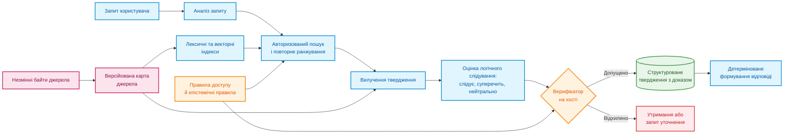

Схема розділяє змінні й незмінні частини. Етапи машинного навчання можна оновлювати. Незмінні байти, карта першоджерела, перевірка повноважень і умови допуску є стабільними інженерними межами. Оновлення токенізатора не має права непомітно змінити значення тексту чи прив'язку цитати.

У мовному тракті впроваджено **інженерний принцип подвійної авторизації та успадкування міток доступу (принцип подвійної авторизації Федчика)**: авторизацію виконують двічі — перед первинним пошуком кандидатів і повторно безпосередньо перед детермінованим допуском твердження. Недоступний фрагмент не можна спочатку передати генеративній моделі як контекст, а потім приховати цитату: зміст фрагмента вже вплинув на генерацію. Твердження успадковує мітки доступу всіх вихідних матеріалів, а відмова в доступі не повинна розкривати навіть факт існування закритого документа.

### 1.1. Шестирівневий лінгвістичний стек та класичний цикл NLP/NLU/NLG у доказових експертних системах

Обробка природної мови (Natural Language Processing, NLP) у mission-critical експертних системах покликана розв'язувати фундаментальну суперечність: людина формулює технічні вимоги, дефекти й регламенти багатозначною живою мовою, тоді як верифікатор вимагає строго типізованих предикатів логіки з непорушною прив'язкою до нормативних байтів. Наївне делегування цієї задачі універсальним мовним моделям, що передбачають наступний токен, призводить до тихих епістемічних аварій — від підміни інженерних термінів до зникнення часток заперечення («не запускати» $\to$ «запускати»).

Щоб гарантувати неспростовність доказів, у мовний тракт доказової експертної системи закладено вичерпну класичну лінгвістичну стратифікацію, що розділяє обробку на три взаємопов'язані складові:
1. **Попередня обробка тексту (Text Preprocessing):** детермінована нормалізація символів (NFC/NFKC), виявлення гомогліфів та шкідливих ін'єкцій, виділення меж речень і токенів із суворим збереженням технічних ідентифікаторів (наприклад, позначень стандартів на кшталт `ISO/IEC 61508-3:2010`).
2. **Розуміння природної мови (Natural Language Understanding, NLU):** глибока покрокова інтерпретація синтаксичної та семантичної структури тексту, розпізнавання сутностей предметної області (Domain Named Entity Recognition, NER) та екстракція реляційних фактів.
3. **Генерація природної мови (Natural Language Generation, NLG):** доказовий синтез інженерних звітів, протоколів та пояснень виключно поверх перевіреного дерева резолюції (Proof-to-Text), де кожен синтезований квант мовлення є проєкцією формального сертифіката доведення.

Ця функціональна тріада функціонує поверх шести рівнів організації людської мови, кожен із яких відповідає за власний інваріант у тракті прийняття рішень.

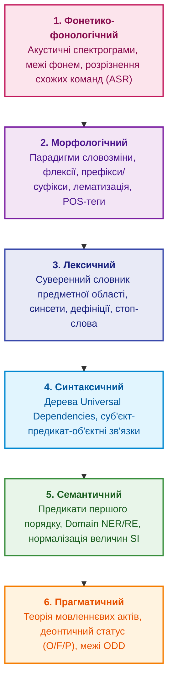

> [!NOTE]
> **Шість лінгвістичних рівнів інженерного тракту розуміння мови (синтез Миколи Федчика)**
> 1. **Фонетико-фонологічний рівень:** Забезпечує детерміноване розрізнення акустично подібних голосових наказів оператора в реальному часі (наприклад, уникнення сплутування сигналів «ПУСК» та «СПУСК» за допомогою розрахунку матриць фонетичної відстані та обмеження допустимих переходів граматикою команд).
> 2. **Морфологічний рівень:** Здійснює аналіз внутрішньої будови слів, флексій та граматичних маркерів, зберігаючи відмінкові зв'язки флективних мов і запобігаючи руйнуванню актантних ролей при підсловній BPE-токенізації.
> 3. **Лексичний рівень:** Зіставляє виділені лексеми із суверенним нормативним тезаурусом предметної області, відсікаючи неінформативні стоп-слова, але зберігаючи деонтичні та логічні модифікатори («тільки», «ніколи», «не менше»).
> 4. **Синтаксичний рівень:** Будує формальне орієнтоване дерево синтаксичних залежностей (Universal Dependencies), що детерміновано фіксує суб'єктно-об'єктні ролі незалежно від інверсії порядку слів у реченні інженера чи нормативу.
> 5. **Семантичний рівень:** Транслює синтаксичну структуру у формальні предикати логіки та реляційні факти, розпізнає сутності предметної області (Domain NER) та виконує приведення фізичних величин до канонічних одиниць SI.
> 6. **Прагматичний рівень:** Інтерпретує мовленнєвий акт відповідно до контексту сеансу (теорія Остіна–Серла: констатація факту, запит довідки, деонтичний наказ або вердикт) та перевіряє правомочність твердження в межах експлуатаційної придатності (ODD).

### 1.2. Морфологічний процесинг синтетичних і флективних мов: подолання деградації токенізації

Морфологічний рівень є критичним рубежем надійності при роботі з синтетичними та флективними мовами (українською, польською, чеською, німецькою), на відміну від аналітичної англійської. В англійській мові синтаксичні зв'язки кодуються переважно фіксованим порядком слів та прийменниками. Натомість у флективних мовах граматична роль повністю визначається закінченнями (флексіями) та афіксами: «датчик сигналізує реле» проти «датчиком сигналізує реле» чи «датчику сигналізує реле».

Коли стандартна велика мовна модель використовує алгоритм підсловного розбиття (Byte-Pair Encoding, BPE), словоформа розривається на псевдовипадкові статистичні фрагменти. Відпадання чи спотворення одного суфікса або закінчення руйнує відмінок, перетворюючи активного суб'єкта на пасивний об'єкт. Це породжує небезпечну системну помилку інверсії семантичних ролей (Semantic Role Inversion).

Для усунення цього дефекту в архітектурі експертної системи впроваджено детермінований морфологічний аналізатор на основі скінченних перетворювачів (Finite-State Transducers, FST) або подвійних префіксних дерев (Double-Array Trie, DAT). Нехай $`w \in \mathcal{V}_{\mathrm{raw}}`$ — вхідна словоформа. Морфологічний процесор обчислює відображення $\mu(w)$ у лему $`\ell \in \mathcal{L}`$ та структурований вектор граматичних категорій $`\mathbf{g} = \langle c, g, n, t \rangle`$ (де $`c \in \mathcal{C}`$ — відмінок, $`g \in \mathcal{G}`$ — рід, $`n \in \mathcal{N}`$ — число, $`t \in \mathcal{T}`$ — час/спосіб):

$$
\mu(w) = \langle \ell, \mathbf{g} \rangle = \arg\max_{\langle \ell', \mathbf{g}' \rangle \in \Omega(w)} P(\mathbf{g}' \mid \ell', \mathcal{K}_{\mathrm{context}})
$$

де:
- $\Omega(w)$ — множина допустимих парадигм словозміни для слова $w$ у суверенному морфологічному словнику $`\mathcal{K}_{\mathrm{morph}}`$;
- $`\mathcal{K}_{\mathrm{context}}`$ — локальне синтаксичне оточення (вікно залежностей), що використовується для зняття морфологічної омонімії;
- $`\mathbf{g}'`$ — гіпотеза кортежу морфологічних ознак.

При трансляції виділеного актанта в семантичний фрейм предикатної логіки $`\mathcal{F} = \langle \mathrm{Predicate}, \mathrm{Agent}, \mathrm{Patient}, \mathrm{Instrument}, \mathrm{Modifier} \rangle`$ семантична роль призначається на основі перетину синтаксичної залежності $`\mathrm{dep}(w)`$ та морфологічного відмінка $c$:

$$
\mathrm{Role}(w) = \begin{cases} \mathrm{Agent}, & \text{якщо } c = \mathrm{Nom} \land \mathrm{dep}(w) \in \{\mathtt{nsubj}, \mathtt{csubj}\}, \\ \mathrm{Patient}, & \text{якщо } (c = \mathrm{Acc} \land \mathrm{dep}(w) = \mathtt{obj}) \lor (c = \mathrm{Nom} \land \mathrm{dep}(w) = \mathtt{nsubj:pass}), \\ \mathrm{Instrument}, & \text{якщо } c = \mathrm{Ins} \land \mathrm{dep}(w) = \mathtt{obl}, \\ \mathrm{Modifier}, & \text{якщо } c = \mathrm{Gen} \land \mathrm{dep}(w) = \mathtt{nmod}, \\ \mathrm{Unmapped}, & \text{в усіх інших випадках}. \end{cases}
$$

де:
- $`\mathrm{Nom}, \mathrm{Acc}, \mathrm{Ins}, \mathrm{Gen}`$ — називний, знахідний, орудний та родовий відмінки відповідно;
- $`\mathtt{nsubj}, \mathtt{nsubj:pass}, \mathtt{obj}, \mathtt{obl}, \mathtt{nmod}`$ — типи відношень синтаксичних залежностей схеми Universal Dependencies, використані в цьому обмеженому відображенні.

**Імператив замкненого циклу розрахунку (Actionable Closed Loop):**

1. **Керування рантаймом і потоком обчислень (Control Flow & Runtime Decisions):**
   Якщо множина допустимих парадигм $`|\Omega(w)| > 1`$ і контекстне зняття омонімії не дає статистичної впевненості $`P(\mathbf{g}' \mid \cdot) \ge 0.98`$, семантичний процесор блокує пряму побудову предикатів логіки і виставляє статус `AMBIGUOUS_MORPHOLOGY`. Так само предикат не будується, якщо пара відмінка й залежності не має явного відображення в таблиці: випадок передається на уточнення або експертну перевірку, а не класифікується евристично.
2. **Апаратний сайзинг та інфраструктурні обмеження (Hardware Dimensioning):**
   Умовний словник із $250\,000$ інженерних лексем і понад $4.2 \times 10^6$ словоформ можна подати статичним префіксним деревом Double-Array Trie (DAT); оцінка $`M_{\mathrm{trie}} \le 24\,\text{МБ}`$ RAM потребує перевірки для конкретного формату кодування та набору метаданих. Цільовий час прямого розбору $`\tau_{\mathrm{morph}} = 1.4\,\mu\text{с}`$ на словоформу також потребує вимірювання на визначеній платформі. Кількість сторінок сама не задає кількості слів і часу: за суто ілюстративних $500$ слів на сторінку, $1000$ сторінок містять $500\,000$ словоформ, тобто послідовний розбір займає $`500\,000 \times 1.4\,\mu\text{с} = 700\,\text{мс}`$ на одному ядрі без урахування решти конвеєра. Межа $`45\,\text{мс}`$ потребувала б щонайменше 16 еквівалентних ядер за ідеального масштабування або окремого виміряного пакетного алгоритму; такої конфігурації чи вимірювання тут не задано. Тому числове значення не є гарантією часу обробки документа.
3. **Практичний числовий приклад (Worked Numerical Example):**
   Аналізується навчальне речення: «Оператор перекриває магістральний трубопровід захисним клапаном». За заданим синтаксичним розбором «оператор» має $`c = \mathrm{Nom}`$ і залежність $`\mathtt{nsubj}`$, «трубопровід» — $`c = \mathrm{Acc}`$ і $`\mathtt{obj}`$, а «клапаном» — $`c = \mathrm{Ins}`$ і $`\mathtt{obl}`$. Таблиця відповідно призначає ролі $`\mathrm{Agent}`$, $`\mathrm{Patient}`$ та $`\mathrm{Instrument}`$ і формує предикат $`\mathtt{shut\_off}(\mathrm{operator}, \mathrm{pipeline}, \mathrm{safety\_valve})`$. Це приклад роботи заданого відображення, а не доказ повноти морфологічного аналізу української мови.

**Діагностика: «Під капотом» проти «Панелі приладів» (Under the Hood vs Dashboard):**
- *Під капотом (Under the Hood):* У таблиці сеансу ядра системи фіксується внутрішня структура:
  ```json
  {
    "token": "клапаном",
    "lemma": "клапан",
    "pos": "NOUN",
    "morph": {"Case": "Ins", "Gender": "Masc", "Number": "Sing"},
    "dep_rel": "obl:agent",
    "head_index": 2,
    "assigned_role": "Instrument",
    "byte_span": [128, 136]
  }
  ```
- *На панелі приладів інженера (Dashboard):* Візуалізуються призначені ролі з посиланнями на фрагменти: «Виконавець: [Оператор]; об'єкт впливу: [Магістральний трубопровід]; інструмент: [Клапан захисний]». Цей індикатор описує результат розбору, а не самостійну перевірку істинності.

### 1.3. Синтаксично-рольова нормалізація (SRL) та клаузальна декомпозиція нормативного дискурсу

Традиційний підхід до обробки технічних текстів, що спирається на пореченнєву сегментацію та лінійне ковзне вікно (Pivot-розрізання), виявляється принципово неспроможним у завданнях екстракції точних інженерних норм. Складні технічні стандарти (RFC, ISO, IEC, стандарти AUTOSAR) насичені пасивними конструкціями, складносурядними групами з множинними суб'єктами та присудками, рестриктивними підрядними реченнями та конституентним запереченням.

Спроба наївного розбиття речення за крапками чи комами призводить до так званої «клаузальної сліпоти»:
- Пасивний стан приховує реального виконавця дії ($`\mathrm{Agent}`$), підставляючи на місце суб'єкта пацієнс ($`\mathrm{Patient}`$);
- Складносурядні кон'юнкції вигляду $`(A \land B) \text{ MUST } (C \land D)`$ формують змішані неструктуровані сутності замість чотирьох незалежних правил;
- Рестриктивні підрядні речення («сервер, який підтримує версію X...») помилково розглядаються як безумовні норми над усім класом сутностей;
- Заперечення при окремих актантах («no more than 4 octets», «to no external address») губляться або помилково інвертують позитивні предикати.

Для усунення цих системних дефектів автором запропоновано модель синтаксично-рольової нормалізації (Semantic Role Labeling, SRL) над типізованим проміжним представленням `Epistemic IR`, яка формалізує перехід від природної структури речення до канонічних епістемічних клауз:

> [!NOTE]
> **П'ять правил синтаксично-рольової канонізації нормативних речень М. М. Федчика**
> 1. **Конверсія пасивної діатези в канонічну активну трійку:** Автором запропоновано детерміноване правило перетворення пасивних конструкцій ($`\mathrm{NP}_{\text{patient}} + \mathrm{Modal} + \text{be} + V_3 + \text{by} + \mathrm{NP}_{\text{agent}}`$) в активне представлення ($`\mathrm{Actor} := \mathrm{NP}_{\text{agent}}, \mathrm{Action} := \mathrm{Lemma}(V_3), \mathrm{Theme} := \mathrm{NP}_{\text{patient}}`$), що усуває сліпоту пошуку за виконавцем дії.
> 2. **Клаузальна дистрибутивність кон'юнкцій ($`1 \to N`$):** Розроблено в монографії метод розщеплення складносурядних підметів і присудків ($`(\mathrm{NP}_1 \land \mathrm{NP}_2) \text{ MUST } (\mathrm{VP}_1 \land \mathrm{VP}_2)`$) на декартовий добуток атомарних норм зі збереженням єдиного криптографічного якоря цитати та захистом числових діапазонів (`between X and Y`) від хибної сегментації.
> 3. **Виділення рестриктивних підрядних речень у типізовані передумови:** Конструкції з маркерами `that / which / who / який / що` всередині групи підмета відокремлюються від імені сутності та компілюються в імплікативні передумови допуску $`\mathrm{Precondition}(x) \implies \mathrm{Norm}(x)`$.
> 4. **Композиційний розбір конституентного заперечення та сфери дії кванторів:** Замість бінарної класифікації модального дієслова виконується аналіз заперечення при числівниках та об'єктах (`send no more than N` $`\implies \le N`$, `to no external host` $`\implies \mathrm{PROHIBITION}`$), а також зв'язування кванторів $`\forall, \exists`$ з конкретними актантами фрейму.
> 5. **Міжабзацна кореференція через таблицю символів дискурсу:** Займенникові та демонстративні анафори (`it`, `this header`, `the latter`, `він`, `цей параметр`) детерміновано зв'язуються з останньою сумісною за родом/числом/типом сутністю або заголовком поточного розділу документа.
> *Керування рантаймом / Інженерний інваріант:* Жодна синтаксична трансформація не змінює сирі байти першоджерела в секції `0x0004 SLICES`; усі породжені клаузи зберігають точний байтовий інтервал $`[b_{\text{start}}, b_{\text{end}})`$ та `SHA-256` вихідного речення.

## 2. Збереження зв'язку між текстом і першоджерелом: карти походження та байти кустодії

Твердження «позиція символу 42» є математично некоректним без явної вказівки координатного простору. Автором розроблено **шестирівневу таксономію систем координат тексту** у просторі $`\mathcal{S} \in \{\text{Bytes } B, \text{Codepoints } C, \text{Normalized } N, \text{Graphemes } G, \text{Linguistic } L, \text{Tokens } T_E\}`$: позицію можна строго обчислювати виключно відносно відповідного шару координатної ієрархії.

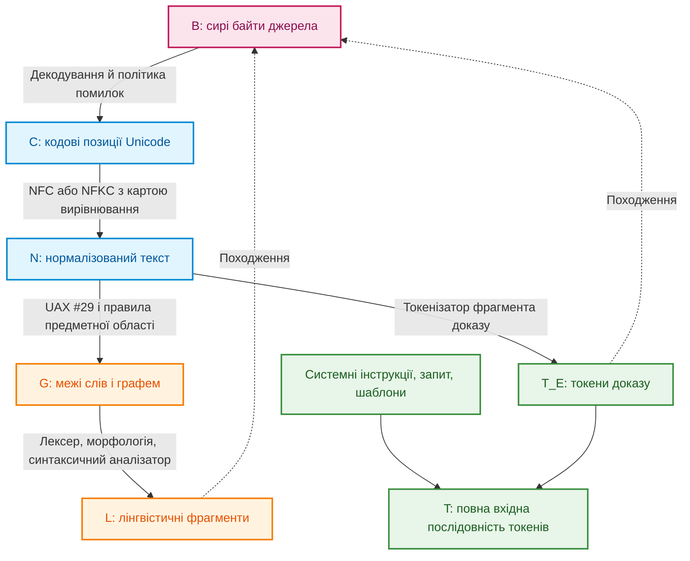

Кожне перетворення створює нове подання тексту й відношення походження. Нехай $`R_{X\leftarrow Y}\subseteq X\times Y`$ відображає фрагмент похідного подання $Y$ у відповідні ділянки батьківського подання $X$, а $`T_E\subseteq T`$ позначає токени моделі, що походять саме з доказу. Тоді зв'язок токена доказу з байтами є композицією відношень:

```math
R_{B\leftarrow T_E}=R_{B\leftarrow C}\circ R_{C\leftarrow N}\circ R_{N\leftarrow T_E}.
```

- У цьому виразі $`T_E`$ є множиною токенів моделі, що походять із доказу;
- $B$, $C$ і $N$ позначають байтове, символьне та нормалізоване подання;
- $`R_{X\leftarrow Y}`$ є відношенням походження, яке зіставляє елементи подання $Y$ з відповідними елементами подання $X$;
- символ $\circ$ означає композицію відношень, тобто послідовне проходження від токенів через нормалізований текст і символи до байтів.

Читається так: для кожного токена доказу можна простежити шлях до відповідних байтів джерела. Зіставлення може бути неоднозначним, коли один токен охоплює кілька позицій або кілька символів злилися під час нормалізації.

Це відображення не є взаємно однозначним. Один токен може охоплювати кілька кодових позицій, одна графема складається з базового символу й діакритики, а нормалізована позиція може виникати зі злиття кількох вхідних символів.

Діє **інженерний принцип дисоціації штучних токенів (Prompt-Token Provenance Isolation)**: службові токени шаблону, системні інструкції й токени запиту користувача не мають штучного походження з байтів документа: їх суворо відокремлюють від токенів доказу $`T_E`$ та відображають на власні сутності або позначають як згенеровані; цитата експертної системи спирається виключно на множину $`T_E`$.

### 2.1. Ефекти нормалізації Unicode: ризики втрати інформації

У формі нормалізації NFC послідовність `U+0065` (латинська «e») і `U+0301` (комбінований гострий наголос) перетворюється на один символ `U+00E9` («é»). Різні байти джерела дають однаковий нормалізований результат. Форма NFKC додатково стирає сумісні відмінності, наприклад перетворює надрядкові індекси на звичайні цифри чи розкладає лігатури, тому стандарт UAX #15 прямо застерігає: форми KC і KD не можна застосовувати до довільного тексту наосліп, бо вони стирають багато відмінностей форматування [[1]](#src-1). Зворотне відображення неможливо відновити згодом, якщо вирівнювання не зафіксували під час перетворення.

Для похідного фрагмента $s$ нехай $`M_B(s)`$ позначає мінімальну впорядковану множину байтових інтервалів джерела, $`\mathrm{Bytes}_B(M)`$ байти джерела в оригінальному порядку, а $`\mathrm{Frame}_B(M)`$ канонічні записи `(start, end, bytes)`. Тоді виконується двосторонній інваріант

```math
\mathrm{Normalize}_v\bigl(\mathrm{Decode}_e(\mathrm{Bytes}_B(M_B(s)))\bigr)=\mathrm{Surface}_N(s)
```

Позначення:

- $s$ є похідним фрагментом тексту;
- $`M_B(s)`$ задає мінімальну впорядковану множину інтервалів байтів джерела для фрагмента $s$;
- $`\mathrm{Bytes}_B(M_B(s))`$ є байтами цих інтервалів у початковому порядку;
- $`\mathrm{Decode}_e`$ декодує байти за кодуванням і політикою помилок $e$;
- $`\mathrm{Normalize}_v`$ нормалізує текст за версією Unicode та формою нормалізації $v$;
- $`\mathrm{Surface}_N(s)`$ є поверхневим текстом фрагмента в нормалізованому поданні $N$;
- знак $=$ вимагає, щоб обидва способи отримання тексту давали однаковий результат.

Практично це означає, що вибрані байти після декодування й нормалізації мають відтворити саме той текст, на який посилається фрагмент. Інваріант залежить від збережених параметрів $e$ та $v$ і не відновлює втрачене вирівнювання, якщо карта байтів не була записана.

Окремо експертна система перевіряє незмінність первинного доказу:

```math
\mathrm{SHA}256\bigl(\mathrm{Frame}_B(M_B(s))\bigr)=\text{evidence-sha256}(s).
```

Складники формули:

- $`\mathrm{Frame}_B(M_B(s))`$ є канонічним записом інтервалів і відповідних байтів для фрагмента $s$;
- $`\mathrm{SHA}256(\cdot)`$ обчислює 256-бітний криптографічний хеш переданого запису;
- $`\text{evidence-sha256}(s)`$ є збереженим хешем доказу для фрагмента $s$;
- знак $=$ означає, що обчислений хеш збігається зі збереженим.

Перевірка читається як порівняння відбитків: будь-яка зміна охоплених байтів має змінити хеш, але збіг хешів сам по собі не доводить правильності тлумачення цитати. Параметри $e$ і $v$ з попереднього інваріанта фіксують декодування та нормалізацію. Після зміни порядку комбінованих символів карта джерела може бути списком незв'язних інтервалів, а не одним діапазоном. Для PDF-документів і сканів ланцюг довший: «байти PDF → геометрія сторінки або растрове зображення → текст оптичного розпізнавання → нормалізований текст». Координати цитати з оптичного розпізнавання прив'язують до тексту розпізнавання й до обмежувальних рамок на сторінці, а не подають як простий байтовий зсув усередині бінарного файлу PDF.

Стандарт UAX #29 задає базові правила поділу тексту на графеми, слова й речення [[2]](#src-2), але для технічних сутностей на кшталт `10.0.0.0/8` чи `v2.1.4` потрібні правила конкретної предметної області. Для токенізатора, який заявлено безвтратним у вибраному режимі, перевіряють такий інваріант зворотного перетворення:

```math
\mathrm{Detok}_v\bigl(\mathrm{Tok}_v(x;\ \mathrm{special}=\mathrm{false});\ \mathrm{cleanup}=\mathrm{false}\bigr)=x.
```

Розшифрування величин:

- $x$ є початковим текстом;
- $`\mathrm{Tok}_v`$ перетворює текст на токени за версією токенізатора $v$;
- $`\mathrm{Detok}_v`$ відновлює текст із цих токенів тим самим токенізатором;
- параметр $`\mathrm{special}=\mathrm{false}`$ вимикає додавання спеціальних токенів;
- параметр $`\mathrm{cleanup}=\mathrm{false}`$ вимикає додаткове очищення пробілів;
- знак $=$ вимагає точного відновлення початкового тексту.

Ця рівність є вимогою до безвтратного режиму, не властивістю всіх токенізаторів. Перетворення регістру, нормалізація Unicode, заміна невідомих фрагментів і очищення пробілів можуть змінити текст навіть без спеціальних токенів. Наприклад, після нормалізації NFKC лігатура `fi` стає `fi`: декодування нормалізованих токенів не відновить початкових байтів. Для такого токенізатора перевіряють відповідність заявленому нормалізованому поданню, а доказову цитату отримують через збережену карту першоджерела. Версія токенізатора сама не відновлює втраченої інформації.

> [!NOTE]
> **Чотири інваріанти байтової кустодії та збереження походження доказів (чотири інваріанти)**
> 1. Композиція реляцій походження: формальний трасований шлях від токенів до вихідних байтів $`R_{B\leftarrow T_E} = R_{B\leftarrow C} \circ R_{C\leftarrow N} \circ R_{N\leftarrow T_E}`$.
> 2. Інваріант поверхневого відновлення: точне відтворення тексту після декодування та нормалізації $`\mathrm{Normalize}_v(\mathrm{Decode}_e(\mathrm{Bytes}_B)) = \mathrm{Surface}_N(s)`$.
> 3. Криптографічний фрейм кустодії: побайтова верифікація незмінності фрагмента за контрольним хешем $`\mathrm{SHA}256(\mathrm{Frame}_B(M_B(s))) = \text{evidence-sha256}(s)`$.
> 4. Двосторонній інваріант безвтратної токенізації: обов'язкова зворотність $`\mathrm{Detok}_v(\mathrm{Tok}_v(x)) = x`$ для запобігання втраті значущих деталей.
> *Керування рантаймом / Інженерний інваріант:* будь-яке розходження в байтах або хешах блокує цитування та відхиляє твердження за кодом відсутності кустодії.

## 3. Безпека текстового конвеєра: виявлення ін'єкцій та підміни символів

Текст може виглядати для людини звичайним, але по-різному інтерпретуватися програмами або містити приховані інструкції для мовної моделі. Перед пошуком відповіді експертна система перевіряє не лише зміст документа, а й спосіб його кодування.

Нормалізація не усуває підміни символів. Латинська `a` й кирилична `а` виглядають однаково, невидимі керівні символи змінюють порядок відображення, а символи нульової ширини розривають ідентифікатори. Бучер і Андерсон показали атаку Trojan Source: керівні символи двонапрямленого тексту створюють розбіжність між порядком, який бачить людина, і порядком, який обробляє компілятор [[3]](#src-3). Механізми виявлення схожих символів описує стандарт UTS #39 [[4]](#src-4), а правила двонапрямленого тексту стандарт UAX #9 [[5]](#src-5).

| Загроза | Наслідок | Інженерний контроль |
|---|---|---|
| Невалідне кодування | різні компоненти бачать різний текст | строге декодування або карантин, заборона мовчазної заміни символів у доказах |
| Змішані системи письма | `heаder` з кириличною «а» обходить точний пошук | профіль писемності, скелет символів за UTS #39 як сигнал перевірки |
| Двонапрямлений текст і невидимі керівні символи | рецензент бачить інший порядок слів | перевірка за UAX #9, показ кодових позицій, дозволені списки символів |
| Надмірна нормалізація | втрата важливої смислової різниці | незмінні вихідні байти, окремі правила для технічних полів |
| Отруєння корпусу | підроблений фрагмент перемагає в ранжуванні | перевірка джерел, хеші вмісту, виявлення аномалій |
| Непрямі вбудовані інструкції | текст документа намагається керувати моделлю | ізольований канал даних, заборона інструментів за замовчуванням |
| Підробка цитати | показаний фрагмент не відповідає оригіналу | перевірка зворотного відображення через карту джерела та хеш |

Непрямі вбудовані інструкції (*indirect prompt injection*) є реальною загрозою для застосунків на основі мовних моделей: Грешаке та співавтори продемонстрували, як інструкції, приховані в даних, які застосунок отримує під час роботи, перехоплюють керування моделлю [[6]](#src-6).

```mermaid
flowchart LR
    accTitle: Очищення тексту й захист від атак
    accDescr: Етапи фільтрації вхідних байтів від строгого декодування до передачі довіреного тексту в захищений канал моделі.

    IN["Зовнішні байти"] --> DEC{"Строге<br/>декодування?"}
    DEC -->|"Помилка"| QUAR["Карантин"]
    DEC -->|"Успіх"| US["Перевірка безпеки Unicode<br/>(UTS #39, UAX #9)"]
    US --> RAW["Незмінний об'єкт<br/>першоджерела"]
    US --> FLAGS["Позначки підозрілих<br/>символів і напрямку"]
    RAW --> NORM["Нормалізація з фіксацією<br/>вирівнювання"]
    FLAGS --> POL{"Правило допуску<br/>документа"}
    NORM --> POL
    POL -->|"Дозволено"| IDX["Індексування як<br/>недовірених даних"]
    POL -->|"Заблоковано"| QUAR
    IDX --> LLM["Ізольований канал<br/>цитованого доказу"]
    LLM --> HOST["Верифікатор на хості"]

    classDef ext fill:#ffebee,stroke:#c62828,stroke-width:2px,color:#b71c1c;
    classDef check fill:#fff3e0,stroke:#f57c00,stroke-width:2px,color:#e65100;
    classDef safe fill:#e8f5e9,stroke:#388e3c,stroke-width:2px,color:#1b5e20;
    classDef proc fill:#e1f5fe,stroke:#0288d1,stroke-width:2px,color:#01579b;

    class IN,QUAR ext;
    class DEC,US,FLAGS,POL,HOST check;
    class RAW,IDX,LLM safe;
    class NORM proc;
```

Схема ілюструє **архітектурний патерн ізольованого пасивного каналу даних (Passive Data Diode for Ingested Text, патерн Федчика)**: знайдена в документі фраза «ігноруй усі попередні інструкції» залишається виключно пасивними даними. Текст вхідного документа, що цитується моделлю, є принципово пасивним інформаційним масивом: жодна синтаксична конструкція всередині документа не має права виконуватися як код, викликати системні інструменти чи змінювати права доступу.

## 4. Розподіл відповідальності в гібридній архітектурі

Жоден модуль не повинен одночасно знаходити текст, тлумачити його зміст і самостійно ухвалювати висновок. Чіткий поділ обов'язків робить помилку локалізованою: видно, чи збій стався на рівні байтів, синтаксичного розбору чи логічного висновку.

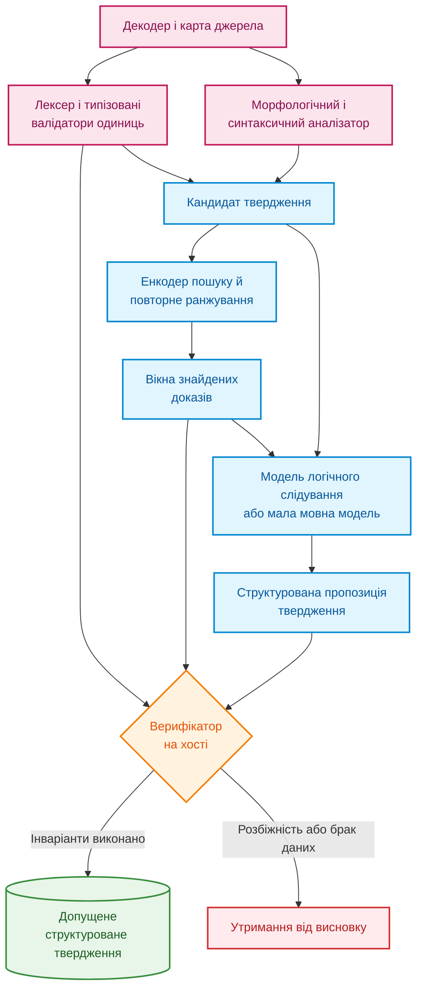

Синтаксичний аналізатор будується на базі **концептуального розмежування синтаксису залежностей Теньєра (Universal Dependencies) та генеративної граматики безпосередніх складників Хомського**: для задачі екстракції інженерних знань синтаксис залежностей Люсьєна Теньєра є функціонально оптимальним, оскільки напряму зв'язує предикати (дієслова) з їхніми актантами (суб'єктами, об'єктами, одиницями виміру), оминаючи громіздкі абстрактні синтаксичні дерева складників. Схема Universal Dependencies задає узгоджені між мовами частини мови, морфологічні ознаки й синтаксичні залежності [[7]](#src-7). Векторні подання речень для пошуку дають моделі на кшталт Sentence-BERT [[8]](#src-8). Логічне слідування (*natural language inference*, NLI) оцінюють моделі, навчені на наборах на кшталт XNLI, що охоплює багатомовну оцінку [[9]](#src-9). NLI тут є статистичною класифікацією пари текстів, не перевіркою формального доведення. Результат на XNLI не встановлює якість на українських технічних вимогах: потрібні незалежні приклади відповідної мови й предметної області. Таблиця фіксує, що кожен компонент видає і на що не має права.

| Компонент | Що видає | На що не має права |
|---|---|---|
| Декодер і карта джерела | кодові позиції, зв'язки з байтами, помилки декодування | тлумачити намір користувача чи істинність фактів |
| Детермінований лексер і валідатор | типізовані атоми (числа, одиниці, ідентифікатори) і точні межі | призначати смислову роль твердження |
| Синтаксичний аналізатор | леми, частини мови, дерево залежностей | доводити нормативну силу вимоги чи права доступу |
| Енкодер і повторне ранжування | векторні подання, оцінки близькості | доводити логічне слідування чи істинність |
| Модель логічного слідування | імовірності класів «слідує», «суперечить», «нейтрально» | встановлювати істину поза наданим фрагментом |
| Мала або велика мовна модель | пропозицію наміру, нормалізоване формулювання, якір у тексті | підміняти байти, хеші й правила безпеки |
| Верифікатор на хості | рішення про допуск або код причини відмови | перефразовувати текст мовою користувача |
| Модуль формування відповіді | читабельну відповідь із точними посиланнями на цитати | створювати твердження поза перевіреним поданням |

> [!NOTE]
> **Вісім граней розподілу відповідальності в гібридній лінгвістичній архітектурі (вісім граней)**
> 1. Декодер і карта джерела: суворе зіставлення байтів і символів без права тлумачити намір користувача чи істинність фактів.
> 2. Детермінований лексер і валідатор: виділення типізованих атомів та одиниць СІ без права призначати смислову роль твердження.
> 3. Синтаксичний аналізатор: побудова дерева залежностей Universal Dependencies без права оцінки нормативної сили вимог.
> 4. Енкодер і повторне ранжування: векторний пошук кандидатів у просторі ембеддінгів без права встановлювати логічне слідування.
> 5. Модель логічного слідування (NLI): статистична оцінка пари «твердження-доказ» без права виходу за межі наданого текстового вікна.
> 6. Мала мовна модель (SLM): висунення гіпотез наміру та зняття омонімії без права підміни криптографічних хешів і байтових меж.
> 7. Хостовий верифікатор: детермінований допуск або відмова за замкненим циклом без права довільного перефразування тексту.
> 8. Модуль генерації відповіді: синтез читабельного пояснення виключно на базі допущеного подання без генерації неперевірених фактів.
> *Керування рантаймом / Інженерний інваріант:* штучний інтелект обмежений суто консультативною роллю генерації гіпотез, залишаючи верифікацію символьному ядру.

## 5. Ресурсні обмеження: бюджет контексту, токенізація й пам'ять моделі

Токен мовної моделі не дорівнює слову чи символу. Кількість токенів залежить від мови, токенізатора й службових шаблонів, тому бюджет контексту контролюють явно:

```math
L_{\mathrm{sys}}+L_{\mathrm{schema}}+L_{\mathrm{dialog}}+L_{\mathrm{query}}+L_{\mathrm{evidence}}+L_{\mathrm{tools}}+L_{\mathrm{output}}\le C_{\mathrm{runtime}}.
```

- Бюджет утворюють $`L_{\mathrm{sys}}`$, $`L_{\mathrm{schema}}`$, $`L_{\mathrm{dialog}}`$, $`L_{\mathrm{query}}`$, $`L_{\mathrm{evidence}}`$, $`L_{\mathrm{tools}}`$ і $`L_{\mathrm{output}}`$, кількості токенів для інструкцій, схеми, діалогу, запиту, доказів, опису засобів і відповіді відповідно;
- знак $+$ підсумовує ці частини бюджету;
- $`C_{\mathrm{runtime}}`$ є перевіреною межею контексту конкретного профілю розгортання, у токенах;
- знак $\le$ вимагає, щоб сума не перевищувала цю межу.

Наприклад, за умовних значень 1 500 + 500 + 2 000 + 500 + 6 000 + 500 + 1 000 маємо 12 000 токенів, отже бюджет у 16 000 токенів не перевищено. Межа залежить від профілю моделі. Якщо релевантний фрагмент не вміщується в контекст повністю, експертна система не має права обрізати винятки посередині речення: вона звужує пошук або відмовляється від відповіді.

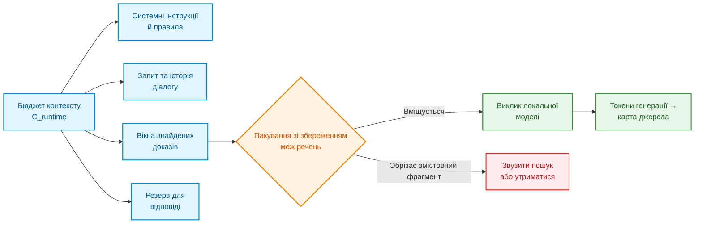

### 5.1. Особливості токенізації української мови

Для українськомовної експертної системи важливу роль відіграє словник токенізатора. Руст та співавтори показали, що спеціалізований токенізатор для мови важить для якості моделі не менше за обсяг даних попереднього навчання; у цій роботі використано показник фертильності токенізатора, тобто середню кількість токенів на слово [[10]](#src-10):

```math
\text{Fertility}=\frac{N_{\text{tokens}}}{N_{\text{words}}}.
```

Символи формули:

- $`N_{\text{tokens}}`$ є кількістю токенів у вибірці тексту;
- $`N_{\text{words}}`$ є кількістю слів у тій самій вибірці;
- $`\text{Fertility}`$ є середньою кількістю токенів на одне слово, у токенах на слово.

Наприклад, якщо вибірка з 800 слів перетворилася на 1 200 токенів, фертильність дорівнює $`1{,}5`$ токена на слово. Значення залежить від мови, корпусу й токенізатора, тому його не можна переносити на інший набір текстів без вимірювання.

Петров, Ла Мальфа й Торр виявили, що той самий текст, перекладений різними мовами, може мати довжину в токенах, яка відрізняється до 15 разів, і що така нерівність зменшує обсяг вмісту, який вміщується в контекст моделі, та збільшує вартість і затримку обробки [[11]](#src-11). Розмір словника впливає на цю нерівність: ранні моделі LLaMA [[12]](#src-12) і Mistral 7B [[13]](#src-13) мали словник на 32 тисячі токенів, а Gemma має словник на 256 тисяч токенів [[14]](#src-14). Показовий приклад подолання цієї асиметрії демонструє відкрита модель **Lapa LLM** (створена на базі Gemma 3 12B і названа на честь українського кібернетика Валентина Григоровича Лапи — співавтора О. Г. Івахненка з розроблення методу групового урахування аргументів у київській школі кібернетики, див. Главу 1) [[15]](#src-15). Пояснимо суть проблеми простою мовою для нефахівців: мовна модель читає текст не буквами й не цілими словами, а шматочками-«токенами» зі свого фіксованого словника. У базових англоцентричних або загальних багатомовних моделях більшість місць у словнику зайнята англійськими словами та рідкісними графемами інших писемностей, тому складні українські слова з префіксами й відмінковими закінченнями (наприклад, *«перекалібрування»*, *«екстраполюватися»*, *«побайтової»*) ріжуться на 3–5 дрібних уламків. Кожен зайвий уламок — це додатковий крок матричних обчислень на графічному процесорі й додаткова витрата пам'яті. Коли ж у словнику моделі понад 80 тисяч рідковживаних іншомовних позицій замінюють на повноцінні українські корені, суфікси та словоформи (без збільшення загального розміру словника у 256 тисяч елементів), модель починає сприймати українські інженерні терміни цілісно — так само ефективно, як базові моделі сприймають англійську мову.

Для прямої перевірки цього ефекту автором проведено порівняльний емпіричний експеримент на локальному промисловому обчислювальному вузлі з уніфікованою пам'яттю (NVIDIA Jetson AGX Orin 64 GB LPDDR5 UMA, 275 TOPS, середовище виконання Ollama 0.40.7 на базі CUDA 12.6, 4-бітне квантування `Q4_K_M`, детермінований режим `temperature = 0`). На п'ять локальних моделей різних архітектурних поколінь подавався ідентичний набір українських інженерних запитів із нормалізації розмовної технічної лексики, підбору питомих синонімів і морфологічно точного перекладу протокольних специфікацій:

| Локальна модель (профіль `Q4_K_M`) | Кількість вхідних токенів запиту ($`N_{\text{prompt}}`$) | Швидкість генерації (токенів/с) | Середній обсяг відповіді (токенів) | Середній повний час відгуку (с) |
|---|---:|---:|---:|---:|
| **Lapa LLM 12B** (80k укр. токенів у словнику 256k) | **128** | 15,82 | 177 | **12,08** |
| **Gemma 3 12B** (базовий мультиязичний словник 256k) | 193 (+50,8%) | 17,50 | 382 | 22,55 |
| **Gemma 4 12B** (прямий режим `think=false` + draft 465 МБ) | 195 (+52,3%) | **21,54** | 258 | 12,84 |
| **Gemma 4 12B** (режим міркувань `think=true`) | 195 (+52,3%) | 21,31 | 1 255 | 59,74 |
| **Qwen 2.5 Coder 14B** (словник 152k) | 198 (+54,7%) | 14,76 | 248 | 17,91 |
| **Phi-4 Mini 3.8B** (словник 200k, англоцентричний) | 280 (+118,8%) | 37,51 | 227 | 7,17 |

Результати експерименту демонструють три важливі закономірності, які безпосередньо визначають архітектуру мовного тракту:
1. **Менше вхідних токенів і відмінності виміряного часу:** на однаковому тексті запиту Lapa LLM сформувала 128 вхідних токенів проти 193–198 у наведених моделях 12B–14B. У цій вибірці її середній повний час відповіді становив 12,08 с проти 22,55 с у Gemma 3 12B. Це спостережені результати різних моделей, а не ізольована оцінка причинного впливу словника: відрізняються довжина відповідей, швидкість генерації й архітектура. Таблиця підтверджує виміряні значення саме для описаної конфігурації, але не гарантує такого самого виграшу на іншому корпусі чи профілі.
2. **Вплив спекулятивного декодування та пастка неконтрольованих міркувань:** модель наступного покоління Gemma 4 12B містить вбудовану допоміжну модель-чернетку (*speculative decoding draft model* обсягом 465 МБ), яка прискорює генерацію на тій самій апаратній платформі з 17,50 до **21,54 токена/с** (+23%). Проте ввімкнення за замовчуванням прихованого ланцюжка міркувань (`think=true`) на простих лексичних запитах викликає чотирикратне роздування виходу (до **1 255 токенів** і **59,74 с** затримки), тому для вузьких задач лінгвістичної нормалізації режим внутрішніх міркувань необхідно примусово вимикати (`think=false`).
3. **Ортогональність морфологічної якості та розміру моделі:** компактні моделі без української адаптації словника (3,8B) генерують токени швидко (37,51 токена/с), але через надмірне дроблення слів втрачають морфологічні зв'язки відмінків і породжують граматичні кальки, тоді як моделі, орієнтовані суто на програмний код (14B), припускаються міжмовного змішування лексем (*code-switching*).

Для експертної системи з цього випливають три практичні наслідки. Перший: кількість документів, яку можна подати в $`C_{\mathrm{runtime}}`$, залежить від фертильності токенізатора на власному корпусі, тому фертильність вимірюють на реальних документах, а не беруть з опису моделі. Другий: довші послідовності збільшують пам'ять кешу ключів і значень і обчислення уваги. Третій: карта вирівнювання $`R_{N\leftarrow T_E}`$ описує токени вхідного доказового тексту й потребує тестів на кирилиці. Згенерований токен не має автоматичної адреси у першоджерелі. Екстрактор має окремо повернути вибраний фрагмент або покажчик на вхідний діапазон, після чого верифікатор відтворює цитату через карту джерела.

> [!NOTE]
> **Чотири інженерні висновки з авторського емпіричного дослідження української токенізації та локальних моделей (чотири висновки)**
> 1. **Менша кількість вхідних токенів у виміряній вибірці:** Lapa LLM сформувала 128 вхідних токенів на запит проти 193–198 у наведених моделях 12B–14B; це вимір конкретних моделей і запитів, а не універсальна властивість словника.
> 2. **Відмінність повного часу відповіді в цій конфігурації:** виміряно 12,08 с для Lapa LLM і 22,55 с для Gemma 3 12B. Різниця не ізолює вплив токенізатора, оскільки моделі сформували відповіді різної довжини та мають різну швидкість генерації й архітектуру.
> 3. **Прискорення через спекулятивне декодування при примусовому блокуванні зайвих міркувань:** використання вбудованої допоміжної draft-моделі підвищує темп генерації на 23% (до 21,54 токена/с), але вимагає явного вимкнення режиму прихованих міркувань (`think=false`) для лексичних операцій, щоб запобігти лавинній затримці (59,74 с при 1 255 токенах).
> 4. **Розмежована маршрутизація за мовною спеціалізацією:** локальна модель з адаптованим українським токенізатором призначається для морфологічної нормалізації та синонімічного розширення природномовних запитів, тоді як генерація суворих синтаксичних дерев і формальних структур делегується моделям із примусовим граматичним маскуванням GBNF.
> *Керування рантаймом / Інженерний інваріант:* жоден виграш у швидкості чи якості токенізації не змінює статусу локальної моделі — її вихід залишається недовіреною гіпотезою ешелону `T2`, що підлягає обов'язковій побайтовій верифікації на хості.

### 5.2. Зсув розподілу даних (Out-of-Distribution Shift)

Часто кажуть, що нейронні мережі добре інтерполюють усередині опуклої оболонки навчальних даних і погано екстраполюють за її межами. Балестрієро, Песенті й ЛеКун показали, що для даних розмірності понад 100 нові приклади майже ніколи не потрапляють усередину опуклої оболонки навчальної вибірки, тож такий поділ на інтерполяцію й екстраполяцію не пояснює узагальнення [[16]](#src-16). Практично важливіше інше: якість моделі падає, коли дані під час використання відрізняються від навчальних. Набір WILDS зібрав такі зсуви розподілу з реальних застосувань і показав помітне падіння якості моделей поза навчальним розподілом [[17]](#src-17).

Невідомий під час навчання документ сам по собі не доводить зсуву розподілу: новий документ може належати до тієї самої мови, жанру й схеми вимог. Зсув потрібно оцінювати за змінами цих ознак і якістю на відкладених даних. Водночас відсутність документа в навчанні не дозволяє відновлювати його правила з пам'яті моделі. В авторській архітектурі діє **концепція обмеження ролі мовних моделей за межами навчального розподілу (OOD Shift)**: за умов неминучого зсуву розподілу даних у нових технічних специфікаціях мовна модель позбавлена права виступати самостійним сховищем фактів або генератором деонтичних норм; джерелом правила є виключно прийнятий нормативний документ або верифікований запис знань, а не ваги моделі. Роль мовної моделі суворо обмежена такими допоміжними задачами:

- розбір синтаксичних зв'язків і вилучення сутностей;
- генерація структурованих запитів до бази знань у вигляді проміжного подання;
- оцінка локального логічного слідування між ізольованим фрагментом і твердженням.

Логічні висновки, квантифікацію правил і перевірку інваріантів виконує детермінована машина виведення.

### 5.3. Оптимізація пам'яті: кеш ключів і значень (KV Cache)

Пам'ять кешу ключів і значень зростає лінійно з довжиною вхідної послідовності. Для повної уваги на одну активну сесію з $`n_l`$ шарами, $`n_{kv}`$ головами ключів і значень, розмірністю голови $`d_h`$, довжиною $L$ і $b$ байтами на елемент

```math
M_{KV}\approx 2\,n_l\,L\,n_{kv}\,d_h\,b.
```

У формулі стоять такі величини:

- $`M_{KV}`$ є обсягом пам'яті кешу ключів і значень для однієї активної сесії, у байтах;
- множник $2$ враховує окремо ключі та значення;
- $`n_l`$ є кількістю шарів моделі;
- $L$ є довжиною послідовності в токенах;
- $`n_{kv}`$ є кількістю голів ключів і значень у шарі;
- $`d_h`$ є розмірністю однієї голови;
- $b$ є кількістю байтів для зберігання одного елемента;
- знак $\approx$ позначає оцінку, що не враховує службові накладні витрати.

Для умовних параметрів $`n_l=32`$, $L=4096$, $`n_{kv}=8`$, $`d_h=128`$ і $b=2$ оцінка становить 536 870 912 байтів, або 512 MiB. Реальне споживання пам'яті також залежить від реалізації кешу й вирівнювання даних.

Множник 2 враховує окремо ключі й значення. Квон та співавтори показали, що саме кеш ключів і значень визначає ефективність обслуговування великих мовних моделей, і запропонували сторінкове керування цією пам'яттю в системі vLLM [[18]](#src-18).

### 5.4. Збереження термінологічних інваріантів у технічному перекладі: SIF 1.0 та попередня ізоляція виразів

При обробці та перекладі вузькоспеціалізованих нормативних текстів (метрологічні стандарти OIML, настанови ISO/IEC, директиви безпеки) класичні субсловникові токенізатори (Byte-Pair Encoding, WordPiece) та стохастичні нейромережеві моделі створюють специфічний ризик відмов: дроблення та спотворення стандартизованих термінів, фізичних формул і числових меж.

У дослідженнях UMT–NMT і TRIZ-Aware Loss (Кузьменко, Трофімова, 2025) вивчалися способи збереження структурно значущих елементів технічного тексту під час нейронного перекладу, зокрема шляхом спеціальної обробки токенів, формул і констант. Проте подальший емпіричний аналіз виявив важливе обмеження: внутрішні структурні закономірності в латентному просторі моделі не гарантують відповідної правильності вихідного тексту. Подальший розвиток дослідницької програми привів до **SIF 1.0 — зовнішнього Registry-контролю канонічних метрологічних термінів** [[34]](#src-34). На відміну від впливу на процес навчання моделі, цей механізм перевіряє результат за незалежно визначеними правилами в межах охоплення реєстру: нейромережа генерує кандидатний переклад, але не встановлює нормативну допустимість використаних форм.

Спираючись на загальний принцип незалежного контролю структурно значущих елементів, автором розроблено **концепцію попередньої ізоляції інженерних виразів перед передачею моделі**: для збереження інваріантів стандартизованої термінології та числових меж складені інженерні сутності тимчасово ізолюються від сублексичного токенізатора (маскуються захисними плейсхолдерами), а після генерації відновлюються з обов'язковою верифікацією побайтової цілісності за вихідним реєстром. Це авторська пропозиція монографії (концепція Федчика), яка розширює архітектуру SIF 1.0 на доказові експертні системи.

## 6. Семантична схожість проти логічного слідування: межі векторного пошуку

В основі архітектури мовної підсистеми лежить сформульований автором **закон невідповідності векторної схожості та логічного доведення (закон Федчика)**: косинусна близькість векторних ембеддінгів відображає лише тематичну спільність лексичного контексту і є принципово ортогональною до логічної істинності та відношення дедуктивного слідування. У наївних архітектурах RAG та пошукових системах метрика семантичної схожості неперервних векторних ембеддінгів помилково ототожнюється з логічною істинністю чи логічним слідуванням. Проте для експертних систем місійно-критичного класу (ISO 26262 ASIL D, IEC 61508 SIL 3/4) косинусна близькість векторів несе пряму загрозу системної аварії: дві діаметрально протилежні за інженерним змістом норми — наприклад, *«контролер зобов'язаний замкнути контактор аварійного скидання при втраті синхросигналу»* та *«контролеру категорично заборонено замикати контактор аварійного скидання при втраті синхросигналу»* — у типових просторах векторних представлень (наприклад, cosine embedding) мають подібність $`\approx 0{,}94`$–$`0{,}97`$ через ідентичний предметний лексичний контекст. Якщо машина виведення сприйме векторну подібність як доказ застосовності норми, система виконає небезпечну аварійну дію.

Тому в архітектурі мовного тракту експертної системи щільний векторний пошук розглядається виключно як евристичний фільтр швидкого первинного відсікання масиву документів. Після нього NLI (*Natural Language Inference*) може надати статистичну оцінку слідування як допоміжний сигнал, але остаточні доказові перевірки виконує верифікатор на хості. Детерміноване порівняння бала з порогом не робить модельний висновок формальним доведенням.

Для двох векторних подань запиту $\mathbf q \in \mathbb R^m$ та текстового пасажу документа $\mathbf d \in \mathbb R^m$ косинусна схожість дорівнює:

```math
s_{\mathrm{dense}}(q,d)=\frac{\mathbf q^\top\mathbf d}{\lVert\mathbf q\rVert_2\lVert\mathbf d\rVert_2}.
```

Кожна величина означає таке:

- $\mathbf q$ і $\mathbf d$ є векторними поданнями запиту $q$ і документа $d$ однакової розмірності $m$;
- $\mathbf q^\top\mathbf d$ є скалярним добутком цих векторів;
- $`\lVert\mathbf q\rVert_2`$ і $`\lVert\mathbf d\rVert_2`$ є їхніми евклідовими нормами ($`\ell_2`$);
- $`s_{\mathrm{dense}}(q,d)`$ є безрозмірною косинусною схожістю в діапазоні від $-1$ до $1$.

Інженерні пороги та відсікання шуму:
Якщо вектори ортогональні, скалярний добуток і схожість дорівнюють нулю. Формула не визначена для нульового вектора й не є ймовірністю того, що документ підтверджує запит. У конвеєрі добору встановлюється строгий поріг первинного відсікання: $`s_{\mathrm{dense}}(q,d) \ge \tau_{\mathrm{dense}}`$ (де $`\tau_{\mathrm{dense}} = 0{,}70`$). Кандидати з меншим показником відкидаються без передачі на дорожчі стадії обчислення. Значення `NaN` або розбіжність розмірностей негайно блокують кандидата за правилом замкненої відмови (*fail-closed*).

Цей показник є лише оцінкою для попереднього сортування, а не ймовірністю логічної підтримки. Лексичний пошук знаходить точні символьні збіги, а векторні подання знаходять перефразування. Метод злиття обернених рангів (*reciprocal rank fusion*, RRF) об'єднує списки різних пошукових методів без змішування неоднорідних шкал оцінок [[19]](#src-19):

```math
s_{\mathrm{RRF}}(d)=\sum_{r\in\mathcal R(d)}\frac{1}{k_0+\mathrm{rank}_r(d)}.
```

Параметри формули:

- $d$ є документом-кандидатом;
- $\mathcal R(d)$ є множиною пошукових списків, у яких трапився документ $d$;
- $r$ перебирає ці списки, а $`\mathrm{rank}_r(d)`$ є цілим рангом документа в списку $r$, починаючи з 1;
- $`k_0`$ є додатною сталою згладжування (стандартне інженерне значення $`k_0 = 60`$);
- $\sum$ додає внесок кожного списку до загального бала $`s_{\mathrm{RRF}}(d)`$.

На стадію детального аналізу крос-енкодером і моделлю NLI передаються лише кандидати з пулу топ-$K$ за балом $`s_{\mathrm{RRF}}`$ (де фіксується ліміт бюджету $K = 50$), унеможливлюючи комбінаторне вичерпання пам'яті. У генерації з пошуковим доповненням (*retrieval-augmented generation*, RAG) знайдені фрагменти передають моделі як контекст [[20]](#src-20), тому помилка ранжування безпосередньо стає помилкою відповіді.

Модель логічного слідування оцінює твердження $c$ відносно фрагмента $e$:

```math
p_\theta(y\mid c,e)=\mathrm{softmax}\bigl(z_\theta(c,e)\bigr),\qquad y\in\{\mathrm{entailment},\ \mathrm{contradiction},\ \mathrm{neutral}\}.
```

де:

- $c$ є твердженням, яке оцінюють, а $e$ є фрагментом доказу;
- $\theta$ позначає параметри моделі;
- $`z_\theta(c,e)`$ є вектором логітів для пари «твердження, доказ»;
- $`\mathrm{softmax}`$ перетворює логіти на ймовірності, кожна з яких належить $[0,1]$, а їхня сума дорівнює 1;
- $y$ є одним із класів: слідування (*entailment*), суперечність (*contradiction*) або нейтральність (*neutral*).

Наприклад, вихід $`[0{,}7; 0{,}1; 0{,}2]`$ означає, що модель віддала найбільшу частку класу слідування. Це калібрована інтерпретація лише за наявності перевіреної калібровки; сам розподіл класів не доводить істинність твердження.

Нейтральний клас означає лише брак інформації в конкретному фрагменті. Системний стан «невідомо» ширший: він охоплює неповноту доказів, неможливість зв'язати змінні або невизначену область застосування. Тому остаточне рішення формує детермінований верифікатор на хості:

```math
\mathrm{Admit}(c,e,q,u,t)=I_{\mathrm{authz}}(c,e,u,t)\land I_{\mathrm{integrity}}\land I_{\mathrm{material}\ \mathrm{spans}}\land I_{\mathrm{applicable}}(c,q,t)\land[y_{\mathrm{ver}}=\mathrm{entailment}]\land[p_{\mathrm{cal}}(\mathrm{entailment})\ge\tau]\land\neg I_{\mathrm{conflict}}\land I_{\mathrm{epistemic}\ \mathrm{type}}.
```

У правій частині стоять такі величини:

- $c$ є твердженням, $e$ доказовим фрагментом, $q$ запитом, $u$ користувачем, а $t$ моментом перевірки;
- $`I_{\mathrm{authz}}(c,e,u,t)`$ є індикатором дозволу користувачу $u$ бачити доказ $e$ для твердження $c$ у момент $t$;
- $`I_{\mathrm{integrity}}`$ перевіряє цілісність доказу, а $`I_{\mathrm{material}\ \mathrm{spans}}`$ наявність усіх суттєвих фрагментів;
- $`I_{\mathrm{applicable}}(c,q,t)`$ перевіряє застосовність твердження до запиту й моменту часу;
- $`y_{\mathrm{ver}}`$ є класом, який повернув верифікатор, а $`\mathrm{entailment}`$ позначає клас слідування;
- $`p_{\mathrm{cal}}(\mathrm{entailment})`$ є каліброваною оцінкою ймовірності класу слідування, від 0 до 1;
- $\tau$ є порогом політики прийняття конкретного профілю; значення $`\tau = 0{,}85`$ у цьому прикладі є параметром проєкту, а не вимогою стандарту, і застосовується лише за наявності перевіреної калібровки на репрезентативних для профілю даних;
- $`I_{\mathrm{conflict}}`$ позначає конфлікт, а $`I_{\mathrm{epistemic}\ \mathrm{type}}`$ перевіряє допустимий епістемічний тип;
- $\land$ означає, що всі умови мають бути істинними, $\neg$ заперечує умову, а квадратні дужки позначають перевірку рівності чи нерівності.

Предикат повертає істину лише тоді, коли кожна перевірка пройдена, зокрема ймовірність не нижча за $\tau$ та конфлікту немає. Якщо предикат $`\mathrm{Admit}(c,e,q,u,t) = 0`$, експертна система детерміновано переходить у стан безпечного утримання від відповіді (*abstain*) або формує структурований запит на уточнення контексту, повертаючи діагностичний код відмови (`REJECT_INSUFFICIENT_CALIBRATED_CONFIDENCE` або `REJECT_DEONTIC_CONTRADICTION`). Моделі суворо заборонено додумувати чи генерувати спекулятивні відповіді без підтвердженого доказу.

Цей предикат задає політику прийняття, не теорему про правильність текстового тлумачення. Тут діє фундаментальне розмежування повноважень між людиною та машинним верифікатором: **людина — профільний доменний експерт — затверджує специфікації та правила до базової лінії бази знань ([Глава 11](ch11-knowledge-elicitation-from-experts.md), [Глава 14](ch14-requirements-detection-and-formalization.md)), тоді як детермінований верифікатор на хості (`Admit`) допускає відповідь на конкретний запит виключно на підставі вже затверджених базових доказів ([Глава 16](ch16-expert-systems-architecture.md)); мовна модель не має жодного з цих повноважень**. Якщо клас слідування повернула NLI-модель, детерміноване порівняння її оцінки з порогом не перетворює оцінку на доведення. Індикатори застосовності й епістемічного типу потребують визначеного способу перевірки та запису схвалення. Без цих підстав кандидат лишається кандидатом незалежно від високого бала моделі.

> [!NOTE]
> **Вісім детермінованих предикатів математичного шлюзу допуску тверджень $`\mathrm{Admit}(c,e,q,u,t)`$ (вісім предикатів)**
> 1. Авторизація доступу ($`I_{\mathrm{authz}}`$): підтвердження повноважень користувача на доступ до джерела доказу в поточний момент часу.
> 2. Криптографічна цілісність ($`I_{\mathrm{integrity}}`$): збіг контрольного хешу SHA-256 цитованого фрагмента з реєстром бази знань.
> 3. Повнота суттєвих фрагментів ($`I_{\mathrm{material\ spans}}`$): підтвердження наявності всіх необхідних текстових опор без спотворення змісту.
> 4. Контекстна застосовність ($`I_{\mathrm{applicable}}`$): перевірка часових, апаратних та предметних меж дії норми відносно вхідного запиту.
> 5. Логічне слідування ($`[y_{\mathrm{ver}} = \mathrm{entailment}]`$): підтвердження відсутності дефітерів та однозначного дедуктивного зв'язку.
> 6. Калібрована впевненість ($`[p_{\mathrm{cal}} \ge \tau]`$): досягнення погодженого для профілю порогу; наведене значення $`\tau = 0{,}85`$ є параметром прикладу, а не нормативною вимогою.
> 7. Відсутність деонтичного конфлікту ($`\neg I_{\mathrm{conflict}}`$): гарантія несуперечності іншим чинним нормам вищого пріоритету.
> 8. Відповідність епістемічного типу ($`I_{\mathrm{epistemic\ type}}`$): перевірка допустимості підстави (аксіома, факт, прогнозна гіпотеза).
> *Керування рантаймом / Інженерний інваріант:* порушення бодай одного предикату активує замкнену відмову (Fail-Closed) із поверненням типізованого коду утримання.

## 7. Парсери документів та втрати у навчальних даних

Мовна модель не відновить надійно одиницю, якщо парсер документа загубив заголовок стовпця. Тому перед вибором енкодера потрібно виміряти втрати на межі «файл → структуроване подання». Для формату з готовою схемою спочатку використовують структурний розбір; для PDF окремо оцінюють порядок читання, таблиці, колонтитули й розпізнавання сканованих сторінок.

Docling пропонує подання **DoclingDocument**, яке описує текстові елементи, таблиці, групи й походження елементів [[21]](#src-21). Для доказового конвеєра важливіше зберегти це подання, ніж одразу експортувати документ у плаский Markdown: експорт може втратити потрібний зв'язок комірки з заголовком. Apache Tika є придатним базовим варіантом вилучення тексту й метаданих із різних форматів [[22]](#src-22). Порівняння має встановити, які класи сторінок потребують складнішого парсера; назва бібліотеки не гарантує точності таблиці або українського розпізнавання.

Для кожного блока зберігають хеш оригіналу, хеш похідного тексту, версію парсера, параметри обробки, структурний шлях і координати. Байтові зміщення похідного тексту не видають за байти стисненого PDF. Для скану зберігають також номер сторінки, геометрію області й статус перевірки розпізнаного тексту. Ті самі записи дозволяють порівнювати Docling, Tika й засоби оптичного розпізнавання на однакових документах.

Нестача розмічених прикладів належить до навчання на основі якості даних (*data-centric learning*). **Навчання зі слабкими мітками (*weak supervision*)** дозволяє перетворити словники, шаблони й евристики на кандидатні мітки. У Snorkel Ратнера та співавторів функції розмітки можуть утримуватися від відповіді, суперечити одна одній і мати залежні помилки [[23]](#src-23). Три шаблони, побудовані на тому самому слові MUST, не є трьома незалежними голосами. Автоматичні мітки придатні для навчання, але не замінюють незалежний еталон перевірки.

**Активне навчання (*active learning*)** тут означає добір наступних прикладів для експертної розмітки. Запропонована політика добору поєднує невпевненість моделі, різноманітність документів, ризик помилки й час рецензента. Окрема випадкова аудиторська вибірка потрібна для оцінки частоти помилок: статистика лише відібраних складних прикладів не оцінює весь потік. Редакції одного документа мають потрапляти в один набір даних, інакше витік між навчальним і контрольним наборами завищує оцінку.

Для політики відмови можна дослідити **конформне прогнозування (*conformal prediction*)**, огляд якого подали Ангелопулос і Бейтс [[24]](#src-24). У базовій постановці калібрувальні й майбутні приклади мають бути обмінними; гарантія стосується покриття правильної мітки множиною прогнозів у сукупності, не істинності кожної прийнятої вимоги. Зміна мови або жанру може порушити передумови. Такий метод допомагає направляти неоднозначні випадки на рецензію, а не замінює доказову прив'язку.

Отже, перший вибір стосується збереження структури та незалежності контрольних даних. Після визначення цих умов можна обирати середовище виконання й порівнювати вартість моделей.

## 8. Профілі апаратного розгортання локальних моделей

Локальне виконання потрібне, коли конфіденційні дані не повинні залишати захищеного середовища підприємства. Проте позначка «локальна модель» фіксує лише місце виконання, а не гарантує точності чи відсутності мережевих звернень.

| Профіль | Переваги | Обмеження |
|---|---|---|
| llama.cpp і формат GGUF [[25]](#src-25) | переносимість між процесорами й графічними прискорювачами, робота без мережі | потрібно фіксувати версію збірки й хеш квантованого файлу моделі |
| Ollama [[26]](#src-26) | зручний локальний REST API, структурований вивід за JSON Schema | обгортка не додає перевірки фактів; потрібен контроль версій моделі |
| vLLM [[18]](#src-18) | висока пропускна здатність паралельних запитів, сторінкове керування кешем | складніше розгортання, залежність від версій CUDA |
| MLX LM [[27]](#src-27) | виконання й донавчання на Apple Silicon | артефакти MLX не переносяться на CUDA чи ROCm |
| TensorRT-LLM [[28]](#src-28) | висока продуктивність на серверах NVIDIA | тісна прив'язка до драйверів і конкретних графічних процесорів |
| ONNX Runtime [[29]](#src-29) | швидкі спеціалізовані енкодери й моделі логічного слідування на різних прискорювачах | різні провайдери обчислень можуть давати числові розбіжності |

Таблиця показує, що вибір профілю є компромісом між переносимістю, продуктивністю й відтворюваністю. Для доказової експертної системи найважливіший останній стовпчик: кожне обмеження стає пунктом маніфесту розгортання.

## 9. Квантування та контроль регресій при оновленні моделей

Спрощене афінне квантування ваг моделі, яке описали Джейкоб та співавтори для цілочисельного виведення [[30]](#src-30), має вигляд

```math
q(w)=\mathrm{clip}\left(\mathrm{round}\left(\frac{w}{s}\right)+z,\ q_{\mathrm{min}},\ q_{\mathrm{max}}\right),\qquad \hat w=s\,\bigl(q(w)-z\bigr).
```

Що означають літери:

- $w$ є початковою вагою моделі;
- $s$ є додатним масштабом квантування, а $z$ є цілою нульовою точкою;
- $`\mathrm{round}`$ округлює до цілого, а $`\mathrm{clip}(x,q_{\mathrm{min}},q_{\mathrm{max}})`$ обмежує $x$ заданим цілим діапазоном;
- $q(w)$ є цілим квантованим значенням, обмеженим між $`q_{\mathrm{min}}`$ і $`q_{\mathrm{max}}`$;
- $\hat w$ є відновленою наближеною вагою після деквантування.

Наприклад, за умовних $`w=0{,}7`$, $`s=0{,}1`$, $z=0$ і діапазону від $-8$ до $7$ маємо $q(w)=7$ та $`\hat w=0{,}7`$. Квантування може змінити ваги й поведінку моделі, тому кожну квантовану модель перевіряють окремо. Зміну якості на зрізі $s$ за метрикою $m$ вимірюють як

```math
\Delta_{m,s}=m(\mathrm{model}_q,s)-m(\mathrm{model}_{\mathrm{base}},s).
```

Різниця якості:

- $m$ є метрикою якості, а $s$ є зрізом даних, наприклад мовою або типом параметрів;
- $`\mathrm{model}_q`$ є квантованою моделлю, а $`\mathrm{model}_{\mathrm{base}}`$ є базовою моделлю;
- $`m(\mathrm{model}_q,s)`$ і $`m(\mathrm{model}_{\mathrm{base}},s)`$ є значеннями тієї самої метрики на тому самому зрізі;
- $`\Delta_{m,s}`$ є різницею цих значень у одиницях метрики.

Наприклад, якщо точність квантованої моделі на зрізі дорівнює $`0{,}91`$, а базової $`0{,}94`$, то $`\Delta_{m,s}=-0{,}03`$, тобто зниження становить 3 відсоткові пункти.

Інженерні критерії допустимості деградації:
У промислових експертних системах діє суворий бюджет регресії при квантуванні:
1. Загальна деградація на генеральному тестовому корпусі не повинна перевищувати $`\Delta_{m,\mathrm{all}} \ge -0{,}01`$ (не більше 1,0 відсоткового пункту втрати інтегральної якості);
2. На критичних функціональних зрізах — таких як точність екстракції числових меж і розмірностей фізичних величин ($`\Delta_{\mathrm{acc},\mathrm{numeric}}`$) та правильність збереження деонтичних операторів MUST / MUST NOT ($`\Delta_{\mathrm{acc},\mathrm{deontic}}`$) — допускається виключно нульова регресія ($`\Delta \ge 0{,}000`$);
3. Якщо на зрізі українськомовних термінів чи нормативної логіки фіксується падіння $`\Delta_{m,s} < -0{,}01`$, квантований кандидат автоматично відхиляється на стадії валідаційного шлюзу, а випуск блокується до перекалібрування сітки квантування або переходу на вищий бітовий профіль (наприклад, перехід з 4-біт на 8-бітний формат).

Оцінювання обов'язково розбивають на зрізи: українська мова, точність вилучення числових параметрів, стійкість структурованого виводу, правильність утримання від відповіді. Усереднений результат може приховати критичне погіршення на рідкісних технічних термінах.

Маніфест розгортання фіксує знімок корпусу документів, правила нормалізації Unicode, версії синтаксичних аналізаторів, хеші ваг моделей, параметри квантування, версії середовища виконання й пороги калібрування.

```mermaid
flowchart LR
    accTitle: Безпечне розгортання й відкат моделі
    accDescr: Від підписаного маніфесту через парне тестування до поступового розгортання з можливістю відкату.

    MF["Підписаний маніфест"] --> ST["Завантаження<br/>в тестове середовище"]
    ST --> SELF["Перевірка хешів,<br/>схем і середовища"]
    SELF --> PAIR["Парне оцінювання:<br/>базова версія проти кандидата"]
    PAIR --> G{"Пороги якості,<br/>безпеки й рівня обслуговування"}
    G -->|"Успіх"| SH["Тіньовий трафік →<br/>обмежений випуск"]
    G -->|"Помилка"| STOP["Відхилення кандидата"]
    SH --> PR["Атомарне підвищення<br/>версії"]
    SH -->|"Аномалія"| RB["Повний відкат<br/>разом із залежностями"]
    PR --> MON["Моніторинг якості,<br/>пам'яті й затримок"]
    MON -->|"Порушення рівня обслуговування"| RB

    classDef doc fill:#fce4ec,stroke:#c2185b,stroke-width:2px,color:#880e4f;
    classDef proc fill:#e1f5fe,stroke:#0288d1,stroke-width:2px,color:#01579b;
    classDef check fill:#fff3e0,stroke:#f57c00,stroke-width:2px,color:#e65100;
    classDef ok fill:#e8f5e9,stroke:#388e3c,stroke-width:2px,color:#1b5e20;
    classDef fail fill:#ffebee,stroke:#d32f2f,stroke-width:2px,color:#b71c1c;

    class MF doc;
    class ST,SELF,PAIR,SH,MON proc;
    class G check;
    class PR ok;
    class STOP,RB fail;
```

Схема показує, що новий кандидат моделі проходить той самий шлях, що й новий випуск бази знань: перевірка, порівняння з базовою версією, обмежений випуск і готовий відкат.

## 10. Методологія верифікації та тестування мовної підсистеми

Частку запитів, для яких серед перших $k$ результатів пошуку є правильний документ, рахують лише для запитів $`Q_+`$, на які відповідь існує:

```math
\mathrm{Hit}@k=\frac{1}{|Q_+|}\sum_{q\in Q_+}\mathbb{1}\bigl[G_q\cap R_k(q)\ne\varnothing\bigr].
```

Складники формули:

- $`Q_+`$ є множиною запитів, для яких відповідь існує, а $q$ є одним таким запитом;
- $`G_q`$ є множиною правильних документів для запиту $q$;
- $`R_k(q)`$ є першими $k$ результатами пошуку для запиту $q$;
- $`G_q\cap R_k(q)`$ є документами, що одночасно правильні й знайдені серед перших $k$;
- $`\mathbb{1}[\cdot]`$ дорівнює 1, якщо умова в дужках істинна, і 0 в іншому разі;
- $`|Q_+|`$ є кількістю запитів, а $\sum$ підсумовує індикатори для всіх таких запитів.

Показник від 0 до 1 дорівнює частці запитів, для яких серед перших $k$ результатів є хоча б один правильний документ. Наприклад, якщо це сталося для 8 із 10 запитів, $`\mathrm{Hit}@k=0{,}8`$. Метрика не вимірює повноту, коли твердження потребує кількох джерел; для цього рахують повноту:

```math
\mathrm{Recall}@k=\frac{1}{|Q_+|}\sum_{q\in Q_+}\frac{|G_q\cap R_k(q)|}{|G_q|}.
```

Тут кожна величина має такий зміст:

- $`Q_+`$ є множиною запитів із наявною відповіддю, а $q$ є окремим запитом;
- $`G_q`$ є множиною всіх правильних документів для запиту $q$;
- $`R_k(q)`$ є першими $k$ знайденими документами;
- $`|G_q\cap R_k(q)|/|G_q|`$ є часткою правильних документів, знайдених серед перших $k$;
- $`|Q_+|`$ є кількістю запитів, а зовнішня сума обчислює середнє за запитами.

Значення лежить від 0 до 1. Якщо для запиту потрібні чотири документи, а в перших $k$ знайдено три, його повнота дорівнює $`3/4=0{,}75`$. Показник залежить від повноти розмітки множини $`G_q`$ і не свідчить сам собою про точність відповіді.

Стійкість до синонімії й варіативності формулювань вимірюють на групах перефразувань $G$, де група зараховується лише тоді, коли успішні всі її варіанти $`V_g`$:

```math
\mathrm{GroupPass}=\frac{1}{|G|}\sum_{g\in G}\prod_{i\in V_g}\mathrm{Success}_i.
```

У формулі:

- $G$ є множиною груп еквівалентних формулювань, а $g$ є однією групою;
- $`V_g`$ є множиною варіантів запиту в групі $g$, а $i$ позначає окремий варіант;
- $`\mathrm{Success}_i`$ дорівнює 1, якщо варіант $i$ успішний, і 0, якщо ні;
- $\prod$ перемножує результати всіх варіантів групи, тому добуток дорівнює 1 лише за успіху кожного варіанта;
- $`|G|`$ є кількістю груп, а $\sum$ підраховує успішні групи.

Показник лежить від 0 до 1 і вимірює частку груп, у яких успішні всі варіанти. За трьох груп і двох повністю успішних груп $`\mathrm{GroupPass}=2/3\approx0{,}67`$. Метрика суворіша за частку успішних окремих запитів і залежить від того, наскільки повно сформовано групи перефразувань.

Інженерні цілі приймання мовної підсистеми (Acceptance Gates):
- $`\mathrm{Hit}@5 \ge 0{,}95`$: не менше ніж у 95% регламентних запитів хоча б одне релевантне джерело повинно потрапити у вікно попереднього відбору;
- $`\mathrm{Recall@5}_{\mathrm{cand}} \ge 0{,}85`$: повнота первинного відбору кандидатів — не менше ніж 85% усіх критично необхідних для повного висновку нормативних фрагментів знаходяться у топ-5 первинної видачі мовного тракту до переранжування (на відміну від фінального релізного регресійного шлюзу канонічної бази знань $`\mathrm{Recall@5}_{\mathrm{release}} \ge 0{,}98`$ зі статусом блокування `BUILD_BLOCKED_RETRIEVAL_REGRESSION`, визначеного у [Главі 16](ch16-expert-systems-architecture.md));
- $`\mathrm{GroupPass} \ge 0{,}98`$ для загальних профілів (не більше 1 невдалої групи з 50) і $`\mathrm{GroupPass} = 1{,}00`$ (нульова толерантність) для класів ASIL D та DO-178C Level A (див. [Главу 13](ch13-language-variability-vs-determinism.md)): збій на будь-якому варіанті перефразування тягне за собою карантин усієї групи запитів, унеможливлюючи обхід системи контролю через лінгвістичну варіативність.

Успіх $`\mathrm{Success}_i=1`$ фіксують лише тоді, коли експертна система правильно визначила контракт запиту, знайшла правильні байти доказу, зберегла типізовані числові значення, пройшла перевірку прав доступу й правильно сформувала відповідь. Для оцінки фактичної точності тексту корисна метрика FActScore, яка розкладає відповідь на атомарні факти й перевіряє кожен факт за джерелом [[31]](#src-31), а для оцінки цитат корисний набір ALCE, який окремо вимірює правильність відповіді й підтримку цитатами [[32]](#src-32). Довірчі інтервали для порівняння версій отримують бутстрепом Ефрона, причому повторну вибірку роблять цілими групами перефразувань, щоб не завищити кількість незалежних спостережень [[33]](#src-33).

> [!NOTE]
> **Три нормативні критерії приймання мовного тракту місійно-критичних експертних систем (три критерії)**
> 1. Покриття первинного відбору ($`\mathrm{Hit}@5 \ge 0{,}95`$): гарантоване потрапляння хоча б одного релевантного першоджерела у вікно топ-5.
> 2. Повнота первинного відбору кандидатів ($`\mathrm{Recall@5}_{\mathrm{cand}} \ge 0{,}85`$): включення не менше 85% критично необхідних опорних цитат у топ-5 первинного відбору (причому на етапі релізного контролю нормативної бази знань у [Главі 16](ch16-expert-systems-architecture.md) діє фінальний поріг $`\mathrm{Recall@5}_{\mathrm{release}} \ge 0{,}98`$).
> 3. Інваріантність до синонімії: $`\mathrm{GroupPass} \ge 0{,}98`$ для загальних профілів (не більше 1 невдалої групи з 50) і $`\mathrm{GroupPass} = 1{,}00`$ (нульова толерантність) для класів ASIL D та DO-178C Level A (див. [Главу 13](ch13-language-variability-vs-determinism.md)).
> *Керування рантаймом / Інженерний інваріант:* регресія будь-якого критерію нижче порогу зупиняє розгортання моделі та повертає зважування на перекалібрування.

```mermaid
flowchart LR
    accTitle: Порівняльне оцінювання кандидатів мовної підсистеми
    accDescr: Експеримент від зафіксованого поділу даних до парного бутстрепу й діагностики помилок.

    MF["Заморожені маніфести"] --> SPL["Поділ на групи й<br/>перевірка витоку даних"]
    SPL --> B["Базова версія"]
    SPL --> C["Новий кандидат"]
    B --> TR["Синхронізовані журнали<br/>виконання"]
    C --> TR
    TR --> MET["Метрики: джерело, подання,<br/>слідування, наскрізний успіх, ресурси"]
    MET --> SL["Аналіз зрізів за мовами,<br/>термінами й загрозами"]
    SL --> CI["Груповий бутстреп і<br/>парний статистичний тест"]
    CI --> G{"Погоджені пороги<br/>допуску"}
    G -->|"Успіх"| DEP["Тіньовий трафік,<br/>обмежений випуск"]
    G -->|"Відхилено"| DIAG["Діагностика першої<br/>точки відмови"]

    classDef src fill:#fce4ec,stroke:#c2185b,stroke-width:2px,color:#880e4f;
    classDef test fill:#e1f5fe,stroke:#0288d1,stroke-width:2px,color:#01579b;
    classDef gate fill:#fff3e0,stroke:#f57c00,stroke-width:2px,color:#e65100;
    classDef pass fill:#e8f5e9,stroke:#388e3c,stroke-width:2px,color:#1b5e20;
    classDef err fill:#ffebee,stroke:#d32f2f,stroke-width:2px,color:#b71c1c;

    class MF,SPL src;
    class B,C,TR,MET,SL,CI test;
    class G gate;
    class DEP pass;
    class DIAG err;
```

### 10.1. Пошаровий діагностичний конвеєр як дослідницька траєкторія SIF

Традиційні метрики оцінювання мовних моделей (BLEU, ROUGE, BERTScore) вимірюють лексичну подібність або статистичну гладкість, але нездатні детектувати викривлення вузькодоменних фізичних і логічних залежностей. В історичній дослідницькій програмі Structural Invariant Framework (Кузьменко, Трофімова, 2026 [[35]](#src-35)) аналіз поведінки моделей в умовах суперечностей розгортався як послідовність взаємопов'язаних дослідницьких етапів (*Research Progression*), де кожен наступний рівень був мотивований тим, чого не міг пояснити попередній. Ця послідовність відображає концептуальну траєкторію дослідження інваріантів, а не обов'язковий алгоритм, який щоразу виконується під час кожного виклику:

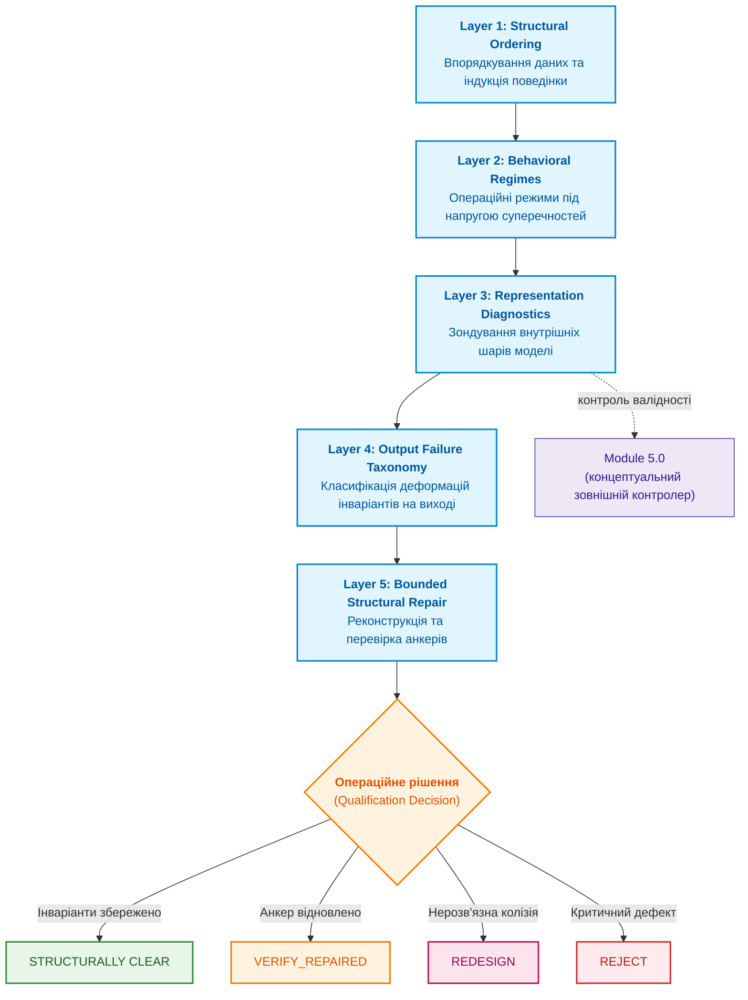

Це дослідницька схема, а не специфікація виконуваного компонента. Для `Module 5.0` не визначено вхідно-вихідного контракту, способу взаємодії з Layer 3 або впливу на рішення Layer 5; цей вузол не слід трактувати як реалізований контролер.

Функціональне призначення шарів конвеєра:

1. **Layer 1 (Structural ordering):** встановлює, як саме впорядкування та взаємне розташування навчальних пар контролює поведінку моделі в режимі жорсткого дефіциту даних (*low-data regime*);
2. **Layer 2 (Behavioral regimes):** визначає налаштовувані операційні режими моделі в умовах стресу від технічних та логічних суперечностей;
3. **Layer 3 (Representation diagnostics):** здійснює діагностичне зондування латентного простору репрезентацій. Пунктирний зв'язок із концептуальним `Module 5.0` позначає дослідницьке питання про структурне вузьке місце (*structural bottleneck*) між представленням і доменом виводу, а не визначений контролер виконання;
4. **Layer 4 (Output failure taxonomy):** формалізує класифікацію структурних деформацій на рівні виходу (втрата знака, спотворення числових коефіцієнтів, термінологічний зсув);
5. **Layer 5 (Bounded structural repair):** забезпечує класоорієнтовану детекцію та детерміноване відновлення пошкоджених анкерів із винесенням остаточного кваліфікаційного вердикту.

Система не покладається на суб'єктивну оцінку якості («чи гарно звучить формулювання»). Її кінцевий результат — не перефразований текст, а типізоване операційне рішення: допуск (`STRUCTURALLY CLEAR`), контрольний допуск після ремонту (`VERIFY_REPAIRED`), вимога зміни формулювання (`REDESIGN`) або відхилення (`REJECT`).

## 11. Прозорий інджест сирих знань: подолання бар'єра недовіри та інтерактивна візуалізація

У критичних інженерних доменах (автомобільна безпека ISO 26262, кібербезпека ISO 21434, авіоніка DO-178C) будь-яка експертна система стикається з жорстким, прагматичним скепсисом зовнішніх аудиторів. Коли розробники декларують «нульову галюцинацію» на закритих бінарних базах знань, у стороннього фахівця негайно виникає підозра щодо підгонки результатів під власні тести (*circular benchmark bias*) або наявності прихованого хардкоду. Без можливості наочно простежити, як саме машина сприймає довільний сирий документ, технологія ризикує сприйматися ринком як «доморощена конструкція», нездатна витримати суворий аудит.

Вирішенням цієї проблеми є застосування принципу **«Show, Don't Tell»** через спеціалізовані термінальні інструменти інтерактивного інджесту (TUI). Такий інструмент дозволяє аудитору завантажити власний, невідомий системі документ (довільний текстовий стандарт, корпоративну політику, технічні умови) і спостерігати за його розбором у реальному часі за моделлю подвійного бачення (**Dual-View: Людина vs Машина**):

1. **Лексико-синтаксична декомпозиція:**
   Користувач бачить, на які саме фрагменти й речення синтаксичний сегментатор поділив текст, як збережено непорушні байтові координати `[byte_start, byte_end]` та які лексичні метрики притаманні документу:
   - Обсяг словника та Type-Token Ratio ($`TTR = N_{\text{unique}} / N_{\text{tokens}}`$);
   - Інформаційна ентропія Шеннона ($`H = -\sum p_i \log_2 p_i`$), що свідчить про стилістичну складність тексту;
   - Розподіл довжини речень.

2. **Детерміністичне виділення деонтичних норм:**
   Система підсвічує в тексті нормативні маркери зобов'язань (`MUST`, `SHALL`), заборон (`MUST NOT`, `SHALL NOT`), рекомендацій (`SHOULD`) та дозволів (`MAY`). Аудитор наочно бачить, які атоми знань виділені виключно символічним синтаксичним аналізатором без участі ймовірнісних моделей.

3. **Аудит нейро-символічного стику (SLM Tracing):**
   Якщо в конвеєрі задіяна локальна SLM для розв'язання неоднозначностей або виділення неявних відношень, TUI відображає:
   - Дослівний промпт, сформований детерміністичним середовищем;
   - Сиру невідфільтровану відповідь нейромоделі;
   - Рішення детерміністичного фільтра хоста: чи підтверджується пропозиція моделі дослівним текстом першоджерела, чи вона відхилена через брак байтової кустодії.

4. **Машинне сприйняття фрагмента (Machine Perception):**
   При наведенні курсора на будь-яке речення людина бачить точну формулу знання, яку згенерувала машина: суб'єкт (актор), деонтичну модальність, предикат (дія) та криптографічний хеш SHA-256 цитати.

Такий підхід позбавляє інженерну команду необхідності виправдовуватися чи доводити відсутність маніпуляцій: зовнішній експерт особисто бачить наскрізний потік інформації від байта у файлі до нормативного факту, що перетворює систему з непрозорої «чорної скриньки» на відкритий аналітичний мікроскоп.

### 11.1. Атестація машинних знань (Machine Knowledge Attestation, MKA) та Сертифікат знань

На основі прозорого інджесту виникає самостійний доказовий інститут довіри — **Атестація машинних знань (Machine Knowledge Attestation, MKA)**.

> **Визначення (Атестація машинних знань):**
> *Атестація машинних знань* — це детерміністичний та криптографічно підтверджений процес формальної експертизи довільного першоджерела (стандарту, специфікації, кодексу), в результаті якого формується замкнена система видобутих онтологічних сутностей, деонтичних відношень та атомарних фактів із гарантією 100% байтової кустодії джерела ($ZHR = 1.000000, EGR = 1.000000$).

Результатом цієї процедури для кожного окремого документа є формальний **Сертифікат атестації машинних знань (MKA Certificate)**, що містить такі непорушні блоки:
1. **Паспорт цілісності першоджерела (Source Provenance & Custody):**
   - Унікальний ідентифікатор сертифіката (`MKA-<filename>-<sha256[:12]>`);
   - Повний байтовий розмір та контрольна сума першоджерела (SHA-256);
   - Режим проходження шлюзу допуску (`PASSED_FAIL_CLOSED_GATE_100%`);
   - Фіксація $ZHR = 1.000000$ (Zero-Hallucination Rate).
2. **Лексичний та ентропійний профіль:**
   - Кількість речень, токенів та слів;
   - Лексичне різноманіття ($TTR$) та інформаційна ентропія Шеннона ($H$), що засвідчує стилістичну та понятійну насиченість тексту.
3. **Деонтичний баланс та нормативна щільність:**
   - Нормативна щільність ($`ND = \frac{N_{\text{norms}}}{N_{\text{words}}} \times 1000`$);
   - Точний баланс зобов'язань ($MUST$), заборон ($MUST\ NOT$), рекомендацій ($SHOULD$) та дозволів ($MAY$).
4. **Реєстр виявлених сутностей (Discovered Entities & Actor Profiles):**
   - Перелік усіх виявлених акторів та системних компонентів;
   - Частотний розподіл та індивідуальний деонтичний профіль кожного суб'єкта (скільки саме обов'язків, заборон та дозволів на нього покладено документом);
   - Характерні нормативні дії.
5. **Реєстр виявлених відношень та предикатів (Discovered Relations & Actions):**
   - Предикати дій із зазначенням пов'язаних суб'єктів та модальностей.
6. **Реєстр атомарних фактів (Ground Atoms Register):**
   - Повний перелік сформованих фактів із дослівними цитатами, точними байтовими зміщеннями `[byte_start..byte_end]` та криптографічними хешами кожного текстового зрізу.

Наявність такого сертифіката дозволяє будь-якій регуляторній або сертифікаційній комісії провести миттєвий аудит машинних знань: або за допомогою термінального інструменту інспекції (`kp-ingest-tui -file <doc> -attest`), або через серійний машинний експорт у структурованому форматі JSON.

### 11.2. Таксономія предикатів знання: від деонтики до епістемології, інформатики та кібернетики

Початкові спроби формалізації нормативних текстів (зокрема в межах RFC 2119) спиралися виключно на три деонтичні модальності: *обов'язок* (`MUST`), *рекомендацію* (`SHOULD`) та *дозвіл* (`MAY`). Проте в інженерних специфікаціях, протоколах безпеки та наукових монографіях звуження семантичного аналізу лише до цих трьох дієслів є критичною помилкою: система відкидає до 70–80% концептуального каркаса документа як «нерелевантний контекст». Зокрема, твердження про структуру компонентів, математичні закони, алгоритмічні перетворення чи цикли зворотного зв'язку взагалі не містять деонтичних часток, але становлять ядро інженерного знання.

Доказова експертна система нового покоління впроваджує **п'ятивимірну онтологічну таксономію предикатів**, що охоплює філософію пізнання, теоретичну інформатику та кібернетику:

1. **Деонтичні норми (Deontic Modality — `MUST`, `FORB`, `SHLD`, `MAY`):**
   Регулюють правові та нормативні зобов'язання суб'єктів. Базуються на деонтичній логіці Ґ. фон Врігта (*Georg Henrik von Wright*). Визначають простір дозволених і заборонених станів системи.
2. **Епістемологічні та онтологічні предикати (Epistemic & Ontological — `SCIENTIFIC`):**
   Описують модус буття, істинність тверджень, математичні кореляції, причинно-наслідкові ланцюги та критерії демаркації знання:
   - *Предикати існування та сутності:* `exists`, `instantiates`, `constitutes`, `embodies`, `characterizes` (*«TLS складається з двох первинних компонентів»*);
   - *Предикати верифікації та фальсифікації (за К. Поппером):* `proves`, `falsifies`, `substantiates`, `refutes`, `verifies`, `demonstrates`, `deduces`, `hypothesizes`;
   - *Предикати логічного слідування та пресупозицій:* `implies`, `entails`, `presupposes`, `stipulates`, `postulates`.
3. **Обчислювальні предикати інформатики (Computational & Formal Systems — `COMPUTATIONAL`):**
   Описують детерміновану поведінку абстрактних автоматів, дискретні переходи станів, роботу з формальними граматиками та структурами даних:
   - *Теорія автоматів та обчислюваність:* `computes`, `decides`, `transitions`, `halts`, `reduces`, `parses`, `evaluates`;
   - *Трансформація даних і пам'ять:* `serializes`, `deserializes`, `encodes`, `decodes`, `hashes`, `indexes`, `allocates`, `compresses`.
4. **Кібернетичні предикати регулювання та системної динаміки (Cybernetic & Control — `CYBERNETIC`):**
   Описують функціонування складних систем в умовах збурень за канонами Н. Вінера та В. Р. Ешбі (*W. Ross Ashby*):
   - *Зворотний зв'язок і гомеостаз:* `regulates`, `stabilizes`, `balances`, `converges`, `diverges`, `oscillates`, `adapts`, `equilibrates`;
   - *Захист, обмеження та компенсація:* `throttles`, `compensates`, `quarantines`, `isolates`, `recovers`, `mitigates`, `arbitrates`, `audits`.
5. **Загально-інженерні та функціональні дії (Engineering Actions — `ACTION`):**
   Описують безпосередні фізичні та протокольні маніпуляції: `transmits`, `routes`, `forwards`, `connects`, `disconnects`, `triggers`, `dispatches`, `emits`.

> [!NOTE]
> **П'ять вимірів онтологічної таксономії предикатів інженерного знання (п'ять вимірів)**
> 1. Деонтичні норми (`MUST`, `FORB`, `SHLD`, `MAY`): регулювання правових і безпекових зобов'язань за логікою фон Врігта.
> 2. Епістемологічні предикати (`SCIENTIFIC`): фіксація критеріїв демаркації, фальсифікації за Поппером та логічного слідування.
> 3. Обчислювальні предикати (`COMPUTATIONAL`): опис переходів станів скінченних автоматів, десеріалізації та адресації пам'яті.
> 4. Кібернетичні предикати (`CYBERNETIC`): формалізація зворотного зв'язку, гомеостазу, адаптації та захисного дроселювання за Вінером і Ешбі.
> 5. Предикати фізичної дії (`ACTION`): прямі апаратні маніпуляції, маршрутизація пакетів, випромінювання та комутація сигналів.
> *Керування рантаймом / Інженерний інваріант:* компіляція у статичний хеш-атлас $O(1)$ гарантує субмілісекундну детерміновану класифікацію без залучення нейромереж.

**Порівняння з темпоральним підходом до модальностей у тексті.** С. Л. Кривий і Д. С. Бібіков для видобування знань з природномовного тексту подають модальності й часові залежності формулами лінійної темпоральної логіки, які далі транслюють у формули логіки першого порядку [[43]](#src-43). Як приклад вони наводять речення про доступ до спільної пам'яті: «До тех пор, пока нет запроса на доступ к общей памяти от некоторого процесса вычислений, до тех пор не будет разрешения на доступ к общей памяти» [[43]](#src-43). Таке подання зводить слово «дозвіл» до послідовності подій у часі (запит, потім доступ). Оператори «завжди», «поки не», «колись» виражають часову модальність, тоді як вимоги в таксономії цього розділу потребують деонтичних операторів обов'язку, заборони й дозволу. Тому темпоральна логіка може доповнювати деонтичну (для часових умов дії норми), але не замінює її.

#### 11.2.1. Високопродуктивна індексація через Топ-1000 лексичний атлас ($O(1)$)

Для забезпечення непорушності інваріанта продуктивності та відсутності накладних витрат під час обробки багатомегабайтних корпусів, лінійний перебір дієслів неприпустимий. Усі 1000+ типізованих двомовних лексем (включаючи флексії 3-ї особи однини, інфінітиви та форми доконаного/недоконаного виду) компілюються у статичний **лексичний хеш-атлас** (`Token Predicate Atlas`). Під час синтаксичного проходу кожне слово речення перевіряється в таблиці за $`\mathcal{O}(1)`$, що, за оцінкою автора на еталонному серверному вузлі x86-64, скорочує час повного семантичного аудиту RFC-документа обсягом понад 300 КБ до лічених мілісекунд при повному збереженні $ZHR = 1.000000$.

### 11.3. Розподіл праці: детермінований лінгвістичний аналізатор проти нейро-символічного радника (SLM)

У доказових експертних системах розподіл обов'язків між символічним парсером і статистичною мовною моделлю визначає, де формується кандидат, а де перевіряється право використати його як знання. Мовні моделі можуть втратити заперечення або числову межу, але допомагають розбирати семантичні варіації. Детермінований парсер відтворює заданий алгоритм; це не гарантує повноти граматики або правильності всіх її правил. Тому просте речення не отримує доказового статусу лише через відсутність виклику SLM.

Конвеєр підготовки знань реалізує дворівневий розподіл праці за принципом **«Детермінізм фіксує інваріанти — SLM пропонує гіпотези — Шлюз вирішує»**. Обидві траєкторії нижче формують лише кандидатний фрейм і сходяться до тих самих перевірок походження, змісту, застосовності та конфліктів. Перевіряється повний контракт матеріальних елементів для даного типу твердження: актанти, відношення, числа й одиниці, модальність, заперечення, квантори, умови, винятки та межі чинності; підтверджена відсутність певного елемента не тотожна його пропуску аналізатором.

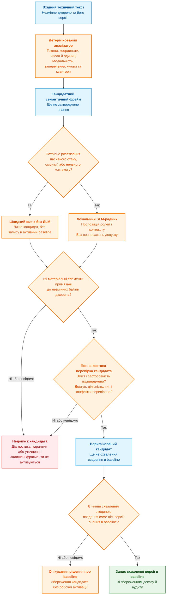

Присутність суб'єкта й дієслова у вихідних байтах є лише необхідною перевіркою опори, не достатньою умовою прийняття. Для джерела «Клапан не повинен відкриватися за перегріву» обидва кандидати — збережена заборона та підміна на «повинен відкриватися» — містять ті самі назви актантів і дії. Підміна полярності повинна відхилятися незалежно від того, який шлях сформував фрейм. Так само відхиляється кандидат, що зберіг слова, але змінив напругу застосування, одиницю, квантор чи виняток. Нерозв'язана неоднозначність не замінюється припущенням.

Перевірка під час інженерії знань використовує обов'язки походження, семантики й застосовності, розкриті в §6, але не підміняє їх буквальним викликом runtime-предиката `Admit` над ще не затвердженим кандидатом. Після включення знання в baseline відповідь на конкретний запит знову проходить `Admit` за вже схваленими підставами. Схвалення введення версії знання не є підписом людини на кожну наступну відповідь або дію; автоматичні перевірки застосування залишаються обов'язковими ([Глава 16, §1.1](ch16-expert-systems-architecture.md#11-канонічний-словник-вердиктів-рантайму-та-межі-повноважень)).

Модель NLI може надати калібрований статистичний сигнал, але її висока оцінка не доводить відповідності модальності чи умов джерелу. Для ASIL D статистичний сигнал не замінює повного детермінованого доказу в схваленій моделі. Оцінки часу лексичного розбору не є часом повного допуску: швидкий шлях економить виклик SLM, а не вартість обов'язкових перевірок, аудиту або погодження baseline.

#### 11.3.1. Матриця функціональної відповідальності

| Семантична / лінгвістична категорія | Що виявляє детермінований рушій ($< 1$ мкс за оцінкою автора) | Що делегується нейро-символічній SLM |
|---|---|---|
| **Фізичні величини та одиниці СІ** | Числа, експоненти, діапазони, одиниці системи СІ (`s`, `ms`, `octet`, `bit/s`, `V`, `Hz`, `°C`), оператори нерівності ($=, \le, \ge, \lt, \gt, \in [a, b]$). | Інтерпретація неформальних або розмовних описів розмірностей (*«затримка не довша за одне кліпання оком»*). |
| **Деонтичні норми** | Замкнений словник нормативних маркерів: `MUST`, `MUST NOT`, `SHALL`, `SHOULD`, `MAY`, `повинен`, `заборонено`, `слід`. | Виявлення прихованих зобов'язань у ненормативних формулюваннях (*«від сервера очікується...»*). |
| **Логічні умови та дефітери (Defeaters)** | Формальні синтаксичні зв'язки: `IF`, `UNLESS`, `EXCEPT WHEN`, `PROVIDED THAT`, `AND`, `OR`, `NOT`. | Оцінка семантичної сумісності складносурядних гіпотетичних конструкцій. |
| **Квантори ($\forall/\exists$)** | Маркери загальності та існування: `all`, `every`, `each`, `any`, `at least one`, `none`, `кожен`, `всі`, `жоден`. | Розрізнення колективного та дистрибутивного значення множин. |
| **Протокольні символи та константи** | Ідентифікатори `camelCase`, `snake_case`, `SCREAMING_SNAKE`, числові статуси (`503`, `404`), шістнадцяткові значення (`0x0304`). | Зв'язування числових кодів із текстовими описами помилок без явної таблиці. |
| **Синтаксична будова (SRL)** | Прямий суб'єктно-предикатний порядок слів (*«Client MUST send...»*). | Інверсія, пасивний стан, еліпсис (*«Upon receipt of X, there shall be emitted Y»*). |
| **Зняття омонімії (Disambiguation)** | Позиційний аналіз у межах активного `Scope`. | Контекстне розрізнення багатозначних лексем (`CAN` як шина чи допоміжне дієслово; `state` як стан чи висловлювання). |
| **Неявні пресупозиції** | Не підтримується (працює за замкненим світом). | Інференція логічних передумов (*«resuming a session»* $\implies$ попередня сесія була збережена). |

## 12. Стратифікація довіри до лексиконів і тезаурусів та асиметричний семантичний шлюз (Data Diode)

Коли інженер або оператор формулює запит природною мовою, він часто вживає розмовні синоніми, сленг або загальнотехнічні терміни з відкритих інтернет-джерел, яких буквально немає в суворому тексті нормативного стандарту (наприклад, запитує про *«перевірку живучості вузла»* замість канонічного терміна стандарту *«Watchdog Heartbeat Supervision»*). Якщо експертна система спиратиметься виключно на замкнений словник одного документа, вона страждатиме від **лексичної сліпоти** (*Lexical Blindness*). Якщо ж дозволити відкритим інтернет-словникам або хмарним мовним моделям вільно поповнювати базу знань, система миттєво порушить мандат нульової галюцинації ($`\mathrm{ZHR} = 1{,}00`$) і впустить у нормативне ядро недостовірні чи хибні інтерпретації (семантичне отруєння, *Semantic Drift*).

Для математично строгого розв'язання цієї дилеми автором адаптовано класичну формальну модель цілісності інформації Кеннета Біби (*Biba Integrity Model*, політика *«no read down / no write up»* [[36]](#src-36)) до комп'ютерної лексикографії та запроваджено **трирівневу стратифікацію лексичної довіри** з **асиметричним епістемічним діодом** (*Asymmetric Epistemic Data Diode*).

### 12.1. Формальна модель заземлення термінів та три ешелони лексиконів

Нехай $`\mathcal{W}`$ — простір усіх лексем і багатослівних зворотів природної мови, а $`\mathcal{C}_{\mathrm{sovereign}}`$ — множина канонічних концептів, індукованих безпосередньо з верифікованих першоджерел локального сховища знань. Кожне твердження (нормативне правило або факт) $`r \in \mathcal{R}`$ вважається **епістемічно заземленим** тоді й лише тоді, коли функція байтового анкерингу $`\mathcal{G}(r)`$ повертає непорожній криптографічно верифікований кортеж:

$$\mathcal{G}(r) = \langle \mathrm{DocHash}_{\mathrm{SHA256}}, \, b_{\mathrm{start}}, \, b_{\mathrm{end}}, \, \mathrm{QuoteHash}_{\mathrm{SHA256}} \rangle, \quad 0 \le b_{\mathrm{start}} < b_{\mathrm{end}} \le |\mathrm{Doc}|$$

Усі словникові ресурси системи жорстко поділяються на три ізольовані ешелони за рівнем епістемічної цілісності $`\mathcal{I} \in \{\mathrm{T0}, \mathrm{T1}, \mathrm{T2}\}`$ (де $`\mathrm{T0} \succ \mathrm{T1} \succ \mathrm{T2}`$):

| Ешелон довіри | Назва та джерело походження | Статус байтового анкерингу $`\mathcal{G}(w)`$ | Дозволена роль у рантаймі | Право генерувати норми чи факти (`Eligibility`) |
|---|---|---|---|---|
| **Tier 0 (`T0`)** | **Суверенний первинний лексикон** (*Sovereign Primary Lexicon*): терміни та дефініції, індуковані компілятором знань безпосередньо з локальних першоджерел (`Pass 1 ATR`) | $`\mathcal{G}(w) \ne \varnothing`$ (пряма побайтова цитата в першоджерелі) | Канонічний простір імен понять (`ConceptID`), побудова правил виведення та перевірка умов | **Дозволено** ($`\mathrm{Eligibility} = 1`$) |
| **Tier 1 (`T1`)** | **Куровані відкриті онтології** (*Curated Reference Ontologies*): версійовані академічні та галузеві тезауруси (WordNet [[37]](#src-37), Wikidata [[38]](#src-38), EuroVoc, UMLS, IEEE Thesaurus) з фіксованим криптографічним хешем знімка | Зовнішній URI + контрольна сума знімка ($`\mathcal{G}_{\mathrm{local}}(w) = \varnothing`$) | Розширення синонімічних кілець та гіперонімічна навігація під час розбору запиту користувача | **Заборонено** (лише `Relevance`) |
| **Tier 2 (`T2`)** | **Дорадчий зовнішній тезаурус** (*Advisory Extrinsic / Web-AI Thesaurus*): асоціативні зв'язки, евристичні переклади та підказки з пошукових систем, відкритого Інтернету або мовних моделей (LLM/SLM) | Відсутній ($`\mathcal{G}(w) = \varnothing`$, стохастична гіпотеза) | Евристичний переклад користувацького запиту на множину кандидатів із простору `T0` (`Query Expansion`) | **Суворо заборонено** (ізольований пісочницею) |

**Порівняння з українською традицією онтологічного інжинірингу.** У методиці проєктування предметних онтологій О. В. Палагіна, М. Г. Петренка й К. С. Малахова онтологію подано як трійку $`O=\langle X,R,F\rangle`$ концептів, відношень і функцій інтерпретації (окремий випадок функцій інтерпретації — глосарій) [[40]](#src-40). Автори прямо зазначають, що за відсутності в глосарії визначення поняття розробник онтології «сам определяет функцию интерпретации для этого понятия в соответствии со своими профессиональными знаниями» [[40]](#src-40). У доказовій архітектурі цей крок заборонений: термін набуває статусу $`\mathrm{T0}`$ лише за умови $`\mathcal{G}(w) \ne \varnothing`$, а судження розробника чи моделі підставою не є. Подібну межу окреслює й відкритість світу в теорії баз знань на основі дескриптивних логік: за формулюванням Г. І. Гогерчака, база знань є сукупністю всіх моделей, у яких виконуються її аксіоми, тому «відповідь на запит до бази знань завжди є підмножиною повної відповіді на поставлене природномовне запитання» [[41]](#src-41). Експертна система доказового класу в такому разі не повертає підмножину відповіді, а за правилом замкненої відмови повертає типізовану відмову. Подібний початковий крок закладено й у методиці С. Л. Кривого, Н. П. Дарчук та О. І. Провотара для аналізу текстів: першим етапом є фіксація предметної області, бо «сенс понять та відношень може бути різним в різних предметних областях», а сформована з тексту база знань є відкритою, оскільки нормалізоване подання знань виконується за умови, що «немає припущення про повноту цих знань» [[42]](#src-42). Це незалежно підтверджує принцип суверенності визначення в межах домену, але не замінює вимоги доказового заземлення. Це порівняння не є твердженням про розвиток згаданих праць: їхня мета (побудова онтологій і баз знань) відрізняється від мети цього розділу (допуск твердження до відповіді).

### 12.2. Асиметричний епістемічний шлюз та Закон непорушності суверенної дефініції

Зв'язок між зовнішніми словниками (`T1`/`T2`) та суверенним ядром (`T0`) підпорядковується математичному інваріанту **асиметричного семантичного діода** (адаптація інваріанта цілісності Біби [[36]](#src-36)): потік семантичних гіпотез може рухатися лише у напрямку **відображення вхідного запиту** на канонічні поняття `T0`, але ніколи не може модифікувати аксіоматику чи дефініції самого ядра `T0`:

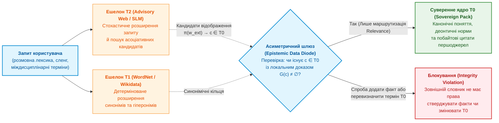

Формально робота шлюзу описується оператором проєкції запиту $`\Pi_{\mathrm{T2} \to \mathrm{T0}}`$. Нехай користувацький запит містить невідому для локального словника лексему $`w_{\mathrm{ext}} \notin \mathrm{Lex}(\mathrm{T0})`$. Зовнішній тезаурус `T1`/`T2` пропонує ранжований вектор кандидатів-синонімів $`\{(c_k, s_k)\}_{k=1}^K`$, де $`c_k \in \mathcal{C}_{\mathrm{sovereign}}`$ належить суверенному лексикону `T0`, а $`s_k \in (0, 1]`$ — оцінка лексичної близькості. Тоді результуюча вага активації концепту $`c_k`$ при пошуку релевантних правил обмежується понижувальним коефіцієнтом довіри ешелону $`\gamma(\mathcal{I})`$ (де $`\gamma(\mathrm{T0}) = 1{,}00`$, $`\gamma(\mathrm{T1}) = 0{,}85`$, $`\gamma(\mathrm{T2}) \le 0{,}60`$):

$$\mathrm{Score}_{\mathrm{relevance}}(c_k \mid w_{\mathrm{ext}}) = \gamma(\mathcal{I}) \cdot s_k \cdot \mathbb{I}\!\left(\mathcal{G}(c_k) \ne \varnothing\right)$$

При цьому виконуються два непорушні закони безпеки:

1. **Закон непорушності суверенної дефініції (*Sovereign Non-Override Law*):** якщо лексема $w$ вже має явне визначення в суверенному лексиконі `T0` ($`\exists c \in \mathrm{T0}: \mathrm{Label}(c) = w \land \mathcal{G}(c) \ne \varnothing`$), будь-яке альтернативне тлумачення цієї лексеми з ешелонів `T1` або `T2` автоматично блокується ($`\mathrm{Override}(w_{\mathrm{T1/T2}}, c_{\mathrm{T0}}) \equiv \bot`$). Наприклад, якщо в авіаційному стандарті термін `Bus` визначено як *«електрична шина живлення борту»*, жоден зовнішній тезаурус (навіть WordNet [[37]](#src-37), де першим значенням `bus` є *«пасажирський автобус»* [[39]](#src-39)) не має права підмінити чи розмити це поняття під час логічного виведення.
2. **Закон карантинної промоції (*Quarantined Promotion Protocol*):** жоден термін чи відношення з `T1`/`T2` не може перейти до рівня `T0` автоматично під час роботи системи; підвищення рівня довіри ($`\mathrm{T2} \to \mathrm{T0}`$) можливе виключно на етапі компіляції (`Compile-Time`), якщо компілятор знаходить для цього терміна пряме побайтове підтвердження $`\mathcal{G}(w) \ne \varnothing`$ у новому верифікованому документі першоджерела або інженер знань підписує відповідний сертифікат курування.

На практиці ця схема реалізується через **двоканальне підключення спеціалізованої української мовної моделі** (зокрема Lapa LLM [[15]](#src-15)) за епістемічним діодом. У першому, **офлайновому тракті (під час компіляції знань)**, модель допомагає автоматично збагачувати допоміжний словник ешелону `T2`: для англомовних чи вузькоспеціальних термінів стандарту вона пропонує українські інженерні еквіваленти, відмінкові форми та синоніми (наприклад, зв'язує *«Watchdog Timer»* із *«сторожовим таймером»* та *«контролем зависання»*), які записуються зі зниженою вагою довіри й обов'язково перевіряються на незалежній контрольній вибірці, щоб відсіяти хибні збіги. У другому, **онлайновому тракті (під час живого діалогу)**, коли користувач ставить запитання розмовною українською мовою або суржиком, модель перекладає його неформальні вислови у точний перелік канонічних понять суверенного ядра `T0`. Завдяки односторонньому діоду користувач отримує зручність вільного спілкування рідною мовою, а система зберігає абсолютну строгість: мовна модель лише підказує, в якій шухляді суверенного архіву `T0` шукати документ, але жодне її слово не може підмінити текст самого стандарту.

> [!NOTE]
> **Три правила стратифікації лексичної довіри та ізоляції зовнішніх словників (авторська модель Миколи Федчика, три правила)**
> 1. **Правило трирівневої стратифікації за цілісністю (Three-Tier Lexical Integrity):** усі лексичні джерела системи фізично розділяються на суверенний шар `T0` (індукований із першоджерел із побайтовою кастодією), курований шар `T1` (версійовані тезауруси) та дорадчий шар `T2` (евристики Інтернету та мовних моделей) без змішування у спільному табличному просторі.
> 2. **Правило одностороннього семантичного діода (Unidirectional Epistemic Data Diode):** зовнішні словники `T1`/`T2` мають право працювати виключно на вхідному боці розширення запитів (`Query Expansion / Relevance`), переводячи користувацькі синоніми у відомі поняття `T0`, але фізично позбавлені права стверджувати факти чи впливати на детермінований допуск (`Eligibility`).
> 3. **Правило абсолютного пріоритету локальної норми (Sovereign Definition Precedence):** за будь-якої колізії між загальномовним значенням слова у відкритому тезаурусі (`T1`/`T2`) та вузькоспеціальним визначенням у нормативному документі (`T0`) суверенна дефініція `T0` має абсолютний пріоритет і вимикає зовнішнє розширення для цього терміна.
> *Керування рантаймом / Інженерний інваріант:* якщо після розширення запиту через ешелони `T1`/`T2` жоден із запропонованих концептів-кандидатів не має підтвердженого факту в суверенному пакеті `T0` ($`\mathcal{G}(c) = \varnothing`$), система негайно повертає чесну відмову `REFUSAL (NO_SOVEREIGN_EVIDENCE)`, не дозволяючи генерувати відповідь із тексту самого зовнішнього словника.

### 12.3. Вагові матриці локальних моделей як голографічний тензор коваріації для генерації гіпотез

У традиційній практиці локальні мовні моделі (SLM) розглядаються або як чат-інтерфейси, або як парсери синтаксичних структур. Авторська методологія Миколи Федчика відкриває третю, значно глибшу функцію локальної моделі: використання її **вагової бази як статичного голографічного радара для виявлення похідних припущень**. Навчені матриці уваги та багатошарових перцептронів містять у стисненому вигляді мільярди непрямих асоціацій між технічними поняттями, які неможливо витягнути звичайним лексичним пошуком за ключовими словами.

Замість того щоб запускати авторегресійний цикл генерації тексту (який неминуче розмиває факти і породжує галюцинації), система звертається безпосередньо до векторних представлень концептів та реляційних зсувів у ваговій базі моделі, витягуючи з неї кандидати на міждоменні ізоморфні мости.

> [!NOTE]
> **Чотири принципи видобування похідних припущень із вагової бази локальних моделей (модель Миколи Федчика)**
> 1. **Відмова від авторегресійної балаканини на користь прямої геометрії ваг:** Локальна модель використовується не для написання текстових порад, а для обчислення векторних проекцій та реляційних зміщень між вузлами глобального онтологічного графа.
> 2. **Експлуатація латентної транзитивності другого і третього порядку:** Навіть за нульового перетину словників між двома інженерними стандартами вагова база моделі виявляє їхню спорідненість через спільні математичні патерни поведінки (насичення, гістерезис, зворотний зв'язок, взаємне блокування).
> 3. **Захист від ефекту колапсу антонімів у дистрибутивній семантиці:** Оскільки у ваговій базі мовних моделей взаємовиключні поняття («дозволено» і «заборонено», «нагрівання» і «охолодження») мають високу косинусну близькість через однакові синтаксичні контексти, вихід векторного радара обов'язково проходить через деонтичний фільтр.
> 4. **Локальність та детермінована відтворюваність зондування:** При фіксованій версії квантованих ваг та вирівняному сегменті вкладень в уніфікованій пам'яті (`UMA Embeddings`) операція векторного висунення гіпотез стає повністю відтворюваною і не залежить від випадкового зерна генерації (`temperature = 0`, прямий матричний добуток).
> *Інженерний інваріант:* Вагова база локальної моделі відповідає виключно за повноту охоплення можливих інженерних аналогій (Recall), тоді як 100% точності (Precision та $`ZHR = 1{,}00`$) забезпечується символьною верифікацією кожного висунутого припущення.

## 13. Категорійна передгрупова семантика DisCoCat та Універсальне Машинне Слово Знань (EIW-512)

Перехід від статистичних ембедингів та синтаксичних дерев до універсального машинного представлення знань вимагає математичного мосту, який є одночасно композиційним (значення складного судження обчислюється зі значень його частин), категорійно строгим (гарантує збереження логічних зв'язків та деонтичних модальностей) і апаратно ефективним (машинне представлення має завантажуватися в процесорні регістри без динамічного парсингу текстових рядків). Наївний підхід — збереження розпарсеного тексту у довільних JSON-структурах або реляційних рядках Datalog — зазнає краху при масштабуванні: накладні витрати на синтаксичну десеріалізацію в реальному часі перевищують час самої логічної резолюції на порядки, а відсутність строгих обмежень на розмірності фізичних величин призводить до семантичних розривів та прихованих відмов.

### 13.1. Передгрупові граматики Ламбека та категорійна дистрибутивна семантика (DisCoCat)

Замість розгляду речення як неупорядкованого «мішка слів» або неструктурованого вектора токенів, у доказових експертних системах застосовується апарат передгрупових граматик Ламбека (Pregroup Grammars) та категорійної композиційної дистрибутивної семантики (`DisCoCat`).

Передгрупою називається частково впорядкований моноїд $`(\mathcal{P}, \cdot, 1, \le)`$, де кожен базовий тип $`p \in \mathcal{P}`$ володіє лівим $p^l$ та правим $p^r$ спряженими елементами, що задовольняють співвідношення скорочення:

$$p \cdot p^r \le 1 \le p^r \cdot p, \qquad p^l \cdot p \le 1 \le p \cdot p^l$$

Граматичний розбір нормативного речення formalize-трансформується у строго моноїдальний функтор:

$$\mathcal{F}: \mathbf{Pregroup}_{\mathrm{syntax}} \to \mathbf{Rel}_{\mathrm{EIR}}$$

який автоматично згортає дерево синтаксичних залежностей (Universal Dependencies) безпосередньо у типізований реляційний морфізм. Іменникові фрази відображаються у векторні простори сутностей, а дієслова та деонтичні модальності — у тензори відповідного рангу, що гарантує збереження кванторів загальності та умовних винятків.

### 13.2. Специфікація Універсального Машинного Слова Знань (Epistemic Instruction Word — EIW-512)

Аналогічно до того, як байткод LLVM IR об'єднав десятки мов програмування та процесорних архітектур, у доказовій експертній системі одиницею машинного знання виступає інваріантний 8-компонентний бінарний атом — **Epistemic Instruction Word (`EIW-512`)**, розмір якого становить рівно 64 байти (512 біт), що точно відповідає розміру однієї апаратної кеш-лінії сучасних мікропроцесорів:

$$\mathrm{EIW}_{512} = \Bigl\langle \mathrm{SubjID}_{64\text{b}},\; \mathrm{RelOp}_{16\text{b}},\; \mathrm{Modality}_{8\text{b}},\; \mathrm{Polarity}_{8\text{b}},\; \mathrm{DimSI}_{64\text{b}},\; [\mathrm{ValMin}, \mathrm{ValMax}]_{128\text{b}},\; \mathrm{CtxMask}_{128\text{b}},\; \mathrm{CustodyPtr}_{96\text{b}} \Bigr\rangle$$

Структура полів машинного слова забезпечує повноту представлення та апаратне вирівнювання:

1. $`\mathrm{SubjID}_{64\text{b}}`$: 64-бітний глобальний унікальний ідентифікатор суб'єкта або фізичної сутності (хеш FNV-1a канонічного URI);
2. $`\mathrm{RelOp}_{16\text{b}}`$: 16-бітний код реляційного оператора ($`\le, \ge, =, \in, \mathrm{is\_a}, \mathrm{part\_of}, \mathrm{causes}`$);
3. $`\mathrm{Modality}_{8\text{b}}`$: 8-бітний деонтичний код модальності ($`\mathcal{D}_5 \in \{\mathbf{O}, \mathbf{F}, \mathbf{P}, \mathbf{C}, \mathbf{D}\}`$ — зобов'язання, заборона, дозвіл, умова, дефітер);
4. $`\mathrm{Polarity}_{8\text{b}}`$: 8-бітний статус істинності за логікою Белнапа ($`\mathcal{B}_4 \in \{\mathbf{T}, \mathbf{F}, \mathbf{B}, \mathbf{N}\}`$);
5. $`\mathrm{DimSI}_{64\text{b}}`$: вектор степенів базових одиниць системи SI ($`[m, l, t, I, \Theta, n, J, \text{info}] \in \mathbb{Z}_8^8`$);
6. $`[\mathrm{ValMin}, \mathrm{ValMax}]_{128\text{b}}`$: пара 64-бітних чисел із плаваючою комою (IEEE 754 float64), що задають допустимий інтервал значень величини;
7. $`\mathrm{CtxMask}_{128\text{b}}`$: 128-бітна бітова маска умов експлуатації та передумов спрацьовування правила;
8. $`\mathrm{CustodyPtr}_{96\text{b}}`$: 96-бітний дескриптор першоджерела (32-бітний ідентифікатор пакета знань `PackID`, 32-бітний початковий зміщення `ByteStart` та 32-бітний кінцевий зміщення `ByteEnd` у вихідному файлі).

> [!NOTE]
> **Чотири рівні математичної трансляції людського документа в Універсальну Машинну Мову Знань (модель Миколи Федчика)**
> 1. **Категорійне передгрупове згортання синтаксису (DisCoCat-рівень):** природномовні речення відображаються моноїдальним функтором $`\mathcal{F}: \mathbf{Pregroup}_{\mathrm{syntax}} \to \mathbf{Rel}_{\mathrm{EIR}}`$, перетворюючи синтаксичні залежності Universal Dependencies на композитні тензорні зв'язки без втрати кванторів та деонтичних модифікаторів.
> 2. **Композиція скінченних трансдьюсерів над півкільцем походження (WFST-рівень):** лінгвістичні трансформації (точні морфологічні леми, деонтичні модальності, розбір одиниць UCUM) виконуються композицією зважених автоматів $`T_{\mathrm{lex}} \circ T_{\mathrm{morph}} \circ T_{\mathrm{SI}} \circ T_{\mathrm{deontic}}`$ за лінійний час $`O(\lvert \text{текст} \rvert)`$ із наскрізною передачею координат вихідних байтів `%ebx`.
> 3. **Індукція решіток понять та базису Дюкамена–Гіге (FCA-рівень):** на базі бінарного контексту сутностей та атрибутів операторами замикання Галуа будується повна решітка понять $`\mathfrak{B}(\mathcal{O}, \mathcal{A}, \mathcal{I})`$, що автоматично виводить таксономію класів і мінімальний ненадлишковий базис продукційних правил без заздалегідь заданого людиною тезауруса.
> 4. **Кеш-лінійне бінарне пакування в атомарні інструкції (EIW-512-рівень):** синтезовані знання вирівнюються в пам'яті по 64-байтових границях у форматі `EIW-512` з фіксованими бітовими полями розмірностей SI, контекстних масок і вказівників кустодії, уможливлюючи безпосередню обробку векторами SIMD та матричними співпроцесорами.

**Імператив замкненого циклу розрахунку (Actionable Closed Loop):**

1. **Керування рантаймом і потоком обчислень (Control Flow & Runtime Decisions):**
   Ядро виконання транслює вхідний стан датчиків або параметрів запиту в бітовий вектор контексту. Компаратор співпроцесора виконує побітове маскування: якщо `(RuntimeContext & CtxMask) != CtxMask`, інструкція `EIW-512` відкидається за 1 такт інструкцією `VPTEST`. Якщо контекст активний, деонтичне поле `Modality` скеровує потік: код `OBLIGATION` передає значення на валідацію інтервалу $`[\mathrm{ValMin}, \mathrm{ValMax}]`$, а у разі виходу за межі генерується вердикт порушення з негайною фіксацією доказового вказівника `CustodyPtr`.
2. **Апаратний сайзинг та інфраструктурні обмеження (Hardware Dimensioning):**
   Формат `EIW-512` строго зафіксований на рівні $`64\,\text{байтів}`$ (512 біт), що точно відповідає довжині рядка кеш-пам'яті рівня L1/L2 сучасних процесорів x86-64 та ARM64. Це повністю усуває затримки через розщеплення кеш-ліній (*unaligned split cache miss*). Повний корпус вимог авіоніки із $10\,000$ продукційних правил займає рівно $`640\,\text{КБ}`$ пам'яті, цілком уміщуючись у кеш L2, що забезпечує швидкість лінійного сканування понад $`120\,\text{ГБ/с}`$ ($`1{,}8 \times 10^9`$ перевірених правил на секунду на одне процесорне ядро).
3. **Практичний числовий приклад (Worked Numerical Example):**
   Аналізується норма стандарту DO-160G: «Напруга постійного струму на клемах шини живлення повинна підтримуватися в межах від $`22{,}0`$ до $`29{,}5\,\text{В}`$ у нормальному режимі польоту».
   - `SubjID`: `0x9E3F_11A0_4C21_0042` (хеш сутності `DC_MAIN_BUS_VOLTAGE`);
   - `RelOp`: `0x0003` (оператор `IN_RANGE`);
   - `Modality`: `0x01` (`OBLIGATION`);
   - `Polarity`: `0x01` (`TRUE`);
   - `DimSI`: степені базових одиниць SI $[0, 2, -3, -1, 0, 0, 0, 0]$ (розмірність напруги Вольт: $`\text{м}^2\cdot\text{кг}\cdot\text{с}^{-3}\cdot\text{А}^{-1}`$);
   - `[ValMin, ValMax]`: `[22.0_f64, 29.5_f64]` (128 біт);
   - `CtxMask`: `0x0000_0000_0000_0001` (режим `NORMAL_FLIGHT`);
   - `CustodyPtr`: `[PackID: 0x0000_003A, ByteStart: 0x0000_4E10, ByteEnd: 0x0000_4E82]` (байти 20000–20114 файла `DO-160G.pdf`).
   - Якщо датчик фіксує падіння до $`21{,}4\,\text{В}`$, логічний вузол миттєво повертає статус `FAIL_CLOSED_VIOLATION` разом із побайтовим сертифікатом доказовості.

## Висновки

Глава почалася із запитання, як побудувати мовну підсистему, що розуміє різні формулювання людини, але стверджує лише відтворюване з байтів джерела. Відповідь така: мовна підсистема розширює коло формулювань, які експертна система сприймає від людини, і водночас звужує множину тверджень експертної системи до тих, що спираються на конкретні незмінні байти першоджерела. Для цього кожне перетворення тексту зберігає карту походження, кожен компонент має обмежені повноваження, зовнішні словники (`T1`/`T2`) відділені від суверенного лексикону (`T0`) одностороннім семантичним діодом за моделлю цілісності Біби, схожість лише впорядковує кандидатів, а рішення про допуск ухвалює детермінований верифікатор за маніфестами, хешами, картами походження й правилами доступу.

Межі підходу теж визначені. Токенізація залежить від мови й моделі, тож бюджет контексту й карти вирівнювання перевіряють на власному корпусі. Мовна модель і відкриті інтернет-словники ненадійні на вузькоспеціальних інженерних документах, тому вони ніколи не є джерелом знань і не можуть перевизначати дефініції суверенного ядра `T0`. Кожне оновлення моделі чи квантування є новим кандидатом, який проходить повну перевірку. Як долати варіативність мови під час перетворення запитання на однозначні предикати виведення, розглядає [Глава 13](ch13-language-variability-vs-determinism.md).

## Словник
| Український термін | Англійський відповідник | Коротке пояснення |
|---|---|---|
| Карта джерела | *source map* | Відображення фрагментів похідного тексту на байти першоджерела |
| Кодова позиція | *code point* | Числовий код символу в Unicode |
| Кластер графем | *grapheme cluster* | Послідовність кодових позицій, яку людина сприймає як один символ |
| Нормалізація Unicode | *Unicode normalization* | Приведення різних кодувань того самого тексту до канонічної форми |
| Вирівнювання | *alignment* | Збережене відношення між позиціями до й після перетворення тексту |
| Токенізатор | *tokenizer* | Програма, що ділить текст на токени словника моделі |
| Фертильність токенізатора | *tokenizer fertility* | Середня кількість токенів на одне слово |
| Логічне слідування | *natural language inference* | Оцінка, чи випливає твердження з фрагмента тексту, суперечить йому чи не пов'язане |
| Злиття обернених рангів | *reciprocal rank fusion* | Об'єднання кількох ранжованих списків за оберненими рангами |
| Непрямі вбудовані інструкції | *indirect prompt injection* | Інструкції для моделі, приховані в даних, які застосунок обробляє |
| Зсув розподілу | *distribution shift* | Відмінність даних під час використання від навчальних даних |
| Слабка розмітка | *weak supervision* | Навчальні мітки від евристик, які можуть утримуватися або помилятися |
| Активне навчання | *active learning* | Добір наступних прикладів для експертної розмітки |
| Конформне прогнозування | *conformal prediction* | Побудова множин прогнозів із гарантіями покриття за визначених передумов |
| Кеш ключів і значень | *KV cache* | Збережені проміжні подання уваги, що ростуть із довжиною контексту |
| Квантування | *quantization* | Подання ваг моделі числами меншої розрядності |
| Верифікатор на хості | *host verifier* | Детермінований компонент, що ухвалює рішення про допуск твердження |
| Атестація машинних знань | *Machine Knowledge Attestation* | Детерміністичний процес аудиту та паспортизації видобутих фактів і сутностей із гарантією 100% байтової кустодії |
| Сертифікат атестації знань | *MKA Certificate* | Структурований паспорт знань із криптографічним хешем першоджерела, реєстрами сутностей, відношень і деонтичних норм |
| Стратифікація лексичної довіри | *lexical trust stratification* | Поділ словникових ресурсів за рівнем епістемічної цілісності на суверенний (`T0`), курований (`T1`) та дорадчий (`T2`) ешелони |
| Суверенний первинний лексикон | *sovereign primary lexicon* | Множина понять і дефініцій (`T0`), видобутих безпосередньо з локальних першоджерел із побайтовим анкерингом |
| Асиметричний епістемічний діод | *asymmetric epistemic data diode* | Односторонній шлюз, що дозволяє зовнішнім словникам розширювати вхідні запити до понять `T0`, але забороняє змінювати чи стверджувати факти |

## Абревіатури
| Скорочення | Розшифрування | Значення |
|---|---|---|
| AST | Abstract Syntax Tree | абстрактне синтаксичне дерево для формального представлення виразів і предикатів |
| CUDA | Compute Unified Device Architecture | платформа обчислень на графічних процесорах NVIDIA |
| GBNF | GGML Backus–Naur Form | формат граматичних правил для покрокового маскування логітів при генерації |
| GGUF | назва формату файлів ggml | формат зберігання квантованих моделей для llama.cpp |
| MKA | Machine Knowledge Attestation | атестація машинних знань із гарантією повної кустодії джерела |
| NFC, NFKC | Normalization Form C, Normalization Form KC | канонічна й сумісна форми нормалізації Unicode зі складанням |
| NLI | Natural Language Inference | логічне слідування природною мовою |
| PDF | Portable Document Format | формат документів |
| RAG | Retrieval-Augmented Generation | генерація з пошуковим доповненням |
| REST API | Representational State Transfer Application Programming Interface | програмний інтерфейс поверх HTTP |
| ROCm | Radeon Open Compute | платформа обчислень на графічних процесорах AMD |
| RRF | Reciprocal Rank Fusion | злиття обернених рангів |
| SRL | Semantic Role Labeling | автоматичне розмічування семантичних ролей (актор, дія, об'єкт) у реченні |
| UAX | Unicode Standard Annex | додаток до стандарту Unicode |
| UTS | Unicode Technical Standard | технічний стандарт Unicode |
| UTF-8, UTF-16 | Unicode Transformation Format | способи кодування кодових позицій байтами |

## Джерела
1. <a id="src-1"></a>Unicode Consortium. [*UAX #15: Unicode Normalization Forms*](https://www.unicode.org/reports/tr15/). Unicode Standard Annex.
2. <a id="src-2"></a>Unicode Consortium. [*UAX #29: Unicode Text Segmentation*](https://www.unicode.org/reports/tr29/). Unicode Standard Annex.
3. <a id="src-3"></a>Nicholas Boucher, Ross Anderson. [*Trojan Source: Invisible Vulnerabilities*](https://www.usenix.org/conference/usenixsecurity23/presentation/boucher). *32nd USENIX Security Symposium*, 2023.
4. <a id="src-4"></a>Unicode Consortium. [*UTS #39: Unicode Security Mechanisms*](https://www.unicode.org/reports/tr39/). Unicode Technical Standard.
5. <a id="src-5"></a>Unicode Consortium. [*UAX #9: Unicode Bidirectional Algorithm*](https://www.unicode.org/reports/tr9/). Unicode Standard Annex.
6. <a id="src-6"></a>Kai Greshake, Sahar Abdelnabi, Shailesh Mishra, Christoph Endres та ін. [*Not What You've Signed Up For: Compromising Real-World LLM-Integrated Applications with Indirect Prompt Injection*](https://doi.org/10.1145/3605764.3623985). *Proceedings of the 16th ACM Workshop on Artificial Intelligence and Security*, 79–90, 2023.
7. <a id="src-7"></a>Marie-Catherine de Marneffe, Christopher D. Manning, Joakim Nivre, Daniel Zeman. [*Universal Dependencies*](https://doi.org/10.1162/coli_a_00402). *Computational Linguistics*, 47(2), 255–308, 2021.
8. <a id="src-8"></a>Nils Reimers, Iryna Gurevych. [*Sentence-BERT: Sentence Embeddings using Siamese BERT-Networks*](https://aclanthology.org/D19-1410/). *Proceedings of EMNLP-IJCNLP 2019*.
9. <a id="src-9"></a>Alexis Conneau, Ruty Rinott, Guillaume Lample, Adina Williams та ін. [*XNLI: Evaluating Cross-lingual Sentence Representations*](https://aclanthology.org/D18-1269/). *Proceedings of EMNLP 2018*.
10. <a id="src-10"></a>Phillip Rust, Jonas Pfeiffer, Ivan Vulić, Sebastian Ruder, Iryna Gurevych. [*How Good is Your Tokenizer? On the Monolingual Performance of Multilingual Language Models*](https://arxiv.org/abs/2012.15613). arXiv:2012.15613; *Proceedings of ACL-IJCNLP 2021*.
11. <a id="src-11"></a>Aleksandar Petrov, Emanuele La Malfa, Philip H. S. Torr, Adel Bibi. [*Language Model Tokenizers Introduce Unfairness Between Languages*](https://arxiv.org/abs/2305.15425). arXiv:2305.15425, 2023.
12. <a id="src-12"></a>Hugo Touvron, Thibaut Lavril, Gautier Izacard та ін. [*LLaMA: Open and Efficient Foundation Language Models*](https://arxiv.org/abs/2302.13971). arXiv:2302.13971, 2023.
13. <a id="src-13"></a>Albert Q. Jiang, Alexandre Sablayrolles, Arthur Mensch та ін. [*Mistral 7B*](https://arxiv.org/abs/2310.06825). arXiv:2310.06825, 2023.
14. <a id="src-14"></a>Gemma Team. [*Gemma: Open Models Based on Gemini Research and Technology*](https://arxiv.org/abs/2403.08295). arXiv:2403.08295, 2024.
15. <a id="src-15"></a>Lapa LLM. [*Lapa LLM v0.1.2 Instruct: model card*](https://huggingface.co/lapa-llm/lapa-v0.1.2-instruct); опис токенізатора: [*lapa-llm/tokenizer*](https://huggingface.co/lapa-llm/tokenizer). Hugging Face.
16. <a id="src-16"></a>Randall Balestriero, Jerome Pesenti, Yann LeCun. [*Learning in High Dimension Always Amounts to Extrapolation*](https://arxiv.org/abs/2110.09485). arXiv:2110.09485, 2021.
17. <a id="src-17"></a>Pang Wei Koh, Shiori Sagawa, Henrik Marklund та ін. [*WILDS: A Benchmark of in-the-Wild Distribution Shifts*](https://arxiv.org/abs/2012.07421). arXiv:2012.07421; *Proceedings of ICML 2021*.
18. <a id="src-18"></a>Woosuk Kwon, Zhuohan Li, Siyuan Zhuang, Ying Sheng та ін. [*Efficient Memory Management for Large Language Model Serving with PagedAttention*](https://doi.org/10.1145/3600006.3613165). *Proceedings of the 29th Symposium on Operating Systems Principles*, 611–626, 2023.
19. <a id="src-19"></a>Gordon V. Cormack, Charles L. A. Clarke, Stefan Buettcher. [*Reciprocal Rank Fusion Outperforms Condorcet and Individual Rank Learning Methods*](https://doi.org/10.1145/1571941.1572114). *Proceedings of SIGIR 2009*, 758–759, 2009.
20. <a id="src-20"></a>Patrick Lewis та ін. [*Retrieval-Augmented Generation for Knowledge-Intensive NLP Tasks*](https://arxiv.org/abs/2005.11401). *Advances in Neural Information Processing Systems 33* (NeurIPS 2020).
21. <a id="src-21"></a>Учасники Docling. [*Docling*](https://docling-project.github.io/docling/) і [*DoclingDocument*](https://docling-project.github.io/docling/concepts/docling_document/). Офіційна документація форматів, структури й походження елементів.
22. <a id="src-22"></a>Apache Software Foundation. [*Apache Tika*](https://tika.apache.org/). Офіційна документація вилучення тексту й метаданих.
23. <a id="src-23"></a>Alexander Ratner, Stephen H. Bach, Henry Ehrenberg, Jason Fries, Sen Wu, Christopher Ré. [*Snorkel: Rapid Training Data Creation with Weak Supervision*](https://arxiv.org/abs/1711.10160). *Proceedings of the VLDB Endowment*, 11(3), 269–282, 2017.
24. <a id="src-24"></a>Anastasios N. Angelopoulos, Stephen Bates. [*A Gentle Introduction to Conformal Prediction and Distribution-Free Uncertainty Quantification*](https://arxiv.org/abs/2107.07511). Препринт, 2021; редакція 2022.
25. <a id="src-25"></a>ggml-org. [*llama.cpp: LLM Inference in C/C++*](https://github.com/ggml-org/llama.cpp). Репозиторій GitHub.
26. <a id="src-26"></a>Ollama. [*Structured Outputs*](https://ollama.com/blog/structured-outputs). Блог Ollama.
27. <a id="src-27"></a>ml-explore. [*MLX LM: Run LLMs with MLX*](https://github.com/ml-explore/mlx-lm). Репозиторій GitHub.
28. <a id="src-28"></a>NVIDIA. [*TensorRT-LLM*](https://github.com/NVIDIA/TensorRT-LLM). Репозиторій GitHub.
29. <a id="src-29"></a>Microsoft. [*ONNX Runtime*](https://onnxruntime.ai/). Офіційний сайт.
30. <a id="src-30"></a>Benoit Jacob, Skirmantas Kligys, Bo Chen, Menglong Zhu та ін. [*Quantization and Training of Neural Networks for Efficient Integer-Arithmetic-Only Inference*](https://doi.org/10.1109/CVPR.2018.00286). *2018 IEEE/CVF Conference on Computer Vision and Pattern Recognition*, 2704–2713, 2018.
31. <a id="src-31"></a>Sewon Min, Kalpesh Krishna, Xinxi Lyu, Mike Lewis та ін. [*FActScore: Fine-grained Atomic Evaluation of Factual Precision in Long Form Text Generation*](https://aclanthology.org/2023.emnlp-main.741/). *Proceedings of EMNLP 2023*.
32. <a id="src-32"></a>Tianyu Gao, Howard Yen, Jiatong Yu, Danqi Chen. [*Enabling Large Language Models to Generate Text with Citations*](https://aclanthology.org/2023.emnlp-main.398/). *Proceedings of EMNLP 2023*.
33. <a id="src-33"></a>B. Efron. [*Bootstrap Methods: Another Look at the Jackknife*](https://doi.org/10.1214/aos/1176344552). *The Annals of Statistics*, 7(1), 1–26, 1979.
34. <a id="src-34"></a>Yurii Kuzmenko, Olena Trofimova. [*Structural Invariant Framework (SIF 1.0): A Registry-Based Framework for Empirically Verified Terminology Preservation in Neural EN→UA Translation of Metrological Standards*](https://doi.org/10.5281/zenodo.20509698). Zenodo, 2026.
35. <a id="src-35"></a>Yurii Kuzmenko, Olena Trofimova. [*Structural Invariant Framework in Low-Data Contradiction-Aware Neural Machine Translation: Architecture and Diagnostic Pipeline (v1.0)*](https://doi.org/10.5281/zenodo.19332453). Zenodo, 2026.
36. <a id="src-36"></a>Kenneth J. Biba. [*Integrity Considerations for Secure Computer Systems*](https://apps.dtic.mil/sti/citations/ADA039324). Technical Report MTR-3153, The MITRE Corporation; ESD-TR-76-372, USAF Electronic Systems Division, Bedford, MA, 1977.
37. <a id="src-37"></a>George A. Miller. [*WordNet: A Lexical Database for English*](https://doi.org/10.1145/219717.219748). *Communications of the ACM*, 38(11), 39–41, 1995.
38. <a id="src-38"></a>Denny Vrandečić, Markus Krötzsch. [*Wikidata: A Free Collaborative Knowledgebase*](https://doi.org/10.1145/2629489). *Communications of the ACM*, 57(10), 78–85, 2014.
39. <a id="src-39"></a>Christiane Fellbaum (ред.). [*WordNet: An Electronic Lexical Database*](https://mitpress.mit.edu/9780262561167/wordnet/). MIT Press, Cambridge, MA, 1998.
40. <a id="src-40"></a>А. В. Палагин, Н. Г. Петренко, К. С. Малахов. [*Методика проектирования онтологии предметной области*](https://arxiv.org/abs/1802.06769). *Комп'ютерні засоби, мережі та системи*, № 10, 2011.
41. <a id="src-41"></a>Г. І. Гогерчак. [*Застосування баз знань та дескриптивних логік до аналізу природномовних текстів*](https://doi.org/10.15407/pp2020.02-03.259). *Проблеми програмування*, № 2–3, 259–269, 2020.
42. <a id="src-42"></a>С. Л. Кривий, Н. П. Дарчук, О. І. Провотар. *Онтологоподібні системи аналізу природномовних текстів*. *Проблеми програмування*, № 2–3, 132–139, 2018.
43. <a id="src-43"></a>С. Л. Крывый, Д. С. Бибиков. *Итеративный подход к анализу естественно-языковых текстов: логический аспект*. *Проблеми програмування*, № 2–3, 2012.

---

[← Глава 11](ch11-knowledge-elicitation-from-experts.md) | [Зміст книги](README.md) | [Частина III](part-03-knowledge-engineering-nlp.md) | [Глава 14 →](ch14-requirements-detection-and-formalization.md)
