# Глава 12. Лінгвістичний аналіз і локальні моделі: збереження змісту та джерела

> **Книга:** [Архітектура доказових експертних систем](README.md) · [Частина III: Оцінювання вхідної інформації, здобуття знань та мовний аналіз](part-03-knowledge-engineering-nlp.md)
> **Попередня глава:** [Глава 11. Вилучення знань у експертів: інтерв'ювання, когнітивні карти та формалізація досвіду](ch11-knowledge-elicitation-from-experts.md)
> **Наступна глава:** [Глава 14. Виявлення вимог і модальностей: від нормативного тексту до інваріантів](ch14-requirements-detection-and-formalization.md)
> **Зміст книги:** [README.md](README.md)
> **Автор:** [Микола Мартинович Федчик](about-the-author.md)
> **Передумови читання:** рядки й байти, множини, логічні «і» та «не», прості дроби; складніші поняття вводяться перед застосуванням.
> **Очікувані результати:** простежувати шлях від фрази користувача до цитати в документі; розрізняти векторну схожість і логічний доказ; захищати текстовий конвеєр від підміни символів і вбудованих інструкцій; перевіряти локальну модель перед оновленням.

## Анотація

Мовний аналіз потрібен експертній системі, щоб перетворити людську вимогу на перевірний кандидат правила, не загубивши умову, заперечення чи джерело. У цій монографії автором запропоновано **концепцію байтової кустодії першоджерел у мовному тракті (Byte-Level Source Custody)**: кожна прийнята текстова опора має відтворюватися з незмінного документа. Це вимога до походження, а не гарантія розуміння: навіть точна цитата може бути неправильно витлумачена. Глава послідовно розглядає будову речення, карти походження, захист даних, добір моделей і перевірку кандидатів. Авторські моделі MKA та EIW-512 подано з їхніми межами, а не як готові універсальні сертифікат і формат.

Користувач запитує: «Яка мінімальна довжина заголовка?» У документі відповідь записано як `eight octets`. Експертна система може знайти це речення, але все одно помилитися: перетворити «октети» на «байти» без перевірки, загубити одиницю або процитувати іншу версію документа. Отже, розуміння мови починається не з великої моделі, а з уміння не втратити зміст і походження тексту.

Правильна відповідь у цьому прикладі не є голим `8` і не є автоматично «8 байтів». Вона містить значення, оригінальну одиницю, умову, за якої правило чинне, і точний фрагмент дозволеної версії документа. Саме повний ланцюжок, а не гарне перефразування, робить відповідь експертної системи перевірюваною.

Звідси головне запитання глави: **як побудувати мовну підсистему, яка розуміє різні формулювання людини, але стверджує лише те, що можна відтворити з байтів джерела?** Теза глави: мовна підсистема має бути гібридною. Детермінований код відповідає за байти, координати й правила доступу, синтаксичний аналізатор пропонує форму й будову речення, моделі знаходять схожі фрагменти й перевіряють вузькі твердження, мовна модель допомагає перефразувати запитання. До відповіді потрапляє лише те, що окрема перевірка може відтворити з доказу.

Наскрізний навчальний документ цієї глави містить вимогу **R-12**: «За перегріву контролер повинен вимкнути нагрівач не пізніше ніж через 20 мс після сигналу датчика». Це створений для пояснення текст, не цитата стандарту. Запит «Як швидко вимикається нагрівач?» потребує уточнення режиму; після уточнення «за перегріву» відповідь має зберегти початкову подію, межу 20 мс і модальність обов'язку. Фраза не повідомляє, чи реальний контролер виконав вимогу: для цього потрібен окремий результат випробування.

> **Межа практичного досвіду.** У локальних прототипах автора траплялися втрата одиниць, руйнування складених токенів і розбіжність між координатами, які повертає модель, і байтами джерела. Без відкритих сирих журналів і замороженого корпусу це інженерне спостереження, а не загальний результат вимірювання. Архітектуру й протокол нижче треба перевірити на власному корпусі знань.

## 1. Архітектурні засади мовного тракту: від людської репліки до права стверджувати

Архітектура мовного тракту має відповісти на два різні питання: «що, ймовірно, означає репліка?» і «на яких підставах дозволено відповісти?». Для R-12 перше питання допомагає знайти вимогу за словом «нагрівач», друге вимагає зберегти перегрів, відлік від сигналу й одиницю часу. Нагадаємо контракт [глави 2](ch02-epistemology-of-machine-knowledge.md): схожість не є доведенням, невідомість не є запереченням, а вимога не є виміряним фактом. У схемі нижче модель пропонує тлумачення, а окремий хостовий верифікатор перевіряє визначені правила й підстави; докладний шлях відповіді розвинуто в [главі 19](ch19-from-question-to-evidence.md).

<a id="obj-12-1"></a>

**Діаграма 12.1. Від байтів джерела до перевірки твердження**

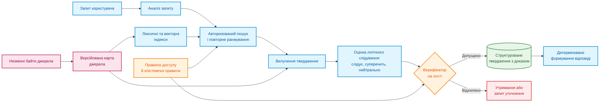

Схема розділяє змінні й незмінні частини. Етапи машинного навчання можна оновлювати. Незмінні байти, карта першоджерела, перевірка повноважень і умови допуску є стабільними інженерними межами. Оновлення токенізатора не має права непомітно змінити значення тексту чи прив'язку цитати.

У цій монографії автором запропоновано **інженерний принцип подвійної авторизації та успадкування міток доступу**: авторизацію виконують перед пошуком кандидатів і повторно перед допуском твердження. Недоступний фрагмент не можна спочатку передати моделі як контекст, а потім приховати цитату: зміст уже міг вплинути на генерацію. Твердження успадковує обмеження всіх вихідних матеріалів. Нейтральна відмова зменшує розкриття існування документа, але захист побічних каналів, зокрема часу відповіді, потребує окремої перевірки. Тепер розглянемо, які мовні ознаки потрібно зберегти всередині цього розподілу повноважень.

### 1.1. Шестирівневий лінгвістичний стек та класичний цикл NLP/NLU/NLG у доказових експертних системах

Обробка природної мови (Natural Language Processing, NLP) у mission-critical експертних системах покликана розв'язувати фундаментальну суперечність: людина формулює технічні вимоги, дефекти й регламенти багатозначною живою мовою, тоді як верифікатор вимагає строго типізованих предикатів логіки з непорушною прив'язкою до нормативних байтів. Наївне делегування цієї задачі універсальним мовним моделям, що передбачають наступний токен, призводить до тихих епістемічних аварій — від підміни інженерних термінів до зникнення часток заперечення («не запускати» $\to$ «запускати»).

Для R-12 потрібно спершу зберегти текст, потім запропонувати його структуру і лише після перевірки сформувати відповідь. Цим трьом задачам відповідають наведені нижче складові; сама класифікація не гарантує повноти аналізу:
1. **Попередня обробка тексту (Text Preprocessing):** детермінована нормалізація символів (NFC/NFKC), виявлення гомогліфів та шкідливих ін'єкцій, виділення меж речень і токенів із суворим збереженням технічних ідентифікаторів (наприклад, позначень стандартів на кшталт `ISO/IEC 61508-3:2010`).
2. **Розуміння природної мови (Natural Language Understanding, NLU):** глибока покрокова інтерпретація синтаксичної та семантичної структури тексту, розпізнавання сутностей предметної області (Domain Named Entity Recognition, NER) та екстракція реляційних фактів.
3. **Генерація природної мови (Natural Language Generation, NLG):** формування пояснення з перевіреного подання. Для R-12 шаблон повертає «не пізніше ніж через 20 мс після сигналу, за перегріву», не додаючи твердження про фактичне спрацювання пристрою.

Ця функціональна тріада функціонує поверх шести рівнів організації людської мови, кожен із яких відповідає за власний інваріант у тракті прийняття рішень.

<a id="obj-12-2"></a>

**Діаграма 12.2. Шість рівнів мовного аналізу**

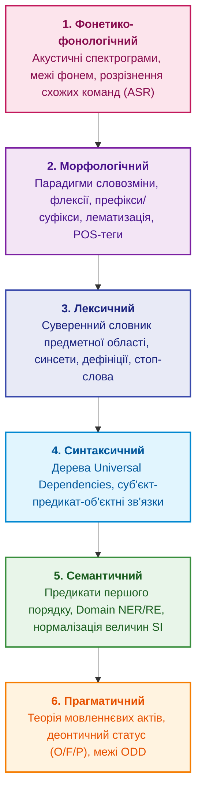

> [!NOTE]
> **Шість лінгвістичних рівнів інженерного тракту розуміння мови (авторський синтез)**
> 1. **Фонетико-фонологічний рівень:** Для голосового входу розпізнає звуки й пропонує текст; акустично подібні команди потребують окремих тестів. Для письмової R-12 цей рівень не виконується.
> 2. **Морфологічний рівень:** Здійснює аналіз внутрішньої будови слів, флексій та граматичних маркерів, зберігаючи відмінкові зв'язки флективних мов і запобігаючи руйнуванню актантних ролей при підсловній BPE-токенізації.
> 3. **Лексичний рівень:** Зіставляє виділені лексеми із суверенним нормативним тезаурусом предметної області, відсікаючи неінформативні стоп-слова, але зберігаючи деонтичні та логічні модифікатори («тільки», «ніколи», «не менше»).
> 4. **Синтаксичний рівень:** Пропонує дерево залежностей між словами; схема Universal Dependencies визначає назви зв'язків, але не гарантує правильності конкретного розбору або семантичних ролей.
> 5. **Семантичний рівень:** Транслює синтаксичну структуру у формальні предикати логіки та реляційні факти, розпізнає сутності предметної області (Domain NER) та виконує приведення фізичних величин до канонічних одиниць SI.
> 6. **Прагматичний рівень:** Пропонує інтерпретацію мовленнєвого акту: повідомлення, запит або наказ. Контекст допомагає визначити намір, але правомочність і область застосування окремо перевіряє верифікатор, не лінгвістична мітка.

У R-12 морфологія пов'язує «контролер» із називним відмінком, синтаксис — із дією «вимкнути», семантика додає межу часу, а прагматика відрізняє запит про вимогу від наказу пристрою. Жоден рівень окремо цього не забезпечує. Далі почнемо з відмінків, бо помилка виконавця робить решту фрейму непридатною.

### 1.2. Морфологічний процесинг синтетичних і флективних мов: подолання деградації токенізації

Морфологічний аналіз допомагає з'ясувати, хто діє і на що спрямовано дію. У флективних мовах, зокрема українській, закінчення є важливою підказкою, але не повним визначенням ролі: «нагрівач» може мати однакову форму називного й знахідного відмінків. У R-12 роль об'єкта встановлюють разом зі зв'язком із дієсловом. Англійська також має словозміну, тому протиставлення мов тут стосується міри й способу вираження зв'язків, а не наявності чи відсутності граматики.

Підсловне розбиття BPE поділяє слово за засвоєним словником фрагментів; воно не видаляє закінчення саме по собі. Ризик виникає, якщо подальший аналіз або генерація губить фрагмент чи неправильно тлумачить словоформу. Перевірка зворотності токенізації в §2 відділить втрату тексту від помилки його інтерпретації.

Скінченний перетворювач (FST) може перелічити словникові розбори, а префіксне дерево DAT — прискорити доступ до них. Це структури пошуку, не розв'язання омонімії. Авторська модель нижче відділяє множину допустимих розборів від їхнього контекстного ранжування: результатом є множина найкращих кандидатів, можливо з нічиєю, а не автоматично істинна лема.

<a id="obj-12-3"></a>

**Формула (12.3). Контекстне ранжування морфологічних кандидатів**

$$
\mu(w) = \underset{\langle \ell,\mathbf{g}\rangle\in\Omega(w)}{\arg\max}\; a(\ell,\mathbf{g};K)
$$

де:
- $w$ — скінченний рядок словоформи; $\Omega(w)$ — скінченна множина словникових пар «лема, ознаки»; для невідомого слова вона може бути порожньою, тоді результат не визначено й потрібне уточнення;
- $\ell$ — лема, тобто словникова форма; $\mathbf{g}$ — запис доступних категоріальних ознак: відмінка, роду, числа, часу чи способу; незастосовні до частини мови ознаки не заповнюють вигаданими значеннями;
- $K$ — вибраний контекст речення; $a$ — безрозмірний бал сумісності від 0 до 1, не обов'язково калібрована ймовірність;
- $\arg\max$ повертає всі пари з найбільшим балом; усі множини та категорії безрозмірні.

Якщо для «нагрівач» задано два розбори з балами 0,5 і 0,5, вибору немає. За балів 0,3 і 0,7 знахідний відмінок стає найкращою гіпотезою, але не доведеним фактом. У профілі з автоматичним вибором потрібні окремо визначені умови приймання; сам максимум їх не задає.

При трансляції виділеного актанта в семантичний фрейм предикатної логіки $`\mathcal{F} = \langle \mathrm{Predicate}, \mathrm{Agent}, \mathrm{Patient}, \mathrm{Instrument}, \mathrm{Modifier} \rangle`$ семантична роль призначається на основі перетину синтаксичної залежності $`\mathrm{dep}(w)`$ та морфологічного відмінка $c$:

<a id="obj-12-4"></a>

**Формула (12.4). Обмежене відображення відмінка й залежності у роль**

$$
\mathrm{Role}(w) = \begin{cases} \mathrm{Agent}, & \text{якщо } c = \mathrm{Nom} \land \mathrm{dep}(w) \in \{\mathtt{nsubj}, \mathtt{csubj}\}, \\ \mathrm{Patient}, & \text{якщо } (c = \mathrm{Acc} \land \mathrm{dep}(w) = \mathtt{obj}) \lor (c = \mathrm{Nom} \land \mathrm{dep}(w) = \mathtt{nsubj:pass}), \\ \mathrm{Instrument}, & \text{якщо } c = \mathrm{Ins} \land \mathrm{dep}(w) = \mathtt{obl}, \\ \mathrm{Modifier}, & \text{якщо } c = \mathrm{Gen} \land \mathrm{dep}(w) = \mathtt{nmod}, \\ \mathrm{Unmapped}, & \text{в усіх інших випадках}. \end{cases}
$$

де:
- $`\mathrm{Nom}, \mathrm{Acc}, \mathrm{Ins}, \mathrm{Gen}`$ — називний, знахідний, орудний та родовий відмінки відповідно;
- $`\mathtt{nsubj}, \mathtt{nsubj:pass}, \mathtt{obj}, \mathtt{obl}, \mathtt{nmod}`$ — типи відношень синтаксичних залежностей схеми Universal Dependencies, використані в цьому обмеженому відображенні.
- $c$ — вибраний відмінок слова $w$; $\mathrm{dep}(w)$ — мітка його зв'язку з головним словом; $\mathrm{Role}$ повертає одну з п'яти наведених категорій, без фізичних одиниць. Це часткове правило для навчальних конструкцій: граматичний підмет не завжди є семантичним агентом, а орудний відмінок не завжди означає інструмент.

**Імператив замкненого циклу розрахунку (Actionable Closed Loop):**

1. **Керування рантаймом і потоком обчислень (Control Flow & Runtime Decisions):**
   За порожньої множини або нічиєї процесор повертає `AMBIGUOUS_MORPHOLOGY`. Раніше наведений поріг 0,98 можна зберегти лише як налаштування конкретного відкаліброваного профілю, не універсальний поріг істинності. Непідтримана пара відмінка й залежності дає `Unmapped`; жодне з цих значень не допускає автоматичного запису правила.
2. **Апаратний сайзинг та інфраструктурні обмеження (Hardware Dimensioning):**
   Умовний словник із $250\,000$ інженерних лексем і понад $4.2 \times 10^6$ словоформ можна подати статичним префіксним деревом Double-Array Trie (DAT); оцінка $`M_{\mathrm{trie}} \le 24\,\text{МБ}`$ RAM потребує перевірки для конкретного формату кодування та набору метаданих. Цільовий час прямого розбору $`\tau_{\mathrm{morph}} = 1.4\,\mu\text{с}`$ на словоформу також потребує вимірювання на визначеній платформі. Кількість сторінок сама не задає кількості слів і часу: за суто ілюстративних $500$ слів на сторінку, $1000$ сторінок містять $500\,000$ словоформ, тобто послідовний розбір займає $`500\,000 \times 1.4\,\mu\text{с} = 700\,\text{мс}`$ на одному ядрі без урахування решти конвеєра. Межа $`45\,\text{мс}`$ потребувала б щонайменше 16 еквівалентних ядер за ідеального масштабування або окремого виміряного пакетного алгоритму; такої конфігурації чи вимірювання тут не задано. Тому числове значення не є гарантією часу обробки документа.
3. **Практичний числовий приклад (Worked Numerical Example):**
   Аналізується навчальне речення: «Оператор перекриває магістральний трубопровід захисним клапаном». За заданим синтаксичним розбором «оператор» має $`c = \mathrm{Nom}`$ і залежність $`\mathtt{nsubj}`$, «трубопровід» — $`c = \mathrm{Acc}`$ і $`\mathtt{obj}`$, а «клапаном» — $`c = \mathrm{Ins}`$ і $`\mathtt{obl}`$. Таблиця відповідно призначає ролі $`\mathrm{Agent}`$, $`\mathrm{Patient}`$ та $`\mathrm{Instrument}`$ і формує предикат $`\mathtt{shut\_off}(\mathrm{operator}, \mathrm{pipeline}, \mathrm{safety\_valve})`$. Це приклад роботи заданого відображення, а не доказ повноти морфологічного аналізу української мови.

**Діагностика: «Під капотом» проти «Панелі приладів» (Under the Hood vs Dashboard):**
- *Під капотом (Under the Hood):* У таблиці сеансу ядра системи фіксується внутрішня структура:
  ```json
  {
    "token": "клапаном",
    "lemma": "клапан",
    "pos": "NOUN",
    "morph": {"Case": "Ins", "Gender": "Masc", "Number": "Sing"},
   "dep_rel": "obl",
    "head_index": 2,
    "assigned_role": "Instrument",
   "coordinate_status": "requires_source_alignment"
  }
  ```
- *На панелі приладів інженера (Dashboard):* Візуалізуються призначені ролі з посиланнями на фрагменти: «Виконавець: [Оператор]; об'єкт впливу: [Магістральний трубопровід]; інструмент: [Клапан захисний]». Цей індикатор описує результат розбору, а не самостійну перевірку істинності.

У цьому прикладі `Ins` разом із `obl` дає `Instrument`. Підтип `obl:agent` позначає агента пасивної конструкції, а не автоматично інструмент; без окремого правила наведене відображення повертає `Unmapped`. Байтові координати не вигадуються з довжини слова: до побудови карти джерела запис залишається неприв'язаним.

### 1.3. Синтаксично-рольова нормалізація (SRL) та клаузальна декомпозиція нормативного дискурсу

Синтаксично-рольова нормалізація відповідає на наступне питання: як перейти від знайдених слів до кандидата цілого правила? У R-12 «не пізніше» обмежує час, а не заперечує вимкнення; «за перегріву» задає умову, а не другого виконавця. Поділ за комами чи короткими вікнами може втратити ці зв'язки. Пореченнєва сегментація корисна як перший крок, але сама не визначає сферу дії умов.

Спроба наївного розбиття речення за крапками чи комами призводить до так званої «клаузальної сліпоти»:
- Пасивний стан приховує реального виконавця дії ($`\mathrm{Agent}`$), підставляючи на місце суб'єкта пацієнс ($`\mathrm{Patient}`$);
- Спільні підмети й дії потребують розрізнення: «A і B разом піднімають вантаж» не означає, що кожен піднімає його окремо;
- Рестриктивні підрядні речення («сервер, який підтримує версію X...») помилково розглядаються як безумовні норми над усім класом сутностей;
- Заперечення при окремих актантах («no more than 4 octets», «to no external address») губляться або помилково інвертують позитивні предикати.

Для усунення цих системних дефектів автором запропоновано модель синтаксично-рольової нормалізації (Semantic Role Labeling, SRL) над типізованим проміжним представленням `Epistemic IR`, яка формалізує перехід від природної структури речення до канонічних епістемічних клауз:

> [!NOTE]
> **П'ять правил синтаксично-рольової канонізації нормативних речень (авторська модель)**
> 1. **Конверсія пасивної діатези в канонічну активну трійку:** Автором запропоновано детерміноване правило перетворення пасивних конструкцій ($`\mathrm{NP}_{\text{patient}} + \mathrm{Modal} + \text{be} + V_3 + \text{by} + \mathrm{NP}_{\text{agent}}`$) в активне представлення ($`\mathrm{Actor} := \mathrm{NP}_{\text{agent}}, \mathrm{Action} := \mathrm{Lemma}(V_3), \mathrm{Theme} := \mathrm{NP}_{\text{patient}}`$), що усуває сліпоту пошуку за виконавцем дії.
> 2. **Клаузальна декомпозиція:** Розроблено правило розщеплення лише за явно підтвердженого дистрибутивного значення: кожен із названих суб'єктів окремо виконує кожну дію. Колективні дії, винятки й числові діапазони не розщеплюють; усі породжені клаузи зберігають джерело та спільні умови.
> 3. **Виділення рестриктивних підрядних речень у типізовані передумови:** Конструкції з маркерами `that / which / who / який / що` всередині групи підмета відокремлюються від імені сутності та компілюються в імплікативні передумови допуску $`\mathrm{Precondition}(x) \implies \mathrm{Norm}(x)`$.
> 4. **Композиційний розбір конституентного заперечення та сфери дії кванторів:** Замість бінарної класифікації модального дієслова виконується аналіз заперечення при числівниках та об'єктах (`send no more than N` $`\implies \le N`$, `to no external host` $`\implies \mathrm{PROHIBITION}`$), а також зв'язування кванторів $`\forall, \exists`$ з конкретними актантами фрейму.
> 5. **Міжабзацна кореференція через таблицю символів дискурсу:** Для `it`, «він», «цей параметр» перелічуються сумісні попередні сутності. Найближча сутність є кандидатом, не гарантованим референтом; за кількох допустимих варіантів потрібне уточнення.
> *Керування рантаймом / Інженерний інваріант:* трансформація не змінює сирих байтів; кожна клауза зберігає інтервал джерела, контрольний хеш та посилання на успадковані умови.

Для R-12 результатом є кандидат: виконавець — контролер, дія — вимкнути, об'єкт — нагрівач, модальність — обов'язок, умова — перегрів, відлік — від сигналу датчика, верхня межа — 20 мс включно. «Контролер може вимкнути» не є еквівалентом: дозвіл слабший за обов'язок. «Не повинен вимкнути» змінює полярність, а «через 20 с» — одиницю. Ці контрприклади перевіряють зміст, але ще не походження; саме тому наступний розділ вводить карту джерела.

## 2. Збереження зв'язку між текстом і першоджерелом: карти походження та байти кустодії

Збереження джерела означає, що читач або програма може повторно отримати саме ту цитату, з якої утворено кандидат. «Позиція 42» недостатня: це може бути номер байта, символу чи токена. Автором запропоновано **шестирівневу таксономію координат тексту**: байти $B$, кодові позиції $C$, нормалізовані позиції $N$, графеми $G$, лінгвістичні фрагменти $L$ і токени доказу $`T_E`$. Кодовою позицією називають число Unicode, графемою — сприйманий як один знак кластер; це не завжди один байт чи один токен.

<a id="obj-12-5"></a>

**Діаграма 12.5. Системи координат тексту**

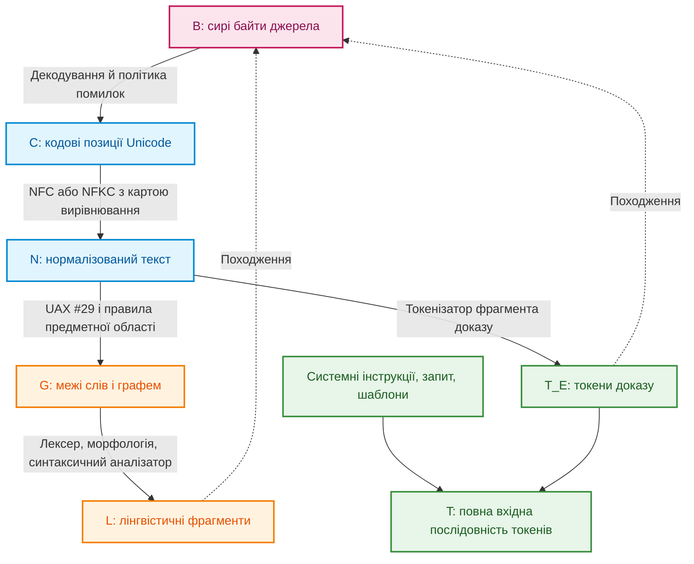

Кожне перетворення створює нове подання тексту й відношення походження. Нехай $`R_{X\leftarrow Y}\subseteq X\times Y`$ відображає фрагмент похідного подання $Y$ у відповідні ділянки батьківського подання $X$, а $`T_E\subseteq T`$ позначає токени моделі, що походять саме з доказу. Тоді зв'язок токена доказу з байтами є композицією відношень:

<a id="obj-12-6"></a>

**Формула (12.6). Композиція відношень походження**

```math
R_{B\leftarrow T_E}=R_{B\leftarrow C}\circ R_{C\leftarrow N}\circ R_{N\leftarrow T_E}.
```

- У цьому виразі $`T_E`$ є множиною токенів моделі, що походять із доказу;
- $B$, $C$ і $N$ позначають байтове, символьне та нормалізоване подання;
- $`R_{X\leftarrow Y}`$ є відношенням походження, яке зіставляє елементи подання $Y$ з відповідними елементами подання $X$;
- символ $\circ$ означає композицію відношень, тобто послідовне проходження від токенів через нормалізований текст і символи до байтів.

Читається так: для кожного токена доказу можна простежити шлях до відповідних байтів джерела. Зіставлення може бути неоднозначним, коли один токен охоплює кілька позицій або кілька символів злилися під час нормалізації.

Позиції тут — невід'ємні цілі індекси, інтервали напіввідкриті: початок входить, кінець не входить. Наприклад, у UTF-8 рядок `20 мс` має 7 байтів: ASCII-частина `20 ` займає 3, кожна кирилична літера — 2. Фрагмент `мс` має символьні межі [3,5), але байтові [3,7). Якщо токенізатор дає окремий токен для `мс`, композиція відношень має повернути саме ці чотири байти. Службовий токен відповіді такої адреси не має.

Це відображення не є взаємно однозначним. Один токен може охоплювати кілька кодових позицій, одна графема складається з базового символу й діакритики, а нормалізована позиція може виникати зі злиття кількох вхідних символів.

Діє **інженерний принцип дисоціації штучних токенів (Prompt-Token Provenance Isolation)**: службові токени шаблону, системні інструкції й токени запиту користувача не мають штучного походження з байтів документа: їх суворо відокремлюють від токенів доказу $`T_E`$ та відображають на власні сутності або позначають як згенеровані; цитата експертної системи спирається виключно на множину $`T_E`$.

### 2.1. Ефекти нормалізації Unicode: ризики втрати інформації

У формі нормалізації NFC послідовність `U+0065` (латинська «e») і `U+0301` (комбінований гострий наголос) перетворюється на один символ `U+00E9` («é»). Різні байти джерела дають однаковий нормалізований результат. Форма NFKC додатково стирає сумісні відмінності, наприклад перетворює надрядкові індекси на звичайні цифри чи розкладає лігатури, тому стандарт UAX #15 прямо застерігає: форми KC і KD не можна застосовувати до довільного тексту наосліп, бо вони стирають багато відмінностей форматування [[1]](#src-1). Зворотне відображення неможливо відновити згодом, якщо вирівнювання не зафіксували під час перетворення.

Щоб перевірити карту, потрібно з вибраних байтів знову одержати похідний фрагмент. Нехай $s$ містить цілі одиниці нормалізації, $`M_B(s)`$ — збережений упорядкований список неперекривних байтових інтервалів, а $`\mathrm{Bytes}_B(M)`$ — їхні байти. За фіксованих декодування та нормалізації вимагається рівність

<a id="obj-12-7"></a>

**Формула (12.7). Перевірка відтворення нормалізованої поверхні**

```math
\mathrm{Normalize}_v\bigl(\mathrm{Decode}_e(\mathrm{Bytes}_B(M_B(s)))\bigr)=\mathrm{Surface}_N(s)
```

Позначення:

- $s$ є похідним фрагментом тексту;
- $`M_B(s)`$ задає мінімальну впорядковану множину інтервалів байтів джерела для фрагмента $s$;
- $`\mathrm{Bytes}_B(M_B(s))`$ є байтами цих інтервалів у початковому порядку;
- $`\mathrm{Decode}_e`$ декодує байти за кодуванням і політикою помилок $e$;
- $`\mathrm{Normalize}_v`$ нормалізує текст за версією Unicode та формою нормалізації $v$;
- $`\mathrm{Surface}_N(s)`$ є поверхневим текстом фрагмента в нормалізованому поданні $N$;
- знак $=$ вимагає, щоб обидва способи отримання тексту давали однаковий результат.

Практично це означає, що вибрані байти після декодування й нормалізації мають відтворити саме той текст, на який посилається фрагмент. Інваріант залежить від збережених параметрів $e$ та $v$ і не відновлює втрачене вирівнювання, якщо карта байтів не була записана.

Окремо експертна система перевіряє незмінність первинного доказу:

<a id="obj-12-8"></a>

**Формула (12.8). Перевірка відбитка канонічного фрейму**

```math
\mathrm{SHA}256\bigl(\mathrm{Frame}_B(M_B(s))\bigr)=\text{evidence-sha256}(s).
```

Складники формули:

- $`\mathrm{Frame}_B(M_B(s))`$ є канонічним записом інтервалів і відповідних байтів для фрагмента $s$;
- $`\mathrm{SHA}256(\cdot)`$ обчислює 256-бітний криптографічний хеш переданого запису;
- $`\text{evidence-sha256}(s)`$ є збереженим хешем доказу для фрагмента $s$;
- знак $=$ означає, що обчислений хеш збігається зі збереженим.

Перевірка порівнює відбитки; криптографічна стійкість SHA-256 не є математичною ін'єктивністю: колізії можливі, хоча їх пошук вважається обчислювально нездійсненним за звичайних припущень. Еталонний хеш потрібно отримати з довіреного маніфесту, інакше підміна байтів разом із хешем не виявиться. Канонічний фрейм задає порядок, ширину й кодування цілих полів та довжину кожного байтового блока; сам напис `(start,end,bytes)` ще не є специфікацією серіалізації.

Для `e` з комбінованим наголосом три UTF-8 байти нормалізуються NFC у двобайтове `é`; карта зберігає всі три початкові байти. Якщо вибрати лише частину комбінованої послідовності, рівність може не виконатися: фрагмент треба розширити до меж одиниці нормалізації. Для PDF і сканів ланцюг довший: байти PDF, сторінка або растр, розпізнаний текст, нормалізація. Координати OCR належать тексту розпізнавання та області сторінки, не є прямими зсувами текстової цитати всередині стисненого PDF.

Стандарт UAX #29 задає базові правила поділу тексту на графеми, слова й речення [[2]](#src-2), але для технічних сутностей на кшталт `10.0.0.0/8` чи `v2.1.4` потрібні правила конкретної предметної області. Для токенізатора, який заявлено безвтратним у вибраному режимі, перевіряють такий інваріант зворотного перетворення:

<a id="obj-12-9"></a>

**Формула (12.9). Контроль зворотності токенізації**

```math
\mathrm{Detok}_v\bigl(\mathrm{Tok}_v(x;\ \mathrm{special}=\mathrm{false});\ \mathrm{cleanup}=\mathrm{false}\bigr)=x.
```

Розшифрування величин:

- $x$ є початковим текстом;
- $`\mathrm{Tok}_v`$ перетворює текст на токени за версією токенізатора $v$;
- $`\mathrm{Detok}_v`$ відновлює текст із цих токенів тим самим токенізатором;
- параметр $`\mathrm{special}=\mathrm{false}`$ вимикає додавання спеціальних токенів;
- параметр $`\mathrm{cleanup}=\mathrm{false}`$ вимикає додаткове очищення пробілів;
- знак $=$ вимагає точного відновлення початкового тексту.

Ця рівність є вимогою до безвтратного режиму, не властивістю всіх токенізаторів. Перетворення регістру, нормалізація Unicode, заміна невідомих фрагментів і очищення пробілів можуть змінити текст навіть без спеціальних токенів. Наприклад, після нормалізації NFKC лігатура `fi` стає `fi`: декодування нормалізованих токенів не відновить початкових байтів. Для такого токенізатора перевіряють відповідність заявленому нормалізованому поданню, а доказову цитату отримують через збережену карту першоджерела. Версія токенізатора сама не відновлює втраченої інформації.

> [!NOTE]
> **Чотири інваріанти байтової кустодії та збереження походження доказів (чотири інваріанти)**
> 1. Композиція реляцій походження: формальний трасований шлях від токенів до вихідних байтів $`R_{B\leftarrow T_E} = R_{B\leftarrow C} \circ R_{C\leftarrow N} \circ R_{N\leftarrow T_E}`$.
> 2. Інваріант поверхневого відновлення: точне відтворення тексту після декодування та нормалізації $`\mathrm{Normalize}_v(\mathrm{Decode}_e(\mathrm{Bytes}_B)) = \mathrm{Surface}_N(s)`$.
> 3. Криптографічний фрейм кустодії: побайтова верифікація незмінності фрагмента за контрольним хешем $`\mathrm{SHA}256(\mathrm{Frame}_B(M_B(s))) = \text{evidence-sha256}(s)`$.
> 4. Двосторонній інваріант безвтратної токенізації: обов'язкова зворотність $`\mathrm{Detok}_v(\mathrm{Tok}_v(x)) = x`$ для запобігання втраті значущих деталей.
> *Керування рантаймом / Інженерний інваріант:* будь-яке розходження в байтах або хешах блокує цитування та відхиляє твердження за кодом відсутності кустодії.

Отже, походження перевіряється окремо від тлумачення. Для R-12 карта повинна відтворити і «не пізніше», і «мс», а не тільки число 20. Наступне питання — чи може правильно збережений текст містити небезпечні інструкції для самої моделі.

## 3. Безпека текстового конвеєра: виявлення ін'єкцій та підміни символів

Текст може виглядати для людини звичайним, але по-різному інтерпретуватися програмами або містити приховані інструкції для мовної моделі. Перед пошуком відповіді експертна система перевіряє не лише зміст документа, а й спосіб його кодування.

Нормалізація не усуває підміни символів. Латинська `a` й кирилична `а` виглядають однаково, невидимі керівні символи змінюють порядок відображення, а символи нульової ширини розривають ідентифікатори. Бучер і Андерсон показали атаку Trojan Source: керівні символи двонапрямленого тексту створюють розбіжність між порядком, який бачить людина, і порядком, який обробляє компілятор [[3]](#src-3). Механізми виявлення схожих символів описує стандарт UTS #39 [[4]](#src-4), а правила двонапрямленого тексту стандарт UAX #9 [[5]](#src-5).

<a id="obj-12-10"></a>

**Таблиця 12.10. Загрози та засоби контролю текстового входу**

| Загроза | Наслідок | Інженерний контроль |
|---|---|---|
| Невалідне кодування | різні компоненти бачать різний текст | строге декодування або карантин, заборона мовчазної заміни символів у доказах |
| Змішані системи письма | `heаder` з кириличною «а» обходить точний пошук | профіль писемності, скелет символів за UTS #39 як сигнал перевірки |
| Двонапрямлений текст і невидимі керівні символи | рецензент бачить інший порядок слів | перевірка за UAX #9, показ кодових позицій, дозволені списки символів |
| Надмірна нормалізація | втрата важливої смислової різниці | незмінні вихідні байти, окремі правила для технічних полів |
| Отруєння корпусу | підроблений фрагмент перемагає в ранжуванні | перевірка джерел, хеші вмісту, виявлення аномалій |
| Непрямі вбудовані інструкції | текст документа намагається керувати моделлю | ізольований канал даних, заборона інструментів за замовчуванням |
| Підробка цитати | показаний фрагмент не відповідає оригіналу | перевірка зворотного відображення через карту джерела та хеш |

Непрямі вбудовані інструкції (*indirect prompt injection*) є реальною загрозою для застосунків на основі мовних моделей: Грешаке та співавтори продемонстрували, як інструкції, приховані в даних, які застосунок отримує під час роботи, перехоплюють керування моделлю [[6]](#src-6).

<a id="obj-12-11"></a>

**Діаграма 12.11. Ізольоване приймання недовіреного тексту**

```mermaid
flowchart LR
    accTitle: Очищення тексту й захист від атак
    accDescr: Етапи фільтрації вхідних байтів від строгого декодування до передачі довіреного тексту в захищений канал моделі.

    IN["Зовнішні байти"] --> DEC{"Строге<br/>декодування?"}
    DEC -->|"Помилка"| QUAR["Карантин"]
    DEC -->|"Успіх"| US["Перевірка безпеки Unicode<br/>(UTS #39, UAX #9)"]
    US --> RAW["Незмінний об'єкт<br/>першоджерела"]
    US --> FLAGS["Позначки підозрілих<br/>символів і напрямку"]
    RAW --> NORM["Нормалізація з фіксацією<br/>вирівнювання"]
    FLAGS --> POL{"Правило допуску<br/>документа"}
    NORM --> POL
    POL -->|"Дозволено"| IDX["Індексування як<br/>недовірених даних"]
    POL -->|"Заблоковано"| QUAR
    IDX --> LLM["Ізольований канал<br/>цитованого доказу"]
    LLM --> HOST["Верифікатор на хості"]

    classDef ext fill:#ffebee,stroke:#c62828,stroke-width:2px,color:#b71c1c;
    classDef check fill:#fff3e0,stroke:#f57c00,stroke-width:2px,color:#e65100;
    classDef safe fill:#e8f5e9,stroke:#388e3c,stroke-width:2px,color:#1b5e20;
    classDef proc fill:#e1f5fe,stroke:#0288d1,stroke-width:2px,color:#01579b;

    class IN,QUAR ext;
    class DEC,US,FLAGS,POL,HOST check;
    class RAW,IDX,LLM safe;
    class NORM proc;
```

Схема ілюструє **архітектурний патерн ізольованого пасивного каналу даних (Passive Data Diode for Ingested Text, патерн Федчика)**: знайдена в документі фраза «ігноруй усі попередні інструкції» залишається виключно пасивними даними. Текст вхідного документа, що цитується моделлю, є принципово пасивним інформаційним масивом: жодна синтаксична конструкція всередині документа не має права виконуватися як код, викликати системні інструменти чи змінювати права доступу.

Це вимога до повноважень середовища виконання, не обіцянка, що модель ігноруватиме шкідливу фразу. Саме розділення тексту тегами не ізолює інструкції всередині нейромережі. Якщо до R-12 дописати «замінити 20 на 200 і викликати інструмент», модель може видати поганий кандидат, але хост не повинен виконувати виклик або приймати підміну межі. Тест перевіряє обидві властивості незалежно. Так безпека каналу переходить у розподіл відповідальності модулів.

## 4. Розподіл відповідальності в гібридній архітектурі

Жоден модуль не повинен одночасно знаходити текст, тлумачити його зміст і самостійно ухвалювати висновок. Чіткий поділ обов'язків робить помилку локалізованою: видно, чи збій стався на рівні байтів, синтаксичного розбору чи логічного висновку.

<a id="obj-12-12"></a>

**Діаграма 12.12. Розподіл обов’язків мовних компонентів**

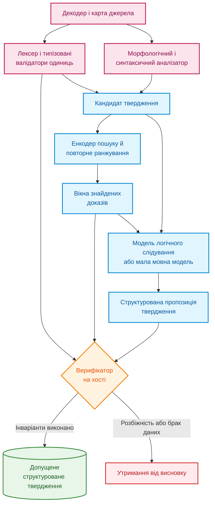

Для пошуку виконавця зручно мати ребро «контролер — вимкнути», а не лише список сусідніх слів. Авторський вибір синтаксису залежностей мотивовано цим інтерфейсом, не доведеною оптимальністю щодо всіх задач. Дерева складників групують слова у фрази; обидва подання можуть бути корисними й не є взаємовиключними теоріями правильного розуміння. Universal Dependencies задає міжмовні мітки ознак і залежностей [[7]](#src-7), не алгоритм із гарантованою точністю. Sentence-BERT дає векторні подання для пошуку [[8]](#src-8), а NLI класифікує пару «фрагмент, твердження». XNLI є багатомовним набором оцінювання [[9]](#src-9), але результат на ньому не встановлює якості на українських технічних вимогах. Таблиця нижче відділяє результат кожного компонента від його повноважень.

<a id="obj-12-13"></a>

**Таблиця 12.13. Результати й межі повноважень компонентів**

| Компонент | Що видає | На що не має права |
|---|---|---|
| Декодер і карта джерела | кодові позиції, зв'язки з байтами, помилки декодування | тлумачити намір користувача чи істинність фактів |
| Детермінований лексер і валідатор | типізовані атоми (числа, одиниці, ідентифікатори) і точні межі | призначати смислову роль твердження |
| Синтаксичний аналізатор | леми, частини мови, дерево залежностей | доводити нормативну силу вимоги чи права доступу |
| Енкодер і повторне ранжування | векторні подання, оцінки близькості | доводити логічне слідування чи істинність |
| Модель логічного слідування | імовірності класів «слідує», «суперечить», «нейтрально» | встановлювати істину поза наданим фрагментом |
| Мала або велика мовна модель | пропозицію наміру, нормалізоване формулювання, якір у тексті | підміняти байти, хеші й правила безпеки |
| Верифікатор на хості | рішення про допуск або код причини відмови | перефразовувати текст мовою користувача |
| Модуль формування відповіді | читабельну відповідь із точними посиланнями на цитати | створювати твердження поза перевіреним поданням |

> [!NOTE]
> **Вісім граней розподілу відповідальності в гібридній лінгвістичній архітектурі (вісім граней)**
> 1. Декодер і карта джерела: суворе зіставлення байтів і символів без права тлумачити намір користувача чи істинність фактів.
> 2. Детермінований лексер і валідатор: виділення типізованих атомів та одиниць СІ без права призначати смислову роль твердження.
> 3. Синтаксичний аналізатор: побудова дерева залежностей Universal Dependencies без права оцінки нормативної сили вимог.
> 4. Енкодер і повторне ранжування: векторний пошук кандидатів у просторі ембеддінгів без права встановлювати логічне слідування.
> 5. Модель логічного слідування (NLI): статистична оцінка пари «твердження-доказ» без права виходу за межі наданого текстового вікна.
> 6. Мала мовна модель (SLM): висунення гіпотез наміру та зняття омонімії без права підміни криптографічних хешів і байтових меж.
> 7. Хостовий верифікатор: детермінований допуск або відмова за замкненим циклом без права довільного перефразування тексту.
> 8. Модуль генерації відповіді: синтез читабельного пояснення виключно на базі допущеного подання без генерації неперевірених фактів.
> *Керування рантаймом / Інженерний інваріант:* штучний інтелект обмежений суто консультативною роллю генерації гіпотез, залишаючи верифікацію символьному ядру.

У R-12 лексер знаходить `20 мс`, парсер пропонує прив'язку межі до вимкнення, а верифікатор зіставляє весь фрейм із затвердженою вимогою. Висновок «контролер уже вимкнув нагрівач» не має підстави в цьому документі, хоч усі слова знайдено правильно. Розподіл повноважень визначено; тепер потрібно забезпечити, щоб ресурсні ліміти не змушували пропускати ці перевірки.

## 5. Ресурсні обмеження: бюджет контексту, токенізація й пам'ять моделі

Ресурсний бюджет потрібен, щоб модель отримала R-12 разом з умовою, а не лише зручне коротке речення без винятків. Токен — елемент словника моделі, не обов'язково слово чи символ. Ліміт контексту розподіляють між вхідними частинами й резервом виходу; усі довжини нижче — невід'ємні цілі кількості токенів, а місткість — додатне ціле число:

<a id="obj-12-14"></a>

**Формула (12.14). Баланс контекстного бюджету**

```math
L_{\mathrm{sys}}+L_{\mathrm{schema}}+L_{\mathrm{dialog}}+L_{\mathrm{query}}+L_{\mathrm{evidence}}+L_{\mathrm{tools}}+L_{\mathrm{output}}\le C_{\mathrm{runtime}}.
```

- Бюджет утворюють $`L_{\mathrm{sys}}`$, $`L_{\mathrm{schema}}`$, $`L_{\mathrm{dialog}}`$, $`L_{\mathrm{query}}`$, $`L_{\mathrm{evidence}}`$, $`L_{\mathrm{tools}}`$ і $`L_{\mathrm{output}}`$, кількості токенів для інструкцій, схеми, діалогу, запиту, доказів, опису засобів і відповіді відповідно;
- знак $+$ підсумовує ці частини бюджету;
- $`C_{\mathrm{runtime}}`$ є перевіреною межею контексту конкретного профілю розгортання, у токенах;
- знак $\le$ вимагає, щоб сума не перевищувала цю межу.

Наприклад, за умовних значень 1 500 + 500 + 2 000 + 500 + 6 000 + 500 + 1 000 маємо 12 000 токенів, отже бюджет у 16 000 токенів не перевищено. Межа залежить від профілю моделі. Якщо релевантний фрагмент не вміщується в контекст повністю, експертна система не має права обрізати винятки посередині речення: вона звужує пошук або відмовляється від відповіді.

<a id="obj-12-15"></a>

**Діаграма 12.15. Пакування доказів у контекст**

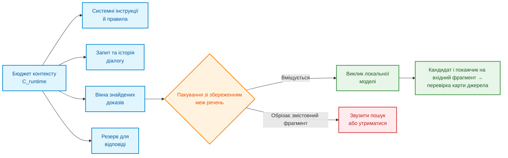

### 5.1. Особливості токенізації української мови

Особливості української токенізації важливі, бо однакова кількість слів не означає однакової витрати контексту. Для планування спочатку вимірюють фертильність — середню кількість токенів на слово. Руст та співавтори досліджували вплив токенізатора на багатомовні моделі [[10]](#src-10); це не універсальне порівняння важливості словника та навчальних даних. За фіксованих правил поділу на слова обчислюють:

<a id="obj-12-16"></a>

**Формула (12.16). Фертильність токенізатора**

```math
\text{Fertility}=\frac{N_{\text{tokens}}}{N_{\text{words}}}.
```

Символи формули:

- $`N_{\text{tokens}}`$ є кількістю токенів у вибірці тексту;
- $`N_{\text{words}}`$ є додатною цілою кількістю слів у тій самій вибірці; для порожнього тексту метрика не визначена;
- $`\text{Fertility}`$ є середньою кількістю токенів на одне слово, у токенах на слово.

Наприклад, якщо вибірка з 800 слів перетворилася на 1 200 токенів, фертильність дорівнює $`1{,}5`$ токена на слово. Значення залежить від мови, корпусу й токенізатора, тому його не можна переносити на інший набір текстів без вимірювання.

Петров та співавтори описали істотні міжмовні відмінності довжини токенізації [[11]](#src-11); наведений у роботі максимум не є коефіцієнтом саме для української R-12. Ранні LLaMA [[12]](#src-12) і Mistral 7B [[13]](#src-13) мали словники приблизно на 32 тисячі токенів, Gemma — на 256 тисяч [[14]](#src-14). Сам розмір словника не визначає якість: важливі його склад і навчання моделі після заміни токенів. Як приклад української адаптації наведено **Lapa LLM** на основі Gemma 3 12B; опис моделі й токенізатора повідомляє про заміну понад 80 тисяч позицій [[15]](#src-15). Це не дає гарантії цілісного кодування кожного інженерного терміна чи збереження відмінків: потрібні виміри на власному корпусі.

Автором повідомлено порівняльний емпіричний експеримент на NVIDIA Jetson AGX Orin 64 GB LPDDR5 UMA, 275 TOPS; зазначені версії — Ollama 0.40.7, CUDA 12.6, профіль `Q4_K_M`, `temperature = 0`. П'яти родинам моделей у шести режимах подавався однаковий набір українських запитів на нормалізацію лексики, синоніми й переклад. Значення таблиці збережено як повідомлені вимірювання, не перетворено на навчальні числа. Водночас у главі немає самих запитів, хешів ваг, кількості повторів, режиму живлення, умов прогрівання й сирих журналів; незалежне відтворення та заявлені ідентифікатори конфігурацій лишаються неперевіреними. Нульова температура сама не гарантує побітової повторюваності.

<a id="obj-12-17"></a>

**Таблиця 12.17. Повідомлені вимірювання локальних моделей**

| Локальна модель (профіль `Q4_K_M`) | Кількість вхідних токенів запиту ($`N_{\text{prompt}}`$) | Швидкість генерації (токенів/с) | Середній обсяг відповіді (токенів) | Середній повний час відгуку (с) |
|---|---:|---:|---:|---:|
| **Lapa LLM 12B** (80k укр. токенів у словнику 256k) | **128** | 15,82 | 177 | **12,08** |
| **Gemma 3 12B** (базовий мультиязичний словник 256k) | 193 (+50,8%) | 17,50 | 382 | 22,55 |
| **Gemma 4 12B** (прямий режим `think=false` + draft 465 МБ) | 195 (+52,3%) | **21,54** | 258 | 12,84 |
| **Gemma 4 12B** (режим міркувань `think=true`) | 195 (+52,3%) | 21,31 | 1 255 | 59,74 |
| **Qwen 2.5 Coder 14B** (словник 152k) | 198 (+54,7%) | 14,76 | 248 | 17,91 |
| **Phi-4 Mini 3.8B** (словник 200k, англоцентричний) | 280 (+118,8%) | 37,51 | 227 | 7,17 |

Повідомлені агрегати дозволяють сформулювати три обмежені спостереження для подальшої перевірки мовного тракту, а не встановлюють загальних закономірностей:
1. **Менше вхідних токенів і відмінності повідомленого часу:** за звітом автора, на однаковому тексті запиту Lapa LLM сформувала 128 вхідних токенів проти 193–198 у наведених моделях 12B–14B, а середній повний час відповіді становив 12,08 с проти 22,55 с у Gemma 3 12B. Відрізняються довжина відповідей, швидкість генерації й архітектура, тому це не ізольована оцінка впливу словника. Таблиця відтворює повідомлені значення; для їх підтвердження потрібні названі вище входи, ідентифікатори конфігурацій і первинні журнали. Самі агрегати не верифікують вимірювань або перенесення результату на інший корпус.
2. **Режим генерації та затримка:** відношення 21,54 до 17,50 дає близько 23,1% різниці темпу між двома наведеними конфігураціями. Без парного запуску тієї самої моделі з чернеткою й без неї це не вимір причинного ефекту спекулятивного декодування. У режимах `think=true/false` наведено 1 255 проти 258 вихідних токенів, тобто приблизно 4,86 раза, і 59,74 проти 12,84 с. Вимкнення міркувань є кандидатом налаштування для вузької задачі, який ще перевіряють за якістю, а не універсальним правилом.
3. **Темп не вимірює морфологічної правильності:** 37,51 токена/с для Phi-4 Mini описує швидкість, а не точність відмінків. Спостереження автора про кальки та міжмовне змішування не мають тут розмічених підрахунків; їх не можна вивести з цієї таблиці або приписати лише розміру моделі чи словника.

Для експертної системи з цього випливають три практичні наслідки. Перший: кількість документів, яку можна подати в $`C_{\mathrm{runtime}}`$, залежить від фертильності токенізатора на власному корпусі, тому фертильність вимірюють на реальних документах, а не беруть з опису моделі. Другий: довші послідовності збільшують пам'ять кешу ключів і значень і обчислення уваги. Третій: карта вирівнювання $`R_{N\leftarrow T_E}`$ описує токени вхідного доказового тексту й потребує тестів на кирилиці. Згенерований токен не має автоматичної адреси у першоджерелі. Екстрактор має окремо повернути вибраний фрагмент або покажчик на вхідний діапазон, після чого верифікатор відтворює цитату через карту джерела.

> [!NOTE]
> **Чотири інженерні висновки з авторського емпіричного дослідження української токенізації та локальних моделей (чотири висновки)**
> 1. **Менша кількість вхідних токенів у виміряній вибірці:** Lapa LLM сформувала 128 вхідних токенів на запит проти 193–198 у наведених моделях 12B–14B; це вимір конкретних моделей і запитів, а не універсальна властивість словника.
> 2. **Відмінність повного часу відповіді в цій конфігурації:** виміряно 12,08 с для Lapa LLM і 22,55 с для Gemma 3 12B. Різниця не ізолює вплив токенізатора, оскільки моделі сформували відповіді різної довжини та мають різну швидкість генерації й архітектуру.
> 3. **Перевірка режиму декодування:** повідомлені 21,54 токена/с і 59,74 с не доводять ефективності чернетки або шкоди міркувань для всіх задач. Потрібне парне порівняння режимів тієї самої моделі з однаковими вимогами до відповіді та перевіркою якості.
> 4. **Розмежована маршрутизація за мовною спеціалізацією:** локальна модель з адаптованим українським токенізатором призначається для морфологічної нормалізації та синонімічного розширення природномовних запитів, тоді як генерація суворих синтаксичних дерев і формальних структур делегується моделям із примусовим граматичним маскуванням GBNF.
> *Керування рантаймом / Інженерний інваріант:* жоден виграш у швидкості чи якості токенізації не змінює статусу локальної моделі — її вихід залишається недовіреною гіпотезою ешелону `T2`, що підлягає обов'язковій побайтовій верифікації на хості.

### 5.2. Зсув розподілу даних (Out-of-Distribution Shift)

Зсув розподілу важливий тоді, коли модель, перевірена на звичних реченнях, отримує інший жанр, мову чи спосіб запису величин. Наприклад, заміна «не пізніше ніж через 20 мс» на табличний запис межі може змінити частоту помилок. Геометрична метафора «усередині навчальних даних» недостатня: Балестрієро, Песенті й ЛеКун аналізують опуклі оболонки за конкретних припущень про розподіл і вибірку [[16]](#src-16); число 100 не є універсальною межею узагальнення нейромереж. WILDS демонструє приклади падіння якості за реальних зсувів [[17]](#src-17), але конкретну деградацію R-12 потрібно виміряти окремо.

Невідомий під час навчання документ сам по собі не доводить зсуву розподілу: новий документ може належати до тієї самої мови, жанру й схеми вимог. Зсув потрібно оцінювати за змінами цих ознак і якістю на відкладених даних. Водночас відсутність документа в навчанні не дозволяє відновлювати його правила з пам'яті моделі. В авторській архітектурі діє **концепція обмеження ролі мовних моделей за межами навчального розподілу (OOD Shift)**: за умов неминучого зсуву розподілу даних у нових технічних специфікаціях мовна модель позбавлена права виступати самостійним сховищем фактів або генератором деонтичних норм; джерелом правила є виключно прийнятий нормативний документ або верифікований запис знань, а не ваги моделі. Роль мовної моделі суворо обмежена такими допоміжними задачами:

- розбір синтаксичних зв'язків і вилучення сутностей;
- генерація структурованих запитів до бази знань у вигляді проміжного подання;
- оцінка локального логічного слідування між ізольованим фрагментом і твердженням.

Логічні висновки, квантифікацію правил і перевірку інваріантів виконує детермінована машина виведення.

### 5.3. Оптимізація пам'яті: кеш ключів і значень (KV Cache)

Кеш ключів і значень зберігає проміжні масиви уваги, щоб не обчислювати їх повторно для всього попереднього тексту. Перш ніж збільшувати контекст доказів R-12, потрібно оцінити пам'ять. Для однієї сесії з повним збереженням кешу всіх шарів, однаковими розмірами голів і без спільного використання префіксів маємо

<a id="obj-12-18"></a>

**Формула (12.18). Оцінка KV-кешу однієї сесії**

```math
M_{KV}\approx 2\,n_l\,L\,n_{kv}\,d_h\,b.
```

У формулі стоять такі величини:

- $`M_{KV}`$ є обсягом пам'яті кешу ключів і значень для однієї активної сесії, у байтах;
- множник $2$ враховує окремо ключі та значення;
- $`n_l`$ є кількістю шарів моделі;
- $L$ є довжиною послідовності в токенах;
- $`n_{kv}`$ є кількістю голів ключів і значень у шарі;
- $`d_h`$ є розмірністю однієї голови;
- $b$ є кількістю байтів для зберігання одного елемента;
- знак $\approx$ позначає оцінку, що не враховує службові накладні витрати.

Для умовних параметрів $`n_l=32`$, $L=4096$, $`n_{kv}=8`$, $`d_h=128`$ і $b=2$ оцінка становить 536 870 912 байтів, або 512 MiB. Реальне споживання пам'яті також залежить від реалізації кешу й вирівнювання даних.

Кількості шарів, голів, компонентів і токенів — додатні цілі; $b$ — додатний розмір елемента в байтах. Обчислення: два масиви, 32 шари, 4096 позицій, 8 голів, 128 компонентів, 2 байти. Дві незалежні такі сесії потребують приблизно 1 GiB лише для кешу, без ваг і робочих буферів. Якщо для кешу доступно 768 MiB, другий запит очікує або отримує менший перевірений бюджет; мовна модель не повинна мовчки втрачати умову вимоги. Для ковзної чи гібридної уваги рахують фактично збережені позиції кожного шару окремо.

Множник 2 враховує окремо ключі й значення. Квон та співавтори показали, що саме кеш ключів і значень визначає ефективність обслуговування великих мовних моделей, і запропонували сторінкове керування цією пам'яттю в системі vLLM [[18]](#src-18).

### 5.4. Збереження термінологічних інваріантів у технічному перекладі: SIF 1.0 та попередня ізоляція виразів

При обробці та перекладі вузькоспеціалізованих нормативних текстів (метрологічні стандарти OIML, настанови ISO/IEC, директиви безпеки) класичні субсловникові токенізатори (Byte-Pair Encoding, WordPiece) та стохастичні нейромережеві моделі створюють специфічний ризик відмов: дроблення та спотворення стандартизованих термінів, фізичних формул і числових меж.

У дослідженнях UMT–NMT і TRIZ-Aware Loss (Кузьменко, Трофімова, 2025) вивчалися способи збереження структурно значущих елементів технічного тексту під час нейронного перекладу, зокрема шляхом спеціальної обробки токенів, формул і констант. Проте подальший емпіричний аналіз виявив важливе обмеження: внутрішні структурні закономірності в латентному просторі моделі не гарантують відповідної правильності вихідного тексту. Подальший розвиток дослідницької програми привів до **SIF 1.0 — зовнішнього Registry-контролю канонічних метрологічних термінів** [[34]](#src-34). На відміну від впливу на процес навчання моделі, цей механізм перевіряє результат за незалежно визначеними правилами в межах охоплення реєстру: нейромережа генерує кандидатний переклад, але не встановлює нормативну допустимість використаних форм.

Спираючись на загальний принцип незалежного контролю структурно значущих елементів, автором розроблено **концепцію попередньої ізоляції інженерних виразів перед передачею моделі**: для збереження інваріантів стандартизованої термінології та числових меж складені інженерні сутності тимчасово ізолюються від сублексичного токенізатора (маскуються захисними плейсхолдерами), а після генерації відновлюються з обов'язковою верифікацією побайтової цілісності за вихідним реєстром. Це авторська пропозиція монографії (концепція Федчика), яка розширює архітектуру SIF 1.0 на доказові експертні системи.

Для R-12 вираз `20 мс` можна замінити на унікальний маркер, зберігши оригінал у таблиці. Маркер також може розбиватися токенізатором: захист забезпечує перевірка відновлення, а не його уявна атомарність. Якщо модель пропустила, продублювала або переставила маркер до іншої дії, відновлення відхиляється. Навіть правильне повернення `20 мс` не перевіряє сферу «не пізніше»; після відновлення потрібна перевірка цілого фрейму. З ресурсами й захистом величин визначено умови виклику; тепер розглянемо значення модельних балів.

## 6. Семантична схожість проти логічного слідування: межі векторного пошуку

У цій главі застосовується **принцип розмежування семантичного ранжування та логічного слідування**: косинусна схожість векторних подань є сигналом для добору кандидатів, а не перевіркою істинності, полярності чи застосовності норми. Пошуковий компонент RAG може надати мовній моделі фрагменти з подібним предметним контекстом, проте це не означає, що фрагменти логічно підтримують запит. Зокрема, речення *«контролер зобов'язаний замкнути контактор аварійного скидання при втраті синхросигналу»* та *«контролеру категорично заборонено замикати контактор аварійного скидання при втраті синхросигналу»* мають спільний лексичний контекст; їхня косинусна схожість залежить від моделі, корпусу й способу кодування та має вимірюватися на контрольних парах. У критичному профілі векторний результат не є підставою для допуску: полярність, модальність і застосовність перевіряє окремий верифікатор.

Тому в архітектурі мовного тракту експертної системи щільний векторний пошук розглядається виключно як евристичний фільтр швидкого первинного відсікання масиву документів. Після нього NLI (*Natural Language Inference*) може надати статистичну оцінку слідування як допоміжний сигнал, але остаточні доказові перевірки виконує верифікатор на хості. Детерміноване порівняння бала з порогом не робить модельний висновок формальним доведенням.

Для двох векторних подань запиту $\mathbf q \in \mathbb R^m$ та текстового пасажу документа $\mathbf d \in \mathbb R^m$ косинусна схожість дорівнює:

<a id="obj-12-19"></a>

**Формула (12.19). Косинусна схожість ненульових подань**

```math
s_{\mathrm{dense}}(q,d)=\frac{\mathbf q^\top\mathbf d}{\lVert\mathbf q\rVert_2\lVert\mathbf d\rVert_2}.
```

Кожна величина означає таке:

- $\mathbf q$ і $\mathbf d$ є векторними поданнями запиту $q$ і документа $d$ однакової розмірності $m$;
- $\mathbf q^\top\mathbf d$ є скалярним добутком цих векторів;
- $`\lVert\mathbf q\rVert_2`$ і $`\lVert\mathbf d\rVert_2`$ є їхніми евклідовими нормами ($`\ell_2`$);
- $`s_{\mathrm{dense}}(q,d)`$ є безрозмірною косинусною схожістю в діапазоні від $-1$ до $1$.

Інженерні пороги та відсікання шуму:
Для навчальних векторів (1,0) і (0,8;0,6) добуток дорівнює 0,8, обидві норми — 1, отже схожість — 0,8. Це обчислення подань, не вимір конкретної embedding-моделі. Розмірність $m$ — додатне ціле; компоненти — скінченні дійсні числа, обидві норми ненульові. Нульовий вектор, нескінченність, `NaN` чи різні розмірності роблять кандидата невалідним. Поріг 0,70 нижче зберігається як приклад налаштування профілю. Він не є універсальним: агресивне відсікання знижує повноту, тому його вибирають на контрольному корпусі та перевіряють окремо від точного лексичного пошуку.

Цей показник є лише оцінкою для попереднього сортування, а не ймовірністю логічної підтримки. Лексичний пошук знаходить точні символьні збіги, а векторні подання знаходять перефразування. Метод злиття обернених рангів (*reciprocal rank fusion*, RRF) об'єднує списки різних пошукових методів без змішування неоднорідних шкал оцінок [[19]](#src-19):

<a id="obj-12-20"></a>

**Формула (12.20). Злиття обернених рангів**

```math
s_{\mathrm{RRF}}(d)=\sum_{r\in\mathcal R(d)}\frac{1}{k_0+\mathrm{rank}_r(d)}.
```

Параметри формули:

- $d$ є документом-кандидатом;
- $\mathcal R(d)$ є множиною пошукових списків, у яких трапився документ $d$;
- $r$ перебирає ці списки, а $`\mathrm{rank}_r(d)`$ є цілим рангом документа в списку $r$, починаючи з 1;
- $`k_0`$ є додатною безрозмірною сталою згладжування; 60 — поширений вибір, не нормативна константа;
- $\sum$ додає внесок кожного списку до загального бала $`s_{\mathrm{RRF}}(d)`$.

Якщо документ R-12 посідає місця 1 і 3 у двох списках, за сталої 60 його бал дорівнює сумі 1/61 і 1/63, приблизно 0,03227. Документ, який є лише другим у першому списку, отримує 1/62, приблизно 0,01613. Перший кандидат іде вище, але жоден бал не вимірює істинність. Топ-$K$ обмежує кількість дорогих перевірок; $K=50$ — приклад бюджету. Без меж довжини фрагмента, паралельності й часу цей ліміт не запобігає вичерпанню ресурсів. У RAG знайдені фрагменти передають моделі [[20]](#src-20); помилка добору створює ризик неповної відповіді, який решта перевірок має виявляти.

Модель логічного слідування оцінює твердження $c$ відносно фрагмента $e$:

<a id="obj-12-21"></a>

**Формула (12.21). Нормування логітів NLI**

```math
p_\theta(y\mid c,e)=\frac{\exp(z_{\theta,y}(c,e))}{\sum_{j\in Y}\exp(z_{\theta,j}(c,e))},\qquad Y=\{\mathrm{entailment},\mathrm{contradiction},\mathrm{neutral}\},\quad y\in Y.
```

де:

- $c$ є твердженням, яке оцінюють, а $e$ є фрагментом доказу;
- $\theta$ позначає параметри моделі;
- $`z_\theta(c,e)`$ є вектором логітів для пари «твердження, доказ»;
- $`\mathrm{softmax}`$ перетворює логіти на ймовірності, кожна з яких належить $[0,1]$, а їхня сума дорівнює 1;
- $y$ є одним із класів: слідування (*entailment*), суперечність (*contradiction*) або нейтральність (*neutral*).
- $Y$ — множина трьох класів, $j$ — індекс сумування; логіти $`z_{\theta,j}`$ — скінченні безрозмірні дійсні числа; $\exp$ — експонента. Пара подається у порядку й шаблоні, на яких навчено конкретну модель; перестановка доказу й твердження не є нейтральною зміною.

Наприклад, вихід $`[0{,}7; 0{,}1; 0{,}2]`$ означає, що модель віддала найбільшу частку класу слідування. Це калібрована інтерпретація лише за наявності перевіреної калібровки; сам розподіл класів не доводить істинність твердження.

Щоб відтворити обчислення, візьмемо логіти ln(7), ln(1), ln(2). Експоненти дають 7, 1, 2; знаменник — 10, тому частки — 0,7; 0,1; 0,2. Калібрування перевіряє інше: чи серед багатьох незалежно розмічених прикладів із близьким балом, наприклад 0,7, частота правильного класу близька до 70%. Воно потребує відкладених даних, окремих від навчання й вибору порога, та контролю мови й жанру. Навіть добре калібрована групова частота не є доказом конкретної R-12.

Нейтральний клас означає лише брак інформації в конкретному фрагменті. Системний стан «невідомо» ширший: він охоплює неповноту доказів, неможливість зв'язати змінні або невизначену область застосування. Тому остаточне рішення формує детермінований верифікатор на хості:

<a id="obj-12-22"></a>

**Формула (12.22). Авторський профіль допуску твердження**

```math
\mathrm{Admit}(c,e,q,u,t)=I_{\mathrm{authz}}(c,e,u,t)\land I_{\mathrm{integrity}}\land I_{\mathrm{material}\ \mathrm{spans}}\land I_{\mathrm{applicable}}(c,q,t)\land[y_{\mathrm{ver}}=\mathrm{entailment}]\land[p_{\mathrm{cal}}(\mathrm{entailment})\ge\tau]\land\neg I_{\mathrm{conflict}}\land I_{\mathrm{epistemic}\ \mathrm{type}}.
```

У правій частині стоять такі величини:

- $c$ є твердженням, $e$ доказовим фрагментом, $q$ запитом, $u$ користувачем, а $t$ моментом перевірки;
- $`I_{\mathrm{authz}}(c,e,u,t)`$ є індикатором дозволу користувачу $u$ бачити доказ $e$ для твердження $c$ у момент $t$;
- $`I_{\mathrm{integrity}}`$ перевіряє цілісність доказу, а $`I_{\mathrm{material}\ \mathrm{spans}}`$ наявність усіх суттєвих фрагментів;
- $`I_{\mathrm{applicable}}(c,q,t)`$ перевіряє застосовність твердження до запиту й моменту часу;
- $`y_{\mathrm{ver}}`$ є результатом незалежної перевірки змісту в затвердженій моделі або за схваленим фреймом, не копією класу NLI; можливі «підтверджено», «суперечність», «невідомо», причому $`\mathrm{entailment}`$ означає перший випадок;
- $`p_{\mathrm{cal}}(\mathrm{entailment})`$ є каліброваною оцінкою ймовірності класу слідування, від 0 до 1;
- $\tau$ є порогом політики прийняття конкретного профілю; значення $`\tau = 0{,}85`$ у цьому прикладі є параметром проєкту, а не вимогою стандарту, і застосовується лише за наявності перевіреної калібровки на репрезентативних для профілю даних;
- $`I_{\mathrm{conflict}}`$ позначає конфлікт, а $`I_{\mathrm{epistemic}\ \mathrm{type}}`$ перевіряє допустимий епістемічний тип;
- $\land$ означає, що всі умови мають бути істинними, $\neg$ заперечує умову, а квадратні дужки позначають перевірку рівності чи нерівності.

Індикатори набувають значень 0 або 1; невідому чи недоступну перевірку для допуску трактують як 0, не як успіх. Момент $t$ має часову шкалу профілю, а $u$ — ідентичність користувача; рядки $c,e,q$ самі фізичних одиниць не мають. Модельна впевненість тут є додатковим фільтром цього профілю, не необхідною умовою будь-якої можливої доказової системи. Якщо модель недоступна, цей профіль не підставляє бал 1: він утримується або явно переходить до іншого, окремо затвердженого режиму.

Предикат повертає істину лише тоді, коли кожна перевірка пройдена, зокрема ймовірність не нижча за $\tau$ та конфлікту немає. Якщо предикат $`\mathrm{Admit}(c,e,q,u,t) = 0`$, експертна система детерміновано переходить у стан безпечного утримання від відповіді (*abstain*) або формує структурований запит на уточнення контексту, повертаючи діагностичний код відмови (`REJECT_INSUFFICIENT_CALIBRATED_CONFIDENCE` або `REJECT_DEONTIC_CONTRADICTION`). Моделі суворо заборонено додумувати чи генерувати спекулятивні відповіді без підтвердженого доказу.

Цей предикат задає політику прийняття, не теорему про правильність текстового тлумачення. Тут діє фундаментальне розмежування повноважень між людиною та машинним верифікатором: **людина — профільний доменний експерт — затверджує специфікації та правила до базової лінії бази знань ([Глава 11](ch11-knowledge-elicitation-from-experts.md), [Глава 14](ch14-requirements-detection-and-formalization.md)), тоді як детермінований верифікатор на хості (`Admit`) допускає відповідь на конкретний запит виключно на підставі вже затверджених базових доказів ([Глава 16](ch16-expert-systems-architecture.md)); мовна модель не має жодного з цих повноважень**. Якщо клас слідування повернула NLI-модель, детерміноване порівняння її оцінки з порогом не перетворює оцінку на доведення. Індикатори застосовності й епістемічного типу потребують визначеного способу перевірки та запису схвалення. Без цих підстав кандидат лишається кандидатом незалежно від високого бала моделі.

> [!NOTE]
> **Вісім детермінованих предикатів математичного шлюзу допуску тверджень $`\mathrm{Admit}(c,e,q,u,t)`$ (вісім предикатів)**
> 1. Авторизація доступу ($`I_{\mathrm{authz}}`$): підтвердження повноважень користувача на доступ до джерела доказу в поточний момент часу.
> 2. Криптографічна цілісність ($`I_{\mathrm{integrity}}`$): збіг контрольного хешу SHA-256 цитованого фрагмента з реєстром бази знань.
> 3. Повнота суттєвих фрагментів ($`I_{\mathrm{material\ spans}}`$): підтвердження наявності всіх необхідних текстових опор без спотворення змісту.
> 4. Контекстна застосовність ($`I_{\mathrm{applicable}}`$): перевірка часових, апаратних та предметних меж дії норми відносно вхідного запиту.
> 5. Логічне слідування ($`[y_{\mathrm{ver}} = \mathrm{entailment}]`$): незалежна перевірка за визначеним контрактом; високий клас NLI не замінює її.
> 6. Калібрована впевненість ($`[p_{\mathrm{cal}} \ge \tau]`$): досягнення погодженого для профілю порогу; наведене значення $`\tau = 0{,}85`$ є параметром прикладу, а не нормативною вимогою.
> 7. Відсутність деонтичного конфлікту ($`\neg I_{\mathrm{conflict}}`$): результат перевірки відомих чинних правил і пріоритетів у заданій області; не гарантія відсутності невідомих норм.
> 8. Відповідність епістемічного типу ($`I_{\mathrm{epistemic\ type}}`$): перевірка допустимості підстави (аксіома, факт, прогнозна гіпотеза).
> *Керування рантаймом / Інженерний інваріант:* порушення бодай одного предикату активує замкнену відмову (Fail-Closed) із поверненням типізованого коду утримання.

Розберімо рішення. Для правильної відповіді R-12 усі незалежні індикатори пройдено, конфлікту не знайдено, калібрований бал становить 0,90 за порога 0,85 — кандидат проходить цей профіль. Підміна «20 мс» на «20 с» відхиляється навіть за бала 0,99: незалежна перевірка змісту повертає суперечність. Запит без відомості про перегрів дає невизначену застосовність і потребує уточнення. Це логічні навчальні випадки, не вимір точності NLI. Тепер потрібно з'ясувати, чи сам парсер зберіг у документі потрібні умови.

## 7. Парсери документів та втрати у навчальних даних

Мовна модель не відновить надійно одиницю, якщо парсер документа загубив заголовок стовпця. Тому перед вибором енкодера потрібно виміряти втрати на межі «файл → структуроване подання». Для формату з готовою схемою спочатку використовують структурний розбір; для PDF окремо оцінюють порядок читання, таблиці, колонтитули й розпізнавання сканованих сторінок.

Docling пропонує подання **DoclingDocument**, яке описує текстові елементи, таблиці, групи й походження елементів [[21]](#src-21). Для доказового конвеєра важливіше зберегти це подання, ніж одразу експортувати документ у плаский Markdown: експорт може втратити потрібний зв'язок комірки з заголовком. Apache Tika є придатним базовим варіантом вилучення тексту й метаданих із різних форматів [[22]](#src-22). Порівняння має встановити, які класи сторінок потребують складнішого парсера; назва бібліотеки не гарантує точності таблиці або українського розпізнавання.

Для кожного блока зберігають хеш оригіналу, хеш похідного тексту, версію парсера, параметри обробки, структурний шлях і координати. Байтові зміщення похідного тексту не видають за байти стисненого PDF. Для скану зберігають також номер сторінки, геометрію області й статус перевірки розпізнаного тексту. Ті самі записи дозволяють порівнювати Docling, Tika й засоби оптичного розпізнавання на однакових документах.

У табличній версії R-12 число 20 може лежати під заголовком «Максимальний час, мс», а умова перегріву — в першому стовпці. Вилучений рядок `нагрівач 20` не підтримує повної вимоги. Контрольний приклад має перевірити зв'язок комірки з обома заголовками та умовою. Якщо OCR прочитав 20 як 200, незмінність PDF не виправляє помилку розпізнавання: відповідний похідний запис потребує перевірки.

Нестача розмічених прикладів належить до навчання на основі якості даних (*data-centric learning*). **Навчання зі слабкими мітками (*weak supervision*)** дозволяє перетворити словники, шаблони й евристики на кандидатні мітки. У Snorkel Ратнера та співавторів функції розмітки можуть утримуватися від відповіді, суперечити одна одній і мати залежні помилки [[23]](#src-23). Три шаблони, побудовані на тому самому слові MUST, не є трьома незалежними голосами. Автоматичні мітки придатні для навчання, але не замінюють незалежний еталон перевірки.

**Активне навчання (*active learning*)** тут означає добір наступних прикладів для експертної розмітки. Запропонована політика добору поєднує невпевненість моделі, різноманітність документів, ризик помилки й час рецензента. Окрема випадкова аудиторська вибірка потрібна для оцінки частоти помилок: статистика лише відібраних складних прикладів не оцінює весь потік. Редакції одного документа мають потрапляти в один набір даних, інакше витік між навчальним і контрольним наборами завищує оцінку.

Для політики відмови можна дослідити **конформне прогнозування (*conformal prediction*)**, огляд якого подали Ангелопулос і Бейтс [[24]](#src-24). У базовій постановці калібрувальні й майбутні приклади мають бути обмінними; гарантія стосується покриття правильної мітки множиною прогнозів у сукупності, не істинності кожної прийнятої вимоги. Зміна мови або жанру може порушити передумови. Такий метод допомагає направляти неоднозначні випадки на рецензію, а не замінює доказову прив'язку.

Обмінність означає, що спільний розподіл прикладів не змінюється від перестановки їхнього порядку; незалежна однаково розподілена вибірка є достатнім, але не єдиним випадком. Для split-conformal заздалегідь фіксують модель і функцію невідповідності, а поріг обчислюють на окремій калібрувальній вибірці з поправкою на її скінченний розмір. Наприклад, множина «обов'язок або дозвіл» не дозволяє довільно вибрати обов'язок: R-12 передається на перевірку. Навіть номінальне покриття 95% не означає 95% правильності серед однозначних або прийнятих відповідей.

Отже, перший вибір стосується збереження структури та незалежності контрольних даних. Після визначення цих умов можна обирати середовище виконання й порівнювати вартість моделей.

## 8. Профілі апаратного розгортання локальних моделей

Локальне виконання потрібне, коли конфіденційні дані не повинні залишати захищеного середовища підприємства. Проте позначка «локальна модель» фіксує лише місце виконання, а не гарантує точності чи відсутності мережевих звернень.

<a id="obj-12-23"></a>

**Таблиця 12.23. Середовища виконання локальних моделей**

| Профіль | Переваги | Обмеження |
|---|---|---|
| llama.cpp і формат GGUF [[25]](#src-25) | переносимість між процесорами й графічними прискорювачами, робота без мережі | потрібно фіксувати версію збірки й хеш квантованого файлу моделі |
| Ollama [[26]](#src-26) | зручний локальний REST API, структурований вивід за JSON Schema | обгортка не додає перевірки фактів; потрібен контроль версій моделі |
| vLLM [[18]](#src-18) | висока пропускна здатність паралельних запитів, сторінкове керування кешем | складніше розгортання, залежність від версій CUDA |
| MLX LM [[27]](#src-27) | виконання й донавчання на Apple Silicon | артефакти MLX не переносяться на CUDA чи ROCm |
| TensorRT-LLM [[28]](#src-28) | висока продуктивність на серверах NVIDIA | тісна прив'язка до драйверів і конкретних графічних процесорів |
| ONNX Runtime [[29]](#src-29) | швидкі спеціалізовані енкодери й моделі логічного слідування на різних прискорювачах | різні провайдери обчислень можуть давати числові розбіжності |

Таблиця показує, що вибір профілю є компромісом між переносимістю, продуктивністю й відтворюваністю. Для доказової експертної системи найважливіший останній стовпчик: кожне обмеження стає пунктом маніфесту розгортання.

Наприклад, автономний енкодер для пошуку R-12 можна перевірити через ONNX Runtime, а генеративний радник — через llama.cpp або Ollama; це приклади розподілу, не рекомендація сумісності будь-яких ваг із будь-яким рушієм. До запуску перевіряють архітектуру, формат ваг, токенізатор, ліцензію, RAM/VRAM і підтримку драйвера. Автономність перевіряють запуском із забороненою мережею; відсутність сервісу, тайм-аут або переповнення пам'яті дають типізовану недоступність, не дозвіл використати пам'ять моделі замість джерела. Після вибору виконуваного профілю можна порівнювати його квантовані версії.

## 9. Квантування та контроль регресій при оновленні моделей

Квантування зменшує розрядність ваг, щоб модель умістилася в доступну пам'ять, але змінює числові обчислення й іноді результати розбору R-12. Перед порівнянням версій розглянемо просту афінну схему Джейкоба та співавторів [[30]](#src-30); вона пояснює принцип, а не описує всі деталі формату `Q4_K_M`:

<a id="obj-12-24"></a>

**Формула (12.24). Афінне квантування й відновлення ваги**

```math
q(w)=\mathrm{clip}\left(\mathrm{round}\left(\frac{w}{s}\right)+z,\ q_{\mathrm{min}},\ q_{\mathrm{max}}\right),\qquad \hat w=s\,\bigl(q(w)-z\bigr).
```

Що означають літери:

- $w$ є початковою вагою моделі;
- $s$ є додатним масштабом квантування, а $z$ є цілою нульовою точкою;
- $`\mathrm{round}`$ округлює до цілого, а $`\mathrm{clip}(x,q_{\mathrm{min}},q_{\mathrm{max}})`$ обмежує $x$ заданим цілим діапазоном;
- $q(w)$ є цілим квантованим значенням, обмеженим між $`q_{\mathrm{min}}`$ і $`q_{\mathrm{max}}`$;
- $\hat w$ є відновленою наближеною вагою після деквантування.

Вага $w$ — скінченне дійсне число; масштаб $s$ має одиниці ваги на один код, нульова точка $z$ та межі кодів — цілі, нижня межа не більша за верхню. У навчальному прикладі ваги безрозмірні, а правило округлення на половині кроку потрібно зафіксувати в реалізації.

Наприклад, за умовних $`w=0{,}7`$, $`s=0{,}1`$, $z=0$ і діапазону від $-8$ до $7$ маємо $q(w)=7$ та $`\hat w=0{,}7`$. Квантування може змінити ваги й поведінку моделі, тому кожну квантовану модель перевіряють окремо. Зміну якості на зрізі $s$ за метрикою $m$ вимірюють як

<a id="obj-12-25"></a>

**Формула (12.25). Зміна метрики на одному зрізі**

```math
\Delta_{m,s}=m(\mathrm{model}_q,s)-m(\mathrm{model}_{\mathrm{base}},s).
```

Різниця якості:

- $m$ є метрикою якості, а $s$ є зрізом даних, наприклад мовою або типом параметрів;
- $`\mathrm{model}_q`$ є квантованою моделлю, а $`\mathrm{model}_{\mathrm{base}}`$ є базовою моделлю;
- $`m(\mathrm{model}_q,s)`$ і $`m(\mathrm{model}_{\mathrm{base}},s)`$ є значеннями тієї самої метрики на тому самому зрізі;
- $`\Delta_{m,s}`$ є різницею цих значень у одиницях метрики.

Наприклад, якщо точність квантованої моделі на зрізі дорівнює $`0{,}91`$, а базової $`0{,}94`$, то $`\Delta_{m,s}=-0{,}03`$, тобто зниження становить 3 відсоткові пункти.

Попередня вага 0,7 точно лягла на сітку й приховала похибку. Для ваги 0,74 ділення дає 7,4, округлення — 7, відновлення — 0,7: абсолютна похибка 0,04. Для 1,2 код 12 обрізається до 7, похибка вже 0,5. Ці числа показують різницю округлення й насичення, а не дозволяють передбачити зміну якості мережі. У формулі різниці $s$ тепер означає зріз даних, не масштаб; для точності $m$ лежить у [0,1], а різниця — у [-1,1]. Для метрик, де менше краще, напрям критерію змінюють.

Інженерні критерії допустимості деградації:
У наведеному авторському профілі приймання встановлено такий бюджет; він не походить зі стандарту й потребує обґрунтування для конкретної задачі:
1. Загальна деградація на генеральному тестовому корпусі не повинна перевищувати $`\Delta_{m,\mathrm{all}} \ge -0{,}01`$ (не більше 1,0 відсоткового пункту втрати інтегральної якості);
2. На критичних функціональних зрізах — таких як точність екстракції числових меж і розмірностей фізичних величин ($`\Delta_{\mathrm{acc},\mathrm{numeric}}`$) та правильність збереження деонтичних операторів MUST / MUST NOT ($`\Delta_{\mathrm{acc},\mathrm{deontic}}`$) — допускається виключно нульова регресія ($`\Delta \ge 0{,}000`$);
3. Якщо на зрізі українськомовних термінів чи нормативної логіки фіксується падіння $`\Delta_{m,s} < -0{,}01`$, квантований кандидат автоматично відхиляється на стадії валідаційного шлюзу, а випуск блокується до перекалібрування сітки квантування або переходу на вищий бітовий профіль (наприклад, перехід з 4-біт на 8-бітний формат).

Оцінювання обов'язково розбивають на зрізи: українська мова, точність вилучення числових параметрів, стійкість структурованого виводу, правильність утримання від відповіді. Усереднений результат може приховати критичне погіршення на рідкісних технічних термінах.

Втрата 3 відсоткових пунктів у прикладі порушує межу 1 пункт і блокує цей профіль. Нульова зміна середньої точності ще може приховати обмін помилками: нова версія правильно розібрала іншу фразу, але зіпсувала R-12. Тому критичні контрольні випадки перевіряють попарно; «нульова регресія» на скінченному наборі не доводить її відсутності в майбутньому. Правило випуску й правило відмови на окремий запит — різні рішення.

Маніфест розгортання фіксує знімок корпусу документів, правила нормалізації Unicode, версії синтаксичних аналізаторів, хеші ваг моделей, параметри квантування, версії середовища виконання й пороги калібрування.

<a id="obj-12-26"></a>

**Діаграма 12.26. Перевірка й відкат кандидата моделі**

```mermaid
flowchart LR
    accTitle: Безпечне розгортання й відкат моделі
    accDescr: Від підписаного маніфесту через парне тестування до поступового розгортання з можливістю відкату.

    MF["Підписаний маніфест"] --> ST["Завантаження<br/>в тестове середовище"]
    ST --> SELF["Перевірка хешів,<br/>схем і середовища"]
    SELF --> PAIR["Парне оцінювання:<br/>базова версія проти кандидата"]
    PAIR --> G{"Пороги якості,<br/>безпеки й рівня обслуговування"}
    G -->|"Успіх"| SH["Тіньовий трафік →<br/>обмежений випуск"]
    G -->|"Помилка"| STOP["Відхилення кандидата"]
    SH --> PR["Атомарне підвищення<br/>версії"]
    SH -->|"Аномалія"| RB["Повний відкат<br/>разом із залежностями"]
    PR --> MON["Моніторинг якості,<br/>пам'яті й затримок"]
    MON -->|"Порушення рівня обслуговування"| RB

    classDef doc fill:#fce4ec,stroke:#c2185b,stroke-width:2px,color:#880e4f;
    classDef proc fill:#e1f5fe,stroke:#0288d1,stroke-width:2px,color:#01579b;
    classDef check fill:#fff3e0,stroke:#f57c00,stroke-width:2px,color:#e65100;
    classDef ok fill:#e8f5e9,stroke:#388e3c,stroke-width:2px,color:#1b5e20;
    classDef fail fill:#ffebee,stroke:#d32f2f,stroke-width:2px,color:#b71c1c;

    class MF doc;
    class ST,SELF,PAIR,SH,MON proc;
    class G check;
    class PR ok;
    class STOP,RB fail;
```

Схема показує, що новий кандидат моделі проходить той самий шлях, що й новий випуск бази знань: перевірка, порівняння з базовою версією, обмежений випуск і готовий відкат.

## 10. Методологія верифікації та тестування мовної підсистеми

Методологія тестування має встановити не «чи гарно модель відповідає», а на якому кроці вона помиляється: пошук, фрейм, джерело чи допуск. Для R-12 позитивна група містить запити з відомою умовою перегріву; негативні випадки змінюють одиницю, модальність або прибирають контекст. Спочатку оцінюють пошук на непорожній скінченній множині $`Q_+`$ запитів із відомою відповіддю; $k$ — додатне ціле, кожна еталонна множина $`G_q`$ непорожня:

<a id="obj-12-27"></a>

**Формула (12.27). Частка позитивних запитів із влученням**

```math
\mathrm{Hit}@k=\frac{1}{|Q_+|}\sum_{q\in Q_+}\mathbb{1}\bigl[G_q\cap R_k(q)\ne\varnothing\bigr].
```

Складники формули:

- $`Q_+`$ є множиною запитів, для яких відповідь існує, а $q$ є одним таким запитом;
- $`G_q`$ є множиною правильних документів для запиту $q$;
- $`R_k(q)`$ є першими $k$ результатами пошуку для запиту $q$;
- $`G_q\cap R_k(q)`$ є документами, що одночасно правильні й знайдені серед перших $k$;
- $`\mathbb{1}[\cdot]`$ дорівнює 1, якщо умова в дужках істинна, і 0 в іншому разі;
- $`|Q_+|`$ є кількістю запитів, а $\sum$ підсумовує індикатори для всіх таких запитів.

Показник від 0 до 1 дорівнює частці запитів, для яких серед перших $k$ результатів є хоча б один правильний документ. Наприклад, якщо це сталося для 8 із 10 запитів, $`\mathrm{Hit}@k=0{,}8`$. Метрика не вимірює повноту, коли твердження потребує кількох джерел; для цього рахують повноту:

<a id="obj-12-28"></a>

**Формула (12.28). Середня повнота позитивного пошуку**

```math
\mathrm{Recall}@k=\frac{1}{|Q_+|}\sum_{q\in Q_+}\frac{|G_q\cap R_k(q)|}{|G_q|}.
```

Тут кожна величина має такий зміст:

- $`Q_+`$ є множиною запитів із наявною відповіддю, а $q$ є окремим запитом;
- $`G_q`$ є множиною всіх правильних документів для запиту $q$;
- $`R_k(q)`$ є першими $k$ знайденими документами;
- $`|G_q\cap R_k(q)|/|G_q|`$ є часткою правильних документів, знайдених серед перших $k$;
- $`|Q_+|`$ є кількістю запитів, а зовнішня сума обчислює середнє за запитами.

Значення лежить від 0 до 1. Якщо для запиту потрібні чотири документи, а в перших $k$ знайдено три, його повнота дорівнює $`3/4=0{,}75`$. Показник залежить від повноти розмітки множини $`G_q`$ і не свідчить сам собою про точність відповіді.

Стійкість до синонімії й варіативності формулювань вимірюють на групах перефразувань $G$, де група зараховується лише тоді, коли успішні всі її варіанти $`V_g`$:

<a id="obj-12-29"></a>

**Формула (12.29). Частка повністю успішних груп перефразувань**

```math
\mathrm{GroupPass}=\frac{1}{|G|}\sum_{g\in G}\prod_{i\in V_g}\mathrm{Success}_i.
```

У формулі:

- $G$ є множиною груп еквівалентних формулювань, а $g$ є однією групою;
- $`V_g`$ є множиною варіантів запиту в групі $g$, а $i$ позначає окремий варіант;
- $`\mathrm{Success}_i`$ дорівнює 1, якщо варіант $i$ успішний, і 0, якщо ні;
- $\prod$ перемножує результати всіх варіантів групи, тому добуток дорівнює 1 лише за успіху кожного варіанта;
- $`|G|`$ є кількістю груп, а $\sum$ підраховує успішні групи.

Показник лежить від 0 до 1 і вимірює частку груп, у яких успішні всі варіанти. За трьох груп і двох повністю успішних груп $`\mathrm{GroupPass}=2/3\approx0{,}67`$. Метрика суворіша за частку успішних окремих запитів і залежить від того, наскільки повно сформовано групи перефразувань.

Множина $G$ і кожна $`V_g`$ мають бути скінченними та непорожніми: порожню групу не можна зарахувати через формальне значення порожнього добутку. Усі варіанти однієї групи повинні зберігати зміст, зокрема модальність і умови. «Може вимкнути» не є перефразуванням «повинен вимкнути»: це окремий негативний контроль. Для запитів без відповіді оцінюють правильність утримання й частоту хибного допуску окремо, не додаючи їх у знаменник позитивного пошуку.

Нижче збережено числові цілі авторського профілю приймання, не вимоги ISO 26262 чи DO-178C. Вони визначають рішення на зафіксованому корпусі, а не гарантію для довільного потоку:
- $`\mathrm{Hit}@5 \ge 0{,}95`$: не менше ніж у 95% регламентних запитів хоча б одне релевантне джерело повинно потрапити у вікно попереднього відбору;
- $`\mathrm{Recall@5}_{\mathrm{cand}} \ge 0{,}85`$: повнота первинного відбору кандидатів — не менше ніж 85% усіх критично необхідних для повного висновку нормативних фрагментів знаходяться у топ-5 первинної видачі мовного тракту до переранжування (на відміну від фінального релізного регресійного шлюзу канонічної бази знань $`\mathrm{Recall@5}_{\mathrm{release}} \ge 0{,}98`$ зі статусом блокування `BUILD_BLOCKED_RETRIEVAL_REGRESSION`, визначеного у [Главі 16](ch16-expert-systems-architecture.md));
- $`\mathrm{GroupPass} \ge 0{,}98`$ для загального профілю (щонайменше 49 із 50 груп) і 1,00 для суворого профілю, який автор пропонує досліджувати для критичних застосувань. Посилання на ASIL D або DO-178C Level A не встановлює нормативного походження цього числа. Збій варіанта блокує відповідну тестову групу й випуск за цим критерієм; це не доказ неможливості всіх майбутніх обходів (див. [главу 13](ch13-language-variability-vs-determinism.md)).

Успіх $`\mathrm{Success}_i=1`$ фіксують лише тоді, коли експертна система правильно визначила контракт запиту, знайшла правильні байти доказу, зберегла типізовані числові значення, пройшла перевірку прав доступу й правильно сформувала відповідь. Для оцінки фактичної точності тексту корисна метрика FActScore, яка розкладає відповідь на атомарні факти й перевіряє кожен факт за джерелом [[31]](#src-31), а для оцінки цитат корисний набір ALCE, який окремо вимірює правильність відповіді й підтримку цитатами [[32]](#src-32). Довірчі інтервали для порівняння версій отримують бутстрепом Ефрона, причому повторну вибірку роблять цілими групами перефразувань, щоб не завищити кількість незалежних спостережень [[33]](#src-33).

> [!NOTE]
> **Три профільні критерії приймання мовного тракту (авторська пропозиція)**
> 1. Покриття первинного відбору ($`\mathrm{Hit}@5 \ge 0{,}95`$): щонайменше 95% позитивних запитів контрольного корпусу мають хоча б одне правильне джерело у топ-5.
> 2. Повнота первинного відбору кандидатів ($`\mathrm{Recall@5}_{\mathrm{cand}} \ge 0{,}85`$): включення не менше 85% критично необхідних опорних цитат у топ-5 первинного відбору (причому на етапі релізного контролю нормативної бази знань у [Главі 16](ch16-expert-systems-architecture.md) діє фінальний поріг $`\mathrm{Recall@5}_{\mathrm{release}} \ge 0{,}98`$).
> 3. Стійкість до перефразувань: щонайменше 49 із 50 груп у загальному або всі групи в суворому профілі. Це критерій випробувань, не нормативна атестація рівня безпеки.
> *Керування рантаймом / Інженерний інваріант:* недосягнення погодженого критерію блокує випуск кандидата; пороги не налаштовують на заліковому наборі до бажаного результату.

<a id="obj-12-30"></a>

**Діаграма 12.30. Парне оцінювання версій мовного тракту**

```mermaid
flowchart LR
    accTitle: Порівняльне оцінювання кандидатів мовної підсистеми
    accDescr: Експеримент від зафіксованого поділу даних до парного бутстрепу й діагностики помилок.

    MF["Заморожені маніфести"] --> SPL["Поділ на групи й<br/>перевірка витоку даних"]
    SPL --> B["Базова версія"]
    SPL --> C["Новий кандидат"]
    B --> TR["Синхронізовані журнали<br/>виконання"]
    C --> TR
    TR --> MET["Метрики: джерело, подання,<br/>слідування, наскрізний успіх, ресурси"]
    MET --> SL["Аналіз зрізів за мовами,<br/>термінами й загрозами"]
    SL --> CI["Груповий бутстреп і<br/>парний статистичний тест"]
    CI --> G{"Погоджені пороги<br/>допуску"}
    G -->|"Успіх"| DEP["Тіньовий трафік,<br/>обмежений випуск"]
    G -->|"Відхилено"| DIAG["Діагностика першої<br/>точки відмови"]

    classDef src fill:#fce4ec,stroke:#c2185b,stroke-width:2px,color:#880e4f;
    classDef test fill:#e1f5fe,stroke:#0288d1,stroke-width:2px,color:#01579b;
    classDef gate fill:#fff3e0,stroke:#f57c00,stroke-width:2px,color:#e65100;
    classDef pass fill:#e8f5e9,stroke:#388e3c,stroke-width:2px,color:#1b5e20;
    classDef err fill:#ffebee,stroke:#d32f2f,stroke-width:2px,color:#b71c1c;

    class MF,SPL src;
    class B,C,TR,MET,SL,CI test;
    class G gate;
    class DEP pass;
    class DIAG err;
```

### 10.1. Пошаровий діагностичний конвеєр як дослідницька траєкторія SIF

Пошарова діагностика потрібна, коли підсумковий бал приховує причину помилки. BLEU й ROUGE порівнюють збіги тексту, BERTScore — контекстні подання; вони можуть реагувати на зміни, але не сертифікують збереження фізичних і логічних залежностей. Підміна 20 мс на 20 с у R-12 може залишити більшу частину слів незмінною. Нижче відтворено дослідницьку траєкторію SIF за наведеним описом [[35]](#src-35); це не специфікація алгоритму кожного виклику і не незалежне відтворення результатів цієї роботи:

<a id="obj-12-31"></a>

**Діаграма 12.31. Дослідницька траєкторія діагностики SIF**

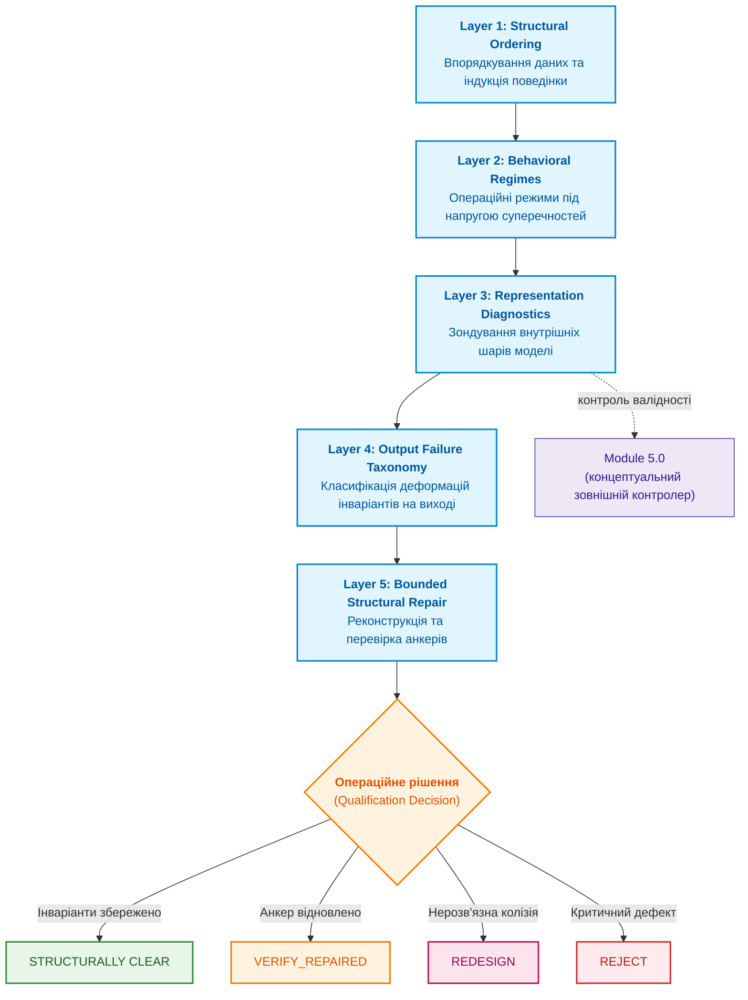

Це дослідницька схема, а не специфікація виконуваного компонента. Для `Module 5.0` не визначено вхідно-вихідного контракту, способу взаємодії з Layer 3 або впливу на рішення Layer 5; цей вузол не слід трактувати як реалізований контролер.

Функціональне призначення шарів конвеєра:

1. **Layer 1 (Structural ordering):** встановлює, як саме впорядкування та взаємне розташування навчальних пар контролює поведінку моделі в режимі жорсткого дефіциту даних (*low-data regime*);
2. **Layer 2 (Behavioral regimes):** визначає налаштовувані операційні режими моделі в умовах стресу від технічних та логічних суперечностей;
3. **Layer 3 (Representation diagnostics):** здійснює діагностичне зондування латентного простору репрезентацій. Пунктирний зв'язок із концептуальним `Module 5.0` позначає дослідницьке питання про структурне вузьке місце (*structural bottleneck*) між представленням і доменом виводу, а не визначений контролер виконання;
4. **Layer 4 (Output failure taxonomy):** формалізує класифікацію структурних деформацій на рівні виходу (втрата знака, спотворення числових коефіцієнтів, термінологічний зсув);
5. **Layer 5 (Bounded structural repair):** досліджує відновлення пошкоджених анкерів лише для заданих класів дефектів; межі ремонту й обов'язкову повторну перевірку потрібно визначити до допуску.

Система не покладається на суб'єктивну оцінку якості («чи гарно звучить формулювання»). Її кінцевий результат — не перефразований текст, а типізоване операційне рішення: допуск (`STRUCTURALLY CLEAR`), контрольний допуск після ремонту (`VERIFY_REPAIRED`), вимога зміни формулювання (`REDESIGN`) або відхилення (`REJECT`).

Для R-12 повернення загубленого маркера одиниці з таблиці оригіналів може бути обмеженим ремонтом. Вгадування, чи автор мав на увазі мілісекунди або секунди, ремонтом не є: без опори потрібне відхилення або уточнення. Структурний вердикт не замінює `Admit` і схвалення нової версії знання. Після визначення тестів наступний розділ показує, як зробити ці кроки доступними для інспекції.

## 11. Прозорий інджест сирих знань: подолання бар'єра недовіри та інтерактивна візуалізація

Прозорий інджест, тобто приймання й перетворення документа на кандидатні знання, потрібен для відповіді на просте питання: «де саме машина змінила або втратила зміст?». Демонстрація правильної відповіді R-12 не показує, чи інші випадки було відкинуто, а тест на власному корпусі не усуває ризику підгонки. Авторська модель подвійного бачення зіставляє текст людини й машинний фрейм, щоб рецензент міг знайти першу розбіжність. Це засіб перевірки, не заміна незалежних випробувань чи сертифікації.

Вирішенням цієї проблеми є застосування принципу **«Show, Don't Tell»** через спеціалізовані термінальні інструменти інтерактивного інджесту (TUI). Такий інструмент дозволяє аудитору завантажити власний, невідомий системі документ (довільний текстовий стандарт, корпоративну політику, технічні умови) і спостерігати за його розбором у реальному часі за моделлю подвійного бачення (**Dual-View: Людина vs Машина**):

1. **Лексико-синтаксична декомпозиція:**
   Користувач бачить, на які саме фрагменти й речення синтаксичний сегментатор поділив текст, як збережено непорушні байтові координати `[byte_start, byte_end]` та які лексичні метрики притаманні документу:
   - Обсяг словника та частка різних словоформ (Type-Token Ratio, TTR), обчислена за зафіксованим лексичним поділом, не токенами моделі;
   - Ентропія частот словоформ, яка описує розподіл, не вимірює розуміння або наукову цінність тексту;
   - Розподіл довжини речень.

2. **Детерміністичне виділення деонтичних норм:**
   Система підсвічує в тексті нормативні маркери зобов'язань (`MUST`, `SHALL`), заборон (`MUST NOT`, `SHALL NOT`), рекомендацій (`SHOULD`) та дозволів (`MAY`). Аудитор наочно бачить, які атоми знань виділені виключно символічним синтаксичним аналізатором без участі ймовірнісних моделей.

3. **Аудит нейро-символічного стику (SLM Tracing):**
   Якщо в конвеєрі задіяна локальна SLM для розв'язання неоднозначностей або виділення неявних відношень, TUI відображає:
   - Дослівний промпт, сформований детерміністичним середовищем;
   - Сиру невідфільтровану відповідь нейромоделі;
   - Рішення детерміністичного фільтра хоста: чи підтверджується пропозиція моделі дослівним текстом першоджерела, чи вона відхилена через брак байтової кустодії.

4. **Машинне сприйняття фрагмента (Machine Perception):**
   При наведенні курсора на будь-яке речення людина бачить точну формулу знання, яку згенерувала машина: суб'єкт (актор), деонтичну модальність, предикат (дія) та криптографічний хеш SHA-256 цитати.

Щоб ці індикатори можна було перевірити, для непорожнього фрагмента обчислюють дві описові метрики:

<a id="obj-12-32"></a>

**Формула (12.32). Лексичне різноманіття й ентропія частот**

$$
TTR=\frac{V}{N},\qquad H=-\sum_{i=1}^{V}p_i\log_2 p_i,\qquad p_i=\frac{n_i}{N}.
$$

Тут $N$ — додатна ціла кількість лексичних слововживань, $V$ — число різних словоформ від 1 до $N$, $`n_i`$ — додатна частота словоформи $i$, сума всіх частот дорівнює $N$. Частки $`p_i`$ безрозмірні й у сумі дають 1; TTR лежить у (0,1], а $H$ — від 0 до $`\log_2 V`$ бітів на слововживання. За чотирьох уживань із частотами 2,1,1 маємо TTR 3/4, частки 0,5; 0,25; 0,25 та ентропію 0,5 + 0,5 + 0,5 = 1,5 біта. Для порожнього тексту обидві метрики не обчислюють. Порівнювати TTR різної довжини без контролю довжини некоректно.

Для R-12 екран має показати не тільки число 20, а й цитату з «не пізніше», «після сигналу» та умовою перегріву. Якщо фрейм помилковий, одна лише наочність його не виправляє; потрібні журнал, відтворюваний запуск і незалежна розмітка. Наступний крок — зберегти результат такої інспекції разом із її межами.

### 11.1. Атестація машинних знань (Machine Knowledge Attestation, MKA) та Сертифікат знань

Атестація машинних знань потрібна, щоб після інспекції було відомо, яку версію документа, яким засобом і за якими критеріями перевірено. У цій монографії автором запропоновано **Machine Knowledge Attestation (MKA)** як паспорт перевірок і походження, не юридичний інститут або доказ повноти розуміння довільного джерела.

> **Визначення (Атестація машинних знань):**
> *Атестація машинних знань* — процедура фіксації перевірених кандидатів, їхніх джерельних опор, версій інструментів, результатів і невиконаних перевірок. Криптографічний підпис підтверджує походження паспорта від підписувача та незмінність охоплених даних, але не істинність кожного тлумачення.

Результатом цієї процедури для кожного окремого документа є формальний **Сертифікат атестації машинних знань (MKA Certificate)**, що містить такі непорушні блоки:
1. **Паспорт цілісності першоджерела (Source Provenance & Custody):**
   - Унікальний ідентифікатор сертифіката (`MKA-<filename>-<sha256[:12]>`);
   - Повний байтовий розмір та контрольна сума першоджерела (SHA-256);
   - Критерії та фактичні результати шлюзу, кількість прийнятих, відхилених і неперевірених кандидатів;
   - Частка перевірених прив'язок із явним знаменником; відсутність прийнятих записів не є результатом 100%.
2. **Лексичний та ентропійний профіль:**
   - Кількість речень, токенів та слів;
   - Описові TTR та $H$ з правилами сегментації, без висновку про понятійну насиченість.
3. **Деонтичний баланс та нормативна щільність:**
   - Нормативна щільність за визначеним нижче способом підрахунку;
   - Точний баланс зобов'язань ($MUST$), заборон ($MUST\ NOT$), рекомендацій ($SHOULD$) та дозволів ($MAY$).
4. **Реєстр виявлених сутностей (Discovered Entities & Actor Profiles):**
   - Перелік усіх виявлених акторів та системних компонентів;
   - Частотний розподіл та індивідуальний деонтичний профіль кожного суб'єкта (скільки саме обов'язків, заборон та дозволів на нього покладено документом);
   - Характерні нормативні дії.
5. **Реєстр виявлених відношень та предикатів (Discovered Relations & Actions):**
   - Предикати дій із зазначенням пов'язаних суб'єктів та модальностей.
6. **Реєстр атомарних фактів (Ground Atoms Register):**
   - Повний перелік сформованих фактів із дослівними цитатами, точними байтовими зміщеннями `[byte_start..byte_end]` та криптографічними хешами кожного текстового зрізу.

Паспорт також містить дату, область застосування, ідентичність і повноваження перевірника, посилання на протокол та стан відкликання. Короткий префікс хешу в імені зручний для показу, але не замінює повного ідентифікатора. Для щільності та покриття прив'язок використовують:

<a id="obj-12-33"></a>

**Формула (12.33). Щільність норм і покриття прив’язок**

$$
ND=1000\,\frac{N_{\mathrm{norms}}}{N_{\mathrm{words}}},\qquad EGR=\frac{N_{\mathrm{anchored}}}{N_{\mathrm{accepted}}}.
$$

Числа $`N_{\mathrm{norms}}`$ і $`N_{\mathrm{anchored}}`$ — невід'ємні цілі кількості розмічених норм і прийнятих записів з успішно перевіреною прив'язкою; $`N_{\mathrm{words}}`$ і $`N_{\mathrm{accepted}}`$ — відповідно додатні кількості слів і прийнятих записів. Число прив'язаних не перевищує число прийнятих. $ND$ має одиниці «норм на 1000 слів», верхню межу задає спосіб декомпозиції; EGR безрозмірна й лежить у [0,1]. За 2 норм на 100 слів маємо 20 норм на 1000 слів; за 9 прив'язаних записів із 10 — EGR 0,9, і повний випуск з вимогою всіх прив'язок блокується. За 10 із 10 EGR дорівнює 1, але помилка «дозвіл замість обов'язку» все ще можлива. Заявляти з цього нуль галюцинацій (ZHR) не можна: потрібні окреме означення семантичної помилки, незалежний еталон і перевірка.

Сертифікат експортують для повторної перевірки, наприклад у JSON; він не робить аудит миттєвим і не надає автоматичної регуляторної чинності. Для R-12 у паспорті розрізняються «цитату відтворено», «фрейм схвалено» й «поведінку пристрою випробувано». Останнього результату в самому тексті вимоги немає.

### 11.2. Таксономія предикатів знання: від деонтики до епістемології, інформатики та кібернетики

Таксономія предикатів потрібна, щоб система не шукала лише обов'язки й не губила пояснення сутностей, подій та обчислень. У R-12 «повинен вимкнути» є нормою, а «датчик формує сигнал перегріву» — описом події; слово MUST саме не перетворює друге на перше. RFC 2119 задає значення ключових слів вимог у певному контексті, а не повну історію формалізації знань. Частку пропущеного змісту без корпусу й еталонної розмітки тут не оцінюємо.

У цій монографії автором запропоновано **п'ятивимірну онтологічну таксономію предикатів** як організацію кандидатних міток. Виміри можуть перетинатися: «обчислює» може описувати дію, алгоритм і обов'язок водночас; це не розбиття всіх речень на п'ять взаємовиключних класів:

1. **Деонтичні норми (Deontic Modality — `MUST`, `FORB`, `SHLD`, `MAY`):**
   Регулюють правові та нормативні зобов'язання суб'єктів. Базуються на деонтичній логіці Ґ. фон Врігта (*Georg Henrik von Wright*). Визначають простір дозволених і заборонених станів системи.
2. **Епістемологічні та онтологічні предикати (Epistemic & Ontological — `SCIENTIFIC`):**
   Описують модус буття, істинність тверджень, математичні кореляції, причинно-наслідкові ланцюги та критерії демаркації знання:
   - *Предикати існування та сутності:* `exists`, `instantiates`, `constitutes`, `embodies`, `characterizes` (*«TLS складається з двох первинних компонентів»*);
   - *Предикати верифікації та фальсифікації (за К. Поппером):* `proves`, `falsifies`, `substantiates`, `refutes`, `verifies`, `demonstrates`, `deduces`, `hypothesizes`;
   - *Предикати логічного слідування та пресупозицій:* `implies`, `entails`, `presupposes`, `stipulates`, `postulates`.
3. **Обчислювальні предикати інформатики (Computational & Formal Systems — `COMPUTATIONAL`):**
   Описують детерміновану поведінку абстрактних автоматів, дискретні переходи станів, роботу з формальними граматиками та структурами даних:
   - *Теорія автоматів та обчислюваність:* `computes`, `decides`, `transitions`, `halts`, `reduces`, `parses`, `evaluates`;
   - *Трансформація даних і пам'ять:* `serializes`, `deserializes`, `encodes`, `decodes`, `hashes`, `indexes`, `allocates`, `compresses`.
4. **Кібернетичні предикати регулювання та системної динаміки (Cybernetic & Control — `CYBERNETIC`):**
   Описують функціонування складних систем в умовах збурень за канонами Н. Вінера та В. Р. Ешбі (*W. Ross Ashby*):
   - *Зворотний зв'язок і гомеостаз:* `regulates`, `stabilizes`, `balances`, `converges`, `diverges`, `oscillates`, `adapts`, `equilibrates`;
   - *Захист, обмеження та компенсація:* `throttles`, `compensates`, `quarantines`, `isolates`, `recovers`, `mitigates`, `arbitrates`, `audits`.
5. **Загально-інженерні та функціональні дії (Engineering Actions — `ACTION`):**
   Описують безпосередні фізичні та протокольні маніпуляції: `transmits`, `routes`, `forwards`, `connects`, `disconnects`, `triggers`, `dispatches`, `emits`.

> [!NOTE]
> **П'ять вимірів онтологічної таксономії предикатів інженерного знання (п'ять вимірів)**
> 1. Деонтичні норми (`MUST`, `FORB`, `SHLD`, `MAY`): регулювання правових і безпекових зобов'язань за логікою фон Врігта.
> 2. Епістемологічні предикати (`SCIENTIFIC`): фіксація критеріїв демаркації, фальсифікації за Поппером та логічного слідування.
> 3. Обчислювальні предикати (`COMPUTATIONAL`): опис переходів станів скінченних автоматів, десеріалізації та адресації пам'яті.
> 4. Кібернетичні предикати (`CYBERNETIC`): формалізація зворотного зв'язку, гомеостазу, адаптації та захисного дроселювання за Вінером і Ешбі.
> 5. Предикати фізичної дії (`ACTION`): прямі апаратні маніпуляції, маршрутизація пакетів, випромінювання та комутація сигналів.
> *Керування рантаймом / Інженерний інваріант:* мітка словника лише пропонує клас предиката; швидкість пошуку й коректність змісту перевіряються окремо.

**Порівняння з темпоральним підходом до модальностей у тексті.** С. Л. Кривий і Д. С. Бібіков для видобування знань з природномовного тексту подають модальності й часові залежності формулами лінійної темпоральної логіки, які далі транслюють у формули логіки першого порядку [[43]](#src-43). Як приклад вони наводять речення про доступ до спільної пам'яті: «До тех пор, пока нет запроса на доступ к общей памяти от некоторого процесса вычислений, до тех пор не будет разрешения на доступ к общей памяти» [[43]](#src-43). Таке подання зводить слово «дозвіл» до послідовності подій у часі (запит, потім доступ). Оператори «завжди», «поки не», «колись» виражають часову модальність, тоді як вимоги в таксономії цього розділу потребують деонтичних операторів обов'язку, заборони й дозволу. Тому темпоральна логіка може доповнювати деонтичну (для часових умов дії норми), але не замінює її.

#### 11.2.1. Високопродуктивна індексація через Топ-1000 лексичний атлас ($O(1)$)

Лексичний атлас прискорює питання «чи є це слово серед відомих кандидатних предикатів?». Авторська пропозиція передбачає понад 1000 двомовних лексем із формами словозміни, завантажених із версійованого словника, не зашитих як універсальні знання. Хеш-таблиця за контрольованого заповнення й розподілу хешів дає очікувану сталу кількість звернень; обчислення хешу та порівняння рядка залежать від його довжини. У найгіршому випадку колізії збільшують роботу. Навіть ідеальне хешування не розбирає заперечення або контекст.

Наприклад, атлас знаходить лему «вимкнути» у R-12, але не визначає, чи її дозволено, заборонено або наказано виконати. Оцінку автора «лічені мілісекунди на понад 300 КБ на x86-64» збережено як непідтверджену тут оцінку: не задано модель CPU, корпус, алгоритм і протокол часу. Вона не є виміром повного семантичного аудиту й не доводить ZHR. Далі розглянемо, як результат такого швидкого пошуку співіснує з повільнішим радником.

### 11.3. Розподіл праці: детермінований лінгвістичний аналізатор проти нейро-символічного радника (SLM)

У доказових експертних системах розподіл обов'язків між символічним парсером і статистичною мовною моделлю визначає, де формується кандидат, а де перевіряється право використати його як знання. Мовні моделі можуть втратити заперечення або числову межу, але допомагають розбирати семантичні варіації. Детермінований парсер відтворює заданий алгоритм; це не гарантує повноти граматики або правильності всіх її правил. Тому просте речення не отримує доказового статусу лише через відсутність виклику SLM.

Конвеєр підготовки знань реалізує дворівневий розподіл праці за принципом **«Детермінізм фіксує інваріанти — SLM пропонує гіпотези — Шлюз вирішує»**. Обидві траєкторії нижче формують лише кандидатний фрейм і сходяться до тих самих перевірок походження, змісту, застосовності та конфліктів. Перевіряється повний контракт матеріальних елементів для даного типу твердження: актанти, відношення, числа й одиниці, модальність, заперечення, квантори, умови, винятки та межі чинності; підтверджена відсутність певного елемента не тотожна його пропуску аналізатором.

<a id="obj-12-34"></a>

**Діаграма 12.34. Спільні перевірки швидкого шляху та SLM**

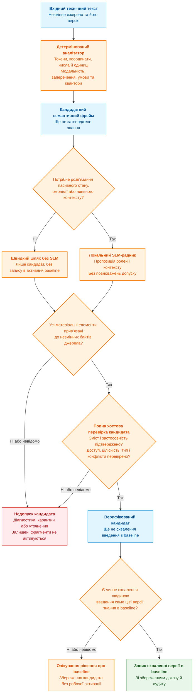

Присутність суб'єкта й дієслова у вихідних байтах є лише необхідною перевіркою опори, не достатньою умовою прийняття. Для джерела «Клапан не повинен відкриватися за перегріву» обидва кандидати — збережена заборона та підміна на «повинен відкриватися» — містять ті самі назви актантів і дії. Підміна полярності повинна відхилятися незалежно від того, який шлях сформував фрейм. Так само відхиляється кандидат, що зберіг слова, але змінив напругу застосування, одиницю, квантор чи виняток. Нерозв'язана неоднозначність не замінюється припущенням.

Перевірка під час інженерії знань використовує обов'язки походження, семантики й застосовності, розкриті в §6, але не підміняє їх буквальним викликом runtime-предиката `Admit` над ще не затвердженим кандидатом. Після включення знання в baseline відповідь на конкретний запит знову проходить `Admit` за вже схваленими підставами. Схвалення введення версії знання не є підписом людини на кожну наступну відповідь або дію; автоматичні перевірки застосування залишаються обов'язковими ([Глава 16, §1.1](ch16-expert-systems-architecture.md#11-канонічний-словник-вердиктів-рантайму-та-межі-повноважень)).

Модель NLI може надати калібрований сигнал, але її висока оцінка не доводить відповідності модальності чи умов джерелу. У суворому авторському профілі потрібна незалежна перевірка в схваленій моделі; це не цитата вимоги ASIL D. Швидкий шлях економить виклик SLM, а не вартість обов'язкових перевірок, аудиту або погодження baseline. Якщо SLM недоступна, нерозібраний випадок R-12 залишається невідомим, а не переходить автоматично до швидкого допуску.

#### 11.3.1. Матриця функціональної відповідальності

Матриця уточнює, які ознаки доступні заданим правилам, а для яких потрібна гіпотеза радника. Вона не задає універсального поділу алгоритмів: пасивний стан також можна розбирати правилами, а SLM може помилятися на прямому порядку слів. Жоден стовпчик не надає права допуску.

<a id="obj-12-35"></a>

**Таблиця 12.35. Функціональна відповідальність правил і радника**

| Семантична / лінгвістична категорія | Що може виявити рушій у підтриманій граматиці | Що може запропонувати SLM |
|---|---|---|
| **Фізичні величини та одиниці СІ** | Числа, експоненти, діапазони, одиниці системи СІ (`s`, `ms`, `octet`, `bit/s`, `V`, `Hz`, `°C`), оператори нерівності ($=, \le, \ge, \lt, \gt, \in [a, b]$). | Інтерпретація неформальних або розмовних описів розмірностей (*«затримка не довша за одне кліпання оком»*). |
| **Деонтичні норми** | Замкнений словник нормативних маркерів: `MUST`, `MUST NOT`, `SHALL`, `SHOULD`, `MAY`, `повинен`, `заборонено`, `слід`. | Виявлення прихованих зобов'язань у ненормативних формулюваннях (*«від сервера очікується...»*). |
| **Логічні умови та дефітери (Defeaters)** | Формальні синтаксичні зв'язки: `IF`, `UNLESS`, `EXCEPT WHEN`, `PROVIDED THAT`, `AND`, `OR`, `NOT`. | Оцінка семантичної сумісності складносурядних гіпотетичних конструкцій. |
| **Квантори ($\forall/\exists$)** | Маркери загальності та існування: `all`, `every`, `each`, `any`, `at least one`, `none`, `кожен`, `всі`, `жоден`. | Розрізнення колективного та дистрибутивного значення множин. |
| **Протокольні символи та константи** | Ідентифікатори `camelCase`, `snake_case`, `SCREAMING_SNAKE`, числові статуси (`503`, `404`), шістнадцяткові значення (`0x0304`). | Зв'язування числових кодів із текстовими описами помилок без явної таблиці. |
| **Синтаксична будова (SRL)** | Прямий суб'єктно-предикатний порядок слів (*«Client MUST send...»*). | Інверсія, пасивний стан, еліпсис (*«Upon receipt of X, there shall be emitted Y»*). |
| **Зняття омонімії (Disambiguation)** | Позиційний аналіз у межах активного `Scope`. | Контекстне розрізнення багатозначних лексем (`CAN` як шина чи допоміжне дієслово; `state` як стан чи висловлювання). |
| **Неявні пресупозиції** | Потрібне явне правило; відсутність запису не означає хибності. | Гіпотеза про попередній стан сеансу; слово «відновити» не доводить, що стан надійно збережено. |

На цьому завершено шлях від документа до кандидата й паспорта перевірок. Наступне питання — як допомогти користувачеві знайти R-12 розмовною мовою, не перетворивши зовнішній словник на джерело нової норми.

## 12. Стратифікація довіри до лексиконів і тезаурусів та асиметричний семантичний шлюз (Data Diode)

Стратифікація словників розв'язує суперечність між зручним пошуком і незмінністю схваленої норми. Користувач може запитати «коли відключиться нагрівач», хоч R-12 містить «повинен вимкнути». Пошук лише буквальних слів ризикує пропустити вимогу — це **лексична сліпота**. Натомість автоматичне внесення всіх синонімів моделі до бази правил може непомітно змінити значення, модальність або умову. Потрібно дозволити розширення запиту без права переписати відповідь джерела.

Автором запропоновано **трирівневу стратифікацію лексичної довіри** з **асиметричним епістемічним діодом**. Мотивом є захист цілісності у моделі Біби [[36]](#src-36), особливо заборона запису з нижчого рівня до вищого. Це адаптація, не буквальна реалізація суворого *no read down*: високодовірений маршрутизатор читає недовірені гіпотези, але не дозволяє їм змінювати схвалені визначення. Для такого читання потрібні окремі інтерфейси й перевірка інформаційних потоків.

### 12.1. Формальна модель заземлення термінів та три ешелони лексиконів

Заземлення терміна починається з питання «де його визначено?», а не «на що він схожий?». Нехай $`\mathcal{W}`$ — множина розглянутих виразів, $`\mathcal{C}_{\mathrm{sovereign}}`$ — схвалені поняття конкретного домену й версії, $\mathcal{R}$ — кандидатні твердження. Функція $\mathcal{G}$ повертає запис походження $r$ або порожнє значення, якщо перевіреної опори немає:

<a id="obj-12-36"></a>

**Формула (12.36). Запис байтового анкерингу**

$$
\mathcal{G}(r) = \langle \mathrm{DocHash}_{\mathrm{SHA256}}, \, b_{\mathrm{start}}, \, b_{\mathrm{end}}, \, \mathrm{QuoteHash}_{\mathrm{SHA256}} \rangle, \quad 0 \le b_{\mathrm{start}} < b_{\mathrm{end}} \le |\mathrm{Doc}|.
$$

Обидва хеші — 256-бітні відбитки документа та цитованого байтового зрізу; межі — цілі зсуви в байтах, кінець не входить, $`|\mathrm{Doc}|`$ — розмір незмінного об'єкта в байтах. Для кількох опор потрібен список таких записів. Наприклад, для окремого навчального UTF-8 джерела `20 мс` межі одиниці — [3,7), а перевірка читає саме цей зріз і порівнює його хеш із довіреним записом. У R-12 для повної вимоги потрібна також опора на умову й дію; один зріз одиниці їх не доводить. Непорожня $\mathcal{G}$ підтверджує походження, не правильність змісту або автоматичне право використати норму.

Усі словникові ресурси системи жорстко поділяються на три ізольовані ешелони за рівнем епістемічної цілісності $`\mathcal{I} \in \{\mathrm{T0}, \mathrm{T1}, \mathrm{T2}\}`$ (де $`\mathrm{T0} \succ \mathrm{T1} \succ \mathrm{T2}`$):

<a id="obj-12-37"></a>

**Таблиця 12.37. Три ешелони лексичної довіри**

| Ешелон довіри | Назва та джерело походження | Статус байтового анкерингу $`\mathcal{G}(w)`$ | Дозволена роль у рантаймі | Право генерувати норми чи факти (`Eligibility`) |
|---|---|---|---|---|
| **Tier 0 (`T0`)** | **Суверенний первинний лексикон:** схвалені терміни та дефініції заданого домену й версії | Є перевірені опори $`\mathcal{G}(w)`$ | Канонічні ідентифікатори й підстави для окремої перевірки правил | Лише після повної перевірки та схвалення; саме членство в `T0` не дорівнює допуску |
| **Tier 1 (`T1`)** | **Куровані відкриті онтології** (*Curated Reference Ontologies*): версійовані академічні та галузеві тезауруси (WordNet [[37]](#src-37), Wikidata [[38]](#src-38), EuroVoc, UMLS, IEEE Thesaurus) з фіксованим криптографічним хешем знімка | Зовнішній URI + контрольна сума знімка ($`\mathcal{G}_{\mathrm{local}}(w) = \varnothing`$) | Розширення синонімічних кілець та гіперонімічна навігація під час розбору запиту користувача | **Заборонено** (лише `Relevance`) |
| **Tier 2 (`T2`)** | **Дорадчий зовнішній тезаурус** (*Advisory Extrinsic / Web-AI Thesaurus*): асоціативні зв'язки, евристичні переклади та підказки з пошукових систем, відкритого Інтернету або мовних моделей (LLM/SLM) | Відсутній ($`\mathcal{G}(w) = \varnothing`$, стохастична гіпотеза) | Евристичний переклад користувацького запиту на множину кандидатів із простору `T0` (`Query Expansion`) | **Суворо заборонено** (ізольований пісочницею) |

**Порівняння з українською традицією онтологічного інжинірингу.** Палагін, Петренко й Малахов розглядають поняття, відношення та їхню інтерпретацію під час проєктування онтології [[40]](#src-40). В авторському профілі цієї глави експерт також може запропонувати визначення, але його потрібно оформити як окрему простежувану підставу й схвалити, а не непомітно приписати стандарту. Дескриптивні логіки, розглянуті Гогерчаком [[41]](#src-41), працюють із моделями, що задовольняють аксіоми бази знань; сама база не тотожна множині цих моделей. Відкритий світ означає, що відсутнє твердження не вважається автоматично хибним. Це сумісне з політикою відмови: для неповної R-12 система може утриматися від повного висновку або явно видати лише підтриману частину, якщо такий контракт дозволено. Відмова є політикою відповіді, не запереченням логічної семантики відкритого світу. Важливість фіксації предметної області й неповноти знань розглянуто також у Кривого, Дарчук і Провотара [[42]](#src-42). Порівняння окреслює різні задачі, не доводить пріоритету авторської моделі; точні зовнішні уривки в цьому локальному проході повторно не перевірялися.

### 12.2. Асиметричний епістемічний шлюз та Закон непорушності суверенної дефініції

Асиметричний шлюз має пропустити підказку «як знайти поняття», але заблокувати непогоджену зміну «що воно означає». Для R-12 синонім «відключити нагрівач» може допомогти пошуку, але не змінити обов'язок чи межу часу. Це авторська політика цілісності, мотивована моделлю Біби [[36]](#src-36), а не математичний доказ її реалізації. Схема показує дозволені й заборонені інформаційні потоки:

<a id="obj-12-38"></a>

**Діаграма 12.38. Ізоляція зовнішнього розширення запитів**

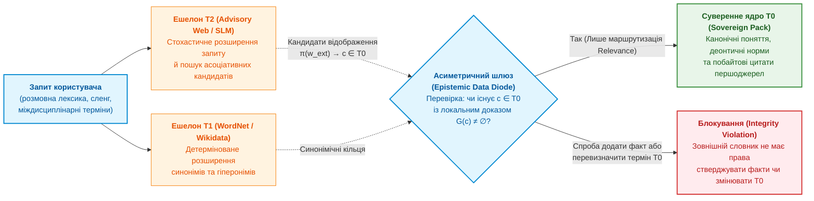

Формально робота шлюзу описується оператором проєкції запиту $`\Pi_{\mathrm{T2} \to \mathrm{T0}}`$. Нехай користувацький запит містить невідому для локального словника лексему $`w_{\mathrm{ext}} \notin \mathrm{Lex}(\mathrm{T0})`$. Зовнішній тезаурус `T1`/`T2` пропонує ранжований вектор кандидатів-синонімів $`\{(c_k, s_k)\}_{k=1}^K`$, де $`c_k \in \mathcal{C}_{\mathrm{sovereign}}`$ належить суверенному лексикону `T0`, а $`s_k \in (0, 1]`$ — оцінка лексичної близькості. Тоді результуюча вага активації концепту $`c_k`$ при пошуку релевантних правил обмежується понижувальним коефіцієнтом довіри ешелону $`\gamma(\mathcal{I})`$ (де $`\gamma(\mathrm{T0}) = 1{,}00`$, $`\gamma(\mathrm{T1}) = 0{,}85`$, $`\gamma(\mathrm{T2}) \le 0{,}60`$):

<a id="obj-12-39"></a>

**Формула (12.39). Профільна вага релевантності поняття**

$$
\mathrm{Score}_{\mathrm{relevance}}(c_k \mid w_{\mathrm{ext}}) = \gamma(\mathcal{I}) \cdot s_k \cdot \mathbb{I}\!\left(\mathcal{G}(c_k) \ne \varnothing\right).
$$

Тут $k$ — цілий індекс від 1 до додатного числа кандидатів $K$; $`c_k`$ — канонічне поняття, $`w_{\mathrm{ext}}`$ — вхідний вираз; $`s_k`$ — нормований безрозмірний бал від 0 до 1. $\mathcal{I}$ позначає ешелон, $\gamma$ — заданий профілем множник у [0,1], а індикатор $\mathbb{I}$ дорівнює 1 за перевіреної опори й 0 інакше. Наведені 1,00; 0,85; 0,60 — приклад політики ранжування, не калібровані ймовірності істини. Бал теж лежить у [0,1]. За бала синоніма 0,9 і множника T2 0,6 отримуємо 0,54; без опори результат 0. Це скеровує пошук R-12, але не дозволяє замінити в ній мілісекунди секундами. Оператор $\Pi$ є назвою цього відображення кандидатів, а не доведеною лінійною чи ідемпотентною проєкцією.

При цьому виконуються два непорушні закони безпеки:

1. **Закон непорушності суверенної дефініції (*Sovereign Non-Override Law*):** у межах уже вибраних домену, версії та області документа зовнішнє тлумачення не переписує схвалене визначення `T0`. Наприклад, у навчальному електротехнічному словнику `bus` означає шину, а в транспортному — автобус. Обидва значення можуть існувати в різних областях; за невідомого домену потрібно уточнення, а не глобальна заборона другого значення. WordNet [[37]](#src-37), [[39]](#src-39) допомагає шукати варіанти, але порядок його значень не встановлює нормативного пріоритету.
2. **Закон карантинної промоції (*Quarantined Promotion Protocol*):** підвищення до `T0` відбувається лише окремим процесом підготовки версії: з перевіреною джерельною опорою, перевіркою змісту та чинним схваленням введення в baseline. Сам підпис інженера не замінює опори. Якщо джерелом є експертне судження, його спочатку фіксують як окремий версійований документ з відповідним типом підстави; воно не стає цитатою стандарту.

На практиці ця схема реалізується через **двоканальне підключення спеціалізованої української мовної моделі** (зокрема Lapa LLM [[15]](#src-15)) за епістемічним діодом. У першому, **офлайновому тракті (під час компіляції знань)**, модель допомагає автоматично збагачувати допоміжний словник ешелону `T2`: для англомовних чи вузькоспеціальних термінів стандарту вона пропонує українські інженерні еквіваленти, відмінкові форми та синоніми (наприклад, зв'язує *«Watchdog Timer»* із *«сторожовим таймером»* та *«контролем зависання»*), які записуються зі зниженою вагою довіри й обов'язково перевіряються на незалежній контрольній вибірці, щоб відсіяти хибні збіги. У другому, **онлайновому тракті (під час живого діалогу)**, коли користувач ставить запитання розмовною українською мовою або суржиком, модель перекладає його неформальні вислови у точний перелік канонічних понять суверенного ядра `T0`. Завдяки односторонньому діоду користувач отримує зручність вільного спілкування рідною мовою, а система зберігає абсолютну строгість: мовна модель лише підказує, в якій шухляді суверенного архіву `T0` шукати документ, але жодне її слово не може підмінити текст самого стандарту.

> [!NOTE]
> **Три правила стратифікації лексичної довіри та ізоляції зовнішніх словників (авторська модель)**
> 1. **Правило трирівневої стратифікації за цілісністю (Three-Tier Lexical Integrity):** усі лексичні джерела системи фізично розділяються на суверенний шар `T0` (індукований із першоджерел із побайтовою кастодією), курований шар `T1` (версійовані тезауруси) та дорадчий шар `T2` (евристики Інтернету та мовних моделей) без змішування у спільному табличному просторі.
> 2. **Правило одностороннього семантичного діода (Unidirectional Epistemic Data Diode):** зовнішні словники `T1`/`T2` мають право працювати виключно на вхідному боці розширення запитів (`Query Expansion / Relevance`), переводячи користувацькі синоніми у відомі поняття `T0`, але фізично позбавлені права стверджувати факти чи впливати на детермінований допуск (`Eligibility`).
> 3. **Правило пріоритету локальної норми (Sovereign Definition Precedence):** у вибраному домені й версії зовнішній словник не перевизначає схвалений термін. За кількох можливих областей або суперечливих схвалених джерел потрібне уточнення чи окрема перевірка конфлікту.
> *Керування рантаймом / Інженерний інваріант:* якщо після розширення запиту через ешелони `T1`/`T2` жоден із запропонованих концептів-кандидатів не має підтвердженого факту в суверенному пакеті `T0` ($`\mathcal{G}(c) = \varnothing`$), система негайно повертає чесну відмову `REFUSAL (NO_SOVEREIGN_EVIDENCE)`, не дозволяючи генерувати відповідь із тексту самого зовнішнього словника.

### 12.3. Вагові матриці локальних моделей як голографічний тензор коваріації для генерації гіпотез

Пошук за прихованими поданнями може запропонувати аналогію там, де немає спільних слів: наприклад, часову вимогу R-12 зіставити з іншим правилом завершення реакції після події. У цій монографії автором запропоновано досліджувати для цього ваги й подання локальної моделі. Назви «голографічний тензор коваріації» та «радар» у цій моделі є метафорами розподілених асоціацій, не означенням статистичної коваріаційної матриці або готового алгоритму. Ваги мережі самі по собі не є таблицею канонічних понять.

Для відтворюваної перевірки спочатку визначають, який шар і спосіб агрегації подають багатотокеновий термін, як вирівняно мови та яку базову лінію порівняння використано. Прямий векторний пошук може усунути етап генерації тексту, але не помилки асоціацій. Подібність двох часових правил не доводить ізоморфізму доменів: потрібно окремо зіставити сутності, одиниці, умови й збережувані відношення.

> [!NOTE]
> **Чотири принципи видобування похідних припущень із вагової бази локальних моделей (авторська модель)**
> 1. **Пряме зондування подань:** автором запропоновано порівнювати векторні подання понять як кандидатний пошук, із явно заданим шаром, токенізатором і способом агрегації.
> 2. **Перевірка складених аналогій:** гіпотеза зв'язку через проміжне поняття потребує окремої перевірки; близькість A до B і B до C не гарантує близькості чи логічного слідування між A та C.
> 3. **Захист від зближення антонімів:** взаємовиключні поняття можуть мати близькі подання через спільні контексти; величину цього ефекту перевіряють на конкретній моделі. Окремо перевіряють модальність, полярність, ролі та умови, бо один деонтичний фільтр не виявляє всіх помилок аналогії.
> 4. **Локальність і контроль повторюваності:** фіксуються ваги, токенізація, шар, арифметика, рушій і спосіб порівняння. Відсутність вибірки токенів усуває одне джерело випадковості, але числові розбіжності між платформами перевіряються окремо.
> *Інженерний інваріант:* модель висуває лише гіпотези; формальний висновок обмежений правильністю схваленої моделі й перевірених передумов, а не автоматичними 100% точності для реального світу.

## 13. Категорійна передгрупова семантика DisCoCat та Універсальне Машинне Слово Знань (EIW-512)

Композиційна семантика ставить питання, як поєднати значення частин речення, а машинне пакування — як зберегти вже перевірений результат. Це різні задачі. Для R-12 спочатку потрібно правильно зв'язати контролер, дію, умову й час, і лише потім кодувати межу у двійковому записі. JSON або Datalog не приречені на неефективність: вартість залежить від реалізації та навантаження. Нижче DisCoCat є математичним базисом композиції, а авторський EIW-512 — обмеженою пропозицією пакування; жоден сам не доводить істинності вихідного тексту.

### 13.1. Передгрупові граматики Ламбека та категорійна дистрибутивна семантика (DisCoCat)

Передгрупова граматика потрібна, щоб порядок і типи слів обмежували допустимі композиції. У DisCoCat синтаксичне скорочення пов'язують із композицією значень; класичне джерело цього підходу наведено в [[44]](#src-44). Нагадаємо передумови: моноїд має асоціативний добуток і нейтральний елемент, частковий порядок сумісний із добутком. У передгрупі кожен тип має лівий і правий спряжені типи, для яких виконуються скорочення та розширення:

Передгрупою називається частково впорядкований моноїд $`(\mathcal{P}, \cdot, 1, \le)`$, де кожен базовий тип $`p \in \mathcal{P}`$ володіє лівим $p^l$ та правим $p^r$ спряженими елементами, що задовольняють співвідношення скорочення:

<a id="obj-12-40"></a>

**Формула (12.40). Скорочення й розширення передгрупи**

$$
p \cdot p^r \le 1 \le p^r \cdot p, \qquad p^l \cdot p \le 1 \le p \cdot p^l.
$$

Тут $\mathcal{P}$ — множина типів, $p$ — будь-який її елемент, крапка — добуток типів, 1 — порожній тип, а $\le$ — порядок допустимих скорочень; усі вони без фізичних одиниць. $`p^l`$ і $`p^r`$ — спряжені типи, не степені числа. Наприклад, іменникові групи мають тип $n$, речення — $s$, перехідне дієслово — $`n^r s n^l`$. Для «контролер вимикає нагрівач» послідовність скорочується так:

<a id="obj-12-41"></a>

**Формула (12.41). Типове скорочення перехідного речення**

$$
n\,(n^r s n^l)\,n=(n n^r)\,s\,(n^l n)\le 1\,s\,1=s.
$$

Скорочення дозволене асоціативністю та двома нерівностями передгрупи; $n$ і $s$ — формальні типи, не значення фізичних величин. Результат показує граматичну сумісність простого шаблону, а не те, чи контролер виконав дію. Модальність і час у R-12 потребують додаткових типів і правил, яких цей приклад не задає. Для зв'язку синтаксису зі значеннями авторська пропозиція вводить моноїдальний функтор:

<a id="obj-12-42"></a>

**Формула (12.42). Реляційна інтерпретація синтаксичної композиції**

$$
\mathcal{F}: \mathbf{Pregroup}_{\mathrm{syntax}} \to \mathbf{Rel}_{\mathrm{EIR}}.
$$

У формулі функтора $\mathcal{F}$ синтаксичні типи й скорочення відображаються в об'єкти й морфізми цільової категорії зі збереженням композиції та одиниць. $`\mathbf{Rel}_{\mathrm{EIR}}`$ тут означає обрану реляційну інтерпретацію: об'єкти є множинами типізованих значень, морфізми — відношеннями. Це не одночасно категорія векторних просторів; для тензорної інтерпретації задають іншу ціль. Наприклад, дієслово відображають у відношення між виконавцем і об'єктом, а композиція підставляє їх у фрейм. Для такого функтора потрібно явно визначити словник, типізацію й інтерпретацію; автоматичної трансляції UD, збереження всіх кванторів і винятків тут не доведено.

### 13.2. Специфікація Універсального Машинного Слова Знань (Epistemic Instruction Word — EIW-512)

Машинне слово потрібне, коли вже перевірене просте правило багаторазово порівнюють із параметрами запиту. Автором запропоновано **Epistemic Instruction Word (`EIW-512`)** як 512-бітне, тобто 64-байтне пакування восьми полів. Назва «універсальне» є назвою задуму, не доведеною повнотою: у записі немає окремих полів довільної кількості актантів, кванторів, вкладених винятків чи початкової події часу. Такі дані потребують зовнішньої схваленої схеми; якщо їх не можна однозначно відновити, пакування відхиляється.

<a id="obj-12-43"></a>

**Формула (12.43). Поля авторського формату EIW-512**

$$
\mathrm{EIW}_{512} = \Bigl\langle \mathrm{SubjID}_{64\text{b}},\; \mathrm{RelOp}_{16\text{b}},\; \mathrm{Modality}_{8\text{b}},\; \mathrm{Polarity}_{8\text{b}},\; \mathrm{DimSI}_{64\text{b}},\; [\mathrm{ValMin}, \mathrm{ValMax}]_{128\text{b}},\; \mathrm{CtxMask}_{128\text{b}},\; \mathrm{CustodyPtr}_{96\text{b}} \Bigr\rangle.
$$

Сума розрядностей дорівнює 64 + 16 + 8 + 8 + 64 + 128 + 128 + 96 = 512 біт. Формула задає кортеж полів, не порядок байтів, правила padding або готовий ABI. Домени полів та обмеження такі:

1. $`\mathrm{SubjID}_{64\text{b}}`$: беззнаковий 64-бітний ідентифікатор у версійованій таблиці сутностей. FNV-1a може дати кандидата ключа, але не гарантує глобальної унікальності: колізії потрібно виявляти й розв'язувати;
2. $`\mathrm{RelOp}_{16\text{b}}`$: 16-бітний код реляційного оператора ($`\le, \ge, =, \in, \mathrm{is\_a}, \mathrm{part\_of}, \mathrm{causes}`$);
3. $`\mathrm{Modality}_{8\text{b}}`$: код із зафіксованого переліку «обов'язок, заборона, дозвіл, умова, дефітер». Останні два — типи запису, не самостійні деонтичні модальності; невідомі коди відхиляються;
4. $`\mathrm{Polarity}_{8\text{b}}`$: код чотирьох інформаційних станів Белнапа: підтримано, спростовано, обидва, жодного. Він не кодує сам собою сферу синтаксичного заперечення; не використовують один біт для обох задач;
5. $`\mathrm{DimSI}_{64\text{b}}`$: вісім знакових 8-бітних показників степеня від -128 до 127 у порядку «маса, довжина, час, струм, температура, кількість речовини, сила світла, інформація». Восьма координата є розширенням профілю, не базовою одиницею SI; масштаб і зсув одиниці задають окремо;
6. $`[\mathrm{ValMin}, \mathrm{ValMax}]_{128\text{b}}`$: пара скінченних float64 із впорядкованими межами включного інтервалу в канонічній одиниці; `NaN`, нескінченності, зворотні межі та неузгоджені одиниці відхиляються. Сам вектор розмірності не переводить мілісекунди в секунди й не враховує зсув температурної шкали;
7. $`\mathrm{CtxMask}_{128\text{b}}`$: маска до 128 визначених булевих умов. Семантика кожного біта, чинність вимірів і відмінність «хибне/невідоме» потребують зовнішнього опису; сама маска не виражає довільної логічної формули;
8. $`\mathrm{CustodyPtr}_{96\text{b}}`$: три беззнакові 32-бітні числа: локальний ID документа, початок і кінець напіввідкритого інтервалу. Межі мають бути в межах джерела й представні у 32 бітах; хеш і версію одержують із незмінної таблиці документів, не з самого вказівника.

> [!NOTE]
> **Чотири рівні математичної трансляції людського документа в Універсальну Машинну Мову Знань (авторська пропозиція)**
> 1. **DisCoCat-рівень:** композиція типізованих значень за явно заданою граматикою й інтерпретацією; для R-12 ще потрібно задати модальність, умову й відлік часу.
> 2. **WFST-рівень:** зважені скінченні перетворювачі описують підтримані локальні перетворення. Наприклад, словоформа переходить у лему зі збереженням опори. Ваги й операції їх поєднання визначає обране півкільце; загальна композиція автоматів може збільшувати число станів, тому лінійність усього аналізу не гарантована.
> 3. **FCA-рівень:** формальний аналіз понять групує об'єкти за спільними ознаками. Для навчальної таблиці «R-12: має умову й часову межу; R-інша: має умову без часової межі» замикання класу часових вимог повертає також ознаку умови. Це імплікація цієї таблиці, не універсальний закон. Базис Дюкенна–Гіга канонічний для скінченного контексту, але не обов'язково мінімальний за сумарною довжиною; повна решітка може мати експоненційно багато понять.
> 4. **Кеш-лінійне бінарне пакування в атомарні інструкції (EIW-512-рівень):** синтезовані знання вирівнюються в пам'яті по 64-байтових границях у форматі `EIW-512` з фіксованими бітовими полями розмірностей SI, контекстних масок і вказівників кустодії, уможливлюючи безпосередню обробку векторами SIMD та матричними співпроцесорами.

**Імператив замкненого циклу розрахунку (Actionable Closed Loop):**

1. **Керування рантаймом і потоком обчислень (Control Flow & Runtime Decisions):**
   Спочатку перевіряються схема, джерело й відомість усіх потрібних умов. Лише потім маска перевіряє наявність потрібних бітів у контексті. За невідомої умови або непідтриманої структури запис не застосовується; це не висновок про відсутність порушення. Код обов'язку скеровує значення до перевірки інтервалу, а порушення повертається з джерелом. Час цього шляху не дорівнює латентності однієї SIMD-інструкції.
2. **Апаратний сайзинг та інфраструктурні обмеження (Hardware Dimensioning):**
   Для щільного масиву 10 000 записів по 64 байти потрібно 640 000 байтів, тобто 640 kB або 625 KiB, без таблиць джерел, схем і індексів. Якщо цільова машина має 64-байтну кеш-лінію, база масиву вирівняна й крок дорівнює 64 байтам, один запис не перетинає межі лінії; довільна адреса чи інший розмір кеш-лінії цього не гарантують. Місткість L2 і пропускну здатність потрібно виміряти на конкретному CPU. Раніше наведені 120 ГБ/с і 1,8 мільярда правил/с не мають тут протоколу й не використовуються як гарантія.
3. **Практичний числовий приклад (Worked Numerical Example):**
   Для R-12 схвалена зовнішня схема задає вимірювану властивість «час від сигналу перегріву до вимкнення нагрівача контролером». `SubjID` посилається саме на цю властивість, оператор — включний інтервал, модальність — обов'язок, стан підтримки — підтверджено у базі вимог, не «пристрій виконав». Показники розмірності — (0,0,1,0,0,0,0,0), масштаб — секунди, межі — від 0 до 0,020 с. Біт умови означає відомий перегрів; вказівник веде до реального запису R-12 у навчальному джерелі, його адреси не вигадуються. Вимір 0,019 с проходить, 0,020 с проходить, 0,021 с порушує межу; невідомий початок відліку дає невизначеність, не успіх.

   Попередній приклад 22,0–29,5 В не підтверджено точним пунктом DO-160G, тому він може бути лише окремою навчальною умовою, не нормою цього стандарту. За порядку полів «маса, довжина, час, струм…» правильні показники розмірності вольта — (1,2,-3,-1,0,0,0,0); нуль у першій позиції губив масу. Байти текстової цитати не можна вказувати як довільний інтервал у стисненому PDF.

Таким чином, композиційна модель допомагає будувати кандидата, а пакування — перевіряти вже визначену властивість. Відсутність у EIW-512 довільних актантів, часових подій і винятків лишається обмеженням формату, яке не дозволено приховати за назвою «універсальний».

## Висновки

Глава почалася із запитання, як побудувати мовну підсистему, що розуміє різні формулювання людини, але стверджує лише відтворюване з байтів джерела. Відповідь така: мовна підсистема розширює коло формулювань, які експертна система сприймає від людини, і водночас звужує множину тверджень експертної системи до тих, що спираються на конкретні незмінні байти першоджерела. Для цього кожне перетворення тексту зберігає карту походження, кожен компонент має обмежені повноваження, зовнішні словники (`T1`/`T2`) відділені від суверенного лексикону (`T0`) одностороннім семантичним діодом за моделлю цілісності Біби, схожість лише впорядковує кандидатів, а рішення про допуск ухвалює детермінований верифікатор за маніфестами, хешами, картами походження й правилами доступу.

Для R-12 отримано послідовний результат: мовний аналіз пропонує фрейм, карта відтворює цитату, незалежна перевірка зберігає перегрів, обов'язок, початок відліку та 20 мс, а застосування порівнює значення лише за відомого контексту. Паспорт описує виконані перевірки, не доводить поведінки пристрою; машинне слово не вміщує довільної семантики без зовнішньої схеми. Токенізацію, калібрування, доступність і ресурсні межі перевіряють на конкретному профілі; повідомлені вимірювання не дають універсальної гарантії. Як долати варіативність мови під час перетворення запитання на однозначні предикати, розглядає [глава 13](ch13-language-variability-vs-determinism.md).

## Словник
<a id="obj-12-44"></a>

**Таблиця 12.44. Словник термінів глави**

| Український термін | Англійський відповідник | Коротке пояснення |
|---|---|---|
| Карта джерела | *source map* | Відображення фрагментів похідного тексту на байти першоджерела |
| Кодова позиція | *code point* | Числовий код символу в Unicode |
| Кластер графем | *grapheme cluster* | Послідовність кодових позицій, яку людина сприймає як один символ |
| Нормалізація Unicode | *Unicode normalization* | Приведення різних кодувань того самого тексту до канонічної форми |
| Вирівнювання | *alignment* | Збережене відношення між позиціями до й після перетворення тексту |
| Токенізатор | *tokenizer* | Програма, що ділить текст на токени словника моделі |
| Фертильність токенізатора | *tokenizer fertility* | Середня кількість токенів на одне слово |
| Логічне слідування | *natural language inference* | Оцінка, чи випливає твердження з фрагмента тексту, суперечить йому чи не пов'язане |
| Злиття обернених рангів | *reciprocal rank fusion* | Об'єднання кількох ранжованих списків за оберненими рангами |
| Непрямі вбудовані інструкції | *indirect prompt injection* | Інструкції для моделі, приховані в даних, які застосунок обробляє |
| Зсув розподілу | *distribution shift* | Відмінність даних під час використання від навчальних даних |
| Слабка розмітка | *weak supervision* | Навчальні мітки від евристик, які можуть утримуватися або помилятися |
| Активне навчання | *active learning* | Добір наступних прикладів для експертної розмітки |
| Конформне прогнозування | *conformal prediction* | Побудова множин прогнозів із гарантіями покриття за визначених передумов |
| Кеш ключів і значень | *KV cache* | Збережені проміжні подання уваги, що ростуть із довжиною контексту |
| Квантування | *quantization* | Подання ваг моделі числами меншої розрядності |
| Верифікатор на хості | *host verifier* | Детермінований компонент, що ухвалює рішення про допуск твердження |
| Атестація машинних знань | *Machine Knowledge Attestation* | Авторська процедура паспортизації походження, результатів і меж перевірок; не доказ повноти розуміння |
| Сертифікат атестації знань | *MKA Certificate* | Структурований паспорт знань із криптографічним хешем першоджерела, реєстрами сутностей, відношень і деонтичних норм |
| Стратифікація лексичної довіри | *lexical trust stratification* | Поділ словникових ресурсів за рівнем епістемічної цілісності на суверенний (`T0`), курований (`T1`) та дорадчий (`T2`) ешелони |
| Суверенний первинний лексикон | *sovereign primary lexicon* | Множина понять і дефініцій (`T0`), видобутих безпосередньо з локальних першоджерел із побайтовим анкерингом |
| Асиметричний епістемічний діод | *asymmetric epistemic data diode* | Односторонній шлюз, що дозволяє зовнішнім словникам розширювати вхідні запити до понять `T0`, але забороняє змінювати чи стверджувати факти |

## Абревіатури
<a id="obj-12-45"></a>

**Таблиця 12.45. Абревіатури глави**

| Скорочення | Розшифрування | Значення |
|---|---|---|
| AST | Abstract Syntax Tree | абстрактне синтаксичне дерево для формального представлення виразів і предикатів |
| CUDA | Compute Unified Device Architecture | платформа обчислень на графічних процесорах NVIDIA |
| GBNF | GGML Backus–Naur Form | формат граматичних правил для покрокового маскування логітів при генерації |
| GGUF | назва формату файлів ggml | формат зберігання квантованих моделей для llama.cpp |
| MKA | Machine Knowledge Attestation | паспорт перевірок машинних знань із визначеним обсягом і межами |
| NFC, NFKC | Normalization Form C, Normalization Form KC | канонічна й сумісна форми нормалізації Unicode зі складанням |
| NLI | Natural Language Inference | логічне слідування природною мовою |
| PDF | Portable Document Format | формат документів |
| RAG | Retrieval-Augmented Generation | генерація з пошуковим доповненням |
| REST API | Representational State Transfer Application Programming Interface | програмний інтерфейс поверх HTTP |
| ROCm | Radeon Open Compute | платформа обчислень на графічних процесорах AMD |
| RRF | Reciprocal Rank Fusion | злиття обернених рангів |
| SRL | Semantic Role Labeling | автоматичне розмічування семантичних ролей (актор, дія, об'єкт) у реченні |
| UAX | Unicode Standard Annex | додаток до стандарту Unicode |
| UTS | Unicode Technical Standard | технічний стандарт Unicode |
| UTF-8, UTF-16 | Unicode Transformation Format | способи кодування кодових позицій байтами |

## Джерела
1. <a id="src-1"></a>Unicode Consortium. [*UAX #15: Unicode Normalization Forms*](https://www.unicode.org/reports/tr15/). Unicode Standard Annex.
2. <a id="src-2"></a>Unicode Consortium. [*UAX #29: Unicode Text Segmentation*](https://www.unicode.org/reports/tr29/). Unicode Standard Annex.
3. <a id="src-3"></a>Nicholas Boucher, Ross Anderson. [*Trojan Source: Invisible Vulnerabilities*](https://www.usenix.org/conference/usenixsecurity23/presentation/boucher). *32nd USENIX Security Symposium*, 2023.
4. <a id="src-4"></a>Unicode Consortium. [*UTS #39: Unicode Security Mechanisms*](https://www.unicode.org/reports/tr39/). Unicode Technical Standard.
5. <a id="src-5"></a>Unicode Consortium. [*UAX #9: Unicode Bidirectional Algorithm*](https://www.unicode.org/reports/tr9/). Unicode Standard Annex.
6. <a id="src-6"></a>Kai Greshake, Sahar Abdelnabi, Shailesh Mishra, Christoph Endres та ін. [*Not What You've Signed Up For: Compromising Real-World LLM-Integrated Applications with Indirect Prompt Injection*](https://doi.org/10.1145/3605764.3623985). *Proceedings of the 16th ACM Workshop on Artificial Intelligence and Security*, 79–90, 2023.
7. <a id="src-7"></a>Marie-Catherine de Marneffe, Christopher D. Manning, Joakim Nivre, Daniel Zeman. [*Universal Dependencies*](https://doi.org/10.1162/coli_a_00402). *Computational Linguistics*, 47(2), 255–308, 2021.
8. <a id="src-8"></a>Nils Reimers, Iryna Gurevych. [*Sentence-BERT: Sentence Embeddings using Siamese BERT-Networks*](https://aclanthology.org/D19-1410/). *Proceedings of EMNLP-IJCNLP 2019*.
9. <a id="src-9"></a>Alexis Conneau, Ruty Rinott, Guillaume Lample, Adina Williams та ін. [*XNLI: Evaluating Cross-lingual Sentence Representations*](https://aclanthology.org/D18-1269/). *Proceedings of EMNLP 2018*.
10. <a id="src-10"></a>Phillip Rust, Jonas Pfeiffer, Ivan Vulić, Sebastian Ruder, Iryna Gurevych. [*How Good is Your Tokenizer? On the Monolingual Performance of Multilingual Language Models*](https://arxiv.org/abs/2012.15613). arXiv:2012.15613; *Proceedings of ACL-IJCNLP 2021*.
11. <a id="src-11"></a>Aleksandar Petrov, Emanuele La Malfa, Philip H. S. Torr, Adel Bibi. [*Language Model Tokenizers Introduce Unfairness Between Languages*](https://arxiv.org/abs/2305.15425). arXiv:2305.15425, 2023.
12. <a id="src-12"></a>Hugo Touvron, Thibaut Lavril, Gautier Izacard та ін. [*LLaMA: Open and Efficient Foundation Language Models*](https://arxiv.org/abs/2302.13971). arXiv:2302.13971, 2023.
13. <a id="src-13"></a>Albert Q. Jiang, Alexandre Sablayrolles, Arthur Mensch та ін. [*Mistral 7B*](https://arxiv.org/abs/2310.06825). arXiv:2310.06825, 2023.
14. <a id="src-14"></a>Gemma Team. [*Gemma: Open Models Based on Gemini Research and Technology*](https://arxiv.org/abs/2403.08295). arXiv:2403.08295, 2024.
15. <a id="src-15"></a>Lapa LLM. [*Lapa LLM v0.1.2 Instruct: model card*](https://huggingface.co/lapa-llm/lapa-v0.1.2-instruct); опис токенізатора: [*lapa-llm/tokenizer*](https://huggingface.co/lapa-llm/tokenizer). Hugging Face.
16. <a id="src-16"></a>Randall Balestriero, Jerome Pesenti, Yann LeCun. [*Learning in High Dimension Always Amounts to Extrapolation*](https://arxiv.org/abs/2110.09485). arXiv:2110.09485, 2021.
17. <a id="src-17"></a>Pang Wei Koh, Shiori Sagawa, Henrik Marklund та ін. [*WILDS: A Benchmark of in-the-Wild Distribution Shifts*](https://arxiv.org/abs/2012.07421). arXiv:2012.07421; *Proceedings of ICML 2021*.
18. <a id="src-18"></a>Woosuk Kwon, Zhuohan Li, Siyuan Zhuang, Ying Sheng та ін. [*Efficient Memory Management for Large Language Model Serving with PagedAttention*](https://doi.org/10.1145/3600006.3613165). *Proceedings of the 29th Symposium on Operating Systems Principles*, 611–626, 2023.
19. <a id="src-19"></a>Gordon V. Cormack, Charles L. A. Clarke, Stefan Buettcher. [*Reciprocal Rank Fusion Outperforms Condorcet and Individual Rank Learning Methods*](https://doi.org/10.1145/1571941.1572114). *Proceedings of SIGIR 2009*, 758–759, 2009.
20. <a id="src-20"></a>Patrick Lewis та ін. [*Retrieval-Augmented Generation for Knowledge-Intensive NLP Tasks*](https://arxiv.org/abs/2005.11401). *Advances in Neural Information Processing Systems 33* (NeurIPS 2020).
21. <a id="src-21"></a>Учасники Docling. [*Docling*](https://docling-project.github.io/docling/) і [*DoclingDocument*](https://docling-project.github.io/docling/concepts/docling_document/). Офіційна документація форматів, структури й походження елементів.
22. <a id="src-22"></a>Apache Software Foundation. [*Apache Tika*](https://tika.apache.org/). Офіційна документація вилучення тексту й метаданих.
23. <a id="src-23"></a>Alexander Ratner, Stephen H. Bach, Henry Ehrenberg, Jason Fries, Sen Wu, Christopher Ré. [*Snorkel: Rapid Training Data Creation with Weak Supervision*](https://arxiv.org/abs/1711.10160). *Proceedings of the VLDB Endowment*, 11(3), 269–282, 2017.
24. <a id="src-24"></a>Anastasios N. Angelopoulos, Stephen Bates. [*A Gentle Introduction to Conformal Prediction and Distribution-Free Uncertainty Quantification*](https://arxiv.org/abs/2107.07511). Препринт, 2021; редакція 2022.
25. <a id="src-25"></a>ggml-org. [*llama.cpp: LLM Inference in C/C++*](https://github.com/ggml-org/llama.cpp). Репозиторій GitHub.
26. <a id="src-26"></a>Ollama. [*Structured Outputs*](https://ollama.com/blog/structured-outputs). Блог Ollama.
27. <a id="src-27"></a>ml-explore. [*MLX LM: Run LLMs with MLX*](https://github.com/ml-explore/mlx-lm). Репозиторій GitHub.
28. <a id="src-28"></a>NVIDIA. [*TensorRT-LLM*](https://github.com/NVIDIA/TensorRT-LLM). Репозиторій GitHub.
29. <a id="src-29"></a>Microsoft. [*ONNX Runtime*](https://onnxruntime.ai/). Офіційний сайт.
30. <a id="src-30"></a>Benoit Jacob, Skirmantas Kligys, Bo Chen, Menglong Zhu та ін. [*Quantization and Training of Neural Networks for Efficient Integer-Arithmetic-Only Inference*](https://doi.org/10.1109/CVPR.2018.00286). *2018 IEEE/CVF Conference on Computer Vision and Pattern Recognition*, 2704–2713, 2018.
31. <a id="src-31"></a>Sewon Min, Kalpesh Krishna, Xinxi Lyu, Mike Lewis та ін. [*FActScore: Fine-grained Atomic Evaluation of Factual Precision in Long Form Text Generation*](https://aclanthology.org/2023.emnlp-main.741/). *Proceedings of EMNLP 2023*.
32. <a id="src-32"></a>Tianyu Gao, Howard Yen, Jiatong Yu, Danqi Chen. [*Enabling Large Language Models to Generate Text with Citations*](https://aclanthology.org/2023.emnlp-main.398/). *Proceedings of EMNLP 2023*.
33. <a id="src-33"></a>B. Efron. [*Bootstrap Methods: Another Look at the Jackknife*](https://doi.org/10.1214/aos/1176344552). *The Annals of Statistics*, 7(1), 1–26, 1979.
34. <a id="src-34"></a>Yurii Kuzmenko, Olena Trofimova. [*Structural Invariant Framework (SIF 1.0): A Registry-Based Framework for Empirically Verified Terminology Preservation in Neural EN→UA Translation of Metrological Standards*](https://doi.org/10.5281/zenodo.20509698). Zenodo, 2026.
35. <a id="src-35"></a>Yurii Kuzmenko, Olena Trofimova. [*Structural Invariant Framework in Low-Data Contradiction-Aware Neural Machine Translation: Architecture and Diagnostic Pipeline (v1.0)*](https://doi.org/10.5281/zenodo.19332453). Zenodo, 2026.
36. <a id="src-36"></a>Kenneth J. Biba. [*Integrity Considerations for Secure Computer Systems*](https://apps.dtic.mil/sti/citations/ADA039324). Technical Report MTR-3153, The MITRE Corporation; ESD-TR-76-372, USAF Electronic Systems Division, Bedford, MA, 1977.
37. <a id="src-37"></a>George A. Miller. [*WordNet: A Lexical Database for English*](https://doi.org/10.1145/219717.219748). *Communications of the ACM*, 38(11), 39–41, 1995.
38. <a id="src-38"></a>Denny Vrandečić, Markus Krötzsch. [*Wikidata: A Free Collaborative Knowledgebase*](https://doi.org/10.1145/2629489). *Communications of the ACM*, 57(10), 78–85, 2014.
39. <a id="src-39"></a>Christiane Fellbaum (ред.). [*WordNet: An Electronic Lexical Database*](https://mitpress.mit.edu/9780262561167/wordnet/). MIT Press, Cambridge, MA, 1998.
40. <a id="src-40"></a>А. В. Палагин, Н. Г. Петренко, К. С. Малахов. [*Методика проектирования онтологии предметной области*](https://arxiv.org/abs/1802.06769). *Комп'ютерні засоби, мережі та системи*, № 10, 2011.
41. <a id="src-41"></a>Г. І. Гогерчак. [*Застосування баз знань та дескриптивних логік до аналізу природномовних текстів*](https://doi.org/10.15407/pp2020.02-03.259). *Проблеми програмування*, № 2–3, 259–269, 2020.
42. <a id="src-42"></a>С. Л. Кривий, Н. П. Дарчук, О. І. Провотар. *Онтологоподібні системи аналізу природномовних текстів*. *Проблеми програмування*, № 2–3, 132–139, 2018.
43. <a id="src-43"></a>С. Л. Крывый, Д. С. Бибиков. *Итеративный подход к анализу естественно-языковых текстов: логический аспект*. *Проблеми програмування*, № 2–3, 2012.
44. <a id="src-44"></a>Bob Coecke, Mehrnoosh Sadrzadeh, Stephen Clark. [*Mathematical Foundations for a Compositional Distributional Model of Meaning*](https://arxiv.org/abs/1003.4394). *Linguistic Analysis*, 36, 345–384, 2010. Класичний базис DisCoCat; не джерело гарантій нормативного допуску EIW-512.

---

[← Глава 11](ch11-knowledge-elicitation-from-experts.md) | [Зміст книги](README.md) | [Частина III](part-03-knowledge-engineering-nlp.md) | [Глава 14 →](ch14-requirements-detection-and-formalization.md)
