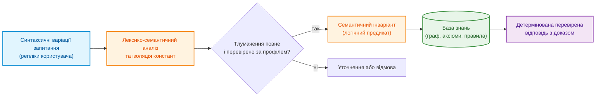
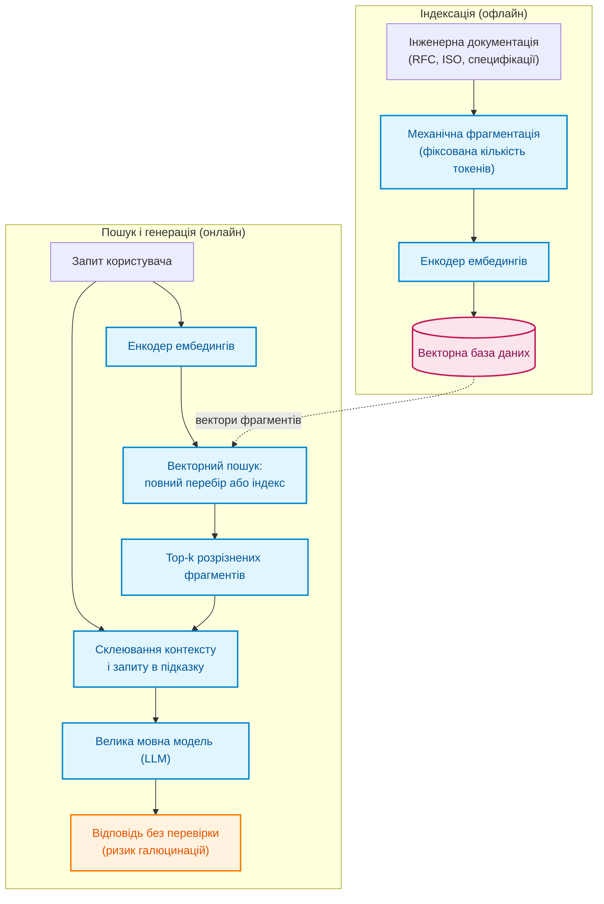
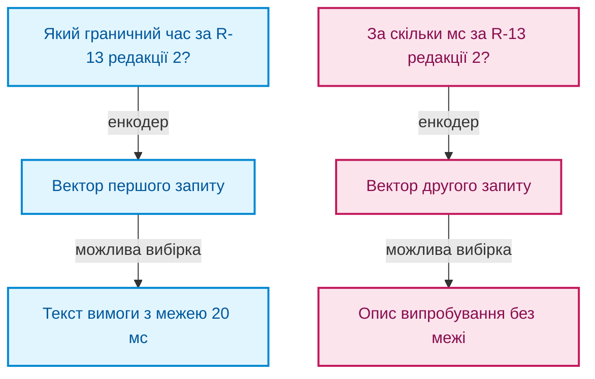
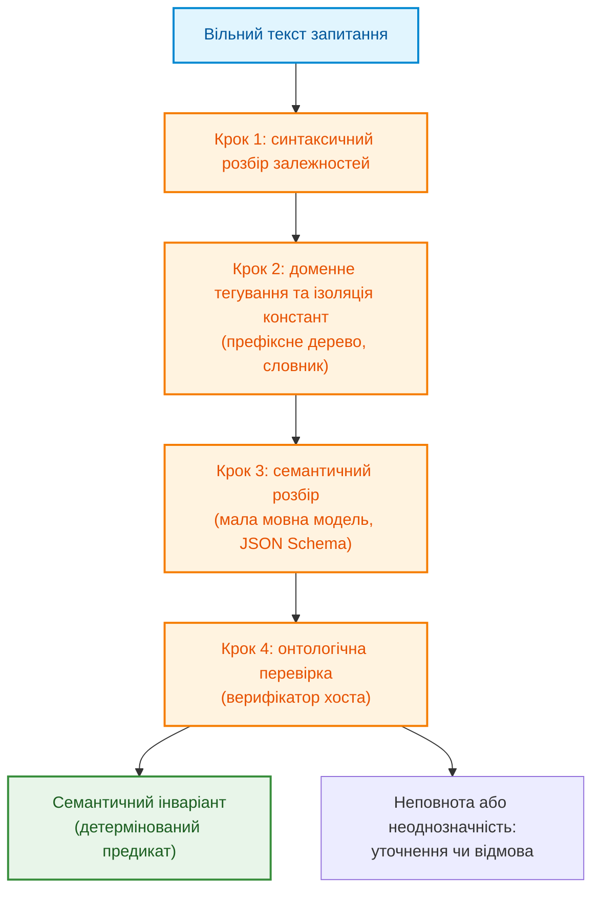
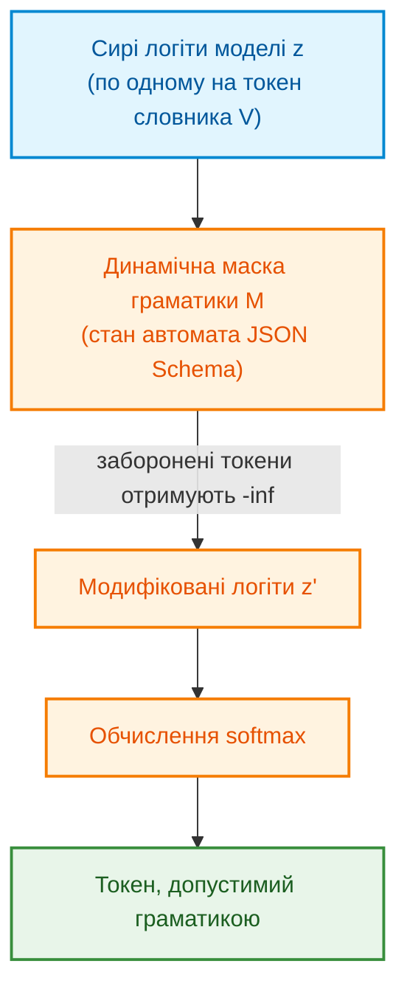
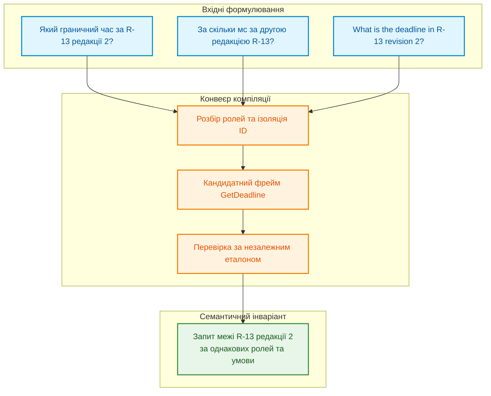
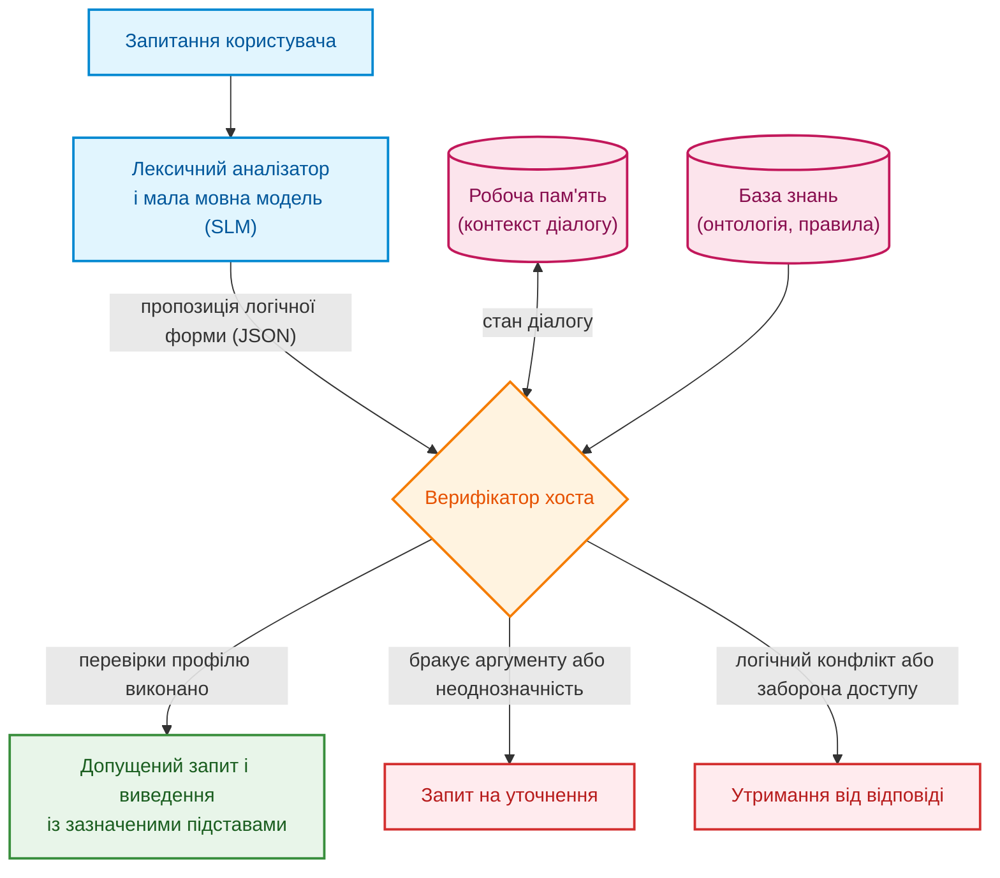

# Глава 13. Варіативність природної мови проти детермінізму: компіляція сенсу запитання

> **Книга:** [Архітектура доказових експертних систем](README.md) · [Частина IV: Архітектура системи, нормативне виведення, діагностика та пояснення](part-04-architecture-and-inference.md)
> **Попередня глава:** [Глава 16. Архітектура експертної системи: від формального знання до доказового рішення](ch16-expert-systems-architecture.md)
> **Наступна глава:** [Глава 19. Від запитання до доказу: пошук, прив'язка та перевірка твердження](ch19-from-question-to-evidence.md)
> **Зміст книги:** [README.md](README.md)
> **Автор:** [Микола Мартинович Федчик](about-the-author.md)
> **Передумови:** рядки й записи даних, множини, логічне «і»; скалярний добуток, правила Горна та ймовірності нагадано перед застосуванням. *Маршрут:* `Трек B` та `Частина IV` (нормалізація та компіляція запитів).
> **Очікувані результати:** розрізняти поверхневу форму запитання і його логічний зміст; пояснювати межі наївного, просунутого і модульного RAG; проєктувати конвеєр, який компілює запитання в перевірюваний предикат; ізолювати гіпотези користувача від бази фактів; вимірювати стійкість мовного інтерфейсу групами еквівалентних запитань.

## Анотація

Мовний інтерфейс експертної системи має впізнавати різні формулювання однієї задачі, але не ототожнювати схожі речення з різними умовами. У главі показано, як відокремити пошук кандидатів від перевірки змісту й перетворити запитання на типізований запит до бази знань. У цій монографії автором запропоновано **концепцію семантичної компіляції інженерного запитання**: модель пропонує тлумачення, а окремі перевірки контролюють його структуру, джерельні опори й допустимість. На одній навчальній вимозі розібрано одиниці часу, заперечення, модальність, редакцію документа та ізоляцію умовних припущень. Обмежене декодування й тести перефразувань розглянуто разом із межами їхніх гарантій.

Нехай навчальна вимога `R-13`, редакція 2, говорить: «Після сигналу перегріву контролер повинен увімкнути вентилятор не пізніше ніж за 20 мс». Читач питає: «Який граничний час увімкнення вентилятора після перегріву за R-13 редакції 2?». Перефразування «За скільки мілісекунд контролер має ввімкнути вентилятор після сигналу перегріву відповідно до другої редакції R-13?» може мати той самий зміст. Але заміна «20 мс» на «20 с», «повинен» на «може» або редакції 2 на 1 змінює задачу, хоч більшість слів лишається спільною. У цій монографії автором запропоновано **модель розриву між поверхневою формою запитання та його логічним змістом (антиномію Фреге — Вітгенштейна у векторному просторі)** як назву цієї інженерної проблеми, не як доведену теорему про неможливість векторного пошуку. Метричний пошук може знаходити кандидатів; для допуску відповіді потрібно окремо перевірити, що їхній зміст відповідає запиту. Детерміноване обчислення повторює результат за фіксованих входів, але може так само повторювати помилкове тлумачення.

Доповнення генерації результатами пошуку (*Retrieval-Augmented Generation*, RAG) поєднує мовну модель з пошуком документів [[1]](#src-1). Пошук потрібний, щоб знайти R-13; сам по собі він не встановлює, яку саме її властивість запитано. Для експертної системи (ЕС) автором сформульовано **інженерний контракт доказової інваріантності мовної відповіді (контракт інваріантності відповіді Федчика)**. Це вимога до системи, не вже доведена властивість будь-якого мовного інтерфейсу: схвалені перефразування за фіксованих умов мають давати однаковий за змістом результат.

<a id="object-13-1"></a>
**Формула (13.1). Контракт інваріантності відповіді.**

```math
\forall q_i, q_j \in Q_{\mathrm{equiv}}: \mathrm{Eval}(q_i, \mathcal{K}, \mathcal{C}, \mathcal{U}) \equiv \mathrm{Eval}(q_j, \mathcal{K}, \mathcal{C}, \mathcal{U})
```

Параметри та змінні контракту:
- $`Q_{\mathrm{equiv}}`$ — непорожня скінченна група формулювань; їхню еквівалентність установлено незалежно від тестованої моделі для заданої задачі; $`q_i, q_j`$ — будь-які два її елементи;
- $`\mathcal{K}`$ позначає фіксований знімок бази знань із версіями джерел; хеш фіксує байти, але не засвідчує їхньої істинності;
- $`\mathcal{C}`$ — робочий контекст сесії виконання;
- $`\mathcal{U}`$ — мандат прав доступу та рівень повноважень суб'єкта запиту;
- $`\mathrm{Eval}(q, \mathcal{K}, \mathcal{C}, \mathcal{U})`$ — результат усього тракту: вердикт, значення з одиницею та підстави або типізована відмова; знак $\equiv$ означає рівність змісту, не буквальну рівність тексту. Усі аргументи, крім можливих величин усередині відповіді, є символічними об'єктами без фізичних одиниць.

У навчальному прикладі обидва початкові запитання мають повернути межу 20 мс за R-13 редакції 2, а не виміряну затримку пристрою. «Не пізніше» включає рівно 20 мс; запит про фактичне виконання вимоги потребуватиме іншого входу — результату вимірювання. Однакова помилкова відповідь «20 с» теж була б інваріантною, тому контракт обов'язково доповнюється перевіркою правильності очікуваного результату. Детермінізм потребує фіксації також версій парсера, правил, моделі й режиму обчислення.

Звідси головне запитання глави: **як зробити так, щоб різні формулювання одного запитання приводили до однієї перевірюваної відповіді експертної системи?** Керівний **архітектурний принцип «Компіляція замість пошуку» (Compile, Don't Retrieve)** означає в авторській моделі заміну пошукового бала як підстави рішення явним логічним запитом, а не заборону самого пошуку. Мовна підсистема пропонує канонічну форму — семантичний інваріант щодо схвалених перефразувань. Верифікатор хоста перевіряє визначені властивості цієї форми; якщо зміст неоднозначний, потрібне уточнення, а не примусовий вибір єдиного тлумачення.

Глава продовжує главу 12. Там мовна підсистема вчилася не втрачати джерело тексту, тут вона вчиться відрізняти зміну формулювання від зміни наміру. Спочатку глава простежує розвиток RAG і межі пошукової схожості. Потім вона описує конвеєр семантичної компіляції, обмежене декодування та перевірку стійкості групами еквівалентних і контрастних запитань. Назва архітектури не встановлює інваріантності без цих перевірок.

Схема нижче показує цільовий шлях: від довільного формулювання через лексико-семантичний аналіз до логічного предиката над базою знань.

<a id="object-13-2"></a>
**Схема 13.2. Від формулювання до перевірюваного запиту.**



Головне на схемі: до обчислення відповіді потрібно перевірити саме тлумачення. Далі спочатку розглянуто, що може дати пошук, а потім — які додаткові перевірки потрібні для R-13.

## 1. Еволюція парадигм RAG та їхні теоретичні й практичні межі

Пошук потрібний, коли R-13 міститься серед багатьох документів, і перше питання тут практичне: як знайти потрібну редакцію разом з умовами застосування? Для цього достатньо розрізняти документ, його фрагмент і ранг — місце фрагмента у списку результатів. Якщо повернути редакцію 1 замість 2 або відрізати умову «після сигналу перегріву», навіть точне цитування знайденого тексту не відповість на початкове запитання.

Авторський **принцип неприпустимості статистичної невизначеності RAG у mission-critical системах** у цій главі означає: пошукова оцінка не повинна бути єдиною підставою остаточного висновку. Статистичний компонент можна застосовувати для добору кандидатів за окремої перевірки їхньої чинності, змісту та повноти в межах задачі. Це архітектурна рекомендація автора; універсальну заборону RAG не виведено тут з ISO 26262, IEC 61508 чи DO-178C. Відтворюваний пошук також може бути детермінованим — його неповнота не тотожна випадковості.

Гао та співавтори розрізняють наївну, просунуту й модульну парадигми RAG [[2]](#src-2). Це корисна класифікація організації компонентів, не три обов'язкові стадії розвитку кожної системи й не доказ неможливості формальної перевірки всередині RAG.

Векторний пошук порівнює числові подання текстів — вектори. Щоб оцінити ціну найпростішого варіанта, порахуємо кількість координат, які треба переглянути при порівнянні запиту з усім сховищем. Для вже обчислених векторів однакової довжини повний перебір має таку модель роботи:

<a id="object-13-3"></a>
**Формула (13.3). Обсяг координатних порівнянь повного перебору.**

```math
W=ND,\qquad T_{\mathrm{scan}}\in\mathcal{O}(ND).
```

Тут $N$ — додатна ціла кількість векторів документів, $D$ — додатна ціла кількість координат одного вектора, $W$ — кількість пар координат; це лічильники, не секунди. $`T_{\mathrm{scan}}`$ — число елементарних операцій для порівнянь; оцінка не включає кодування тексту, читання з диска й сортування всього списку. Для 1000 фрагментів по 768 координат треба обробити 768 000 пар координат. Це пояснює потребу індексу, але не дає виміряної затримки.

HNSW (*Hierarchical Navigable Small World*) [[3]](#src-3) і IVF (*inverted file*) з квантуванням добутку [[4]](#src-4) можуть зменшити пошукову роботу ціною наближення. Для довільних даних HNSW не отримує тут універсальної гарантії логарифмічного часу або повноти. Повнотекстовий, реляційний і графовий пошук теж можуть бути компонентами RAG. Тепер подивімося, що відбувається після знаходження кандидатів.

### 1.1. Наївний RAG: архітектура «знайти та прочитати» і ризики спотворення

Наївний RAG дає найкоротший шлях від запитання до відповіді: знайти текст R-13 і попросити модель його прочитати. У розглянутому спрощеному варіанті «знайти і прочитати» (*Retrieve-Read*) [[2]](#src-2) є три кроки:

1. **Фрагментація та індексація.** Документи перетворюють на текст і ріжуть на фрагменти фіксованої довжини, наприклад по кількасот токенів із невеликим перекриттям. Розріз виконують механічно, за кількістю символів або токенів, без урахування меж розділів, таблиць чи лістингів коду. Кожен фрагмент кодують енкодером ембедингів і зберігають у векторній базі даних.
2. **Пошук.** Запит кодують тим самим енкодером і знаходять $k$ фрагментів із найвищою схожістю (*top-k*).
3. **Генерація.** Знайдені фрагменти склеюють у контекст і разом із запитом передають LLM. Очікується, що модель сама відкине шум, пов'яже розрізнені факти і сформулює відповідь.

Схема нижче розділяє офлайн-індексацію документів і онлайн-обробку запиту.

<a id="object-13-4"></a>
**Схема 13.4. Наївний тракт без окремої перевірки відповіді.**



На схемі видно, що між пошуком і відповіддю немає жодної перевірки. Відповідь є текстом моделі, а не висновком, прив'язаним до байтів джерела. Для інженерних документів звідси випливають п'ять ризиків:

* **Розрив знання між фрагментами.** Якщо умова застосування норми і її числове обмеження потрапили в різні фрагменти, пошук може повернути умову без обмеження.
* **Неповнота і шум.** Релевантний фрагмент може не потрапити в top-k, а замість нього потрапить зовні схожий, але неактуальний фрагмент.
* **Втрата середини контексту.** Лю та співавтори показали, що мовні моделі найкраще використовують інформацію, розташовану на початку або в кінці довгого контексту, а якість помітно падає, коли потрібний фрагмент стоїть посередині [[5]](#src-5).
* **Ілюзія релевантності.** Висока схожість свідчить про спільну лексику, а не про нормативну силу твердження: вимога зі словом SHALL і коментар до неї можуть бути однаково схожими на запит.
* **Відсутність доказового зв'язку.** У показаній реалізації немає запису точного джерела й обґрунтування переходу до відповіді. Журналювання може забезпечити відтворення тексту, але саме по собі не доводить відповідності висновку джерелу.

> [!NOTE]
> **П'ять критичних інженерних ризиків наївного конвеєра RAG (п'ять ризиків)**
> 1. За класифікацією автора, розрив знання між фрагментами виникає, коли поділ відділяє норму від умов або числових обмежень.
> 2. Неповнота вибірки та зашумлення: потрапляння випадкових поверхнево схожих уривків замість критичних нормативних приписів.
> 3. Втрата середини контексту (Lost-in-the-Middle): можливе погіршення використання центральних фрагментів у досліджених довгих контекстах, не універсальний закон для всіх моделей.
> 4. Ілюзія семантичної релевантності: висока косинусна схожість слів без урахування модальності вимоги (`SHALL` проти коментаря).
> 5. Відсутність доказового зв'язку: без збереженого джерела та правила переходу не можна перевірити підставу висновку.
> *Керування рантаймом / Інженерний інваріант:* у запропонованій архітектурі відповідь без потрібних перевірок не допускається як доказова; це не цитата про заборону RAG зі стандарту.

Для R-13 простий негативний контроль — покласти поруч редакцію 1 з межею 30 мс і редакцію 2 з межею 20 мс. Якщо відповідь обирає 30 мс лише через більшу текстову схожість, відтворено помилку вибору редакції. Це сконструйований тест, не повідомлення про виміряний збій певної моделі. Наступний крок — використати метадані до генерації.

### 1.2. Просунутий RAG: пре- та пост-пошукова оптимізація

Просунутий RAG потрібний, щоб не передавати моделі всі схожі редакції й уривки. Він додає обробку до пошуку (*pre-retrieval*) і після нього (*post-retrieval*) [[2]](#src-2): спочатку звужує простір за документом та редакцією, потім впорядковує знайдене.

У цій монографії автором запропоновано **методику дворівневої фільтрації у просунутому RAG (каскад: гібридний пошук + Cross-Encoder)** як інженерне поєднання відомих компонентів. Ієрархічна індексація дозволяє шукати за малим фрагментом, а читати його разом з батьківським розділом. Метадані зберігають ID вимоги, редакцію та хеш джерела. Для нашого прикладу точний фільтр «R-13, редакція 2» прибирає редакцію 1, але помилково записана редакція в метаданих зіпсує й детерміновану фільтрацію. Тому перевіряється також походження метаданих.

Запит теж обробляють. LLM може переписати розмовне запитання нормативною термінологією або згенерувати кілька варіантів запиту для ширшого покриття синонімів. Метод гіпотетичних ембедингів документа (*Hypothetical Document Embeddings*, HyDE) іде далі: модель спочатку пише гіпотетичну відповідь, а пошук виконують за ембедингом цієї відповіді, бо текст відповіді за будовою ближчий до цільового документа, ніж коротке запитання [[6]](#src-6). Гібридний пошук поєднує щільний векторний пошук із розрідженим лексичним, наприклад з функцією ранжування BM25 [[7]](#src-7) або з розрідженою нейромережевою моделлю SPLADE [[8]](#src-8). Лексична складова знаходить точні ідентифікатори, номери регістрів і константи, які векторні моделі схильні розмивати.

Після пошуку перехресний кодувальник (*cross-encoder*) оцінює кожну пару «запит і фрагмент» разом. Приклад такого переранжування на BERT наведено в [[9]](#src-9). Стиснення підказки, наприклад LLMLingua [[10]](#src-10), і зміна порядку фрагментів можуть економити контекст або поліпшувати використання інформації [[5]](#src-5), але не дають права видалити «не», одиницю часу чи умову R-13. Перевірний результат цього кроку — коротший пул із правильною редакцією та повними умовами, а не вже підтверджена відповідь. Коли джерел і пошукових стратегій кілька, потрібна їхня координація.

### 1.3. Модульний RAG: компонентна оркестрація замість фіксованого конвеєра

Модульний RAG розв'язує наступну задачу: R-13 можна знаходити за словами, точним ID або зв'язком з випробуванням, і ці шляхи варто поєднати. Набір модулів можна комбінувати й маршрутизувати [[2]](#src-2). Замість векторного сховища або поряд із ним застосовують повнотекстовий індекс, SQL-запит до реляційної бази чи Cypher/SPARQL до графа. Перетворення тексту на SQL (*Text-to-SQL*) також потребує перевірки: синтаксично правильний запит може вибрати не ту редакцію.

Як порівняти результати двох каналів з різними шкалами балів? Злиття обернених рангів (*Reciprocal Rank Fusion*, RRF) [[11]](#src-11) використовує місця, а не сирі бали. RAG-Fusion може застосовувати цей прийом до кількох перефразувань. Для фіксованих списків результатів обчислюється:

<a id="object-13-5"></a>
**Формула (13.5). Позиційний бал RRF.**

```math
\mathrm{RRF}(d) = \sum_{m \in M} \frac{1}{k + r_m(d)}
```

Параметри та вимірювані величини формули:

- $d \in D$ є документом-кандидатом або нормативним фрагментом тексту із загального корпусу $D$;
- $M$ є множиною гетерогенних пошукових каналів або варіантів запиту (наприклад, $`M = \{\text{dense}, \text{sparse}, \text{graph}\}`$, де $\lvert M \rvert \ge 2$), а $m$ позначає конкретний пошуковий канал;
- $`r_m(d) \in \mathbb{N}_{\ge 1}`$ є порядковим рангом документа $d$ у списку результатів каналу $m$ ($`r_m(d) = 1`$ для першого місця; якщо документ відсутній у вибірці каналу, приймається $`r_m(d) = \infty`$, що дає внесок $1/(k + \infty) = 0$);
- $`k \in \mathbb{N}_{>0}`$ — параметр згладжування; у навчальному авторському профілі він дорівнює 60, не нормативному значенню стандарту;
- $`\mathrm{RRF}(d) \in [0, \frac{\lvert M\rvert}{k+1}]`$ — безрозмірний бал, включно з нулем для відсутнього в усіх списках документа. Ранги й параметр $k$ також безрозмірні. Канали можуть помилятися залежно один від одного; сума не є ймовірністю істини.

Нехай два канали поставили R-13 редакції 2 на місця 1 і 20. Для порівняння розгляньмо ще випадки місць 20 і 20 та єдиного збігу на місці 1:

<a id="object-13-6"></a>
**Формула (13.6). Три навчальні розрахунки RRF.**

```math
\begin{aligned}
\mathrm{RRF}_{1,20}&=1/61+1/80\approx0{,}02889,\\
\mathrm{RRF}_{20,20}&=2/80=0{,}025,\\
\mathrm{RRF}_{1,\infty}&=1/61\approx0{,}01639.
\end{aligned}
```

Індекси в цьому розрахунку позначають ранги двох каналів, а нескінченність — відсутність збігу; всі інші параметри взято з (13.5). Поріг 0,025 пропускає перші два випадки й відсікає третій. Місця не далі 20-го в обох списках є достатньою, але не необхідною умовою проходження: високий ранг одного каналу може компенсувати нижчий іншого.

У запропонованому авторському профілі пул обмежено 50 кандидатами, а поріг RRF — 0,025; це навчальні налаштування, не результати калібрування. **Авторський Exact-ID Bypass для збереження повноти пошуку** залишає точний збіг `R-13` у пулі незалежно від бала, щоб не загубити єдину лексичну опору. Правило зменшує конкретний ризик пропуску, але не гарантує повноти всього пошуку: редакцію, умови й джерело ще перевіряють. Якщо після фільтрації немає кандидатів і точного ID-збігу, повертають `E_NO_CONSENSUS_RETRIEVAL`. Повторна перевірка повноти може вимагати точного запиту до реєстру вимог, а не збільшення бала.

GraphRAG поєднує граф сутностей з підсумками спільнот [[12]](#src-12), Self-RAG навчає рішенням про пошук та рефлексивним оцінкам [[13]](#src-13), а CRAG додає оцінювач знайденого й коригувальні кроки [[14]](#src-14). Жодна назва не означає автоматичної формальної перевірки. В авторському **архітектурному патерні циклічної модульної оркестрації пошуку з верифікацією доказів (патерні модульного верифікованого пошуку Федчика)** оцінка релевантності лише керує пошуком; допуск висновку залежить від окремого перевірника. Кількість повторів або часовий бюджет мають бути скінченними: вичерпання бюджету дає відмову, а не нескінченний пошук.

Схема нижче зіставляє три парадигми. У модульній парадигмі з'являються маршрутизатор і оцінювач, які можуть повернути запит на повторний пошук.

<a id="object-13-7"></a>
**Схема 13.7. Організація пошуку не замінює доказового допуску.**

```mermaid
flowchart TD
    accTitle: Порівняння трьох парадигм RAG
    accDescr: Архітектурне порівняння наївного, просунутого та модульного RAG з маршрутизатором і оцінювачем.

    subgraph P1 ["1. Наївний RAG"]
        N_IDX["Індексація (фрагментація)"] --> N_RET["Векторний пошук (top-k)"]
        N_RET --> N_GEN["Генерація LLM"]
    end

    subgraph P2 ["2. Просунутий RAG"]
        A_PRE["До пошуку: HyDE, переписування"] --> A_RET["Гібридний пошук (щільний і розріджений)"]
        A_RET --> A_POST["Після пошуку: переранжування"]
        A_POST --> A_GEN["Генерація LLM"]
    end

    subgraph P3 ["3. Модульний RAG"]
        M_ROUTER{"Маршрутизатор запитів"}
        M_ROUTER -->|факти| M_VDB[("Векторний індекс або GraphRAG")]
        M_ROUTER -->|структура| M_SQL[("Text-to-SQL або онтологія")]
        M_ROUTER -->|багатокроковий пошук| M_ITER["Цикл Self-RAG"]
        M_VDB --> M_EVAL{"Оцінювач (CRAG)"}
        M_SQL --> M_EVAL
        M_ITER --> M_EVAL
        M_EVAL -->|"кандидати релевантні"| M_GEN["Генерація з посиланнями<br/>ще потребує перевірки"]
        M_EVAL -->|"бракує даних, бюджет є"| M_ROUTER
        M_EVAL -->|"бюджет вичерпано"| M_STOP["Утримання від відповіді"]
    end

    classDef c1 fill:#ffebee,stroke:#c62828,stroke-width:1px,color:#b71c1c;
    classDef c2 fill:#fff8e1,stroke:#f57f17,stroke-width:1px,color:#e65100;
    classDef c3 fill:#e8f5e9,stroke:#2e7d32,stroke-width:1px,color:#1b5e20;

    class N_IDX,N_RET,N_GEN c1;
    class A_PRE,A_RET,A_POST,A_GEN c2;
    class M_ROUTER,M_VDB,M_SQL,M_ITER,M_EVAL,M_GEN c3;
```



Порівняння показує напрям розвитку: від одного проходу до керованого циклу з оцінкою якості. Проте навіть у модульній парадигмі на виході стоїть генерація тексту.

**Результат розділу.** Класифікація RAG описує організацію пошуку й генерації, а не забороняє семантичного розбору або формального запиту. Модульний застосунок може поєднати обидва механізми. Важливо перевіряти, де саме формується логічна форма та хто перевіряє її зміст, а не вважати назву архітектури доказом або спростуванням надійності.

## 2. Математичні та логічні обмеження семантичної схожості

Після ранжування R-13 треба відповісти на інше питання: чи означає близькість текстів збіг їхнього змісту? Для розуміння меж метрики достатньо згадати вектор як список чисел, скалярний добуток як суму попарних добутків і норму як довжину вектора. Авторський **принцип розмежування векторного ранжування та логічного доведення** відділяє цю геометричну операцію від перевірки того, що документ справді підтверджує потрібне твердження.

Косинусна схожість показує, наскільки збігаються напрямки двох ненульових векторів. Тут підсумовано й потрібні означення:

<a id="object-13-8"></a>
**Формула (13.8). Косинусна схожість і її складові.**

```math
\begin{aligned}
\mathbf{q}^\top\mathbf{d}&=\sum_{j=1}^{D}q_jd_j,&
\lVert\mathbf{q}\rVert_2&=\sqrt{\sum_{j=1}^{D}q_j^2},\\
s(\mathbf{q},\mathbf{d})&=\frac{\mathbf{q}^\top\mathbf{d}}
{\lVert\mathbf{q}\rVert_2\lVert\mathbf{d}\rVert_2}.
\end{aligned}
```

Параметри та математичні обмеження:

- $`\mathbf{q},\mathbf{d}\in\mathbb{R}^D`$ — вектори запиту та документа з того самого зафіксованого кодувальника; $D$ — додатна ціла розмірність; $j$ — індекс координати від 1 до $D$;
- $`q_j,d_j`$ — скінченні дійсні координати без фізичних одиниць; $\top$ означає транспонування; норму документа обчислюють так само, як норму запиту;
- обидві норми мають бути додатними. Нормування прибирає масштаб вектора, а не гарантовано вплив довжини початкового тексту;
- $`s\in[-1,1]`$ — безрозмірний бал. Межі випливають з нерівності Коші — Буняковського: абсолютне значення скалярного добутку дійсних векторів не перевищує добутку їхніх норм. Вона не містить твердження про мовний зміст.

Для ручної перевірки візьмемо двовимірні вектори (3, 4) та (6, 8). Це арифметична ілюстрація, не виміряні ембединги R-13:

<a id="object-13-9"></a>
**Формула (13.9). Ручне обчислення схожості.**

```math
s((3,4),(6,8))=\frac{3\cdot6+4\cdot8}
{\sqrt{9+16}\sqrt{36+64}}=\frac{50}{5\cdot10}=1.
```

Усі числа безрозмірні; результат 1 означає однаковий напрямок. Якщо кодувальник дав такі напрямки для «20 мс» і «20 с», геометричний тест не виявить підміни. Це умовний контрприклад до використання самого бала як доказу, не твердження, що реальна модель неодмінно дасть саме ці вектори. Нульовий вектор слід відхилити до ділення. Поріг 0,70 можна задати як навчальну конфігурацію відбору, але без корпусу й оцінки пропусків він не є каліброваним; навіть бал 0,90 не дає логічного допуску.

<a id="object-13-10"></a>
**Схема 13.10. Можлива зміна пошукових кандидатів при перефразуванні.**



Автором запропоновано **гіпотезу варіативності результатів retrieval при перефразуванні**: синтаксис, стиль і мова запиту можуть змінювати його embedding і набір знайдених фрагментів у конкретній конфігурації моделі та індексу. Схема вище ілюструє можливий випадок, але не доводить універсального або монотонного дрейфу для всіх енкодерів. Гіпотезу перевіряють на контрольному наборі перефразувань із фіксованими моделлю, корпусом, індексом і критерієм релевантності; оцінюють стабільність потрібного набору доказів, а не лише збіг текстових відповідей.

Слабкість суто векторного підходу для інженерних доменів виявляється у трьох аспектах:

1. **Помилки заперечення.** «Не повинен вмикати» й «повинен вмикати» мають багато спільних слів. Діагностика BERT у [[15]](#src-15) мотивує перевірку цього ризику, але не доводить нечутливості кожного сучасного енкодера.
2. **Варіативність за стилем і мовою.** Перефразування може змінити вектор і вибірку; величину зміни визначають на конкретному наборі, а не виводять зі схеми.
3. **Неперевірена композиція.** Сама близькість фрагмента R-13 до опису випробування не доводить, що випробування перевіряє саме редакцію 2 та всі її умови. Для цього потрібні явні зв'язки й правила.

Схожість векторів корисна для відбору кандидатів, але сама не підтверджує твердження. Перед побудовою логічної форми варто розглянути ще одну пастку: чи не сприймається добре написана відповідь як правильна без перевірки її полів?

### 2.1. Мовна плавність як маскувальний фактор деформації інваріантів

Мовна плавність ускладнює перевірку R-13, коли помилкова відповідь звучить природно: «Контролер може ввімкнути вентилятор протягом 20 секунд». Речення граматично зв'язне, але змінило і обов'язковість, і одиницю. Щоб помітити це, не потрібний новий бал стилю — треба порівняти поля змісту з джерелом.

Споріднену задачу збереження термінології розглянуто у SIF 1.0 [[30]](#src-30). Тут посилання є напрямом для зіставлення, не звітом про незалежно відтворений експеримент. В авторській адаптації **маскувальний фактор мовної плавності** означає ризик не помітити підміни змісту через добрий стиль; універсальну психологічну закономірність цим прикладом не доведено.

Звідси формулюється фундаментальний принцип доказової обробки природної мови:

> **Інваріант структурної кваліфікації (Structural Qualification Invariant):**
> У запропонованій автором моделі правдоподібність, самооцінка моделі й плавність не замінюють перевірки джерела. Збереження структурних інваріантів є необхідною перевіркою, але не достатнім доказом усього змісту відповіді.

> [!NOTE]
> **Три інваріанти структурної кваліфікації проти маскувального фактора мовної плавності (три інваріанти)**
> 1. Неприпустимість поверхневої правдоподібності: граматична плавність (fluency) не може слугувати свідченням технічної істинності.
> 2. Ізоляція контрольованої термінології: суворе збереження фізичних розмірностей, числових допусків і нормативних констант.
> 3. За авторським принципом структурної демаркації, потрібні поля перевіряють явно; їхня збереженість не доводить неперевірених відношень чи повноти джерела.
> *Керування рантаймом / Інженерний інваріант:* виявлена підміна поля блокує допуск; невизначене тлумачення потребує уточнення.

Отже, замість оцінювання красивого речення потрібне представлення, де можна окремо побачити дію, умову, час і модальність. Саме його будує наступний розділ.

## 3. Архітектура конвеєра семантичної компіляції запитання

Семантична компіляція потрібна, щоб питання «за скільки часу?» стало запитом саме до поля граничного часу R-13, а не до будь-якого числа поруч. Передумовою є типізований запис: кожне поле має назву, допустимий тип і роль. У цій монографії автором запропоновано **концепцію семантичної компіляції інженерного запитання (концепцію компіляції запитів Федчика)** як конвеєр побудови й перевірки такого представлення. Аналогія з компілятором корисна для розподілу етапів, але природна мова, на відміну від фіксованої мови програмування, може не мати єдиного тлумачення.

<a id="object-13-11"></a>
**Схема 13.11. Чотири фази та явний вихід за неоднозначності.**



Розбір залежностей зазвичай використовує навчену модель: фіксовані ваги можуть давати повторюваний результат, але не роблять дерево граматично правильним. Доменний словник задає кандидатів, мовна модель пропонує логічну форму, а верифікатор перевіряє оголошені типи й обмеження. Жоден із цих кроків сам не доводить, що форма правильно передає намір людини.

### 3.1. Синтаксичний розбір залежностей та виділення актантів <a id="31-синтаксичний-розбір-залежностей-та-виділення-актантів"></a>

Синтаксичний розбір потрібний, щоб не переставити місцями того, хто діє, і те, на що спрямовано дію. У R-13 контролер вмикає вентилятор, а не навпаки. Актантом тут названо учасника ситуації з певною роллю. Схема універсальних залежностей (*Universal Dependencies*, UD) [[16]](#src-16) описує зв'язки слів: корінь (`root`), підмет (`nsubj`), додаток (`obj`). UDPipe [[17]](#src-17) і Stanza [[18]](#src-18) пропонують інструменти такого аналізу; придатність конкретних ваг для українських вимог перевіряють окремо.

Спочатку виділяють «контролер» як кандидата суб'єкта, «ввімкнути» як дію, «вентилятор» як об'єкт і «після сигналу перегріву» як умову. Потім звіряють ці ролі з дозволеним методом запиту. Лематизація зводить словоформи до словникової форми, але не робить «увімкни» та «чи можна увімкнути?» однаковими намірами: перше може бути командою, друге — питанням про дозвіл. Дерево є підказкою для наступного етапу, не доказом змісту.

### 3.2. Доменне тегування та лексична ізоляція констант

Лексична ізоляція потрібна, щоб R-13, редакція 2 і 20 мс не загубилися під час перефразування. Авторський **архітектурний принцип лексичної ізоляції констант та технічних ідентифікаторів (принцип ізоляції констант Федчика)** пропонує зберігати знайдені значення окремо разом з точними позиціями у вхідному тексті. Префіксне дерево (*trie*) шукає записи декларативного словника; воно не доводить, що два знайдені слова означають одну сутність. Наприклад, назва протоколу UDP і документ RFC 768 [[19]](#src-19) пов'язані, але не є одним об'єктом: їх не слід безумовно зливати в один ID.

Нормалізація числових констант зобов'язана приводити різнорідні одиниці вимірювання до єдиного канонічного базису СІ разом із перевіркою векторів фізичної розмірності. Кожній одиниці $u$ зі словника зіставляються додатний масштабний множник $`\alpha_u > 0`$, афінний зсув нуля $`\beta_u \in \mathbb{R}`$ та 7-вимірний цілочисельний вектор показників базових одиниць СІ $`\mathbf{d}(u) \in \mathbb{Z}^7`$:

<a id="object-13-12"></a>
**Формула (13.12). Афінне приведення фізичної величини до базису СІ та умова сумісності.**

```math
v_{\mathrm{SI}} = \alpha_u \cdot v_{\mathrm{raw}} + \beta_u, \qquad \mathrm{Comparable}(q_1, q_2) \iff \mathbf{d}(u_1) = \mathbf{d}(u_2)
```

Тут $`v_{\mathrm{raw}} \in \mathbb{R}`$ — видобуте з тексту числове значення в одиниці $u$, $`v_{\mathrm{SI}}`$ — канонічне значення у базовій одиниці СІ, а предикат $`\mathrm{Comparable}(q_1, q_2)`$ дозволяє порівнювати величини $`q_1 = (v_1, u_1)`$ і $`q_2 = (v_2, u_2)`$ у правилі лише за повного збігу їхніх розмірних векторів $`\mathbf{d}(u_1) = \mathbf{d}(u_2)`$. Наприклад, для тривалості $`20\,\text{мс}`$ маємо $`\alpha_{\mathrm{ms}} = 10^{-3}\,\text{с/мс}`$, $`\beta_{\mathrm{ms}} = 0`$ і вектор часу $`\mathbf{d} = [0,0,1,0,0,0,0]`$, що дає $`v_{\mathrm{SI}} = 10^{-3} \times 20 = 0{,}020\,\text{с}`$ (тотожне запису «0,020 с», але відмінне від «20 с»). Для температури $`60\,^\circ\text{C}`$ із ненульовим зсувом $`\alpha_{^\circ\mathrm{C}} = 1`$, $`\beta_{^\circ\mathrm{C}} = 273{,}15\,\text{K}`$ отримуємо $`333{,}15\,\text{K}`$, а спроба порівняти $`20\,\text{мс}`$ із напругою $`20\,\text{В}`$ ($`\mathbf{d} = [2,1,-3,-1,0,0,0]`$) блокується ще до виконання арифметичного компаратора. Зберігаються початковий запис, правило перетворення і точне раціональне або фіксоване значення, щоб округлення не змінило межу.

Так само окремо зберігаються «не» з областю дії, модальність «повинен», включність межі «не пізніше», умова й редакція. Видалення службових слів або зведення всіх дієслів до лем знищило б ці відмінності. Сам заповнювач у підказці не захищає значення: модель може вибрати не той ID або додати інший. Захист працює лише тоді, коли хост перевіряє дозволені ID та їхню роль і відновлює константи зі збережених записів. Неоднозначне позначення дає кількох кандидатів та уточнення.

### 3.3. Семантичний розбір та висування гіпотез малою мовною моделлю

Семантичний розбір пов'язує вже знайдені слова з питанням користувача: потрібна межа часу, а не фактична затримка. Мала мовна модель (*Small Language Model*, SLM) може запропонувати намір `GetDeadline` і його аргументи. Фрейм — запис з іменованими типізованими полями — передається у JSON (*JavaScript Object Notation*). JSON Schema обмежує структуру, але не засвідчує правильності її тлумачення. Для початкового запиту кандидат має такий вигляд:

<details>
<summary>Приклад кандидатної логічної форми</summary>

```json
{
    "intent": "GetDeadline",
  "arguments": {
        "requirement": "R-13",
        "revision": 2,
        "subject": "controller",
        "action": "enable",
        "object": "fan",
        "trigger": "overheat_signal"
  }
}
```

</details>

Поле `intent` перевіряють за закритим переліком, а ID аргументів — за дозволеними кандидатами цього запиту. Тип `string` сам не забороняє вигаданий ідентифікатор: потрібний динамічний перелік допустимих значень або явна перевірка належності. Навіть два допустимі аргументи можна помилково переставити місцями. Тому окремо перевіряють ролі, заперечення, квантори, одиниці й контекст та уточнюють неоднозначний запит.

У наведеному записі перевіряють поля `requirement`, `revision`, `subject`, `action`, `object`, `trigger`. Відсутню модальність чи число запит про межу не повинен вигадувати: їх належить отримати з R-13. Для запиту про перевірку відповідності потрібен інший намір та додатковий вимір часу.

Канонікалізація прибирає несуттєві відмінності подання, наприклад порядок ключів JSON, і залишає визначений порядок полів. Для вже однозначного запитального фрейму використаємо:

<a id="object-13-13"></a>
**Формула (13.13). Канонічний ключ типізованого запиту.**

```math
\mathrm{Canon}(F)=(v,I,r,e,s,a,o,c).
```

Тут $F$ — перевірений фрейм; $v$ — додатна ціла версія схеми; $I$ — намір із закритого переліку; $r$ — ID вимоги; $e$ — додатна ціла редакція; $s,a,o,c$ — відповідно суб'єкт, дія, об'єкт і умова з типізованих реєстрів. Це символічні значення без одиниць. У прикладі кортеж містить версію 1, `GetDeadline`, `R-13`, 2, `controller`, `enable`, `fan`, `overheat_signal`. Два схвалені перефразування мають дати той самий кортеж; заміна редакції змінить його четверте поле. Рівність канонічних ключів означає рівність фреймів за цією схемою, не доказ еквівалентності довільних речень. Для інших намірів схема повинна явно включити числа, одиниці, заперечення й модальності; втрачений при розборі зміст канонікалізація не відновить.

### 3.4. Онтологічна верифікація та валідація інваріантів хостом

Онтологічна перевірка потрібна, щоб правильний за формою запис не звертався до неіснуючої вимоги чи чужого документа. Верифікатор хоста перевіряє намір, типи ролей, редакцію, джерельні прив'язки та повноваження. Після цього формується логічний запит. Нагадаємо правило Горна: якщо виконані всі умови праворуч, можна отримати висновок ліворуч. Для навчальної бази з уже формалізованою R-13 використаємо один запит:

<a id="object-13-14"></a>
**Формула (13.14). Запит граничного часу для конкретної редакції.**

```math
\mathrm{Query}(T)\leftarrow
\mathrm{Deadline}(\text{R-13},2,\text{controller},\text{enable},
\mathrm{fan},\text{overheat-signal},T,\text{ms},\text{required},\text{inclusive}).
```

Тут $T$ — змінна невід'ємного числового часу, одиницю якого явно задає атом `ms`; `Deadline` — відношення бази, а `Query` — відношення відповідей. Інші аргументи — константи: ID, редакція 2, суб'єкт, дія, об'єкт, тригер, модальність `required` і включність межі `inclusive`. Стрілка означає логічне «якщо». Всі змінні голови зустрічаються в тілі правила; для цього прикладу припускається скінченна база фактів без функціональних символів і без заперечення.

Ручне виконання просте: знайти запис R-13 редакції 2, порівняти всі константи, підставити 20 замість $T$. Запис редакції 1 не підходить через другий аргумент. Результат — межа 20 мс, а не автоматичний висновок, що контролер її дотримується. Разом з відповіддю зберігають зв'язок формалізованого факту з точним уривком вимоги й журнал перетворення; сама уніфікація байтових координат не створює.

Для позитивного Datalog без функціональних символів над скінченною областю повторне застосування правил до нерухомої точки завершується, а за фіксованої програми складність за даними поліноміальна. Умови важливі: змінна програма, розширення мови й заперечення потребують окремого аналізу; довільний Prolog не має тут гарантії завершення. Поліноміальність не є часовим бюджетом у мілісекундах. Правильне виведення може спиратися на помилково внесений факт, тому істинність джерела та правильність його формалізації перевіряють окремо. Порожній результат означає «не знайдено підстав у цій базі», не автоматичне заперечення вимоги; кілька несумісних меж дають конфлікт. Далі розглянуто, як не змішати такі факти з припущенням користувача.

### 3.5. Обробка умовних запитань: ізоляція гіпотез від фактів

Умовне запитання змінює статус вхідних даних, а не текст вимоги: «Якщо сигнал перегріву був і вентилятор увімкнувся через 21 мс, чи виконано часову межу R-13 редакції 2?». Значення 21 мс тут припущене користувачем, не виміряне системою. Щоб не перетворити його на постійний факт, автором запропоновано **архітектурний інваріант ізоляції гіпотез користувача від постійної бази знань (Session Hypothesis Isolation Invariant)**. Контекст доведення `ProofContext` читає базу `FactBase`, але тримає припущення окремо. Суперечність між ними потрібно повідомити, а не приховати пріоритетом останньої репліки.

За умови, що сигнал був, подія ввімкнення вже відбулася, а часові точки мають спільний початок відліку, перевіряється лише одна нерівність:

<a id="object-13-15"></a>
**Формула (13.15). Умовна перевірка включної часової межі.**

```math
\mathrm{WithinLimit}(\Delta t,L)=[0\leq\Delta t\leq L],\qquad
\mathrm{WithinLimit}(21\,\mathrm{ms},20\,\mathrm{ms})=0.
```

Тут $`\Delta t`$ — невід'ємна скінченна тривалість від сигналу до ввімкнення, $L$ — додатна скінченна межа R-13; обидві величини приводяться до однієї одиниці часу. Квадратні дужки дають 1, якщо умова істинна, і 0 інакше. Перевірка 21 проти 20 дає 0; для 19 мс та рівно 20 мс — 1. Від'ємний вхід позначає помилку даних, а не виконання вимоги. Результат використовується лише як умовна відповідь про цей випадок. Вимірювання з похибкою, відсутність самої події та повний доказ працездатності пристрою потребують додаткової моделі й тут не охоплені.

Лістинг Go реалізує **алгоритм тризначного оцінювання умовного контексту доведення**: `CONDITIONAL` для обчисленого умовного результату, `CLARIFY` для браку даних і `CONFLICT` для суперечності або непридатного входу. Вхід — база, припущення про сигнал і типізована тривалість `time.Duration`; вихід — статус та результат часової перевірки. Модель припускає незмінність бази під час виклику; вона не реалізує сховище чи багатопотокову ізоляцію. Межу передають аргументом із уже перевіреної редакції, а не видобувають з вільного тексту.

<details>
<summary>Приклад мовою Go: гіпотези сеансу, відокремлені від бази фактів</summary>

```go
package main

import (
    "fmt"
    "time"
)

type Fact string

type FactBase map[Fact]bool

type ProofContext struct {
    base       FactBase
    hypotheses map[Fact]bool
}

func (context ProofContext) Value(fact Fact) (value, known, conflict bool) {
    baseValue, baseKnown := context.base[fact]
    hypothesisValue, hypothesisKnown := context.hypotheses[fact]
    if baseKnown && hypothesisKnown && baseValue != hypothesisValue {
        return false, true, true
    }
    if hypothesisKnown {
        return hypothesisValue, true, false
    }
    return baseValue, baseKnown, false
}

type Answer struct {
    Decision string
    Result   string
}

func checkDeadline(context ProofContext, elapsed, limit time.Duration) Answer {
    if elapsed < 0 || limit <= 0 {
        return Answer{"CONFLICT", "INVALID_TIME"}
    }
    signal, known, conflict := context.Value("OverheatSignal")
    if conflict {
        return Answer{"CONFLICT", "HYPOTHESIS_VS_FACT"}
    }
    if !known {
        return Answer{"CLARIFY", "MISSING_SIGNAL_STATUS"}
    }
    if !signal {
        return Answer{"CONDITIONAL", "NOT_APPLICABLE"}
    }
    if elapsed <= limit {
        return Answer{"CONDITIONAL", "WITHIN_LIMIT"}
    }
    return Answer{"CONDITIONAL", "LIMIT_EXCEEDED"}
}

func main() {
    base := FactBase{}
    context := ProofContext{base, map[Fact]bool{"OverheatSignal": true}}
    limit := 20 * time.Millisecond
    for _, milliseconds := range []int{19, 20, 21} {
        fmt.Println(milliseconds, "ms ->", checkDeadline(context, time.Duration(milliseconds)*time.Millisecond, limit))
    }
    fmt.Println("unknown ->", checkDeadline(ProofContext{base, nil}, 0, limit))
    fmt.Println("facts in base after session:", len(base))
}
```

Перший блок є програмою `main.go`, наступний — її тестом `context_test.go` у тому самому каталозі. Команди: `go run main.go` та `go test -v main.go context_test.go`. Тест включає позитивну межу, граничне перевищення й перевірку, що «невідомо» не стало «ні»:

```go
package main

import (
    "reflect"
    "testing"
    "time"
)

func TestDeadlineBoundary(testCase *testing.T) {
    context := ProofContext{FactBase{}, map[Fact]bool{"OverheatSignal": true}}
    cases := []struct {
        name string
        elapsed time.Duration
        want Answer
    }{
        {"before", 19*time.Millisecond, Answer{"CONDITIONAL", "WITHIN_LIMIT"}},
        {"equal", 20*time.Millisecond, Answer{"CONDITIONAL", "WITHIN_LIMIT"}},
        {"after", 21*time.Millisecond, Answer{"CONDITIONAL", "LIMIT_EXCEEDED"}},
        {"same_unit", 20000*time.Microsecond, Answer{"CONDITIONAL", "WITHIN_LIMIT"}},
        {"different_unit", 20*time.Second, Answer{"CONDITIONAL", "LIMIT_EXCEEDED"}},
        {"negative", -time.Millisecond, Answer{"CONFLICT", "INVALID_TIME"}},
    }
    for _, scenario := range cases {
        testCase.Run(scenario.name, func(testCase *testing.T) {
            if got := checkDeadline(context, scenario.elapsed, 20*time.Millisecond); got != scenario.want {
                testCase.Fatalf("got %v, want %v", got, scenario.want)
            }
        })
    }
}

func TestUnknownAndConflictingHypotheses(testCase *testing.T) {
    base := FactBase{}
    limit := 20*time.Millisecond
    context := ProofContext{base, map[Fact]bool{}}
    if got := checkDeadline(context, 0, limit); got != (Answer{"CLARIFY", "MISSING_SIGNAL_STATUS"}) {
        testCase.Fatal("unknown signal treated as false")
    }
    context.hypotheses["OverheatSignal"] = false
    if got := checkDeadline(context, 0, limit); got != (Answer{"CONDITIONAL", "NOT_APPLICABLE"}) {
        testCase.Fatal("explicit false signal ignored")
    }
    context.hypotheses["OverheatSignal"] = true
    checkDeadline(context, 20*time.Millisecond, limit)
    if len(base) != 0 {
        testCase.Fatal("hypothesis leaked into base")
    }
    base["OverheatSignal"] = false
    before := FactBase{"OverheatSignal": false}
    if got := checkDeadline(context, 0, limit); got != (Answer{"CONFLICT", "HYPOTHESIS_VS_FACT"}) {
        testCase.Fatal("hypothesis overrode contrary verified fact")
    }
    if !reflect.DeepEqual(base, before) {
        testCase.Fatal("session changed fact base")
    }
    if got := checkDeadline(context, 0, 0); got != (Answer{"CONFLICT", "INVALID_TIME"}) {
        testCase.Fatal("invalid limit accepted")
    }
}
```

Програма виводить:

```text
19 ms -> {CONDITIONAL WITHIN_LIMIT}
20 ms -> {CONDITIONAL WITHIN_LIMIT}
21 ms -> {CONDITIONAL LIMIT_EXCEEDED}
unknown -> {CLARIFY MISSING_SIGNAL_STATUS}
facts in base after session: 0
```

</details>

Відсутність запису про сигнал дає уточнення, явне `false` — незастосовність умови, а суперечність — конфлікт. Це різні результати. Тест `equal` відхилить помилкову реалізацію зі строгим «менше», а `different_unit` — підміну 20 мс на 20 с. Останній рядок програми й тест контролюють відсутність запису припущення в базу. Умовна невідповідність не означає реальної відмови пристрою без фактичного вимірювання.

Раніше цю ж ізоляцію ілюстрував протокольний кейс SMTP/STARTTLS за RFC 5321 та RFC 3207 [[20]](#src-20), [[21]](#src-21). Авторську ідею умовно-конфліктного оцінювання збережено, але основний розрахунок тут продовжує R-13. Нормативні висновки про обов'язок клієнта не переносяться з поведінки сервера без окремого застосовного правила; повний аналіз тих протоколів виходить за межі цього прикладу.

**Результат розділу.** Чотири фази ведуть від формулювання до перевірюваного запиту, але не примушують довільне речення мати єдине тлумачення. На R-13 показано, як зберегти ролі, одиниці й редакцію та обчислити умовний результат без зміни бази. Залишається вужче питання: як контролювати допустиму структуру кандидатного фрейму ще під час генерації? Для цього застосовують обмежене декодування.

> [!NOTE]
> **Чотири фази конвеєра семантичної компіляції інженерних запитів (чотири фази)**
> 1. В авторському конвеєрі синтаксичний розбір пропонує граматичні ролі за Universal Dependencies; лема не замінює наміру.
> 2. Доменне тегування та ізоляція констант зберігають ID, одиниці, заперечення, модальність і редакцію разом із походженням.
> 3. Семантичний розбір під контролем схеми: висування гіпотез наміру та аргументів малою мовною моделлю в рамцях JSON Schema.
> 4. Онтологічна верифікація хостом перевіряє типи, ролі та джерела перед побудовою правила Горна; невизначений зміст не приймається лише через коректний тип.
> *Керування рантаймом / Інженерний інваріант:* будь-яка нерозв'язана сутність або розбіжність сигнатур предикатів повертає відмову `E_UNRESOLVED_PREDICATE`.

## 4. Детерміноване обмежене декодування за контекстно-вільними граматиками

Обмежене декодування розв'язує вузьку задачу попереднього розділу: як отримати фрейм R-13 без незакритих дужок і стороннього вступу замість JSON? Потрібно розрізняти токен — одиницю словника моделі, граматику — правила допустимих послідовностей, і схему — обмеження структури та значень. Коректний парсер має повертати помилку на непридатний вхід, а не аварійно завершувати сервіс; сама синтаксична помилка не означає неминучої паніки.

Авторський **принцип усунення синтаксичного недетермінізму мовних моделей на рівні токенізації** тут означає обмеження множини допустимих продовжень під час генерації. Назва не означає усунення випадковості вибору серед дозволених токенів. Вимоги певного рівня ASIL або DO-178C не виводяться з цього механізму; він не замінює кваліфікації інструменту.

У вільному режимі на кожному кроці модель надає токенам числові оцінки — логіти. Для фіксованого префікса й температури 1 функція softmax перетворює їх на розподіл наступного токена:

<a id="object-13-16"></a>
**Формула (13.16). Розподіл softmax до граматичного обмеження.**

```math
p_i = \frac{e^{z_i}}{\sum_{j \in V} e^{z_j}}
```

Параметри та вимірювані характеристики softmax:

- $V$ — скінченна непорожня множина індексів словника; $i$ — потрібний індекс, $j$ — індекс підсумовування;
- $`z_i\in\mathbb{R}`$ — скінченний безрозмірний логіт для поточного префікса; $e$ — основа натуральної експоненти;
- $`p_i\in(0,1]`$ — модельна умовна ймовірність наступного токена, не ймовірність істинності майбутнього твердження; сума за словником дорівнює 1. Значення 1 можливе для одноелементного словника.

Чисельно експоненти обчислюють після віднімання найбільшого логіта: спільний множник скорочується в дробі й запобігає переповненню. Обчислення розподілу ще не обирає токена: можна семплювати або брати найбільший бал із фіксованим правилом розв'язання нічиєї.

Softmax сам не знає, що після назви поля потрібна двокрапка. Обмежене декодування (*constrained decoding*) звертається до стану граматичного розпізнавача для поточного префікса й залишає лише токени, чиї повні послідовності символів допускають продовження до завершеного слова граматики. CFG означає контекстно-вільну граматику; GBNF — один із форматів запису граматик у засобах керованої генерації. Для непорожньої множини допустимих токенів маскування задається так:

<a id="object-13-17"></a>
**Формула (13.17). Масковані логіти й умовний розподіл.**

```math
z'_i = \begin{cases} z_i, & i \in M, \\ -\infty, & i \notin M, \end{cases}
\qquad
p'_i = \frac{e^{z'_i}}{\sum_{j \in V} e^{z'_j}}
```

Параметри та математичні обмеження маскованого декодування:

- $M \subseteq V$ — непорожня множина допустимих токенів для поточного префікса за коректної інтеграції граматики й токенізатора;
- $`z'_i \in \mathbb{R} \cup \{-\infty\}`$ — модифікований логіт токена після накладання бінарної маски граматики;
- $`p'_i \in [0, 1]`$ — скоригований розподіл імовірностей над словником $V$, де для всіх $j \notin M$ маємо $`e^{-\infty} = 0 \implies p'_j = 0`$, а для дозволених токенів виконується нормалізація $`\sum_{i \in M} p'_i = 1`$.

Індекси, вихідні логіти й основа експоненти ті самі, що в (13.16); штрих позначає значення після маски. Логіти та ймовірності безрозмірні. Якщо допустимих токенів немає, знаменник стає нульовим: це не розподіл і не успішна генерація. Система повертає програмну помилку `E_GRAMMAR_DEADLOCK`. Вичерпання токенного бюджету — окрема причина неповного результату, а не доказ порожньої маски. Токен завершення допускається лише у завершальному стані; незакінчений префікс не передають як готовий JSON.

Якщо кожний крок зберігає допустимість префікса, а завершення прийнято тільки в кінцевому стані, завершена послідовність належить заданій граматиці. Це умовна синтаксична гарантія; вона не доводить усіх обмежень JSON Schema. Час побудови маски залежить від граматики, станів, довжин токенів та індексації. Префіксне дерево може скоротити повторні перевірки, але універсальні оцінки сталого часу або накладних витрат менше 1,5 % без протоколу не встановлено.

Покроковий приклад використовує спрощений словник із трьох атомарних альтернатив: `GetDeadline`, `CheckCompliance`, `I think`. У реальному токенізаторі це можуть бути кілька токенів; тут абстракцію обрано лише для ручного рахунку. Задамо логіти 3,2; 2,8; 5,1. Без маски найбільший логіт має сторонній вступ, його ймовірність близька до 0,80; при семплюванні це не означає неминучого вибору. Граматика дозволяє лише перші дві альтернативи. Обчислимо результат:

<a id="object-13-18"></a>
**Формула (13.18). Розрахунок двох дозволених альтернатив.**

```math
p'_1 = \frac{e^{3{,}2}}{e^{3{,}2} + e^{2{,}8} + 0} \approx \frac{24{,}53}{24{,}53 + 16{,}44} = \frac{24{,}53}{40{,}97} \approx 0{,}599, \qquad p'_2 \approx 0{,}401, \qquad p'_3 = 0{,}000
```
Індекси 1, 2, 3 відповідають названим альтернативам; штрих і ймовірності визначено у (13.17), маска містить індекси 1 і 2. Спочатку обчислено експоненти приблизно 24,53 і 16,44, потім суму 40,97, потім поділено кожну експоненту на суму. Третя альтернатива має нульову ймовірність, але перші дві залишаються можливими. Для початкового питання правильним є `GetDeadline`; граматична допустимість `CheckCompliance` не робить цей намір правильним. Отже, маска вилучила сторонній вступ, але не розв'язала семантичного вибору.

> [!NOTE]
> **Три інженерні фази динамічного маскування логітів при обмеженому декодуванні (три фази)**
> 1. В авторській адаптації синхронізують стан розпізнавача з повним префіксом і токенізатором для підтримуваної граматики.
> 2. Забороненим токенам призначають логіт $-\infty$, а не нуль; нульовий логіт мав би ненульову експоненту.
> 3. Для непорожньої маски обчислюють нормований розподіл; заборонені токени мають нульову ймовірність, дозволені — не обов'язково єдиний вибір.
> *Керування рантаймом / Інженерний інваріант:* неповний результат не допускається; завершений результат повторно перевіряють повною схемою й семантичними умовами.

Для заборонених токенів $`p'_i = 0`$, тож модель не може вийти за межі граматики. Схема нижче показує місце маски в обчисленні.

<a id="object-13-19"></a>
**Схема 13.19. Маска перед вибором токена.**



Маска діє до softmax, а не після вибору токена. Тому ймовірнісна маса перерозподіляється лише між допустимими варіантами, а модель зберігає свої переваги серед них.

Вибір автомата визначається граматикою, а не словом «детермінований». Для регулярної мови достатньо скінченного автомата; підходи до індексації допустимих токенів розглянуто у [[22]](#src-22). Для довільної вкладеності потрібна додаткова пам'ять. Нагадаємо класичний результат теорії формальних мов [[23]](#src-23): скінченний автомат має скінченну кількість станів і не може розпізнавати необмежено збалансовані пари дужок. Якщо він мав би пам'ятати кожну можливу глибину, то для двох різних глибин мусив би повторити стан; однаковий завершальний суфікс тоді помилково приймався б для обох.

Для JSON це видно на масивах: після `[[0]]` потрібно закрити дві дужки, після `[[[0]]]` — три. Стек додає позначку на відкритті й прибирає на закритті; прийняття потребує порожнього стека й завершеного значення. Довільна контекстно-вільна граматика не обов'язково має детермінований магазинний розпізнавач; потрібні підтримувана граматика й конкретний алгоритм. Якщо глибину та інші необмежені складові заздалегідь обмежено, можна побудувати скінченностанову реалізацію, але розмір станів теж стає інженерною ціною. XGrammar працює з контекстно-вільними граматиками та оптимізує перевірку токенів [[24]](#src-24). Це не окрема авторська лема й не результат про семантику Datalog: рекурсія правил виведення та вкладеність синтаксису є різними задачами.

Гарантія обмеженого декодування стосується підтримуваного граматикою піднабору схеми, коректної інтеграції з токенізатором і завершеної генерації. Не кожний засіб підтримує всі обмеження JSON Schema. Вичерпання бюджету або відсутність допустимого продовження не є успішним результатом. Після генерації незалежний валідатор повторно перевіряє повну схему. Навіть правильна структура може містити хибний намір, сутність або область заперечення; перевірка типів не доводить відповідності первісному запитанню. Звідси випливає важливий авторський **принцип розділення синтаксичної форми та семантичної істинності при декодуванні**: обмежене декодування гарантує виключно синтаксичну форму виходу, але не встановлює правильності змісту.

**Результат розділу.** За названих передумов обмежене декодування контролює мову завершеного виходу, але не правильність наміру й не повну схему. Для R-13 граматика може допустити два структурно правильні наміри, тому наступна перевірка має оцінювати відповідність фрейму запитанню, а не лише успішний розбір JSON.

## 5. Верифікація інваріантності: тестування групами еквівалентних і контрастних запитів

Перевірка інваріантності відповідає на питання, яке залишила граматика: чи дістає система правильний фрейм R-13 з різних формулювань і чи помічає зміну змісту? Передумова — незалежно підготовлений еталон фрейму й очікуваного результату. Якщо еталон породила та сама модель, що проходить перевірку, спільна помилка може залишитися непоміченою. Різні відповіді на перефразування порушують контракт (13.1), але це не обов'язково порушення обчислювального детермінізму: вхідні рядки різні.

В авторській методиці одиниця оцінювання — об'єкт знань і скінченна схвалена група перефразувань, не всі можливі речення природної мови. Це застосування поведінкового тестування, спорідненого з CheckList [[25]](#src-25). Навчальна група для R-13 містить три запити з тим самим контекстом:

1. «Який граничний час увімкнення вентилятора контролером після сигналу перегріву за R-13 редакції 2?»;
2. «За скільки мілісекунд контролер має ввімкнути вентилятор після сигналу перегріву відповідно до другої редакції R-13?»;
3. «What is the controller's fan activation deadline after the overheat signal in R-13 revision 2?».

Схема нижче показує ціль перевірки: три схвалені формулювання мають пройти спільні перевірки й дати один правильний предикат.

<a id="object-13-20"></a>
**Схема 13.20. Перевірювана ціль групи перефразувань R-13.**



Підписи в схемі скорочено; повні тексти наведено у списку вище. Усі варіанти проходять усі перевірки, а не оминають їх різними маршрутами. Сходження в правильному предикаті є ціллю тесту, не вже доведеною властивістю конвеєра.

Середня точність фраз приховує, чи помилки розподілені між усіма групами, чи зосереджені в одній. Авторський показник $`\mathrm{GroupPass}`$ доповнює її часткою груп, у яких успішні всі варіанти:

<a id="object-13-21"></a>
**Формула (13.21). Частка повністю правильних груп.**

```math
\mathrm{GroupPass} = \frac{1}{\lvert G \rvert}\sum_{g \in G} \prod_{i \in V_g} \mathrm{Success}_i
```

Параметри та математичні компоненти метрики:

- $G$ — скінченна непорожня множина схвалених тестових груп; її репрезентативність обґрунтовують добором задач, а не самим розміром;
- $g \in G$ позначає окрему семантичну групу, що відповідає одному конкретному цільовому предикату;
- $`V_g`$ — непорожня скінченна множина варіантів групи $g$; у навчальному профілі обираються щонайменше три, але формула визначена й для інших додатних розмірів;
- $`i \in V_g`$ позначає окреме тестове формулювання;
- $`\mathrm{Success}_i\in\{0,1\}`$ дорівнює 1 за відповідності незалежному еталону фрейму, вердикту й потрібних підстав, а не лише через схвалення хостом; помилка або необґрунтована відмова на однозначному підтримуваному запиті дає 0;
- $`\prod_{i\in V_g} \mathrm{Success}_i \in \{0, 1\}`$ — кон'юнкція успішності: набуває значення $1$ тоді й тільки тоді, коли **всі без винятку** формулювання групи дали результат, що відповідає незалежному еталону фрейму, вердикту й потрібних підстав; однаковий хибний предикат не зараховується;
- $`\mathrm{GroupPass}\in[0,1]`$ — безрозмірна частка груп; добуток є логічним «і» бінарних результатів, сума рахує успішні групи, вертикальні риски — кількість елементів. Величина не має одиниць часу або ймовірнісної калібровки.

Порахуємо навчальний набір: три групи по три формулювання, результати груп — (1, 1, 1), (1, 1, 1), (1, 1, 0). Це вигадані для рахунку результати, не експеримент з моделлю:

<a id="object-13-22"></a>
**Формула (13.22). Розбіжність фразової й групової точності.**

```math
\mathrm{PhrasePass}=8/9\approx0{,}889,\qquad
\mathrm{GroupPass}=(1+1+0)/3=2/3\approx0{,}667.
```

$`\mathrm{PhrasePass}`$ — безрозмірна частка правильних фраз; інші символи визначено у (13.21). Добутки в перших двох групах дають 1, у третій — 0; отже, одна з трьох задач не витримала всіх перевірених формулювань. Цей результат спрямовує аналіз на невдалу групу, але не показує, чи винні парсер, словник, модель або еталон — це з'ясовують окремо.

Раніше запропоновані автором 50 груп, поріг 0,98 для загального профілю та 1,00 для вибраних критичних груп можна використати як проєктний профіль випробувань. Вони не є універсально достатніми для статистичної значущості, сертифікації чи відповідності ASIL D/DO-178C Level A. За 50 груп одна невдала дає 0,98, але критична невдала група може блокувати випуск незалежно від середнього бала. Подія `GATE_INVARIANCE_FAIL` в такому профілі зупиняє оновлення до аналізу причини; вона не доводить, що треба змінювати саме онтологію. Навіть 1,00 на скінченному наборі не доводить правильності всіх майбутніх запитів.

> [!NOTE]
> **Три інваріанти тестування семантичної стабільності мовного тракту експертних систем (три інваріанти)**
> 1. За авторською методикою, оцінюються групи схвалених перефразувань за незалежним еталоном, а не лише збіг відповідей між собою.
> 2. Кон'юнктивний критерій зараховує групу лише за правильності кожного варіанта. Розмір набору й пороги задає профіль випробувань, не формула й не назва стандарту.
> 3. Чутливість до контрастних пар: детермінована зміна предиката при інверсії суб'єктів або допусків («дозволено» проти «заборонено»).
> *Керування рантаймом / Інженерний інваріант:* збій обов'язкової групи блокує випуск за погодженим профілем; звіт зберігає помилковий фрейм, очікування та версії всіх компонентів.

Поруч із перефразуваннями автором запроваджено **методологію тестування чутливості до контрастних пар (Contrastive Sensitivity Testing)**. Вона потрібна проти тривіального «компілятора», який повертає один фрейм для будь-якого тексту. Зміна змісту має змінити відповідне поле або спричинити уточнення/відмову; вона не зобов'язана щоразу змінювати остаточне числове значення відповіді. Контроли для R-13 наведено нижче; це план перевірок мовного розбору, не вже виконаний NLP-бенчмарк.

<a id="object-13-23"></a>
**Таблиця 13.23. Позитивні й контрастні перетворення R-13.**

| Перетворення | Очікувана перевірка | Межа висновку |
|---|---|---|
| «20 мс» → «0,020 с» | одна канонічна тривалість | лише за точного перетворення одиниць |
| «20 мс» → «20 с» | інша тривалість; перевірка 20 с не проходить межу 20 мс | спільні цифри не означають рівності |
| «повинен» → «може» | інша модальність | дозвіл не доводить обов'язку |
| «повинен увімкнути» → «не повинен увімкнути» | інша полярність з явною областю заперечення | видаляти «не» заборонено |
| «не пізніше 20 мс» → «раніше 20 мс» | включна межа стає строгою | відмінність виявляє рівно 20 мс |
| редакція 2 → редакція 1 | інший ключ джерела | однакове число в редакціях не зливає їх |
| контролер вмикає вентилятор → вентилятор вмикає контролер | інші ролі або відмова типізації | сам набір імен не достатній |
| «після сигналу перегріву» → «до сигналу перегріву» | інше часове відношення | обидві фрази містять той самий тригер |

**Результат розділу.** Перевіряють дві різні властивості: сталість для схвалених перефразувань і правильну зміну для контрастних випадків. GroupPass є метрикою тестового набору, не калібруванням імовірностей і не доказом для всіх речень. Лишається вибрати засоби реалізації та визначити відповідального за неповний запит.

## 6. Програмна реалізація: від сутностей мови до типізованого запиту

Програмна реалізація починається не з вибору найбільшої моделі, а з питання: на якому кроці R-13 втрачає зміст? Щоб локалізувати дефект, потрібні вже введені поняття фрагмента, ID, ролі й обмеження. В авторській **чотиривимірній таксономії лінгвістичної екстракції для формування логічного запиту** розрізнено чотири задачі: розпізнавання сутності (NER — межі тексту та тип), зв'язування сутності (Entity Linking — вибір ID), екстракцію відношення (Relation Extraction — ролі) та вилучення умов, модальностей і числових обмежень. Це розподіл відповідальності, не вимога чотирьох незалежних нейромереж.

Для R-13 спочатку знаходять фрагмент «вентилятор», потім вибирають його запис у реєстрі, далі пов'язують з дією контролера й лише тоді перевіряють «після сигналу», «повинен», «не пізніше 20 мс». Правильний тип `device` не доводить правильного ID; правильні два ID не доводять правильного напрямку дії. Порівняння засобів нижче слугує цьому розподілу, а не є рейтингом виміряної якості.

<a id="object-13-24"></a>
**Таблиця 13.24. Засоби реалізації та незалежні перевірки.**

| Засіб або підхід | Де застосовувати | Що перевіряти окремо |
|---|---|---|
| Словник і правила залежностей, аналізатори Stanza або UDPipe | точні ідентифікатори, канонічні шаблони й базовий варіант | помилки дерева залежностей, омонімія та область заперечення |
| Початкова архітектура GLiNER [[26]](#src-26) | сутності за заданими назвами типів | межі фрагмента; знайдений тип не є ідентифікатором онтології |
| Архітектура RelEx у поточному GLiNER [[27]](#src-27) | спільні кандидати сутностей і відношень | конкретний контрольний знімок моделі, напрямок відношення й ролі |
| GLiNER2 [[28]](#src-28) | класифікація й ієрархічна екстракція за схемою | український корпус, пропущені поля, час і винятки |
| Мала генеративна модель з XGrammar [[24]](#src-24) | складні наміри в закритому наборі форм | повна схема, дозволені ідентифікатори, відсутність домислених аргументів |
| Типізований валідатор, наприклад Pydantic [[29]](#src-29) | перевірка структури на межі сервісів | явний режим перетворення типів і предметні обмеження |

Властивості архітектури не переносять на всі моделі з назвою GLiNER. Для кожного досліду фіксують бібліотеку, ваги, токенізатор, схему й пороги. У Pydantic строгий режим обмежує неявні перетворення, але поведінка залежить від типу й входу: деякі дати з JSON допускають рядкове подання навіть у строгому режимі. Тому предметний договір потрібно перевірити негативними прикладами, а не самим прапорцем `strict`.

Автором запропоновано **методику порівняльного оцінювання лінгвістичних фронтендів на сліпих вибірках (Blind Group Benchmark Protocol)**: словниково-шаблонний варіант, модель фрагментів і обмежену генерацію оцінюють на тих самих схвалених групах. «Сліпа» означає, що еталонні відповіді контрольних груп недоступні під час налаштування. Редакції та перефразування одного документа не розкидають між навчальною й контрольною частинами — інакше перевіряється запам'ятовування спорідненого тексту. Окремо звітують помилки ролей, заперечення, одиниць, домислювання та частку відмов; вибір за однією лише частотою JSON непридатний.

Практичний результат для R-13 — відтворюваний запис «вхід → кандидатний фрейм → еталон → причина розходження» з версіями бібліотек, ваг, граматики й джерела. Протокол тут запропоновано, але виміряного переможця не оголошено. Виконуваний Go-приклад перевіряє лише часовий предикат і сеансову ізоляцію, не реалізує розпізнавання українських речень. Тепер потрібно визначити, хто відповідає за неповний або неоднозначний запит на межі цих модулів.

## 7. Розподіл архітектурної відповідальності та межі модулів

Розподіл відповідальності потрібний, коли жоден модуль не може сам підтвердити весь шлях від речення до висновку. Для R-13 модель може впізнати намір, реєстр — знайти редакцію, а часовий предикат — перевірити число; помилка на одному кроці не виправляється впевненістю іншого. Авторський патерн «пропозиція — кваліфікація» розділяє ці дії та залишає явний вихід за неповноти.

<a id="object-13-25"></a>
**Схема 13.25. Повноваження модулів і результати перевірки.**



Мала модель лише пропонує логічну форму. Рішення ухвалює верифікатор хоста з урахуванням робочої пам'яті діалогу і бази знань. Результатів три: прийнятий предикат, запит на уточнення або утримання від відповіді.

Розгляньмо продовження розмови про R-13: «А який граничний час?» без ID і редакції. Верифікатор хоста діє так:

1. Модель пропонує намір `GetDeadline` з неповними аргументами.
2. Хост виявляє відсутність вимоги, редакції та потрібних ролей.
3. Якщо в поточній сесії є один явно підтверджений фрейм R-13 редакції 2 і політика дозволяє таке успадкування, хост використовує його як контекст запиту, позначає походження й повторно перевіряє доступ і знімок. Це не створює факту про роботу контролера.
4. Якщо згадано кілька редакцій, контекст застарів або пам'ять порожня, система питає: «Для якої вимоги й редакції?». Підтвердження користувача обирає намір, а не засвідчує істинність джерела.

Цю вимогу формалізує авторський **інваріант епістемічного статусу робочої пам'яті (Working Memory Epistemic Invariant)**: робоча пам'ять зберігає лише тимчасовий контекст діалогу і не є джерелом тверджень. Аргумент, підставлений з пам'яті, проходить ту саму онтологічну перевірку, що й аргумент із запитання, а відповідь посилається на фрагмент нормативу, а не на попередню репліку.

Споріднену ідею зовнішньої перевірки термінології запропоновано у SIF 1.0 [[30]](#src-30); її згадка не переносить результатів перекладу на правильність довільного експертного висновку. Авторський **принцип зовнішньої нормативної кваліфікації нейромережевих артефактів** вимагає перевіряти кандидат за явно названою специфікацією та джерелами. Логічне ядро обчислює наслідки заданих правил; перевірка несуперечливості є окремою задачею і не виконується автоматично самим фактом використання символів. Хибний факт може мати цілком коректний логічний наслідок.

**Результат розділу.** Для R-13 розподілено три різні підтвердження: користувач уточнює, про що запитує; джерельний запис задає, що вимагається; окрема перевірка визначає, чи обґрунтований висновок. Жодне з них не замінює інших. Ця межа готує аналіз нормативних модальностей у наступній змістовій темі.

## Висновки
Узгоджені відповіді потребують перевіреної відповідності між наміром і логічною формою за однакових контексту, знімка й повноважень. Пошукова схожість сама такої відповідності не встановлює. RAG можна поєднати із семантичним компілятором і формальною перевіркою; властивості визначає фактичний склад конвеєра, а не назва парадигми. Нечутливість до заперечення є ризиком конкретних моделей, не універсальним законом усіх векторних подань.

Конвеєр семантичної компіляції розподіляє роботу між розбором, ізоляцією констант, кандидатним фреймом і перевірками хоста. Наскрізна R-13 показує практичний результат: отримати з потрібної редакції межу 20 мс, не перетворити її на 20 с і не прийняти умовне припущення за виміряний факт. При рівно 20 мс включна часова межа виконується; при 21 мс — ні, якщо справді виконані передумови навчальної моделі. Код відтворює саме цю вузьку перевірку, не весь мовний інтерфейс.

Межі підходу формулює авторський **принцип онтологічних меж семантичної компіляції (Closed Ontology Boundary Principle)**: у розглянутій замкненій схемі непідтримуваний намір потребує уточнення або відмови, а не довільного розширення правил під час відповіді. Поряд із цим автор підкреслює **емпіричну природу метрики $`\mathrm{GroupPass}`$ та межі індуктивної верифікації**: результат належить конкретному тестовому набору й не доводить інваріантності всіх можливих речень. Обмежене декодування за визначених умов контролює граматичну форму, не правильність змісту. Новизну авторських моделей, зовнішні джерела й поведінку конкретних NLP-моделей потрібно перевіряти окремо від навчальних розрахунків.

Наступна глава застосовує ту саму ідею до іншого боку діалогу: не до запитань користувача, а до нормативних текстів, з яких ЕС отримує вимоги. Там треба розрізняти модальності SHALL, SHOULD і MAY та перетворювати вимоги на формальні інваріанти.

## Словник

<a id="object-13-26"></a>
**Таблиця 13.26. Терміни мовного інтерфейсу.**

| Український термін | Англійський відповідник | Коротке пояснення |
|---|---|---|
| автомат із магазинною пам'яттю | pushdown automaton | автомат зі стеком, що розпізнає контекстно-вільні мови |
| верифікатор хоста | host verifier | детермінований код, який приймає або відхиляє запропоновану моделлю логічну форму |
| векторний пошук | vector search | пошук найближчих векторів за мірою схожості |
| втрата середини контексту | lost in the middle | погіршення використання інформації, розташованої посередині довгого контексту |
| гібридний пошук | hybrid search | поєднання щільного векторного і розрідженого лексичного пошуку |
| група еквівалентних запитань | equivalence group | набір формулювань з однаковим логічним змістом для тесту стійкості |
| доповнення генерації результатами пошуку | retrieval-augmented generation | генерація відповіді мовною моделлю з використанням знайдених фрагментів |
| дерево залежностей | dependency tree | синтаксична структура речення як зв'язки між словами |
| ізоляція констант | constant isolation | окреме збереження ID і величин із походженням та перевірка посилань на них |
| злиття обернених рангів | reciprocal rank fusion | об'єднання кількох ранжованих списків за сумою обернених рангів |
| компіляція запитання | query compilation | перетворення формулювання на канонічний логічний предикат |
| контекст доведення | proof context | сеансове сховище гіпотез, відокремлене від бази фактів |
| контекстно-вільна мова | context-free language | мова, задана правилами заміни одного нетермінала; цей клас охоплює й мови з необмеженою вкладеністю |
| кваліфікована відмова | qualified non-answer | відмова з поясненням, якої ланки виведення бракує |
| мала мовна модель | small language model | мовна модель з кількома мільярдами параметрів для локального запуску |
| маска логітів | logit mask | множина допустимих граматикою токенів на поточному кроці генерації |
| обмежене декодування | constrained decoding | генерація, у якій модель може вибирати лише допустимі граматикою токени |
| переранжування | re-ranking | повторне впорядкування кандидатів точнішою моделлю |
| перехресний кодувальник | cross-encoder | модель, що оцінює запит і фрагмент разом як одну пару |
| повний перебір | exhaustive linear scan | порівняння запиту з кожним вектором сховища |
| робоча пам'ять | working memory | контекст поточного діалогу, який не є джерелом тверджень |
| семантичний інваріант | semantic invariant | канонічна логічна форма, яку мають зберігати схвалені перефразування в заданому контексті |
| тест інваріантності | invariance test | перевірка, що зміна входу, яка не змінює змісту, не змінює результату |

## Абревіатури

<a id="object-13-27"></a>
**Таблиця 13.27. Скорочення, використані в главі та бібліографічних прикладах.**

| Скорочення | Розшифрування | Значення |
|---|---|---|
| ASIL | Automotive Safety Integrity Level | рівень цілісності безпеки автомобільної системи |
| BERT | Bidirectional Encoder Representations from Transformers | модель-кодувальник на архітектурі трансформера |
| BM25 | Best Matching 25 | функція лексичного ранжування документів |
| CRAG | Corrective Retrieval Augmented Generation | RAG з оцінювачем якості знайдених документів |
| ЕС | експертна система | система, яка робить висновки з бази знань і пояснює їх |
| HNSW | Hierarchical Navigable Small World | графовий індекс для наближеного пошуку сусідів |
| HyDE | Hypothetical Document Embeddings | пошук за ембедингом згенерованої гіпотетичної відповіді |
| IVF | Inverted File | індекс, що ділить векторний простір на кластери |
| JSON | JavaScript Object Notation | текстовий формат структурованих даних |
| k-NN | k Nearest Neighbors | пошук $k$ найближчих сусідів |
| LLM | Large Language Model | велика мовна модель |
| MX | Mail Exchanger | запис системи доменних імен, що вказує поштовий сервер домену |
| RAG | Retrieval-Augmented Generation | доповнення генерації результатами пошуку |
| RFC | Request for Comments | серія документів, у якій публікують стандарти інтернету |
| RRF | Reciprocal Rank Fusion | злиття обернених рангів |
| SLM | Small Language Model | мала мовна модель |
| SMTP | Simple Mail Transfer Protocol | протокол передачі електронної пошти |
| SPARQL | SPARQL Protocol and RDF Query Language | мова запитів до графів у моделі даних RDF (Resource Description Framework) |
| SPLADE | Sparse Lexical and Expansion Model | розріджена нейромережева модель лексичного пошуку |
| SQL | Structured Query Language | мова запитів до реляційних баз даних |
| TLS | Transport Layer Security | протокол захисту транспортного рівня |
| UD | Universal Dependencies | міжмовна схема синтаксичної розмітки |
| UDP | User Datagram Protocol | протокол датаграм користувача |

## Джерела
1. <a id="src-1"></a>Patrick Lewis, Ethan Perez, Aleksandra Piktus, et al. [*Retrieval-Augmented Generation for Knowledge-Intensive NLP Tasks*](https://proceedings.neurips.cc/paper/2020/hash/6b493230205f780e1bc26945df7481e5-Abstract.html). *Advances in Neural Information Processing Systems 33 (NeurIPS 2020)*, 2020.
2. <a id="src-2"></a>Yunfan Gao, Yun Xiong, Xinyu Gao, Kangxiang Jia, et al. [*Retrieval-Augmented Generation for Large Language Models: A Survey*](https://arxiv.org/abs/2312.10997). arXiv:2312.10997, 2023.
3. <a id="src-3"></a>Yu. A. Malkov, D. A. Yashunin. [*Efficient and Robust Approximate Nearest Neighbor Search Using Hierarchical Navigable Small World Graphs*](https://doi.org/10.1109/TPAMI.2018.2889473). *IEEE Transactions on Pattern Analysis and Machine Intelligence*, 42(4), 824–836, 2020.
4. <a id="src-4"></a>Hervé Jégou, Matthijs Douze, Cordelia Schmid. [*Product Quantization for Nearest Neighbor Search*](https://doi.org/10.1109/TPAMI.2010.57). *IEEE Transactions on Pattern Analysis and Machine Intelligence*, 33(1), 117–128, 2011.
5. <a id="src-5"></a>Nelson F. Liu, Kevin Lin, John Hewitt, Ashwin Paranjape, Michele Bevilacqua, Fabio Petroni, Percy Liang. [*Lost in the Middle: How Language Models Use Long Contexts*](https://doi.org/10.1162/tacl_a_00638). *Transactions of the Association for Computational Linguistics*, 12, 157–173, 2024.
6. <a id="src-6"></a>Luyu Gao, Xueguang Ma, Jimmy Lin, Jamie Callan. [*Precise Zero-Shot Dense Retrieval without Relevance Labels*](https://arxiv.org/abs/2212.10496). arXiv:2212.10496, 2022; *ACL 2023*.
7. <a id="src-7"></a>Stephen Robertson, Hugo Zaragoza. [*The Probabilistic Relevance Framework: BM25 and Beyond*](https://doi.org/10.1561/1500000019). *Foundations and Trends in Information Retrieval*, 2009.
8. <a id="src-8"></a>Thibault Formal, Benjamin Piwowarski, Stéphane Clinchant. [*SPLADE: Sparse Lexical and Expansion Model for First Stage Ranking*](https://doi.org/10.1145/3404835.3463098). *Proceedings of SIGIR 2021*, 2288–2292, 2021.
9. <a id="src-9"></a>Rodrigo Nogueira, Kyunghyun Cho. [*Passage Re-ranking with BERT*](https://arxiv.org/abs/1901.04085). arXiv:1901.04085, 2019.
10. <a id="src-10"></a>Huiqiang Jiang, Qianhui Wu, Chin-Yew Lin, Yuqing Yang, Lili Qiu. [*LLMLingua: Compressing Prompts for Accelerated Inference of Large Language Models*](https://arxiv.org/abs/2310.05736). arXiv:2310.05736, 2023; *EMNLP 2023*.
11. <a id="src-11"></a>Gordon V. Cormack, Charles L. A. Clarke, Stefan Büttcher. [*Reciprocal Rank Fusion Outperforms Condorcet and Individual Rank Learning Methods*](https://doi.org/10.1145/1571941.1572114). *Proceedings of SIGIR 2009*, 758–759, 2009.
12. <a id="src-12"></a>Darren Edge, Ha Trinh, Newman Cheng, Joshua Bradley, et al. [*From Local to Global: A Graph RAG Approach to Query-Focused Summarization*](https://arxiv.org/abs/2404.16130). arXiv:2404.16130, 2024.
13. <a id="src-13"></a>Akari Asai, Zeqiu Wu, Yizhong Wang, Avirup Sil, Hannaneh Hajishirzi. [*Self-RAG: Learning to Retrieve, Generate, and Critique through Self-Reflection*](https://arxiv.org/abs/2310.11511). arXiv:2310.11511, 2023.
14. <a id="src-14"></a>Shi-Qi Yan, Jia-Chen Gu, Yun Zhu, Zhen-Hua Ling. [*Corrective Retrieval Augmented Generation*](https://arxiv.org/abs/2401.15884). arXiv:2401.15884, 2024.
15. <a id="src-15"></a>Allyson Ettinger. [*What BERT Is Not: Lessons from a New Suite of Psycholinguistic Diagnostics for Language Models*](https://doi.org/10.1162/tacl_a_00298). *Transactions of the Association for Computational Linguistics*, 8, 34–48, 2020.
16. <a id="src-16"></a>Marie-Catherine de Marneffe, Christopher D. Manning, Joakim Nivre, Daniel Zeman. [*Universal Dependencies*](https://doi.org/10.1162/coli_a_00402). *Computational Linguistics*, 47(2), 255–308, 2021.
17. <a id="src-17"></a>Milan Straka, Jan Hajič, Jana Straková. [*UDPipe: Trainable Pipeline for Processing CoNLL-U Files Performing Tokenization, Morphological Analysis, POS Tagging and Parsing*](https://aclanthology.org/L16-1680/). *Proceedings of LREC 2016*, 4290–4297, 2016.
18. <a id="src-18"></a>Peng Qi, Yuhao Zhang, Yuhui Zhang, Jason Bolton, Christopher D. Manning. [*Stanza: A Python Natural Language Processing Toolkit for Many Human Languages*](https://doi.org/10.18653/v1/2020.acl-demos.14). *Proceedings of ACL 2020: System Demonstrations*, 101–108, 2020.
19. <a id="src-19"></a>J. Postel. [*User Datagram Protocol*](https://www.rfc-editor.org/rfc/rfc768). RFC 768, 1980.
20. <a id="src-20"></a>J. Klensin. [*Simple Mail Transfer Protocol*](https://www.rfc-editor.org/rfc/rfc5321). RFC 5321, 2008.
21. <a id="src-21"></a>P. Hoffman. [*SMTP Service Extension for Secure SMTP over Transport Layer Security*](https://www.rfc-editor.org/rfc/rfc3207). RFC 3207, 2002.
22. <a id="src-22"></a>Brandon T. Willard, Rémi Louf. [*Efficient Guided Generation for Large Language Models*](https://arxiv.org/abs/2307.09702). arXiv:2307.09702, 2023.
23. <a id="src-23"></a>Noam Chomsky. [*Three Models for the Description of Language*](https://doi.org/10.1109/TIT.1956.1056813). *IRE Transactions on Information Theory*, 2(3), 113–124, 1956.
24. <a id="src-24"></a>Yixin Dong, Charlie F. Ruan, Yaxing Cai, Ruihang Lai, et al. [*XGrammar: Flexible and Efficient Structured Generation Engine for Large Language Models*](https://arxiv.org/abs/2411.15100). arXiv:2411.15100, 2024.
25. <a id="src-25"></a>Marco Tulio Ribeiro, Tongshuang Wu, Carlos Guestrin, Sameer Singh. [*Beyond Accuracy: Behavioral Testing of NLP Models with CheckList*](https://doi.org/10.18653/v1/2020.acl-main.442). *Proceedings of ACL 2020*, 4902–4912, 2020.
26. <a id="src-26"></a>Urchade Zaratiana, Nadi Tomeh, Pierre Holat, Thierry Charnois. [*GLiNER: Generalist Model for Named Entity Recognition using Bidirectional Transformer*](https://aclanthology.org/2024.naacl-long.300/). *NAACL 2024*, 5364–5376.
27. <a id="src-27"></a>Учасники GLiNER. [*Architectures and Usage*](https://github.com/urchade/GLiNER). Офіційний репозиторій; можливості залежать від архітектури й ваг моделі.
28. <a id="src-28"></a>Urchade Zaratiana, Gil Pasternak, Oliver Boyd, George Hurn-Maloney, Ash Lewis. [*GLiNER2: An Efficient Multi-Task Information Extraction System with Schema-Driven Interface*](https://arxiv.org/abs/2507.18546). Препринт, 2025.
29. <a id="src-29"></a>Учасники Pydantic. [*Strict Mode*](https://pydantic.dev/docs/validation/latest/concepts/strict_mode/). Офіційна документація перевірки типів та обмежень перетворення.
30. <a id="src-30"></a>Yurii Kuzmenko, Olena Trofimova. [*Structural Invariant Framework (SIF 1.0): A Registry-Based Framework for Empirically Verified Terminology Preservation in Neural EN→UA Translation of Metrological Standards*](https://doi.org/10.5281/zenodo.20509698). Zenodo, 2026.

---

[← Глава 16](ch16-expert-systems-architecture.md) | [Зміст книги](README.md) | [Частина IV](part-04-architecture-and-inference.md) | [Глава 19 →](ch19-from-question-to-evidence.md)
