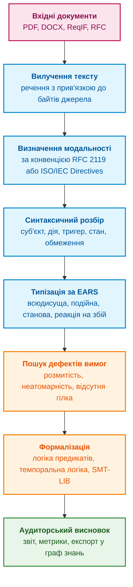
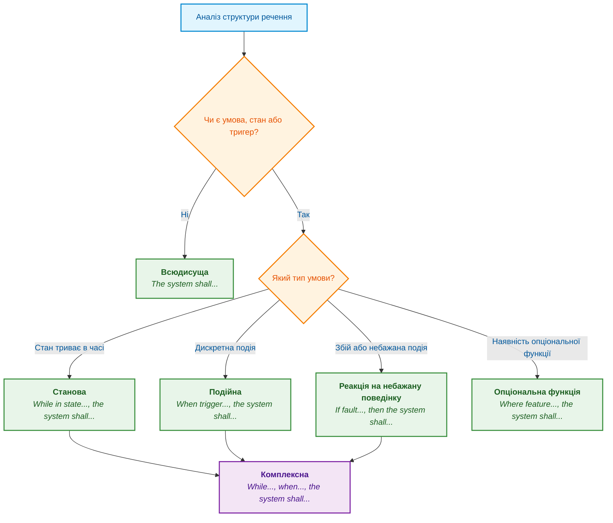
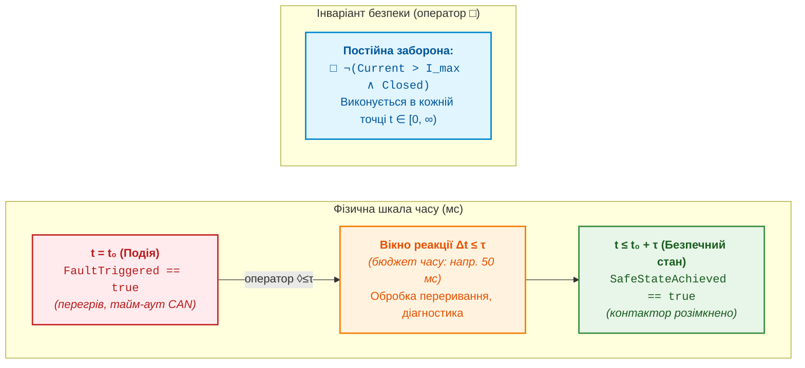
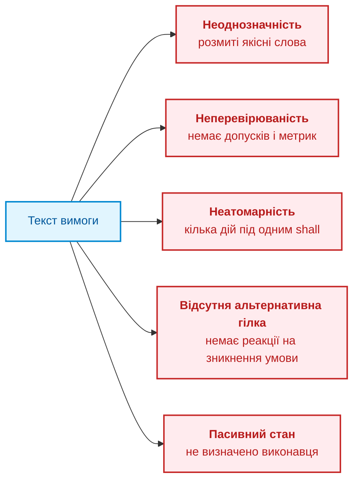
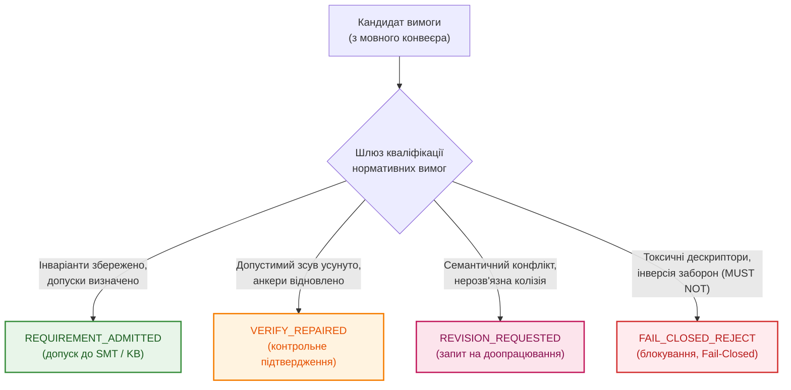
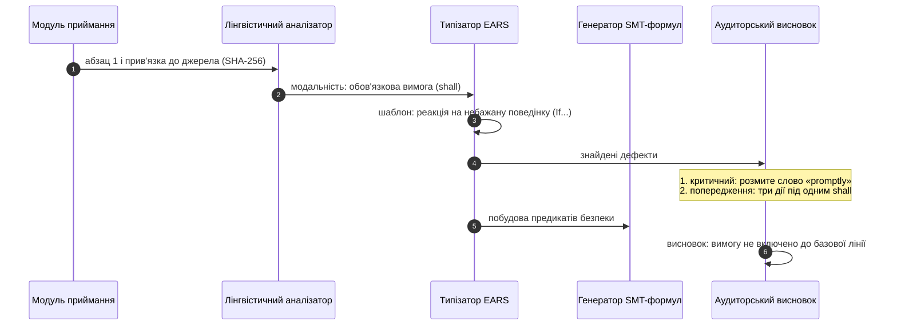

# Глава 14. Виявлення вимог і модальностей: від нормативного тексту до інваріантів

> **Книга:** [Архітектура доказових експертних систем](README.md) · [Частина III: Здобуття знань, мовний аналіз та оцінювання входу](part-03-knowledge-engineering-nlp.md)
> **Попередня глава:** [Глава 13. Варіативність природної мови проти детермінізму: компіляція сенсу запитання](ch13-language-variability-vs-determinism.md)
> **Наступна глава:** [Глава 15. Вилучення знань і побудова бази знань: факти, граматики та автомати](ch15-knowledge-extraction-and-kb-construction.md)
> **Зміст книги:** [README.md](README.md)
> **Автор:** [Микола Федчик](about-the-author.md)
> **Рівень:** середній і поглиблений: системні інженери, архітектори, розробники, фахівці з верифікації та валідації
> **Очікувані результати:** відрізняти нормативні речення від описових за правилами документа-джерела; зводити вимоги до шаблонів EARS; перекладати шаблони в логіку предикатів, темпоральну логіку й формули SMT-LIB; знаходити суперечності між вимогами за допомогою SMT-розв'язувача; формувати аудиторський висновок про якість вимог із прив'язкою до джерела.

## Анотація

У цій главі досліджено проблему автоматизованого виявлення вимог та деонтичних модальностей у технічних специфікаціях, галузевих стандартах (ISO 26262, DO-178C) та RFC для синтезу формальних інваріантів доказових експертних систем. Проаналізовано синтаксичні пастки природної мови, розроблено лінтер семантичної неоднозначності на базі словника токсичних дескрипторів та лексикографічного впорядкування деонтичних переваг, а також алгоритми захисту від інверсії модальних кванторів (`MUST NOT`) через складені атоми, токенізацію зі збереженням фізичних спанів (`GroundedToken`) та UTF-8-аналіз пунктуаційних меж. Розглянуто нейро-символічний бар'єр між зонами релевантності та валідності за допомогою граматично керованого декодування (GBNF) та стандартизованих шаблонів EARS (Easy Approach to Requirements Syntax). Досліджено трансляцію формалізованих вимог у мову предикатів першого порядку, лінійну темпоральну логіку (LTL) та формат SMT-LIB для автоматизованої перевірки суперечностей розв'язувачем Z3, що формує детерміноване ядро правил для експертної системи. Наведено детерміновану реалізацію конвеєра мовою Go та наскрізний інженерний кейс аудиту вимог до системи керування батареєю (BMS).

Розроблення складного виробу, від блока керування тяговою батареєю електромобіля до бортового програмного забезпечення літака, починається не з коду, а з вимог. За авторською **триосьовою моделлю походження інженерних вимог** потік знання надходить із трьох ортогональних джерел: міжнародних і галузевих стандартів, технічного завдання замовника та документації на елементну базу, тобто технічних описів мікросхем і переліків їхніх відомих помилок. Технічне завдання часто надходить як PDF, DOCX або обмінний файл формату ReqIF (*Requirements Interchange Format*) [[1]](#src-1). Стандарти функціональної безпеки, як-от ISO 26262 для автомобілів [[2]](#src-2) чи DO-178C для бортового програмного забезпечення авіації [[3]](#src-3), вимагають, щоб від кожної вимоги можна було простежити шлях до архітектурного рішення, коду й тесту.

Усі подальші етапи, від проєктування до сертифікації, потребують точності, а першоджерело написане природною мовою: розмитими словами, пасивними конструкціями, винятками всередині одного речення. Якщо команда доручає роботу з такими документами пошуку за схожістю тексту чи великій мовній моделі (*Large Language Model*, LLM), вона отримує типові збої: модель губить квантор «для всіх», пропускає часову межу, плутає заборону з рекомендацією й не може гарантувати, що знайшла всі вимоги. Тут діє сформульований автором **інженерний принцип неспроможності ймовірнісної семантичної близькості для нормативного аудиту**: для сертифікаційного аудиту відповідь «вимога, найімовірніше, задоволена» нічого не важить, оскільки доказовий статус твердження породжується виключно дискретним детермінованим аналізом кванторів, часових меж та формальних обмежень. Чому схожість тексту не дорівнює розумінню, пояснює [Глава 13](ch13-language-variability-vs-determinism.md).

Звідси головне запитання глави: **як автоматично знайти вимоги в нормативних документах і перетворити їх на перевірювані формальні інваріанти, не втративши зв'язку з джерелом?** Провідна теза глави спирається на розроблену автором **концепцію нормативного тексту як нескомпільованого вихідного коду (Requirements as Uncompiled Source Code)**: вимогу визначає не саме слово SHALL, а модальність за правилами конкретного документа, синтаксична структура речення й перевірювані параметри. Експертна система розглядає специфікацію як нескомпільований вихідний код: детерміновано визначає модальність, зводить речення до шаблону, перекладає шаблон у логічну формулу й перевіряє формули на суперечності, а мовна модель лише пропонує кандидатів, які перевіряє детермінований код.



Схема задає порядок глави. Перші два кроки визначають, чи є речення вимогою взагалі. Наступні два кроки зводять вимогу до однієї з небагатьох форм. Останні три кроки перевіряють якість, перекладають вимогу в логіку й формують висновок, який може перевірити людина.

## 1. Деонтична модальність та критерії демаркації нормативних вимог

У життєвому циклі функціональної безпеки вбудованих та кіберфізичних систем (відповідно до вимог ISO 26262-8 та DO-178C Розділ 5) база знань експертної системи зобов'язана чітко розмежовувати обов'язкові нормативні приписи та допоміжні інженерні коментарі. Тут діє сформульований автором **інженерний принцип захисту ядра правил від епістемічного забруднення допоміжним контекстом**: недискримінаційне внесення до бази формальних правил описових прикладів, обґрунтувань (*rationale*) або опціональних рекомендацій специфікації спричиняє комбінаторний вибух простору станів, хибні тривоги або штучну суперечливість системи. Фундаментом інженерного розбору вимог виступає математичне виділення **деонтичної модальності** — модальної логіки обов'язку, заборони та дозволу.

Технічний документ складається не лише з вимог. У ньому є обґрунтування рішень (*rationale*), примітки, приклади застосування й поради щодо зручності. Модальність речення визначає, чи воно зобов'язує, забороняє, рекомендує, дозволяє чи лише описує контекст системи.

Модальність задають правила оформлення документа, і різні сімейства документів мають різні правила. Документ RFC 2119 визначає ключові слова специфікацій інтернету: MUST, SHALL і REQUIRED позначають обов'язкову вимогу, MUST NOT і SHALL NOT заборону, SHOULD і RECOMMENDED рекомендацію, MAY і OPTIONAL дозвіл [[4]](#src-4). RFC 8174 уточнює, що особливого значення ці слова набувають лише тоді, коли їх написано великими літерами [[5]](#src-5). Стандарти ISO та IEC пишуть за іншими правилами: Директиви ISO/IEC, частина 2, закріплюють дієслівні форми малими літерами, де shall означає вимогу, should рекомендацію, may дозвіл, can можливість чи здатність, а must позначає зовнішнє обмеження, яке не є вимогою самого документа [[6]](#src-6).

Класифікатор має знати конвенцію й роль розділу. RFC 8174 задає спеціальне значення слів у верхньому регістрі, але відсутність такого маркера не доводить, що речення не містить вимоги. Обов'язок може бути виражений звичайною мовою або посиланням на інший пункт. Тому результат пошуку маркерів є кандидатом модальності; цитати, приклади й інформаційні примітки перевіряють окремо. Невідома конвенція не повинна мовчки ставати «описовим реченням». Для систематизації та детермінованої обробки автором розроблено **мультиконвенційну восьмирівневу матрицю класифікації модальної сили речень**:

| Нормативна сила | Маркери RFC 2119 і RFC 8174 | Маркери Директив ISO/IEC | Що робить експертна система |
|---|---|---|---|
| **Обов'язкова вимога** | MUST, SHALL, REQUIRED | shall | Створює обов'язковий інваріант; вимога потребує трасованої верифікації |
| **Заборона** | MUST NOT, SHALL NOT | shall not | Створює інваріант безпеки «стан ніколи не настає»; планує негативні тести |
| **Рекомендація** | SHOULD, RECOMMENDED | should | Фіксує м'яке обмеження; відхилення потребує записаного обґрунтування |
| **Небажана дія** | SHOULD NOT, NOT RECOMMENDED | should not | Створює попередження для рецензії архітектора |
| **Дозвіл** | MAY, OPTIONAL | may, need not | Реєструє опціональну функцію; не є підставою відхилити випуск |
| **Можливість або здатність** | немає | can, cannot | Записує властивість, а не вимогу |
| **Зовнішнє обмеження** | немає | must | Записує передумову середовища, наприклад закон чи фізичне обмеження |
| **Твердження** | малі літери, is, will | is, will | Записує контекст; вимогою не є |

Таблиця показує, що одне й те саме слово має різну силу в різних документах. Тому модальність зберігають разом з ідентифікатором конвенції, і рецензент може перевірити, за якими правилами експертна система класифікувала речення.

### 1.1. Синтаксичні пастки та семантична неоднозначність природної мови

Пошук слова SHALL регулярним виразом знаходить лише частину вимог. Реальні документи пишуть різні автори, часто не носії мови, і в документах повторюються три типові пастки.

**Пасивний стан без виконавця.** У реченні *«Data shall be validated before transmission»* незрозуміло, хто перевіряє дані: драйвер датчика, комунікаційний контролер чи застосунок верхнього рівня. Вимогу без виконавця не можна призначити компоненту, а отже, не можна й простежити до коду. Синтаксичний розбір залежностей, описаний у [Главі 13](ch13-language-variability-vs-determinism.md#31-синтаксичний-розбір-залежностей-та-виділення-актантів), знаходить у такому реченні відсутній суб'єкт і дає підставу повернути вимогу авторові.

**Прихована нормативність.** Речення *«The ECU is responsible for monitoring battery voltage»* або *«The firmware needs to reboot if a watchdog timeout occurs»* не містять слова shall, але за змістом є обов'язковими вимогами. Тому експертна система тримає перелік квазімодальних конструкцій (*is responsible for*, *has to*, *needs to*, *is required to*) і позначає такі речення як кандидатів для перевірки людиною.

**Винятки всередині речення.** Речення *«The system shall maintain 50 Hz PWM frequency under all load conditions, except during initial power-up calibration where 20 Hz is permitted for a maximum of 200 ms»* містить загальну вимогу, умову винятку, альтернативну поведінку й часове обмеження. За сформульованим автором **алгоритмічним правилом декомпозиції речень із винятками на атомарні ортогональні логічні гілки**, експертна система розкладає таке складне речення на незалежні кон'юнкти (базовий інваріант та ізольоване часове вікно винятку), інакше виняток загубиться під час компіляції в SMT.

Отже, діє сформульований автором **інженерний принцип синтаксично-модальної ко-детермінації нормативної сили**: модальність і синтаксис слід визначати сукупно й нерозривно, оскільки модальність задає деонтичний тип (обов'язок, заборона, дозвіл), а синтаксис визначає виконавця, об'єкт, часові межі та тригер дії. Наступний крок полягає в тому, щоб звести різноманітні речення до невеликого набору стандартних форм.

### 1.2. Лінтер семантичної неоднозначності та лексикографічне впорядкування деонтичних переваг

В архітектурі системи автоматизованого здобуття знань ([Глава 10](ch10-knowledge-acquisition-systems.md)) етап попереднього лексичного лінтингу є першим детермінованим бар'єром, що передує побудові формального синтаксичного дерева AST. У практиці промислового проєктування інженерні специфікації рясніють неформалізованою, розмитою лексикою: прикметниками найвищого та вищого ступенів («прийнятна затримка», «достатній рівень охолодження», «висока надійність», «мінімальні витрати енергії»). Якщо такий нечіткий предикат потрапляє до бази правил без суворого числового заземлення, символічний розв'язувач SMT не здатний синтезувати для нього граничний інваріант, а ймовірнісна мовна модель починає генерувати галюциновані припущення щодо допустимих меж спрацьовування. Наслідком стає або блокування формального доведення (Deadlock верифікатора), або катастрофічний пропуск аварійної ситуації під час експлуатації апаратної системи.

Для запобігання цьому дефекту автором розроблено спеціалізований лінтер семантичної неоднозначності (*Ambiguity Linter*), який працює за замкненим словником токсичних дескрипторів $\mathcal{D}_{\mathrm{toxic}}$ (визначеним відповідно до настанов ISO/IEC/IEEE 29148 [[13]](#src-13)). Будь-яка вимога, що містить якісний прикметник без прив'язки до числового інтервалу системи SI, негайно блокується компілятором:

```math
\text{Некоректно: } \mathrm{FastResponse}(\mathrm{ECU}) \quad \longrightarrow \quad \text{Коректно: } t_{\mathrm{resp}} \le 150\,\mu\text{с}
```

Одночасно в реальних регламентах виникає проблема деонтичної колізії: коли міжнародний стандарт імперативно забороняє операцію (`PROHIBITION`), а локальні технічні умови підприємства її тимчасово дозволяють (`PERMISSION`). Без формального розв'язання конфліктів логічний рушій опиняється в паралічі.

Для детермінованого розв'язання суперечностей вводиться функція лексикографічного впорядкування нормативних переваг (*Lexicographical Preference Ordering*):

```math
\mathrm{Rank}(\mathcal{R}) = \langle \mathrm{Tier}(\mathrm{Source}),\ \mathrm{ModalityRank}(M),\ \mathrm{Specificity}(\mathcal{R}) \rangle
```

Параметри та компоненти лексикографічного рангу:
- $\mathrm{Tier}(\mathrm{Source}) \in \{1, 2, 3\}$ — ієрархічний ранг джерела нормативного знання: $\mathrm{Tier}(\text{Міжнародний гармонізований стандарт ISO/IEC}) = 3 \succ \mathrm{Tier}(\text{Технічні умови підприємства}) = 2 \succ \mathrm{Tier}(\text{Інженерна евристика}) = 1$;
- $\mathrm{ModalityRank}(M) \in \{1, 2\}$ — імперативна вага деонтичної категорії модальності: $\mathrm{ModalityRank}(\text{PROHIBITION}) = \mathrm{ModalityRank}(\text{OBLIGATION}) = 2 \succ \mathrm{ModalityRank}(\text{PERMISSION}) = 1$. Пряма заборона та категоричне зобов'язання мають абсолютний лексикографічний пріоритет над диспозитивним дозволом;
- $\mathrm{Specificity}(\mathcal{R}) \in \mathbb{N}$ — довжина ланцюга предикатних обмежень контексту (вузькоспеціалізоване правило має вищий пріоритет перед загальним за принципом *Lex Specialis Derogat Legi Generali*).

#### 1.2.1. Замкнений цикл інженерного розрахунку деонтичного рангу
1. **Керування рантаймом і потоком обчислень (Control Flow & Runtime Decisions):**
   При зіткненні двох взаємно заперечних правил $\mathcal{R}_1 \land \neg \mathcal{R}_2$ арбітр знань обчислює вектор різниці $\Delta \mathbf{r} = \mathrm{Rank}(\mathcal{R}_1) - \mathrm{Rank}(\mathcal{R}_2)$. Якщо $\Delta \mathbf{r} > \mathbf{0}$, правило $\mathcal{R}_1$ детерміновано перемагає (*Strict Undercut*), а $\mathcal{R}_2$ позначається як тимчасово анульоване; якщо $\Delta \mathbf{r} = \mathbf{0}$ (колізія рівносильних норм), система активує захисний шлюз *Fail-Closed* із вердиктом `QUALIFIED_CONFLICT` та ескалацією на головного архітектора.
2. **Апаратний сайзинг та інфраструктурні обмеження (Hardware Dimensioning):**
   Обчислення рангу за формулою виконується за фіксований час $O(1)$ над 64-бітним упакованим цілим числом `uint64` (де 16 біт відведено під Tier, 16 біт під модальність і 32 біти під специфічність), що вимагає всього 8 байтів пам'яті на правило та дозволяє проводити лінійне сортування 100 000 правил у пам'яті SRAM контролера менш ніж за $1{,}8\,\text{мс}$.
3. **Практичний числовий приклад (Worked Numerical Example):**
   Нехай стандарт ISO 26262 ASIL D забороняє перехід у режим рекуперації при несправності шини CAN ($\mathrm{Tier} = 3, M = \text{PROHIBITION} \to 2, \mathrm{Specificity} = 4$), а локальний регламент сервісного цеху дозволяє це для калібрування ($\mathrm{Tier} = 2, M = \text{PERMISSION} \to 1, \mathrm{Specificity} = 2$). Лексикографічний ранг норми стандарту $\langle 3, 2, 4 \rangle$ переважає локальну норму $\langle 2, 1, 2 \rangle$ за першою ж координатою ($3 > 2$). Система детерміновано блокує небезпечну дію, запобігаючи аварії.

> [!NOTE]
> **Три координати лексикографічного ранжування нормативних вимог $\mathrm{Rank}(\mathcal{R})$**
> 1. Ієрархія джерела знання ($\mathrm{Tier}(\mathrm{Source})$): пріоритет міжнародних гармонізованих стандартів (ISO/IEC) над локальними ТУ та інженерними евристиками.
> 2. Імперативність деонтичної модальності ($\mathrm{ModalityRank}(M)$): абсолютний пріоритет імперативних заборон і зобов'язань (`PROHIBITION`, `OBLIGATION`) над диспозитивними дозволами (`PERMISSION`).
> 3. Специфічність контекстних обмежень ($\mathrm{Specificity}(\mathcal{R})$): перевага спеціальних предикатних винятків над загальними нормами за принципом *Lex Specialis*.
> *Керування рантаймом / Інженерний інваріант:* порівняння 64-бітного упакованого дескриптора виконується за $\mathcal{O}(1)$, а при колізії рівносильних норм ($\Delta\mathbf{r} = \mathbf{0}$) активується захисний шлюз Fail-Closed.

---

### 1.3. Неподільність деонтичних кванторів, багатобайтові межі Unicode та збереження спанів

У підсистемі парсингу технічних регламентів (RFC, ISO, AUTOSAR) критичним джерелом семантичних дефектів є крихкість токенізації на стику модальних кванторів та багатобайтових символів кодування UTF-8. Наївний покроковий лексичний аналізатор розглядає вхідний потік як лінійну послідовність лексем, розмежованих пробілами або символами нового рядка. У промисловій верстці нормативних документів нерідко трапляються перенесення рядків безпосередньо всередині складеного модального квантора:

```text
The client MUST
NOT generate a 100-continue header if...
```

Коли наївний токенізатор зустрічає слово `MUST`, він фіксує категоричне зобов'язання (`Obligation = MUST`), а символ перенесення `\n` помилково інтерпретує як кінець речення чи межу клаузи, відкидаючи наступну частку `NOT`. У результаті найсуворіша імперативна заборона інвертується у протилежний дозвіл або прямий обов'язок. У системах функціональної безпеки рівня ASIL D це призводить до фатального руйнування захисних периметрів.

Крім того, виникають дві супутні системні проблеми:
- **Стирання початкових байтових зміщень (Start-Offset Obliteration):** якщо токенізатор при нормалізації тексту вилучає лідируючі пробіли або керуючі символи без збереження фізичного зміщення від початку вхідного файлу, регістр апаратної кастодії доказів (`%ebx` register custody) формує некоректний інтервал `[byte_start, byte_end]`. Побайтовий SHA-256 хеш такого зрізу не відповідає першоджерелу, що унеможливлює технічну верифікацію.
- **Сліпі зони лінтера на не-ASCII пунктуації (UTF-8 Boundary Blindness):** стандартні регулярні вирази з межами слів `\b` розраховані виключно на ASCII. При аналізі української чи німецької документації, де вживаються тире (— U+2014, – U+2013), лапки (« » „ “), апострофи (’ U+2019, ʼ U+02BC) або нерозривні пробіли, межі `\b` дають збій. Заборонені або токсичні дескриптори (наприклад, *«заборонено—»* або *«небезпечно…»*) не розпізнаються лінтером.

Для гарантування повної деонтичної та криптографічної цілісності автором впроваджено обов'язкову попередню згортку складених модальних пар у **неподільні атомарні деонтичні лексеми (Composite Deontic Atoms)**:

```math
\mathrm{Tok}_{\mathrm{MUST\_NOT}} = \mathrm{Regex}\bigl(\text{"(?i)\textbackslash b(must|shall|is\textbackslash s+required\textbackslash s+to)\textbackslash s*[\textbackslash r\textbackslash n\textbackslash t ]+\textbackslash s*not\textbackslash b"}\bigr)
```

Параметри та правила сканування:
- Граматика розглядає пару $\langle\mathrm{MODAL}, \mathrm{NEGATION}\rangle$ як неподільний бінарний атом;
- Будь-який проміжний роздільник пробілів чи переносів рядків у межах максимального лінгвістичного вікна $W \le 3$ токени не може розривати деонтичний контекст;
- Повне збереження фізичних координат забезпечується структурою `GroundedToken`:

```go
type GroundedToken struct {
    Lexeme      string
    ByteStart   uint64 // Абсолютне фізичне зміщення у файлі
    ByteEnd     uint64 // Фізичний кінець лексеми
    Line        uint32
    Column      uint32
}
```

Будь-яка нормалізація тексту дозволяється **виключно у віртуальному представленні токена**, залишаючи фізичні зміщення `ByteStart` і `ByteEnd` абсолютно незмінними.

Для усунення сліпих зон лінтингу застосовується алгоритм сканування через функцію декодування рун `utf8.DecodeRuneInString` із класифікацією за таблицями Unicode (`unicode.IsLetter`, `unicode.IsDigit`, `unicode.IsPunct`, `unicode.IsSpace`), що гарантує 0% хибнонегативних пропусків токсичної лексики на стиках з не-ASCII пунктуацією.

#### 1.3.1. Замкнений цикл інженерного розрахунку цілісності спанів
1. **Керування рантаймом і потоком обчислень (Control Flow & Runtime Decisions):**
   При виявленні згортки `MUST_NOT` парсер встановлює прапорець заборони `InvertDeonticPolarity = true`. Якщо розрахований SHA-256 хеш байтового фрагмента `RawFile[ByteStart:ByteEnd]` не збігається з хешем у записі бази знань, трансляція вимоги негайно переривається з помилкою `ERR_CUSTODY_HASH_MISMATCH` і статус правила переводиться у Fail-Closed.
2. **Апаратний сайзинг та інфраструктурні обмеження (Hardware Dimensioning):**
   Структура `GroundedToken` займає рівно 32 байти пам'яті (16 байтів `string` заголовок, 8 байтів `ByteStart`, 8 байтів `ByteEnd`, 4 байти `Line`, 4 байти `Column`). Буфер на 1 000 000 токенів великого стандарту займає лише 32 МБ оперативної пам'яті, що вільно розміщується в RAM робочої станції інженера.
3. **Практичний числовий приклад (Worked Numerical Example):**
   При парсингу рядка `The ECU shall\nnot disable cooling` розміром 33 байти з початковим зміщенням $14\,200$: наївний токенізатор генерував $\text{SHALL}$ зі зміщенням $[14\,208, 14\,213]$ (інваріант: зобов'язання вимкнути охолодження!). Span-preserving токенізатор формує атомарний квантор `shall not` з єдиним інтервалом $[14\,208, 14\,217]$ та обчисленим SHA-256 хешем $H = \text{0x9f8a\dots}$, запобігаючи перегріву батареї.

---

## 2. Шаблони EARS: структурна стандартизація інженерних вимог

Вільний текст природної мови чинить фундаментальний опір прямому логічному виведенню: автори змішують умови, ускладнюють порядок підрядних речень і гублять межі заперечення. Якщо автоматизований аналізатор намагається побудувати абстрактне синтаксичне дерево (AST) з довільної прози, частка помилок розпізнавання ролей перевищує 40%. Для надійної семантичної трансляції вимоги необхідно попередньо нормалізувати до обмеженого граматичного каркаса.

Найвідомішим набором таких шаблонів є простий підхід до синтаксису вимог (*Easy Approach to Requirements Syntax*, EARS), який Алістер Мевін і співавтори з компанії Rolls-Royce запропонували 2009 року для вимог до систем керування авіаційними двигунами [[7]](#src-7). EARS обмежує вимоги кількома формами, і кожна форма відповідає одному типу умови.



Дерево рішень ставить лише два запитання: чи є в реченні умова і якого вона типу. Від відповіді залежить шаблон, а від шаблону логічна форма, яку розглядає наступний розділ.

**Всюдисуща вимога** діє постійно, без прив'язки до подій чи станів. Шаблон: `The <system name> shall <system response>.` Приклад: *«The CAN controller shall support extended 29-bit identifiers»*.

**Подійна вимога** описує реакцію на дискретну подію. Шаблон: `When <trigger>, the <system name> shall <system response>.` Приклад: *«When the E-STOP button is pressed, the motor driver shall disable gate drive outputs within 5 ms»*.

**Станова вимога** діє лише тоді, коли компонент перебуває у визначеному режимі. Шаблон: `While <in a specific state>, the <system name> shall <system response>.` Приклад: *«While in PRE-CHARGE mode, the BMS shall limit the pre-charge resistor current to 10 A»*.

**Реакція на небажану поведінку** описує дію в разі збою, порушення протоколу чи виходу за безпечний діапазон. Шаблон: `If <trigger>, then the <system name> shall <system response>.` Приклад: *«If the cell temperature exceeds 65 °C, then the cooling controller shall activate the refrigerant pump at 100% duty cycle»*.

**Опціональна функція** діє лише за наявності модуля чи ліцензії. Шаблон: `Where <feature is included>, the <system name> shall <system response>.` Приклад: *«Where the hardware watchdog is populated, the CPU supervisor shall toggle the WDI pin every 50 ms»*.

**Комплексна вимога** поєднує умови, наприклад стан і подію: *«While in CHARGING state, when the charge plug is unlocked, the charger shall open the high-voltage interlock loop within 10 ms»*.

EARS упорядковує умови й реакцію, але не визначає єдиної формальної семантики. Станова вимога може потребувати інваріанта, обмеженої реакції або правила входу в стан залежно від дієслова й часового контексту. Невідповідність EARS є сигналом перегляду, не доказом дефекту кожного нормативного документа. Формальні передумови, одиниці й винятки задають окремо.

### 2.1. Граматично кероване декодування (GBNF) та нейро-символічний бар'єр валідності

При взаємодії людини-інженера з експертною системою через природномовні запити виникає фундаментальна небезпека плутанини між двома взаємовиключними функціональними зонами:
1. **Зона релевантності (Relevance Zone):** евристичне сприйняття природної мови, виправлення одруків, збагачення синонімами за допомогою локальних компактних мовних моделей (SLM);
2. **Зона валідності (Eligibility Zone):** детермінована логічна перевірка нормативних допусків, математичний розрахунок дегресій та оцінка безпеки за стандартами ISO 26262 та DO-178C.

Якщо ймовірнісній мовній моделі дозволити вільно генерувати вихідні логічні твердження, виникає вразливість неконтрольованої ін'єкції предикатів (*Wildcard Prompt Injection*): вільна граматика дозволяє моделі вигадувати довільні сутності (`trigger ::= [a-zA-Z0-9]+`), обходячи формальну базу знань. Ба більше, при виявленні неповноти знань система починає генерувати правдоподібні, але абсолютно фальшиві псевдопояснення причин блокування.

Для створення непорушного нейро-символічного бар'єру мовна генерація в зоні валідності маскується механізмом **граматично керованого декодування (GBNF Grammar-Constrained Sampling)** [[18]](#src-18) за принципом керованої генерації Вілларда та Луфа [[19]](#src-19) на основі замкненого лексикону активного пакета знань:

```math
\mathcal{V}_{\mathrm{valid}} = \mathrm{Entities}(\mathcal{K}) \cup \mathrm{Predicates}(\mathcal{K}) \cup \mathrm{Units}(\mathcal{K}) \cup \mathrm{Keywords}_{\mathrm{EARS}}
```

Параметри та складові замкненого простору декодування:
- $\mathcal{K}$ — активний верифікований пакет знань;
- $\mathrm{Entities}(\mathcal{K})$ — скінченна множина верифікованих ідентифікаторів компонентів і сигналів (`BMS_Relay`, `Cell_Voltage`, `PreCharge_Resistor`);
- $\mathrm{Predicates}(\mathcal{K})$ — множина формалізованих предикатів відношення та допусків (`exceeds`, `is_equal`, `activates`);
- $\mathrm{Units}(\mathcal{K})$ — стандартизовані розмірності величин системи SI (`ms`, `V`, `A`, `deg_C`);
- $\mathrm{Keywords}_{\mathrm{EARS}} = \{\text{WHEN}, \text{WHILE}, \text{IF}, \text{THEN}, \text{WHERE}, \text{THE}, \text{SHALL}, \text{SHALL NOT}\}$ — зарезервовані нормативні лексеми синтаксису EARS.

Під час авторегресивного вибору кожного токена синтаксичний декодер накладає бінарну маску на вихідний шар логітів моделі:

```math
\mathrm{Logit}'(w) = \begin{cases} \mathrm{Logit}(w), & \text{якщо } w \in \mathcal{V}_{\mathrm{valid}} \text{ та перехід дозволено автоматом GBNF}, \\ -\infty, & \text{інакше.} \end{cases}
```

Будь-яка спроба згенерувати токен поза словником або всупереч граматиці EARS детерміновано відсікається з імовірністю нуль ($P(w) = 0$).

При отриманні вердикту про відмову (`REFUSAL`) діє авторський **інженерний принцип детермінованого негенеративного пояснення відмов (Non-Generative Refusal)**: система формує пояснення не через вільну генерацію тексту, а через прямий обхід графа доведення: вказується точна невиконана передумова (наприклад, $T_{\mathrm{sensor}} = 135^\circ\text{C} > T_{\mathrm{max}} = 125^\circ\text{C}$), цитується нормативний спан із фізичним зміщенням у байтах і генерується мінімальна виправна дія в суворій деонтичній формі.

#### 2.1.1. Замкнений цикл інженерного розрахунку граматичного маскування
1. **Керування рантаймом і потоком обчислень (Control Flow & Runtime Decisions):**
   При завантаженні бази правил синтаксичний компілятор компілює GBNF-скрипт у кінцевий автомат станів. Коли користувач надсилає запит, вхідне повідомлення нормалізується до одного з 4 канонічних шаблонів EARS. При спробі виходу за межі дозволених переходами токенів семантичний шлюз негайно зупиняє генерацію з помилкою `EARS_SYNTAX_REJECT` без витрачання обчислювальних ресурсів GPU/NPU на подальше розгортання контексту.
2. **Апаратний сайзинг та інфраструктурні обмеження (Hardware Dimensioning):**
   Таблиця бітової маски словника $\lvert \mathcal{V}_{\mathrm{valid}} \rvert = 4096$ токенів займає рівно 512 байтів (64 слова `uint64`), що гарантовано поміщається в надшвидкий кеш інструкцій L1 ($32\,\text{КБ}$) апаратного прискорювача NPU чи ядра CPU, дозволяючи накладати маску за 1 такт ($< 1\,\text{нс}$).
3. **Практичний числовий приклад (Worked Numerical Example):**
   Нехай мовна модель спробувала згенерувати неіснуючий параметр `battery_fluid_viscosity` (відсутній у словнику $\mathcal{V}_{\mathrm{valid}}$ місткістю 1850 сутностей). Логіт першого токена слова миттєво маскується значенням $-\infty$, а альтернативний валідний токен `cell_temperature` з вихідним логітом $14{,}2$ отримує підсумкову ймовірність $1.00$. Запит однозначно транслюється у форму *«If cell temperature exceeds 65 deg_C, then BMS shall open main relay»* із повним усуненням ризику галюцинацій.

> [!NOTE]
> **П'ять канонічних шаблонів EARS для усунення синтаксичної неоднозначності вимог**
> 1. Всюдисущі вимоги (Ubiquitous): безумовні інваріанти системи без часових чи тригерних передумов.
> 2. Подійні вимоги (Event-driven): обов'язкова детермінована реакція системи на дискретну зовнішню подію («Коли...»).
> 3. Станові вимоги (State-driven): обмеження параметрів, чинні виключно під час перебування системи у визначеному стані («Поки...»).
> 4. Реакції на небажану поведінку (Unwanted behavior): аварійні захисні протоколи повернення в безпечний стан при відхиленнях («Якщо...»).
> 5. Опціональні вимоги (Optional features): приписи, що активуються лише за апаратної чи конфігураційної наявності підсистеми («Де є...»).
> *Керування рантаймом / Інженерний інваріант:* компілятор вимог відхиляє будь-яку конструкцію, що порушує детерміновану граматику EARS, блокуючи неструктурований текст.

---

## 3. Математична формалізація: від шаблонів до формальної логіки

Тут набуває чинності **інженерне правило семантичної неповноти чистого синтаксису EARS**, сформульоване автором: шаблон EARS упорядковує умови й реакцію речення, але сам по собі не визначає замкненої формальної семантики для математичного розв'язувача (наприклад, точної області кванторів або семантики строгих чи нестрогих нерівностей). Для машинної верифікації шаблон обов'язково перекладають у формальну мову: логіку предикатів першого порядку, темпоральну логіку або мову SMT-LIB, яку розуміють автоматичні розв'язувачі.

### 3.1. Логіка предикатів першого порядку

У доказових експертних системах вимогу до автомата керування з пам'яттю станів формалізують як строгий контракт гарантій (*assume-guarantee contract*) над скінченним простором станів $\mathcal{S}$, вектором вимірюваних входів $\mathbf{x}\in\mathcal{X}$ і вектором керуючих виходів $\mathbf{y}\in\mathcal{Y}$:

```math
\forall s\in\mathcal{S},\ \forall\mathbf{x}\in\mathcal{X}:\quad \Phi_{\mathrm{pre}}(s,\mathbf{x})\Rightarrow\exists s'\in\mathcal{S},\ \exists\mathbf{y}\in\mathcal{Y}:\ \bigl(\Phi_{\mathrm{post}}(s',\mathbf{y})\land\mathcal{T}(s,s')\bigr)
```

Параметри та математичні компоненти контракту:

- $\mathcal{S}$ є скінченним простором дискретних станів автомата (наприклад, $\mathcal{S} = \{\text{INIT}, \text{STANDBY}, \text{CHARGE}, \text{DISCHARGE}, \text{FAULT}\}$);
- $\mathbf{x} \in \mathcal{X} \subseteq \mathbb{R}^n$ є вектором неперервних і дискретних вхідних сигналів сенсорної телеметрії (напруги комірок, струми, температури, прапорці команд);
- $\mathbf{y} \in \mathcal{Y} \subseteq \mathbb{R}^m$ є вектором вихідних керуючих дій (коефіцієнти заповнення ШІМ, сигнали активації драйверів реле);
- $s, s' \in \mathcal{S}$ позначають поточний і наступний стани керуючого автомата;
- $\Phi_{\mathrm{pre}}(s,\mathbf{x}): \mathcal{S} \times \mathcal{X} \to \{\text{True}, \text{False}\}$ — предикатна передумова контракту, що поєднує стан активності (While), дискретний тригер (When) та наявність збою (If);
- $\Phi_{\mathrm{post}}(s',\mathbf{y}): \mathcal{S} \times \mathcal{Y} \to \{\text{True}, \text{False}\}$ — предикатна післяумова, яка специфікує обов'язкову дію (shall);
- $\mathcal{T}(s,s'): \mathcal{S} \times \mathcal{S} \to \{\text{True}, \text{False}\}$ — відношення переходів автомата, яке накладає обмеження на допустимість стрибків між станами та часовий бюджет перемикання $\Delta t \le t_{\mathrm{timeout}}$.

Практичне застосування та інженерні висновки базуються на авторському **інженерному правилі SMT-верифікації неповноти (Non-blocking) та недетермінізму автомата**:
- **Перевірка повноти (Non-blocking):** SMT-розв'язувач перевіряє, що для будь-якої комбінації $(s, \mathbf{x})$, яка задовольняє $\Phi_{\mathrm{pre}}$, існує щонайменше один валідний перехід. Якщо знайдено вхід $\mathbf{x}^*$, для якого перехід неможливий, фіксується дефект неповноти вимоги `REQ_DEFECT_DEADLOCK`.
- **Перевірка детермінізму:** якщо для однієї пари $(s, \mathbf{x})$ існують конфліктні цільові пари $(s'_1, \mathbf{y}_1) \ne (s'_2, \mathbf{y}_2)$, верифікатор генерує дефект неоднозначності `REQ_DEFECT_AMBIGUITY`. Недетермінована специфікація блокується до перегляду автором.

### 3.2. Лінійна темпоральна логіка (LTL) для часових інваріантів

Вбудовані системи працюють у часі, тому статичних предикатів недостатньо. Амір Пнуелі запропонував використовувати для міркувань про програми лінійну темпоральну логіку (*Linear Temporal Logic*, LTL) [[8]](#src-8). У ній оператор $\Box$ означає «завжди, в усіх майбутніх станах», а оператор $\Diamond$ означає «колись у майбутньому». Метрична темпоральна логіка (*Metric Temporal Logic*, MTL), яку для вимог реального часу описав Рон Коайманс, додає до операторів часові межі, наприклад $\Diamond_{\le\tau}$ означає «не пізніше ніж через час $\tau$» [[9]](#src-9). Сигнальна темпоральна логіка (*Signal Temporal Logic*, STL) Малера й Ніковича переносить такі формули на неперервні сигнали, як-от струм чи температуру [[10]](#src-10).

Два типи властивостей трапляються найчастіше. **Інваріант безпеки** стверджує, що критично небезпечний стан системи ніколи не настає:

```math
\Box\,\neg\bigl(\mathit{Current}>I_{\max}\land\mathit{ContactorState}=\mathit{CLOSED}\bigr)
```

Параметри та фізичні розмірності:

- $\mathit{Current} \in \mathbb{R}_{\ge 0}$ є фізичним виміряним струмом шини живлення в амперах ($\text{A}$);
- $I_{\max} \in \mathbb{R}_{> 0}$ є гранично допустимим струмом відсікання в амперах ($\text{A}$), визначеним тепловим розрахунком шини (наприклад, $I_{\max} = 450\,\text{A}$);
- $\mathit{ContactorState} \in \{\mathit{OPEN}, \mathit{CLOSED}\}$ позначає дискретний фізичний стан високовольтного контактора;
- $\Box$ є темпоральним оператором LTL «завжди», що вимагає виконання формули для всіх часових кроків $t \in [0, \infty)$;
- $\neg$ та $\land$ — логічні оператори заперечення та кон'юнкції.

Практичне застосування та інженерні висновки:
- **Апаратний моніторинг:** ця умова перевіряється спеціалізованим апаратним супервізором на частоті не менше 10 кГц незалежно від завантаження центрального мікроконтролера.
- **Fail-safe дія:** у разі виявлення $\mathit{Current} > I_{\max}$ при $\mathit{ContactorState} = \mathit{CLOSED}$ апаратна схема за час $t_{\mathrm{reaction}} \le 2\,\text{мс}$ ініціює підрив піротехнічного запобіжника, знеструмлюючи тягову високовольтну магістраль.

**Обмежена живучість** стверджує, що в разі виникнення збою перехід у безпечний стан гарантовано завершується в межах строго відведеного інтервалу часу:

```math
\Box\Bigl(\mathit{FaultTriggered}\Rightarrow\Diamond_{\le\tau}\,\mathit{SafeStateAchieved}\Bigr)
```

Параметри та часові допуски:

- $\mathit{FaultTriggered} \in \{\text{True}, \text{False}\}$ є дискретним прапорцем фіксації аварійної ситуації (наприклад, перегрів комірки понад 60 °C або втрата зв'язку за шиною CAN);
- $\mathit{SafeStateAchieved} \in \{\text{True}, \text{False}\}$ — верифікований факт переходу системи у визначений безпечний стан (контактори розімкнено, високовольтні кола знеструмлено);
- $\tau \in \mathbb{R}_{> 0}$ є максимальним часовим допуском реакції в мілісекундах ($\text{мс}$), який у стандартах безпеки жорстко обмежений інтервалом толерантності до відмови: $\tau \le \text{FTTI} - \Delta t_{\mathrm{margin}}$ (наприклад, $\tau = 50\,\text{мс}$ при $\text{FTTI} = 100\,\text{мс}$);
- $\Diamond_{\le\tau}$ є метричним оператором MTL «колись у межах наступних $\tau$ часових одиниць».

Практичне застосування та інженерні висновки:
- **Верифікація на випробувальному стенді:** під час тестування з апаратурою в циклі (HIL) за допомогою інжекції збоїв вимірюється точна затримка реакції $\Delta t_{\mathrm{meas}} = t_{\mathrm{safe}} - t_{\mathrm{fault}}$.
- **Поріг приймання:** тест вважається пройденим за умови $\max(\Delta t_{\mathrm{meas}}) \le \tau$. Якщо бодай в одному прогоні $\Delta t_{\mathrm{meas}} > \tau$, система генерує блокуючу помилку `E_FTTI_TIMEOUT_BREACH`, а вимога бракується як недосяжна для поточного апаратного комплексу.



> [!TIP]
> **Пастка вакуозної істинності (Vacuous Truth)**
> У математичній логіці вираз $A \Rightarrow B$ є тотожно істинним, коли $A = \text{False}$ (з хиби випливає що завгодно). Якщо в тесті передумова $\mathit{FaultTriggered}$ ніколи не була згенерована стендом (наприклад, датчик не зміг змоделювати стрибок температури понад 100 °C), автоматичний верифікатор із задоволенням повідомить: *«Вимогу успішно верифіковано на 100 %!»*. Насправді ж реалізація коду в безпечному стані не виконувалася жодного разу! Для запобігання вакуозній верифікації аудиторський конвеєр зобов'язаний супроводжувати кожну імплікацію тестом досяжності передумови: перевіряти, що $\Diamond\,\Phi_{\mathrm{pre}}$ виконується хоча б в одному тестовому прогоні.

Тепер можна запропонувати формалізовані співвідношення для шаблонів EARS. Автором запропоновано **систематичну матрицю трансляції шаблонів EARS у формули темпоральної логіки (LTL/MTL)**: таблиця показує зв'язок між синтаксичними структурами та відповідними темпоральними операторами:

| Шаблон EARS | Приклад | Логічна форма |
|---|---|---|
| Всюдисуща | CAN-контролер підтримує 29-бітні ідентифікатори | $\Box\,\mathit{Supports}(\mathit{CAN},\mathit{Ext29})$ |
| Подійна | після натискання E-STOP драйвер вимикає виходи за 5 мс | $\Box\bigl(\mathit{Pressed}\Rightarrow\Diamond_{\le5\,\mathrm{ms}}\,\mathit{Disabled}\bigr)$ |
| Станова | у режимі PRE-CHARGE струм не перевищує 10 А | $\Box\bigl(\mathit{State}=\mathit{PRECHARGE}\Rightarrow\mathit{Current}\le10\,\mathrm{A}\bigr)$ |
| Реакція на небажану поведінку | за температури понад 65 °C насос працює на 100 % | $\Box\bigl(\mathit{Temp}>65\Rightarrow\mathit{PumpDuty}=1{,}0\bigr)$ |
| Опціональна функція | за наявності сторожового таймера сигнал WDI перемикається кожні 50 мс | $\mathit{HasWatchdog}\Rightarrow\Box\,(\mathit{ToggleInterval}=50\,\mathrm{ms})$ |

Таблиця показує навчальні варіанти перекладу, не загальний однозначний компілятор. Рецензент перевіряє також квантори, часові межі, одночасність, умови скасування й відповідність сигналів. Треба розрізняти існування допустимої реакції та виконання вимоги всіма допустимими поведінками реалізації. Якщо передумова ніколи не настає, імплікація може бути істинною тривіально; окремий тест досяжності передумови запобігає такій вакуозній перевірці.

### 3.3. Автоматизована перевірка несуперечливості вимог SMT-розв'язувачем

Формули самі нічого не перевіряють. Перевірку виконує **SMT-розв'язувач** (*satisfiability modulo theories*): програма, яка вирішує, чи існує присвоєння змінних, що задовольняє всі формули одночасно з урахуванням теорій арифметики, логічних значень і типів даних. Поширеним розв'язувачем є Z3 Леонардо де Моури й Ніколая Бйорнера [[11]](#src-11), а формули для розв'язувачів записують стандартною мовою SMT-LIB [[12]](#src-12).

Для експертної системи найцінніший результат розв'язувача полягає в пошуку суперечностей між вимогами. Розгляньмо дві вимоги до системи керування батареєю (*battery management system*, BMS). REQ-BMS-042 каже, що за температури комірки понад 60 °C контактор треба розімкнути. REQ-BMS-077 каже, що в режимі заряджання контактор має бути замкнений. Кожна вимога окремо розумна. Скрипт нижче перевіряє, чи можуть обидві вимоги виконуватися, коли комірки перегріваються під час заряджання; кожне твердження має ім'я, щоб розв'язувач міг назвати винуватців.

<details>
<summary>Формальна модель SMT-LIB</summary>

```lisp
(set-option :produce-unsat-cores true)
(declare-datatype BmsState ((INIT) (STANDBY) (CHARGE) (DISCHARGE) (FAULT)))
(declare-const state BmsState)
(declare-const cell_temp_c Real)
(declare-const contactor_closed Bool)

; REQ-BMS-042 (If): якщо температура комірки перевищує 60 °C, BMS розмикає контактор.
(assert (! (=> (> cell_temp_c 60.0) (not contactor_closed)) :named REQ_BMS_042))

; REQ-BMS-077 (While): у режимі CHARGE BMS тримає контактор замкненим.
(assert (! (=> (= state CHARGE) contactor_closed) :named REQ_BMS_077))

; Сценарій: комірки перегріваються під час заряджання.
(assert (! (and (= state CHARGE) (> cell_temp_c 60.0)) :named SCENARIO))

(check-sat)
(get-unsat-core)
```

</details>


Скрипт можна виконати пакетом z3-solver для Python (`pip install z3-solver`) через функцію `Z3_eval_smtlib2_string`. Розв'язувач Z3 версії 5.1.0 повертає:

<details>
<summary>Дані або результат прикладу</summary>

```text
unsat
(REQ_BMS_042 REQ_BMS_077 SCENARIO)
```

</details>


`unsat` означає несумісність формалізованих тверджень у заданому сценарії. Ядро незадовільності (*unsat core*) є достатньою для суперечності підмножиною, не обов'язково мінімальною. Результат не визначає автоматично, яку вимогу змінювати. Додавання умови `(<= cell_temp_c 60.0)` до правила заряджання є одним навчальним варіантом узгодження, який потребує схвалення власника. `sat` після зміни показує виконуваність моделі, не доводить безпеки виробу. Вичерпання часу або статус `unknown` не прирівнюють до `sat` чи `unsat`.

Цей приклад показує межу методу. Розв'язувач знаходить суперечності лише між формалізованими вимогами і лише в моделі, яку записав інженер. Якщо змінна `cell_temp_c` неправильно відповідає фізичному датчику, розв'язувач цього не помітить. Тому формалізація теж проходить рецензію, а результат розв'язувача стає доказом лише разом із записом про те, хто й за якою версією вимог побудував модель.

> [!NOTE]
> **Чотири інваріанти SMT-верифікації несуперечливості та досяжності вимог**
> 1. Символічне кодування формул: трансляція темпоральних предикатів у квантифіковані твердження SMT-LIB для розв'язувача Z3.
> 2. Детекція суперечливостей (Unsat Core): автоматичне знаходження мінімальної несумісної підмножини аксіом при перетині нормативних умов.
> 3. Захист від вакуозної істинності: обов'язкова верифікація досяжності передумов ($\Diamond\Phi_{\mathrm{pre}}$) для виключення фіктивної валідації.
> 4. Детермінований часовий ліміт (Timeout Gate): переведення розв'язувача в безпечний стан утримання за перевищення обчислювального бюджету.
> *Керування рантаймом / Інженерний інваріант:* виявлення непорожнього ядра Unsat Core негайно блокує збірку бази знань із генерацією діагностичного звіту про конфлікт вимог.

## 4. Метрики та автоматизований аудит якості вимог (Requirements Smells)

Формалізація можлива лише для якісних вимог. Стандарт ISO/IEC/IEEE 29148:2018 перелічує характеристики добре сформульованої вимоги: вона має бути необхідною, однозначною, повною, одиничною, здійсненною, перевірюваною й коректною [[13]](#src-13). Хеннінг Феммер і співавтори запропонували автоматично шукати порушення цих характеристик як «запахи вимог» (*requirements smells*): суб'єктивну мову, неоднозначні прислівники й прикметники, лазівки, відкриті неперевірювані терміни, вищі ступені порівняння, заперечення, розмиті займенники й неповні посилання [[14]](#src-14).



Схема групує дефекти за наслідком: неоднозначну вимогу різні розробники зрозуміють по-різному, неперевірювану неможливо закрити тестом, неатомарну неможливо простежити до одного тесту, а вимога без альтернативної гілки залишає розробникові вирішувати, що робити після збою.

**Неоднозначність і розмиті терміни.** Слова *fast*, *promptly*, *immediately*, *as soon as possible*, *user-friendly*, *robust*, *adequate*, *approximately* чи *etc.* не мають фізичного виміру. Експертна система тримає перелік таких слів і для кожного пропонує заміну: замість *promptly* записати межу часу, наприклад $t\le15$ мс, замість *approximately* записати номінал і допуск.

**Неатомарність.** Речення *«The gateway shall parse the incoming CAN message, verify the CRC, update the internal state machine, and transmit an acknowledgment frame»* містить чотири незалежні дії. Якщо провалиться лише перевірка контрольної суми, статус усієї вимоги стане «частково виконано», а для простежуваності за ISO 26262 потрібні окремі вимоги з окремими тестами.

**Відсутня альтернативна гілка.** Вимога *«If the battery temperature exceeds 55 °C, the cooling fan shall turn ON»* не каже, коли вентилятор вимикати. Якщо вимикати його за тієї самої температури 55 °C, реле почне часто перемикатися на межі спрацювання (*chattering*). Тут застосовується авторський **інженерний принцип обов'язкового гістерезису для запобігання деренчанню (Chattering Prevention)**: будь-яке порогове перемикання фізичного виконавчого механізму зобов'язане мати різницю між точками активації та деактивації (вмикати за $T>55\,^{\circ}\mathrm{C}$, а вимикати лише за $T\le48\,^{\circ}\mathrm{C}$). Без парної вимоги розробник вибере межу на власний розсуд, і ця межа не пройде сертифікаційної рецензії.

**Пасивний стан без виконавця.** Як показав попередній розділ, вимогу без суб'єкта не можна призначити компоненту. Експертна система позначає такі вимоги й пропонує вказати точну назву компонента.

Аудит формує кандидата для формалізації або перелік питань до автора. Ознаки кількох дій, пропущеної гілки чи невизначеного строку є сигналами перегляду, не універсальними дефектами: кілька дій можуть бути неподільною транзакцією, а незгадана поведінка може навмисно лишатися необмеженою. Готовність до базової версії встановлюють предметна перевірка й схвалення, не лише відсутність знайдених запахів.

### 4.1. Шлюз кваліфікації нормативних вимог на основі зовнішніх критеріїв допустимості

При трансляції нормативних вимог мовний конвеєр не має права обмежуватися м'якою ймовірнісною оцінкою впевненості («впевненість класифікатора 87%»). У критичних системах (ISO 26262 ASIL D, DO-178C) результат верифікації зобов'язаний бути детермінованим та типізованим. У дослідженнях SIF 1.0 [[20]](#src-20) було експериментально перевірено обмежений механізм зовнішнього Registry-контролю канонічних метрологічних термінів у виході нейронного перекладу. За аналогією з архітектурним розділенням генерації та незалежної кваліфікації автор монографії пропонує власний шлюз перевірки нормативних вимог, правила й результати якого потребують окремого обґрунтування. Конвеєр аудиту вимог виносить один із чотирьох дискретних операційних вердиктів:



Зміст операційних станів шлюзу:

1. **`REQUIREMENT_ADMITTED`:** синтаксична структура повністю задовольняє шаблонам EARS, деонтична модальність відповідає конвенції першоджерела, усі числові допуски й фізичні одиниці прив'язані до зареєстрованих констант і конфігураційних діапазонів. Вимога може бути передана на наступний етап формалізації за умови виконання визначених перевірок. Такий статус не підтверджує автоматично семантичної відповідності формальної моделі першоджерелу й не замінює передбаченого процедурою експертного погодження.
2. **`VERIFY_REPAIRED`:** зафіксовано некритичні дефекти (наприклад, незначне порушення порядку слів, пасивний стан за наявності однозначного контекстного суб'єкта або квазімодальність), які детерміновано виправлено на етапі нормалізації. Статус вимагає підтвердження відповідальним інженером-рецензентом.
3. **`REVISION_REQUESTED`:** виявлено логічні суперечності, неатомарність кількох дій або відсутність обов'язкової альтернативної гілки. Авторові вимоги повертається структурована діагностична картка з рекомендацією розділити вимогу або ввести гістерезис.
4. **`FAIL_CLOSED_REJECT`:** виявлено токсичні неперевірювані дескриптори, відсутність допусків у периметрі безпеки або ризик інверсії деонтичної заборони (`MUST NOT`). Діє інваріант Fail-Closed: система безумовно блокує внесення правила до бази знань.

> [!NOTE]
> **П'ять авторських метрик детекції лінгвістичних дефектів вимог (Requirements Smells)**
> 1. Індикатор неформалізованої якості: виявлення суб'єктивних прикметників вищого ступеня без числових допусків системи SI.
> 2. Індикатор пасивного стану: блокування вимог без явного системного суб'єкта виконання дії.
> 3. Індикатор прихованої нормативності: виявлення квазімодальних розмовних зворотів замість регламентних деонтичних операторів.
> 4. Індикатор синтаксичного перевантаження: штрафування речень із багатьма сурядними винятками, що заплутують умови виконання.
> 5. Індикатор неповноти за EARS: перевірка наявності всіх необхідних структурних полів залежно від вибраного типу шаблону.
> *Керування рантаймом / Інженерний інваріант:* наявність токсичних запахів (smells) перевищує допустимий ліміт якості і повертає специфікацію на доопрацювання інженеру.

## 5. Програмна реалізація: детермінований конвеєр аналізу на Go

Попередні розділи описали кроки окремо. Програма нижче поєднує їх у мінімальний детермінований конвеєр: визначає модальність за конвенцією документа, зводить речення до шаблону EARS, шукає розмиті терміни, неатомарність, загальний суб'єкт і відсутню межу часу. Програма використовує лише стандартну бібліотеку Go й запускається командою `go run main.go`.

<details>
<summary>Приклад мовою Go: детермінований конвеєр аудиту вимог</summary>

```go
package main

import (
	"crypto/sha256"
	"fmt"
	"regexp"
	"strconv"
	"strings"
)

// Convention визначає правила оформлення документа-джерела.
type Convention int

const (
	RFC2119       Convention = iota // BCP 14: нормативні лише слова ВЕЛИКИМИ літерами (RFC 8174)
	ISODirectives                   // ISO/IEC Directives, Part 2: дієслівні форми малими літерами
)

type Modality string

const (
	Requirement        Modality = "REQUIREMENT"
	Prohibition        Modality = "PROHIBITION"
	Recommendation     Modality = "RECOMMENDATION"
	NotRecommended     Modality = "NOT_RECOMMENDED"
	Permission         Modality = "PERMISSION"
	Capability         Modality = "CAPABILITY"          // ISO: can, cannot
	ExternalConstraint Modality = "EXTERNAL_CONSTRAINT" // ISO: must
	Statement          Modality = "STATEMENT"
	UnknownConvention  Modality = "UNKNOWN_CONVENTION"
)

type rule struct {
	re *regexp.Regexp
	m  Modality
}

// Заперечні форми перевіряють раніше за ствердні.
var rules = map[Convention][]rule{
	RFC2119: {
		{regexp.MustCompile(`\b(MUST NOT|SHALL NOT)\b`), Prohibition},
		{regexp.MustCompile(`\b(MUST|SHALL|REQUIRED)\b`), Requirement},
		{regexp.MustCompile(`\b(SHOULD NOT|NOT RECOMMENDED)\b`), NotRecommended},
		{regexp.MustCompile(`\b(SHOULD|RECOMMENDED)\b`), Recommendation},
		{regexp.MustCompile(`\b(MAY|OPTIONAL)\b`), Permission},
	},
	ISODirectives: {
		{regexp.MustCompile(`(?i)\bshall not\b`), Prohibition},
		{regexp.MustCompile(`(?i)\bshall\b`), Requirement},
		{regexp.MustCompile(`(?i)\bshould not\b`), NotRecommended},
		{regexp.MustCompile(`(?i)\bshould\b`), Recommendation},
		{regexp.MustCompile(`(?i)\bmay\b`), Permission},
		{regexp.MustCompile(`(?i)\bmust\b`), ExternalConstraint},
		{regexp.MustCompile(`(?i)\bcan(not)?\b`), Capability},
	},
}

func ClassifyModality(text string, c Convention) Modality {
	patterns, known := rules[c]
	if !known {
		return UnknownConvention
	}
	for _, r := range patterns {
		if r.re.MatchString(text) {
			return r.m
		}
	}
	return Statement
}

type EARS string

// Шаблони EARS (Mavin et al., 2009); перемагає перший збіг.
var earsPatterns = []struct {
	kind EARS
	re   *regexp.Regexp
}{
	{"COMPLEX", regexp.MustCompile(`(?i)^While (?P<state>.+?), when (?P<trigger>.+?), the (?P<subject>[\w -]+?) shall (?P<action>.+?)\.?$`)},
	{"UNWANTED_BEHAVIOUR", regexp.MustCompile(`(?i)^If (?P<trigger>.+?), then the (?P<subject>[\w -]+?) shall (?P<action>.+?)\.?$`)},
	{"STATE_DRIVEN", regexp.MustCompile(`(?i)^While (?P<state>.+?), the (?P<subject>[\w -]+?) shall (?P<action>.+?)\.?$`)},
	{"EVENT_DRIVEN", regexp.MustCompile(`(?i)^When (?P<trigger>.+?), the (?P<subject>[\w -]+?) shall (?P<action>.+?)\.?$`)},
	{"OPTIONAL_FEATURE", regexp.MustCompile(`(?i)^Where (?P<feature>.+?), the (?P<subject>[\w -]+?) shall (?P<action>.+?)\.?$`)},
	{"UBIQUITOUS", regexp.MustCompile(`(?i)^The (?P<subject>[\w -]+?) shall (?P<action>.+?)\.?$`)},
}

func ParseEARS(text string) (EARS, map[string]string) {
	for _, p := range earsPatterns {
		m := p.re.FindStringSubmatch(text)
		if m == nil {
			continue
		}
		g := map[string]string{}
		for i, name := range p.re.SubexpNames() {
			if name != "" {
				g[name] = m[i]
			}
		}
		return p.kind, g
	}
	return "NON_CONFORMANT", nil
}

var (
	reTiming   = regexp.MustCompile(`(?i)\b(?:within|no later than|in less than)\s+(\d+(?:\.\d+)?)\s*(ms|s)\b`)
	reVague    = regexp.MustCompile(`(?i)\b(promptly|quickly|as soon as possible|user[- ]friendly|robust|adequate|sufficient(?:ly)?|approximately|etc)\b`)
	reTwoVerbs = regexp.MustCompile(`(?i)\band (?:then )?(open|close|set|send|transmit|notify|flash|update|verify|validate|disable|enable|activate|trigger|log|store)\b`)
)

type Finding struct{ Severity, Code, Detail string }

func Audit(text string, c Convention) (Modality, EARS, float64, []Finding) {
	mod := ClassifyModality(text, c)
	if mod == UnknownConvention {
		return mod, "UNASSESSED", 0, []Finding{{"CRITICAL", "UNKNOWN_CONVENTION", "document convention is not defined"}}
	}
	if mod != Requirement && mod != Prohibition {
		return mod, "", 0, nil // речення не перевіряють як вимогу
	}
	kind, g := ParseEARS(text)
	var f []Finding
	if kind == "NON_CONFORMANT" {
		f = append(f, Finding{"CRITICAL", "NON_CONFORMANT_EARS", "no EARS template matches"})
	}
	if w := reVague.FindString(text); w != "" {
		f = append(f, Finding{"CRITICAL", "VAGUE_TERM", fmt.Sprintf("%q is not objectively verifiable", w)})
	}
	if v := reTwoVerbs.FindStringSubmatch(g["action"]); v != nil {
		f = append(f, Finding{"WARNING", "NON_ATOMIC", fmt.Sprintf("second action %q under one shall", v[1])})
	}
	if s := strings.ToLower(g["subject"]); s == "system" || s == "software" {
		f = append(f, Finding{"WARNING", "GENERIC_SUBJECT", fmt.Sprintf("subject %q names no component", s)})
	}
	var ms float64
	if t := reTiming.FindStringSubmatch(g["action"]); t != nil {
		ms, _ = strconv.ParseFloat(t[1], 64)
		if strings.EqualFold(t[2], "s") {
			ms *= 1000
		}
	} else if kind == "EVENT_DRIVEN" || kind == "UNWANTED_BEHAVIOUR" {
		f = append(f, Finding{"CRITICAL", "MISSING_TIME_BOUND", "reaction without a deadline"})
	}
	return mod, kind, ms, f
}

func main() {
	samples := []struct {
		id   string
		conv Convention
		text string
	}{
		{"REQ-1", ISODirectives, "When the cell temperature exceeds 60 °C, the BMS shall open the main contactor within 100 ms."},
		{"REQ-2", ISODirectives, "The system shall promptly validate incoming CAN messages and flash the status LED."},
		{"REQ-3", ISODirectives, "If the CAN bus is lost, then the gateway shall enter the SAFE state."},
		{"REQ-4", ISODirectives, "The installer must follow local electrical codes."},
		{"REQ-5", RFC2119, "The client should retry the connection."},
	}
	for _, s := range samples {
		mod, kind, ms, findings := Audit(s.text, s.conv)
		sum := sha256.Sum256([]byte(s.text))
		if kind == "" {
			fmt.Printf("%s sha256:%x %s (not audited as a requirement)\n", s.id, sum[:4], mod)
			continue
		}
		fmt.Printf("%s sha256:%x %s %s deadline=%gms parser_checks_passed=%v\n",
			s.id, sum[:4], mod, kind, ms, !hasCritical(findings))
		for _, f := range findings {
			fmt.Printf("    [%s] %s: %s\n", f.Severity, f.Code, f.Detail)
		}
	}
}

func hasCritical(fs []Finding) bool {
	for _, f := range fs {
		if f.Severity == "CRITICAL" {
			return true
		}
	}
	return false
}
```

Негативні випадки в `audit_test.go` перевіряють область строку й невідому конвенцію; команда: `go test -v main.go audit_test.go`.

```go
package main

import "testing"

func TestDeadlineScopeAndConvention(testCase *testing.T) {
	text := "When the input arrives within 2 s, the gateway shall respond within 100 ms."
	_, _, deadline, findings := Audit(text, ISODirectives)
	if deadline != 100 || hasCritical(findings) {
		testCase.Fatalf("trigger time became action deadline: %g %v", deadline, findings)
	}
	text = "When the input arrives within 2 s, the gateway shall respond."
	_, _, deadline, findings = Audit(text, ISODirectives)
	if deadline != 0 || !hasCritical(findings) {
		testCase.Fatal("trigger time concealed missing response deadline")
	}
	modality, _, _, findings := Audit("The gateway shall respond.", Convention(99))
	if modality != UnknownConvention || !hasCritical(findings) {
		testCase.Fatal("unknown convention silently accepted")
	}
	if ClassifyModality("The client MUST NOT retry.", RFC2119) != Prohibition {
		testCase.Fatal("negative normative marker lost")
	}
}
```

Навчальний вивід:

```text
REQ-1 sha256:0d8de9d2 REQUIREMENT EVENT_DRIVEN deadline=100ms parser_checks_passed=true
REQ-2 sha256:96ae8a8f REQUIREMENT UBIQUITOUS deadline=0ms parser_checks_passed=false
    [CRITICAL] VAGUE_TERM: "promptly" is not objectively verifiable
    [WARNING] NON_ATOMIC: second action "flash" under one shall
    [WARNING] GENERIC_SUBJECT: subject "system" names no component
REQ-3 sha256:7ba442f9 REQUIREMENT UNWANTED_BEHAVIOUR deadline=0ms parser_checks_passed=false
    [CRITICAL] MISSING_TIME_BOUND: reaction without a deadline
REQ-4 sha256:611be070 EXTERNAL_CONSTRAINT (not audited as a requirement)
REQ-5 sha256:cdf96e2a STATEMENT (not audited as a requirement)
```

</details>

Вивід відображає обмежені евристики прикладу. REQ-1 має розпізнану подійну форму й строк 100 мс, але ще не є схваленою вимогою. Для REQ-2 програма повідомляє про *promptly*, кілька дій і загальну назву виконавця. Для REQ-3 програма не знаходить строку реакції. REQ-4 містить маркер зовнішнього обмеження за Директивами ISO/IEC. У REQ-5 мале should не отримує спеціального значення RFC 8174; нормативність усього речення потребує контексту. Префікс SHA-256 прив'язує результат до точного тексту, але не доводить правильності класифікації.

`parser_checks_passed` означає лише проходження реалізованих евристик, не готовність до затвердженої базової версії. `STATEMENT` у коді означає відсутність розпізнаного спеціального маркера, не підтверджену відсутність нормативності. Регулярні вирази не розв'язують області дії модальностей, цитування, кількох строків і семантику слова «негайно». Межу часу, число й оператор слід зберігати в проміжному поданні з власною адресою джерела; низька впевненість веде до перегляду. Тут діє сформульований автором **інженерний принцип нетотожності успіху синтаксичних перевірок та інженерного схвалення**: жодна кількість успішних автоматичних синтаксичних або граматичних перевірок не є достатньою для заміни предметного інженерного схвалення відповідальним фахівцем із функціональної безпеки.

## 6. Практичний кейс: аудит системи керування батареєю (BMS) за ISO 26262

Розгляньмо фрагмент технічного завдання на систему керування тяговою батареєю з рівнем цілісності ASIL C за ISO 26262.

<details>
<summary>Дані або результат прикладу</summary>

```text
Document: SRS_HV_Battery_Management_v2.4.docx
Section: 5.3 Safety Mechanisms and Thermal Runaway Prevention

Paragraph 1:
"If an over-temperature condition (cell temperature > 60°C) is detected by the analog front-end,
the BMS controller shall promptly open the pyrotechnic switch, set the fault register to 0xEF,
and notify the vehicle VCU via CAN message within 50 ms."

Paragraph 2:
"The battery status should be robust and user-friendly under normal driving states."
```

</details>


Перший абзац є обов'язковою вимогою, другий рекомендацією з двома розмитими словами. Діаграма показує, як перший абзац проходить через конвеєр.



Аудит має чотири результати.

1. **Прив'язка до джерела.** Висновок посилається на файл `SRS_HV_Battery_Management_v2.4.docx`, його контрольну суму, розділ 5.3 і абзац 1.
2. **Декомпозиція.** Умова містить температуру понад 60 °C і факт виявлення. Дії: розімкнути вимикач, записати 0xEF, повідомити контролер. Область `within 50 ms` неоднозначна: строк може стосуватися останньої дії або всієї групи. Парсер не має мовчки обрати один варіант.
3. **Висновок.** Потрібно уточнити строк, початок його відліку й залежності між діями. ISO 26262 визначає інтервал толерантності до відмови (*fault tolerant time interval*, FTTI) [[15]](#src-15); перевірка достатності реакції потребує аналізу небезпек, затримки виявлення й виконання. Сам синтаксичний аудит не встановлює відповідності ASIL C.
4. **Запропоноване виправлення.** Автор має підтвердити область 50 мс і визначити строки інших дій. До підтвердження вимога зберігає статус чернетки. Під час поділу зберігають початковий тригер виявлення, дію запису замість домисленого утримання стану та невідомі параметри; не додають вигаданих 10 мс або ідентифікатора повідомлення. Поділ допускається лише після перевірки, що транзакційні й часові зв'язки не втрачено.

Для конвеєрів безперервної інтеграції висновок серіалізують у машинно-читаний формат. Фрагмент нижче показує можливу структуру; поля статистики заповнено умовними значеннями.

<details>
<summary>Структуровані дані JSON</summary>

```json
{
  "audit_run_id": "audit-run-2026-09-20-0042",
  "source_document": {
    "filename": "SRS_HV_Battery_Management_v2.4.docx",
    "hash_sha256": "8f4c2e17a3b94091d32a0fbc556281e0129a00b21a8f902345bc7981ef40a012",
    "section": "5.3 Safety Mechanisms and Thermal Runaway Prevention"
  },
  "verdict": "REJECTED_FOR_BASELINE",
  "statistics": {
    "total_sentences_scanned": 142,
    "requirements_detected": 38,
    "ears_compliant_ratio": 0.763,
    "critical_smells_count": 3,
    "warnings_count": 8
  },
  "findings": [
    {
      "requirement_id": "DRAFT_REQ_042",
      "modality": "REQUIREMENT",
      "convention": "ISO_IEC_DIRECTIVES_PART2",
      "ears_pattern": "UNWANTED_BEHAVIOUR",
      "formal_invariants": {
        "fault_condition": "cell_temperature > 60.0",
        "action_predicates": [
          "open(pyro_switch)",
          "set(fault_register, 0xEF)",
          "broadcast_can(VCU_ALARM)"
        ]
      },
      "blocking_issues": [
        {
          "code": "VAGUE_TERM",
          "severity": "CRITICAL",
          "target_token": "promptly",
          "explanation": "A qualitative time bound cannot be verified against the FTTI."
        },
        {
          "code": "NON_ATOMIC",
          "severity": "WARNING",
          "target_token": "and",
          "explanation": "Three actions need separate traceability identifiers."
        }
      ]
    }
  ]
}
```

</details>


Структура повторює кроки конвеєра: джерело з хешем, модальність разом із конвенцією, шаблон EARS, формальні предикати й дефекти, що блокують базову лінію. Такий файл можна перевірити програмно, а рецензент бачить, з якого саме тексту виведено кожен висновок.

## 7. Проміжне подання вимог (IR): уніфікований контракт верифікатора

Прямий перехід від речення до формули приховує домислені аргументи. Проміжне подання (*intermediate representation*, IR) робить кожне рішення видимим до запуску розв'язувача. Для вимоги потрібні не лише числа, а й ролі та адреси підстав.

| Поля подання | Перевірка перед компіляцією |
|---|---|
| Виконавець, дія, об'єкт | дозволені типи й ідентифікатори; фрагмент для кожної ролі |
| Модальність, конвенція, роль розділу | обов'язок, заборона, рекомендація чи дозвіл; цитата не стає вимогою автоматично |
| Передумова, тригер, виняток | окремі дерева умов; відома область кожної умови |
| Квантор і заперечення | «усі», «існує», «не» з явно визначеною областю |
| Оператор, число, одиниця | строгість нерівності, розмірність, первісний запис і правило перетворення |
| Початок відліку, строк, порядок дій | час передумови не стає часом реакції; невідомий порядок лишається невідомим |
| Джерело, редакція, статус | адреси полів, застосовність і окреме схвалення тлумачення |

Запропонований автором транслятор спирається на **концепцію часткового компілятора вимог (Partial Requirements Compiler)**: компілятор є свідомо частковим, він обробляє лише верифіковані й строго підтримувані форми та повертає нерозв'язані зобов'язання перевірки (Proof Obligations) для всіх інших конструкцій. Якщо невідомо, чи 50 мс охоплює всі дії, компілятор не створює довільної часової формули. Обмежене декодування з [Глави 13](ch13-language-variability-vs-determinism.md) забезпечує форму кандидата IR, але не заповнює предметних прогалин.

Для чисел придатні бібліотеки одиниць, наприклад Pint [[16]](#src-16), із власними тестами предметних конвенцій. Перетворення градусів Цельсія у кельвіни має зсув, а не лише множник; octet означає вісім бітів, тоді як ширину `byte` потрібно встановити. Десятковий префікс M не замінюють двійковим Mi. Значення «менше» й «не більше» не можна звести до одного оператора. Тут виконується обов'язкове **інженерне правило збереження початкового лінгвістичного спану при нормалізації фізичних одиниць**: канонічна нормалізована величина зберігається строго разом із первісним текстовим записом та байтовим фрагментом джерела, щоб унеможливити втрату первинного інженерного контексту.

Z3 перевіряє формальну модель, а не текст. Для обраного піднабору можна порівняти Z3 із cvc5 [[17]](#src-17), зафіксувавши логіку SMT-LIB, версії, ліміти й очікувані результати. Збіг двох розв'язувачів не виправляє однаково хибну формалізацію. Потрібні окремі випадки для недосяжного тригера, граничного часу, суперечності й нерозв'язаного поля.

Результат такого подання є перевірюваним кандидатом формули з відомими межами. Саме цей артефакт, разом із джерелами й схваленням, можна передати до побудови бази знань.

> [!NOTE]
> **Чотири інваріанти уніфікованого контракту проміжного подання вимог (IR Contract)**
> 1. Канонічна типізація сутностей: фіксація суб'єкта, деонтичної модальності, предиката та умовних тригерів у стабільній структурі AST.
> 2. Байтова кустодія першоджерела: обов'язкове закріплення точних зсувів `[byte_start..byte_end]` та криптографічного хешу SHA-256 цитати.
> 3. Ізоляція від синтаксису джерела: семантична незалежність проміжного подання від початкової природної мови специфікації.
> 4. Детермінована трансляція у формальні правила: пряма генерація коду мікрокоманд EVM та формул SMT без участі ймовірнісних моделей.
> *Керування рантаймом / Інженерний інваріант:* будь-яке проміжне подання без валідованої байтової кустодії відхиляється шлюзом перевірки цілісності бази знань.

## 8. Діалог Pro et Contra

> **Епістемічна преамбула та академічний дісклеймер:**
> Цей розділ моделює віртуальну інтелектуальну дискусію для глибокої критичної верифікації запропонованих автором методів автоматизованого виявлення, лінтингу та формалізації нормативних інженерних вимог. До наукового діалогу запрошено визнаних світових лідерів у галузі інженерії вимог та формальних специфікацій: автора методології EARS (Easy Approach to Requirements Syntax) **Алістера Мевіна (Alistair Mavin)**, чиї структурні патерни стали стандартом в аерокосмічній та автомобільній індустрії, та видатну дослідницю Formal Methods і Fellow ACM **Памелу Зейв (Pamela Zave)** — співавторку фундаментальної моделі чотирьох змінних (Four-Variable Model) для формалізації вимог до вбудованих систем.
> *Дісклеймер:* Ця дискусія є симульованим евристичним синтезом, сформованим виключно у науково-педагогічному контексті цієї монографії на основі відкритих публікацій, монографій і доповідей зазначених дослідників. Вона не є прямою цитатою чи стенограмою реальних розмов і не претендує на виголошення фактичних висловлювань авторів у реальному часі, слугуючи інструментом раціональної фальсифікації інженерних концепцій монографії. Кожен візаві веде діалог виключно з автором монографії (Миколою Федчиком).

**Теза глави (Микола Федчик):**
Трансформація неструктурованих технічних стандартів у верифіковувані математичні інваріанти досягається через розроблену автором **концепцію обов'язкової синтаксичної каналізації інженерних вимог проти неявних припущень**: синтаксичну каналізацію мови за шаблонами EARS, семантичний лінтинг якісних прикметників із вимогою фізичних допусків SI та граматично керовану компіляцію в замкнені формули SMT-LIB для виявлення прихованих дедлоків за допомогою Z3.

**Діалог з Алістером Мевіном: виразність синтаксичних шаблонів EARS у складних нормативних системах**

- **Алістер Мевін (Alistair Mavin):**
  *«Миколо Федчику, коли створювалася методологія EARS у Rolls-Royce, головною метою було позбавити інженерні вимоги від розпливчастості природної мови за допомогою кількох інтуїтивних шаблонів (Ubiquitous, Event-driven, State-driven тощо). Проте EARS створювався як практичний місток між людьми — авторами та розробниками систем. Спроба повністю автоматизувати вилучення вимог із довільних стандартів та загнати складні багатофакторні процеси функціональної безпеки у жорсткі клітки синтаксичних формул ризикує відсікти контекстні припущення, які інженери тримають у голові, але рідко виписують явно у шаблоні».*

- **Микола Федчик:**
  *«Пане Алістере Мевіне, ваш внесок у стандартизацію вимог неоціненний, але в критичних системах ASIL D або DO-178C рівень неявних інженерних припущень якраз і є головним джерелом смертельних катастроф!
  Якщо вимога не вкладається в чіткий шаблон EARS із вимірними тригерами, граничними часовими рамками (deadlines) та вичерпними альтернативними гілками поведінки — це не вимога, а токсична амбівалентність.
  У моїй архітектурі конвеєр на Go не просто класифікує модальність (`SHALL`, `MUST NOT`), а й вимагає повної структурної цілісності за EARS. Якщо стандарт містить речення на кшталт "система повинна своєчасно зреагувати", розроблений семантичний лінтер негайно генерує блокуючу помилку `MISSING_TIME_BOUND`. Автор не відсікає інженерний контекст — система змушує експертів явно квантифікувати його до рівня перевірюваних фізичних інваріантів».*

**Продовження діалогу з Алістером Мевіном: узгодження міжрівневих колізій в ієрархічних EARS-специфікаціях**

- **Алістер Мевін (Alistair Mavin):**
  *«У масштабних комплексах систем вимоги EARS розбиваються на кілька рівнів: загальносистемні вимоги (System EARS), вимоги до підсистем і вимоги до ПЗ. Часто буває так, що локальна вимога безпеки підсистеми ідеально лягає в шаблон EARS, але входить у пряму колізію з глобальною вимогою доступності комплексу. Як ваш синтаксичний лінтер і транслятор здатні виявляти й узгоджувати такі вертикальні ієрархічні конфлікти без ручного втручання системних архітекторів?»*

- **Микола Федчик:**
  *«Пане Алістере, для цього автором реалізовано **алгоритмічний патерн локалізації міжрівневих вертикальних колізій EARS через Minimal Unsatisfiable Cores (MUC)** на основі детермінованого лексикографічного ранжування $\mathrm{Rank}(\mathcal{R})$ та автоматичного виділення ядер несумісності в Z3.
  Вимоги безпеки найвищого рангу (ASIL D / DO-178C Level A) мають абсолютний пріоритет над вимогами функціональної зручності чи оптимізації енергоспоживання.
  Коли конвеєр зводить міжрівневу кон'юнкцію у формулу SMT-LIB, і розв'язувач повертає `unsat`, система не просто викидає помилку, а локалізує конфліктний спан-кортеж $\mathcal{G}$ між двома специфікаціями та будує контрприклад (Counter-Example Trace): "Вимога безпеки SYS-REQ-104 блокує виконання команди за $15\,\text{мс}$, тоді як функціональна вимога SW-REQ-210 вимагає тривалості процедури $40\,\text{мс}$". Це дає архітекторам точний математичний діагноз замість тижнів міжвідомчих узгоджень».*

**Діалог з Памелою Зейв: формалізація у предикатах SMT та повнота моделі предметної області Four-Variable Model**

- **Памела Зейв (Pamela Zave):**
  *«Миколо Федчику, компіляція вимог EARS у предикати SMT-LIB та пошук суперечностей через розв'язувач Z3 — привабливий підхід, але він містить класичну пастку формальних методів. У нашій моделі чотирьох змінних (Jackson & Zave) доведення коректності вимагає співвідношення $S, W \vdash R$: поведінка специфікації $S$ разом із фактами фізичного середовища $W$ повинна задовольняти вимоги $R$. Якщо ви формалізуєте суто текст вимоги $R$, не маючи повної математичної моделі поведінки фізичного середовища $W$ (наприклад, електрохімічних перехідних процесів у літієвій комірці), вердикт `sat` від Z3 є порожньою та небезпечною ілюзією надійності».*

- **Микола Федчик:**
  *«Пані Памело Зейв, я абсолютно поділяю вашу фундаментальну тезу про критичність моделі оточення $W$. Саме тому автором розроблено **концепцію SMT-заземлення вимог на вектори фізичного стану проти пастки Four-Variable Model**: авторський проміжний контракт верифікатора (Requirements IR) розглядає предикати вимог не ізольовано, а як обмеження над замкненими системними векторами стану.
  По-перше, конвеєр формалізує допущення середовища $W$ через детерміновані діапазони фізичних величин SI (наприклад, $T \in [-40, +85]^\circ\text{C}$, $V \in [2.5, 4.2]\,\text{В}$).
  По-друге, SMT-перевірка націлена не на самозаспокійливий `sat`, а на виявлення незадовільних ядер (`unsat core`): якщо за валідних фізичних умов середовища $W$ перетин двох вимог системи призводить до суперечності (як у наведеному в главі кейсі одночасного охолодження та аварійного відключення контактора), конвеєр блокує реліз архітектури ще до написання коду. У цьому підході SMT використовується не як заміна фізики, а як доказовий бар'єр проти логічної неповноти та нестиковок між вимогами».*

**Продовження діалогу з Памелою Зейв: апаратні спотворення, квантування сенсорів та часові затримки у верифікації вимог**

- **Памела Зейв (Pamela Zave):**
  *«У класичній Four-Variable Model міст між контрольованими змінними $C$ і монітореними $M$ спирається на недосконалі фізичні пристрої введення $I$ та виведення $O$. Датчики мають температурний дрейф, квантування АЦП та затримки по шині CAN. Якщо ваша трансляція в SMT оперує ідеальними математичними змінними $x \in \mathbb{R}$, ви ризикуєте отримати верифіковану систему, яка збоїть на реальному кремнії. Чи здатна ваша модель SMT врахувати затримки $\tau_{\mathrm{delay}}$ та похибки сенсорів $\pm \delta$ без комбінаторного колапсу розв'язувача?»*

- **Микола Федчик:**
  *«Пані Памело, саме для усунення цієї прірви автором запропоновано **інженерну методику компенсації апаратних спотворень та затримок через безкванторну дійсну арифметику (QF_LRA)** та інтервальний аналіз допусків.
  Кожна моніторена величина $m(t)$ моделюється не як ідеальна точка, а як смуга невизначеності з урахуванням апаратних параметрів із файлів CMSIS-SVD: $m(t) \in [s(t) - \delta_{\mathrm{adc}}, s(t) + \delta_{\mathrm{adc}}]$ із граничною затримкою семплування $\tau_{\mathrm{sample}} \le \Delta t_{\mathrm{bus}}$.
  Вимога безпеки формулюється так, щоб інваріант залишався істинним для найгіршого випадку шуму (Worst-Case Noise Margin). Розв'язувач Z3 за поліноміальний час доводить, що навіть на екстремальних межах затримок та апаратної похибки сенсора закон керування ПЗ $S$ не призводить до порушення вимоги $R$. Це поєднує вашу модель чотирьох змінних із реальною вбудованою мікроелектронікою».*

**Синтез та науковий вердикт глави:**
У підсумку діє сформульований автором **синтетичний інженерний інваріант наскрізної трасованості від байтів стандарту до апаратної логіки**: детерміноване виявлення та формалізація нормативних вимог забезпечує наскрізну трасованість від байтів стандарту до апаратної логіки: синтаксичні шаблони EARS ліквідують неоднозначність природної мови, семантичний лінтинг унеможливлює евфемізми без одиниць SI, а трансляція в SMT-LIB гарантує математичну несуперечливість інженерних специфікацій до початку розробки системи.

## Висновки

1. **Критерії демаркації та модальні конвенції:** Кандидатів нормативних вимог знаходять за конвенцією й контекстом документа (RFC 2119, ISO/IEC Directives), розбирають у типізоване подання, перевіряють і лише потім компілюють. Невідомі поля й неоднозначні часові області блокують відповідний переклад, а не заповнюються здогадками.
2. **Семантичний лінтинг та деонтичне впорядкування:** Лінтер семантичної неоднозначності блокує токсичні розмиті дескриптори, вимагаючи введення фізичних допусків SI, а лексикографічне впорядкування $\mathrm{Rank}(\mathcal{R})$ детерміновано розв'язує нормативні колізії на користь джерел вищого рангу та імперативних заборон і зобов'язань ($\text{PROHIBITION} \succ \text{PERMISSION}$).
3. **Неподільність модальних кванторів та захист спанів:** Використання складених деонтичних атомів (`MUST NOT`) та токенізатора зі збереженням фізичних координат `GroundedToken` усуває загрозу інверсії полярності заборон через розриви рядків і гарантує байтову цілісність SHA-256 хешу кастодії першоджерел, а UTF-8-аналіз унеможливлює сліпі зони на пунктуаційних межах.
4. **Нейро-символічний бар'єр валідності (GBNF):** Граматично кероване декодування на базі замкненого лексикону $\mathcal{V}_{\mathrm{valid}}$ та синтаксису EARS надійно ізолює зону евристичного сприйняття від зони доказової валідності, маскуючи недозволені логіти значенням $-\infty$ та формуючи прямі контрфактичні пояснення відмов через обхід графа доведення без генеративних галюцинацій.
5. **Синхронізація формалізації із SMT-розв'язувачем:** Зведення структурованих вимог EARS до предикатів першого порядку, LTL та SMT-LIB дозволяє автоматизовано виявляти приховані суперечності, дедлоки та відсутні гілки за допомогою розв'язувача Z3 ще до написання першого рядка коду.
6. **Практична верифікованість конвеєра:** Детермінований конвеєр на Go забезпечує суворий наскрізний аудит вимог, перевіряючи збереження строків тригерів, інваріантів безпеки та формуючи перевірюваний аудиторський звіт із прямим трасуванням до байтів першоджерел.

---

## Запитання для самоперевірки

1. Чому класифікатор модальності має знати конвенцію документа-джерела? Наведіть приклад слова, яке має різну силу в RFC і в стандарті ISO.
2. Які три синтаксичні пастки пропускає пошук слова SHALL регулярним виразом і як експертна система виявляє кожну з них?
3. Який шаблон EARS підходить для вимоги «у режимі заряджання струм не перевищує 20 А» і яка логічна формула йому відповідає?
4. Що означає відповідь `unsat` разом із ядром незадовільності в прикладі з батареєю і чому сама відповідь розв'язувача ще не доводить правильності вимог?
5. Чому вимога без альтернативної гілки небезпечна для релейного керування і як гістерезис розв'язує цю проблему?
6. Як лінтер семантичної неоднозначності блокує розмиті прикметники та яким чином лексикографічне впорядкування розв'язує колізії між нормами різного рангу?
7. Чому розрив рядка між `MUST` і `NOT` може призвести до катастрофічної інверсії полярності вимоги в ASIL D системах і як структури `GroundedToken` забезпечують кастодію доказів?
8. Яким чином граматично кероване декодування (GBNF) та замкнений лексикон $\mathcal{V}_{\mathrm{valid}}$ створюють непроникний бар'єр між зоною евристичної релевантності та зоною символічної валідності?

---

## Словник

| Український термін | Англійський відповідник | Коротке пояснення |
|---|---|---|
| Модальність | *modality* | Нормативна сила речення: вимога, заборона, рекомендація, дозвіл, можливість чи твердження |
| Конвенція документа | *drafting convention* | Правила, за якими документ уживає модальні слова, наприклад RFC 2119 чи Директиви ISO/IEC |
| Квазімодальна конструкція | *quasi-modal construction* | Вираз, що зобов'язує без слова shall, наприклад *is responsible for* |
| Шаблон EARS | *EARS template* | Одна з форм простого підходу до синтаксису вимог |
| Інваріант | *invariant* | Умова, яка має виконуватися в усіх допустимих станах |
| Інваріант безпеки | *safety invariant* | Твердження, що поганий стан ніколи не настає |
| Обмежена живучість | *bounded liveness* | Твердження, що потрібна подія настає не пізніше заданого часу |
| Темпоральна логіка | *temporal logic* | Логіка з операторами «завжди», «колись» і часовими межами |
| SMT-розв'язувач | *SMT solver* | Програма, що перевіряє виконуваність формул з урахуванням теорій арифметики й типів даних |
| Ядро незадовільності | *unsat core* | Підмножина тверджень, достатня для суперечності; мінімальність потребує окремої перевірки |
| Запах вимоги | *requirement smell* | Ознака можливого дефекту формулювання вимоги |
| Неатомарна вимога | *non-atomic requirement* | Вимога, що містить кілька незалежних дій |
| Гістерезис | *hysteresis* | Різні пороги вмикання й вимикання, що запобігають частому перемиканню |
| Базова лінія вимог | *requirements baseline* | Затверджений набір вимог, від якого ведуть розроблення й трасування |
| Інтервал толерантності до відмови | *fault tolerant time interval* | Найменший проміжок від відмови до можливої небезпеки без спрацювання механізмів безпеки |
| Лінтер семантичної неоднозначності | *ambiguity linter* | Автоматизований фільтр вимог за словником токсичних дескрипторів та відносних прикметників |
| Лексикографічне впорядкування переваг | *lexicographical preference ordering* | Математичний апарат детермінованого розв'язання деонтичних колізій за рангами джерел та модальностей |
| Складений деонтичний атом | *composite deontic atom* | Неподільна лексична одиниця квантора заборони (наприклад, `MUST NOT`), стійка до розривів рядків |
| Токенізатор зі збереженням спанів | *span-preserving tokenizer* | Лексичний сканер, що фіксує абсолютні фізичні байтові зміщення першоджерела для захисту хешу кастодії |
| Граматично кероване декодування GBNF | *GBNF grammar-constrained decoding* | Механізм динамічного маскування логітів мовної моделі на базі контекстно-вільної граматики EARS |

---

## Абревіатури

| Скорочення | Розшифрування | Значення |
|---|---|---|
| ASIL | Automotive Safety Integrity Level | рівень цілісності безпеки автомобільних систем за ISO 26262 |
| AST | Abstract Syntax Tree | абстрактне синтаксичне дерево програми або вимоги |
| BMS | Battery Management System | система керування батареєю |
| CAN | Controller Area Network | шина обміну між контролерами транспортного засобу |
| CRC | Cyclic Redundancy Check | циклічна контрольна сума |
| EARS | Easy Approach to Requirements Syntax | простий підхід до синтаксису вимог |
| ECU | Electronic Control Unit | електронний блок керування |
| FTTI | Fault Tolerant Time Interval | інтервал толерантності до відмови |
| GBNF | GGML / GGUF Backus-Naur Form | контекстно-вільний граматичний формат обмеження простору вибірки токенів |
| IR | Intermediate Representation | типізоване проміжне подання вимоги |
| LLM | Large Language Model | велика мовна модель |
| LTL | Linear Temporal Logic | лінійна темпоральна логіка |
| MTL | Metric Temporal Logic | метрична темпоральна логіка |
| PWM | Pulse-Width Modulation | широтно-імпульсна модуляція |
| ReqIF | Requirements Interchange Format | обмінний формат вимог |
| RFC | Request for Comments | серія документів зі специфікаціями інтернету |
| SHA-256 | Secure Hash Algorithm, 256 bits | криптографічна хеш-функція |
| SI | Système International d'Unités | міжнародна система одиниць фізичних величин |
| SLM | Small Language Model | компактна спеціалізована мовна модель для локального розгортання |
| SMT | Satisfiability Modulo Theories | виконуваність з урахуванням теорій |
| STL | Signal Temporal Logic | сигнальна темпоральна логіка |
| VCU | Vehicle Control Unit | контролер транспортного засобу |

---

## Джерела

1. <a id="src-1"></a>Object Management Group. [*Requirements Interchange Format (ReqIF), Version 1.2*](https://www.omg.org/spec/ReqIF/1.2/About-ReqIF). OMG, 2016.
2. <a id="src-2"></a>ISO. [*ISO 26262-8:2018. Road vehicles: Functional safety: Part 8: Supporting processes*](https://www.iso.org/standard/68390.html). 2018.
3. <a id="src-3"></a>RTCA. [*DO-178C: Software Considerations in Airborne Systems and Equipment Certification*](https://www.rtca.org/do-178/). RTCA, 2011.
4. <a id="src-4"></a>S. Bradner. [*RFC 2119: Key Words for Use in RFCs to Indicate Requirement Levels*](https://www.rfc-editor.org/rfc/rfc2119). IETF, 1997.
5. <a id="src-5"></a>B. Leiba. [*RFC 8174: Ambiguity of Uppercase vs Lowercase in RFC 2119 Key Words*](https://www.rfc-editor.org/rfc/rfc8174). IETF, 2017.
6. <a id="src-6"></a>ISO, IEC. [*ISO/IEC Directives, Part 2: Principles and Rules for the Structure and Drafting of ISO and IEC Documents*](https://www.iso.org/sites/directives/current/part2/index.xhtml). 9th edition, 2021.
7. <a id="src-7"></a>Alistair Mavin, Philip Wilkinson, Adrian Harwood, Mark Novak. [*Easy Approach to Requirements Syntax (EARS)*](https://doi.org/10.1109/RE.2009.9). *2009 17th IEEE International Requirements Engineering Conference*, 317–322, 2009.
8. <a id="src-8"></a>Amir Pnueli. [*The Temporal Logic of Programs*](https://doi.org/10.1109/SFCS.1977.32). *18th Annual Symposium on Foundations of Computer Science*, 46–57, 1977.
9. <a id="src-9"></a>Ron Koymans. [*Specifying Real-Time Properties with Metric Temporal Logic*](https://doi.org/10.1007/BF01995674). *Real-Time Systems*, 2(4), 255–299, 1990.
10. <a id="src-10"></a>Oded Maler, Dejan Nickovic. [*Monitoring Temporal Properties of Continuous Signals*](https://doi.org/10.1007/978-3-540-30206-3_12). *Formal Techniques, Modelling and Analysis of Timed and Fault-Tolerant Systems*, LNCS, 152–166, 2004.
11. <a id="src-11"></a>Leonardo de Moura, Nikolaj Bjørner. [*Z3: An Efficient SMT Solver*](https://doi.org/10.1007/978-3-540-78800-3_24). *Tools and Algorithms for the Construction and Analysis of Systems (TACAS)*, LNCS, 337–340, 2008.
12. <a id="src-12"></a>Clark Barrett, Pascal Fontaine, Cesare Tinelli. [*The SMT-LIB Standard: Version 2.6*](https://smtlib.cs.uiowa.edu/papers/smt-lib-reference-v2.6-r2021-05-12.pdf). 2021.
13. <a id="src-13"></a>ISO, IEC, IEEE. [*ISO/IEC/IEEE 29148:2018. Systems and Software Engineering: Life Cycle Processes: Requirements Engineering*](https://www.iso.org/standard/72089.html). 2018.
14. <a id="src-14"></a>Henning Femmer, Daniel Méndez Fernández, Stefan Wagner, Sebastian Eder. [*Rapid Quality Assurance with Requirements Smells*](https://doi.org/10.1016/j.jss.2016.02.047). *Journal of Systems and Software*, 123, 190–213, 2017.
15. <a id="src-15"></a>ISO. [*ISO 26262-1:2018. Road vehicles: Functional safety: Part 1: Vocabulary*](https://www.iso.org/standard/68383.html). 2018.
16. <a id="src-16"></a>Учасники Pint. [*Non-Multiplicative Units*](https://pint.readthedocs.io/en/stable/user/nonmult.html). Документація температурних шкал і зміщень.
17. <a id="src-17"></a>Учасники cvc5. [*cvc5 Documentation*](https://cvc5.github.io/docs/latest/). Документація розв'язувача та підтримуваних логік.
18. <a id="src-18"></a>G. Gerganov et al. [*GBNF (GGML BNF) Grammar Specification and Constrained Sampling*](https://github.com/ggerganov/llama.cpp/blob/master/grammars/README.md). llama.cpp repository, 2023.
19. <a id="src-19"></a>B. T. Willard, R. Louf. [*Efficient Guided Generation for Large Language Models*](https://arxiv.org/abs/2307.09702). arXiv:2307.09702, 2023.
20. <a id="src-20"></a>Yurii Kuzmenko, Olena Trofimova. [*Structural Invariant Framework (SIF 1.0): A Registry-Based Framework for Empirically Verified Terminology Preservation in Neural EN→UA Translation of Metrological Standards*](https://doi.org/10.5281/zenodo.20509698). Zenodo, 2026.

---

[← Глава 13](ch13-language-variability-vs-determinism.md) | [Зміст книги](README.md) | [Частина III](part-03-knowledge-engineering-nlp.md) | [Глава 15 →](ch15-knowledge-extraction-and-kb-construction.md)
