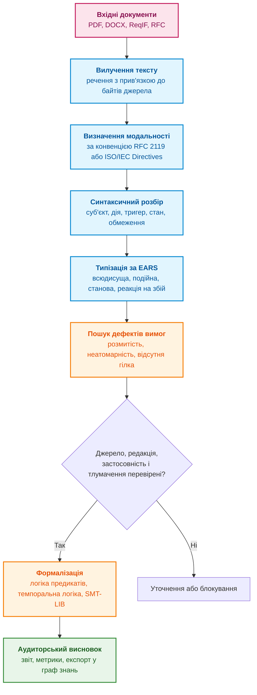
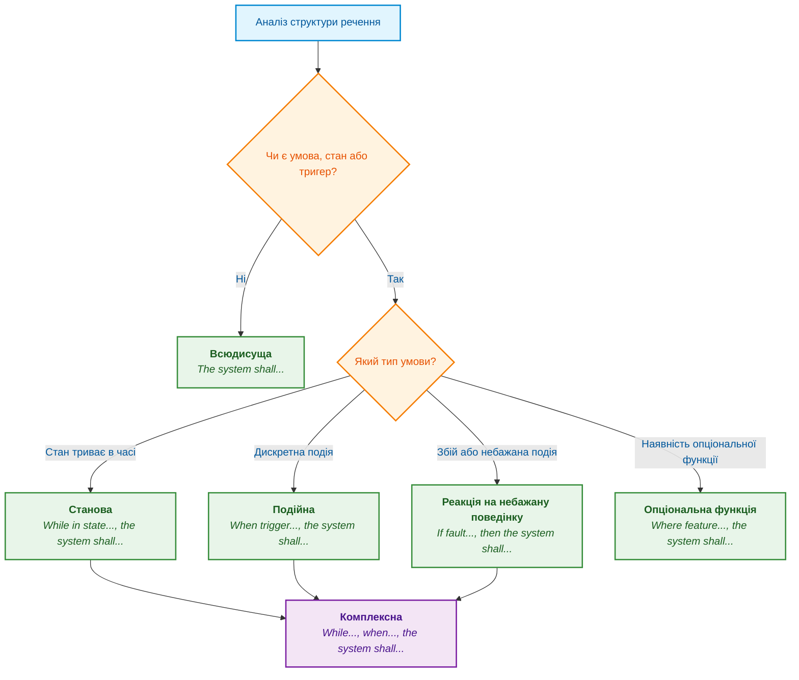
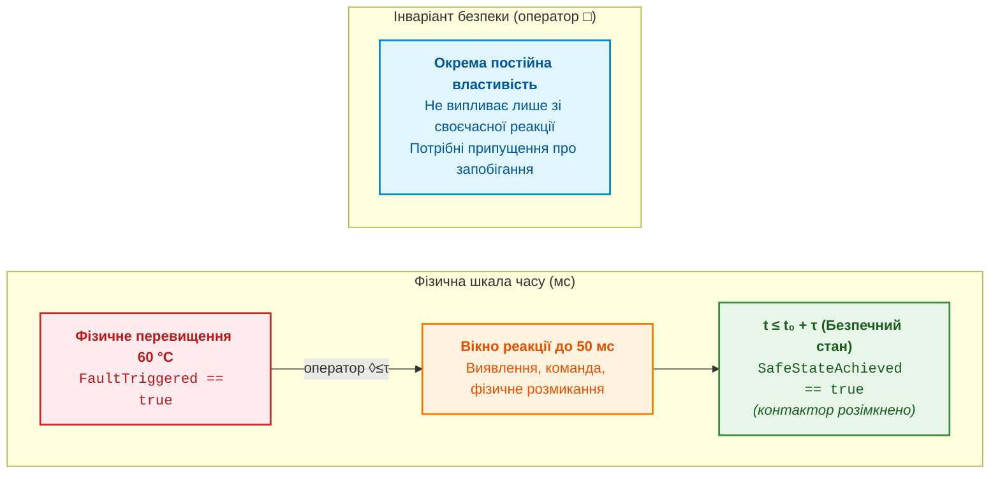
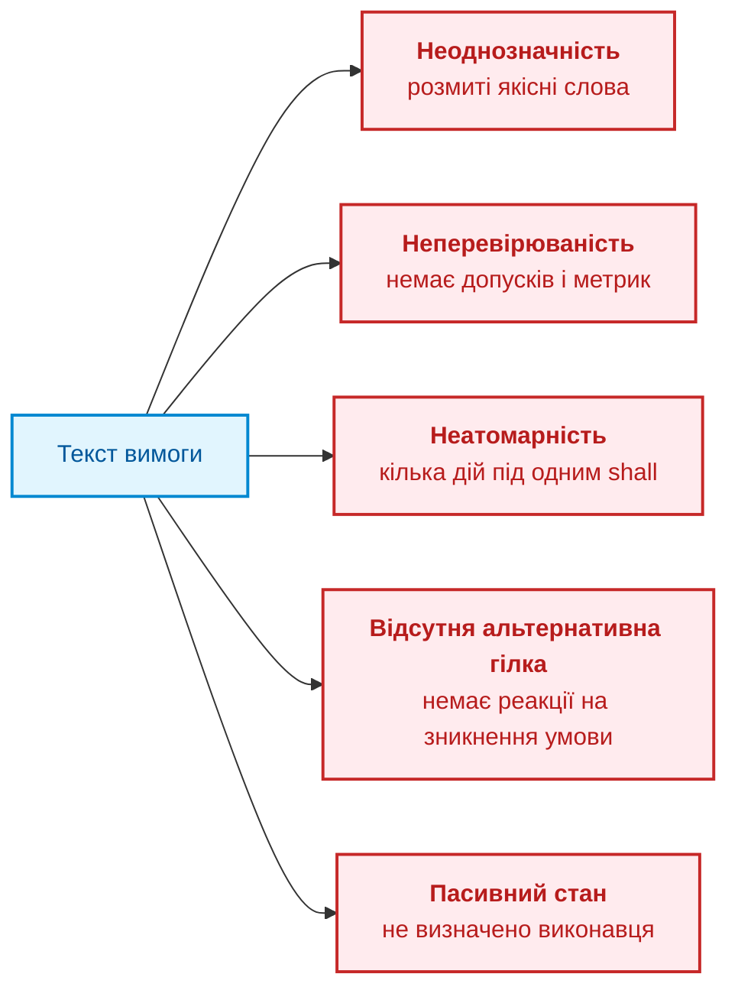
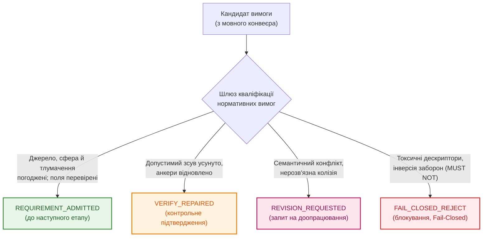
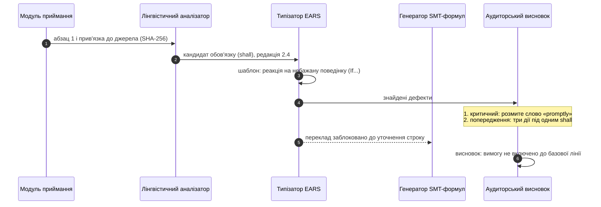

# Глава 14. Виявлення вимог і модальностей: від нормативного тексту до інваріантів

> **Книга:** [Архітектура доказових експертних систем](README.md) · [Частина III: Оцінювання вхідної інформації, здобуття знань та мовний аналіз](part-03-knowledge-engineering-nlp.md)
> **Попередня глава:** [Глава 12. Лінгвістичний аналіз і локальні моделі: збереження змісту та джерела](ch12-linguistic-analysis-and-local-models.md)
> **Наступна глава:** [Глава 15. Вилучення знань і побудова бази знань: факти, граматики та автомати](ch15-knowledge-extraction-and-kb-construction.md)
> **Зміст книги:** [README.md](README.md)
> **Автор:** [Микола Мартинович Федчик](about-the-author.md)
> **Передумови й маршрут:** базові логічні операції «і», «або», «не» та поняття змінної; квантори й часові оператори пояснено перед застосуванням. Практикум: Лабораторна робота №2 у `LABS.md`.
> **Очікувані результати:** відрізняти нормативні речення від описових за правилами документа-джерела; зводити вимоги до шаблонів EARS; перекладати шаблони в логіку предикатів, темпоральну логіку й формули SMT-LIB; знаходити суперечності між вимогами за допомогою SMT-розв'язувача; формувати аудиторський висновок про якість вимог із прив'язкою до джерела.

## Анотація

Виявлення вимог потрібне експертній системі, щоб не перетворити приклад, рекомендацію або неправильно прочитану заборону на обов'язкове правило бази знань. Глава пояснює шлях від речення до кандидата правила, його погодженого тлумачення й перевірюваної формальної моделі. Спочатку розглянуто нормативну силу слів та область заперечення, потім шаблони EARS, логіку й аудит суперечностей. Авторські моделі лінтингу, профільного ранжування, збереження спанів і часткового компілятора поєднано в один навчальний процес. Код Go реалізує лише обмежені пошукові перевірки; ні він, ні мовна модель, ні успішний запуск розв'язувача самі не затверджують норму.

Розроблення починається з питання: що саме виріб повинен робити й звідки це відомо? За авторською **триосьовою моделлю походження інженерних вимог** розрізняються три групи джерел: стандарти, технічне завдання замовника й документація на елементну базу. Це класифікація походження, не доказ незалежності документів або їхньої юридичної старшинності. Завдання може надходити як PDF, DOCX або ReqIF (*Requirements Interchange Format*) [[1]](#src-1). ISO 26262 [[2]](#src-2) і DO-178C [[3]](#src-3) задають предметний контекст прикладів без претензії, що ця глава відтворює всі їхні застосовні положення. Точні пункти стандартів у цьому редакторському проході зовнішньо не перевірено.

Наскрізний **навчальний приклад R-14** стосується системи керування батареєю (BMS): «Якщо температура комірки перевищила 60 °C, контролер BMS повинен забезпечити фізичне розмикання головного контактора не пізніше ніж через 50 мс від виникнення цієї умови». Числа вигадані для навчання, не взяті зі стандарту чи вимірювання. Для чернетки R-14 прийнято редакцію 2.4, виріб B1 і режим заряджання; застосовність та затвердження ще належить перевірити. Слова «понад» і «не пізніше» визначають різні межі: рівно 60 °C не активує цю вимогу, а рівно 50 мс ще відповідає її строку. Усі подальші варіанти явно змінюють лише назване поле цієї вимоги.

Природна мова допускає різні прочитання одного речення. Пошук за схожістю чи велика мовна модель (LLM) допомагають знайти R-14, але можуть пропустити «не», редакцію або точку відліку часу. Сформульований автором **інженерний принцип неспроможності ймовірнісної семантичної близькості для нормативного аудиту** забороняє використовувати пошуковий бал як достатній доказ відповідності. Детермінований аналіз також потребує перевірених передумов і правильного перекладу: його повторюваність ще не доводить змістової правильності. Цей поділ продовжує [Главу 13](ch13-language-variability-vs-determinism.md).

Звідси запитання: **як знайти вимогу, не підмінивши її зміст під час формалізації?** У цій монографії автором запропоновано **концепцію нормативного тексту як нескомпільованого вихідного коду (Requirements as Uncompiled Source Code)**. Аналогія корисна тим, що вимагає зберігати джерело, типи, діагностики й нерозв'язані питання. Однак природна мова не має наперед повної граматики програми: компілятор тут частковий, а тлумачення потребує погодження. Авторську атрибуцію моделей збережено; незалежний науковий пріоритет цим викладом не встановлюється.

<a id="obj-14-1"></a>

**Діаграма 14.1. Шлях кандидата вимоги до формалізації**



Схема задає порядок глави. Пошукові кроки знаходять кандидата; перевірки джерела, застосовності й тлумачення визначають, чи можна працювати з ним як із нормою. Для R-14 спочатку треба з'ясувати силу «повинен», а вже потім кодувати 50 мс. Саме це розрізнення вводить перший розділ.

## 1. Деонтична модальність та критерії демаркації нормативних вимог

Деонтична модальність відповідає на перше питання щодо R-14: це обов'язок чи лише порада? Перед розбором достатньо розрізняти дію та висловлювання про неї: «контактор розімкнений» описує стан, «контактор треба розімкнути» задає припис. Авторський **інженерний принцип захисту ядра правил від епістемічного забруднення допоміжним контекстом** вимагає зберігати приписи окремо від пояснень і прикладів. Інакше ілюстративне число може стати обов'язковим порогом. Це принцип побудови експертної системи, не вимога стандарту до її внутрішньої структури.

Технічний документ складається не лише з вимог. У ньому є обґрунтування рішень (*rationale*), примітки, приклади застосування й поради щодо зручності. Модальність речення визначає, чи воно зобов'язує, забороняє, рекомендує, дозволяє чи лише описує контекст системи.

Модальність задають правила оформлення документа, і різні сімейства документів мають різні правила. Документ RFC 2119 визначає ключові слова специфікацій інтернету: MUST, SHALL і REQUIRED позначають обов'язкову вимогу, MUST NOT і SHALL NOT заборону, SHOULD і RECOMMENDED рекомендацію, MAY і OPTIONAL дозвіл [[4]](#src-4). RFC 8174 уточнює, що особливого значення ці слова набувають лише тоді, коли їх написано великими літерами [[5]](#src-5). Стандарти ISO та IEC пишуть за іншими правилами: Директиви ISO/IEC, частина 2, закріплюють дієслівні форми малими літерами, де shall означає вимогу, should рекомендацію, may дозвіл, can можливість чи здатність, а must позначає зовнішнє обмеження, яке не є вимогою самого документа [[6]](#src-6).

Класифікатор має знати конвенцію й роль розділу. RFC 8174 задає спеціальне значення слів у верхньому регістрі, але відсутність такого маркера не доводить, що речення не містить вимоги. Обов'язок може бути виражений звичайною мовою або посиланням на інший пункт. Тому результат пошуку маркерів є кандидатом модальності; цитати, приклади й інформаційні примітки перевіряють окремо. Невідома конвенція не повинна мовчки ставати «описовим реченням». Для систематизації та детермінованої обробки автором розроблено **мультиконвенційну восьмирівневу матрицю класифікації модальної сили речень**:

<a id="obj-14-2"></a>

**Таблиця 14.2. Категорії модальної сили та дії перевірки**

| Нормативна сила | Маркери RFC 2119 і RFC 8174 | Маркери Директив ISO/IEC | Що робить експертна система |
|---|---|---|---|
| **Обов'язкова вимога** | MUST, SHALL, REQUIRED | shall | Позначає кандидата на обов'язкову вимогу; створення інваріанта потребує перевірки застосовності, редакції та затвердження тлумачення |
| **Заборона** | MUST NOT, SHALL NOT | shall not | Позначає кандидата заборони; встановлює область «не» та умови її чинності перед формалізацією |
| **Рекомендація** | SHOULD, RECOMMENDED | should | Фіксує м'яке обмеження; відхилення потребує записаного обґрунтування |
| **Небажана дія** | SHOULD NOT, NOT RECOMMENDED | should not | Створює попередження для рецензії архітектора |
| **Дозвіл** | MAY, OPTIONAL | may, need not | Розрізняє дозвіл і відсутність обов'язку; не виводить дозволу порушити іншу застосовну норму |
| **Можливість або здатність** | немає | can, cannot | Записує властивість, а не вимогу |
| **Зовнішнє обмеження** | немає | must | Записує передумову середовища, наприклад закон чи фізичне обмеження |
| **Твердження без спеціального маркера** | малі літери, is, will | is, will | Не знаходить спеціального маркера; нормативність усього речення перевіряє за контекстом |

Таблиця є авторським зіставленням категорій, а не шкалою юридичного пріоритету. Для R-14 `shall` означатиме кандидата обов'язку лише за прийнятою конвенцією документа. Заміна на `should` змінює силу припису, а `shall not open` забороняє розмикання в названих умовах. `Need not open` означає відсутність обов'язку розмикати, не обов'язок залишити замкненим. За BCP 14 рекомендація SHOULD допускає обґрунтовані винятки після оцінювання наслідків; це не синонім довільного ігнорування. Модальність тому зберігають разом із конвенцією, редакцією й роллю розділу. Далі потрібно встановити, до якої саме дії вона належить.

### 1.1. Синтаксичні пастки та семантична неоднозначність природної мови

Пошук слова SHALL регулярним виразом знаходить лише частину вимог. Реальні документи пишуть різні автори, часто не носії мови, і в документах повторюються три типові пастки.

**Пасивний стан без виконавця.** Варіант R-14 «Контактор має бути розімкнений» не називає відповідального компонента. Якщо заголовок однозначно задає BMS, пасивна форма сама не є дефектом; якщо ні, потрібне уточнення. Синтаксичний розбір залежностей із [Глави 13](ch13-language-variability-vs-determinism.md#31-синтаксичний-розбір-залежностей-та-виділення-актантів) допомагає знайти цю прогалину, але не призначає виконавця замість автора.

**Прихована нормативність.** Варіант «BMS is responsible for opening the contactor» не містить shall. Конструкції *is responsible for*, *has to*, *needs to* є пошуковими ознаками можливого обов'язку, не універсальними доказами його існування. Особливо важливо не прийняти цитату старої редакції за чинну R-14.

**Винятки всередині речення.** Навчальний варіант R-14 додає «крім режиму стендової перевірки без підключеної батареї». Не можна просто вилучити слова після «крім». За авторським **алгоритмічним правилом декомпозиції речень із винятками на атомарні ортогональні логічні гілки** базова гілка діє поза винятком, а поведінку всередині нього задає окреме положення. Якщо його немає, поведінка лишається невизначеною, а не автоматично протилежною.

Для перевірки області винятку потрібне булеве значення: чи активна базова вимога. За припущення, що виняток справді погоджено для цього виробу, її умова така:

<a id="obj-14-3"></a>

**Формула (14.3). Умова базової гілки з винятком**

```math
\Phi_{\mathrm{base}}=(T>60\,{}^\circ\mathrm{C})\land\neg E
```

Тут $T$ — температура комірки в °C, у навчальному діапазоні від −40 до 100 °C; $E$ — булевий факт одночасного стендового режиму й відсутності підключеної батареї; $`\Phi_{\mathrm{base}}`$ — булева умова дії R-14. За 61 °C і $`E=\mathrm{False}`$ вона істинна; за тих самих 61 °C і $`E=\mathrm{True}`$ базова гілка не діє. Останнє не дозволяє довільну дію: потрібне правило для винятку. У звичайному прикладі далі $E$ хибне. Після встановлення області дії можна оцінювати ясність і можливі конфлікти приписів.

Отже, діє сформульований автором **інженерний принцип синтаксично-модальної ко-детермінації нормативної сили**: модальність і синтаксис слід визначати сукупно й нерозривно, оскільки модальність задає деонтичний тип (обов'язок, заборона, дозвіл), а синтаксис визначає виконавця, об'єкт, часові межі та тригер дії. Наступний крок полягає в тому, щоб звести різноманітні речення до невеликого набору стандартних форм.

### 1.2. Лінтер семантичної неоднозначності та лексикографічне впорядкування деонтичних переваг

Лінтер потрібний, коли R-14 замість 50 мс містить «швидко»: за яким критерієм тоді приймати тест? Лексичний лінтинг із [Глави 10](ch10-knowledge-acquisition-systems.md) шукає ознаки неоднозначності перед побудовою абстрактного синтаксичного дерева (AST). Відсутній критерій не спричиняє автоматично взаємне блокування розв'язувача: програма може просто перевірити не той довільний предикат. Саме непомітну підміну змісту треба зупинити.

Авторський лінтер семантичної неоднозначності (*Ambiguity Linter*) використовує скінченний словник сигналів перегляду $`\mathcal{D}_{\mathrm{toxic}}`$, наприклад «швидко». Назва «токсичний» позначає ризик домислювання, а не властивість будь-якого прикметника. Словник задає профіль реалізації; його точний склад не виводиться з назви ISO/IEC/IEEE 29148 [[13]](#src-13). Не всі вимоги числові: «не надсилати пароль у журналі» перевіряється логічно. Для часової R-14 погоджений критерій має вигляд:

<a id="obj-14-4"></a>

**Формула (14.4). Погоджений часовий критерій R-14**

```math
0\le t_{\mathrm{resp}}\le50\,\mathrm{ms}
```

Тут $`t_{\mathrm{resp}}`$ — невід'ємна тривалість від перевищення порога до фізичного розмикання, у мілісекундах; верхню межу 50 мс припущено для навчального профілю. За 49 мс нерівність виконується, за 51 мс — ні. Число не отримують із прикметника: його має обґрунтувати й затвердити власник вимоги.

Інше питання виникає, якщо R-14 вимагає розмикання, а правило заряджання забороняє його за тих самих умов. Дозвіл і заборона не завжди логічно суперечні в кожній деонтичній системі; спочатку потрібні семантика приписів і перевірка, що їхні області справді перетинаються.

Порівнянню передує шлюз застосовності: для кожної норми встановлюють юрисдикцію, виріб і версію, часовий інтервал чинності, межі дії, статус пункту як нормативного та прийнятий проєктом нормативний базис. Відсутня або неоднозначна передумова не отримує рангу за назвою джерела; система повертає уточнення або блокує висновок. Тільки для норм, застосовність яких підтверджено, затверджений профіль пріоритету задає порівнювані координати рангу. Класифікація «міжнародний стандарт», «локальні ТУ» чи «евристика» сама по собі не встановлює універсальної юридичної ієрархії.

За цих передумов для детермінованого розв'язання суперечностей застосовується запропонована автором функція лексикографічного впорядкування нормативних переваг (*Lexicographical Preference Ordering*):

<a id="obj-14-5"></a>

**Формула (14.5). Профільний лексикографічний ранг**

```math
\mathrm{Rank}(\mathcal{R}) = \langle \mathrm{Tier}(\mathrm{Source}),\ \mathrm{ModalityRank}(M),\ \mathrm{Specificity}(\mathcal{R}) \rangle
```

Параметри та компоненти лексикографічного рангу:
- $`\mathrm{Tier}(\mathrm{Source}) \in \{1, 2, 3\}`$ — ранг, призначений застосовній нормі затвердженим профілем із задокументованою підставою пріоритету. Це не стала властивість класу документа: міжнародне походження саме по собі не встановлює $`\mathrm{Tier}=3`$;
- $`\mathrm{ModalityRank}(M) \in \{1, 2\}`$ — вага модальності, яку профіль дозволяє використовувати лише в межах визначеного відношення пріоритету. Різниця `SHALL` і `SHOULD` визначає силу припису у відповідній конвенції, але не доводить сама по собі переваги між різними джерелами чи юрисдикціями;
- $`\mathrm{Specificity}(\mathcal{R}) \in \mathbb{N}`$ — показник контекстної специфічності в затвердженому профілі. Довший предикатний ланцюг не доводить застосування *Lex Specialis*: потрібні підтверджені сфери дії та відношення між загальною і спеціальною нормами.

`Lex Posterior` застосовується лише до редакцій, що належать тій самій визначеній лінії та є застосовними до запиту; новіша дата не надає нормі автоматичного пріоритету для іншого виробу, періоду чи історичного аудиту. Якщо затверджений профіль не встановлює порівнюваного відношення для двох застосовних колізійних норм, ранг не виводиться евристично й активується Fail-Closed за контрактом [Глави 16 §1.1](ch16-expert-systems-architecture.md#11-канонічний-словник-вердиктів-рантайму-та-межі-повноважень).

#### 1.2.1. Замкнений цикл інженерного розрахунку деонтичного рангу

Лексикографічне порівняння працює як упорядкування слів: спершу порівнюють першу координату, за рівності другу, потім третю. Віднімання кортежів і перевірка всіх компонентів на додатність цього порядку не відтворюють. У формулі рангу $`\mathcal{R}`$ — застосовне правило, `Source` — його ідентифіковане джерело, $M$ — модальність; усі три координати безрозмірні. Невідома координата не прирівнюється до нуля.

**Синтетичний приклад.** Припустімо, затверджений профіль для B1 у редакції 2.4 задає R-14 кортеж $`\langle3,2,4\rangle`$, а колізійному правилу заряджання — $`\langle2,2,9\rangle`$. Перша координата 3 більша за 2, тому R-14 має профільну перевагу, хоча третя координата 4 менша за 9. Витіснене правило не видаляють: записують контекст і підставу пріоритету. Для рівних кортежів або непорівнюваних норм потрібна ескалація, а не здогадка.

Порівняння двох фіксованих трьохкоординатних рангів має сталу кількість операцій. Поле `uint64` займає 8 байтів, але його використання потребує визначених ширин координат і перевірки збереження порядку; віднімання беззнакових чисел може переповнитися. Час обробки всього набору правил із цього не випливає. Результат ранжування розв'язує лише названу колізію в профілі, не встановлює істинність джерела. Далі треба забезпечити, щоб сам текст заборони не змінився під час читання.

> [!NOTE]
> **Три координати лексикографічного ранжування нормативних вимог $`\mathrm{Rank}(\mathcal{R})`$**
> 1. Ранг джерела призначається лише застосовним нормам у межах затвердженого профілю; клас або міжнародне походження документа не є універсальною підставою пріоритету.
> 2. Вага модальності й специфічності впливає на порівняння лише тоді, коли профіль визначає таке відношення для цієї сфери та колізії.
> 3. Рівні ранги, невідома застосовність або відсутня підстава пріоритету спричиняють Fail-Closed; різний ранг дає перевагу лише в підтвердженому контексті.
> *Керування рантаймом / Інженерний інваріант:* `Rank` порівнюється після перевірки застосовності; недовизначений профіль не розв'язує колізію автоматично.

---

### 1.3. Неподільність деонтичних кванторів, багатобайтові межі Unicode та збереження спанів

У підсистемі парсингу технічних регламентів (RFC, ISO, AUTOSAR) критичним джерелом семантичних дефектів є крихкість токенізації на стику модальних кванторів та багатобайтових символів кодування UTF-8. Наївний покроковий лексичний аналізатор розглядає вхідний потік як лінійну послідовність лексем, розмежованих пробілами або символами нового рядка. У промисловій верстці нормативних документів нерідко трапляються перенесення рядків безпосередньо всередині складеного модального квантора:

```text
The BMS MUST
NOT close the contactor while the cell is overheated.
```

Коли наївний токенізатор зустрічає слово `MUST`, він фіксує категоричне зобов'язання (`Obligation = MUST`), а символ перенесення `\n` помилково інтерпретує як кінець речення чи межу клаузи, відкидаючи наступну частку `NOT`. У результаті найсуворіша імперативна заборона інвертується у протилежний дозвіл або прямий обов'язок. Якщо такий дефект потрапить до застосовного правила керування функцією ASIL D і не буде виявлений наступними перевірками, він може спричинити небезпечне порушення захисної логіки.

Крім того, виникають дві супутні системні проблеми:
- **Стирання початкових байтових зміщень (Start-Offset Obliteration):** вилучення пробілів або переносів без карти відповідності змінює адреси цитати. Інтервал `[byte_start, byte_end)` має посилатися на незмінний текстовий знімок; для PDF/DOCX додатково потрібен зв'язок з оригінальним документом, бо байти видобутого тексту не є байтами стисненого контейнера.
- **Сліпі зони лінтера на не-ASCII пунктуації (UTF-8 Boundary Blindness):** у Go межа слова `\b` орієнтована на ASCII; в інших рушіях її поведінка залежить від Unicode-режиму. Для українського слова вона може не позначити очікувану межу біля тире, лапок або апострофа. Наприклад, шаблон з `\b` навколо «небезпечно» потребує окремого тесту, а не перенесення припущень з англомовного MUST. Тому підтримку мов і типографічних роздільників задають явно.

Для збереження заперечення автором запропоновано згортку підтримуваних модальних пар у **неподільні атомарні деонтичні лексеми (Composite Deontic Atoms)**. Це лексичний метод: зі знайденої пари отримують типізований токен та її початкові координати:

<a id="obj-14-6"></a>

**Формула (14.6). Розпізнавання складеного маркера**

```math
\mathrm{Tok}_{\mathrm{MUST\_NOT}}=\mathrm{Match}(r_{\mathrm{neg}},S)
```

Тут $S$ — скінченний рядок незмінного текстового знімка; $`r_{\mathrm{neg}}`$ — шаблон обраної конвенції; `Match` повертає збіг з байтовими межами або повідомлення про його відсутність, не вердикт про нормативну чинність. Для англомовних маркерів BCP 14 у Go підходить такий обмежений шаблон:

```regex
\b(?:MUST|SHALL)[\t\r\n ]+NOT\b
```

Параметри та правила сканування:
- Граматика розглядає пару $`\langle\mathrm{MODAL}, \mathrm{NEGATION}\rangle`$ як неподільний бінарний атом;
- Пробіли й переноси між двома словами не є межею речення. Історичне вікно $W$ до трьох токенів є параметром обмеженої евристики, не необхідною та достатньою умовою правильного аналізу; тут дозволено лише роздільники, без проміжних слів;
- `GroundedToken` зберігає нормалізовану `Lexeme`, абсолютні `ByteStart` і `ByteEnd`, а також `Line` та `Column`. Поля зміщень мають тип `uint64`, рядка й колонки — `uint32`, лексема — `string`. Кінець інтервалу не включено. Нумерація рядків/колонок починається з 1; одиницю колонки (байт чи руна) задає профіль.

Будь-яка нормалізація тексту дозволяється **виключно у віртуальному представленні токена**, залишаючи фізичні зміщення `ByteStart` і `ByteEnd` абсолютно незмінними.

Для зменшення сліпих зон лінтингу на межах ASCII та не-ASCII пунктуації застосовується сканування через декодування рун `utf8.DecodeRuneInString` із класифікацією за таблицями Unicode (`unicode.IsLetter`, `unicode.IsDigit`, `unicode.IsPunct`, `unicode.IsSpace`). Саме декодування рун не гарантує нуль хибнонегативних результатів для всіх Unicode-подань: нормалізацію, невидимі форматувальні символи та перетворення тексту з PDF потрібно перевіряти окремо на визначеному корпусі.

#### 1.3.1. Замкнений цикл інженерного розрахунку цілісності спанів

Перевірка спана відповідає на вузьке питання: чи збережено саме прочитані байти? Для навчального рядка `The BMS shall\nnot close the contactor.` довжина становить 38 байтів ASCII. Якщо рядок починається зі зміщення 14 200, слово `shall` починається з 14 208, а `not` закінчується перед 14 217. Отже, зріз `[14208, 14217)` містить дев'ять байтів `shall\nnot`, хоча нормалізована лексема записана як `shall not`. SHA-256 обчислюють із цих дев'яти початкових байтів; вигаданий префікс хешу не є свідченням перевірки.

Для будь-якого такого зрізу перед хешуванням перевіряють межі:

<a id="obj-14-7"></a>

**Формула (14.7). Допустимі межі байтової цитати**

```math
0\le b_{\mathrm{start}}<b_{\mathrm{end}}\le\lvert S\rvert_{\mathrm{bytes}}
```

Тут $`b_{\mathrm{start}}`$ і $`b_{\mathrm{end}}`$ — цілі зміщення у байтах, $`\lvert S\rvert_{\mathrm{bytes}}`$ — невід'ємна довжина знімка у байтах. Для порожньої цитати строга середня нерівність хибна. За коректних меж зріз хешують і порівнюють із зареєстрованим повним SHA-256; розбіжність дає `ERR_CUSTODY_HASH_MISMATCH` і блокує цей переклад. Збіг підтверджує цілісність щодо довіреної контрольної суми, а не правильність тлумачення чи авторитет документа.

За типовим 64-бітним ABI Go описаний `GroundedToken` має 40 байтів: 16 для заголовка рядка, по 8 для двох зміщень і по 4 для рядка/колонки. Мільйон записів потребує 40 000 000 байтів без лексем і накладних витрат. Це оцінка представлення, не універсальна гарантія місткості або швидкодії. Збережене джерело тепер дозволяє перевіряти наступний крок — перебудову речення без втрати умов.

---

## 2. Шаблони EARS: структурна стандартизація інженерних вимог

Шаблони EARS потрібні, щоб після знаходження R-14 однаково виділити умову, виконавця й реакцію. Вже відома модальність не відповідає на питання «коли діє обов'язок?». Перед формальними кванторами зручно впорядкувати речення так, щоб кожна роль мала своє місце; перебудову потім звіряють із початковим спаном.

Вільний текст природної мови ускладнює пряме логічне виведення: автори можуть змішувати умови, змінювати порядок підрядних речень і втрачати межі заперечення. Частка помилок автоматичного розпізнавання ролей залежить від корпусу, аналізатора та критерію оцінювання; без визначеної вибірки й методики універсальну числову межу не встановлено. Для надійнішої семантичної трансляції вимоги попередньо нормалізують до обмеженого граматичного каркаса.

Найвідомішим набором таких шаблонів є простий підхід до синтаксису вимог (*Easy Approach to Requirements Syntax*, EARS), який Алістер Мевін і співавтори з компанії Rolls-Royce запропонували 2009 року для вимог до систем керування авіаційними двигунами [[7]](#src-7). EARS обмежує вимоги кількома формами, і кожна форма відповідає одному типу умови.

<a id="obj-14-8"></a>

**Діаграма 14.8. Вибір структурної форми EARS**



Дерево рішень ставить лише два запитання: чи є в реченні умова і якого вона типу. Від відповіді залежить шаблон, а від шаблону логічна форма, яку розглядає наступний розділ.

**Всюдисуща вимога** не містить явної умови. Шаблон: `The <system name> shall <system response>.` Варіант для того самого BMS: «The BMS shall record contactor state». Це окрема навчальна вимога, не переклад умовної R-14: вилучення умови змінило б зміст.

**Подійна вимога** описує реакцію на подію. Шаблон: `When <trigger>, the <system name> shall <system response>.` R-14 можна подати як «When the cell temperature crosses above 60 deg_C, the BMS shall physically open the main contactor within 50 ms». Слово *crosses* потребує визначеного способу виявлення переходу через поріг; часовий початок лишається фізичною подією, не моментом запізнілого повідомлення.

**Станова вимога** діє, поки триває стан. Шаблон: `While <in a specific state>, the <system name> shall <system response>.` «While in FAULT state, the BMS shall keep the main contactor open» задає утримання стану після реакції, а не її початковий строк.

**Реакція на небажану поведінку** виділяє небажану умову. Шаблон: `If <trigger>, then the <system name> shall <system response>.` Для R-14: «If the cell temperature exceeds 60 deg_C, then the BMS shall physically open the main contactor within 50 ms». Вибір If замість When не доводить еквівалентності: треба погодити, чи реагувати на початок перевищення або на кожний відлік перевищеного значення.

**Опціональна функція** обмежує застосовність наявністю функції. Шаблон: `Where <feature is included>, the <system name> shall <system response>.` Варіант R-14 «Where a main contactor is installed...» не робить розмикання добровільним для виробу, де контактор є: обов'язок умовний щодо конфігурації, не послаблений до SHOULD.

**Комплексна вимога** поєднує форми: «While in CHARGE state, when the cell temperature crosses above 60 deg_C, the BMS shall physically open the main contactor within 50 ms». Це R-14 з явно записаним режимом; вона не дозволяє перенести обмеження на інший режим без нового погодження.

EARS упорядковує умови й реакцію, але не визначає єдиної формальної семантики. Станова вимога може потребувати інваріанта, обмеженої реакції або правила входу в стан залежно від дієслова й часового контексту. Невідповідність EARS є сигналом перегляду, не доказом дефекту кожного нормативного документа. Формальні передумови, одиниці й винятки задають окремо.

### 2.1. Граматично кероване декодування (GBNF) та нейро-символічний бар'єр валідності

Як отримати структурованого кандидата R-14 від мовної моделі, не дозволивши їй додати невідомий компонент? Обмеження граматики може заборонити зайве поле, але не перевіряє, чи правильно заповнено дозволене. Для цього спочатку відділимо пошук від допуску.

При взаємодії людини-інженера з експертною системою через природномовні запити виникає фундаментальна небезпека плутанини між двома взаємовиключними функціональними зонами:
1. **Зона релевантності (Relevance Zone):** евристичне сприйняття природної мови, виправлення одруків, збагачення синонімами за допомогою локальних компактних мовних моделей (SLM);
2. **Зона валідності (Eligibility Zone):** детермінована логічна перевірка нормативних допусків, математичний розрахунок дегресій та оцінка безпеки за стандартами ISO 26262 та DO-178C.

Якщо ймовірнісній мовній моделі дозволити вільно генерувати вихідні логічні твердження, виникає вразливість неконтрольованої ін'єкції предикатів (*Wildcard Prompt Injection*): вільна граматика дозволяє моделі вигадувати довільні сутності (`trigger ::= [a-zA-Z0-9]+`), обходячи формальну базу знань. Ба більше, при виявленні неповноти знань система починає генерувати правдоподібні, але абсолютно фальшиві псевдопояснення причин блокування.

Авторська двозональна модель залишає генерацію кандидатів у зоні релевантності. **Граматично кероване декодування (GBNF Grammar-Constrained Sampling)** [[18]](#src-18), споріднене з керованою генерацією Вілларда та Луфа [[19]](#src-19), обмежує форму її виходу, але не переносить модель у зону нормативного допуску. Щоб не додавати невідомих ідентифікаторів, спочатку будують скінченний словник дозволених символьних лексем:

<a id="obj-14-9"></a>

**Формула (14.9). Словник символьних лексем кандидата**

```math
\mathcal{V}_{\mathrm{valid}} = \mathrm{Entities}(\mathcal{K}) \cup \mathrm{Predicates}(\mathcal{K}) \cup \mathrm{Units}(\mathcal{K}) \cup \mathrm{Keywords}_{\mathrm{EARS}}
```

Параметри та складові замкненого простору декодування:
- $`\mathcal{K}`$ — активний верифікований пакет знань;
- $`\mathrm{Entities}(\mathcal{K})`$ — скінченна множина верифікованих ідентифікаторів компонентів і сигналів (`BMS_Relay`, `Cell_Voltage`, `PreCharge_Resistor`);
- $`\mathrm{Predicates}(\mathcal{K})`$ — множина формалізованих предикатів відношення та допусків (`exceeds`, `is_equal`, `activates`);
- $`\mathrm{Units}(\mathcal{K})`$ — стандартизовані розмірності величин системи SI (`ms`, `V`, `A`, `deg_C`);
- $`\mathrm{Keywords}_{\mathrm{EARS}}`$ — скінченна множина дозволених службових лексем, наприклад WHEN, WHILE, IF, THEN, WHERE, THE, SHALL і SHALL NOT.

Усі множини складаються з рядків і не мають фізичних одиниць. У прикладі словник містить BMS, cell_temperature, main_contactor, exceeds, opens, deg_C і ms. Наявність `opens` у словнику не доводить, що саме його вимагає поточний спан. Числові літерали й пунктуацію задає окрема типізована граматика: вони не виникають із самих множин сутностей.

Лексема може складатися з кількох токенів моделі. Тому перед вибором токена потрібна не перевірка його належності словнику слів, а перевірка продовження граматики. Нехай $V$ — скінченний словник токенів моделі, а $`A(h)\subseteq V`$ — токени, які після вже згенерованого префікса $h$ ще допускають завершення за граматикою з наведеним лексиконом. Тоді маскування має вигляд:

<a id="obj-14-10"></a>

**Формула (14.10). Маскування продовжень граматики**

```math
\mathrm{Logit}'(w\mid h)=\begin{cases}\mathrm{Logit}(w\mid h),&w\in A(h),\\-\infty,&w\notin A(h).\end{cases}
```

Тут $`w\in V`$ — токен, $h$ — скінченна послідовність попередніх токенів; логіти є безрозмірними дійсними числами, а $`-\infty`$ означає виключення з вибірки. За непорожнього $A(h)$ та принаймні одного скінченного дозволеного логіта заборонений токен має нульову ймовірність. Якщо дозволених продовжень немає, декодер повертає помилку, а не вибирає довільний токен. Контекстно-вільна GBNF загалом не зводиться до скінченного автомата без обмежень; конкретний механізм перевірки залежить від реалізації.

При відмові діє авторський **інженерний принцип детермінованого негенеративного пояснення відмов (Non-Generative Refusal)**: шаблон повідомлення заповнюється перевіреними полями графа обґрунтування. Для R-14 це може бути «не визначено, чи 50 мс відлічують від перевищення або виявлення» з посиланням на спан. Пропозиція уточнення не є дозволом змінити норму; виправну дію можна вказати лише за наявності затвердженого правила.

#### 2.1.1. Замкнений цикл інженерного розрахунку граматичного маскування

Розрахунок маски показує, що саме обмежено. Нехай граматика в певній позиції дозволяє два токени з логітами 2 і 1 та виключає третій із логітом 8. За звичайної softmax-нормалізації з температурою 1 імовірність першого дозволеного токена така:

<a id="obj-14-11"></a>

**Формула (14.11). Ймовірності після маскування**

```math
p_1=\frac{e^2}{e^2+e^1}\approx0.731,\qquad p_2=1-p_1\approx0.269,\qquad p_3=0
```

Тут $e$ — основа натурального логарифма, $`p_1,p_2,p_3\in[0,1]`$ — безрозмірні ймовірності трьох токенів. Перший не отримує ймовірності 1 лише тому, що третій заблоковано. Навіть синтаксично дозволений вибір `closes` замість `opens` був би змістовою помилкою R-14; її має виявити незалежна перевірка відповідності джерелу.

Маска для 4096 токенів за одним бітом на токен потребує 4096 / 8 = 512 байтів, тобто 64 слова `uint64`. Це розмір однієї маски, не всієї граматики чи логітів; дані не слід плутати з кешем інструкцій. Час маскування, побудова множини продовжень і поведінка кешів тут не виміряні. Результат розділу — структурований кандидат, для якого ще потрібно визначити формальну семантику.

> [!NOTE]
> **П'ять канонічних шаблонів EARS для усунення синтаксичної неоднозначності вимог**
> 1. Всюдисущі вимоги (Ubiquitous): безумовні інваріанти системи без часових чи тригерних передумов.
> 2. Подійні вимоги (Event-driven): обов'язкова детермінована реакція системи на дискретну зовнішню подію («Коли...»).
> 3. Станові вимоги (State-driven): обмеження параметрів, чинні виключно під час перебування системи у визначеному стані («Поки...»).
> 4. Реакції на небажану поведінку (Unwanted behavior): аварійні захисні протоколи повернення в безпечний стан при відхиленнях («Якщо...»).
> 5. Опціональні вимоги (Optional features): приписи, що активуються лише за апаратної чи конфігураційної наявності підсистеми («Де є...»).
> *Керування рантаймом / Інженерний інваріант:* у запропонованому автором профілі непідтримувана форма повертається на уточнення; успішна граматика не означає нормативного допуску. П'ять базових форм допускають комплексні поєднання.

---

## 3. Математична формалізація: від шаблонів до формальної логіки

Формалізація має відповісти на питання, яке EARS залишає відкритим: за яких саме значень і в які моменти R-14 виконується? Сформульоване автором **інженерне правило семантичної неповноти чистого синтаксису EARS** вимагає явно визначити області змінних, квантори, час і строгість меж. Спершу розглянемо один перехід автомата, потім послідовність переходів, а вже тоді перевірку сумісності правил. Потрібні операції вводитимуться на цьому ж прикладі.

### 3.1. Логіка предикатів першого порядку

Логіка предикатів дозволяє перевірити, чи взагалі існує допустима реакція для кожного входу. Предикат — висловлювання, яке після підстановки значень стає істинним або хибним. Квантор $\forall$ означає «для кожного», $\exists$ — «існує», а імплікація $\Rightarrow$ — «якщо передумова істинна, має виконуватися наслідок». Для R-14 треба не знайти один зручний стан, а перевірити всі входи погодженого діапазону. Авторська модель контракту припущень і гарантій (*assume-guarantee contract*) починається з перевірки здійсненності:

<a id="obj-14-12"></a>

**Формула (14.12). Існування реакції за передумови**

```math
\forall s\in\mathcal{S},\ \forall\mathbf{x}\in\mathcal{X}:\quad \Phi_{\mathrm{pre}}(s,\mathbf{x})\Rightarrow\exists s'\in\mathcal{S},\ \exists\mathbf{y}\in\mathcal{Y}:\ \bigl(\Phi_{\mathrm{post}}(s',\mathbf{y})\land\mathcal{T}(s,s')\bigr)
```

Параметри та математичні компоненти контракту:

- $`\mathcal{S}`$ є скінченним простором дискретних станів автомата (наприклад, $`\mathcal{S} = \{\text{INIT}, \text{STANDBY}, \text{CHARGE}, \text{DISCHARGE}, \text{FAULT}\}`$);
- $`\mathbf{x} \in \mathcal{X} \subseteq \mathbb{R}^n`$ — вектор входів; $n$ — додатна ціла кількість координат, кожна має власну одиницю й область. Тут достатньо однієї температури від −40 до 100 °C; булеві сигнали за потреби кодуються числами 0 і 1;
- $`\mathbf{y} \in \mathcal{Y} \subseteq \mathbb{R}^m`$ — вектор виходів; $m$ — додатна ціла кількість координат. У прикладі один безрозмірний вихід 0/1 означає команду залишити замкненим/розімкнути. Команда не тотожна фізичному зворотному зв'язку контактора;
- $`s, s' \in \mathcal{S}`$ позначають поточний і наступний стани керуючого автомата;
- $`\Phi_{\mathrm{pre}}(s,\mathbf{x}): \mathcal{S} \times \mathcal{X} \to \{\text{True}, \text{False}\}`$ — предикатна передумова контракту, що поєднує стан активності (While), дискретний тригер (When) та наявність збою (If);
- $`\Phi_{\mathrm{post}}(s',\mathbf{y}): \mathcal{S} \times \mathcal{Y} \to \{\text{True}, \text{False}\}`$ — предикатна післяумова, яка специфікує обов'язкову дію (shall);
- $`\mathcal{T}(s,s'): \mathcal{S} \times \mathcal{S} \to \{\text{True}, \text{False}\}`$ — булеве відношення дозволених переходів. Воно не містить часу чи залежності від входів; якщо такі залежності потрібні, їх явно додають до моделі, а не приписують цій сигнатурі.

Практичне застосування та інженерні висновки базуються на авторському **інженерному правилі SMT-верифікації неповноти (Non-blocking) та недетермінізму автомата**:
- **Перевірка неблокування (Non-blocking):** за кожної істинної передумови існує хоча б одна реакція. Для стану CHARGE і температури 61 °C перехід у FAULT з командою розмикання є свідком існування; якщо всі такі переходи вилучити, формула стає хибною. Діагностика `REQ_DEFECT_DEADLOCK` стосується саме моделі й активних передумов, не повноти всього документа.
- **Перевірка детермінізму:** два різні допустимі виходи означають недетермінізм, але не обов'язково дефект. Абстрактна специфікація може навмисно залишати вибір. `REQ_DEFECT_AMBIGUITY` блокує модель лише там, де затверджений контракт вимагає єдиної реакції.

Щоб перевірити реалізацію, потрібне сильніше питання: чи кожний її допустимий перехід виконує післяумову? Позначимо її відношення переходів через $`\mathcal{I}`$ і перевіримо:

<a id="obj-14-13"></a>

**Формула (14.13). Відповідність усіх переходів реалізації**

```math
\forall s,\mathbf{x},s',\mathbf{y}:\quad
\bigl(\Phi_{\mathrm{pre}}(s,\mathbf{x})\land\mathcal{I}(s,\mathbf{x},s',\mathbf{y})\bigr)
\Rightarrow\Phi_{\mathrm{post}}(s',\mathbf{y})
```

Квантори мають ті самі області $`\mathcal{S},\mathcal{X},\mathcal{S},\mathcal{Y}`$; $`\mathcal{I}`$ — булеве відношення реалізації над ними. Якщо за 61 °C реалізація дозволяє як FAULT/розімкнути, так і CHARGE/не розмикати, перша формула може бути істинною, а друга — хибною. Разом із неблокуванням друга виключає і неправильний вибір, і порожню реалізацію. Жодна з цих однотактових формул ще не визначає 50 мс або фізичного спрацювання; для них потрібен час.

### 3.2. Лінійна темпоральна логіка (LTL) для часових інваріантів

Вбудовані системи працюють у часі, тому статичних предикатів недостатньо. Амір Пнуелі запропонував використовувати для міркувань про програми лінійну темпоральну логіку (*Linear Temporal Logic*, LTL) [[8]](#src-8). У ній оператор $\Box$ означає «завжди, в усіх майбутніх станах», а оператор $\Diamond$ означає «колись у майбутньому». Метрична темпоральна логіка (*Metric Temporal Logic*, MTL), яку для вимог реального часу описав Рон Коайманс, додає до операторів часові межі, наприклад $`\Diamond_{\le\tau}`$ означає «не пізніше ніж через час $\tau$» (у цій книзі — у дискретному часі, див. нижче) [[9]](#src-9). Сигнальна темпоральна логіка (*Signal Temporal Logic*, STL) Малера й Ніковича переносить такі формули на неперервні сигнали, як-от струм чи температуру [[10]](#src-10).

**Єдина модель часу.** Часова логіка потрібна, бо контакт може розімкнутися пізніше за команду. Збережімо прийнятий у книзі профіль дискретного часу: спостереження надходять через сталий крок $\Delta$. Для консервативного переведення фізичного строку в кількість кроків використано:

<a id="obj-14-14"></a>

**Формула (14.14). Дискретизація фізичного строку**

```math
t_k=k\Delta,\qquad K_\tau=\lfloor\tau/\Delta\rfloor-1,\qquad (K_\tau+1)\Delta\le\tau
```

Тут $`k\in\mathbb{N}_0`$ — номер відліку, $`t_k`$ — його час у мс, $`\Delta>0`$ — крок у мс, $`\tau>0`$ — фізичний бюджет у мс; $`\lfloor\cdot\rfloor`$ округлює донизу, а $`K_\tau`$ — ціла кількість дозволених кроків після спостереження. Один крок зарезервовано на невідому фазу події між відліками. Для R-14 за 50 мс і кроку 5 мс: ділення дає 10, віднімання 1 дає 9 кроків, тобто після виявлення лишається 45 мс. Разом із не більш ніж 5 мс до наступного відліку це дає не більш ніж 50 мс. Якщо $`K_\tau<0`$, такий крок непридатний: його зменшують і повторно перевіряють усі затримки.

Цей перехід коректний лише за спостережуваності події не пізніше наступного відліку, узгодженого годинника й належної фіксації кінцевої фізичної події. Крок, менший за період сенсора, сам не робить старі дані новими. Додаткова затримка вимірювання має входити до бюджету нижче. У цьому профілі $`\Box\varphi`$ означає істинність булевого висловлювання $\varphi$ в усіх кроках, $`\Diamond_{\le\tau}\varphi`$ — у хоча б одному кроці від поточного до $`K_\tau`$ включно. $`\varphi\ \mathcal{W}\ \psi`$ — слабке «доки»: $\varphi$ утримується до $\psi$, або завжди, якщо $\psi$ не настане. Неперервну поведінку між відліками задають окремі припущення, а не саме позначення STL.

**Точки відліку.** Кожна часова вимога називає свої початкову й кінцеву події з переліку: $`t_{\mathrm{onset}}`$ — виникнення небезпечної умови чи несправності в об'єкті; $`t_{\mathrm{det}}`$ — перший крок, у якому монітор її зафіксував; $`t_{\mathrm{cmd}}`$ — видача захисної команди; $`t_{\mathrm{safe}}`$ — перший крок, з якого утримується фізично вимірюваний безпечний стан. Бюджет реакції $\tau$ відлічують від $`t_{\mathrm{onset}}`$ до $`t_{\mathrm{safe}}`$; час виявлення входить до нього як окремий складник:

<a id="obj-14-15"></a>

**Формула (14.15). Фізичний бюджет реакції**

```math
d_{\mathrm{det}} + d_{\mathrm{cmd}} + d_{\mathrm{act}} \le \tau,\qquad d_{\mathrm{det}}=t_{\mathrm{det}}-t_{\mathrm{onset}},\quad d_{\mathrm{cmd}}=t_{\mathrm{cmd}}-t_{\mathrm{det}},\quad d_{\mathrm{act}}=t_{\mathrm{safe}}-t_{\mathrm{cmd}}
```

Усі чотири мітки є часом у мс на одному годиннику й упорядковані від виникнення до фізичного результату; три $d$ — невід'ємні тривалості в мс. $`d_{\mathrm{det}}`$ охоплює опитування й вимірювання, $`d_{\mathrm{cmd}}`$ — обчислення та видачу команди, $`d_{\mathrm{act}}`$ — виконавчий орган і фізичний процес. У навчальному бюджеті R-14 приймемо відповідно 5, 10 і 30 мс: сума 45 мс не перевищує 50 мс. Значення не виміряні; вони лише показують спосіб перевірки. Резерв дискретизації вже враховує перші 5 мс, його не додають повторно.

Інтервал толерантності до відмови FTTI (*fault tolerant time interval*) пов'язує реакцію з можливим розвитком небезпеки [[15]](#src-15). Зв'язок із фізичним початком відмови наведено за раніше прийнятим профілем; первинну звірку визначення ISO 26262-1 у цьому проході не виконано. Для R-14 «перевищення температури» й «початок несправності» не оголошуються тотожними без моделі середовища.

**Кінцева подія й вид безпечного стану.** Завершенням реакції є фізично вимірюваний безпечний стан $`\mathit{SafePhys}`$, а не видача команди. Вид безпечного стану (зупинка з негайним зняттям живлення, керована зупинка з подальшим зняттям живлення або збереження функції в деградованому режимі; категорії зупинки — за вторинним джерелом, первинна звірка неможлива) і фізична подія, якою його фіксують (розмикання кола, гасіння дуги, нульовий струм тощо), є обов'язковими параметрами профілю за класом об'єкта; їх задає власник профілю. Безпечний стан стійкий: після досягнення він утримується до явної події скидання $`\mathit{Reset}`$. Які події є скиданням, задає профіль. Якщо точкою $`t_{\mathrm{onset}}`$ вимоги є несправність, а не небезпечна умова, у формулах нижче замість $`\mathit{Bad}`$ стоїть предикат виникнення цієї несправності (наприклад, $`\mathit{FaultTriggered}`$), а $`\mathit{SafePhys}`$ виключає небезпечну умову, до якої несправність може призвести.

**Форма властивості безпеки.** Реактивний захист не може зробити істинною $`\Box\neg\mathit{Bad}`$ для стану $`\mathit{Bad}`$, що виникає в об'єкті раніше за будь-яку реакцію: інтервал від $`t_{\mathrm{onset}}`$ до $`t_{\mathrm{safe}}`$ має ненульову тривалість. Тому $`\mathit{Bad}`$ лише визначають як заборонений стан, а нормативною властивістю є обмежена тривалість порушення з реакцією:

<a id="obj-14-16"></a>

**Формула (14.16). Досягнення й утримання до скидання**

```math
\Box\bigl(\mathit{Bad}\Rightarrow\Diamond_{\le\tau}\,(\mathit{SafePhys}\land(\mathit{SafePhys}\ \mathcal{W}\ \mathit{Reset}))\bigr),
```

Тут $`\mathit{Bad}`$, $`\mathit{SafePhys}`$ і $`\mathit{Reset}`$ — булеві предикати на кожному відліку, без одиниць; $\tau$ — додатний бюджет у мс за описаним профілем. Для R-14 `Bad` означає одночасно перевищення 60 °C й замкнений контактор, `SafePhys` — підтверджене розмикання, `Reset` — погоджену подію скидання. `SafePhys` виключає `Bad`, але не означає миттєвого охолодження батареї. Вимога до утримання до скидання є додатковим навчальним правилом, яке не слід приписувати початковому реченню R-14 без погодження.

За появи `Bad` у кроці 0, фізичного розмикання у кроці 8 і збереження цього стану до скидання формула задовольняє строк 9 кроків. Розмикання лише у кроці 10 його порушує. Кон'юнкт `SafePhys` перед слабким «доки» не дозволяє прийняти саме скидання без досягнення результату. Для одноразового захисту без скидання потрібна інша властивість:

<a id="obj-14-17"></a>

**Формула (14.17). Незворотний безпечний стан**

```math
\Box\bigl(\mathit{Bad}\Rightarrow\Diamond_{\le\tau}\,\Box\,\mathit{SafePhys}\bigr)
```

Позначення й одиниці ті самі; внутрішня $\Box$ вимагає утримання безпечного стану в усіх наступних кроках. Наприклад, розмикання у кроці 8 і повторне замикання у кроці 12 спростовує цей варіант, навіть якщо строк первинного спрацювання виконано. Вибір між скиданням і незворотним станом є властивістю виробу, не рішенням парсера.

**Нерівності бюджету.** Щоб реакція не вичерпала зовнішню межу, профіль задає запас:

<a id="obj-14-18"></a>

**Формула (14.18). Бюджет із явним запасом**

```math
{\tau}\le T_{\mathrm{limit}}-\Delta t_{\mathrm{margin}}
```

Тут $`T_{\mathrm{limit}}>0`$ — обґрунтована зовнішня межа в мс; $`0<\Delta t_{\mathrm{margin}}<T_{\mathrm{limit}}`$ — запас у мс, який покриває названі невизначеності; $\tau$ — бюджет реакції в тих самих одиницях. Для умовних 100 мс і запасу 50 мс бюджет R-14 у 50 мс проходить рівно по межі. Це не нормативна частка запасу. Розклад бюджету на три затримки запасу повторно не віднімає, а FTTI можна підставити лише за узгодженого початку відліку.

**Перевірка вимірюванням.** Для скінченного набору HIL-прогонів (*hardware-in-the-loop*, апаратура в циклі) перевіряють:

<a id="obj-14-19"></a>

**Формула (14.19). Критерій скінченного HIL-випробування**

```math
\Delta t_{\mathrm{meas},i}=t_{\mathrm{safe},i}-t_{\mathrm{fault},i},\qquad
\max_{1\le i\le N}\Delta t_{\mathrm{meas},i}+\delta_{\mathrm{meas}}\le\tau
```

Тут $`N\ge1`$ — ціла кількість прогонів, $i$ — їхній номер; мітки $`t_{\mathrm{fault},i}`$ і $`t_{\mathrm{safe},i}`$ — час інжекції та фізичного результату в мс; різниця невід'ємна. $`\delta_{\mathrm{meas}}\ge0`$ — калібрована верхня межа похибки різниці з урахуванням роздільності, у мс; $\tau$ — бюджет у мс. Для навчальних трьох результатів 44, 46, 49 мс і похибки 1 мс: максимум 49, з похибкою 50, отже тест проходить. За максимуму 50 мс з тією самою похибкою маємо 51 мс, і відповідність не підтверджено. Ці числа не є стендовими даними; скінченний успішний набір не доводить властивості всіх виконань. Порожній набір не дає висновку взагалі.

**Межа застосування моделі.** Усі часові величини задають в однакових одиницях, причому $`\Delta>0`$ і $`\tau>0`$. Резерв одного кроку покриває невідому фазу виникнення події лише за спостережуваності події на наступному відліку: зменшення $\Delta$ саме по собі не усуває затримки сенсора, пропущених імпульсів або застарілих вимірів. Такі затримки входять до $`d_{\mathrm{det}}`$, а спостережуваність події та утримання безпечного стану між відліками мають бути названими припущеннями конкретного профілю; без них фізичну часову гарантію не підтверджено.

Два типи властивостей трапляються найчастіше. За явно названого припущення про об'єкт **інваріант безпеки** стверджує, що критично небезпечний стан системи ніколи не настає. Наступна формула є шаблоном такого інваріанта, а не безумовною гарантією реактивного захисту:

<a id="obj-14-20"></a>

**Формула (14.20). Постійне виключення небезпечного стану**

```math
\Box\,\neg\bigl(\mathit{Current}>I_{\max}\land\mathit{ContactorState}=\mathit{CLOSED}\bigr)
```

Параметри та фізичні розмірності:

- $`\mathit{Current} \in \mathbb{R}_{\ge 0}`$ є фізичним виміряним струмом шини живлення в амперах ($`\text{A}`$);
- $`I_{\max} \in \mathbb{R}_{> 0}`$ є гранично допустимим струмом відсікання в амперах ($`\text{A}`$), визначеним тепловим розрахунком шини (наприклад, $`I_{\max} = 450\,\text{A}`$);
- $`\mathit{ContactorState} \in \{\mathit{OPEN}, \mathit{CLOSED}\}`$ позначає дискретний фізичний стан високовольтного контактора;
- $\Box$ є оператором «завжди» для всіх дискретних кроків $`k\in\mathbb{N}_0`$;
- $\neg$ та $\land$ — логічні оператори заперечення та кон'юнкції.

Практичне застосування та інженерні висновки:
- **Логічна перевірка:** за струму 451 А, порога 450 А та замкненого контактора кон'юнкція істинна, заперечення хибне — інваріант порушено вже в цьому кроці. Пізніше розмикання не робить минуле порушення неіснуючим.
- **Межа застосування:** це додаткова ілюстрація станового інваріанта, не заміна часової R-14. Раніше наведені орієнтири моніторингу 10 кГц і реакції 2 мс не мають тут підтвердженого розрахунку або протоколу; вони не встановлюють гарантії. Реактивний захист слід перевіряти часовою властивістю, а незмінне виключення небезпечного стану потребує окремої моделі його запобігання.

**Обмежена живучість** стверджує, що в разі виникнення збою перехід у безпечний стан гарантовано завершується в межах строго відведеного інтервалу часу:

<a id="obj-14-21"></a>

**Формула (14.21). Обмежена живучість**

```math
\Box\Bigl(\mathit{FaultTriggered}\Rightarrow\Diamond_{\le\tau}\,\mathit{SafeStateAchieved}\Bigr)
```

Параметри та часові допуски:

- $`\mathit{FaultTriggered} \in \{\text{True}, \text{False}\}`$ — факт виникнення умови в об'єкті; для R-14 це перевищення 60 °C. Якщо замість нього використати прапорець виявлення, треба окремо врахувати затримку до прапорця;
- $`\mathit{SafeStateAchieved} \in \{\text{True}, \text{False}\}`$ — верифікований факт переходу системи у визначений безпечний стан (контактори розімкнено, високовольтні кола знеструмлено);
- $`\tau \in \mathbb{R}_{> 0}`$ є максимальним часовим допуском реакції в мілісекундах ($`\text{мс}`$), який у профілі має задовольняти обмеження $`\tau \le \text{FTTI} - \Delta t_{\mathrm{margin}}`$ (у суто ілюстративному прикладі $`\tau = 50\,\text{мс}`$ при $`\text{FTTI} = 100\,\text{мс}`$ передбачає $`\Delta t_{\mathrm{margin}} = 50\,\text{мс}`$; це не нормативне значення запасу);
- $`\Diamond_{\le\tau}`$ означає «у деякому кроці не пізніше ніж через $`K_\tau`$ кроків» за єдиною моделлю часу вище.

Практичне застосування та інженерні висновки:
- **Приклад:** за кроку 5 мс, бюджету 50 мс і спрацювання у кроці 8 після спостереження строк виконується; у кроці 10 — ні. Формула вимагає досягнення, але без додаткового правила не вимагає утримання до скидання. Саме тому вище обидва варіанти розділено.
- **Верифікація на випробувальному стенді:** під час тестування з апаратурою в циклі (HIL) за допомогою інжекції збоїв вимірюється точна затримка реакції $`\Delta t_{\mathrm{meas}} = t_{\mathrm{safe}} - t_{\mathrm{fault}}`$.
- **Поріг приймання:** тест вважається пройденим за умови $`\max(\Delta t_{\mathrm{meas}})+\delta_{\mathrm{meas}} \le \tau`$ з каліброваною межею похибки стенда. Якщо цю умову не виконано, система генерує блокуючу помилку `E_FTTI_TIMEOUT_BREACH`; відповідність поточного апаратного комплексу вимозі не підтверджено. Скінченний набір успішних прогонів сам по собі не доводить часової властивості для всіх виконань.

<a id="obj-14-22"></a>

**Діаграма 14.22. Фізична реакція та окремий інваріант**



> [!TIP]
> **Пастка вакуозної істинності (Vacuous Truth)**
> Імплікація з хибною передумовою істинна незалежно від наслідку. Якщо всі тести R-14 тримають температуру на 59 °C, обов'язок розмикання не активовано жодного разу. Це не свідчення працездатного захисту. Окремо перевіряють досяжність передумови й тест з її активацією, наприклад за 61 °C. Один такий тест прибирає лише цю вакуозність, не доводить повноти всього набору сценаріїв.

Тепер можна запропонувати формалізовані співвідношення для шаблонів EARS. Автором запропоновано **систематичну матрицю трансляції шаблонів EARS у формули темпоральної логіки (LTL/MTL)**: таблиця показує зв'язок між синтаксичними структурами та відповідними темпоральними операторами:

<a id="obj-14-23"></a>

**Таблиця 14.23. Навчальне зіставлення EARS із часовими властивостями**

| Шаблон EARS | Приклад | Логічна форма |
|---|---|---|
| Всюдисуща | BMS записує стан контактора | Умова не обмежена явним тригером; треба визначити частоту запису |
| Подійна | R-14 реагує на перевищення порога | Обмежена живучість після погодженої початкової події |
| Станова | У FAULT контактор утримується розімкненим | Інваріант на інтервалі FAULT; це не строк первинного спрацювання |
| Реакція на небажану поведінку | R-14 реагує на перегрів | Обмежена реакція; не вимога миттєвого результату |
| Опціональна функція | R-14 для конфігурації з контактором | Перевірка конфігурації перед застосуванням часової властивості |

Таблиця показує навчальні варіанти перекладу, не загальний однозначний компілятор. Рецензент перевіряє також квантори, часові межі, одночасність, умови скасування й відповідність сигналів. Треба розрізняти існування допустимої реакції та виконання вимоги всіма допустимими поведінками реалізації. Якщо передумова ніколи не настає, імплікація може бути істинною тривіально; окремий тест досяжності передумови запобігає такій вакуозній перевірці.

### 3.3. Автоматизована перевірка несуперечливості вимог SMT-розв'язувачем

Перевірка несуперечливості потрібна, коли до R-14 додають інше правило: чи можливе одночасне виконання обох? **SMT-розв'язувач** (*satisfiability modulo theories*) шукає присвоєння змінних, яке задовольняє формули з урахуванням арифметики й типів. Висновок про відсутність такого присвоєння стосується лише переданих формул. Тут використано формат SMT-LIB [[12]](#src-12), підтримуваний, зокрема, Z3 Леонардо де Моури й Ніколая Бйорнера [[11]](#src-11).

В історичному прикладі ID REQ-BMS-042 позначає вимогу розмикання, яку тут зіставлено з R-14, а REQ-BMS-077 — утримання замкненого контактора в CHARGE. Нижче свідомо використано статичне наближення: обидва правила приписують стан контактора в один момент, без 50-мс переходу. За температури 61 °C і CHARGE перше вимагає `false`, друге `true` для того самого булевого `contactor_closed`, тому спільного значення немає. Без сценарію можна вибрати STANDBY і 59 °C, і суперечність не активується. Це пояснює, навіщо в моделі потрібен сценарій перетину.

<details>
<summary>Формальна модель SMT-LIB</summary>

```lisp
(set-option :produce-unsat-cores true)
(declare-datatype BmsState ((INIT) (STANDBY) (CHARGE) (DISCHARGE) (FAULT)))
(declare-const state BmsState)
(declare-const cell_temp_c Real)
(declare-const contactor_closed Bool)

; REQ-BMS-042 (If): якщо температура комірки перевищує 60 °C, BMS розмикає контактор.
(assert (! (=> (> cell_temp_c 60.0) (not contactor_closed)) :named REQ_BMS_042))

; REQ-BMS-077 (While): у режимі CHARGE BMS тримає контактор замкненим.
(assert (! (=> (= state CHARGE) contactor_closed) :named REQ_BMS_077))

; Сценарій: комірки перегріваються під час заряджання.
(assert (! (and (= state CHARGE) (> cell_temp_c 60.0)) :named SCENARIO))

(check-sat)
(get-unsat-core)
```

</details>


За наявності Z3 файл SMT-LIB можна передати його CLI. Нижче наведено логічно очікуваний результат; порядок елементів ядра не фіксований. Раніше заявлена версія 5.1.0 не супроводжена тут протоколом запуску й не є підтвердженням виконання:

<details>
<summary>Дані або результат прикладу</summary>

```text
unsat
(REQ_BMS_042 REQ_BMS_077 SCENARIO)
```

</details>


`unsat` означає несумісність формалізованих тверджень у заданому сценарії. Ядро незадовільності (*unsat core*) є достатньою для суперечності підмножиною, не обов'язково мінімальною. Результат не визначає автоматично, яку вимогу змінювати. Додавання умови `(<= cell_temp_c 60.0)` до правила заряджання є одним навчальним варіантом узгодження, який потребує схвалення власника. `sat` після зміни показує виконуваність моделі, не доводить безпеки виробу. Вичерпання часу або статус `unknown` не прирівнюють до `sat` чи `unsat`.

Цей приклад показує межу методу. Розв'язувач знаходить суперечності лише між формалізованими вимогами і лише в моделі, яку записав інженер. Якщо змінна `cell_temp_c` неправильно відповідає фізичному датчику, розв'язувач цього не помітить. Тому формалізація теж проходить рецензію, а результат розв'язувача стає доказом лише разом із записом про те, хто й за якою версією вимог побудував модель.

Для повної R-14 треба кодувати часові кроки, команду й фізичний зворотний зв'язок. Розмикання до 50 мс та замкнений стан до завершення реакції не обов'язково конфліктують; конфлікт треба відтворити на однаковій часовій області. Отже, отримано спосіб знаходження несумісності, але не автоматичний редактор норм. Наступний розділ повертається до якості вхідних речень, від якої залежить така модель.

> [!NOTE]
> **Чотири інваріанти SMT-верифікації несуперечливості та досяжності вимог**
> 1. Символічне кодування формул: трансляція темпоральних предикатів у квантифіковані твердження SMT-LIB для розв'язувача Z3.
> 2. Детекція суперечливостей (Unsat Core): автоматичне знаходження несумісної підмножини аксіом при перетині нормативних умов; мінімальність цієї підмножини забезпечує окремий крок мінімізації ядра.
> 3. Захист від вакуозної істинності: обов'язкова верифікація досяжності передумов ($`\Diamond\Phi_{\mathrm{pre}}`$) для виключення фіктивної валідації.
> 4. Детермінований часовий ліміт (Timeout Gate): переведення розв'язувача в безпечний стан утримання за перевищення обчислювального бюджету.
> *Керування рантаймом / Інженерний інваріант:* виявлення непорожнього ядра Unsat Core негайно блокує збірку бази знань із генерацією діагностичного звіту про конфлікт вимог.

## 4. Метрики та автоматизований аудит якості вимог (Requirements Smells)

Аудит якості має відповісти: що в чернетці R-14 потрібно уточнити до формалізації? Число не рятує речення, якщо невідомо, до якої дії воно належить. У контексті інженерії вимог ISO/IEC/IEEE 29148:2018 [[13]](#src-13) використовують критерії необхідності, однозначності, повноти, одиничності, здійсненності, перевірності й коректності. Це навчальне узагальнення, не перевірена тут цитата пункту стандарту. Хеннінг Феммер і співавтори описують «запахи вимог» (*requirements smells*) як автоматично виявлювані ознаки потенційних проблем [[14]](#src-14). Ознака запускає перевірку, але не доводить дефект; заперечення в коректній забороні необхідне.

<a id="obj-14-24"></a>

**Діаграма 14.24. Сигнали перегляду якості вимоги**



Схема групує сигнали перегляду за можливими наслідками. У варіанті «BMS shall promptly open the contactor and notify the operator within 50 ms» треба з'ясувати значення *promptly*, зв'язок двох дій та область 50 мс. Програма знаходить слова; рішення, чи це справді дефект, залежить від контексту.

**Неоднозначність і розмиті терміни.** *Promptly* не задає відтворюваного строку, якщо його не визначено в словнику документа. Для R-14 заміна на 50 мс коректна лише після погодження, а не як автоматичний переклад слова. «Коректний сертифікат» може мати точний логічний критерій без фізичної одиниці; лінтер не повинен вимагати числа від кожної властивості.

**Неатомарність.** Варіант R-14 додає до розмикання запис несправності й повідомлення оператора. Потрібно з'ясувати, чи це одна транзакція, чи три незалежно перевірювані обов'язки. Поділ має зберегти порядок, спільний тригер і строки; саме слово «і» не доводить потреби трьох вимог, а одна вимога може мати кілька тестів.

**Відсутня альтернативна гілка.** R-14 не дозволяє замкнути контактор щойно температура впала до 60 °C: вона взагалі не задає відновлення. Можливі утримання FAULT до ручного скидання, автоматичне відновлення або незворотний захист; рішення має бути окремим. Авторський **інженерний принцип обов'язкового гістерезису для запобігання деренчанню (Chattering Prevention)** застосовний до профілю автоматичного порогового перемикання за шумного входу, а не до всіх засобів захисту. Навчальний варіант дозволяє відновлення лише після охолодження до 53 °C та окремого дозволу: між 60 і 53 °C є 7 °C різниці. Цей розрив запобігає перемиканню від малого коливання біля 60 °C за належної межі шуму. Поріг 53 °C не встановлено для реального виробу; альтернативами можуть бути фільтрація, часовий захист і ручне скидання. Без аналізу шуму та відмов гістерезис сам не доводить безпеки.

**Пасивний стан без виконавця.** Як показав попередній розділ, вимогу без суб'єкта не можна призначити компоненту. Експертна система позначає такі вимоги й пропонує вказати точну назву компонента.

Аудит формує кандидата для формалізації або перелік питань до автора. Ознаки кількох дій, пропущеної гілки чи невизначеного строку є сигналами перегляду, не універсальними дефектами: кілька дій можуть бути неподільною транзакцією, а незгадана поведінка може навмисно лишатися необмеженою. Готовність до базової версії встановлюють предметна перевірка й схвалення, не лише відсутність знайдених запахів.

### 4.1. Шлюз кваліфікації нормативних вимог на основі зовнішніх критеріїв допустимості

Шлюз кваліфікації потрібний, щоб висока впевненість пошуку не замінила перевірки чернетки R-14. Бал класифікатора 87 % можна використати для черги рецензування, але не для встановлення обов'язковості. У публікації SIF 1.0 [[20]](#src-20) описано зовнішній реєстровий контроль термінів у перекладі; її експериментальні результати тут незалежно не перевірено, а перенесення на інженерію вимог є аналогією, не доказом. У цій монографії автором запропоновано шлюз із чотирма операційними результатами для обмеженого профілю:

<a id="obj-14-25"></a>

**Діаграма 14.25. Результати шлюзу кваліфікації**



Зміст операційних станів шлюзу:

1. **`REQUIREMENT_ADMITTED`:** підтверджено джерело, редакцію, застосовність, модальність, області умов та погодження тлумачення; поля відповідають підтримуваній схемі й відомі критерії перевірки. Це допуск до названого наступного етапу формалізації, не підтвердження безпеки виробу чи автоматичне включення будь-якої формули до затвердженої бази.
2. **`VERIFY_REPAIRED`:** зафіксовано некритичні дефекти (наприклад, незначне порушення порядку слів, пасивний стан за наявності однозначного контекстного суб'єкта або квазімодальність), які детерміновано виправлено на етапі нормалізації. Статус вимагає підтвердження відповідальним інженером-рецензентом.
3. **`REVISION_REQUESTED`:** залишено нерозв'язане питання до змісту, наприклад область строку двох дій або правило відновлення, потрібне за контрактом. Запит не наказує механічно ділити кожне речення чи додавати гістерезис.
4. **`FAIL_CLOSED_REJECT`:** порушено цілісність джерела або не можна безпечно продовжити переклад, зокрема втрачено заперечення. Блокується відповідний переклад, а не фізичне керування виробом за довільною політикою лінтера.

Для R-14 без визначеного початку 50 мс результат — `REVISION_REQUESTED`, навіть за правильного EARS. За втраченої цитати — `FAIL_CLOSED_REJECT`. Після погодженого уточнення можна повторити перевірки; статус `VERIFY_REPAIRED` не переходить у допуск сам собою. Так одержано чіткі дії для інженера, а наступний розділ покаже, яку частину цього процесу справді виконує мінімальна програма.

> [!NOTE]
> **П'ять авторських метрик детекції лінгвістичних дефектів вимог (Requirements Smells)**
> 1. Індикатор неформалізованої якості: пошук слів без відомого числового або логічного критерію.
> 2. Індикатор пасивного стану: перевірка, чи відновлюється виконавець однозначно з контексту.
> 3. Індикатор прихованої нормативності: виявлення квазімодальних розмовних зворотів замість регламентних деонтичних операторів.
> 4. Індикатор синтаксичного перевантаження: штрафування речень із багатьма сурядними винятками, що заплутують умови виконання.
> 5. Індикатор неповноти за EARS: перевірка наявності всіх необхідних структурних полів залежно від вибраного типу шаблону.
> *Керування рантаймом / Інженерний інваріант:* за класифікацією автора це п'ять діагностичних індикаторів, а не відкалібрована числова шкала якості; нерозв'язані істотні питання блокують автоматичний переклад.

## 5. Програмна реалізація: детермінований конвеєр аналізу на Go

Програмна реалізація потрібна, щоб відтворити обмежений метод пошуку маркерів, виділення полів EARS і перевірки часової фрази з попередніх розділів. Вхід — одне англомовне речення та явно задана конвенція, вихід — тип маркера, шаблон, строк у мс і діагностики. Це не реалізація всього шлюзу: вона не перевіряє застосовності, фізики контактора, походження цитати або схвалення. Для R-14 очікується 50 мс, але не нормативний допуск. Використано лише стандартну бібліотеку Go; програмний блок виконується через `go run main.go`, а залежний тестовий блок — лише разом із ним через `go test -v main.go audit_test.go`.

<details>
<summary>Приклад мовою Go: детермінований конвеєр аудиту вимог</summary>

```go
package main

import (
	"crypto/sha256"
	"fmt"
  "math"
	"regexp"
	"strconv"
	"strings"
)

// Convention визначає правила оформлення документа-джерела.
type Convention int

const (
	RFC2119       Convention = iota // BCP 14: нормативні лише слова ВЕЛИКИМИ літерами (RFC 8174)
	ISODirectives                   // ISO/IEC Directives, Part 2: дієслівні форми малими літерами
)

type Modality string

const (
	Requirement        Modality = "REQUIREMENT"
	Prohibition        Modality = "PROHIBITION"
	Recommendation     Modality = "RECOMMENDATION"
	NotRecommended     Modality = "NOT_RECOMMENDED"
	Permission         Modality = "PERMISSION"
	Capability         Modality = "CAPABILITY"          // ISO: can, cannot
	ExternalConstraint Modality = "EXTERNAL_CONSTRAINT" // ISO: must
	Statement          Modality = "STATEMENT"
	UnknownConvention  Modality = "UNKNOWN_CONVENTION"
  AmbiguousModality  Modality = "AMBIGUOUS_MODALITY"
)

type rule struct {
	re *regexp.Regexp
	m  Modality
}

// Заперечні форми перевіряють раніше за ствердні.
var rules = map[Convention][]rule{
	RFC2119: {
    {regexp.MustCompile(`\b(MUST[\t\r\n ]+NOT|SHALL[\t\r\n ]+NOT)\b`), Prohibition},
		{regexp.MustCompile(`\b(MUST|SHALL|REQUIRED)\b`), Requirement},
    {regexp.MustCompile(`\b(SHOULD[\t\r\n ]+NOT|NOT[\t\r\n ]+RECOMMENDED)\b`), NotRecommended},
		{regexp.MustCompile(`\b(SHOULD|RECOMMENDED)\b`), Recommendation},
		{regexp.MustCompile(`\b(MAY|OPTIONAL)\b`), Permission},
	},
	ISODirectives: {
    {regexp.MustCompile(`\bshall[\t\r\n ]+not\b`), Prohibition},
    {regexp.MustCompile(`\bshall\b`), Requirement},
    {regexp.MustCompile(`\bshould[\t\r\n ]+not\b`), NotRecommended},
    {regexp.MustCompile(`\bshould\b`), Recommendation},
    {regexp.MustCompile(`\bmay\b`), Permission},
    {regexp.MustCompile(`\bmust\b`), ExternalConstraint},
    {regexp.MustCompile(`\bcan(not)?\b`), Capability},
	},
}

func ClassifyModality(text string, c Convention) Modality {
	patterns, known := rules[c]
	if !known {
		return UnknownConvention
	}
  selected := Statement
  var occupied [][2]int
  for _, pattern := range patterns {
    for _, span := range pattern.re.FindAllStringIndex(text, -1) {
      covered := false
      for _, prior := range occupied {
        if span[0] >= prior[0] && span[1] <= prior[1] {
          covered = true
        }
      }
      if covered {
        continue
      }
      if selected != Statement {
        return AmbiguousModality
      }
      selected = pattern.m
      occupied = append(occupied, [2]int{span[0], span[1]})
		}
	}
  return selected
}

type EARS string

// Шаблони EARS (Mavin et al., 2009); перемагає перший збіг.
var earsPatterns = []struct {
	kind EARS
	re   *regexp.Regexp
}{
	{"COMPLEX", regexp.MustCompile(`(?i)^While (?P<state>.+?), when (?P<trigger>.+?), the (?P<subject>[\w -]+?) shall (?P<action>.+?)\.?$`)},
	{"UNWANTED_BEHAVIOUR", regexp.MustCompile(`(?i)^If (?P<trigger>.+?), then the (?P<subject>[\w -]+?) shall (?P<action>.+?)\.?$`)},
	{"STATE_DRIVEN", regexp.MustCompile(`(?i)^While (?P<state>.+?), the (?P<subject>[\w -]+?) shall (?P<action>.+?)\.?$`)},
	{"EVENT_DRIVEN", regexp.MustCompile(`(?i)^When (?P<trigger>.+?), the (?P<subject>[\w -]+?) shall (?P<action>.+?)\.?$`)},
	{"OPTIONAL_FEATURE", regexp.MustCompile(`(?i)^Where (?P<feature>.+?), the (?P<subject>[\w -]+?) shall (?P<action>.+?)\.?$`)},
	{"UBIQUITOUS", regexp.MustCompile(`(?i)^The (?P<subject>[\w -]+?) shall (?P<action>.+?)\.?$`)},
}

func ParseEARS(text string) (EARS, map[string]string) {
	for _, p := range earsPatterns {
		m := p.re.FindStringSubmatch(text)
		if m == nil {
			continue
		}
		g := map[string]string{}
		for i, name := range p.re.SubexpNames() {
			if name != "" {
				g[name] = m[i]
			}
		}
		return p.kind, g
	}
	return "NON_CONFORMANT", nil
}

var (
	reTiming   = regexp.MustCompile(`(?i)\b(?:within|no later than|in less than)\s+(\d+(?:\.\d+)?)\s*(ms|s)\b`)
	reVague    = regexp.MustCompile(`(?i)\b(promptly|quickly|as soon as possible|user[- ]friendly|robust|adequate|sufficient(?:ly)?|approximately|etc)\b`)
	reTwoVerbs = regexp.MustCompile(`(?i)\band (?:then )?(open|close|set|send|transmit|notify|flash|update|verify|validate|disable|enable|activate|trigger|log|store)\b`)
  reException = regexp.MustCompile(`(?i)\b(except|unless)\b`)
  reStrictTime = regexp.MustCompile(`(?i)\bin less than\b`)
)

type Finding struct{ Severity, Code, Detail string }

func Audit(text string, c Convention) (Modality, EARS, float64, []Finding) {
	mod := ClassifyModality(text, c)
	if mod == UnknownConvention {
		return mod, "UNASSESSED", 0, []Finding{{"CRITICAL", "UNKNOWN_CONVENTION", "document convention is not defined"}}
	}
  if mod == AmbiguousModality {
    return mod, "UNASSESSED", 0, []Finding{{"CRITICAL", "AMBIGUOUS_MODALITY", "more than one modal phrase needs scope review"}}
  }
	if mod != Requirement && mod != Prohibition {
		return mod, "", 0, nil // речення не перевіряють як вимогу
	}
	kind, g := ParseEARS(text)
	var f []Finding
  if reException.MatchString(text) {
    f = append(f, Finding{"CRITICAL", "UNSUPPORTED_SCOPE", "exception scope needs review"})
  }
	if kind == "NON_CONFORMANT" {
		f = append(f, Finding{"CRITICAL", "NON_CONFORMANT_EARS", "no EARS template matches"})
	}
	if w := reVague.FindString(text); w != "" {
		f = append(f, Finding{"CRITICAL", "VAGUE_TERM", fmt.Sprintf("%q is not objectively verifiable", w)})
	}
	if v := reTwoVerbs.FindStringSubmatch(g["action"]); v != nil {
		f = append(f, Finding{"WARNING", "NON_ATOMIC", fmt.Sprintf("second action %q under one shall", v[1])})
	}
	if s := strings.ToLower(g["subject"]); s == "system" || s == "software" {
		f = append(f, Finding{"WARNING", "GENERIC_SUBJECT", fmt.Sprintf("subject %q names no component", s)})
	}
	var ms float64
  timings := reTiming.FindAllStringSubmatch(g["action"], -1)
  if len(timings) > 1 {
    f = append(f, Finding{"CRITICAL", "AMBIGUOUS_TIME_BOUND", "multiple action deadlines need scope review"})
  } else if len(timings) == 1 {
    var parseErr error
    ms, parseErr = strconv.ParseFloat(timings[0][1], 64)
    if strings.EqualFold(timings[0][2], "s") {
			ms *= 1000
		}
    if parseErr != nil || math.IsInf(ms, 0) || math.IsNaN(ms) || ms <= 0 {
      ms = 0
      f = append(f, Finding{"CRITICAL", "INVALID_TIME_BOUND", "deadline must be finite and positive"})
    }
    if reStrictTime.MatchString(timings[0][0]) {
      f = append(f, Finding{"CRITICAL", "STRICT_TIME_BOUND", "strict comparison is not represented by this output type"})
    }
	} else if kind == "EVENT_DRIVEN" || kind == "UNWANTED_BEHAVIOUR" {
		f = append(f, Finding{"CRITICAL", "MISSING_TIME_BOUND", "reaction without a deadline"})
	}
	return mod, kind, ms, f
}

func main() {
	samples := []struct {
		id   string
		conv Convention
		text string
	}{
    {"REQ-1", ISODirectives, "When the cell temperature exceeds 60 °C, the BMS shall open the main contactor within 50 ms."},
		{"REQ-2", ISODirectives, "The system shall promptly validate incoming CAN messages and flash the status LED."},
		{"REQ-3", ISODirectives, "If the CAN bus is lost, then the gateway shall enter the SAFE state."},
		{"REQ-4", ISODirectives, "The installer must follow local electrical codes."},
		{"REQ-5", RFC2119, "The client should retry the connection."},
	}
	for _, s := range samples {
		mod, kind, ms, findings := Audit(s.text, s.conv)
		sum := sha256.Sum256([]byte(s.text))
		if kind == "" {
			fmt.Printf("%s sha256:%x %s (not audited as a requirement)\n", s.id, sum[:4], mod)
			continue
		}
		fmt.Printf("%s sha256:%x %s %s deadline=%gms parser_checks_passed=%v\n",
			s.id, sum[:4], mod, kind, ms, !hasCritical(findings))
		for _, f := range findings {
			fmt.Printf("    [%s] %s: %s\n", f.Severity, f.Code, f.Detail)
		}
	}
}

func hasCritical(fs []Finding) bool {
	for _, f := range fs {
		if f.Severity == "CRITICAL" {
			return true
		}
	}
	return false
}
```

Негативні випадки в `audit_test.go` перевіряють область строку й невідому конвенцію; команда: `go test -v main.go audit_test.go`.

```go
package main

import "testing"

func TestDeadlineScopeAndConvention(testCase *testing.T) {
	text := "When the input arrives within 2 s, the gateway shall respond within 100 ms."
	_, _, deadline, findings := Audit(text, ISODirectives)
	if deadline != 100 || hasCritical(findings) {
		testCase.Fatalf("trigger time became action deadline: %g %v", deadline, findings)
	}
	text = "When the input arrives within 2 s, the gateway shall respond."
	_, _, deadline, findings = Audit(text, ISODirectives)
	if deadline != 0 || !hasCritical(findings) {
		testCase.Fatal("trigger time concealed missing response deadline")
	}
	modality, _, _, findings := Audit("The gateway shall respond.", Convention(99))
	if modality != UnknownConvention || !hasCritical(findings) {
		testCase.Fatal("unknown convention silently accepted")
	}
	if ClassifyModality("The client MUST NOT retry.", RFC2119) != Prohibition {
		testCase.Fatal("negative normative marker lost")
	}
}

func TestModalScope(testCase *testing.T) {
  cases := []struct {
    text string
    conv Convention
    want Modality
  }{
    {"The BMS MUST\nNOT close the contactor.", RFC2119, Prohibition},
    {"The BMS SHOULD\tNOT close the contactor.", RFC2119, NotRecommended},
    {"The BMS shall\nnot close the contactor.", ISODirectives, Prohibition},
    {"The BMS SHOULD open the contactor.", RFC2119, Recommendation},
    {"The BMS should open the contactor.", RFC2119, Statement},
    {"The BMS MUST open and SHOULD notify.", RFC2119, AmbiguousModality},
    {"The BMS shall open and shall notify.", ISODirectives, AmbiguousModality},
  }
  for _, sample := range cases {
    testCase.Run(sample.text, func(testCase *testing.T) {
      if got := ClassifyModality(sample.text, sample.conv); got != sample.want {
        testCase.Fatalf("got %s, want %s", got, sample.want)
      }
    })
  }
}

func TestUnsupportedBoundsAndScope(testCase *testing.T) {
  for _, text := range []string{
    "When the temperature exceeds 60 deg_C, the BMS shall open within 0 ms.",
    "When the temperature exceeds 60 deg_C, the BMS shall open in less than 50 ms.",
    "When the temperature exceeds 60 deg_C, the BMS shall open within 50 ms and notify within 1 s.",
    "When the temperature exceeds 60 deg_C, the BMS shall open within 50 ms unless in test mode.",
    "The BMS shall open and shall notify.",
  } {
    testCase.Run(text, func(testCase *testing.T) {
      _, _, _, findings := Audit(text, ISODirectives)
      if !hasCritical(findings) {
        testCase.Fatal("unsupported scope silently passed")
      }
    })
  }
  _, _, deadline, findings := Audit("When the temperature exceeds 60 deg_C, the BMS shall open within 0.05 s.", ISODirectives)
  if deadline != 50 || hasCritical(findings) {
    testCase.Fatalf("positive control: %g %v", deadline, findings)
  }
}
```

Навчальний вивід:

```text
REQ-1 sha256:af9ff7f8 REQUIREMENT EVENT_DRIVEN deadline=50ms parser_checks_passed=true
REQ-2 sha256:96ae8a8f REQUIREMENT UBIQUITOUS deadline=0ms parser_checks_passed=false
    [CRITICAL] VAGUE_TERM: "promptly" is not objectively verifiable
    [WARNING] NON_ATOMIC: second action "flash" under one shall
    [WARNING] GENERIC_SUBJECT: subject "system" names no component
REQ-3 sha256:7ba442f9 REQUIREMENT UNWANTED_BEHAVIOUR deadline=0ms parser_checks_passed=false
    [CRITICAL] MISSING_TIME_BOUND: reaction without a deadline
REQ-4 sha256:611be070 EXTERNAL_CONSTRAINT (not audited as a requirement)
REQ-5 sha256:cdf96e2a STATEMENT (not audited as a requirement)
```

</details>

Вивід відображає обмежені евристики. REQ-1 є англомовним кандидатом R-14: розпізнано подійну форму й строк 50 мс, але вимогу ще не схвалено. Для REQ-2 повідомлено про *promptly*, кілька дій і загальну назву виконавця; для REQ-3 не знайдено строку. REQ-4 має маркер зовнішнього обмеження; REQ-5 — мале should без спеціального значення BCP 14, але його контекст ще невідомий. Повний SHA-256 можна використати для перевірки байтів щодо довіреної суми; надрукований чотирибайтовий префікс є лише короткою міткою, не надійною криптографічною прив'язкою.

`ClassifyModality` спочатку знаходить довші заперечні фрази та не рахує вкладене `MUST` окремим приписом. Два невкладені маркери дають `AMBIGUOUS_MODALITY`: програма не вгадує, чи це дві клаузи або цитата. `ParseEARS` виділяє ролі, `Audit` шукає строк лише в дії, переводить секунди в мс і відмовляє для винятку чи кількох строків. «Менше ніж 50 мс» не зводиться до «не більше ніж»: поточний числовий вихід не зберігає оператор, тому така форма позначається непідтримуваною. Три тестові функції перевіряють ці випадки та позитивний контроль 0.05 с = 50 мс.

`parser_checks_passed` означає лише проходження реалізованих евристик, не готовність до затвердженої базової версії. `STATEMENT` у коді означає відсутність розпізнаного спеціального маркера, не підтверджену відсутність нормативності. Регулярні вирази не розв'язують області дії модальностей, цитування, кількох строків і семантику слова «негайно». Межу часу, число й оператор слід зберігати в проміжному поданні з власною адресою джерела; низька впевненість веде до перегляду. Тут діє сформульований автором **інженерний принцип нетотожності успіху синтаксичних перевірок та інженерного схвалення**: жодна кількість успішних автоматичних синтаксичних або граматичних перевірок не є достатньою для заміни предметного інженерного схвалення відповідальним фахівцем із функціональної безпеки. Таким чином зберігається наскрізний розподіл повноважень у доказовій системі: **людина — профільний доменний експерт — затверджує формалізовані специфікації та знання до базової лінії бази знань ([Глава 11](ch11-knowledge-elicitation-from-experts.md)), тоді як детермінований верифікатор допускає відповідь на конкретний запит у рантаймі виключно на підставі верифікованих доказів базової лінії ([Глава 12](ch12-linguistic-analysis-and-local-models.md), [Глава 16](ch16-expert-systems-architecture.md)); мовна модель не має жодного з цих повноважень**.

## 6. Практичний кейс: аудит системи керування батареєю (BMS) за ISO 26262

Практичний кейс повертає знайдені поля в процес погодження: як діяти, коли R-14 у реальному за формою документі обросла додатковими діями? Нижче наведено синтетичний фрагмент редакції 2.4, не корпоративний документ і не результат сертифікації. Позначення ASIL C є навчальним контекстом заголовка; рівень безпеки та застосовні положення ISO 26262 цим прикладом не встановлюються.

<details>
<summary>Дані або результат прикладу</summary>

```text
Document: SRS_HV_Battery_Management_v2.4.docx
Section: 5.3 Safety Mechanisms and Thermal Runaway Prevention

Paragraph 1:
"If an over-temperature condition (cell temperature > 60°C) is detected by the analog front-end,
the BMS controller shall promptly open the main contactor, set the fault register to 0xEF,
and notify the vehicle VCU via CAN message within 50 ms."

Paragraph 2:
"The battery status should be robust and user-friendly under normal driving states."
```

</details>


За явно прийнятою для цього ТЗ конвенцією ISO/IEC перший абзац містить кандидата обов'язку, другий — рекомендації. Перший уже відрізняється від R-14: початком є виявлення, а не фізичне перевищення. Отже, потрібне рішення автора, а не мовчазне ототожнення двох строків. Діаграма показує повернення цього питання на погодження.

<a id="obj-14-26"></a>

**Діаграма 14.26. Послідовність аудиту чернетки R-14**



Аудит має чотири результати.

1. **Прив'язка до джерела.** Висновок посилається на файл `SRS_HV_Battery_Management_v2.4.docx`, його контрольну суму, розділ 5.3 і абзац 1.
2. **Декомпозиція.** Умова містить температуру понад 60 °C і факт виявлення. Дії: розімкнути контактор, записати 0xEF, повідомити контролер. Область `within 50 ms` неоднозначна: строк може стосуватися останньої дії або всієї групи. Парсер не має мовчки обрати один варіант.
3. **Висновок.** Потрібно уточнити строк, початок його відліку й залежності між діями. ISO 26262 визначає інтервал толерантності до відмови (*fault tolerant time interval*, FTTI) [[15]](#src-15); перевірка достатності реакції потребує аналізу небезпек, затримки виявлення й виконання. Сам синтаксичний аудит не встановлює відповідності ASIL C.
4. **Запропоноване виправлення.** Автор має підтвердити область 50 мс і визначити строки інших дій. До підтвердження вимога зберігає статус чернетки. Під час поділу зберігають початковий тригер виявлення, дію запису замість домисленого утримання стану та невідомі параметри; не додають вигаданих 10 мс або ідентифікатора повідомлення. Поділ допускається лише після перевірки, що транзакційні й часові зв'язки не втрачено.

Для конвеєрів безперервної інтеграції висновок серіалізують у машинно-читаний формат. Нижче лише навчальний запис без справжнього файла: хеш і зміщення невідомі, тому `null` не можна приймати за підтверджену прив'язку. Невизначену часову область та початковий тригер збережено, а не замінено готовими інваріантами.

<details>
<summary>Структуровані дані JSON</summary>

```json
{
  "audit_run_id": "audit-run-2026-09-20-0042",
  "source_document": {
    "filename": "SRS_HV_Battery_Management_v2.4.docx",
    "hash_sha256": null,
    "revision": "2.4",
    "section": "5.3 Safety Mechanisms and Thermal Runaway Prevention",
    "byte_start": null,
    "byte_end": null,
    "binding_status": "ILLUSTRATIVE_UNBOUND"
  },
  "verdict": "REJECTED_FOR_BASELINE",
  "statistics": null,
  "findings": [
    {
      "requirement_id": "DRAFT_REQ_042",
      "modality": "REQUIREMENT",
      "convention": "ISO_IEC_DIRECTIVES_PART2",
      "ears_pattern": "UNWANTED_BEHAVIOUR",
      "candidate_fields": {
        "fault_condition": "detected(cell_temperature > 60.0 deg_C, analog_front_end)",
        "candidate_actions": [
          "open(main_contactor)",
          "set(fault_register, 0xEF)",
          "notify(VCU, CAN_message_unspecified)"
        ],
        "deadline_literal": "within 50 ms",
        "deadline_scope": "UNRESOLVED",
        "applicability": "UNVERIFIED",
        "approval": "DRAFT"
      },
      "blocking_issues": [
        {
          "code": "VAGUE_TERM",
          "severity": "CRITICAL",
          "target_token": "promptly",
          "explanation": "A qualitative time bound cannot be verified against the FTTI."
        },
        {
          "code": "NON_ATOMIC",
          "severity": "WARNING",
          "target_token": "and",
          "explanation": "Review whether the three actions are separable or transactional."
        },
        {
          "code": "UNRESOLVED_DEADLINE_SCOPE",
          "severity": "CRITICAL",
          "explanation": "The scope of 50 ms and its physical start event need approval."
        }
      ]
    }
  ]
}
```

</details>


Структура зберігає джерело, конвенцію, кандидата й відкриті питання. Після погодження 50 мс від фізичної події вимогу можна знову перевіряти як R-14; якщо власник підтвердить відлік від виявлення, потрібен додатковий бюджет виявлення. JSON-парсер перевіряє форму запису, не ці рішення. Наступний розділ узагальнює, які поля не можна втратити при переході до формул.

## 7. Проміжне подання вимог (IR): уніфікований контракт верифікатора

Проміжне подання потрібне, щоб погоджене уточнення R-14 не загубилося між парсером і розв'язувачем. Прямий перехід від речення до формули приховує домислені аргументи; *intermediate representation* (IR) зберігає кожне поле та підставу його заповнення. Уже відомі умова, дія й строк доповнюються областю винятку, редакцією та статусом. Невідоме поле є відкритим питанням, не нулем чи типовим значенням.

<a id="obj-14-27"></a>

**Таблиця 14.27. Поля проміжного подання**

| Поля подання | Перевірка перед компіляцією |
|---|---|
| Виконавець, дія, об'єкт | дозволені типи й ідентифікатори; фрагмент для кожної ролі |
| Модальність, конвенція, роль розділу | обов'язок, заборона, рекомендація чи дозвіл; цитата не стає вимогою автоматично |
| Передумова, тригер, виняток | окремі дерева умов; відома область кожної умови |
| Квантор і заперечення | «усі», «існує», «не» з явно визначеною областю |
| Оператор, число, одиниця | строгість нерівності, розмірність, первісний запис і правило перетворення |
| Початок відліку, строк, порядок дій | час передумови не стає часом реакції; невідомий порядок лишається невідомим |
| Джерело, редакція, статус | адреси полів, застосовність і окреме схвалення тлумачення |

Запропонований автором транслятор спирається на **концепцію часткового компілятора вимог (Partial Requirements Compiler)**: він обробляє лише верифіковані й строго підтримувані форми, а для інших конструкцій має повертати нерозв'язані зобов'язання перевірки (Proof Obligations). Щоб ця вимога була перевірюваною, профіль конкретної реалізації повинен визначити множину підтримуваних форм і структуру такого зобов'язання, зокрема невідоме поле чи умову, спан першоджерела та потрібний крок перевірки. Наведений у главі приклад коду формує діагностичні знахідки, але не демонструє серіалізованого контракту Proof Obligations; його реалізацію не можна вважати підтвердженою цим прикладом. Якщо невідомо, чи 50 мс охоплює всі дії, компілятор не створює довільної часової формули. Обмежене декодування з [Глави 13](ch13-language-variability-vs-determinism.md) забезпечує форму кандидата IR, але не заповнює предметних прогалин.

Для чисел придатні бібліотеки одиниць, наприклад Pint [[16]](#src-16), із власними тестами предметних конвенцій. Перетворення градусів Цельсія у кельвіни має зсув, а не лише множник; octet означає вісім бітів, тоді як ширину `byte` потрібно встановити. Десятковий префікс M не замінюють двійковим Mi. Значення «менше» й «не більше» не можна звести до одного оператора. Тут виконується обов'язкове **інженерне правило збереження початкового лінгвістичного спану при нормалізації фізичних одиниць**: канонічна нормалізована величина зберігається строго разом із первісним текстовим записом та байтовим фрагментом джерела, щоб унеможливити втрату первинного інженерного контексту.

Для R-14 нормалізація часу дає 0.05 с × 1000 = 50 мс. Температурний поріг 60 °C відповідає 333.15 K: додано 273.15, а не помножено. Натомість різниця температур 7 °C відповідає 7 K. Ці арифметичні кроки не змінюють строгого «понад»; запис `> 60 deg_C` має перейти в `> 333.15 K`, а не `>=`. В обох випадках початковий літерал лишається доступним для звірки.

Z3 перевіряє формальну модель, а не текст. Для обраного піднабору можна порівняти Z3 із cvc5 [[17]](#src-17), зафіксувавши логіку SMT-LIB, версії, ліміти й очікувані результати. Збіг двох розв'язувачів не виправляє однаково хибну формалізацію. Потрібні окремі випадки для недосяжного тригера, граничного часу, суперечності й нерозв'язаного поля.

Результат такого подання є перевірюваним кандидатом формули з відомими межами. Зміна редакції 2.4 на 2.5 не перезаписує доказ для історичного аудиту: новий запис має власну сферу чинності й погодження. Хеш установлює походження, але не пріоритет; останній лишається профільним рішенням §1.2. Саме IR разом із підставами можна передати до побудови бази знань або використати для аудиту самої чернетки документа.

> [!NOTE]
> **Чотири інваріанти уніфікованого контракту проміжного подання вимог (IR Contract)**
> 1. Канонічна типізація сутностей: фіксація суб'єкта, деонтичної модальності, предиката та умовних тригерів у стабільній структурі AST.
> 2. Байтова кустодія першоджерела: обов'язкове закріплення точних зсувів `[byte_start..byte_end]` та криптографічного хешу SHA-256 цитати.
> 3. Ізоляція від синтаксису джерела: однакова схема полів для різних мов із збереженням первісного запису та перевіркою змістової відповідності.
> 4. Детермінована трансляція у формальні правила: генерація операторів логічного виведення та формул SMT лише для підтримуваних і погоджених форм, без делегування допуску мовній моделі.
> *Керування рантаймом / Інженерний інваріант:* будь-яке проміжне подання без валідованої байтової кустодії відхиляється шлюзом перевірки цілісності бази знань.

## 8. Інверсний аудит: дебагер-компілятор чернеток стандартів та технічних завдань (Normative Standard Linter)

Інверсний аудит переносить запитання з виробу на чернетку: чи можна взагалі реалізувати погоджені R-14 та правило заряджання разом? Перевірка якості специфікації не є новою протилежністю всій класичній системній інженерії; тут автором запропоновано її конкретну компіляторну організацію. Уже введені області дії, типи величин і перевірка перетину умов дозволяють шукати конфлікти до написання коду. Без такого кроку навіть точно реалізована суперечлива специфікація не дасть бажаної поведінки. Кількісних тверджень про частку аварій або економію коштів цей аргумент не потребує.

У розробленому автором підході **об'єктом аудиту стає сама чернетка ТЗ або стандарту**. Після погодженого перекладу для конкретної дії в конкретному стані обліковують підтримку й заперечення: лише підтримка (`T`), лише заперечення (`F`), обидві підстави (`Both`) або жодної (`None`). Це використання чотиризначного обліку Белнапа, а не ототожнення нормативних приписів із фізичною істиною. `Both` не вибухає довільними висновками, а відкриває діагностику. `None` є дефектом лише там, де контракт вимагає визначеної поведінки. Походження джерела саме не усуває жодного з цих станів.

Щоб результат можна було перевірити, зафіксуємо редакцію документа та профіль очікуваного покриття. Авторська модель інверсного аудиту повертає три множини діагностик:

<a id="obj-14-28"></a>

**Формула (14.28). Три класи результатів інверсного аудиту**

$$
\mathcal{M}_{\mathrm{norm}}(\mathcal{D}) = \left\langle \Omega_{\mathbf{Both}}(\mathcal{D}),\, \Omega_{\mathbf{None}}(\mathcal{D}),\, \Omega_{\mathrm{DimError}}(\mathcal{D}) \right\rangle
$$

Тут $`\mathcal{D}`$ — скінченна множина формалізованих правил однієї перевірюваної редакції із джерелами й підтвердженою застосовністю; $`\mathcal{M}_{\mathrm{norm}}`$ — оператор аудиту; три $\Omega$ — множини конфліктів, прогалин очікуваного покриття та помилок типізації величин. Профіль, область станів і цільова дія є фіксованими параметрами оператора, хоча скорочений запис їх не повторює. Потужності множин безрозмірні; для неперервного простору підраховують діагностичні області, а не кількість дійсних точок.

Перший клас перевіряє протилежні приписи щодо однієї дії в однаковому контексті:

<a id="obj-14-29"></a>

**Формула (14.29). Область протилежних приписів**

```math
\Omega_{\mathbf{Both}}(\mathcal{D})=
\{\mathbf{x}\in\mathcal{X}\mid\exists r_1,r_2\in\mathcal{D}:\
\mathrm{Cond}(r_1,\mathbf{x})\land\mathrm{Cond}(r_2,\mathbf{x})
\land\mathrm{Deon}(r_1)=\mathrm{OBLIG}(A)
\land\mathrm{Deon}(r_2)=\mathrm{FORB}(A)\}
```

Тут $`\mathcal{X}`$ — погоджений простір станів; $`\mathbf{x}`$ — один стан із температурою в °C, режимом та булевим станом контактора; $`r_1,r_2`$ — правила; `Cond` — їхня булева умова активації; `Deon` — припис; $A$ — фіксована дія розмикання контактора, `OBLIG` — обов'язок, `FORB` — заборона. Часова область обох приписів також має бути однакова. У статичному наближенні §3.3 за 61 °C і CHARGE R-14 вимагає розмикання, а безумовне утримання замкненого стану йому суперечить. Висновок — діагностика перетину, не автоматичний вибір переможця. Профільний ранг застосовують тільки після окремої перевірки §1.2.

Другий клас потребує явної відповіді: у яких досяжних станах документ зобов'язаний визначати саме цю дію?

<a id="obj-14-30"></a>

**Формула (14.30). Прогалина очікуваного покриття**

```math
\Omega_{\mathbf{None}}(\mathcal{D})=
\{\mathbf{x}\in\mathcal{X}_{\mathrm{required}}\mid
\forall r\in\mathcal{D}:\neg\mathrm{Covers}(r,A,\mathbf{x})\}
```

Тут $`\mathcal{X}_{\mathrm{required}}`$ — визначена контрактом підмножина досяжних станів $`\mathcal{X}`$, для яких потрібне правило щодо $A$; `Covers` — булева перевірка, що правило в цьому стані визначає обов'язок, заборону або явно дозволений вибір щодо цієї дії. Якщо вимога відновлення має визначати стан контактора після охолодження, а за 53 °C немає жодної застосовної гілки, маємо прогалину. Якщо ж профіль навмисно залишає цей режим поза специфікацією, відсутність правила не є доведеним дефектом. Наявність несуміжного правила про журнал не заповнює прогалини контактора.

Третій клас локалізує некоректні операції з величинами:

<a id="obj-14-31"></a>

**Формула (14.31). Правила з помилками типізації величин**

```math
\Omega_{\mathrm{DimError}}(\mathcal{D})=
\{r\in\mathcal{D}\mid\neg\mathrm{TypeOK}(r)\}
```

`TypeOK` — булева перевірка типів, розмірностей і погоджених перетворень у правилі $r$. Порівняння 50 мс з 0.05 с після нормалізації коректне; порівняння строку 50 мс з порогом 60 °C некоректне. Відсутній потрібний допуск також потребує діагностики, але з окремою причиною «неповний критерій», а не вигаданою розмірнісною суперечністю. Отже, кожна множина дає конкретне питання авторові специфікації.

**Використання результату та межі.** Для скінченного навчального простору візьмемо температури 59, 60 і 61 °C та режими CHARGE і STANDBY: маємо шість комбінацій умов. У статичній парі правил із §3.3 суперечність активна лише за 61 °C у CHARGE. Після погодженого обмеження правила заряджання значеннями не понад 60 °C цей конфлікт зникає. Це один контроль на скінченному наборі, не доказ для всіх фізичних траєкторій. Для них потрібні повні області та часова модель.

Якщо всі заплановані перевірки завершено, нерозв'язаних полів немає й три множини порожні, `lint-standard` може повернути код 0 зі звітом «дефектів у заданій моделі не виявлено». Це не сертифікат нормативної повноти: підпис звіту засвідчує його походження, не правильність моделі. Непорожня множина повертає блокуючий результат із причиною; не можна забути `None`, якщо профіль вимагає покриття. Для конфлікту розв'язувач може надати ядро незадовільності; мінімальність потребує окремого кроку. Код діагностики `0x0420` зберігають у звіті, а не як код завершення процесу, обмежений молодшими 8 бітами.

Ліміти 30 с і 4 ГБ із попередньої авторської оцінки можна розглядати як приклад конфігурації, не як виміряну складність чи гарантований час QF_LRA. Тайм-аут, вичерпання пам'яті та `unknown` означають незавершену перевірку й не дають коду успішного приймання. Декомпозиція може допомогти локалізації, але сама не доводить повноти після переривання.

**Практичне застосування авторської моделі.** Аудит чернетки розрізняє несумісні приписи щодо однієї дії, непокриті стани чи діапазони, для яких контракт вимагає правила, та помилки типізації величин. Ці класи розібрано на навчальних прикладах R-14 у поясненнях до формул [(14.29)](#obj-14-29), [(14.30)](#obj-14-30) і [(14.31)](#obj-14-31). Діагностика в заданій моделі визначає, що саме потрібно уточнити в документі, але не встановлює виміряного ефекту або скорочення строків аудиту.

**Інкапсуляція складності: під капотом компілятора проти панелі приладів інженера:**
- *Внутрішня перевірка:* частковий компілятор будує кандидатів AST, перевіряє погоджені поля, формує SMT-запити й обліковує незавершені перевірки; GBNF не замінює ці кроки.
- *Подання інженерові:* звіт показує джерело, область конфлікту, формулу, контрприклад і межі перевірки. Інструмент спрощує роботу, але читач має розуміти, чому 61 °C у CHARGE дає суперечність, а не лише довіряти кольору статусу.

> [!NOTE]
> **Інверсний нормативний дебагер-компілятор стандартів М. М. Федчика (Три класи дефектів ТЗ)**
> 1. Параконсистентні колізії перекриття ($`\Omega_{\mathbf{Both}}`$): виявлення ситуацій, коли для однакового фізичного стану системи вимоги стандарту одночасно накладають зобов'язання та категоричну заборону на виконання операції.
> 2. Зони нормативної сліпоти ($`\Omega_{\mathbf{None}}`$): пошук відсутнього правила саме для дії й досяжних станів, покриття яких вимагає погоджений контракт.
> 3. Вимірнісні розриви несумісності одиниць SI ($`\Omega_{\mathrm{DimError}}`$): верифікація метрологічної узгодженості, фізичної розмірності та числових допусків між незалежними розділами нормативного документа.
> *Керування рантаймом / Інженерний інваріант:* авторська модель допускає наступний крок лише після завершення передбачених перевірок трьох класів і закриття невідомих полів; порожній звіт не доводить повноти реального нормативного базису.

Отже, відповідь глави — не «автоматично затвердити текст», а зберегти перевірний ланцюг від кандидата до погодженої формалізації та її діагностик. Наступна [Глава 15](ch15-knowledge-extraction-and-kb-construction.md) розглядає, як із таких підготовлених матеріалів будувати базу знань, не гублячи походження й межі правил.

## Висновки

1. **Критерії демаркації та модальні конвенції:** Кандидатів нормативних вимог знаходять за конвенцією й контекстом документа (RFC 2119, ISO/IEC Directives), розбирають у типізоване подання, перевіряють і лише потім компілюють. Невідомі поля й неоднозначні часові області блокують відповідний переклад, а не заповнюються здогадками.
2. **Семантичний лінтинг та деонтичне впорядкування:** Лінтер семантичної неоднозначності блокує невизначені дескриптори без вимірних критеріїв; деонтичний ранг визначає перевагу лише після перевірки застосовності та відповідно до затвердженого профілю. Невизначена нормативна ієрархія не дає автоматичного переможця.
3. **Неподільність модальних кванторів та захист спанів:** складені атоми зберігають заперечення в підтримуваних формах, а `GroundedToken` дозволяє звірити початковий зріз. Збіг SHA-256 не встановлює авторитету джерела; Unicode-декодування не доводить відсутності всіх пропусків.
4. **Нейро-символічний бар'єр валідності (GBNF):** граматика й лексикон обмежують форму кандидата. Дозволений токен може бути змістовно неправильним; допуск залишається за незалежними перевірками застосовності, змісту й повноважень, а не за оцінкою LLM.
5. **Синхронізація формалізації із SMT-розв'язувачем:** Зведення структурованих вимог EARS до предикатів першого порядку, LTL та SMT-LIB дозволяє автоматизовано виявляти приховані суперечності, дедлоки та відсутні гілки за допомогою розв'язувача Z3 ще до написання першого рядка коду.
6. **Практична верифікованість конвеєра:** Go-приклад відтворює обмежений лексичний аудит, включно з перенесеним запереченням і діагностикою непідтримуваного строку. Наскрізну байтову прив'язку, затвердження, SMT-компілятор та фізичні випробування він не реалізує. R-14 переходить до бази знань лише разом із погодженим змістом, джерелом і результатами належних перевірок.

---

## Словник

<a id="obj-14-32"></a>

**Таблиця 14.32. Словник термінів глави**

| Український термін | Англійський відповідник | Коротке пояснення |
|---|---|---|
| Модальність | *modality* | Нормативна сила речення: вимога, заборона, рекомендація, дозвіл, можливість чи твердження |
| Конвенція документа | *drafting convention* | Правила, за якими документ уживає модальні слова, наприклад RFC 2119 чи Директиви ISO/IEC |
| Квазімодальна конструкція | *quasi-modal construction* | Вираз, що зобов'язує без слова shall, наприклад *is responsible for* |
| Шаблон EARS | *EARS template* | Одна з форм простого підходу до синтаксису вимог |
| Інваріант | *invariant* | Умова, яка має виконуватися в усіх допустимих станах |
| Інваріант безпеки | *safety invariant* | Твердження, що поганий стан ніколи не настає |
| Обмежена живучість | *bounded liveness* | Твердження, що потрібна подія настає не пізніше заданого часу |
| Темпоральна логіка | *temporal logic* | Логіка з операторами «завжди», «колись» і часовими межами |
| SMT-розв'язувач | *SMT solver* | Програма, що перевіряє виконуваність формул з урахуванням теорій арифметики й типів даних |
| Ядро незадовільності | *unsat core* | Підмножина тверджень, достатня для суперечності; мінімальність потребує окремої перевірки |
| Запах вимоги | *requirement smell* | Ознака можливого дефекту формулювання вимоги |
| Неатомарна вимога | *non-atomic requirement* | Вимога, що містить кілька незалежних дій |
| Гістерезис | *hysteresis* | Різні пороги вмикання й вимикання, що запобігають частому перемиканню |
| Базова лінія вимог | *requirements baseline* | Затверджений набір вимог, від якого ведуть розроблення й трасування |
| Інтервал толерантності до відмови | *fault tolerant time interval* | Найменший проміжок від відмови до можливої небезпеки без спрацювання механізмів безпеки |
| Лінтер семантичної неоднозначності | *ambiguity linter* | Пошук сигналів перегляду за профільним словником; не самостійне встановлення правильності вимоги |
| Лексикографічне впорядкування переваг | *lexicographical preference ordering* | Порівняння за першою відмінною координатою після перевірки застосовності та затвердженого відношення пріоритету |
| Складений деонтичний атом | *composite deontic atom* | Неподільна лексична одиниця квантора заборони (наприклад, `MUST NOT`), стійка до розривів рядків |
| Токенізатор зі збереженням спанів | *span-preserving tokenizer* | Лексичний сканер, що фіксує абсолютні фізичні байтові зміщення першоджерела для захисту хешу кастодії |
| Граматично кероване декодування GBNF | *GBNF grammar-constrained decoding* | Механізм динамічного маскування логітів мовної моделі на базі контекстно-вільної граматики EARS |

---

## Абревіатури

<a id="obj-14-33"></a>

**Таблиця 14.33. Абревіатури глави**

| Скорочення | Розшифрування | Значення |
|---|---|---|
| ASIL | Automotive Safety Integrity Level | рівень цілісності безпеки автомобільних систем за ISO 26262 |
| AST | Abstract Syntax Tree | абстрактне синтаксичне дерево програми або вимоги |
| BMS | Battery Management System | система керування батареєю |
| CAN | Controller Area Network | шина обміну між контролерами транспортного засобу |
| CRC | Cyclic Redundancy Check | циклічна контрольна сума |
| EARS | Easy Approach to Requirements Syntax | простий підхід до синтаксису вимог |
| ECU | Electronic Control Unit | електронний блок керування |
| FTTI | Fault Tolerant Time Interval | інтервал толерантності до відмови |
| GBNF | GGML / GGUF Backus-Naur Form | контекстно-вільний граматичний формат обмеження простору вибірки токенів |
| IR | Intermediate Representation | типізоване проміжне подання вимоги |
| LLM | Large Language Model | велика мовна модель |
| LTL | Linear Temporal Logic | лінійна темпоральна логіка |
| MTL | Metric Temporal Logic | метрична темпоральна логіка |
| PWM | Pulse-Width Modulation | широтно-імпульсна модуляція |
| ReqIF | Requirements Interchange Format | обмінний формат вимог |
| RFC | Request for Comments | серія документів зі специфікаціями інтернету |
| SHA-256 | Secure Hash Algorithm, 256 bits | криптографічна хеш-функція |
| SI | Système International d'Unités | міжнародна система одиниць фізичних величин |
| SLM | Small Language Model | компактна спеціалізована мовна модель для локального розгортання |
| SMT | Satisfiability Modulo Theories | виконуваність з урахуванням теорій |
| STL | Signal Temporal Logic | сигнальна темпоральна логіка |
| VCU | Vehicle Control Unit | контролер транспортного засобу |

---

## Джерела

1. <a id="src-1"></a>Object Management Group. [*Requirements Interchange Format (ReqIF), Version 1.2*](https://www.omg.org/spec/ReqIF/1.2/About-ReqIF). OMG, 2016.
2. <a id="src-2"></a>ISO. [*ISO 26262-8:2018. Road vehicles: Functional safety: Part 8: Supporting processes*](https://www.iso.org/standard/68390.html). 2018.
3. <a id="src-3"></a>RTCA. [*DO-178C: Software Considerations in Airborne Systems and Equipment Certification*](https://www.rtca.org/do-178/). RTCA, 2011.
4. <a id="src-4"></a>S. Bradner. [*RFC 2119: Key Words for Use in RFCs to Indicate Requirement Levels*](https://www.rfc-editor.org/rfc/rfc2119). IETF, 1997.
5. <a id="src-5"></a>B. Leiba. [*RFC 8174: Ambiguity of Uppercase vs Lowercase in RFC 2119 Key Words*](https://www.rfc-editor.org/rfc/rfc8174). IETF, 2017.
6. <a id="src-6"></a>ISO, IEC. [*ISO/IEC Directives, Part 2: Principles and Rules for the Structure and Drafting of ISO and IEC Documents*](https://www.iso.org/sites/directives/current/part2/index.xhtml). 9th edition, 2021.
7. <a id="src-7"></a>Alistair Mavin, Philip Wilkinson, Adrian Harwood, Mark Novak. [*Easy Approach to Requirements Syntax (EARS)*](https://doi.org/10.1109/RE.2009.9). *2009 17th IEEE International Requirements Engineering Conference*, 317–322, 2009.
8. <a id="src-8"></a>Amir Pnueli. [*The Temporal Logic of Programs*](https://doi.org/10.1109/SFCS.1977.32). *18th Annual Symposium on Foundations of Computer Science*, 46–57, 1977.
9. <a id="src-9"></a>Ron Koymans. [*Specifying Real-Time Properties with Metric Temporal Logic*](https://doi.org/10.1007/BF01995674). *Real-Time Systems*, 2(4), 255–299, 1990.
10. <a id="src-10"></a>Oded Maler, Dejan Nickovic. [*Monitoring Temporal Properties of Continuous Signals*](https://doi.org/10.1007/978-3-540-30206-3_12). *Formal Techniques, Modelling and Analysis of Timed and Fault-Tolerant Systems*, LNCS, 152–166, 2004.
11. <a id="src-11"></a>Leonardo de Moura, Nikolaj Bjørner. [*Z3: An Efficient SMT Solver*](https://doi.org/10.1007/978-3-540-78800-3_24). *Tools and Algorithms for the Construction and Analysis of Systems (TACAS)*, LNCS, 337–340, 2008.
12. <a id="src-12"></a>Clark Barrett, Pascal Fontaine, Cesare Tinelli. [*The SMT-LIB Standard: Version 2.6*](https://smtlib.cs.uiowa.edu/papers/smt-lib-reference-v2.6-r2021-05-12.pdf). 2021.
13. <a id="src-13"></a>ISO, IEC, IEEE. [*ISO/IEC/IEEE 29148:2018. Systems and Software Engineering: Life Cycle Processes: Requirements Engineering*](https://www.iso.org/standard/72089.html). 2018.
14. <a id="src-14"></a>Henning Femmer, Daniel Méndez Fernández, Stefan Wagner, Sebastian Eder. [*Rapid Quality Assurance with Requirements Smells*](https://doi.org/10.1016/j.jss.2016.02.047). *Journal of Systems and Software*, 123, 190–213, 2017.
15. <a id="src-15"></a>ISO. [*ISO 26262-1:2018. Road vehicles: Functional safety: Part 1: Vocabulary*](https://www.iso.org/standard/68383.html). 2018.
16. <a id="src-16"></a>Учасники Pint. [*Non-Multiplicative Units*](https://pint.readthedocs.io/en/stable/user/nonmult.html). Документація температурних шкал і зміщень.
17. <a id="src-17"></a>Учасники cvc5. [*cvc5 Documentation*](https://cvc5.github.io/docs/latest/). Документація розв'язувача та підтримуваних логік.
18. <a id="src-18"></a>G. Gerganov et al. [*GBNF (GGML BNF) Grammar Specification and Constrained Sampling*](https://github.com/ggerganov/llama.cpp/blob/master/grammars/README.md). llama.cpp repository, 2023.
19. <a id="src-19"></a>B. T. Willard, R. Louf. [*Efficient Guided Generation for Large Language Models*](https://arxiv.org/abs/2307.09702). arXiv:2307.09702, 2023.
20. <a id="src-20"></a>Yurii Kuzmenko, Olena Trofimova. [*Structural Invariant Framework (SIF 1.0): A Registry-Based Framework for Empirically Verified Terminology Preservation in Neural EN→UA Translation of Metrological Standards*](https://doi.org/10.5281/zenodo.20509698). Zenodo, 2026.

---

[← Глава 12](ch12-linguistic-analysis-and-local-models.md) | [Зміст книги](README.md) | [Частина III](part-03-knowledge-engineering-nlp.md) | [Глава 15 →](ch15-knowledge-extraction-and-kb-construction.md)
