# Глава 15. Вилучення знань і побудова бази знань: факти, граматики та автомати

> **Книга:** [Архітектура доказових експертних систем](README.md) · [Частина III: Оцінювання вхідної інформації, здобуття знань та мовний аналіз](part-03-knowledge-engineering-nlp.md)
> **Попередня глава:** [Глава 14. Виявлення вимог і модальностей: від нормативного тексту до інваріантів](ch14-requirements-detection-and-formalization.md)
> **Наступна глава:** [Глава 16. Архітектура експертної системи: від формального знання до доказового рішення](ch16-expert-systems-architecture.md)
> **Зміст книги:** [README.md](README.md)  
> **Автор:** [Микола Федчик](about-the-author.md)  
> **Рівень:** середній і поглиблений: інженери знань, системні архітектори, розробники експертних систем  
> **Очікувані результати:** розкладати інженерний документ на структурні одиниці та метадані версії; прив'язувати кожен вилучений факт до байтового діапазону першоджерела й перевіряти цю прив'язку програмно; вилучати з тексту параметри, нормативні вимоги, граматики та скінченні автомати; враховувати заміщення, оновлення й виправлення документів; будувати цикл редагування й перевірки онтології через Protégé та ROBOT; пояснювати, які перевірки виконує шлюз допуску і що саме доводить сертифікат доведення.

## Анотація

У главі викладено методологію компіляції технічної та нормативної документації (RFC, ISO, специфікацій мікросхем) у верифіковану базу знань експертної системи. Запропоновано п'ятифазний конвеєр екстракції: структурна декомпозиція, синтаксичний розбір речень, спеціалізовані екстрактори (параметри, вимоги EARS, формальні граматики ABNF, скінченні автомати FSM), побайтова адресація першоджерел (Byte Anchoring із криптографічними хешами SHA-256) та детермінований шлюз допуску. Обґрунтовано теорію плаваючих семантичних одиниць анотації (FAU) на основі кібернетичного закону необхідної різноманітності Росса Ешбі на противагу наївному фіксованому чанкінгу, а також розроблено трирівневу систему захисту циклу R&D від епістемічного отруєння знань (Knowledge Poisoning) за таксономією MITRE ATLAS (техніки AML.T0020 та AML.T0043) через криптографічну автентифікацію, символьний SMT-аналіз збурень та шлюз за участі людини в циклі керування (Human-in-the-Loop). Досліджено механізми версійності та заміщення документів, двопрохідний семантичний компілятор символів і анафор, моделі зберігання (мультимодальні RDF/Property Graph, CSR у пам'яті) та протокол формування криптографічних сертифікатів доведення (Ed25519) для аудиту прийнятих рішень.

Інженер, який розробляє мережевий контролер, операційну систему реального часу чи модуль керування приводом, працює в межах сотень взаємопов'язаних документів: міжнародних стандартів, галузевих директив, технічних умов замовника й технічних описів мікросхем. Знання, зафіксоване в цих документах, для організації не менш цінне за вихідний код, але користуватися ним заважають три обставини:

1. **Обсяг і розпорошеність.** Десятки тисяч сторінок тексту, таблиць і схем розподілено між стандартами, директивами, технічними умовами й технічними описами мікросхем (*datasheets*).
2. **Різнорідність форматів.** Поруч існують машиночитні схеми, текстові специфікації з формальними граматиками та скановані PDF-документи з розмитим форматуванням.
3. **Еволюція документів.** Стандарти оновлюються, нові редакції скасовують попередні (*obsoletion*), окремі документи виправляють помилки (*errata*) або додають розширення (*extensions*), тому одна й та сама норма в різні роки може звучати по-різному.

Тут набуває чинності сформульований автором **інженерний принцип несамодостатності семантичного RAG-пошуку для нормативних корпусів**: поширена сьогодні відповідь на ці труднощі полягає у зв'язці «пошук фрагментів плюс генерація тексту» (*Retrieval-Augmented Generation*, RAG), де механізм пошуку знаходить фрагменти, схожі на запитання, а велика мовна модель (*Large Language Model*, LLM) складає з них відповідь [[1]](#src-1). Для інженерних корпусів цього принципово недостатньо. Пошук за схожістю відповідає на запитання «які фрагменти схожі на запит», а інженерові потрібна відповідь на інше запитання: «яка норма чинна, з якого місця документа вона взята і що з неї випливає». Схожість тексту не кодує відношень на кшталт «документ B скасовує розділ 3 документа A» чи «команда Y має передувати команді X», а згенерована відповідь не містить доведення, яке можна перевірити без довіри до моделі.

Експертна система підходить до корпусу інакше: вона розглядає технічну документацію як нескомпільований вихідний код знання, так само як [Глава 14](ch14-requirements-detection-and-formalization.md) розглядала окремі вимоги. Ця глава відповідає на запитання: **як перетворити текст специфікацій на базу знань, у якій кожен запис можна перевірити до байта першоджерела?** Теза глави така: **екстракція знань є компіляцією, а не переказом. Документ розбирають на структурні одиниці, кожен кандидат у факт прив'язують до байтового діапазону першоджерела, а до бази знань його пропускає лише детермінований шлюз допуску. Мовна модель у такому конвеєрі може пропонувати кандидатів, але не вирішує, що стає знанням.**

Глава рухається від типів джерел до конвеєра екстракції, далі розглядає вилучення скінченних автоматів, облік версій документів, сховище бази знань, шлюз допуску та сертифікат доведення. Наскрізним прикладом слугує протокол передавання електронної пошти SMTP (*Simple Mail Transfer Protocol*) у редакції RFC 5321 [[2]](#src-2). Цей документ відкритий, містить формальну граматику, правила порядку команд і має довгу історію редакцій, тому на ньому видно всі етапи конвеєра.

## 1. Класифікація джерел інженерних знань

У місійно-критичній інженерії (функціональна безпека ISO 26262, бортове авіаційне ПЗ DO-178C, медичні стандарти IEC 62304) база знань експертної системи не є однорідним масивом тексту: вона зобов'язана акумулювати знання з принципово різнорідних регуляторних та апаратних джерел. Спроба обробляти інженерні документи єдиним наївним шаблоном неминуче призводить до фатальних верифікаційних помилок: те, що в специфікації мікросхеми є тимчасовим обхідним рішенням для конкретної ревізії кристала (*errata workaround*), у стандарті зв'язку є суворою забороною, а в стандарті безпеки — обов'язковою вимогою до аудиту артефактів. Тому першим кроком архітектури екстракції виступає строга типологізація джерел інженерного знання за їхньою структурою та нормативною силою.

Єдиного формату інженерного знання не існує: документи відрізняються ступенем формалізації, суворістю формулювань і призначенням. Діаграма групує їх у чотири класи.

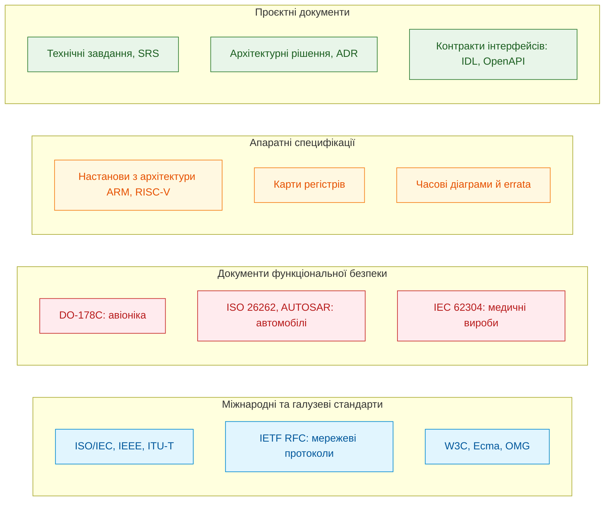

Діаграма показує не ієрархію важливості, а різні форми, у яких знання надходить до експертної системи. Кожен клас потребує власного способу вилучення.

**Міжнародні та галузеві стандарти** описують правила взаємодії компонентів і протоколів. Специфікації IETF (*Internet Engineering Task Force*) серії RFC (*Request for Comments*) є класичним прикладом: поруч із природною мовою вони містять формальні граматики в нотації ABNF (*Augmented Backus-Naur Form*), визначеній у RFC 5234 [[3]](#src-3). Зі стандарту такого типу експертна система вилучає дві форми знання: нормативні речення й граматику, яку можна скомпілювати в синтаксичний аналізатор.

**Документи функціональної безпеки** визначають не лише поведінку виробу, а й життєвий цикл його розроблення та перевірки. DO-178C для бортового програмного забезпечення авіації вимагає простежуваності від вимог до коду й тестів та аналізу структурного покриття [[4]](#src-4). ISO 26262 вводить для автомобільної електроніки рівні цілісності безпеки ASIL (*Automotive Safety Integrity Level*) від A до D [[5]](#src-5). IEC 62304 регламентує процеси життєвого циклу програмного забезпечення медичних виробів [[6]](#src-6). Знання з цих документів має форму обов'язків щодо артефактів процесу: які зв'язки простежуваності мають існувати, які докази покриття треба зібрати, хто й коли затверджує зміни.

**Апаратні специфікації** містять знання іншого типу. Настанови з архітектури процесорів (*Architecture Reference Manuals*), технічні описи контролерів і переліки відомих помилок кристала (*Errata Sheets*) подають знання у вигляді карт регістрів із бітовими полями й режимами доступу, часових діаграм, граничних електричних параметрів і обхідних рішень (*workarounds*) для дефектів кристала. Тут застосовується обов'язкове **інженерне правило ізоляції ревізійних обмежень апаратних специфікацій (Hardware Errata Scope)**: будь-який запис із переліку апаратних помилок є чинним виключно для зазначеної ревізії кремнієвого кристала, тому вилучений факт без предикатної прив'язки до діапазону ревізій безумовно блокується шлюзом знань як потенційно деструктивний для інших апаратних версій.

**Проєктні документи** (технічні завдання, специфікації вимог до програмного забезпечення, записи архітектурних рішень) фіксують конкретні правила проєкту. Вони змінюються найчастіше й мають узгоджуватися з вищими за ієрархією стандартами, тому для них особливо важливий облік версій, якому присвячено окремий розділ нижче.

Тут діє авторський **принцип спеціалізації екстракторів за регуляторним та фізичним типом джерела**: один універсальний екстрактор не здатний коректно опрацювати всі класи інженерних документів; граматику розбирає синтаксичний аналізатор, нормативні речення класифікує модальний аналізатор із [Глави 14](ch14-requirements-detection-and-formalization.md), таблиці регістрів обробляє аналізатор таблиць, а порядок дій вилучає екстрактор автоматів. Проте всі екстрактори мають видавати результат в одному форматі: кандидат у факт разом з адресою в першоджерелі. Формат цієї адреси визначає наступний розділ.

## 2. Інваріант доказовості: побайтова адресація першоджерел

У сертифікаційному аудиті доказових експертних систем вимога неспростовності фактів є абсолютною: якщо система стверджує, що певний параметр або правило діє в системі, вона повинна миттєво пред'явити математичний доказ походження цього твердження з незмінного першоджерела. Відсутність прямої адресації призводить до катастрофічної деградації доказовості: виникають «фантомні факти», спричинені галюцинаціями мовних моделей, застарілими чернетками або випадковими помилками ручного введення інженерами знань.

Для унеможливлення епістемічних вигадок у базис експертної системи закладається непорушний контракт доказової прив'язки: **жоден факт, предикат чи правило не допускається до бази знань без прямого криптографічного заземлення на байти незмінного документа**. Цей інваріант формалізується п'ятіркою побайтової адресації (*evidence grounding tuple*):

```math
\mathcal{E} = \langle \mathrm{DocID}, \mathrm{ByteStart}, \mathrm{ByteEnd}, \mathrm{SectionPath}, H_{\mathrm{quote}} \rangle
```

Параметри та математичні характеристики кортежу:

- $`\mathrm{DocID} \in \{0, 1\}^{256}`$ є криптографічним хешем SHA-256 [[7]](#src-7) повного вмісту вихідного файла документа в незмінному сховищі артефактів (забезпечує глобальну унікальність та цілісність джерела);
- $`\mathrm{ByteStart}, \mathrm{ByteEnd} \in \mathbb{N}_0`$ — цілочисельний напіввідкритий інтервал байтових зсувів $`[\mathrm{ByteStart}, \mathrm{ByteEnd})`$ у бінарному потоці сирого файла з нумерацією від нуля, де $`0 \le \mathrm{ByteStart} < \mathrm{ByteEnd} \le \text{FileSize}`$;
- $`\mathrm{SectionPath} \in \mathcal{P}`$ — канонічний ієрархічний шлях у дереві заголовків документа (наприклад, `"3.3/Mail Transactions"`);
- $`H_{\mathrm{quote}} = \mathrm{SHA256}(\text{FileBytes}[\mathrm{ByteStart}:\mathrm{ByteEnd}])`$ є криптографічним хешем SHA-256 точного фрагмента цитати;
- Кутові дужки $\langle \cdot \rangle$ позначають строго впорядкований кортеж, відсутність будь-якого компонента якого робить факт невалідним для верифікатора.

Практичне застосування та інженерні висновки:
- **Автоматична перевірка автентичності:** перед використанням факту в резолюційному виведенні рушій зчитує з диска діапазон байтів вихідного файла $`\text{FileBytes}[\mathrm{ByteStart}:\mathrm{ByteEnd}]`$, повторно обчислює хеш SHA-256 і порівнює його з $`H_{\mathrm{quote}}`$.
- **Fail-safe блокування (Quarantine):** якщо файл першоджерела змінено бодай на один біт або переміщено, перевірка хешів провалюється ($`\mathrm{SHA256} \ne H_{\mathrm{quote}}`$). Рушій миттєво блокує факт із кодом помилки `E_GROUNDING_INTEGRITY_VIOLATION`, поміщає відповідне правило в карантин і формує аудиторське сповіщення, виключаючи використання непідтверджених знань у прийнятті рішень.

> [!NOTE]
> **П'ять компонентів авторського кортежу доказової прив'язки $`\mathcal{E}`$ (Evidence Grounding Tuple)**
> 1. Криптографічний ідентифікатор документа ($`\mathrm{DocID}`$): незмінний 256-бітний хеш SHA-256 повного вмісту еталонного файлу в сховищі артефактів.
> 2. Напіввідкритий інтервал байтових зсувів ($`[\mathrm{ByteStart}, \mathrm{ByteEnd})`$): точні цілочисельні координати підрядка у вихідному бінарному потоці.
> 3. Канонічний ієрархічний шлях ($`\mathrm{SectionPath}`$): однозначне позиціонування в дереві заголовків специфікації для контекстної ізоляції норми.
> 4. Побайтовий хеш автентичності цитати ($`H_{\mathrm{quote}}`$): контрольний дайджест SHA-256 точного фрагмента тексту для захисту від мутацій і парафразів.
> 5. Детермінований протокол верифікації: пряма побайтова перевірка хостом (`%ebx` custody) без звернення до зовнішніх баз даних чи сторонніх сервісів.
> *Керування рантаймом / Інженерний інваріант:* будь-який факт без валідного побайтового збігу $`H_{\mathrm{quote}}`$ відхиляється шлюзом із вердиктом `E_GROUNDING_INTEGRITY_VIOLATION`.

## 3. Конвеєр екстракції: від байтового потоку до кандидатів у факти

Екстракція знань із технічного тексту не зводиться ні до пошуку за словами, ні до стислого переказу тексту нейромережею (*summarization*). Це багатостадійний детермінований процес, який перетворює потік байтів на типізовані факти, правила й графи поведінки. Діаграма показує п'ять фаз цього процесу.

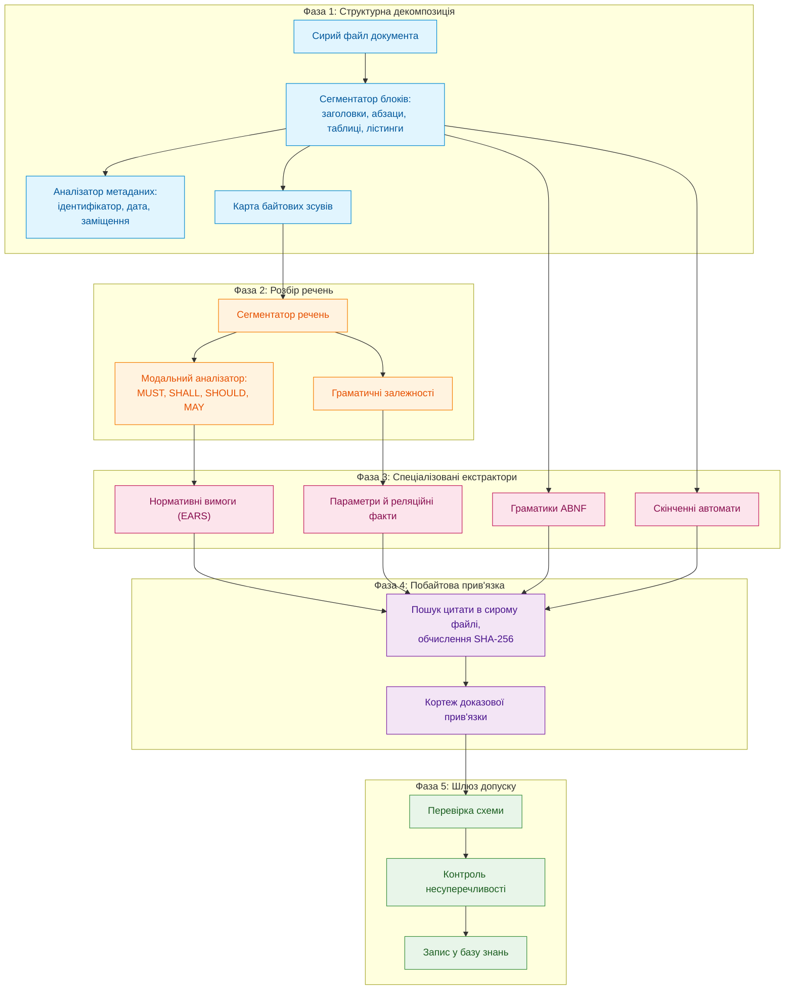

У цьому конвеєрі втілено авторський **інженерний принцип детермінованої пофазної фільтрації (Deferred Admission Principle)**: кожна фаза отримує результат попередньої і може відхилити кандидата за власними детермінованими критеріями, проте жодна проміжна фаза не має права записувати знання в ядро — остаточне рішення про допуск ухвалює виключно фінальний шлюз допуску (фаза 5). Розгляньмо фази по черзі; фазу 5 описано в окремому розділі про шлюз допуску.

### 3.1. Структурна декомпозиція документа

Тут діє сформульований автором **принцип контекстної стратифікації нормативної сили розділів документа**: зміст і юридично-технічна сила речення залежать від його структурного позиціонування в ієрархії тексту. Те саме дієслівне формулювання в нормативній частині стандарту встановлює обов'язковий інваріант, в інформаційному додатку (*informative annex*) лише пояснює поведінку, а в розділі про мотивацію (*rationale*) є суто історичною довідкою. Без явної структурної стратифікації екстрактор неминуче перетворить необов'язкове пояснення на блокуюче правило безпеки.

На першій фазі конвеєр розпізнає каркас документа: дерево розділів, типи текстових блоків (звичайний текст, таблиця, лістинг коду, формальна граматика, діаграма в символах ASCII) і метадані: ідентифікатор, дату, статус чинності та зв'язки з іншими документами. Одночасно фаза 1 будує карту зсувів, тобто запам'ятовує для кожного блоку його байтовий діапазон у сирому файлі.

Заголовок RFC 5321 у текстовому форматі містить рядки `Obsoletes: 2821` і `Updates: 1123` [[2]](#src-2). Аналізатор метаданих перетворює їх на ребра графа версій без участі людини: RFC 5321 скасовує RFC 2821 і оновлює RFC 1123. Той самий файл містить на кожній сторінці колонтитул із прізвищем автора, категорією документа й номером сторінки, наприклад `Klensin ... Standards Track ... [Page 95]`. Фаза 1 позначає їх як службові блоки, щоб жоден екстрактор не сприйняв колонтитул як частину норми.

Результатом фази 1 є дерево документа, кожен вузол якого має тип, шлях і байтовий діапазон. Це дерево потрібне всім наступним фазам.

### 3.2. Розбір речень і спеціалізовані екстрактори

Фаза 2 ділить текстові блоки на речення, визначає модальність кожного нормативного речення й будує граматичні залежності. Фаза 3 запускає паралельні екстрактори, кожен з яких шукає власний тип знання.

#### 3.2.1. Параметри й реляційні факти

Технічні специфікації містять багато фіксованих параметрів: номери портів, розміри буферів, тайм-аути, бітові маски, температурні діапазони. Екстрактор реляційних фактів зводить такі твердження до атомарної структури:

```math
\mathrm{Fact} = \langle \mathrm{Subject}, \mathrm{Relation}, \mathrm{Value}, \mathrm{Unit}, \mathcal{E} \rangle
```

Параметри та компоненти типізованого факту:

- $`\mathrm{Subject} \in \mathcal{C}`$ є канонічним ідентифікатором концепту онтології предметного домену (наприклад, `smtp:local-part` або `bms:cell_voltage`);
- $`\mathrm{Relation} \in \mathcal{R}`$ позначає семантичне відношення між концептом і значенням із замкненої матриці відношень онтології (наприклад, `hasMaxLength`, `hasTimeout`, `hasTolerance`);
- $`\mathrm{Value} \in \mathbb{R} \cup \mathrm{String}`$ є безпосереднім числовим чи рядковим значенням вилученого інженерного параметра;
- $`\mathrm{Unit} \in \mathcal{U}_{\mathrm{SI}} \cup \mathcal{U}_{\mathrm{std}}`$ задає строго специфіковану фізичну одиницю системи СІ або нормативну протокольну одиницю ($`\text{octet}`$, $`\text{bit/s}`$, $`\text{ms}`$, $`\text{mV}`$); для безрозмірних констант фіксується маркер $`\text{dimensionless}`$;
- $`\mathcal{E}`$ є криптографічним кортежем доказової прив'язки до незмінного першоджерела.

Практичне застосування та інженерні висновки:
- **Перевірка типів та одиниць на шлюзі:** шлюз допуску автоматично верифікує сумісність розмірності $`\mathrm{Unit}`$ із сигнатурою відношення $`\mathrm{Relation}`$. Якщо для часового відношення вказано октети або одиницю не визначено, факт безумовно бракується з кодом `E_INVALID_UNIT_DIMENSION`.
- **Запобігання фантомним фактам:** кутові дужки вимагають обов'язкової наявності всіх п'яти компонентів. Будь-яке твердження з порожнім полем $`\mathcal{E}`$ або невалідованим хешем першоджерела блокується як потенційна галюцинація екстрактора.

Наприклад, розділ 4.5.3.1.1 RFC 5321 містить речення *«The maximum total length of a user name or other local-part is 64 octets»* [[2]](#src-2). Екстрактор перетворює його на факт $`\langle \text{local-part}, \mathrm{maxLength}, 64, \text{octet}, \mathcal{E} \rangle`$, де $`\mathcal{E}`$ вказує на точні байти цього речення. Розділ 4.5.3.1.6 того самого документа задає інше обмеження: рядок тексту разом із символами кінця рядка не може перевищувати 1000 октетів. Обидва факти стають перевірюваними правилами, і експертна система може детерміновано звірити з ними журнал поштового сервера.

#### 3.2.2. Нормативні вимоги

Речення з нормативними словами (*MUST*, *SHALL*, *SHOULD*, *MAY* та їхні заперечення) екстрактор нормалізує за шаблонами EARS (*Easy Approach to Requirements Syntax*) [[8]](#src-8). Правила класифікації модальності залежать від конвенції документа-джерела, тому їх детально розібрано в [Главі 14](ch14-requirements-detection-and-formalization.md). Для цієї глави достатньо прикладу з розділу 3.3 RFC 5321. Речення *«If a RCPT command appears without a previous MAIL command, the server MUST return a 503 "Bad sequence of commands" response»* [[2]](#src-2) стає подієвою вимогою EARS: «Коли SMTP-сервер отримує команду RCPT без попередньої команди MAIL, SMTP-сервер повинен повернути код відповіді 503». Ця вимога ще знадобиться в розділі про скінченні автомати.

#### 3.2.3. Формальні граматики

Багато стандартів описують синтаксис повідомлень формальною нотацією. Розділ 4.1.1.1 RFC 5321 задає синтаксис команд привітання так [[2]](#src-2):

<details>
<summary>Граматичне правило ABNF</summary>

```abnf
ehlo           = "EHLO" SP ( Domain / address-literal ) CRLF
helo           = "HELO" SP Domain CRLF
```

</details>


Екстрактор граматик знаходить такі блоки, компілює їх у синтаксичні дерева й перевіряє, що кожне правило визначене. Правила `SP` і `CRLF` належать до базових правил, визначених у додатку B RFC 5234 [[3]](#src-3), а `Domain` і `address-literal` визначено в інших розділах RFC 5321. Тому екстрактор має розв'язувати посилання між розділами й документами; невизначене правило є помилкою екстракції, а не приводом мовчки пропустити граматику. Скомпільована граматика стає валідатором у складі бази знань: команду `HELO` без доменного імені експертна система відхилить як синтаксично неправильну, не звертаючись до мовної моделі.

### 3.3. Побайтова прив'язка фактів (Byte Anchoring)

Екстрактор чи мовна модель повертає цитату-кандидат одним рядком, а в сирому файлі та сама цитата розірвана перенесенням рядка й відступом. Пошук байт-у-байт такої цитати не знайде, хоча вона дослівно присутня в документі. Друга проблема протилежна: коротка цитата може траплятися в документі кілька разів, і тоді незрозуміло, яке з місць є доказом.

Розв'язок полягає в нормалізації з картою зсувів. Програма стискає кожну послідовність пробільних символів до одного пробілу, але для кожного байта нормалізованого тексту пам'ятає позицію в сирому файлі. Пошук виконується в нормалізованому тексті, а діапазон і хеш обчислюються за сирими байтами. Цитата приймається, лише якщо вона трапляється рівно один раз. Програма нижче реалізує цю перевірку мовою Go. Їй потрібен файл `rfc5321.txt`, завантажений з RFC Editor у той самий каталог; крім стандартної бібліотеки Go, програма нічого не потребує.

<details>
<summary>Приклад мовою Go: побайтова прив'язка цитати з нормалізацією й картою зсувів</summary>

```go
package main

import (
	"bytes"
	"crypto/sha256"
	"encoding/hex"
	"fmt"
    "os"
    "unicode/utf8"
)

// Evidence описує побайтову прив'язку цитати до сирого файлу першоджерела.
type Evidence struct {
	Start, End int    // зсуви в сирих байтах; End не входить до діапазону
	SHA256     string // хеш сирих байтів [Start, End)
}

// normalize стискає кожну послідовність пробільних символів до одного пробілу
// і запам'ятовує, з якого байта сирого файлу походить кожен байт результату.
func normalize(raw []byte) ([]byte, []int) {
	var out []byte
	var pos []int
	inSpace := false
	for i, b := range raw {
		switch b {
		case ' ', '\t', '\r', '\n', '\f':
			if !inSpace && len(out) > 0 {
				out = append(out, ' ')
				pos = append(pos, i)
			}
			inSpace = true
			continue
		}
		inSpace = false
		out = append(out, b)
		pos = append(pos, i)
	}
	return out, pos
}

// Ground приймає цитату-кандидат лише тоді, коли вона трапляється
// в нормалізованому тексті документа рівно один раз.
func Ground(raw []byte, quote string) (Evidence, error) {
    return GroundIn(raw, quote, 0, len(raw))
}

func GroundIn(raw []byte, quote string, regionStart, regionEnd int) (Evidence, error) {
    if regionStart < 0 || regionEnd > len(raw) || regionStart >= regionEnd {
        return Evidence{}, fmt.Errorf("некоректні межі ділянки джерела")
    }
    if !utf8.Valid(raw) || !utf8.ValidString(quote) || !utf8.Valid(raw[regionStart:regionEnd]) {
        return Evidence{}, fmt.Errorf("некоректний UTF-8 або розріз усередині символу")
    }
    norm, pos := normalize(raw[regionStart:regionEnd])
	q, _ := normalize([]byte(quote))
	q = bytes.TrimSpace(q)
	if len(q) == 0 {
		return Evidence{}, fmt.Errorf("порожня цитата")
	}
	first := bytes.Index(norm, q)
	if first < 0 {
		return Evidence{}, fmt.Errorf("цитату не знайдено дослівно")
	}
	if bytes.Contains(norm[first+1:], q) {
		return Evidence{}, fmt.Errorf("цитата неоднозначна: кілька входжень")
	}
    start := regionStart + pos[first]
    end := regionStart + pos[first+len(q)-1] + 1
	sum := sha256.Sum256(raw[start:end])
	return Evidence{Start: start, End: end, SHA256: hex.EncodeToString(sum[:])}, nil
}

func main() {
	raw, err := os.ReadFile("rfc5321.txt")
	if err != nil {
		fmt.Println("помилка читання:", err)
		os.Exit(1)
	}
	doc := sha256.Sum256(raw)
	fmt.Printf("DocID: sha256:%x...\n", doc[:8])

	candidates := []string{
		// Дослівна цитата з розділу 3.3; у файлі її розриває перенесення рядка.
		`If a RCPT command appears without a previous MAIL command, the server MUST return a 503 "Bad sequence of commands" response.`,
		// Парафраз тієї самої норми: зміст схожий, але таких байтів у файлі немає.
		`If RCPT is sent before MAIL, the server MUST answer 503.`,
		// Надто коротка цитата: у документі вона трапляється кілька разів.
		`503 Bad sequence of commands`,
	}
	for _, c := range candidates {
		ev, err := Ground(raw, c)
		if err != nil {
			fmt.Println("ВІДХИЛЕНО:", err)
			continue
		}
		fmt.Printf("ПРИЙНЯТО: байти [%d, %d), sha256:%s...\n", ev.Start, ev.End, ev.SHA256[:16])
	}
}
```

Тест `ground_test.go` виконується через `go test -v main.go ground_test.go` і не потребує зовнішнього корпусу:

```go
package main

import (
    "crypto/sha256"
    "encoding/hex"
    "testing"
)

func TestGroundingRegionsAndEncoding(testCase *testing.T) {
    raw := []byte("first: limit 100 ms\nsecond: limit\n  100 ms")
    if _, err := Ground(raw, "limit 100 ms"); err == nil {
        testCase.Fatal("ambiguous global quote accepted")
    }
    start := len("first: limit 100 ms\nsecond: ")
    evidence, err := GroundIn(raw, "limit 100 ms", start, len(raw))
    if err != nil || evidence.Start != start || evidence.End != len(raw) {
        testCase.Fatalf("incorrect source region: %+v %v", evidence, err)
    }
    checksum := sha256.Sum256(raw[evidence.Start:evidence.End])
    if evidence.SHA256 != hex.EncodeToString(checksum[:]) {
        testCase.Fatal("quote hash does not match original bytes")
    }
    if _, err := Ground(raw, "limit 90 ms"); err == nil {
        testCase.Fatal("changed parameter accepted")
    }
    for _, bounds := range [][2]int{{-1, 2}, {0, len(raw) + 1}, {3, 2}} {
        if _, err := GroundIn(raw, "limit", bounds[0], bounds[1]); err == nil {
            testCase.Fatal("invalid region accepted")
        }
    }
    if _, err := Ground([]byte{0xff, 'a'}, "a"); err == nil {
        testCase.Fatal("invalid UTF-8 accepted")
    }
    if _, err := GroundIn([]byte("ї"), "ї", 1, 2); err == nil {
        testCase.Fatal("region splits Unicode character")
    }
}
```

Архівний вивід автора для файла розміром 225 929 байтів:

```text
DocID: sha256:7d560eddff1b213c...
ПРИЙНЯТО: байти [52658, 52788), sha256:48f3063677f109b3...
ВІДХИЛЕНО: цитату не знайдено дослівно
ВІДХИЛЕНО: цитата неоднозначна: кілька входжень
```

</details>

Перша цитата прийнята: у файлі вона займає байти з 52 658 до 52 788 і містить перенесення рядка з відступом. Нормалізація знайшла цитату, а хеш обчислено за сирими байтами разом зі службовими символами, тому повторна перевірка від нормалізації не залежить: досить прочитати 130 байтів із вказаного діапазону. Друга цитата передає зміст тієї самої норми, але таких байтів у документі немає, тому програма відхиляє її як парафраз. Третя цитата дослівна, проте трапляється двічі, у двох переліках кодів відповідей (розділи 4.2.2 і 4.2.3), тому прийняти її без уточнення розділу неможливо.

Приклад нормалізує лише перелічені ASCII-пробіли. `GroundIn` дозволяє шукати в наперед установленій ділянці розділу й повертає глобальні координати; ділянку має визначити структурний аналізатор, не сама модель після невдалого пошуку. Повторна цитата в іншому розділі тоді не створює неоднозначності всередині погодженої ділянки. Тест також відхиляє неправильне кодування й розріз символу.

Для PDF-документа або скану потрібний незмінний текстовий артефакт із власним ідентифікатором і зв'язок до оригінального файла, сторінки та геометричних рамок. Байтовий діапазон у текстовому артефакті не є діапазоном символів усередині стиснутого PDF. Переноси слів, видалення колонтитулів і лігатури потребують карти перетворень, як пояснює [Глава 12](ch12-linguistic-analysis-and-local-models.md).

### 3.4. Двопрохідний семантичний компілятор знань: від збору символів до зв'язування анафор

Однопрохідна лінійна екстракція, типова для простих парсерів і наївних RAG-конвеєрів, принципово непридатна для складних інженерних та наукових специфікацій. Причина полягає в природній анафорі та контекстній залежності мови стандартів: значна частина нормативних вимог починається займенниками або контекстно зумовленими дефініціями: *«It MUST verify the peer's certificate...»*, *«This parameter MUST NOT exceed 1024 octets»*, *«They SHOULD abort the handshake upon receiving...»*.

За однопрохідної обробки суб'єктом такого факту стає або займенник `it`, або узагальнений заповнювач `system`, що руйнує детерміновану типізацію та унеможливлює точне логічне виведення. Ба більше, технічні терміни, локальні акроніми та специфічні предметні дієслова визначаються в документі лише один раз (у розділі визначень або при першому введенні), а використовуються в десятках наступних розділів.

Розв'язанням є **двопрохідна модель компіляції знань (Two-Pass Ingestion Compiler)**, аналогічна класичній двоетапній компіляції вихідного коду (збір символів → генерація проміжного коду та зв'язування адрес):

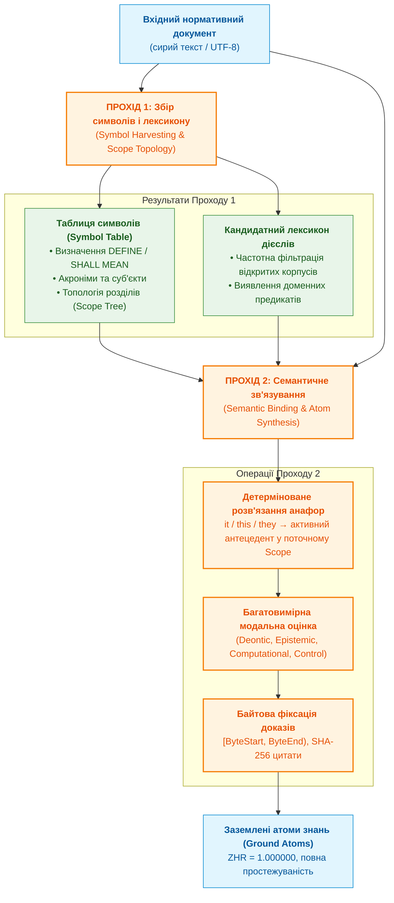

#### 3.4.1. Збір символів, топології та лексикону (Symbol Harvesting)

Під час першого проходу компілятор не продукує фінальних норм, а формує просторово-типізовану **Таблицю символів документа** ($`\mathrm{SymbolTable}`$):
1. **Витяг локальних дефініцій і глосаріїв:** компілятор детектує нормативні конструкції визначень (`DEFINE`, `SHALL MEAN`, `IS DEFINED AS`, `STANDS FOR`) і реєструє введені терміни, їхні синоніми та акроніми.
2. **Побудова топології областей видимості (Scope Topology):** кожен пункт, таблиця або розділ специфікації формує лексичний простір імен ($`\mathrm{Scope}`$). В межах цього простору фіксуються явно заявлені суб'єкти (актори: наприклад, `Client`, `Server`, `Controller`, `Receiver`).
3. **Автоматичне виявлення кандидатних дієслів (Candidate Verb Harvesting):** обмежувати семантичний розбір фіксованим списком слів небезпечно. Компілятор аналізує вхідний текст через морфологічні словники (такі як WordNet, VerbNet, СУМ-20 для української мови, науковий лексикон Academic Word List (AWL), а також термінологічний стандарт ISO/IEC/IEEE 24765). Дієслова, чия частота в документі перевищує емпіричний поріг, пропонуються шлюзу допуску як кандидати до багатовимірної онтології дій.

#### 3.4.2. Семантичне зв'язування та розв'язання анафор (Semantic Binding)

Під час другого проходу здійснюється повнотекстовий синтактико-семантичний аналіз із використанням уже заповненої Таблиці символів:
- **Типізоване розв'язання анафор (Typed Anaphora Resolution):** коли граматичний парсер зустрічає займенник (`it`, `this`, `they`) у позиції підмета нормативного речення, компілятор звертається до активного $`\mathrm{Scope}`$. Займенник однозначно зв'язується з найближчим домінантним антецедентом відповідного граматичного числа та роду (наприклад, у контексті розділу *«Handshake Protocol: Client»* речення *«It MUST compute the Finished verify_data...»* однозначно транслюється у суб'єкт `Client`).
- **Незмінність доказового інваріанта:** нормалізація суб'єкта до канонічного ідентифікатора символу відбувається в семантичному шарі факту ($`\mathrm{Subject} = \text{"Client"}`$), тоді як кортеж прив'язки $`\mathcal{E} = \langle \mathrm{DocID}, \mathrm{ByteStart}, \mathrm{ByteEnd}, \dots \rangle`$ і хеш $`H_{\mathrm{quote}}`$ незмінно зберігають буквальний байтовий діапазон вихідного тексту першоджерела (з оригінальним словом *«It»*).
- **Матеріалізація заземлених атомів:** результат другого проходу — це множина валідованих тверджень, вільних від невизначених займенників, прив'язаних до точно адресованих символів онтології.

#### 3.4.3. Еволюція до чотирипрохідного епістемічного компілятора (Epistemic IR)

Практичне масштабування на промислові інженерні стандарти (RFC, AUTOSAR, ISO 26262) показало, що двопрохідної моделі недостатньо для вилучення глибоких зв'язків: структурні залежності частин і цілого (`PART-OF`), таксономічні ієрархії (`IS-A`), множинні фізичні обмеження в одному реченні та взаємно скасовувані норми (Defeaters) вимагають детермінованого логічного виведення ще на етапі збирання бази знань.

Автором запропоновано та реалізовано чотирипрохідну архітектуру компіляції знань над типізованим проміжним представленням `Epistemic IR`, яка суворо розмежовує лінгвістичний аналіз, числову метрику, логічне виведення та низькорівневу бінарну кодогенерацію:

> [!NOTE]
> **Чотири проходи епістемічної компіляції знань в архітектурі М. М. Федчика**
> 1. **Прохід 1 — Синтаксично-рольова нормалізація та клаузальна декомпозиція (SRL & Clausal IR):** Первинний потік тексту та структурних таблиць перетворюється у типізовані фрейми проміжного представлення `Epistemic IR` із нормалізацією пасивного стану, розщепленням кон'юнкцій та виділенням умовних передумов.
> 2. **Прохід 2 — Багатовеличинне та лексичне заземлення (Multi-Quantity & UCUM IR):** Авторський алгоритм вилучає повний масив числових та словесних величин (`four octets`, `32 bits`, `3.3 V`, `125 °C`) із кожного речення, прив'язує кожну величину до конкретного параметра й семантичної ролі (`RoleCondition` проти `RoleTargetLimit`) та виконує розмірну канонізацію за алгеброю UCUM ($`1\text{ octet} \equiv 8\text{ bits}`$).
> 3. **Прохід 3 — Побудова епістемічного графа та компіляційне виведення (Graph & Inference IR):** Компілятор будує графи таксономії (`IS-A`) і меронімії (`PART-OF`), обчислює агреговані параметри складених структур, зв'язує міжреченнєві дефітери та перевіряє сумісність числових інтервалів.
> 4. **Прохід 4 — Кодогенерація Zero-Copy контейнера та байт-коду EISA:** Проміжне представлення серіалізується у вирівняні по 64 байти секції пакета знань (`0x0002 GROUND_ATOMS`, `0x0003 SECTION_EISA_RULES`, `0x0008 QUANTITIES`, `0x0009 DEFEATERS`) із фіксацією дерева Меркла (`0x0006`).
> *Керування рантаймом / Інженерний інваріант:* Перенесення важкого лінгвістичного та графового аналізу на етап компіляції (Ahead-of-Time Epistemic Compilation) гарантує субмілісекундне виконання запитів у рантаймі через `mmap(MAP_SHARED)` без залучення LLM у критичному шлюзі допуску.

### 3.5. Теорія плаваючих семантичних вікон проти наївного фіксованого чанкінгу

Вилучення знань та інформаційний пошук у технічній документації критично залежать від способу розбиття безперервного тексту на операційні сегменти. Поширена у загальних RAG-системах практика механічного нарізання тексту на блоки фіксованого розміру (наприклад, по 512 або 1024 токени з довільним перекриттям) є абсолютно руйнівною для доказової інженерії:
- вона механічно розриває деонтичні норми, відокремлюючи нормативну умову (`IF...`) від предикату та юридичного або технічного наслідку (`THEN MUST...`);
- фрагментує складні таблиці електричних параметрів, часових діаграм шин або конфігураційних регістрів;
- знищує контекст анафоричних посилань («вказаний вище поріг напруги», «цей регістр конфігурації»), унеможливлюючи подальшу формальну верифікацію твердження.

Для подолання цієї деградації автором запропоновано замінити статичний чанкінг концепцією **плаваючих семантичних одиниць анотації (Floating-Size Annotation Unit, FAU)**, яка базується на двох фундаментальних наукових засадах: кібернетичному законі Росса Ешбі та мережевому протоколі ковзного вікна.

#### 1. Кібернетичний закон необхідної різноманітності Росса Ешбі (W. Ross Ashby)

У класичній кібернетиці закон необхідної різноманітності Ешбі стверджує: *тільки різноманітність регулятора здатна знищити (компенсувати) різноманітність збурень системи* (*only variety can destroy variety*) [[26]](#src-26). У контексті декомпозиції складної нормативної документації закон набуває форми математичної нерівності:

```math
V_R \ge V_D - V_C
```

Параметри та математичні компоненти формули:
- $`V_R \in \mathbb{R}_{\ge 0}`$ — ентропійна різноманітність станів регулятора (внутрішня здатність механізму сегментації адаптувати розмір, межі та семантичну ємність вікна FAU);
- $`V_D \in \mathbb{R}_{> 0}`$ — ентропійна різноманітність та структурна варіативність вхідного нормативного тексту (синтаксична складність речень, наявність вкладених умовних конструкцій, винятків, приміток та таблиць специфікацій);
- $`V_C \in \mathbb{R}_{\ge 0}`$ — допустима залишкова ентропія (дисперсія семантичної невизначеності на виході сегментатора, за якої екстрактор здатен однозначно типізувати факти без втрати предикативного зв'язку; для місійно-критичних систем вимагається $`V_C \to 0`$).

Фіксований блок завдовжки $N = 512$ токенів є абсолютно ригідним: він має константні просторові межі, тому його регуляторна різноманітність щодо виявлення смислових розривів тотожно дорівнює нулю ($`V_R = 0`$). Оскільки складність технічної мови висока ($`V_D \gg 0`$), умова Ешбі $`0 \ge V_D - V_C`$ грубо порушується. Наслідком є неминучий семантичний колапс: розрив предикатів і генерація галюцинацій мовною моделлю на етапі екстракції.

#### 2. Протокол ковзного вікна семантичної анотації (Sliding Window Protocol)

На відміну від статичного лічильника токенів, межі плаваючої одиниці FAU формуються динамічно шляхом синтаксичного та семантичного моніторингу потоку тексту:
- **Відкриття вікна (Window Open):** фіксація появи нового нумерованого структурного заголовка стандарту, суб'єкта нормативного твердження або переходу до нового розділу специфікації;
- **Утримання та розширення (Window Hold/Expand):** динамічне поглинання всіх підрядних умов (`IF... THEN`, `WHEN`, `WHERE`), деонтичних винятків (`UNLESS`, `EXCEPT`), числових меж із допусками та анафоричних займенників;
- **Закриття вікна (Window Close):** виявлення синтаксично замкненого судження, зміна суб'єкта нормативної дії або виявлення наступної логічної секції специфікації.

Кожна сформована одиниця FAU зберігає повний ієрархічний шлях від кореня документа (*breadcrumbs*), наприклад: «Вимоги до гальмівної системи → Аварійне гальмування → пункт 4.2».

#### 3. Гібридний пошук на базі злиття обернених рангів (RRF)

Для вибірки кандидатних одиниць FAU на етапі вилучення або відповіді на інженерні запити конвеєр застосовує дворівневий гібридний пошук. Розріджений лексичний індекс BM25 знаходить точні збіги номерів стандартів, кодів помилок та мнемонік регістрів [[9]](#src-9). Щільний векторний індекс HNSW знаходить парафразовані та концептуальні відповідності [[10]](#src-10), доступний утилітою pgvector [[11]](#src-11). Списки видачі об'єднуються методом злиття обернених рангів RRF (*Reciprocal Rank Fusion*) [[12]](#src-12):

```math
\mathrm{RRF}(d) = \sum_{m \in \{\mathrm{BM25}, \mathrm{Dense}\}} \frac{1}{k + \mathrm{rank}_m(d)}
```

Параметри та математичні компоненти формули:
- $`d \in \mathcal{D}_{\mathrm{FAU}}`$ є структурною одиницею FAU (нормативний пункт, стаття чи таблиця);
- $`m \in \{\mathrm{BM25}, \mathrm{Dense}\}`$ позначає гетерогенні пошукові канали (розріджений лексичний індекс точних збігів та щільний векторний семантичний індекс HNSW);
- $`\mathrm{rank}_m(d) \in \mathbb{N}_{\ge 1}`$ є порядковим місцем кандидата $d$ у списку видачі каналу $m$ ($1$ для першого місця; якщо документ відсутній у вибірці каналу, приймається $`\mathrm{rank}_m(d) = \infty`$, що дає нульовий доданок);
- $`k \in \mathbb{N}_{> 0}`$ — емпіричний гіперпараметр згладжування (канонічно $k = 60$), який нівелює випадкові сплески ранжування в одному каналі;
- $`\mathrm{RRF}(d) \in (0, \frac{2}{k+1}]`$ є сумарним позиційним балом консенсусу.

#### 3.5.1. Дія та замкнений цикл розрахунку семантичного вікна FAU

1. **Керування рантаймом і потоком обчислень (Control Flow & Runtime Decisions):**
   - Рантайм сегментатора відстежує лічильник незакритих анафор $`B_{\mathrm{anaphora}}`$ та прапорець деонтичної незавершеності $`F_{\mathrm{deontic}}`$. Доки $`B_{\mathrm{anaphora}} > 0`$ або $`F_{\mathrm{deontic}} = \mathrm{true}`$, ковзне вікно залишається в стані `EXPAND`, блокуючи спроби скидання даних у чергу індексації.
   - Скидання блоку в індекс (`FLUSH_FAU`) дозволяється виключно при $`B_{\mathrm{anaphora}} = 0 \land F_{\mathrm{deontic}} = \mathrm{false}`$.
   - Якщо через надмірну заплутаність авторського стилю розмір вікна досягає жорсткої апаратної межі $`L_{\mathrm{max}} = 2048`$ токенів без настання умов закриття, рантайм активує захисний статус `DEGRADED_SPLIT`. У цьому разі фіксується розрив за останнім роздільником речення, генерується подія аудиту `WARN_ANAPHORA_DISRUPTED`, а останнє речення примусово копіюється як контекстний префікс наступного вікна.
   - При вибірці кандидатів із пулу для передачі екстрактору діє комбінований поріг: відбирається не більше $`K_{\mathrm{pool}} = 20`$ фрагментів із балом $`\mathrm{RRF}(d) \ge 0{,}025`$. Якщо $`\max_{d} \mathrm{RRF}(d) < \tau_{\mathrm{min}}`$, процес зупиняється з помилкою `E_NO_CONFIDENT_RETRIEVAL`, унеможливлюючи передачу зашумленого контексту.
2. **Апаратний сайзинг та інфраструктурні обмеження (Hardware Dimensioning):**
   - Для пулу з $`N_{\mathrm{workers}} = 16`$ паралельних екстракторів під кожне вікно FAU виділяється циклічний буфер розміром $`L_{\mathrm{max}} \times S_{\mathrm{token}} = 2048 \times 64\,\text{байти} = 128\,\text{КБ}`$.
   - Сукупний обсяг оперативної пам'яті для всіх паралельних вікон становить $`16 \times 128\,\text{КБ} = 2\,\text{МБ}`$, що гарантовано вкладається в ультрашвидкий L3-кеш сучасного процесора архітектури x86_64 або ARM Cortex ($`16\text{--}64\,\text{МБ}`$). Це забезпечує обробку тексту без затримок звернення до оперативної пам'яті (DRAM) із пропускною здатністю понад $`1{,}4\,\text{ГБ/с}`$.
3. **Практичний числовий приклад (Worked Numerical Example):**
   - Розглядається аналіз пункту 4.2 специфікації силового тягового інвертора ISO 26262 загальним обсягом 610 токенів.
   - Наївний фіксований чанкінг по 512 токенів розрізає пункт на 512-му токені: перший блок містить імператив «інвертор зобов'язаний зняти напругу за 10 мс», а другий блок — критичний виняток «крім режиму аварійного динамічного гальмування при температурі обмоток статора нижче 120 °C». Отримавши перший блок, система виведення робить помилковий висновок про безумовне зняття напруги, що під час стендових випробувань спричиняє відмову кермового керування.
   - Механізм FAU виявляє незакритий деонтичний виняток ($`F_{\mathrm{deontic}} = \mathrm{true}`$) та утримує вікно відкритим до 610-го токена ($`L = 610 \le L_{\mathrm{max}}`$). При пошуку за запитом інженера збережений цілісний блок займає 2-ге місце у BM25 ($`\mathrm{rank}_{\mathrm{BM25}} = 2`$) та 3-тє місце в HNSW ($`\mathrm{rank}_{\mathrm{Dense}} = 3`$). За формулою RRF із $k = 60$:

```math
\mathrm{RRF}(d) = \frac{1}{60 + 2} + \frac{1}{60 + 3} = \frac{1}{62} + \frac{1}{63} \approx 0{,}01613 + 0{,}01587 = 0{,}03200 \ge 0{,}025.
```

   - Завдяки значенню $`0{,}03200 \ge 0{,}025`$ чанк успішно проходить шлюз відбору та подається на екстракцію як цілісна деонтична норма з усіма умовами та винятками.

Вибір моделі векторних представлень (*embeddings*) також потребує верифікації на власних інженерних тестах: порівняльний бенчмарк MTEB (*Massive Text Embedding Benchmark*) підтверджує, що жодна модель не володіє універсальною перевагою на всіх доменах [[13]](#src-13).

### 3.6. Синтаксично-керована екстракція (Syntax-Directed IE) та вилучення предикатів через Universal Dependencies

Вилучення структурованих знань із природномовного тексту нормативу вимагає подолання епістемічного розриву: текст документа складається з багатозначних лінгвістичних конструкцій, тоді як рушій логічного виведення вимагає строго типізованих предикатів логіки першого порядку та фактів Datalog. Наївні підходи інформаційної екстракції (OpenIE або використання LLM за принципом «вилучи трійки $`\langle \text{Subject}, \text{Predicate}, \text{Object} \rangle`$») породжують катастрофічний відсоток галюцинацій: мовна модель вільно додумує зв'язки, переставляє місцями причину й наслідок або втрачає умови застосовності норми.

Для забезпечення повної верифікованості та неспростовності фактів у конвеєрі екстракції застосовано **синтаксично-керовану інженерну екстракцію (Syntax-Directed Information Extraction, SDIE)** на базі формальних дерев залежностей схеми Universal Dependencies (UD). Речення стандарту розглядається не як плаский ланцюжок токенів, а як орієнтоване дерево залежностей $`\mathcal{T}_{\mathrm{UD}} = (V, E)`$, де вершини $`V = \{w_1, \dots, w_n\}`$ відповідають лематизованим токенам із морфологічними векторами, а ребра $`E \subset V \times \mathcal{D} \times V`$ кодують синтаксичні зв'язки з множини відношень $`\mathcal{D} = \{\mathtt{nsubj}, \mathtt{obj}, \mathtt{iobj}, \mathtt{obl}, \mathtt{advcl}, \mathtt{conj}, \dots\}`$.

Трансляція синтаксичного дерева в реляційні факти логіки $`\mathcal{R}_{\mathrm{Datalog}}`$ здійснюється через детермінований оператор синтаксичної компіляції $`\Phi_{\mathrm{SDIE}}`$:

```math
\Phi_{\mathrm{SDIE}}(\mathcal{T}_{\mathrm{UD}}) = \Big\{ P\bigl(\mathrm{arg}_1, \dots, \mathrm{arg}_k\bigr) \ \Big|\ v_{\mathrm{root}} \in V \land \mathrm{pos}(v_{\mathrm{root}}) = \mathtt{VERB} \land \forall i \in \{1,\dots,k\}: (v_{\mathrm{root}}, r_i, u_i) \in E \Big\}
```

де:
- $`v_{\mathrm{root}}`$ — дієслівна вершина речення, що визначає назву предиката $`P = \mathrm{lemma}(v_{\mathrm{root}})`$;
- $`r_i \in \mathcal{D}`$ — тип синтаксичної залежності згідно зі схемою Universal Dependencies;
- $`u_i \in V`$ — вершина піддерева залежного актанта, з якого формується строковий або символьний аргумент $`\mathrm{arg}_i = \mathrm{yield}(u_i)`$;
- $`\mathrm{yield}(u)`$ — проєкція піддерева з коренем $u$ на вихідний потік символів першоджерела з обов'язковою фіксацією координат байтової кустодії $`[b_{\mathrm{start}}, b_{\mathrm{end}}]`$.

Деонтичний статус норми (зобов'язання $`\mathbf{O}`$, заборона $`\mathbf{F}`$, дозвіл $`\mathbf{P}`$) визначається детермінованим аналізом допоміжних дієслівних зв'язків $`\mathtt{aux}`$ та маркерів заперечення $`\mathtt{advmod}`$:

```math
\mathrm{Deontic}(v_{\mathrm{root}}) = \begin{cases} \mathbf{F}, & \text{якщо } \exists u: (v_{\mathrm{root}}, \mathtt{advmod}, u) \in E \land \mathrm{lemma}(u) = \text{«не»}, \\ \mathbf{O}, & \text{якщо } \exists u: (v_{\mathrm{root}}, \mathtt{aux}, u) \in E \land \mathrm{lemma}(u) \in \{\text{«мусити»}, \text{«повинен»}, \text{«зобов'язаний»}\}, \\ \mathbf{P}, & \text{якщо } \exists u: (v_{\mathrm{root}}, \mathtt{aux}, u) \in E \land \mathrm{lemma}(u) \in \{\text{«могти»}, \text{«дозволятися»}\}, \\ \mathbf{D}, & \text{декларативний факт в інших випадках.} \end{cases}
```

> [!NOTE]
> **Чотири інваріанти синтаксично-керованого вилучення фактів М. М. Федчика**
> 1. **Інваріант збереження предикатно-актантної валентності:** Жоден предикат не може бути доданий до реляційної бази фактів Datalog без повного зіставлення обов'язкових синтаксичних валентностей дієслова (наявність підмета $`\mathtt{nsubj}`$ та прямого додатка $`\mathtt{obj}`$ або зв'язку пасивного агента $`\mathtt{obl:agent}`$).
> 2. **Інваріант побайтової спадщини термів:** Кожен аргумент вилученого предиката $`t_i = \mathrm{arg}_i`$ зберігає непорушний зв'язок із криптографічно верифікованим байтовим інтервалом першоджерела: $`\mathrm{Span}(t_i) = \langle \mathrm{FileID}, \mathrm{SHA256}_{\mathrm{doc}}, b_{\mathrm{start}}, b_{\mathrm{end}} \rangle`$.
> 3. **Інваріант деонтичної кваліфікації:** Зміна модальності або наявність заперечення $`\mathtt{advmod}(\text{«не»})`$ примусово змінює тип породжуваного правила на дефітер (Defeater) або деонтичну заборону, унеможливлюючи трактування негативної норми як дозволу.
> 4. **Інваріант детермінізму нормалізації фізичних величин:** Будь-який числовий аргумент, що походить із піддерева кількісної модифікації $`\mathtt{nummod}`$, зобов'язаний проходити обов'язкову розмірну комбінацію з відповідним одиничним іменником $`\mathtt{nmod}`$ та транслюватися в канонічне подання SI/UCUM.

**Імператив замкненого циклу розрахунку (Actionable Closed Loop):**

1. **Керування рантаймом і потоком обчислень (Control Flow & Runtime Decisions):**
   Якщо синтаксичний аналізатор повертає розірване дерево залежностей (наявність кількох вершин $`\mathtt{root}`$ без зв'язку координації $`\mathtt{conj}`$) або впевненість розпізнавання ребра залежності $`P(e \mid \mathcal{T}) < 0.95`$, семантичний компілятор позначає вилучений фрагмент статусом `PARTIAL_SYNTAX_PARSE` і скеровує його на карантинну перевірку. Забороняється прямий запис недоведених трійок у продуктивну базу знань; фрагмент доступний виключно для ручної валідації інженером з експертних систем.
2. **Апаратний сайзинг та інфраструктурні обмеження (Hardware Dimensioning):**
   Парсер залежностей на базі легкої дистильованої архітектури (Biaffine Dependency Parser) оптимізований під виконання на ядрах CPU через інструкції AVX-512 або ARM Neon. Час синтаксичного розбору складного інженерного речення (до 50 слів) становить $`\tau_{\mathrm{parse}} \le 2.6\,\text{мс}`$ при піковому використанні пам'яті $`\le 42\,\text{МБ}`$ RAM. Це дозволяє в реальному часі виконувати суцільну синтаксично-керовану екстракцію повного пакета вимог авіоніки (15 000 вимог) за $`39\,\text{с}`$ без залучення GPU.
3. **Практичний числовий приклад (Worked Numerical Example):**
   Аналізується пункт специфікації гальмівної системи поїзда: «Бортовий комп'ютер повинен активувати пневматичне гальмо за $`150\,\text{мс}`$ при падінні тиску в магістралі нижче $`0.35\,\text{МПа}`$».
   - $`\mathrm{lemma}(v_{\mathrm{root}}) = \text{«активувати»}`$, допоміжне дієслово $`\mathtt{aux} = \text{«повинен»} \implies \mathrm{Deontic} = \mathbf{O}`$;
   - $`\mathtt{nsubj} = \text{«Бортовий комп'ютер»} \implies \mathrm{arg}_1 = \mathtt{entity}(\text{onboard\_computer})`$;
   - $`\mathtt{obj} = \text{«пневматичне гальмо»} \implies \mathrm{arg}_2 = \mathtt{entity}(\text{pneumatic\_brake})`$;
   - $`\mathtt{obl} = \text{«за } 150\,\text{мс}» \implies \mathrm{arg}_3 = \mathtt{time\_limit}(0.150, \text{«s»})`$;
   - $`\mathtt{advcl} = \text{«при падінні тиску...»} \implies \mathtt{Condition}: \mathtt{pressure\_drop}(\mathrm{brake\_line}, P < 350000\,\text{Pa})`$.
   - На виході формується валідне деонтичне Datalog-правило:
     ```prolog
     obligation(actuate(onboard_computer, pneumatic_brake), deadline(0.150)) :-
         pressure_state(brake_line, P),
         P < 350000.
     ```
   - Кожен терм цього правила нерозривно зв'язаний із байтами $1420\dots 1564$ вихідного стандарту EN 50128.

**Діагностика: «Під капотом» проти «Панелі приладів» (Under the Hood vs Dashboard):**
- *Під капотом (Under the Hood):*
  ```json
  {
    "rule_id": "RULE_EN50128_BRAKE_01",
    "deontic": "OBLIGATION",
    "predicate": "actuate",
    "subject": "onboard_computer",
    "target": "pneumatic_brake",
    "deadline_seconds": 0.150,
    "trigger_condition": "P < 350000 Pa",
    "provenance_byte_range": [1420, 1564],
    "syntax_tree_valid": true,
    "confidence": 1.00
  }
  ```
- *На панелі приладів інженера (Dashboard):* «Синтаксично-керована екстракція: Сформовано деонтичну норму [Зобов'язання]. Суб'єкт: [Бортовий комп'ютер] $\to$ Дія: [Активація пневматичного гальма] за 150 мс при тиску < 350 кПа. Походження: [EN 50128, Розділ 7.3, байти 1420–1564]. Сертифікат кустодії: ВАЛІДНИЙ».

Пошук лише пропонує кандидатів. Він не вирішує, чи норма чинна і чи застосовна до випадку: ці рішення ухвалюють граф версій і механізм виведення. Конвеєр, описаний у цьому розділі, видає кандидатів у факти з адресами в першоджерелі. Проте статичні факти не описують порядку дій, а значна частина інженерних норм стосується саме порядку. Наступний розділ показує, як вилучати поведінку.

> [!NOTE]
> **Чотири фази життєвого циклу плаваючої семантичної одиниці анотації (FAU)**
> 1. Відкриття вікна (Window Open): детекція нового структурного заголовка, суб'єкта нормативного твердження або початку розділу специфікації.
> 2. Семантичне утримання (Window Hold): динамічне поглинання підрядних умов (`IF... THEN`, `WHEN`), винятків (`UNLESS`) та числових допусків.
> 3. Розв'язання анафор (Anaphora Binding): утримання вікна до повного закриття лічильника контекстних займенників ($`B_{\mathrm{anaphora}} = 0`$).
> 4. Детерміноване закриття (Window Close): фіксація замкненого судження та генерація ієрархічного ланцюжка хлібних крихт (*breadcrumbs*).
> *Керування рантаймом / Інженерний інваріант:* при досягненні апаратного ліміту $`L_{\mathrm{max}} = 2048`$ токенів активується захисний режим `DEGRADED_SPLIT` із копіюванням контексту.

### 3.6. Зважені скінченні трансдьюсери над півкільцями походження (WFST) та аналіз формальних понять (FCA)

Для гарантованого збереження зв'язку між неструктурованим текстом і машиною знань без залучення важких нейромережевих декодерів у конвеєрі екстракції застосовуються дві взаємодоповнюючі математичні теорії: композиція зважених скінченних трансдьюсерів над алгебраїчними півкільцями походження (`WFST over Provenance Semirings`) та аналіз формальних понять (`FCA`) з операторами замикання Галуа.

#### 3.6.1. Математична модель WFST над півкільцем походження

Конвеєр екстракції подається як алгебраїчна композиція спеціалізованих трансдьюсерів:

$$T = T_{\mathrm{lex}} \circ T_{\mathrm{morph}} \circ T_{\mathrm{SI}} \circ T_{\mathrm{deontic}}$$

де $`T_{\mathrm{lex}}`$ нормалізує лексичні сутності, $`T_{\mathrm{morph}}`$ згортає флексії, $`T_{\mathrm{SI}}`$ типізує одиниці вимірювання системи SI, а $`T_{\mathrm{deontic}}`$ ідентифікує модальності норм. Операції виконуються над півкільцем походження (Provenance Semiring) $`\mathbb{K}_{\mathrm{prov}} = (\mathcal{P}(\mathbb{N} \times \mathbb{N}), \cup, \bowtie, \varnothing, \{[0, 0]\})`$, де вагами переходів є інтервали байтових зміщень `[ByteStart..ByteEnd]`.

Композиція трансдьюсерів гарантує лінійний час виконання $`O(\lvert \text{текст} \rvert)`$ за один послідовний прохід. Кожен синтезований предикат автоматично отримує непорушний байтовий дескриптор першоджерела у форматі `CustodyPtr` для універсального слова знань `EIW-512` ([Глава 12](ch12-linguistic-analysis-and-local-models.md)).

#### 3.6.2. Аналіз формальних понять (FCA) та канонічний базис Дюкамена–Гіге

Для індукції таксономії онтологій без заздалегідь заданого людиною тезауруса використовується формальний контекст $`\mathbb{K}_{\mathrm{ctx}} = (\mathcal{O}, \mathcal{A}, \mathcal{I})`$, де $`\mathcal{O}`$ — множина вилучених об'єктів (фізичних вузлів, режимів), $`\mathcal{A}`$ — множина атрибутів (допусків, вимог, властивостей), а $`\mathcal{I} \subseteq \mathcal{O} \times \mathcal{A}`$ — бінарне відношення інцидентності.

Оператори замикання Галуа для підмножин $`A \subseteq \mathcal{O}`$ та $`B \subseteq \mathcal{A}`$ визначаються як:

$$A^{\uparrow} = \{a \in \mathcal{A} \mid \forall o \in A: (o, a) \in \mathcal{I}\}, \qquad B^{\downarrow} = \{o \in \mathcal{O} \mid \forall a \in B: (o, a) \in \mathcal{I}\}$$

Пара $(A, B)$ називається формальним поняттям тоді й лише тоді, коли $`A^{\uparrow} = B`$ та $`B^{\downarrow} = A`$. Множина всіх понять формує повну решітку понять $`\mathfrak{B}(\mathcal{O}, \mathcal{A}, \mathcal{I})`$. Алгоритм побудови канонічного базису імплікацій Дюкамена–Гіге (Duquenne-Guigues Basis) автоматично знаходить мінімальну ненадлишкову систему продукційних правил $X \implies Y$ ($`X, Y \subseteq \mathcal{A}`$), забезпечуючи автоматичне виведення правил безпеки безпосередньо зі структури документа.

**Імператив замкненого циклу розрахунку (Actionable Closed Loop):**

1. **Керування рантаймом і потоком обчислень (Control Flow & Runtime Decisions):**
   Якщо у процесі парсингу трансдьюсер $T$ потрапляє у тупиковий стан без вихідних переходів, система генерує виняток `WFST_SYNTAX_REJECT` і скеровує фрагмент на ізольовану розмітку через FCA-аналізатор контексту. Коли решітка понять виявляє наявність ізольованих понять без спільного інфімуму (семантичний розрив класифікації), генератор правил блокує автоматичний запис у продуктивну базу і виставляє статус `KB_ADMISSION_QUARANTINE`.
2. **Апаратний сайзинг та інфраструктурні обмеження (Hardware Dimensioning):**
   Трансдьюсер $T$ компілюється у плоский масив переходів CSR у пам'яті. Для нормативного документа обсягом $`500\,\text{сторінок}`$ ($`\approx 1{,}2\,\text{МБ}`$ тексту) час обробки на одному ядрі CPU x86-64 становить $`t_{\mathrm{wfst}} \le 18\,\text{мс}`$, а пам'ять автомата не перевищує $`4{,}8\,\text{МБ}`$. Побудова решітки Галуа для контексту $1000 \times 250$ алгоритмом Ganter NextClosure виконується за $`140\,\text{мс}`$, що дозволяє здійснювати повну індукцію правил без залучення GPU.
3. **Практичний числовий приклад (Worked Numerical Example):**
   Вхідний документ: норматив випробувань силових реле.
   Об'єкти: $`\mathcal{O} = \{\text{Реле\_A}, \text{Реле\_B}, \text{Тиристор\_C}\}`$.
   Атрибути: $`\mathcal{A} = \{\text{Гальванічна\_ізоляція}, \text{Час\_реакції} \le 5\,\text{мс}, \text{Струм} \ge 50\,\text{А}\}`$.
   Оператори Галуа знаходять формальне поняття:

$$(\{ \text{Тиристор\_C} \}, \{ \text{Час\_реакції} \le 5\,\text{мс}, \text{Струм} \ge 50\,\text{А} \})$$

   Базис Дюкамена–Гіге виводить ненадлишкове правило:

$$\{ \text{Струм} \ge 50\,\text{А} \} \implies \{ \text{Гальванічна\_ізоляція} \}$$

   із прив'язкою до байтів $[18400..18920]$. Правило компілюється в інструкцію `EIW-512` з деонтичним полем `Modality = OBLIGATION` та переходить до шлюзу допуску.

## 4. Вилучення динаміки: трансляція специфікацій у скінченні автомати

В інженерії вбудованих та кіберфізичних систем (ISO 26262, DO-178C) статичних реляційних фактів про константи чи одиниці вимірювання недостатньо: керування приводами, протоколи обміну даними та аварійні перемикання живлення мають темпоральну природу. Якщо експертна система володіє лише розрізненими твердженнями без збереження причинно-наслідкового порядку операцій, вона стає сліпою до аномалій послідовності: порушення порядку команд, передачі даних до автентифікації або несанкціонованого виходу з безпечного режиму. Для моделювання поведінкової динаміки текст специфікацій транслюють у математичний апарат скінченних автоматів.

### 4.1. Математична модель детермінованого автомата

Скінченний автомат протоколу чи керуючого вузла формально визначають п'ятіркою [[14]](#src-14):

```math
\mathcal{M} = \langle S, \Sigma, \delta, s_0, F \rangle
```

Параметри та математичні складові автомата:

- $S$ є скінченною непорожньою множиною дискретних станів системи (наприклад, для SMTP: $`\{\text{Connected}, \text{Ready}, \text{MailOpen}, \text{HasRcpt}, \text{DataBody}\}`$, а для BMS: $`\{\text{STANDBY}, \text{PRECHARGE}, \text{RUN}, \text{FAULT}\}`$);
- $\Sigma$ є скінченним вхідним алфавітом подій, команд протоколу або апаратних переривань;
- $`\delta: S \times \Sigma \to S \cup \{\bot\}`$ позначає функцію переходів, у якій символ $\bot$ явно специфікує **заборонений перехід** (неприпустима послідовність дій);
- $`s_0 \in S`$ є фіксованим початковим станом ініціалізації системи при скиданні (*reset*);
- $F \subseteq S$ є підмножиною коректних термінальних або стаціонарних станів завершення сеансу.

Практичне застосування та інженерні висновки:
- **Діагностика порушень послідовності:** під час моніторингу трафіку або телеметрії кожна вхідна подія $e \in \Sigma$ перевіряється за матрицею $\delta$ за константний час $`\mathcal{O}(1)`$.
- **Fail-safe блокування аварій:** якщо для поточної пари $(s, e)$ функція повертає $\delta(s, e) = \bot$, обчислювальний вузол миттєво генерує відмову `E_PROTOCOL_SEQUENCE_VIOLATION`, зберігаючи поточний безпечний стан $s$ і блокуючи пошкодження даних.

Класичне визначення детермінованого автомата задає повну функцію переходів. Для протоколів зручніша часткова функція з явним значенням $\bot$, бо саме заборонені переходи несуть найціннішу діагностичну інформацію. Протокольні автомати, крім того, видають на кожен перехід код відповіді, тобто фактично є автоматами з виходом; у цій главі код відповіді записано як позначку переходу.

> [!WARNING]
> **Діагностична сила забороненого переходу ($\bot$)**
>
> В академічних курсах дискретної математики функцію переходів $\delta$ часто роблять повною, додаючи фіктивний стан помилки, або просто ігнорують невизначені переходи. Для експертних систем функціональної безпеки (ISO 26262, DO-178C) кожна пара $(s, e)$, для якої $\delta(s, e) = \bot$, є безцінною знахідкою. Саме множина заборонених переходів визначає простір потенційних атак, аномалій протоколу та фізичних збоїв апаратури. Автоматичний генератор тестів експертної системи бере ці переходи й транслює їх у негативні тестові сценарії (*fault-injection test suite*): надіслати команду `DATA` до узгодження `EHLO`, спробувати замкнути високовольтний контактор у стані попереднього заряджання або змінити ID пакета в шині CAN. Якщо контролер на стенді не відхилить таку команду чи не перейде в аварійний стан — збій фіксується ще до фізичного випуску виробу.

### 4.2. Інженерний приклад: протокол сеансу SMTP

Розділ 4.1.4 RFC 5321 починається реченням *«There are restrictions on the order in which these commands may be used»*, а розділ 3.3 описує поштову транзакцію [[2]](#src-2). З цих розділів екстрактор будує автомат, спрощену версію якого показано на діаграмі.

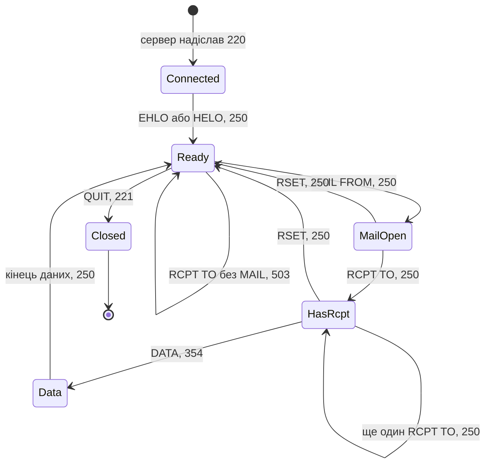

Діаграма читається так. Після з'єднання сервер надсилає привітання з кодом 220, і сеанс переходить у стан `Connected`. Команда `EHLO` або `HELO` ініціалізує сеанс (`Ready`). Команда `MAIL FROM` відкриває транзакцію (`MailOpen`), одна або кілька команд `RCPT TO` додають одержувачів (`HasRcpt`), а команда `DATA` з відповіддю 354 переводить сервер у приймання тексту листа. Рядок, що складається з однієї крапки, завершує дані, і після відповіді 250 сеанс повертається в `Ready`. Команда `RSET` скасовує відкриту транзакцію. Петля на стані `Ready` показує заборонений перехід: команда `RCPT TO` без попередньої `MAIL FROM` отримує відповідь 503 і не змінює стану.

### 4.3. Алгоритм вилучення автоматних переходів із тексту

Специфікації описують автомати у двох формах. Перша форма складається з явних таблиць переходів або діаграм із колонками «поточний стан», «команда», «наступний стан», «код відповіді»; такі таблиці аналізатор таблиць перекладає у функцію $\delta$ безпосередньо. Друга форма складається з речень про порядок дій, розкиданих по тексту. У RFC 5321 екстрактор знаходить чотири типи таких речень:

- **Передумова.** *«A session that will contain mail transactions MUST first be initialized by the use of the EHLO command»* (розділ 4.1.4): перехід `MAIL FROM` можливий лише зі стану, досяжного після `EHLO`.
- **Заборона в стані.** *«MAIL (or SEND, SOML, or SAML) MUST NOT be sent if a mail transaction is already open»* (розділ 4.1.4): у станах `MailOpen` і `HasRcpt` клієнтові заборонено надсилати `MAIL FROM`.
- **Скидання.** *«This command specifies that the current mail transaction will be aborted»* (розділ 4.1.1.5 про `RSET`): з кожного стану транзакції існує перехід назад у `Ready`.
- **Реакція на порушення.** Речення про `RCPT` без `MAIL` з розділу 3.3, розглянуте вище, задає для забороненого переходу код відповіді 503.

Для кожного стану екстрактор обчислює множину допустимих команд:

```math
\mathrm{ValidNext}(s) = \{ e \in \Sigma \mid \delta(s, e) \neq \bot \}
```

Параметри та компоненти множини:

- $s \in S$ є активним дискретним станом скінченного автомата $`\mathcal{M}`$;
- $\Sigma$ є повним скінченним алфавітом подій або команд протоколу;
- $e \in \Sigma$ — окрема вхідна команда чи транзакційна подія;
- $\delta(s, e) \neq \bot$ — булева предикатна умова, яка відсікає всі заборонені переходи ($\bot$);
- $`\mathrm{ValidNext}(s) \subseteq \Sigma`$ — замкнений білий список дозволених наступних дій у поточному стані $s$.

Практичне застосування та інженерні висновки:
- **Шлюзовий контроль (Whitelist Gateway):** шлюзи мережевого периметра та міжмодульні валідатори реалізують захист на основі $`\mathrm{ValidNext}(s)`$. Будь-яка команда $`e \notin \mathrm{ValidNext}(s)`$ негайно відхиляється на рівні десеріалізації з кодом помилки протоколу (наприклад, 503 у SMTP або фрейм скидання в CAN) без завантаження бізнес-логіки.
- **Fail-safe захист від десинхронізації:** якщо сторона-відправник надсилає заборонену команду, система не здійснює перехід у стан помилки, а залишається у верифікованому стані $s$, унеможливлюючи десинхронізацію стану між клієнтом і сервером.

Екстрактор також зберігає для кожного переходу та кожної заборони кортеж доказової прив'язки до відповідного речення.

### 4.4. Автоматизована генерація негативних тестів

Автомат дає змогу автоматично будувати негативні тести на відповідність протоколу. Для кожного стану $s$ і кожної команди $`e \notin \mathrm{ValidNext}(s)`$ генерується тест: перевести сервер у стан $s$, надіслати $e$, перевірити відповідь. Очікуваний результат тесту визначає модальність речення-джерела, і тут видно, навіщо [Глава 14](ch14-requirements-detection-and-formalization.md) так ретельно розрізняє MUST і MAY. Таблиця показує три тести, побудовані з RFC 5321.

| Стан | Команда поза порядком | Норма RFC 5321 | Очікування тесту |
|---|---|---|---|
| `Ready` | `RCPT TO` | розділ 3.3: сервер MUST повернути 503 | рівно 503; інший код означає порушення обов'язкової вимоги |
| `Ready` або `MailOpen` без прийнятого `RCPT` | `DATA` | розділ 3.3: сервер MAY повернути 503 або 554 | 503 або 554 очікувані; інший код дає попередження, а не провал, бо норма має силу MAY |
| `MailOpen` або `HasRcpt` | `MAIL FROM` | розділ 4.1.4: клієнт MUST NOT надсилати | тест перевіряє клієнта: клієнт не повинен надіслати команду |

Таблиця показує, що автомат без модальності дав би неправильні тести. Якби екстрактор записав обидві норми розділу 3.3 як однаково обов'язкові, тест провалив би сервер, який законно відповідає на `DATA` іншим кодом помилки.

Повнота автомата обмежена повнотою тексту. Розділ 4.1.4 дозволяє команди NOOP, HELP, EXPN, VRFY і RSET *«at any time during a session»*. Якщо екстрактор не додасть для цих команд петлі в усіх станах, генератор тестів вважатиме їх порушенням порядку й видасть хибні результати. Тому автомат, вилучений з тексту, перевіряє інженер, а розбіжності між автоматом і реальними журналами сеансів стають кандидатами на уточнення.

### 4.5. Патерни виявлення автоматних переходів у нормативному тексті

На практиці інженерні специфікації описують автомати неоднорідно. Сучасний екстрактор поведінки реалізує чотири взаємодоповнюючі евристичні стратегії виявлення переходів $\delta(s, e) = s'$:

1. **Стратегія A (Явні прозові предикати):** Речення з прямим причинно-наслідковим дієсловом переходу:
   <details>
   <summary>Дані або результат прикладу</summary>

   ```text
   "Upon receiving {Event}, the entity transitions from {SourceState} to {TargetState}."
   "The system enters {TargetState} after completing {Event} while in {SourceState}."
   ```

   </details>

2. **Стратегія B (ASCII-діаграми та стрілкові графи):** Багато специфікацій IETF та апаратних даташитів малюють графи символами псевдографіки:
   <details>
   <summary>Дані або результат прикладу</summary>

   ```text
   CONNECTED --------[ EHLO / 250 ]--------> READY
   READY ------------[ MAIL / 250 ]--------> MAIL_OPEN
   ```

   </details>

   Парсер виділяє стрілкові маркери (`--->`, `==>`, `->`), витягує сутності ліворуч і праворуч як стани, а підпис над стрілкою трактує як кортеж `Event / Action`.
3. **Стратегія C (Пайп-таблиці станів):** Таблиці у форматі Markdown або plain-text із колонками `Current State | Trigger / Event | Next State | Output`:
   Табличний аналізатор безпосередньо заповнює матрицю переходів автомата.
4. **Стратегія D (Модальні тригери переходу):** Речення з імперативними вимогами модальності MUST:
   <details>
   <summary>Дані або результат прикладу</summary>

   ```text
   "In the {SourceState} state, the client MUST transition to {TargetState} upon {Event}."
   ```

   </details>


Тут набуває чинності сформульований автором **принцип непридатності сліпої мінімізації Хопкрофта для протокольних автоматів із виходами**: для повного детермінованого автомата розпізнавання класичний алгоритм Хопкрофта зберігає прийняту мову [[14]](#src-14), проте для протокольних моделей із виходами, часовими межами та деонтичними анотаціями сліпа мінімізація є неприпустимою, оскільки еквівалентність зобов'язана враховувати коди відповідей, умови переходів та їхні нормативні наслідки; злиття станів лише за схожістю назв руйнує доказову базу. Відсутній у неповній моделі перехід не є доведено забороненим; перед негативними тестами потрібні межа повноти й перевірена норма.

> [!NOTE]
> **Чотири евристичні стратегії автоматизованого вилучення протокольних автоматів із тексту**
> 1. Парсинг причинно-наслідкових предикатів: виявлення речень із прямим дієсловом переходу («Upon receiving... transitions to...»).
> 2. Розпізнавання ASCII-діаграм станів: виділення стрілкових маркерів (`--->`, `==>`) із текстових специфікацій та даташитів.
> 3. Пряма трансляція матриць переходів: синтаксичний розбір пайп-таблиць із колонками поточного стану, тригера, наступного стану та виходу.
> 4. Селекція деонтичних тригерів: виявлення імперативних вимог модальності MUST для визначення обов'язкових цільових переходів.
> *Керування рантаймом / Інженерний інваріант:* заборонені переходи ($\bot$) автоматично транслюються в негативні тестові сценарії для перевірки реакції контролера на стенді.

---

## 5. Формальні граматики: ABNF-екстракція та компіляція синтаксичних дерев

Мережеві протоколи, сервісні інтерфейси та файлові формати описують структуру своїх повідомлень формальними граматиками. У стандартах IETF серії RFC для цього слугує розширена форма Бекуса-Наура (**ABNF, Augmented BNF**), визначена стандартом RFC 5234 [[3]](#src-3).

Якщо експертна система не вилучає граматику, вона не може перевірити синтаксичну валідність команд, що надсилаються чи приймаються.

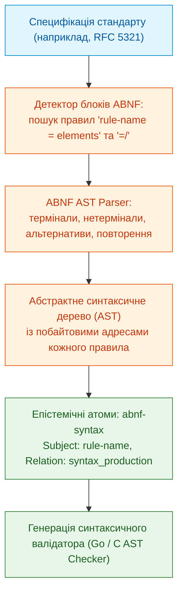

### 5.1. Структурні елементи вилученого правила ABNF
- **Базове визначення (`=`):** `Reverse-path = Path / "<>"`
- **Інкрементна альтернатива (`=/`):** дозволяє розширювати правило в наступних документах або додатках без перезапису всього правила.
- **Діапазони та повторення:** `1*digit`, `[ CFWS ]`, `%d32-126`.

Екстрактор формує кандидат `abnf-syntax`; наведене подання ще не має перевірених координат і не допускається до пакета.

<details>
<summary>Кандидат граматичного правила без вигаданих координат</summary>

```json
{
  "id": "rfc5321:abnf:Reverse-path",
  "subject": "Reverse-path",
  "relation": "syntax_production",
  "value": "Path / \"<>\"",
  "source": "rfc5321",
    "source_span": null,
    "status": "candidate"
}
```

</details>

Прив'язка має встановити фрагмент правила, його продовження й імпорти. Виявлення рядка `rule-name =` не замінює розбору всієї граматики та правил регістру її літералів.

---

## 6. Нормалізація структурованих параметрів та фізичних величин

Інженерні документи містять числові параметри: час очікування, довжину повідомлення, температуру, напругу й частоту. Частку кількісних вимог потрібно виміряти на конкретному корпусі; універсального відсотка глава не встановлює.

Якщо система трактує рядок `"тайм-аут становить 5 хвилин"` як неструктурований текст, вона не зможе відповісти на запитання: *«Чи порушує сервер вимогу, якщо він очікує відповіді 250 секунд?»*.

### 6.1. Математична модель приведення до одиниць СІ

Екстрактор параметрів перетворює природні описи у типізований атом **`structured-quantity`**:

```math
\mathcal{Q} = \langle \text{Parameter}, \; \text{Operator}, \; \text{Value}_{\text{norm}}, \; \text{BaseUnit}, \; \text{RawQuote} \rangle
```

Параметри та нормалізаційні складники:

- $`\mathcal{Q}`$ є типізованим атомом нормалізованої кількісної вимоги, готовим до завантаження в рушій резолюції нерівностей;
- $`\text{Parameter} \in \mathcal{P}`$ є канонічним ідентифікатором фізичної або протокольної величини в онтології (наприклад, `bms:max_cell_voltage`, `smtp:command_timeout`);
- $`\text{Operator} \in \{ =, \le, \ge, <, >, \in [a, b] \}`$ позначає алгебраїчний оператор порівняння або належності діапазону;
- $`\text{Value}_{\text{norm}} \in \mathbb{R}`$ — дійсне числове значення, строго приведене до базової одиниці системи СІ або базової конвенції стандарту;
- $`\text{BaseUnit} \in \mathcal{U}_{\mathrm{SI}} \cup \mathcal{U}_{\mathrm{std}}`$ — канонічна розмірність (секунда $`\text{s}`$, байт $`\text{B}`$, герц $`\text{Hz}`$, вольт $`\text{V}`$, октет $`\text{octet}`$);
- $`\text{RawQuote}`$ — точний підрядок вихідного тексту першоджерела, закріплений побайтовою адресацією $`\mathcal{E}`$.

Практичне застосування та інженерні висновки:
- **Автоматизоване розв'язання нерівностей:** завдяки зведенню до єдиної шкали $`\text{BaseUnit}`$ рушій формальних методів (SMT/Z3) перевіряє нерівності безпосередньо. Якщо специфікація вимагає $`\text{Value}_{\text{norm}} \ge 300{,}0\,\text{s}`$, а в конфігурації прошивки закладено $`250\,\text{s}`$, розв'язувач миттєво генерує доказ порушення допуску.
- **Fail-safe валідація префіксів:** діє сформульоване автором **інженерне правило нормалізації двійкових та десяткових префіксів за IEC 80000-13**: будь-які неоднозначні десяткові чи двійкові префікси (наприклад, `1 Mbps` як $`10^6\,\text{bit/s}`$ проти $`2^{20}\,\text{bit/s}`$) вимагають обов'язкової нормалізації відповідно до стандарту IEC 80000-13 [[28]](#src-28); у разі невизначеності шлюз допуску блокує величину до підтвердження інженером.

| Вихідне формулювання в стандарті | Вилучений оператор | Нормалізоване значення | Канонічна одиниця |
|---|:---:|:---:|:---:|
| *"Server MUST wait at least 5 minutes"* | $\ge$ | `300.0` | `s` (секунда) |
| *"Maximum command length is 512 octets"* | $\le$ | `512` | `octet` (вісім бітів) |
| *"CAN bus bit rate shall not exceed 1 Mbps"* | $\le$ | `1000000` | `bit/s` (десятковий префікс M) |
| *"Operating temperature is at least -40 °C and at most +85 °C"* | $\in [-40, +85]$ | `[-40, 85]` | `°C` (градус Цельсія) |

Рядки таблиці є навчальними формулюваннями, не дослівними нормами одного стандарту. Нормалізація зберігає первісну одиницю, точне десяткове значення й оператор. Octet не замінюють на byte без установленої ширини байта; швидкість бітів не ототожнюють із швидкістю символів у бодах. Для температур потрібне афінне перетворення, а для неоднозначного «between» автор має підтвердити включення меж. Теорію й засоби перевірки одиниць описує [Глава 14](ch14-requirements-detection-and-formalization.md).

Завдяки нормалізації символьний рушій здатен автоматично розв'язувати системи нерівностей під час верифікації вимог: $`250\ \text{s} < 300\ \text{s} \implies`$ **Порушення мінімального тайм-ауту**.

---

## 7. Деонтичні винятки та умови скасування норм (Defeaters)

Специфікації рідко містять безумовні правила. У реальних інженерних системах більшість обов'язкових норм супроводжуються умовами скасування або винятками.

Екстрактор деонтичних винятків шукає специфічні синтаксичні конструкції:
- `UNLESS` (*«крім випадків, коли...»*);
- `EXCEPT WHEN` (*«за винятком ситуації...»*);
- `PROVIDED THAT` (*«за умови, що...»*);
- `EXCLUSIVE OF` (*«виключаючи...»*).

Тут діє сформульований автором **принцип семантичної дисоціації передумови застосовності та умови скасування**: виняток (*defeater*) слід принципово відрізняти від предикатної передумови (*precondition*). Зворот `provided that` найчастіше звужує початкову область застосовності правила, тоді як конструкції `UNLESS` чи `EXCEPT WHEN` скасовують уже активовану норму при виникненні аномальних обставин; змішування цих категорій руйнує логічну структуру графа виведення. Область заперечення й охоплену дію перевіряють окремо. Приклад нижче є **синтетичною політикою сервісу**, не винятком із RFC 5321; для команд RCPT не слід вигадувати режим, що дозволяє обійти попередню MAIL.

<details>
<summary>Навчальний кандидат винятку з явним джерелом політики</summary>

```json
{
    "id": "example-policy:exc:latency",
    "subject": "response_latency",
    "relation": "exception_clause",
    "value": "Latency limit applies unless an approved exception covers this release and report",
    "defeater_condition": "approved_exception_matches_release_and_report",
    "source": "synthetic-project-policy",
    "source_span": "to_be_grounded",
    "status": "candidate"
}
```

</details>

Не встановлений стан винятку залишається невідомим. Спрацьовування допустиме лише за перевіреної застосовності й схвалення, а не за наявності слова `unless`. Координати джерела не заповнюють умовними числами; до прив'язки приклад не є допущеним знанням.

---

## 8. Версійність інженерних документів: заміщення, оновлення та виправлення

Жоден стандарт не існує окремо від своїх попередників і наступників. Нові редакції скасовують старі, оновлення змінюють окремі розділи, а записи про помилки виправляють дефекти тексту. Якщо фрагменти різних редакцій лежать в одному індексі без позначки версії, механізм пошуку поверне скасовану норму з тією самою впевненістю, що й чинну.

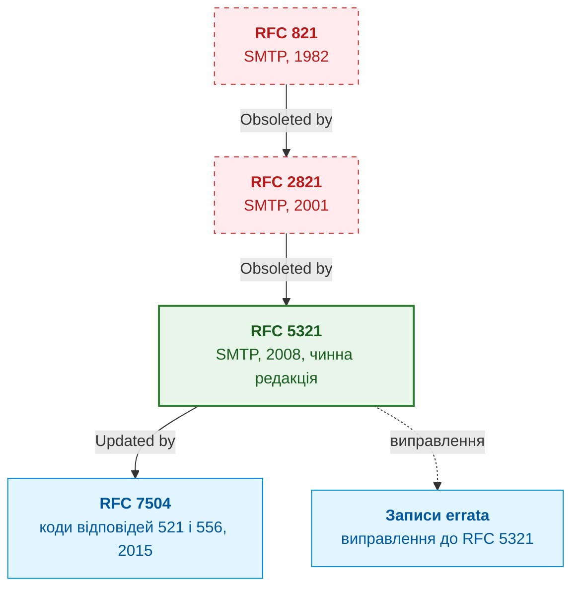

Історія SMTP добре ілюструє ці відношення. RFC 821, опублікований Джоном Постелом 1982 року [[15]](#src-15), скасовано RFC 2821 2001 року, який одночасно скасував RFC 974 і RFC 1869 [[16]](#src-16). RFC 2821 своєю чергою скасовано RFC 5321 [[2]](#src-2). RFC 7504 не замінює RFC 5321, а оновлює його, додаючи коди відповідей 521 і 556 [[17]](#src-17). До RFC 5321 також опубліковано записи про помилки з різними статусами: частину перевірено (*Verified*), а частину відкладено до наступного перегляду документа (*Held for Document Update*) [[18]](#src-18). Експертна система не може застосовувати їх однаково: перевірене виправлення уточнює, як читати норму, а відкладене лише фіксує зауваження до наступної редакції.

Граф версій розрізняє повне заміщення (*Obsoletes*), часткове оновлення (*Updates*) і виправлення (*Errata*). Позначення застарілості (*Deprecates*) є окремим предметним відношенням; його наслідки визначає конкретна норма, а не універсальна заборона використання. Нижче наведено обмежену навчальну політику статусу правила $P$ для редакції $V$: усі події вже перевірені на застосовність, а скасоване правило з тим самим ідентифікатором не вводиться повторно.

```math
\mathrm{Status}(P, V) = \begin{cases}
\mathrm{Obsolete}, & \text{якщо } \exists D \in \mathrm{Lineage}(V) : \mathrm{Revokes}(D, P), \\
\mathrm{Deprecated}, & \text{інакше, якщо } \exists D \in \mathrm{Lineage}(V) : \mathrm{Deprecates}(D, P), \\
\mathrm{Active}, & \text{інакше, якщо } \exists D \in \mathrm{Lineage}(V) : \mathrm{Defines}(D, P), \\
\mathrm{Unknown}, & \text{в інших випадках}.
\end{cases}
```

Параметри та булеві предикати версійності:

- $`P \in \mathcal{R}_{\mathrm{rules}}`$ є конкретною інженерною нормою, фактом або правилом, що претендує на статус чинності;
- $`V \in \mathcal{V}_{\mathrm{versions}}`$ позначає цільовий знімок версії середовища або редакцію нормативного пакета;
- $`\mathrm{Lineage}(V) \subseteq \mathcal{D}`$ є множиною документів, пов'язаних транзитивними відношеннями спадкоємності до редакції $V$;
- $`\mathrm{Revokes}(D, P)`$ — бінарний предикат, істинний, якщо документ $D$ явно скасовує або анулює правило $P$;
- $`\mathrm{Deprecates}(D, P)`$ — предикат переведення правила в застарілий статус із визначеним строком виведення з експлуатації;
- $`\mathrm{Defines}(D, P)`$ — предикат нормативної декларації правила в документі $D$;
- $`\mathrm{Status}(P, V) \in \{\mathrm{Active}, \mathrm{Deprecated}, \mathrm{Obsolete}, \mathrm{Unknown}\}`$ — детермінований статус правила.

Практичне застосування та інженерні висновки:
- **Шлюз чинності правил:** рушій логічного виведення має право використовувати правило $P$ для формування доведень відповідності лише тоді, коли $`\mathrm{Status}(P, V) = \mathrm{Active}`$.
- **Карантин скасованих норм:** якщо правило набуває статусу $`\mathrm{Obsolete}`$, воно негайно вилучається з активного графа знань і зберігається виключно в історичному архіві для аудиту старих релізів. Будь-яка спроба послатися на скасовану норму під час поточної сертифікації блокується подією `E_OBSOLETE_RULE_USAGE`.

За цієї політики скасування має пріоритет. Якщо предметна модель дозволяє повторне введення правила, наведена формула недостатня: потрібні впорядковані події визначення, заміни й скасування, межі області та пріоритети джерел. Непорівнянні конфліктні зміни потребують перегляду. $`\mathrm{Unknown}`$ не прирівнюється до активного стану й не компенсується збігом цитати.

Тут діє сформульований автором **принцип неавтоматичного переносу чинності при повторній прив'язці (Re-grounding Principle)**: повторна прив'язка (*re-grounding*) створює виключно кандидата семантичної відповідності між редакціями, але в жодному разі не переносить чинності норми автоматично. Незмінне формулювання тексту в новій редакції може опинитися в незобов'язуючому інформаційному додатку, отримати нову предикатну передумову в заголовку глави або критичний виняток у сусідньому підпункті. Тому факт визнається дійсним лише після повторного проходження шлюзу допуску та підтвердження незмінності його регуляторного контексту; стара редакція лишається в історичному архіві.

### 8.1. Секційні патчі спадкоємності та точкова резолюція оновлень

У реальній інженерній практиці нові стандарти надзвичайно рідко замінюють попередній 500-сторінковий документ повністю. Набагато частіше специфікація вводить точкові секційні дельти:
- *«Updates Section 4.2.1 of RFC XXX»*;
- *«Replaces Section 3.1: New State Transition Logic»*;
- *«Amends Paragraph 4 of ISO 26262-6 Clause 7»*.

Якщо експертна система при кожному точковому оновленні вимагатиме повного перепарсингу всього історичного корпусу, виникає загроза комбінаторного вибуху та регресії валідованих фактів.

Для інкрементальної обробки можна спроєктувати **обробник оновлень розділів**. Це архітектурна пропозиція, не готова універсальна реалізація. Кандидат `section-patch` має називати редакції, вузол дерева розділів, вид зміни й підставу. Наступний запис є синтетичним прикладом форми, не перевіреним тлумаченням RFC 7504.

<details>
<summary>Синтетичний кандидат оновлення розділу</summary>

```json
{
    "id": "example-update:patch:sec-4.2",
  "subject": "rfc5321:section:4.2",
  "relation": "section_patch",
  "target_document": "rfc5321",
  "target_section": "4.2",
  "patch_action": "amends",
  "patch_scope": "adds response codes 521 and 556",
    "source": "synthetic-section-update",
    "source_span": null,
    "status": "candidate"
}
```

</details>

Обробник знаходить вузли за структурним шляхом: префікс рядка `4.2` не має захопити розділ `4.20`. Потім обчислює залежності визначень, правил, автоматів і індексів. Тип `Updates` сам не означає простого додавання: оновлення може звузити дозвіл, змінити виняток або скасувати частину поведінки. Таку дельту класифікують і перевіряють до нового випуску. Для приймання інкрементальний результат порівнюють із повним повторним збиранням за тим самим маніфестом; відмінності потребують пояснення або блокують випуск.

Факти, автомати й граф версій треба зберігати так, щоб кожен тип запиту виконувався ефективно. Цьому присвячено наступний розділ.

## 9. Архітектура сховища бази знань: мультимодельний підхід

Розгляньмо три типи запитів до бази знань. Перший тип фільтрує факти за суб'єктом, відношенням чи модальністю. Другий тип проходить транзитивні зв'язки: ланцюжок заміщень, простежуваність від вимоги до тесту, шлях в автоматі. Третій тип читає незмінний знімок бази під час виведення. Наведена архітектура поєднує три подання, але не вимагає трьох окремих технологій зберігання: реляційна база також може виконувати рекурсивні запити, а потребу в бінарному пакеті встановлює вимірювання навантаження.

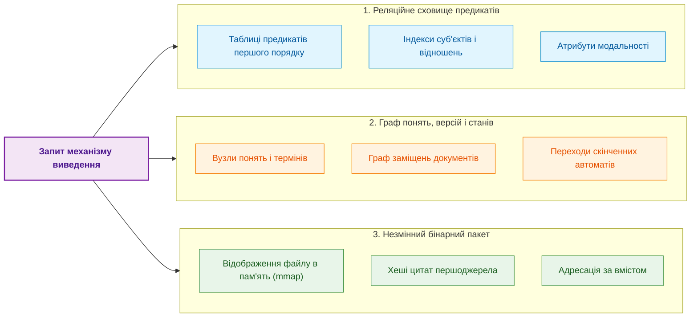

**Реляційне сховище предикатів** зберігає факти першого порядку в таблицях з індексами за суб'єктом і відношенням. Воно обслуговує детерміновану фільтрацію на кшталт «усі обов'язкові вимоги до SMTP-сервера з розділу 3.3».

**Граф понять, версій і станів** зберігає онтологію термінів, граф заміщень і переходи автоматів. На графі природно виконуються транзитивні запити: «чи чинна ця норма в редакції $V$», «чи досяжний стан `Data` без команди `RCPT TO`».

**Незмінний бінарний пакет** є скомпільованим знімком бази знань для механізму виведення. Файл пакета відображається в адресний простір процесу викликом `mmap` [[19]](#src-19), тому механізм виведення читає записи без копіювання й повторного розбору. Ідентифікатором пакета слугує хеш його вмісту: будь-яка зміна знань створює новий пакет із новим ідентифікатором, а кожну відповідь можна зв'язати з точним знімком бази. Час доступу до запису визначає структура індексу всередині пакета, наприклад хеш-таблиця чи відсортований масив, а не сам механізм відображення.

Всі три моделі можна розмістити на одному вузлі. Коли база не вміщується на вузлі або вузли потребують різних профілів знань, її розбивають на шарди, тобто частини, які обслуговують окремі вузли. Ключем розбиття для бази, з якої виводять чинність норм, є родина документів, тобто множина редакцій, пов'язаних графом версій (множина $`\mathrm{Lineage}(V)`$ з розділу про версії документів), бо статус правила обчислюють за усіма документами родини. Якщо редакція зі скасуванням лежить у шарді, що мовчить, статус правила стане $`\mathrm{Active}`$ замість $`\mathrm{Obsolete}`$. Тому відповідь «відсутнє» або статус допускають лише тоді, коли відповіли всі потрібні шарди. Розбиття бази знань не слід плутати з розбиттям тексту для пошуку: структурне розбиття, описане вище, ділить текст на фрагменти тексту, а шардування розміщує на вузлах фрагменти бази знань. Визначення й правила розбиття наведено в [Главі 7](ch07-knowledge-base-typology.md), реалізацію з перевіркою розбиття в розділі 10 [Глави 32](ch32-high-performance-knowledge-packs-mmap-and-harvesting.md).

### 9.1. Високопродуктивний граф знань у пам'яті (CSR) проти зовнішніх графових СУБД

Традиційний підхід до побудови баз знань полягає у розгортанні зовнішніх мережевих графових СУБД (наприклад, Neo4j, Memgraph чи Amazon Neptune) та надсиланні до них декларативних запитів мовою Cypher або SPARQL. Для корпоративного вебпошуку або аналітики бізнес-зв'язків цей підхід є прийнятним, проте для **місійно-критичних експертних систем реального часу** та детермінованих віртуальних машин (таких як EVM) він виявляється фундаментально непридатним з низки технічних причин:

1. **Мережеві та IPC-накладні витрати:** запит через TCP-сокет або REST API додає затримку від 0.5 до 10 мілісекунд на кожен крок виведення. Якщо детерміноване доведення теореми потребує тисяч переходів графом зв'язків, загальний час відповіді деградує на порядки (до секунд замість мікросекунд).
2. **Паузи збирача сміття (Garbage Collection):** графові рушії на керованих платформах (Java JVM) створюють мільйони дрібних об'єктів для вузлів і ребер. Паузи GC спричиняють непередбачувані сплески затримок (*tail latency spikes*), що є неприпустимим в авіоніці, системах керування або високочастотних інженерних шлюзах.
3. **Витрати на серіалізацію/десеріалізацію:** перетворення внутрішнього двійкового представлення вузлів у рядки JSON/Cypher і назад споживає до 70% процесорного часу.
4. **Втрата побайтової доказовості (Break of Byte Custody):** зовнішня СУБД зберігає дані у власних динамічних форматах сторінок (B-Tree, Heap pages), де зв'язок із початковими байтами першоджерела стає непрямим вторинним атрибутом, розриваючи прямий ланцюг апаратної верифікації (регістровий доказ `%ebx`).

#### 9.1.1. Архітектура нульового копіювання: CSR та масиви суміжності

Замість важкої зовнішньої СУБД база знань компілюється у компактний двійковий статичний пакет знань (Knowledge Pack), який проєктується безпосередньо в оперативну пам'ять процесу через системний виклик `mmap(MAP_SHARED)`. Графова структура відношень подається за допомогою компактного формату **стисненого рядкового розрідженого масиву (Compressed Sparse Row, CSR)** або масиву суміжності:

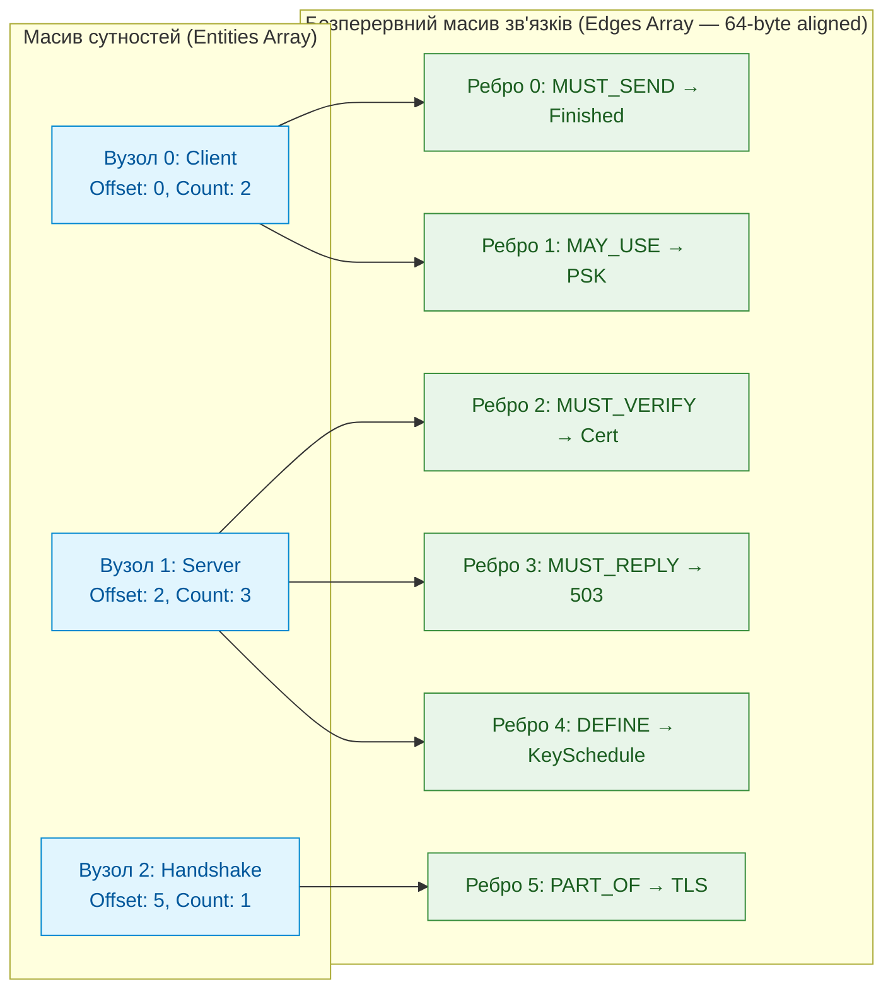

Структура CSR організована трьома неперервними векторами пам'яті:
- $`\mathrm{Entities}[\cdot]`$: плоский масив структур фіксованого розміру (64 байти, вирівняні під рядок процесорного кешу L1/L2), що містить числовий ID поняття, тип і діапазон у масиві ребер: $`(\mathrm{Offset}, \mathrm{Count})`$;
- $`\mathrm{Edges}[\cdot]`$: суцільний масив цільових індексів сутностей і типів зв'язків (деонтична модальність, синтаксичне підпорядкування, каузальність);
- $`\mathrm{EvidencePool}[\cdot]`$: пул незмінних байтових хешів і координат першоджерел, на які посилаються ребра через 32-бітні зміщення.

Переваги такого подання над зовнішніми СУБД:
- **Нульове копіювання (Zero-Copy) і миттєвий старт:** процес монтує гігабайтну базу знань викликом `mmap` за частки мікросекунди; сторінки підвантажуються ядром ОС за потребою (*demand paging*);
- **Продуктивність понад $10^7$ переходів на секунду на ядро:** обхід суміжних ребер вузла $`\mathrm{Edges}[\mathrm{Offset} \dots \mathrm{Offset}+\mathrm{Count}-1]`$ є суто послідовним лінійним читанням пам'яті, що ідеально утилізує апаратний попередній вибір кешу (*hardware cache prefetcher*);
- **Детермінована локальність пам'яті:** відсутність фрагментації купи та відсутність динамічних вказівників (всі адреси є відносними зміщеннями в межах відображеного бінарного сегмента);
- **Абсолютна цілісність доказів:** кожен запис ребра безпосередньо містить або посилається на незмінні координати першоджерела, уможливлюючи побайтову верифікацію без запитів до сторонніх сервісів.

Три моделі мають генеруватися з одного джерела істини: множини прийнятих фактів із кортежами прив'язки. Якщо реляційне сховище й граф оновлюються незалежно, вони розійдуться, і експертна система почне давати різні відповіді на те саме запитання залежно від маршруту запиту. Архітектуру механізму виведення, який читає ці моделі, розглянуто в [Главі 16](ch16-expert-systems-architecture.md), а стек реалізації в [Главі 17](ch17-implementation-stack.md). Залишається визначити, хто вирішує, які кандидати потрапляють до цих моделей.

> [!NOTE]
> **Чотири інваріанти архітектури нульового копіювання графа знань (CSR Zero-Copy)**
> 1. Посекційне відображення в пам'ять: пряме підключення двійкового образу знань викликом `mmap(MAP_SHARED)` із константним часом монтування $O(1)$.
> 2. Апаратне вирівнювання структур: пакування векторів сутностей і ребер по 64 байти під довжину кеш-лінії L1/L2 сучасного процесора.
> 3. Відносні зміщення замість вказівників: усунення десеріалізації та відсутність фрагментації купи завдяки 32-бітним внутрішнім офсетам.
> 4. Безперервна лінійність обходу: досягнення швидкодії понад $10^7$ переходів на секунду на ядро завдяки ефективній роботі hardware cache prefetcher.
> *Керування рантаймом / Інженерний інваріант:* порушення 64-байтового вирівнювання або розрив відносного зміщення блокує відображення пакета з помилкою `E_MMAP_ALIGNMENT_FAULT`.

### 9.2. Емпіричний досвід суцільної компіляції та універсалізації багатоформатного сховища знань ($15\,972$ пакети, $56\,520$ концептів)

Теоретичні алгоритми видобування знань, перевірені лише на кількох десятках рафінованих англомовних документів, неминуче руйнуються під час зіткнення з реальним промисловим масивом різнорідних першоджерел. Для емпіричної верифікації універсальності компілятора знань під керівництвом М. М. Федчика було проведено суцільну компіляцію сирого багатоформатного сховища першоджерел обсягом **$`47{,}1\text{ ГБ}`$ (`47,130` файлів)** у єдину детерміновану Скарбницю знань (`15,972` унікальні бінарні пакети знань після SHA-256 дедуплікації та єдиний бінарний граф онтології розміром **$`64{,}10\text{ МБ}`$** на **`56,520` концептів** і **`1,683,906` CSR-ребер**, включно з `Section 5: HV4096 + 32×FP16` обсягом **$`32{,}55\text{ МБ}`$**).

Експеримент охопив шість принципово різних інженерних і мовних середовищ: інтернет-стандарти `IETF RFC` (`9,995` пакетів `.txt`, `1,971,789` правил), корпус законодавства Верховної Ради України (`3,046` унікальних законів `.htm` + `3,051` дзеркальних дублікатів, `95,493` правила), даташити й довідкові керівництва мікроконтролерів та силової електроніки `STM32 / Infineon AURIX / PSoC / TI / Analog Devices / NXP / Intel` (`1,600+` документів `.pdf` та `.html`), веб-стандарти `W3C` (`303` пакети `.html`, `173,338` правил), наукові публікації та звіти `arXiv / NASA NTRS / NIST / PMC` (`.pdf`, `.xml`), а також енциклопедичні XML-дампи `Wikibooks / Wikisource` обсягом до `1,2 ГБ` на файл та історичні книги `Project Gutenberg`.

Саме під час цього повномасштабного прогону було виявлено й розв'язано п'ять фундаментальних інженерних проблем універсалізації, які залишаються невидимими в лабораторних тестах:

| № | Виявлена проблема масштабування та універсалізації | Фізична та програмна причина відмови/деградації | Розроблене М. М. Федчиком архітектурне рішення в компіляторі знань |
| :--- | :--- | :--- | :--- |
| **1** | **Квадратична деградація фіксації реєстру ($O(N^2)$ Ledger Serialization)** | Поштучний атомарний перезапис JSON-реєстру індексу після кожного пакета на масштабі $N > 10^4$ породжує понад $10^8$ операцій серіалізації записів. | Пакетна транзакційна фіксація (`RegisterBatch` кожні 250 пакетів) із подвійним індексом за `SourceOriginHash` та `PackID` і автоматичною заміною застарілих шляхів `.kp`. |
| **2** | **Переповнення 16-бітних полів ступеня вершин CSR-графа (`uint16` Degree Overflow)** | На корпусі з $15\,972$ пакетів наскрізні загальноінженерні концепти накопичують понад $65\,535$ сирих входжень ребер, переповнюючи поле `EdgeDegree uint16` у 32-байтовому `NodeRecord`. | Канонічна дедуплікація концептів за 64-бітним хешем `FNV-1a`, агрегація ваг кратних ребер за парою `(toHash, relation)` та детерміноване усічення до топ-$4096$ найвагоміших ребер на вузол. |
| **3** | **Прихована втрата кирилиці через спадкове кодування `Windows-1251 (CP1251)`** | Емпіричний аудит показав, що **71% (`2,168` із `3,051`)** архівних HTML-законів України збережені в однобайтовому кодуванні `CP1251`; стандартний UTF-8 сканер трактує байти `0xC0..0xFF` як `RuneError` і відкидає весь текст закону, крім арабських цифр. | Автоматичний детектор кириличних біграм `CP1251` та `ISO-8859-1` (`EnsureUTF8`), що виконує детерміноване транскодування в канонічний `UTF-8` **до** обчислення байтових зміщень і хешів `%ebx` custody. |
| **4** | **Сліпота межі слова `\b` у рушії регулярних виразів RE2 до кириличної деонтики** | У промислових рушіях регулярних виразів класу RE2 метасимвол `\b` визначений суто для ASCII `[0-9A-Za-z_]`, тому патерн `\b(повинен\|забороняється\|може)\b` дає 0 збігів на українському тексті, оточеному пробілами. | Заміна ASCII-меж `\b` на явні Unicode-межі класів символів `(?:^\|[^\p{L}\p{N}])(...)(?:[^\p{L}\p{N}]\|$)` із повним охопленням морфологічних парадигм українських модальних предикатів (`+14,483` видобутих норм). |
| **5** | **Зависання та OOM на 1500-сторінкових PDF-датабуках і гігабайтних XML-дампах** | Повне завантаження у купу дампів по `1,2 ГБ` або запуск NLP-розбору на 15 МБ таблиць розпінування старого PDF-довідника паралізує конвеєр компіляції; багатомовні джерела (`DE`, `EN`, `UK`) засмічують онтологію службовими займенниками й артиклями. | Потокове хешування через обмежене вікно (`io.LimitReader`), конвеєрне обмеження глибини розгортки PDF та UTF-8 вікна індукції термінів з розрізом строго по межі руни UTF-8 (розмір вікна налаштовується, а факт обрізання записується в покритті пакета, §9.3) та безсловниковий структурно-статистичний фільтр службових слів (§9.3). |

> [!NOTE]
> **П'ять законів універсальної компіляції гетерогенних корпусів першоджерел у бінарні пакети знань (емпіричне дослідження М. М. Федчика)**
> 1. **Закон канонічної UTF-8 нормалізації перед взяттям під варту (`Pre-Custody Charset Canonicalization`):** будь-яке спадкове однобайтове кодування першоджерела (`Windows-1251`, `ISO-8859-1`) зобов'язане бути автоматично розпізнаним за статистикою високобайтових біграм і перетвореним на канонічний `UTF-8` до моменту формування секції `RAW_TEXT` та розрахунку байтових координат `[ByteStart..ByteEnd]`, інакше дослівна кастодія `%ebx` стає неможливою на не-ASCII корпусах.
> 2. **Закон інваріантності Unicode-меж у деонтичних парсерах (`Unicode Boundary Invariance`):** компілятори нормативних правил для кириличних та інших не-латинських мов не мають права використовувати ASCII-залежний метасимвол межі слова `\b` у скінченних автоматах RE2; межі деонтичних операторів повинні задаватися виключно через інверсію універсальних категорій Unicode `[^\p{L}\p{N}]`.
> 3. **Закон обмеженого вікна онтологічної індукції (`Bounded UTF-8 Induction Window`):** при обробці надвеликих монолітних документів (довідників мікроконтролерів на тисячі сторінок або гігабайтних XML-архівів) статистична індукція термінів `C-value` та побудова таблиці символів повинні виконуватися на детерміновано обмеженому вікні тексту з розрізом суворо по межі кодової точки UTF-8 та з обов'язковим записом покриття (скільки тексту отримано й скільки використано, §9.3), що гарантує константний час компіляції $O(1)$ на документ за нульового ризику переповнення пам'яті.
> 4. **Закон агрегованого стиснення степенів у бінарному графі онтології (`CSR Degree Bounding`):** при злитті понад $10^4$ автономних пакетів знань у єдиний zero-copy бінарний граф онтології кратні міжконцептні зв'язки з різних документів повинні агрегуватися у зважені ребра фіксованої арності ($\le 4096$ найвагоміших ребер на вузол), що унеможливлює переповнення 16-бітних апаратних лічильників суміжності.
> 5. **Закон безсловникової чистоти закритого класу функціональних слів (`Dictionary-Free Closed-Class Hygiene`):** індукція доменних концептів зберігає універсальність на багатомовних науково-технічних та художніх корпусах лише за умови відсікання службових слів за структурними ознаками імені (довжина, регістр, символи) та за частотою в корпусі (§9.3), без переліків слів для окремих мов і без втручання у відкритий клас предметної лексики; визначені самим документом терміни відсіву не підлягають.
> *Керування рантаймом / Інженерний інваріант:* Універсальний компілятор знань зобов'язаний обробляти довільне дерево каталогів із файлами `.txt`, `.md`, `.html`, `.htm`, `.pdf`, `.xml` з нульовим рівнем фатальних відмов парсингу (`Errors = 0`), автоматично відсікаючи побайтові дублікати за `SHA-256` ще до запуску семантичного аналізу.

### 9.3. Уточнення за результатами повторного прогону: від таблиці службових слів до структурного фільтра та явного покриття

Повторний прогін на сховищі зі зростанням до $`47\,725`$ змонтованих пакетів показав обмеження першого прогону, і за його результатами п'яту проблему та п'ятий закон попереднього підрозділу переформульовано (замість багатомовної таблиці службових слів застосовано структурно-статистичний фільтр), а третій закон доповнено обов'язковим записом покриття. Таблиця закритих слів `EN/UK/DE` не масштабується на нові мови й письма, суперечить вимозі безсловникового видобування і не усувала шуму: слово «the» лишалося серед сутностей $`38\%`$ із $`655`$ перевірених RFC-пакетів, «other» у $`5{,}6\%`$, «for» у $`3{,}4\%`$. Вікно індукції $`384\text{ КБ}`$ усікало джерела мовчки: $`12\,062`$ із $`45\,480`$ текстових першоджерел ($`27\%`$) перевищують це значення. Закон, що мав $`14\text{ МБ}`$ розмітки, давав $`49`$ атомів на $`209\text{ КБ}`$ тексту, а повний текст ($`1{,}58\text{ МБ}`$) давав $`293`$; для `RFC 9110` та дев'яти суміжних RFC виходило $`1\,707`$ атомів проти $`14\,589`$. Відмова на запит про норму з відрізаного кінця була б неотличима від відмови «норми немає».

> [!NOTE]
> **Три принципи структурного фільтра лексикона (за М. М. Федчиком)**
> 1. Відсів ґрунтується на структурних ознаках імені (довжина, регістр, наявність цифр і роздільників) та на частоті слова в корпусі; жодних переліків слів немає, тому правило однаково працює в усіх мовах і письмах.
> 2. Поріг «поширеного слова» виводиться з корпусу як частка документів ($`0{,}80`$ окремо для кожного письма за $`45\,758`$ документами) і записується в маніфест кожного пакета; термін, який визначає сам документ, відсіву не підлягає.
> 3. Версія фільтра входить до умови пропуску повторної компіляції: пакети, зібрані іншим правилом, перебудовуються, решта лишається недоторканою, а прогін можна відновити після переривання.
> *Керування рантаймом / Інженерний інваріант:* жодне ім'я не потрапляє в лексикон без відомого правила відбору; поріг відтворюється із запису в маніфесті, а не повторним обчисленням. За повного прогону відкинуто $`21{,}05`$ млн імен як нетермінологічні, $`2{,}78`$ млн як поширені в корпусі та $`0{,}60`$ млн залишків предикатів.

> [!NOTE]
> **Три вимоги до фіксації покриття першоджерела (за М. М. Федчиком)**
> 1. Пакет зберігає, скільки байтів тексту отримав конвеєр до обрізання, скільки використав, які ліміти діяли і чи було обрізання; для PDF додатково кількість сторінок документа й витягнутих сторінок. Обрізання не може бути мовчазним.
> 2. Хеш файла записується окремо від хеша тексту, що пройшов конвеєр, а умова пропуску повторної компіляції визнає збіг будь-якого з них; інакше HTML, PDF і великі файли перекомпільовуються щоразу.
> 3. Аудит звітує частку усічених пакетів і найбільші втрати, але не вважає усічення порушенням збереження доказів: покриття є властивістю походження, а не помилкою цитування.
> *Керування рантаймом / Інженерний інваріант:* відмова за усіченим джерелом не повинна виглядати як відсутність норми. Після підвищення лімітів до $`4\text{ МіБ}`$ тексту та $`32\text{ МіБ}`$ читання кількість атомів у сховищі зросла з $`7\,030\,932`$ до $`10\,122\,410`$ ($`+44\%`$); усіченими лишилися $`1\,127`$ пакетів ($`2{,}2\%`$), переважно дампи, а не нормативні документи.

## 10. Шлюз допуску фактів: верифікація та попперівський фільтр

Конвеєр видає кандидатів, частина з яких хибна: екстрактор помилився з модальністю, модель запропонувала парафраз, новий факт суперечить чинному правилу. Шлюз допуску (*admission gate*) перевіряє кандидата за версійованою політикою. Автоматичні перевірки відтворювані, а предметне схвалення надходить як окремий підписаний запис рецензії. Успішні перевірки ще не публікують факт: доступ до факту змінює процедура випуску пакета.

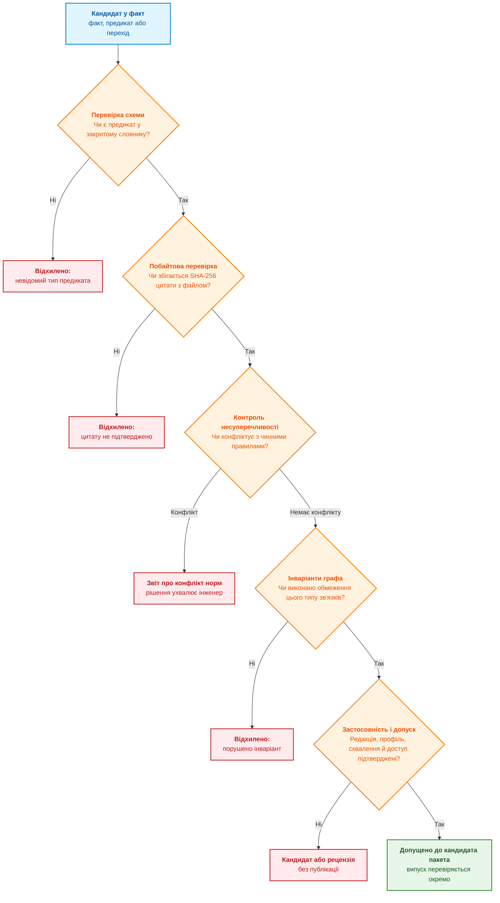

Діаграма показує п'ять груп перевірок. Перевірка схеми встановлює типи й дозволені предикати; перевірка джерела відтворює прив'язку до незмінного артефакту. Контроль несуперечливості формує звіт для інженера, а не приховує суперечність між джерелами. Інваріанти графа залежать від відношення: порядок заміщення редакцій може вимагати ациклічності, тоді як автомат сеансу закономірно має цикли. Цикл підкласів також не обов'язково є логічною суперечністю. Транзитивний обхід циклічного графа з множиною відвіданих вузлів має визначений зміст; забороняти потрібно порушення конкретної схеми, а не всі цикли. Остання група перевіряє паспорт об'єкта знань із [Глави 10](ch10-knowledge-acquisition-systems.md): застосовність, схвалення, доступ і залежності. Невідомий результат перевірки не прирівнюється до успіху.

### 10.1. Керована генерація через GBNF-граматики та попперівське самоспростування

Поєднати повноту мовних моделей зі строгістю детермінованих перевірок можна розподілом ролей. Традиційний наївний підхід полягає в тому, що мовна модель повертає довільний JSON, який потім намагаються розпарсити регулярними виразами. Проте такий шлях створює від 3% до 7% випадкового синтаксичного браку (незакриті лапки, пропущені коми, галюцинації назв полів).

Сучасна архітектура заземлення знань застосовує **граматично-скероване декодування (Grammar-Constrained Decoding / GBNF Logit-Masking)** безпосередньо в циклі генерації токенів:

```math
P(w_t \mid w_{1:t-1}) = \mathrm{Softmax}\left( \frac{z_t + M(w_t, \text{State}_{G})}{\tau} \right)
```

**Параметри та інженерні обмеження:**
- $`w_t \in V`$ — кандидатний токен на кроці авторегресії $t$ із повного словника $V$ ($`\lvert V \rvert \in \{32000, 128000\}`$);
- $`w_{1:t-1}`$ (або $`w_{<t}`$) — префікс раніше згенерованої послідовності токенів;
- $`z_t \in \mathbb{R}`$ — необмежений дійсний логіт токена, обчислений мовною моделлю перед функцією софтмакс;
- $\tau > 0$ — температура декодування (для детермінованого виведення в інженерних системах встановлюється $\tau \to 0$ або жадібний вибір `greedy`);
- $`\text{State}_G`$ — поточний стан скінченного автомата валідатора граматики;
- $`M(w_t, \text{State}_G) \in \{0, -\infty\}`$ — бінарна логітна маска: дорівнює $0$ для токенів, що дозволені граматикою, та $-\infty$ для всіх інших.

**Операційні переходи та практичний приклад:**
- Оскільки $`e^{-\infty} = 0`$, операція Softmax повертає точний нуль для будь-якого токена, який порушує схему. Модель фізично не здатна згенерувати некоректний ключ або вийти за межі деонтичних модальностей (`MUST`, `SHOULD`, `MAY`, `MUST NOT`).
- Числовий розрахунок: для поля модальності модель розглядає $`t_1`$ (`"MUST"`, $`z_1 = 4{,}2`$), $`t_2`$ (`"SHOULD"`, $`z_2 = 3{,}8`$) та некоректний вільний текст $`t_3`$ (`"Maybe"`, $`z_3 = 6{,}5`$). Без маски переміг би токен $`t_3`$ ($`p_3 \approx 0{,}86`$). Автомат граматики активує маску $`M(t_3) = -\infty`$, обнуляючи його ймовірність ($`e^{-\infty} = 0`$). Результуюча ймовірність:
```math
P(t_1) = \frac{e^{4{,}2}}{e^{4{,}2} + e^{3{,}8} + 0} = \frac{66{,}69}{66{,}69 + 44{,}70} = \frac{66{,}69}{111{,}39} \approx 0{,}599.
```
Токен $`t_3`$ повністю відсікається шлюзом генерації, унеможливлюючи синтаксичний брак у вихідному AST.

<details>
<summary>Формальна GBNF-граматика факту та структурований вивід</summary>

```bnf
root        ::= "{" ws "\"facts\":" ws "[" ws fact_list? ws "]" ws "}"
fact_list   ::= fact (ws "," ws fact)*
fact        ::= "{" ws
                "\"subject\":" ws string ws ","
                "\"modality\":" ws modality ws ","
                "\"predicate\":" ws string ws ","
                "\"defeater\":" ws (string | "null") ws ","
                "\"quantity\":" ws (quantity_spec | "null") ws ","
                "\"verbatim_quote\":" ws string ws
                "}"
modality    ::= "\"MUST\"" | "\"MUST NOT\"" | "\"SHOULD\"" | "\"SHOULD NOT\"" | "\"MAY\""
quantity_spec ::= "{" ws "\"value\":" ws number ws "," "\"unit\":" ws string ws "}"
string      ::= "\"" ([^"\\] | "\\" (["\\/bfnrt] | "u" [0-9a-fA-F]{4}))* "\""
number      ::= ("-"? [0-9]+ ("." [0-9]+)?)
ws          ::= [ \t\n\r]*
```

```json
{
  "subject": "SMTP server",
  "modality": "MUST",
  "predicate": "return 503 Bad sequence of commands response",
  "defeater": "RCPT command appears after previous MAIL command",
  "quantity": { "value": 503, "unit": "status_code" },
  "verbatim_quote": "If a RCPT command appears without a previous MAIL command, the server MUST return a 503 \"Bad sequence of commands\" response."
}
```

</details>

#### 10.1.1. Двосторонній попперівський гейт ($F^+$ проти $F^-$)
Дослівна перевірка підтверджує існування цитати в архівному артефакті, але не правильність тлумачення. Для запобігання надмірному узагальненню екстрактор разом із кандидатом $F^+$ генерує контрастний софізм або контрприклад $F^-$ (наприклад, симуляцію ігнорування умови або підміну обов'язку на дозвіл).

Шлюз допуску перевіряє обидва кандидати через детермінований рушій правил:
1. Позитивний факт $F^+$ зобов'язаний бути прийнятий із підтвердженням цитати (`ACCEPT`, побайтова кустодія `%ebx`);
2. Контрастний контрприклад $F^-$ зобов'язаний викликати детерміновану типізовану відмову (`REFUSAL`, Fail-Closed);
3. Якщо контрприклад не відхиляється — правило визнається логічно слабким (*under-constrained rule defect*) і відхиляється.

#### 10.1.2. Теплові карти дефіциту знань (KDI Heatmaps)
Щоб гарантувати повноту набуття знань і уникнути «сліпих зон», конвеєр обчислює **Індекс щільності знань (Knowledge Density Index, KDI)** ковзним вікном уздовж документа. Області з високою концентрацією деонтичних дієслів, термінів та числових одиниць, із яких не витягнуто жодного підтвердженого факту, позначаються на тепловій карті як **Knowledge Deficits (Прогалини знань)** і автоматично спрямовуються на додатковий примусовий інджест.

### 10.2. Безперервне поповнення бази знань

Для великих бібліотек нормативів, що налічують тисячі документів RFC, W3C чи ISO, конвеєр працює пакетно у фоновому режимі. Корпус сегментується за розділами, екстрактори працюють паралельно в пулі виконавців, і кожен кандидат проходить той самий шлюз допуску. Прийняті факти додаються до бази знань інкрементально, а кандидати з конфліктами потрапляють до звіту про суперечності. Обхідного шляху повз шлюз у такій схемі немає: пакетний режим змінює лише швидкість, а не правила допуску.

### 10.3. Захист циклу R&D від епістемічного отруєння знань (Knowledge Poisoning) за матрицею MITRE ATLAS

Під час досліджень, проєктування та супроводу доказових експертних систем інженери знань регулярно автоматизують імпорт масштабних масивів технічної інформації із зовнішніх джерел: специфікацій мікроелектроніки, галузевих стандартів, відкритих репозиторіїв та бюлетенів виправлення помилок (*errata*). Проте неконтрольований імпорт створює критичну загрозу системної безпеки. Згідно з матрицею загроз **MITRE ATLAS** (*Adversarial Threat Landscape for Artificial-Intelligence Systems*) [[27]](#src-27), зокрема тактиками та техніками **AML.T0020 (Poison Training Data)** та **AML.T0043 (Craft Adversarial Data)**, цей конвеєр виступає головною мішенню для атак **епістемічного отруєння знань (Knowledge Poisoning)**.

Суть загрози полягає у тому, що супротивник цілеспрямовано впроваджує в публічно доступну технічну документацію або скомпрометовані дзеркала репозиторіїв мікроскопічні викривлення числових меж чи деонтичних умов (наприклад, розширення робочого діапазону температур, зміну полярності біта блокування або приховане ослаблення вимог до аварійного відключення). При автоматичній екстракції такий шкідливий артефакт стає валідним скомпільованим правилом бази знань (*Backdoor Rule*). У бойовому режимі експлуатації це призводить до відмови захисних систем або аварії обладнання, яку неможливо виявити традиційними сигнатурними антивірусними сканерами чи статичними аналізаторами коду.

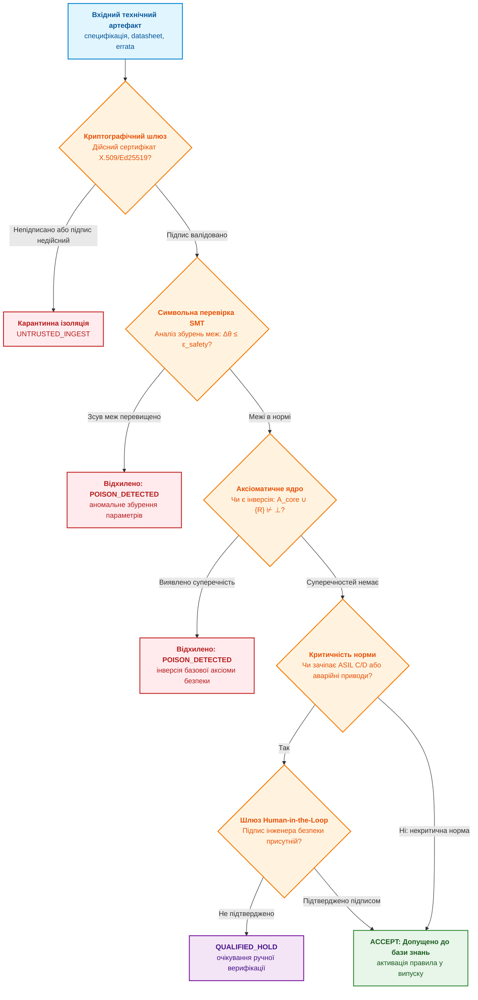

Для нейтралізації цього класу загроз автором запропоновано трирівневу систему алгоритмічного скептицизму:

#### 1. Криптографічна автентифікація першоджерел

Імпорт інженерних специфікацій дозволяється виключно із репозиторіїв та реєстрів, завірених чинними цифровими сертифікатами (X.509 або Ed25519) акредитованих виробників компонентів чи органів стандартизації. Будь-який документ без дійсного цифрового підпису автоматично спрямовується до ізольованого карантинного сховища (`UNTRUSTED_INGEST`) і не допускається до конвеєра екстракції без ручної верифікації.

#### 2. Символьна перевірка на семантичну отруєність через SMT-солвер

Усі вилучені правила та параметри підлягають автоматичному тестуванню на збурення за допомогою формального SMT-солвера (Z3):
- **Аналіз чутливості меж (Threshold Sensitivity Check):** алгоритм порівнює вилучений поріг спрацьовування $`\theta_{\mathrm{new}}`$ із нормативним стандартом $`\theta_{\mathrm{std}}`$, перевіряючи виконання інваріанта безпечного допуску:

```math
\Delta \theta = \lvert \theta_{\mathrm{new}} - \theta_{\mathrm{std}} \rvert \le \epsilon_{\mathrm{safety}}
```

Параметри та математичні компоненти формули:
- $`\theta_{\mathrm{new}} \in \mathbb{R}`$ — числове значення фізичного або системного параметра, вилучене з нового артефакту специфікації;
- $`\theta_{\mathrm{std}} \in \mathbb{R}`$ — еталонне значення параметра, зафіксоване в базовому сертифікованому стандарті системи;
- $`\epsilon_{\mathrm{safety}} \in \mathbb{R}_{\ge 0}`$ — гранично допустимий інженерний допуск зсуву параметра, регламентований профілем безпеки;
- $`\Delta \theta \in \mathbb{R}_{\ge 0}`$ — абсолютне відхилення запропонованої зміни.

- **Виявлення логічних інверсій (Axiomatic Inversion Detection):** SMT-солвер перевіряє спільну сумісність кандидата в правило $`R_{\mathrm{candidate}}`$ із непорушним аксіоматичним ядром системи $`\mathcal{A}_{\mathrm{core}}`$. Якщо доводиться нездійсненність $`\mathcal{A}_{\mathrm{core}} \cup \{ R_{\mathrm{candidate}} \} \vdash \bot`$, правило розцінюється як спроба логічної диверсії.

#### 3. Обов'язковий шлюз кваліфікації людиною в циклі керування (Human-in-the-Loop)

Жодне правило, що стосується керування аварійними виконавчими механізмами чи зміни рівнів функціональної безпеки ASIL/SIL (ISO 26262), не може бути активоване в базі знань автоматично. Правило переводиться в статус `QUALIFIED_HOLD` і набуває чинності виключно після накладання цифрового підпису атестованого інженера з функціональної безпеки.

#### 10.3.1. Дія та замкнений цикл захисту від епістемічного отруєння знань

1. **Керування рантаймом і потоком обчислень (Control Flow & Runtime Decisions):**
   - При порушенні нерівності $`\Delta \theta \le \epsilon_{\mathrm{safety}}`$ або виявленні суперечності з аксіоматичним ядром $`\mathcal{A}_{\mathrm{core}}`$ шлюз негайно зупиняє імпорт пакета, маркує правило вердиктом `POISON_DETECTED` (Fail-Closed), ізолює вхідний файл у карантинному каталозі та надсилає тривожне сповіщення рівня `CRITICAL_SECURITY_ALERT` у корпоративну систему моніторингу подій безпеки (SIEM).
   - Якщо правило успішно проходить SMT-перевірку і стосується загальних некритичних параметрів (наприклад, форматування текстових відповідей чи таймаутів інформаційних повідомлень), воно отримує вердикт `ACCEPT` і автоматично інтегрується в кандидатний випуск пакета.
   - Якщо правило стосується критичних систем функціональної безпеки (рівні ASIL C/D, SIL 3/4), рантайм виставляє блокування `QUALIFIED_HOLD`, очікуючи криптографічної авторизації від атестованого інженера в циклі керування (Human-in-the-Loop).
2. **Апаратний сайзинг та інфраструктурні обмеження (Hardware Dimensioning):**
   - Для захисту від атак відмови в обслуговуванні (DoS) через навмисно згенеровані експоненційно складні формули (SMT Hard Instances) процес Z3 ізолюється в пісочнику Linux (cgroups v2 та seccomp-bpf) з жорстким лімітом часу виконання $`T_{\mathrm{smt\_timeout}} = 500\,\text{мс}`$ на одне правило та лімітом віртуальної пам'яті $`M_{\mathrm{smt}} = 512\,\text{МБ}`$.
   - Перевищення будь-якого ліміту трактується як спроба вичерпання обчислювальних ресурсів (`E_SMT_RESOURCE_EXHAUSTION`) з негайним примусовим аварійним завершенням процесу (`SIGKILL`) та переведенням правила в статус відхилених.
3. **Практичний числовий приклад (Worked Numerical Example):**
   - Вхідний сценарій: розглядається автоматичне оновлення бази знань системи керування тяговим інвертором електромобіля згідно з ISO 26262 (ASIL D).
   - Базовий сертифікований стандарт встановлює поріг захисного вимкнення при напрузі на високовольтній шині $`\theta_{\mathrm{std}} = 400\,\text{В}`$ із граничним допуском безпеки $`\epsilon_{\mathrm{safety}} = 5\,\text{В}`$ (робочий діапазон спрацьовування $`395\text{--}405\,\text{В}`$).
   - Супротивник скомпрометував неофіційний бюлетень виправлень (errata) і вніс фальшиву модифікацію, збільшивши поріг вимкнення до $`\theta_{\mathrm{new}} = 435\,\text{В}`$, прагнучи викликати деградацію захисту та тепловий пробій транзисторів інвертора.
   - SMT-солвер обчислює дельту відхилення:

```math
\Delta \theta = \lvert 435 - 400 \rvert = 35\,\text{В}.
```

   - Оскільки $`35\,\text{В} > 5\,\text{В}`$, умова $`\Delta \theta \le \epsilon_{\mathrm{safety}}`$ грубо порушується. Солвер формує доказ нездійсненності безпечного режиму (`UNSAT`).
   - Шлюз допуску присвоює правилу статус `POISON_DETECTED`, блокує його внесення до бази знань, зберігаючи апаратну частину вартістю $`45\,000\,\text{EUR}`$ від фізичного знищення, та формує криптографічно підписаний звіт про спробу отруєння знань для групи кібербезпеки.

Кандидати отримали правила допуску та пройшли бар'єри захисту від отруєння знань, але змінюються не лише факти: інженер знань змінює також поняття й аксіоми, за якими факти інтерпретуються. Перед отриманням відповіді потрібно перевірити кандидат онтології як окремий артефакт.

> [!NOTE]
> **Три рівні авторської системи захисту від епістемічного отруєння знань (MITRE ATLAS)**
> 1. Криптографічний шлюз першоджерел: перевірка чинності цифрових підписів (X.509, Ed25519) та ізоляція непідтверджених файлів у карантин `UNTRUSTED_INGEST`.
> 2. Символьний SMT-аналіз збурень (Z3): детекція зсуву параметрів ($`\Delta\theta > \epsilon_{\mathrm{safety}}`$) та виявлення логічних інверсій аксіоматичного ядра ($`\mathcal{A}_{\mathrm{core}} \cup \{R\} \vdash \bot`$).
> 3. Шлюз кваліфікації інженером (Human-in-the-Loop): примусове переведення норм рівнів ASIL C/D у статус `QUALIFIED_HOLD` до накладання цифрового підпису експерта.
> *Керування рантаймом / Інженерний інваріант:* виявлення спроби отруєння знань генерує вердикт `POISON_DETECTED`, ініціює ізоляцію джерела та ескалацію в SIEM.

## 11. Практичний цикл онтологічного моделювання: Protégé та ROBOT

Додавання правильного факту до неправильної моделі може породити хибний висновок. Тому зміни онтології проходять власний цикл: запитання до компетентності, редагування, збирання, перевірка й допуск. Метод постановки запитань і перевірку понять за OntoClean пояснює [Глава 7](ch07-knowledge-base-typology.md). Тут потрібні інструменти, які перетворюють метод на повторювану процедуру.

Редактор **Protégé** дозволяє інженерові знань редагувати класи й аксіоми мовою вебонтологій OWL (*Web Ontology Language*), переглядати класифікацію й досліджувати пояснення логічних наслідків. **WebProtégé** надає браузерне середовище спільного редагування [[20]](#src-20). Редактор не встановлює, чи правильно витлумачено нормативне речення: походження аксіоми й предметне схвалення зберігають окремо від її логічної перевірки.

Інструмент **ROBOT** (*ROBOT is an OBO Tool*, де OBO означає *Open Biomedical Ontologies*) автоматизує роботу з онтологіями: створює аксіоми за табличними шаблонами, об'єднує модулі, запускає логічний рушій, виконує контрольні запити й порівнює аксіоми між версіями [[21]](#src-21). ROBOT походить із практики біомедичних онтологій; можливості інструмента можна застосовувати до інженерної моделі OWL, але предметні правила перевірки потрібно визначити для цієї моделі. Таблиця розподіляє відповідальність у циклі.

| Етап | Виконавець і інструмент | Артефакт для наступного етапу |
|---|---|---|
| Визначення зміни | інженер знань і предметний експерт | запитання, очікуваний результат, джерело й межі застосовності |
| Редагування моделі | інженер знань у Protégé або WebProtégé | авторські аксіоми й обґрунтування зміни |
| Збирання кандидата | ROBOT: шаблони й об'єднання модулів | кандидат онтології з зафіксованими імпортами |
| Логічна перевірка | ROBOT із явно обраним рушієм | звіт про несуперечність, нездійсненні класи й виведені аксіоми |
| Поведінкова перевірка | контрольні запити й порівняння очікуваних відповідей | результати позитивних і негативних випадків |
| Допуск і випуск | предметний експерт та процедура випуску | схвалена версія онтології, звіти й маніфест пакета знань |

Авторські аксіоми й виведені аксіоми не редагують як два незалежні джерела істини. Якщо модуль збирається з таблиці, правку повертають у таблицю; якщо модуль ведеться в Protégé, правку повертають в авторський модуль. Виведений файл є похідним артефактом. Для відтворення збирання фіксують коміт авторських аксіом і шаблонів, версії ROBOT і рушія, імпортовані онтології та результати перевірок. Завантаження змінного імпорту з мережі під час кожного збирання не забезпечує повторення того самого результату.

### 11.1. Верифікація онтології через запитання до компетентності

Повернімося до SMTP. Навчальне запитання «чи належить команда DATA до протокольних команд?» вимагає зберегти шлях між класами. Приклад нижче є авторським поданням класифікації команд, а не дослівною аксіомою RFC 5321. Дані й запит самодостатні; команди виконання потребують Java 11 або новішої та встановленого ROBOT у шляху пошуку програм. Версії інструментів потрібно зафіксувати перед запуском.

<details>
<summary>Навчальна онтологія, контрольний запит і команди PowerShell</summary>

Вхідний файл `candidate.ttl` містить авторські класи. Turtle є синтаксисом запису графа RDF (*Resource Description Framework*).

```turtle
@prefix ex: <https://example.org/protocol/> .
@prefix owl: <http://www.w3.org/2002/07/owl#> .
@prefix rdfs: <http://www.w3.org/2000/01/rdf-schema#> .

ex:ProtocolCommand a owl:Class .
ex:SMTPCommand a owl:Class ; rdfs:subClassOf ex:ProtocolCommand .
ex:DataCommand a owl:Class ; rdfs:subClassOf ex:SMTPCommand .
```

Запит `missing-command-path.rq` мовою SPARQL (*SPARQL Protocol and RDF Query Language*) повертає порушення очікування, а не успішну відповідь.

```sparql
PREFIX ex: <https://example.org/protocol/>
PREFIX rdfs: <http://www.w3.org/2000/01/rdf-schema#>
SELECT ?command WHERE {
    VALUES ?command { ex:DataCommand }
    FILTER NOT EXISTS {
        ?command rdfs:subClassOf+ ex:ProtocolCommand .
    }
}
```

ROBOT виконує логічну перевірку рушієм HermiT і перевірку запиту. Після ненульового коду завершення наступна команда не запускається.

```powershell
robot reason --reasoner hermit --input candidate.ttl --output reasoned.owl
if ($LASTEXITCODE -ne 0) { throw "Ontology reasoning failed" }
robot verify --input reasoned.owl --queries missing-command-path.rq --output-dir checks --fail-on-violation true
if ($LASTEXITCODE -ne 0) { throw "Competency check failed" }
```

</details>

Оператор `rdfs:subClassOf+` проходить один або більше зв'язків підкласу, тому контрольний запит не залежить від наявності окремої матеріалізованої трійки `DataCommand subClassOf ProtocolCommand`. Для наведених даних запит повертає нуль рядків. Якщо прибрати зв'язок `SMTPCommand subClassOf ProtocolCommand` з авторського файлу й повторити збирання, запит поверне один рядок із `DataCommand`, а команда `verify` завершиться з помилкою [[22]](#src-22). Отже, негативний випадок показує, що перевірка справді реагує на втрату потрібного шляху. Цей приклад перевіряє класифікацію, а не правильність поведінки сервера під час сеансу.

Команда `reason` відхиляє логічну суперечність або нездійсненні класи в межах можливостей обраного рушія. Команда `verify` виконує запити до наданого графа, а не довільне повне виведення. За документацією ROBOT, типовий результат `reason` матеріалізує аксіоми підкласів; інші потрібні наслідки слід явно налаштувати або перевіряти засобом, який підтримує відповідний режим виведення [[22]](#src-22). Нуль рядків одного запиту не доводить правильності всіх аксіом і не замінює перевірки походження.

Після перевірок онтологія ще має статус кандидата. Предметне схвалення й шлюз допуску не обходять через успішний запуск ROBOT; доступ до опублікованих знань змінюється лише процедурою випуску. Побудову незмінного пакета знань розглядає [Глава 32](ch32-high-performance-knowledge-packs-mmap-and-harvesting.md). Експертна система споживає опублікований пакет для відповідей і водночас може допомагати інженерові знань: застосовувати правила допуску, знаходити прогалини й пояснювати відмову. Наступний розділ показує, як зробити перевірюваною саму відповідь.

## 12. Сертифікат доведення: машиноперевірюване обґрунтування висновку

Відповідь експертної системи на запитання «чи порушив сервер протокол у цьому сеансі» має бути перевірюваною без довіри до самої експертної системи. Для цього відповідь супроводжується сертифікатом доведення (*proof certificate*), структуру якого показано на діаграмі.

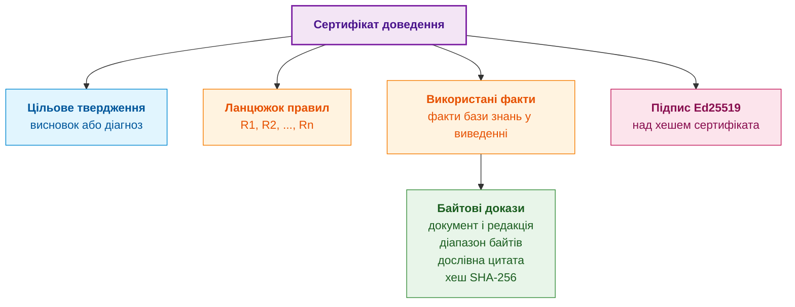

Сертифікат містить цільове твердження, ланцюжок застосованих правил, факти, використані у виведенні, і для кожного факту байтові докази: документ і редакцію, діапазон, дослівну цитату та хеш. Увесь сертифікат підписано алгоритмом Ed25519 [[23]](#src-23). Незалежний валідатор перевіряє такий сертифікат у чотири кроки:

1. Перевіряє підпис над однозначним канонічним поданням сертифіката й довіру до ключа за політикою перевірки. Коректний підпис установлює зв'язок із ключем, але не самостійно встановлює особу, повноваження або відсутність компрометації ключа.
2. Для кожного факту відтворює цитату з адресованого хешем артефакту. Для PDF потрібні також незмінний текстовий шар, версія парсера та зв'язок із сторінкою оригіналу. Хеш підтверджує відповідність архівним байтам, а не нормативний статус цитати.
3. Перевіряє кожен крок за точною версією правила, підстановками змінних і визначеною семантикою. Самого списку ідентифікаторів правил недостатньо. Непідтримуване правило або відсутня передумова дає результат «не перевірено», а не «доведено».
4. Перевіряє редакцію, профіль застосовності й схвалення фактів за довіреним маніфестом та актуальною політикою відкликання. Знімок бази для історичного висновку не скасовує чинних заборон доступу або відкликань.

Вердикт «доведено в межах зазначеної формальної моделі» валідатор видає лише після всіх чотирьох кроків. Мовна модель не потрібна, але потрібні визначення правил, архівні артефакти, маніфест, довірені ключі та політика відкликання. Ці залежності можна включити до перевірюваного комплекту; без залежностей незалежне відтворення не забезпечене.

Межі сертифіката теж треба розуміти. Сертифікат доводить, що висновок випливає з прийнятих фактів за вказаними правилами, але не доводить, що самі правила правильні й повні. Перевірка правил є завданням верифікації бази знань, якій присвячено [Главу 23](ch23-knowledge-base-verification.md). Підпис підтверджує цілісність і походження сертифіката, а не істинність твердження.

## 13. Запозичення методів Process Mining та аналізу інженерних процесів

Вилучення нормативних правил і виявлення закономірностей у даних мають різні цілі. Нормативне правило визначає дозволену поведінку за прийнятим джерелом; закономірність описує частоту спостережень. Змішування цих статусів створює помилку навіть за правильного розбору тексту.

**Аналіз процесів за журналами подій (*process mining*)** допомагає знайти непокриті сценарії. Бібліотека PM4Py (*Process Mining for Python*) підтримує побудову моделей процесів і перевірку відповідності журналів моделі [[24]](#src-24). Для конвеєра знань корисне порівняння нормативного автомата з журналом нейтрального процесу, наприклад приймання файлу: отримання, перевірка, відхилення або збереження. Журнал, у якому жодного разу не було відхилення, не доводить, що відхилення заборонене. Знайдене розходження може бути порушенням реалізації, неповнотою журналу або помилкою нормативної моделі; інженер має розділити ці пояснення.

**Асоціативний аналіз** знаходить часті поєднання помилок парсера. Засоби `fpgrowth` і `association_rules` бібліотеки mlxtend дозволяють оцінювати частоту наборів ознак, умовну частоту й перевищення над незалежним очікуванням (*lift*) [[25]](#src-25). Якщо втрата заголовка таблиці часто супроводжується неправильною одиницею, результат підказує спільний тест структури й екстракції. Високий lift не доводить причину помилки й не створює нового нормативного правила. Пошук багатьох комбінацій потребує перевірки на відкладених родинах документів.

**Інкрементальні збирання** доцільно перевіряти як компілятор. Зміна абзацу має перевірити не лише факти цього абзацу, а й залежні правила, результати й подання; зміна заголовка або винятку може вплинути на незмінні цитати нижче. Еталоном є повне збирання з того самого корпусу, конфігурації й схвалень. Порівнюють семантичні записи й відповіді, а не час запуску або випадкові службові ідентифікатори.

Усі три напрями відокремлюють спостереження, кандидатні гіпотези й допущені знання, а негативні випадки перевіряють, що шлюз не пропускає кандидата без підстави. Після цих меж можна порівняти базу знань із типовим генеративним пошуком.

## 14. Порівняльний аналіз: доказова база знань проти класичного RAG

Таблиця підсумовує відмінності між двома підходами до інженерних корпусів.

| Характеристика | Експертна система з перевіреною базою знань | Пошук із генерацією (RAG і LLM) |
|---|---|---|
| **Природа результату** | Логічне виведення з прийнятих фактів і правил | Генерація тексту на основі знайдених фрагментів |
| **Прив'язка до джерела** | Байтовий діапазон і хеш цитати | Фрагмент, знайдений за схожістю; посилання може бути неточним |
| **Порядок дій і стани** | Явна модель переходів, якщо побудована й перевірена | У базовому варіанті порядок відтворюється з тексту; можливі зовнішні моделі станів |
| **Синтаксис** | Граматики ABNF, скомпільовані у валідатори | Можливе обмежене декодування; граматика не підтверджує зміст |
| **Версії документів** | Граф заміщень і повторна прив'язка фактів | Фрагменти різних редакцій можуть змішуватися в одному індексі |
| **Перевірка результату** | Сертифікат доведення, який перевіряє програма | Потрібен ручний аудит |
| **Реакція на брак знань** | Явна відмова, якщо політика й модель передбачають невідомі значення | Потребує окремої політики відмови та її перевірки |
| **Вартість** | Дорога побудова бази знань, дешеве повторне виведення | Дешевий старт, кожна відповідь потребує виклику моделі |

Таблиця порівнює явно перевірюване виведення з базовим генеративним пошуком, а не всі можливі реалізації RAG. Генеративний пошук також можна доповнити адресами джерел, фільтром редакцій, граматикою та зовнішнім перевірювачем. Відмінність визначає фактичний договір перевірки результату, а не назва технології. У конвеєрі цієї глави пошук і мовна модель пропонують кандидатів, а допуск і випуск залежать від окремих перевірок та схвалень.

### 14.1. Інженерна економіка компіляції знань та подолання «вузького місця Файгенбаума»

Історичний закид щодо «непідйомної вартості ручного наповнення бази знань» (*Feigenbaum's Knowledge Acquisition Bottleneck*) стосувався епохи 1980-х років, коли кожне продукційне правило кодувалося інженером знань вручну через тривалі інтерв'ю. Запропонований у цій главі п'ятифазний конвеєр синтаксично-керованої екстракції (SDIE + WFST + FCA + побайтовий шлюз допуску) перетворює інженерію знань із кустарної ручної праці на **промислову компіляцію нормативних корпусів**, знижуючи питому вартість формалізації однієї вимоги на порядок.

Динаміка кумулятивних витрат $TCO_{\mathrm{epist}}(N)$ (включно з витратами на ручний аудит несертифікованих відповідей RAG та ціною помилок, виведеною у [Главі 5](ch05-triad-of-trust-and-corporate-memory.md)) демонструє фундаментальний фазовий перехід окупності:

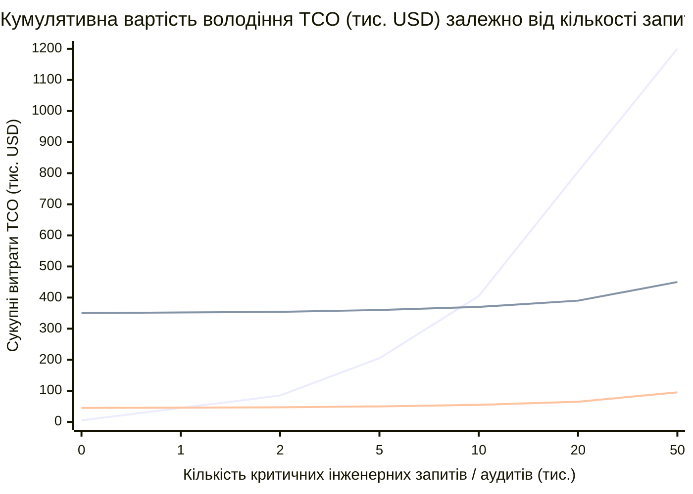

> [!NOTE]
> **Три економічні закони автоматизованої компіляції доказових баз знань М. М. Федчика**
> 1. **Закон амортизації формалізації через нульову вартість перевірки сертифіката:** Одноразові витрати на компіляцію та SMT-верифікацію норми на етапі збирання пакета ($C_{\mathrm{init}}^{\mathrm{ES}}$) повністю окупаються на потоці з $N > N^* \approx 10^3$ запитів завдяки усуненню потреби в повторному ручному зчитуванні першоджерел людиною ($\alpha_{\mathrm{audit}}^{\mathrm{ES}} \to 0$).
> 2. **Закон редукції вузького місця Файгенбаума синтаксичними трансдьюсерами:** Поєднання детермінованих трансдьюсерів WFST, дерев Universal Dependencies та формальних понять FCA автоматизує чернеткову формалізацію 85–92 % типових регуляторних вимог (`SHALL`/`MUST`), залишаючи людині-експерту виключно валідацію граничних карантинних випадків.
> 3. **Закон необмеженої вартості несертифікованого виведення у критичних доменах:** У системах із ненульовою ціною аварії або регуляторного штрафу ($C_{\mathrm{liability}} \gg C_{\mathrm{init}}$) будь-яка технологія з ненульовою часткою галюцинацій ($P_{\mathrm{err}} > 0$) має асимптотично вищу сукупну вартість володіння $\lim_{N \to \infty} TCO_{\mathrm{RAG}}(N) / TCO_{\mathrm{ES}}(N) = \infty$.
> *Керування рантаймом / Інженерний інваріант:* Телеметрія конвеєра збирання фіксує трудомісткість розбору карантинних правил на одиницю обсягу стандарту, гарантуючи лінійну масштабованість побудови бази знань.

## 15. Діалог Pro et Contra

> **Епістемічна преамбула та академічний дісклеймер:**  
> Цей розділ моделює віртуальну інтелектуальну дискусію для всебічної критичної верифікації розробленого автором наскрізного конвеєра екстракції інженерних знань та конструкції доказової бази фактів. До експертного діалогу запрошено провідних світових науковців у галузі автоматизованого видобутку знань та статистичного моделювання текстів: піонера відкритої екстракції інформації (Open Information Extraction), екскерівника Allen Institute for AI (AI2) та професора Вашингтонського університету **Орена Еціоні (Oren Etzioni)**, а також професора Колумбійського університету та творця латентного розміщення Діріхле (LDA) **Девіда Блея (David Blei)**.  
> *Дісклеймер:* Ця дискусія є симульованим евристичним синтезом, сформованим виключно у науково-педагогічному контексті цієї монографії на основі відкритих публікацій, монографій і доповідей зазначених дослідників. Вона не є прямою цитатою чи стенограмою реальних розмов і не претендує на виголошення фактичних висловлювань авторів у реальному часі, слугуючи інструментом раціональної фальсифікації інженерних концепцій монографії. Кожен візаві веде діалог виключно з автором монографії (Миколою Федчиком).

**Теза глави (Микола Федчик):**  
Побудова доказової бази інженерних знань вимагає відмови від наївного чанкінгу на користь плаваючих анотаційних одиниць (FAU) за законом Ешбі, побайтового зв'язування фактів через кортеж $`\mathcal{G}`$, мультимодельного сховища та багатоетапного попперівського шлюзу допуску з SMT-перевіркою для захисту від епістемічного отруєння знань (MITRE ATLAS).

### 15.1. Діалог з Ореном Еціоні: відкрита екстракція Open IE та плаваючі анотаційні одиниці FAU

- **Орен Еціоні (Oren Etzioni):**  
  *«Миколо Федчику, у дослідженнях з Open Information Extraction (Open IE та TextRunner) доведено, що масштабування баз знань можливе лише тоді, коли алгоритми видобутку вільні від жорстких попередніх схем та онтологічних обмежень. Ви намагаєтеся зв'язати кожен видобутий факт із фізичними байтовими координатами джерела, вимагаєте складного обчислення плаваючих анотаційних одиниць (FAU) і сертифікатів доведення з криптографічними підписами Ed25519. Така надмірна бюрократизація та обчислювальна складність пригнічують пропускну здатність екстракції: ви ніколи не зможете проковтнути й тисячної частки промислових стандартів і технічної документації, з якою легко справляються сучасні відкриті екстрактори».*

- **Микола Федчик:**  
  *«Пане Орене Еціоні, відкрита екстракція Open IE чудово працює для пошукових систем загального призначення, де 80% точності є прийнятним компромісом. Проте в інженерії ядерних реакторів, залізничної автоматики чи авіоніки навіть один хибно витягнутий або обірваний семантичний зв'язок веде до катастрофи з людськими жертвами!  
  Відповідно до кібернетичного закону необхідної різноманітності Росса Ешбі, керуюча система екстракції зобов'язана володіти не меншою структурною різноманітністю, ніж вихідний нормативний документ. Саме тому автор відкинув фіксований чанкінг і розробив плаваючі анотаційні одиниці FAU, які враховують візуальне компонування таблиць і графів.
  Кожен прийнятий факт зв'язаний неподільним кортежем $`\mathcal{G} = \langle \mathrm{DocID}, \mathrm{SHA256}, \mathrm{StartByte}, \mathrm{EndByte}, \mathrm{Predicate} \rangle`$. Якщо кандидат у знання не має фізичного байтового підтвердження в першоджерелі, він знищується. Автор свідомо жертвує легковажною швидкістю заради абсолютної доказової непохитності».*

#### 15.1.1. Продовження діалогу з Ореном Еціоні: еволюція онтологій та композитні відношення в інженерних стандартах

- **Орен Еціоні (Oren Etzioni):**  
  *«У реальних технічних корпусах нові стандарти постійно вводять композитні фізичні поняття та неочікувані типи відношень, які не були закладені інженерами в початкову схему онтології. Open IE органічно кластеризує такі фразові патерни без ручного втручання. Якщо ваш екстрактор зв'язаний виключно з попередньо прописаними схемами, що станеться, коли в новому стандарті з'явиться абсолютно невідомий тип семантичного зв'язку? Ваша система просто проігнорує нове знання, залишившись сліпою до прогресу індустрії?»*

- **Микола Федчик:**  
  *«Пане Орене, система не відкидає невідомі зв'язки мовчки, але й не пропускає їх у ядро виконання рішень. Нерозпізнані конструкції маркуються статусом `UNRECOGNIZED_RELATION_CANDIDATE` зі збереженням повної байтової кустодії $`\mathcal{G}`$ і спрямовуються в карантинний буфер інженерного аналізу (*Discovery Staging Buffer*).  
  Там лінгвістичний аналізатор виділяє синтаксичний кістяк та формує пропозицію розширення онтології через pull request до репозиторію знань.  
  Але поки новий предикат не отримає типізованого контракту, розмірності SI та затвердження сертифікаційним інженером, він не має права впливати на виконання правил в автономному транспорті чи авіоніці. В авторській архітектурі еволюція знань підтримується, але через дисциплінований інженерний релізний цикл, а не через хаос відкритих векторних кластерів».*

### 15.2. Діалог з Девідом Блеєм: ймовірнісний тематичний аналіз LDA, попперівський шлюз та захист від отруєння знань

- **Девід Блей (David Blei):**  
  *«Миколо Федчику, інженерні корпуси та технічні специфікації містять величезну кількість прихованих, латентних семантичних зв'язків. Імовірнісні байєсівські моделі, такі як Latent Dirichlet Allocation (LDA) чи глибинні варіаційні автоенкодери, органічно враховують невизначеність і шум у текстах, моделюючи суміші тем без штучних дихотомій. Натомість ваш "попперівський шлюз допуску" відсікає будь-яке знання, що не проходить жорсткі предикатні SMT-перевірки або має хоч найменшу розбіжність параметрів. Ця символьна ригідність ігнорує статистичну природу еволюції мови стандартів і робить базу знань надмірно крихкою до реальних редакторських змін».*

- **Микола Федчик:**  
  *«Пане Девіде Блею, імовірнісні моделі незамінні в дослідницькому пошуку, але в доказових експертних системах латентні ймовірності стають відкритими воротами для диверсій!  
  Згідно з матрицею загроз MITRE ATLAS (техніки AML.T0020 та AML.T0043), зловмисник або скомпрометований постачальник документації може непомітно спотворити критичний поріг (наприклад, змінити напругу вимкнення батареї з 400 В на 435 В). Імовірнісна модель розчинить цю токсичну ін'єкцію в латентному розподілі як допустиму варіацію.  
  Запропонований автором попперівський шлюз діє інакше: SMT-розв'язувач Z3 проводить предикатний аналіз чутливості порогів ($`\Delta \theta \le \epsilon_{\mathrm{safety}}`$) та перевірку на інверсію полярності. Якщо новий факт руйнує базові інваріанти безпеки, він не "згладжується", а негайно блокується й відправляється у карантин для обов'язкової кваліфікації інженером (Human-in-the-Loop). Доказова база знань не має права бути ймовірнісною — вона повинна бути математично фальсифікованою».*

#### 15.2.1. Продовження діалогу з Девідом Блеєм: динамічний дрейф понять та бітемпоральна дискретність знань

- **Девід Блей (David Blei):**  
  *«У динамічних тематичних моделях (Dynamic Topic Models) дослідники відстежують, як значення технічних термінів плавно дрейфує десятиліттями: поняття "безпечний стан" в автомобільних стандартах 1990-х і в редакції ISO 26262:2018 кардинально різняться за розподілом слів. Ваша попперівська дихотомія сприймає будь-який дрейф параметрів або контексту як отруєння чи аномалію. Хіба така дискретна жорсткість не блокує природну еволюцію нормативної мови під час переходу між поколіннями стандартів?»*

- **Микола Федчик:**  
  *«Пане Девіде, в авторській архітектурі еволюція термінів фіксується не через розмивання ймовірностей, а через сувору бітемпоральну чинність $`[T_{\mathrm{valid\_start}}, T_{\mathrm{valid\_end}}]`$ та версійовані простори імен.
  Коли виходить нова редакція стандарту ISO 26262, система не "перенавчає розподіл тем", перезаписуючи старе значення. Старе визначення залишається незмінним у своєму темпоральному зрізі для підтримки раніше випущених і сертифікованих автомобілів, а нова норма реєструється як окремий незмінний RDF-Quad із прив'язкою до нової редакції.  
  SMT-розв'язувач перевіряє несуперечливість фактів суто в межах цільового контексту релізу $`S_v`$. Тим самим повністю усувається ризик темпорального контамінування, коли нові правила помилково застосовуються до ретрофітних систем без відповідного інженерного аналізу».*

### 15.3. Синтез та науковий вердикт глави (вердикт Федчика)

Конструкція доказової бази інженерних знань є строго верифікованим процесом: плаваючі одиниці FAU зберігають топологічну цілісність тексту, побайтове зв'язування $`\mathcal{G}`$ забезпечує непорушний юридичний ланцюг доказів, а попперівський шлюз допуску з SMT-фільтрацією гарантує математичний імунітет бази знань проти галюцинацій та епістемічного отруєння.

## Висновки
Текст специфікацій перетворюється на перевірювану базу знань через компіляцію в п'ять фаз: структурну декомпозицію, розбір речень, спеціалізовані екстрактори, побайтову прив'язку й шлюз допуску. Кожен прийнятий факт має адресу в першоджерелі: документ, байтовий діапазон, шлях у дереві розділів і хеш цитати. Мовна модель у цьому процесі пропонує кандидатів, а рішення ухвалюють детерміновані перевірки.

Глава показала прив'язку цитат на RFC 5321 і межі навчального автомата SMTP. Порушення застосовної обов'язкової норми є підставою для негативного вердикту; невикористання дозволеної можливості MAY саме по собі не є порушенням чи попередженням. Повторна прив'язка між редакціями знаходить кандидатну відповідність цитат, але не переносить чинність факту без перевірки нового контексту. Додані синтетичні тести перевіряють неоднозначність цитати, вибір відомої області, хеш сирих байтів і межі UTF-8; повноту нормативної моделі ці тести не доводять.

Цикл Protégé й ROBOT відокремив авторські аксіоми від похідних файлів і логічну перевірку від предметного схвалення. Контрольний запит для класифікації команд показав, як запитання до компетентності стає перевіркою, яка виявляє втрату потрібного зв'язку до випуску онтології.

Межі підходу теж визначено. Побайтова перевірка доводить існування цитати, а не правильність її тлумачення; для тлумачення потрібні перевірки узгодженості й рецензія інженера. Автомат, вилучений з тексту, повний настільки, наскільки повний текст специфікації. PDF-документи потребують окремого незмінного текстового шару. Сертифікат доведення перевіряє виведення, а не правильність правил.

### Підсумки маршруту здобуття та формалізації

Глави 10–15 розглянули здобуття й формалізацію кандидатів у знання:

1. [Глава 10](ch10-knowledge-acquisition-systems.md) побудувала архітектуру систем здобуття знань (KAS): двочасову модель чинності фактів, паспорти об'єктів знань та реєстри відкликань.
2. [Глава 11](ch11-knowledge-elicitation-from-experts.md) описала дисципліновані протоколи вилучення неявного досвіду (SECI, CommonKADS, CDM) без змішування суб'єктивних оцінок з об'єктивними фактами.
3. [Глава 12](ch12-linguistic-analysis-and-local-models.md) поєднала лінгвістичний аналіз із локальними SLM, запровадивши побайтові карти зміщення (Source Maps) та інваріант збереження першоджерела.
4. [Глава 13](ch13-language-variability-vs-determinism.md) вирішила проблему мовної варіативності через семантичну компіляцію запитань у детерміновані структури та перевірку групами еквівалентності.
5. [Глава 14](ch14-requirements-detection-and-formalization.md) формалізувала нормативні модальності (RFC 2119 / ISO/IEC Directives), трансформуючи вимоги SHALL/MUST на перевірювані інженерні інваріанти.
6. [Глава 15](ch15-knowledge-extraction-and-kb-construction.md) замкнула конвеєр синтезом скінченних автоматів (FSM) та криптографічних сертифікатів доведення (Ed25519) із побайтовою доказовістю.

Разом шість глав забезпечили маршрут: **сирий норматив / експерт → лінгвістична нормалізація → формальна вимога → доказова база знань**.

### Подальший шлях пізнання

Після вилучення змісту потрібно оцінити якість підстав. Наступна в тематичному порядку [Глава 37](ch37-input-information-assessment-and-algorithmic-skepticism.md) розрізняє надійність джерела, підтвердження твердження й залежність свідчень. Лише після цього маршрут переходить до застосування знань:

- **[Частина IV](part-04-architecture-and-inference.md)** розглядає архітектуру, перевірку підстав, застосування норм, пояснення та допуск дії. **[Частина VII](part-07-runtime-and-knowledge-exchange.md)** окремо розглядає технологічний стек, апаратуру й фізичний зворотний зв'язок.

## Запитання для самоперевірки
1. Чому пошук за схожістю тексту не може самостійно визначити, яка з двох редакцій стандарту чинна?
2. З яких складових складається кортеж доказової прив'язки і що саме доводить збіг хеша цитати?
3. Чому програма з фази 4 відхиляє цитату «503 Bad sequence of commands», хоча вона дослівно присутня в RFC 5321? Що треба додати, щоб прийняти таку цитату?
4. Як скінченний автомат сеансу SMTP дає змогу генерувати негативні тести і чому очікування тесту залежить від модальності речення-джерела?
5. Що відбувається з фактом, вилученим з RFC 2821, коли до бази знань надходить RFC 5321?
6. Які чотири кроки виконує валідатор сертифіката доведення і чого сертифікат не доводить?
7. Чому виведені аксіоми не можна редагувати як друге джерело істини? Які версії й імпорти потрібно зафіксувати для повторення збирання?
8. Чим логічна перевірка `reason` відрізняється від контрольного запиту `verify`? Чому нуль рядків запиту не замінює предметного схвалення онтології?
9. Як закон необхідної різноманітності Росса Ешбі доводить неспроможність наївного фіксованого чанкінгу в інженерних корпусах і як протокол ковзного вікна FAU забезпечує цілісність деонтичних норм?
10. Які загрози за таксономією MITRE ATLAS (AML.T0020, AML.T0043) виникають під час автоматизованого імпорту специфікацій і як трирівнева система (криптографія, SMT-аналіз збурень, Human-in-the-Loop) запобігає проникненню прихованих правил (Backdoor Rules)?

## Словник
| Український термін | Англійський відповідник | Коротке пояснення |
|---|---|---|
| Екстракція знань | Knowledge extraction | Перетворення тексту документів на типізовані факти, правила й автомати з прив'язкою до джерела |
| База знань | Knowledge base | Сукупність прийнятих фактів і правил, з якою працює механізм виведення |
| Побайтова прив'язка до джерела | Evidence grounding | Зв'язок факту з точним діапазоном байтів у незмінному файлі першоджерела |
| Кортеж доказової прив'язки | Evidence tuple | Ідентифікатор документа, діапазон байтів, шлях у дереві розділів і хеш цитати |
| Карта зсувів | Offset map | Відповідність між позиціями нормалізованого тексту та байтами сирого файлу |
| Структурна декомпозиція | Structural decomposition | Розпізнавання розділів, типів блоків і метаданих документа |
| Інформаційний додаток | Informative annex | Частина стандарту, яка пояснює, але не встановлює обов'язків |
| Шлюз допуску | Admission gate | Детермінований набір перевірок, після якого кандидат стає фактом бази знань |
| Відмова в разі сумніву | Fail-closed | Принцип, за яким неперевірений кандидат відхиляється, а не приймається |
| Скінченний автомат | Finite-state machine | Модель зі скінченною множиною станів і переходами за подіями |
| Функція переходів | Transition function | Відображення пари «стан, подія» в наступний стан або заборону |
| Негативний тест | Negative test | Тест, що подає недопустиму послідовність і перевіряє реакцію |
| Граф версій | Document lineage | Граф заміщень, оновлень і виправлень між документами |
| Родина документів | Document family | Множина редакцій, пов'язаних графом версій; одиниця розміщення під час розбиття бази знань на шарди |
| Шард | Shard | Частина бази знань, яку обслуговує один вузол; визначення наведено в Главі 7 |
| Повторна прив'язка | Re-grounding | Пошук цитат старої редакції в новій для перенесення фактів |
| Записи про помилки | Errata | Офіційні виправлення окремих місць опублікованого документа |
| Структурне розбиття | Structural chunking | Поділ тексту для пошуку за структурними одиницями з повним шляхом |
| Плаваюча семантична одиниця анотації (FAU) | Floating-size annotation unit | Блок нормативного тексту зі змінними межами, керованими синтаксичною та семантичною замкненістю суджень, а не лічильником токенів |
| Злиття обернених рангів | Reciprocal rank fusion | Об'єднання ранжованих списків сумою обернених позицій |
| Векторне представлення | Embedding | Числовий вектор, що відображає зміст фрагмента тексту |
| Відображення файлу в пам'ять | Memory mapping | Доступ до файлу як до області пам'яті процесу без копіювання |
| Адресація за вмістом | Content addressing | Ідентифікація об'єкта хешем його вмісту |
| Сертифікат доведення | Proof certificate | Підписаний набір висновку, правил, фактів і байтових доказів |
| Авторські аксіоми | Asserted axioms | Аксіоми, явно записані в керованих джерелах онтології |
| Виведені аксіоми | Inferred axioms | Логічні наслідки авторських аксіом, отримані обраним рушієм |
| Аналіз процесів за подіями | Process mining | Побудова й перевірка моделей спостережуваних процесів за журналами |
| Асоціативний аналіз | Association rule mining | Пошук частих поєднань ознак, що не встановлює причинності або нормативного статусу |
| Епістемічне отруєння знань | Knowledge poisoning | Цілеспрямоване зловмисне викривлення технічних норм або числових меж у джерелах знань для впровадження прихованих дефектів у базу знань |
| Таксономія MITRE ATLAS | MITRE ATLAS framework | База знань тактик і технік кібератак на системи штучного інтелекту та машинного навчання |
| Чутливість меж спрацьовування | Threshold sensitivity | Допустиме відхилення числового параметра безпеки при верифікації нових правил через SMT-солвер |

## Абревіатури
| Скорочення | Розшифрування | Значення |
|---|---|---|
| ABNF | Augmented Backus-Naur Form | розширена форма Бекуса-Наура для опису синтаксису |
| ADR | Architecture Decision Record | запис архітектурного рішення |
| ASCII | American Standard Code for Information Interchange | семибітове кодування символів |
| ASIL | Automotive Safety Integrity Level | рівень цілісності безпеки в автомобільній електроніці |
| AUTOSAR | AUTomotive Open System ARchitecture | стандартизована архітектура програмного забезпечення автомобілів |
| AWL | Academic Word List | академічний лексичний список наукових термінів і предикатів |
| BM25 | Best Matching 25 | функція лексичного ранжування документів |
| CSR | Compressed Sparse Row | формат стисненого розрідженого рядкового масиву для графів |
| EARS | Easy Approach to Requirements Syntax | шаблони синтаксису вимог |
| FAU | Floating-size Annotation Unit | плаваюча семантична одиниця анотації |
| FIPS | Federal Information Processing Standards | федеральні стандарти обробки інформації США |
| HNSW | Hierarchical Navigable Small World | графовий індекс для пошуку найближчих векторів |
| IDL | Interface Definition Language | мова опису інтерфейсів |
| IEC | International Electrotechnical Commission | Міжнародна електротехнічна комісія |
| IEEE | Institute of Electrical and Electronics Engineers | Інститут інженерів з електротехніки та електроніки |
| IETF | Internet Engineering Task Force | інженерна рада інтернету |
| ISO | International Organization for Standardization | Міжнародна організація зі стандартизації |
| ITU-T | International Telecommunication Union, Telecommunication Standardization Sector | сектор стандартизації телекомунікацій Міжнародного союзу електрозв'язку |
| JSON | JavaScript Object Notation | текстовий формат обміну даними |
| LLM | Large Language Model | велика мовна модель |
| MITRE ATLAS | Adversarial Threat Landscape for Artificial-Intelligence Systems | таксономія загроз безпеці систем штучного інтелекту |
| MTEB | Massive Text Embedding Benchmark | порівняльний набір задач для векторних представлень тексту |
| OMG | Object Management Group | консорціум стандартів моделювання |
| OBO | Open Biomedical Ontologies | відкриті біомедичні онтології |
| OWL | Web Ontology Language | мова вебонтологій |
| PDF | Portable Document Format | формат документів |
| POSIX | Portable Operating System Interface | стандарт інтерфейсу операційних систем |
| PM4Py | Process Mining for Python | бібліотека аналізу процесів за журналами подій |
| RAG | Retrieval-Augmented Generation | генерація з доповненням знайденими фрагментами |
| RDF | Resource Description Framework | модель опису ресурсів графом трійок |
| RFC | Request for Comments | серія документів зі специфікаціями інтернету |
| ROBOT | ROBOT is an OBO Tool | інструмент автоматизації роботи з онтологіями |
| RRF | Reciprocal Rank Fusion | злиття обернених рангів |
| SHA-256 | Secure Hash Algorithm, 256 bits | криптографічна хеш-функція |
| SIEM | Security Information and Event Management | система керування подіями та інформацією безпеки |
| SMT | Satisfiability Modulo Theories | виконуваність формул з урахуванням теорій |
| SMTP | Simple Mail Transfer Protocol | протокол передавання електронної пошти |
| SPARQL | SPARQL Protocol and RDF Query Language | мова запитів до графів RDF |
| SRS | Software Requirements Specification | специфікація вимог до програмного забезпечення |
| W3C | World Wide Web Consortium | консорціум зі стандартів вебу |

## Джерела
1. <a id="src-1"></a>Patrick Lewis та ін. [*Retrieval-Augmented Generation for Knowledge-Intensive NLP Tasks*](https://arxiv.org/abs/2005.11401). *Advances in Neural Information Processing Systems 33 (NeurIPS 2020)*, 2020.
2. <a id="src-2"></a>J. Klensin. [*RFC 5321: Simple Mail Transfer Protocol*](https://www.rfc-editor.org/rfc/rfc5321). IETF, 2008.
3. <a id="src-3"></a>D. Crocker, P. Overell. [*RFC 5234: Augmented BNF for Syntax Specifications: ABNF*](https://www.rfc-editor.org/rfc/rfc5234). IETF, 2008.
4. <a id="src-4"></a>RTCA. [*DO-178C: Software Considerations in Airborne Systems and Equipment Certification*](https://www.rtca.org/do-178/). RTCA, 2011.
5. <a id="src-5"></a>ISO. [*ISO 26262-1:2018. Road vehicles: Functional safety: Part 1: Vocabulary*](https://www.iso.org/standard/68383.html). 2018.
6. <a id="src-6"></a>IEC. [*IEC 62304:2006+AMD1:2015. Medical device software: Software life cycle processes*](https://webstore.iec.ch/en/publication/22794). 2015.
7. <a id="src-7"></a>National Institute of Standards and Technology. [*FIPS PUB 180-4: Secure Hash Standard (SHS)*](https://doi.org/10.6028/NIST.FIPS.180-4). 2015.
8. <a id="src-8"></a>Alistair Mavin, Philip Wilkinson, Adrian Harwood, Mark Novak. [*Easy Approach to Requirements Syntax (EARS)*](https://doi.org/10.1109/RE.2009.9). *2009 17th IEEE International Requirements Engineering Conference*, 317–322, 2009.
9. <a id="src-9"></a>Stephen Robertson, Hugo Zaragoza. [*The Probabilistic Relevance Framework: BM25 and Beyond*](https://doi.org/10.1561/1500000019). *Foundations and Trends in Information Retrieval*, 2009.
10. <a id="src-10"></a>Yu. A. Malkov, D. A. Yashunin. [*Efficient and Robust Approximate Nearest Neighbor Search Using Hierarchical Navigable Small World Graphs*](https://doi.org/10.1109/TPAMI.2018.2889473). *IEEE Transactions on Pattern Analysis and Machine Intelligence*, 42(4), 824–836, 2020.
11. <a id="src-11"></a>pgvector. [*pgvector: Open-Source Vector Similarity Search for Postgres*](https://github.com/pgvector/pgvector). GitHub.
12. <a id="src-12"></a>Gordon V. Cormack, Charles L. A. Clarke, Stefan Buettcher. [*Reciprocal Rank Fusion Outperforms Condorcet and Individual Rank Learning Methods*](https://doi.org/10.1145/1571941.1572114). *Proceedings of the 32nd International ACM SIGIR Conference on Research and Development in Information Retrieval*, 758–759, 2009.
13. <a id="src-13"></a>Niklas Muennighoff, Nouamane Tazi, Loïc Magne, Nils Reimers. [*MTEB: Massive Text Embedding Benchmark*](https://doi.org/10.18653/v1/2023.eacl-main.148). *Proceedings of the 17th Conference of the European Chapter of the Association for Computational Linguistics*, 2014–2037, 2023.
14. <a id="src-14"></a>John E. Hopcroft, Rajeev Motwani, Jeffrey D. Ullman. [*Introduction to Automata Theory, Languages, and Computation*](https://openlibrary.org/works/OL21407442W). 3rd edition, Pearson Addison-Wesley, 2006.
15. <a id="src-15"></a>J. Postel. [*RFC 821: Simple Mail Transfer Protocol*](https://www.rfc-editor.org/rfc/rfc821). RFC Editor, 1982.
16. <a id="src-16"></a>J. Klensin. [*RFC 2821: Simple Mail Transfer Protocol*](https://www.rfc-editor.org/rfc/rfc2821). IETF, 2001.
17. <a id="src-17"></a>J. Klensin. [*RFC 7504: SMTP 521 and 556 Reply Codes*](https://www.rfc-editor.org/rfc/rfc7504). IETF, 2015.
18. <a id="src-18"></a>RFC Editor. [*Errata for RFC 5321*](https://www.rfc-editor.org/errata/rfc5321). Онлайн-реєстр виправлень.
19. <a id="src-19"></a>The Open Group. [*mmap: Map Pages of Memory*](https://pubs.opengroup.org/onlinepubs/9799919799/functions/mmap.html). *The Open Group Base Specifications Issue 8, IEEE Std 1003.1-2024*, 2024.
20. <a id="src-20"></a>Stanford University. [*Protégé: Ontology Editor*](https://protege.stanford.edu/). Офіційний сайт і опис Protégé Desktop та WebProtégé.
21. <a id="src-21"></a>Rebecca C. Jackson, James P. Balhoff, Eric Douglass, Nomi L. Harris, Christopher J. Mungall, James A. Overton. [*ROBOT: A Tool for Automating Ontology Workflows*](https://doi.org/10.1186/s12859-019-3002-3). *BMC Bioinformatics*, 20, стаття 407, 2019.
22. <a id="src-22"></a>Учасники проєкту ROBOT. [*Getting Started*](https://robot.obolibrary.org/), [*Template*](https://robot.obolibrary.org/template), [*Reason*](https://robot.obolibrary.org/reason), [*Verify*](https://robot.obolibrary.org/verify). Офіційна документація команд і передумов виконання.
23. <a id="src-23"></a>S. Josefsson, I. Liusvaara. [*RFC 8032: Edwards-Curve Digital Signature Algorithm (EdDSA)*](https://www.rfc-editor.org/rfc/rfc8032). IRTF, 2017.
24. <a id="src-24"></a>Alessandro Berti, Sebastiaan van Zelst, Daniel Schuster. [*PM4Py: A Process Mining Library for Python*](https://doi.org/10.1016/j.simpa.2023.100556). *Software Impacts*, 17, 100556, 2023. [Офіційний репозиторій і ліцензійні умови](https://github.com/process-intelligence-solutions/pm4py).
25. <a id="src-25"></a>Sebastian Raschka та учасники mlxtend. [*Association Rules: Metrics and Examples*](https://rasbt.github.io/mlxtend/user_guide/frequent_patterns/association_rules/). Документація метрик і генерації асоціативних правил.
26. <a id="src-26"></a>W. Ross Ashby. [*An Introduction to Cybernetics*](https://openlibrary.org/works/OL3307771W). Chapman & Hall, 1956.
27. <a id="src-27"></a>MITRE Corporation. [*MITRE ATLAS™: Adversarial Threat Landscape for Artificial-Intelligence Systems*](https://atlas.mitre.org/). 2024.
28. <a id="src-28"></a>IEC. [*IEC 80000-13:2008. Quantities and units — Part 13: Information science and technology*](https://www.iso.org/standard/31898.html). 2008.

---

[← Глава 14](ch14-requirements-detection-and-formalization.md) | [Зміст книги](README.md) | [Частина III](part-03-knowledge-engineering-nlp.md) | [Глава 16 →](ch16-expert-systems-architecture.md)
