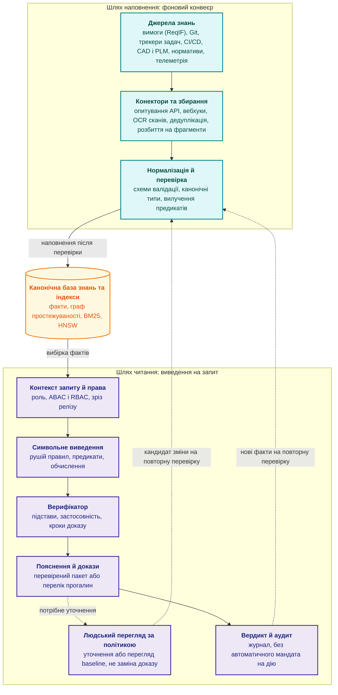
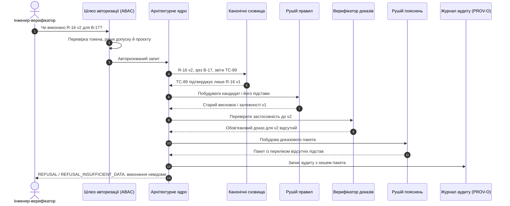
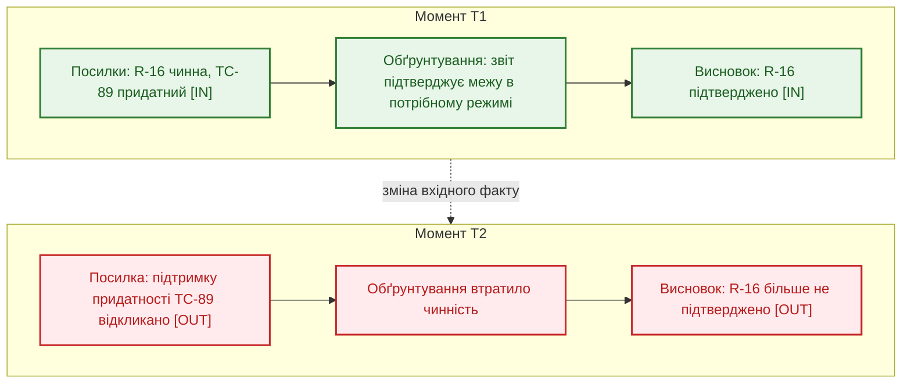
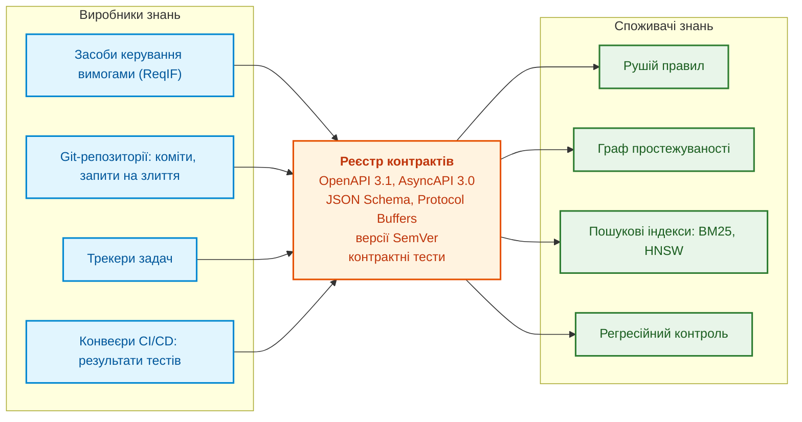

# Глава 16. Архітектура експертної системи: від формального знання до доказового рішення

> **Книга:** [Архітектура доказових експертних систем](README.md) · [Частина IV: Архітектура системи, нормативне виведення, діагностика та пояснення](part-04-architecture-and-inference.md)
> **Попередня глава:** [Глава 15. Вилучення знань і побудова бази знань: факти, граматики та автомати](ch15-knowledge-extraction-and-kb-construction.md)
> **Наступна глава:** [Глава 17. Технологічний стек](ch17-implementation-stack.md)
> **Зміст книги:** [README.md](README.md)
> **Автор:** [Микола Мартинович Федчик](about-the-author.md)
> **Передумови:** факти й правила, порівняння чисел, множини та прості графи; потрібні поняття нагадано в тексті. Програмні приклади потребують базового читання Go або Python.
> **Очікувані результати:** відділяти архітектурне ядро експертної системи від замінних адаптерів; проєктувати окремі шляхи наповнення знань і читання з виведенням; обирати фізичну форму зберігання для кожного типу знання; пояснювати, як підтримання істинності відкликає висновки після зміни фактів; задавати контракти даних між підсистемами; вимірювати якість пошуку, генерації та калібрування; фіксувати походження рішень за моделлю W3C PROV-O.

---

## Анотація

Архітектура доказової експертної системи має пояснювати не лише те, де зберігаються знання, а й хто перевіряє відповідь та на яких підставах її можна використати. На навчальному запиті про виконання вимоги розділено базу знань, механізм виведення, верифікатор, політику доступу й журнал походження. Від цього поділу послідовно перейдено до сховищ, окремих шляхів наповнення й читання, відкликання висновків та контрактів даних. Розрахунки якості пошуку й калібрування показують, як оцінити адаптер, не надаючи його балу сили доказу. Приклади підтримання обґрунтувань і запиту до графа походження дають змогу перевірити окремі механізми; вони не є реалізацією всієї системи чи підтвердженням її нормативної відповідності.

---

Попередні глави пояснили, як формалізувати інженерне знання: як вилучити вимоги, побудувати факти з прив'язкою до джерела й скінченні автомати. Але набір бібліотек, моделей і баз даних ще не утворює експертної системи. Потрібна архітектура: межі відповідальності між компонентами, окремі потоки наповнення й використання знань, сховища з відомими гарантіями та механізм, який вирішує, що вважати істинним.

Експертну систему можна реалізувати одним процесом або кількома сервісами; суттєвим є розподіл відповідальності, а не кількість програм. У ній співіснують факти, логічні правила, граф зв'язків, результати пошуку, виходи навчених моделей, рішення людей і доказовий слід. Тут діє сформульований автором **принцип структурної реалізації надійності за рамкою NIST AI RMF 1.0**: характеристики надійних систем штучного інтелекту, розглянуті в цій рамці [[1]](#src-1), потребують конкретних механізмів перевірки й відповідальних компонентів. Модульна будова допомагає їх реалізувати, але сама не доводить надійності чи відповідності рамці.

Ця глава відповідає на запитання: **з яких частин складається доказова експертна система і хто відповідає за допустимість її рішення?** У центрі відповіді лежить розроблена автором **концепція епістемічного суверенітету архітектурного ядра доказової системи**: канонічна база, механізм виведення, політика допуску й журнал походження суверенно формують рішення в межах схваленої моделі. Пошук, мовні моделі й конектори постачають кандидатів або обчислення. Сам архітектурний поділ не встановлює істинності джерел і правильності правил: потрібні предметна перевірка, застосовність та схвалення.

Глава зосереджена на логічному рівні архітектури: що таке знання в інженерному сенсі, де воно зберігається, як проходить запит, як експертна система реагує на зміну фактів, як підсистеми домовляються про формат даних і як вимірюється якість. Фізичний рівень (де виконуються моделі, які апаратні прискорювачі потрібні, які затримки допустимі) розглянуто в [Главі 18](ch18-execution-infrastructure.md).

## 1. Архітектурне ядро і межі відповідальності

Архітектурне ядро потрібне, щоб відділити відповідь на запит від способу її пошуку й подальшої дії. Почнімо з навчального запиту: «Чи виконано вимогу R-16 для випуску B-17?». Припустімо, затверджена вимога встановлює час реакції не більше 20 мс, а звіт TC-89 для цього випуску містить результат 18 мс. Пошук має знайти обидва документи; база знань зберігає їхні перевірені версії; механізм виведення застосовує правило порівняння; верифікатор перевіряє підстави й кроки; політика визначає доступ до відповіді та окремо право на дію; журнал зберігає слід. Поки що це лише умовні навчальні дані, не реальне випробування чи вимога стандарту.

Для розуміння прикладу достатньо розрізняти факт, правило й висновок: факт повідомляє результат вимірювання, правило задає умову, а висновок отримано їх застосуванням. Якщо звіту немає, виконання вимоги невідоме, а не спростоване. Якщо звіт придатний і правило застосовне, можна підтвердити саме перевірену властивість; це ще не дозвіл випустити весь виріб або подати команду обладнанню.

Сформульована автором **концепція архітектурного ядра експертної системи як єдиного володаря семантики істини** означає контроль правил прийняття висновку в схваленій моделі, а не безпомилкове знання світу. Ядро керує доменною моделлю, канонічними фактами, правилами, обмеженнями, графом зв'язків, доказами, політиками доступу, життєвим циклом знань і трасою міркування. За авторським регламентом аудиту воно відповідає на **п'ять фундаментальних запитань інженерної доказовості рішення**:

- які знання чинні на цей момент;
- які правила застосовано і в якому порядку;
- за яких технічних передумов висновок обґрунтовано і хто окремо уповноважує дію;
- на які першоджерела спирається кожен крок виведення;
- як відтворити весь ланцюг рішення через місяць чи рік.

Тому архітектурне ядро не можна ототожнювати з інструментами навколо нього. Механізм пошуку, векторна база даних, велика мовна модель (*Large Language Model*, LLM) чи середовище виконання моделей можуть бути дуже корисними, але не мають права самостійно вирішувати, що є істинним. Тут діє наскрізне конституційне розмежування повноважень між людиною та верифікатором: **людина — профільний доменний експерт — затверджує специфікації та знання до канонічної базової лінії бази знань ([Глава 11](ch11-knowledge-elicitation-from-experts.md), [Глава 14](ch14-requirements-detection-and-formalization.md)), тоді як детермінований верифікатор архітектурного ядра допускає відповідь на конкретний запит виключно на підставі верифікованих базових доказів ([Глава 12](ch12-linguistic-analysis-and-local-models.md)); мовна модель не має жодного з цих повноважень**. Їхнє завдання полягає в тому, щоб постачати кандидатів, обчислювати статистичні оцінки, знаходити змістову схожість або формулювати текст. Рішення стає експертним лише тоді, коли архітектурне ядро пропускає ці результати через формальні правила, інваріанти й перевірку походження та формує доказовий слід. Авторська **трикомпонентна таксономія відповідальності підсистем експертної системи** розподіляє компоненти на три групи.

<a id="obj-16-1"></a>
**Таблиця 16.1. Три групи відповідальності підсистем.**

| Група | Що входить | Хто володіє логікою |
|---|---|---|
| **Архітектурне ядро** | Доменна модель, канонічна база знань, правила, інваріанти, граф доказів, політики, аудит, життєвий цикл знань | Експертна система |
| **Власні функціональні підсистеми** | Конектори, збирання й нормалізація даних, розбиття на фрагменти, індексація, калібрування, пояснення, людський перегляд, зворотний зв'язок | Експертна система, яка фіксує контракти й вимоги до якості |
| **Сторонні сервіси** | Сховища даних, механізми пошуку, векторні СУБД, середовища виконання моделей, LLM, модулі оптичного розпізнавання символів (OCR), засоби керування життєвим циклом виробу (PLM) і застосунків (ALM), трекери задач, конвеєри CI/CD, реєстри моделей | Сторонні сервіси виконують обчислення, але не володіють експертним рішенням |

Такий розподіл дає змогу локалізувати три типові збої. Тут діє сформульоване автором **інженерне правило детермінованого відсікання стохастичних генерацій мовних моделей**: твердження без потрібного доказу не видається як перевірене. Це не універсальний детектор будь-якої вигадки: помилка в схваленому правилі може пройти такий шлюз. Пошкоджений індекс перебудовують зі збережених канонічних даних, а невідому схему трекера відхиляють на вході. Ізоляція зберігає цілісність ядра, проте до відновлення адаптера може знизитися доступність відповіді.

З інженерної практики автора випливає **принцип ізоляції замінних адаптерів (Fail-Safe Adapter Isolation)**: межу варто проводити з початку проєктування й перевіряти контрактними тестами. Для R-16 новий пошуковик може інакше впорядкувати документи, але не змінює порогу 20 мс чи правил верифікації. Це розділення релевантності (*relevance*, корисності кандидата для пошуку) й доказового допуску (*eligibility*, виконання обов'язкових перевірок). Зміна промпту не повинна непомітно змінювати правило порівняння.

Щоб архітектурне ядро могло володіти знанням, треба визначити, що саме вважається знанням.

> [!NOTE]
> **П'ять базових вимог до архітектурного ядра**
> 1. Одноосібне володіння семантикою істини: повна ізоляція ухвалення рішень від імовірнісних та евристичних моделей.
> 2. Детермінована трасованість походження: фіксація ланцюга обґрунтувань для кожного кроку виведення за моделлю PROV-O; незмінність забезпечує окремий механізм журналу.
> 3. Ізоляція замінних адаптерів: підключення LLM, векторних баз та пошукових рушіїв суто як зовнішніх постачальників кандидатів без права вердикту.
> 4. Контроль життєвого циклу знання: валідація статусів, часових меж чинності та прав власності на артефакти.
> 5. Автономне відновлення з канонічного джерела: здатність повної перебудови вторинних індексів у разі їх деградації чи компрометації.
> *Керування рантаймом / Інженерний інваріант:* спроба зовнішнього адаптера модифікувати стан істинності без проходження через архітектурне ядро негайно блокується з викликом `E_CORE_SECURITY_FAULT`.

### 1.1. Канонічний словник вердиктів рантайму та межі повноважень

У цій монографії запропоновано авторський контрактний словник вердиктів, який визначає взаємодію механізму виведення, верифікатора й споживача рішення експертної системи. Назви `ACCEPT`, `QUALIFIED` і `REFUSAL` та наведене нижче відображення є архітектурою цієї моделі, а не форматом, установленим ISO 26262 чи DO-178C. Поведінка, позначена ASIL або QM, застосовується лише в разі вибору відповідного профілю продукту. Без такого контракту знайдений фрагмент, допустимий розв'язок солвера або логічна істинність помилково перетворюються на дозвіл виконати дію. У критичній експлуатації недостатньо уніфікувати назви статусів: необхідно зберегти їхній доказовий зміст і межі повноважень.

У паспорті рішення розділено чотири незалежні поля:

1. **Зовнішній вердикт** `verdict`: лише `ACCEPT`, `QUALIFIED` або `REFUSAL`; типізований `substatus` уточнює підставу.
2. **Внутрішня діагностика** `diagnostic`: результат пошуку, солвера, маршрутизатора чи перевірки, наприклад `FOUND`, `FEASIBLE`, `UNKNOWN` або `PARTIAL`. Це вхід верифікатора, а не самостійний зовнішній допуск.
3. **Логічний стан** `logical_state`: підтвердження, спростування, суперечність або відсутність відомостей у прийнятій логіці; зокрема значення логіки Белнапа не є класами зовнішніх вердиктів.
4. **Повноваження на виконання** `execution_authority`: окрема перевірка конкретної дії за чинною політикою, правами, передумовами й профілем безпеки. Навіть `ACCEPT` щодо факту не є універсальним дозволом керувати обладнанням.

Наведена таблиця є канонічним відображенням спеціалізованих токенів, а не правилом їх механічного перейменування. Позначення `Rank_rel` означає безрозмірний ранг нормативної підтримки від нуля; `sim` — безрозмірну подібність у межах `[0; 1]`; `Δr` — різницю рангів норм у прийнятій ієрархії; `K` — міру конфлікту свідчень у межах `[0; 1]`, а `τ_K` — заданий профілем поріг у тих самих межах. Ранг і подібність не є ймовірністю істинності. Умови та пороги спеціалізованих механізмів збережено; обчислення розглянуто в [Главі 2](ch02-epistemology-of-machine-knowledge.md), [Главі 6](ch06-applied-mathematics-for-expert-systems.md) і [Главі 7](ch07-knowledge-base-typology.md).

<a id="obj-16-2"></a>
**Таблиця 16.2. Канонічні вердикти та межі їхніх повноважень.**

| Зовнішній вердикт | Канонічний підстатус | Умова та наслідок для рантайму | Відображення спеціалізованих токенів |
| :--- | :--- | :--- | :--- |
| `ACCEPT` | `ACCEPT` | Повний доказ запитаного висновку в межах схваленої моделі й застосовних джерел; чинні підстави, повна кастодія, виконані інваріанти та відсутність активних дефітерів. Висновок видається без невиконаних умов. | `VERIFIED_FACT`; висновки з міжпакетних мостів **лише після їх допуску до baseline і доказових перевірок** за [Главою 25 §12.1](ch25-how-expert-systems-learn.md#121-синтетичні-машинні-міркування-дистиляція-векторних-припущень-у-верифіковані-правила); підтверджені `FOUND`, `INFERRED`, `VALIDATED`, `FEASIBLE` лише після подальших доказових перевірок; фінальний допуск [Глави 19](ch19-from-question-to-evidence.md). Ранг підтримки сам по собі не дає `ACCEPT`. |
| `QUALIFIED` | `ACCEPT_CONDITIONAL` | Нормативна підтримка `Rank_rel ≥ 1,00` наявна, але діє правомірний тимчасовий дозвіл на відхилення (*waiver*), явно подоланий дефітер або обов'язкова супутня умова. Умови, строк і компетентний орган зазначаються в паспорті; заборонена дія не дозволяється. | `CONDITIONAL_ACCEPT` із перевіркою регресії; `ACCEPT_CONDITIONAL`, зокрема дозвіл W-17; умовний паспорт рішення. |
| `QUALIFIED` | `QUALIFIED_PARTIAL` | Неповне покриття запиту з точним переліком прогалин. У профілі QM видається лише самостійно верифікована, відокремлювана підмножина; це не допуск решти запиту. Для неподільного рішення ASIL брак обов'язкової частини означає `REFUSAL_INSUFFICIENT_DATA`. | `QUALIFIED` за `0 < Rank_rel < 1,00`; шардовий `PARTIAL`; частково підтверджений доказовий пакет. Профіль обмежує можливість видачі, а не підвищує статус неперевірених тверджень. |
| `QUALIFIED` | `QUALIFIED_CLARIFICATION_REQUIRED` | Не вистачає параметрів випадку для однозначного вибору нормативної гілки. Повертається детермінований перелік уточнень без дозволу на дію, передумови якої невідомі. | `QUALIFIED_CLARIFICATION`; `CLARIFICATION`, `QUALIFIED_NONANSWER` консультативного режиму; запит уточнення контексту. |
| `QUALIFIED` | `QUALIFIED_PROVISIONAL` | Кандидат композиції з перевіреною сумісністю або евристична, прецедентна чи абдуктивна пропозиція з планом незалежної перевірки; не є доведеним фактом або дозволом на критичну дію. | `SYNTHESIZED` до допуску до baseline; `BOUNDED_HYPOTHESIS` винахідницького режиму; `QUALIFIED_ANALOGY` за `0,60 ≤ sim < 0,85`; `ESTIMATED`; попередній висновок для експертного розгляду. |
| `REFUSAL` | `REFUSAL_INSUFFICIENT_DATA` | Бракує обов'язкових доказів, норми чи відповіді вузла або вичерпано бюджет солвера. Видача відповідного висновку й залежна дія блокуються за `Fail-Closed`; невідомість не оголошується хибністю. | `UNGROUNDED_ATOM` за `Rank_rel = 0`; `REFUSAL` без застосовної норми; `INDETERMINATE` за таймауту; `UNKNOWN` за мовчання шарда. |
| `REFUSAL` | `REFUSAL_NORMATIVE_CONFLICT` | Нерозв'язана нормативна колізія рівного чи невідомого пріоритету (`Δr = 0` для рівного), `K ≥ τ_K` або порушення інваріанта безпеки блокують рішення. | `REFUSAL_NORMATIVE_CONFLICT`, діагностичний `QUALIFIED_CONFLICT` за нерозв'язаної колізії; `EVIDENTIARY_CONFLICT`; `CONTRADICTION`, `REJECT`, `UNSAT`, `RELEASE_BLOCKED`. |

`FOUND` підтверджує знаходження кандидата, а `FEASIBLE` — допустимість у заданій моделі обмежень; жоден токен не доводить повноти моделі, нормативної застосовності чи правомірності дії. Точна цитата й збіг SHA-256 доводять відповідність байтів, але не істинність джерела або коректність його формалізації. Перед `ACCEPT` верифікуються походження, чинність і застосовність джерел, передумови, ланцюг виведення, дефітери та інваріанти; припущення джерела й моделі явно входять до паспорта. Конструктивний показник `ZHR_gate = 1,00` означає повноту перевірки обов'язкових доказових зв'язків шлюзом, а не безумовну істинність світу чи емпіричну гарантію відсутності помилок.

Нормативна заборона не бере участі у змаганні ймовірностей із рекомендацією. Її застосовність може бути змінена лише доведеним правилом нормативного пріоритету або чинним дозволом компетентного органу в межах повноважень; непереборна заборона залишається блокувальною. `QUALIFIED` дозволяє повідомити умови, гіпотезу або уточнення, але не виконати заборонену дію.

> [!NOTE]
> **Авторський контракт канонічних вердиктів**
> 1. У монографії запропоновано єдине відображення спеціалізованих токенів у три зовнішні вердикти зі збереженням діагностики, логічного стану й окремої авторизації дії.
> 2. Відповідальна людина підписує введення специфікацій і знань у базову лінію (`baseline`); це не вимога людського підпису кожної відповіді. На конкретний запит детермінований верифікатор перевіряє докази, а мовна модель не затверджує ні базову лінію, ні вердикт. Розгляд `QUALIFIED` не замінює доказу.
> 3. Для профілю ASIL потрібен повний детермінований доказ у схваленій моделі; статистичний бал, ручна згода або часткова відповідь не замінюють відсутньої обов'язкової підстави. Неподільне ASIL-рішення за неповноти блокується, тоді як QM допускає видачу лише перевіреної відокремлюваної частини.
> *Керування рантаймом / Інженерний інваріант:* діагностика не підвищує повноваження; заборона й невиконані обов'язкові передумови блокують залежну дію незалежно від назви підстатусу.

## 2. Операційне знання в інженерному сенсі

Операційне знання потрібне, щоб перетворити речення «реакція не пізніше 20 мс» на придатний до перевірки вхід, не загубивши умови його застосування. Для R-16 треба знати випуск, режим тестування, одиницю часу й чинну ревізію. У розробленій автором **концепції операційного машинного знання** документ є першоджерелом, але не замінює типізованих фактів і правил. Тип означає допустимий вид значення: час у мілісекундах не можна порівнювати з номером ревізії.

Операційне знання має типізовану структуру, власника, версію, статус у життєвому циклі, джерело походження, область застосування, зв'язки з іншими артефактами, часові межі чинності та формальні правила використання. Затверджена нормативна вимога, чернетка інженерної нотатки, уточнення від постачальника, звіт про випробування й коментар у месенджері мають різний статус, навіть якщо всі ці тексти написані однією природною мовою. В авторській моделі операційне знання декомпонується на **шестикомпонентну онтологічну структуру**:

- **Факти** описують перевірений стан об'єкта чи середовища: вимога REQ-101 затверджена, тест TEST-404 провалено, дефект DEF-12 має критичний статус.
- **Правила** задають логічні залежності й політику рішень: якщо критичний дефект зачіпає підсистему безпеки, перехід до польових випробувань блокується за обраним профілем. Логічне правило саме по собі не доводить фізичної причинності.
- **Онтології** задають систему понять і відношень предметної області: що є вимогою, компонентом, тестом, ризиком, сертифікаційним доказом. Стандартною мовою онтологій є OWL 2 консорціуму W3C [[2]](#src-2).
- **Обмеження та інваріанти** визначають заборонені стани. Наприклад, внутрішнє правило організації може вимагати, щоб вимога рівня цілісності безпеки SIL 3 (*Safety Integrity Level*) не вважалася закритою без двох незалежних звітів верифікації. Для графів знань такі обмеження записують мовою SHACL (*Shapes Constraint Language*) [[3]](#src-3).
- **Прецеденти** зберігають структурований досвід: історію усунення кавітації в насосних вузлах, погоджені винятки з правил.
- **Походження** (*provenance*) фіксує родовід знання: хто вніс факт, на підставі якого документа, у якій ревізії, за яких припущень. Модель походження PROV-O консорціуму W3C описує такий родовід як граф сутностей, дій і агентів [[4]](#src-4).

Отже, в архітектурі доказових систем діє сформульований автором **принцип контрольованого графа взаємопов'язаних інженерних артефактів**. Вузлами графа є, наприклад, R-16 і TC-89, а ребро «перевіряє» пов'язує звіт із вимогою та конкретним випуском. Без цього ребра результат 18 мс може стосуватися іншого виробу. Граф дає структуру перевірці й відкликанню, але не гарантує повноти чи правильності внесених зв'язків. Наступне запитання полягає в тому, у яких фізичних формах його зберігати.

## 3. Фізичні форми та типологія сховищ знань

Фізичні форми знань обирають за операціями, потрібними для вже поставленого запиту. Для R-16 слід атомарно змінити статус ревізії, пройти зв'язок до TC-89 і відкрити оригінал звіту. Транзакція є групою змін, яку сховище приймає цілком або відхиляє; ACID охоплює атомарність, узгодженість заданих обмежень, ізоляцію й довговічність. Це властивості операцій із даними, не гарантія істинності документа. Індекс є допоміжною структурою для швидкого пошуку. Діаграма групує потрібні можливості; вона не вимагає дев'яти окремих серверів.

<a id="obj-16-3"></a>
**Діаграма 16.3. Фізичні форми зберігання знань.**

```mermaid
flowchart TB
    accTitle: Фізичні форми зберігання знань
    accDescr: Інженерні знання розподілено між трьома групами сховищ: структуровані дані, пошук і першоджерела, керованість і відтворюваність.

    K["<b>Фізичні форми знань</b>"]

    subgraph Structured["Структуровані дані"]
        direction LR
        R["<b>Реляційна СУБД</b><br/>таблиці, з'єднання, транзакції ACID"]
        G["<b>Графова СУБД</b><br/>вузли, ребра, простежуваність"]
        RDF["<b>Сховище RDF і OWL</b><br/>трійки, дескриптивна логіка"]
        D["<b>Документна СУБД</b><br/>JSON-документи зі схемами"]
    end

    subgraph Retrieval["Пошук і першоджерела"]
        direction LR
        S["<b>Лексичний індекс</b><br/>BM25, фасети, N-грами"]
        V["<b>Векторна СУБД</b><br/>HNSW, змістова схожість"]
        O["<b>Об'єктне сховище</b><br/>PDF, CAD-моделі, бінарні файли"]
    end

    subgraph Governance["Керованість і відтворюваність"]
        direction LR
        A["<b>Журнал аудиту</b><br/>лише дописування, PROV-O, хеші"]
        M["<b>Реєстр моделей</b><br/>картки моделей, ваги, квантування"]
    end

    K --> R & G & RDF & D
    K --> S & V & O
    K --> A & M

    classDef root fill:#e1f5fe,stroke:#0288d1,stroke-width:2px,color:#01579b;
    classDef struct fill:#e8f5e9,stroke:#2e7d32,stroke-width:2px,color:#1b5e20;
    classDef retr fill:#fff3e0,stroke:#e65100,stroke-width:2px,color:#bf360c;
    classDef gov fill:#ede7f6,stroke:#512da8,stroke-width:2px,color:#311b92;

    class K root;
    class R,G,RDF,D struct;
    class S,V,O retr;
    class A,M gov;
```



Діаграма показує авторську тривекторну модель розподілу сховищ (структуровані дані, пошук і першоджерела, керованість і відтворюваність). Вона реалізує запропоновану автором **дев'ятирівневу типологію спеціалізованих сховищ інженерних знань**, де кожна фізична форма має суворе призначення:

- **Реляційні таблиці** зберігають сутності з фіксованими атрибутами, ключами й гарантіями цілісності: статуси погоджень, версії специфікацій, ролі користувачів.
- **Графові структури** обслуговують пошук шляхів, аналіз впливу змін (*change impact analysis*) і простежуваність між вимогами, кодом і тестами.
- **Трійки RDF з онтологіями OWL** потрібні для автоматичного онтологічного виведення за стандартами W3C.
- **Документні сховища** утримують складні структуровані звіти, налаштування та контекст інженерних сесій.
- **Лексичні індекси** забезпечують фільтрацію за точними ідентифікаторами (номер стандарту, пункт регламенту, код деталі), фасетну навігацію та повнотекстовий пошук; типовою функцією ранжування для них є BM25 [[5]](#src-5).
- **Векторні індекси** знаходять змістово схожі прецеденти й нормативи з різною термінологією; для швидкого пошуку найближчих векторів застосовують графові індекси HNSW (*Hierarchical Navigable Small World*) [[6]](#src-6).
- **Об'єктні сховища** зберігають оригінальні файли (скани актів, нормативні PDF, графіки телеметрії) разом із контрольними сумами SHA-256.
- **Журнали аудиту** є структурами лише з дописуванням (*append-only*), що фіксують хронологію виведення, спрацьовані правила й рішення експертів.
- **Реєстри моделей** версіонують метадані, метрики точності, параметри квантування й артефакти навчених мовних моделей.

Авторський **архітектурний інваріант поліморфної персистенції: заборона універсальної монолітної СУБД** тут слід розуміти як заборону змішувати ролі канонічних даних і похідної видачі, а не як заборону одного програмного продукту. Одна СУБД може надавати таблиці, зв'язки й пошукові індекси; кілька СУБД не гарантують правильного поділу. Це уточнює авторський **принцип асиметрії канонічних сховищ та похідних індексів**: схвалена ревізія R-16 і оригінал TC-89 зберігаються як опорні дані, а пошукові представлення відновлюються з них за зафіксованою конфігурацією. Втрата індексу не повинна знищити звіт. Час перебудови й потребу в синхронізації оцінюють окремо; назва сховища не гарантує швидкості.

Найпоширеніша спокуса полягає в тому, щоб звести всі форми до однієї, векторної бази. Наступний розділ пояснює, чому так робити не можна.

## 4. Обмеження векторних сховищ та відокремлення семантичного пошуку від канонічної істини

Векторне сховище може знайти опис «затримки відповіді», коли користувач запитує про «час реакції» R-16. Для цього енкодер перетворює текст на вектор, тобто впорядкований набір чисел, а ранжування впорядковує кандидати за близькістю цих представлень. Але найближчим може виявитися скасований звіт. Чотири запитання нижче систематизують цю відому межу retrieval: сховище може фільтрувати метадані, проте сам бал схожості не доводить:

- Чи чинний цей пункт стандарту на дату випуску виробу?
- Чи скасовано цю вимогу пізнішим бюлетенем змін?
- Чи має користувач допуск до цього фрагмента?
- Чи не суперечить знайдений фрагмент обмеженню безпеки з іншого документа?

Відповідь на кожне з цих запитань потребує перевірки статусу документа, графа заміщень, політики доступу чи правил несуперечливості поряд зі змістовим пошуком. Без таких перевірок система ризикує цитувати застарілі інструкції, скасовані стандарти або фрагменти, що суперечать іншим правилам. [Глава 15](ch15-knowledge-extraction-and-kb-construction.md) показала проблему редакцій на прикладі протоколу SMTP; решта запитань тут наведені як архітектурні категорії, а не як результати одного експерименту.

Сформульований автором **архітектурний інваріант кандидата векторного пошуку (шестипараметричний паспорт метаданих)** звучить так: **векторний пошук повертає лише кандидатів, і кожен кандидат несе обов'язковий повний паспорт метаданих**:

- однозначний ідентифікатор канонічного джерела ($`ID_{\mathrm{src}}`$);
- номер ревізії та часові межі чинності ($`[t_{\mathrm{valid\_start}}, t_{\mathrm{valid\_end}}]`$);
- статус життєвого циклу: чинний (`ACTIVE`), відкликаний (`RETRACTED`), на перегляді (`UNDER_REVIEW`), не автоматичне встановлення юридичної сили;
- мітку класифікації доступу (Security Clearance);
- контрольну суму першоджерела ($`\mathrm{SHA\text{-}256}`$);
- відбиток конвеєра векторизації (Pipeline Fingerprint).

Щоб відрізняти індекси, отримані різними налаштуваннями, потрібен короткий відбиток конфігурації. Хеш SHA-256 перетворює байтовий запис довільної довжини на 256 біт; його використовують для звірення, не для оцінювання істинності. В авторській моделі **концепція відбитка конвеєра векторизації (Pipeline Fingerprint)** задається так:

<a id="obj-16-4"></a>
**Формула (16.4). Відбиток конфігурації векторизації.**

```math
\mathrm{Fingerprint}_{\mathrm{pipeline}} = \mathrm{SHA256}\!\left(C([\text{ModelName},\text{WeightsRev},\text{ChunkSize},\text{Overlap},\text{TokenizerRev}])\right).
```

Тут `ModelName`, `WeightsRev`, `TokenizerRev` є непорожніми рядками ідентифікаторів моделі, ваг і токенізатора; ревізії адресують незмінні артефакти. `ChunkSize` є додатним цілим числом токенів у фрагменті, а `Overlap` є цілим числом від нуля до `ChunkSize - 1`. Функція $C$ однозначно кодує типізований масив: для цього навчального профілю це UTF-8 компактного JSON-масиву з фіксованим порядком полів, без нормалізації рядків і без пробілів поза рядками; числа записують десятковими цілими. Результат має 32 байти або 64 шістнадцяткові символи. У реальному профілі до запису додають усі інші параметри, які впливають на векторизацію, зокрема нормалізацію тексту й режим енкодера.

Наприклад, спочатку кодують `["enc","w1",256,32,"tok1"]`, потім обчислюють хеш отриманих байтів. Заміна 256 на 512 створює іншу конфігурацію й потребує перевірки індексу. Просте склеювання рядків не підходить: пари `ab,c` та `a,bc` дали б однакові байти ще до хешування. Однозначне кодування прибирає цю неоднозначність, але не математичну можливість хеш-колізії.

Сформульований автором **закон несумісності гетерогенних векторних просторів** обмежено випадками, де немає перевіреного спільного координатного подання. Для різних енкодерів однакова кількість координат не гарантує однакового змісту осей; потрібне окреме узгодження або переіндексація. Зміна лише розміру фрагмента з тим самим енкодером не обов'язково змінює простір, але змінює одиниці пошуку й потребує нової оцінки якості. Після перевірки метаданих кандидат R-16 ще проходить перевірку застосовності та змісту: правильний відбиток не є доказом правильного тлумачення.

Тепер можна зібрати компоненти в цілісну архітектуру.

## 5. Референсна архітектура: шлях наповнення і шлях читання

Референсна архітектура має поєднати попередні компоненти так, щоб запит про R-16 не запускав повторне розпізнавання PDF. Для цього потрібні два режими: підготувати схвалений знімок знань і прочитати його для конкретного запиту. Знімок є зафіксованою версією даних, яку запит не змінює. Запропонована автором **референсна архітектура асиметричного розділення потоків (Fill Path проти Read Path / Епістемічний CQRS)** розводить ці потоки; CQRS тут означає відокремлення операцій зміни від операцій читання:

1. **Шлях наповнення** (*fill path*) є фоновим конвеєром, який перетворює сирі інженерні джерела на канонічні, структуровані й перевірені знання.
2. **Шлях читання й виведення** (*read path*) обробляє запит: визначає контекст і права доступу, вибирає факти, застосовує правила, будує пояснення й фіксує аудиторський слід.

Розбір PDF і перевірка вилучених значень мають інший бюджет ресурсів, ніж відповідь на запит. Винесення цих робіт у фон усуває їх із залежностей конкретної відповіді, але не усуває конкуренції за процесор чи пам'ять. Межі затримки потребують планування ресурсів і вимірювань. Діаграма показує логічне розділення, а не часову гарантію.

<a id="obj-16-5"></a>
**Діаграма 16.5. Окремі шляхи наповнення й читання.**



На діаграмі шлях наповнення завершується канонічною базою знань та індексами, а шлях читання лише читає з неї. Тут реалізовано запропонований автором **принцип односпрямованого виведення та зворотної нормалізації похідних фактів**: нові факти, які породжує шлях читання, не потрапляють до бази знань напряму — вони повертаються на нормалізацію й перевірку, як і будь-які інші вхідні дані. Авторська **семикомпонентна функціональна декомпозиція трактів наповнення та виведення** закріплює такі обов'язки компонентів:

- **Конектори джерел** ізолюють протоколи зовнішніх інформаційних систем (трекерів задач, репозиторіїв коду, засобів керування вимогами й життєвим циклом виробу, вікі). Імпорт має обліковувати пропущені й повторні події; відновлення після збою потребує окремої перевірки.
- **Конвеєр збирання** (*ingestion*) розбирає складні формати (PDF, DOCX, ReqIF, XML), витягує таблиці й формули, виконує оптичне розпізнавання низькоякісних креслень, обчислює контрольні суми й записує метадані походження.
- **Шар нормалізації** перетворює різнорідні дані на єдину онтологічну структуру, замінює локальні ідентифікатори глобальними, узгоджує одиниці вимірювання з SI.
- **Символьний механізм виведення** застосовує правила до фактів. Rete зіставляє умови продукційних правил [[7]](#src-7), а Datalog задає рекурсивні запити [[8]](#src-8); це різні засоби, не готові гарантії правильності. Для Datalog без функціональних символів, зі скінченними даними, без породження нових значень і зі стратифікованим запереченням обчислення завершується; поліноміальна оцінка за обсягом даних потребує фіксованої програми правил. Стратифікація означає, що заперечення посилається лише на вже обчислений нижчий рівень. Це не оцінка найгіршого фізичного часу (WCET). Ізольований числовий обчислювач повертає значення з одиницями, похибкою й статусом або таймаут; бюджет часу не доводить його семантичної правильності.
- **Шар пояснення** будує дерево доведення: які правила спрацювали, які факти стали основою і яких даних забракло для категоричного висновку.
- **Модуль людського перегляду** (*human-in-the-loop*) уточнює контекст і організовує схвалення змін базової лінії. Людський розгляд не підмінює відсутнього доказу конкретної відповіді.
- **Шлюз авторизації** обмежує доступ до фактів і фрагментів. Тут реалізовано авторський **дворівневий шлюз контекстної авторизації запитів (RBAC/ABAC/Rego)**: рольова модель доступу RBAC (*Role-Based Access Control*) надає права за ролями [[9]](#src-9), а модель доступу на основі атрибутів ABAC (*Attribute-Based Access Control*) враховує атрибути користувача, ресурсу й контексту, наприклад проєкт і рівень допуску [[10]](#src-10). Політики доступу зручно задавати декларативно, наприклад мовою Rego в Open Policy Agent [[11]](#src-11).

У цій семикомпонентній декомпозиції верифікатор є окремою відповідальністю ядра, навіть коли працює в одному процесі з рушієм. Рушій для R-16 будує висновок із 18 мс і порогу 20 мс; верифікатор перевіряє збіг випуску й режиму, одиниці, ревізії, допустиму похибку та відсутність блокувального винятку. Однаковий вихід програми на тих самих байтах означає детермінізм, але не правильність порога чи доказу. Далі простежимо передачу такого результату користувачеві.

> [!NOTE]
> **Чотири інваріанти асиметричного розділення потоків (Fill Path проти Read Path) автора**
> 1. Часова та обчислювальна ізоляція: шлях читання не очікує завершення фонового розбору; його часовий бюджет перевіряють окремо з урахуванням спільних ресурсів.
> 2. Незмінність канонічного зрізу: шлях читання адресує виключно валідований і заморожений у часі знімок бази знань.
> 3. Односпрямованість виведення: факти, згенеровані під час виведення, повертаються на вхід конвеєра нормалізації й не пишуть у сховище напряму.
> 4. Контекстний мандат допуску: кожен запит проходить предикатну фільтрацію за політиками ABAC/RBAC до початку активації продукційних правил.
> *Керування рантаймом / Інженерний інваріант:* пряма спроба запису в канонічну базу знань в обхід конвеєра наповнення блокується рантаймом із кодом помилки `E_READONLY_STORAGE_VIOLATION`.

Ключовою функцією конвеєра наповнення (*Fill Path*) є також перенесення обчислювальної складності логічного аналізу з моменту виконання запиту на етап попередньої компіляції знань (*Ahead-of-Time Epistemic Inference*). Замість того, щоб у критичному тракті рантайму будувати таксономічні замикання або агрегувати розміри складених полів протокольних структур даних, компілятор наповнення завчасно синтезує правила виведення та забезпечує багатоланкову побайтову кастодію доказових якорів:

> [!NOTE]
> **Чотири відомі механізми виведення та збереження підстав**
> 1. **Таксономічне спадкування норм (`IS-A` Subsumption Closure):** наслідки належності до класу можна попередньо обчислювати за застосовним універсальним правилом із перевіркою області й винятків.
> 2. **Меронімічна агрегація структурних параметрів (`PART-OF` Structural Summation):** розміри складеного об'єкта підсумовують лише для повного неперекривного поділу; саме відношення «частина» не доводить адитивності.
> 3. **Міжреченнєве зв'язування дефітерів (`Cross-Sentence Defeater Linking`):** мовні маркери винятку пропонують кандидатні зв'язки. Підривач (`Undercutter`) заперечує застосовність правила, а спростувальний аргумент (`Rebuttal`) підтримує протилежний висновок; тип і ціль зв'язку перевіряються до baseline.
> 4. **Складена побайтова кастодія доведення (`Compound Evidence Custody`):** кожен похідний факт зберігає якорі всіх засновків; кастодія тут означає простежуване збереження та звірення точних байтів.
> *Керування рантаймом / Інженерний інваріант:* порушення цілісності обов'язкового зрізу блокує `ACCEPT`; успішна звірка хешу є необхідною, але не достатньою умовою доказового допуску.

Перший механізм спирається на звичайне універсальне застосування правила, а не на окремий закон істинності:

<a id="obj-16-6"></a>
**Формула (16.6). Застосування універсальної норми до об'єкта класу.**

```math
\bigl(x\in C \ \land\ \forall y\in C:\mathrm{Norm}(y)\bigr)\ \Longrightarrow\ \mathrm{Norm}(x).
```

Тут $C$ є множиною об'єктів одного визначеного класу, $x$ є перевірюваним об'єктом, $y$ перебирає цей клас, а `Norm` є булевим предикатом застосовної норми; фізичних одиниць немає. Наприклад, якщо схвалене правило вимагає протокол тесту для кожної вимоги класу «часова», а R-16 належить цьому класу, протокол потрібен і для R-16. Якщо правило має виняток, його передумову треба включити в область $C$; саме слово «вимога» не доводить належності.

Другий механізм відповідає на інше питання: скільки байтів займає складений запис?

<a id="obj-16-7"></a>
**Формула (16.7). Довжина запису з неперекривних полів.**

```math
\mathrm{Length}(X)=\sum_{i=1}^{n}\mathrm{Length}(f_i).
```

Тут $X$ є записом із $n\ge1$ полів; $i$ є індексом поля, а $`f_i`$ є його $i$-ю частиною. Усі довжини є невід'ємними цілими в байтах. Поля мають покривати запис без пропусків і перекриття; вирівнювання враховують як окреме поле. Для двох полів по 2 і 4 байти результат становить 6 байтів; додані 2 байти заповнення дають 8. Без цієї передумови підсумовування помилково визначить межі зрізів доказу.

Четвертий механізм зберігає не лише результат обчислення, а й адреси його підстав:

<a id="obj-16-8"></a>
**Формула (16.8). Посилання на первинні підстави похідного твердження.**

```math
\mathrm{Custody}(d)=\langle\mathrm{SliceID}(S_1),\ldots,\mathrm{SliceID}(S_k)\rangle.
```

Тут $d$ є похідним твердженням, $k\ge1$ є цілою кількістю його первинних підстав, $`S_i`$ є байтовим зрізом джерела з індексом $i$ від 1 до $k$, а `SliceID` містить ідентичність незмінного носія, початок, кінець і хеш зрізу. Межі є цілими байтовими зміщеннями з включеним початком та виключеним кінцем у межах носія. Для висновку R-16 потрібні принаймні зріз порога 20 мс і зріз результату TC-89 18 мс, прив'язані до випуску. Збіг цих байтів не доводить правильності порівняння або повноти підстав; це робота верифікатора.

## 6. Життєвий цикл запиту: від запитання до доказового пакета

Життєвий цикл запиту показує, як розподіл відповідальності працює від входу до відповіді. Продовжимо R-16 і випуск B-17: у ревізії v1 результат TC-89 18 мс задовольняв межу 20 мс. Тепер вимогу змінено до v2, але відповідного звіту ще немає. Запит залишається тим самим: «Чи виконано R-16 для B-17?». Потрібно не перенести старе схвалення на нову ревізію, а повернути брак обов'язкового доказу. Розроблений автором **наскрізний п'ятистадійний алгоритм життєвого циклу запиту** деталізовано нижче.

<a id="obj-16-9"></a>
**Діаграма 16.9. Запит після зміни ревізії R-16.**



Таблиця деталізує п'ять етапів обробки запиту.

<a id="obj-16-10"></a>
**Таблиця 16.10. П'ять етапів обробки запиту.**

| Етап | Дія | Компоненти | Результат |
|---|---|---|---|
| **1. Контекст і безпека** | Автентифікація інженера, визначення проєкту, ролі, рівня допуску й гілки релізу | Шлюз авторизації, сервіс політик | Перевірений контекст із фільтрами доступу |
| **2. Вибірка фактів** | Пошук R-16 v2 і звітів для B-17 у закріпленому знімку | Канонічна база та похідні індекси | Виявлено лише звіт для v1 |
| **3. Правила й виведення** | Побудова кандидата рушієм, незалежна за функцією перевірка ревізій та підстав | Рушій правил і верифікатор | Відмова в підтвердженні виконання v2, не доказ її порушення |
| **4. Пояснення** | Збирання наявних посилань і точного переліку прогалин | Рушій пояснень; LLM лише для контрольованого резюме | Типізований пакет із зовнішнім вердиктом і діагностикою |
| **5. Рішення й аудит** | Фіксація пакета й перевірок; підпис за політикою | Підсистема аудиту | Запис відмови; мандат на дію не виникає |

У цій архітектурі втілено авторський **архітектурний патерн доказового пакета як первинного інтерфейсу системи**: висновок передається разом із правилами, цитатами, припущеннями й діагностикою. Тут діє авторське **інженерне правило ізоляції ролі LLM до пост-інференційного реферування**: у показаному шляху модель лише стисло описує готовий пакет, а її текст перевіряють на відповідність йому. Це не забороняє дорадчого мовного аналізу до виведення; він також не має права допуску. За авторським **принципом повної відтворюваності логічного вердикту без генеративних нейромереж** відповідь можна повторити на тих самих фактах, правилах, контексті й версії детермінованого виконавця. Бітова тотожність додатково потребує канонічного порядку й кодування; правильність змісту та WCET перевіряються окремо.

Отже, відсутній звіт для v2 дає `REFUSAL_INSUFFICIENT_DATA`, а не твердження «тест провалено». Новий придатний звіт може відновити підставу; перехід до випуску всього виробу все одно потребує інших вимог і окремого мандата. Наступне питання: як відкликати старі висновки, не втративши ті, що мають альтернативні обґрунтування?

## 7. Системи підтримання істинності та інвалідація висновків при зміні фактів

В інженерних проєктах знання змінюється: специфікації оновлюються, стандарти доповнюються, тести перезапускаються. Експертна система, яка претендує на доказовість, має відповісти на запитання: що відбувається з раніше прийнятими висновками, коли вихідний факт спростовано або змінено? Без механізму підтримання істинності (*Truth Maintenance System*, TMS) база знань поступово заповнюється застарілими й взаємно суперечливими висновками.

Спершу потрібне поняття обґрунтування: це правило разом із набором посилок, які підтримують висновок. Механізм підтримання істинності на основі обґрунтувань (*Justification-based TMS*, JTMS) Джона Дойла підтримує мітки IN (прийняте) й OUT (неприйняте) в поточному наборі переконань [[12]](#src-12). Повний JTMS може враховувати й умови на відсутність підтримки; наведена нижче програма реалізує лише позитивні залежності. Механізм на основі припущень (*Assumption-based TMS*, ATMS) Йохана де Клеєра зберігає для твердження мітку як сімейство мінімальних несуперечливих наборів припущень [[13]](#src-13). Наприклад, одна підстава R-16 використовує TC-89, інша використовує схвалений профілем звіт моделювання SIM-12. Мітка ATMS може містити обидві альтернативи; це не одна множина, яка вимагає їх одночасно.

> [!NOTE]
> **Два відомі режими підтримання істинності**
> 1. Односвітова модель JTMS: працює за принципом перемикання станів `IN / OUT`; у разі спростування вхідного факту здійснює немонотонне відкликання залежних висновків вздовж графа обґрунтувань для реактивного контролю конфігурацій релізу.
> 2. Багатосвітова модель ATMS: приписує твердженню сімейство мінімальних несуперечливих середовищ, щоб розглядати альтернативні припущення; кількість середовищ може зростати комбінаторно.
> *Керування рантаймом / Інженерний інваріант:* JTMS оновлює підтримку в поточному стані, ATMS зберігає альтернативи; жодна назва алгоритму не гарантує часу виконання чи фізичного відкату дії.

Діаграма показує найпростіший випадок: висновок спирається на один факт, і відкликання факту відкликає висновок.

<a id="obj-16-11"></a>
**Діаграма 16.11. Втрата єдиного обґрунтування.**



На момент T1 обидві посилки підтримано, тому висновок має IN. На момент T2 придатність TC-89 більше не підтримано; за єдиного обґрунтування висновок переходить в OUT. Це не доводить, що реальний час реакції перевищує 20 мс, і не відкликає вже здійсненої фізичної дії.

Наївне правило «відкликай усе, що залежить від зміненого факту» помилкове: може залишитися інше чинне обґрунтування. Програма нижче обчислює позитивний фрагмент підтримання обґрунтувань, не повний JTMS. IN означає підтримку прийнятими посилками, OUT означає відсутність такої підтримки, не доведене заперечення. Навчальна політика допускає заміну тесту звітом моделювання; це припущення прикладу, не універсальний критерій верифікації виробу.

Щоб зрозуміти програму, запишемо правило оновлення однієї мітки. Операція «і» вимагає всіх посилок одного обґрунтування, а «або» дозволяє будь-яке повне обґрунтування:

<a id="obj-16-12"></a>
**Формула (16.12). Позитивна підтримка з альтернативних обґрунтувань.**

```math
v(n)=(\mathrm{Premise}(n)\land\neg\mathrm{Retracted}(n))
\lor\bigvee_{j\in\mathrm{Just}(n)}\ \bigwedge_{a\in j}v(a).
```

Тут $n$ є вузлом скінченного графа тверджень; $v$ повертає булеву мітку, де 0 означає OUT, 1 означає IN. `Premise` позначає прийняту первинну посилку, `Retracted` означає відкликання саме її первинної підтримки, `Just` є скінченним списком альтернативних обґрунтувань вузла. Кожне $j$ є набором вузлів-підстав, $a$ перебирає цей набір; фізичних одиниць немає. Відкликана первинна посилка ще може мати іншу похідну підтримку. Порожній список альтернатив не підтримує висновку; порожня кон'юнкція означає безумовну аксіому, яку можна вводити лише як явно схвалену частину моделі.

Для R-16 перше обґрунтування потребує чинної вимоги й TC-89, друге потребує чинної вимоги й SIM-12. Після відкликання TC-89 перша кон'юнкція дорівнює 0, друга 1, отже диз'юнкція дає IN. Після відкликання чинності вимоги обидві дорівнюють 0: отримано OUT. Це обчислення підтримки, не вимірювання швидкодії виробу.

Потрібне твердження про нерухому точку має прості умови: на скінченній множині булевих міток монотонне позитивне поширення від «все OUT» досягає найменшого замкненого стану. У цьому стані повторний прохід не змінює жодної мітки. Позитивні умови можуть лише додавати IN, тому кожен із вузлів переходить у IN щонайбільше раз; після останньої зміни потрібен ще один прохід для зупинки. Цикл без первинної підтримки не може створити перший IN. Якщо додати умови на відсутність міток або нескінченне породження вузлів, цей аргумент уже непридатний.

У лістингу `nodes` задає цей граф, `retracted` задає відкликані первинні підстави; виходом `label` є мапа міток або помилка структури. Цикл перевіряє кон'юнкції, об'єднує альтернативи й повторюється до незмінності. Окремий тест перевіряє альтернативу, повне відкликання, перестановку, безпідставний цикл і некоректні ідентифікатори. Останній навчальний вузол означає лише перевірений критерій готовності B-17, не `execution_authority` на випуск.

<details>
<summary>Приклад мовою Go: позитивна підтримка висновку з кількома обґрунтуваннями</summary>

```go
package main

import "fmt"

// Node є твердженням у мережі обґрунтувань.
type Node struct {
	Name    string
	Premise bool       // посилка: має мітку IN, доки її не відкликано
	Just    [][]string // обґрунтування: кожне є набором тверджень-підстав
}

// label обчислює мітки з нуля: спершу всі твердження мають мітку OUT,
// потім мітка IN поширюється, доки є що змінювати. Тому твердження
// не може обґрунтувати саме себе через цикл.
func label(nodes []Node, retracted map[string]bool) (map[string]bool, error) {
    known := map[string]bool{}
    for _, node := range nodes {
        if node.Name == "" || known[node.Name] {
            return nil, fmt.Errorf("empty or duplicate node: %q", node.Name)
        }
        known[node.Name] = true
    }
    for _, node := range nodes {
        for _, justification := range node.Just {
            for _, antecedent := range justification {
                if !known[antecedent] {
                    return nil, fmt.Errorf("unknown antecedent: %q", antecedent)
                }
            }
        }
    }
	in := map[string]bool{}
	for changed := true; changed; {
		changed = false
        for _, node := range nodes {
            value := node.Premise && !retracted[node.Name]
            for _, justification := range node.Just {
				all := true
                for _, antecedent := range justification {
                    all = all && in[antecedent]
				}
                value = value || all
			}
            if in[node.Name] != value {
                in[node.Name] = value
				changed = true
			}
		}
	}
    return in, nil
}

func mark(value bool) string {
    if value {
		return "IN"
	}
	return "OUT"
}

func main() {
	nodes := []Node{
        {Name: "R-16 чинна", Premise: true},
		{Name: "TC-89 пройдено", Premise: true},
		{Name: "SIM-12 затверджено", Premise: true},
		{Name: "DOC-3 погоджено", Premise: true},
        {Name: "R-16 підтверджено", Just: [][]string{
            {"R-16 чинна", "TC-89 пройдено"},
            {"R-16 чинна", "SIM-12 затверджено"},
		}},
        {Name: "критерій B-17", Just: [][]string{{"R-16 підтверджено", "DOC-3 погоджено"}}},
	}
    for _, retracted := range []string{"", "TC-89 пройдено", "R-16 чинна"} {
        in, err := label(nodes, map[string]bool{retracted: true})
        if err != nil {
            panic(err)
        }
        if retracted == "" {
            retracted = "нічого"
		}
        fmt.Printf("відкликано: %-14s | R-16: %-3s | критерій B-17: %s\n",
            retracted, mark(in["R-16 підтверджено"]), mark(in["критерій B-17"]))
	}
}
```

Негативні й перестановочні випадки перевіряє окремий тест; виконання: `go test -v main.go main_test.go`.

```go
package main

import "testing"

func TestPositiveSupport(testCase *testing.T) {
    nodes := []Node{
        {Name: "source", Premise: true},
        {Name: "alternative", Premise: true},
        {Name: "claim", Just: [][]string{{"source"}, {"alternative"}}},
    }
    remaining, err := label(nodes, map[string]bool{"source": true})
    if err != nil || !remaining["claim"] {
        testCase.Fatalf("alternative support lost: %v", err)
    }
    removed, err := label(nodes, map[string]bool{"source": true, "alternative": true})
    if err != nil || removed["claim"] {
        testCase.Fatalf("unsupported claim accepted: %v", err)
    }
    for left, right := 0, len(nodes)-1; left < right; left, right = left+1, right-1 {
        nodes[left], nodes[right] = nodes[right], nodes[left]
    }
    reordered, err := label(nodes, map[string]bool{"source": true})
    if err != nil || reordered["claim"] != remaining["claim"] {
        testCase.Fatalf("order changed result: %v", err)
    }
    cycle := []Node{{Name: "first", Just: [][]string{{"second"}}},
        {Name: "second", Just: [][]string{{"first"}}}}
    cyclic, err := label(cycle, nil)
    if err != nil || cyclic["first"] || cyclic["second"] {
        testCase.Fatalf("unfounded cycle accepted: %v", err)
    }
    if _, err := label([]Node{{Name: "same", Premise: true}, {Name: "same"}}, nil); err == nil {
        testCase.Fatal("duplicate nodes accepted")
    }
    if _, err := label([]Node{{Name: "claim", Just: [][]string{{"missing"}}}}, nil); err == nil {
        testCase.Fatal("unknown antecedent accepted")
    }
}
```

Очікуваний вивід навчальної програми:

```text
відкликано: нічого         | R-16: IN  | критерій B-17: IN
відкликано: TC-89 пройдено | R-16: IN  | критерій B-17: IN
відкликано: R-16 чинна     | R-16: OUT | критерій B-17: OUT
```

</details>

Приклад ілюструє сформульований автором **інженерний принцип збереження висновку за наявності альтернативних обґрунтувань**: відкликання TC-89 не зняло підтримки R-16, бо залишився SIM-12. Наївне каскадне відкликання помилково зняло б цю підтримку. Відкликання чинності R-16 зачепило обидва обґрунтування, тому обидва похідні вузли отримали OUT. Допустимість заміни тесту моделюванням залишається умовою навчального профілю, яку сама програма не перевіряє.

Водночас діє запропоноване автором **алгоритмічне правило захисту від циклічного самообґрунтування**: мітки обчислюються від найменшої нерухомої точки (стан «усе OUT») з послідовним поширенням мітки IN, тому твердження не може підтримати саме себе через цикл обґрунтувань. Класична праця Дойла розглядає підтримання залежностей [[12]](#src-12); ця навчальна програма перераховує мітки з нуля за формулою 16.12. Вона не відтворює всіх процедур повного JTMS, зокрема вибору припущень і розв'язання суперечностей.

Кількість середовищ ATMS може зростати комбінаторно. Для позитивних правил без породження нескінченних нових значень наведений алгоритм обчислює найменшу нерухому точку на скінченній множині вузлів; негативні обґрунтування й конфліктні припущення не реалізовано. Відкликання посилки не оголошує всі залежні твердження хибними: механізм повторно перевіряє альтернативні підстави. Граф простежуваності не зобов'язаний бути орієнтованим ациклічним графом (*directed acyclic graph*, DAG); цикли дозволені для відповідних відношень, але не мають створювати підтримку без первинної підстави.

> [!NOTE]
> **Чотири інваріанти немонотонного підтримання істинності знань за аналізом автора**
> 1. Семантична дихотомія підтримки: статус OUT позначає виключно брак верифікованих обґрунтувань, а не доведену хибність пропозиції.
> 2. Немонотонна ізоляція каскадних відкликань: анулювання однієї посилки не знищує висновок за наявності незалежного альтернативного обґрунтування.
> 3. Захист від циклічного самообґрунтування: обчислення міток здійснюється від найменшої нерухомої точки, виключаючи хибну взаємну підтримку.
> 4. Контекстуалізація гіпотез: мітка ATMS є сімейством мінімальних несуперечливих середовищ, а не одним обов'язковим набором для всіх альтернатив.
> *Керування рантаймом / Інженерний інваріант:* суперечливе середовище ATMS позначають `NOGOOD` і виключають його та його надмножини; інші середовища того самого твердження можуть залишитися чинними.

## 8. Узгоджений контекст читання й повторення рішення

Узгоджений контекст читання потрібен, щоб після зміни R-16 не поєднати новий поріг зі старим звітом. Передумовою є вже введений знімок: запит адресує одну версію даних. Запропонована автором **модель узгодженого контексту читання та поколінь даних (Epistemic Context Isolation)** фіксує ідентифікатор пакета, версії правил і схеми, предметний профіль, цільову дату, явні припущення та політику доступу. Покоління є міткою узгодженої публікації цього набору. Якщо індекс повернув інше покоління, верифікатор повторно перевіряє кандидата в закріпленому знімку або відмовляє; не змішує два випуски.

Те саме правило діє, коли базу розбито на шарди: запит використовує одне покоління в усіх шардах. Тут діє авторське **інженерне правило обробки мовчання шарда (Shard Silence vs Fact Absence)**: відповідь шарда з іншим поколінням або брак відповіді у межах тайм-ауту прирівнюють до мовчання шарда. Мовчання шарда не є відсутністю факту (що вело б до фальшивого спростування за припущенням закритого світу CWA): чотири можливі підсумки запиту і шість правил розбиття наведено в [Главі 7](ch07-knowledge-base-typology.md), реалізацію маршрутизатора в розділі 10 [Глави 32](ch32-high-performance-knowledge-packs-mmap-and-harvesting.md).

В авторській моделі безпеки закладено **принцип ортогональності історичної відтворюваності та поточної авторизації видачі**: історичне повторення й поточна авторизація є різними ортогональними перевірками. Можна відтворювати старе міркування в аудиторському режимі без права показувати відкликаний або закритий фрагмент користувачеві сьогодні.

Це стосується й кешу, тобто збереженої відповіді для повторного використання. Два оператори з однаковою роллю можуть мати різний проєктний допуск; одного `RoleID` недостатньо. Авторське **правило контекстуалізації та інвалідації сесійних кешів виведення** задає ключ так:

<a id="obj-16-13"></a>
**Формула (16.13). Ключ кешу з контекстом рішення й доступу.**

```math
\mathrm{Key}_{\mathrm{cache}} = \mathrm{SHA256}\!\left(C([\text{Query},\text{Context},\text{RulesRev},\text{SchemaRev},\text{AuthContext}])\right).
```

Тут `Query` є типізованим запитом із параметрами, не довільним повторно використаним ідентифікатором. `Context` є записом знімка, цільової дати, профілю, режиму та явних припущень; `RulesRev` і `SchemaRev` є незмінними ревізіями правил і схеми. `AuthContext` містить ідентичність суб'єкта, ролі, атрибути проєкту й ресурсу, область доступу та ревізію політик і відкликань. Усі ці поля мають визначені схемою типи; $C$ є однозначним версіонованим кодуванням, як для відбитка конвеєра. Для вкладених записів схема фіксує порядок полів і порядок елементів множин. Результат знову має 32 байти; одиниці часу й значень усередині запиту визначає його схема.

У навчальному прикладі запит про B-17, ревізія R-16 v1 і профіль тесту P1 утворюють один ключ; заміна v1 на v2 або P1 на P2 мусить змінити вхід хешу. Ключ без предметного контексту міг би помилково поєднати ці запити. Навіть правильний ключ не замінює повторної перевірки поточних прав і відкликань перед видачею. Залежності та історію зберігають згідно з правами й строком зберігання, а не необмежено через слово «аудит».

Контроль архітектури перевіряє не лише штатну відповідь, а й заміну адаптера, змішування поколінь, альтернативне обґрунтування, повторну подію й відкликання доступу. Контекст визначає, які дані можна використати; наступний розділ визначає формат обміну цими даними.

Підтримання істинності працює лише тоді, коли факти надходять у передбачуваному форматі. Якщо джерело мовчки змінить назву поля, механізм виведення не побачить зміни факту взагалі. Цю проблему розв'язують контракти даних.

## 9. Контракти даних між підсистемами

Контракт даних потрібен, щоб компоненти однаково розуміли переданий результат TC-89. Типізована схема задає поля й допустимі значення, а семантичний контракт уточнює, що саме виміряно, у яких одиницях і для якої ревізії. Наприклад, перейменування `verdict` на `result` без адаптації споживача може приховати провал тесту. Хибне схвалення виникне, якщо споживач додатково помилково трактує «не знайшов fail» як «усе пройдено»; правильно спроєктований шлюз за відсутності обов'язкової події відмовляє.

<a id="obj-16-14"></a>
**Діаграма 16.14. Перевірка повідомлень за контрактами даних.**



Діаграма показує логічну перевірку кожної події за зареєстрованим контрактом; реєстр не мусить бути окремим мережевим посередником. Тут реалізовано запропоновану автором **чотиристовпову модель інженерного контракту даних**:

- **Семантичне версіонування.** Несумісна зміна схеми збільшує старший номер версії за правилами SemVer [[14]](#src-14), наприклад `EngineeringRequirementUpdated.v2`.
- **Схема структури.** JSON Schema [[15]](#src-15) або Protocol Buffers [[16]](#src-16) фіксують типи полів, допустимі значення, обов'язковість атрибутів походження й підписів. Синхронні інтерфейси описують специфікацією OpenAPI [[17]](#src-17), а асинхронні потоки подій специфікацією AsyncAPI [[18]](#src-18).
- **Політика сумісності.** Реєстр схем перевіряє зворотну сумісність нової версії до публікації й не дає зламати черги обробки.
- **Контрактне тестування.** Споживач фіксує очікування щодо повідомлень, а конвеєр CI/CD виробника перевіряє ці очікування до випуску змін, як це робить, наприклад, інструмент Pact [[19]](#src-19).

В авторській моделі це реалізує **принцип випереджального контрактного тестування (Consumer-Driven Contracts) у CI/CD знань**. Споживач фіксує очікування: поле `verdict` обов'язкове й має значення `pass`, `fail` або `error`. Подія з одним лише `result` не проходить цей тест. Однак синтаксично правильне `18` ще може означати секунди замість мілісекунд: потрібні явна одиниця, метод, випуск і перевірка застосовності. Отримано захист від конкретної зміни контракту, не доказ правильності кожного вимірювання. Наступний розділ збирає інші приховані відмови.

## 10. Режими прихованих відмов та механізми протидії

Надійність архітектури оцінюють не лише за штатною роботою, а й за тим, як вона локалізує й компенсує відмови. Для експертної системи найнебезпечніші приховані збої: сервіс працює, але видає технічно чи юридично небезпечний висновок через неповні або спотворені дані. Таблиця підсумовує такі збої для кожного шару.

<a id="obj-16-15"></a>
**Таблиця 16.15. Приховані відмови та способи їх виявлення.**

| Архітектурний шар | Прихована відмова | Наслідок | Протидія |
|---|---|---|---|
| **Конектори джерел** | Часткове переривання синхронізації, наприклад через тайм-аут мережі | Механізм виведення працює з неповними фактами | Позначка останньої обробленої події (*watermark*), звірка контрольних сум із джерелом, статус `DEGRADED_SOURCE`, який блокує остаточні рішення |
| **Нормалізація** | Неправильне зіставлення статусів, наприклад `Resolved` як `Closed` | Правила вважають дефект закритим і пропускають реліз | Карантинний буфер для нерозпізнаних значень, закриті словники значень, перевірка на вхідному шлюзі |
| **Граф знань** | «Висячі» вузли й застарілі зв'язки після видалення сутностей | Неправильний аналіз впливу, ризик залишається непоміченим | Каскадні транзакції, періодична перевірка ізольованих підграфів, перевірка зв'язків походження |
| **Механізм виведення** | Залежність результату від порядку спрацювання правил над спільним змінним станом | Однакові факти дають різні результати | Заборона змінювати глобальний стан, детермінований порядок правил із явними пріоритетами (*salience*), ізоляція фактів сесії |
| **Векторний індекс** | Змішування векторів від різних моделей чи різного розбиття тексту | Помилкові результати пошуку й хибний контекст | Відбиток конвеєра з кожним вектором, окремі індекси, повна переіндексація після зміни моделі |
| **Мовна модель** | Твердження без підстави або з точною, але незастосовною цитатою | Недоведений висновок виглядає перевіреним | Звірення байтів, застосовності джерела та логічного зв'язку; самої наявності посилання недостатньо |

Усі шість рядків підпорядковані сформульованому автором **принципу явної маніфестації прихованих дефектів (Fail-Explicit Principle)**: неповноту або порушення обов'язкової перевірки не приховують за успішним статусом. Дані позначають як деградовані, переносять у карантин або блокують залежний висновок. Авторський **інваріант переведення джерела в статус DEGRADED_SOURCE з активацією Fail-Closed шлюзу** стосується рішень, яким потрібне це джерело. Якщо синхронізація TC-89 втрачена, R-16 не підтверджують; це не доказ порушення R-16 й не команда вимкнути обладнання. Незалежний запит можна обробити лише за перевіреної відокремлюваності його підстав. Для повільної деградації, яку не виявляє структурний контракт, потрібні метрики.

> [!NOTE]
> **П'ять механізмів локалізації та відсікання прихованих відмов за архітектурою автора**
> 1. Захист конекторів від часткової десинхронізації: відстеження часових міток watermark та переведення джерела в статус DEGRADED_SOURCE.
> 2. Карантинна ізоляція шару нормалізації: буферизація невідомих статусів і відхилення нерозпізнаних значень для запобігання фальшивому пропуску дефектів.
> 3. Захист графа знань від висячих вузлів: каскадні транзакції та періодична фонова перевірка цілісності ізольованих підграфів.
> 4. Детермінізм механізму виведення: сувора ізоляція сесійного стану та явна салієнтна пріоритизація продукційних правил.
> 5. Вето на непідтверджену генерацію: перевірка байтових підстав, застосовності та логічного слідування, не лише наявності цитати.
> *Керування рантаймом / Інженерний інваріант:* `DEGRADED_SOURCE` блокує остаточний висновок, якому потрібне це джерело; межі відокремленої видачі задає §1.1.

## 11. Калібрування якості та регресійний контроль

Калібрування й регресійний контроль відповідають на питання, чи не став компонент гіршим після оновлення. Для R-16 новий індекс може перестати знаходити TC-89, хоча сам звіт не змінився. Потрібна еталонна вибірка: заздалегідь задані запити, релевантні документи й очікувані результати, не відповіді тієї самої моделі, яку перевіряють. Для цієї системи запропоновано **трирівневу архітектуру регресійного контролю бази знань**: перший рівень перевіряє правила, другий пошук, третій генерацію й калібрування. Це проєктна схема; її ефективність потрібно оцінювати на визначених наборах, а самі метрики не доводять правильності всіх майбутніх відповідей.

**Тестування правил.** Еталон задає потрібні правила, похідні факти та вердикти. Для R-16 потрібні щонайменше придатний звіт, відсутній звіт і звіт іншої ревізії. Розбіжність із перевіреним еталоном блокує оновлення; проходження скінченного набору не доводить повноти тестів.

**Оцінювання пошуку.** Спочатку порахуємо, яку частину потрібних фрагментів знайдено і яку частину видачі вони займають. Це відповідно повнота (Recall) й точність видачі (Precision). Середній обернений ранг MRR оцінює, наскільки рано з'являється перший релевантний результат. Для гібридного пошуку, що поєднує лексичний і векторний індекси, використовуються ті самі означення:

<a id="obj-16-16"></a>
**Формула (16.16). Повнота, точність видачі та середній обернений ранг.**

```math
\mathrm{Recall@}k(q) = \frac{\lvert\mathrm{Rel}_q \cap \mathrm{Top}_k(q)\rvert}{\lvert\mathrm{Rel}_q\rvert}, \qquad
\mathrm{Precision@}k(q) = \frac{\lvert\mathrm{Rel}_q \cap \mathrm{Top}_k(q)\rvert}{k}, \qquad
\mathrm{MRR} = \frac{1}{\lvert Q \rvert} \sum_{q \in Q} \frac{1}{\mathrm{rank}_q}.
```

**Параметри та допустимі діапазони:**
- $Q$ — непорожня скінченна вибірка запитів; $q$ є одним запитом, $`\mathcal{D}`$ є зафіксованим корпусом фрагментів.
- $`\mathrm{Rel}_q \subseteq \mathcal{D}`$ — непорожня еталонна множина релевантних фрагментів для $q$. Релевантність означає корисність для задачі, не автоматичну нормативну обов'язковість чи істинність.
- $`\mathrm{Top}_k(q)`$ — перші $k$ різних результатів пошуку, де $k$ є цілим від 1 до розміру корпусу. Формула точності припускає рівно $k$ результатів; коротшу видачу слід окремо позначати або доповнювати порожніми позиціями з нульовою релевантністю.
- $\lvert\cdot\rvert$ — потужність множини, $\cap$ — операція перетину множин фрагментів.
- $`\mathrm{rank}_q`$ — додатний цілий ранг першого релевантного фрагмента; за відсутності такого в обраному ліміті внесок у суму дорівнює нулю. Ліміт фіксують у звіті; тут він дорівнює $k$.
- $`\mathrm{Recall@}k \in [0, 1]`$ — повнота пошуку: частка знайдених еталонно релевантних фрагментів серед усіх релевантних для цього запиту.
- $`\mathrm{Precision@}k \in [0, 1]`$ — точність видачі (частка релевантних документів у вікні з $k$ кандидатів).
- $`\mathrm{MRR} \in [0, 1]`$ — середній обернений ранг; це оцінка позиції першого релевантного кандидата, не часу в секундах і не істинності. Усі три метрики безрозмірні.

**Практичне застосування та інженерні висновки:**
- Розрахунок виконується автоматично у нічному регресійному конвеєрі при кожному оновленні пошукових індексів або зміні ваг гібридного ранжування.
- Для наступного навчального профілю обрано щонайменше 100 запитів, вікно 5 і пороги 0,98 та 0,85. Це проєктні параметри, не вимоги ISO 26262, DO-178C або математичні наслідки означень. Первинний кандидатний поріг 0,85 у [Главі 12](ch12-linguistic-analysis-and-local-models.md) стосується іншого етапу, не підвищує доказовий статус.
- Усереднення Recall виконується з однаковою вагою запитів, щоб запит із багатьма фрагментами не змінив знаменник непомітно. Умова релізного шлюзу має вигляд:

<a id="obj-16-17"></a>
**Формула (16.17). Приклад агрегування й регресійного шлюзу пошуку.**

```math
\mathrm{Recall@5}_{\mathrm{release}}=\frac{1}{\lvert Q\rvert}\sum_{q\in Q}\mathrm{Recall@}5(q),
\qquad \mathrm{Recall@5}_{\mathrm{release}}\ge0{,}98\ \land\ \mathrm{MRR}\ge0{,}85.
```

Тут $Q$, $q$, Recall і MRR визначено вище; індекс `release` позначає агрегат цього профілю, не окремий вердикт. Непроходження будь-якого порога блокує оновлення індексу з діагностикою `BUILD_BLOCKED_RETRIEVAL_REGRESSION`. Навіть середня повнота 0,98 допускає пропуски: кожну обов'язкову підставу конкретного висновку верифікатор перевіряє окремо.

**Числовий приклад розрахунку:**
Для розширеного запиту R-16 еталон містить 4 фрагменти: вимогу, режим, звіт і правило застосування. У перших 5 результатах знайдено 3 з них, перший стоїть на позиції 2:
<a id="obj-16-18"></a>
**Формула (16.18). Розрахунок метрик для одного запиту R-16.**

```math
\mathrm{Recall@}5 = \frac{3}{4} = 0{,}75, \qquad \mathrm{Precision@}5 = \frac{3}{5} = 0{,}60, \qquad \mathrm{RR}_q = \frac{1}{2} = 0{,}50
```
Тут $`\mathrm{RR}_q`$ є внеском цього запиту в MRR: одна друга дає 0,50. Отримані 0,75 і 0,60 означають відповідно 75 % еталона й 60 % видачі, не ймовірності істини. Для другого навчального запиту з першим релевантним результатом на позиції 1 середній MRR двох запитів становить (0,50 + 1)/2 = 0,75. Якщо в профільній вибірці зі 100 запитів 99 мають повноту 1, а цей має 0,75, середня повнота становить (99 + 0,75)/100 = 0,9975. Вона проходить 0,98, але відсутня обов'язкова підстава R-16 все одно блокує відповідний висновок. Один запит не підміняє агрегату релізної вибірки.

Коли потрібно віддати важливіший для задачі фрагмент раніше за довідку, бінарної релевантності недостатньо. Нормалізований дисконтований сукупний виграш nDCG (*Normalized Discounted Cumulative Gain*) Ярвеліна й Кекяляйнен [[20]](#src-20) порівнює фактичний порядок з ідеальним. Тут використано лінійну шкалу виграшу, не експоненційну:

<a id="obj-16-19"></a>
**Формула (16.19). Лінійний дисконтований виграш та його нормування.**

```math
\mathrm{DCG@}k = \sum_{i=1}^{k} \frac{\mathrm{rel}_i}{\log_2(i+1)}, \qquad
\mathrm{nDCG@}k = \frac{\mathrm{DCG@}k}{\mathrm{IDCG@}k}.
```

**Параметри та допустимі діапазони:**
- $`i \in \{1, \dots, k\}`$ — порядковий номер позиції фрагмента у ранжованій видачі.
- $`\mathrm{rel}_i \in \{0, 1, 2, 3\}`$ — заданий еталоном рівень корисності: 3 — обов'язковий для задачі матеріал, 2 — суттєва рекомендація, 1 — довідка, 0 — нерелевантний матеріал. Це шкала оцінювання пошуку, не обчислення юридичної сили.
- $`\log_2(i+1)`$ — коефіцієнт логарифмічного дисконтування глибини (штраф за зміщення важливого факту вниз по списку).
- $`\mathrm{DCG@}k \in [0, \infty)`$ — дисконтований сукупний виграш на перших $k$ позиціях.
- $`\mathrm{IDCG@}k \in (0, \infty)`$ — виграш перших $k$ позицій ідеального ранжування всього розміченого корпусу для того самого запиту, не лише вже знайдених документів. За нульового IDCG ділення не визначене: такий запит окремо обліковують і не записують як успіх.
- $`\mathrm{nDCG@}k \in [0, 1]`$ — відношення фактичного виграшу до ідеального. Усі виграші й логарифмічні ваги безрозмірні; основа логарифма дорівнює 2, $k$ має ті самі цілочисельні межі, що й вище.

**Практичне застосування та інженерні висновки:**
- Розрахунок діагностує витіснення важливих матеріалів довідками, але не вирішує нормативної колізії.
- У навчальному профілі обрано середній поріг $`\mathrm{nDCG@}10 \ge 0{,}92`$ на тій самій вибірці з додатним IDCG; це не універсальна константа.
- Якщо для будь-якого еталонного запиту з категорії критичної безпеки мандаторний інваріант ($`\mathrm{rel}_i = 3`$) опиняється нижче третьої позиції ($i > 3$), система фіксує порушення пріоритетності знань і повертає конфігурацію пошукового енкодера на повторне калібрування.

Розберімо три позиції для R-16: видача має оцінки [1, 3, 0], тоді як найкращий доступний порядок [3, 1, 0]. Вага першої позиції дорівнює 1, другої приблизно 0,63093, третьої 0,5:

<a id="obj-16-20"></a>
**Формула (16.20). Втрата якості порядку трьох фрагментів.**

```math
\mathrm{DCG@}3=1+3/\log_2 3\approx2{,}89279,\qquad
\mathrm{IDCG@}3=3+1/\log_2 3\approx3{,}63093,\qquad
\mathrm{nDCG@}3\approx0{,}79671.
```

Це підстановка попередньої формули з $k=3$, не результат для вікна 10. Значення близько 0,797 показує втрату якості порядку: важливий фрагмент стоїть другим. Його можна підняти першим, але навіть ідеальний порядок не підтверджує змісту R-16.

**Оцінювання генерації.** Для тексту пояснення розрізняють три властивості RAGAS [[21]](#src-21): вірність наданому контексту (*faithfulness*), релевантність відповіді запитанню й релевантність контексту. Якщо пояснення замінює 20 мс на 20 с, воно не відповідає пакету навіть за плавного стилю. Оцінка LLM-судді є діагностикою якості, не заміною детермінованого доказового допуску.

**Калібрування впевненості.** Класифікатор може оцінити, що фрагмент стосується вимоги, з упевненістю 0,9. Калібрування запитує, чи близько 90 % подібних прогнозів правильні в незалежно розмічених даних, а не чи істинний цей один фрагмент. Гуо та співавтори досліджували надмірну впевненість нейромереж [[22]](#src-22). Для діагностики використовують очікувану похибку калібрування ECE (*Expected Calibration Error*), зважуючи розбіжності в групах прогнозів:

<a id="obj-16-21"></a>
**Формула (16.21). Зважена похибка калібрування класифікатора.**

```math
\mathrm{ECE} = \sum_{m:\lvert B_m\rvert>0} \frac{\lvert B_m \rvert}{n} \left\lvert \mathrm{acc}(B_m) - \mathrm{conf}(B_m) \right\rvert,\qquad
\mathrm{acc}(B_m)=\frac{\sum_{i\in B_m}\mathbf{1}(\hat y_i=y_i)}{\lvert B_m\rvert},\qquad
\mathrm{conf}(B_m)=\frac{\sum_{i\in B_m}\hat p_i}{\lvert B_m\rvert}.
```

**Параметри та допустимі діапазони:**
- $`M\ge1`$ — ціла кількість інтервалів, $m$ є їхнім індексом. Їхні межі фіксують до оцінювання; рівномірні 10 інтервалів є можливим вибором, не стандартною вимогою.
- $`I_m`$ — неперекривні інтервали, що разом покривають $[0,1]$. Перший включає 0, наступні виключають ліву й включають праву межу, щоб жоден прогноз не загубився і не врахувався двічі.
- $`B_m`$ — множина інженерних зразків із тестового набору, для яких прогнозована моделлю впевненість потрапила в інтервал $`I_m`$.
- $n\ge1$ — ціле число всіх перевірених зразків; кожен входить рівно до одного біна. Порожні біни не мають середніх acc/conf і дають нульовий внесок.
- $`\lvert B_m \rvert/n \in [0, 1]`$ — статистична вага інтервалу $m$ у загальній вибірці.
- $i$ — індекс зразка, $`\hat y_i`$ — передбачений клас, $`y_i`$ — незалежна еталонна мітка з тієї самої скінченної множини класів; індикатор $`\mathbf{1}`$ дорівнює 1 за збігу, інакше 0.
- $`\hat p_i\in[0,1]`$ — упевненість у передбаченому класі; acc і conf є середніми відповідно правильності й упевненості в непорожньому біні.
- $`\mathrm{ECE}\in[0,1]`$ — безрозмірна похибка в частках одиниці; 0,02 означає 2 відсоткові пункти середньої зваженої розбіжності, не 2 % хибних відповідей.

**Практичне застосування та інженерні висновки:**
- Калібрування обчислюється під час кваліфікаційного аудиту моделей-класифікаторів фактів перед їхньою інтеграцією в шлях наповнення.
- За $`\mathrm{ECE}\le0{,}03`$ навчальний профіль дозволяє використати скор у відборі кандидатів після інших перевірок моделі. Це не `ACCEPT` факту: доказові передумови §1.1 залишаються обов'язковими.
- За $`0{,}03<\mathrm{ECE}\le0{,}05`$ профіль вимагає розгляду класифікатора й кандидатів експертом. Зовнішній `QUALIFIED` можливий лише за власними підставами §1.1, не від одного значення ECE.
- За $`\mathrm{ECE}>0{,}05`$ профіль блокує автоматичне порогове використання скора й вимагає перегляду калібрування. Температурне масштабування змінює логіти перед обчисленням імовірностей, ізотонічна регресія навчає монотонне відображення скора. Обидва методи перевіряють на окремих даних; вони не гарантують поліпшення в кожному новому домені. До завершення перевірки кандидати не стають фактами через ручну згоду.

Пороги 0,03 і 0,05 є прикладом політики профілю. Їх застосування потребує погодження власником ризику й калібрування на репрезентативній відкладеній вибірці; наведений нижче числовий розрахунок ілюструє формулу, а не звіт про проведений експеримент.

**Числовий приклад калібрування:**
Для навчальної вибірки з $n=1000$ прогнозів обрано два інтервали: [0; 0,8] та (0,8; 1]. У першому 400 прогнозів із середньою впевненістю 0,70 і 272 правильними мітками: точність 272/400 = 0,68. У другому 600 прогнозів із упевненістю 0,92 і 540 правильними: точність 540/600 = 0,90. Ваги становлять відповідно 0,4 і 0,6:
<a id="obj-16-22"></a>
**Формула (16.22). Навчальний розрахунок ECE для двох інтервалів.**

```math
\mathrm{ECE} = \frac{600}{1000} \cdot \lvert 0{,}90 - 0{,}92 \rvert + \frac{400}{1000} \cdot \lvert 0{,}68 - 0{,}70 \rvert = 0{,}6 \cdot 0{,}02 + 0{,}4 \cdot 0{,}02 = 0{,}012 + 0{,}008 = 0{,}020
```
Отримано ECE 0,020: виконано лише числовий критерій цього навчального профілю на цих даних. Загальна точність тут 812/1000 = 0,812, а не 0,98. Навіть ECE 0 можливе за 50 правильних із 100 прогнозів із постійною впевненістю 0,5. Тому малий ECE не є доказом правильності R-16, достатньої точності, безпеки чи готовності до продуктивної експлуатації. Результат залежить від розбиття на біни, обсягу й репрезентативності вибірки; рідкісні критичні помилки перевіряють окремо.

> [!WARNING]
> **Пастка надмірної впевненості (Overconfidence) у критичних системах**
>
> Модель може видавати `conf = 0.99` для групи прогнозів із точністю `acc = 0.65`; ці числа є ілюстрацією, не вимірюванням цієї глави. Калібрування допомагає виявити таку розбіжність, але не перетворює статистичну оцінку на доказ. В архітектурній моделі цієї книги ні сирий, ні відкалібрований скор не замінює доказового допуску або мандата на дію; це не цитата нормативної вимоги ISO 26262 чи DO-178C.

Тут діє сформульований автором **принцип ортогональності та взаємної незамінності регресійних метрик якості**: кожна з метрик ловить свій тип деградації, і жодна не замінює іншої: ідеальний Recall@k не гарантує вірності пояснення, а низька ECE не гарантує правильності правил. Метрики показують якість на момент вимірювання. Щоб через рік відтворити, на якому стані знань ухвалено рішення, потрібні версіонування й походження.

## 12. Версіонування та походження рішень

Головна обіцянка доказової експертної системи полягає в тому, щоб через роки відтворити стан знань, на підставі якого ухвалили критичне рішення. Збереженого текстового звіту для цього недостатньо: треба знати, які саме версії артефактів брали участь у рішенні. Авторський **шестиелементний об'єктний базис версіонування експертної системи** встановлює, що обов'язковому версіонуванню підлягають:

- редакції нормативних документів і специфікацій вимог;
- пакети правил і декларативних обмежень;
- онтологічні схеми й класифікатори понять;
- моделі векторних представлень, ваги квантованих нейромереж і системні промпти;
- конфігурації розбиття тексту на фрагменти;
- матриці прав доступу на момент запиту.

Модель PROV-O описує походження через три базові поняття [[4]](#src-4). Сутність (*Entity*) є артефактом даних: документом, фактом, правилом, доказовим пакетом. Дія (*Activity*) є процесом, що використовує й породжує сутності: розбором ReqIF, прогоном правил, векторизацією, людським переглядом. Агент (*Agent*) є відповідальною стороною: програмним компонентом або інженером. Нижче записано походження пакета відмови з §6: для R-16 v2 знайдено лише TC-89, що стосується v1. Формат Turtle [[23]](#src-23) подає твердження як трійки «суб'єкт — відношення — об'єкт»; крапка завершує запис, крапка з комою дозволяє продовжити опис того самого суб'єкта:

<details>
<summary>Граф у форматі Turtle</summary>

```turtle
@prefix prov: <http://www.w3.org/ns/prov#> .
@prefix ex:   <https://example.org/kb/> .

ex:decision-B17 a prov:Entity ;
    prov:wasGeneratedBy ex:release-check-0314 ;
    prov:wasDerivedFrom ex:R-16-v2 , ex:TC-89-v1 , ex:rule-R16-check-v3 .

ex:release-check-0314 a prov:Activity ;
    prov:used ex:R-16-v2 , ex:TC-89-v1 , ex:rule-R16-check-v3 ;
    prov:wasAssociatedWith ex:inference-engine-1-4-2 , ex:engineer-petrenko .

ex:R-16-v2 a prov:Entity ;
    prov:wasRevisionOf ex:R-16-v1 .

ex:inference-engine-1-4-2 a prov:Agent , prov:SoftwareAgent .
ex:engineer-petrenko a prov:Agent , prov:Person .
```

</details>


Пакет є сутністю, яку породила дія перевірки B-17. Вона використала R-16 v2, старий звіт TC-89 і правило перевірки ревізій, а пов'язаними агентами були механізм виведення версії 1.4.2 та інженер. Використаний документ не обов'язково підтверджує виконання вимоги: тут він пояснює виявлену прогалину. Самі відношення PROV-O не містять семантики вердикту чи криптографічного підпису. Це скорочений навчальний граф; повний паспорт також містить статус відмови, прив'язку тесту до ревізії та контекст.

Запитання про походження над таким графом ставлять мовою запитів SPARQL 1.1 [[24]](#src-24). Шлях властивостей `prov:wasDerivedFrom/prov:wasRevisionOf*` проходить від рішення до його безпосередніх джерел, а потім нуль або більше кроків назад по ревізіях. Це не рекурсивний обхід усіх можливих відношень залежності. Програма мовою Python з бібліотекою rdflib читає файл `prov.ttl` із наведеним графом, виконує запит і перевіряє очікувані чотири ідентифікатори. Відсутня залежність у графі залишиться відсутньою й у результаті:

<details>
<summary>Приклад мовою Python</summary>

```python
from rdflib import Graph

graph = Graph().parse("prov.ttl", format="turtle")
assert len(graph) == 17
print("трійок:", len(graph))

QUERY = """
PREFIX prov: <http://www.w3.org/ns/prov#>
PREFIX ex:   <https://example.org/kb/>
SELECT DISTINCT ?src WHERE {
  ex:decision-B17 prov:wasDerivedFrom/prov:wasRevisionOf* ?src .
}
ORDER BY ?src
"""

sources = [str(row.src).rsplit("/", 1)[-1] for row in graph.query(QUERY)]
assert sources == ["R-16-v1", "R-16-v2", "TC-89-v1", "rule-R16-check-v3"]
for source in sources:
    print(source)
```

</details>


Програма виводить:

<details>
<summary>Дані або результат прикладу</summary>

```text
трійок: 17
R-16-v1
R-16-v2
TC-89-v1
rule-R16-check-v3
```

</details>


Запит повертає три безпосередні підстави рішення, включно з правилом, і попередню ревізію вимоги. Це заявлені залежності наведеного графа, не підтвердження повноти всіх залежностей реального запуску.

Щоб звірити збережений набір підстав рішення з раніше зафіксованим набором, потрібен короткий відбиток. Дерево Merkle послідовно хешує записи й пари хешів, доки не залишиться один корінь. Розроблена автором **модель обчислення криптографічного відбитка стану знань через Merkle-хешування** застосовує цей класичний прийом до канонічно закодованих підстав:

<a id="obj-16-23"></a>
**Формула (16.23). Дерево Merkle для набору підстав рішення.**

```math
L_i^{(0)} = \mathrm{SHA256}(0x00 \mathbin{\Vert} \mathrm{EncodeCanonical}(\mathrm{Fact}_i,\mathrm{Timestamp}_i)),\qquad
L_j^{(r+1)} = \mathrm{SHA256}(0x01 \mathbin{\Vert} L_{2j}^{(r)} \mathbin{\Vert} L_{2j+1}^{(r)}),\qquad
\mathrm{Root}_{\mathrm{Merkle}} = L_0^{(R)}
```

Тут $`L_i^{(0)}`$ є 32-байтовим хешем листка з індексом $i$ від нуля до кількості записів мінус один; $`L_j^{(r+1)}`$ є хешем пари вузлів рівня $r$, а $j$ нумерує пари від нуля. Рівень $r$ є невід'ємним цілим; $R$ є рівнем єдиного кореня, для одного листка $R=0$. `Fact` означає типізований факт або правило з ревізією та посиланнями на точні джерела; `Timestamp` є часом фіксації запису, не автоматичним доказом його чинності. `EncodeCanonical` повертає байти однозначного кодування, а $`\Vert`$ означає конкатенацію байтів. Для навчального профілю записом є JSON-масив `[ідентифікатор_з_ревізією, час_UTC]`, закодований як у §4; час має формат `YYYY-MM-DDTHH:MM:SSZ` без дробових секунд. Усі хеші безрозмірні; 32 байти описують розмір подання, не ступінь істинності.

Перед побудовою листків записи впорядковують лексикографічно за байтами канонічного кодування; дублікати не вилучають. Сусідні хеші об'єднують зліва направо, а для непарної кількості вузлів останній вузол дублюють. Префікси `0x00`, `0x01` і `0x02` означають по одному байту й розділяють листок, внутрішній вузол і порожнє дерево; корінь порожнього дерева є SHA-256 від одного байта `0x02`.

Розберімо три навчальні записи: R-16-v2, TC-89-v1 і rule-v3 з однаковим часом `2026-10-31T00:00:00Z`. Після кодування й сортування утворено три листки. Першу пару хешують разом, останній листок з'єднують із його копією: отримано два вузли рівня 1. Їхня пара дає корінь рівня 2. Отже, виконано три хешування листків і три хешування пар; результат має 32 байти. Контрольне шістнадцяткове подання кореня: `dab7f3ca339a979c646b57d717f7e3d29a0ad14b1a3d755dfcb16aba88fd8f47`. Перестановка вхідних записів не змінює кореня після сортування. Заміна v2 на v3 змінює байти одного запису й дає інший корінь. У цьому скороченому прикладі хешуються лише назви ревізій і час: зміна вмісту документа зі збереженням назви залишиться непоміченою. Для фіксації самого змісту повний профіль включає канонічні значення фактів, правила та контрольні суми джерел, а не лише їхні назви.

Це правило дублювання має межу: набори з трьох записів і з чотирьох, де четвертий дублює останній, можуть мати однаковий корінь без колізії SHA-256. Тому паспорт звіряє також кількість записів, версію кодування й алгоритму дерева з довіреним еталоном. Сам корінь не доводить повноти підстав, істинності записів або авторства; його підміна разом із набором не виявляється без незалежно захищеного еталона. Для конвеєрів даних родовід задач і наборів даних фіксує також OpenLineage [[25]](#src-25). Журнал має зв'язувати події з точними артефактами й результатами перевірок; граф походження сам не забезпечує незмінності.

Тут також діє авторський **принцип дисоціації історичного аудиту міркування та поточних прав оператора**: процедура аудиторського відновлення ходу міркування в минулому є суворо ізольованою від поточної безпекової моделі оператора. Історична істинність фіксує, які факти діяли на момент ухвалення, але не надає доступу до конфіденційних артефактів сьогодні без чинного мандата.

> [!NOTE]
> **Чотири інваріанти криптографічного версіонування та походження рішень автора**
> 1. Повнота конфігураційного знімка: однозначне кодування версій правил, онтологій, конвеєрів векторизації та системних промптів.
> 2. Модель ланцюга походження W3C PROV-O: представлення траси виведення графом сутностей, дій та відповідальних агентів; незмінність забезпечують окремі механізми зберігання й звірення.
> 3. Криптографічний відбиток стану знань: обчислення хешу Merkle-дерева використаних фактів для фіксації рішення в часі.
> 4. Ізоляція історичного відтворення від поточних повноважень: розмежування аудиту минулого міркування та чинних прав доступу оператора.
> *Керування рантаймом / Інженерний інваріант:* у запропонованому профілі брак обов'язкового запису походження або невідповідність захищеному відбитку блокує видачу перевіреного висновку. Сам PROV-O не сертифікує рішення й не надає мандата на дію.

## 13. Сім архітектурних правил доказової системи

Сім архітектурних правил узагальнюють шлях від запиту R-16 до відтворюваного пакета. Вони є рекомендаціями авторської моделі, а не доказом відповідності стандарту: кожне правило потребує реалізації й перевірки на визначеному профілі. Користуватися ними доцільно як переліком запитань до проєкту:

1. **Доказовий пакет є офіційним інтерфейсом експертної системи.** Зовнішнім результатом є не число, не рядок тексту й не статус `true/false`, а пакет, що містить висновок, ланцюг правил, цитати з перевірених джерел, перелік припущень та ідентифікатор особи чи агента, що ухвалив рішення.
2. **Індекс є похідною структурою, а не джерелом істини.** Опорними даними є канонічні факти, правила й першоджерела; індекс має бути відновлюваним із них. Для бітового повторення потрібні також версії побудовника, конфігурація й контроль випадковості, а час відновлення оцінюють окремо. Зміна джерела без актуалізації або інвалідації залежного індексу є архітектурним дефектом.
3. **Вектор без відбитка конвеєра не має визначеного походження.** Відбиток обчислюють за формулою 16.4; він не робить вектор правильним автоматично. Порівнювати різні представлення можна лише за перевіреної сумісності; сама зміна розбиття тексту не доводить зміни координатного простору.
4. **Назви тем і подій є частиною доменної схеми.** Несумісне перейменування події чи атрибута потребує нової старшої версії контракту та міграції споживачів. Номер версії сам не запобігає втраті події: сумісність і повноту доставки перевіряють.
5. **Внутрішня структура СУБД не просочується в інтерфейси.** Публічні та міжсервісні інтерфейси оперують стійкими доменними поняттями й приховують фізичну оптимізацію таблиць чи графових вузлів.
6. **Історія змін не підмінюється новим станом.** Зміна або відкликання створює запис із відповідальною стороною, часом і підставою. Незмінний журнал не скасовує правил зберігання та видалення даних (див. [Главу 11](ch11-knowledge-elicitation-from-experts.md)). Чутливий зміст доцільно відокремлювати від журналу; після правомірного видалення можна зберігати дозволений запис про подію видалення (*deletion tombstone*), але точне повторення вже недоступного змісту стає неможливим. Хеші й метадані не є автоматично анонімними; правову допустимість їх зберігання перевіряють окремо.
7. **Правила виведення не мають спільного змінного стану.** Правило є детермінованою функцією вхідних фактів і власного контексту; неявні глобальні змінні руйнують відтворюваність і роблять доведення недійсним.

## Висновки
Канонічна база, механізм виведення й політика допуску формують допустиме рішення за закріпленим контекстом. Замінні адаптери постачають кандидатів і обчислення; правильність їхніх результатів не випливає з архітектурної назви. Відтворення потребує версій джерел, правил, припущень і визначеної семантики, а поточна видача також перевіряє доступ та відкликання.

Глава показала цей поділ на навчальному випадку R-16 для B-17. Новій ревізії без придатного звіту відповідає відмова через неповні дані, не твердження про провал тесту. Go-програма позитивної підтримки зберігає IN після відкликання TC-89 за наявності альтернативи SIM-12, але знімає підтримку після відкликання чинності R-16; жодна мітка не є дозволом на випуск. Приклад контракту пояснює, яке перейменування має виявляти тест споживача. Запит SPARQL повертає заявлені прямі підстави й попередню ревізію, а Merkle-модель дає відбиток для звірення з захищеним еталоном.

Архітектура не робить правила правильними й сама не гарантує відтворюваності. Навчальний алгоритм перевіряє позитивну підтримку, не всі форми немонотонного міркування. Граф походження записує заявлений родовід; без збережених залежностей і перевірки записів він не доводить повторення. Перевірку самих правил розглянуто в [Главі 23](ch23-knowledge-base-verification.md).

[Глава 17](ch17-implementation-stack.md) переходить від логічної архітектури до технологічного стеку: як обрати мови програмування, рушії правил і бібліотеки для компонентів, описаних у цій главі.

## Словник
<a id="obj-16-24"></a>
**Таблиця 16.24. Терміни архітектури доказової системи.**

| Український термін | Англійський відповідник | Коротке пояснення |
|---|---|---|
| Архітектурне ядро | Architectural core | Частина експертної системи, яка володіє фактами, правилами, рішенням і аудитом |
| Адаптер | Adapter | Замінний компонент, що виконує обчислення, але не ухвалює рішення |
| Шлях наповнення | Fill path | Фоновий конвеєр перетворення джерел на канонічні знання |
| Шлях читання | Read path | Обробка запиту від контексту до доказового пакета |
| Канонічне сховище | Canonical store | Авторитетне джерело фактів і правил, з якого відтворюються похідні індекси |
| Доказовий пакет | Proof package | Висновок разом із правилами, цитатами, припущеннями та відповідальним агентом |
| Підтримання істинності | Truth maintenance | Механізм відкликання й відновлення висновків після зміни фактів |
| Обґрунтування | Justification | Набір тверджень, з яких випливає інше твердження |
| Онтологія | Ontology | Формальна система понять і відношень предметної області |
| Походження | Provenance | Родовід артефакту: хто, з чого і якою дією його породив |
| Контракт даних | Data contract | Версіонована схема повідомлень між підсистемами з правилами сумісності |
| Контрактне тестування | Contract testing | Перевірка виробника на відповідність очікуванням споживача до випуску |
| Відбиток конвеєра | Pipeline fingerprint | Хеш параметрів, якими отримано вектор |
| Векторне представлення | Embedding | Числовий вектор, що відображає зміст фрагмента тексту |
| Калібрування | Calibration | Відповідність оцінок впевненості фактичній частоті правильних відповідей |
| Людський перегляд | Human-in-the-loop | Уточнення контексту й схвалення змін базової лінії; не заміна доказу відповіді |
| Аналіз впливу змін | Change impact analysis | Пошук артефактів, яких зачіпає зміна |
| Прихована відмова | Silent failure | Збій, за якого сервіс працює, але результат хибний |
| Мовчання шарда | Shard silence | Стан, коли потрібний шард не відповів або відповів із покоління, відмінного від закріпленого; не дорівнює відсутності факту |
| Шард | Shard | Частина бази знань, яку обслуговує один вузол; визначення наведено в Главі 7 |

## Абревіатури
<a id="obj-16-25"></a>
**Таблиця 16.25. Скорочення, використані в главі.**

| Скорочення | Розшифрування | Значення |
|---|---|---|
| ABAC | Attribute-Based Access Control | керування доступом на основі атрибутів |
| ACID | Atomicity, Consistency, Isolation, Durability | властивості надійних транзакцій |
| ALM | Application Lifecycle Management | керування життєвим циклом застосунків |
| API | Application Programming Interface | програмний інтерфейс |
| ATMS | Assumption-based Truth Maintenance System | підтримання істинності на основі припущень |
| BM25 | Best Matching 25 | функція лексичного ранжування |
| CAD | Computer-Aided Design | автоматизоване проєктування |
| CI/CD | Continuous Integration / Continuous Delivery | безперервна інтеграція та доставка |
| DAG | Directed Acyclic Graph | орієнтований ациклічний граф |
| DCG | Discounted Cumulative Gain | дисконтований сукупний виграш |
| DOCX | Office Open XML Document | формат текстових документів |
| ECE | Expected Calibration Error | очікувана похибка калібрування |
| HNSW | Hierarchical Navigable Small World | графовий індекс для пошуку найближчих векторів |
| JSON | JavaScript Object Notation | текстовий формат обміну даними |
| JTMS | Justification-based Truth Maintenance System | підтримання істинності на основі обґрунтувань |
| LLM | Large Language Model | велика мовна модель |
| MRR | Mean Reciprocal Rank | середній обернений ранг |
| nDCG | Normalized Discounted Cumulative Gain | нормалізований дисконтований сукупний виграш |
| NIST | National Institute of Standards and Technology | Національний інститут стандартів і технологій США |
| OCR | Optical Character Recognition | оптичне розпізнавання символів |
| OWL | Web Ontology Language | мова онтологій W3C |
| PDF | Portable Document Format | формат документів |
| PLM | Product Lifecycle Management | керування життєвим циклом виробу |
| PROV-O | PROV Ontology | онтологія походження W3C |
| R&D | Research and Development | дослідження і розробки |
| RAGAS | Retrieval Augmented Generation Assessment | набір метрик для оцінювання генерації з доповненням |
| RBAC | Role-Based Access Control | рольове керування доступом |
| RDF | Resource Description Framework | модель даних у вигляді трійок |
| ReqIF | Requirements Interchange Format | обмінний формат вимог |
| SemVer | Semantic Versioning | семантичне версіонування |
| SHA-256 | Secure Hash Algorithm, 256 bits | криптографічна хеш-функція |
| SHACL | Shapes Constraint Language | мова обмежень для графів RDF |
| SI | Système international d'unités | Міжнародна система одиниць |
| SIL | Safety Integrity Level | рівень цілісності безпеки |
| SPARQL | SPARQL Protocol and RDF Query Language | мова запитів до графів RDF |
| СУБД | система управління базами даних | програмне забезпечення для зберігання даних і запитів до них |
| TMS | Truth Maintenance System | механізм підтримання істинності |
| W3C | World Wide Web Consortium | консорціум зі стандартів вебу |
| XML | Extensible Markup Language | мова розмітки |

## Джерела
1. <a id="src-1"></a>Elham Tabassi. [*Artificial Intelligence Risk Management Framework (AI RMF 1.0)*](https://doi.org/10.6028/NIST.AI.100-1). NIST AI 100-1, National Institute of Standards and Technology, 2023.
2. <a id="src-2"></a>W3C OWL Working Group. [*OWL 2 Web Ontology Language Document Overview (Second Edition)*](https://www.w3.org/TR/owl2-overview/). W3C Recommendation, 2012.
3. <a id="src-3"></a>Holger Knublauch, Dimitris Kontokostas (ред.). [*Shapes Constraint Language (SHACL)*](https://www.w3.org/TR/shacl/). W3C Recommendation, 2017.
4. <a id="src-4"></a>Timothy Lebo, Satya Sahoo, Deborah McGuinness (ред.). [*PROV-O: The PROV Ontology*](https://www.w3.org/TR/prov-o/). W3C Recommendation, 2013.
5. <a id="src-5"></a>Stephen Robertson, Hugo Zaragoza. [*The Probabilistic Relevance Framework: BM25 and Beyond*](https://doi.org/10.1561/1500000019). *Foundations and Trends in Information Retrieval*, 2009.
6. <a id="src-6"></a>Yu. A. Malkov, D. A. Yashunin. [*Efficient and Robust Approximate Nearest Neighbor Search Using Hierarchical Navigable Small World Graphs*](https://doi.org/10.1109/TPAMI.2018.2889473). *IEEE Transactions on Pattern Analysis and Machine Intelligence*, 42(4), 824–836, 2020.
7. <a id="src-7"></a>Charles L. Forgy. [*Rete: A Fast Algorithm for the Many Pattern/Many Object Pattern Match Problem*](https://doi.org/10.1016/0004-3702(82)90020-0). *Artificial Intelligence*, 19(1), 17–37, 1982.
8. <a id="src-8"></a>S. Ceri, G. Gottlob, L. Tanca. [*What You Always Wanted to Know About Datalog (and Never Dared to Ask)*](https://doi.org/10.1109/69.43410). *IEEE Transactions on Knowledge and Data Engineering*, 1(1), 146–166, 1989.
9. <a id="src-9"></a>R. S. Sandhu, E. J. Coyne, H. L. Feinstein, C. E. Youman. [*Role-Based Access Control Models*](https://doi.org/10.1109/2.485845). *Computer*, 29(2), 38–47, 1996.
10. <a id="src-10"></a>Vincent C. Hu та ін. [*Guide to Attribute Based Access Control (ABAC) Definition and Considerations*](https://doi.org/10.6028/NIST.SP.800-162). NIST Special Publication 800-162, 2014.
11. <a id="src-11"></a>Open Policy Agent. [*Policy Language*](https://www.openpolicyagent.org/docs/latest/policy-language/). Документація OPA.
12. <a id="src-12"></a>Jon Doyle. [*A Truth Maintenance System*](https://doi.org/10.1016/0004-3702(79)90008-0). *Artificial Intelligence*, 12(3), 231–272, 1979.
13. <a id="src-13"></a>Johan de Kleer. [*An Assumption-Based TMS*](https://doi.org/10.1016/0004-3702(86)90080-9). *Artificial Intelligence*, 28(2), 127–162, 1986.
14. <a id="src-14"></a>Tom Preston-Werner. [*Semantic Versioning 2.0.0*](https://semver.org/spec/v2.0.0.html).
15. <a id="src-15"></a>JSON Schema. [*JSON Schema Specification*](https://json-schema.org/specification).
16. <a id="src-16"></a>Google. [*Protocol Buffers Documentation*](https://protobuf.dev/).
17. <a id="src-17"></a>OpenAPI Initiative. [*OpenAPI Specification v3.1.0*](https://spec.openapis.org/oas/v3.1.0.html). 2021.
18. <a id="src-18"></a>AsyncAPI Initiative. [*AsyncAPI Specification 3.0.0*](https://www.asyncapi.com/docs/reference/specification/v3.0.0). 2023.
19. <a id="src-19"></a>Pact Foundation. [*Pact Docs: Introduction*](https://docs.pact.io/).
20. <a id="src-20"></a>Kalervo Järvelin, Jaana Kekäläinen. [*Cumulated Gain-Based Evaluation of IR Techniques*](https://doi.org/10.1145/582415.582418). *ACM Transactions on Information Systems*, 20(4), 422–446, 2002.
21. <a id="src-21"></a>Shahul Es, Jithin James, Luis Espinosa Anke, Steven Schockaert. [*RAGAs: Automated Evaluation of Retrieval Augmented Generation*](https://doi.org/10.18653/v1/2024.eacl-demo.16). *Proceedings of the 18th Conference of the European Chapter of the Association for Computational Linguistics: System Demonstrations*, 150–158, 2024.
22. <a id="src-22"></a>Chuan Guo, Geoff Pleiss, Yu Sun, Kilian Q. Weinberger. [*On Calibration of Modern Neural Networks*](https://arxiv.org/abs/1706.04599). *Proceedings of the 34th International Conference on Machine Learning (ICML)*, PMLR 70, 2017.
23. <a id="src-23"></a>David Beckett, Tim Berners-Lee, Eric Prud'hommeaux, Gavin Carothers. [*RDF 1.1 Turtle*](https://www.w3.org/TR/turtle/). W3C Recommendation, 2014.
24. <a id="src-24"></a>Steve Harris, Andy Seaborne (ред.). [*SPARQL 1.1 Query Language*](https://www.w3.org/TR/sparql11-query/). W3C Recommendation, 2013.
25. <a id="src-25"></a>OpenLineage. [*OpenLineage Object Model*](https://openlineage.io/docs/spec/object-model). Специфікація OpenLineage.

---

[← Глава 15](ch15-knowledge-extraction-and-kb-construction.md) | [Зміст книги](README.md) | [Частина IV](part-04-architecture-and-inference.md) | [Глава 17 →](ch17-implementation-stack.md)
