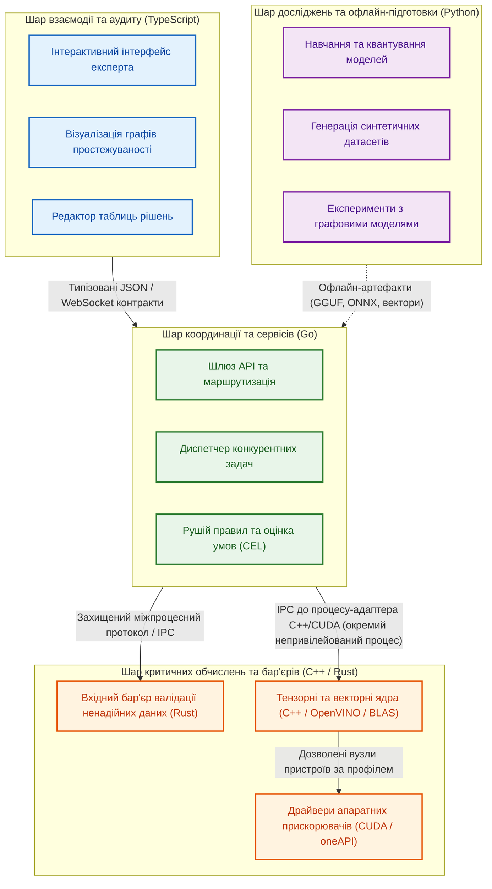
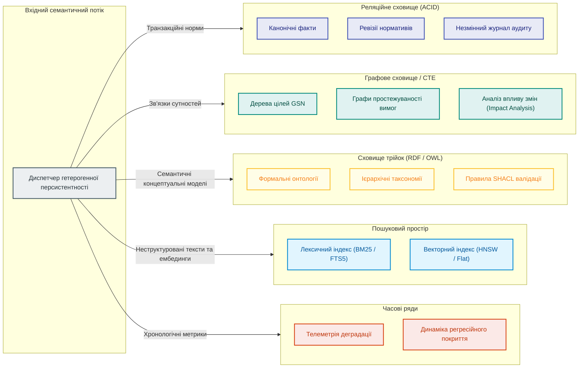
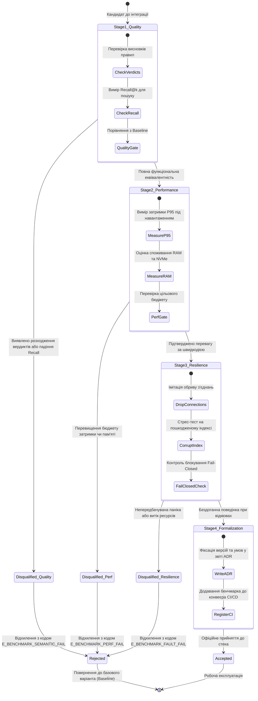

# Глава 17. Технологічний стек: критерії вибору інструментів, мов програмування та рушіїв правил

> **Книга:** [Архітектура доказових експертних систем](README.md) · [Частина VII: Технологічний стек, апаратна інфраструктура, кібернетичне виконання та розподілена SOA](part-07-runtime-and-knowledge-exchange.md)
> **Попередня глава:** [Глава 38. Машинні галюцинації та дефіцит знань: доказовий контроль відповідей](ch38-curing-machine-hallucinations-and-knowledge-deficits.md)
> **Наступна глава:** [Глава 18. Інфраструктура виконання: локальні моделі, апаратні прискорювачі, Edge та On-Premise](ch18-execution-infrastructure.md)
> **Зміст книги:** [README.md](README.md)  
> **Автор:** [Микола Федчик](about-the-author.md)  
> **Рівень складності та оптимальне вивчення:** `[L2]` Прикладний алгоритмічно-системний (індекс Д. Кнута `[23]`) · *Маршрут:* Інженерне ядро та `Трек A` (вибір мов, форматів і стеків виконання)  
> **Очікувані результати:** обирати інструмент за математичним класом задачі, роллю в архітектурі та поведінкою під час відмов; розподіляти мови програмування за шарами відповідальності; знаходити залежні артефакти рекурсивним запитом SQL; записувати рішення таблицями DMN і помічати в них прогалини; зіставляти задачі оптимізації й планування з розв'язувачами; пояснювати, чому зміна середовища виконання моделі впливає на відтворюваність доказового пакета; зіставляти шари стека з бажаною основною апаратурою; зіставляти компоненти Go з шарами можливостей і приймати компонент лише після порівняльного виміру з базовим варіантом.

---

## Анотація

Вибір технологічного стека для доказових експертних систем є не питанням суб'єктивних уподобань розробників, а строгою проєктною оптимізацією відносно математичного класу інженерної задачі, поведінки системи в режимах відмов та вимог до аудитованості висновків. Поширена помилка — передчасне перевантаження архітектури розподіленими графовими СУБД, векторними сховищами та стохастичними мовними моделями там, де гарантії детермінізму та простежуваності забезпечуються компактними локальними структурами даних.

У цій главі систематизовано критерії вибору інструментів, мов програмування та рушіїв виведення. Розглянуто розподіл мов за шарами відповідальності (Go для сервісної координації, C/C++ для обчислювальних ядер, Rust для безпеки пам'яті на межі вводу, Python для дослідницьких лабораторій, TypeScript для експертних інтерфейсів). Детально проаналізовано мови запитів до знань (SQL із рекурсивними CTE для графів залежностей, Cypher/GQL, Datalog), класичні продукційні рушії Rete та стандарт DMN/FEEL для регламентних таблиць рішень. Окремо висвітлено інструменти розв'язання обмежень (SAT/SMT/CP), семантичну перевірку рушіїв на граничних станах, апаратні вимоги до середовищ виконання та карту п'ятнадцяти технологічних класів для побудови надійних систем інженерного інтелекту.

---

## 1. Мінімальна реалізація перед каталогом технологій

Перш ніж переходити до розлогого каталогу спеціалізованих інструментів та бібліотек, системний аналіз доказової системи вимагає дотримання **інженерного принципу мінімальної обґрунтованої реалізації Федчика**: архітектура формується не з каталогу сторонніх компонентів, а з побудови мінімальної працюючої реалізації. Розробку доцільно починати з базової програми перевірки випуску, описаної в [Главі 1](ch01-introduction-to-expert-systems.md): для її функціонування потрібні лише мова Go, стандартна бібліотека та набір локальних модульних тестів. Спочатку перевірте позитивний випадок, чужий випуск, відсутній звіт, відкликання та виняток. Потім зафіксуйте формат політики, звіту й вердикту; лише після цього додавайте збереження та імпорт із конвеєра тестування.

**Таблиця 17.1. Матриця поступового технологічного розширення за типом інженерного обмеження (авторська модель М. Федчика)**

| Нове обмеження | Найменше обґрунтоване доповнення | Що не потрібно додавати автоматично |
|---|---|---|
| треба зберігати політики й запуски між виконаннями | версійовані файли або SQLite з перевіркою схеми | сервер графа й векторний індекс |
| багато правил змінюють фахівці без зміни коду | таблиці рішень або рушій правил із регресійними тестами | мовна модель як арбітр правил |
| потрібні багатокрокові залежності артефактів | рекурсивний запит або граф із типізованими ребрами | нейронна модель для самої досяжності |
| потрібно шукати підстави у вільному тексті | пошук кандидатів із походженням і доступом | дозвіл ухвалювати рішення за подібністю |
| декілька споживачів потребують незалежних випусків | версійований контракт і процедура доставки | брокер повідомлень до появи такої потреби |

Це маршрут поступового розширення, а не каталог готових адаптерів. За авторським **принципом пріоритету логічних меж відповідальності над фізичною мікросервісною декомпозицією**, межі відповідальності з [Глави 16](ch16-expert-systems-architecture.md) потрібні й у межах одного процесу; поділ на окремі мікросервіси для кожної межі не є обов'язковим і часто шкідливий через мережевий оверхед та розсинхронізацію транзакцій.

Перший критерій вибору формалізує **модель семантичної відповідності "математика — технологія" Федчика**: п'ять математичних класів задач і технологічні класи, що їм відповідають.


Діаграма читається зліва направо: спершу формулюють задачу математично, потім обирають клас інструмента. Тут діє **науковий закон неприпустимості підміни детермінованого доведення стохастичною подібністю (закон семантичної непідмінності Федчика)**: перевірка інваріанта «вимога рівня SIL 3 не закрита без двох звітів» є задачею детермінованої логіки, і для неї потрібен рушій правил, а не векторний пошук. Запитання «які модулі зачіпає зміна вимоги» є задачею досяжності в графі. Запитання «чи є схожі інциденти в минулому» є задачею змістової схожості. Наступні розділи розглядають кожен шар стека, починаючи з мов програмування.

> [!NOTE]
> **Чотири критерії декомпозиції математичних моделей у технологічний стек за моделлю автора**
> 1. Логічна детермінованість: сувора ізоляція предикатних інваріантів від наближених евристик і стохастичних обчислень.
> 2. Семантика транзитивної досяжності: використання стратифікованого Datalog для графів залежностей без ризику нескінченних циклів.
> 3. Обчислювальна складність верифікації: розділення швидких таблиць рішень і NP-повних SMT-розв'язувачів за часовими бюджетами.
> 4. Модель відмов обчислювального вузла: обов'язкове типізоване розрізнення станів unsat, timeout та відсутності знання.
> *Керування рантаймом:* Спроба підмінити детерміновану перевірку інваріанта векторною схожістю або ймовірнісним виведенням відхиляється диспетчером з кодом E_INVALID_MODEL_SEMANTICS.

## 2. Мови програмування за шарами відповідальності

Ранні експертні системи часто писали цілком на Lisp чи Prolog. Сучасні промислові експертні системи будують переважно на мовах загального програмування, бо вимоги до середовища змінилися: потрібні зрілі системні бібліотеки, передбачуване керування пам'яттю, підтримка конкурентності, інтерфейс до бібліотек на C (*Foreign Function Interface*, FFI) та інтеграція з інфраструктурою розгортання. Логічні мови при цьому не зникли: вони живуть у вигляді вбудованих декларативних мов правил і запитів, про які йдеться далі. Кожна мова загального програмування займає свій шар, формуючи **парадигму шарового розподілу мов програмування за інженерною відповідальністю (поліглот-архітектуру автора)**.

### 2.1. Go: сервісний шар і координація

**Авторський критерій придатності Go як координаційного сервісного ядра** полягає в тому, що Go забезпечує оптимальний баланс для сервісів, утиліт командного рядка, синхронізації й програмних інтерфейсів. Програма лише на Go може постачатися одним статичним виконуваним файлом; прив'язки через cgo можуть додавати нативні бібліотеки й платформні вимоги. Легкі потоки виконання (*goroutines*) допомагають координувати конкурентні задачі, але не гарантують продуктивності без вимірювання. На Go написано, зокрема, частини середовища локальних моделей Ollama [[1]](#src-1) і сервер повідомлень NATS [[2]](#src-2). **Інваріант індиферентності сервісної інтеграції до мови реалізації сервера** стверджує: інтеграцію визначає стабільний мережевий або міжпроцесний протокол, а не внутрішня мова реалізації сервера чи рушія.

Для задач експертної системи на Go є такі бібліотеки:

- `hyperjumptech/grule-rule-engine`: рушій правил із власною мовою правил GRL, натхненний Drools [[3]](#src-3);
- `sashabaranov/go-openai`: клієнт API у форматі OpenAI, який працює й з локальними сервісами, сумісними з цим форматом [[4]](#src-4);
- `yalue/onnxruntime_go`: обгортка над ONNX Runtime для виконання локальних моделей векторних представлень і класифікаторів [[5]](#src-5);
- `ledongthuc/pdf`: читання PDF-документів засобами Go [[6]](#src-6);
- `tree-sitter/go-tree-sitter`: прив'язки до tree-sitter для структурного розбору вихідного коду на синтаксичні дерева [[7]](#src-7).

### 2.2. C і C++: обчислювальні ядра високої швидкодії

Застосовується **інженерний принцип пріоритету C/C++ для обчислювальних ядер векторизації та драйверів**: C і C++ лишаються основою всього, що працює близько до апаратури й потребує максимальної продуктивності: обчислювальних ядер векторизації, драйверів апаратних прискорювачів, бібліотек квантування нейромереж. Проєкт llama.cpp виконує мовні моделі засобами C/C++ [[8]](#src-8), а набір інструментів OpenVINO оптимізує й розгортає моделі на процесорах, графічних процесорах і нейронних процесорах (*Neural Processing Unit*, NPU) Intel [[9]](#src-9). Класичний рушій продукційних правил CLIPS написано мовою C для переносності між платформами [[10]](#src-10); CLIPS досі використовують як вбудований рушій правил у застосунках на C і C++.

### 2.3. Rust: безпека пам'яті на межі з ненадійними даними

У місійно-критичних доменах діє **принцип ізоляції периметра безпеки мовою Rust на межі з ненадійними даними (принцип вхідного бар'єра Rust)**: Rust обирають для модулів, де потрібна швидкодія рівня C++ разом із гарантіями компілятора щодо безпеки пам'яті — відсутністю звертань до звільненої пам'яті (*use-after-free*) і гонок даних (*data races*). Типові місця застосування: розбір мережевих повідомлень і файлів із ненадійних джерел, агенти на периферійних пристроях, потокова обробка телеметрії. Рушій бізнес-правил Zen має ядро на Rust і прив'язки до багатьох мов [[11]](#src-11). При цьому слід враховувати **інженерний ризик семантичної несумісності нестандартних моделей рішень (JDM проти DMN)**: Zen описує рішення власною моделлю JDM (*JSON Decision Model*), а не стандартом DMN, тож переносити таблиці рішень між Zen і рушіями DMN без втрати сумісності неможливо.

### 2.4. Python: дослідницькі конвеєри та окремі сервіси моделей

Для побудови стека слід розрізняти підготовку знань, інференс моделі та остаточне рішення. Python часто зручно залишити для досліджень, навчання й оцінювання моделей; бібліотеки PyTorch, scikit-learn, spaCy, NetworkX та засоби оптимізації підтримують ці задачі. У звичайній збірці CPython глобальне блокування інтерпретатора (*Global Interpreter Lock*, GIL) обмежує паралельне виконання байт-коду, але нативні бібліотеки можуть звільняти GIL, а процеси працюють незалежно. PEP 703 започаткував збірки без GIL [[12]](#src-12); сумісність конкретних бібліотек треба перевірити. Мова сама не визначає затримки: обчислення моделі, черги, передавання даних і частота викликів можуть домінувати. Python може працювати в окремому сервісі інференсу, якщо вимірювання підтверджують бюджет профілю; його вихід лишається кандидатом і не ухвалює остаточного рішення про допуск.

### 2.5. TypeScript: верифіковані інтерфейси експертного аудиту

Сформульовано **принцип типобезпечної верифікації аудиторських інтерфейсів на TypeScript**: TypeScript потрібен для робочих місць експертів — візуалізації графів простежуваності, інтерактивного аналізу дерев доведення, редагування таблиць рішень. Інженерний інтерфейс є повноцінним компонентом доказової експертної системи, бо саме через нього людина бачить логіку рішення й ухвалює остаточний вердикт.

З практики автора: в одному з проєктів добре себе показав такий розподіл. Сервіси архітектурного ядра, черги й координацію написано на Go; числові операції векторизації виконують бібліотеки C++ (OpenVINO, ONNX Runtime), викликані через cgo; Python винесено в офлайнову частину для навчання й підготовки еталонних наборів; інтерфейс написано на TypeScript. Цей розподіл не є єдино правильним: він залежить від компетенцій команди й вимог до затримки. Межі між шарами задають контракти даних із [Глави 16](ch16-expert-systems-architecture.md), тому мову окремого шару можна замінити, не зачіпаючи інших шарів.

Наведений досвід використання cgo не встановлює ізоляції адресних просторів. У нормативному профілі §2.6 виклик сторонньої бібліотеки через cgo відбувається всередині процесу-адаптера, а координаційний сервіс обмінюється з ним через IPC.

Архітектурний розподіл мов програмування за шарами інженерної відповідальності та процесні межі нормативного профілю проілюстровано на діаграмі нижче.



> [!NOTE]
> **П'ять інваріантів ізоляції мовних шарів у місійно-критичній архітектурі автора**
> 1. Автономність координаційного ядра: використання Go/Rust для гарантії детермінованого керування конкурентністю та пам'яттю.
> 2. Ізоляція числових прискорювачів процесом-адаптером: обчислення C++/CUDA виконуються в окремому непривілейованому процесі з обміном через IPC (§2.6). Виклик через cgo в одному процесі ізоляції не дає, бо домен збою спільний.
> 3. Розмежування інференсу й допуску: Python може виконувати підготовку та інференс у профілі з підтвердженим часовим бюджетом, але не ухвалює остаточного рішення про допуск; модель повертає лише кандидати для незалежної перевірки.
> 4. Сувора типізація аудиторських інтерфейсів: верифікація схеми на TypeScript для усунення розбіжностей між інтерфейсом і доказовим пакетом.
> 5. Бар'єри бінарних контрактів: міжшаровий обмін виключно через типізовані бінарні структури з контролем версій схем.
> *Керування рантаймом:* Аварійне завершення процесу-адаптера (сигнал або ненульовий код виходу) чи перевищення межі часу запиту наглядач фіксує кодом `E_ADAPTER_ISOLATION_BARRIER` і повертає відмову без вердикту; спроба динамічно завантажити в процес ядра код поза переліком дозволених модулів відхиляється під час запуску.

### 2.6. Межа виконання нативного коду: процес-адаптер і IPC

Межу виконання стороннього нативного коду відокремлюють від координаційного сервісу, щоб звичайна помилка бібліотеки не зруйнувала стан його сесії. Виклик C-ABI через cgo виконується в адресному просторі процесу, який його здійснює: нативний код може пошкодити пам'ять цього процесу, а рантайм Go і санітайзери не гарантують виявлення такого запису в купу Go. Тому ізоляцію обчислень C++/CUDA забезпечує не cgo, а окремий непривілейований **процес-адаптер**, з яким сервіс обмінюється через IPC.

- **Права адаптера.** Окремий обліковий запис без привілеїв; немає мережевого доступу; дозволений перелік системних викликів (seccomp); файли моделей і даних доступні лише для читання; межа пам'яті (cgroup) задана параметром профілю розгортання. Доступ до прискорювача адаптер отримує лише через вузли пристрою, перелічені в профілі.
- **Канал.** Локальний сокет домену Unix із правами файлу й перевіркою облікових даних співрозмовника. Повідомлення мають префікс довжини, ідентифікатор запиту й версію схеми; профіль задає максимальний розмір у байтах, а версія схеми — повне кодування полів. Невалідне повідомлення відхиляється з діагностикою, а не трактується як результат обчислення. Великі масиви передаються через окремий сегмент пам'яті лише для обміну. Сегмент відповіді адаптер передає як новий дескриптор пам'яті, запечатаний від запису (наприклад, `memfd` із `F_SEAL_WRITE`), або сервіс спершу копіює вміст у власну пам'ять. Перевірку розмірів і схеми виконують лише над копією чи запечатаним сегментом.
- **Наглядач.** Кожен запит має додатну межу часу $`T_{\mathrm{IPC}}`$ у секундах, задану профілем і контрольовану монотонним годинником. Аварійне завершення адаптера (сигнал, ненульовий код виходу) або перевищення $`T_{\mathrm{IPC}}`$ наглядач фіксує кодом `E_ADAPTER_ISOLATION_BARRIER` (код із [глави 18](ch18-execution-infrastructure.md), §3.3.1, розширений на аварійне завершення й тайм-аут адаптера) і повертає відмову без вердикту, після чого перезапускає адаптер. Прострочену відповідь відкидають і записують у журнал аудиту; вона не стає відповіддю нового запиту.
- **Межа гарантії.** За коректної ізоляції процесів операційною системою та дотримання наведених прав звичайний процесний збій адаптера не змінює пам'яті й стану сесії сервісу, окрім сегмента обміну, який сервіс після збою не використовує. Це не гарантія проти помилок ядра ОС, драйвера або апаратного керування пам'яттю й DMA: їхні припущення входять до профілю розгортання. Детерміноване ядро ухвалення рішень не виконує Python та сторонніх C/C++/CUDA-викликів поза адаптерами.

Модуль Rust для розбору ненадійних даних (§2.3) працює за тією самою процесною схемою з IPC. Безпека пам'яті safe Rust не перетворює прив'язку Rust/Zen через C-ABI в ізоляцію адресних просторів; такі прив'язки в цьому профілі виконуються всередині адаптера.

## 3. Мови декларативних запитів до баз знань

У місійно-критичних системах фундаментальну роль відіграє **концепція декларативної адресації знань та інваріантності відтворення**: мови загального програмування реалізують сервіси, але факти й зв'язки краще адресувати декларативними мовами запитів. Декларативний запит описує, що треба знайти, а не як, тому його легше перевірити, оптимізувати й відтворити.

### 3.1. SQL і рекурсивні запити

SQL забезпечує транзакційну цілісність і зберігає версії артефактів, події аудиту, матриці доступу й канонічні таблиці фактів. Рекурсивні загальні табличні вирази (*Common Table Expressions*, CTE) дають змогу обходити ієрархії й графи без окремої графової СУБД [[13]](#src-13).

Нижче наведено розроблений автором **алгоритм рекурсивного аналізу впливу змін на основі SQL CTE із захистом від циклів через JSON-шлях (алгоритм Федчика)**: аналіз визначає, які артефакти зачіпає зміна вимоги REQ-7, якщо зв'язки простежуваності зберігаються в таблиці `trace(src, dst)`. Програма мовою Python використовує лише стандартний модуль `sqlite3`; у даних навмисно змодельовано зворотне посилання, що утворює цикл.

<details>
<summary>Приклад мовою Python</summary>

```python
import sqlite3

con = sqlite3.connect(":memory:")
con.executescript("""
CREATE TABLE trace(src TEXT, dst TEXT);
INSERT INTO trace VALUES
  ('REQ-7',  'DES-3'),
  ('DES-3',  'MOD-12'),
  ('DES-3',  'MOD-14'),
  ('MOD-12', 'TC-40'),
  ('MOD-14', 'TC-41'),
  ('MOD-14', 'MOD-12'),
  ('TC-41',  'DES-3'),   -- зворотне посилання утворює цикл
  ('REQ-9',  'MOD-14');
""")

QUERY = """
WITH RECURSIVE impact(node, depth, path) AS (
    SELECT 'REQ-7', 0, json_array('REQ-7')
  UNION ALL
    SELECT t.dst, i.depth + 1, json_insert(i.path, '$[#]', t.dst)
  FROM trace AS t JOIN impact AS i ON t.src = i.node
    WHERE NOT EXISTS (SELECT 1 FROM json_each(i.path) AS visited
                                        WHERE visited.value = t.dst)
)
SELECT node, MIN(depth) FROM impact GROUP BY node ORDER BY 2, 1;
"""

for node, depth in con.execute(QUERY):
    print(depth, node)
assert dict(con.execute(QUERY)) == {
    "REQ-7": 0, "DES-3": 1, "MOD-12": 2, "MOD-14": 2,
    "TC-40": 3, "TC-41": 3,
}
con.executemany("INSERT INTO trace VALUES (?, ?)",
                [("REQ-7", "DOC/ANNEX"), ("DOC/ANNEX", "ANNEX")])
assert dict(con.execute(QUERY))["ANNEX"] == 2
print("SQLite", sqlite3.sqlite_version)
con.close()
```

</details>


Програма виводить:

<details>
<summary>Дані або результат прикладу</summary>

```text
0 REQ-7
1 DES-3
2 MOD-12
2 MOD-14
3 TC-40
3 TC-41
SQLite 3.50.4
```

</details>


Тут реалізовано **інваріант точного дискретного зіставлення ідентифікаторів у графах простежуваності**: шлях є масивом JSON, а функція `json_each` перевіряє точну посимвольну рівність ідентифікаторів [[14]](#src-14). Це унеможливлює помилкову підміну або сплутування окремого вузла `ANNEX` із частиною складеного шляху `DOC/ANNEX`; доданий негативний випадок перевіряє таке розрізнення. Повторний вузол на поточному шляху блокується умовою `NOT EXISTS`, тому цикл не породжує нескінченної рекурсії. `MIN(depth)` повертає найкоротшу відстань серед знайдених простих шляхів.

Кількість простих шляхів може зростати експоненційно навіть без циклів, тому приклад не є універсальним масштабованим алгоритмом для довільних графів. Якщо потрібна лише множина досяжних вузлів, рекурсивний `UNION` над одним полем вузла усуває повтори без повного перебору шляхів. Сформульовано **інженерне правило вибору між рекурсивним SQL та виділеною графовою СУБД**: окрему графову СУБД обґрунтовують вимірюванням реальної затримки й складності запитів, а не довільною апріорною межею кількості ребер.

### 3.2. Графові мови запитів: Cypher, GQL і SPARQL

Мови запитів до графів властивостей описують шаблони вузлів і ребер. Мова Cypher поширилася разом із графовою СУБД Neo4j, а 2024 року ISO і IEC опублікували стандарт мови запитів до графів GQL (ISO/IEC 39075:2024) [[15]](#src-15). SPARQL є стандартом W3C для запитів до трійок RDF та онтологій OWL [[16]](#src-16); у [Главі 16](ch16-expert-systems-architecture.md) запит SPARQL зі шляхом властивостей відновлював походження рішення.

### 3.3. Datalog: детерміноване логічне виведення

Datalog є декларативною логічною мовою, синтаксично близькою до підмножини Prolog без функціональних символів [[17]](#src-17). Те саме відношення впливу, що й у прикладі SQL, мовою Datalog записують двома правилами:

<details>
<summary>Правила логічною мовою</summary>

```prolog
affects(X, Y) :- trace(X, Y).
affects(X, Z) :- trace(X, Y), affects(Y, Z).
```

</details>


Перше правило задає прямий вплив, друге робить його транзитивним.

#### 3.3.1. Теорема детермінованого виведення Datalog у графах залежностей (найменша нерухома точка)

Для довільної бази знань інженерних залежностей, формалізованої у позитивному Datalog без функціональних символів зі скінченним активним доменом $`\mathrm{adom}(P)`$ потужністю $`\lvert \mathrm{adom}(P) \rvert = N_{\mathrm{nodes}}`$ і безпечними правилами, множина логічних висновків є скінченною, а оператор безпосередніх наслідків $`T_P`$ гарантовано досягає найменшої нерухомої точки ($`\mathrm{Least\ Fixed\ Point,}\ \mathrm{LFP}`$):

$$
\mathrm{LFP}(P) = T_P^\infty(\emptyset) = \bigcup_{k=0}^{M} T_P^k(\emptyset)
$$

де монотонний оператор $`T_P(I)`$ розширює інтерпретацію фактів $I$:

$$
T_P(I) = I \cup \{ A \mid A \leftarrow B_1, \dots, B_n \in \mathrm{ground}(P) \land \{B_1, \dots, B_n\} \subseteq I \}
$$

де:
- $P$ — програма Datalog, що складається зі стратифікованих правил виведення;
- $`\mathrm{ground}(P)`$ — множина всіх конкретизованих правил над константами активного домену $`\mathrm{adom}(P)`$;
- $I$ — множина фактів, виведених на кроці $k$;
- $`M \le N_{\mathrm{nodes}}^2`$ — максимальна кількість ітерацій до повної стабілізації ($`T_P^{M+1}(\emptyset) = T_P^M(\emptyset)`$), оскільки бінарне відношення досяжності $`\mathrm{affects}(X, Z)`$ не може містити більше ніж $`N_{\mathrm{nodes}}^2`$ пар.

**Керування рантаймом і потоком обчислень (Actionable Closed Loop):**
1. *Керування рантаймом і завершенням:* Рушій виведення Datalog виконує ітеративний розрахунок до стабілізації множини фактів. Оскільки в інженерних графах артефактів цикл сам по собі не породжує нових констант, алгоритм гарантовано зупиняється без потреби ручного відстеження відвіданих шляхів (на відміну від SQL CTE). Якщо кількість ітерацій перевищує $`M_{\mathrm{max}} = N_{\mathrm{nodes}}^2`$, рантайм аварійно зупиняє запит із кодом `E_DATALOG_NON_TERMINATION` (ознака нестратифікованого заперечення або небезпечного правила з незв'язаними змінними). Ця межа справедлива для програми з бінарним відношенням досяжності; якщо програма виводить предикати більшої арності, захисну межу беруть як суму $`N_{\mathrm{nodes}}^{k_p}`$ за всіма похідними предикатами $p$, де $`k_p`$ є арністю предиката $p$.
2. *Апаратний сайзинг:* Для промислового графа з $`N_{\mathrm{nodes}} = 10\,000`$ інженерних сутностей розмір таблиці транзитивного замикання обмежений зверху величиною $10^8$ записів. У компактному 64-бітному представленні пар вузлів оперативна пам'ять для утримання повного графа досяжності становить $`10^8 \times 8\,\text{байт} \approx 800\,\text{МБ}`$, що дозволяє виконувати розрахунок повністю in-memory без звернення до диску.
3. *Практичний числовий приклад:* Для розглянутого графа з 7 артефактів ($`N_{\mathrm{nodes}} = 7`$, $`M_{\mathrm{max}} = 49`$) обчислення найменшої нерухомої точки завершується рівно за $k = 4$ ітерації, генеруючи повну матрицю впливу змін без жодного ризику зациклення через ребро `TC-41 -> DES-3`.

## 4. Рушії правил і таблиці рішень

Діє **принцип ізоляції правил як керованих версійованих інженерних артефактів**: декларативні правила не повинні розпорошуватися по вихідному коду у вигляді розрізнених операторів `if/else`. Правило є керованим інженерним артефактом з однозначним ідентифікатором, версією, автором, зв'язком із пунктом нормативу та власним життєвим циклом. Рушій правил дає змогу зберігати правила окремо від коду й застосовувати їх передбачувано.

### 4.1. Класичні продукційні рушії (Rete-подібні алгоритми)

Більшість продукційних рушіїв спирається на алгоритм Rete Чарльза Форгі, який зберігає часткові збіги умов між циклами виведення й не перевіряє всі правила проти всіх фактів заново [[18]](#src-18). CLIPS виконує пряме виведення (*forward chaining*) і вбудовується в застосунки на C. Drools є рушієм правил, рушієм DMN і рушієм обробки складних подій для Java; Drools використовує алгоритм Phreak, розвиток Rete [[19]](#src-19). Grule для Go та NRules для .NET [[20]](#src-20) вбудовуються безпосередньо в сервіси.

### 4.2. Стандарт DMN та мова виразів FEEL

Розгляньмо версію 1.5 стандарту моделі й нотації рішень DMN (*Decision Model and Notation*) консорціуму OMG [[21]](#src-21). Стандарт поєднує таблиці рішень, діаграми вимог до рішень (*Decision Requirements Diagrams*, DRD) та мову виразів FEEL (*Friendly Enough Expression Language*). Людина може рецензувати таблицю, але доступність нотації не встановлює її повноти; потрібні перевірки перетинів, прогалин, типів і політики спрацювання.

Таблиця нижче є прикладом рішення про допуск релізу. Перша клітинка задає політику спрацювання U (*Unique*): для будь-яких вхідних даних може спрацювати не більше ніж одне правило. У клітинках умов записано унарні тести FEEL, а прочерк означає «будь-яке значення».

| U | Відкриті критичні дефекти | Покриття вимог тестами | Тести безпеки | Рішення |
|---|---|---|---|---|
| 1 | `> 0` | `-` | `-` | `"BLOCK"` |
| 2 | `0` | `< 0.95` | `-` | `"BLOCK"` |
| 3 | `0` | `>= 0.95` | `"fail"` | `"BLOCK"` |
| 4 | `0` | `>= 0.95` | `"pass"` | `"RELEASE"` |

Правила не перетинаються: перше охоплює будь-яку кількість критичних дефектів понад нуль, друге і третє з четвертим ділять решту випадків за покриттям і результатом тестів безпеки. Проте таблиця неповна. Якщо тести безпеки повернули значення `"error"`, жодне правило не спрацює; конкретний DMN-рушій може повернути порожній результат або типізовану відмову. Експертна система, що трактує відсутність збігу як дозвіл, ризикує пропустити реліз із незавершеними тестами. Для допускової таблиці потрібно явно задати обробку no-hit як `BLOCK` або непрохідний статус і, за потреби, додати правило для `"error"`. Перевірку повноти й несуперечливості таблиць рішень розглянуто в [Главі 23](ch23-knowledge-base-verification.md).

Стандарт DMN визначає різні політики спрацювання (*Hit Policies*): **U** (*Unique* — рівно один збіг), **F** (*First* — перше за порядком), **A** (*Any* — усі збіги мають повертати однаковий результат), **R** (*Rule Order*), **C** (*Collect*). У критичних інженерних системах використання евристичних політик із неявним значенням за замовчуванням є найпоширенішим джерелом аварійних пропусків.

> [!WARNING]
> **Два критичні ризики політик спрацювання DMN за аналізом автора**
> 1. Проблема неповноти domain-значень: якщо вхідна змінна набуває `null`, `NaN` або неочікуваного значення помилки (наприклад, `"timeout"` чи `"error"`), правило може не спрацювати. Конкретне представлення no-hit залежить від рушія; його не можна трактувати як успішний допуск.
> 2. Аварійний обхід за відсутності Default-Deny: використання евристичних політик First або Rule Order із неявним значенням за замовчуванням дозволяє критичному дефекту обійти верифікаційний шлюз через випадковий збіг проміжних правил.
> *Інженерний інваріант:* Відсутність спрацювання правил у допусковій таблиці автоматично еквівалентна безумовному блокуванню `BLOCK` з реєстрацією інциденту неповноти бази знань.

> [!NOTE]
> **Чотири правила проєктування допускових таблиць DMN за методологією автора**
> 1. Default-Deny для допуску: у таблиці, яка дозволяє випуск або safety-critical дію, неперекрите вхідне значення не може стати дозволом і переводить шлюз у `BLOCK`; у дорадчій таблиці відсутність збігу залишається невідомим результатом.
> 2. Елімінація політик неявного вибору: повна заборона політик First або Rule Order у критичних системах на користь детермінованої політики Unique.
> 3. Замкненість доменних типів: обов'язкове явне визначення умов для станів помилок error, тайм-аутів та невизначеностей null чи NaN.
> 4. Автоматична формальна верифікація: попередня трансляція таблиць у SMT-формули для доказу відсутності прогалин і взаємних суперечностей.
> *Керування рантаймом:* Таблиця DMN, яка не пройшла статичний аудит повноти вхідного простору станів, блокується шлюзом завантаження з кодом E_DMN_INCOMPLETE_TABLE.

## 5. Спеціалізовані сховища за фізичною формою даних

Діє **науковий закон відповідності фізичної форми сховища семантичному класу знань (закон гетерогенної персистентності знань Федчика)**: вибір сховища визначає природа знання, яке в ньому зберігається. Причини такого розподілу пояснено в [Главі 16](ch16-expert-systems-architecture.md); таблиця зіставляє типи сховищ із прикладами продуктів і типовими запитами.

| Тип сховища | Приклади продуктів | Клас знань | Типовий запит |
|---|---|---|---|
| **Реляційні СУБД** | PostgreSQL, SQLite, Microsoft SQL Server | Канонічні факти, ревізії нормативів, аудит | «Яка редакція правила діяла під час випробувань 12 травня?» |
| **Графові СУБД** | Neo4j, ArangoDB, Amazon Neptune | Простежуваність «вимога, тест, дефект» | «Які модулі зачіпає зміна вимоги з ISO 26262?» |
| **Сховища трійок RDF** | GraphDB, Stardog, Apache Jena | Онтології OWL, таксономії | «Знайти всі типи датчиків, що належать до класу SafetyCritical» |
| **Лексичний пошук** | OpenSearch, Elasticsearch, SQLite FTS5 | Специфікації, коди помилок, артикули | «Знайти звіти про дефекти зі словами overheat і vibration» |
| **Векторні СУБД** | Qdrant, pgvector, Milvus, Weaviate | Змістові фрагменти нормативів, схожі прецеденти | «Знайти нормативи зі схожими вимогами до вологозахисту корпусу» |
| **Бази часових рядів** | TimescaleDB, InfluxDB, Prometheus | Тренди надійності, динаміка покриття тестами | «Чи зростає час спрацювання клапана за останні п'ять циклів?» |

Таблиця підкреслює, що жоден продукт не закриває всіх рядків. Тут діє **інженерний принцип ощадливого додавання спеціалізованих сховищ за дефіцитом можливостей**: приклад із рекурсивним SQL показав, що частину графових запитів можна виконати в реляційній СУБД, тому окреме сховище варто додавати лише тоді, коли виникає об'єктивний функціональний дефіцит можливостей, який наявні СУБД принципово не здатні закрити.

Маршрутизацію інженерних даних між спеціалізованими класами сховищ відповідно до їхньої семантичної природи показано на діаграмі.



## 6. Оптимізація, планування та розв'язання обмежень

У загальній архітектурі доказової експертної системи підсистема оптимізації та розв'язання обмежень (*Constraint Satisfaction and Optimization*) активується тоді, коли пряме логічне виведення фіксує суперечність або коли інженерна задача вимагає синтезу допустимого плану дій чи конфігурації апаратури. Якщо продукційний рушій правил відповідає на дедуктивне запитання «чи допустимий поточний стан системи», то інструменти оптимізації відповідають на конструктивне запитання: «як знайти глобально оптимальний або гарантовано допустимий стан серед мільйонів можливих комбінацій». Наївна спроба реалізувати подібний комбінаторний пошук через генерацію нових фактів у правилах Rete неминуче призводить до експоненційного вибуху простору станів і вичерпання пам'яті процесу.

**Таблиця 17.3. Демаркаційна модель логічного виведення та задоволення обмежень Федчика (Rules проти Solvers)**

| Критерій | Рушій правил (Rete / Phreak / Datalog) | Розв'язувач обмежень (SMT / Z3 / CP-SAT) |
|---|---|---|
| **Формулювання задачі** | Дедуктивне виведення: «Якщо задано факти $F$, які наслідки $C$ безпосередньо випливають за правилами $R$?» | Пошук, синтез і доведення: «Чи існує конфігурація змінних $X$, що задовольняє всі обмеження $`\bigwedge C_i`$? Чи існує контрприклад порушення безпеки?» |
| **Простір пошуку** | Явний граф фактів; пряме зіставлення шаблонів і знаходження нерухомої точки | Неявний комбінаторний простір станів ($2^N$ станів або нескінченний числовий домен) |
| **Алгоритмічна складність** | Локальна детермінована складність, прискорення через Rete-мережі $`\mathcal{O}(1)`$ на оновлення факту | NP-повна задача в загальному випадку (евристики DPLL/CDCL, branch-and-bound) |
| **Типова інженерна роль** | Миттєва перевірка політик допуску в CI/CD, контроль інваріантів у рантаймі | Оптимальне компонування вузлів апаратури, розклад стендових випробувань, доведення несуперечливості нормативів |

Цей клас інструментів оптимізації та розв'язання обмежень поділяється на чотири групи:

- **Розв'язувачі SAT і SMT** перевіряють, чи існують вхідні значення, за яких специфікація порушується. Поширені розв'язувачі цього класу: Z3 [[22]](#src-22) і cvc5 [[23]](#src-23); приклад пошуку суперечності між вимогами за допомогою Z3 наведено в [Главі 14](ch14-requirements-detection-and-formalization.md).
- **Програмування в обмеженнях** розв'язує комбінаторні задачі з жорсткими обмеженнями: складання розкладів випробувань, конфігурацію модульного обладнання. Сюди належать розв'язувач CP-SAT з OR-Tools [[24]](#src-24) і мова моделювання MiniZinc [[25]](#src-25), яка відокремлює опис задачі від конкретного розв'язувача.
- **Математичне програмування** (лінійне, квадратичне, змішане цілочисельне) балансує ресурси дослідницьких проєктів.
- **Автоматичне планування** будує послідовність дій, що переводить об'єкт керування з початкового стану в цільовий. Застосовується **патерн синтезу коригувальних дій за допомогою планувальника PDDL при провалі сертифікації**: планувальник Fast Downward розв'язує задачі, описані мовою PDDL (*Planning Domain Definition Language*) [[26]](#src-26). Якщо експертна система фіксує провал сертифікації, планувальник генерує мінімальну послідовність коригувальних дій, а експертна система верифікує цю послідовність правилами.

Знайдений допустимий розклад можна перевірити підстановкою в обмеження, але це не доводить оптимальності. Тут діє **інженерний інваріант незалежної верифікації сертифікатів незадовільності (Unsat Core & Proof Logging)**: ядро незадовільності називає достатній суперечливий піднабір, проте саме не є незалежним доказом `unsat`: його треба повторно перевірити або перевірити формальний доказ підтримуваного формату. Підтримка доказів залежить від розв'язувача й теорії. Також застосовується **семантичне правило типізованого розрізнення результатів розв'язувача**: результати `sat` та `unsat` вимагають строгого типізованого розмежування з невизначеними станами `unknown`, `timeout` та системною помилкою, які не означають ні допустимості, ні неможливості й переводять систему в режим безпечного блокування Fail-Closed.

## 7. Семантична перевірка кандидата рушія

У підсистемі символьного виведення вибір програмного рушія визначає межі формальної доказовості всієї експертної системи. Діє **принцип семантичної нееквівалентності булевих предикатів рушіїв виведення**: помилкове припущення про те, що будь-який рушій, який повертає логічне значення `true/false`, є взаємозамінним у місійно-критичних застосуваннях, спричиняє приховані відмови. Різні механізми мають принципово відмінну семантику заперечення, обробки циклів та інтерпретації відсутніх даних. Rete зіставляє умови в оперативній пам'яті, Datalog задає дедуктивні правила над фіксованими доменами, DMN стандартизує таблиці регламентних рішень, а CEL (*Common Expression Language*) та Rego обчислюють охоронні вирази або політики авторизації. Ці компоненти не є взаємозамінними лише тому, що повертають логічне значення. Перед вимірюванням швидкості потрібний суворий договір семантики.

**Таблиця 17.4. Матриця семи критичних семантичних властивостей рушія виведення (матриця семантичного аудиту Федчика)**

| Властивість | Контрольний випадок |
|---|---|
| Невідоме значення й явне заперечення | відсутній тест не стає доведеним успіхом або невдачею |
| Порядок і нерухома точка | перестановка фактів і правил не змінює декларативного результату |
| Відкликання | видалення однієї підстави зберігає незалежну альтернативу |
| Цикли й завершення | непідкріплений цикл не створює факту; перевищення ліміту є окремим статусом |
| Таблиця рішень | пропуск, перетин і невідомий тип не дають неявного дозволу |
| Зовнішні функції | мережа, поточний час і випадковість не приховані в правилі |
| Пояснення | рушій повертає використані підстановки й залежності, не лише вердикт |

Порівняння виконує той самий підтримуваний набір правил із однаковою політикою відмови. OPA придатний для окремих рішень доступу, CEL для охоронних виразів, продукційний рушій для керування активаціями, а Datalog для рекурсивних відношень. Вибір із цієї карти є гіпотезою до перевірки.

> [!NOTE]
> **П'ять семантичних тестів верифікації рушія виведення за протоколом автора**
> 1. Тест явного заперечення: перевірка, що відсутність факту інтерпретується суворо як статус UNKNOWN, а не хибність чи успіх.
> 2. Тест інваріантності порядку: гарантія того, що перестановка правил і фактів не змінює обчисленої найменшої нерухомої точки.
> 3. Тест селективного відкликання: анулювання однієї посилки не знищує висновок за наявності незалежного альтернативного обґрунтування.
> 4. Тест непідкріпленого циклу: виявлення циклічних залежностей без первинної підстави з поверненням коректного коду перевищення ліміту.
> 5. Тест детермінізму пояснення: обов'язкове повернення точного графа використаних підстановок і посилок разом із вердиктом.
> *Керування рантаймом:* Рушій виведення, що провалює хоча б один із п'яти семантичних тестів на еталонному наборі, дискваліфікується з кодом E_ENGINE_SEMANTIC_FAILURE.

## 8. Виконання моделей і апаратні прискорювачі

Застосовується **концепція наскрізного шестиланкового ланцюжка виконання локальних моделей (тракт інференсу автора)**: локальні нейромережеві моделі виконують в експертній системі роль адаптерів — класифікують документи, витягують параметри, формулюють чернетки пояснень. Їхнє виконання підкоряється ланцюжку перетворень від файлу моделі до апаратного прискорювача, показаному на діаграмі.


Кожна ланка ланцюжка може вплинути на результат залежно від моделі та реалізації: формат і точність ваг (FP16, INT8, INT4), версія компілятора, середовище виконання й тип прискорювача. Таблиця порівнює чотири поширені середовища виконання.

| Інструмент | Мова реалізації | Ніша | Особливість |
|---|---|---|---|
| **llama.cpp** | C/C++ | Робочі станції, периферійні й вбудовані пристрої | Не потребує Python, підтримує квантовані формати GGUF |
| **Ollama** | Go, використовує llama.cpp | Локальні сервери розробки, автономні робочі місця | Простий REST API, завантаження й керування моделями |
| **vLLM** | Python, CUDA, C++ | Сервери з графічними процесорами під високим навантаженням | Керування пам'яттю кешу ключів і значень за алгоритмом PagedAttention [[27]](#src-27) |
| **OpenVINO** | C++, Python | Сервери й робочі станції на апаратурі Intel | Оптимізація під процесори, графічні процесори й NPU Intel |

Для відтворюваності діє **інженерний принцип фіксації ланцюжка виконання моделей**: його зміна може вплинути на числові результати. Перехід із FP16 на INT4 або оновлення середовища виконання може змінити класифікацію документа чи текст пояснення. Якщо доказовий пакет посилається на вихід моделі, він має фіксувати відбиток усього ланцюжка (модель, квантування, середовище виконання, версію драйвера), а після зміни регресійні тести з [Глави 16](ch16-expert-systems-architecture.md) потрібно запустити повторно. Ланцюжок закінчується апаратним прискорювачем, тому наступний підрозділ зіставляє з апаратурою всі шари стека, а не лише виконання моделей.

### 8.1. Бажана основна апаратура для шарів стека

Вибір мови, рушія й сховища вже визначає профіль навантаження кожного шару, формуючи **апаратну матрицю відповідності обчислювального профілю шарів стека фізичному залізу (апаратно-профільний сайзинг автора)**. Поширена помилка проєкту полягає в купівлі графічного прискорювача до того, як цей профіль визначено: тут діє **інженерний інваріант невідповідності символьних продукційних правил архітектурі тензорних блоків GPU/NPU**: рушій правил, транзакції SQL і обхід графа простежуваності складаються з розгалужень і переходів за вказівниками, тому тензорні блоки GPU чи NPU їх не пришвидшують.

Друга помилка полягає в недооцінці пам'яті. Для локальних моделей з'явилися обчислювальні платформи з уніфікованою пам'яттю, у яких CPU і GPU однієї системи на кристалі користуються спільною оперативною пам'яттю без копіювання між окремими пам'ятями; обсяг такої пам'яті визначає, яка модель узагалі поміститься. Таблиця зіставляє шари стека з цієї глави з бажаною основною апаратурою.

**Таблиця 17.5. Апаратно-профільна матриця сайзингу шарів стека (авторська модель М. Федчика)**

| Шар стека | Профіль операцій | Бажана основна апаратура | Коли додавати прискорювач |
|---|---|---|---|
| Рушій правил, таблиці рішень, Datalog | розгалуження, хеш-таблиці, зіставлення умов | багатоядерний CPU з великим кешем | зазвичай не додають: розгалужене зіставлення не відповідає профілю тензорних блоків |
| Реляційне й графове сховище, рекурсивні запити, журнал аудиту | довільний доступ до пам'яті, транзакції, синхронний запис журналу | CPU, оперативна пам'ять ECC, що вміщує індекси й часто вживані дані бази знань, накопичувач NVMe | якщо вимір показує обмеження введення-виведення, допомагає швидший накопичувач, а не GPU |
| Лексичний і точний векторний пошук | сканування індексу, скалярні добутки | CPU з векторними розширеннями: AVX-512 на x86-64, SVE на сучасних процесорах Arm | GPU для пакетного точного пошуку серед десятків мільйонів векторів |
| Векторизація, класифікація, переранжування | щільні тензорні операції малими пакетами | NPU або вбудований GPU; CPU лишається запасним маршрутом | якщо середовище виконання підтримує модель і всі її оператори на цьому прискорювачі |
| OCR і розбір сканів | згортки, механізм уваги, пакети сторінок | дискретний GPU або платформа з уніфікованою пам'яттю | коли потік сторінок перевищує пропускну здатність CPU |
| Локальна генеративна модель | читання всіх активних ваг на кожному токені | GPU з великою пам'яттю або платформа з уніфікованою пам'яттю на 64–128 ГБ | коли політика розміщення забороняє зовнішній сервіс або потрібна автономність |
| Розв'язувачі SAT, SMT і CP | пошук із поверненням і навчанням на конфліктах | CPU з високою частотою ядра; незалежні запуски паралельно на кількох ядрах | лише за наявності реалізації розв'язувача для прискорювача й порівняльного виміру |

Діє **інженерний принцип обов'язковості пам'яті з корекцією помилок (ECC DRAM) у доказових системах**: перші три рядки таблиці описують детерміновану частину експертної системи, і для неї основною апаратурою лишається CPU. Вимога корекції помилок оперативної пам'яті випливає з доказовості. Б'янка Шредер, Едуардо Пінейру й Вольф-Дітріх Вебер проаналізували помилки динамічної оперативної пам'яті (DRAM) на великому парку серійних серверів протягом 2,5 років й показали, що такі помилки є поширеним видом апаратних відмов в обчислювальних кластерах [[28]](#src-28). Непомічена зміна біта в індексі фактів дає хибний вердикт, а зміна біта в буфері перед обчисленням хешу дає хибну невідповідність хешу, причому повторний запуск не обов'язково відтворить причину. Пам'ять із кодом корекції помилок (*Error-Correcting Code*, ECC) у типовому виконанні виправляє один хибний біт у слові пам'яті й виявляє два. Наявність ECC перевіряють у специфікації конкретної платформи, бо вона є не в усіх настільних комп'ютерах.

Останні рядки таблиці стосуються нейромережевих адаптерів, і для них прискорювач додають за правилом порівняльного виміру з розділу про компоненти Go. Частина нових настільних платформ має процесори архітектури Arm ([Глава 18](ch18-execution-infrastructure.md)), тому сервіси на Go, прив'язки cgo й нативні бібліотеки C++ треба зібрати й протестувати для arm64 ще до перенесення моделей. Звідси випливає **архітектурне правило мінімальної апаратної конфігурації першої версії доказової системи**: CPU, пам'ять ECC і накопичувач NVMe. Прискорювач з'являється разом із першою моделлю, яку справді треба виконувати локально, і змінює відбиток ланцюжка виконання. Порівняння конкретних платформ станом на жовтень 2026 року, оцінку швидкості генерації за пропускною здатністю пам'яті й фізичне розгортання розглядає [Глава 18](ch18-execution-infrastructure.md).

## 9. Систематична карта п'ятнадцяти класів технологій

Щоб стек не розростався безсистемно, корисно звіряти його з картою класів технологій, згрупованих за п'ятьма рівнями.

```mermaid
flowchart TD
    accTitle: Карта п'ятнадцяти класів технологій доказової експертної системи
    accDescr: П'ятнадцять класів технологій, згрупованих за рівнями: символьне виведення, моделі знань і сховища, пошук і оптимізація, нейромережеві адаптери, контроль і безпека.

    subgraph CoreLevel["Рівень 1: Символьне виведення"]
        C1["1. Рушії правил і Rete"]
        C2["2. Підтримання істинності (TMS)"]
        C3["3. Облік впевненості й невизначеності"]
        C4["4. Таблиці рішень (DMN, FEEL)"]
    end

    subgraph DataLevel["Рівень 2: Моделі знань і сховища"]
        D1["5. Семантичний веб (RDF, OWL, SHACL)"]
        D2["6. Ймовірнісні графові моделі"]
        D3["7. Бази прецедентів (CBR)"]
        D4["8. Реляційні, графові й часові СУБД"]
    end

    subgraph AlgLevel["Рівень 3: Пошук і оптимізація"]
        A1["9. Розв'язувачі SAT, SMT і оптимізатори"]
        A2["10. Планувальники дій (PDDL)"]
        A3["11. Гібридний пошук (BM25 і HNSW)"]
    end

    subgraph MLLevel["Рівень 4: Нейромережеві адаптери"]
        M1["12. Локальні середовища виконання моделей"]
        M2["13. Збирання документів (OCR, tree-sitter, ReqIF)"]
        M3["14. Пояснюваний ШІ та метрики генерації"]
    end

    subgraph GovLevel["Рівень 5: Контроль і безпека"]
        G1["15. Рушії політик (OPA, Rego) і походження (PROV-O)"]
    end

    CoreLevel --> DataLevel
    DataLevel --> AlgLevel
    AlgLevel --> MLLevel
    MLLevel --> GovLevel

    classDef clrCore fill:#e3f2fd,stroke:#1565c0,stroke-width:2px,color:#0d47a1;
    classDef clrData fill:#e8f5e9,stroke:#2e7d32,stroke-width:2px,color:#1b5e20;
    classDef clrAlg fill:#fff3e0,stroke:#e65100,stroke-width:2px,color:#bf360c;
    classDef clrML fill:#f3e5f5,stroke:#7b1fa2,stroke-width:2px,color:#4a148c;
    classDef clrGov fill:#fbe9e7,stroke:#d84315,stroke-width:2px,color:#bf360c;

    class C1,C2,C3,C4 clrCore;
    class D1,D2,D3,D4 clrData;
    class A1,A2,A3 clrAlg;
    class M1,M2,M3 clrML;
    class G1 clrGov;
```



Діє **принцип замкненого архітектурного обґрунтування технологічної карти**: карта не вимагає використовувати всі п'ятнадцять класів у кожному проєкті. Вона слугує контрольним списком: для кожного класу архітектор має або назвати обраний інструмент, або надати замкнене обґрунтування, чому цей клас задач у проєкті не виникає. Порожня клітинка без обґрунтування зазвичай означає, що задача розв'язується неявно, наприклад правилами, захованими в коді, або оцінками впевненості без калібрування.

## 10. Компоненти Go за шарами можливостей

Карта класів показує, які задачі треба закрити, але не називає конкретних компонентів. Для сервісного шару на Go, який розглянуто на початку глави, корисна вужча карта: які бібліотеки й сервери, написані на Go або доступні з Go, закривають окремі шари можливостей експертної системи і які обмеження кожного кандидата треба перевірити до прийняття. Запропонована **Таблиця 17.6 (Матриця ризиків та обмежень відкритих бібліотек екосистеми Go автора)** систематизує відкриті проєкти станом на жовтень 2026 року; версії й активність розробки змінюються, тому перед вибором таблицю обов'язково звіряють із репозиторіями.

#### Таблиця 17.6. Матриця ризиків та обмежень відкритих бібліотек екосистеми Go

| Шар можливостей | Кандидати | Що дає експертній системі | Що перевірити до прийняття |
|---|---|---|---|
| Продукційні правила (клас 1) | Grule [[3]](#src-3) | правила мовою GRL, які зберігаються окремо від коду сервісу | детермінованість порядку спрацювання правил, що конкурують за той самий факт; час циклу виведення на реальній кількості фактів |
| Вирази й охоронні умови (роль, яку в DMN виконує FEEL) | cel-go [[29]](#src-29) | мова виразів CEL без повноти за Тюрингом: перевірка типів до виконання, обчислення без побічних ефектів, **інваріант лінійного часу обчислення охоронних виразів у CEL без макросів** (час обчислення строго лінійний щодо розміру виразу й вхідних даних, якщо макроси вимкнено) | макроси й власні функції виходять за межі лінійної оцінки; канонічний шлях імпорту змінився на `cel.dev/cel-go` |
| Дедуктивні запити (Datalog) | Mangle [[30]](#src-30) | Datalog з агрегатами, викликами функцій, необов'язковою перевіркою типів і часовими інтервалами чинності фактів | розширення понад Datalog скасовують частину гарантій, зокрема гарантію завершення; проєкт розвивається незалежно від Google, останній випуск 0.4.0 вийшов у листопаді 2025 року |
| Політики доступу (клас 15) | OPA [[31]](#src-31) | рішення про доступ мовою Rego як окремий версійований артефакт із власними тестами; вбудовування в сервіс як бібліотеки Go | затримка рішення під навантаженням, обсяг даних політики в пам'яті сервісу |
| Графове сховище (клас 8) | Dgraph [[32]](#src-32), EliasDB [[33]](#src-33), Cayley [[34]](#src-34) | від розподіленої графової СУБД із транзакціями ACID (Dgraph) до легкої графової бази, яку можна вбудувати в програму (EliasDB) | Dgraph офіційно підтримує лише Linux на amd64 і arm64; останній випуск EliasDB вийшов у 2022 році, Cayley у 2019 році |
| Лексичний пошук (клас 11) | Bleve [[35]](#src-35) | повнотекстовий індекс усередині процесу сервісу з ранжуванням BM25, наближеним пошуком векторів і злиттям результатів гібридного пошуку | серед готових мовних аналізаторів Bleve немає українського, тож якість пошуку українських текстів треба виміряти окремо |
| Векторний пошук (клас 11) | chromem-go [[36]](#src-36), pgvector через клієнт pgvector-go [[37]](#src-37), Weaviate [[38]](#src-38) | від вбудованого точного пошуку без сторонніх залежностей (chromem-go) до розширення PostgreSQL і окремої векторної СУБД | chromem-go перебирає всі вектори й до версії 1.0 має статус бета; pgvector і Weaviate потребують окремого сервера |

З таблиці випливають два спостереження. Для більшості шарів існує вибір між вбудованою бібліотекою й окремим сервером: бібліотека спрощує розгортання на ізольованих робочих станціях, а сервер дає масштабування ціною ще одного процесу, який треба оновлювати, резервувати й захищати. Крім того, частина кандидатів має обмеження, яких не видно з короткого опису проєкту: втрату гарантії завершення, відсутність аналізатора для української мови, підтримку лише однієї операційної системи чи багаторічну паузу у випусках.

### 10.1. Методологія вибору: чотиристадійний порівняльний вимір Benchmark-driven Integration автора

Жоден рядок таблиці не є безумовною рекомендацією. Впроваджено **методологію чотиристадійного порівняльного виміру Benchmark-driven Integration автора**, за якою кандидата приймають до стека лише після порівняльного виміру (*benchmark*) із базовим варіантом (*baseline*), тобто з найпростішою реалізацією, яку команда вже має або може написати за день: рекурсивним запитом SQL для простежуваності, індексом SQLite FTS5 для лексичного пошуку, перебором усіх векторів для змістового пошуку. Вимір проводять на власних даних і власних еталонних запитах, а критерії прийняття записують до запуску виміру за чотирма обов'язковими стадіями:

1. якість кандидата не гірша за базовий варіант на еталонному наборі: ті самі висновки правил і не нижчий показник Recall@k з [Глави 16](ch16-expert-systems-architecture.md) для пошуку;
2. виграш у затримці P95, пам'яті чи часі індексування перевищує заздалегідь заданий поріг, або кандидат дає можливість, якої базовий варіант не має;
3. поведінку кандидата під час відмов перевірено: обрив з'єднання, пошкоджений індекс, оновлення версії;
4. результат виміру разом із версіями кандидата й базового варіанта записано як архітектурне рішення, а вимір повторюють під час кожного оновлення старшої версії кандидата.

### 10.1.1. Математична модель просторової та обчислювальної складності точного векторного пошуку

Модель точного пошуку потрібна архітектору для попереднього сайзингу пам'яті й відбору кандидатних реалізацій, а не для підміни порівняльного виміру. Нижче оцінено байти та роботу ядра скалярного добутку над підготовленими некодованими векторами. Нормалізація, інша метрика відстані, вибір top-k, авторизація, метадані й побудова доказу мають власну вартість. Без визначених меж операції навіть правильне число FLOP не встановлює затримки пошуку.

Обсяг самих компонентів векторів:

$$
M_{\mathrm{vec}}=N\cdot D\cdot b_{\mathrm{float}}.
$$

Тут $N\ge1$ — ціла кількість векторів, $D\ge1$ — ціла кількість компонентів одного вектора, а $`b_{\mathrm{float}}>0`$ — додатна ціла кількість байтів компонента: 4 для `float32`, 2 для `fp16`/`bf16`. $`M_{\mathrm{vec}}`$ вимірюється в байтах і не включає індекси, метадані, робочі буфери й резерв пам'яті. Для наведеного профілю використано десяткові одиниці: 1 МБ = $10^6$ байтів, 1 ГБ = $10^9$ байтів.

Для ядра, яке виконує $D$ пар множення з накопиченням на вектор, робота рахується так:

$$
C_{\mathrm{MAC}}=N\cdot D,\qquad
C_{\mathrm{FLOP}}=2\cdot C_{\mathrm{MAC}}.
$$

$`C_{\mathrm{MAC}}`$ — кількість MAC, а $`C_{\mathrm{FLOP}}`$ — кількість FLOP за явно прийнятим обліком двох операцій на MAC. Це різні одиниці; ділити число MAC без множника 2 на продуктивність у FLOP/с не можна. Формула описує роботу цього ядра, не весь k-NN і не всі можливі реалізації метрики.

Щоб оцінити, яке обмеження домінує, потрібні також трафік і стелі швидкості в заданому профілі:

$$
T_{\mathrm{calc,min}}=\frac{C_{\mathrm{FLOP}}}{F_{\mathrm{cap}}},\qquad
T_{\mathrm{mem,min}}=\frac{M_{\mathrm{read}}}{B_{\mathrm{cap}}},\qquad
T_{\mathrm{model}}=\max\!\left(T_{\mathrm{calc,min}},T_{\mathrm{mem,min}}\right).
$$

- $`F_{\mathrm{cap}}>0`$ — прийнята верхня межа швидкості обчислень у FLOP/с для названих формату, ядра й конфігурації; її не встановлює сама наявність AVX-512;
- $`B_{\mathrm{cap}}>0`$ — прийнята верхня межа смуги в байтах/с на явно названому рівні пам'яті;
- $`M_{\mathrm{read}}>0`$ — байти, які запит має перенести через цей рівень. Рівність $`M_{\mathrm{read}}=M_{\mathrm{vec}}`$ нижче припускає повне читання масиву для одиночного запиту без повторного використання з кешу, пакетного розподілу читань або стиснення;
- $`T_{\mathrm{calc,min}}`$, $`T_{\mathrm{mem,min}}`$ і $`T_{\mathrm{model}}`$ вимірюються в секундах. Максимум є оптимістичною нижньою оцінкою за цих припущень і можливого перекриття обчислень із читанням, не виміряним p95 чи WCET.

Реальний час також містить неприховані витрати інших стадій. Якщо стелі або трафік не відповідають фактичному кешовому, пакетному чи конкурентному режиму, модель потрібно змінити; переносити її висновок на цей режим не можна.

**Керування вибором компонента:**
1. За $`M_{\mathrm{vec}}\le1\,\text{ГБ}`$ точний перебір у пам'яті залишається кандидатом мінімального стека. Його інтеграція потребує виміряної затримки за погодженим профілем, семантичних тестів, перевірки відмов і ADR за §10.1. Невідома затримка не означає виконаного бюджету.
2. За $`M_{\mathrm{vec}}>1\,\text{ГБ}`$ або підтвердженої затримки $`T_{\mathrm{query}}>10\,\text{мс}`$ починається оцінювання ANN-кандидата, а не його неперевірене автоматичне ввімкнення. $`T_{\mathrm{query}}`$ — метрика затримки, точне значення якої (наприклад, p95), межі операції й навантаження визначено профілем **до** запусків. Для ANN збережено геометричний $`\mathrm{Recall}@k\ge0{,}95`$ відносно точного перебору в тому самому числовому профілі; це не нормативна повнота доказів і не пороги глав 12/16.
3. Межа 10 мс для перегляду індексного рішення не послаблює суворішої цілі конкретного застосування. Якщо профіль вимагає p95 не більше 5 мс, вимір 7 мс не проходить цю ціль, хоча ще не перевищує 10 мс. Якщо $`T_{\mathrm{query}}`$ у цьому профілі означає саме p95 тієї самої операції, це одне виміряне значення для обох порівнянь, а не два довільні поля звіту.
4. Перед завантаженням повного масиву за $`M_{\mathrm{vec}}>0{,}5\cdot\mathrm{RAM}_{\mathrm{free}}`$ діє `E_OOM_PREVENTED`; $`\mathrm{RAM}_{\mathrm{free}}`$ — доступні байти за погодженим правилом резервування. Проходження цієї попередньої перевірки не доводить достатності пам'яті: приймальний звіт має врахувати повний робочий обсяг із метаданими та буферами. Нестача ресурсу не дозволяє пропустити частину векторів і назвати пошук точним.

**Апаратний сайзинг і числовий приклад.** Для $N=100\,000$, $D=768$, `float32` отримано 307 200 000 байтів (307,2 МБ), 76 800 000 MAC і 153 600 000 FLOP. За умовної стелі $`F_{\mathrm{cap}}=50\cdot10^9\,\text{FLOP/с}`$ арифметична частина дає $`T_{\mathrm{calc,min}}=3{,}072\,\text{мс}`$. Це параметри сценарію, не виміряне значення для названого процесора.

| Сценарна смуга пам'яті | Нижня оцінка читання 307,2 МБ | Спільна нижня оцінка | Інженерне рішення щодо цілі p95 ≤ 5 мс |
|---|---|---|---|
| 40 ГБ/с | 7,68 мс | 7,68 мс | У цих припущеннях ціль недосяжна; сама арифметика 3,072 мс не виправдовує прийняття |
| 61,44 ГБ/с | 5 мс | 5 мс | Немає запасу на неприховані додаткові витрати; виконання цілі не підтверджено |
| 80 ГБ/с | 3,84 мс | 3,84 мс | Кандидат для вимірювання, а не автоматичний допуск |

Умова $`B_{\mathrm{cap}}\ge307\,200\,000/0{,}005=61{,}44\cdot10^9\,\text{байтів/с}`$ є лише необхідною для читання цього масиву за 5 мс у заданій моделі. Назва DDR5/LPDDR5 і номінальна канальна швидкість не гарантують такої доступної смуги під навантаженням; частка простоїв та обчислювальний ККД потребують власних вимірювань. З самої нестачі смуги не випливає фіксований коефіцієнт ККД.

**Замикання рішення:** розрахунок визначає гіпотезу, платформу й умови бенчмарку. Приймання компонента відбувається лише за виміряними квантилями, пам'яттю та якістю для цих умов; жодна з наведених нижніх оцінок не формує `ACCEPT` щодо відповіді або дозволу дії. Пошуковий компонент постачає кандидатів подальшому доказовому верифікатору ([Глава 16, §1.1](ch16-expert-systems-architecture.md#11-канонічний-словник-вердиктів-рантайму-та-межі-повноважень)).

Для 10 млн векторів цього самого формату обсяг становить 30,72 ГБ, робота ядра — 7,68 млрд MAC. Це потребує перегляду описаного профілю, не доводить автоматично переваги конкретного ANN або GPU й не встановлює часу виконання. Оцінка автора chromem-go [[36]](#src-36) є зовнішнім виміром конкретної конфігурації, не значенням p95 для цього проєкту.

Діє **закон геометричного еталону: демаркація просторової близькості та предметної релевантності знання**: найближчі вектори є еталоном геометричного пошуку, проте не є автоматично еталоном предметної релевантності, оскільки евклідова чи косинусна близькість у латентному просторі не гарантує нормативної відповідності чи логічної істинності знання без символьної валідації.

Порівняльний вимір конкретизує третій урок наступного розділу: поведінку інструмента перевіряють на власних даних до прийняття, а не після першого збою.

Конвеєр поетапної верифікації та прийняття кандидатних компонентів до стека за методологією Benchmark-driven Integration представлено у вигляді діаграми станів.

Початковий стан схеми означає кандидата, а `Accepted` — лише прийнятий до стека компонент після всіх перевірок і ADR, не доказовий вердикт відповіді. Нижня оцінка з §10.1.1 не створює ребра до `Accepted` і не замінює вузол `MeasureP95`; відсутній або непридатний звіт не трактується як успішно пройдений етап.



## 11. Практичні уроки вибору технологій для місійно-критичних систем

Узагальнена **тріада практичних уроків проєктування місійно-критичного стека автора** формулюється так:

1. **Інструмент обирають під операцію й семантику.** SHACL перевіряє задані обмеження графа, а не довільну логічну несуперечність OWL. Datalog обчислює наслідки свого піднабору правил; SMT перевіряє формули підтримуваних теорій. Простежуваність потребує типізованих зв'язків, а схожість кандидатного ранжування. Назва інструмента не замінює договору результату.
2. **Фреймворк не компенсує відсутності канонічної моделі знань.** Жоден оркестратор на кшталт LangChain чи LlamaIndex не зробить експертну систему доказовою, якщо документи не мають статусів ревізій, міток допуску й зв'язків у графі. Підключення нейромережі до неструктурованих даних лише пришвидшує генерацію правдоподібних помилок.
3. **Технологію оцінюють за поведінкою під час відмови.** Головне запитання до бібліотеки звучить не як «наскільки гарна демонстрація», а як «що станеться при втраті зв'язку, мовчазній зміні схеми чи оновленні ваг моделі». Якщо оновлення моделі векторних представлень непомітно ламає відтворюваність учорашнього сертифіката, інструмент не готовий до промислової експлуатації.

> [!NOTE]
> **Чотири інваріанти порівняльного аудиту технологічного стека за критеріями автора**
> 1. Обов'язковість базового варіанта: кожен кандидат порівнюється з найпростішою нативною реалізацією (baseline) на власних даних.
> 2. Перевірка граничних режимів відмов: обов'язкове тестування поведінки при обриві з'єднання, вичерпанні пам'яті та зміні схем.
> 3. Незмінність історичної траси: оновлення версії рушія чи моделі векторизації не повинно ламати відтворюваність раніше виданих сертифікатів.
> 4. Архітектурне протоколювання вимірів: фіксація результатів бенчмарків і версій компонентів у незмінному реєстрі рішень ADR.
> *Керування рантаймом:* Інтеграція будь-якої сторонньої бібліотеки без затвердженого ADR і звіту порівняльного бенчмаркінгу блокується CI/CD з кодом E_UNVERIFIED_DEPENDENCY.

### 11.1. Вибір апаратного профілю: хмара, периферійні пристрої та FPGA

Поширене популярне упередження серед корпоративних ІТ-директорів полягає в хибному переконанні, ніби архітектура доказових експертних систем вимагає спеціалізованих апаратних платформ (бортових контролерів, пам'яті BRAM або матриць вентилів FPGA) і непридатна для стандартних хмарних середовищ AWS, GCP, Azure чи корпоративних кластерів Kubernetes. Це упередження виникає через змішування *логічної детермінованості обчислень* із *фізичним профілем апаратного середовища*.

Ієрархія пам'яті й вартість машинних операцій впливають на вибір профілю, але самі по собі не доводять переносимості часових характеристик. Авторський принцип апаратної інваріантності сформульовано як три умови:

> [!NOTE]
> **Три умови апаратної інваріантності детермінованого ядра М. Федчика (три умови)**
> 1. Кожний профіль використовує ідентифікований хешем незмінний пакет знань; збіг пакета не означає побітової тотожності всіх обчислювальних результатів на різних типах процесорів.
> 2. Межі затримки, енергоспоживання й пам'яті задаються для конкретного профілю та підтверджуються вимірюванням; наведені нижче діапазони є плановими оцінками, не результатами стенда.
> 3. Спеціалізований прискорювач обирається лише тоді, коли виміряні вимоги профілю не виконуються базовим варіантом; його наявність сама по собі не доводить детермінізму.
> *Керування рантаймом / Інженерний інваріант:* жоден профіль не допускається за назвою апаратури чи розрахунком пікової продуктивності без перевірки затримки й ресурсних меж на визначеному навантаженні.

| Профіль розгортання | Типова інфраструктура | Механізм доступу до знань та прискорення | Плановий діапазон ($`P_{99}`$; потребує вимірювання) | Ціль пауз GC / алокацій у купі | Сфера застосування |
|---|---|---|---|---|---|
| **Профіль I. Хмарний / Корпоративний (Cloud-Native K8s)** | Стандартні віртуальні машини та контейнери x86_64 / ARM64 Graviton (Linux) | `mmap(MAP_SHARED)` у кеші сторінок ядра ОС + 64-байтне вирівнювання ліній кешу L1/L2 + векторні інструкції CPU (`AVX-512` / `ARM NEON`) | $1{,}5\text{--}45\,\mu\text{s}$ | $0\,\text{B/op}$ ($0{,}0\,\text{мс}$ GC) | Банківський комплаєнс, юридичні та медичні асистенти, корпоративна пам'ять R&D, CI/CD-аудитори |
| **Профіль II. Периферійний вбудований (Industrial Edge SoC)** | Одноплатні та промислові модулі ARM Cortex-A78AE / Cortex-R52 з уніфікованою пам'яттю UMA | Спільні фізичні сторінки LPDDR5 без копіювання між CPU та локальним тензорним прискорювачем NPU/GPU | $5\text{--}120\,\mu\text{s}$ | $0\,\text{B/op}$ ($0{,}0\,\text{мс}$ GC) | Бортові шлюзи автономного транспорту, промислова робототехніка, мобільна діагностика |
| **Профіль III. Апаратний жорсткого реального часу (Hard Real-Time Silicon / FPGA)** | Вбудовані мікроконтролери та ПЛІС (FPGA / ASIC) із блоковою пам'яттю BRAM / SRAM | Апаратна конвеєризація предикатних масок у таблицях істинності LUT та паралельні компаратори інтервалів за 1 такт шини | $10\text{--}250\,\text{нс}$ | Апаратно відсутня купа | Тракти аварійного блокування приводів (ASIL D / DAL A), захист енергоблоків та авіоніки |

Для багатьох корпоративних навантажень доцільно спершу виміряти базовий програмний профіль, перш ніж додавати прискорювач. Вирівнювання даних може поліпшити локальність кешу, але саме по собі не підтверджує конкретної кількості перевірок за секунду; продуктивність встановлюється бенчмарком із визначеними правилами, даними й апаратурою.

## Висновки
Технологічний стек експертної системи випливає з трьох критеріїв: математичного класу задачі, ролі компонента в архітектурі та поведінки під час відмов. Детерміновані правила виконують рушії правил і таблиці рішень, досяжність і простежуваність обслуговують рекурсивні запити й графові сховища, оптимізацію виконують розв'язувачі, а нейромережеві компоненти працюють як адаптери під контролем контрактів і регресійних тестів.

Глава показала ці критерії на перевірюваних прикладах. Рекурсивний запит SQL знайшов усі артефакти, які зачіпає зміна вимоги, і не зациклився на зворотному посиланні; той самий запит мовою Datalog займає два правила й завершується без ручного захисту. Таблиця рішень DMN виявила прогалину для результату тестів `"error"`, яку треба закрити явним правилом або трактуванням порожнього результату як блокування. Огляд середовищ виконання моделей показав, чому зміна квантування чи середовища вимагає повторного регресійного контролю. Таблиця апаратури за шарами стека показала, що детерміновані шари працюють на CPU з пам'яттю ECC і накопичувачем NVMe, а прискорювач потрібен лише нейромережевим адаптерам. Карта компонентів Go показала, що для більшості шарів існує вибір між вбудованою бібліотекою й окремим сервером, а порівняльний вимір із базовим варіантом робить цей вибір перевірюваним: для 100 000 фрагментів точний перебір векторів може виявитися достатнім, а для 10 млн фрагментів стає еталоном для наближеного індексу.

Межі цих порад теж треба назвати. Перелічені продукти й бібліотеки є прикладами, а не рекомендаціями на всі випадки: їхні можливості змінюються з версіями, і перед вибором треба перевірити поточну документацію. Розподіл мов за шарами відображає один практичний досвід і залежить від команди. [Глава 18](ch18-execution-infrastructure.md) переходить від вибору інструментів до фізичного розгортання: як забезпечити автономність експертної системи на локальній апаратурі, енергоспоживання на периферійних пристроях і стабільну затримку в закритих промислових мережах.

## Словник
| Український термін | Англійський відповідник | Коротке пояснення |
|---|---|---|
| Технологічний стек | Technology stack | Сукупність мов, бібліотек, рушіїв і сховищ, з яких зібрано експертну систему |
| Рушій правил | Rule engine | Програма, що застосовує декларативні правила до фактів |
| Пряме виведення | Forward chaining | Виведення від фактів до висновків |
| Таблиця рішень | Decision table | Табличний запис правил, у якому рядки є правилами, а стовпці умовами й результатами |
| Політика спрацювання | Hit policy | Правило DMN, що визначає, скільки рядків таблиці може спрацювати і як поєднати результати |
| Унарний тест | Unary test | Умова FEEL у клітинці таблиці рішень, наприклад `>= 0.95` |
| Рекурсивний табличний вираз | Recursive CTE | Запит SQL, що повторно звертається до власного результату |
| Аналіз впливу змін | Change impact analysis | Пошук артефактів, які зачіпає зміна |
| Програмування в обмеженнях | Constraint programming | Розв'язання задач, заданих змінними та обмеженнями на них |
| Автоматичне планування | Automated planning | Побудова послідовності дій, що переводить об'єкт керування в цільовий стан |
| Квантування | Quantization | Зменшення розрядності ваг моделі, наприклад з FP16 до INT4 |
| Середовище виконання моделі | Inference runtime | Програма, що виконує навчену модель на апаратурі |
| Проміжне представлення | Intermediate representation | Формат моделі між навчанням і компіляцією під апаратуру |
| Легкий потік виконання | Goroutine | Потік виконання Go, яким керує середовище виконання мови |
| Глобальне блокування інтерпретатора | Global Interpreter Lock | Механізм CPython, що не дає потокам виконувати байт-код паралельно |
| Базовий варіант | Baseline | Найпростіша наявна реалізація, з якою порівнюють кандидата перед прийняттям до стека |
| Порівняльний вимір | Benchmark | Вимірювання якості, затримки й ресурсів кандидата й базового варіанта на однакових даних |
| Точний пошук найближчих сусідів | Exact nearest neighbor search | Пошук перебором усіх векторів, який завжди повертає справжніх найближчих сусідів |
| Уніфікована пам'ять | Unified memory | Оперативна пам'ять, яку CPU і GPU однієї системи на кристалі використовують спільно без копіювання між окремими пам'ятями |
| Пам'ять із корекцією помилок | Error-correcting code memory | Оперативна пам'ять із додатковими контрольними бітами, що виправляє одиночні помилки й виявляє частину кратних |

## Абревіатури
| Скорочення | Розшифрування | Значення |
|---|---|---|
| ACID | Atomicity, Consistency, Isolation, Durability | атомарність, узгодженість, ізольованість і довговічність транзакцій |
| API | Application Programming Interface | програмний інтерфейс |
| ASIC | Application-Specific Integrated Circuit | спеціалізована інтегральна схема |
| AVX-512 | Advanced Vector Extensions 512 | 512-бітні векторні розширення процесорів x86-64 |
| BM25 | Best Matching 25 | функція ранжування документів у лексичному пошуку |
| CBR | Case-Based Reasoning | міркування за прецедентами |
| CEL | Common Expression Language | мова виразів без повноти за Тюрингом |
| CLIPS | C Language Integrated Production System | рушій продукційних правил мовою C |
| CP | Constraint Programming | програмування в обмеженнях |
| CPU | Central Processing Unit | центральний процесор |
| CTE | Common Table Expression | загальний табличний вираз SQL |
| DMN | Decision Model and Notation | модель і нотація рішень OMG |
| DRAM | Dynamic Random-Access Memory | динамічна оперативна пам'ять |
| DRD | Decision Requirements Diagram | діаграма вимог до рішень |
| ECC | Error-Correcting Code | код корекції помилок оперативної пам'яті |
| FEEL | Friendly Enough Expression Language | мова виразів DMN |
| FFI | Foreign Function Interface | інтерфейс виклику функцій іншої мови |
| FTS5 | Full-Text Search, version 5 | модуль повнотекстового пошуку SQLite |
| GGUF | GPT-Generated Unified Format | формат квантованих моделей бібліотеки ggml (llama.cpp) |
| GIL | Global Interpreter Lock | глобальне блокування інтерпретатора |
| GPU | Graphics Processing Unit | графічний процесор |
| GQL | Graph Query Language | стандартна мова запитів до графів |
| GRL | Grule Rule Language | мова правил Grule |
| HNSW | Hierarchical Navigable Small World | графовий індекс для пошуку найближчих векторів |
| IR | Intermediate Representation | проміжне представлення |
| JDM | JSON Decision Model | модель рішень рушія Zen |
| NPU | Neural Processing Unit | нейронний процесор |
| NVMe | Non-Volatile Memory Express | протокол доступу до твердотільних накопичувачів |
| OCR | Optical Character Recognition | оптичне розпізнавання символів |
| OMG | Object Management Group | консорціум стандартів моделювання |
| OPA | Open Policy Agent | рушій декларативних політик доступу |
| P95 | 95th percentile | 95-й процентиль, тобто значення, яке не перевищують 95 % вимірювань |
| PDDL | Planning Domain Definition Language | мова опису задач планування |
| PEP | Python Enhancement Proposal | пропозиція щодо розвитку Python |
| RDF | Resource Description Framework | модель даних у вигляді трійок |
| SAT | Boolean Satisfiability | задача виконуваності булевих формул |
| SIL | Safety Integrity Level | рівень цілісності безпеки |
| SMT | Satisfiability Modulo Theories | виконуваність з урахуванням теорій |
| SPARQL | SPARQL Protocol and RDF Query Language | мова запитів до графів RDF |
| SQL | Structured Query Language | мова запитів до реляційних баз даних |
| SVE | Scalable Vector Extension | масштабовані векторні розширення процесорів Arm |
| СУБД | система управління базами даних | програмне забезпечення для зберігання даних і запитів до них |

## Джерела
1. <a id="src-1"></a>Ollama. [*ollama/ollama*](https://github.com/ollama/ollama). GitHub.
2. <a id="src-2"></a>NATS.io. [*nats-io/nats-server: High-Performance Server for NATS.io*](https://github.com/nats-io/nats-server). GitHub.
3. <a id="src-3"></a>hyperjumptech. [*grule-rule-engine: Rule Engine Implementation in Golang*](https://github.com/hyperjumptech/grule-rule-engine). GitHub.
4. <a id="src-4"></a>sashabaranov та учасники проєкту. [*go-openai: OpenAI API Clients for Go*](https://github.com/sashabaranov/go-openai). GitHub.
5. <a id="src-5"></a>yalue. [*onnxruntime_go: A Go Library Wrapping Microsoft ONNX Runtime*](https://github.com/yalue/onnxruntime_go). GitHub.
6. <a id="src-6"></a>ledongthuc. [*pdf: PDF Reader*](https://github.com/ledongthuc/pdf). GitHub.
7. <a id="src-7"></a>Tree-sitter. [*go-tree-sitter: Go Bindings for Tree-sitter*](https://github.com/tree-sitter/go-tree-sitter). GitHub.
8. <a id="src-8"></a>ggml-org. [*llama.cpp: LLM Inference in C/C++*](https://github.com/ggml-org/llama.cpp). GitHub.
9. <a id="src-9"></a>Intel Corporation. [*OpenVINO Documentation*](https://docs.openvino.ai/).
10. <a id="src-10"></a>CLIPS. [*CLIPS: A Tool for Building Expert Systems*](https://www.clipsrules.net/).
11. <a id="src-11"></a>GoRules. [*zen: Open-Source Business Rules Engine*](https://github.com/gorules/zen). GitHub.
12. <a id="src-12"></a>Sam Gross. [*PEP 703: Making the Global Interpreter Lock Optional in CPython*](https://peps.python.org/pep-0703/). Python Software Foundation, 2023.
13. <a id="src-13"></a>SQLite. [*The WITH Clause*](https://www.sqlite.org/lang_with.html). Документація SQLite.
14. <a id="src-14"></a>Учасники SQLite. [*JSON Functions and Operators*](https://www.sqlite.org/json1.html). Офіційна документація `json_array`, `json_insert` і `json_each`.
15. <a id="src-15"></a>ISO, IEC. [*ISO/IEC 39075:2024. Information Technology: Database Languages: GQL*](https://www.iso.org/standard/76120.html). 2024.
16. <a id="src-16"></a>Steve Harris, Andy Seaborne (ред.). [*SPARQL 1.1 Query Language*](https://www.w3.org/TR/sparql11-query/). W3C Recommendation, 2013.
17. <a id="src-17"></a>S. Ceri, G. Gottlob, L. Tanca. [*What You Always Wanted to Know About Datalog (and Never Dared to Ask)*](https://doi.org/10.1109/69.43410). *IEEE Transactions on Knowledge and Data Engineering*, 1(1), 146–166, 1989.
18. <a id="src-18"></a>Charles L. Forgy. [*Rete: A Fast Algorithm for the Many Pattern/Many Object Pattern Match Problem*](https://doi.org/10.1016/0004-3702(82)90020-0). *Artificial Intelligence*, 19(1), 17–37, 1982.
19. <a id="src-19"></a>Apache KIE. [*Drools Rule Engine*](https://docs.drools.org/latest/drools-docs/drools/rule-engine/index.html). Документація Drools.
20. <a id="src-20"></a>NRules. [*NRules: Rules Engine for .NET, Based on the Rete Matching Algorithm*](https://github.com/NRules/NRules). GitHub.
21. <a id="src-21"></a>Object Management Group. [*Decision Model and Notation (DMN), Version 1.5*](https://www.omg.org/spec/DMN/1.5/About-DMN). OMG, 2024.
22. <a id="src-22"></a>Leonardo de Moura, Nikolaj Bjørner. [*Z3: An Efficient SMT Solver*](https://doi.org/10.1007/978-3-540-78800-3_24). *Tools and Algorithms for the Construction and Analysis of Systems (TACAS)*, LNCS, 337–340, 2008.
23. <a id="src-23"></a>Haniel Barbosa та ін. [*cvc5: A Versatile and Industrial-Strength SMT Solver*](https://doi.org/10.1007/978-3-030-99524-9_24). *Tools and Algorithms for the Construction and Analysis of Systems (TACAS)*, LNCS, 415–442, 2022.
24. <a id="src-24"></a>Google. [*CP-SAT Solver*](https://developers.google.com/optimization/cp/cp_solver). Документація OR-Tools.
25. <a id="src-25"></a>Nicholas Nethercote, Peter J. Stuckey, Ralph Becket, Sebastian Brand, Gregory J. Duck, Guido Tack. [*MiniZinc: Towards a Standard CP Modelling Language*](https://doi.org/10.1007/978-3-540-74970-7_38). *Principles and Practice of Constraint Programming (CP 2007)*, LNCS, 529–543, 2007.
26. <a id="src-26"></a>Malte Helmert. [*The Fast Downward Planning System*](https://doi.org/10.1613/jair.1705). *Journal of Artificial Intelligence Research*, 26, 191–246, 2006.
27. <a id="src-27"></a>Woosuk Kwon та ін. [*Efficient Memory Management for Large Language Model Serving with PagedAttention*](https://doi.org/10.1145/3600006.3613165). *Proceedings of the 29th Symposium on Operating Systems Principles (SOSP)*, 611–626, 2023.
28. <a id="src-28"></a>Bianca Schroeder, Eduardo Pinheiro, Wolf-Dietrich Weber. [*DRAM Errors in the Wild: A Large-Scale Field Study*](https://doi.org/10.1145/1555349.1555372). *Proceedings of the Eleventh International Joint Conference on Measurement and Modeling of Computer Systems (SIGMETRICS/Performance 2009)*, 193–204, 2009.
29. <a id="src-29"></a>cel-expr. [*cel-go: Fast, Portable, Non-Turing Complete Expression Evaluation with Gradual Typing*](https://github.com/cel-expr/cel-go). GitHub.
30. <a id="src-30"></a>Учасники проєкту Mangle. [*Mangle: a Programming Language for Deductive Database Programming*](https://codeberg.org/TauCeti/mangle-go). Codeberg; дзеркало [google/mangle](https://github.com/google/mangle) на GitHub.
31. <a id="src-31"></a>Open Policy Agent. [*OPA: an Open Source, General-Purpose Policy Engine*](https://github.com/open-policy-agent/opa). GitHub.
32. <a id="src-32"></a>dgraph-io. [*Dgraph: High-Performance Graph Database for Real-Time Use Cases*](https://github.com/dgraph-io/dgraph). GitHub.
33. <a id="src-33"></a>krotik. [*EliasDB: a Graph-Based Database*](https://github.com/krotik/eliasdb). GitHub.
34. <a id="src-34"></a>cayleygraph. [*Cayley: an Open-Source Graph Database*](https://github.com/cayleygraph/cayley). GitHub.
35. <a id="src-35"></a>blevesearch. [*Bleve: a Modern Text, Numeric, Geo-Spatial and Vector Indexing Library for Go*](https://github.com/blevesearch/bleve). GitHub.
36. <a id="src-36"></a>philippgille. [*chromem-go: Embeddable Vector Database for Go with Chroma-Like Interface and Zero Third-Party Dependencies*](https://github.com/philippgille/chromem-go). GitHub.
37. <a id="src-37"></a>pgvector. [*pgvector: Open-Source Vector Similarity Search for Postgres*](https://github.com/pgvector/pgvector) і [*pgvector-go: pgvector Support for Go*](https://github.com/pgvector/pgvector-go). GitHub.
38. <a id="src-38"></a>Weaviate. [*Weaviate: an Open-Source Vector Database*](https://github.com/weaviate/weaviate). GitHub.

---

[← Глава 38](ch38-curing-machine-hallucinations-and-knowledge-deficits.md) | [Зміст книги](README.md) | [Частина VII](part-07-runtime-and-knowledge-exchange.md) | [Глава 18 →](ch18-execution-infrastructure.md)
