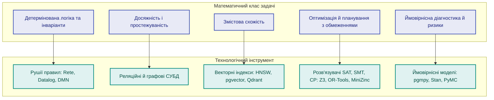
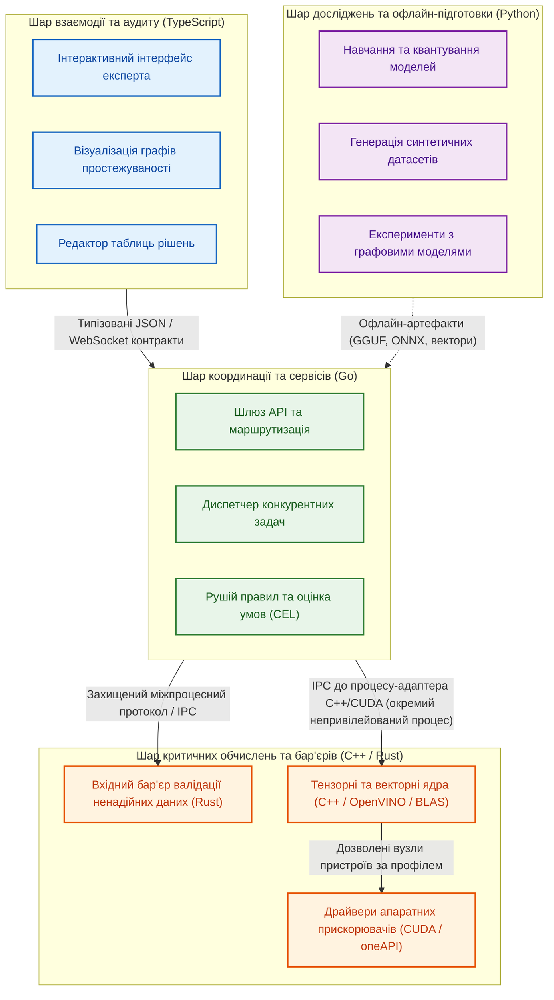
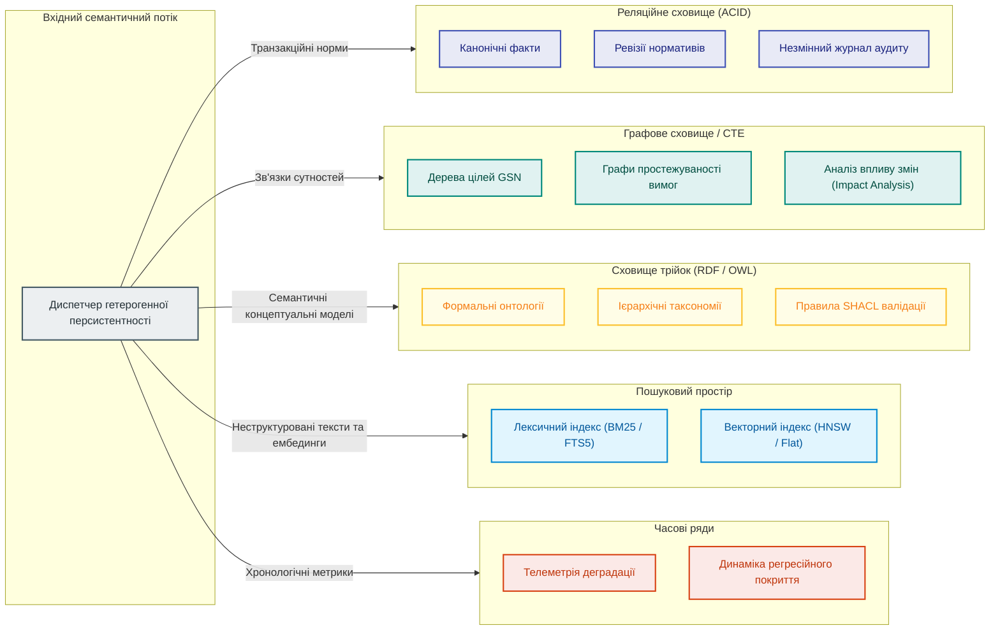
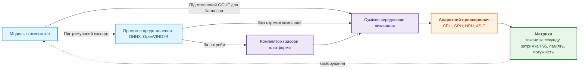
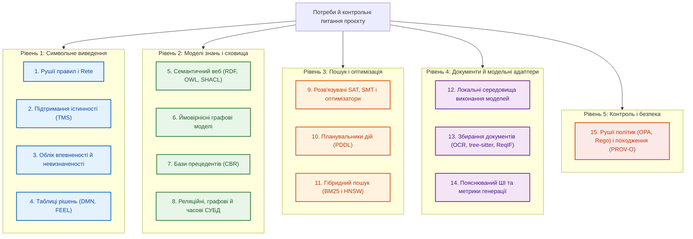
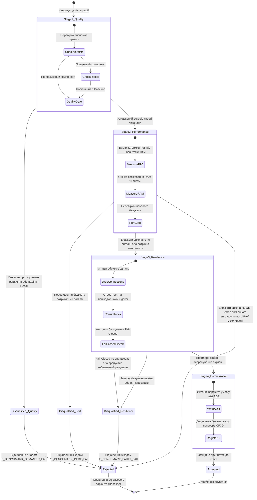

# Глава 17. Технологічний стек: критерії вибору інструментів, мов програмування та рушіїв правил

> **Книга:** [Архітектура доказових експертних систем](README.md) · [Частина VII: Технологічний стек, апаратна інфраструктура, кібернетичне виконання та розподілена SOA](part-07-runtime-and-knowledge-exchange.md)
> **Попередня глава:** [Глава 38. Машинні галюцинації та дефіцит знань: доказовий контроль відповідей](ch38-curing-machine-hallucinations-and-knowledge-deficits.md)
> **Наступна глава:** [Глава 18. Інфраструктура виконання: локальні моделі, апаратні прискорювачі, Edge та On-Premise](ch18-execution-infrastructure.md)
> **Зміст книги:** [README.md](README.md)
> **Автор:** [Микола Мартинович Федчик](about-the-author.md)
> **Передумови й маршрут читання:** базові знання про функції, множини й таблиці даних. Від простої перевірки випуску глава переходить до рекурсивних запитів, правил і порівняльного вимірювання компонентів.
> **Очікувані результати:** обирати інструмент за математичним класом задачі, роллю в архітектурі та поведінкою під час відмов; розподіляти мови програмування за шарами відповідальності; знаходити залежні артефакти рекурсивним запитом SQL; записувати рішення таблицями DMN і помічати в них прогалини; зіставляти задачі оптимізації й планування з розв'язувачами; пояснювати, чому зміна середовища виконання моделі впливає на відтворюваність доказового пакета; зіставляти шари стека з бажаною основною апаратурою; зіставляти компоненти Go з шарами можливостей і приймати компонент лише після порівняльного виміру з базовим варіантом.

---

## Анотація

Технологічний стек перетворює архітектуру експертної системи на працюючу програму: десь потрібно зберігати факти, застосовувати правила й показувати підстави рішення. Вибір інструментів починається не з назви мови чи сервера, а з питання: яку операцію треба виконати, який результат вважати правильним і що робити, якщо його не отримано? Навіть швидка бібліотека непридатна для допуску випуску, якщо відсутній звіт вона непомітно трактує як успішний тест.

Наскрізний навчальний приклад глави — локальна система перевірки програмного випуску. Спочатку їй достатньо перевірити факти й видати пояснення; потім виникають потреби зберігати історію, знаходити залежні артефакти, змінювати політику без переписування сервісу та шукати додаткові матеріали. На цих кроках зіставлено мови, запити SQL і Datalog, таблиці рішень, розв'язувачі та пошукові компоненти. Розрахунок пам'яті й порівняльний вимір завершують вибір: читач має вміти обґрунтувати як додавання компонента, так і відмову від нього. Продукти наведено як кандидатів для перевірки, а не як готовий сертифікований стек.

---

## 1. Мінімальна реалізація перед каталогом технологій

Мінімальна реалізація дає точку порівняння для всіх наступних інструментів. Нехай система отримує ідентифікатор випуску, версію політики та звіти тестування й повертає рішення з переліком використаних підстав. Для навчального сценарію прийнято локальне виконання одним користувачем і такі умови випуску: немає відкритих критичних дефектів, тестами покрито щонайменше 95 % вимог, тести безпеки завершено успішно. Поріг 95 % є умовою прикладу, а не вимогою стандарту; частка покритих вимог не доводить якості самих тестів.

Спершу варто побудувати найпростішу програму, яка виконує узгоджений контракт, і лише потім розширювати стек. Базова програма з [Глави 1](ch01-introduction-to-expert-systems.md) може бути реалізована на Go зі стандартною бібліотекою. Потрібні перевірки позитивного випадку, чужого випуску, відсутнього звіту, відкликання й помилки виконання. Поки історію не потрібно зберігати між запусками, сервер бази даних не розв'язує нової задачі. Це загальний принцип мінімізації рішення, а не окрема авторська методика.

<a id="obj-17-1"></a>

**Таблиця 17.1. Матриця поступового технологічного розширення за типом інженерного обмеження**

| Нове обмеження | Найменше обґрунтоване доповнення | Що не потрібно додавати автоматично |
|---|---|---|
| треба зберігати політики й запуски між виконаннями | версійовані файли або SQLite з перевіркою схеми | сервер графа й векторний індекс |
| багато правил змінюють фахівці без зміни коду | таблиці рішень або рушій правил із регресійними тестами | мовна модель як арбітр правил |
| потрібні багатокрокові залежності артефактів | рекурсивний запит або граф із типізованими ребрами | нейронна модель для самої досяжності |
| потрібно шукати підстави у вільному тексті | пошук кандидатів із походженням і доступом | дозвіл ухвалювати рішення за подібністю |
| декілька споживачів потребують незалежних випусків | версійований контракт і процедура доставки | брокер повідомлень до появи такої потреби |

Це маршрут поступового розширення, а не каталог готових адаптерів. За авторським **принципом пріоритету логічних меж відповідальності над фізичною мікросервісною декомпозицією**, межі відповідальності з [Глави 16](ch16-expert-systems-architecture.md) потрібні й у межах одного процесу; поділ на окремі мікросервіси для кожної межі не є обов'язковим і часто шкідливий через мережевий оверхед та розсинхронізацію транзакцій.

Коли нову потребу сформульовано, її слід віднести до класу задач. Авторська **модель семантичної відповідності «математика — технологія»** розрізняє п'ять таких класів. Для перевірки випуску спочатку потрібні логічні умови й досяжність; схожі документи, розклад тестів і оцінювання ризику є окремими розширеннями, а не обов'язковими складниками першої версії.

<a id="obj-17-2"></a>

**Діаграма 17.2. Від задачі до класу інструментів**



Кожна стрілка пов'язує задачу з інструментами, які варто розглянути, але не встановлює єдиного можливого продукту. Названий автором **закон семантичної непідмінності: неприпустимість підміни детермінованого доведення стохастичною подібністю** тут використано як інженерний принцип: схожість звіту на успішний не встановлює, що саме цей випуск пройшов потрібний тест. Перевірка відповідності ідентифікатора й статусу потребує явних умов; пошук схожих звітів лише добирає матеріали. Це авторське формулювання межі повноважень, а не заява про незалежно підтверджену новизну закону.

Отже, уже відомо, які операції потрібні. Наступне питання — якою мовою реалізувати їхню координацію, не перетворюючи вибір інструментів на вимогу використовувати всі мови одразу.

> [!NOTE]
> **Чотири критерії декомпозиції математичних моделей у технологічний стек**
> 1. Логічна детермінованість: сувора ізоляція предикатних інваріантів від наближених евристик і стохастичних обчислень.
> 2. Семантика транзитивної досяжності: для позитивного Datalog над скінченним доменом перевіряють передумови завершення; для інших мов і розширень потрібні власні умови.
> 3. Обчислювальна складність верифікації: окремо оцінюють вартість зіставлення правил і комбінаторного пошуку; назва рушія не встановлює часової межі.
> 4. Модель відмов обчислювального вузла: обов'язкове типізоване розрізнення станів unsat, timeout та відсутності знання.
> *Інженерний інваріант:* у проєктованому диспетчері підміну перевірки інваріанта пошуковою схожістю слід відхиляти, наприклад із діагностикою `E_INVALID_MODEL_SEMANTICS`. Код є пропозицією контракту, не наявною властивістю перелічених продуктів.

## 2. Мови програмування за шарами відповідальності

Розподіл мов за відповідальністю потрібен тоді, коли частини системи мають різні вимоги. Програма перевірки випуску координує запити, читає звіти й обчислює умови; для цього достатньо однієї мови, якою володіє команда. Якщо згодом знадобиться готова нативна бібліотека розпізнавання сканів, виникне інтерфейс виклику іншої мови (*Foreign Function Interface*, FFI), а разом із ним — нові умови збірки та відмови.

Авторська **парадигма шарового розподілу мов програмування за інженерною відповідальністю (поліглот-архітектура)** означає спеціалізацію за потребою, а не обов'язкові п'ять мов. Вибір зіставляють за доступними бібліотеками, підтримкою команди, способом постачання й перевірюваними ресурсними обмеженнями. Мову реалізації сервісу не слід плутати з мовою його правил: програма на Go може виконувати запит SQL або передавати таблицю DMN окремому рушію.

### 2.1. Go: сервісний шар і координація

Go є кандидатом для сервісу, який приймає запити перевірки випуску й збирає звіти з кількох джерел. Легкі потоки виконання (*goroutines*) дають змогу паралельно очікувати незалежні відповіді, а типовий спосіб збирання спрощує постачання програми без нативних залежностей. Проте порядок завершення goroutines не визначений, а збирання сміття впливає на затримки; правильність спільного доступу до даних і часові характеристики перевіряють окремо. cgo може додати бібліотеки й платформні вимоги.

Порівняймо два варіанти за припущення, що команда вже знає Go, а єдина зовнішня операція — читання JSON-звітів. Окремий Python-сервіс тут додає протокол, наглядач і два середовища постачання без нової можливості, тож залишається один процес Go. Якщо потрібна бібліотека моделей, доступна лише в Python, висновок змінюється. Приклади сервісів на Go — Ollama [[1]](#src-1) і NATS [[2]](#src-2) — не означають, що їх треба включити до цього стека. **Інваріант індиферентності сервісної інтеграції до мови реалізації сервера** стосується контракту обміну: клієнту важливі протокол і схема даних, але властивості відмов сервера все одно підлягають тестуванню.

Лише після появи відповідної потреби перевіряють кандидата з потрібної групи:

- `hyperjumptech/grule-rule-engine`: рушій правил із власною мовою правил GRL, натхненний Drools [[3]](#src-3);
- `sashabaranov/go-openai`: клієнт API у форматі OpenAI, який працює й з локальними сервісами, сумісними з цим форматом [[4]](#src-4);
- `yalue/onnxruntime_go`: обгортка над ONNX Runtime для виконання локальних моделей векторних представлень і класифікаторів [[5]](#src-5);
- `ledongthuc/pdf`: читання PDF-документів засобами Go [[6]](#src-6);
- `tree-sitter/go-tree-sitter`: прив'язки до tree-sitter для структурного розбору вихідного коду на синтаксичні дерева [[7]](#src-7).

### 2.2. C і C++: обчислювальні ядра високої швидкодії

Потреба в C/C++ у нашому сценарії виникне, наприклад, після додавання локальної моделі розпізнавання документів із готовим нативним ядром. **Інженерний принцип пріоритету C/C++ для обчислювальних ядер векторизації та драйверів** у викладі автора означає передусім повторне використання зрілої реалізації: llama.cpp [[8]](#src-8), OpenVINO [[9]](#src-9) або рушія правил CLIPS [[10]](#src-10). Переписувати весь сервіс цією мовою заради одного ядра не потрібно.

Перевагу дають не літери C++ у назві, а підтримувані оператори, векторні інструкції та реалізація бібліотеки. Якщо профілювання показало, що час витрачається на очікування диска, заміна Go на C++ не усуває причини. Якщо домінує підтримуване тензорне обчислення, порівнюють готове ядро з базовою реалізацією разом із витратами передавання даних. Межу можливого пошкодження пам'яті розглянуто в §2.6.

### 2.3. Rust: безпека пам'яті на межі з ненадійними даними

На межі вводу перевіряють не лише статус тесту, а й сам файл: пошкоджений звіт не повинен руйнувати сервіс. Авторський **принцип ізоляції периметра безпеки мовою Rust на межі з ненадійними даними (принцип вхідного бар'єра Rust)** пропонує safe Rust для модулів, де потрібне керування ресурсами без типових помилок ручного керування пам'яттю. Гарантії спираються на коректність компілятора й безпечність усіх `unsafe` та FFI-частин; вони не усувають логічних помилок, взаємних блокувань або вичерпання пам'яті. Парсер на Go теж є придатним кандидатом: нову мову виправдовує потрібна бібліотека чи вимога, а не сам факт зовнішнього вводу.

Рушій Zen із ядром на Rust [[11]](#src-11) ілюструє інше питання вибору: **інженерний ризик семантичної несумісності нестандартних моделей рішень (JDM проти DMN)**. JDM (*JSON Decision Model*) не є DMN. Це не забороняє аудит або створення конвертера, але сумісність перенесеної таблиці треба довести тестами умов, типів і політик спрацювання; спільний формат JSON цього не забезпечує.

### 2.4. Python: дослідницькі конвеєри та окремі сервіси моделей

Дослідницький конвеєр Python потрібен, якщо систему перевірки випуску розширюють, наприклад, класифікатором сканованих звітів. Навчання й оцінювання моделі можна виконувати окремо від сервісу допуску; це дозволяє змінювати експеримент, не змінюючи чинної політики. Python придатний і для детермінованої перевірки правил: межу повноважень установлює контракт компонента, а не мова. У цій архітектурі саме модель повертає лише кандидатів для незалежної перевірки.

У звичайній збірці CPython глобальне блокування інтерпретатора (*Global Interpreter Lock*, GIL) обмежує паралельне виконання байт-коду, але нативні бібліотеки можуть звільняти GIL, а процеси працюють незалежно. Збірки без GIL пов'язані з PEP 703 [[12]](#src-12); сумісність бібліотек перевіряють для конкретної збірки. Тому теза «Python повільний, отже непридатний» недостатня: для нічної підготовки даних важливий час завершення пакета, для сервісу — затримка разом із чергами та IPC. Далі Python використано як коротку виконувану оболонку над SQLite, без моделей і сторонніх бібліотек.

### 2.5. TypeScript: верифіковані інтерфейси експертного аудиту

Інтерфейс аудиту потрібен, коли користувач має не лише отримати `BLOCK`, а й побачити, якого звіту бракує. Авторський **принцип типобезпечної верифікації аудиторських інтерфейсів на TypeScript** спрямований на узгодження відображення з контрактом відповіді. Типи допомагають виявляти помилки під час розробки, але після компіляції не перевіряють отриманий JSON: потрібні перевірка схеми під час виконання та тести відображення. Наприклад, інтерфейс не повинен показати зелений дозвіл, якщо сервер повернув новий, ще невідомий статус.

Для першої локальної версії достатньо текстового звіту. TypeScript і графічний редактор виправдані, коли з'являється потреба інтерактивно переглядати залежності або погоджувати зміни правил. Остаточне рішення може бути автоматичним чи вимагати людини — це властивість політики, не інтерфейсу.

У власному прототипі я застосував такий розподіл ролей. Сервіси архітектурного ядра, черги й координацію написано на Go; числові операції векторизації виконують бібліотеки C++ (OpenVINO, ONNX Runtime), викликані через cgo; Python винесено в офлайнову частину для навчання й підготовки еталонних наборів; інтерфейс написано на TypeScript. Це опис мого досвіду прототипування, а не виміряне підтвердження універсальної продуктивності чи якості такого стека. Цей розподіл не є єдино правильним: він залежить від компетенцій команди й вимог до затримки. Межі між шарами задають контракти даних із [Глави 16](ch16-expert-systems-architecture.md); заміну мови окремого шару слід перевіряти на сумісність із цими контрактами.

Наведений авторський досвід не встановлює ізоляції адресних просторів самим cgo і не є порівняльним вимірюванням мов. У запропонованому профілі §2.6 сторонню нативну бібліотеку викликає процес-адаптер, а сервіс обмінюється з ним через IPC (*Inter-Process Communication*, міжпроцесний обмін). Цей профіль потрібний лише там, де вимога до локалізації збою виправдовує додатковий процес.

Діаграма показує розширений варіант, а не склад мінімальної програми.

<a id="obj-17-3"></a>

**Діаграма 17.3. Мовні ролі та процесні межі розширеної системи**



> [!NOTE]
> **П'ять інваріантів ізоляції мовних шарів у місійно-критичній архітектурі автора**
> 1. Автономність координаційного ядра: визначені контракти й синхронізація спільного стану; Go/Rust самі не гарантують детермінованого порядку виконання.
> 2. Ізоляція числових прискорювачів процесом-адаптером: обчислення C++/CUDA виконуються в окремому непривілейованому процесі з обміном через IPC (§2.6). Виклик через cgo в одному процесі ізоляції не дає, бо домен збою спільний.
> 3. Розмежування інференсу й допуску: Python може виконувати підготовку та інференс у профілі з підтвердженим часовим бюджетом, але не ухвалює остаточного рішення про допуск; модель повертає лише кандидати для незалежної перевірки.
> 4. Сувора типізація аудиторських інтерфейсів: типи TypeScript доповнено перевіркою схеми отриманих даних і відображення всіх статусів.
> 5. Бар'єри контрактів: JSON або бінарне кодування мають явну схему, версію та правила відхилення несумісного повідомлення.
> *Керування рантаймом:* у запропонованому профілі наглядач повинен фіксувати аварію чи тайм-аут як `E_ADAPTER_ISOLATION_BARRIER` без предметного вердикту. Наявність такого наглядача й відхилення недозволеного коду потрібно перевірити в реалізації.

### 2.6. Межа виконання нативного коду: процес-адаптер і IPC

Межу виконання стороннього нативного коду відокремлюють від координаційного сервісу, щоб звичайна помилка бібліотеки не зруйнувала стан його сесії. Виклик C-ABI через cgo виконується в адресному просторі процесу, який його здійснює: нативний код може пошкодити пам'ять цього процесу, а рантайм Go і санітайзери не гарантують виявлення такого запису в купу Go. Тому ізоляцію обчислень C++/CUDA забезпечує не cgo, а окремий непривілейований **процес-адаптер**, з яким сервіс обмінюється через IPC.

- **Права адаптера.** Окремий обліковий запис без привілеїв; немає мережевого доступу; дозволений перелік системних викликів (seccomp); файли моделей і даних доступні лише для читання; межа пам'яті (cgroup) задана параметром профілю розгортання. Доступ до прискорювача адаптер отримує лише через вузли пристрою, перелічені в профілі.
- **Канал.** Локальний сокет домену Unix із правами файлу й перевіркою облікових даних співрозмовника. Повідомлення мають префікс довжини, ідентифікатор запиту й версію схеми; профіль задає максимальний розмір у байтах, а версія схеми — повне кодування полів. Невалідне повідомлення відхиляється з діагностикою, а не трактується як результат обчислення. Великі масиви передаються через окремий сегмент пам'яті лише для обміну. Сегмент відповіді адаптер передає як новий дескриптор пам'яті, запечатаний від запису (наприклад, `memfd` із `F_SEAL_WRITE`), або сервіс спершу копіює вміст у власну пам'ять. Перевірку розмірів і схеми виконують лише над копією чи запечатаним сегментом.
- **Наглядач.** Кожен запит має додатну межу часу $`T_{\mathrm{IPC}}`$ у секундах, задану профілем і контрольовану монотонним годинником. Аварійне завершення адаптера (сигнал, ненульовий код виходу) або перевищення $`T_{\mathrm{IPC}}`$ наглядач фіксує кодом `E_ADAPTER_ISOLATION_BARRIER` (код із [глави 18](ch18-execution-infrastructure.md), §3.3.1, розширений на аварійне завершення й тайм-аут адаптера) і повертає відмову без вердикту, після чого перезапускає адаптер. Прострочену відповідь відкидають і записують у журнал аудиту; вона не стає відповіддю нового запиту.
- **Межа гарантії.** За коректної ізоляції процесів операційною системою та дотримання наведених прав звичайний процесний збій адаптера не змінює пам'яті й стану сесії сервісу, окрім сегмента обміну, який сервіс після збою не використовує. Це не гарантія проти помилок ядра ОС, драйвера або апаратного керування пам'яттю й DMA: їхні припущення входять до профілю розгортання. Детерміноване ядро ухвалення рішень не виконує Python та сторонніх C/C++/CUDA-викликів поза адаптерами.

Модуль Rust для розбору ненадійних даних (§2.3) працює за тією самою процесною схемою з IPC. Безпека пам'яті safe Rust не перетворює прив'язку Rust/Zen через C-ABI в ізоляцію адресних просторів; такі прив'язки в цьому профілі виконуються всередині адаптера.

Для перевірки профілю підмінюють адаптер трьома тестовими процесами: коректним, аварійним і таким, що відповідає після строку. Лише перший результат може бути використаний; повторний запит повинен мати інший ідентифікатор, а пізня відповідь — бути відкинута. Це план інтеграційних тестів, не виконаний у цій главі експеримент з ізоляцією ОС. Визначивши межі виконання, можна перейти до наступного питання: як виразити зв'язки між збереженими фактами.

## 3. Мови декларативних запитів до баз знань

Мова запитів стає потрібною, коли після зміни вимоги треба знайти всі звіти й модулі, які слід переглянути. Замість ручного переліку переходів можна описати відношення «залежить від» й обчислити його наслідки. Авторська **концепція декларативної адресації знань та інваріантності відтворення** полягає у відокремленні потрібного результату від способу обходу. Відтворюваність при цьому потребує також того самого знімка даних, версії запиту й визначеного порядку видачі; сама декларативна мова цього не забезпечує.

### 3.1. SQL і рекурсивні запити

SQL дозволяє почати з таблиці зв'язків у вже наявній базі. У рядку `trace(src, dst)` артефакт `dst` залежить від `src`: зміна вимоги зачіпає проєктне рішення, потім модуль, потім тест. Рекурсивний загальний табличний вираз (*Common Table Expression*, CTE) повторює цей перехід, доки з'являються нові шляхи [[13]](#src-13). Напрямок ребра тут істотний: змінюючи тест, не можна цим самим запитом автоматично оголосити зміненою вимогу.

Нижче реалізовано авторський **алгоритм рекурсивного аналізу впливу змін на основі SQL CTE із захистом від циклів через JSON-шлях**. Запит повертає вихідний вузол із глибиною 0 і всі досяжні вузли з найменшою кількістю ребер до них. Це аналіз впливу, не доказ придатності знайдених звітів. Лістинг запускається командою `python3 impact.py` після розміщення вмісту блока у файлі `impact.py`; потрібні Python 3 і SQLite з функціями JSON [[14]](#src-14), сторонніх пакетів немає.

<details>
<summary>Приклад мовою Python</summary>

```python
import sqlite3

con = sqlite3.connect(":memory:")
con.executescript("""
CREATE TABLE trace(src TEXT, dst TEXT);
INSERT INTO trace VALUES
  ('REQ-7',  'DES-3'),
  ('DES-3',  'MOD-12'),
  ('DES-3',  'MOD-14'),
  ('MOD-12', 'TC-40'),
  ('MOD-14', 'TC-41'),
  ('MOD-14', 'MOD-12'),
  ('TC-41',  'DES-3'),   -- зворотне посилання утворює цикл
  ('REQ-9',  'MOD-14');
""")

QUERY = """
WITH RECURSIVE impact(node, depth, path) AS (
    SELECT :root, 0, json_array(:root)
  UNION ALL
    SELECT t.dst, i.depth + 1, json_insert(i.path, '$[#]', t.dst)
  FROM trace AS t JOIN impact AS i ON t.src = i.node
    WHERE NOT EXISTS (SELECT 1 FROM json_each(i.path) AS visited
                                        WHERE visited.value = t.dst)
)
SELECT node, MIN(depth) FROM impact GROUP BY node ORDER BY 2, 1;
"""

def impact(root):
    return dict(con.execute(QUERY, {"root": root}))


for node, depth in con.execute(QUERY, {"root": "REQ-7"}):
    print(depth, node)
assert impact("REQ-7") == {
    "REQ-7": 0, "DES-3": 1, "MOD-12": 2, "MOD-14": 2,
    "TC-40": 3, "TC-41": 3,
}
con.executemany("INSERT INTO trace VALUES (?, ?)",
                [("REQ-7", "DOC/ANNEX"), ("DOC/ANNEX", "ANNEX")])
assert impact("REQ-7")["ANNEX"] == 2
assert "REQ-9" not in impact("REQ-7")
assert impact("ISOLATED") == {"ISOLATED": 0}
con.execute("INSERT INTO trace VALUES ('SELF', 'SELF')")
assert impact("SELF") == {"SELF": 0}
print("SQL: 5 checks passed")
con.close()
```

</details>


Програма виводить:

<details>
<summary>Дані або результат прикладу</summary>

```text
0 REQ-7
1 DES-3
2 MOD-12
2 MOD-14
3 TC-40
3 TC-41
SQL: 5 checks passed
```

</details>


Рядок із `SELECT :root` створює початковий шлях; рекурсивна частина дописує до JSON-масиву наступний вузол, а `NOT EXISTS` забороняє повтор на цьому шляху. `MIN(depth)` обирає найкоротший із простих шляхів, `ORDER BY` упорядковує видачу. **Інваріант точного дискретного зіставлення ідентифікаторів у графах простежуваності** перевірено випадком `DOC/ANNEX -> ANNEX`: пошук підрядка помилково вважав би `ANNEX` уже відвіданим, а порівняння елементів JSON його знаходить. Інші перевірки охоплюють відсутність зворотного поширення до `REQ-9`, ізольований корінь і петлю на одному вузлі. За прийнятою домовленістю ізольований або ще не зареєстрований корінь повертається сам; якщо це небажано, його існування перевіряють до запиту.

Кількість простих шляхів може зростати експоненційно навіть без циклів, тому приклад не є універсальним масштабованим алгоритмом для довільних графів. Якщо потрібна лише множина досяжних вузлів, рекурсивний `UNION` над одним полем вузла усуває повтори без повного перебору шляхів. Сформульовано **інженерне правило вибору між рекурсивним SQL та виділеною графовою СУБД**: окрему графову СУБД обґрунтовують вимірюванням реальної затримки й складності запитів, а не довільною апріорною межею кількості ребер.

### 3.2. Графові мови запитів: Cypher, GQL і SPARQL

Графова мова стає корисною, коли запитів на шляхи й властивості зв'язків багато, а не просто тому, що таблиця містить ребра. У графі властивостей вузли й ребра можуть мати атрибути: наприклад, ребро залежності має версію та статус підтвердження. Cypher і стандартизована мова GQL (ISO/IEC 39075:2024) [[15]](#src-15) дозволяють описувати шаблони таких зв'язків. Для одного наведеного обходу міграція з SQLite поки не дає необхідної нової можливості.

Інший випадок — обмін знаннями у вигляді трійок RDF «суб'єкт — відношення — об'єкт». Тоді природним кандидатом є SPARQL [[16]](#src-16), зокрема для запитів до даних, описаних онтологією OWL. Сам SPARQL-запит не означає виконання всього логічного виведення OWL: режим виведення сховища узгоджують окремо. Отже, спочатку обирають модель даних і потрібний запит, потім мову; для повторюваних похідних відношень варто розглянути Datalog.

### 3.3. Datalog: детерміноване логічне виведення

Datalog дозволяє назвати похідне відношення «впливає» й надалі використовувати його в інших правилах. У позитивному фрагменті правила лише додають факти, не заперечують їх і не створюють нових значень через функціональні символи [[17]](#src-17). Змінні `X`, `Y`, `Z` позначають ідентифікатори артефактів, `:-` читається «якщо», кома — «і». Для того самого напрямку ребер маємо:

<details>
<summary>Правила логічною мовою</summary>

```prolog
affects(X, Y) :- trace(X, Y).
affects(X, Z) :- trace(X, Y), affects(Y, Z).
```

</details>


Перше правило задає прямий вплив, друге подовжує шлях на одне ребро. Це транзитивне замикання шляхів додатної довжини: на відміну від SQL-прикладу, корінь не включається автоматично. Пара `affects(X, X)` виникне лише за наявності циклу. Лістинг є правилами Datalog, не самостійною програмою Prolog; спосіб завантаження фактів залежить від рушія. Далі наведено виконувану реалізацію саме цих двох правил через операції над множинами, щоб результат можна було перевірити без встановлення рушія.

#### 3.3.1. Теорема детермінованого виведення Datalog у графах залежностей (найменша нерухома точка)

Теорема про найменшу нерухому точку пояснює, чому цикл у даних не обов'язково означає нескінченне виконання. Для позитивної програми Datalog із безпечними правилами, без функціональних символів і зі скінченним набором констант послідовне додавання наслідків завершується й дає найменшу множину фактів, замкнену відносно правил [[17]](#src-17). Безпечність тут означає, що кожна змінна голови правила зустрічається в його позитивній передумові. Це класичний результат; авторським є його застосування до вибору засобів аналізу залежностей, не сама теорема.

Для двох наведених правил результат зручно рахувати раундами. Нехай $`V`$ — скінченна множина ідентифікаторів, $`N=\lvert V\rvert\ge0`$ — їх кількість, $`E\subseteq V\times V`$ — множина початкових ребер `trace`, а $`R_k`$ — пари `affects`, відомі після $`k`$ раундів. Усі ці величини дискретні й не мають фізичних одиниць.

<a id="obj-17-4"></a>

**Формула (17.4). Один раунд обчислення впливу**

$$
R_0=\emptyset,\qquad
R_{k+1}=E\cup R_k\cup\{(x,z)\mid (x,y)\in E\ \land\ (y,z)\in R_k\},\qquad k\in\mathbb{Z}_{\ge0}.
$$

Тут $`x,y,z\in V`$ — початок, проміжний вузол і кінець шляху; об'єднання множин не дублює вже відомих пар. У першому раунді додаються ребра $`E`$, у наступному — шляхи з двох ребер. Оператор монотонний: зі збільшенням відомої множини наслідки не зникають. Якщо нової пари немає, наступне повторення вже нічого не змінить.

<a id="obj-17-5"></a>

**Формула (17.5). Результат і межа кількості продуктивних раундів**

$$
R_*=R_M=R_{M+1}=\bigcup_{k=0}^{M}R_k,\qquad 0\le M\le N^2.
$$

$`R_*`$ — транзитивне замикання; $`M`$ — кількість раундів, які додали хоча б одну пару. Можливих пар не більше $`N^2`$, тому продуктивних раундів не більше стільки ж; для виявлення стабілізації потрібне ще одне порівняння. Доведення найменшості також коротке: кожна додана пара відповідає реальному шляху, а будь-яка множина, що містить ребра й замкнена за другим правилом, мусить містити всі ці пари. Межа стосується саме одного бінарного похідного відношення, а не довільної програми з агрегатами, генерацією значень чи запереченням.

Перевіримо на малому варіанті нашого графа: `REQ-7 -> DES-3 -> MOD-12 -> REQ-7`. Це спеціально побудований трицикл, не початковий набір SQL. Після першого раунду відомо 3 пари, після другого — 6, після третього — усі 9, включно з трьома поверненнями у вихідний вузол. Четвертий виклик лише виявляє стабілізацію. Лістинг реалізує формулу (17.4); команда запуску — `python3 closure.py`.

```python
def closure(edges):
    edges = set(edges)
    reached = set()
    sizes = []
    while True:
        following = edges | reached | {
            (src, dst)
            for src, middle in edges
            for origin, dst in reached
            if middle == origin
        }
        sizes.append(len(following))
        if following == reached:
            return following, sizes
        reached = following


edges = {("REQ-7", "DES-3"), ("DES-3", "MOD-12"),
         ("MOD-12", "REQ-7")}
reached, sizes = closure(edges)
assert sizes == [3, 6, 9, 9]
assert len(reached) == 9
assert closure(set()) == (set(), [0])
assert closure({("SELF", "SELF")}) == ({("SELF", "SELF")}, [1, 1])
assert ("MISSING", "REQ-7") not in reached
chain = {("REQ-7", "DES-3"), ("DES-3", "MOD-12")}
assert closure(chain)[0] == chain | {("REQ-7", "MOD-12")}
print("Datalog model: 6 checks passed; rounds:", sizes)
```

Очікуваний результат — `Datalog model: 6 checks passed; rounds: [3, 6, 9, 9]`. Ациклічний ланцюжок перевіряє точний набір пар, а не тільки їх кількість: хибне з'єднання за різними проміжними вузлами не повинне пройти тест. Лістинг навмисно наївний: він навчає семантики множин, а не замінює оптимізований Datalog-рушій. Для випуску це означає, що цикли залежностей можна обробляти без породження нових фактів із нічого. Тайм-аут усе ще можливий через ресурси; він не доводить порушення теореми. Діагностика на кшталт `E_DATALOG_NON_TERMINATION` без аналізу причин не встановлює, що саме сталося.

Для оцінки пам'яті 10 000 вузлів дають до 100 млн пар. Лише два 32-бітні ідентифікатори на пару потребували б 800 млн байтів; індекси, множини й робочі копії додають витрати. Це оцінка представлення, не твердження, що замикання вміститься на конкретній машині. І SQL із усуненням дублікатів, і позитивний Datalog можуть завершуватися на циклах; обирати між ними слід за потрібними похідними відношеннями та виміром, а не за протиставленням «SQL зациклюється, Datalog — ні».

## 4. Рушії правил і таблиці рішень

Рушій правил потрібний не для збереження залежностей, а для застосування політики до знайдених фактів. У прикладі випуску це питання «чи виконано всі умови?». Поки умов три й змінює їх програміст, звичайна функція з тестами є повноцінним базовим варіантом. Якщо правила регулярно погоджує інша група фахівців, їх зручно відокремити від сервісного коду.

Авторський **принцип ізоляції правил як керованих версійованих інженерних артефактів** вимагає зберігати ідентифікатор, версію, підставу й тести кожного правила незалежно від форми реалізації. Для навчальної політики підставою є умова сценарію; для нормативної — точне застосовне положення джерела. Заборона самого оператора `if` не створила б доказовості: важливо, щоб правило не було приховане й його зміна була простежуваною.

### 4.1. Класичні продукційні рушії (Rete-подібні алгоритми)

Продукційний рушій доцільний, коли надходження факту активує правила, а їхні дії змінюють робочу пам'ять. Наприклад, відкликання звіту може активувати повторну перевірку всіх пов'язаних випусків. Алгоритм Rete Чарльза Форгі зберігає часткові збіги умов, щоб не виконувати всі зіставлення заново [[18]](#src-18). Це обмін пам'яті на повторне використання обчислень, не гарантія сталого часу: один факт може створити багато комбінацій і активацій.

Кандидатами є CLIPS для вбудовування в C [[10]](#src-10), Drools із алгоритмом Phreak для Java [[19]](#src-19), Grule для Go [[3]](#src-3) і NRules для .NET [[20]](#src-20). Їх зіставляють за семантикою активацій, відкликанням і поясненням, а не лише мовою. Якщо ж потрібне одне рішення за фіксованим набором входів без зміни фактів, таблиця рішень буде простішою для рецензування.

### 4.2. Стандарт DMN та мова виразів FEEL

DMN (*Decision Model and Notation*) дає спільну форму запису рішення для розробника й фахівця, який погоджує політику [[21]](#src-21). У таблиці рядок є правилом, стовпці задають умови й результат. FEEL (*Friendly Enough Expression Language*) описує вирази та перевірки в клітинках, а DRD (*Decision Requirements Diagram*) показує, від яких входів і попередніх рішень залежить поточне. Для нашого одного рішення достатньо таблиці.

Спочатку визначимо допустимі входи: кількість дефектів — невід'ємне ціле число, покриття — скінченне число від 0 до 1, статус тестів — одне зі значень `pass`, `fail`, `error`, `timeout`. Покриття 0,95 означає 95 покритих вимог зі 100, а не 95 % рядків коду. Дані поза цими типами відхиляються до таблиці. Політика U (*Unique*) допускає **не більше одного** збігу; існування збігу треба перевіряти окремо. Прочерк у клітинці FEEL означає будь-яке значення в узгодженому домені.
Позначка `U` задає політику спрацювання таблиці в цілому; перший стовпець нижче лише нумерує рядки.

<a id="obj-17-6"></a>

**Таблиця 17.6. Навчальна політика випуску з явними станами помилок**

| № | Відкриті критичні дефекти | Покриття вимог тестами | Тести безпеки | Рішення |
|---|---|---|---|---|
| 1 | `> 0` | `-` | `-` | `"BLOCK"` |
| 2 | `0` | `< 0.95` | `-` | `"BLOCK"` |
| 3 | `0` | `>= 0.95` | `"fail", "error", "timeout"` | `"BLOCK"` |
| 4 | `0` | `>= 0.95` | `"pass"` | `"RELEASE"` |

Перевірмо повноту без інструмента. Додатна кількість дефектів завжди веде до першого рядка; за нульової кількості покриття нижче порога веде до другого. Решту допустимих входів ділять третій і четвертий рядки за статусом тестів. Ці випадки не перетинаються й покривають заданий домен. Якби третій рядок містив лише `fail`, то за входу `(0, 0.95, "error")` збігів було б нуль: це розрізнювальний негативний тест проти помилкової неповної версії. No-hit не можна перетворювати на дозвіл, навіть якщо статичну перевірку вже виконано.

Політики F (*First*) й R (*Rule Order*) залежать від порядку рядків, A (*Any*) вимагає однакового результату всіх збігів, C (*Collect*) збирає результати. Це визначені семантики, не випадкові евристики. Для цієї політики випуску обрано U, бо порядок не повинен приховувати конфлікт. Інша задача може свідомо вимагати F; тоді перестановка рядків є зміною політики, яку потрібно рецензувати.

Наступний лістинг реалізує **метод перевірки домену та єдиного збігу** для таблиці 17.6. Це виконуваний еталон на Python, не реалізація всього FEEL і не перевірка конкретного DMN-продукту. Він приймає три описані входи й повертає рішення та причину; команда запуску — `python3 decision.py`.

<details>
<summary>Еталон таблиці й тести допуску</summary>

```python
from math import isfinite


def decide(defects, coverage, status):
    valid = (
        type(defects) is int and defects >= 0
        and type(coverage) in (int, float) and isfinite(coverage)
        and 0 <= coverage <= 1
        and type(status) is str
        and status in {"pass", "fail", "error", "timeout"}
    )
    if not valid:
        return "BLOCK", "INVALID_INPUT"
    rows = [
        (defects > 0, "BLOCK"),
        (defects == 0 and coverage < 0.95, "BLOCK"),
        (defects == 0 and coverage >= 0.95 and status != "pass", "BLOCK"),
        (defects == 0 and coverage >= 0.95 and status == "pass", "RELEASE"),
    ]
    hits = [result for condition, result in rows if condition]
    if len(hits) != 1:
        return "BLOCK", "TABLE_ERROR"
    return hits[0], "MATCH"


cases = [
    ((0, 0.95, "pass"), ("RELEASE", "MATCH")),
    ((0, 1, "pass"), ("RELEASE", "MATCH")),
    ((1, 1, "pass"), ("BLOCK", "MATCH")),
    ((0, 0.949, "pass"), ("BLOCK", "MATCH")),
    ((0, 0.95, "fail"), ("BLOCK", "MATCH")),
    ((0, 0.95, "error"), ("BLOCK", "MATCH")),
    ((0, 0.95, "timeout"), ("BLOCK", "MATCH")),
    ((0, None, "pass"), ("BLOCK", "INVALID_INPUT")),
    ((0, float("nan"), "pass"), ("BLOCK", "INVALID_INPUT")),
    ((-1, 1, "pass"), ("BLOCK", "INVALID_INPUT")),
    ((0, 1.01, "pass"), ("BLOCK", "INVALID_INPUT")),
    ((0, "0.95", "pass"), ("BLOCK", "INVALID_INPUT")),
    ((False, 1, "pass"), ("BLOCK", "INVALID_INPUT")),
    ((0, float("inf"), "pass"), ("BLOCK", "INVALID_INPUT")),
    ((0, 1, "pending"), ("BLOCK", "INVALID_INPUT")),
]
for inputs, expected in cases:
    assert decide(*inputs) == expected, inputs
print("Decision:", len(cases), "checks passed")
```

</details>

Очікується `Decision: 15 checks passed`. Поріг 0,95, верхня межа 1 й значення одразу нижче порога перевіряють різні гілки; `None`, нечисловий рядок і нескінченні значення перевіряють бар'єр типів. У реальній системі до цієї функції ще треба звірити ідентифікатор випуску, чинність і походження звітів. Тому `RELEASE` тут — лише результат навчальної таблиці, не самодостатній дозвіл реального випуску. Перевірку великих таблиць розглянуто в [Главі 23](ch23-knowledge-base-verification.md).

> [!WARNING]
> **Два критичні ризики політик спрацювання DMN за аналізом автора**
> 1. Проблема неповноти domain-значень: якщо вхідна змінна набуває `null`, `NaN` або неочікуваного значення помилки (наприклад, `"timeout"` чи `"error"`), правило може не спрацювати. Конкретне представлення no-hit залежить від рушія; його не можна трактувати як успішний допуск.
> 2. Прихований пріоритет: у First перший збіг може приховати пізніше блокувальне правило. Це помилка моделі пріоритетів, не випадковість алгоритму; no-hit і кілька несумісних збігів потребують явного непрохідного результату.
> *Інженерний інваріант:* Відсутність спрацювання правил у допусковій таблиці автоматично еквівалентна безумовному блокуванню `BLOCK` з реєстрацією інциденту неповноти бази знань.

> [!NOTE]
> **Чотири практичні правила проєктування допускових таблиць DMN**
> 1. Default-Deny для допуску: у таблиці, яка дозволяє випуск або safety-critical дію, неперекрите вхідне значення не може стати дозволом і переводить шлюз у `BLOCK`; у дорадчій таблиці відсутність збігу залишається невідомим результатом.
> 2. Відсутність неявного вибору: у запропонованому допусковому профілі використано Unique; це авторське проєктне обмеження, не загальна заборона інших політик стандартом.
> 3. Замкненість доменних типів: перед таблицею перевіряють типи й межі, а стани помилок і тайм-аутів включають до домену або явно відхиляють.
> 4. Перевірка повноти й перетинів: для малої таблиці придатний розбір випадків; для великої можна застосувати SMT, якщо трансляція підтримує використаний фрагмент FEEL і зберігає його семантику.
> *Керування рантаймом:* у проєктованому шлюзі неперевірену таблицю не слід завантажувати; `E_DMN_INCOMPLETE_TABLE` є запропонованою діагностикою, а не властивістю кожного рушія.

## 5. Спеціалізовані сховища за фізичною формою даних

Сховище потрібне, коли результат перевірки випуску має пережити завершення програми. Спершу достатньо зберегти версію політики, звіти й рішення разом із їхніми ідентифікаторами. Потім може виникнути окрема потреба шукати текст або рахувати тренди. Названий автором **закон відповідності фізичної форми сховища семантичному класу знань (закон гетерогенної персистентності знань)** використано тут як принцип вибору структури за операціями; він не вимагає окремої СУБД для кожного типу даних.

<a id="obj-17-7"></a>

**Таблиця 17.7. Сховища як кандидати для різних запитів**

| Тип сховища | Приклади продуктів | Клас знань | Типовий запит |
|---|---|---|---|
| **Реляційні СУБД** | PostgreSQL, SQLite, Microsoft SQL Server | Канонічні факти, ревізії нормативів, аудит | «Яка редакція правила діяла під час випробувань 12 травня?» |
| **Графові СУБД** | Neo4j, ArangoDB, Amazon Neptune | Простежуваність «вимога, тест, дефект» | «Які модулі зачіпає зміна вимоги з ISO 26262?» |
| **Сховища трійок RDF** | GraphDB, Stardog, Apache Jena | Онтології OWL, таксономії | «Знайти всі типи датчиків, що належать до класу SafetyCritical» |
| **Лексичний пошук** | OpenSearch, Elasticsearch, SQLite FTS5 | Специфікації, коди помилок, артикули | «Знайти звіти про дефекти зі словами overheat і vibration» |
| **Векторні СУБД** | Qdrant, pgvector, Milvus, Weaviate | Змістові фрагменти нормативів, схожі прецеденти | «Знайти нормативи зі схожими вимогами до вологозахисту корпусу» |
| **Бази часових рядів** | TimescaleDB, InfluxDB, Prometheus | Тренди надійності, динаміка покриття тестами | «Чи зростає час спрацювання клапана за останні п'ять циклів?» |

Один продукт може підтримувати кілька рядків: SQLite поєднує таблиці, рекурсивний SQL і повнотекстовий пошук, PostgreSQL допускає розширення pgvector. **Інженерний принцип ощадливого додавання спеціалізованих сховищ за дефіцитом можливостей** автора не потребує доводити абсолютну неможливість іншої реалізації: достатньо показати, що базовий варіант не виконує погоджену вимогу за прийнятної складності підтримки.

Для одного користувача й локальних звітів обираємо SQLite: потрібні збереження історії й уже перевірений обхід. Якщо з'являться незалежні одночасні клієнти з потрібною моделлю транзакцій, порівнюємо серверну реляційну базу. Якщо потрібен пошук точного коду дефекту, спочатку перевіряємо лексичний індекс; векторний пошук потрібен для іншого запитання — про змістову схожість. Жоден індекс не замінює оригінал звіту, а звичайна таблиця аудиту не стає незмінною без прав доступу й політики зберігання.

На схемі наведено логічні ролі. Вони можуть бути реалізовані однією чи кількома СУБД; стрілки не означають, що диспетчер уже вміє автоматично обирати продукт.

<a id="obj-17-8"></a>

**Діаграма 17.8. Ролі зберігання й пошуку в розширеній системі**



## 6. Оптимізація, планування та розв'язання обмежень

Розв'язання обмежень потрібне, коли замість перевірки готового набору звітів потрібно знайти спосіб їх отримати. Припустімо, випуск заблоковано через два невиконані тести, а обидва потребують одного стенда. Перевірити готовий розклад можна правилами; знайти час початку кожного тесту — вже задача пошуку. Оптимізація додає до неї критерій, наприклад найменший час завершення. Допустимість і оптимальність є різними результатами.

<a id="obj-17-9"></a>

**Таблиця 17.9. Демаркаційна модель логічного виведення та задоволення обмежень автора (Rules проти Solvers)**

| Критерій | Рушій правил (Rete / Phreak / Datalog) | Розв'язувач обмежень (SMT / Z3 / CP-SAT) |
|---|---|---|
| **Формулювання задачі** | Які наслідки випливають із заданих фактів за правилами? | Чи існує конфігурація, що задовольняє всі обмеження, або контрприклад до властивості? |
| **Простір пошуку** | Факти, їхні зіставлення й похідні відношення | Комбінації значень змінних; домен може бути скінченним або нескінченним |
| **Алгоритмічна складність** | Вартість залежить від правил, числа фактів і породжених збігів; сталої вартості оновлення Rete загалом немає | Булева SAT є NP-повною; складність SMT залежить від теорії, деякі фрагменти нерозв'язні алгоритмічно |
| **Типова інженерна роль** | Перевірка політики випуску або обчислення наслідків за заданими правилами | Пошук допустимого розкладу; оптимальність потребує окремого підтвердження |

Для малого прикладу достатньо перебору. Нехай тест A триває 2 години, B — 3 години; переривати їх не можна, обидва використовують один стенд. Початки тестів обираються в цілих годинах від нуля до строку $`H`$, без часу переналагодження. Потрібно знайти хоча б одну допустиму пару початків.

<a id="obj-17-10"></a>

**Формула (17.10). Обмеження розкладу двох тестів**

$$
s_A,s_B\in\{0,1,\ldots,H\},\qquad
s_A+2\le H,\quad s_B+3\le H,\quad
(s_A+2\le s_B)\lor(s_B+3\le s_A).
$$

Тут $`H\in\mathbb{Z}_{\ge0}`$ — строк у годинах, $`s_A`$ і $`s_B`$ — невід'ємні цілі моменти початку в тих самих одиницях. Константи 2 й 3 — тривалості в годинах, $`\lor`$ означає «або». Остання умова забороняє одночасне зайняття стенда, але дозволяє почати другий тест саме в момент завершення першого. За $`H=5`$ пари `(0, 2)` і `(3, 0)` допустимі; за $`H=4`$ розкладу немає, бо послідовно потрібно 5 годин. Окрема перевірка кожної тривалості проти строку помилково прийняла б `(0, 0)`.

Лістинг реалізує **метод повного перебору скінченного простору розкладів** за формулою (17.10); команда запуску — `python3 schedule.py`.

```python
from itertools import product


def schedules(horizon):
    return [
        (start_a, start_b)
        for start_a, start_b in product(range(horizon + 1), repeat=2)
        if start_a + 2 <= horizon and start_b + 3 <= horizon
        and (start_a + 2 <= start_b or start_b + 3 <= start_a)
    ]


assert schedules(5) == [(0, 2), (3, 0)]
assert schedules(4) == []
assert schedules(0) == []
assert (0, 0) not in schedules(5)
print("Schedule: 4 checks passed")
```

Очікується `Schedule: 4 checks passed`; передумова функції — невід'ємний цілий `horizon`. Для двох тестів перебір прозорий, для багатьох число комбінацій швидко зростає. Тоді обирають інструмент за формою обмежень, не намагаються приховати пошук у ланцюжку продукційних активацій:

- **SAT і SMT.** SAT працює з булевими формулами, SMT додає підтримувані теорії, наприклад цілочисельну арифметику. Можна шукати конфігурацію або контрприклад до властивості. Кандидати — Z3 [[22]](#src-22) і cvc5 [[23]](#src-23); приклад Z3 є в [Главі 14](ch14-requirements-detection-and-formalization.md).
- **Програмування в обмеженнях** розв'язує комбінаторні задачі з жорсткими обмеженнями: складання розкладів випробувань, конфігурацію модульного обладнання. Сюди належать розв'язувач CP-SAT з OR-Tools [[24]](#src-24) і мова моделювання MiniZinc [[25]](#src-25), яка відокремлює опис задачі від конкретного розв'язувача.
- **Математичне програмування.** Лінійна ціль і лінійні ресурсні обмеження ведуть до лінійної або змішаної цілочисельної моделі, залежно від допустимих значень змінних.
- **Автоматичне планування.** Якщо дії мають передумови й змінюють стан, потрібен планувальник, наприклад Fast Downward для підтримуваних задач PDDL (*Planning Domain Definition Language*) [[26]](#src-26). Авторський **патерн синтезу коригувальних дій за допомогою планувальника PDDL при провалі сертифікації** пропонує план виправлення, а потім незалежну перевірку його кроків. Мінімальність плану можна заявляти лише за відповідного критерію та режиму оптимального пошуку; сам факт знайденого плану її не доводить.

Знайдений допустимий розклад можна перевірити підстановкою в обмеження, але це не доводить оптимальності. Тут діє **інженерний інваріант незалежної верифікації сертифікатів незадовільності (Unsat Core & Proof Logging)**: ядро незадовільності називає достатній суперечливий піднабір, проте саме не є незалежним доказом `unsat`: його треба повторно перевірити або перевірити формальний доказ підтримуваного формату. Підтримка доказів залежить від розв'язувача й теорії. Також застосовується **семантичне правило типізованого розрізнення результатів розв'язувача**: результати `sat` та `unsat` вимагають строгого типізованого розмежування з невизначеними станами `unknown`, `timeout` та системною помилкою, які не означають ні допустимості, ні неможливості й переводять систему в режим безпечного блокування Fail-Closed.

## 7. Семантична перевірка кандидата рушія

Семантична перевірка відповідає на питання, чи можна замінити базову функцію або запит іншим рушієм без зміни змісту рішення. Авторський **принцип семантичної нееквівалентності булевих предикатів рушіїв виведення** застерігає від порівняння лише типу `bool`. Наприклад, у Datalog відсутня пара означає «не виведено в цій моделі», а для випуску це не обов'язково «тест доведено проваленим»: звіту могло не бути. Переклад із внутрішнього результату рушія у статус предметної системи має бути явним.

CEL (*Common Expression Language*) обчислює охоронні вирази, Rego — політики, DMN — таблиці рішень, а Datalog — похідні відношення. Порівнювати їх коректно лише на спільній операції й з однаковою домовленістю про відсутні значення. Не кожний рушій має вбудований граф пояснення або підтримання альтернативних підстав; ці можливості можуть потребувати окремого адаптера.

<a id="obj-17-11"></a>

**Таблиця 17.11. Запропонована автором матриця семи семантичних властивостей рушія**

Матриця є запропонованим контрольним переліком, а не підтвердженою повною таксономією аудиту; її новизну й достатність не зіставлено з наявними методиками.

| Властивість | Контрольний випадок |
|---|---|
| Невідоме значення й явне заперечення | відсутній тест не стає доведеним успіхом або невдачею |
| Порядок і нерухома точка | перестановка фактів і правил не змінює декларативного результату |
| Відкликання | видалення однієї підстави зберігає незалежну альтернативу |
| Цикли й завершення | непідкріплений цикл не створює факту; перевищення ліміту є окремим статусом |
| Таблиця рішень | пропуск, перетин і невідомий тип не дають неявного дозволу |
| Зовнішні функції | мережа, поточний час і випадковість не приховані в правилі |
| Пояснення | рушій повертає використані підстановки й залежності, не лише вердикт |

Порівняння виконує той самий підтримуваний набір правил із однаковою політикою відмови. OPA придатний для окремих рішень доступу, CEL для охоронних виразів, продукційний рушій для керування активаціями, а Datalog для рекурсивних відношень. Вибір із цієї карти є гіпотезою до перевірки.

> [!NOTE]
> **П'ять семантичних тестів верифікації рушія виведення за протоколом автора**
> 1. Тест явного заперечення: адаптер розрізняє відсутній звіт і звіт із доведеним негативним результатом; внутрішня булева семантика рушія сама цього не визначає.
> 2. Тест інваріантності порядку: гарантія того, що перестановка правил і фактів не змінює обчисленої найменшої нерухомої точки.
> 3. Тест селективного відкликання: анулювання однієї посилки не знищує висновок за наявності незалежного альтернативного обґрунтування.
> 4. Тест непідкріпленого циклу: правила `A якщо B` і `B якщо A` без жодного початкового факту не виводять ні A, ні B. Порожній результат є нормальним завершенням, не кодом перевищення ліміту.
> 5. Тест детермінізму пояснення: обов'язкове повернення точного графа використаних підстановок і посилок разом із вердиктом.
> *Керування рантаймом:* у запропонованому протоколі невиконання потрібної семантичної властивості відхиляє кандидата (`E_ENGINE_SEMANTIC_FAILURE`). Інваріантність порядку перевіряють для декларативного результату; це не вимога випадково переставляти навмисно впорядковану таблицю First.

Еталонами вже можуть служити випадки цієї глави: корінь без ребер, цикл без нових констант і помилка тесту за покриття рівно 0,95. Для відкликання додають два незалежні чинні звіти: видалення одного не повинне знищити підставу, яку забезпечує другий. Перевірка цих випадків перед швидкодією дозволяє відкинути швидкий, але змістовно інший компонент. Наступний розділ застосовує той самий підхід до моделей, які лише допомагають добирати дані.

## 8. Виконання моделей і апаратні прискорювачі

Виконання моделі додається до нашої системи лише за нової потреби: наприклад, треба класифікувати багато звітів або знайти близькі за змістом документи. Модель не потрібна для порівняння числа дефектів із нулем. Авторська **концепція наскрізного шестиланкового ланцюжка виконання локальних моделей (тракт інференсу)** виділяє модель, представлення, компіляцію, середовище виконання, апаратуру й метрики. Це ролі, а не обов'язкова послідовність конвертацій: GGUF і ONNX належать до різних маршрутів.

<a id="obj-17-12"></a>

**Діаграма 17.12. Альтернативні маршрути виконання моделі**



Квантування зменшує розрядність представлення ваг, наприклад із FP16 до INT4, і може змінити відповідь моделі. Воно не є простим перейменуванням файла. Перед вибором середовища перевіряють підтримку конкретної архітектури моделі, операторів, формату ваг і платформи. Для одного локального користувача простіший запуск може бути важливішим за велику серверну пропускну здатність; для багатьох одночасних запитів — навпаки.

<a id="obj-17-13"></a>

**Таблиця 17.13. Середовища виконання як кандидати різних профілів**

| Інструмент | Мова реалізації | Ніша | Особливість |
|---|---|---|---|
| **llama.cpp** | C/C++ | Робочі станції, периферійні й вбудовані пристрої | Не потребує Python, підтримує квантовані формати GGUF |
| **Ollama** | Go та нативні компоненти; склад залежить від версії | Локальні сервери розробки, автономні робочі місця | API й керування моделями; підтримку потрібного backend перевіряють окремо |
| **vLLM** | Python, CUDA, C++ | Сервери з графічними процесорами під високим навантаженням | Керування пам'яттю кешу ключів і значень за алгоритмом PagedAttention [[27]](#src-27) |
| **OpenVINO** | C++, Python | Сервери й робочі станції на апаратурі Intel | Оптимізація під процесори, графічні процесори й NPU Intel |

Для відтворюваності діє **інженерний принцип фіксації ланцюжка виконання моделей**: його зміна може вплинути на числові результати. Перехід із FP16 на INT4 або оновлення середовища виконання може змінити класифікацію документа чи текст пояснення. Якщо доказовий пакет посилається на вихід моделі, він має фіксувати відбиток усього ланцюжка (модель, квантування, середовище виконання, версію драйвера), а після зміни регресійні тести з [Глави 16](ch16-expert-systems-architecture.md) потрібно запустити повторно. Ланцюжок закінчується апаратним прискорювачем, тому наступний підрозділ зіставляє з апаратурою всі шари стека, а не лише виконання моделей.

### 8.1. Бажана основна апаратура для шарів стека

Основну апаратуру обирають за тим, на що витрачається робота вже визначених компонентів. Авторська **апаратна матриця відповідності обчислювального профілю шарів стека фізичному залізу (апаратно-профільний сайзинг)** ставить CPU базовим кандидатом для локальної перевірки випуску. Названий автором **інженерний інваріант невідповідності символьних продукційних правил архітектурі тензорних блоків GPU/NPU** обмежено звичайною реалізацією цих правил: купівля тензорного прискорювача не пришвидшує автоматично розгалуження й транзакції. Спеціально перебудовані паралельні алгоритми можливі, але потребують іншої реалізації й порівняння.

Для моделей важливий також повний робочий обсяг: ваги, кеш станів і буфери. Уніфікована пам'ять дозволяє CPU й GPU користуватися спільною фізичною пам'яттю, але не скасовує витрат доступу, синхронізації й обмежень драйвера. Жоден фіксований обсяг пам'яті не підходить усім моделям.

<a id="obj-17-14"></a>

**Таблиця 17.14. Запропонована апаратно-профільна матриця сайзингу шарів стека**

Це проєктний інструмент добору, а не перевірена модель продуктивності: рекомендації потрібно уточнювати вимірюваннями на конкретній платформі й навантаженні.

| Шар стека | Профіль операцій | Бажана основна апаратура | Коли додавати прискорювач |
|---|---|---|---|
| Рушій правил, таблиці рішень, Datalog | розгалуження, хеш-таблиці, зіставлення умов | багатоядерний CPU з великим кешем | зазвичай не додають: розгалужене зіставлення не відповідає профілю тензорних блоків |
| Реляційне й графове сховище, рекурсивні запити, журнал аудиту | довільний доступ до пам'яті, транзакції, синхронний запис журналу | CPU, оперативна пам'ять ECC, що вміщує індекси й часто вживані дані бази знань, накопичувач NVMe | якщо вимір показує обмеження введення-виведення, допомагає швидший накопичувач, а не GPU |
| Лексичний і точний векторний пошук | індексні операції або скалярні добутки | CPU; підтримку AVX-512, NEON чи SVE перевіряють у конкретного процесора | GPU розглядають для пакетного точного пошуку за результатом вимірів, не за фіксованою кількістю векторів |
| Векторизація, класифікація, переранжування | щільні тензорні операції малими пакетами | NPU або вбудований GPU; CPU лишається запасним маршрутом | якщо середовище виконання підтримує модель і всі її оператори на цьому прискорювачі |
| OCR і розбір сканів | згортки, механізм уваги, пакети сторінок | дискретний GPU або платформа з уніфікованою пам'яттю | коли потік сторінок перевищує пропускну здатність CPU |
| Локальна генеративна модель | тензорні операції, доступ до ваг і кешу станів | CPU, GPU або уніфікована пам'ять відповідно до робочого обсягу | коли базове виконання не задовольняє часових і ресурсних вимог; автономність сама не вимагає GPU |
| Розв'язувачі SAT, SMT і CP | пошук із поверненням і навчанням на конфліктах | CPU з високою частотою ядра; незалежні запуски паралельно на кількох ядрах | лише за наявності реалізації розв'язувача для прискорювача й порівняльного виміру |

Авторський **інженерний принцип обов'язковості пам'яті з корекцією помилок (ECC DRAM) у доказових системах** слід читати як вимогу запропонованого виробничого профілю з відповідною моделлю ризику, не як логічну умову існування будь-якої експертної системи. Дослідження Шредер, Пінейру й Вебера [[28]](#src-28) мотивує врахування помилок DRAM, але саме по собі не встановлює універсальної нормативної вимоги до нашого прикладу. Непомічена зміна біта може спотворити факт або буфер перед хешуванням; ECC зменшує частину таких ризиків, але не усуває їх усіх. Типове кодування SECDED виправляє одну й виявляє дві бітові помилки в кодовому слові; конкретна платформа може мати іншу схему. Перевіряють увесь тракт підтримки ECC та журналювання невиправних помилок.

**Архітектурне правило мінімальної апаратної конфігурації першої версії доказової системи** автора рекомендує починати з CPU, пам'яті й накопичувача без окремого прискорювача. Для виробничого профілю можна вимагати ECC та NVMe, але навчальні SQL і правила не залежать від цих торговельно-апаратних характеристик. Перенесення на arm64 потребує перевірки всіх нативних залежностей, не лише перекомпіляції Go. Оцінку робочої пам'яті пошуку розібрано в §10.1.1, а вибір і розгортання платформ продовжує [Глава 18](ch18-execution-infrastructure.md).

## 9. Систематична карта п'ятнадцяти класів технологій

Систематична карта потрібна після розбору окремих операцій, щоб перевірити, чи не пропущено суттєву потребу. П'ятнадцять класів у цій авторській класифікації організують каталог, але не доводять його повноти й не задають обов'язкових залежностей. У нашому прикладі вже потрібні збереження, правила й простежуваність; локальна модель чи планувальник залишаються можливими розширеннями.

Кілька назв на карті позначають додаткові задачі. Підтримання істинності (*Truth Maintenance System*, TMS) зберігає підстави висновку й переоцінює його після відкликання фактів. Міркування за прецедентами (*Case-Based Reasoning*, CBR) шукає попередній випадок, але не доводить застосовності його рішення до нового. RDF описує трійки, OWL — онтологічні аксіоми, SHACL — обмеження структури RDF-даних. PROV-O описує походження; саме використання цієї нотації не робить дані достовірними. Ймовірнісні оцінки потребують даних і калібрування, а не просто поля «впевненість» у відповіді.

OCR перетворює зображення тексту на символи, tree-sitter розбирає вихідний код, ReqIF є форматом обміну вимогами. Це різні способи отримати дані, не обов'язково нейромережеві. BM25 ранжує за лексичними ознаками, HNSW наближено шукає близькі вектори; порівнювати їхню корисність потрібно за запитами користувача. Карта показує групи відповідальності, а не порядок виконання.

<a id="obj-17-15"></a>

**Діаграма 17.15. Запропонована авторська карта п'ятнадцяти класів технологій**



**Принцип замкненого архітектурного обґрунтування технологічної карти** автора пропонує пов'язати кожну потрібну роль з вимогою та способом її перевірки. Для непотрібної ролі достатньо короткого обґрунтування: «планування не виконується, система лише перевіряє наданий випуск». Вимагати математичного доведення відсутності всіх можливих майбутніх задач було б зайвим. Тепер карту можна звузити до конкретних кандидатів обраної мови, не втрачаючи зв'язку з вимогами.

## 10. Компоненти Go за шарами можливостей

Компонент Go обирають лише для вже потрібної можливості. Наприклад, відокремлення охоронного виразу від сервісу може виправдати CEL, але не потребує одночасного впровадження графової бази й векторного сервера. Авторська **матриця ризиків та обмежень відкритих бібліотек екосистеми Go** нижче задає кандидатів і перевірки, а не підтверджує їх поточну підтримку. Для рішення фіксують конкретний випуск, ліцензію, платформи, залежності й відтворювану збірку; посилання на репозиторій не замінює цієї роботи.

<a id="таблиця-176-матриця-ризиків-та-обмежень-відкритих-бібліотек-екосистеми-go"></a>
<a id="obj-17-16"></a>

**Таблиця 17.16. Матриця ризиків та обмежень відкритих бібліотек екосистеми Go**

| Шар можливостей | Кандидати | Що дає експертній системі | Що перевірити до прийняття |
|---|---|---|---|
| Продукційні правила (клас 1) | Grule [[3]](#src-3) | правила мовою GRL, які зберігаються окремо від коду сервісу | детермінованість порядку спрацювання правил, що конкурують за той самий факт; час циклу виведення на реальній кількості фактів |
| Вирази й охоронні умови | cel-go [[29]](#src-29) | типізовані вирази CEL; це не заміна повної моделі DMN/FEEL | допустимі функції, розміри входів, ліміти вартості й поведінка на помилках; відсутність повноти за Тюрингом сама не встановлює часового бюджету |
| Дедуктивні запити (Datalog) | Mangle [[30]](#src-30) | дедуктивна мова з розширеннями | чи підтримуваний фрагмент зберігає скінченність домену й передумови завершення; активний випуск і шлях постачання |
| Політики доступу (клас 15) | OPA [[31]](#src-31) | рішення про доступ мовою Rego як окремий версійований артефакт із власними тестами; вбудовування в сервіс як бібліотеки Go | затримка рішення під навантаженням, обсяг даних політики в пам'яті сервісу |
| Графове сховище (клас 8) | Dgraph [[32]](#src-32), EliasDB [[33]](#src-33), Cayley [[34]](#src-34) | різні моделі графів і способи розгортання | модель даних, транзакційні гарантії, підтримувані платформи, стан супроводу та відновлення з резервної копії |
| Лексичний пошук (клас 11) | Bleve [[35]](#src-35) | повнотекстовий індекс у процесі сервісу | аналізатор українського тексту в обраній версії; якість пошуку словоформ і точних кодів дефектів |
| Векторний пошук (клас 11) | chromem-go [[36]](#src-36), pgvector через pgvector-go [[37]](#src-37), Weaviate [[38]](#src-38) | вбудований пошук, розширення PostgreSQL або окремий сервер | точність, числовий формат, фільтри доступу, робоча пам'ять і вартість підтримки сервера |

Для нашого малого сервісу вбудований компонент зменшує кількість окремих процесів постачання; сервер може дати спільний доступ або незалежне масштабування, але додає адміністрування й мережеві відмови. Це практичний компроміс, не загальна перевага одного способу.

Збережений у авторському каталозі **інваріант лінійного часу обчислення охоронних виразів у CEL без макросів** потребує уточнення: вимкнення макросів саме по собі не доводить лінійної межі для всіх виразів і входів. Вартість рядкових операцій, повторних обчислень і дозволених функцій теж має значення. У цій главі його використано як вимогу обмежити й перевірити профіль обчислення, а не як доведену універсальну властивість CEL. Відповідно, кандидат приймається за перевіреним фрагментом і лімітом вартості, не за назвою мови.

### 10.1. Методологія вибору: чотиристадійний порівняльний вимір Benchmark-driven Integration автора

Порівняльний вимір перетворює обґрунтованого кандидата на рішення про інтеграцію. Авторська **методологія чотиристадійного порівняльного виміру Benchmark-driven Integration** починається з базового варіанта (*baseline*): уже перевіреної простої реалізації, наприклад рекурсивного SQL, SQLite FTS5 або точного перебору векторів. Власні дані, однакові права доступу, версії й навантаження потрібні обом варіантам; критерії приймання записують до запуску.

1. правила дають ті самі висновки на еталонному наборі; для наближеного пошуку якість проходить заздалегідь задану межу, а предметну релевантність оцінюють окремо від близькості векторів;
2. виграш у затримці P95, пам'яті чи часі індексування перевищує заздалегідь заданий поріг, або кандидат дає можливість, якої базовий варіант не має;
3. поведінку кандидата під час відмов перевірено: обрив з'єднання, пошкоджений індекс, оновлення версії;
4. результат разом із версіями записано як архітектурне рішення (*Architecture Decision Record*, ADR); перевірки повторюють після зміни, здатної вплинути на поведінку, зокрема й після виправного оновлення.

Для прикладу пошукового профілю зафіксуємо корпус із 100 000 векторів, одиночні запити без пакетування, однакові фільтри доступу та ціль p95 не більше 5 мс для самого пошуку. Векторизація запиту й остаточна перевірка підстав мають окремі бюджети. p95 оцінюють за визначеним правилом: для 1000 відсортованих затримок метод найближчого рангу бере 950-те значення. Це не найгірший можливий час виконання й не гарантія наступного запиту; протокол має також указувати кількість повторів, прогрів і конкурентність.

#### 10.1.1. Математична модель просторової та обчислювальної складності точного векторного пошуку

Модель точного пошуку потрібна архітектору для попереднього сайзингу пам'яті й відбору кандидатних реалізацій, а не для підміни порівняльного виміру. Нижче оцінено байти та роботу ядра скалярного добутку над підготовленими некодованими векторами. Нормалізація, інша метрика відстані, вибір top-k, авторизація, метадані й побудова доказу мають власну вартість. Без визначених меж операції навіть правильне число FLOP не встановлює затримки пошуку.

Спершу обчислимо обсяг самих компонентів векторів, щоб не починати вимір із завантаження масиву, який не вміщується в пам'яті.

<a id="obj-17-17"></a>

**Формула (17.17). Пам'ять компонентів векторів**

$$
M_{\mathrm{vec}}=N\cdot D\cdot b_{\mathrm{float}}.
$$

Тут $`N\ge1`$ — ціла кількість векторів, $`D\ge1`$ — ціла кількість компонентів одного вектора, а $`b_{\mathrm{float}}>0`$ — додатна ціла кількість байтів компонента: 4 для `float32`, 2 для `fp16`/`bf16`. $`M_{\mathrm{vec}}`$ вимірюється в байтах і не включає індекси, метадані, робочі буфери й резерв пам'яті. Нижче 1 МБ означає мільйон байтів, 1 ГБ — мільярд. Для 100 000 векторів по 768 компонентів `float32` послідовно отримуємо 76 800 000 компонентів і 307 200 000 байтів, тобто 307,2 МБ. Саме цей масив має вміститися разом з іншими даними, не замість них.

Для вже нормалізованих векторів косинусне ранжування можна виконати скалярним добутком. Визначимо облік роботи ядра, яке для кожного вектора виконує $`D`$ множень із накопиченням у сумі, початково рівній нулю.

<a id="obj-17-18"></a>

**Формула (17.18). Робота ядра в MAC і FLOP**

$$
C_{\mathrm{MAC}}=N\cdot D,\qquad
C_{\mathrm{FLOP}}=2\cdot C_{\mathrm{MAC}}.
$$

$`C_{\mathrm{MAC}}`$ — кількість MAC, а $`C_{\mathrm{FLOP}}`$ — кількість FLOP за явно прийнятим обліком двох операцій на MAC. Це різні одиниці; ділити число MAC без множника 2 на продуктивність у FLOP/с не можна. Формула описує роботу цього ядра, не весь k-NN і не всі можливі реалізації метрики.

У нашому прикладі отримуємо 76 800 000 MAC і, за цим обліком, 153 600 000 FLOP. Це дозволяє порівнювати роботу зі швидкістю у FLOP/с, але ще не визначає час: дані потрібно прочитати. Щоб оцінити, яке обмеження домінує, потрібні трафік і стелі швидкості в заданому профілі.

<a id="obj-17-19"></a>

**Формула (17.19). Оптимістична нижня оцінка часу ядра**

$$
T_{\mathrm{calc,min}}=\frac{C_{\mathrm{FLOP}}}{F_{\mathrm{cap}}},\qquad
T_{\mathrm{mem,min}}=\frac{M_{\mathrm{read}}}{B_{\mathrm{cap}}},\qquad
T_{\mathrm{model}}=\max\!\left(T_{\mathrm{calc,min}},T_{\mathrm{mem,min}}\right).
$$

- $`F_{\mathrm{cap}}>0`$ — прийнята верхня межа швидкості обчислень у FLOP/с для названих формату, ядра й конфігурації; її не встановлює сама наявність AVX-512;
- $`B_{\mathrm{cap}}>0`$ — прийнята верхня межа смуги в байтах/с на явно названому рівні пам'яті;
- $`M_{\mathrm{read}}>0`$ — байти, які запит має перенести через цей рівень. Рівність $`M_{\mathrm{read}}=M_{\mathrm{vec}}`$ нижче припускає повне читання масиву для одиночного запиту без повторного використання з кешу, пакетного розподілу читань або стиснення;
- $`T_{\mathrm{calc,min}}`$, $`T_{\mathrm{mem,min}}`$ і $`T_{\mathrm{model}}`$ вимірюються в секундах. Максимум є оптимістичною нижньою оцінкою за цих припущень і можливого перекриття обчислень із читанням, не виміряним p95 чи WCET.

Реальний час також містить неприховані витрати інших стадій. Якщо стелі або трафік не відповідають фактичному кешовому, пакетному чи конкурентному режиму, модель потрібно змінити; переносити її висновок на цей режим не можна.

**Керування вибором компонента.** Наступні межі є авторським навчальним профілем перегляду рішення, не властивістю конкретної бібліотеки й не нормативом:
1. За $`M_{\mathrm{vec}}\le1\,\text{ГБ}`$ точний перебір у пам'яті залишається кандидатом мінімального стека. Його інтеграція потребує виміряної затримки за погодженим профілем, семантичних тестів, перевірки відмов і ADR за §10.1. Невідома затримка не означає виконаного бюджету.
2. За $`M_{\mathrm{vec}}>1\,\text{ГБ}`$ або підтвердженої затримки $`T_{\mathrm{query}}>10\,\text{мс}`$ починається оцінювання ANN-кандидата, а не його неперевірене автоматичне ввімкнення. $`T_{\mathrm{query}}`$ — метрика затримки, точне значення якої (наприклад, p95), межі операції й навантаження визначено профілем **до** запусків. Для ANN збережено геометричний $`\mathrm{Recall}@k\ge0{,}95`$ відносно точного перебору в тому самому числовому профілі; це не нормативна повнота доказів і не пороги глав 12/16.
3. Межа 10 мс для перегляду індексного рішення не послаблює суворішої цілі конкретного застосування. Якщо профіль вимагає p95 не більше 5 мс, вимір 7 мс не проходить цю ціль, хоча ще не перевищує 10 мс. Якщо $`T_{\mathrm{query}}`$ у цьому профілі означає саме p95 тієї самої операції, це одне виміряне значення для обох порівнянь, а не два довільні поля звіту.
4. Перед завантаженням повного масиву за $`M_{\mathrm{vec}}>0{,}5\cdot\mathrm{RAM}_{\mathrm{free}}`$ діє `E_OOM_PREVENTED`; $`\mathrm{RAM}_{\mathrm{free}}`$ — доступні байти за погодженим правилом резервування. Проходження цієї попередньої перевірки не доводить достатності пам'яті: приймальний звіт має врахувати повний робочий обсяг із метаданими та буферами. Нестача ресурсу не дозволяє пропустити частину векторів і назвати пошук точним.

**Апаратний сайзинг і числовий приклад.** Для $`N=100\,000`$, $`D=768`$, `float32` отримано 307 200 000 байтів (307,2 МБ), 76 800 000 MAC і 153 600 000 FLOP. За умовної стелі $`F_{\mathrm{cap}}=50\cdot10^9\,\text{FLOP/с}`$ ділимо 153 600 000 на 50 млрд й отримуємо 0,003072 с, тобто $`T_{\mathrm{calc,min}}=3{,}072\,\text{мс}`$. За смуги 40 млрд байтів/с читання потребує щонайменше 0,00768 с, тобто 7,68 мс; максимум двох оцінок теж 7,68 мс. Це умовні стелі, не результати вимірювань процесора.

<a id="obj-17-20"></a>

**Таблиця 17.20. Практичне порівняння трьох припущень про смугу пам'яті**

| Сценарна смуга пам'яті | Нижня оцінка читання 307,2 МБ | Спільна нижня оцінка | Інженерне рішення щодо цілі p95 ≤ 5 мс |
|---|---|---|---|
| 40 ГБ/с | 7,68 мс | 7,68 мс | У цих припущеннях ціль недосяжна; сама арифметика 3,072 мс не виправдовує прийняття |
| 61,44 ГБ/с | 5 мс | 5 мс | Немає запасу на неприховані додаткові витрати; виконання цілі не підтверджено |
| 80 ГБ/с | 3,84 мс | 3,84 мс | Кандидат для вимірювання, а не автоматичний допуск |

Умова $`B_{\mathrm{cap}}\ge307\,200\,000/0{,}005=61{,}44\cdot10^9\,\text{байтів/с}`$ є лише необхідною для читання цього масиву за 5 мс у заданій моделі. Назва DDR5/LPDDR5 і номінальна канальна швидкість не гарантують такої доступної смуги під навантаженням; частка простоїв та обчислювальний ККД потребують власних вимірювань. З самої нестачі смуги не випливає фіксований коефіцієнт ККД.

**Замикання рішення:** розрахунок визначає гіпотезу, платформу й умови бенчмарку. Приймання компонента відбувається лише за виміряними квантилями, пам'яттю та якістю для цих умов; жодна з наведених нижніх оцінок не формує `ACCEPT` щодо відповіді або дозволу дії. Пошуковий компонент постачає кандидатів подальшому доказовому верифікатору ([Глава 16, §1.1](ch16-expert-systems-architecture.md#11-канонічний-словник-вердиктів-рантайму-та-межі-повноважень)).

Для 10 млн векторів цього самого формату обсяг становить 30,72 ГБ, робота ядра — 7,68 млрд MAC. Це потребує перегляду профілю, не доводить автоматично переваги конкретного ANN (*Approximate Nearest Neighbors*, наближеного пошуку найближчих сусідів) або GPU й не встановлює часу виконання. Зовнішня оцінка chromem-go [[36]](#src-36) без звірення умов не є значенням p95 для цього профілю.

Авторський **закон геометричного еталону: демаркація просторової близькості та предметної релевантності знання** розділяє дві перевірки. Якщо з 20 найближчих векторів точного пошуку ANN повернув 19, геометричний Recall@20 становить 19 із 20, тобто 0,95. Це задовольняє наведену межу для цього запиту, але нічого не говорить про середню якість на інших запитах. Навіть усі 20 геометрично правильних сусідів можуть бути звітами іншого випуску. Предметну релевантність, чинність і право використання перевіряють окремо; назва авторського принципу не є свідченням перевіреної новизни.

Порівняльний вимір конкретизує третій урок наступного розділу: поведінку інструмента перевіряють на власних даних до прийняття, а не після першого збою.

Конвеєр поетапної верифікації та прийняття кандидатних компонентів до стека за методологією Benchmark-driven Integration представлено у вигляді діаграми станів.

Початковий стан схеми означає кандидата, а `Accepted` — лише прийнятий до стека компонент після всіх перевірок і ADR, не доказовий вердикт відповіді. Нижня оцінка з §10.1.1 не створює ребра до `Accepted` і не замінює вузол `MeasureP95`; відсутній або непридатний звіт не трактується як успішно пройдений етап.

<a id="obj-17-21"></a>

**Діаграма 17.21. Чотиристадійне приймання компонента за авторською методологією**



## 11. Практичні уроки вибору технологій для місійно-критичних систем

Практичні уроки завершують вибір поверненням до поставленої задачі. Для локальної перевірки випуску обґрунтовано простий сервіс, версійовану політику й SQLite; таблиця рішень потрібна для погодження умов, а пошукова модель — лише за потреби добору документів. Це рішення для названих припущень, не рецепт усіх експертних систем. Авторська **тріада практичних уроків проєктування місійно-критичного стека** узагальнює, як перевірити інший вибір:

1. **Інструмент обирають під операцію й семантику.** SHACL перевіряє задані обмеження графа, а не довільну логічну несуперечність OWL. Datalog обчислює наслідки свого піднабору правил; SMT перевіряє формули підтримуваних теорій. Простежуваність потребує типізованих зв'язків, а схожість кандидатного ранжування. Назва інструмента не замінює договору результату.
2. **Фреймворк не компенсує відсутності канонічної моделі знань.** Жоден оркестратор на кшталт LangChain чи LlamaIndex не зробить експертну систему доказовою, якщо документи не мають статусів ревізій, міток допуску й зв'язків у графі. Підключення нейромережі до неструктурованих даних лише пришвидшує генерацію правдоподібних помилок.
3. **Технологію оцінюють за поведінкою під час відмови.** Головне запитання до бібліотеки звучить не як «наскільки гарна демонстрація», а як «що станеться при втраті зв'язку, мовчазній зміні схеми чи оновленні ваг моделі». Якщо оновлення моделі векторних представлень непомітно ламає відтворюваність учорашнього сертифіката, інструмент не готовий до промислової експлуатації.

> [!NOTE]
> **Чотири інваріанти порівняльного аудиту технологічного стека за критеріями автора**
> 1. Обов'язковість базового варіанта: кожен кандидат порівнюється з найпростішою нативною реалізацією (baseline) на власних даних.
> 2. Перевірка граничних режимів відмов: обов'язкове тестування поведінки при обриві з'єднання, вичерпанні пам'яті та зміні схем.
> 3. Незмінність історичної траси: оновлення версії рушія чи моделі векторизації не повинно ламати відтворюваність раніше виданих сертифікатів.
> 4. Архітектурне протоколювання вимірів: фіксація результатів бенчмарків і версій компонентів у незмінному реєстрі рішень ADR.
> *Інженерний інваріант:* у запропонованому процесі приймання залежність без потрібного ADR й порівняння не допускається до робочого профілю. Автоматичне блокування CI/CD та код `E_UNVERIFIED_DEPENDENCY` потребують реалізації; сам текст глави їх не забезпечує.

### 11.1. Вибір апаратного профілю: хмара, периферійні пристрої та FPGA

Апаратний профіль уточнюють після вибору операцій: де вони мають виконуватися й який строк не можна порушити? Для локальної перевірки випуску немає підстав одразу переходити до FPGA, тобто програмованої логічної матриці. Якщо ж згодом система працюватиме без зв'язку на периферійному пристрої або керуватиме фізичною дією з жорстким строком, з'являться нові вимоги. Логічна детермінованість означає однаковий результат за однакових узгоджених входів; вона не означає однаковий час на різних машинах.

Ієрархія пам'яті й вартість машинних операцій впливають на вибір профілю, але самі по собі не доводять переносимості часових характеристик. Нижче наведено три запропоновані автором умови апаратної інваріантності. Це проєктні вимоги, а не доведені достатні умови однакової поведінки чи часових характеристик на різному обладнанні:

> [!NOTE]
> **Три запропоновані умови апаратної інваріантності детермінованого ядра**
> 1. Кожний профіль використовує ідентифікований хешем незмінний пакет знань; збіг пакета не означає побітової тотожності всіх обчислювальних результатів на різних типах процесорів.
> 2. Межі затримки, енергоспоживання й пам'яті задаються для конкретного профілю та підтверджуються належною перевіркою. Числових апаратних діапазонів без визначеної операції й протоколу тут не наведено.
> 3. Спеціалізований прискорювач обирається лише тоді, коли виміряні вимоги профілю не виконуються базовим варіантом; його наявність сама по собі не доводить детермінізму.
> *Керування рантаймом / Інженерний інваріант:* жоден профіль не допускається за назвою апаратури чи розрахунком пікової продуктивності без перевірки затримки й ресурсних меж на визначеному навантаженні.

<a id="obj-17-22"></a>

**Таблиця 17.22. Профілі розгортання та належні перевірки**

| Профіль | Коли виправданий | Що порівнюють і перевіряють |
|---|---|---|
| Локальний або корпоративний сервіс на CPU | потрібні історія випусків, спільний доступ чи інтеграція з тестуванням | локальна база проти сервера; затримки з чергами й мережею; резервування й відновлення |
| Периферійний пристрій | потрібна робота без зовнішнього сервісу або обмежене споживання енергії | робоча пам'ять, енергія на запит, температурні режими, поведінка без зв'язку; підтримка моделі на конкретному пристрої |
| Спеціалізований тракт на мікроконтролері чи FPGA | названу операцію треба виконати в жорсткий строк, якого базове рішення не забезпечує | найгірший час і всі шляхи виконання, затримки вводу-виводу, обмеження пам'яті, модель апаратних відмов; окреме оцінювання безпеки |

Наприклад, перенесення тієї самої таблиці випуску з локального процесу в мережевий сервіс не змінює її логічних умов, але додає чергу, передавання й недоступність сервера. Для жорсткого строку одного виміряного p95 або p99 недостатньо: потрібне обґрунтування гіршого випадку в межах визначеної моделі. Нуль алокацій у досліджуваній функції не доводить відсутності пауз збирача сміття в усьому процесі; FPGA не встановлює часової межі за самою назвою. Так вибір стека готує питання наступної глави — як забезпечити вимоги вже обраного профілю на фізичній платформі.

## Висновки
Технологічний стек експертної системи випливає з трьох критеріїв: математичного класу задачі, ролі компонента в архітектурі та поведінки під час відмов. Детерміновані правила виконують рушії правил і таблиці рішень, досяжність і простежуваність обслуговують рекурсивні запити й графові сховища, оптимізацію виконують розв'язувачі, а нейромережеві компоненти працюють як адаптери під контролем контрактів і регресійних тестів.

У наскрізному прикладі спочатку обрано просту програму й локальне збереження, потім обґрунтовано запит залежностей і таблицю політики. SQL знаходить досяжні артефакти без сплутування ідентифікаторів; модель Datalog показує, чому скінченне додавання наслідків завершується. Виправлена таблиця рішень явно блокує помилки й тайм-аути тестів, а розклад двох тестів відділяє пошук рішення від його перевірки. Кожний із цих кроків дає конкретний еталон для порівняння нового рушія.

Розрахунок 307,2 МБ для пошукового масиву й умовної межі читання 7,68 мс показує, чому назва швидкого процесора не доводить виконання цілі 5 мс. Менша нижня оцінка теж не є виміряним p95. Прискорювач, інша мова або сервер додаються лише за потребою й після перевірки семантики, ресурсів та відмов. Розрахунок, локальний тест, виробниче вимірювання й оцінювання відповідності стандартам залишаються різними підставами висновку.

Межі цих порад теж треба назвати. Перелічені продукти й бібліотеки є прикладами, а не рекомендаціями на всі випадки: їхні можливості змінюються з версіями, і перед вибором треба перевірити поточну документацію. Розподіл мов за шарами відображає один практичний досвід і залежить від команди. [Глава 18](ch18-execution-infrastructure.md) переходить від вибору інструментів до фізичного розгортання: як забезпечити автономність експертної системи на локальній апаратурі, енергоспоживання на периферійних пристроях і стабільну затримку в закритих промислових мережах.

## Словник

<a id="obj-17-23"></a>

**Таблиця 17.23. Терміни вибору технологічного стека**

| Український термін | Англійський відповідник | Коротке пояснення |
|---|---|---|
| Технологічний стек | Technology stack | Сукупність мов, бібліотек, рушіїв і сховищ, з яких зібрано експертну систему |
| Рушій правил | Rule engine | Програма, що застосовує декларативні правила до фактів |
| Пряме виведення | Forward chaining | Виведення від фактів до висновків |
| Таблиця рішень | Decision table | Табличний запис правил, у якому рядки є правилами, а стовпці умовами й результатами |
| Політика спрацювання | Hit policy | Правило DMN, що визначає, скільки рядків таблиці може спрацювати і як поєднати результати |
| Унарний тест | Unary test | Умова FEEL у клітинці таблиці рішень, наприклад `>= 0.95` |
| Рекурсивний табличний вираз | Recursive CTE | Запит SQL, що повторно звертається до власного результату |
| Аналіз впливу змін | Change impact analysis | Пошук артефактів, які зачіпає зміна |
| Програмування в обмеженнях | Constraint programming | Розв'язання задач, заданих змінними та обмеженнями на них |
| Автоматичне планування | Automated planning | Побудова послідовності дій, що переводить об'єкт керування в цільовий стан |
| Квантування | Quantization | Зменшення розрядності ваг моделі, наприклад з FP16 до INT4 |
| Середовище виконання моделі | Inference runtime | Програма, що виконує навчену модель на апаратурі |
| Проміжне представлення | Intermediate representation | Формат моделі між навчанням і компіляцією під апаратуру |
| Легкий потік виконання | Goroutine | Потік виконання Go, яким керує середовище виконання мови |
| Глобальне блокування інтерпретатора | Global Interpreter Lock | Механізм CPython, що не дає потокам виконувати байт-код паралельно |
| Базовий варіант | Baseline | Найпростіша наявна реалізація, з якою порівнюють кандидата перед прийняттям до стека |
| Порівняльний вимір | Benchmark | Вимірювання якості, затримки й ресурсів кандидата й базового варіанта на однакових даних |
| Точний пошук найближчих сусідів | Exact nearest neighbor search | Пошук без наближеного відсікання кандидатів за визначеною метрикою, числовим форматом і правилом розв'язання рівностей |
| Уніфікована пам'ять | Unified memory | Спільна фізична пам'ять CPU і GPU; вартість доступу й узгодження залежить від платформи |
| Пам'ять із корекцією помилок | Error-correcting code memory | Оперативна пам'ять із додатковими контрольними бітами, що виправляє одиночні помилки й виявляє частину кратних |

## Абревіатури

<a id="obj-17-24"></a>

**Таблиця 17.24. Скорочення, використані в главі**

| Скорочення | Розшифрування | Значення |
|---|---|---|
| ACID | Atomicity, Consistency, Isolation, Durability | атомарність, узгодженість, ізольованість і довговічність транзакцій |
| ADR | Architecture Decision Record | запис архітектурного рішення та його підстав |
| ANN | Approximate Nearest Neighbors | наближений пошук найближчих сусідів |
| API | Application Programming Interface | програмний інтерфейс |
| ASIC | Application-Specific Integrated Circuit | спеціалізована інтегральна схема |
| AVX-512 | Advanced Vector Extensions 512 | 512-бітні векторні розширення процесорів x86-64 |
| BM25 | Best Matching 25 | функція ранжування документів у лексичному пошуку |
| CBR | Case-Based Reasoning | міркування за прецедентами |
| CEL | Common Expression Language | мова виразів без повноти за Тюрингом |
| CLIPS | C Language Integrated Production System | рушій продукційних правил мовою C |
| CP | Constraint Programming | програмування в обмеженнях |
| CPU | Central Processing Unit | центральний процесор |
| CTE | Common Table Expression | загальний табличний вираз SQL |
| DMN | Decision Model and Notation | модель і нотація рішень OMG |
| DRAM | Dynamic Random-Access Memory | динамічна оперативна пам'ять |
| DRD | Decision Requirements Diagram | діаграма вимог до рішень |
| ECC | Error-Correcting Code | код корекції помилок оперативної пам'яті |
| FEEL | Friendly Enough Expression Language | мова виразів DMN |
| FFI | Foreign Function Interface | інтерфейс виклику функцій іншої мови |
| FLOP | Floating-Point Operation | одна арифметична операція з рухомою комою; FLOP/с є одиницею швидкості |
| FPGA | Field-Programmable Gate Array | програмована логічна матриця |
| FTS5 | Full-Text Search, version 5 | модуль повнотекстового пошуку SQLite |
| GGUF | GPT-Generated Unified Format | формат квантованих моделей бібліотеки ggml (llama.cpp) |
| GIL | Global Interpreter Lock | глобальне блокування інтерпретатора |
| GPU | Graphics Processing Unit | графічний процесор |
| GQL | Graph Query Language | стандартна мова запитів до графів |
| GRL | Grule Rule Language | мова правил Grule |
| HNSW | Hierarchical Navigable Small World | графовий індекс для пошуку найближчих векторів |
| IR | Intermediate Representation | проміжне представлення |
| IPC | Inter-Process Communication | міжпроцесний обмін |
| JDM | JSON Decision Model | модель рішень рушія Zen |
| MAC | Multiply-Accumulate | множення з накопиченням; у наведеному обліку дорівнює двом FLOP |
| NPU | Neural Processing Unit | нейронний процесор |
| NVMe | Non-Volatile Memory Express | протокол доступу до твердотільних накопичувачів |
| OCR | Optical Character Recognition | оптичне розпізнавання символів |
| OMG | Object Management Group | консорціум стандартів моделювання |
| OPA | Open Policy Agent | рушій декларативних політик доступу |
| P95 | 95th percentile | 95-й процентиль, тобто значення, яке не перевищують 95 % вимірювань |
| PDDL | Planning Domain Definition Language | мова опису задач планування |
| PEP | Python Enhancement Proposal | пропозиція щодо розвитку Python |
| RDF | Resource Description Framework | модель даних у вигляді трійок |
| SAT | Boolean Satisfiability | задача виконуваності булевих формул |
| SIL | Safety Integrity Level | рівень цілісності безпеки |
| SMT | Satisfiability Modulo Theories | виконуваність з урахуванням теорій |
| SPARQL | SPARQL Protocol and RDF Query Language | мова запитів до графів RDF |
| SQL | Structured Query Language | мова запитів до реляційних баз даних |
| SVE | Scalable Vector Extension | масштабовані векторні розширення процесорів Arm |
| СУБД | система управління базами даних | програмне забезпечення для зберігання даних і запитів до них |

## Джерела
1. <a id="src-1"></a>Ollama. [*ollama/ollama*](https://github.com/ollama/ollama). GitHub.
2. <a id="src-2"></a>NATS.io. [*nats-io/nats-server: High-Performance Server for NATS.io*](https://github.com/nats-io/nats-server). GitHub.
3. <a id="src-3"></a>hyperjumptech. [*grule-rule-engine: Rule Engine Implementation in Golang*](https://github.com/hyperjumptech/grule-rule-engine). GitHub.
4. <a id="src-4"></a>sashabaranov та учасники проєкту. [*go-openai: OpenAI API Clients for Go*](https://github.com/sashabaranov/go-openai). GitHub.
5. <a id="src-5"></a>yalue. [*onnxruntime_go: A Go Library Wrapping Microsoft ONNX Runtime*](https://github.com/yalue/onnxruntime_go). GitHub.
6. <a id="src-6"></a>ledongthuc. [*pdf: PDF Reader*](https://github.com/ledongthuc/pdf). GitHub.
7. <a id="src-7"></a>Tree-sitter. [*go-tree-sitter: Go Bindings for Tree-sitter*](https://github.com/tree-sitter/go-tree-sitter). GitHub.
8. <a id="src-8"></a>ggml-org. [*llama.cpp: LLM Inference in C/C++*](https://github.com/ggml-org/llama.cpp). GitHub.
9. <a id="src-9"></a>Intel Corporation. [*OpenVINO Documentation*](https://docs.openvino.ai/).
10. <a id="src-10"></a>CLIPS. [*CLIPS: A Tool for Building Expert Systems*](https://www.clipsrules.net/).
11. <a id="src-11"></a>GoRules. [*zen: Open-Source Business Rules Engine*](https://github.com/gorules/zen). GitHub.
12. <a id="src-12"></a>Sam Gross. [*PEP 703: Making the Global Interpreter Lock Optional in CPython*](https://peps.python.org/pep-0703/). Python Software Foundation, 2023.
13. <a id="src-13"></a>SQLite. [*The WITH Clause*](https://www.sqlite.org/lang_with.html). Документація SQLite.
14. <a id="src-14"></a>Учасники SQLite. [*JSON Functions and Operators*](https://www.sqlite.org/json1.html). Офіційна документація `json_array`, `json_insert` і `json_each`.
15. <a id="src-15"></a>ISO, IEC. [*ISO/IEC 39075:2024. Information Technology: Database Languages: GQL*](https://www.iso.org/standard/76120.html). 2024.
16. <a id="src-16"></a>Steve Harris, Andy Seaborne (ред.). [*SPARQL 1.1 Query Language*](https://www.w3.org/TR/sparql11-query/). W3C Recommendation, 2013.
17. <a id="src-17"></a>S. Ceri, G. Gottlob, L. Tanca. [*What You Always Wanted to Know About Datalog (and Never Dared to Ask)*](https://doi.org/10.1109/69.43410). *IEEE Transactions on Knowledge and Data Engineering*, 1(1), 146–166, 1989.
18. <a id="src-18"></a>Charles L. Forgy. [*Rete: A Fast Algorithm for the Many Pattern/Many Object Pattern Match Problem*](https://doi.org/10.1016/0004-3702(82)90020-0). *Artificial Intelligence*, 19(1), 17–37, 1982.
19. <a id="src-19"></a>Apache KIE. [*Drools Rule Engine*](https://docs.drools.org/latest/drools-docs/drools/rule-engine/index.html). Документація Drools.
20. <a id="src-20"></a>NRules. [*NRules: Rules Engine for .NET, Based on the Rete Matching Algorithm*](https://github.com/NRules/NRules). GitHub.
21. <a id="src-21"></a>Object Management Group. [*Decision Model and Notation (DMN), Version 1.5*](https://www.omg.org/spec/DMN/1.5/About-DMN). OMG, 2024.
22. <a id="src-22"></a>Leonardo de Moura, Nikolaj Bjørner. [*Z3: An Efficient SMT Solver*](https://doi.org/10.1007/978-3-540-78800-3_24). *Tools and Algorithms for the Construction and Analysis of Systems (TACAS)*, LNCS, 337–340, 2008.
23. <a id="src-23"></a>Haniel Barbosa та ін. [*cvc5: A Versatile and Industrial-Strength SMT Solver*](https://doi.org/10.1007/978-3-030-99524-9_24). *Tools and Algorithms for the Construction and Analysis of Systems (TACAS)*, LNCS, 415–442, 2022.
24. <a id="src-24"></a>Google. [*CP-SAT Solver*](https://developers.google.com/optimization/cp/cp_solver). Документація OR-Tools.
25. <a id="src-25"></a>Nicholas Nethercote, Peter J. Stuckey, Ralph Becket, Sebastian Brand, Gregory J. Duck, Guido Tack. [*MiniZinc: Towards a Standard CP Modelling Language*](https://doi.org/10.1007/978-3-540-74970-7_38). *Principles and Practice of Constraint Programming (CP 2007)*, LNCS, 529–543, 2007.
26. <a id="src-26"></a>Malte Helmert. [*The Fast Downward Planning System*](https://doi.org/10.1613/jair.1705). *Journal of Artificial Intelligence Research*, 26, 191–246, 2006.
27. <a id="src-27"></a>Woosuk Kwon та ін. [*Efficient Memory Management for Large Language Model Serving with PagedAttention*](https://doi.org/10.1145/3600006.3613165). *Proceedings of the 29th Symposium on Operating Systems Principles (SOSP)*, 611–626, 2023.
28. <a id="src-28"></a>Bianca Schroeder, Eduardo Pinheiro, Wolf-Dietrich Weber. [*DRAM Errors in the Wild: A Large-Scale Field Study*](https://doi.org/10.1145/1555349.1555372). *Proceedings of the Eleventh International Joint Conference on Measurement and Modeling of Computer Systems (SIGMETRICS/Performance 2009)*, 193–204, 2009.
29. <a id="src-29"></a>cel-expr. [*cel-go: Fast, Portable, Non-Turing Complete Expression Evaluation with Gradual Typing*](https://github.com/cel-expr/cel-go). GitHub.
30. <a id="src-30"></a>Учасники проєкту Mangle. [*Mangle: a Programming Language for Deductive Database Programming*](https://codeberg.org/TauCeti/mangle-go). Codeberg; дзеркало [google/mangle](https://github.com/google/mangle) на GitHub.
31. <a id="src-31"></a>Open Policy Agent. [*OPA: an Open Source, General-Purpose Policy Engine*](https://github.com/open-policy-agent/opa). GitHub.
32. <a id="src-32"></a>dgraph-io. [*Dgraph: High-Performance Graph Database for Real-Time Use Cases*](https://github.com/dgraph-io/dgraph). GitHub.
33. <a id="src-33"></a>krotik. [*EliasDB: a Graph-Based Database*](https://github.com/krotik/eliasdb). GitHub.
34. <a id="src-34"></a>cayleygraph. [*Cayley: an Open-Source Graph Database*](https://github.com/cayleygraph/cayley). GitHub.
35. <a id="src-35"></a>blevesearch. [*Bleve: a Modern Text, Numeric, Geo-Spatial and Vector Indexing Library for Go*](https://github.com/blevesearch/bleve). GitHub.
36. <a id="src-36"></a>philippgille. [*chromem-go: Embeddable Vector Database for Go with Chroma-Like Interface and Zero Third-Party Dependencies*](https://github.com/philippgille/chromem-go). GitHub.
37. <a id="src-37"></a>pgvector. [*pgvector: Open-Source Vector Similarity Search for Postgres*](https://github.com/pgvector/pgvector) і [*pgvector-go: pgvector Support for Go*](https://github.com/pgvector/pgvector-go). GitHub.
38. <a id="src-38"></a>Weaviate. [*Weaviate: an Open-Source Vector Database*](https://github.com/weaviate/weaviate). GitHub.

---

[← Глава 38](ch38-curing-machine-hallucinations-and-knowledge-deficits.md) | [Зміст книги](README.md) | [Частина VII](part-07-runtime-and-knowledge-exchange.md) | [Глава 18 →](ch18-execution-infrastructure.md)
