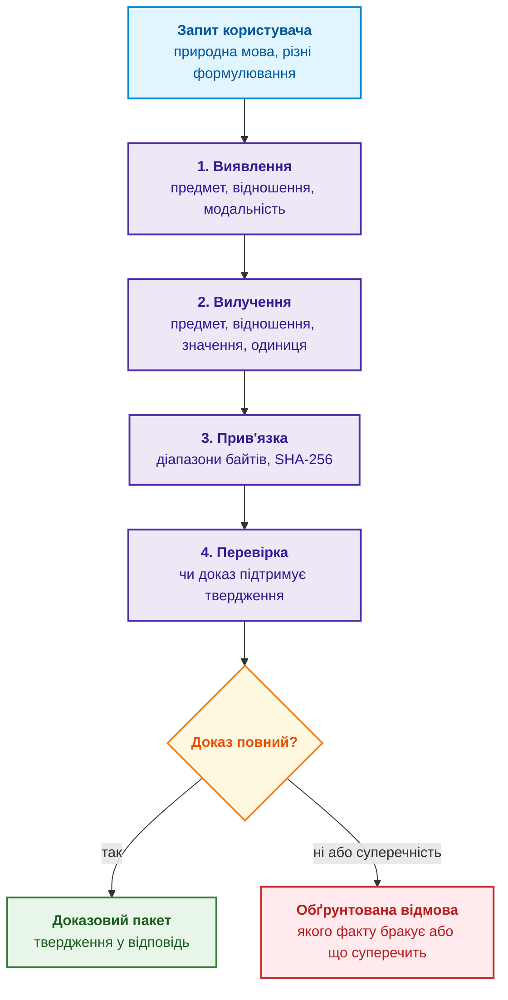
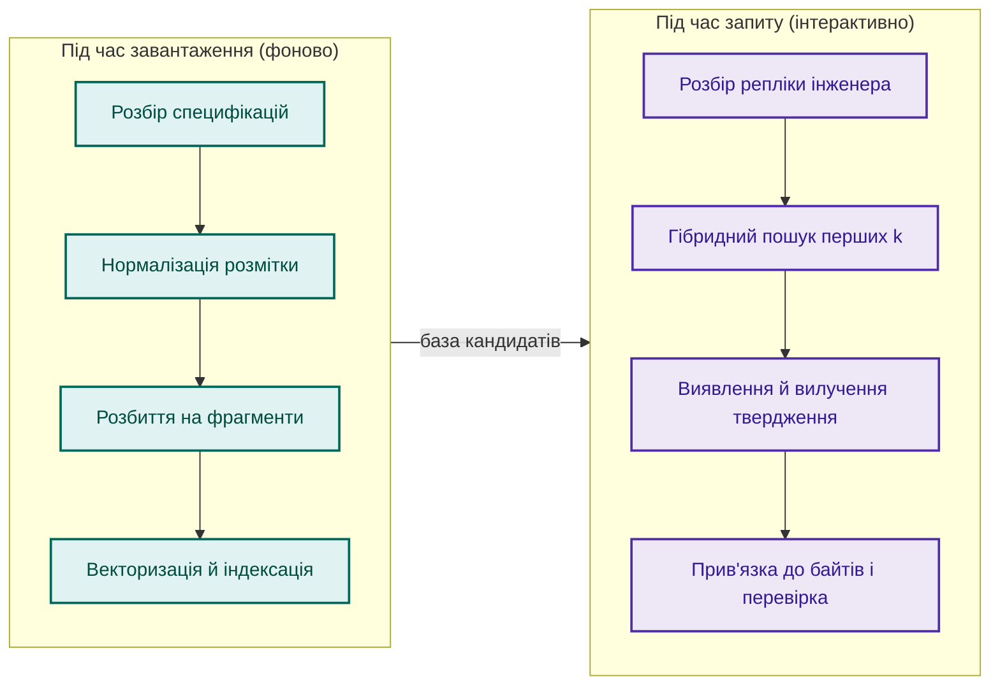
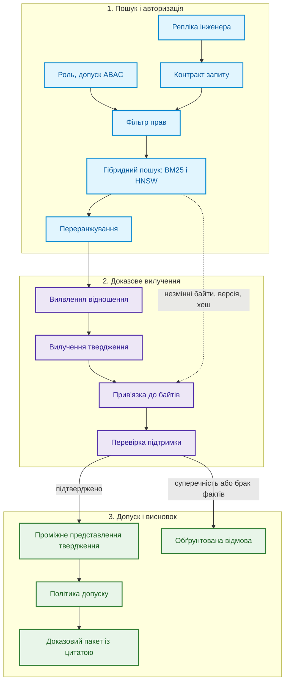
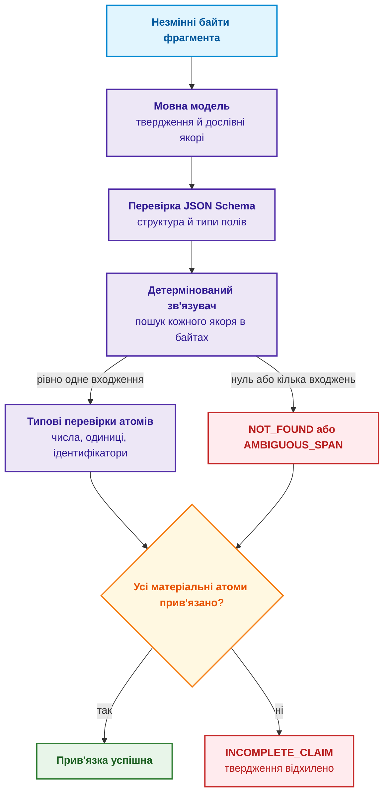
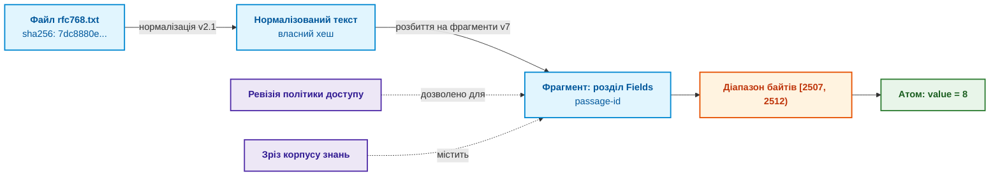
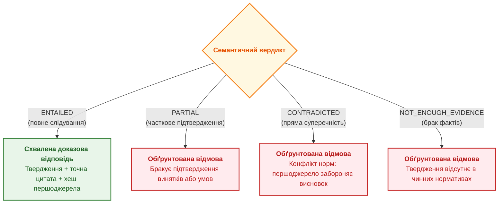
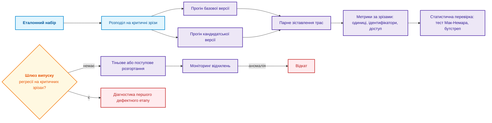
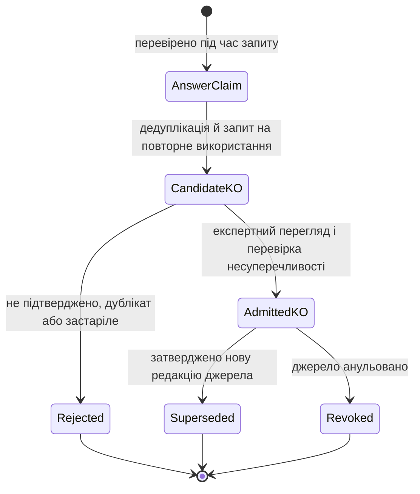

# Глава 19. Від запитання до доказу: пошук, прив'язка та перевірка твердження

> **Книга:** [Архітектура доказових експертних систем](README.md) · [Частина IV: Архітектура, технологічний стек, виведення та дія](part-04-architecture-and-inference.md)  
> **Попередня глава:** [Глава 18. Інфраструктура виконання: локальні моделі, апаратні прискорювачі, Edge та On-Premise](ch18-execution-infrastructure.md)  
> **Наступна глава:** [Глава 31. Виведення за нормами: ієрархії предикатів, винятки та чинність](ch31-syllogistic-reasoning-and-relation-lattices.md)  
> **Зміст книги:** [README.md](README.md)  
> **Автор:** [Микола Федчик](about-the-author.md)  
> **Рівень:** середній і поглиблений: розробники, інженери знань, фахівці з мовних моделей  
> **Очікувані результати:** розкладати запитання природною мовою на предмет, відношення й комунікативну дію; розрізняти етапи виявлення, вилучення, прив'язки й перевірки твердження; прив'язувати кожен матеріальний атом твердження до байтів першоджерела й обчислювати повноту прив'язки; нормалізувати значення й одиниці вимірювання; будувати проміжне представлення твердження з доказом; організовувати регресійне тестування й безпечний допуск тверджень до бази знань.

---

## Анотація

У цій главі розглянуто перехід від неструктурованого інженерного запитання до суворо верифікованого доказового пакета в архітектурі доказових експертних систем. Проаналізовано слабку формалізованість природної мови та алгоритм семантичного розкладання репліки на предмет, відношення та комунікативну дію за допомогою типізованих контрактів JSON Schema для безпечного звернення до бази знань. Досліджено чотириетапний конвеєр перетворення запиту: виявлення, вилучення, байтова прив'язка (*grounding*) та верифікація семантичного слідування (*entailment*). Реалізовано детермінований зв'язувач матеріальних атомів твердження з байтами першоджерела (RFC 768) із розрахунком метрики повноти прив'язки $\mathrm{Comp}(C)$ та нормалізацією одиниць вимірювання. Визначено чотиризначний шлюз перевірки доказів (`ENTAILED`, `PARTIAL`, `CONTRADICTED`, `NOT_ENOUGH_EVIDENCE`), що унеможливлює видачу непідтверджених рекомендацій, а також принципи регресійного оцінювання та життєвий цикл об'єктів знань від швидкої оперативної відповіді до довготривалого допуску в канонічну базу фактів експертної системи.

---

Уявімо експертну систему, яка аналізує мережеві специфікації й відповідає інженерові лише тоді, коли в корпусі є доказ. Інженер запитує: *«Яка мінімальна довжина UDP-датаграми?»* Механізм пошуку, побудований за схемою пошуку з генерацією (*Retrieval-Augmented Generation*, RAG) [[1]](#src-1), безпомилково знаходить RFC 768, специфікацію протоколу UDP (*User Datagram Protocol*), і потрібний абзац [[2]](#src-2):

> *Length is the length in octets of this user datagram including this header and the data. (This means the minimum value of the length is eight.)*

Генеративна модель відповідає коротко: *«8»*. Число правильне, але інженерна відповідь неповна. Вісім чого: бітів, октетів, 32-розрядних слів? У тексті число записано словом *eight*, а одиниця *octets* стоїть в іншій частині речення, тож пошук цифр регулярним виразом тут не знайшов би нічого. До того ж інженер міг поставити те саме запитання по-різному:

- *«Яка мінімальна довжина UDP-датаграми?»* (пряме запитання);
- *«Скільки щонайменше займає UDP-датаграма?»* (прохання про розрахунок);
- *«Покажи в RFC, де визначено мінімальну довжину датаграми»* (запит на доказ);
- *«Чи правильно, що мінімальна UDP-датаграма має 8 октетів?»* (запит на перевірку твердження).

Ці репліки різняться граматикою й комунікативною дією, але спираються на одне інженерне твердження. Набір даних Natural Questions формалізував схожу різницю між довгою відповіддю (абзацом, що містить відповідь) і короткою відповіддю (точним фрагментом усередині абзацу) [[3]](#src-3). Для експертної системи навіть коротка відповідь є недостатньою: автором впроваджено **концепцію повноструктурного інженерного твердження** ($\text{Subject} + \text{Relation} + \text{Value} + \text{Unit} + \text{Provenance}$), яка вимагає явної формалізації предмета, відношення, числового значення, одиниці вимірювання та повного ланцюга джерельного походження для кожної матеріальної складової.

Ця глава відповідає на запитання: **як перетворити знайдений фрагмент на перевірюване твердження для відповіді?** Для розв'язання цієї проблеми автором розроблено **чотириетапну архітектурну модель перетворення запитання на доказ** (Виявлення $\to$ Вилучення $\to$ Прив'язка $\to$ Перевірка). Мовна модель пропонує структуру й якорі, зв'язувач відтворює адреси, а окрема перевірка встановлює ролі, застосовність і відповідність запитанню. При цьому втілено **інженерний принцип необхідності побайтової прив'язки для джерельної верифікації**: повна прив'язка матеріальних атомів до фізичних байтів першоджерела є обов'язковою, фундаментальною передумовою джерельної перевірки, за якої будь-які непідтверджені поля ведуть до уточнення або обґрунтованої відмови (`REFUSAL`), категорично унеможливлюючи генеративне домислювання.



Діаграма показує, що відповідь можлива лише після всіх чотирьох етапів, а будь-який збій веде до відмови з поясненням. Наступний розділ уточнює, де саме в архітектурі експертної системи працює цей процес.

## 1. Місце задачі в архітектурі експертної системи

У загальній архітектурі доказової експертної системи конвеєр перетворення вхідного запитання на верифікований доказ є критичним шлюзом, розташованим між підсистемами пошуку неструктурованих документів та ядром формального символьного виведення. Автором обґрунтовано **концепцію захисного перехідного шлюзу між неструктурованим пошуком та символьним ядром**: перехідний конвеєр перетворення запитання на верифікований доказ виступає спеціалізованим контрольно-пропускним бар'єром експертної системи, що унеможливлює потрапляння нетипізованих, неповних чи семантично деформованих пасажів у символьне ядро виведення. Якщо системний архітектор зневажає цим перехідним рівнем і передає знайдені текстові пасажі безпосередньо генеративній моделі для узагальнення, система зазнає катастрофічної деградації доказовості: природномовні галюцинації, втрата розмірностей та сплутування понять проникають у базу знань під виглядом «авторитетних висновків». В умовах місійно-критичної експлуатації (ISO 26262 ASIL-D, IEC 61508, DO-178C) прийняття такого хибного або неповного факту руйнує детермінізм ланцюжків міркувань і веде до помилкових інженерних рішень із незворотними наслідками. Тут діє сформульований автором **інженерний принцип детермінізму ланцюжків міркувань у місійно-критичних доменах**: у системах із регуляторною відповідальністю ланцюжок логічного виведення вважається валідним тоді й лише тоді, коли кожен проміжний вузол спирається на детерміновано верифікований і побайтово прив'язаний первинний факт, повністю виключаючи ймовірнісні галюцинації генеративних моделей. Наївний підхід класичних RAG-систем, де велика мовна модель самостійно інтерпретує контекст без суворої прив'язки кожного матеріального атома до байтів першоджерела, виявляється непридатним для систем із регуляторною відповідальністю.

Ця глава розглядає короткий, але вирішальний відрізок шляху читання з [Глави 16](ch16-expert-systems-architecture.md): документ уже авторизовано, версіоновано й розбито на фрагменти, механізм пошуку повернув перші $k$ кандидатів, і тепер текст фрагмента треба перетворити на формальне, машинно-верифіковуване твердження. На цьому відрізку автором розроблено **архітектурну таксономію шести контрольно-пропускних шлюзів перевірки факту**, зведену в Таблицю 19.1.

**Таблиця 19.1. Шестишлюзова таксономія перевірки фактів М. Федчика**

| Етап | Контрольне запитання | Типовий прихований дефект |
|---|---|---|
| **Пошук** (*retrieval*) | Чи потрапив потрібний фрагмент у перші $k$ результатів? | Знайдено правильний документ, але застарілу редакцію |
| **Виявлення** (*detection*) | Чи містить фрагмент саме те відношення, про яке питають? | Речення про довжину датаграми прийнято за відповідь про довжину заголовка |
| **Вилучення** (*extraction*) | Чи збережено повну структуру значення? | `eight octets` скорочено до числа `8` |
| **Прив'язка** (*grounding*) | Чи має кожен атом точні координати в документі? | Цитата правильна, але взята з нечинної редакції |
| **Перевірка** (*verification*) | Чи підтримує доказ твердження повністю? | Не помічено винятку на кшталт «крім випадків протоколу X» |
| **Допуск** (*admission*) | Чи має користувач право отримати цей фрагмент? | Модель використала закритий документ у відповіді на відкритий запит |

Кожен рядок таблиці описує окремий клас інженерних ризиків, що вимагає детермінованого захисного механізму. Перша лінія захисту розгортається ще до звернення до пошукового індексу — на етапі семантичного розбору самого запитання.

## 2. Слабкоструктурована природа запитань природною мовою та семантична декомпозиція

Семантична декомпозиція інженерних реплік є первинним фільтром нормалізації вхідного інформаційного потоку експертної системи. Тоді як запит до реляційної СУБД підпорядковується суворій типізованій граматиці SQL, природна людська мова характеризується високою варіативністю, еліпсисами та відсутністю явних меж між предикатом і метаданими. Якщо система намагатиметься транслювати неструктуроване запитання інженера безпосередньо у векторні запити або правила виведення, виникає некерована семантична невизначеність: вживання синонімів (*«розмір»* замість *«довжина»*), пропуск контексту попередніх реплік чи змішування вимоги до змісту з побажаннями щодо стилю формулювання призводять до вибірки нерелевантних нормативних корпусів або хибної класифікації наміру. Наївні спроби парсингу на основі евристичних регулярних виразів ламаються за першої ж граматичної інверсії.

Експертна система усуває цю вразливість, застосовуючи запропоновану автором **модель трикомпонентної семантичної декомпозиції технічного запиту** ($\text{Subject}, \text{Relation}, \text{Speech Act}$), яка формалізує нормалізацію вхідної репліки на три ортогональні складові:

1. **Предмет запиту** (*subject*): технічний об'єкт, підсистема чи параметр (наприклад, UDP-датаграма, шина CAN FD, інвертор).
2. **Відношення** (*relation*): нормативно визначена властивість чи характеристика (наприклад, мінімальна довжина, граничний струм, допустимий джиттер).
3. **Комунікативна дія** (*speech act*): прагматичний намір інженера — запит прямого факту, вимога надати первинний нормативний доказ, верифікація гіпотези чи спростування припущення (теоретичну базу мовленнєвих актів як цілеспрямованих дій заклав Джон Серл [[4]](#src-4)).

Замість крихких регулярних виразів мовна модель виступає строго обмеженим семантичним транслятором, результат роботи якого примусово валідується суворою типізованою схемою JSON Schema [[5]](#src-5). Будь-який вихід моделі, що порушує схему або типи даних, автоматично відхиляється контролером ще до ініціалізації пошуку:

<details>
<summary>Структуровані дані JSON</summary>

```json
{
  "schema_version": "query-contract.v1",
  "subject": "UDP datagram",
  "relation": "minimum length",
  "speech_act": "request_evidence",
  "answer_shape": "quantity",
  "constraints": {
    "document_family": "IETF RFC",
    "status": "current"
  },
  "dialogue_context_refs": []
}
```

</details>


Поле `answer_shape` зі значенням `quantity` заздалегідь повідомляє наступним етапам, що відповідь мусить містити число з одиницею, а `speech_act` зі значенням `request_evidence` вимагає показати цитату. Контракт запиту задає, що шукати; наступне запитання полягає в тому, коли саме експертна система добуває знання з документів.

> [!NOTE]
> **Чотири інваріанти семантичної декомпозиції інженерних запитань за моделлю автора**
> 1. Формування типізованого контракту запиту (`QueryContract`) з явною фіксацією очікуваної форми відповіді (`answer_shape`) та типу мовленнєвого акту (`speech_act`).
> 2. Лексико-синтаксична верифікація через GBNF-граматики для усунення мовних спотворень та неоднозначностей природної мови до звернення до пошукового індексу.
> 3. Декомпозиція складеного запитання на мінімальні атомарні підзапити зі збереженням графів логічної залежності передумов.
> 4. Обов'язкове призначення ролевих обмежень та контекстних атрибутів безпеки (ABAC) на рівні специфікації контракту.
> *Керування рантаймом:* Запит із суперечливими або нерозпізнаними передумовами переводиться у стан CLARIFICATION_REQUIRED з кодом E_AMBIGUOUS_QUERY_INTENT.

## 3. Два часові шляхи здобуття знань

В архітектурі системи здобуття знань функціонує на основі розробленої автором **архітектурної парадигми двочасового здобуття знань** (*Ingest-Time vs. Query-Time Acquisition*), яка суворо розмежовує обчислювально важку асинхронну підготовку документів під час завантаження та інтерактивну детерміновану екстракцію конкретних тверджень під час запиту. Спроба виконати повне видобування всіх можливих знань фоново наперед призводить до комбінаторного вибуху та накопичення застарілих зв'язків; навпаки, спроба розбирати багатосторінкові скани та специфікації «на льоту» під час запиту користувача порушує гарантовані бюджети затримки. Діаграма ілюструє взаємодію фонового та оперативного трактів.



Фонове здобуття (*ingest-time acquisition*) виконується, коли до репозиторію додають нові документи: воно зберігає структуру й версії, розпізнає таблиці, обчислює контрольні суми фрагментів. Цей процес детально описано в [Главі 15](ch15-knowledge-extraction-and-kb-construction.md). Здобуття під час запиту (*query-time acquisition*) вмикається у відповідь на конкретне запитання. Причина двох режимів проста: той самий абзац специфікації може відповідати на десятки різних запитань (довжина поля, діапазон напруг, допустима похибка), і заздалегідь вилучити всі можливі твердження неможливо. Під час запиту експертна система вилучає й перевіряє лише те твердження, якого вимагає контракт запиту.

> [!NOTE]
> **П'ять правил темпорального розділення шляхів здобуття знань за архітектурою автора**
> 1. Асинхронне виконання важкої нормалізації, розмітки та індексації специфікацій виключно у фоновому тракті Ingest Path.
> 2. Обмеження оперативного інтерактивного тракту Query Path суто екстракцією, побайтовим зв'язуванням та символьною верифікацією запитаного факту.
> 3. Кешування незмінних проміжних фрагментів із криптографічним хешуванням вмісту для захисту від перевитрати обчислювальних бюджетів.
> 4. Повна ізоляція пам'яті: фонові процеси оновлення бази знань не блокують read-only транзакції активних клієнтських сесій.
> 5. Фіксація єдиного детермінованого зрізу корпусу (Corpus Snapshot) для усього життєвого циклу обробки сесії запиту.
> *Керування рантаймом:* Спроба використання невалідованого кандидата знань у тракті виведення Read Path блокується з кодом E_UNCOMMITTED_EVIDENCE_ACCESS.

## 4. Конвеєр перетворення запиту на доказ

Наскрізний цикл перетворення інженерної репліки на доказовий пакет об'єднує гібридний пошук із формально-символьною верифікацією прав доступу та семантичної відповідності. Автором реалізовано **трифазну схему наскрізного циклу обробки запиту** (1. Пошук та авторизація $\to$ 2. Доказове вилучення $\to$ 3. Допуск і висновок), що забезпечує повну спостережуваність і детерміновану локалізацію помилок на кожному етапі трансформації. Для запобігання неавторизованому витоку знань застосовано авторський **патерн гібридного пошуку з попередньою авторизацією атрибутів доступу ABAC** (BM25 + HNSW + ACL Filter), де ролеві права доступу накладаються у формі обов'язкового булевого фільтра до виконання лексичного та векторного пошуку. Відсутність проміжних шлюзів фальсифікації перетворює конвеєр на «чорну скриньку», де збій будь-якої моделі призводить до видачі сфальсифікованого результату без можливості локалізації дефекту.



Пунктирна стрілка від пошуку до прив'язки втілює сформульований автором **інженерний принцип прямого каналу незмінних байтів** (*Bypass Raw Bytes Channel*): модуль прив'язки та верифікації отримує незмінні байти, версію й хеш документа безпосередньо зі сховища пошуку в обхід генеративної моделі, а не з тексту, який повернула мовна модель. Саме завдяки цьому прямому каналу детермінована прив'язка здатна виявити довільну вигадку чи спотворення моделі.

## 5. Вилучення та детерміноване зв'язування з байтами

Головна небезпека використання генеративних мовних моделей у ролі екстракторів знань полягає в довільному перефразуванні, викривленні числових констант та втраті фізичних розмірностей. Для повного виключення суб'єктивного фактора в архітектурі реалізовано **інженерний принцип функціональної дисоціації генератора гіпотез та детермінованого валідатора**: стохастична мовна модель наділяється виключно роллю генератора структурних гіпотез і кандидатних текстових якорів, тоді як функція валідації та допуску покладається на детерміновані компільовані алгоритми без використання штучного інтелекту. На цьому принципі автором розроблено **архітектурний патерн детермінованого зв'язувача текстових спанів** (*deterministic span binder*), який зіставляє ці якорі з байтами першоджерела, перевіряючи типи й однозначність входження. При цьому діє суворе авторське **правило єдиності входження текстового якоря** (*Unique Anchor Rule*): текстовий якір матеріального атома вважається валідним лише за умови рівно одного несуперечливого входження в нормалізованому тексті пасажу; за наявності двох і більше збігів якір позначається як `AMBIGUOUS_SPAN` і твердження відхиляється.



### 5.1. Повнота прив'язки та критерії валідності

Для кількісної верифікації того, що вилучене твердження повністю спирається на авторитетний нормативний текст і не містить галюцинованих елементів, вводиться метрика повноти прив'язки $\mathrm{Comp}(C)$. Вона оцінює частку матеріальних компонентів знання, успішно зіставлених із фізичними координатами першоджерела:

```math
\mathrm{Comp}(C) = \frac{\sum_{a \in A_m(C)} w_a \cdot \mathbb{I}[b(a) \neq \varnothing]}{\sum_{a \in A_m(C)} w_a}
```

де:
- $\mathrm{Comp}(C)$ — скалярний показник повноти прив'язки твердження $C$, визначений у нормованому діапазоні $[0, 1]$;
- $A_m(C)$ — скінченна множина матеріальних атомів твердження, відсутність будь-якого з яких спотворює сенс інженерного правила ($A_m(C) = \{\text{subject}, \text{relation}, \text{value}, \text{unit}\}$);
- $a$ — окремий матеріальний атом із множини $A_m(C)$;
- $w_a$ — ваговий коефіцієнт критичності атома ($w_a > 0$, дійсне число; у каліброваній конфігурації $w_{\text{subject}} = 0{,}1$, $w_{\text{relation}} = 0{,}2$, $w_{\text{value}} = 0{,}4$, $w_{\text{unit}} = 0{,}3$);
- $b(a)$ — напіввідкритий інтервал зміщень у байтах $[s, e)$, що однозначно ідентифікує входження текстового якоря атома в нормалізованому тексті першоджерела, або $\varnothing$, якщо якір не знайдено чи знайдено неоднозначно;
- $\mathbb{I}[b(a) \neq \varnothing]$ — індикаторна функція, яка набуває значення 1, якщо атом $a$ має рівно одне несуперечливе входження в діапазоні байтів, і 0 у разі статусу $\text{NOT\_FOUND}$ або $\text{AMBIGUOUS\_SPAN}$.

**Практичне застосування та інженерні висновки:**
1. Розрахунок виконується детермінованим зв'язувачем для кожного твердження, запропонованого мовною моделлю, до передачі результату в рушій логічного виведення.
2. **Числовий поріг допуску (Критерій відсікання):**
   - $\mathrm{Comp}(C) = 1{,}00$: **ПОВНЕ ЗВ'ЯЗУВАННЯ (GROUNDED / Green Gate)**. Усі матеріальні атоми успішно прив'язано до фізичних байтів; твердження допускається до семантичної перевірки слідування;
   - $0{,}70 \le \mathrm{Comp}(C) < 1{,}00$: **НЕПОВНЕ ТВЕРДЖЕННЯ (INCOMPLETE_CLAIM / Fail-Closed)**. Втрачено або спотворено критичний атом (наприклад, одиницю вимірювання чи обмежувальне застереження). Твердження безумовно відхиляється. В інженерних системах часткова точність неприпустима: знання про те, що затримка дорівнює «8», без зв'язування одиниці вимірювання (`мс` чи `мкс`) є прямим ризиком аварії;
   - $\mathrm{Comp}(C) < 0{,}70$: **ГАЛЮЦИНАЦІЯ МОДЕЛІ (UNGROUNDED / Red Gate)**. Твердження відхиляється з формуванням журналу інциденту телеметрії.

**Числовий приклад розрахунку:**
З екстрагованого нормативу вилучено твердження: «Максимальний струм спрацьовування становить 25 А при напрузі 12 В». Матеріальні атоми: суб'єкт ($w = 0{,}1$), відношення ($w = 0{,}2$), числове значення ($w = 0{,}4$), розмірність ($w = 0{,}3$).
Якщо розмірність «А» у першоджерелі не пройшла перевірку байтових зміщень через спотворення кодування ($\mathbb{I}[b(\text{unit}) \neq \varnothing] = 0$):
```math
\mathrm{Comp}(C) = \frac{0{,}1 \cdot 1 + 0{,}2 \cdot 1 + 0{,}4 \cdot 1 + 0{,}3 \cdot 0}{0{,}1 + 0{,}2 + 0{,}4 + 0{,}3} = \frac{0{,}70}{1{,}0} = 0{,}70
```
Оскільки $\mathrm{Comp}(C) = 0{,}70 < 1{,}00$, шлюз допуску негайно відхиляє факт зі статусом `INCOMPLETE_CLAIM: missing verified unit atom`, запобігаючи передачі неоднозначного значення до машини виведення.

> [!IMPORTANT]
> **Три інженерні причини обов'язковості 100% повноти прив'язки $\mathrm{Comp}(C) = 1{,}0$**
> 1. Унеможливлення прихованих аварійних відмов: в авіоніці (DO-178C DAL-A) та автомобільних контролерах (ISO 26262 ASIL-D) твердження із $\mathrm{Comp}(C) = 0{,}7$ є прямою передумовою аварії внаслідок втрати критичного параметра або граничного застереження.
> 2. Недопустимість ампутації розмірностей: втрата прив'язки атома фізичної одиниці вимірювання (наприклад, змішування мілісекунд `мс` із мікросекундами `мкс`) або температурного режиму роботи («за температури вище 85°C») руйнує детермінізм функціонування апаратної підсистеми.
> 3. Жорсткий детермінізм шлюзу допуску: будь-яке значення $\mathrm{Comp}(C) < 1{,}00$ детерміновано активує захисний режим Fail-Closed з негайним відхиленням твердження та формуванням точного діагностичного списку неприв'язаних матеріальних атомів.
> *Інженерний інваріант:* Відхилення $\mathrm{Comp}(C) < 1{,}00$ блокує просування факту в символьне ядро з кодом E_INCOMPLETE_GROUNDING_REJECTED.

### 5.2. Практична реалізація: прив'язка твердження з RFC 768

Програма мовою Go реалізує зв'язувач для прикладу з UDP. Їй потрібен файл `rfc768.txt` (5896 байтів), завантажений з RFC Editor у той самий каталог. Функція `normalize` така сама, як у [Главі 15](ch15-knowledge-extraction-and-kb-construction.md): вона стискає пробільні символи й пам'ятає позиції сирих байтів, тому якір знаходиться навіть тоді, коли в тексті RFC між словами стоїть кілька пробілів чи перенесення рядка. Ваги атомів обрано так: предмет 0,1, відношення 0,2, значення 0,4, одиниця 0,3.

<details>
<summary>Приклад мовою Go: зв'язувач твердження з RFC 768</summary>

```go
package main

import (
	"bytes"
  "fmt"
  "math"
	"os"
	"strconv"
	"strings"
)

// normalize стискає пробільні символи й запам'ятовує позиції сирих байтів.
func normalize(raw []byte) ([]byte, []int) {
	var out []byte
	var pos []int
	inSpace := false
	for i, b := range raw {
		switch b {
		case ' ', '\t', '\r', '\n', '\f':
			if !inSpace && len(out) > 0 {
				out = append(out, ' ')
				pos = append(pos, i)
			}
			inSpace = true
			continue
		}
		inSpace = false
		out = append(out, b)
		pos = append(pos, i)
	}
	return out, pos
}

// bind прив'язує якір до діапазону сирих байтів; якір має траплятися рівно один раз.
func bind(norm []byte, pos []int, anchor string) (int, int, string) {
	q, _ := normalize([]byte(anchor))
	q = bytes.TrimSpace(q)
	first := bytes.Index(norm, q)
	switch {
	case len(q) == 0 || first < 0:
		return 0, 0, "NOT_FOUND"
	case bytes.Contains(norm[first+1:], q):
		return 0, 0, "AMBIGUOUS_SPAN"
	}
	return pos[first], pos[first+len(q)-1] + 1, "OK"
}

type Atom struct {
	Name, Anchor string
	Weight       float64
}

var numberWords = map[string]int{"four": 4, "eight": 8, "sixteen": 16}
var unitCodes = map[string]string{"octets": "By", "bits": "bit"} // коди UCUM

// typed перевіряє тип атома: значення має бути числом, одиниця має бути відомою.
func typed(a Atom) (string, bool) {
	w := strings.Fields(strings.ToLower(a.Anchor))
  if len(w) == 0 {
    return "", false
  }
	last := w[len(w)-1]
	switch a.Name {
	case "value":
		if n, ok := numberWords[last]; ok {
			return strconv.Itoa(n), true
		}
		_, err := strconv.Atoi(last)
		return last, err == nil
	case "unit":
		c, ok := unitCodes[last]
		return c, ok
	}
  return a.Anchor, a.Name == "subject" || a.Name == "relation"
}

func check(norm []byte, pos []int, name string, atoms []Atom) string {
	fmt.Println("==", name)
  required := map[string]bool{"subject": false, "relation": false, "value": false, "unit": false}
  var weightSum float64
  for _, atom := range atoms {
    seen, known := required[atom.Name]
    if !known || seen || atom.Weight <= 0 || math.IsNaN(atom.Weight) || math.IsInf(atom.Weight, 0) {
      fmt.Println("  INVALID_CLAIM_SCHEMA")
      return "INCOMPLETE_CLAIM"
    }
    required[atom.Name] = true
    weightSum += atom.Weight
  }
  if len(atoms) != len(required) || math.IsInf(weightSum, 0) || len(pos) != len(norm) {
    fmt.Println("  INVALID_CLAIM_SCHEMA")
    return "INCOMPLETE_CLAIM"
  }
	var got, total float64
  allBound := true
	for _, a := range atoms {
		total += a.Weight
		s, e, st := bind(norm, pos, a.Anchor)
		v, ok := typed(a)
		if st == "OK" && !ok {
			st = "TYPE_ERROR"
		}
		if st == "OK" {
			got += a.Weight
			fmt.Printf("  %-8s %-34q [%d, %d) -> %s\n", a.Name, a.Anchor, s, e, v)
		} else {
      allBound = false
			fmt.Printf("  %-8s %-34q %s\n", a.Name, a.Anchor, st)
		}
	}
	comp := got / total
	verdict := "GROUNDED"
  if !allBound {
		verdict = "INCOMPLETE_CLAIM"
	}
	fmt.Printf("  Comp = %.2f -> %s\n", comp, verdict)
  return verdict
}

func main() {
	raw, err := os.ReadFile("rfc768.txt")
	if err != nil {
		fmt.Println("помилка читання:", err)
		os.Exit(1)
	}
	norm, pos := normalize(raw)
	subj := Atom{"subject", "this user datagram", 0.1}
	rel := Atom{"relation", "the minimum value of the length", 0.2}
	val := Atom{"value", "eight", 0.4}
	unit := Atom{"unit", "in octets", 0.3}

	check(norm, pos, "A: повне твердження", []Atom{subj, rel, val, unit})
	check(norm, pos, "B: вигадана одиниця", []Atom{subj, rel, val, {"unit", "in bits", 0.3}})
	check(norm, pos, "C: надто короткий якір", []Atom{subj, {"relation", "length", 0.2}, val, unit})
}
```

Синтетичний тест не потребує RFC-файла; команда виконання: `go test -v main.go main_test.go`.

```go
package main

import (
	"math"
	"testing"
)

func TestGroundingCompleteness(testCase *testing.T) {
	norm, positions := normalize([]byte("The datagram minimum is eight octets."))
	valid := []Atom{{"subject", "datagram", 0.1}, {"relation", "minimum", 0.2},
		{"value", "eight", 0.4}, {"unit", "octets", 0.3}}
	if check(norm, positions, "valid", valid) != "GROUNDED" {
		testCase.Fatal("valid anchors rejected")
	}
	if check(norm, positions, "empty", nil) == "GROUNDED" {
		testCase.Fatal("empty claim accepted")
	}
	if check(norm, positions, "missing unit", valid[:3]) == "GROUNDED" {
		testCase.Fatal("missing required field accepted")
	}
	for _, weight := range []float64{0, -1, math.NaN(), math.Inf(1)} {
		invalid := append([]Atom(nil), valid...)
		invalid[0].Weight = weight
		if check(norm, positions, "invalid weight", invalid) == "GROUNDED" {
			testCase.Fatal("invalid weight accepted")
		}
	}
	missing := append([]Atom(nil), valid...)
	missing[3].Anchor = ""
	if check(norm, positions, "empty anchor", missing) == "GROUNDED" {
		testCase.Fatal("empty anchor accepted")
	}
	duplicate := append([]Atom(nil), valid...)
	duplicate[3] = duplicate[0]
	if check(norm, positions, "duplicate field", duplicate) == "GROUNDED" {
		testCase.Fatal("duplicate field accepted")
	}
	if _, ok := typed(Atom{Name: "unit", Anchor: ""}); ok {
		testCase.Fatal("empty typed anchor accepted")
	}
}
```

</details>

Архівний приклад виводу для зазначеної копії RFC; інші байти або перенесення рядків змінять координати:

<details>
<summary>Дані або результат прикладу</summary>

```text
== A: повне твердження
  subject  "this user datagram"               [2398, 2416) -> this user datagram
  relation "the minimum value of the length"  [2472, 2503) -> the minimum value of the length
  value    "eight"                            [2507, 2512) -> 8
  unit     "in octets"                        [2384, 2393) -> By
  Comp = 1.00 -> GROUNDED
== B: вигадана одиниця
  subject  "this user datagram"               [2398, 2416) -> this user datagram
  relation "the minimum value of the length"  [2472, 2503) -> the minimum value of the length
  value    "eight"                            [2507, 2512) -> 8
  unit     "in bits"                          NOT_FOUND
  Comp = 0.70 -> INCOMPLETE_CLAIM
== C: надто короткий якір
  subject  "this user datagram"               [2398, 2416) -> this user datagram
  relation "length"                           AMBIGUOUS_SPAN
  value    "eight"                            [2507, 2512) -> 8
  unit     "in octets"                        [2384, 2393) -> By
  Comp = 0.80 -> INCOMPLETE_CLAIM
```

</details>


Твердження A прив'язано повністю: значення *eight* нормалізовано до числа 8, одиницю *octets* до коду `By`, і кожен атом має власний діапазон байтів. Твердження B відтворює типову помилку генерації: модель «знала», що довжину часто вимірюють у бітах, але таких слів у документі немає, тому одиниця не прив'язана, повнота дорівнює 0,70, і твердження відхилено. Твердження C показує протилежну помилку: якір *length* дослівно присутній, але трапляється в документі чотири рази, і зв'язувач не може вибрати, яке входження є доказом. Обидва відхилення детерміновані й не залежать від того, наскільки впевнено звучала відповідь моделі.

Межі прикладу такі. Словник числівників і одиниць тут мінімальний; промисловий зв'язувач використовує повні таблиці числівників і довідник одиниць. Програма шукає якорі в усьому документі; реальний зв'язувач шукає їх у межах знайденого фрагмента, що зменшує кількість неоднозначностей. Нарешті, прив'язка доводить, що всі атоми дослівно присутні, але ще не доводить, що текст підтримує саме те твердження, про яке питали. Це завдання етапу перевірки, описаного нижче.

> [!NOTE]
> **Чотири інваріанти побайтового криптографічного зв'язування цитат за стандартом автора**
> 1. Збереження напіввідкритих інтервалів фізичних координат $[s, e)$ нормалізованого бінарного потоку для кожного атома вилученого твердження.
> 2. Формування криптографічного ідентифікатора пасажу `passage-id` через незворотний хеш FIPS 180-4 SHA-256 від повного кортежу параметрів контексту.
> 3. Детермінована нормалізація числових величин та одиниць вимірювання за міжнародними стандартами SI та UCUM без втрати розмірності.
> 4. Миттєве відхилення кандидата при будь-якому розходженні контрольної суми без спроб евристичного підбору наближених збігів.
> *Керування рантаймом:* Невідповідність контрольної суми цитати або координат зміщення у файлі викликає негайне відхилення з кодом E_CITATION_INTEGRITY_MISMATCH.

## 6. Типізовані атоми знань

У структурі доказового твердження типізація елементарних компонентів слугує основою для подальшого автоматичного логічного та математичного аналізу в символьному ядрі експертної системи. Якщо система трактує вилучені фрагменти як нетипізовані текстові рядки, виникає нерозв'язна проблема семантичної несумісності: числові значення втрачають фізичний зміст, що унеможливлює розрахунки інваріантів, а різні форми запису однієї величини («8 октетів» і «64 біти») сприймаються як суперечливі факти. Наївний рядковий пошук або розбір регулярними виразами виявляється безсилим проти зміни розмірностей чи модальностей. Зв'язувач перевіряє не лише наявність якоря, а й тип атома. Автором введено **онтологічну класифікацію чотирьох базових категорій матеріальних атомів знань** (`CH19-S06-01`):

1. **Кількісний атом**: число обов'язково пов'язане з одиницею вимірювання. Тут діє сформульоване автором **правило обов'язкової нормалізації фізичних одиниць вимірювання за UCUM / SI** (`CH19-S06-02`): будь-яка вилучена фізична константа підлягає обов'язковій канонічній нормалізації за міжнародною системою SI або уніфікованим кодом UCUM (*Unified Code for Units of Measure*) [[6]](#src-6) (де, наприклад, байт кодується як `By`), а вилучення числа без прив'язки одиниці безумовно відхиляється на рівні JSON-схеми.
2. **Ідентифікатор**: складене позначення документа чи об'єкта (RFC 768, ISO 26262, MIL-STD-1553B), яке перевіряють шаблоном формату.
3. **Модальність**: ступінь нормативності (MUST, SHALL, SHOULD, MAY) за правилами з [Глави 14](ch14-requirements-detection-and-formalization.md). Для дорегуляторних нормативних корпусів, створених до прийняття конвенції RFC 2119 (як-от RFC 768 1980 року), автором розроблено **концепцію дефінітивної модальності** (`CH19-S06-03`: `DEFINITIONAL`): специфікаційні визначення фіксуються з визначальною модальністю, що має силу аксіоми для рушія логічного виведення.
4. **Межі чинності**: редакція документа, діапазон температур, режим роботи, у яких твердження діє.

При цьому в системі діє суворий **інженерний інваріант типобезпечного зіставлення величин** (`CH19-S06-04`: *Type-Safe Equality Invariant*): дві фізичні величини можуть зіставлятися на еквівалентність виключно після приведення до єдиної базової розмірності в типізованому просторі одиниць (наприклад, 8 октетів та 64 біти приводяться до канонічного значення 8 `By`), а спроба прямого рядкового зіставлення констант без перевірки одиниць безумовно блокується.

## 7. Модель походження: від файлу до атома

Криптографічна модель походження даних (*provenance model*) є стрижнем аудиту та юридичної неспростовності фактів у доказових експертних системах. Якщо посилання на першоджерело обмежується лише текстовою назвою нормативного документа (наприклад, посиланням на «RFC 768»), виникає критична вразливість фальсифікації та десинхронізації: оновлення версії стандарту, невідстежувані виправлення опечаток чи зміна алгоритму нормалізації пробілів призводять до того, що система посилається на неіснуючі або змінені фрагменти. Наївне збереження номерів рядків чи номерів сторінок зазнає краху при зміні форматування або перекомпіляції документа. У доказовій архітектурі зв'язок між первинним файлом та атомом знання фіксується як криптографічний ланцюжок незмінних перетворень на базі розробленої автором **криптографічної графової моделі походження атома від первинного файлу на базі PROV-O** (`CH19-S07-01`)[[7]](#src-7).



Для гарантування абсолютної відтворюваності ідентифікатор фрагмента обчислюється криптографічною хеш-функцією $H$ від повного кортежу параметрів контексту:

```math
\text{passage-id} = H(\text{document-id} \,\|\, \text{revision} \,\|\, \text{transform-chain} \,\|\, \text{byte-start} \,\|\, \text{byte-end} \,\|\, \text{bytes})
```

де:
- $\text{passage-id}$ — 256-бітний криптографічний хеш-ідентифікатор фрагмента знань (зазвичай шістнадцятковий рядок завдовжки 64 символи);
- $H$ — сертифікована детермінована криптографічна хеш-функція з високою стійкістю до колізій (FIPS 180-4 SHA-256);
- $\text{document-id}$ — канонічний ідентифікатор нормативного документа (наприклад, стійкий URN `urn:ietf:rfc:768`);
- $\text{revision}$ — незмінний хеш ревізії репозиторію git або офіційний цифровий підпис видання стандарту;
- $\text{transform-chain}$ — формалізований дескриптор послідовності застосованих кроків препроцесингу та нормалізації тексту (наприклад, `norm:v2.1|chunk:fields_v7`);
- $\text{byte-start}, \text{byte-end}$ — точні напіввідкриті координати зміщення в байтах $[s, e)$ у нормалізованому двійковому потоці ($0 \le s < e$);
- $\text{bytes}$ — фактична двійкова послідовність байтів фрагмента;
- $\|$ — однозначне канонічне кодування полів (наприклад, довжинно-префіксне TLV чи Protocol Buffers), що унеможливлює колізії склеювання меж полів.

**Практичне застосування та інженерні висновки:**
1. Розрахунок виконується автоматично під час фонової індексації знань та валідується під час виконання запиту.
2. **Критерій верифікації цілісності:**
   - Якщо повторно розрахований хеш $H' = \text{passage-id}$: **НЕСПРОСТОВНЕ ДЖЕРЕЛО (VERIFIED / Green Gate)**. Повна побайтова автентичність фрагмента підтверджена;
   - Якщо $H' \ne \text{passage-id}$: **КОРУПЦІЯ ДАНИХ АБО ДЕСИНХРОНІЗАЦІЯ (TAMPER_DETECTED / Red Gate / Fail-Closed)**. Фіксується розходження версій чи несанкціонована зміна тексту; фрагмент негайно видаляється з оперативного кешу, генерується сигнал аудиту, а запит перемикається на первинне сховище оригіналу.

## 8. Проміжне представлення твердження з доказом

Проміжне представлення твердження з доказом (*evidence claim intermediate representation*, Claim-IR) виступає строгим типізованим контрактом між недетермінованим виходом мовної моделі та детермінованим ядром логічного виведення. Відсутність такого проміжного представлення призводить до неконтрольованого змішування сирих текстових гіпотез із затвердженими фактами, позбавляючи систему можливості провести покроковий аудит та розділити етап фізичної прив'язки від семантичної верифікації. Наївна передача згенерованого тексту напряму в рушій пояснень унеможливлює машинну верифікацію повноти доказів. Для твердження A це представлення фіксує всі зміщення байтів, цитати та статуси перевірки у вигляді валідованого JSON-документа (діапазони байтів напіввідкриті: кінець не входить до діапазону):

<details>
<summary>Структуровані дані JSON</summary>

```json
{
  "claim_id": "claim:rfc768:udp-min-length",
  "contract_ref": "query-contract.v1#q-120",
  "statement": {
    "subject": "UDP datagram",
    "relation": "minimum_length",
    "modality": "DEFINITIONAL",
    "value": 8,
    "unit": "By"
  },
  "provenance": {
    "document_urn": "urn:ietf:rfc:768",
    "document_sha256_prefix": "7dc8880e1ecef9c3",
    "atoms": {
      "subject":  {"bytes": [2398, 2416], "quote": "this user datagram"},
      "relation": {"bytes": [2472, 2503], "quote": "the minimum value of the length"},
      "value":    {"bytes": [2507, 2512], "quote": "eight"},
      "unit":     {"bytes": [2384, 2393], "quote": "in octets"}
    }
  },
  "grounding_status": "ALL_ATOMS_BOUND",
  "verification": {
    "verdict": "NOT_ENOUGH_EVIDENCE",
    "method": "grounding_only",
    "semantic_review": "required",
    "unsupported_atoms": []
  }
}
```

</details>


Зразок відокремлює повну прив'язку від невиконаної семантичної перевірки. Тут реалізовано **інженерний інваріант дисоціації фізичної прив'язки від семантичного слідування** (`CH19-S08-02`): успішне побайтове зв'язування всіх матеріальних атомів є необхідною передумовою верифікації, але воно суворо відокремлене від логічного вердикту семантичного слідування, що унеможливлює автоматичне присвоєння статусу `ENTAILED` лише на основі фізичної наявності слів у тексті (порожній список непідтверджених якорів не означає `ENTAILED`, оскільки код зв'язувача не перевірив ролей і логічного висновку). Префікс хеша наведено для читання; машинний комплект потребує повного SHA-256 та незмінного артефакту. Після предметної рецензії або перевірки підтримуваною формальною моделлю вердикт записують разом із методом і версією перевірювача. При цьому діє авторське **правило роздільного збереження статистичної впевненості та формального вердикту перевірки** (`CH19-S08-03`): ймовірнісна впевненість нейромережевих модулів зберігається як окремий діагностичний параметр телеметрії й категорично не підміняє дискретний вердикт символьного перевірювача.

## 9. Верифікація підтримки твердження доказами першоджерела

Семантична верифікація логічного слідування (*entailment verification*) є завершальним етапом перетворення знайденого фрагмента на доказовий факт. Успішна прив'язка до байтів доводить лише буквальну присутність окремих слів у тексті, але не гарантує, що першоджерело дійсно стверджує відповідний висновок: заперечення, контекстні винятки, застереження або підрядні умови можуть повністю спростовувати вилучене твердження. Якщо цим етапом знехтувати, експертна система потрапляє в пастку поверхневої схожості, беручи цитати з нерелевантних розділів (наприклад, плутаючи довжину заголовка з довжиною всієї датаграми) та видаючи хибні рекомендації користувачеві. Наївне покладання на впевненість мовної моделі неприпустиме, тому верифікація виконується через чотиризначний формальний шлюз допуску.

У мовознавчій обробці цю задачу формулюють як розпізнавання текстового слідування (*recognizing textual entailment*): текст $T$ підтримує гіпотезу $H$, якщо людина, прочитавши $T$, зробила б висновок, що $H$ найімовірніше істинна [[8]](#src-8). Для експертної системи цього визначення замало, бо «найімовірніше» не є інженерним доказом, тому перевірку поєднують з детермінованими правилами: значення й одиниця твердження мають збігатися з прив'язаними атомами, модальність має відповідати модальному слову цитати, а речення не повинно містити винятків, яких твердження не враховує.

Приклад з UDP показує, навіщо потрібен окремий етап. Припустімо, інженер запитав не про датаграму, а про *заголовок*: «Яка довжина заголовка UDP?» Речення з RFC 768 прив'язується так само успішно, але відношення в ньому інше: йдеться про мінімальну довжину всієї датаграми, яка включає заголовок і дані. Етап виявлення має помітити цю розбіжність, а відповідь треба вивести з іншого доказу. Тут автором впроваджено **архітектурний патерн багатокрокового символьного силогізму над детермінованими атомами** (`CH19-S09-02`): схема формату заголовка в RFC 768 вилучає факт про чотири поля по 16 бітів (порт джерела, порт призначення, довжина, контрольна сума), а детерміноване ядро виведення застосовує арифметичне правило ($4 \times 16 = 64\,\text{біти} = 8\,\text{октетів}$), виключаючи розрахунки всередині мовної моделі. Речення про мінімальну довжину датаграми слугує незалежним силогістичним підтвердженням: датаграма без корисних даних складається лише із заголовка.

У доказовій архітектурі автором розроблено **чотиризначну логічну схему семантичної верифікації доказів** (`CH19-S09-01`), згідно з якою вердикт перевірки має одне з чотирьох строго визначених значень: твердження випливає з доказу (`ENTAILED`), доказ підтримує лише частину твердження (`PARTIAL`), доказ суперечить твердженню (`CONTRADICTED`) або доказу недостатньо (`NOT_ENOUGH_EVIDENCE`). Лише статус `ENTAILED` веде до генерації відповіді; решта три статуси переводять систему в режим обґрунтованої відмови, структуру якої формує рушій пояснень із [Глави 20](ch20-explanation-engine.md).



> [!NOTE]
> **П'ять критеріїв формальної верифікації доказового твердження за протоколом автора**
> 1. Повний чотиризначний логічний шлюз перевірки слідування (`ENTAILED`, `PARTIAL`, `CONTRADICTED`, `NOT_ENOUGH_EVIDENCE`).
> 2. Категорична заборона генерації відповіді при неповному підтвердженні передумов або виявленні контрприкладів.
> 3. Семантична верифікація контекстних обмежень, винятків та модальності норми символьним ядром, а не мовною моделлю.
> 4. Формування мотивованого відмовного вердикту із фіксацією переліку незадоволених перевірок та зони пошуку.
> 5. Повна відсутність залежності допуску від евристичної ймовірнісної впевненості (Confidence Score) генератора.
> *Керування рантаймом:* Будь-яке твердження з неповною підтримкою або модальним зміщенням маркується статусом UNVERIFIED з кодом E_ASSERTION_VERIFICATION_FAILED.

## 10. Повнота пошуку, безпечна відмова та експертна рецензія

У системі втілено сформульований автором **інженерний принцип мотивованої відмови за неповноти доказів** (*Fail-Closed Search Principle*, `CH19-S10-01`): якщо серед вилучених кандидатних фрагментів бракує необхідних фактів для повного підтвердження твердження, система зобов'язана сформувати мотивовану відмову з точним зазначенням меж обстеженого простору та покоління індексу, категорично забороняючи штучне підвищення температури моделі чи генеративну інтерполяцію лакун знань. У місійно-критичних застосуваннях видача неперевіреної поради є набагато небезпечнішою, ніж своєчасне повідомлення про брак даних: вона може дезорієнтувати інженера або спровокувати аварійну ситуацію.

Якщо серед перших $k$ фрагментів немає доказу, експертна система знає лише, що поточний маршрут доказу не знайшов. Це не доводить, що норми немає в корпусі. Відмова має називати область пошуку, покоління індексу й невиконані перевірки; за дозволеної політики можна розширити лексичний пошук або звернутися до структурованих фактів.

Та сама межа діє при шардуванні корпусу, де діє авторське **правило міжшардової неповноти та темпоральної ревізії нормативів** (`CH19-S10-02`): доказ, виявлений у доступному шарді корпусу, не має юридичної сили доти, доки не отримано відповіді від усіх шардових реплік покоління, оскільки неотримана відповідь може містити заміщувальну редакцію чи скасування стандарту ([Глава 7](ch07-knowledge-base-typology.md), розділ 10 [Глави 32](ch32-high-performance-knowledge-packs-mmap-and-harvesting.md)). Якщо потрібний шард не відповів, відмова фіксує його ідентифікатор, а результат пошуку маркується як неповний.

Для забезпечення безпеки знань застосовано **патерн розрізнення статусів дослідницької екстракції та канонічного факту** (`CH19-S10-03`): експертна система суворо диференціює нормативні висновки на базі затверджених правил (сертифікований статус) від оперативної екстракції під час запиту, яка маркується як дослідницька гіпотеза до проходження експертної рецензії. Нове тлумачення документа зберігається як кандидат і не може видаватися за чинний нормативний висновок.

При цьому в оцінюванні конвеєра реалізовано **принцип ортогональності оцінювальних метрик конвеєра знань** (`CH19-S10-04`): показники повноти пошуку, точності зв'язування якорів, семантичної верифікації слідування та генерації пояснень обраховуються строго незалежно. Відмови, конфлікти й частково підтримані результати оцінюють окремо від правильних відповідей, що унеможливлює маскування системних дефектів.

## 11. Регресійне тестування конвеєра екстракції

Для гарантування стабільності та доказової точності системи при оновленні версій моделей чи промптів автором розроблено **методологію регресійного оцінювання конвеєра екстракції за критичними зрізами** (*Critical Slices Evaluation*, `CH19-S11-01`). Якщо розробники оцінюють зміни лише за узагальненими середніми метриками (наприклад, Accuracy чи BLEU на всьому корпусі), виникає критичний прихований регрес: система може підвищити середній бал за рахунок тривіальних запитів, одночасно втративши здатність розпізнавати граничні умови в рідкісних стандартах безпеки. Також впроваджено **патерн тіньового розгортання з автоматичним діагностичним відкатом** (`CH19-S11-04`): кандидатська версія випробовується в тіньовому режимі з паралельним зіставленням трас і детермінованим відкатом у разі фіксації аномалій.



Якість оцінюють не середнім показником по всьому набору, а за критичними зрізами (*critical slices*): окремо для тверджень з одиницями вимірювання, з ідентифікаторами документів, із запитами, що зачіпають обмеження доступу. Середня точність 98 % може приховати зріз «одиниці вимірювання», де кандидатська версія втратила половину відповідей.

Версії порівнюють парно через авторський **статистичний протокол верифікації регресій на базі тесту Мак-Немара та групового бутстрепу** (`CH19-S11-02`): тест Мак-Немара враховує парні випадки розбіжності двох класифікаторів [[9]](#src-9), а блочний бутстреп оцінює довірчі інтервали невизначеності метрик [[10]](#src-10), враховуючи групування за документами та намірами. При цьому діє сформульований автором **інженерний принцип нульової толерантності до регресій на критичних зрізах безпеки** (`CH19-S11-03`): для контрольних зрізів місійно-критичного класу виявлення навіть єдиної регресійної помилки є безумовним блокуючим фактором для шлюзу випуску системи в експлуатацію.

## 12. Життєвий цикл об'єктів знань: від відповіді до бази

Формальний життєвий цикл об'єктів знань регулює перехід верифікованого твердження від статусу локальної оперативної відповіді до статусу постійного, багаторазово використовуваного елемента канонічної бази фактів. Прямий, автоматичний запис кожного згенерованого твердження в базу знань без експертної рецензії створює небезпеку самопідсилювальної петлі деградації знань (*model collapse* на рівні фактів): випадкова неточність чи артефакт моделі потрапляє в репозиторій і надалі використовується іншими процесами виведення як абсолютна істина. Наївне трактування будь-якої прийнятої відповіді як незмінного факту отруює базу знань. Просування (*promotion*) організовано як детермінований скінченний автомат.



Твердження з відповіді (`AnswerClaim`) стає кандидатом (`CandidateKO`) лише тоді, коли його хочуть використати повторно, і допускається до бази знань (`AdmittedKO`) лише після перегляду експертом і перевірки на несуперечливість. Допущений об'єкт знань не видаляють, а переводять у стан `Superseded` чи `Revoked`, зберігаючи історію.

Ця процедура захищає базу знань від самопідсилювальної петлі помилок: автором розвинуто **концепцію рекурсивного колапсу фактів у сховищах знань** (*Fact-Level Model Collapse*, `CH19-S12-02`). Якщо у навчанні нейромереж Шумайлов та співавтори продемонстрували, що моделі, навчені на синтетичних даних попередніх моделей, поступово деградують і втрачають рідкісні хвости розподілу [[11]](#src-11), то база знань без детермінованого шлюзу просування зазнає аналогічного колапсу на рівні фактів: випадкова помилка генератора потрапляє в базу і стає псевдоавторитетною підставою для наступних висновків. Для усунення цієї вразливості в системі втілено **парадигму явного семантичного ретрівера знань проти параметричної пам'яті ваг** (`CH19-S12-03`, розвиток парадигми REALM Гуу та співавторів [[12]](#src-12)): генеративний модуль позбавлений права самостійно продукувати знання з параметричної пам'яті ваг, виступаючи суто інтерпретатором доказів, вилучених із верифікованого корпусу першоджерел, зі збереженням повної джерельної кастодії.

> [!NOTE]
> **Чотири інваріанти життєвого циклу знаннєвих артефактів за методологією автора**
> 1. Реалізація життєвого циклу об'єктів знань як детермінованого скінченного автомата з фіксованими переходами станів.
> 2. Обов'язкова ізоляція оперативних відповідей (`AnswerClaim`) від канонічної бази знань до проходження шлюзу промоушену.
> 3. Негайний перехід до стану `Superseded` або `Revoked` при затвердженні нових редакцій першоджерел зі збереженням повної аудиторської траси.
> 4. Запобігання ефекту рекурсивного колапсу фактів (Model Collapse) через допуск до постійної бази виключно верифікованих знань.
> *Керування рантаймом:* Спроба промоушену артефакту в канонічну базу без цифрового підпису сертифікованого експерта блокується з кодом E_UNSIGNED_LIFECYCLE_TRANSITION.

## 13. Діалог Pro et Contra

> **Епістемічна преамбула та академічний дісклеймер:**  
> Цей розділ моделює віртуальну інтелектуальну дискусію для всебічної критичної верифікації розробленого автором чотириетапного конвеєра перетворення слабкоструктурованих запитань на доказові пакети знань та побайтового зв'язування фактів. До наукового діалогу запрошено визнаних світових лідерів у галузі комп'ютерної лінгвістики та нейромережевого пошуку: засновника центру Center for Research on Foundation Models (CRFM) у Стенфордському університеті та творця бенчмарка HELM **Персі Ліанга (Percy Liang)**, а також дослідника Google Research і провідного автора концепції Retrieval-Augmented Language Model Pre-training (REALM) **Келвіна Гуу (Kelvin Guu)**.  
> *Дісклеймер:* Ця дискусія є симульованим евристичним синтезом, сформованим виключно у науково-педагогічному контексті цієї монографії на основі відкритих публікацій, монографій і доповідей зазначених дослідників. Вона не є прямою цитатою чи стенограмою реальних розмов і не претендує на виголошення фактичних висловлювань авторів у реальному часі, слугуючи інструментом раціональної фальсифікації інженерних концепцій монографії. Кожен візаві веде діалог виключно з автором монографії (Миколою Федчиком).

**Теза глави (Микола Федчик):**  
Формування достовірної відповіді на інженерний запит вимагає проходження чотирьох обов'язкових етапів: семантичної декомпозиції, вилучення кандидатів у твердження, детермінованого зв'язування кожного атома знань із фізичними байтовими спанами першоджерела та символьної верифікації логічного слідування, що унеможливлює проникнення генеративних галюцинацій у базу знань.

**Діалог з Персі Ліангом: неперервні контекстні міркування, граматична нормалізація GBNF та зупинка на уточнення**

- **Персі Ліанг (Percy Liang):**  
  *«Миколо Федчику, природномовна семантика є фундаментально неперервною, контекстно-залежною та прагматичною. Затискаючи багатовимірні мовні нюанси у крихкі формальні дерева AST чи жорсткі граматики GBNF, ви неминуче платите високий штраф спотворення репрезентації. У критичній взаємодії людини та машини користувачі формулюють термінові команди з діалектними варіаціями та неявними припущеннями. Жорсткий синтаксичний шлюз, який блокує запити або зупиняється через CLARIFICATION на незначних неоднозначностях, призведе до катастрофічного зриву завдань у динамічному операційному середовищі. Сучасні базові моделі успішно вирішують узгодження через контекстні ймовірнісні міркування, а не через вузькі горлечка граматик 1970-х».*

- **Микола Федчик:**
  *«Пане Персі Ліангу, в операційній системі медичного комплексу опромінення або у ланцюзі керування гальмами локомотива навіть 1% ймовірнісної похибки є смертельним!<br/>
  Якщо оператор вводить амбівалентну фразу, як-от "Знизити тиск до безпечного рівня негайно", контекстне домислювання моделі на основі ваг може трактувати це як скидання тиску до 0 бар, що розірве теплообмінну магістраль.<br/>
  Тут діє розроблена автором **концепція захисного семантичного розбору та однокнопкового вибору** (State `CLARIFICATION` vs Representation Penalty, `CH19-S13-01`): конвеєр нормалізації не намагається "вгадати" контекст за користувача; він декомпонує предикат: тиск (параметр), зниження (дія), "безпечний рівень" (дефект специфікації — відсутність числової межі). Перехід у стан `CLARIFICATION` — це єдина математично коректна дія, що унеможливлює евристичну аварію.<br/>
  При цьому оператор отримує не порожню відмову, а типізовану множину однозначних семантичних диз'юнктів з однокнопковим вибором. Авторський підхід ліквідує не природну мову, а смертельно небезпечну ілюзію порозуміння між людиною та недетермінованим автоматом».*

**Продовження діалогу з Персі Ліангом: агреговані бенчмарки HELM та чотиризначний верифікаційний шлюз**

- **Персі Ліанг (Percy Liang):**
  *«А як бути з бенчмарками генеративної оцінки та метриками семантичної точності на кшталт HELM? У сучасних оцінювальних фреймворках ми вимірюємо точність системи на тисячах різноманітних сценаріїв через F1-score або агреговану точність (Accuracy). Ваш чотиризначний шлюз (`ENTAILED`, `PARTIAL`, `CONTRADICTED`, `NOT_ENOUGH_EVIDENCE`) із жорстким відсіканням за порогом $\mathrm{Comp}(C) = 1.0$ виглядає надмірно каральним: якщо система прив'язала 4 з 5 атомів знання (повнота 0.80), вона все одно видає повну відмову (`REFUSAL`). Хіба відмова у відповіді через відсутність одного другорядного атома не робить експертну систему непридатною для практичного використання операторами через лавину відмов?»*

- **Микола Федчик:**
  *«Пане Персі, у загальних бенчмарках штучного інтелекту 80% повноти — це солідний академічний результат, але в сертифікації функціональної безпеки це 20% невизначеної поведінки!<br/>
  Якщо інженерний припис містить атом предмета, дії, величини, одиниці вимірювання та граничних умов, відсутність хоча б одного атома (наприклад, одиниці вимірювання: 8 октетів замість 8 бітів чи 8 слів) перетворює пораду на джерело аварії.<br/>
  У відповідь автором обґрунтовано **концепцію чесної демаркації доведеного та часткового знання** (`PARTIAL` Diagnostic Marker vs Aggregate Accuracy, `CH19-S13-02`): статус `PARTIAL` у розробленому автором шлюзі не є сліпим відхиленням — система видає операторові частково доведений пакет із чітким діагностичним маркером: "Підтверджено: мінімальна довжина = 8. Не підтверджено в першоджерелі: одиниця вимірювання. Потрібна ручна кваліфікація".<br/>
  Автор замінює небезпечну ілюзію повної відповіді на математично чесну демаркацію доведеного та недоведеного. Краще змусити інженера уточнити одиницю вимірювання за 3 секунди, ніж дати йому правдоподібне хибне число, яке спалить мережевий буфер комутатора».*

**Діалог з Келвіном Гуу: наскрізний ретрівер REALM та дискретні кортежі байтової кастодії**

- **Келвін Гуу (Kelvin Guu):**
  *«Миколо Федчику, у розробці REALM ми довели, що попереднє навчання мовної моделі разом із диференційовним нейронним ретрівером дозволяє оптимізувати видобуток знань наскрізно через латентні векторні простори. Модель сама вчиться знаходити найрелевантніші текстові пасажі для відповіді на запитання без необхідності ручного розбиття тверджень на дискретні атоми та виснажливого обчислення байтових зміщень. Ваша вимога побайтової прив'язки кожного терміна (наприклад, числа вісім як 8 октетів у RFC 768) робить конвеєр крихким до найменших синтаксичних розбіжностей чи зміни кодування документа. Навіщо ускладнювати архітектуру жорсткими дискретними прив'язками, якщо наскрізний ретрівер навчається вилучати смислову суть?»*

- **Микола Федчик:**
  *«Пане Келвіне Гуу, наскрізне навчання REALM є видатним проривом для відкритого пошуку інформації, але в інженерії доказових систем діє авторська **концепція юридичної недійсності латентної семантики без фізичної кастодії байтів** (`CH19-S13-03`): диференційовна "смислова суть" є юридично недійсною без фізичного підтвердження!<br/>
  Нейронний ретрівер може повернути правильне число, але він математично неспроможний довести, що це число випливає саме з нормативного пункту стандарту, а не було сфабриковане внутрішніми вагами моделі або витягнуте з нечинної ревізії документа.<br/>
  Якщо в офіційному тексті стандарту змінюється хоча б один байт, його криптографічний хеш SHA-256 стає недійсним.<br/>
  Розроблений автором чотириетапний конвеєр перевіряє не просто семантичну подібність, а неподільний зв'язок: предикат `MinimumLength(UDP, 8, octet)` визнається істинним лише тоді, коли його токени проєктуються на точні байтові координати RFC 768 з повнотою $\mathrm{Comp}(C) = 1{,}00$. Автор не довіряє прихованим шарам нейромережі вирішення питань функціональної безпеки — архітектура перетворює кожен крок на машиноперевірюваний юридичний факт».*

**Продовження діалогу з Келвіном Гуу: композиційні твердження з розрізнених пасажів та єдиний байтовий спан**

- **Келвін Гуу (Kelvin Guu):**
  *«Але на практиці інженерні документи рідко містять самодостатні речення, де факт сформульований в одному нерозривному фрагменті. У вашому ж прикладі з RFC 768 твердження про довжину вимагає композиції: речення про формат заголовка визначає поле довжини, а дужки вказують на мінімум у 8 октетів. Наскрізний ретрівер за рахунок механізму уваги (Cross-Attention) легко пов'язує розрізнені пасажі з різних сторінок документа. Якщо ваш детермінований зв'язувач вимагає неперервного байтового спану для всього твердження, він просто безсилий перед складною композиційною логікою багатосторінкових технічних специфікацій!»*

- **Микола Федчик:**
  *«Пане Келвіне, запропонований автором детермінований зв'язувач ніколи не вимагав, щоб усі атоми належали одному суцільному байтовому діапазону!<br/>
  Тут реалізовано авторську **модель композиційного силогізму над множиною дискретних байтових спанів** (`CH19-S13-04`): кортеж доказу твердження $\mathcal{E}$ є множиною незалежних спанів, де кожне поле твердження (Subject, Predicate, Value, Unit) має власні початкові й кінцеві байти $[S_i, E_i]$, які можуть знаходитися в різних абзацах, таблицях чи різних додатках стандарту.<br/>
  Метрика повноти $\mathrm{Comp}(C)$ розраховується як відношення валідованих полів до загальної кількості обов'язкових полів онтологічного контракту. А синтез композиційного висновку (наприклад, обчислення розміру корисного навантаження як різниці загальної довжини та розміру заголовка) покладається не на приховані векторні простори ретрівера, а на формальні правила предикатної дедукції над верифікованими фактами.<br/>
  Таким чином, композиційність досягається через прозорий символьний силогізм, де кожен базовий факт має власну байтову прописку, а не через непрозору дифузію уваги в нейромережі».*

**Синтез та науковий вердикт глави:**  
Перетворення запитання на доказ є строго детермінованим процесом демаркації: семантична нормалізація запобігає евристичним аваріям через протокол `CLARIFICATION`, а побайтова прив'язка тверджень до першоджерела унеможливлює змішування параметричних галюцинацій нейромереж із нормативними інженерними знаннями.

## Висновки
Знайденого фрагмента тексту недостатньо для відповіді. Між пошуком і відповіддю працюють чотири етапи: виявлення відношення, вилучення твердження, прив'язка кожного атома до байтів першоджерела й перевірка того, що доказ підтримує твердження. Мовна модель пропонує твердження з дослівними якорями, а детермінований код вирішує, чи прийняти запропоноване твердження.

Глава показала це на реальному тексті RFC 768. Програма мовою Go прив'язала твердження про мінімальну довжину UDP-датаграми до чотирьох діапазонів байтів, нормалізувала число, записане словом *eight*, і одиницю *octets*, і відхилила два хибні варіанти: з вигаданою одиницею (повнота 0,70) і з неоднозначним якорем (повнота 0,80). Розбір запитання про довжину заголовка показав, що успішна прив'язка ще не означає правильної відповіді: відповідь треба вивести ланцюжком із факту про формат заголовка й арифметичного правила.

Межі підходу теж визначено. Прив'язка доводить присутність атомів у тексті, а не правильність тлумачення; перевірка слідування спирається на детерміновані правила, а модель текстового слідування дає лише сигнал. Мінімальні словники числівників і одиниць у прикладі треба замінити повними довідниками. Регресійне тестування за критичними зрізами й процедура просування захищають якість у часі, але потребують еталонних наборів і експертного перегляду. [Глава 20](ch20-explanation-engine.md) переходить від перевірки твердження до пояснення: як експертна система обґрунтовує рішення, відмову й межі своєї компетентності.

## Запитання для самоперевірки
1. Чому відповідь «8» на запитання про мінімальну довжину UDP-датаграми неприйнятна для експертної системи, хоча число правильне?
2. На які три складові експертна система розкладає запитання і навіщо в контракті запиту поле `answer_shape`?
3. Чому зв'язувач відхилив якір *length* і що треба змінити, щоб прив'язка стала однозначною?
4. Що означає значення повноти 0,70 для твердження B і чому ваги атомів не впливають на рішення про прийняття?
5. Чому речення з RFC 768 про мінімальну довжину датаграми не є прямою відповіддю на запитання про довжину заголовка і як вивести правильну відповідь?
6. Чому якість конвеєра оцінюють за критичними зрізами, а не середньою точністю, і навіщо парне порівняння версій?
7. Яку загрозу для бази знань усуває процедура просування твердження від відповіді до об'єкта знань?

## Словник
| Український термін | Англійський відповідник | Коротке пояснення |
|---|---|---|
| Контракт запиту | Query contract | Типізоване представлення запитання: предмет, відношення, комунікативна дія, форма відповіді |
| Комунікативна дія | Speech act | Намір, з яким людина ставить запитання: отримати відповідь, доказ чи перевірку |
| Виявлення знання | Knowledge detection | Встановлення, чи містить фрагмент потрібне відношення |
| Вилучення твердження | Claim extraction | Побудова структурованого твердження з тексту фрагмента |
| Прив'язка | Grounding | Зв'язок кожного атома твердження з діапазоном байтів першоджерела |
| Якір | Anchor | Дослівний фрагмент тексту, на який спирається атом твердження |
| Детермінований зв'язувач | Deterministic span binder | Програма, що шукає якорі в байтах документа й перевіряє їхню однозначність |
| Матеріальний атом | Material atom | Складова твердження, без якої твердження змінює зміст: предмет, відношення, значення, одиниця, обмеження |
| Повнота прив'язки | Grounding completeness | Зважена частка матеріальних атомів, однозначно прив'язаних до джерела |
| Текстове слідування | Textual entailment | Відношення, за якого гіпотеза випливає з тексту |
| Проміжне представлення твердження | Evidence claim IR | Структура, що містить твердження, атоми, їхні діапазони байтів і вердикти |
| Критичний зріз | Critical slice | Підмножина еталонного набору, на якій помилки найнебезпечніші |
| Просування | Promotion | Процедура перетворення твердження з відповіді на об'єкт бази знань |
| Здобуття під час запиту | Query-time acquisition | Вилучення й перевірка твердження у відповідь на конкретне запитання |
| Неповний результат пошуку | Partial result | Результат, зібраний без відповіді одного з потрібних шардів; не доводить і чинності норми, і її відсутності |

## Абревіатури
| Скорочення | Розшифрування | Значення |
|---|---|---|
| ABAC | Attribute-Based Access Control | керування доступом на основі атрибутів |
| BM25 | Best Matching 25 | функція лексичного ранжування |
| HNSW | Hierarchical Navigable Small World | графовий індекс для пошуку найближчих векторів |
| IR | Intermediate Representation | проміжне представлення |
| JSON | JavaScript Object Notation | текстовий формат обміну даними |
| KO | Knowledge Object | об'єкт знань |
| PROV-O | PROV Ontology | онтологія походження W3C |
| RAG | Retrieval-Augmented Generation | генерація з доповненням знайденими фрагментами |
| RFC | Request for Comments | серія документів зі специфікаціями інтернету |
| SHA-256 | Secure Hash Algorithm, 256 bits | криптографічна хеш-функція |
| SI | Système international d'unités | Міжнародна система одиниць |
| SQL | Structured Query Language | мова запитів до реляційних баз даних |
| UCUM | Unified Code for Units of Measure | уніфікований код одиниць вимірювання |
| UDP | User Datagram Protocol | протокол датаграм користувача |
| URN | Uniform Resource Name | однозначне ім'я ресурсу |
| СУБД | система управління базами даних | програмне забезпечення для зберігання даних і запитів до них |

## Джерела
1. <a id="src-1"></a>Patrick Lewis та ін. [*Retrieval-Augmented Generation for Knowledge-Intensive NLP Tasks*](https://arxiv.org/abs/2005.11401). *Advances in Neural Information Processing Systems 33 (NeurIPS 2020)*, 2020.
2. <a id="src-2"></a>J. Postel. [*RFC 768: User Datagram Protocol*](https://www.rfc-editor.org/rfc/rfc768). RFC Editor, 1980.
3. <a id="src-3"></a>Tom Kwiatkowski та ін. [*Natural Questions: A Benchmark for Question Answering Research*](https://doi.org/10.1162/tacl_a_00276). *Transactions of the Association for Computational Linguistics*, 7, 453–466, 2019.
4. <a id="src-4"></a>John R. Searle. [*Speech Acts: An Essay in the Philosophy of Language*](https://doi.org/10.1017/CBO9781139173438). Cambridge University Press, 1969.
5. <a id="src-5"></a>JSON Schema. [*JSON Schema Specification*](https://json-schema.org/specification).
6. <a id="src-6"></a>Regenstrief Institute. [*The Unified Code for Units of Measure (UCUM)*](https://ucum.org/ucum).
7. <a id="src-7"></a>Timothy Lebo, Satya Sahoo, Deborah McGuinness (ред.). [*PROV-O: The PROV Ontology*](https://www.w3.org/TR/prov-o/). W3C Recommendation, 2013.
8. <a id="src-8"></a>Ido Dagan, Oren Glickman, Bernardo Magnini. [*The PASCAL Recognising Textual Entailment Challenge*](https://doi.org/10.1007/11736790_9). *Machine Learning Challenges*, LNCS 3944, 177–190, 2006.
9. <a id="src-9"></a>Thomas G. Dietterich. [*Approximate Statistical Tests for Comparing Supervised Classification Learning Algorithms*](https://doi.org/10.1162/089976698300017197). *Neural Computation*, 10(7), 1895–1923, 1998.
10. <a id="src-10"></a>B. Efron. [*Bootstrap Methods: Another Look at the Jackknife*](https://doi.org/10.1214/aos/1176344552). *The Annals of Statistics*, 7(1), 1–26, 1979.
11. <a id="src-11"></a>Ilia Shumailov, Zakhar Shumaylov, Yiren Zhao, Nicolas Papernot, Ross Anderson, Yarin Gal. [*AI Models Collapse When Trained on Recursively Generated Data*](https://doi.org/10.1038/s41586-024-07566-y). *Nature*, 631, 755–759, 2024.
12. <a id="src-12"></a>Kelvin Guu, Kenton Lee, Zora Tung, Panupong Pasupat, Ming-Wei Chang. [*REALM: Retrieval-Augmented Language Model Pre-Training*](https://research.google/pubs/realm-retrieval-augmented-language-model-pre-training/). *Proceedings of the 37th International Conference on Machine Learning (ICML 2020)*, PMLR 119, 3929–3938, 2020.

---

[← Глава 18](ch18-execution-infrastructure.md) | [Зміст книги](README.md) | [Частина IV](part-04-architecture-and-inference.md) | [Глава 31 →](ch31-syllogistic-reasoning-and-relation-lattices.md)
