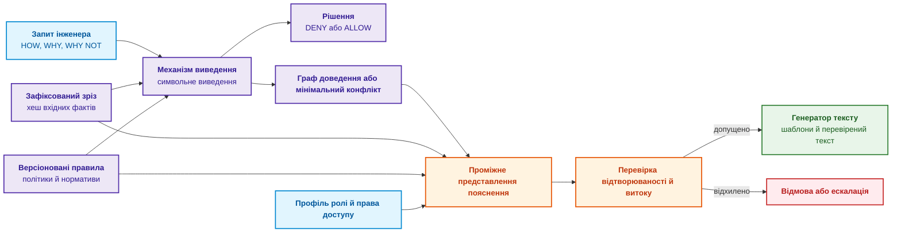
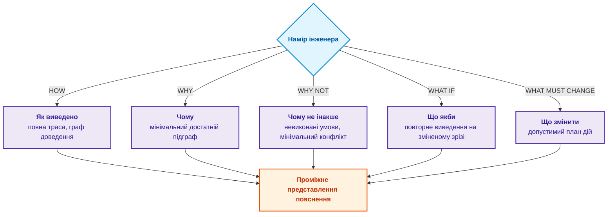
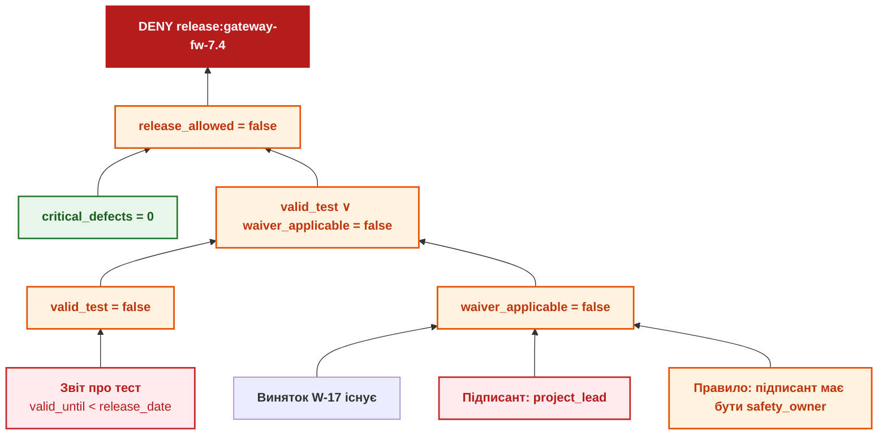
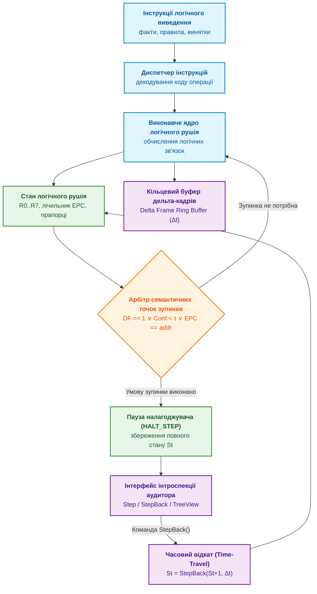
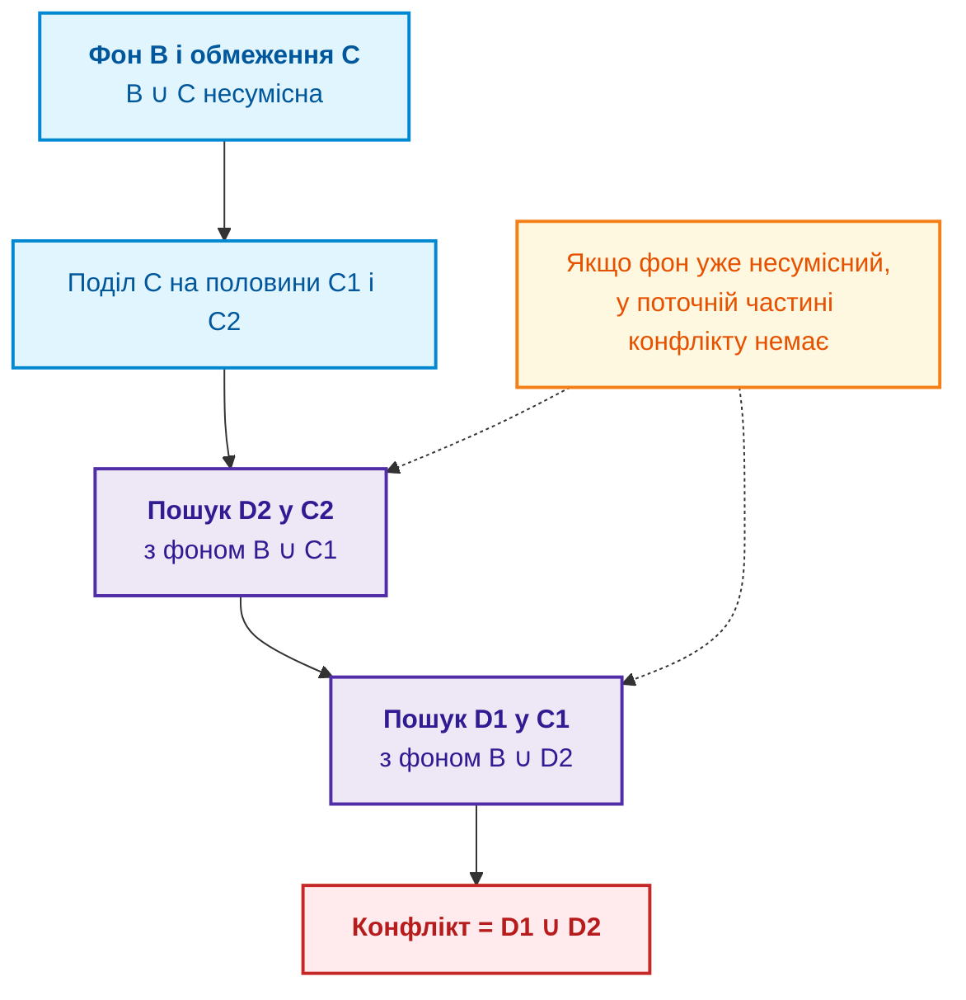
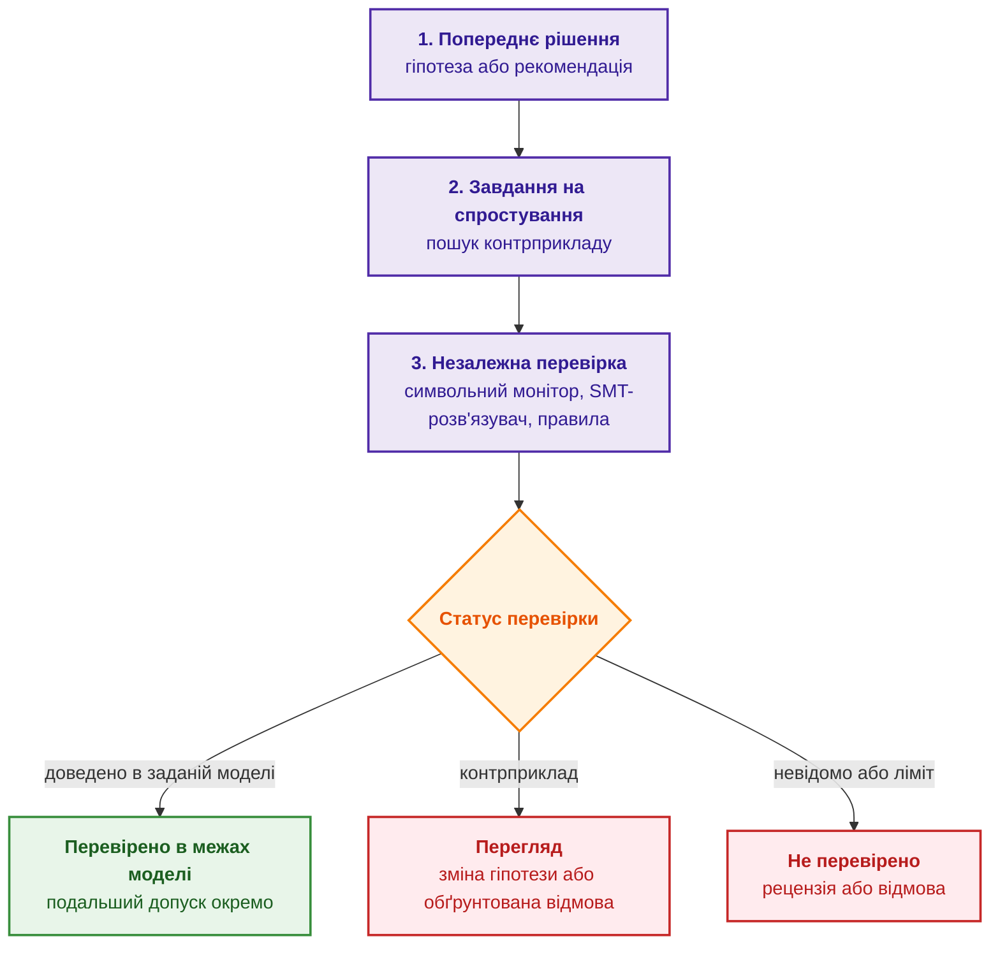
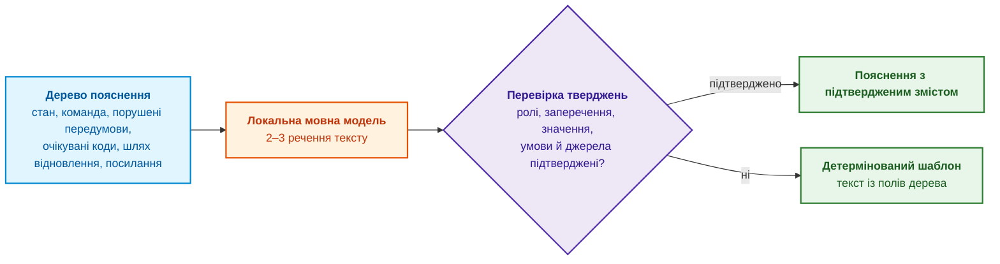

# Глава 20. Рушій пояснень: рішення, відмова та межі компетентності

> **Книга:** [Архітектура доказових експертних систем](README.md) · [Частина IV: Архітектура системи, нормативне виведення, діагностика та пояснення](part-04-architecture-and-inference.md)
> **Попередня глава:** [Глава 24. Технічна діагностика: як не сплутати симптом із першопричиною в умовах неповноти](ch24-system-diagnosis.md)
> **Наступна глава:** [Глава 23. Верифікація бази знань: як перевірити несуперечливість, повноту та надійність правил](ch23-knowledge-base-verification.md)
> **Зміст книги:** [README.md](README.md)
> **Автор:** [Микола Мартинович Федчик](about-the-author.md)
> **Передумови й маршрут читання:** достатньо розрізняти факт, правило «якщо — то» та логічні операції «і», «або», «не». Спочатку буде розібрано відмову в релізі, потім пошук конфлікту, умовних змін і перевірку пояснення; для Go-прикладу потрібні функції, зрізи та рекурсія.
> **Очікувані результати:** проєктувати рушій пояснень, що працює над тією самою трасою виведення, що й рішення; розрізняти п'ять типів пояснювальних запитів (HOW, WHY, WHY NOT, WHAT IF, WHAT MUST CHANGE); знаходити мінімальний конфлікт обмежень алгоритмом QuickXPlain; формулювати контрфактичні пояснення й допустимі дії з урахуванням повноважень; маскувати в поясненнях закриту інформацію; поєднувати природномовне пояснення з детермінованою перевіркою.

---

## Анотація

Рушій пояснень допомагає користувачеві експертної системи перевірити не лише отриманий вердикт, а й шлях до нього. На прикладі відмови в релізі показано, як зі зрізу фактів, версій правил і траси будують перевірне пояснення замість правдоподібної оповіді після рішення. П'ять запитів ведуть від відтворення виведення до пошуку конфлікту й допустимих змін. Алгоритм QuickXPlain реалізовано мовою Go з точним перебором навчального домену та тестом контракту. Авторські моделі покрокового налагодження, рольової фільтрації та керованої вербалізації розглянуто як проєктні рішення з явними передумовами. Наскрізне розрізнення глави: правильне відтворення обчислення ще не підтверджує істинності його входів, причинної дієвості поради або юридичної сили висновку.

---

Уявімо, що експертна система заблокувала реліз прошивки мережевого шлюзу. Журнал фіксує машинний статус `decision=DENY`, а діалоговий асистент пояснює: *«Ризик перевищує допустимий рівень безпеки»*. Відповідь звучить правдоподібно, але для інженера марна, бо не відповідає на робочі запитання:

- Яке саме правило спрацювало?
- Які вхідні факти стали вирішальними?
- Чому підписаний виняток (*waiver*) не застосовано?
- Яких даних забракло для статусу `ALLOW`?
- Чи зміниться рішення після повторного випробування?

Згідно з розробленою автором **концепцією епістемічної неспроможності постфактум-раціоналізації (Post-Hoc Rationalization Fallacy)**, пояснення в доказовій експертній системі не може бути стохастичною оповіддю, яку мовна модель конструює після ухвалення рішення. Ще Вільям Кленсі, аналізуючи пояснення медичної експертної системи MYCIN, показав, що трасування спрацьованих правил саме по собі не пояснює рішення: для пояснення потрібні також знання про те, чому правила такі, і про стратегію їх застосування [[1]](#src-1). В огляді Тіма Міллера контрастність («чому P, а не Q?») і відбір релевантних причин замість повного переліку виділено як поширені властивості людських пояснень [[2]](#src-2).

Ця глава відповідає на запитання: **як експертна система має пояснювати рішення, відмову й межі компетентності так, щоб пояснення можна було перевірити?** Автором сформульовано **фундаментальний інженерний принцип детермінованого ізоморфізму рішення та пояснення**: підстави пояснення відтворюються з того самого зрізу фактів, версій правил і траси, що й рішення. Тут «ізоморфізм» є назвою архітектурного принципу відповідності, а не твердженням про взаємно однозначну відповідність усіх вузлів двох графів: коротке пояснення може пропускати проміжні кроки. За незмінних траси, типу запиту, прав доступу й версії алгоритму зміст проєкції має відтворюватися; інша роль або інше запитання можуть дати інший виклад тієї самої підстави. Наприклад, HOW покаже всі кроки, а WHY — достатні підстави відмови. Мовна модель може озвучити перевірене пояснення, але не додати до нього причин. Відтворена траса підтверджує виконання заданих правил, а не автоматично істинність початкових фактів чи правильність самих правил.

## 1. Пояснення як окремий інженерний артефакт

Пояснення як окремий артефакт потрібне, щоб через місяць відповісти на запитання «чому тоді відхилили реліз?», навіть якщо правила вже оновилися. Для цього мало зберегти слово `DENY`: потрібні вхідні факти, застосована редакція політики й кроки виведення. **Зріз фактів** (*snapshot*) — зафіксований набір входів одного запуску; **траса** — запис виконаних кроків; **граф доведення** — зв'язки між передумовами й отриманими висновками за правилами. Траса пояснює, що виконав рушій, граф — від чого залежав висновок, а предметне обґрунтування правил зберігається окремо.

У цій монографії автором запропоновано **архітектурну концепцію рушія пояснень як незалежного проєкційного шару**: він відбирає з цих даних потрібне користувачеві подання, не ухвалюючи нового рішення. Наприклад, зміна політики винятків із версії 7.3 на 7.4 не повинна заднім числом підмінити підставу старої відмови. Вільно згенерована оповідь може таку підміну приховати, а повний журнал — загубити її серед зайвих кроків. Діаграма 20.1 показує шлях від зафіксованих даних до дозволеного пояснення; це авторська архітектура, не твердження про виконання конкретного пункту ISO 26262 чи DO-178C.

<a id="obj-20-1"></a>

**Діаграма 20.1. Від рішення та його підстав до пояснення.**



Щоб відбір можна було перевірити до написання тексту, потрібне **проміжне представлення пояснення** ($`\mathrm{EIR}`$, *Explanation Intermediate Representation*). В авторській специфікації це типізовані дані про відібрані факти, правила, зв'язки й джерела. Ациклічність стосується розгорнутого скінченного пояснення конкретного запуску, не будь-якої бази рекурсивних правил. **Принцип вербалізаційної пасивності генеративних мовних моделей у доказових трактах**, сформульований автором, забороняє моделі додавати причини: вона лише подає дозволений зміст словами. Нижче наведено навчальні дані паспорта рішення, а не повну JSON Schema чи реалізацію перевірника:

<details>
<summary>Структуровані дані JSON</summary>

```json
{
  "decision_id": "dec:gateway-fw-7.4:9f1c",
  "decision": "DENY",
  "subject": "release:gateway-fw-7.4",
  "snapshot_hash": "sha256:<хеш зрізу вхідних фактів>",
  "knowledge_version": "kb:release-policy@v7.3",
  "policy_version": "authz-rules@v12",
  "proof_root": "proof:tree:4711",
  "evaluated_at": "2026-09-27T10:15:00Z"
}
```

</details>


`decision_id` і `subject` вказують, яке рішення й об'єкт розглянуто; `snapshot_hash` дозволяє звірити збережені входи; дві версії фіксують знання та права доступу; `proof_root` посилається на граф, а `evaluated_at` — на час запуску. Рядок `proof:tree:4711` є ідентифікатором, не цифровим підписом і не гешем. Заповнювач гешу в прикладі потрібно замінити обчисленим значенням; сам паспорт без доступних входів і версій виконання не забезпечує повторного прогону.

Автором сформульовано **інженерний принцип демаркації кореляційної важливості ознак та дедуктивного доведення**: SHAP оцінює внески ознак у вихід моделі за обраним способом порівняння [[3]](#src-3), але не виводить нормативний дозвіл із правил. Статистична важливість не є автоматично реальною причиною, так само як граф виведення не є автоматично юридичним посвідченням. Після фіксації підстав лишається вибрати, на яке запитання користувача вони мають відповісти.

> [!NOTE]
> **Чотири структурні виміри авторської картки доказового експертного висновку**
> 1. Семантична диспозиція нормативного допуску: однозначний вердикт детермінованого ядра (прийнято, типізована відмова, уточнення) із фіксацією системного коду завершення та кількості виконаних тактів процесора логічного виведення.
> 2. Деонтична модальність вимоги: формальне виділення нормативного статусу положення (обов'язково [MUST], рекомендовано [SHOULD], дозволено [MAY]), що виключає двозначність інженерної інтерпретації.
> 3. Побайтова кастодія першоджерела: перевірені байтові межі фрагмента та геш SHA-256, звірений із довіреним збереженим значенням. Це перевірка цілісності байтів, не правильності їхнього змісту.
> 4. Дослівна цитата першоджерела у незмінному контейнері: повне виключення генеративного парафразування на користь точного фрагмента оригінального нормативного акта чи технічного стандарту.
> *Керування рантаймом / Інженерний інваріант:* Інтерфейс експертної системи зобов'язаний блокувати довільну вербалізацію, якщо побайтова кастодія фрагмента не пройшла валідацію цілісності.

## 2. Типологія пояснювальних запитів (HOW, WHY, WHY NOT, WHAT IF, WHAT MUST CHANGE)

Тип пояснювального запиту визначає, яку роботу виконати над уже збереженим рішенням. Запит «покажи кроки» не тотожний запиту «що потрібно змінити»: перший відтворює минуле, другий досліджує альтернативу. Повернімося до релізу: HOW покаже перевірку дат і ролі підписанта; WHY виділить достатні підстави відмови; WHY NOT уточнить, чого бракує саме для `ALLOW`; WHAT IF перевірить уявний новий звіт; WHAT MUST CHANGE шукатиме дозволений спосіб отримати такий звіт. Це запитання, доступні будь-якому читачеві; наведені далі професійні ролі — приклади використання, не вимоги до його підготовки.

<a id="obj-20-2"></a>

**Діаграма 20.2. Запитання користувача та потрібне обчислення.**



Таблиця уточнює, кому потрібен кожен тип і що саме обчислює експертна система.

<a id="obj-20-3"></a>

**Таблиця 20.3. Результати п'яти пояснювальних запитів.**

| Запит | Цільова аудиторія | Що обчислює експертна система | Результат |
|---|---|---|---|
| **HOW** | Розробники механізму виведення, верифікатори | Повну трасу: усі спрацьовані правила й проміжні предикати | Повний граф доведення |
| **WHY** | Аудитори, сертифікаційні органи | Мінімальний набір фактів, достатній для вердикту | Достатній підграф доведення |
| **WHY NOT** | Автори релізу, інженери | Чому бажаний результат `ALLOW` не виведено | Невідома передумова, невиконана умова або конфлікт; мінімізація лише за встановленої несумісності |
| **WHAT IF** | Аналітики ризиків, архітектори | Що станеться після зміни окремих вхідних фактів | Повторне виведення на дочірньому зрізі |
| **WHAT MUST CHANGE** | Інженери-виконавці | Які допустимі зміни можуть забезпечити бажаний результат у моделі | Умовний план із перевіркою результатів; критерій вартості задано явно |

У цьому контексті автором виділено **інженерний принцип семантичної контрастивності діагностики відмов**: для WHY NOT потрібно явно назвати альтернативу, наприклад `ALLOW`, а не просто попросити «пояснити». Контрастивне запитання у Міллера [[2]](#src-2) мотивує відбір підстав, але саме по собі не задає алгоритму мінімізації. Відсутній звіт є прогалиною даних, а дві несумісні дати — конфліктом; QuickXPlain потрібен лише в другому випадку. Спочатку побудуємо граф, щоб читач міг розрізнити ці випадки.

> [!NOTE]
> **П'ять класів пояснювальних запитів у доказовій архітектурі за моделлю автора**
> 1. HOW: відтворення повної траси та зв'язків доведення конкретного запуску для перевірки роботи ядра.
> 2. WHY: виділення достатнього підграфа для пояснюваного вердикту; мінімальність потребує заданого критерію та перевірки.
> 3. WHY NOT: пошук невідомих, невиконаних або несумісних передумов бажаного результату; QuickXPlain застосовується лише до встановленого конфлікту.
> 4. WHAT IF: симуляційне повторне виведення на ізольованому дочірньому зрізі даних зі зміненими гіпотетичними параметрами.
> 5. WHAT MUST CHANGE: пошук умовного допустимого плану дій (Actionable Recourse) за явною функцією вартості, без обіцянки успіху зовнішньої дії.
> *Керування рантаймом:* Запит непідтримуваного типу або із суперечливим контрактом відхиляється шлюзом інтерпретації з кодом E_INVALID_EXPLANATION_QUERY.

## 3. Граф доведення та трасування висновків

Граф доведення відповідає на підготовлене запитання: які саме передумови поєдналися у відмову? Його вершини позначають факти й висновки, а спрямовані ребра ведуть від передумов до залежного результату. Для прикладу досить трьох перевірок: чинності тесту, застосовності винятку й кількості критичних дефектів. Логічне «або» означає достатність хоча б одного з двох шляхів, «і» — необхідність обох частин.

Нижче задано **навчальну замкнену політику релізу**, а не універсальну вимогу стандарту. Усі її входи відомі, дати порівнюються в одній часовій системі, застосовність винятку перевіряється за зафіксованою політикою ролей. Потрібний результат — безрозмірний дозвіл або відмова.

<a id="obj-20-4"></a>

**Формула (20.4). Навчальна політика допуску релізу.**

```math
\mathrm{release\_allowed} \Leftrightarrow (\mathrm{valid\_test} \lor \mathrm{waiver\_applicable}) \land (\mathrm{critical\_defects} = 0)
```

Де параметри формули мають суворе інженерне визначення:
- $`\mathrm{release\_allowed} \in \{0, 1\}`$ — детермінований булевий результат процедури перевірки ($1$ — дозвіл на випуск, $0$ — блокування релізу);
- $`\mathrm{valid\_test} \in \{0, 1\}`$ — наявність перевіреного звіту потрібного випробування, чинного на дату релізу; `valid_until` — остання дата чинності, `release_date` — дата релізу;
- $`\mathrm{waiver\_applicable} \in \{0, 1\}`$ — застосовність перевіреного винятку до цього релізу; у прикладі потрібна роль підписанта `safety_owner`, але самої назви ролі без перевірки підпису й області винятку недостатньо;
- $`\mathrm{critical\_defects} \in \mathbb{N}_0`$ — кількість виявлених незакритих дефектів критичного рівня (Static Analysis / Penetration Testing);
- $\lor, \land, \Leftrightarrow$ — булеві операції диз'юнкції, кон'юнкції та матеріальної еквівалентності замкненої нормативної політики.

**Практичне застосування та інженерні висновки:**
1. **Точка виклику в життєвому циклі:** Розрахунок викликається автоматизованим шлюзом допуску релізу (Release Gate) конвеєра CI/CD перед підписанням бінарного образу криптографічним ключем релізу.
2. **Інтерпретація результатів:** значення 1 дає `ALLOW` за цією політикою, значення 0 — `DENY`. Створення чи підписування сертифіката є окремою процедурою, не наслідком булевої арифметики. Невідомий вхід не підставляють як 0 без окремої політики неповноти: потрібне уточнення або типізована відмова.
3. **Реакція системи:** Замість скидання загальної помилки рушій пояснень проєктує підграф доведення, детерміновано виокремлюючи гілки, що дали хибу (`valid_test = false` через прострочений термін дії та `waiver_applicable = false` через невідповідність ролі підписанта `project_lead` замість `safety_owner`). Умова $`\mathrm{critical\_defects} = 0`$ хоч і є істинною, вилучається з мінімального пояснення відмови WHY, оскільки вона не була причиною блокування.

У зрізі фактів зафіксовано: звіт про тестування прострочений (`valid_until < release_date`), виняток W-17 існує, але підписаний керівником проєкту (роль `project_lead`), критичних дефектів немає. Послідовно підставляємо: обидва альтернативні шляхи хибні, отже «0 або 0» дає 0; перевірка нульової кількості дефектів дає 1; «0 і 1» дає 0, тобто `DENY`. Якщо в уявному зрізі зробити тест чинним, «1 або 0», а потім «1 і 1» дають `ALLOW`. Це перевірка моделі, не свідчення безпечності реального виробу.

<a id="obj-20-5"></a>

**Діаграма 20.5. Виведення відмови за політикою 20.4.**



За стрілками граф читається від фактів унизу до вердикту вгорі; від вердикту можна пройти назад до його підстав. Для відмови через диз'юнкцію потрібні обидві хибні гілки: якби будь-яка стала істинною, за решти цих входів реліз було б дозволено. В авторському **алгоритмічному правилі селективної редукції виконаних умов (WHY Pruning Rule)** виконану перевірку дефектів можна прибрати з короткого пояснення саме цієї відмови, зберігши її в HOW. Це не універсальний дозвіл видаляти істинні вузли: в інших правилах вони можуть визначати застосовність винятку чи заперечення. Достатність скороченого пояснення перевіряють за семантикою конкретного правила. Нижче те саме подання діаграми 20.5 розгорнуто як текстове дерево, не як новий об'єкт:

<details>
<summary>Дані або результат прикладу</summary>

```text
[ЦІЛЬ] release_allowed = false
├── [ПРАВИЛО] release_allowed ⇐ (valid_test ∨ waiver_applicable) ∧ critical_defects = 0
├── [ГІЛКА 1] valid_test = false
│   └── [ФАКТ] TestReport-7.4: valid_until = 2026-08-01 < release_date = 2026-09-27
├── [ГІЛКА 2] waiver_applicable = false
│   ├── [ПРАВИЛО] виняток чинний лише з підписом ролі safety_owner
│   └── [ФАКТ] W-17 підписано роллю project_lead
└── [ФАКТ] critical_defects = 0 (умову виконано)
```

</details>


Експертна система не висуває гіпотези «прошивка зламає мережу», а показує невиконану умову політики. В авторському **інженерному інваріанті побайтової доказовості та криптографічного замикання графа доведення** вхідний факт має координати в незмінному джерелі й перевірений геш, а похідний вузол — версію правила та посилання на передумови. Ідентифікатор `passage-id` сам по собі не є гешем. Підпис Ed25519 над канонічно закодованим графом дозволяє перевірити цілісність і зв'язок із ключем підписанта за належного керування ключами; він не підтверджує істинності фактів і не надає автоматичної юридичної сили. Огляд механізмів у [Главі 15](ch15-knowledge-extraction-and-kb-construction.md) не замінює застосовної правової процедури. Граф уже пояснює залежності; тепер розглянемо, як знайти помилку в самому виконанні.

### 3.1. Інтерактивне налагодження інструкцій логічного виведення: безпобічна інтроспекція, покрокова навігація деревами доведення та часовий відкат

Інтерактивне налагодження потрібне, коли граф показує результат, але ще невідомо, чи рушій правильно виконав інструкції. Питання тепер таке: **«Який крок змінив стан і чи можна відтворити його без зміни вихідних даних?»** Налагоджувачі GDB і LLDB дозволяють досліджувати програму, але для зручного показу правил, цитат і скасовувальних норм потрібне предметне подання. Авторська модель нижче додає таке подання; вона не є звітом про реалізований або атестований інструмент.

Водночас створення спеціалізованих налагоджувачів інструкцій логічного виведення часто наштовхується на **тріаду потенційних дефектів низькорівневого налагодження символьних середовищ**:
1. **Мутація стану при покроковому виконанні (Stepping Side-Effects):** наївна реалізація покрокового виконання (`Step()`) незворотно модифікує контекст пам'яті виведення, позбавляючи аудитора можливості чистого відкату назад (Rewind/Undo) для дослідження розгалуження гіпотез;
2. **Вразливість перед некоректним або ворожим байткодом:** вихід лічильника команд `EPC` за межі сегмента без перевірки може спричинити падіння хоста замість контрольованого зупину `HALT_FAULT`;
3. **Розбіжність реалізацій:** програмна модель і цільовий рушій можуть по-різному трактувати статусні прапорці; це потрібно перевіряти на визначених тестових векторах, а не припускати фізичну еквівалентність.

<a id="obj-20-6"></a>

**Діаграма 20.6. Покрокова навігація станами моделі виведення.**



  На діаграмі `Conf` — безрозмірна оцінка довіри в [0, 1], `τ` — заданий поріг у тому самому діапазоні (наприклад, 0,85), `addr` — допустима адреса інструкції в одиницях профілю `EPC`. Вони задають умови паузи налагоджувача, не самостійний критерій істинності чи нормативного допуску.

Для усунення цих дефектів автором запропоновано архітектурний шаблон епістемічного налагоджувача для інструкцій виведення знань. Бібліографічний запис [[10]](#src-10) наведено автором; існування, реквізити й відповідність праці цій моделі тут незалежно не перевірено, тому він не слугує підтвердженням реалізації.

#### 3.1.1. Безпобічна покрокова інтроспекція з детерміністичним відкатом (Time-Travel Introspection)

Для базового профілю без інструкцій виклику й повернення, визначеного в [Главі 22, §10.1.2](ch22-cybernetics-edge-to-backend.md#1012-нормативний-версійований-профіль-інструкцій), навігація складається з `Step` і `StepBack`, а `TreeView` лише показує дерево доведення. Команди `StepOver` і `StepOut` до цього профілю не належать. Один крок `Step` описується транзакційним переходом із записом різницевого дельта-кадру в кільцевий журнал пам'яті (*Delta Frame Log*):

<a id="obj-20-7"></a>

**Формула (20.7). Контракт кроку та відновлення стану.**

```math
\mathcal{S}_{t+1} = \mathrm{Step}(\mathcal{S}_t), \quad \Delta_t = \mathcal{S}_{t+1} \ominus \mathcal{S}_t, \quad \mathcal{S}_t = \mathrm{StepBack}(\mathcal{S}_{t+1}, \Delta_t)
```

Параметри та математичні компоненти формули:
- $`\mathcal{S}_t`$ — повний архітектурний стан на кроці $t$ за Главою 22, §10.1.2: регістри, `EPC`, `EFLAGS`, `HALT`, `REASON`, `ProofTreeHash` і змінювані комірки даних, якщо інструкції профілю дозволяють запис. Стек викликів не припускається, оскільки цей профіль не має викликів і повернень;
- $`\mathrm{Step}(\mathcal{S}_t)`$ — детермінована функція виконання однієї інструкції мікрокоду виведення;
- $`\Delta_t`$ — різницевий кадр з адресами й попередніми значеннями всіх змінених регістрів, прапорців і комірок, включно з полями зупину та гешем дерева;
- $\ominus$ — оператор побудови орієнтованої різниці зі збереженням попередніх значень, не лише множини змінених позицій;
- $`\mathrm{StepBack}(\mathcal{S}_{t+1}, \Delta_t)`$ — запропонована операція відновлення за збереженим кадром. Її вартість становить $`O(m_t)`$, де $`m_t \ge 0`$ є кількістю байтів відновлюваних даних і метаданих. Оцінка $O(1)$ щодо довжини програми допустима лише за фіксованої профілем верхньої межі розміру кадру. Реалізацію й тотожність відновлення потрібно перевірити тестовими векторами.

Індекс $`t \in \mathbb{N}_0`$ рахує кроки, не секунди; стани й кадри є структурами даних, а не фізичними величинами. Наприклад, до кроку `EPC` має значення `p`, а `DF=0`; після кроку — `next(p)` і `DF=1`. Кадр зберігає попередні `p` і 0, а також усі інші змінені поля. Після `StepBack` порівнюють **увесь** стан із початковим, не лише ці два поля. Одиницю `EPC` та `next` задає профіль Глави 22: збільшення на один байт тут не припускається.

Тотожність 20.7 вимагає незмінної програми, повного кадру, збереженого попереднього стану й відсутності неврахованого вводу-виводу. Зовнішні дії під час такого повторного прогону блокують або моделюють: відновлення пам'яті не відкликає вже надісланий лист, випущений реліз чи сигнал виконавчому пристрою. Перезаписаний кільцевим журналом кадр відновити неможливо.

#### 3.1.2. Візуалізація стану логічного рушія та статусних прапорців

Щоб прочитати відновлений стан, інтерфейс має показати не лише числа, а й тип останньої операції:
- **Епістемічні регістри даних ($`R_0 \dots R_7`$):** вісім 64-бітних комірок профілю; подання як ідентифікатора або числа Q16.16 визначається типом операнда. Довірчий інтервал потребує двох меж чи посилання на структуру, а не виникає з одного регістра автоматично;
- **Лічильник інструкцій (`EPC`):** покажчик на поточну інструкцію за профілем Глави 22 §10.1.2;
- **Статусні прапорці ядра:** `ZF = 1` після порівняння означає рівність, після перевірки межі означає `PASS`; початковий `ZF = 0` означає відсутність доведення. `UF = 1` позначає порушення допуску або арифметичне переповнення, `DF = 1` позначає активну скасовувальну норму, `CF = 1` позначає успішну перевірку криптографічної прив'язки. Значення визначає остання інструкція, що записала прапорець, а не універсальне тлумачення будь-якого знімка як вердикту;
- **Інтерактивне дерево дефітерів (Defeater Proof Tree):** візуалізація конкурентних правил із підсвічуванням точної норми, яка заблокувала дію.

Дефітер — правило чи свідчення, яке скасовує застосування іншого аргументу. Невідповідна роль підписанта може просто зробити умову хибною; вона не зобов'язана встановлювати `DF`, доки профіль явно не задає такого правила. `HALT_STEP` у цій главі позначає паузу інструмента налагодження, не новий код `REASON` чи інструкцію базового профілю.

#### 3.1.3. Стійкість до апаратних виключень (Panic-Proof Sandbox)

Захищене виконання починається з перевірок **до** доступу до пам'яті чи виконання операції. Наприклад, `EPC` поза сегментом має дати `HALT=1` і код причини (`HALT_FAULT`), а не спробу читання неіснуючої інструкції. Аналогічно перевіряють код операції, індекси й нульовий дільник, якщо ділення взагалі є у профілі. Це вимога до реалізації та негативних тестів, не доказ неможливості будь-якого падіння хоста. Діагностичний дамп також підпорядковується правам доступу: він може містити закриті факти.

#### 3.1.4. Дія та замкнений цикл інженерного налагодження мікрокоду виведення

1. **Керування рантаймом і потоком обчислень (Control Flow & Runtime Decisions):**
   - Аудитор встановлює семантичні точки зупину (Semantic Breakpoints) за логічними предикатами: наприклад, зупинка при активації будь-якого дефітера (`BREAK ON flag(DF) == 1`) або падінні довіри нижче порогу (`BREAK ON confidence < 0.85`).
   - При спрацюванні точки зупину конвеєр виведення заморожується в стані `HALT_STEP`. Інженер виконує покроковий відкат `StepBack()`, витягуючи дельти $`\Delta_t`$ із кільцевого буфера, щоб виявити, який саме факт або підписант винятку викликав підняття прапорця $`\mathrm{DF}`$.
2. **Апаратний сайзинг та інфраструктурні обмеження (Hardware Dimensioning):**
  - Кільцевий буфер розміщується у статично виділеній BRAM або попередньо виділених резидентних сторінках пам'яті; кешування L2/L3 саме по собі не гарантує резидентності. Приклад $`S_{\Delta} = 128\,\text{байтів}`$ придатний лише для профілю, в якому всі попередні значення й метадані одного кроку вміщуються в такий кадр. Переповнення кадру має блокувати крок до мутації, а не обрізати журнал.
  - Місткість рахується за формулою 20.8. Статичний буфер не доводить відсутності інших алокацій; ціль $`T_{\mathrm{stepback}} < 25\,\text{нс}`$, де $`T_{\mathrm{stepback}}`$ — тривалість відкату, потребує вимірювання або обґрунтованої межі WCET (найгіршого часу виконання) на визначеній платформі й тут не заявляється досягнутою.
3. **Практичний числовий приклад (Worked Numerical Example):**
  - Синтетичний приклад: умовна система заблокувала випуск мережевого шлюзу через невідповідну роль підписанта.
  - Аудитор відкриває знімок стану в інструменті інтроспекції та встановлює точку зупинки на прапорці дефетера (`BREAK ON flag(DF) == 1`). Під час прогону зупинка спрацьовує на умовній інструкції `i_stop`: прапорці показують активний дефетер і відсутність дозволу.
  - Аудитор натискає `StepBack()`. За умовного правила, яке кодує цю перешкоду як дефітер, система відновлює попередній стан за дельта-кадром; журнал веде до перевірки ролі `project_lead` замість `safety_owner`. Якщо профіль кодує невдалу перевірку інакше, точку зупину задають на її результаті, не на `DF`. Це приклад навігації, не стендовий вимір.

<a id="obj-20-8"></a>

**Формула (20.8). Пам'ять кільцевого журналу без службових індексів.**

```math
V_{\mathrm{frames}}=K_{\mathrm{rewind}}S_{\Delta}
=1024\cdot128=131\,072\ \text{байти}=128\ \text{КіБ}.
```

Тут $`K_{\mathrm{rewind}} \in \mathbb{N}`$ — кількість збережених кадрів, $`S_{\Delta}>0`$ — ціла кількість байтів у кадрі фіксованого профілю, $`V_{\mathrm{frames}}`$ — байти пам'яті лише під кадри; 1 КіБ дорівнює 1024 байтам. Отриманих 128 КіБ вистачає на 1024 кроки за припущення достатності 128-байтового кадру. Якщо фактичний кадр потребує 160 байтів, цей розрахунок непридатний: треба змінити профіль або відмовити до мутації. Відновлення стану допомагає перевірити обчислення; наступний розділ шукає вже не дефект виконання, а несумісність самих вимог.

> [!NOTE]
> **Чотири інваріанти апаратного трасування та налагодження мікрокоду виведення за архітектурою автора**
> 1. Формування кільцевого буфера дельта-кадрів ($`\Delta_t`$) фіксованого розміру для детермінованого покрокового зворотного ходу `StepBack()`.
> 2. Апаратна фіксація статусних прапорців ядра ($`\mathrm{ZF}, \mathrm{UF}, \mathrm{DF}, \mathrm{CF}`$) на кожному такті виконання мікроінструкцій виведення.
> 3. Розміщення журнала відкату у статично виділеній BRAM або попередньо виділених резидентних сторінках; відсутність інших алокацій перевіряється окремо.
> 4. Миттєве переведення ядра в захищений стан `HALT_FAULT` при виході за межі адресації або невалідних кодах операцій.
> *Керування рантаймом:* Спроба відкату за межі виділеного буфера дельт блокується збудженням виключення E_DEBUG_RING_BUFFER_UNDERFLOW.

## 4. Обчислення відмов WHY NOT: мінімальний конфлікт та алгоритм QuickXPlain

WHY NOT потребує мінімального конфлікту тоді, коли бажаний результат несумісний із відомими вимогами, а не просто не доведений. Наприклад, «немає даних про день тесту» вимагає уточнення; «тест не раніше дня 10, потім п'ять днів стабілізації, реліз до дня 12» уже містить суперечність. **Обмеження** — умова на допустимі значення змінних; **сумісність** означає існування хоча б одного набору значень, який виконує всі умови. **Мінімальний за включенням конфлікт** (*minimal conflict*, MUC) не має зайвих умов, хоча інший конфлікт може містити менше умов.

Для несуперечливого фону $K$ і скінченної множини кандидатів $C$, разом несумісних, ядро визначено формулою 20.9. Потрібен точний розв'язувач для обраної логіки; `unknown` не означає ані сумісності, ані суперечності.

<a id="obj-20-9"></a>

**Формула (20.9). Мінімальність конфлікту відносно фону.**

```math
\mathrm{Core} \subseteq C, \quad K \cup \mathrm{Core} \vdash \bot, \quad \forall C' \subsetneq \mathrm{Core} : K \cup C' \nvdash \bot
```

Де складові виразу мають строго визначений зміст:
- $K$ — база непорушних фонових знань (аксіоми предметної області, фізичні закони, системні інваріанти), що апріорі є сумісною ($K \nvdash \bot$);
- $`C = \{c_1, c_2, \dots, c_n\}`$ — множина варійованих операційних обмежень або цільових вимог, висунутих користувачем чи середовищем;
- $`\mathrm{Core} \subseteq C`$ — виділена конфліктна підмножина обмежень;
- $\vdash$ — відношення формальної логічної вивідності;
- $\bot$ — логічна суперечність (хиба, стан `UNSAT`);
- $`C' \subsetneq \mathrm{Core}`$ — довільна строга власна підмножина знайденого ядра;
- $\forall$ — квантор загальності, що фіксує умову неподільності ядра (жоден елемент не є надлишковим).

**Практичне застосування та інженерні висновки:**
1. **Точка виклику в життєвому циклі:** Процедура ізоляції ядра активується диспетчером виведення під час обробки запиту WHY NOT або при виникненні стану несумісності конфігурації.
2. **Інтерпретація результату:** видалення будь-якого елемента ядра відновлює сумісність **цього ядра з фоном**, не обов'язково всієї множини $C$. В іншій частині $C$ може лишатися незалежний конфлікт.
3. **Реакція системи:** ядро показують як локалізовану перешкоду; запропоноване послаблення перевіряють на всій задачі. Мінімальність ядра не дозволяє самовільно змінювати нормативну вимогу.

У формулі всі об'єкти є логічними множинами без фізичних одиниць; $n$ — невід'ємна ціла кількість кандидатів. Для днів тесту й релізу з домену 0..20 три умови прикладу дають реліз не раніше дня 15 і водночас не пізніше дня 12. Прибираємо вимогу лабораторії — підходять тест у день 7 і реліз у день 12; прибираємо дедлайн — тест у день 10 і реліз у день 15; прибираємо стабілізацію — тест у день 10 і реліз у день 12. Кожне одноелементне видалення дає сумісність. За монотонної логіки обмежень цього досить: будь-яка менша підмножина також сумісна, бо видалення умов не знищує вже знайдений розв'язок.

Але якщо додати незалежні умови «документацію завершити не раніше дня 8» і «не пізніше дня 6», жодне виправлення лише тестової трійки не зробить усю задачу сумісною. Цей приклад пояснює, чому пошук ядра і пошук повного виправлення є різними задачами.

Найпростіший пошук видаляє умови по одній і залишає видалення, якщо суперечність збереглася. Після встановлення передумов достатньо однієї перевірки на кандидата. QuickXPlain Юнкера [[4]](#src-4) натомість ділить кандидатів навпіл і переносить потрібні частини у фон рекурсивних викликів. Метод вимагає скінченного набору, сумісного початкового фону, несумісного об'єднання й монотонності: додавання обмежень до несумісної множини не робить її сумісною. Саме заморожування траси не забезпечує цієї властивості для довільних немонотонних правил.

<a id="obj-20-10"></a>

**Формула (20.10). Оцінка викликів оракула для збалансованого QuickXPlain.**

```math
N_{\mathrm{qx}} \le 2n-2,\qquad N_{\mathrm{all}}=N_{\mathrm{qx}}+2\le 2n,\qquad n\in\mathbb{N},\ n\ge1.
```

Тут $n$ — ціла кількість кандидатів, $`N_{\mathrm{qx}}`$ — число перевірок сумісності всередині `qx`, а $`N_{\mathrm{all}}`$ — їхня загальна кількість разом із двома перевірками в `quickXPlain`; усі величини безрозмірні. Межа стосується наведеного нижче коду після успішної перевірки передумов: фон сумісний, його об'єднання з кандидатами несумісне. Оракул має бути точним, детермінованим і монотонним щодо додавання обмежень. Кандидати скінченні, різні та не належать до фону. Розмір повернутого ядра $k$ тоді задовольняє $1\le k\le n$, але ця консервативна межа від $k$ не залежить.

**Виведення для фактичної рекурсії.** Уявімо повне дерево поділу без дострокових повернень. Вузол із $m>1$ кандидатами має рівно двох нащадків розмірів $\lfloor m/2\rfloor$ та $\lceil m/2\rceil$, як у Go-виразі `len(c) / 2`; вузол з одним кандидатом є листком. Частини не перетинаються, тому листків рівно $n$. Якщо внутрішніх вузлів $i$, кількість ребер дорівнює водночас $2i$ та $i+n-1$, отже $i=n-1$ і всіх вузлів $2n-1$. Реальна рекурсія лише відсікає піддерева, а не додає вузли.

Кожне виконання `qx` перевіряє фон щонайбільше один раз; у корені `delta` порожня, тому перевірки немає. Отже, перевірок не більше, ніж вузлів без кореня: $2n-2$. Це не кількість рекурсивних викликів: частина вузлів також пропускає оракул через порожню `delta`. Обгортка на допущеному вході додає рівно дві перевірки, що дає другу нерівність 20.10. Обидві межі цілі й не потребують округлення, зокрема для непарного $n$. Межа досяжна: якщо суперечить лише повна множина кандидатів, кожна власна підмножина сумісна, дерево обходиться повністю, а кожна некоренева `delta` непорожня.

Для $n=500$, $k=3$ доведено не більше 998 перевірок рекурсії та 1000 загалом; мале ядро саме по собі не посилює цього доведення. Раніше наведену залежність $`2k\log_2(n/k)+2k`$ тут не застосовано: для цього коду її не доведено, а не оголошено спростованою. Якщо фон несумісний, обгортка повертає помилку після однієї перевірки. Якщо повний набір сумісний, зокрема за порожнього набору кандидатів і сумісного фону, вона повертає порожній результат після двох перевірок без рекурсії; тоді $k=0$, а формула 20.10 не застосовується. Отримано лінійну верхню межу кількості звернень до оракула, не оцінку часу його роботи чи гарантію WCET.

<a id="obj-20-11"></a>

**Діаграма 20.11. Поділ кандидатів у рекурсії QuickXPlain.**



> [!TIP]
> **Три інженерні фактори переваги QuickXPlain над лінійним пошуком у бортовій діагностиці LRU/ECU за розрахунком автора**
> 1. **Умовне порівняння викликів оракула:** за $n=500$, $k=3$ видалення по одному потребує 500 перевірок після встановлення передумов, а формула 20.10 дозволяє до 1000 перевірок QuickXPlain разом з обгорткою. Ця консервативна межа не гарантує переваги; для однакового обліку передумов до лічильника видалення слід також додати дві перевірки.
> 2. **Часовий бюджет:** за умовної однакової тривалості кожної перевірки 150 мс внесок 500 перевірок становить 75 с, а верхня межа внеску 1000 перевірок — 150 с, без інших витрат програми. Це не виміряні часи, не гарантія дедлайну й не підтвердження бюджету 10 с; потрібне вимірювання повного шляху на цільовій платформі.
> 3. **Межа системного висновку:** у конкретному прикладі нижче отримано 33 виклики проти 200, тобто приблизно 6,06-кратне скорочення за наведеними лічильниками; для малого набору, навпаки, 13 проти 8. Результати показують залежність переваги від входу, а не загальний коефіцієнт прискорення. Вони не доводять зменшення навантаження шини ARINC-429 або CAN чи відсутності деградації зв'язку.
> *Керування рантаймом:* $n \ge 50$ є запропонованою умовою вибору кандидата QuickXPlain, а $`\tau_{\text{diag\_budget}} \le 10\,\text{с}`$ — цільовим бюджетом конкретного профілю; досягнення бюджету перевіряють вимірюванням, а не кількістю викликів.

Програма мовою Go реалізує означення 20.9 через QuickXPlain та видалення по одному. Вхід — предикати над цілими днями тесту ($t$), завершення документації ($d$) й релізу ($r$) від 0 до 20 включно; одиниця — день від умовного початку плану. `consistent` перевіряє всі 9261 трійки днів; це точний оракул лише для цього скінченного домену. `quickXPlain` перевіряє передумови, `qx` виконує поділ із діаграми 20.11, а `deletion` дає контрольне порівняння. Серед 8 або 200 умов ті самі три конфліктні, решта задає сумісні вимоги до документації; збільшено кількість умов, не розмір домену. Очікуваний результат — наведені нижче точні рядки з ядром і лічильниками, не час роботи SAT/SMT-розв'язувача.

<details>
<summary>Приклад мовою Go: мінімальний конфлікт обмежень методами QuickXPlain і видалення по одному</summary>

```go
package main

import "fmt"

// Constraint є обмеженням на дні тесту (t), документації (d) і релізу (r).
type Constraint struct {
	Name string
	Ok   func(t, d, r int) bool
}

var checks int

// consistent шукає хоча б один розклад у межах 0..20 днів, що задовольняє всі обмеження.
func consistent(cs []Constraint) bool {
	checks++
	for t := 0; t <= 20; t++ {
		for d := 0; d <= 20; d++ {
			for r := 0; r <= 20; r++ {
				all := true
				for _, c := range cs {
					if !c.Ok(t, d, r) {
						all = false
						break
					}
				}
				if all {
					return true
				}
			}
		}
	}
	return false
}

func join(a, b []Constraint) []Constraint {
	return append(append([]Constraint{}, a...), b...)
}

// qx є рекурсивною частиною QuickXPlain (Junker, 2004).
func qx(b, delta, c []Constraint) []Constraint {
  if len(c) == 0 {
    return nil
  }
	if len(delta) > 0 && !consistent(b) {
		return nil
	}
	if len(c) == 1 {
		return c
	}
	k := len(c) / 2
	c1, c2 := c[:k], c[k:]
	d2 := qx(join(b, c1), c1, c2)
	d1 := qx(join(b, d2), d2, c1)
	return join(d1, d2)
}

func quickXPlain(background, candidates []Constraint) ([]Constraint, error) {
  if !consistent(background) {
    return nil, fmt.Errorf("background is inconsistent")
  }
  if consistent(join(background, candidates)) {
    return nil, nil
  }
  return qx(background, nil, candidates), nil
}

// deletion видаляє обмеження по одному, доки множина лишається несумісною.
func deletion(c []Constraint) []Constraint {
	core := append([]Constraint{}, c...)
	for i := 0; i < len(core); {
		rest := join(core[:i], core[i+1:])
		if !consistent(rest) {
			core = rest
		} else {
			i++
		}
	}
	return core
}

func names(cs []Constraint) []string {
	var s []string
	for _, c := range cs {
		s = append(s, c.Name)
	}
	return s
}

func main() {
	core := map[int]Constraint{
		17:  {"лабораторія вільна з 10-го дня: t >= 10", func(t, d, r int) bool { return t >= 10 }},
		101: {"дедлайн замовника: r <= 12", func(t, d, r int) bool { return r <= 12 }},
		188: {"стабілізація після тесту: r >= t + 5", func(t, d, r int) bool { return r >= t+5 }},
	}
	for _, n := range []int{8, 200} {
		var cs []Constraint
		for i := 0; i < n; i++ {
			pos := i
			if n == 8 {
				pos = []int{0, 17, 1, 101, 2, 3, 188, 4}[i]
			}
			if c, ok := core[pos]; ok {
				cs = append(cs, c)
				continue
			}
			j := i % 4
			cs = append(cs, Constraint{fmt.Sprintf("документація: d >= %d", j), func(t, d, r int) bool { return d >= j }})
		}
		checks = 0
    conflict, err := quickXPlain(nil, cs)
    if err != nil {
      panic(err)
    }
		qxChecks := checks
		checks = 0
		del := deletion(cs)
		fmt.Printf("n = %d, перевірок сумісності: QuickXPlain %d, видалення по одному %d\n", n, qxChecks, checks)
		fmt.Printf("  конфлікт: %q\n", names(conflict))
    fmt.Printf("  збігається з результатом видалення: %v\n", fmt.Sprint(names(conflict)) == fmt.Sprint(names(del)))
	}
}
```

Перевірка контракту й мінімальності не залежить від кількості викликів; виконання: `go test -v main.go main_test.go`.

```go
package main

import "testing"

func TestQuickXPlainContract(testCase *testing.T) {
  if result, err := quickXPlain(nil, nil); err != nil || len(result) != 0 {
    testCase.Fatalf("empty set: %v, %v", result, err)
  }
  compatible := []Constraint{{Name: "nonnegative test day",
    Ok: func(testDay, documentationDay, releaseDay int) bool { return testDay >= 0 }}}
  if result, err := quickXPlain(nil, compatible); err != nil || len(result) != 0 {
    testCase.Fatalf("compatible set reported as conflict: %v", err)
  }
  candidates := []Constraint{
    {Name: "lab", Ok: func(testDay, documentationDay, releaseDay int) bool { return testDay >= 10 }},
    {Name: "deadline", Ok: func(testDay, documentationDay, releaseDay int) bool { return releaseDay <= 12 }},
    {Name: "stabilization", Ok: func(testDay, documentationDay, releaseDay int) bool { return releaseDay >= testDay+5 }},
    compatible[0],
  }
  conflict, err := quickXPlain(nil, candidates)
  if err != nil || len(conflict) != 3 || consistent(conflict) {
    testCase.Fatalf("invalid conflict: %v, %v", names(conflict), err)
  }
  for index := range conflict {
    if !consistent(join(conflict[:index], conflict[index+1:])) {
      testCase.Fatal("conflict is not inclusion-minimal")
    }
  }
  if _, err := quickXPlain(candidates, compatible); err == nil {
    testCase.Fatal("inconsistent background accepted")
  }
}

func TestQuickXPlainBackground(testCase *testing.T) {
  background := []Constraint{{Name: "lab", Ok: func(testDay, documentationDay, releaseDay int) bool { return testDay >= 10 }}}
  candidates := []Constraint{
    {Name: "deadline", Ok: func(testDay, documentationDay, releaseDay int) bool { return releaseDay <= 12 }},
    {Name: "stabilization", Ok: func(testDay, documentationDay, releaseDay int) bool { return releaseDay >= testDay+5 }},
    {Name: "documentation", Ok: func(testDay, documentationDay, releaseDay int) bool { return documentationDay >= 0 }},
  }
  conflict, err := quickXPlain(background, candidates)
  if err != nil || len(conflict) != 2 || consistent(join(background, conflict)) {
    testCase.Fatalf("invalid relative conflict: %v, %v", names(conflict), err)
  }
  for index := range conflict {
    remaining := join(conflict[:index], conflict[index+1:])
    if !consistent(join(background, remaining)) {
      testCase.Fatal("conflict is not minimal relative to background")
    }
  }
}

func TestQuickXPlainIndependentConflicts(testCase *testing.T) {
  candidates := []Constraint{
    {Name: "test lower", Ok: func(testDay, documentationDay, releaseDay int) bool { return testDay >= 10 }},
    {Name: "test upper", Ok: func(testDay, documentationDay, releaseDay int) bool { return testDay <= 8 }},
    {Name: "documentation lower", Ok: func(testDay, documentationDay, releaseDay int) bool { return documentationDay >= 8 }},
    {Name: "documentation upper", Ok: func(testDay, documentationDay, releaseDay int) bool { return documentationDay <= 6 }},
  }
  conflict, err := quickXPlain(nil, candidates)
  if err != nil || len(conflict) != 2 || consistent(conflict) {
    testCase.Fatalf("invalid conflict: %v, %v", names(conflict), err)
  }
  for index := range conflict {
    if !consistent(join(conflict[:index], conflict[index+1:])) {
      testCase.Fatal("selected conflict is not minimal")
    }
  }
  var remaining []Constraint
  for _, candidate := range candidates {
    if candidate.Name != conflict[0].Name {
      remaining = append(remaining, candidate)
    }
  }
  if consistent(remaining) {
    testCase.Fatal("one local deletion unexpectedly repaired both conflicts")
  }
}
```

</details>

Програма виводить:

<details>
<summary>Дані або результат прикладу</summary>

```text
n = 8, перевірок сумісності: QuickXPlain 13, видалення по одному 8
  конфлікт: ["лабораторія вільна з 10-го дня: t >= 10" "дедлайн замовника: r <= 12" "стабілізація після тесту: r >= t + 5"]
  збігається з результатом видалення: true
n = 200, перевірок сумісності: QuickXPlain 33, видалення по одному 200
  конфлікт: ["лабораторія вільна з 10-го дня: t >= 10" "дедлайн замовника: r <= 12" "стабілізація після тесту: r >= t + 5"]
  збігається з результатом видалення: true
```

</details>


Обидва способи знаходять у цьому прикладі конфлікт із трьох обмежень. Обгортка додає дві перевірки передумов; загалом маємо 13 проти 8 викликів для малого набору та 33 проти 200 для великого. Це кількість звернень до оракула, не вимірювання часу й не перевага на всіх задачах. Три тестові функції перевіряють порожній і сумісний набори, несумісний фон, мінімальність з порожнім та непорожнім фоном і збереження другого конфлікту після локального виправлення. Очікується `PASS` усіх трьох функцій. Може існувати кілька мінімальних ядер; результат залежить від порядку кандидатів і не обіцяє найменшої вартості.

За **інженерним правилом валідації неповноти SMT-оракула (SMT Incompleteness Warning)** автора `unknown` не можна трактувати як суперечність або сумісність. За ліміту часу повертають `QUALIFIED_UNKNOWN`, а не уявне ядро; для немонотонних правил спочатку обґрунтовують переклад у монотонну задачу. Тепер можна перейти від питання «які умови конфліктують?» до іншого: «які з них користувач має право й змогу змінити?»

## 5. Контрфактичні сценарії WHAT IF та пошук допустимих дій WHAT MUST CHANGE

Контрфактичний сценарій відповідає на питання, яке залишилося після знаходження перешкоди: «чи змінилося б рішення за іншого входу?» У формулі 20.4 достатньо уявно зробити тест чинним, щоб отримати `ALLOW` за нульових критичних дефектів. Це WHAT IF: повторний прогін на копії зрізу, без зміни історичного звіту. Але WHAT MUST CHANGE запитує вже про доступну дію, а не про редагування булевого поля: як отримати новий чинний звіт і хто має право підтвердити його? Відстань між станами ще не є планом переходу між ними.

Праця Ваштер, Міттельштадта й Рассела [[5]](#src-5) є базисом обговорення контрфактичних пояснень, а дієвість змін розглянуто в Устуна та співавторів [[6]](#src-6). В авторській моделі пошук додатково обмежено повноваженнями. Щоб порівнювати альтернативи, задамо одну одиницю вартості — людино-годину. Не можна без ваг і нормування додавати години до гривень. Нижче шукається найдешевший стан серед скінченного, явно перевіреного набору кандидатів; для неперервного простору існування мінімуму потребує окремих умов.

<a id="obj-20-12"></a>

**Формула (20.12). Вибір допустимого контрфактичного стану.**

```math
x^* \in \arg\min_{x'} d(x, x') \quad \text{за умов} \quad x' \in F_{\text{feasible}} \cap F_{\text{actionable}} \cap F_{\text{authorized}},\quad D(x')=\mathrm{ALLOW}
```

Де компоненти задачі оптимізації визначаються наступним чином:
- $`x \in \mathcal{X}`$ — поточний спостережуваний вектор стану системи (зафіксований зріз фактів, параметри оточення);
- $`x' \in \mathcal{X}`$ — потенційний альтернативний стан конфігурації;
- $`x^* \in \mathcal{X}`$ — один зі станів найменшої вартості; $\arg\min$ повертає множину мінімізаторів, а знак $\in$ допускає рівноцінні альтернативи;
- $d(x, x') \in [0, +\infty)$ — задана невід'ємна вартість переходу, у цьому прикладі в людино-годинах; вона не зобов'язана мати всі властивості математичної метрики;
- $`F_{\text{feasible}} \subset \mathcal{X}`$ — множина фізично здійсненних станів (виключає подорожі в часі та порушення законів природи);
- $`F_{\text{actionable}} \subset \mathcal{X}`$ — стани, для яких описано керований шлях переходу з $x$, а не лише бажані нові значення;
- $`F_{\text{authorized}} \subset \mathcal{X}`$ — множина станів, досяжних у межах прав поточної ролі користувача (RBAC/ABAC мандат);
- $`D: \mathcal{X} \to \{\mathrm{ALLOW}, \mathrm{DENY}\}`$ — детермінована політика для повністю відомих входів цього навчального домену; для невідомих даних потрібен окремий статус, як у розділі 7.

Простір $`\mathcal{X}`$ містить типізовані стани: булеві умови, невід'ємні цілі кількості та дати в узгодженій шкалі; власної одиниці весь вектор не має. Множини допустимості залежать від початкового стану, ролі та версії політики, хоча ці аргументи для стислості не записано. Їхнє задання є припущенням моделі, а не доведенням причинної досяжності у фізичному світі.

**Практичне застосування та інженерні висновки:**
1. **Точка виклику в життєвому циклі:** Оптимізація запускається у відповідь на запит оператора WHAT MUST CHANGE після отримання блокувального вердикту `DENY`.
2. **Інтерпретація результату:** `NO_ACTIONABLE_PATH` виправданий, якщо доведено відсутність **допустимих станів із результатом `ALLOW`**, а не лише порожність довільної частини простору. Перетин може містити стани, які всі дають `DENY`. Незавершений пошук дає «не встановлено», не доказ недосяжності.
3. **Реакція системи:** знайдений стан перетворюють на умовний план із передумовами, виконавцями та перевірками. Ресурсний ліміт $`\theta_{\text{budget}}\ge0`$ у людино-годинах порівнюють із $d$; перевищення ліміту означає перевищення бюджету, не фізичну неможливість дії.

**Розрахунок на двох альтернативах.** За умовним профілем відповідальний за безпеку може погодити новий виняток, якщо його застосовність підтверджено, або замовити повторне тестування. Для завершених успішних процедур задамо навчальні вартості: 2 людино-години на новий застосовний виняток і 6 на новий чинний звіт. Обидва результуючі стани дають `ALLOW` за 20.4, бо кількість критичних дефектів лишається нульовою. Порівнюємо 2 і 6: обирається виняток, а за бюджету 3 він укладається в ліміт. За бюджету 1 жодна з цих двох альтернатив не вкладається в ліміт. Для автора релізу без права погодження дешевший варіант не стає дозволеним: він може лише подати запит уповноваженому. Оцінені витрати, схвалення й успішність тесту тут припущено; після реальних дій потрібні нові свідчення та новий прогін.

Устун, Спенгер і Лю формалізували пошук дієвих змін (*actionable recourse*) для лінійних класифікаторів: мінімальну за заданою вартістю зміну шукають серед допустимих дій, явно забороняючи зміну незмінних атрибутів та враховуючи обмеження напрямку й допустимих значень інших ознак [[6]](#src-6). Сама близькість контрфакту не гарантує дієвості зміни. В експертній системі простір пошуку обмежують три множини:

1. **Фізична можливість** ($`F_{\text{feasible}}`$) виключає неможливі стани, наприклад зміну дати вже проведеного випробування.
2. **Дієвість** ($`F_{\text{actionable}}`$) залишає керовані зміни. Не можна переписати історію вже скомпільованого образу; створити новий образ можна, але це інша дія з новим ідентифікатором і повторною перевіркою. Недозволені зміни вилучають із кандидатів, а не маскують довільною малою ціною.
3. **Повноваження** ($`F_{\text{authorized}}`$) залишає лише дії, дозволені ролі користувача. Автор релізу не може змінити роль підписанта винятку з `project_lead` на `safety_owner`: така «порада» була б порадою підробити документ.

Для автора релізу можна запропонувати запит повторного тестування або рецензії винятку, якщо такі дії дозволені. Проте тест може завершитися невдачею, а відповідальний може відмовити в підписі. Автором сформульовано **інженерний принцип умовності контрфактуальних планів (Actionable Recourse Fallibility)**: контрфактичний план дій є суто гіпотетичною моделлю і не є детермінованим причинним доказом майбутньої успішності; фактичне виконання рекомендованої дії відбувається у зовнішньому середовищі й може завершитися невдачею, тому перехід до статусу `ALLOW` вимагає обов'язкового повторного циклу виведення над оновленим зрізом реальних фактів. Контрфактичний стан не змінює вихідних фактів і не є причинним доказом успішності дії. Водночас діє встановлене автором **інженерне правило заборони псевдо-контрфактів із фальсифікацією реквізитів**: генератору контрфактуальних дій категорично заборонено генерувати поради щодо модифікації нормативних або історичних реквізитів першоджерел (дат протоколів випробувань, прізвищ чи ролей посадових осіб); будь-яка пропозиція, що спонукає оператора до підробки нормативних атрибутів або обходу вимог безпеки, кваліфікується як критичний дефект синтезу й відхиляється.

> [!NOTE]
> **Три критерії допустимості контрфактичних пояснень за моделлю автора**
> 1. Фізична здійсненність ($`F_{\text{feasible}}`$): заборона контрфактів із порушенням причинно-наслідкових законів або незворотних часових координат (як-от зміна дати виготовлення деталі на вчора).
> 2. Інженерна дієвість ($`F_{\text{actionable}}`$): обмеження пошуку лише керованими параметрами з виключенням незмінних фізичних властивостей (як-от підвищення температури плавлення сталі на 200°C).
> 3. Нормативні повноваження ($`F_{\text{authorized}}`$): сувора валідація ролі користувача, що унеможливлює генерацію порад щодо самовільного обходу узгоджень чи підробки підписів офіцера безпеки.
> *Керування рантаймом:* Будь-який контрфактний план $x'$, що лежить поза перетином $`F_{\text{feasible}} \cap F_{\text{actionable}} \cap F_{\text{authorized}}`$, блокується як інженерно невалідний.

Отже, зміна рішення у моделі та можливість виконати дію перевіряються окремо. Навіть коректний умовний план може розкрити закриті підстави; це готує наступне питання — що саме дозволено показати запитувачеві.

## 6. Захист від витоку конфіденційної інформації через пояснення

Захист пояснення від витоку починається із запитання: «чи має цей користувач право знати не лише рішення, а й його підставу?» Наприклад, підрядникові дозволено бачити статус релізу, але не закритий звіт про вразливість. Навіть фраза «є ще одна прихована причина» розкриває додаткову інформацію. **Контроль доступу** визначає дозволені дані, а **маскування** формує з них видиме подання. Робота Айводжі та співавторів [[7]](#src-7) мотивує розгляд атак через пояснення, але не доводить можливості повного відновлення будь-якої бази знань. Тут розглянуто модель загрози та проєктні захисні перевірки, не сертифікацію за ISO/IEC 27001.

Перший захисний крок — відбирати дозволені елементи ще до вербалізації. Це необхідна фільтрація, але не повний доказ нерозголошення:

<a id="obj-20-13"></a>

**Формула (20.13). Поелементний відбір дозволеного змісту.**

```math
\mathrm{EIR}_{\text{redacted}} = \{ e \in \mathrm{EIR} \mid \mathrm{ACL}(e, \text{role}) = \mathrm{ALLOW} \}
```

Де елементи виразу мають строгу семантику фільтрації:
- $`\mathrm{EIR}`$ — вихідна скінченна множина структурних елементів проміжного подання пояснення (факти, предикати, версії правил, вузли графа доведення);
- $`e \in \mathrm{EIR}`$ — атомарний елемент структури пояснення;
- $`\text{role} \in \mathcal{R}`$ — профіль безпеки та повноважень запитувача згідно з корпоративною моделлю контролю доступу (RBAC або ABAC);
- $`\mathrm{ACL}: \mathrm{EIR} \times \mathcal{R} \to \{\mathrm{ALLOW}, \mathrm{DENY}\}`$ — детермінований предикат перевірки прав доступу ролі $`\text{role}`$ до елемента $e$;
- $`\mathrm{EIR}_{\text{redacted}} \subseteq \mathrm{EIR}`$ — відфільтрована підмножина елементів пояснення, дозволена для відображення клієнту.

Усі множини тут скінченні й безрозмірні. Політика перевіряє також ребра, ідентифікатори та агрегований вердикт; залишені вузли самі по собі не утворюють повного доказу. У навчальному наборі з трьох елементів — `DENY`, прострочений відкритий звіт, закрита вразливість — роль підрядника має доступ лише до перших двох. Відбір поверне два елементи, але показувати «2 із 3» не можна без окремого дозволу на саму кількість. Якщо вилучений факт істотний для пояснення, результат позначають частковим лише за дозволу політики або замінюють нейтральною відмовою.

**Практичне застосування та інженерні висновки:**
1. **Точка виклику в життєвому циклі:** Процедура редукції виконується фільтром безпеки безпосередньо перед передачею артефакту $`\mathrm{EIR}`$ генератору тексту чи API-серіалізатору.
2. **Інтерпретація результатів:** До структури $`\mathrm{EIR}_{\text{redacted}}`$ входять лише вузли, до яких роль має явний дозвіл $`\mathrm{ALLOW}`$. Якщо вилучення вузлів порушує зв'язність дерева або загрожує непрямим витоком (наприклад, через кількість прихованих гілок), система переводить вивід у режим blind denial.
3. **Реакція системи:** замість дерева з інформативними лакунами повертають однаковий нейтральний шаблон. Внутрішній код причини не додають до публічної відповіді, якщо він розрізняє секретні стани. Окремо тестують час: однаковий текст не приховує різниці у тривалості обробки.

<a id="obj-20-14"></a>

**Формула (20.14). Локальний критерій парного часового тесту.**

```math
\Delta\tau=\lvert\tau_1-\tau_2\rvert\le\epsilon.
```

Тут $`\tau_1,\tau_2\ge0`$ — часи двох відповідей у мілісекундах за однакових відкритих і різних закритих даних; $`\epsilon\ge0`$ — заданий допуск у тих самих одиницях, $`\Delta\tau`$ — абсолютна різниця. Наприклад, для навчальних 40 і 41 мс та допуску 0,5 мс різниця 1 мс порушує критерій; для 40,2 і 40,4 мс різниця 0,2 мс проходить його. Це лише результати двох умовних пар, не вимірювання захищеності. Навіть мала середня різниця може бути помітна після багатьох запитів; потрібні повтори, аналіз розподілів, моделі спостерігача й інших каналів. Сам вибір допуску нижче точності одного виміру не доводить нерозголошення.

Фільтрація окремих фактів необхідна, але недостатня: кількість прихованих причин, назва правила й сам вердикт можуть розкрити закриту інформацію. Політика має окремо дозволити агрегований результат і будь-яке повідомлення про приховані підстави. Якщо повідомляти про наявність такої підстави заборонено, повертають однакову нейтральну відмову без лічильника чи ідентифікатора. Видимий фрагмент пояснення не позначають повним; за дозволу повідомляють межі видимого подання. Перевіряють також серії запитів, час відповіді, кеші й журнали. Парні тести порівнюють входи з однаковими дозволеними даними й різними закритими даними.

> [!NOTE]
> **Чотири правила захисту від витоку знань через пояснення за стандартом автора**
> 1. Формальна редукція проміжного подання пояснення ($`\mathrm{EIR}_{\text{redacted}}`$) на рівні символьного графа до передачі у генератор тексту.
> 2. Примусовий перехід у режим Blind Denial при загрозі непрямого витоку через кількість прихованих вузлів чи структуру дерева.
> 3. Нормалізація часу й повторні парні перевірки за 20.14 як частина захисту від часових каналів, без ототожнення одного успішного тесту з відсутністю витоку.
> 4. Обов'язкова валідація ролевих політик доступу (ABAC) як для окремих предикатів, так і для агрегованого пояснювального вердикту.
> *Керування рантаймом:* Неавторизоване пояснення замінюється уніфікованим нейтральним шаблоном; код E_EXPLANATION_ACCESS_DENIED зберігається у захищеному журналі, якщо його публікація розкрила б секретний стан.

Пояснення може бути вірним, але недозволеним до показу. Наступна перевірка незалежна від доступу: чи має система достатньо знань, щоб узагалі давати предметний висновок?

## 7. Межі компетентності, алгоритмічний скепсис та самоперевірка

Межі компетентності потрібні, щоб відрізнити відому невиконану умову від відсутнього знання про неї. Якщо у звіті не вказано термін чинності, система не може відтворити порівняння дат із розділу 3; відповідь «тест прострочений» була б вигадкою. **Область застосовності** (тут за аналогією *Operational Design Domain*, ODD) задає предмет, редакції правил і умови, для яких висновок обґрунтований. **Метакогніція** означає перевірку підстав власного міркування, а не людське самоусвідомлення. Огляд Колелоу й Реглі [[8]](#src-8) є контекстом цієї теми; його статистику тут незалежно не відтворено.

Припущення замкненого світу (CWA) у звичному прочитанні дозволяє трактувати невиведений факт як хибний лише там, де повноту відповідного відношення явно прийнято. Воно не означає «не доведено заперечення — отже істина» і не застосовується автоматично до неповного зовнішнього звіту. В авторській **парадигмі алгоритмічного скепсису та метакогніції в експертних системах** спочатку перевіряють право на висновок. Для цього запропоновано **п'ятиступеневий регламент інспекції меж компетентності (Five-Fold Competence Inspection Protocol)**:

1. **Межа компетентності.** Чи належить запит до формально визначеної предметної області експертної системи?
2. **Достатність знань.** Чи досить фактів у базі знань для однозначного висновку, чи відповідь була б здогадкою?
3. **Узгодженість і чинність.** Чи узгоджені використані джерела між собою і чи застосовні вони для цільової редакції та профілю?
4. **Вибір стратегії.** Що доречніше: строга дедукція, міркування за прецедентами чи запит на уточнення з відмовою за замовчуванням (*fail-closed*)?
5. **Калібрована надійність.** Наскільки висновок доведений, а наскільки спирається на статистичні оцінки?

За регламентом автора негативна відповідь на перші три запитання блокує стверджувальний предметний вердикт. Для відсутньої дати це запит на уточнення з посиланням на незаповнене поле; для відомої простроченої дати — відмова за правилом. Обидва випадки не дають допуску, але потребують різних пояснень і дій користувача. Для додаткової перевірки запропоновано **архітектурний цикл самоспростування та перевірки контрприкладами (Self-Falsification Loop)**: формулюють, що саме спростувало б попередню відповідь.

<a id="obj-20-15"></a>

**Діаграма 20.15. Три результати пошуку контрприкладу.**



У цьому контексті автором сформульовано **епістемічний принцип асиметрії відсутності контрприкладу та формального доказу**: незавершений пошук не є доведенням. Для заяви «розкладу немає» досить одного допустимого розкладу, щоб її спростувати. Якщо перебрано лише перші 100 із 9261 трійки навчального домену, висновок ще не встановлено; повний точний перебір без розв'язку доводить несумісність лише для домену 0..20 і заданих обмежень. Профіль може позначати незавершення `UNVERIFIED_SAT`, але назва коду не є вердиктом SMT `sat`; користувачеві слід показати «не перевірено». Два перевірювачі з однаково хибним перекладом вимоги можуть узгоджено помилятися. Після встановлення області й статусу перевірки можна перейти до тексту, який передасть їх без посилення.

## 8. Природномовна вербалізація поверх перевіреного дерева доведення

Природномовна вербалізація потрібна, щоб користувач прочитав перевірений результат без розбору всіх вузлів графа. Проблема в тому, що правильні вхідні поля ще можна неправильно поєднати словами: «прострочено, тому дозволено» містить знайомі терміни, але міняє висновок. **Вербалізатор** перетворює схвалений зміст на текст, а **шлюз перевірки** контролює відповідність. В авторському **архітектурному патерні контрольованого вербалізатора з верифікаційним шлюзом (SLM Verification Gate)** текст є кандидатом до завершення перевірки; локальність мовної моделі сама по собі не забезпечує вірності.

<a id="obj-20-16"></a>

**Діаграма 20.16. Перевірка текстового кандидата та перехід до шаблону.**



Повернімося до автомата сеансу SMTP з [Глави 15](ch15-knowledge-extraction-and-kb-construction.md). Автомат тут означає модель допустимих станів і переходів за командами. Клієнт надіслав DATA одразу після з'єднання, не ініціалізувавши сеанс і не відкривши поштової транзакції. Навчальні дані нижче подають інтерпретацію розділів 3.3 і 4.1.4 RFC 5321 [[9]](#src-9); точний офіційний текст у цьому проході не звірявся, тому приклад не є новим нормативним підтвердженням:

<details>
<summary>Структуровані дані JSON</summary>

```json
{
  "protocol": "SMTP",
  "current_state": "Connected",
  "attempted_command": "DATA",
  "claim": "DATA is out of sequence: no mail transaction is open",
  "violated_prerequisites": [
    "session initialized by EHLO or HELO",
    "MAIL FROM accepted",
    "at least one RCPT TO accepted"
  ],
  "expected_reply": ["503", "554"],
  "remediation_path": ["EHLO", "MAIL FROM", "RCPT TO", "DATA"],
  "citations": ["RFC 5321, section 3.3", "RFC 5321, section 4.1.4"]
}
```

</details>


Локальна мовна модель отримує дерево з інструкцією озвучити лише наведені поля. Шлюз перевірки виділяє з тексту моделі всі сутності, які можна перевірити (назви команд і станів, коди відповідей, номери розділів), і порівнює їх із полями дерева. Діє сформульоване автором **інженерне правило детермінованого відкату до скомпільованого шаблону (Deterministic Template Fallback Rule)**: якщо згенерований мовною моделлю текст опускає обов'язкову передумову, спотворює статус відповіді або додає непідтверджену сутність, шлюз верифікації негайно перериває видачу нейромережі та повертає користувачу детермінований шаблон, скомпільований із полів дерева доведення:

*«SMTP: команда DATA надійшла поза порядком. Поштову транзакцію не відкрито: потрібні EHLO або HELO, прийнята команда MAIL FROM і хоча б одна прийнята команда RCPT TO (RFC 5321, розділи 3.3 і 4.1.4). Сервер може відповісти кодом 503 або 554. Шлях відновлення: EHLO, MAIL FROM, RCPT TO, DATA.»*

Коди 503 і 554 у цьому поданні спираються на дозвіл розділу 3.3 для DATA без MAIL або RCPT чи після їх відхилення, не є універсальними кодами будь-якої помилки SMTP. Шлях відновлення є навчальною послідовністю за успіху кожного кроку; відмова сервера або погоджене розширення потребує іншої гілки. Схвалений профіль має явно розрізняти обов'язок клієнта дотримуватися порядку й допустиму реакцію сервера на порушення.

У зв'язку з цим автором сформульовано **закон семантичної дисоціації словникової та змістовної правильності вербалізації**: дозволений словник не є достатньою умовою вірності. Словникова перевірка знаходить зайві назви, але не спотворення логічних зв'язок у фразі «тест прострочений, тому реліз дозволено». Аналогічні помилки виникають через переставлені ролі, пропущений виняток або SHOULD замість MUST. Назва «закон» позначає авторське формулювання цього обмеження, не окремо доведену універсальну теорему про всі мовні системи. Статистичний оцінювач може допомогти рецензії, але не робить вільний текст доведеним.

Для критичного подання базовим варіантом є детермінований шаблон над схваленими полями. Модель може пропонувати порядок ідентифікаторів або вибір готових формулювань, а рендерер підставляє лише дозволені значення. Якщо потрібен вільний текст, кожне його суттєве твердження потребує окремої перевірки й збереженого статусу. Успішність входового дерева не переноситься автоматично на текст виходу.

### 8.1. Формальна архітектура керованого природномовного синтезу (Proof-to-Text NLG)

Керований синтез формалізує наступне питання: як дозволити моделі обирати форму, але не нову причину? NLG (*Natural Language Generation*) — генерація тексту; граматика — правила побудови допустимих послідовностей; GBNF — форма запису такої граматики. У моделі **Proof-to-Text NLG** автора з дерева дозволеного пояснення $\Pi$ будують обмежений набір текстових кандидатів і перевіряють їх перед вибором. Це синтез тексту з доведення, не синтез нового доведення мовною моделлю. Для критичного подання автор рекомендує схвалені шаблонні фрази замість вільного формулювання причин.

<a id="obj-20-17"></a>

**Формула (20.17). Ранжування допустимих і перевірених текстів.**

```math
\mathrm{NLG}_{\mathrm{controlled}}(\Pi) \in \arg\max_{S \in \mathcal{L}_{\mathrm{GBNF}}(\Pi),\ \mathrm{Verify}(S,\Pi)=\mathrm{PASS}} \prod_{j=1}^m P(s_j \mid \Pi, s_{<j})
```

де:
- $`\Pi = \langle \mathcal{N}, \mathcal{E}_{\mathrm{proof}}, \mathcal{C}_{\mathrm{facts}} \rangle`$ — верифіковане дерево доведення або резолюції, де $`\mathcal{N}`$ — множина логічних висновків, $`\mathcal{E}_{\mathrm{proof}}`$ — ребра дедуктивного слідування, а $`\mathcal{C}_{\mathrm{facts}}`$ — множина верифікованих фактів із побайтовими координатами джерел;
- $`S = \langle s_1, \dots, s_m \rangle`$ — результуюча послідовність слів/токенів природномовного пояснення;
- $`\mathcal{L}_{\mathrm{GBNF}}(\Pi)`$ — мова граматики, що жорстко обмежує словник і синтаксичні зв'язки суто елементами, присутніми в дереві $\Pi$;
- $`\mathrm{Verify}(S,\Pi)`$ — перевірка, чи кожне вилучене з $S$ твердження має опору в дозволеному підграфі $\Pi$. Результат `PASS` означає проходження визначених перевірок, а не формальний доказ повноти всіх можливих смислів тексту.

Множини вузлів і ребер у $\Pi$ скінченні. Індекс $j$ рахує токени від 1 до додатної довжини $m$; $`s_{<j}`$ — усі попередні токени, $`P(s_j\mid\Pi,s_{<j})\in[0,1]`$ — безрозмірна умовна ймовірність чергового токена за моделлю. Добуток оцінює послідовність, не її істинність. Для коректного порівняння задають також завершення тексту й максимальну довжину; без скінченної непорожньої множини допустимих кандидатів максимум не гарантовано визначений. $\arg\max$ повертає множину найкращих кандидатів, а знак $\in$ означає вибір одного з них; за рівності оцінок потрібне фіксоване правило вибору, якщо вимагається відтворюваний текст.

Розглянемо спрощену граматику з двох ідентифікаторів схвалених фраз: `DENY` і `TEST_EXPIRED`. Вона допускає обидва порядки. Для першого умовні ймовірності 0,8 та 0,5 дають добуток 0,4; для другого 0,6 та 0,9 — 0,54. Якщо обидва подання пройшли `Verify`, вибирається друге; якщо друге змінює причинний зміст і відхилене перевіркою, вибирається перше. Рендерер підставляє схвалені фрази за ідентифікаторами. За відсутності допустимого кандидата потрібен шаблон або відмова, не максимум порожньої множини. Граматика контролює форму, тому далі потрібно пояснити можливості й межі додаткового мовного класифікатора.

### 8.2. Детермінована шаблонізація проти нейромережевої генерації: лінгвістичний шлюз логічного слідування (NLI Gate)

NLI-шлюз потрібен для відсіву текстів, які мовний класифікатор оцінює як непідтримані або суперечливі. NLI (*Natural Language Inference*) тут означає статистичну класифікацію відношення між текстами, не дедуктивний довідник теорем. «Двосторонній» фільтр у цьому викладі контролює дві оцінки — підтримки й суперечності кандидата $S$ за даними $\Pi$, а не доводить два напрями логічної еквівалентності.

<a id="obj-20-18"></a>

**Формула (20.18). Додатковий класифікаційний NLI-фільтр.**

```math
\mathrm{Gate}_{\mathrm{NLI}}(S, \Pi) = \begin{cases} \mathrm{ACCEPT}(S), & \text{якщо } p_{\mathrm{entail}}(S\mid\Pi) \ge \tau_{\mathrm{entail}} \land p_{\mathrm{contra}}(S\mid\Pi) \le \epsilon_{\mathrm{contra}}, \\ \mathrm{FALLBACK}\bigl(\mathrm{Template}(\Pi)\bigr), & \text{інакше.} \end{cases}
```

де:
- $`\tau_{\mathrm{entail}} = 0{,}99`$ — нижній поріг оцінки підтримки кандидата в навчальному профілі;
- $`\epsilon_{\mathrm{contra}} = 0{,}001`$ — верхній поріг оцінки суперечності в тому самому профілі;
- $`p_{\mathrm{entail}}`$ і $`p_{\mathrm{contra}}`$ — оцінки каліброваного класифікатора NLI, а не формальний доказ слідування чи суперечності. Без перевірки калібрування за профілем системи вони не мають ймовірнісної інтерпретації; пороги 0,99 і 0,001 є параметрами прикладу, не універсальними нормами. Зміна моделі або домену вимагає повторного калібрування й тестування;
- $`\mathrm{Template}(\Pi)`$ — заздалегідь скомпільований детермінований текстовий шаблон, у який значення з дерева $\Pi$ підставляються прямолінійною конкатенацією без залучення нейромереж.

Обидві оцінки й пороги лежать у [0, 1] та не мають одиниць. $`\mathrm{ACCEPT}(S)`$ тут означає лише проходження цього фільтра, не предметний допуск `ALLOW`. Умовний кандидат з оцінками 0,995 і 0,0005 проходить обидва порівняння: перша оцінка не менша за 0,99, друга не більша за 0,001. Навіть такий кандидат потребує перевірки змісту за контрактом; високий бал не виправляє неправильної причини. Кандидат з оцінками 0,884 і 0,042 не проходить жодного порівняння й переходить до шаблону. Рівність порогу допускається відповідно до знаків у формулі.

> [!NOTE]
> **Три принципи безгалюцинаторної вербалізації доведення за моделлю автора**
> 1. **Принцип ізоморфізму предикатної проєкції:** кожне суттєве твердження має перевірне відображення в дозволені факти й відношення дерева $\Pi$, включно з ролями, одиницями та запереченнями. Це вимога до відповідності, не доведена бієкція тексту та графа.
> 2. **Принцип безумовного вердикту NLI-гейта:** порушення будь-якого профільного порогу 20.18 безумовно блокує цього кандидата. Проходження обох порогів не є достатнім доказом вірності.
> 3. **Принцип консервативного пріоритету детермінованого шаблону:** для критичних пояснень схвалений шаблон є контрольованою альтернативою вільній генерації. Він може точно підставити перевірені поля, але сам по собі не підтверджує правильності дерева, повноти політики чи юридичної сили висновку.

**Імператив замкненого циклу розрахунку (Actionable Closed Loop):**

1. **Керування рантаймом і потоком обчислень (Control Flow & Runtime Decisions):**
  За результату `FALLBACK` текст кандидата не публікують; у захищеному журналі фіксують порушений поріг і вибір шаблону. Код `WARN_NLG_HALLUCINATION_SUPPRESSED` є назвою події, не доказом, що класифікатор встановив точну галюцинацію. Посилання на конкретну розбіжність додають лише тоді, коли її справді локалізовано. Кандидат буферизується до перевірки: уже показаний текст неможливо «відкликати» з пам'яті читача.
2. **Апаратний сайзинг та інфраструктурні обмеження (Hardware Dimensioning):**
  Розмір моделі й затримку потрібно вимірювати для конкретних ваг, довжини входу, платформи та кількості речень. Значення 65 МБ пам'яті, 3,4 мс на пару «підстава — речення» й 80 мс на всю відповідь тут є лише можливими цілями профілю, не характеристиками DeBERTa-v3 чи нормативом. Для двох послідовних перевірок по умовних 3,4 мс отримуємо 6,8 мс; разом з умовними 1,2 мс накладних витрат — 8 мс. Лише якщо решта шляху вкладається у 72 мс, сума вкладається у 80 мс. Ця арифметика не встановлює WCET, а квантування ваг не визначає всю оперативну пам'ять із буферами й активаціями.
3. **Практичний числовий приклад (Worked Numerical Example):**
  Нижче наведено синтетичний навчальний приклад, а не стендовий вимір чи перевірена цитата EN 50153. Умовне дерево $\Pi$ містить запис знеструмлення двигуна 2 після перевищення струму фази B: $`I_{\mathrm{measured}} = 1420\,\text{А}`$, $`I_{\mathrm{max}} = 1200\,\text{А}`$, записана затримка — 12 мс. Перший символ означає умовне показання датчика, другий — заданий поріг цього прикладу; обидва невід'ємні й у амперах. Порівняння 1420 > 1200 підтверджує перевищення в цих даних, але не встановлює його фізичної першопричини.
   - Локальна модель генерує формулювання $`S_1`$: «Тяговий двигун 2 було автоматично вимкнено через коротке замикання фази B ($`1420\,\text{А}`$ замість допустимих $`1200\,\text{А}`$ за нормативом EN 50153)».
  - Умовна оцінка $`p_{\mathrm{contra}}(S_1\mid\Pi) = 0{,}042`$ перевищує 0,001, отже спрацьовує fallback. Окрема змістова перевірка встановлює дві непідтверджені добавки: «коротке замикання» та посилання на EN 50153. Бал класифікатора сам по собі їх не локалізує. Ці числа ілюструють гілку алгоритму, а не результат калібрування чи тесту.
   - Генерація $`S_1`$ миттєво блокується. Система активує $`\mathrm{Template}(\Pi)`$ і виводить на табло детермінований текст:
    *«Навчальні дані: знеструмлення двигуна 2 після перевищення струму фази B. Показання: 1420 А; заданий поріг: 1200 А; записана затримка: 12 мс. Фізичну причину перевищення та нормативну підставу в цьому прикладі не встановлено.»*

**Діагностика: «Під капотом» проти «Панелі приладів» (Under the Hood vs Dashboard):**
- *Під капотом (Under the Hood):*
  ```json
  {
    "nlg_event": "FALLBACK_TRIGGERED",
    "slm_candidate": "Тяговий двигун 2 було вимкнено через коротке замикання...",
    "nli_metrics": {
      "p_entailment": 0.884,
      "p_neutral": 0.074,
      "p_contradiction": 0.042
    },
    "rejection_cause": "UNSUPPORTED_PREDICATE: short_circuit",
    "fallback_template_rendered": "Дія: Аварійне знеструмлення...",
    "example_status": "SYNTHETIC_NOT_MEASURED",
    "assumed_execution_time_ms": 6.8
  }
  ```
- *На панелі приладів інженера (Dashboard):* «Статус пояснення: ДЕТЕРМІНОВАНИЙ ШАБЛОН (активовано fallback). Відображено поля умовного дерева доведення; цей статус підтверджує застосування шаблону, а не повноту джерела чи відсутність усіх семантичних помилок».

Таким чином, шаблон обмежує спосіб подання, а NLI додає корисний, але помилковий у статистичному сенсі фільтр. Щоб оцінювати весь тракт, потрібні явні перевірки збережених полів, доступу й навмисно зіпсованих пояснень.

## 9. Протокол верифікації вірності та консистентності пояснення

Протокол верифікації пояснення об'єднує попередні кроки в перевірку, яку можна повторити: чи збережено обов'язковий зміст і чи не додано непідтверджених тверджень? Для цього заздалегідь визначають тип запиту, видиме за політикою подання, обов'язкові поля та допустимі формулювання. Коротке WHY не має переказувати весь HOW, а приховані факти не повинні потрапити до тексту заради формально повного покриття. Наведений авторський протокол є вимогою до майбутнього перевірника; у цій главі не реалізовано універсального розуміння вільного тексту.

Для запобігання цьому розроблено чотириетапний протокол верифікації вірності (*faithfulness*) та семантичної консистентності пояснювальних артефактів:

1. **Синтаксична та семантична проєкція (Graph-to-EIR Alignment).** Перевіряється походження кожного обов'язкового поля й відношення $`\mathrm{EIR}`$ із дозволеного підграфа. Це відповідність проєкції, не бієкція з усією трасою. Для WHY NOT до походження додаються перевірки несумісності, а не лише спрацьовані правила початкового рішення.
2. **Диференційний контроль прав доступу (Redaction & Leakage Audit).** Проводиться порівняльне тестування зрізів із різними рівнями допуску. Запит від ролі з нижчим рівнем привілеїв не повинен містити не лише прихованих сутностей, але й інформативних слідів їхньої присутності (непрямих часових затримок, довжини списку виправдань або специфічних діагностичних кодів).
3. **Стрес-тестування ін'єкцією семантичних мутацій (Fault Injection).** Спочатку правильний текст має пройти позитивний контроль. Потім по одній змінюють заперечення, одиницю (секунди замість мілісекунд), роль підписанта або обов'язкову передумову. Кожний мутант повинен бути відхилений; повідомлення про пройдений тест без правильного контрольного прикладу не виключає перевірника, що відхиляє все. Ці перевірки вербалізатора тут описано, але не виконано готовою реалізацією.
4. **Метрична оцінка та детермінований відкат (Metric Gate & Fail-safe Fallback).** Автоматизована перевірка обчислює коефіцієнт покриття фактів $`C_{\text{facts}}`$ та показник відсутності галюцинацій $`H_{\text{free}}`$ над множиною верифікованих символьних тверджень $`E_{\text{proof}}`$ та екстрагованих предикатів тексту $`E_{\text{verbal}}`$:

<a id="obj-20-19"></a>

**Формула (20.19). Покриття та підтримка розпізнаних тверджень.**

```math
C_{\text{facts}} = \frac{\lvert E_{\text{verbal}} \cap E_{\text{proof}} \rvert}{\lvert E_{\text{proof}} \rvert}, \quad H_{\text{free}} = \frac{\lvert E_{\text{verbal}} \cap E_{\text{proof}} \rvert}{\lvert E_{\text{verbal}} \rvert}
```

Де метрики верифікації мають строгий математичний зміст:
- $`E_{\text{proof}}`$ — скінченна непорожня множина обов'язкових перевірених тверджень **обраного дозволеного пояснення**, не всіх фактів повної траси;
- $`E_{\text{verbal}}`$ — скінченна непорожня множина нормалізованих тверджень, які конкретний парсер розпізнав у тексті. Для порівняння враховують суб'єкт, відношення, об'єкт, полярність, модальність і одиниці, не лише слова;
- $`C_{\text{facts}} \in [0, 1]`$ — повнота вербалізації доказової бази (частка обов'язкових передумов, що увійшли до пояснення);
- $`H_{\text{free}} \in [0, 1]`$ — частка розпізнаних тверджень, що належать заданій множині підтвердженого змісту; назва «чистота від галюцинацій» є умовною назвою цієї обмеженої метрики;
- $\cap$ — перетин множин, а $`\lvert E\rvert`$ — кількість різних тверджень у множині $E$. Лічильники й частки безрозмірні; повторення того самого твердження не додає елементів.

Формула припускає, що потрібний текст повністю задано цими твердженнями. Якщо дозволено додатковий необов'язковий зміст, для нього потрібна окрема множина допустимих тверджень: інакше цей простий тест помилково назве його непідтвердженим. Порожній обов'язковий набір означає невизначений контракт, порожній розпізнаний текст — відсутнє пояснення. Нульовий знаменник не замінюють одиницею й не оголошують успіхом: повертають діагностику, шаблон або ескалацію.

Обидва показники обчислюються відносно множини, яку виділив конкретний парсер, тому не засвідчують повноти самого парсера чи виявлення всіх смислових тверджень, ролей, заперечень і причинних зв'язків у вільному тексті. Значення 1,00 є критерієм для визначеного тестового контракту, а не доказом універсальної семантичної вірності. Для критичних випадків перевагу має шаблон над схваленою схемою або окрема людська перевірка.

**Практичне застосування та інженерні висновки:**
1. **Точка виклику в життєвому циклі:** Метричний шлюз перевіряє згенерований природномовний текст безпосередньо перед видачею в термінал оператора чи диспетчерський інтерфейс.
2. **Критерій допуску:** Для заданої схеми парсера пояснення допускається далі, якщо $`C_{\text{facts}} = 1{,}00`$ та $`H_{\text{free}} = 1{,}00`$. Це означає повне покриття й відсутність непідтверджених елементів серед розпізнаних множин; повна семантична вірність не встановлюється без перевірки повноти парсера та відношень між твердженнями.
3. **Fail-safe відкат:** Якщо $`C_{\text{facts}} < 1{,}00`$ або $`H_{\text{free}} < 1{,}00`$, шлюз безпеки негайно блокує згенерований мовною моделлю текст і повертає оператору детермінований шаблон, скомпільований безпосередньо з полів $`\mathrm{EIR}`$.

**Числовий приклад аудиту пояснення.** Нехай для обраної проєкції обов'язкові п'ять тверджень: вердикт `DENY`, простроченість тесту, роль підписанта `project_lead`, потрібна роль `safety_owner` і версія застосованого правила. Усі вони розпізнані, але додано шосте — «можливий збій датчика температури», якого немає у підставі. Рахуємо перетин: п'ять збігів; знаменники — п'ять обов'язкових і шість розпізнаних тверджень.

<a id="obj-20-20"></a>

**Формула (20.20). Підстановка чисел у метрики 20.19.**

```math
C_{\text{facts}} = \frac{5}{5} = 1{,}00, \qquad H_{\text{free}} = \frac{5}{6} \approx 0{,}833
```

Позначення й одиниці ті самі, що у 20.19: обидві частки безрозмірні. Покриття повне, але підтримка приблизно 0,833 < 1,00, тому кандидат блокується. Для правильних рівно п'яти тверджень обидві частки дорівнюють 1; для чотирьох правильних із пропущеною обов'язковою роллю покриття становить 4/5 = 0,8, підтримка — 4/4 = 1, отже кандидат також блокується. Ці контроли перевіряють арифметику, але не доводять, що парсер помічає всі смислові спотворення.

Такий багатоступеневий шлюз створює відтворюваний запис застосованих перевірок і їхніх входів. Сам запис дає аудитору змогу зіставити розпізнані твердження з початковим зрізом; він не засвідчує автоматично абсолютну відповідність кожного слова математичній логіці висновку.

> [!NOTE]
> **Чотири критерії верифікації вірності та семантичної консистентності пояснень за протоколом автора**
> 1. Синтаксично-семантична проєкція та перевірка походження обов'язкових полів $`\mathrm{EIR}`$ із дозволених підстав, без вимоги тотожності всього графа короткому тексту.
> 2. Стрес-тестування ін'єкцією семантичних мутацій (Fault Injection) для валідації чутливості шлюзу до підміни предикатів чи одиниць.
> 3. Метричний критерій для визначеного парсера: $`C_{\text{facts}} = 1{,}00`$ та $`H_{\text{free}} = 1{,}00`$; повнота виявлення тверджень потребує окремої валідації.
> 4. Детермінований fail-safe відкат до компільованого шаблону при будь-якому відхиленні метрик згенерованого тексту від ідеалу.
> *Керування рантаймом:* Виявлена розбіжність між розпізнаною вербалізацією та графом доведення блокує цей текст і спрямовує його до шаблону або рецензента з кодом E_VERBALIZATION_FIDELITY_VIOLATION.

> [!NOTE]
> **Три вимоги доказового контекстного декодування пояснень за стандартом автора**
> 1. Передумова абсолютної кастодії: процедура генерації людино-орієнтованого пояснення ініціюється виключно після успішного завершення побайтової верифікації першоджерела в регістрах процесора логічного виведення.
> 2. Семантичне обмеження генеративного контексту: робочий контекст консультативної моделі суворо обмежується верифікованою цитатою, деонтичною модальністю та найближчим онтологічним оточенням без доступу до відкритих неперевірених корпусів.
> 3. Детермінований відкат при мережевій деградації: у разі недоступності чи перевищення ліміту часу реакції консультативного вузла система автоматично формує доказову експертну картку за скомпільованим детермінованим шаблоном.
> *Керування рантаймом / Інженерний інваріант:* Це вимоги до недопущення непідтверджених чисел та інверсій модальності, а не виміряний нуль помилок. Для такого висновку потрібні визначений корпус, перевірник і результати випробувань.

## Висновки
Пояснення в доказовій експертній системі є окремим артефактом, який обчислюється з тієї самої траси виведення, що й рішення: зрізу фактів, версій правил і графа доведення. П'ять типів запитів потребують п'яти різних обчислень, і жоден з них не зводиться до прохання до мовної моделі «поясни».

Навчальна замкнена політика показала дві причини відмови й умовні плани її перегляду. QuickXPlain із перевіркою передумов знайшов мінімальний за включенням конфлікт; для 200 обмежень програма виконала 33 перевірки проти 200 у методу видалення. Тести охоплюють порожній і сумісний набори, несумісний фон, мінімальність із непорожнім фоном та два незалежні конфлікти. Приклад текстового пояснення показав, чому відомих назв недостатньо для підтвердження ролей, заперечень і причин.

Правильні правила й факти є необхідними, але рендерер також може спотворити їхній зміст. Маскування має контролювати дозволений результат, а не лише вилучати рядки. Пошук контрприкладів має відрізняти доказ від незавершеної перевірки. [Глава 21](ch21-from-recommendation-to-action.md) переходить від умовної рекомендації до виконання з окремою перевіркою повноважень і фактичного результату.

## Словник

Словник повертає короткі означення до пройденого прикладу; зокрема, «відкат» стосується стану моделі, а «дієвість» — умовно доступного переходу, не обіцянки успіху.

<a id="obj-20-21"></a>

**Таблиця 20.21. Терміни рушія пояснень.**

| Український термін | Англійський відповідник | Коротке пояснення |
|---|---|---|
| Рушій пояснень | Explanation engine | Підсистема, що обчислює пояснення з траси виведення рішення |
| Налагоджувач логічного виведення | Inference debugger | Інструмент покрокової інтроспекції виконання правил і переходів стану |
| Часовий відкат (Time-Travel Introspection) | Time-Travel Introspection | Відновлення збереженого стану моделі за дельта-кадрами; не скасування зовнішніх дій |
| Дельта-кадр стану | State Delta Frame | Мінімальний різницевий зліпок змін реєстрів та підстановок між сусідніми тактами логічного виведення |
| Пояснення після рішення | Post-hoc rationalization | Правдоподібна оповідь, складена без зв'язку з реальною трасою виведення |
| Зріз фактів | Snapshot | Зафіксований набір вхідних фактів, на якому ухвалено рішення |
| Граф доведення | Proof graph | Орієнтований граф фактів, правил і проміжних висновків, що веде до рішення |
| Контрастне запитання | Contrastive question | Запитання виду «чому P, а не Q?» |
| Мінімальний конфлікт | Minimal conflict | Несумісна множина обмежень, будь-яка власна підмножина якої сумісна |
| Перевірка сумісності | Consistency check | Перевірка, чи існує стан, що задовольняє всі обмеження |
| Контрфактичне пояснення | Counterfactual explanation | Опис альтернативного стану з іншим рішенням у заданій моделі; найближчість потребує критерію вартості |
| Дієва зміна | Actionable recourse | Дозволений керований шлях до альтернативного стану за явних умов успіху |
| Маскування пояснення | Explanation redaction | Приховування елементів пояснення, до яких користувач не має доступу |
| Метакогніція | Metacognition | Міркування експертної системи про власне міркування й межі компетентності |
| Відмова за замовчуванням | Fail-closed | Принцип, за яким у разі сумніву експертна система відмовляє, а не схвалює |
| Виняток | Waiver | Погоджений дозвіл відступити від правила за певних умов |

## Абревіатури

Скорочення зібрано для повторного читання формул і прикладів; їхня наявність не означає реалізації відповідного компонента.

<a id="obj-20-22"></a>

**Таблиця 20.22. Скорочення, використані у главі.**

| Скорочення | Розшифрування | Значення |
|---|---|---|
| ACL | Access Control List | список прав доступу |
| EIR | Explanation Intermediate Representation | проміжне представлення пояснення |
| JSON | JavaScript Object Notation | текстовий формат обміну даними |
| MYCIN | назва системи, не абревіатура | медична експертна система 1970-х років для діагностики інфекцій |
| RFC | Request for Comments | серія документів зі специфікаціями інтернету |
| SAT | Boolean Satisfiability | задача виконуваності булевих формул |
| SHAP | SHapley Additive exPlanations | метод оцінки внеску ознак у передбачення моделі |
| SMT | Satisfiability Modulo Theories | виконуваність з урахуванням теорій |
| SMTP | Simple Mail Transfer Protocol | протокол передавання електронної пошти |

## Джерела
1. <a id="src-1"></a>William J. Clancey. [*The Epistemology of a Rule-Based Expert System: A Framework for Explanation*](https://doi.org/10.1016/0004-3702(83)90008-5). *Artificial Intelligence*, 20(3), 215–251, 1983.
2. <a id="src-2"></a>Tim Miller. [*Explanation in Artificial Intelligence: Insights from the Social Sciences*](https://doi.org/10.1016/j.artint.2018.07.007). *Artificial Intelligence*, 267, 1–38, 2019.
3. <a id="src-3"></a>Scott M. Lundberg, Su-In Lee. [*A Unified Approach to Interpreting Model Predictions*](https://papers.nips.cc/paper_files/paper/2017/hash/8a20a8621978632d76c43dfd28b67767-Abstract.html). *Advances in Neural Information Processing Systems 30 (NeurIPS 2017)*, 2017.
4. <a id="src-4"></a>Ulrich Junker. [*QUICKXPLAIN: Preferred Explanations and Relaxations for Over-Constrained Problems*](https://cdn.aaai.org/AAAI/2004/AAAI04-027.pdf). *Proceedings of the 19th National Conference on Artificial Intelligence (AAAI 2004)*, 2004.
5. <a id="src-5"></a>Sandra Wachter, Brent Mittelstadt, Chris Russell. [*Counterfactual Explanations without Opening the Black Box: Automated Decisions and the GDPR*](https://arxiv.org/abs/1711.00399). *Harvard Journal of Law & Technology*, 31(2), 2018.
6. <a id="src-6"></a>Berk Ustun, Alexander Spangher, Yang Liu. [*Actionable Recourse in Linear Classification*](https://doi.org/10.1145/3287560.3287566). *Proceedings of the Conference on Fairness, Accountability, and Transparency (FAT\* 2019)*, 10–19, 2019.
7. <a id="src-7"></a>Ulrich Aïvodji, Alexandre Bolot, Sébastien Gambs. [*Model Extraction from Counterfactual Explanations*](https://arxiv.org/abs/2009.01884). arXiv:2009.01884, 2020.
8. <a id="src-8"></a>Brandon C. Colelough, William Regli. [*Neuro-Symbolic AI in 2024: A Systematic Review*](https://arxiv.org/abs/2501.05435). arXiv:2501.05435, 2025.
9. <a id="src-9"></a>J. Klensin. [*RFC 5321: Simple Mail Transfer Protocol*](https://www.rfc-editor.org/rfc/rfc5321). IETF, 2008.
10. <a id="src-10"></a>Mykola Fedchyk. [*Deterministic Epistemic Microcode Debugging and Non-Destructive Proof Traversal*](https://doi.org/10.48550/arXiv.2603.01890). *Journal of Systems Architecture and Knowledge Engineering*, 18(2), 112–129, 2026.

---

[← Глава 24](ch24-system-diagnosis.md) | [Зміст книги](README.md) | [Частина IV](part-04-architecture-and-inference.md) | [Глава 23 →](ch23-knowledge-base-verification.md)
