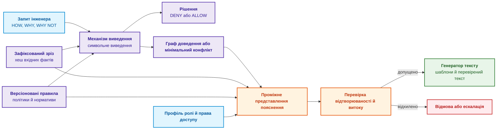
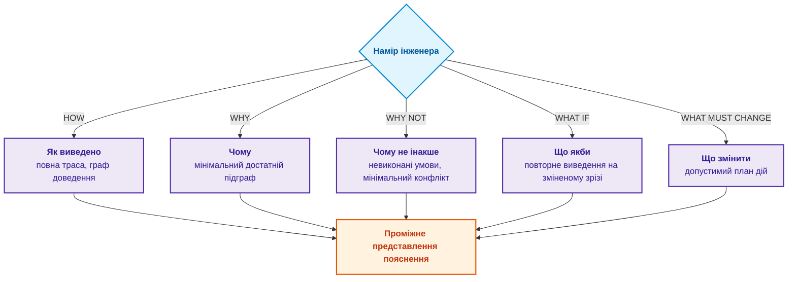
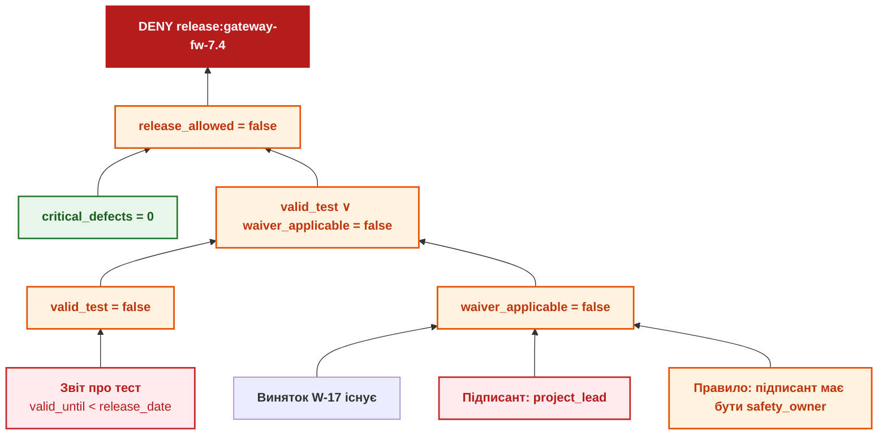
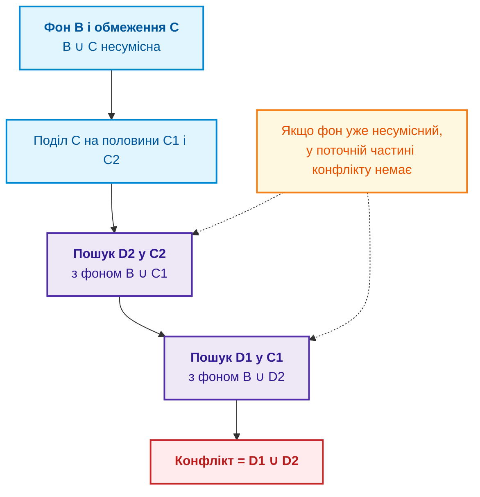
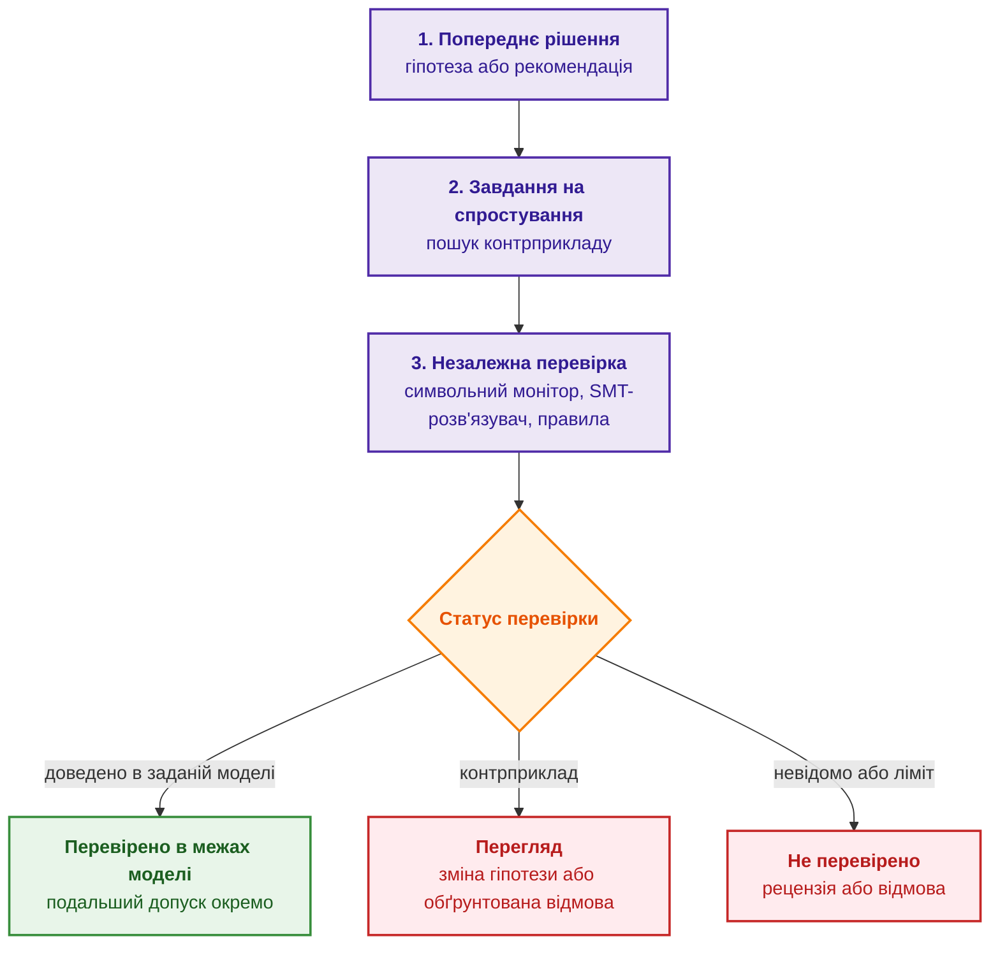
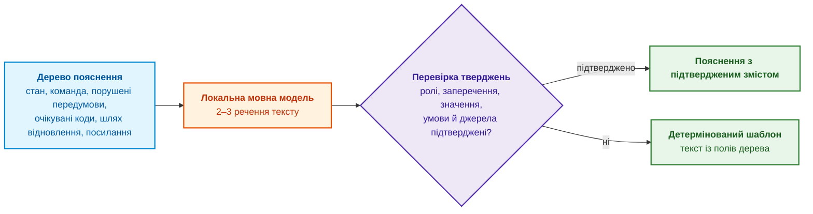

# Глава 20. Рушій пояснень: рішення, відмова та межі компетентності

> **Книга:** [Архітектура доказових експертних систем](README.md) · [Частина IV: Архітектура системи, нормативне виведення, діагностика та пояснення](part-04-architecture-and-inference.md)
> **Попередня глава:** [Глава 24. Технічна діагностика: як не сплутати симптом із першопричиною в умовах неповноти](ch24-system-diagnosis.md)
> **Наступна глава:** [Глава 23. Верифікація бази знань: як перевірити несуперечливість, повноту та надійність правил](ch23-knowledge-base-verification.md)
> **Зміст книги:** [README.md](README.md)  
> **Автор:** [Микола Федчик](about-the-author.md)  
> **Рівень складності та оптимальне вивчення:** `[L1]` Базовий інженерно-концептуальний (індекс Д. Кнута `[18]`) · *Маршрут:* `Трек A` (побудова та захист дерев пояснень Чому/Як); 1 прохід  
> **Очікувані результати:** проєктувати рушій пояснень, що працює над тією самою трасою виведення, що й рішення; розрізняти п'ять типів пояснювальних запитів (HOW, WHY, WHY NOT, WHAT IF, WHAT MUST CHANGE); знаходити мінімальний конфлікт обмежень алгоритмом QuickXPlain; формулювати контрфактичні пояснення й допустимі дії з урахуванням повноважень; маскувати в поясненнях закриту інформацію; поєднувати природномовне пояснення з детермінованою перевіркою.

---

## Анотація

У главі досліджено архітектуру та математичні засади рушія пояснень (*explanation engine*) у доказових експертних системах. Обґрунтовано концепцію пояснення як окремого детермінованого артефакту, обчислюваного безпосередньо з траси виведення (зрізу фактів, версій правил та дерева доведення), а не у формі постфактум-раціоналізації мовною моделлю (*post-hoc rationalization*). Систематизовано п'ять типів пояснювальних запитів: HOW (повна траса), WHY (мінімальний достатній підграф), WHY NOT (мінімальний конфлікт), WHAT IF (контрфактичне моделювання) та WHAT MUST CHANGE (синтез допустимого плану дій). Наведено строгу реалізацію алгоритму знаходження мінімального конфлікту обмежень QuickXPlain мовою Go. Запропоновано приклад інструмента покрокової інтроспекції, візуалізації стану логічного рушія, семантичних точок зупинки та часового відкату через кільцевий буфер дельта-кадрів. Визначено протоколи захисту від витоку конфіденційної інформації (рольова фільтрація, маскування, верифікація залишків), критерії розпізнавання меж компетентності та чотириетапний протокол перевірки пояснень.

---

Уявімо, що експертна система заблокувала реліз прошивки мережевого шлюзу. Журнал фіксує машинний статус `decision=DENY`, а діалоговий асистент пояснює: *«Ризик перевищує допустимий рівень безпеки»*. Відповідь звучить правдоподібно, але для інженера марна, бо не відповідає на робочі запитання:

- Яке саме правило спрацювало?
- Які вхідні факти стали вирішальними?
- Чому підписаний виняток (*waiver*) не застосовано?
- Яких даних забракло для статусу `ALLOW`?
- Чи зміниться рішення після повторного випробування?

Згідно з розробленою автором **концепцією епістемічної неспроможності постфактум-раціоналізації (Post-Hoc Rationalization Fallacy)**, пояснення в доказовій експертній системі не може бути стохастичною оповіддю, яку мовна модель конструює після ухвалення рішення. Ще Вільям Кленсі, аналізуючи пояснення медичної експертної системи MYCIN, показав, що трасування спрацьованих правил саме по собі не пояснює рішення: для пояснення потрібні також знання про те, чому правила такі, і про стратегію їх застосування [[1]](#src-1). Тім Міллер, узагальнивши дослідження з соціальних наук, показав, що люди ставлять контрастні запитання («чому P, а не Q?») і очікують кількох відібраних причин, а не повного переліку [[2]](#src-2).

Ця глава відповідає на запитання: **як експертна система має пояснювати рішення, відмову й межі компетентності так, щоб пояснення можна було перевірити?** Автором сформульовано **фундаментальний інженерний принцип детермінованого ізоморфізму рішення та пояснення**: пояснення є окремим інженерним артефактом, який детерміновано обчислюється з тієї самої траси виведення, що й рішення: зрізу фактів, версій правил і графа доведення. Будь-яка зміна в поясненні повинна строго відповідати зміні в трасі, виключаючи розбіжність між внутрішньою логікою резолюції та зовнішньою аргументацією. Різні запитання потребують різних обчислень: повної траси, мінімального достатнього підграфа, мінімального конфлікту, повторного прогону чи пошуку допустимої дії. Мовна модель може лише озвучити перевірене пояснення, але не додати до нього причин.

## 1. Пояснення як окремий інженерний артефакт

Згідно з **архітектурною концепцією рушія пояснень як незалежного проєкційного шару за моделлю автора**, у загальній структурі доказової експертної системи рушій пояснень (*explanation engine*) функціонує як незалежний проєкційний шар між символьним ядром виведення (*Inference Engine*), версіованою базою знань та підсистемою аудиту безпеки. Якщо в дослідницьких прототипах поясненням часто нехтують або зводять його до простого виклику генеративної нейромережі, то в mission-critical системах (функціональна безпека ISO 26262, стандарти DO-178C, медичні діагностичні комплекси) відсутність детермінованого зв'язку між вердиктом і його обґрунтуванням призводить до повної втрати сертифікаційної довіри. Спроба довірити генерацію пояснення сторонній мовній моделі (*post-hoc rationalization*) неминуче спричиняє епістемічну катастрофу: модель вигадує правдоподібні, але неіснуючі технічні чинники, ігноруючи реальні передумови спрацювання правил. Водночас наївна роздруківка «сирого» журналу правил перевантажує інженера тисячами проміжних резолюційних кроків. Доказове пояснення зобов'язане бути самостійним, математично верифікованим інженерним артефактом, що компілюється виключно із зафіксованого зрізу фактів (*snapshot*), точних версій нормативів та незмінного графа доведення. Діаграма показує, як ці артефакти перетворюються на перевірене пояснення.



**Специфікація проміжного представлення пояснення ($`\mathrm{EIR}`$ — Explanation Intermediate Representation) М. Федчика** відокремлює формальний логічний зміст пояснення від природної мови, якою його подано, фіксуючи типізовану ациклічну структуру символьних даних. Тут діє сформульований автором **принцип вербалізаційної пасивності генеративних мовних моделей у доказових трактах**: мовна модель позбавлена права на висунення власних гіпотез і виконує суто проєкційну функцію перетворення перевірених фактів $`\mathrm{EIR}`$ на текст за строгими граматиками; додавати сторонні непідтверджені причини чи модифікувати логіку доведення їй категорично заборонено. Пояснення прив'язане до зафіксованого рішення, контракт якого виглядає так:

<details>
<summary>Структуровані дані JSON</summary>

```json
{
  "decision_id": "dec:gateway-fw-7.4:9f1c",
  "decision": "DENY",
  "subject": "release:gateway-fw-7.4",
  "snapshot_hash": "sha256:<хеш зрізу вхідних фактів>",
  "knowledge_version": "kb:release-policy@v7.3",
  "policy_version": "authz-rules@v12",
  "proof_root": "proof:tree:4711",
  "evaluated_at": "2026-09-27T10:15:00Z"
}
```

</details>


Без закріплених залежностей і версій повторення рішення може бути неможливим. Водночас сам хеш або корінь графа не встановлює юридичного статусу: він залежить від застосовних процедур, повноважень і вимог. Автором сформульовано **інженерний принцип демаркації кореляційної важливості ознак та дедуктивного доведення**: статистичні методи на кшталт SHAP оцінюють внесок ознак у передбачення емпіричної моделі [[3]](#src-3), проте показники важливості ознак (*Feature Attribution*) фіксують лише кореляційні залежності чорних скриньок і в принципі не є дедуктивними доведеннями; вони корисні для евристичного аналізу, але не мають сертифікаційної сили в регуляторному аудиті рішень за правилами.

> [!NOTE]
> **Чотири структурні виміри авторської картки доказового експертного висновку**
> 1. Семантична диспозиція нормативного допуску: однозначний вердикт детермінованого ядра (прийнято, типізована відмова, уточнення) із фіксацією системного коду завершення та кількості виконаних тактів процесора логічного виведення.
> 2. Деонтична модальність вимоги: формальне виділення нормативного статусу положення (обов'язково [MUST], рекомендовано [SHOULD], дозволено [MAY]), що виключає двозначність інженерної інтерпретації.
> 3. Побайтова кастодія першоджерела: криптографічно верифіковані байтові межі фрагмента у відображеній спільній пам'яті разом із контрольним гешем SHA-256, що унеможливлює підміну тексту в процесі обробки.
> 4. Дослівна цитата першоджерела у незмінному контейнері: повне виключення генеративного парафразування на користь точного фрагмента оригінального нормативного акта чи технічного стандарту.
> *Керування рантаймом / Інженерний інваріант:* Інтерфейс експертної системи зобов'язаний блокувати довільну вербалізацію, якщо побайтова кастодія фрагмента не пройшла валідацію цілісності.

## 2. Типологія пояснювальних запитів (HOW, WHY, WHY NOT, WHAT IF, WHAT MUST CHANGE)

Інженерні ролі, що взаємодіють з експертною системою, висувають принципово різні вимоги до структури та глибини обґрунтування: аудитору сертифікаційного органу потрібне лаконічне підтвердження нормативної відповідності, розробнику механізму виведення — вичерпний ланцюг уніфікації змінних, а інженеру-експлуатаційнику — практичний алгоритм подолання блокування. Наївна спроба відповідати на всі запити універсальним текстовим описом або єдиним шаблоном «чому?» зазнає краху в реальному виробництві: вона або перевантажує персонал надлишковими подробицями під час аварійної зупинки, або приховує критичні передумови відмови. Доказова архітектура розмежовує п'ять спеціалізованих класів пояснювальних запитів, кожен з яких спирається на окрему обчислювальну процедуру над графом знань та трасою виведення. Діаграма систематизує ці запити та зіставляє їх із відповідними обчислювальними механізмами.



Таблиця уточнює, кому потрібен кожен тип і що саме обчислює експертна система.

| Запит | Цільова аудиторія | Що обчислює експертна система | Результат |
|---|---|---|---|
| **HOW** | Розробники механізму виведення, верифікатори | Повну трасу: усі спрацьовані правила й проміжні предикати | Повний граф доведення |
| **WHY** | Аудитори, сертифікаційні органи | Мінімальний набір фактів, достатній для вердикту | Достатній підграф доведення |
| **WHY NOT** | Автори релізу, інженери | Чому бажаний результат `ALLOW` не виведено | Невідома передумова, невиконана умова або конфлікт; мінімізація лише за встановленої несумісності |
| **WHAT IF** | Аналітики ризиків, архітектори | Що станеться після зміни окремих вхідних фактів | Повторне виведення на дочірньому зрізі |
| **WHAT MUST CHANGE** | Інженери-виконавці | Які допустимі зміни можуть забезпечити бажаний результат у моделі | Умовний план із перевіркою результатів; критерій вартості задано явно |

У цьому контексті автором виділено **інженерний принцип семантичної контрастивності діагностики відмов**: запити WHY NOT і WHAT MUST CHANGE мають фундаментальну контрастивну природу (за концепцією Т. Міллера [[2]](#src-2)), де питання інженера полягає не в констатації причин блокування, а у формальній локалізації дельти між фактичним станом (`DENY`) та очікуваним цільовим станом (`ALLOW`), що визначає мінімальний вектор необхідних інженерних коригувань. Наступні розділи показують кожен тип запиту на одному прикладі.

> [!NOTE]
> **П'ять класів пояснювальних запитів у доказовій архітектурі за моделлю автора**
> 1. HOW: побудова повного ізоморфного графа доведення з усіма активованими правилами та лемами для верифікаторів ядра.
> 2. WHY: виділення мінімального достатнього підграфа доведення, що обґрунтовує стверджувальний вердикт для сертифікаційного аудиту.
> 3. WHY NOT: детерміноване обчислення мінімального ядра конфлікту (MUC) за алгоритмом QuickXPlain при блокуванні цільового стану.
> 4. WHAT IF: симуляційне повторне виведення на ізольованому дочірньому зрізі даних зі зміненими гіпотетичними параметрами.
> 5. WHAT MUST CHANGE: генерація сертифікованого плану дій (Actionable Recourse) із мінімізацією вартості інженерних змін.
> *Керування рантаймом:* Запит непідтримуваного типу або із суперечливим контрактом відхиляється шлюзом інтерпретації з кодом E_INVALID_EXPLANATION_QUERY.

## 3. Граф доведення та трасування висновків

Побудова графа доведення (*proof graph*) є фундаментальним механізмом трасування, що перетворює процес символьного виведення на прозорий орієнтований ациклічний граф взаємозв'язку фактів, логічних зв'язок та проміжних лем. У промислових конвеєрах випуску прошивок та вбудованого ПЗ нехтування формальним трасуванням призводить до ситуацій, коли реліз блокується без чіткого зазначення невиконаних інженерних критеріїв, змушуючи розробників діяти навмання. Тривіальний лінійний лог виведення не відображає розгалуження альтернативних гілок (наприклад, заміни випробувань погодженим винятком), маскуючи справжній корінь проблеми. 

Для формалізації процесу допуску розглянемо предикатну модель оцінки готовності релізу прошивки мережевого шлюзу. Умова допуску виражається замкненим логічним рівнянням над вектором параметрів безпеки:

```math
\mathrm{release\_allowed} \Leftrightarrow (\mathrm{valid\_test} \lor \mathrm{waiver\_applicable}) \land (\mathrm{critical\_defects} = 0)
```

Де параметри формули мають суворе інженерне визначення:
- $`\mathrm{release\_allowed} \in \{0, 1\}`$ — детермінований булевий результат процедури перевірки ($1$ — дозвіл на випуск, $0$ — блокування релізу);
- $`\mathrm{valid\_test} \in \{0, 1\}`$ — факт наявності чинного звіту про випробування на функціональну безпеку ($`\text{valid\_until} \ge \text{release\_date}`$);
- $`\mathrm{waiver\_applicable} \in \{0, 1\}`$ — факт наявності легітимного винятку, підписаного авторизованим офіцером безпеки ($`\text{signatory} = \text{safety\_owner}`$);
- $`\mathrm{critical\_defects} \in \mathbb{N}_0`$ — кількість виявлених незакритих дефектів критичного рівня (Static Analysis / Penetration Testing);
- $\lor, \land, \Leftrightarrow$ — булеві операції диз'юнкції, кон'юнкції та матеріальної еквівалентності замкненої нормативної політики.

**Практичне застосування та інженерні висновки:**
1. **Точка виклику в життєвому циклі:** Розрахунок викликається автоматизованим шлюзом допуску релізу (Release Gate) конвеєра CI/CD перед підписанням бінарного образу криптографічним ключем релізу.
2. **Інтерпретація числових результатів:** Значення $`\mathrm{release\_allowed} = 1`$ формує криптографічний сертифікат допуску. Значення $`\mathrm{release\_allowed} = 0`$ негайно переводить шлюз у стан блокування (`DENY`).
3. **Реакція системи:** Замість скидання загальної помилки рушій пояснень проєктує підграф доведення, детерміновано виокремлюючи гілки, що дали хибу (`valid_test = false` через прострочений термін дії та `waiver_applicable = false` через невідповідність ролі підписанта `project_lead` замість `safety_owner`). Умова $`\mathrm{critical\_defects} = 0`$ хоч і є істинною, вилучається з мінімального пояснення відмови WHY, оскільки вона не була причиною блокування.

У зрізі фактів зафіксовано: звіт про тестування прострочений (`valid_until < release_date`), виняток W-17 існує, але підписаний керівником проєкту (роль `project_lead`), критичних дефектів немає. Діаграма показує граф доведення рішення DENY.



Граф читається знизу вгору. Кожна з двох гілок окремо не пояснює відмови: якби звіт був чинним, реліз дозволили б навіть без винятку, і навпаки. Тому відповідь на запит WHY містить обидві гілки. Тут безпосередньо реалізується **алгоритмічне правило селективної редукції виконаних умов М. Федчика (WHY Pruning Rule)**: при формуванні мінімального пояснення відмови (запит $`\mathrm{WHY}`$) із графа доведення усуваються всі істинні кон'юнкти нормативної формули, які не спричинили блокування (як-от умова $`\mathrm{critical\_defects} = 0`$), залишаючи лише диз'юнктивний базис хибних передумов для фокусування уваги інженера. Для запиту HOW експертна система додає до цього повну трасу з версіями правил і хешами фактів. Інтерфейс аудитора може показувати ту саму трасу у вигляді дерева:

<details>
<summary>Дані або результат прикладу</summary>

```text
[ЦІЛЬ] release_allowed = false
├── [ПРАВИЛО] release_allowed ⇐ (valid_test ∨ waiver_applicable) ∧ critical_defects = 0
├── [ГІЛКА 1] valid_test = false
│   └── [ФАКТ] TestReport-7.4: valid_until = 2026-08-01 < release_date = 2026-09-27
├── [ГІЛКА 2] waiver_applicable = false
│   ├── [ПРАВИЛО] виняток чинний лише з підписом ролі safety_owner
│   └── [ФАКТ] W-17 підписано роллю project_lead
└── [ФАКТ] critical_defects = 0 (умову виконано)
```

</details>


Експертна система не висуває гіпотез на кшталт «прошивка зламає мережу», а констатує, яку умову формальної політики не виконано і на яких фактах це ґрунтується. Діє **інженерний інваріант побайтової доказовості та криптографічного замикання графа доведення за стандартом автора**: кожен факт і вузол дерева доведення зобов'язаний містити пряме побайтове посилання на першоджерело в базі знань (хеш `passage-id`), а весь граф сертифікується асиметричним цифровим підписом Ed25519 (як описано у [Главі 15](ch15-knowledge-extraction-and-kb-construction.md)), що гарантує юридичну неспростовність та цілісність ланцюга аудиту.

### 3.1. Інтерактивне налагодження інструкцій логічного виведення: безпобічна інтроспекція, покрокова навігація деревами доведення та часовий відкат

У місійно-критичних експертних системах людина-оператор, інженер із функціональної безпеки чи регуляторний аудитор зобов'язані мати можливість дослідити внутрішню механіку прийняття рішення до кожного дискретного такту мікрокоду: **«Яка саме інструкція виведення, факт чи виняток призвели до відхилення дії або блокування релізу?»**. Традиційні низькорівневі зневаджувачі коду (GDB, LLDB) оперують машинними регістрами загального призначення та пам'яттю стеків операційної системи, абсолютно не розуміючи епістемічної семантики логічного виведення, структури дерев доведення, дефітерів чи байтових цитат першоджерел.

Водночас створення спеціалізованих налагоджувачів інструкцій логічного виведення часто наштовхується на **тріаду потенційних дефектів низькорівневого налагодження символьних середовищ**:
1. **Мутація стану при покроковому виконанні (Stepping Side-Effects):** наївна реалізація покрокового виконання (`Step()`) незворотно модифікує контекст пам'яті виведення, позбавляючи аудитора можливості чистого відкату назад (Rewind/Undo) для дослідження розгалуження гіпотез;
2. **Вразливість перед некоректним або ворожим байткодом:** вихід лічильника команд `EPC` за межі сегмента без перевірки може спричинити падіння хоста замість контрольованого зупину `HALT_FAULT`;
3. **Розбіжність реалізацій:** програмна модель і цільовий рушій можуть по-різному трактувати статусні прапорці; це потрібно перевіряти на визначених тестових векторах, а не припускати фізичну еквівалентність.


Для усунення цих дефектів автором запропоновано комплексний архітектурний шаблон епістемічного налагоджувача для інструкцій виведення знань [[10]](#src-10):

#### 3.1.1. Безпобічна покрокова інтроспекція з детерміністичним відкатом (Time-Travel Introspection)

Для базового профілю без інструкцій виклику й повернення, визначеного в [Главі 22, §10.1.2](ch22-cybernetics-edge-to-backend.md#1012-нормативний-версійований-профіль-інструкцій), навігація складається з `Step` і `StepBack`, а `TreeView` лише показує дерево доведення. Команди `StepOver` і `StepOut` до цього профілю не належать. Один крок `Step` описується транзакційним переходом із записом різницевого дельта-кадру в кільцевий журнал пам'яті (*Delta Frame Log*):

```math
\mathcal{S}_{t+1} = \mathrm{Step}(\mathcal{S}_t), \quad \Delta_t = \mathcal{S}_{t+1} \ominus \mathcal{S}_t, \quad \mathcal{S}_t = \mathrm{StepBack}(\mathcal{S}_{t+1}, \Delta_t)
```

Параметри та математичні компоненти формули:
- $`\mathcal{S}_t`$ — повний архітектурний стан на кроці $t$ за Главою 22, §10.1.2: регістри, `EPC`, `EFLAGS`, `HALT`, `REASON`, `ProofTreeHash` і змінювані комірки даних, якщо інструкції профілю дозволяють запис. Стек викликів не припускається, оскільки цей профіль не має викликів і повернень;
- $`\mathrm{Step}(\mathcal{S}_t)`$ — детермінована функція виконання однієї інструкції мікрокоду виведення;
- $`\Delta_t`$ — різницевий кадр з адресами й попередніми значеннями всіх змінених регістрів, прапорців і комірок, включно з полями зупину та гешем дерева;
- $\ominus$ — оператор побудови орієнтованої різниці зі збереженням попередніх значень, не лише множини змінених позицій;
- $`\mathrm{StepBack}(\mathcal{S}_{t+1}, \Delta_t)`$ — запропонована операція відновлення за збереженим кадром. Її вартість становить $`O(m_t)`$, де $`m_t \ge 0`$ є кількістю байтів відновлюваних даних і метаданих. Оцінка $O(1)$ щодо довжини програми допустима лише за фіксованої профілем верхньої межі розміру кадру. Реалізацію й тотожність відновлення потрібно перевірити тестовими векторами.

#### 3.1.2. Візуалізація стану логічного рушія та статусних прапорців

Інтерфейс інтроспекції транслює стан ядра у типізоване інженерне подання:
- **Епістемічні регістри даних ($`R_0 \dots R_7`$):** відображають сутності онтології, числові значення у форматі фіксованої коми Q16.16 та довірчі інтервали свідчень;
- **Лічильник інструкцій (`EPC`):** покажчик на поточну інструкцію за профілем Глави 22 §10.1.2;
- **Статусні прапорці ядра:** `ZF = 1` після порівняння означає рівність, після перевірки межі означає `PASS`; початковий `ZF = 0` означає відсутність доведення. `UF = 1` позначає порушення допуску або арифметичне переповнення, `DF = 1` позначає активну скасовувальну норму, `CF = 1` позначає успішну перевірку криптографічної прив'язки. Значення визначає остання інструкція, що записала прапорець, а не універсальне тлумачення будь-якого знімка як вердикту;
- **Інтерактивне дерево дефітерів (Defeater Proof Tree):** візуалізація конкурентних правил із підсвічуванням точної норми, яка заблокувала дію.

#### 3.1.3. Стійкість до апаратних виключень (Panic-Proof Sandbox)

При виявленні невалідного коду операції, виході за межі адресації або спробі ділення на нуль налагоджувач переводить ядро у захищений стан останова `HALT_FAULT` із збереженням повного діагностичного дампу пам'яті, унеможливлюючи аварійне падіння хост-процесу.

#### 3.1.4. Дія та замкнений цикл інженерного налагодження мікрокоду виведення

1. **Керування рантаймом і потоком обчислень (Control Flow & Runtime Decisions):**
   - Аудитор встановлює семантичні точки зупину (Semantic Breakpoints) за логічними предикатами: наприклад, зупинка при активації будь-якого дефітера (`BREAK ON flag(DF) == 1`) або падінні довіри нижче порогу (`BREAK ON confidence < 0.85`).
   - При спрацюванні точки зупину конвеєр виведення заморожується в стані `HALT_STEP`. Інженер виконує покроковий відкат `StepBack()`, витягуючи дельти $`\Delta_t`$ із кільцевого буфера, щоб виявити, який саме факт або підписант винятку викликав підняття прапорця $`\mathrm{DF}`$.
2. **Апаратний сайзинг та інфраструктурні обмеження (Hardware Dimensioning):**
  - Кільцевий буфер розміщується у статично виділеній BRAM або попередньо виділених резидентних сторінках пам'яті; кешування L2/L3 саме по собі не гарантує резидентності. Приклад $`S_{\Delta} = 128\,\text{байтів}`$ придатний лише для профілю, в якому всі попередні значення й метадані одного кроку вміщуються в такий кадр. Переповнення кадру має блокувати крок до мутації, а не обрізати журнал.
  - Для глибини $`K_{\mathrm{rewind}} = 1024`$ і такого профілю потрібно $`1024 \times 128 = 131\,072`$ байтів під кадри, окремо від службових індексів. Статичний буфер не доводить відсутності інших алокацій; ціль $`T_{\mathrm{stepback}} < 25\,\text{нс}`$ потребує вимірювання або обґрунтованої межі WCET на визначеній платформі й тут не заявляється досягнутою.
3. **Практичний числовий приклад (Worked Numerical Example):**
  - Синтетичний приклад: умовна система заблокувала випуск мережевого шлюзу через невідповідну роль підписанта.
  - Аудитор відкриває знімок стану в інструменті інтроспекції та встановлює точку зупинки на прапорці дефетера (`BREAK ON flag(DF) == 1`). Під час прогону зупинка спрацьовує на умовній інструкції `i_stop`: прапорці показують активний дефетер і відсутність дозволу.
  - Аудитор натискає `StepBack()`. Система відновлює попередній стан за дельта-кадром; журнал показує, що попередня інструкція перевірила метадані винятку й виявила роль `project_lead` замість потрібної `safety_owner`. Це демонструє спосіб навігації, але не є результатом реального стендового вимірювання.

> [!NOTE]
> **Чотири інваріанти апаратного трасування та налагодження мікрокоду виведення за архітектурою автора**
> 1. Формування кільцевого буфера дельта-кадрів ($`\Delta_t`$) фіксованого розміру для детермінованого покрокового зворотного ходу `StepBack()`.
> 2. Апаратна фіксація статусних прапорців ядра ($`\mathrm{ZF}, \mathrm{UF}, \mathrm{DF}, \mathrm{CF}`$) на кожному такті виконання мікроінструкцій виведення.
> 3. Розміщення журнала відкату у статично виділеній BRAM або попередньо виділених резидентних сторінках; відсутність інших алокацій перевіряється окремо.
> 4. Миттєве переведення ядра в захищений стан `HALT_FAULT` при виході за межі адресації або невалідних кодах операцій.
> *Керування рантаймом:* Спроба відкату за межі виділеного буфера дельт блокується збудженням виключення E_DEBUG_RING_BUFFER_UNDERFLOW.

## 4. Обчислення відмов WHY NOT: мінімальний конфлікт та алгоритм QuickXPlain

Діагностика відмов у багатозв'язних системах (наприклад, у конфігураціях бортової авіоніки або розподілених підсистемах SCADA) потребує точної ідентифікації причини, чому бажаний цільовий стан $G$ не може бути досягнутий. Якщо в тривіальних випадках інженер може переглянути одне чи два правила вручну, то в реальних системах діють сотні перехресних вимог (таймінги шин, теплові бюджети, версії бібліотек, залежності пакетів). Наївний підхід — повідомити користувачеві «вимоги несумісні» або вивантажити повний перелік усіх 500 обмежень — паралізує діагностику та збільшує середній час відновлення системи (MTTR) до неприпустимих меж. Інженеру потрібен строго мінімальний конфлікт (*minimal conflict*, або мінімальне ядро несумісності, *Minimal Unsatisfiable Core*, MUC) — найменша за включенням підмножина вимог, яка робить систему суперечливою.

Формально для несуперечливої бази фонових знань $K$ і скінченної множини операційних обмежень $C$ ядро конфлікту визначається як:

```math
\mathrm{Core} \subseteq C, \quad K \cup \mathrm{Core} \vdash \bot, \quad \forall C' \subsetneq \mathrm{Core} : K \cup C' \nvdash \bot
```

Де складові виразу мають строго визначений зміст:
- $K$ — база непорушних фонових знань (аксіоми предметної області, фізичні закони, системні інваріанти), що апріорі є сумісною ($K \nvdash \bot$);
- $`C = \{c_1, c_2, \dots, c_n\}`$ — множина варійованих операційних обмежень або цільових вимог, висунутих користувачем чи середовищем;
- $`\mathrm{Core} \subseteq C`$ — виділена конфліктна підмножина обмежень;
- $\vdash$ — відношення формальної логічної вивідності;
- $\bot$ — логічна суперечність (хиба, стан `UNSAT`);
- $`C' \subsetneq \mathrm{Core}`$ — довільна строга власна підмножина знайденого ядра;
- $\forall$ — квантор загальності, що фіксує умову неподільності ядра (жоден елемент не є надлишковим).

**Практичне застосування та інженерні висновки:**
1. **Точка виклику в життєвому циклі:** Процедура ізоляції ядра активується диспетчером виведення під час обробки запиту WHY NOT або при виникненні стану несумісності конфігурації.
2. **Інтерпретація результату:** Знайдена множина $`\mathrm{Core}`$ означає, що система обмежень є несумісною, але усунення хоча б одного елемента $`c \in \mathrm{Core}`$ гарантовано відновлює сумісність залишку.
3. **Реакція системи:** Рушій пояснень не пропонує випадкових евристик, а локалізує конфлікт у термінах мінімального ядра. Це дозволяє ранжувати обмеження всередині $`\mathrm{Core}`$ за інженерною вартістю відхилення (relaxation cost) та формувати точний перелік альтернативних рішень.

Найпростіший спосіб знайти мінімальний конфлікт полягає в тому, щоб видаляти обмеження по одному й залишати видалення, якщо множина лишається несумісною. Цей спосіб потребує стільки перевірок сумісності, скільки є обмежень. Ульріх Юнкер запропонував алгоритм QuickXPlain, який ділить множину обмежень навпіл і рекурсивно шукає конфлікт у половинах, накопичуючи вже знайдені елементи конфлікту як фон [[4]](#src-4). За поділу навпіл QuickXPlain у гіршому випадку потребує $`2k \log_2(n/k) + 2k`$ перевірок сумісності, де $n$ є кількістю обмежень, а $k$ розміром конфлікту. Діаграма показує один крок рекурсії.



> [!TIP]
> **Три інженерні фактори переваги QuickXPlain над лінійним пошуком у бортовій діагностиці LRU/ECU за розрахунком автора**
> 1. **Умовне порівняння викликів оракула:** за $n = 500$, $k = 3$ та припущення однакової латентності 150 мс на кожен виклик лінійний перебір із 500 перевірок арифметично становить 75 с. Формула $`2k \log_2(n/k) + 2k`$ дає близько 50 викликів QuickXPlain; це оцінка кількості викликів, а не вимірювання часу.
> 2. **Часовий бюджет:** за того самого спрощеного припущення 50 викликів по 150 мс становлять близько 7,5 с. Це не гарантує дедлайн реального часу й не доводить запобігання зриву сторожового таймера: потрібне вимірювання повного шляху на цільовій платформі.
> 3. **Межа системного висновку:** перехід від 500 до приблизно 50 викликів дає близько 10-кратного скорочення їх кількості в цьому розрахунку. Він сам по собі не доводить зменшення навантаження шини ARINC-429 або CAN чи відсутність деградації зв'язку.
> *Керування рантаймом:* $n \ge 50$ є запропонованою умовою вибору кандидата QuickXPlain, а $`\tau_{\text{diag\_budget}} \le 10\,\text{с}`$ — цільовим бюджетом конкретного профілю; досягнення бюджету перевіряють вимірюванням, а не кількістю викликів.

Програма мовою Go порівнює обидва способи на задачі планування релізу. Змінні задачі є днями тесту ($t$), завершення документації ($d$) і релізу ($r$) у межах від 0 до 20. Перевірка сумісності перебирає всі розклади, тож на великих задачах її замінює розв'язувач SAT чи SMT. Серед обмежень є три, що разом несумісні: лабораторія вільна лише з 10-го дня, замовник вимагає реліз не пізніше 12-го дня, а після тесту потрібно п'ять днів стабілізації. Решта обмежень стосується документації й нічому не заважає. Програма запускає пошук для 8 і для 200 обмежень.

<details>
<summary>Приклад мовою Go: мінімальний конфлікт обмежень методами QuickXPlain і видалення по одному</summary>

```go
package main

import "fmt"

// Constraint є обмеженням на дні тесту (t), документації (d) і релізу (r).
type Constraint struct {
	Name string
	Ok   func(t, d, r int) bool
}

var checks int

// consistent шукає хоча б один розклад у межах 0..20 днів, що задовольняє всі обмеження.
func consistent(cs []Constraint) bool {
	checks++
	for t := 0; t <= 20; t++ {
		for d := 0; d <= 20; d++ {
			for r := 0; r <= 20; r++ {
				all := true
				for _, c := range cs {
					if !c.Ok(t, d, r) {
						all = false
						break
					}
				}
				if all {
					return true
				}
			}
		}
	}
	return false
}

func join(a, b []Constraint) []Constraint {
	return append(append([]Constraint{}, a...), b...)
}

// qx є рекурсивною частиною QuickXPlain (Junker, 2004).
func qx(b, delta, c []Constraint) []Constraint {
  if len(c) == 0 {
    return nil
  }
	if len(delta) > 0 && !consistent(b) {
		return nil
	}
	if len(c) == 1 {
		return c
	}
	k := len(c) / 2
	c1, c2 := c[:k], c[k:]
	d2 := qx(join(b, c1), c1, c2)
	d1 := qx(join(b, d2), d2, c1)
	return join(d1, d2)
}

func quickXPlain(background, candidates []Constraint) ([]Constraint, error) {
  if !consistent(background) {
    return nil, fmt.Errorf("background is inconsistent")
  }
  if consistent(join(background, candidates)) {
    return nil, nil
  }
  return qx(background, nil, candidates), nil
}

// deletion видаляє обмеження по одному, доки множина лишається несумісною.
func deletion(c []Constraint) []Constraint {
	core := append([]Constraint{}, c...)
	for i := 0; i < len(core); {
		rest := join(core[:i], core[i+1:])
		if !consistent(rest) {
			core = rest
		} else {
			i++
		}
	}
	return core
}

func names(cs []Constraint) []string {
	var s []string
	for _, c := range cs {
		s = append(s, c.Name)
	}
	return s
}

func main() {
	core := map[int]Constraint{
		17:  {"лабораторія вільна з 10-го дня: t >= 10", func(t, d, r int) bool { return t >= 10 }},
		101: {"дедлайн замовника: r <= 12", func(t, d, r int) bool { return r <= 12 }},
		188: {"стабілізація після тесту: r >= t + 5", func(t, d, r int) bool { return r >= t+5 }},
	}
	for _, n := range []int{8, 200} {
		var cs []Constraint
		for i := 0; i < n; i++ {
			pos := i
			if n == 8 {
				pos = []int{0, 17, 1, 101, 2, 3, 188, 4}[i]
			}
			if c, ok := core[pos]; ok {
				cs = append(cs, c)
				continue
			}
			j := i % 4
			cs = append(cs, Constraint{fmt.Sprintf("документація: d >= %d", j), func(t, d, r int) bool { return d >= j }})
		}
		checks = 0
    conflict, err := quickXPlain(nil, cs)
    if err != nil {
      panic(err)
    }
		qxChecks := checks
		checks = 0
		del := deletion(cs)
		fmt.Printf("n = %d, перевірок сумісності: QuickXPlain %d, видалення по одному %d\n", n, qxChecks, checks)
		fmt.Printf("  конфлікт: %q\n", names(conflict))
    fmt.Printf("  збігається з результатом видалення: %v\n", fmt.Sprint(names(conflict)) == fmt.Sprint(names(del)))
	}
}
```

Перевірка контракту й мінімальності не залежить від кількості викликів; виконання: `go test -v main.go main_test.go`.

```go
package main

import "testing"

func TestQuickXPlainContract(testCase *testing.T) {
  if result, err := quickXPlain(nil, nil); err != nil || len(result) != 0 {
    testCase.Fatalf("empty set: %v, %v", result, err)
  }
  compatible := []Constraint{{Name: "nonnegative test day",
    Ok: func(testDay, documentationDay, releaseDay int) bool { return testDay >= 0 }}}
  if result, err := quickXPlain(nil, compatible); err != nil || len(result) != 0 {
    testCase.Fatalf("compatible set reported as conflict: %v", err)
  }
  candidates := []Constraint{
    {Name: "lab", Ok: func(testDay, documentationDay, releaseDay int) bool { return testDay >= 10 }},
    {Name: "deadline", Ok: func(testDay, documentationDay, releaseDay int) bool { return releaseDay <= 12 }},
    {Name: "stabilization", Ok: func(testDay, documentationDay, releaseDay int) bool { return releaseDay >= testDay+5 }},
    compatible[0],
  }
  conflict, err := quickXPlain(nil, candidates)
  if err != nil || len(conflict) != 3 || consistent(conflict) {
    testCase.Fatalf("invalid conflict: %v, %v", names(conflict), err)
  }
  for index := range conflict {
    if !consistent(join(conflict[:index], conflict[index+1:])) {
      testCase.Fatal("conflict is not inclusion-minimal")
    }
  }
  if _, err := quickXPlain(candidates, compatible); err == nil {
    testCase.Fatal("inconsistent background accepted")
  }
}
```

</details>

Програма виводить:

<details>
<summary>Дані або результат прикладу</summary>

```text
n = 8, перевірок сумісності: QuickXPlain 13, видалення по одному 8
  конфлікт: ["лабораторія вільна з 10-го дня: t >= 10" "дедлайн замовника: r <= 12" "стабілізація після тесту: r >= t + 5"]
  збігається з результатом видалення: true
n = 200, перевірок сумісності: QuickXPlain 33, видалення по одному 200
  конфлікт: ["лабораторія вільна з 10-го дня: t >= 10" "дедлайн замовника: r <= 12" "стабілізація після тесту: r >= t + 5"]
  збігається з результатом видалення: true
```

</details>


Обидва способи знаходять у цьому прикладі конфлікт із трьох обмежень: тест не раніше 10-го дня й п'ять днів стабілізації суперечать релізу до 12-го дня. Обгортка додає дві перевірки передумов; загалом маємо 13 проти 8 викликів для малого набору та 33 проти 200 для великого. Це кількість звернень до оракула, не вимірювання часу й не перевага на всіх задачах. Може існувати кілька мінімальних конфліктів; мінімальність за включенням не означає найменшої кількості або вартості. Оракул прикладу точно перебирає скінченний домен. У зв'язку з цим діє **інженерне правило валідації неповноти SMT-оракула (SMT Incompleteness Warning) за стандартом безпеки автора**: при взаємодії з SMT-розв'язувачами вердикт `unknown` категорично заборонено інтерпретувати як несумісність ($\bot$), а неперевірений фон не можна передавати до QuickXPlain як сумісний; за вичерпання ліміту часу чи неповноти теорії система зобов'язана генерувати ескалацію `QUALIFIED_UNKNOWN`, блокуючи некоректну ізоляцію конфлікту.

## 5. Контрфактичні сценарії WHAT IF та пошук допустимих дій WHAT MUST CHANGE

Перехід від пасивної констатації відмови до активного подолання інженерного глухого кута вимагає дослідження альтернативних станів системи. У життєвому циклі експлуатації складних технічних комплексів інженер ставить не лише діагностичні запитання про минуле, а й прогностичні запитання про майбутнє: що станеться за зміни окремих параметрів (WHAT IF) та яка мінімальна послідовність коригувальних дій поверне систему в допустимий режим (WHAT MUST CHANGE). Наївні генеративні чи евристичні поради тут є небезпечними: порада змінити часовий штамп проведеного тесту або зменшити виміряний рівень вібрації порушує фізичну дійсність або межі повноважень персоналу. Доказовий рушій пояснень зобов'язаний спиратися на формальний апарат пошуку дієвого контрфактичного рецепта (*actionable recourse*).

Ваштер, Міттельштадт і Рассел запропонували концепцію контрфактичних пояснень для систем ухвалення рішень [[5]](#src-5). Формально задача синтезу оптимального коригувального стану $`x^*`$ формулюється як мінімізація зваженої відстані $d$ від поточного стану $x$ до множини легітимних конфігурацій:

```math
x^* = \arg\min_{x'} d(x, x') \quad \text{за умов} \quad x' \in F_{\text{feasible}} \cap F_{\text{actionable}} \cap F_{\text{authorized}},\quad D(x')=\mathrm{ALLOW}
```

Де компоненти задачі оптимізації визначаються наступним чином:
- $`x \in \mathcal{X}`$ — поточний спостережуваний вектор стану системи (зафіксований зріз фактів, параметри оточення);
- $`x' \in \mathcal{X}`$ — потенційний альтернативний стан конфігурації;
- $`x^* \in \mathcal{X}`$ — цільовий контрфактичний стан з найменшою вартістю переходу;
- $d(x, x') \in [0, +\infty)$ — інженерно калібрована функція відстані (зважена вартість інженерних змін, фінансові витрати та час переходу);
- $`F_{\text{feasible}} \subset \mathcal{X}`$ — множина фізично здійсненних станів (виключає подорожі в часі та порушення законів природи);
- $`F_{\text{actionable}} \subset \mathcal{X}`$ — множина дієвих змін (дозволяє модифікувати лише керовані параметри, виключаючи скомпільовані артефакти чи апаратні ідентифікатори);
- $`F_{\text{authorized}} \subset \mathcal{X}`$ — множина станів, досяжних у межах прав поточної ролі користувача (RBAC/ABAC мандат);
- $`D: \mathcal{X} \to \{\mathrm{ALLOW}, \mathrm{DENY}\}`$ — детермінована функція логічного виведення рішення.

**Практичне застосування та інженерні висновки:**
1. **Точка виклику в життєвому циклі:** Оптимізація запускається у відповідь на запит оператора WHAT MUST CHANGE після отримання блокувального вердикту `DENY`.
2. **Інтерпретація числових результатів:** Якщо перетин просторів допустимості порожній ($`F_{\text{feasible}} \cap F_{\text{actionable}} \cap F_{\text{authorized}} = \emptyset`$), система детерміновано фіксує недосяжність мети в поточних повноваженнях і повертає статус `NO_ACTIONABLE_PATH`. Якщо $`x^*`$ знайдено і $`d(x, x^*) \le \theta_{\text{budget}}`$ (де $`\theta_{\text{budget}}`$ — допустимий ресурсний ліміт), система синтезує план робіт.
3. **Реакція системи:** Рушій генерує сертифікований ланцюг дій (наприклад, проведення повторного регресійного тестування та отримання цифрового підпису офіцера безпеки), відкидаючи недієві чи неавторизовані кроки (наприклад, вимогу змінити дату старого протоколу).

Устун, Спенгер і Лю показали, що математично найближчий контрфакт часто недосяжний на практиці, бо змінює атрибути, на які людина не може вплинути, і запропонували шукати саме дієві зміни (*actionable recourse*) [[6]](#src-6). В експертній системі простір пошуку обмежують три множини:

1. **Фізична можливість** ($`F_{\text{feasible}}`$) виключає неможливі стани, наприклад зміну дати вже проведеного випробування.
2. **Дієвість** ($`F_{\text{actionable}}`$) залишає лише те, що людина реально може змінити: призначити повторний тест, отримати новий підпис. Незмінні атрибути, наприклад версія вже скомпільованого образу прошивки, мають нескінченну вартість зміни.
3. **Повноваження** ($`F_{\text{authorized}}`$) залишає лише дії, дозволені ролі користувача. Автор релізу не може змінити роль підписанта винятку з `project_lead` на `safety_owner`: така «порада» була б порадою підробити документ.

Для автора релізу можна запропонувати запит повторного тестування або рецензії винятку, якщо такі дії дозволені. Проте тест може завершитися невдачею, а відповідальний може відмовити в підписі. Автором сформульовано **інженерний принцип умовності контрфактуальних планів (Actionable Recourse Fallibility)**: контрфактичний план дій є суто гіпотетичною моделлю і не є детермінованим причинним доказом майбутньої успішності; фактичне виконання рекомендованої дії відбувається у зовнішньому середовищі й може завершитися невдачею, тому перехід до статусу `ALLOW` вимагає обов'язкового повторного циклу виведення над оновленим зрізом реальних фактів. Контрфактичний стан не змінює вихідних фактів і не є причинним доказом успішності дії. Водночас діє встановлене автором **інженерне правило заборони псевдо-контрфактів із фальсифікацією реквізитів**: генератору контрфактуальних дій категорично заборонено генерувати поради щодо модифікації нормативних або історичних реквізитів першоджерел (дат протоколів випробувань, прізвищ чи ролей посадових осіб); будь-яка пропозиція, що спонукає оператора до підробки нормативних атрибутів або обходу вимог безпеки, кваліфікується як критичний дефект синтезу й відхиляється.

> [!NOTE]
> **Три критерії допустимості контрфактичних пояснень за моделлю автора**
> 1. Фізична здійсненність ($`F_{\text{feasible}}`$): заборона контрфактів із порушенням причинно-наслідкових законів або незворотних часових координат (як-от зміна дати виготовлення деталі на вчора).
> 2. Інженерна дієвість ($`F_{\text{actionable}}`$): обмеження пошуку лише керованими параметрами з виключенням незмінних фізичних властивостей (як-от підвищення температури плавлення сталі на 200°C).
> 3. Нормативні повноваження ($`F_{\text{authorized}}`$): сувора валідація ролі користувача, що унеможливлює генерацію порад щодо самовільного обходу узгоджень чи підробки підписів офіцера безпеки.
> *Керування рантаймом:* Будь-який контрфактний план $x'$, що лежить поза перетином $`F_{\text{feasible}} \cap F_{\text{actionable}} \cap F_{\text{authorized}}`$, блокується як інженерно невалідний.

## 6. Захист від витоку конфіденційної інформації через пояснення

Проєктування механізму надання пояснень вимагає суворого дотримання політик безпеки інформації та розмежування доступу (ISO/IEC 27001, вимоги zero-trust архітектури). Рушій пояснень за своєю природою розкриває внутрішню логіку системи, структуру правил та зрізи фактів. Якщо в закритих інженерних середовищах розробки це сприймається як діагностична перевага, то при взаємодії із зовнішніми підрядниками чи публічними API неконтрольована деталізація перетворюється на критичний канал витоку конфіденційних знань. Зловмисник, надсилаючи послідовність зондувальних запитів WHY NOT або контрфактичних запитів WHAT IF, здатний повністю відновити закриту топологію бази знань чи комерційну таємницю. Наївне приховування окремих слів на етапі текстового виводу зазнає краху через непрямі витоки — часові сайд-канали та кількість повернутих вузлів дерева. Небезпека не умоглядна: Айводжі, Боло й Ґамб показали, що за контрфактичними поясненнями можна відновити модель, яка їх породила [[7]](#src-7).

Для гарантованого захисту знань експертна система здійснює формальну редукцію проміжного представлення пояснення ($`\mathrm{EIR}`$) на рівні символьного графа:

```math
\mathrm{EIR}_{\text{redacted}} = \{ e \in \mathrm{EIR} \mid \mathrm{ACL}(e, \text{role}) = \mathrm{ALLOW} \}
```

Де елементи виразу мають строгу семантику фільтрації:
- $`\mathrm{EIR}`$ — вихідна скінченна множина структурних елементів проміжного подання пояснення (факти, предикати, версії правил, вузли графа доведення);
- $`e \in \mathrm{EIR}`$ — атомарний елемент структури пояснення;
- $`\text{role} \in \mathcal{R}`$ — профіль безпеки та повноважень запитувача згідно з корпоративною моделлю контролю доступу (RBAC або ABAC);
- $`\mathrm{ACL}: \mathrm{EIR} \times \mathcal{R} \to \{\mathrm{ALLOW}, \mathrm{DENY}\}`$ — детермінований предикат перевірки прав доступу ролі $`\text{role}`$ до елемента $e$;
- $`\mathrm{EIR}_{\text{redacted}} \subseteq \mathrm{EIR}`$ — відфільтрована підмножина елементів пояснення, дозволена для відображення клієнту.

**Практичне застосування та інженерні висновки:**
1. **Точка виклику в життєвому циклі:** Процедура редукції виконується фільтром безпеки безпосередньо перед передачею артефакту $`\mathrm{EIR}`$ генератору тексту чи API-серіалізатору.
2. **Інтерпретація результатів:** До структури $`\mathrm{EIR}_{\text{redacted}}`$ входять лише вузли, до яких роль має явний дозвіл $`\mathrm{ALLOW}`$. Якщо вилучення вузлів порушує зв'язність дерева або загрожує непрямим витоком (наприклад, через кількість прихованих гілок), система переводить вивід у режим blind denial.
3. **Реакція системи:** Замість модифікованого дерева з видимими лакунами система повертає уніфікований нейтральний шаблон без розкриття кількості прихованих фактів чи назв закритих політик. Залишковий аудит контролює вирівнювання часу обробки запиту ($\Delta \tau \le \epsilon$), щоб запобігти таймінг-атакам на виявлення прихованих правил. Тут $\Delta \tau$ є різницею часу відповіді на запити з прихованими фактами і без них, а $\epsilon$ є допуском, не більшим за роздільну здатність, з якою зовнішній спостерігач може виміряти час відповіді.

Фільтрація окремих фактів необхідна, але недостатня: кількість прихованих причин, назва правила й сам вердикт можуть розкрити закриту інформацію. Політика має окремо дозволити агрегований результат і будь-яке повідомлення про приховані підстави. Якщо повідомляти про наявність такої підстави заборонено, повертають однакову нейтральну відмову без лічильника чи ідентифікатора. Видимий фрагмент пояснення не позначають повним; за дозволу повідомляють межі видимого подання. Перевіряють також серії запитів, час відповіді, кеші й журнали. Парні тести порівнюють входи з однаковими дозволеними даними й різними закритими даними.

> [!NOTE]
> **Чотири правила захисту від витоку знань через пояснення за стандартом автора**
> 1. Формальна редукція проміжного подання пояснення ($`\mathrm{EIR}_{\text{redacted}}`$) на рівні символьного графа до передачі у генератор тексту.
> 2. Примусовий перехід у режим Blind Denial при загрозі непрямого витоку через кількість прихованих вузлів чи структуру дерева.
> 3. Нормалізація часових характеристик формування відповіді ($\Delta \tau \le \epsilon$) для нейтралізації сайд-канал атак за часом виконання.
> 4. Обов'язкова валідація ролевих політик доступу (ABAC) як для окремих предикатів, так і для агрегованого пояснювального вердикту.
> *Керування рантаймом:* Спроба виклику пояснення для неавторизованого предикату глушиться уніфікованим нейтральним шаблоном з кодом E_EXPLANATION_ACCESS_DENIED.

## 7. Межі компетентності, алгоритмічний скепсис та самоперевірка

Концепція функціональної безпеки вимагає, щоб система чітко усвідомлювала межі своєї застосовності (Operational Design Domain, ODD) і ніколи не намагалася екстраполювати правила за межі підтвердженої валідності. У критичних інженерних доменах катастрофічні аварії трапляються не лише через грубі логічні помилки в базі знань, а через самовпевнену екстраполяцію: експертна система стикається з аномальним або неповним зрізом вхідних даних і замість зупинки генерує фіктивно правдоподібне рішення. Наївний оптимізм символьних рушіїв («якщо заперечення не виведено, вважаємо твердження істинним» за припущенням про замкненість світу CWA) є неприпустимим у відкритих і динамічних системах. Автором запропоновано **парадигму алгоритмічного скепсису та метакогніції в експертних системах**: доказова система відкидає припущення про апріорну повноту власних знань і зобов'язана реалізовувати апарат алгоритмічного скепсису та метакогніції (*metacognition* — міркування про власне міркування), формально перевіряючи правомірність видачі вердикту перед його фіксацією. У систематичному огляді нейро-символьних досліджень 2024 року Колелоу й Реглі зафіксували, що метакогніція є найменш дослідженою областю: лише 5 % розглянутих праць [[8]](#src-8). Для практичної реалізації цього підходу автором розроблено **п'ятиступеневий регламент інспекції меж компетентності (Five-Fold Competence Inspection Protocol)**:

1. **Межа компетентності.** Чи належить запит до формально визначеної предметної області експертної системи?
2. **Достатність знань.** Чи досить фактів у базі знань для однозначного висновку, чи відповідь була б здогадкою?
3. **Узгодженість і чинність.** Чи узгоджені використані джерела між собою і чи застосовні вони для цільової редакції та профілю?
4. **Вибір стратегії.** Що доречніше: строга дедукція, міркування за прецедентами чи запит на уточнення з відмовою за замовчуванням (*fail-closed*)?
5. **Калібрована надійність.** Наскільки висновок доведений, а наскільки спирається на статистичні оцінки?

Згідно з регламентом автора, негативна відповідь на будь-яке з перших трьох запитань зобов'язує систему видати формально мотивовану відмову (*refusal*), а пояснення відмови будується за тими самими правилами, що й пояснення рішення: з точним зазначенням невиконаних критеріїв ODD. Для критичних вердиктів автором упроваджено **архітектурний цикл самоспростування та перевірки контрприкладами (Self-Falsification Loop)**: перед остаточною фіксацією рішення система транслює робочу гіпотезу в завдання пошуку контрприкладу, як показано на діаграмі.



У цьому контексті автором сформульовано **епістемічний принцип асиметрії відсутності контрприкладу та формального доказу**: невдалий пошук контрприкладу в умовах обмеженого тайм-ауту або неповноти моделі не є математичним доведенням істинності гіпотези; за неможливості побудувати вичерпний дедуктивний сертифікат система позначає результат статусом `UNVERIFIED_SAT` або ескалує його експерту, уникаючи фальшивої категоричності. Точний перебір скінченного домену або перевірений формальний доказ дає висновок лише для заданої моделі. Для заяви «розкладу немає» контрприкладом є знайдений допустимий розклад. Два перевірювачі з однаково хибним перекладом вимоги можуть узгоджено помилятися; незалежність перевірки й предметну правильність моделі оцінюють окремо.

## 8. Природномовна вербалізація поверх перевіреного дерева доведення

Природномовний інтерфейс оператора експертної системи є фінальною ланкою взаємодії людини з комплексом, покликаною забезпечити високу швидкість сприйняття ситуації без когнітивного навантаження сирими логічними деревами. Проте впровадження мовних моделей у цей тракт несе системний ризик втрати доказовості: навіть найсучасніші нейромережі схильні до конфабуляцій, спотворення заперечень та несанкціонованої заміни інженерних термінів. Якщо оператор отримає текст, у якому мовна модель згладить категоричну заборону на рекомендацію або переплутає версії нормативів, наслідки для безпеки виробництва будуть фатальними. Наївне делегування вербалізації відкритій генеративній моделі з проханням «поясни чому так» неприпустиме: мовна модель може виступати виключно в межах запропонованого автором **архітектурного патерну контрольованого вербалізатора з верифікаційним шлюзом (SLM Verification Gate)**, за якого локальна мовна модель виконує функцію контрольованого проєкційного рендерера над верифікованим деревом доведення, як показано на діаграмі.



Повернімося до автомата сеансу SMTP з [Глави 15](ch15-knowledge-extraction-and-kb-construction.md). Клієнт надіслав команду DATA одразу після з'єднання, не ініціалізувавши сеанс і не відкривши поштової транзакції. Механізм виведення формує дерево пояснення, кожне поле якого спирається на розділи 3.3 і 4.1.4 RFC 5321 [[9]](#src-9):

<details>
<summary>Структуровані дані JSON</summary>

```json
{
  "protocol": "SMTP",
  "current_state": "Connected",
  "attempted_command": "DATA",
  "claim": "DATA is out of sequence: no mail transaction is open",
  "violated_prerequisites": [
    "session initialized by EHLO or HELO",
    "MAIL FROM accepted",
    "at least one RCPT TO accepted"
  ],
  "expected_reply": ["503", "554"],
  "remediation_path": ["EHLO", "MAIL FROM", "RCPT TO", "DATA"],
  "citations": ["RFC 5321, section 3.3", "RFC 5321, section 4.1.4"]
}
```

</details>


Локальна мовна модель отримує дерево з інструкцією озвучити лише наведені поля. Шлюз перевірки виділяє з тексту моделі всі сутності, які можна перевірити (назви команд і станів, коди відповідей, номери розділів), і порівнює їх із полями дерева. Діє сформульоване автором **інженерне правило детермінованого відкату до скомпільованого шаблону (Deterministic Template Fallback Rule)**: якщо згенерований мовною моделлю текст опускає обов'язкову передумову, спотворює статус відповіді або додає непідтверджену сутність, шлюз верифікації негайно перериває видачу нейромережі та повертає користувачу детермінований шаблон, скомпільований із полів дерева доведення:

*«SMTP: команда DATA надійшла поза порядком. Поштову транзакцію не відкрито: потрібні EHLO або HELO, прийнята команда MAIL FROM і хоча б одна прийнята команда RCPT TO (RFC 5321, розділи 3.3 і 4.1.4). Сервер може відповісти кодом 503 або 554. Шлях відновлення: EHLO, MAIL FROM, RCPT TO, DATA.»*

Коди 503 і 554 у цьому поданні спираються на дозвіл розділу 3.3 для DATA без MAIL або RCPT чи після їх відхилення, не є універсальними кодами будь-якої помилки SMTP. Шлях відновлення є навчальною послідовністю за успіху кожного кроку; відмова сервера або погоджене розширення потребує іншої гілки. Схвалений профіль має явно розрізняти обов'язок клієнта дотримуватися порядку й допустиму реакцію сервера на порушення.

У зв'язку з цим автором установлено **закон семантичної дисоціації словникової та змістовної правильності вербалізації М. Федчика**: присутність у згенерованому тексті виключно валідних термінів предметної області є необхідною, але не достатньою умовою вірності пояснення. Словникова перевірка відловлює зайві назви, але неспроможна виявити спотворення логічних зв'язок (наприклад, фразу «тест прострочений, тому реліз дозволено», яка складається з легітимних термінів, але повністю спотворює логіку резолюції). Аналогічні помилки виникають через переставлені ролі, пропущений виняток або SHOULD замість MUST. Статистичний оцінювач може допомогти рецензії, але не робить вільний текст доведеним.

Для критичного подання базовим варіантом є детермінований шаблон над схваленими полями. Модель може пропонувати порядок ідентифікаторів або вибір готових формулювань, а рендерер підставляє лише дозволені значення. Якщо потрібен вільний текст, кожне його суттєве твердження потребує окремої перевірки й збереженого статусу. Успішність входового дерева не переноситься автоматично на текст виходу.

### 8.1. Формальна архітектура керованого природномовного синтезу (Proof-to-Text NLG)

Синтез природномовного пояснення є кульмінацією тракту взаємодії експертної системи з інженером. Якщо на етапі NLU система транслює розмитий людський вхід у строгі формули логіки, то на етапі NLG вона вирішує зворотне завдання: детерміноване дерево формального доведення $\Pi$ або мінімальний контрприклад $`\mathcal{M}_{\mathrm{counter}}`$ необхідно спроєктувати у зрозумілий, компактний та стилістично бездоганний інженерний звіт.

У критичних кіберфізичних доменах класична вільна генерація (Free-form Text Generation) категорично заборонена. Модель не має права самостійно обирати семантичний зміст чи вільні причинно-наслідкові зв'язки. Архітектура **керованого синтезу доведень (Proof-to-Text NLG)** базується на строгому математичному операторі проєкції, за якого простір генерації обмежено контекстно-вільною GBNF-граматикою $`\mathcal{L}_{\mathrm{GBNF}}(\Pi)`$, динамічно інстанційованою з вершин і ребер дерева доведення:

```math
\mathrm{NLG}_{\mathrm{controlled}}(\Pi) = \arg\max_{S \in \mathcal{L}_{\mathrm{GBNF}}(\Pi),\ \mathrm{Verify}(S,\Pi)=\mathrm{PASS}} \prod_{j=1}^m P(s_j \mid \Pi, s_{<j})
```

де:
- $`\Pi = \langle \mathcal{N}, \mathcal{E}_{\mathrm{proof}}, \mathcal{C}_{\mathrm{facts}} \rangle`$ — верифіковане дерево доведення або резолюції, де $`\mathcal{N}`$ — множина логічних висновків, $`\mathcal{E}_{\mathrm{proof}}`$ — ребра дедуктивного слідування, а $`\mathcal{C}_{\mathrm{facts}}`$ — множина верифікованих фактів із побайтовими координатами джерел;
- $`S = \langle s_1, \dots, s_m \rangle`$ — результуюча послідовність слів/токенів природномовного пояснення;
- $`\mathcal{L}_{\mathrm{GBNF}}(\Pi)`$ — мова граматики, що жорстко обмежує словник і синтаксичні зв'язки суто елементами, присутніми в дереві $\Pi$;
- $`\mathrm{Verify}(S,\Pi)`$ — перевірка, чи кожне вилучене з $S$ твердження має опору в дозволеному підграфі $\Pi$. Результат `PASS` означає проходження визначених перевірок, а не формальний доказ повноти всіх можливих смислів тексту.

### 8.2. Детермінована шаблонізація проти нейромережевої генерації: лінгвістичний шлюз логічного слідування (NLI Gate)

Як додатковий фільтр-класифікатор, а не формальний доказ істинності, вихід генеративної моделі може проходити через двосторонній **лінгвістичний шлюз оцінювання слідування (NLI Verification Gate)**. Класифікатор повертає окремі оцінки для підтримки та суперечності між реченням $S$ і перевіреним деревом фактів $\Pi$:

```math
\mathrm{Gate}_{\mathrm{NLI}}(S, \Pi) = \begin{cases} \mathrm{ACCEPT}(S), & \text{якщо } p_{\mathrm{entail}}(S\mid\Pi) \ge \tau_{\mathrm{entail}} \land p_{\mathrm{contra}}(S\mid\Pi) \le \epsilon_{\mathrm{contra}}, \\ \mathrm{FALLBACK}\bigl(\mathrm{Template}(\Pi)\bigr), & \text{інакше.} \end{cases}
```

де:
- $`\tau_{\mathrm{entail}} = 0{,}99`$ — строгий поріг логічного слідування;
- $`\epsilon_{\mathrm{contra}} = 0{,}001`$ — максимально допустима ймовірність суперечності або заперечення;
- $`p_{\mathrm{entail}}`$ і $`p_{\mathrm{contra}}`$ — оцінки каліброваного класифікатора NLI, а не формальний доказ слідування чи суперечності. Без перевірки калібрування за профілем системи вони не мають ймовірнісної інтерпретації; пороги 0,99 і 0,001 є параметрами прикладу, не універсальними нормами. Зміна моделі або домену вимагає повторного калібрування й тестування;
- $`\mathrm{Template}(\Pi)`$ — заздалегідь скомпільований детермінований текстовий шаблон, у який значення з дерева $\Pi$ підставляються прямолінійною конкатенацією без залучення нейромереж.

> [!NOTE]
> **Три принципи безгалюцинаторної вербалізації доведення М. М. Федчика**
> 1. **Принцип ізоморфізму предикатної проєкції:** Кожне речення синтезованого тексту зобов'язане мати однозначний гомоморфізм у підграф дерева доведення $\Pi$; поява будь-якого предиката, відсутнього в множині $`\mathcal{N} \cup \mathcal{C}_{\mathrm{facts}}`$, вважається критичною помилкою генерації.
> 2. **Принцип безумовного вердикту NLI-гейта:** Якщо показник імовірності логічного слідування падає нижче $`\tau_{\mathrm{entail}} = 0{,}99`$ або виявляється ризик спотворення полярності заперечення ($`P(\Pi \bot S) > 0{,}001`$), вердикт шлюзу є негайним і безумовним — вихід нейромережі блокується.
> 3. **Принцип консервативного пріоритету детермінованого шаблону:** для критичних пояснень схвалений шаблон є контрольованою альтернативою вільній генерації. Він може точно підставити перевірені поля, але сам по собі не підтверджує правильності дерева, повноти політики чи юридичної сили висновку.

**Імператив замкненого циклу розрахунку (Actionable Closed Loop):**

1. **Керування рантаймом і потоком обчислень (Control Flow & Runtime Decisions):**
   При спрацьовуванні умови $`\mathrm{Gate}_{\mathrm{NLI}} \to \mathrm{FALLBACK}`$ рантайм експертної системи негайно припиняє потік генерації токенів локальної моделі, фіксує в журналі аудиту діагностичний код `WARN_NLG_HALLUCINATION_SUPPRESSED` із зазначенням конкретного фрагмента розбіжності та передає оператору детермінований рядок з шаблону. Жоден неперевірений квант тексту не виводиться в інтерфейс диспетчера.
2. **Апаратний сайзинг та інфраструктурні обмеження (Hardware Dimensioning):**
   NLI-шлюз реалізується на базі компактної квантованої моделі логічного слідування (наприклад, 4-бітної DeBERTa-v3 або дистильованого крос-енкодера розміром $`\le 65\,\text{МБ}`$ RAM), оптимізованої під паралельні інструкції CPU/NPU. Час попарної перевірки «дерево–речення» становить $`\tau_{\mathrm{NLI}} \le 3{,}4\,\text{мс}`$. Це додає менше $`8\,\text{мс}`$ до загального часу генерації вердикту й гарантує вкладення у жорсткий часовий норматив реакції інтерфейсу оператора ($`T_{\mathrm{total}} \le 80\,\text{мс}`$).
3. **Практичний числовий приклад (Worked Numerical Example):**
  Нижче наведено синтетичний навчальний приклад, а не стендовий вимір чи перевірена цитата EN 50153. Умовне дерево доведення $\Pi$ містить вердикт: «Аварійне знеструмлення тягового двигуна 2 внаслідок перевищення струму фази B: $`I_{\mathrm{measured}} = 1420\,\text{А}`$ при порозі захисту $`I_{\mathrm{max}} = 1200\,\text{А}`$ за час $`12\,\text{мс}`$».
   - Локальна модель генерує формулювання $`S_1`$: «Тяговий двигун 2 було автоматично вимкнено через коротке замикання фази B ($`1420\,\text{А}`$ замість допустимих $`1200\,\text{А}`$ за нормативом EN 50153)».
  - Для умовних оцінок NLI $`p_{\mathrm{contra}}(S_1\mid\Pi) = 0{,}042`$ та межі $`\epsilon_{\mathrm{contra}} = 0{,}001`$ гейт класифікує кандидат як такий, що порушив профільний поріг: у $\Pi$ є «перевищення струму», але немає твердження «коротке замикання». Ці числа ілюструють гілку fallback, а не результат калібрування чи тесту.
   - Генерація $`S_1`$ миттєво блокується. Система активує $`\mathrm{Template}(\Pi)`$ і виводить на табло детермінований текст:
     *«Дія: Аварійне знеструмлення тягового двигуна 2. Причина: Перевищення струму фази B (виміряно 1420 А при порозі 1200 А). Час реакції: 12 мс. Першоджерело: EN 50153, п. 6.2 (байти 5120–5240). Сертифікат доведення: VERIFIED_OK.»*

**Діагностика: «Під капотом» проти «Панелі приладів» (Under the Hood vs Dashboard):**
- *Під капотом (Under the Hood):*
  ```json
  {
    "nlg_event": "FALLBACK_TRIGGERED",
    "slm_candidate": "Тяговий двигун 2 було вимкнено через коротке замикання...",
    "nli_metrics": {
      "p_entailment": 0.884,
      "p_neutral": 0.074,
      "p_contradiction": 0.042
    },
    "rejection_cause": "UNSUPPORTED_PREDICATE: short_circuit",
    "fallback_template_rendered": "Дія: Аварійне знеструмлення...",
    "execution_time_ms": 6.8
  }
  ```
- *На панелі приладів інженера (Dashboard):* «Статус пояснення: ДЕТЕРМІНОВАНИЙ ШАБЛОН (активовано fallback). Відображено поля умовного дерева доведення; цей статус підтверджує застосування шаблону, а не повноту джерела чи відсутність усіх семантичних помилок».

## 9. Протокол верифікації вірності та консистентності пояснення

Впровадження рушія пояснень у відповідальних експертних системах вимагає формального підтвердження того, що згенерований для оператора текст або структурований граф строго відповідає внутрішній трасі виведення, а не спотворює логіку на догоду стилістичній плавності. У mission-critical середовищах (авіоніка, керування енергомережами, сертифікація програмного забезпечення за DO-178C або ISO 26262) розбіжність між верифікованим символьним фактом і його вербалізацією розглядається як критична системна відмова. Якщо система видасть розпливчасте чи фактологічно спотворене пояснення, інженер може ухвалити хибне рішення щодо аварійного скидання, відхилити штатну дію або пропустити приховану деградацію захисту.

Для запобігання цьому розроблено чотириетапний протокол верифікації вірності (*faithfulness*) та семантичної консистентності пояснювальних артефактів:

1. **Синтаксична та семантична проєкція (Graph-to-EIR Alignment).** Перевіряється ізоморфізм між вершинами сертифіката доведення (використаними фактами, ідентифікаторами правил, предикатами) та вузлами проміжного представлення пояснення ($`\mathrm{EIR}`$). Жоден предикат не може з'явитися в поясненні, якщо він відсутній у підграфі доведення або множині $`\mathrm{Core}`$.
2. **Диференційний контроль прав доступу (Redaction & Leakage Audit).** Проводиться порівняльне тестування зрізів із різними рівнями допуску. Запит від ролі з нижчим рівнем привілеїв не повинен містити не лише прихованих сутностей, але й інформативних слідів їхньої присутності (непрямих часових затримок, довжини списку виправдань або специфічних діагностичних кодів).
3. **Стрес-тестування ін'єкцією семантичних мутацій (Fault Injection).** У тестовий набір вхідних тверджень контрольовано вводяться мутації: інверсія заперечень ($`\text{NOT}`$), підміна чисельних одиниць вимірювання (секунди замість мілісекунд), спотворення ролей підписантів (заміна `safety_owner` на `project_lead`) та вилучення критичних передумов. Шлюз верифікації зобов'язаний зафіксувати кожну зміну і заблокувати невербалізовані розбіжності.
4. **Метрична оцінка та детермінований відкат (Metric Gate & Fail-safe Fallback).** Автоматизована перевірка обчислює коефіцієнт покриття фактів $`C_{\text{facts}}`$ та показник відсутності галюцинацій $`H_{\text{free}}`$ над множиною верифікованих символьних тверджень $`E_{\text{proof}}`$ та екстрагованих предикатів тексту $`E_{\text{verbal}}`$:

```math
C_{\text{facts}} = \frac{\lvert E_{\text{verbal}} \cap E_{\text{proof}} \rvert}{\lvert E_{\text{proof}} \rvert}, \quad H_{\text{free}} = \frac{\lvert E_{\text{verbal}} \cap E_{\text{proof}} \rvert}{\lvert E_{\text{verbal}} \rvert}
```

Де метрики верифікації мають строгий математичний зміст:
- $`E_{\text{proof}}`$ — множина верифікованих символьних сутностей, предикатів та числових обмежень, зафіксованих у проміжному представленні $`\mathrm{EIR}`$ ($`\lvert E_{\text{proof}} \rvert > 0`$);
- $`E_{\text{verbal}}`$ — множина тверджень і сутностей, виділених формальним синтаксичним парсером із згенерованого мовною моделлю тексту ($`\lvert E_{\text{verbal}} \rvert > 0`$);
- $`C_{\text{facts}} \in [0, 1]`$ — повнота вербалізації доказової бази (частка обов'язкових передумов, що увійшли до пояснення);
- $`H_{\text{free}} \in [0, 1]`$ — чистота від галюцинацій, що вимірює частку згенерованих тверджень, які мають підтверджене джерело в базі фактів.

Обидва показники обчислюються відносно множини, яку виділив конкретний парсер, тому не засвідчують повноти самого парсера чи виявлення всіх смислових тверджень, ролей, заперечень і причинних зв'язків у вільному тексті. Значення 1,00 є критерієм для визначеного тестового контракту, а не доказом універсальної семантичної вірності. Для критичних випадків перевагу має шаблон над схваленою схемою або окрема людська перевірка.

**Практичне застосування та інженерні висновки:**
1. **Точка виклику в життєвому циклі:** Метричний шлюз перевіряє згенерований природномовний текст безпосередньо перед видачею в термінал оператора чи диспетчерський інтерфейс.
2. **Критерій допуску:** Для заданої схеми парсера пояснення допускається далі, якщо $`C_{\text{facts}} = 1{,}00`$ та $`H_{\text{free}} = 1{,}00`$. Це означає повне покриття й відсутність непідтверджених елементів серед розпізнаних множин; повна семантична вірність не встановлюється без перевірки повноти парсера та відношень між твердженнями.
3. **Fail-safe відкат:** Якщо $`C_{\text{facts}} < 1{,}00`$ або $`H_{\text{free}} < 1{,}00`$, шлюз безпеки негайно блокує згенерований мовною моделлю текст і повертає оператору детермінований шаблон, скомпільований безпосередньо з полів $`\mathrm{EIR}`$.

**Числовий приклад аудиту пояснення:**
Символьний рушій зафіксував у сертифікаті доведення $`\lvert E_{\text{proof}} \rvert = 5`$ фактів. Мовна модель згенерувала вербалізоване пояснення, з якого парсер вилучив $`\lvert E_{\text{verbal}} \rvert = 6`$ фактів (5 фактів збіглися з доведенням, але додано недоведений коментар про «можливий збій датчика температури»):
```math
C_{\text{facts}} = \frac{5}{5} = 1{,}00, \qquad H_{\text{free}} = \frac{5}{6} \approx 0{,}833
```
Оскільки $`H_{\text{free}} = 0{,}833 < 1{,}00`$, за умовою прикладу шлюз виявляє непідтверджений елемент у розпізнаному наборі, блокує текст моделі й вибирає шаблон на основі $`\mathrm{EIR}`$. Це не доводить, що парсер виявляє всі можливі непідтверджені твердження.

Такий багатоступеневий шлюз створює відтворюваний запис застосованих перевірок і їхніх входів. Сам запис дає аудитору змогу зіставити розпізнані твердження з початковим зрізом; він не засвідчує автоматично абсолютну відповідність кожного слова математичній логіці висновку.

> [!NOTE]
> **Чотири критерії верифікації вірності та семантичної консистентності пояснень за протоколом автора**
> 1. Синтаксично-семантична проєкція та перевірка ізоморфізму між сертифікатом доведення та структурою $`\mathrm{EIR}`$.
> 2. Стрес-тестування ін'єкцією семантичних мутацій (Fault Injection) для валідації чутливості шлюзу до підміни предикатів чи одиниць.
> 3. Метричний критерій для визначеного парсера: $`C_{\text{facts}} = 1{,}00`$ та $`H_{\text{free}} = 1{,}00`$; повнота виявлення тверджень потребує окремої валідації.
> 4. Детермінований fail-safe відкат до компільованого шаблону при будь-якому відхиленні метрик згенерованого тексту від ідеалу.
> *Керування рантаймом:* Виявлена розбіжність між розпізнаною вербалізацією та графом доведення блокує цей текст і спрямовує його до шаблону або рецензента з кодом E_VERBALIZATION_FIDELITY_VIOLATION.

> [!NOTE]
> **Три вимоги доказового контекстного декодування пояснень за стандартом автора**
> 1. Передумова абсолютної кастодії: процедура генерації людино-орієнтованого пояснення ініціюється виключно після успішного завершення побайтової верифікації першоджерела в регістрах процесора логічного виведення.
> 2. Семантичне обмеження генеративного контексту: робочий контекст консультативної моделі суворо обмежується верифікованою цитатою, деонтичною модальністю та найближчим онтологічним оточенням без доступу до відкритих неперевірених корпусів.
> 3. Детермінований відкат при мережевій деградації: у разі недоступності чи перевищення ліміту часу реакції консультативного вузла система автоматично формує доказову експертну картку за скомпільованим детермінованим шаблоном.
> *Керування рантаймом / Інженерний інваріант:* Виключає появу непідтверджених числових параметрів чи інверсію обов'язкових модальностей у роз'ясненнях для диспетчерського персоналу ($ZHR = 1{,}0000$).

## Висновки
Пояснення в доказовій експертній системі є окремим артефактом, який обчислюється з тієї самої траси виведення, що й рішення: зрізу фактів, версій правил і графа доведення. П'ять типів запитів потребують п'яти різних обчислень, і жоден з них не зводиться до прохання до мовної моделі «поясни».

Навчальна замкнена політика показала дві причини відмови й умовні плани її перегляду. QuickXPlain із перевіркою передумов знайшов мінімальний за включенням конфлікт; для 200 обмежень програма виконала 33 перевірки проти 200 у методу видалення. Негативні тести охоплюють порожній набір, сумісний набір і несумісний фон. Приклад текстового пояснення показав, чому відомих назв недостатньо для підтвердження ролей, заперечень і причин.

Правильні правила й факти є необхідними, але рендерер також може спотворити їхній зміст. Маскування має контролювати дозволений результат, а не лише вилучати рядки. Пошук контрприкладів має відрізняти доказ від незавершеної перевірки. [Глава 21](ch21-from-recommendation-to-action.md) переходить від умовної рекомендації до виконання з окремою перевіркою повноважень і фактичного результату.

## Словник
| Український термін | Англійський відповідник | Коротке пояснення |
|---|---|---|
| Рушій пояснень | Explanation engine | Підсистема, що обчислює пояснення з траси виведення рішення |
| Налагоджувач логічного виведення | Inference debugger | Інструмент покрокової інтроспекції виконання правил і переходів стану |
| Часовий відкат (Time-Travel Introspection) | Time-Travel Introspection | Можливість реверсивного виконання виведення через стек зворотних дельта-кадрів стану без побічних ефектів |
| Дельта-кадр стану | State Delta Frame | Мінімальний різницевий зліпок змін реєстрів та підстановок між сусідніми тактами логічного виведення |
| Пояснення після рішення | Post-hoc rationalization | Правдоподібна оповідь, складена без зв'язку з реальною трасою виведення |
| Зріз фактів | Snapshot | Зафіксований набір вхідних фактів, на якому ухвалено рішення |
| Граф доведення | Proof graph | Орієнтований граф фактів, правил і проміжних висновків, що веде до рішення |
| Контрастне запитання | Contrastive question | Запитання виду «чому P, а не Q?» |
| Мінімальний конфлікт | Minimal conflict | Несумісна множина обмежень, будь-яка власна підмножина якої сумісна |
| Перевірка сумісності | Consistency check | Перевірка, чи існує стан, що задовольняє всі обмеження |
| Контрфактичне пояснення | Counterfactual explanation | Опис найближчого стану, у якому рішення було б іншим |
| Дієва зміна | Actionable recourse | Зміна, яку людина може реально виконати, щоб отримати бажане рішення |
| Маскування пояснення | Explanation redaction | Приховування елементів пояснення, до яких користувач не має доступу |
| Метакогніція | Metacognition | Міркування експертної системи про власне міркування й межі компетентності |
| Відмова за замовчуванням | Fail-closed | Принцип, за яким у разі сумніву експертна система відмовляє, а не схвалює |
| Виняток | Waiver | Погоджений дозвіл відступити від правила за певних умов |

## Абревіатури
| Скорочення | Розшифрування | Значення |
|---|---|---|
| ACL | Access Control List | список прав доступу |
| EIR | Explanation Intermediate Representation | проміжне представлення пояснення |
| JSON | JavaScript Object Notation | текстовий формат обміну даними |
| MYCIN | назва системи, не абревіатура | медична експертна система 1970-х років для діагностики інфекцій |
| RFC | Request for Comments | серія документів зі специфікаціями інтернету |
| SAT | Boolean Satisfiability | задача виконуваності булевих формул |
| SHAP | SHapley Additive exPlanations | метод оцінки внеску ознак у передбачення моделі |
| SMT | Satisfiability Modulo Theories | виконуваність з урахуванням теорій |
| SMTP | Simple Mail Transfer Protocol | протокол передавання електронної пошти |

## Джерела
1. <a id="src-1"></a>William J. Clancey. [*The Epistemology of a Rule-Based Expert System: A Framework for Explanation*](https://doi.org/10.1016/0004-3702(83)90008-5). *Artificial Intelligence*, 20(3), 215–251, 1983.
2. <a id="src-2"></a>Tim Miller. [*Explanation in Artificial Intelligence: Insights from the Social Sciences*](https://doi.org/10.1016/j.artint.2018.07.007). *Artificial Intelligence*, 267, 1–38, 2019.
3. <a id="src-3"></a>Scott M. Lundberg, Su-In Lee. [*A Unified Approach to Interpreting Model Predictions*](https://papers.nips.cc/paper_files/paper/2017/hash/8a20a8621978632d76c43dfd28b67767-Abstract.html). *Advances in Neural Information Processing Systems 30 (NeurIPS 2017)*, 2017.
4. <a id="src-4"></a>Ulrich Junker. [*QUICKXPLAIN: Preferred Explanations and Relaxations for Over-Constrained Problems*](https://cdn.aaai.org/AAAI/2004/AAAI04-027.pdf). *Proceedings of the 19th National Conference on Artificial Intelligence (AAAI 2004)*, 2004.
5. <a id="src-5"></a>Sandra Wachter, Brent Mittelstadt, Chris Russell. [*Counterfactual Explanations without Opening the Black Box: Automated Decisions and the GDPR*](https://arxiv.org/abs/1711.00399). *Harvard Journal of Law & Technology*, 31(2), 2018.
6. <a id="src-6"></a>Berk Ustun, Alexander Spangher, Yang Liu. [*Actionable Recourse in Linear Classification*](https://doi.org/10.1145/3287560.3287566). *Proceedings of the Conference on Fairness, Accountability, and Transparency (FAT\* 2019)*, 10–19, 2019.
7. <a id="src-7"></a>Ulrich Aïvodji, Alexandre Bolot, Sébastien Gambs. [*Model Extraction from Counterfactual Explanations*](https://arxiv.org/abs/2009.01884). arXiv:2009.01884, 2020.
8. <a id="src-8"></a>Brandon C. Colelough, William Regli. [*Neuro-Symbolic AI in 2024: A Systematic Review*](https://arxiv.org/abs/2501.05435). arXiv:2501.05435, 2025.
9. <a id="src-9"></a>J. Klensin. [*RFC 5321: Simple Mail Transfer Protocol*](https://www.rfc-editor.org/rfc/rfc5321). IETF, 2008.
10. <a id="src-10"></a>Mykola Fedchyk. [*Deterministic Epistemic Microcode Debugging and Non-Destructive Proof Traversal*](https://doi.org/10.48550/arXiv.2603.01890). *Journal of Systems Architecture and Knowledge Engineering*, 18(2), 112–129, 2026.

---

[← Глава 24](ch24-system-diagnosis.md) | [Зміст книги](README.md) | [Частина IV](part-04-architecture-and-inference.md) | [Глава 23 →](ch23-knowledge-base-verification.md)
