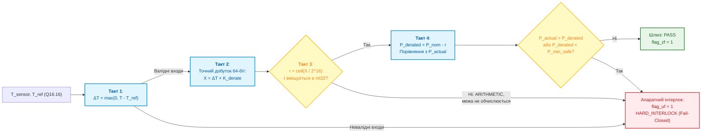
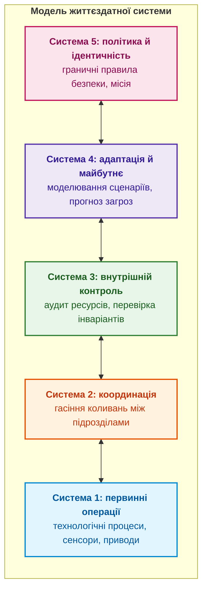
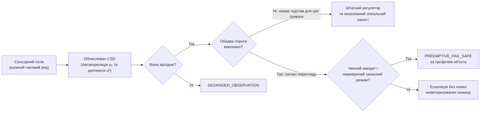
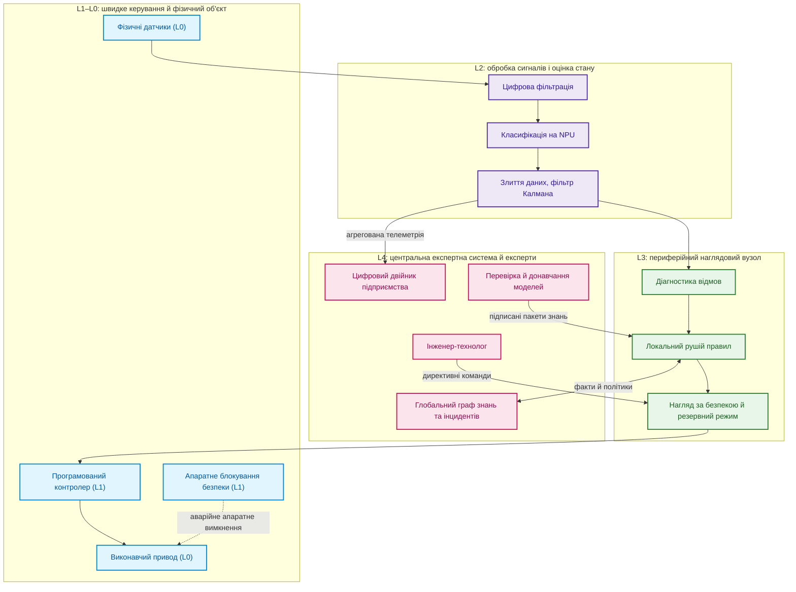
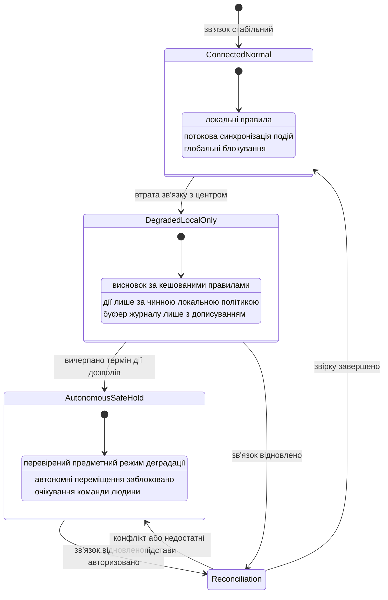
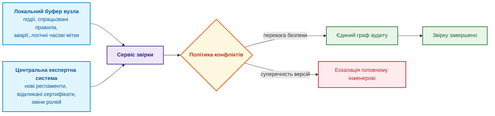
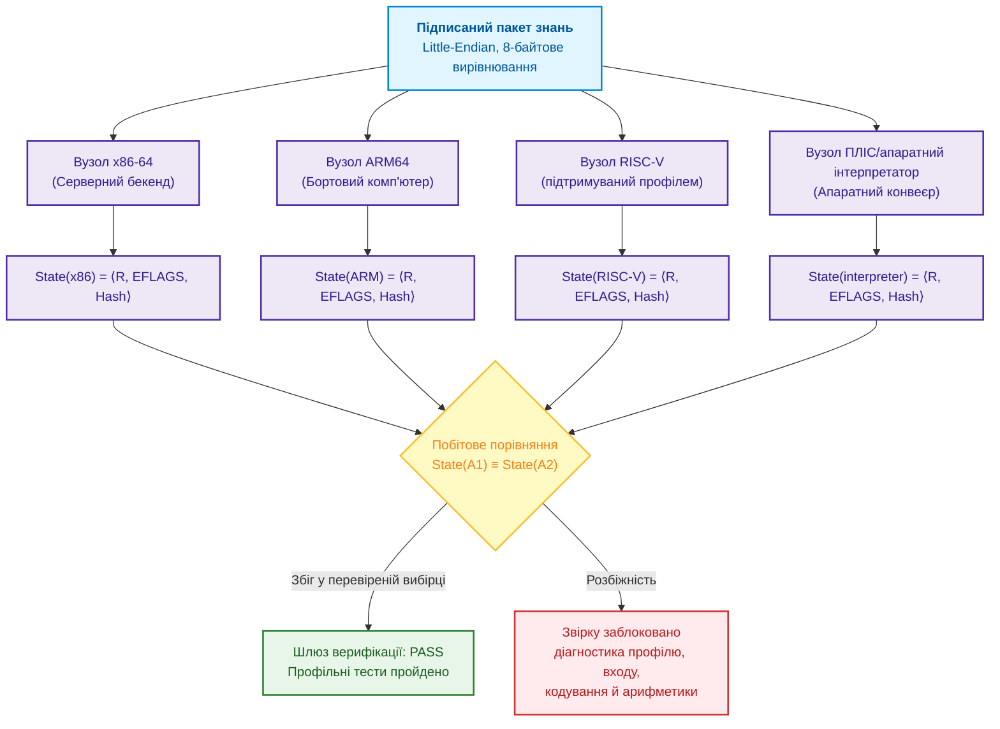

# Глава 22. Кібернетичний цикл керування: сенсори, периферія та зворотний зв'язок

> **Книга:** [Архітектура доказових експертних систем](README.md) · [Частина VII: Технологічний стек, апаратна інфраструктура, кібернетичне виконання та розподілена SOA](part-07-runtime-and-knowledge-exchange.md)
> **Попередня глава:** [Глава 21. Від рекомендації до дії: контроль повноважень і безпечне виконання у виробничому середовищі](ch21-from-recommendation-to-action.md)
> **Наступна глава:** [Глава 35. Реактивна експертна система: події, відкликання й адаптація знань](ch35-self-organizing-expert-systems-synergetics-and-npu-runtime.md)
> **Зміст книги:** [README.md](README.md)
> **Автор:** [Микола Мартинович Федчик](about-the-author.md)
> **Передумови й маршрут:** для початку достатньо розуміти вимірювання, правило «якщо — то» й одиниці часу; похідну, оцінювання та потрібні умови стійкості пояснено перед застосуванням. Далі використано вектори стану, ймовірності й подання цілих чисел на рівні бакалаврської підготовки.
> **Очікувані результати:** застосовувати закон необхідної різноманітності Ешбі й теорему про добрий регулятор до архітектури експертної системи; оцінювати стан об'єкта фільтром замість сирого сигналу; розподіляти функції між рівнями L0–L4 за часовими горизонтами; передавати від сенсорів підписані ознаки, а не вердикти; проєктувати режими деградації за обриву зв'язку й звірку станів після відновлення; оновлювати знання на периферії підписаними пакетами.

## Анотація

На автоматизованій виробничій лінії високочастотний датчик фіксує нетиповий сплеск вібрації в підшипниковому вузлі. Як реагувати? Можна негайно вимкнути приводний двигун, можна надіслати інженерові сповіщення про огляд у найближчу регламентну паузу, а можна знехтувати сигналом як короткочасною завадою від сусіднього преса. Числовий вихід нейромережевого класифікатора сам не дає відповіді. Рішення залежить від контексту: стадії технологічного процесу, достовірності калібрування датчика, температури мастила, вартості зупинки конвеєра, наявності резервного каналу й повноважень вузла, що ухвалює рішення.

Якщо зв'язок із центральним сервером обірвався, захисна логіка мусить спрацювати безпосередньо біля обладнання, на периферії (*edge*). Водночас локальний контролер не знає повної історії обслуговування парку машин і не має права сам змінювати технологічний регламент заводу. Така поведінка типова для кіберфізичних систем, у яких обчислення тісно переплетені з фізичними процесами й мають встигати за ними [[1]](#src-1).

Ця глава відповідає на запитання: **як зв'язати вимірювання, доказову рекомендацію й дозволену дію, не поклавши фізичний захист на повільну або недоступну експертну систему?** Після Глави 21 вже відомо, що висновок не є мандатом. Тут до повноважень додаються три перевірки: чи виміряно потрібну величину, чи придатна модель і чи надійде дія вчасно. Фізичний регулятор змінює об'єкт; дорадча експертна система пояснює стан і пропонує рішення; лише окремо авторизований виконавець може вплинути на обладнання.

Теза глави: **цикл керування розкладають за часовими горизонтами**, залишаючи швидкий захист біля обладнання. Спочатку розглянуто чергу завдань і температурний сигнал, потім межі потужності, стійкість і часові бюджети. Нарешті з цих вимог побудовано контракт сенсорної події, правила автономної роботи й оновлення знань. Радіоканал є окремим прикладом вимірюваного середовища, не обов'язковою частиною кожної експертної системи. Числа нижче є навчальними припущеннями, якщо прямо не зазначено інше; локальний розрахунок не означає сертифікації виробу.

## 1. Кібернетика й закон необхідної різноманітності Ешбі

Кібернетичний погляд потрібний експертній системі тоді, коли її рекомендація змінює наступні вхідні дані. Наприклад, після зниження потужності температура має змінитися; відсутність такого відгуку спростовує припущення про дієвість команди. Норберт Вінер пов'язав керування зі зв'язком і зворотним зв'язком [[2]](#src-2). Почнімо з простішого питання Ешбі: скільки різних ситуацій і дій узагалі розрізняє модель [[3]](#src-3)?

Різноманітністю скінченної множини станів $\Omega$ Ешбі називав кількість її розрізнюваних елементів; у логарифмічній формі

<a id="obj-22-1"></a>

**Формула (22.1). Логарифмічна різноманітність непорожньої множини станів.**

```math
V(\Omega) = \log_2 \lvert \Omega \rvert
```

- Для вимірювання різноманітності $\Omega$ є непорожньою скінченною множиною станів, а $\lvert \Omega \rvert$ є додатною цілою кількістю її розрізнюваних елементів;
- $`\log_2`$ є логарифмом за основою 2, а $V(\Omega)$ вимірюється в бітах;
- рівність задає логарифмічну міру різноманітності, яка може бути дробовою. Фіксований двійковий код для всіх станів потребує найменшого цілого числа бітів, не меншого за цю міру: для трьох станів вона приблизно 1,585 біта, але потрібні два біти коду.

Якщо множина містить 1 024 стани, $`V(\Omega)=\log_2(1024)=10`$ біт. Така оцінка рахує лише кількість станів, а не складність чи ймовірність кожного стану.

Для кількісної межі потрібна конкретна модель. Нехай кожна пара «збурення — реакція» однозначно задає результат, усі множини непорожні й скінченні, а за фіксованої реакції різні збурення дають різні результати. За цієї останньої умови одна реакція не стискає довільно багато збурень в один результат. Тоді підрахунок можливостей дає таку форму закону необхідної різноманітності:

<a id="obj-22-2"></a>

**Формула (22.2). Межа різноманітності за умовами моделі регулювання.**

```math
V_O \geq V_D - V_R
```

Закон обмеження:

- $`V_O`$ є різноманітністю результатів, $`V_D`$ є різноманітністю збурень, а $`V_R`$ є різноманітністю реакцій регулятора;
- кожна величина невід'ємна й вимірюється в бітах у межах тієї самої моделі станів; $O$ охоплює результати після вибору реакцій;
- $\geq$ означає «не менше ніж», а знак $-$ віднімає здатність регулятора поглинути збурення від різноманітності самих збурень.

За наведеного далі прикладу $`V_D=10`$ біт і $`V_R=1`$ біт, тому неврегульована різноманітність результатів має бути не меншою за $9$ біт. Нерівність задає нижню межу й не визначає сама собою, які саме реакції забезпечать безпечну поведінку.

Перевірмо підставу на чотирьох збуреннях і двох реакціях. Один результат може відповідати щонайбільше одному збуренню за кожної реакції, тобто двом збуренням загалом; для чотирьох потрібні принаймні два результати. Це дає 2 біти мінус 1 біт, отже принаймні 1 біт результату. Для 1024 і двох відповідна межа становить 9 біт. Вона не рахує небезпечні випадки й не доводить, що потрібні саме 1024 різні дії.

Одна зупинка може бути допустимою для багатьох несправностей: клас «обладнання зупинено» тоді навмисно зливає результати, і наведена умова розрізнення для цього класу вже не виконується. Онтологія допомагає розрізняти контекст, але без спостережуваності й доступних дій сама не збільшує здатності регулювання.

> [!NOTE]
> **Три кібернетичні обмеження архітектури регулятора за законом Ешбі в концепції автора**
> 1. Епістемічна різноманітність проти комбінаторного вибуху: онтологія відмов збільшує здатність системи розрізняти контекст збурень $`V_D`$, але сама по собі не збільшує керованості без наявності адекватного набору дій $`V_R`$.
> 2. Асиметрія захисного регулювання: одна захисна дія може бути придатною для багатьох несправностей, якщо це підтверджено для об'єкта. Це не автоматичний наслідок наведеної нерівності; зупинка також може бути небезпечною, наприклад для активного охолодження.
> 3. Внутрішня модель об'єкта: запропонований профіль використовує оцінювач стану, коли правило потребує прихованих або зашумлених величин. Це проєктний вибір із перевірюваними припущеннями, а не вимога теореми Конанта — Ешбі застосовувати певний фільтр у кожному регуляторі.
> *Інженерний інваріант:* Семантична фільтрація впорядковує розрізнення станів, але достатність дій і спостережуваності перевіряють окремо.

Теорема Конанта й Ешбі [[4]](#src-4) стосується оптимального регулювання у визначеній моделі: за її припущеннями найпростіший серед оптимальних регуляторів відтворює істотні для регулювання розрізнення системи. Вона не обіцяє стійкості довільного фізичного пристрою й не вимагає окремого цифрового двійника або саме фільтра Калмана [[5]](#src-5). У навчальному прикладі «гаряче, але температура стала» й «гаряче та нагрівається» потребують різних рішень. Одне число температури їх не розрізняє; оцінка швидкості дає потрібну додаткову ознаку. Далі перевіримо, чи не створює її сам шум. Діаграма показує авторський спосіб розділити ці обов'язки.

<a id="obj-22-3"></a>

**Діаграма 22.3. Авторський цикл спостереження, рішення й дозволеної дії.**


Діаграма підкреслює фундаментальний авторський **принцип семантичної ізоляції правил від сирих сигналів**: жодне логічне правило доказової експертної системи не повинно звертатися безпосередньо до сирих апаратних регістрів або неперевірених відліків АЦП — вхідним операндом правила завжди виступає верифікована оцінка стану або семантичний факт. Наступний розділ показує на числах, чому ця різниця є критичною для функціональної безпеки.

## 2. Паралельний програмний конвеєр: черга обробки завдань

Черга завдань дає змогу зрозуміти зворотний зв'язок без додаткової фізики: сервіс приймає завдання, обробники виконують їх, а контролер змінює число обробників за метриками. У цій монографії автором запропоновано називати такий розподіл **патерном програмного кібернетичного ізоморфізму конвеєра обробки завдань**. Це структурна метафора відповідності ролей, не доведена математична тотожність динаміки черги й верстата. Таблиця нижче пояснює відповідність.

<a id="obj-22-4"></a>

**Таблиця 22.4. Структурна відповідність фізичного циклу та черги завдань.**

| Частина циклу | Програмний відповідник | Перевірка експертною системою |
|---|---|---|
| об'єкт керування | черга й обробники | розрізняти зростання навантаження та падіння пропускної здатності |
| спостереження | вік найстарішого завдання, темп надходження, завершення й повтори | перевірити часові мітки й повноту метрик |
| оцінка стану | припущення про нестачу обробників або перевантаження залежного сервісу | не трактувати один великий розмір черги як готовий діагноз |
| дозволена дія | зміна числа обробників, обмеження приймання або повідомлення оператору | застосувати погоджені межі й повноваження |
| відгук | зміна віку завдань, помилок і повторів | перевірити, чи дія поліпшила стан, а не лише зменшила видиму чергу |

З інженерного досвіду автора випливає **правило верифікації зворотного зв'язку в автоскейлінгу**: перед активацією автоматичного керування програмними обробниками експертна система зобов'язана верифікувати час реакції залежних сервісів, блокуючи повторне масштабування до завершення перехідного процесу попередньої дії. Якщо контролер бачить застарілі метрики, він може кілька разів поспіль збільшити число обробників до того, як побачить результат першої зміни. Якщо вузьке місце в базі даних, додаткові обробники й повтори лише збільшать конкуренцію. Експертна система може пояснити ці гіпотези й перевірити правила дії, але не замінює штатного регулятора масштабування.

Перед автоматизацією перевіряють затримку спостереження й виконання, коливання числа обробників, вік завдань і частку повторів. Погоджують час очікування ефекту, верхню межу дії та режим за відсутньої телеметрії. Навчальний приклад не задає універсальних порогів: для конкретного сервісу потрібні навантажувальні випробування. Та сама проблема оцінювання стану далі розглядається на фізичному сигналі.

Наприклад, надходить 120 завдань/с, а два обробники разом завершують 100 завдань/с. За сталих темпів за 10 с додається 200 завдань: спочатку віднімаємо 100 від 120, потім множимо 20 завдань/с на 10 с. Якщо база даних обмежує загальне завершення тими ж 100 завданнями/с, третій обробник приросту не усуне. Отже, потрібна перевірка причини й нового відгуку, а не лише команда масштабування; це готує розрізнення сигналу та стану в наступному розділі.

## 3. Оцінювання стану: фільтрація замість сирого сигналу

Оцінювання стану потрібне, щоб правило реагувало на нагрівання, а не на випадковий стрибок показу. Температуру вимірюють у °C; похідна означає зміну температури за секунду, а не новий незалежний датчик. Розгляньмо навчальне правило: запропонувати зниження потужності до 50 % номіналу, якщо температура перевищує 85 °C і зростає швидше за 2,5 °C/с. Пороги вибрано для прикладу, не взято з паспорта транзистора:

<a id="obj-22-5"></a>

**Формула (22.5). Навчальне правило запиту зниження потужності.**

```math
T > 85^\circ\mathrm{C} \;\land\; \frac{dT}{dt} > 2{,}5^\circ\mathrm{C/s} \;\Rightarrow\; \mathrm{DeratePower}(50\,\%)
```

- Правило термозахисту використовує $T$, поточну температуру транзистора в градусах Цельсія, і поріг $`85^\circ\mathrm{C}`$;
- $`\frac{dT}{dt}`$ є швидкістю зміни температури в градусах Цельсія за секунду, а $`2{,}5^\circ\mathrm{C/s}`$ є порогом швидкості нагрівання;
- $>$ означає «більше за», $\land$ вимагає одночасної істинності обох умов;
- $\Rightarrow$ тут означає запит $`\mathrm{DeratePower}(50\,\%)`$ до окремого авторизованого виконавця; код нижче лише рахує істинність умови, не керує силовим трактом. Вхідні температура й швидкість мають бути скінченними та належати валідованій області датчика й моделі.

Отже, правило формує запит лише тоді, коли температура вже перевищила 85 °C і продовжує зростати швидше за заданий поріг. Похідну треба оцінювати з урахуванням шуму сенсора й інтервалу опитування, інакше випадковий шум може спричинити хибне спрацювання.

Щоб оцінити масштаб похибки, припустімо незалежний адитивний шум сусідніх відліків із нульовим середнім та однаковим скінченним стандартним відхиленням. Дисперсії незалежних різниць додаються, а ділення на час змінює стандартне відхилення так:

<a id="obj-22-6"></a>

**Формула (22.6). Стандартне відхилення шуму різницевої швидкості.**

```math
\sigma_v=\frac{\sqrt{2}\,\sigma_T}{\Delta t}.
```

Тут $`\sigma_T\ge0`$ — стандартне відхилення температурного шуму у °C, $`\Delta t>0`$ — сталий інтервал у секундах, $`\sigma_v`$ — стандартне відхилення похибки швидкості у °C/с. За 0,5 °C та 0,05 с отримуємо 0,7071 °C / 0,05 с, тобто 14,14 °C/с: це більше за поріг 2,5 °C/с. За корельованого шуму потрібен також коваріаційний член, тому наведена формула вже не є точною.

Замість різниці двох відліків використаємо **альфа-бета-фільтр**: прогнозуємо температуру за попередньою швидкістю, а залишком вимірювання уточнюємо обидві оцінки. Це модель приблизно сталої швидкості між подіями, не теплова модель транзистора:

<a id="obj-22-7"></a>

**Формула (22.7). Рекурентний крок альфа-бета-фільтра.**

```math
\begin{aligned}
\Delta t_k&=t_k-t_{k-1},\quad T_k^- = \widehat T_{k-1}+\widehat v_{k-1}\Delta t_k,\\
r_k&=z_k-T_k^-,\\
\widehat T_k&=T_k^-+\alpha r_k,\quad
\widehat v_k=\widehat v_{k-1}+\frac{\beta r_k}{\Delta t_k}.
\end{aligned}
```

Тут $k$ — додатний цілий номер наступної події; $`t_k`$ — її скінченна локальна монотонна мітка в секундах; $`0<\Delta t_k\le\mathrm{MaxGap}`$. $`z_k`$ — виміряна температура, $`T_k^-`$ — прогноз, $`r_k`$ — залишок, $`\widehat T_k`$ — уточнена температура, усі у °C; $`\widehat v_k`$ — оцінка швидкості у °C/с. Коефіцієнти $`0<\alpha\le1`$ та $`0<\beta\le1`$ безрозмірні, усі числові входи й результати скінченні. Наприклад, за попередніх 86 °C і 0 °C/с, інтервалу 0,05 с та нового показу 86,5 °C прогноз дорівнює 86 °C, залишок 0,5 °C; за коефіцієнтів 0,1 і 0,005 уточнення дають 86,05 °C і 0,05 °C/с. Умова правила хибна, хоча різниця сирих відліків дала б 10 °C/с.

Код реалізує саме цю рекурентну формулу: `predicted`, `residual` і `next` відповідають прогнозу, залишку й уточненню. Перший показ лише ініціалізує температуру, тому швидкість ще недоступна. Програма подає 1201 відлік за 60 с у двох синтетичних сценаріях: 86 °C без нагрівання та нагрівання від 80 °C зі швидкістю 3 °C/с протягом 10 с. Очікуваний результат — лічильники істинних умов і час першого виявлення, не число виконаних дій.

<details>
<summary>Приклад мовою Go: наївна похідна й альфа-бета-фільтр для правила за швидкістю нагріву</summary>

```go
package main

import (
	"errors"
	"fmt"
	"math"
	"math/rand"
)

const dt = 0.05 // період опитування датчика, с

type Estimate struct {
	Temperature   float64
	Rate          float64
	RateAvailable bool
}

type AlphaBeta struct {
	Alpha, Beta, MaxGap float64
	lastTime            float64
	initialized         bool
	estimate            Estimate
}

func finite(value float64) bool {
	return !math.IsNaN(value) && !math.IsInf(value, 0)
}

func (filter *AlphaBeta) Update(at, measurement float64) (Estimate, error) {
	if !finite(at) || !finite(measurement) || !finite(filter.Alpha) || !finite(filter.Beta) ||
		!finite(filter.MaxGap) || filter.Alpha <= 0 || filter.Alpha > 1 ||
		filter.Beta <= 0 || filter.Beta > 1 || filter.MaxGap <= 0 {
		return Estimate{}, errors.New("invalid measurement or filter configuration")
	}
	if !filter.initialized {
		filter.estimate = Estimate{Temperature: measurement}
		filter.lastTime, filter.initialized = at, true
		return filter.estimate, nil
	}
	interval := at - filter.lastTime
	if interval <= 0 || interval > filter.MaxGap {
		return Estimate{}, errors.New("duplicate, reordered, or stale measurement")
	}
	predicted := filter.estimate.Temperature + filter.estimate.Rate*interval
	residual := measurement - predicted
	next := Estimate{
		Temperature:   predicted + filter.Alpha*residual,
		Rate:          filter.estimate.Rate + filter.Beta/interval*residual,
		RateAvailable: true,
	}
	if !finite(next.Temperature) || !finite(next.Rate) {
		return Estimate{}, errors.New("non-finite estimate")
	}
	filter.estimate, filter.lastTime = next, at
	return next, nil
}

// rule є правилом зниження потужності: температура понад 85 °C і зростає швидше за 2,5 °C/с.
func rule(temp, rate float64) bool { return temp > 85 && rate > 2.5 }

// run моделює 60 с роботи й повертає кількість спрацювань правила та момент першого спрацювання.
// Якщо alpha == 0, похідну рахують «наївно» з двох сусідніх вимірювань.
func run(trueTemp func(t float64) float64, alpha, beta float64) (fires int, first float64) {
	r := rand.New(rand.NewSource(7))
	first = -1
	var prev float64
	filter := AlphaBeta{Alpha: alpha, Beta: beta, MaxGap: 4 * dt}
	for k := 0; k <= int(60/dt); k++ {
		t := float64(k) * dt
		z := trueTemp(t) + 0.5*r.NormFloat64() // вимірювання з шумом σ = 0,5 °C
		var temp, rate float64
		if k == 0 {
			prev = z
		}
		if alpha == 0 {
			temp, rate = z, (z-prev)/dt
		} else {
			estimate, err := filter.Update(t, z)
			if err != nil {
				panic(err)
			}
			temp, rate = estimate.Temperature, estimate.Rate
		}
		prev = z
		if k > 0 && rule(temp, rate) {
			fires++
			if first < 0 {
				first = t
			}
		}
	}
	return fires, first
}

func main() {
	stable := func(t float64) float64 { return 86 } // гаряче, але не нагрівається
	ramp := func(t float64) float64 {               // нагрів 3 °C/с протягом 10 с від 80 °C
		if t < 10 {
			return 80 + 3*t
		}
		return 110
	}
	for _, f := range []struct {
		name        string
		alpha, beta float64
	}{{"наївна похідна", 0, 0}, {"альфа-бета-фільтр", 0.1, 0.005}} {
		falseFires, _ := run(stable, f.alpha, f.beta)
		_, first := run(ramp, f.alpha, f.beta)
		fmt.Printf("%-18s | хибних спрацювань за 60 с: %4d | перше спрацювання під час нагріву: %.2f с\n",
			f.name, falseFires, first)
	}
}
```

Синтетичні тести перевіряють часову область і стан фільтра. Виконання: `go test -v main.go main_test.go`.

```go
package main

import (
	"math"
	"testing"
)

func TestMeasurementValidity(testCase *testing.T) {
	filter := AlphaBeta{Alpha: 0.1, Beta: 0.005, MaxGap: 0.2}
	initial, err := filter.Update(7, 25)
	if err != nil || initial.RateAvailable {
		testCase.Fatal("first sample incorrectly supplied a measured rate")
	}
	updated, err := filter.Update(7.1, 26)
	if err != nil || !updated.RateAvailable || math.Abs(updated.Rate-0.05) > 1e-10 {
		testCase.Fatalf("wrong actual-time update: %+v, %v", updated, err)
	}
	before := filter
	for _, input := range []struct{ at, value float64 }{
		{7.1, 26}, {7, 26}, {9, 26}, {7.15, math.NaN()}, {7.15, math.Inf(1)},
	} {
		if _, err := filter.Update(input.at, input.value); err == nil {
			testCase.Fatal("invalid event accepted")
		}
		if filter != before {
			testCase.Fatal("invalid event changed filter state")
		}
	}
	if _, err := (&AlphaBeta{Alpha: 0.1, Beta: 0.005}).Update(0, 25); err == nil {
		testCase.Fatal("missing gap policy accepted")
	}
}

func TestFiniteBoundsAndOverflow(testCase *testing.T) {
	filter := AlphaBeta{Alpha: 0.1, Beta: 0.005, MaxGap: 0.2}
	if _, err := filter.Update(0, 86); err != nil {
		testCase.Fatal(err)
	}
	if _, err := filter.Update(0.2, 86.5); err != nil {
		testCase.Fatal("maximum allowed gap rejected")
	}
	before := filter
	for _, at := range []float64{math.NaN(), math.Inf(1), math.Inf(-1), 0.400001} {
		if _, err := filter.Update(at, 87); err == nil || filter != before {
			testCase.Fatal("invalid timestamp accepted or state changed")
		}
	}
	extreme := AlphaBeta{Alpha: 0.1, Beta: 0.005, MaxGap: 0.2}
	if _, err := extreme.Update(0, -math.MaxFloat64); err != nil {
		testCase.Fatal(err)
	}
	prior := extreme
	if _, err := extreme.Update(0.1, math.MaxFloat64); err == nil || extreme != prior {
		testCase.Fatal("finite inputs caused unchecked arithmetic overflow")
	}
	for _, config := range []AlphaBeta{
		{Alpha: math.NaN(), Beta: 0.005, MaxGap: 0.2},
		{Alpha: 0.1, Beta: math.Inf(1), MaxGap: 0.2},
		{Alpha: 0.1, Beta: 0.005, MaxGap: math.Inf(1)},
		{Alpha: 0, Beta: 0.005, MaxGap: 0.2},
	} {
		if _, err := config.Update(0, 25); err == nil {
			testCase.Fatal("invalid configuration accepted")
		}
	}
}
```

</details>

Програма виводить:

<details>
<summary>Дані або результат прикладу</summary>

```text
наївна похідна     | хибних спрацювань за 60 с:  520 | перше спрацювання під час нагріву: 1.55 с
альфа-бета-фільтр  | хибних спрацювань за 60 с:    0 | перше спрацювання під час нагріву: 1.80 с
```

</details>


Авторська **закономірність мультиплікації шуму різницевих правил** застосовує класичне поширення дисперсії до порогового правила. Формула вище описує стандартне відхилення, не дисперсію. За одного початкового стану генератора наївна похідна дала 520 хибних оцінок для стаціонарного сигналу, а фільтр — 0. Це не доказ нульової частоти хибних реакцій: програма не моделює зміну температури після зниження потужності. Для наростання 5 °C до порога за швидкості 3 °C/с потребують приблизно 1,67 с; фільтр дав першу оцінку на 1,80 с. Отже, навіть краща фільтрація має затримку. Її перевіряють на багатьох реалізаціях шуму, різких змінах та пропусках.

У розробленій архітектурі впроваджено авторське **правило темпоральної валідації та контролю розривів сенсорного потоку**: оцінювач стану зобов'язаний обчислювати фактичний часовий інтервал $`\Delta t = t_k - t_{k-1}`$, безумовно відкидаючи дублікати ($`t_k \le t_{k-1}`$), нечислові значення (`NaN`, `Inf`) та перевищення допустимого розриву $`\Delta t > \Delta t_{\mathrm{max}}`$ без несанкціонованої мутації внутрішнього стану. Прапорець `RateAvailable` означає лише, що швидкість обчислена після двох валідних подій, а не те, що її точність достатня для захисту. Фільтр використовує фактичний інтервал і відкидає переставлені події.
Поруч із цим діє авторський **епістемічний принцип збереження деградованого статусу спостереження**: відкинутий або пропущений вимір переводить спостереження у `DEGRADED_OBSERVATION`, а не в нульову температуру чи відсутність загрози. У коді повертається помилка; саме викликач має виставити цей статус і не використати стару оцінку як свіжу. `MaxGap` контролює розрив між подіями, не вік останнього показу відносно поточного часу. Зовнішня перевірка свіжості потрібна навіть після успішного `Update` (§7).

Не будь-яке згладжування є доказом стійкості. За сталого додатного періоду, точної моделі сталої швидкості й без шуму похибка цього фільтра задається лінійною дискретною системою. Критерій Шура для характеристичного полінома другого порядку перевіряє розміщення обох коренів усередині одиничного кола. Для наведеної рекурентності він дає:

<a id="obj-22-8"></a>

**Формула (22.8). Умови збіжності похибки фільтра за сталого кроку.**

```math
p(\zeta)=\zeta^2-(2-\alpha-\beta)\zeta+1-\alpha,\qquad
\alpha>0,\quad\beta>0,\quad 2\alpha+\beta<4.
```

Тут $p$ — характеристичний поліном рекурентності похибки, а $\zeta$ — безрозмірний комплексний множник її зміни за крок. Підстановка коефіцієнтів полінома в критерій Шура дає три наведені нерівності. Альфа й бета — ті самі безрозмірні коефіцієнти; умови застосовують за сталого кроку й незмінних коефіцієнтів, а не до довільного адаптивного оцінювача. Обрані 0,1 та 0,005 дають 0,205, отже умови виконуються. Це збіжність похибки оцінювача, не стійкість силового об'єкта, не точність за довільного шуму й не доказ для змінних інтервалів. Далі розглянуто інше обмеження: навіть точну оцінку не можна використати поза допустимою областю потужності.

### 3.1. Багатовимірний гіпероб'єм безпечного робочого простору (Operating Envelope) та цілочисельна дегресія в Q16.16

Робоча область потрібна, коли одна й та сама потужність допустима для холодного пристрою, але завелика для гарячого. Operating Envelope — усталене поняття множини допустимих режимів; у цій монографії автором запропоновано конкретне багатовимірне кодування, де поєднання температури, потужності й інших параметрів задає предметний профіль. Така множина не зобов'язана бути зв'язною чи описуватися єдиним гладким гіпероб'ємом. Для першого розрахунку достатньо двох величин: температури у °C і верхньої межі потужності у кВт. Параметри реальних BMS або Infineon AURIX потребують паспортних даних; назва компонента не встановлює відповідності ISO 26262 чи рівня ASIL.

Для відтворюваного обчислення межі потрібно розділити два ризики:
1. **Невідомий час виконання:** ні FP32/FP64, ні ціла арифметика самі не доводять строку реакції. Потрібні конкретні інструкції, платформа, планування, пам'ять і найгірший час виконання (WCET). Фіксована кома далі потрібна насамперед для явного правила округлення й однакового числового результату.
2. **Катастрофічний дефект інверсії меж (Envelope Inversion Fault):** при переході на апаратну цілочисельну фіксовану кому Q16.16 у кремнії добуток перепаду температур (для прикладу з $`T_{\mathrm{ref}}=85^\circ\text{C}`$ до $`\Delta T_{\max}=175^\circ\text{C}-85^\circ\text{C}=90^\circ\text{C}`$) на коефіцієнт дегресії сам не переповнюється: точний добуток двох знакових 32-бітних чисел Q16.16 завжди вміщується в 64 біти ($`\lvert a\cdot b\rvert\le2^{62}`$). Небезпека виникає під час **звуження** результату до 32 біт, зокрема коли невід'ємна дегресія досягає $`2^{15}`$ одиниць шкали. Механічне зрізання розрядів без насичення (`prod[47:16]`) викликає інверсію знакового біта: обчислена дегресія раптово стає від'ємною, штучно **розширюючи** дозволений діапазон потужності під час аварійного перегріву замість його захисного звуження, що може спричинити небезпечне перевантаження силового каскаду; конкретний фізичний наслідок потребує моделі об'єкта.

Для захисту від неконтрольованого звуження запропоновано конвеєрний співпроцесор гіперобмежувача у форматі Q16.16. Безпекова межа обчислюється лише за валідних входів і без переповнення; насичення не є допустимим результатом для подальшого керування:

Q16.16 означає знакове 32-бітне ціле з 16 дробовими бітами: 1 кВт подано числом 65536, а крок становить приблизно 0,00001526 кВт. Спочатку обчислюють перевищення температури над порогом, потім втрату допустимої потужності, нарешті віднімають цю втрату від номіналу:

<a id="obj-22-9"></a>

**Формула (22.9). Невід’ємне перевищення температурного порога.**

```math
\Delta T = \max(0, T_{\mathrm{sensor}} - T_{\mathrm{ref}}).
```

<a id="obj-22-10"></a>

**Формула (22.10). Межа потужності після перевіреної дегресії.**

```math
P_{\mathrm{derated}} = P_{\mathrm{max\_nominal}} - \mathrm{SaturateQ16}(\Delta T \cdot K_{\mathrm{derate}}).
```

<a id="obj-22-11"></a>

**Формула (22.11). Звуження сирого добутку з округленням угору.**

```math
\mathrm{SaturateQ16}(X) = \begin{cases}
\text{0x7FFF\_FFFF}, & \text{якщо } \lceil X / 2^{16} \rceil > \text{0x7FFF\_FFFF}, \\
\text{0x8000\_0000}, & \text{якщо } \lceil X / 2^{16} \rceil < -2^{31}, \\
\lceil X / 2^{16} \rceil, & \text{інакше}.
\end{cases}
```

Тут $X$ — точний знаковий 64-бітний добуток сирих значень операндів; ділення на $`2^{16}`$ повертає масштаб Q16.16. Перші дві гілки є насиченням. За числовим профілем $`\mathcal{P}_{Q16.16}`$ (§3.1.2, п. 5) насичення дегресії є відмовою з причиною `ARITHMETIC`: $`P_{\mathrm{derated}}`$ не обчислюється, модуль виставляє $`\mathrm{flag\_uf}=1`$ і `HARD_INTERLOCK`. Оператор має передати ознаку переповнення окремо від 32-бітного значення: саме значення на межі формату не відрізняє допустимий результат від насичення. Дегресію округлюють угору, бо округлення вниз недооцінює її до одного молодшого розряду й може розширити межу потужності.

Параметри формул апаратної дегресії:
- $`T_{\mathrm{sensor}}`$ — поточна температура сенсора у форматі Q16.16, діапазон $`[-40{,}0, +175{,}0]^\circ\text{C}`$;
- $`T_{\mathrm{ref}}`$ — базова температура початку теплового зниження номіналів, $`T_{\mathrm{ref}}\in[-40{,}0;\,+175{,}0]^\circ\text{C}`$; у прикладі $`+85{,}0^\circ\text{C}`$;
- $\Delta T$ — невід'ємне перевищення теплового порогу; спершу порівнюють $`T_{\mathrm{sensor}}>T_{\mathrm{ref}}`$ і лише тоді віднімають без обертання; за наведених діапазонів $`\Delta T\le215^\circ\text{C}`$ вміщується в Q16.16;
- $`K_{\mathrm{derate}}`$ — коефіцієнт дегресії у кВт/°C у форматі Q16.16, $`K_{\mathrm{derate}}\ge0`$; від'ємне значення дає відмову;
- $`P_{\mathrm{max\_nominal}}`$ — паспортна номінальна потужність у холодній зоні, кВт у Q16.16: діапазон $`[-32\,768;\,32\,768)`$ кВт, крок $`2^{-16}`$ кВт; $`P_{\mathrm{max\_nominal}}\ge0`$;
- $`P_{\mathrm{derated}}`$ — динамічно обчислена межа потужності у кВт, яку не формують за переповнення;
- $`P_{\mathrm{actual}}`$ — поточна споживана потужність у кВт у Q16.16, $`P_{\mathrm{actual}}\ge0`$; від'ємне значення належить до окремого профілю рекуперації й дає відмову з $`\mathrm{flag\_uf}=1`$;
- $`\mathrm{SaturateQ16}`$ — апаратний оператор звуження з округленням угору, який перевіряє діапазон **після** округлення; в апаратному поданні аналізують старші розряди суми $`X+2^{16}-1`$, а не самого $X$.

Якщо температура лежить поза діапазоном сенсора або спостереження застаріле, воно отримує статус `DEGRADED_OBSERVATION`, а модуль повертає відмову з $`\mathrm{flag\_uf}=1`$, не нульову дегресію. Негативні коефіцієнт дегресії або номінальна потужність також не є валідними входами профілю.

<a id="obj-22-12"></a>

**Діаграма 22.12. Референсні стадії локального обмежувача.**



> [!NOTE]
> **Три запропоновані інваріанти апаратного обмежувача Operating Envelope**
> 1. Звуження без знакової інверсії: оператор $`\mathrm{SaturateQ16}`$ звужує 64-бітний добуток до 32 біт з округленням угору й сигналізує насичення, перевіряючи діапазон після округлення. **За умов** $`K_{\mathrm{derate}}\ge0`$, $`P_{\mathrm{max\_nominal}}\ge0`$, обчислення $\Delta T$ без обертання, округлення дегресії вгору й трактування насичення як відмови межа не перевищує номіналу й не зростає з температурою. Обґрунтування — аргумент діапазону: добуток невід'ємний, дегресія монотонна, а насичення не потрапляє в результат. Машинне доведення для 32-бітного формату (SMT) не виконано. За від'ємного коефіцієнта цей висновок не діє, тому вхід відхиляється.
> 2. Фіксована тактова глибина: чотири стадії за умовної частоти 200 МГц дають розрахункові 20 нс лише від прийнятого входу до результату за відсутності зупинок. Це не вимір джиттера й не повна затримка захисту.
> 3. Локальний інтерлок: перевищення межі або числова відмова формує `HARD_INTERLOCK`; час фізичного вимкнення та придатність такого стану перевіряють окремо.
> *Керування рантаймом:* Локальне блокування належить до L1 (§6), фізичний об'єкт — до L0; захист не очікує відповіді сервера.

#### 3.1.1. Замкнений цикл інженерного розрахунку апаратної дегресії

Замкнути числовий розрахунок означає показати не лише 25 кВт на виході, а й те, яке рішення з цього дозволено зробити. Припустімо валідні свіжі входи, невід'ємні потужності, коефіцієнт і профіль, у якому зниження або блокування справді допустиме.

1. **Керування рантаймом і потоком обчислень (Control Flow & Runtime Decisions):**
    Після перевірок входів і звуження компаратор зіставляє навантаження з межею. PASS означає лише проходження цієї перевірки: $`\mathrm{flag\_zf}=1`$ не замінює мандата чи інших блокувань. Межа нижче $`P_{\mathrm{min\_safe}}`$, мінімально допустимої потужності конкретного режиму у кВт, означає порожнє вікно дозволу; її не підміняють нулем. За перевищення або числової відмови встановлюють $`\mathrm{flag\_uf}=1`$ і запитують локальний `HARD_INTERLOCK`.
2. **Апаратний сайзинг та інфраструктурні обмеження (Hardware Dimensioning):**
    *Референсна реалізація (ілюстрація, не нормативна частина специфікації). Числовий профіль $`\mathcal{P}_{Q16.16}`$ задає правила арифметики; версійований профіль інструкцій визначає коди операцій, байтове кодування й переходи стану.*
    - Чотири стадії — проєктна гіпотеза, не синтезований тут RTL. Кількість LUT і DSP-блоків визначають за звітом синтезу для обраної ПЛІС; розкладення 32×32-бітного множення на конкретні DSP-блоки також потребує перевірки.
    - За припущеної частоти 200 МГц один такт триває 5 нс, чотири такти — 20 нс. Це умовна арифметика без АЦП, синхронізації, арбітражу, драйвера й фізичного відгуку; порівнювати її з довільним таймером RTOS як готову перевагу некоректно.
3. **Практичний числовий приклад (Worked Numerical Example):**
   Розглянемо тяговий інвертор електромобіля з паспортною потужністю $`P_{\mathrm{max\_nominal}} = 150\,\text{кВт}`$ (у Q16.16: `0x0096_0000`), початком дегресії $`T_{\mathrm{ref}} = 85^\circ\text{C}`$ та коефіцієнтом $`K_{\mathrm{derate}} = 2{,}5\,\text{кВт/}^\circ\text{C}`$ (у Q16.16: `0x0002_8000`).
   При аварійному сплеску температури сенсора до $`T_{\mathrm{sensor}} = 135^\circ\text{C}`$:
   - $`\Delta T = 135 - 85 = 50^\circ\text{C}`$ (`0x0032_0000`);
   - Добуток $`\Delta T \cdot K_{\mathrm{derate}} = 50 \times 2{,}5 = 125\,\text{кВт}`$;
   - $`P_{\mathrm{derated}} = 150 - 125 = 25\,\text{кВт}`$.
   
    За споживання 80 кВт порівняння з 25 кВт не проходить: встановлюють $`\mathrm{flag\_uf}=1`$ і формують `HARD_INTERLOCK`. Чи запобігає це пошкодженню, залежить від теплової моделі та повного часу реакції, які тут не моделюються.

      Приклад ілюструє нормальне числове звуження: добуток 125 кВт менший за межу формату 32 768 кВт, тому насичення не спрацьовує й дефект звуження цей приклад не демонструє.

Для граничної перевірки візьмімо 90 °C перевищення й коефіцієнт 400 кВт/°C: обидва операнди подаються у форматі, але результат 36000 кВт — ні. Зрізання до int32 дало б від'ємне значення −29536 кВт; правильний шлях повертає `ARITHMETIC` до обчислення межі. Наступний профіль робить цю поведінку спільною для реалізацій.

#### 3.1.2. Нормативний числовий профіль $`\mathcal{P}_{Q16.16}`$

Числовий профіль потрібний, щоб сервер і периферійний вузол однаково обробили саме граничний приклад. «Нормативний» тут означає внутрішній контракт книги, не положення ISO або IEC. Це спільне означення арифметики Q16.16 для підтримуваних реалізацій; перетворення фізичних вимірів у числа також має задавати профіль датчика.

Подання числа визначаємо окремо від його фізичної одиниці:

<a id="obj-22-13"></a>

**Формула (22.13). Подання числа Q16.16.**

```math
v=z\,2^{-16},\qquad z\in\{-2^{31},\ldots,2^{31}-1\}.
```

Тут $z$ — сире ціле у доповняльному коді без фізичної одиниці, $v$ — скінченне значення у вибраних одиницях величини. Область $v$ — від −32768 включно до 32768 невключно з кроком $`2^{-16}`$. Наприклад, сире число 163840 подає коефіцієнт 2,5 кВт/°C, якщо таку одиницю встановлено для поля. Правило початкового квантування датчика й похибку цього перетворення треба задати додатково; округлення подальших операцій його не замінює.

Повернення масштабу після множення має два різні напрями округлення:

<a id="obj-22-14"></a>

**Формула (22.14). Добуток і два напрями повернення масштабу.**

```math
X=z_a z_b,\quad |X|\le2^{62},\qquad
r_{\downarrow}=\left\lfloor\frac{X}{2^{16}}\right\rfloor,\quad
r_{\uparrow}=\left\lceil\frac{X}{2^{16}}\right\rceil.
```

Тут $`z_a,z_b`$ — сирі знакові 32-бітні операнди, $X$ — їх точний 64-бітний добуток, $`r_{\downarrow},r_{\uparrow}`$ — цілі результати повернення масштабу вниз і вгору. Індекс стрілки задає напрям, не фізичну одиницю; одиниця добутку є добутком одиниць полів. Наприклад, за сирого добутку 1 нижній результат 0, верхній 1; у Q16.16 вони відрізняються на один крок. Для дегресії верхньої межі потрібний верхній результат, інакше межа буде трохи завищена. Перевірку int32 виконують після цього кроку: округлення може вивести значення за найбільше ціле.

1. **Формат.** Значення зберігають за наведеною формулою; одиницю задає означення поля.
2. **Додавання й віднімання** обчислюються точно в 33 бітах; результат поза діапазоном формату є переповненням (п. 5).
3. **Множення.** Добуток обчислюється точно як 64-бітне ціле $`X = z_a \cdot z_b`$; переповнення 64 біт неможливе, бо $`\lvert z_a z_b \rvert \le 2^{62}`$. Результат звужується до Q16.16 діленням на $`2^{16}`$ з округленням (п. 4).
4. **Округлення.** Якщо означення формули не задає напряму, округлюють униз ($`\lfloor X / 2^{16} \rfloor`$, арифметичний зсув). Величини, що зменшують безпекову межу, округлюють у безпечний бік щодо тієї межі, яку вони зменшують (для верхньої межі — вгору; для нижньої, як-от $`P_{\mathrm{min\_safe}}`$, — униз). Для округлення вгору застосовують $`\lceil X / 2^{16} \rceil`$. Напрям округлення вказують в означенні кожної формули.
5. **Переповнення ⇒ відмова.** Діапазон перевіряють після округлення (п. 4). Якщо результат не вміщується в діапазон формату, його не записують у безпекову величину. Обчислення повертає типізовану відмову з причиною `ARITHMETIC` і виставляє UF = 1 (у §3.1 — $`\mathrm{flag\_uf} = 1`$). Інтерпретатор профілю зупиняється з $`\mathrm{REASON} = \texttt{ARITHMETIC}`$. Насичене значення (найбільше чи найменше значення формату) з продовженням обчислення допускається лише для величин, які означення формули або таблиця кодів операцій явно позначає як діагностичні, і завжди з UF = 1.
6. **Ділення** до числового профілю не входить. Якщо таблиця кодів операцій ISA-профілю (§10.1.2) містить ділення, вона задає для кожного такого коду напрям округлення частки. Нульовий дільник зупиняє ядро за §10.1.2, п. 7 (`HALT_FAULT`).
7. **Порядок байтів** у пакеті — Little-Endian; правила читання задає ISA-профіль (§10.1.2).
8. **Рухома кома** в нормативному допуску не використовується.

Для однакового версійованого профілю й тієї самої послідовності операцій очікується однаковий результат; межі підтримки та спосіб перевірки задає профіль (§10.1.2).

---

## 4. Кібернетика другого порядку, модель життєздатної системи й активний висновок

Кібернетика другого порядку потрібна тут для перевірки якості знань: після поради зупинити обладнання його дані вже не описують роботу без втручання. Треба відрізняти спостереження від наслідку власного рішення. Для цього розглянемо три різні за статусом ідеї: роль спостерігача, розподіл організаційної відповідальності й імовірнісну аналогію уточнення моделі.

**Кібернетика другого порядку.** Гайнц фон Ферстер запропонував розглядати спостерігача як частину системи, яку він спостерігає [[6]](#src-6). Для експертної системи це не абстракція: щойно вона видає рекомендацію чи діагноз, оператори змінюють поведінку, змінюючи тим самим дані, на яких експертна система навчається й перевіряє свої правила. Тому журнал рішень експертної системи є не лише аудитом, а й частиною даних про об'єкт керування, і правила оцінювання якості мають враховувати вплив попередніх рекомендацій.

**Модель життєздатної системи.** Стаффорд Бір запропонував модель життєздатної системи (*Viable System Model*, VSM), у якій будь-яка організація, здатна зберігати життєздатність, має п'ять функціональних підсистем [[7]](#src-7). Діаграма показує ці підсистеми.

<a id="obj-22-15"></a>

**Діаграма 22.15. Функціональні ролі моделі життєздатної системи.**



Автором запропоновано **модель розміщення експертної системи в архітектурі VSM Біра**: аудит належить до функції 3, прогноз сценаріїв — до 4, обидва обмежені політикою 5. Це авторський синтез для аналізу розподілу відповідальності, не теорема про кожну організацію; його повноту й корисність потрібно зіставити з конкретною організаційною моделлю. Наприклад, два вузли можуть незалежно запропонувати резервування одного генератора; функція координації 2 має виявити конфлікт. Без неї можливі суперечливі команди, але неминучі незгасаючі коливання з самої схеми не випливають.

**Активний висновок.** Щоб відокремити зміну моделі від зміни об'єкта, корисно розібрати одну імовірнісну тотожність із принципу вільної енергії Фрістона [[8]](#src-8). Нехай модель задає ймовірності прихованих станів і спостережень, а оцінювач наближує розподіл стану після спостереження. Вимірюємо розбіжність цих розподілів у натах; це інформаційна величина, не фізична енергія в джоулях:

<a id="obj-22-16"></a>

**Формула (22.16). Варіаційна тотожність для заданої ймовірнісної моделі.**

```math
F = \mathbb{E}_{q(\vartheta)}\left[\ln q(\vartheta) - \ln p(\tilde{y}, \vartheta)\right] = \mathrm{KL}\left[q(\vartheta) \,\|\, p(\vartheta \mid \tilde{y})\right] - \ln p(\tilde{y})
```

- У формулі вільної енергії $F$ є скаляром, а $\vartheta$ позначає прихований стан об'єкта;
- $q(\vartheta)$ є наближеним розподілом переконань адаптивної моделі, а $`p(\tilde{y},\vartheta)`$ є спільним розподілом спостереження $`\tilde{y}`$ і стану $\vartheta$ за породжувальною моделлю $p$;
- $`\mathbb{E}_{q(\vartheta)}`$ означає математичне сподівання за розподілом $q$, а $\ln$ є натуральним логарифмом;
- $`p(\vartheta\mid\tilde{y})`$ є апостеріорним розподілом прихованого стану після спостереження, а $`\mathrm{KL}[q\|p]`$ є дивергенцією Кульбака-Лейблера між розподілами;
- $`p(\tilde{y})`$ є граничною ймовірністю спостереження, а рівність показує тотожність між очікуваною формою та KL-формою з доданком $`-\ln p(\tilde{y})`$;
- за натурального логарифма значення інформаційної величини вимірюють у натах.

Для дискретного прикладу всі розподіли нормовані, невід'ємні, ймовірність спостереження додатна, а $q$ не надає додатної маси стану з нульовою спільною ймовірністю. Тоді підстановка формули Баєса розкладає логарифм відношення на два доданки. Невід'ємність KL (нерівність Гіббса для нормованих розподілів) дає верхню межу здивування. Нехай після сигналу модель дає ймовірності «справний/несправний» 0,8/0,2, а наближення — 0,5/0,5. Розбіжність дорівнює половині ln(0,5/0,8) плюс половині ln(0,5/0,2), тобто приблизно 0,2231 ната. За ймовірності самого сигналу 0,5 здивування становить 0,6931 ната, а F — 0,9163 ната. Замінивши наближення на 0,8/0,2, отримуємо KL=0 і F=0,6931. Змінилася оцінка, а не стан обладнання.

За фіксованого спостереження мінімізація F за q уточнює модель. Для вибору фізичної дії потрібна ще модель її наслідків, ціль, обмеження й мандат: наведена тотожність такого вибору не задає. Для експертної системи активний висновок тут є аналогією, не вимогою мінімізувати здивування замість виконання захисних правил.

> [!NOTE]
> **Два аспекти активного виведення**
> 1. Сприйняття: уточнення розподілу прихованого стану допомагає узгодити модель зі спостереженням; альфа-бета-фільтр не обчислює цю KL явно.
> 2. Дія: окремий виконавець застосовує дозволений вплив за предметною моделлю. Зменшення інформаційного здивування саме не доводить повернення об'єкта в безпечну область.
> *Керування рантаймом:* Розділення оцінювання й дії не підміняє доказу стійкості або контролю повноважень.

Авторська метафора **двошвидкісного руху організаційного знання** описує два цикли різної швидкості в доказовій екосистемі. Швидкий оперативний цикл охоплює робочі обговорення, чернетки, експериментальні гіпотези й роботу автономних агентів; його результати не мають прямого регуляторного авторитету. Повільний керований цикл утримує верифікований граф знань, затверджені архітектурні рішення, перевірені онтології й нормативні обмеження. Перехід між ними у запропонованій організації відбувається через рецензування й контрольоване схвалення, описані в [Главі 19](ch19-from-question-to-evidence.md); це аналогія життєвого циклу, не закон організації.

Отже, зміна переконань, організаційне схвалення й фізична дія — три різні кроки. Наступне питання вже фізичне: за яких припущень допустимо говорити про стійкість і що можуть, а чого не можуть показати статистичні ознаки її погіршення?

## 5. Синергетична стійкість: біфуркації, критичне уповільнення та передбачення фазових переходів

Стійкість потрібна експертній системі як підстава рекомендації: «зменшити потужність» не означає «гарантовано повернутися до норми». Спочатку пригадаємо точний зміст такої гарантії, а потім відділимо від неї статистичне попередження. **Стійкість рівноваги** означає, що достатньо мала початкова похибка залишається малою; **асимптотична стійкість** додатково вимагає її прямування до нуля. Жодне з означень саме не задає часу досягнення безпечної температури.

Метод Ляпунова [[24]](#src-24) перевіряє функцію, схожу на запас відхилення. Для автономного рівняння з локально ліпшицевим правим боком і рівновагою в нулі достатньо неперервно диференційовної функції, додатної поза нулем, нульової в нулі, з від'ємною похідною поза нулем уздовж траєкторій у деякому околі. Це дає локальну асимптотичну стійкість; щоб утримати конкретні початкові стани в околі, беруть інваріантну підмножину рівня функції. Глобальний висновок потребує тих самих умов на всьому просторі, існування траєкторій для всього майбутнього та необмеженого зростання функції з нормою стану. Затримки, насичення й перемикання режимів не можна мовчки виключити з моделі.

Перевірмо просту навчальну модель нормованого відхилення температури після дозволеного впливу:

<a id="obj-22-17"></a>

**Формула (22.17). Скалярна перевірка стійкості методом Ляпунова.**

```math
\dot x=-a x,\qquad V(x)=\frac{x^2}{2},\qquad
\dot V=-a x^2,\qquad x(t)=x(0)e^{-at}.
```

Тут $x$ — безрозмірна різниця від заданої температури, поділена на 10 °C; $`a>0`$ — стала швидкість відновлення у с⁻¹, $`t\ge0`$ — час у секундах, $V$ — безрозмірний запас відхилення, $`\dot V`$ має одиницю с⁻¹. За $`a=0{,}5`$ с⁻¹ і початкових 8 °C відхилення маємо $`x(0)=0{,}8`$; за 2 с отримуємо приблизно 0,2943, або 2,943 °C. Функція зменшується від 0,32 до приблизно 0,0433. У цій лінійній моделі висновок глобальний. Якщо модель підтверджено лише в межах ±10 °C, фізичний висновок обмежений цією областю; за шуму не можна обіцяти точне сходження до нуля. Саме так експертна система має зберігати межі доведення разом із правилом.

Коли швидкість повернення до рівноваги падає, доцільно перевірити, чи це не ознака зміни режиму. **Біфуркація** — якісна зміна динаміки за зміни параметра, не обов'язково аварія або хаос. **Критичне уповільнення (CSD)** описує повільніше згасання збурень перед деякими, але не всіма критичними переходами [[8a]](#src-8a). Воно є кандидатом на діагностичну ознаку, не універсальним передбаченням відмови.

Для розрахунку припустімо одновимірний процес Орнштейна — Уленбека біля рівноваги:

<a id="obj-22-18"></a>

**Формула (22.18). Локальна стохастична модель відновлення.**

```math
dx=-\lambda x\,dt+\sigma\,dW_t.
```

Тут $x$ — температурне відхилення у °C (це вже ненормована величина), $`\lambda>0`$ — швидкість відновлення у с⁻¹, $`\sigma\ge0`$ — стала амплітуда дифузії у °C/√с. $`W_t`$ — стандартний вінерівський процес із незалежними нормальними приростами: дисперсія приросту дорівнює тривалості інтервалу, тому $`dW_t`$ має масштаб √с. Це точне стохастичне формулювання; білий шум не є звичайною скінченною функцією часу.

За сталих параметрів, стаціонарного розподілу, додатної амплітуди шуму й рівномірного опитування модель дає автокореляцію сусідніх відліків. За нульової стаціонарної дисперсії кореляція не визначена:

<a id="obj-22-19"></a>

**Формула (22.19). Стаціонарна автокореляція процесу Орнштейна — Уленбека.**

```math
\rho_1=e^{-\lambda\Delta t}.
```

Тут $`\Delta t>0`$ — інтервал у секундах, $`\rho_1\in(0,1)`$ — безрозмірна модельна автокореляція лагу 1; у скінченній вибірці її оцінка може відрізнятися, зокрема бути від'ємною. Експонента виникає зі згасання попереднього стану за час між вимірами, а незалежний новий шум не додає коваріації з ним.

Стаціонарна дисперсія визначається балансом її втрати через відновлення та надходження через шум:

<a id="obj-22-20"></a>

**Формула (22.20). Стаціонарна дисперсія моделі відновлення.**

```math
\mathrm{Var}(x)=\frac{\sigma^2}{2\lambda}.
```

Дисперсія має одиницю °C²; квадрат амплітуди шуму має °C²/с, а знаменник — с⁻¹. За додатного сталого шуму й прямування швидкості відновлення до нуля справа автокореляція прямує до одиниці, а стаціонарна дисперсія необмежено зростає. За нульової швидкості відновлення стаціонарного розподілу вже немає; у реальному об'єкті раніше може перестати діяти локальна лінеаризація. Це не стрибок дисперсії за будь-якого збурення.

У проєктному правилі **CSD Alarm** використано дві статистики як спростовний сигнал перегляду режиму. Це евристика для оцінювання на даних об'єкта, не перевірений діагностичний метод. Для прикладу задаємо такі ненормативні пороги:

<a id="obj-22-21"></a>

**Формула (22.21). Авторський навчальний предикат CSD Alarm.**

```math
\mathrm{CSD\_Alarm}\iff
(\widehat\rho_1\ge0{,}85)\land
\left(\frac{\widehat{\mathrm{Var}}(x)}{\sigma_0^2}\ge3\right).
```

Дах означає оцінку зі скінченного валідного вікна; $`\sigma_0^2>0`$ — базова дисперсія того самого процесу у °C², не квадрат амплітуди дифузії. Розмір вікна, мінімальне покриття, зняття тренду й невизначеність оцінок задає профіль. Пороги 0,85 і 3 — авторська навчальна політика без установлених тут чутливості та частоти хибних тривог. За браку даних результат невідомий, а не хибний.

**Числовий приклад.** Нехай інтервал становить 0,5 с, амплітуда шуму — 0,2 °C/√с, а швидкість відновлення зменшилася з 0,5 до 0,1 с⁻¹. Базова модельна дисперсія дорівнює 0,04 / 1 = 0,04 °C². Для нового режиму автокореляція дорівнює exp(−0,05), приблизно 0,9512; дисперсія — 0,04 / 0,2 = 0,20 °C², відношення — 5. Обидві умови навчального правила істинні. Це підстава перевірити режим і, за окремим чинним мандатом, застосувати перевірений `PREEMPTIVE_FAIL_SAFE`, а не доказ неминучого пробою.

<a id="obj-22-22"></a>

**Діаграма 22.22. Спростовна діагностика CSD та окрема авторизація.**



Авторські **превентивні правила передбіфуркаційного захисту** використовують ці ознаки як спростовну підставу переглянути дозвіл на штатний режим. Контрприклад до безумовного тлумачення простий: збільшення амплітуди зовнішнього шуму підвищує дисперсію без зміни швидкості відновлення, а корельований шум може підвищити й автокореляцію. І навпаки, раптовий розрив деталі може не мати CSD-передвісника. Тому статистична діагностика не замінює фізичного захисту.

> [!NOTE]
> **Три перевірки сигналу передбіфуркаційного уповільнення**
> 1. Автокореляція є ознакою повільнішого відновлення лише за придатної моделі шуму, стаціонарності вікна й достатнього покриття.
> 2. Зростання дисперсії доповнює ознаку, але не доводить причини; базовий режим і невизначеність мають бути відомі.
> 3. `PREEMPTIVE_FAIL_SAFE` є можливою дією профілю: потрібні мандат, доступність виконавця й перевірена предметна дія.
> *Керування рантаймом:* Тривога ініціює перегляд або дозволений захист; вона не гарантує відвернення всіх відмов.

Таким чином, доказ стійкості стосується заданої моделі й області, а CSD — якості статистичних підстав для попередження. Далі потрібно перевірити ще одну незалежну умову: чи встигає обраний шлях рішення до фізичного строку.

## 6. Ієрархія часових горизонтів L0–L4

Різні рішення потребують різних часових бюджетів. L0–L4 і наведені інтервали є навчальним розподілом цієї глави, не універсальним стандартом розміщення. Допустимість компонента визначають строк, найгірший час виконання, мережеві припущення й вимоги конкретного об'єкта; сама мова програмування або назва прискорювача цих меж не доводить.

WCET — верхня межа часу виконання обчислення за визначених платформи й умов. Затримка від вимірювання до фізичного ефекту включає також очікування та привод. Для послідовного шляху з відомими скінченними верхніми межами перевіряємо:

<a id="obj-22-23"></a>

**Формула (22.23). Повний послідовний бюджет фізичної реакції.**

```math
L_{\max}=T_{\mathrm{sample}}+T_{\mathrm{wait}}+C_{\max}
+T_{\mathrm{transport}}+T_{\mathrm{act}}\le D.
```

Усі доданки скінченні, невід'ємні й вимірюються тут у мілісекундах: $`T_{\mathrm{sample}}`$ — очікування наступного відліку, $`T_{\mathrm{wait}}`$ — очікування черги/планувальника, $`C_{\max}`$ — WCET обчислення, $`T_{\mathrm{transport}}`$ — передавання, $`T_{\mathrm{act}}`$ — відгук виконавця. $`L_{\max}`$ — повна верхня межа, $`D>0`$ — строк реакції від події до потрібного фізичного ефекту. Припущення: складники не приховують додаткових повторів і не рахуються двічі; для паралельного шляху потрібна інша модель. За меж 0,5; 0,2; 0,8; 0,1; 1,4 мс сума дорівнює 3,0 мс і вкладається в умовні 4 мс. За строку 2 мс той самий шлях непридатний. Якщо мережевий доданок необмежений, скінченної гарантії немає.

Лінійна складність $O(n)$ описує зростання кількості операцій із числом правил, не час у секундах. Скінченна межа кількості інструкцій, їхніх вартостей та очікувань потрібна додатково (§10.1.2). Середній або найшвидший вимір не є WCET.

<a id="obj-22-24"></a>

**Таблиця 22.24. Навчальний розподіл відповідальності L0–L4.**

| Рівень | Часовий горизонт | Призначення | Неприпустимо на цьому рівні |
|:---:|---|---|---|
| **L0** | Безперервний | Фізичний об'єкт: механіка, матеріали, енергетика | Програмні припущення без підтвердження сенсорами |
| **L1** | 1 мкс–10 мс | Жорстке локальне керування: сервоприводи, програмовані логічні контролери, ПЛІС, апаратні блокування | Недетерміновані нейромережі, мовні моделі, мережеві з'єднання |
| **L2** | 10 мс–1 с | Сприйняття: цифрова фільтрація сигналів, злиття даних сенсорів, класифікація на NPU | Факти без часової мітки й оцінки похибки |
| **L3** | 1 с–1 хв | Периферійний нагляд: правила, оцінка ризику, керування аварійними режимами | Повноваження змінювати глобальну політику |
| **L4** | 1 хв–дні | Центральна експертна система: глобальний граф знань, ретроспективний аналіз, оновлення моделей | Припущення про постійний зв'язок із периферією |

Діаграма показує, як рівні взаємодіють.

<a id="obj-22-25"></a>

**Діаграма 22.25. Розміщення сприйняття, нагляду й локального захисту.**



Пунктирна стрілка від апаратного блокування до приводу означає вимогу не очікувати ПЗ вищих рівнів, а не доказ незалежності живлення чи справності датчика. Локальний захист L1 має власну перевірену дію. Центральна система впливає через перевірювані факти, політики й пакети; це не шлях швидкого блокування. У прикладі з межею 3 мс віддалене узгодження не можна вставити без нового бюджету. Розподіл обов'язків тепер визначено; наступне питання — які саме вимірювання дозволено передати між рівнями.

## 7. Контракти сенсорних подій

Доцільність передавання всіх сирих відліків залежить від частоти, кількості каналів, пропускної здатності й задачі. Для поточного рішення периферійний вузол може передавати ознаки вікна з метаданими якості, а дозволені сирі фрагменти зберігати окремо для діагностики й незалежної перевірки. Агрегація не має приховувати короткі події, суттєві для правила. Приклад нижче задає форму навчальної події:

<details>
<summary>Структуроване подання JSON</summary>

```json
{
  "event_id": "evt:vibr:sensor-42:2026-09-27T10:14:02.105Z",
  "source_urn": "urn:plant:sector-b:motor-07:vibr-probe-1",
  "boot_id": "synthetic-boot-17",
  "sequence": 1842,
  "event_time": "2026-09-27T10:14:02.105Z",
  "clock_uncertainty_ms": 5,
  "measurement_window_ms": 100,
  "sampling_rate_hz": 20000,
  "features": {
    "peak_acceleration_g": 4.82,
    "rms_velocity_mms": 11.4,
    "dominant_frequency_hz": 142.5,
    "kurtosis": 5.12
  },
  "signal_integrity": {
    "snr_db": 28.4,
    "sensor_status": "CALIBRATED_VALID",
    "clipping_detected": false
  },
  "local_classification": {
    "anomaly_score": 0.89,
    "score_semantics": "uncalibrated_model_output",
    "model_fingerprint": "sha256:<хеш моделі класифікатора>",
    "inference_device": "NPU"
  }
}
```

</details>


Перед використанням сигналу його кваліфікують за звичайними критеріями якості даних: одиницями, скінченністю, межами, калібруванням, відношенням сигнал/шум (SNR), кліпінгом, свіжістю й покриттям, заданими профілем. Для вікна 100 мс за 20000 відліків/с очікуються 2000 відліків на канал; кількість і маску пропусків контракт має додати до повного робочого подання. Наведений JSON — навчальне навантаження, не повний підписаний конверт: у ньому немає самого підпису, ключа, канонічного кодування й повної схеми. Бал 0,89 не є ймовірністю несправності.

Імена полів фіксують одиниці: `peak_acceleration_g` — модуль пікового прискорення у частках стандартного прискорення 9,80665 м/с²; `rms_velocity_mms` — середньоквадратична швидкість вібрації у мм/с; `dominant_frequency_hz` — частота у Гц. Ці три ознаки скінченні й невід'ємні, верхні межі задає профіль датчика; частота має лежати в доступній аналізованій смузі. `kurtosis` — безрозмірний четвертий нормований момент, не ексцес; без ненульової дисперсії він не визначений. SNR у дБ може бути від'ємним; його прийнятну нижню межу також установлює профіль. Показ 4,82 g є ознакою, а не діагнозом підшипника.

`boot_id` і `sequence` допомагають виявити повтори лише за довіреного походження. Від'ємну потужність у профілі без рекуперації, `NaN`, `Inf`, переплутані мінімум і максимум або показ поза каліброваним діапазоном не виправляють притисканням до межі: це `DEGRADED_OBSERVATION`. Операції min/max визначені лише після перевірки скінченності й одиниць усіх входів. Наприклад, мінімум двох валідних верхніх меж 25 і 40 кВт дає 25 кВт, але невідоме друге значення не можна мовчки замінити 40 кВт.

Свіжість означає вік виміру під час використання, а не лише правильний порядок подій. Нехай `event_time` позначає кінець вікна; для найстарішого відліку верхня оцінка віку така:

<a id="obj-22-26"></a>

**Формула (22.26). Консервативна верхня оцінка віку вікна.**

```math
A_{\max}=(t_{\mathrm{use}}-t_{\mathrm{event}})
+\epsilon_{\mathrm{use}}+\epsilon_{\mathrm{event}}+T_w\le F_{\max}.
```

Усі величини в однакових одиницях часу, тут мс: $`t_{\mathrm{use}}`$ — момент використання, $`t_{\mathrm{event}}`$ — кінець вікна у спільній часовій шкалі, $`\epsilon_{\mathrm{use}},\epsilon_{\mathrm{event}}\ge0`$ — гарантовані межі похибки двох годинників; $`T_w>0`$ — тривалість вікна, $`F_{\max}>0`$ — профільна межа свіжості. Потрібні довірені часові мітки й валідне узгодження шкал; неможливу мітку з майбутнього поза сумарною похибкою відхиляють. Різниця міток 40 мс, дві похибки по 5 мс і вікно 100 мс дають верхню межу 150 мс. За дозволених 200 мс вона прийнятна, але ще 60 мс очікування вже порушать умову. Чинний підпис чи мандат цього не виправляє. Так контракт готує окрему перевірку походження й права на дію.

### 7.1. Підписування ознак замість вердиктів

Підписування ознак потрібне, щоб приймач міг перевірити підстави, а не лише довіритися чужій відповіді. Петро Сідлярчук наголошує на розділенні авторства й істинності [[9]](#src-9). Наведений там опис акустичного детектора з основною частотою 84 Гц та помилковим ототожненням джерела з ціллю тут використано як повідомлений випадок, не незалежно повторений експеримент. Навіть справжній спектр може належати іншому фізичному об'єкту; тому підпис не усуває потреби в контексті місця.

Тому доказовий контракт сенсорного рівня має три вимоги:

1. **Підписуються вимірювання й контекст.** До підписаного подання входять ознаки, одиниці, вікно, джерело, послідовність, версія обробки та метадані якості. Сам вердикт можна включити додатково, але він не замінює підстав.
2. **Перевіряються відомі обмеження.** Прошивка й приймач застосовують визначену модель допустимих значень. Перевірка не може відкинути всі фізично неможливі комбінації без повної й правильної моделі; підпис не перетворює хибне вимірювання на істинне.
3. **Перераховується версійоване правило.** Приймальний вузол може відтворити висновок лише за відомих версій моделі, правила й параметрів. Розбіжність є приводом для діагностики, а не автоматичним доказом компрометації: причиною може бути інша ревізія, числовий дрейф або втрачений контекст.

Цей принцип узгоджується з архітектурою віддаленої атестації RATS (*Remote ATtestation procedureS*), у якій пристрій-атестант надає докази, а окремий верифікатор оцінює їх за власною політикою [[10]](#src-10). Приклад з лінією електропередачі показує ще одну межу: навіть справжні підписані ознаки можуть належати не тому об'єкту, тому правила рівня L3 мають враховувати контекст місця, а не лише сигнал.

> [!NOTE]
> **Три вимоги запропонованого доказового сенсорного контракту (Evidential Sensor Contract)**
> 1. Підписання сирих ознак замість готових вердиктів: сенсорний вузол засвідчує криптографічним підписом виміряні ознаки, часові мітки та метадані якості, залишаючи оцінку достатності підстав верифікатору вищого рівня.
> 2. Контекстна ізоляція фізичного джерела: звірка з топологією та незалежними каналами зменшує ризик хибного ототожнення, але не виключає всі подібні помилки.
> 3. Розділення походження й істинності: перевірений підпис зв'язує байти з довіреним ключем; фізична придатність потребує калібрування, моделі й незалежних перевірок. Самі предикати невідомих помилок не виявлять.
> *Інженерний інваріант:* Ознаки є перевірюваними вхідними свідченнями, не автоматично істинними чи юридично значущими висновками.

Постачання предикатних обмежень та конвертів валідності для цифрових сигнальних процесорів (DSP) через брокер NATS і шлюз вхідного контролю детально розкрито у [Главі 33](ch33-inter-system-knowledge-exchange-and-model-teaching.md): там формалізовано передачу правил від експертної системи до сигнальних обробників та зворотну чергу контрприкладів.

### 7.2. Нефункціональні інтерфейси й неявні припущення

Нефункціональні припущення потрібно перевіряти навіть тоді, коли формат повідомлень і протокол шини узгоджені. Ґарлан, Аллен і Окербльом розглянули збої повторного використання через архітектурні припущення компонентів [[11]](#src-11). У кіберфізичних системах до них додаються спільне живлення, електромагнітні завади, дрейф датчиків і змінні затримки шини. Перелічені механізми пояснюють можливі відмови, але не задають частки таких відмов у всіх комплексах.
Для виявлення таких залежностей автором запропоновано **матрицю фізичних нефункціональних припущень кіберфізичних систем** — варіант звичайного аналізу інтерфейсних контрактів і небезпек. Її рядок містить умову, спосіб вимірювання, допустиму межу й реакцію на порушення; повноту матриці не встановлено. Наприклад, у навчальному профілі датчик має працювати за 4,75–5,25 В; під час пуску виміряно 4,60 В. Різниця від нижньої межі становить 0,15 В, тому показ температури не зараховують як валідний, навіть якщо JSON і підпис правильні. Профіль повинен указати смугу й мінімальну тривалість вимірюваної просадки; сам факт існування матриці не запобігає всім каскадним аваріям. Порушення стає явною подією деградації. Подібним способом далі оцінено сам канал передавання.

### 7.3. Програмно-визначений фізичний шар AI-RAN як доказовий сенсорний простір

Програмно-визначений фізичний шар потрібний у цій задачі, коли якість самого зв'язку впливає на допустимість телеметрії. Наприклад, у цеху перешкоди можуть погіршити приймання ще до повного розриву мережі. Метрики приймача дозволяють зробити цю деградацію видимою для експертної системи. Каталог O-RAN [[22]](#src-22) позначає предметну область відкритих радіоінтерфейсів, але не доводить запропонованої тут архітектури або її затримки.

Авторська пропозиція полягає у використанні метрик програмно-визначеного радіо (SDR) як додаткового джерела даних. AI-RAN, Open RAN і cuPHY не є синонімами: це відповідно напрям застосування ШІ в радіодоступі, відкрита архітектура інтерфейсів і конкретна бібліотека обробки фізичного рівня. Комплексні I/Q-відліки містять дві складові сигналу; їх спектр можна обробляти на CPU, DSP або підтримуваному GPU. Конкретна підтримка платформи й затримка потребують документації та вимірів; загальної гарантії «на тензорних ядрах у реальному часі» тут немає.

Ключовим показником цілісності каналу є індекс радіоелектронного придушення (*Jamming Index*, $`\mathrm{JI}`$):

<a id="obj-22-27"></a>

**Формула (22.27). Профільний індекс непілотної потужності.**

```math
\mathrm{JammingIndex} = \frac{P_{\mathrm{total}} - P_{\mathrm{pilot}}}{N_0 \cdot B_{\mathrm{channel}}}.
```

Параметри формули індексу придушення:
- $`P_{\mathrm{total}}`$ — повна інтегральна потужність радіочастотного спектра у робочій смузі каналу (у ватах; значення в дБм перед обчисленням переводять у вати);
- $`P_{\mathrm{pilot}}`$ — корисна потужність пілотних сигналів базової станції (DMRS / SSB), виділена після когерентного накопичення;
- $`N_0`$ — спектральна щільність потужності власного теплового шуму приймального тракту (Вт/Гц);
- $`B_{\mathrm{channel}}`$ — ефективна смуга пропускання радіочастотного каналу (Гц);
- $`\mathrm{JammingIndex}`$ — безрозмірне відношення непілотної потужності до потужності шуму приймача, яке не розрізняє причин зростання потужності.

**Профіль радіоканалу й тлумачення індексу.** Індекс обчислюють лише за зафіксованим профілем $`\mathcal R`$. Профіль задає радіоінтерфейс NR із відомими опорними сигналами DMRS/SSB, оцінювач пілотної потужності, смугу, частоту дискретизації й модель шуму. FFT — дискретне перетворення відліків у спектр; його вікно має власну тривалість, яку не можна пропустити у часовому бюджеті:

<a id="obj-22-28"></a>

**Формула (22.28). Тривалість накопичення спектрального вікна.**

```math
T_w=\frac{N_{\mathrm{FFT}}}{f_s}.
```

Тут $`N_{\mathrm{FFT}}>0`$ — ціла кількість комплексних відліків у вікні, $`f_s>0`$ — скінченна частота дискретизації у відліках/с, $`T_w>0`$ — тривалість у секундах. Для 4096 відліків і 100 млн відліків/с маємо 0,00004096 с, тобто 40,96 мкс. Частота дискретизації не тотожна смузі каналу: співвідношення залежить від приймача.

$`P_{\mathrm{pilot}}`$ — середня за вікно потужність усіх пілотних ресурсних елементів у смузі, не одного елемента. Обидві потужності вимірюють у ватах у тих самих смузі й вікні, усі числові входи скінченні. Шум у знаменнику має бути відкалібрований, строго додатний і стосуватися тієї самої точки приймального тракту. Наприклад, 0,08 пВт у смузі 20 МГц означає 4×10⁻²¹ Вт/Гц; це припущене значення для прикладу, не універсальний тепловий шум кожного приймача. Якщо шум невідомий або недодатний, індекс не визначений, і канал недовірений, а не нульовий за замовчуванням.

Чисельник містить корисний непілотний трафік, легальну інтерференцію, штучну заваду і власний шум тракту. Тому без жодного сигналу $`\mathrm{JammingIndex}\approx1`$, а сильний корисний трафік без жодної завади може дати значення понад верхній поріг. Індекс не розрізняє причин зростання потужності. Висновок про заваду приймачу GNSS або спуфінг сузір'я GNSS допускається лише за сукупністю незалежних ознак із переліку $`\mathcal{F}_{\mathrm{GNSS}}`$. Навмисності завади в робочій смузі каналу не встановлюють ні індекс, ні ознаки $`\mathcal{F}_{\mathrm{GNSS}}`$, тому такого висновку система не робить. Ці ознаки вимірює приймач GNSS у власних смугах. Перелік затверджує автор профілю й складає його, зокрема, з таких класів ознак: рівень AGC приймача GNSS, $`C/N_0`$ за супутниками, якість кореляційного піку, узгодженість розв'язку PVT і годинника з інерційною навігацією.

Пороги $`0\le\theta_{\mathrm{low}}<\theta_{\mathrm{high}}`$ — скінченні параметри профілю. Профіль також вимагає узгоджених потужностей $`P_{\mathrm{total}}\ge P_{\mathrm{pilot}}\ge0`$; невалідний профіль або несумісні оцінки дають невизначений індекс і недовірений канал, а не нуль за замовчуванням. Власник установлює пороги за вимірами референсного приймача у режимах «лише шум» і «номінальний корисний трафік без завади» з визначеними обсягом вибірки й невизначеністю. Щоб оцінка біля межі не перемикала режим на кожному відліку, застосовують гістерезис — різні межі входу й виходу:

<a id="obj-22-29"></a>

**Формула (22.29). Гістерезис профільної ознаки перевищення.**

```math
s_{k+1}=\begin{cases}
1,&\mathrm{JI}_k>\theta,\\
0,&\mathrm{JI}_k\le\theta-h,\\
s_k,&\text{інакше}.
\end{cases}
```

Тут $`k\ge0`$ — цілий номер валідної оцінки, $`s_k\in\{0,1\}`$ — попередній стан ознаки перевищення, $`\mathrm{JI}_k\ge0`$ — скінченний індекс; $`\theta>0`$ — вибраний поріг, $`0\le h\le\theta`$ — ширина гістерезису. Всі числові величини безрозмірні. Початковий стан і обробку невалідних подій задає профіль; невідомий індекс не перетворюється на стан 0. За порога 12, ширини 1 і попереднього стану 1 показ 11,5 лишає 1, а показ 11 скидає до 0. Без гістерезису, за ширини 0, ознака просто перевіряє строгий поріг. Значення 3 і 12 у §7.3.1 — приклад авторської політики, не виведені з моделі; числова підстановка там використовує нульову ширину.

<a id="obj-22-30"></a>

**Діаграма 22.30. Розділення свідчень радіоканалу й навігації.**

```mermaid
flowchart LR
    accTitle: Архітектура перетворення радіофізичного рівня AI-RAN у доказові факти
    accDescr: Метрики радіоканалу обмежують довіру до транспорту; окремий приймач GNSS надає власні незалежні ознаки. Індекс радіоканалу не доводить спуфінгу або навмисності завади.

    ANT["<b>Радіоефір / SDR</b><br/>I/Q-відліки 100 МГц"] --> CUPHY["<b>AI-RAN L1 (cuPHY)</b><br/>FFT, DMRS-кореляція,<br/>CUDA-конвеєр"]
    CUPHY --> EXT["<b>Екстрактор метрик</b><br/>SNR, Doppler, JammingIndex"]
    EXT --> TRANS["<b>Символьний транслятор</b><br/>Предикати Datalog"]
    
    TRANS --> D1["Оцінка довіри до радіоканалу"]
    GNSS["<b>Окремий приймач GNSS</b><br/>AGC, C/N0, кореляція,<br/>PVT і звірка з INS"] --> D2["gnss_unreliable<br/>лише за сукупністю ознак"]
    
    D1 & D2 --> EXP["<b>Експертна система L3</b><br/>Оцінювач та захисний шлюз"]
    EXP --> ACT["<b>Пропозиція зміни режиму</b><br/>виконання лише за мандатом<br/>і перевіреним профілем"]

    classDef rf fill:#e1f5fe,stroke:#0288d1,stroke-width:2px,color:#01579b;
    classDef soft fill:#ede7f6,stroke:#512da8,stroke-width:2px,color:#311b92;
    classDef fact fill:#fff9c4,stroke:#fbc02d,stroke-width:2px,color:#f57f17;
    classDef act fill:#e8f5e9,stroke:#2e7d32,stroke-width:2px,color:#1b5e20;

    class ANT,CUPHY,GNSS rf;
    class EXT,TRANS soft;
    class D1,D2 fact;
    class EXP,ACT act;
```



> [!NOTE]
> **Три запропоновані етапи перетворення радіочастотних вимірювань AI-RAN**
> 1. Конвеєр вимірювання: програмний радіоприймач оцінює спектр і пілотну потужність у визначеному вікні; затримку обробки встановлюють за протоколом із зазначеними платформою, вхідними даними й межами вимірювання.
> 2. Кількісна оцінка спектральної обстановки: індекс $`\mathrm{JammingIndex}`$ оцінює непілотну потужність відносно шуму за профілем радіоканалу, але не встановлює причини або навмисності.
> 3. Розмежована символьна трансляція: обмеження довіри до радіоканалу не підміняє `gnss_unreliable`, який потребує власних незалежних GNSS-ознак. Захисний режим задає профіль об'єкта.
> *Керування рантаймом:* Радіофізичні вимірювання є вхідними свідченнями з власними межами застосовності; спектральний індекс не дає самостійного доказу атаки або справності навігації.

#### 7.3.1. Замкнений цикл інженерного розрахунку епістемічного радіоканалу

Замкнений розрахунок радіоканалу має відповісти на вузьке питання: чи перевищує виміряна непілотна потужність профільний поріг, і які додаткові перевірки потрібні перед зміною режиму. Це не задача довести атаку за одним числом.

1. **Керування рантаймом і потоком обчислень (Control Flow & Runtime Decisions):**
   Потокові радіофізичні метрики інтерпретуються правилами безпеки:
   - Якщо $`\mathrm{JammingIndex} \le 3{,}0`$ для наведеного профілю, діагностика перевищення потужності не блокує оцінювання. Цього самого недостатньо для `PHYS_TRANSPORT_VALID`: коректність приймання й походження телеметрії перевіряють окремо за §7.1;
    - Якщо $`3{,}0 < \mathrm{JammingIndex} \le 12{,}0`$, система пропонує адаптацію радіоканалу, підтримувану обраним радіоінтерфейсом. Зміна модуляційно-кодової схеми (MCS) не тотожна розширенню спектра DSSS; перебудова частоти FHSS потребує узгодження обох сторін і дозволу профілю, а не випливає автоматично з індексу;
   - Якщо $`\mathrm{JammingIndex} > 12{,}0`$ для наведеного профілю, канал зв'язку трактують як недовірений; самого індексу недостатньо для висновку про GNSS. Факт `gnss_unreliable` і блокування супутникових координат потребують сукупності незалежних ознак $`\mathcal{F}_{\mathrm{GNSS}}`$. Резервний навігаційний режим застосовують за профілем об'єкта, не як безумовну гарантію усунення всіх навігаційних ризиків.
2. **Апаратний сайзинг та інфраструктурні обмеження (Hardware Dimensioning):**
    - Для одного каналу зі 100 млн комплексних відліків/с та двома 16-бітними складовими один відлік займає 4 байти. Вхідний потік — 400 млн байтів/с, тобто 0,4 ГБ/с у десяткових одиницях; чотири повні проходи пам'яті дали б 1,6 ГБ/с, але це окреме припущення, не мінімальна смуга за будь-якої реалізації.
    - Накопичення 4096 відліків за цієї частоти триває 40,96 мкс. Це лише тривалість вікна, не повна затримка від його початку до рішення: потрібно врахувати також обчислення, передавання й черги. Ні підтримка названих GPU, ні запобігання збою TCP/IP цим розрахунком не встановлені.
3. **Практичний числовий приклад (Worked Numerical Example):**
    Для навчального NR-профілю задано потужності в тих самих смузі 20 МГц і вікні: повна 31,6 нВт, пілотна 6,3 пВт, калібрований шум 0,08 пВт. Це припущені лінійні значення, не протокол вимірювання; частота несучої й конкретний приймач тут не встановлюються. Переводимо все у вати й ділимо:

<a id="obj-22-31"></a>

**Формула (22.31). Навчальна підстановка лінійних радіопотужностей.**

```math
\mathrm{JammingIndex} = \frac{31{,}6 \times 10^{-9} - 0{,}0063 \times 10^{-9}}{0{,}08 \times 10^{-12}} \approx 3{,}95\times10^5 \gg 12{,}0.
```

   **Рішення:** У цьому ілюстративному розрахунку індекс перевищує верхній поріг обраної політики, тому канал вважається недовіреним. Навмисність завади, стан GNSS або можливість безпечного повернення з цих потужностей не випливають. Перехід у `AutonomousSafeHold` та вибір доступних сенсорів визначає профіль об'єкта після окремих перевірок.

Радіоприклад завершує вхідний контроль: ознака має одиниці, вікно й область тлумачення. Наступний розділ потрібний навіть за бездоганного приймача, бо зв'язок із центром може зникнути зовсім.

---

## 8. Режими деградації за обриву зв'язку

Головна вимога до кіберфізичної експертної системи формулюється просто: **безпека не повинна залежати від стабільності мережевого з'єднання**. Коли зв'язок із центром зникає, периферійний вузол переходить між станами, показаними на діаграмі.

Це вимога до проєкту, не властивість, яку надає сама діаграма. Треба заздалегідь мати придатний локальний режим, запас ресурсів, чинні правила й межу повноважень. Наприклад, зупинка насоса не є безпечною, якщо він потрібний для охолодження; відмова в новій виробничій дії не повинна вимикати локальний захист.

<a id="obj-22-32"></a>

**Діаграма 22.32. Стани периферійного вузла під час ізоляції.**



Автономний режим задає предметна політика за двома обов'язковими правилами безпеки автора:
1. **Інженерний інваріант обмеження терміну автономної оренди повноважень (Lease TTL):** згідно з принципом авторизації дій із [Глави 21](ch21-from-recommendation-to-action.md), криптографічний підпис людини накладається лише на затверджену специфікацію (операційний мандат або політику безпеки), що вводиться в еталонний `baseline`, після чого в рантаймі дії класів A2/A3 виконуються автоматично в межах цієї підписаної специфікації без покрокового інтерактивного підпису оператора. Проте в умовах втрати зв'язку з центром чинність такого підписаного `baseline`-мандата на периферійному вузлі суворо обмежена строком дії оренди повноважень (наприклад, $`T_{\mathrm{lease}} \le 30\,\text{хв}`$): вузол не здатний перевірити можливе відкликання або оновлення `baseline`-специфікації в центрі без каналу зв'язку, тому по закінченню строку оренди він не починає нових дій A2/A3 або нових кроків неатомарної дії та переходить у захисний режим `AutonomousSafeHold`. Атомарну дію, розпочату до межі, можна завершити в межах тривалості її профілю; локальні захисні дії A4 залишаються доступними.
2. **Інваріант невідкличного буфера журналу рішень під час ізоляції:** усі висновки та дії вузла в режимі `DegradedLocalOnly` безперервно фіксуються в локальному криптографічному журналі з дописуванням у кінець (Append-Only Buffer) із гешуванням ланцюга подій. Пропуски послідовностей або спроби модифікації виявляються під час обов'язкової подальшої звірки з центром; сам підпис не доводить повноти журналу без аудиту розривів номерів подій.

**Модель строку оренди.** Строк оренди $`T_{\mathrm{lease}}>0`$ задається в `baseline` вузла; значення 30 хв у цій главі — приклад авторської політики, а не нормативна межа. Якорем є момент підпису мандата $`t_{\mathrm{sign}}`$: оренда чинна на півінтервалі $`[t_{\mathrm{sign}},\ t_{\mathrm{sign}} + T_{\mathrm{lease}})`$. Строк відлічує локальний монотонний годинник вузла, для якого задано гарантовану межу відносного відхилення частоти $`0\le\rho<1`$ — безрозмірний параметр профілю вузла, який встановлюють із паспортних характеристик генератора й підтверджують калібруванням. Момент $`t_{\mathrm{sign}}`$ на монотонному годиннику вузла не видно, тому вузол відлічує від моменту надсилання запиту на мандат $`t_{\mathrm{req}} \le t_{\mathrm{sign}}`$. Ця нерівність виконується, лише коли підписаний мандат містить одноразовий ідентифікатор запиту вузла (*nonce*), а вузол приймає лише мандат із власним непогашеним ідентифікатором. Мандат без такого зв'язку (запізніле чи повторене повідомлення) міг бути підписаний до $`t_{\mathrm{req}}`$, і межа не виконується.

Для консервативної перевірки оренди використовують найповільніший допустимий хід годинника:

<a id="obj-22-33"></a>

**Формула (22.33). Консервативна перевірка строку оренди.**

```math
(1-\rho)\,\Delta t_{\mathrm{real}}\le m,
\qquad m<(1-\rho)T_{\mathrm{lease}}
\quad\Longrightarrow\quad
\Delta t_{\mathrm{real}}<T_{\mathrm{lease}}.
```

Тут $`\Delta t_{\mathrm{real}}\ge0`$ — справжня тривалість від надсилання запиту, $`m\ge0`$ — виміряна монотонним годинником тривалість, обидві в секундах; $`0\le\rho<1`$ — межа відносної похибки швидкості годинника. Оскільки запит передує підпису за перевіреним nonce, час від підпису ще менший або рівний. Нерівність строга: на межі нову дію вже не починають. За оренди 1800 с і похибки 100 ppm, тобто 0,0001, локальна межа становить 1799,82 с: віднімаємо 0,18 с запасу. Це межа дозволу починати дію, не доказ свіжості сенсора чи завершення механічного руху.

Календарний час для строку оренди не використовується, тому його відкат строку не подовжує. Після перезапуску оренда вважається спливлою: нова потребує зв'язку й нового мандата. Невідома похибка годинника або втрата його стану також закриває цей дозвіл.

На межі оренди розпочату атомарну дію A2/A3 дозволено завершити, а нову дію A2/A3 починати не можна. Неатомарна дія після межі не починає нових кроків; її частковий ефект обробляється як `CompensateOrHold` ([Глава 21 §1](ch21-from-recommendation-to-action.md)) за окремим мандатом компенсації. Дії A4 від строку оренди не залежать і доступні в усіх станах. За цих умов вузол не починає за відкликаним у центрі мандатом нових дій A2/A3 і нових кроків неатомарних дій пізніше ніж через $`T_{\mathrm{lease}}`$ після підпису мандата: відхилення частоти не перевищує $\rho$, мандат прив'язано до запиту, а перезапуск обробляється як завершення оренди. Атомарна дія, розпочата до межі, може тривати після неї в межах тривалості, яку задає профіль цієї дії.

Отже, чинні правила, свіжі дані та чинна оренда є незалежними перевірками. Під час ізоляції журнал також обмежений місткістю: профіль має задати поведінку за заповнення, а не мовчки перезаписувати свідчення. Після повернення мережі сам обмін пакетами ще не поновлює дозвіл; потрібна звірка наступного розділу.

## 9. Звірка станів після відновлення зв'язку

Після відновлення зв'язку центр і периферійний вузол мають узгодити стани, накопичені окремо: локальні події й рішення вузла та зміни регламентів, відкликані сертифікати й зміни ролей у центрі. Діаграма показує цю процедуру.

<a id="obj-22-34"></a>

**Діаграма 22.34. Звірка журналів і конфліктів після відновлення зв’язку.**



У кіберфізичній звірці порядок повідомлень і тривалість фізичного процесу потребують різних засобів: це стандартне розрізнення логічного й фізичного часу. За умовою годинника Лемпорта [[12]](#src-12) локальний лічильник збільшують перед подією, а під час приймання встановлюють значення більше за локальне й отримане. Тоді:

<a id="obj-22-35"></a>

**Формула (22.35). Умова причинного порядку логічного годинника.**

```math
a\to b\quad\Longrightarrow\quad C(a)<C(b).
```

Тут $a,b$ — події, стрілка означає причинне передування через порядок у вузлі, повідомлення або їх транзитивне поєднання; $C$ — безрозмірна невід'ємна ціла мітка без обертання лічильника. Якщо відправлення має 7, а приймач перед ним має 3, приймання отримає 8. Але незалежна подія може мати 9: нерівність сама не доводить причинності. Векторні годинники Фіджа [[13]](#src-13) відрізняють конкурентні події за покомпонентним порівнянням у визначеній множині учасників; жоден із цих годинників не вимірює секунди.

Для зіставлення датчиків використовують спільну шкалу UTC або TAI з явним перетворенням і підтвердженими межами похибки; сама назва PTP/IEEE 1588 точності не встановлює. Локальні тривалості й оренду відлічують монотонно (§8). Наприклад, часові інтервали двох датчиків 10,000±0,005 с і 10,006±0,005 с перекриваються: їх порядок за фізичними мітками не доведено, хоча один числовий запис більший.

Політика конфліктів спирається на інваріант «безпека насамперед». Якщо під час автономної роботи вузол заблокував двигун з міркувань безпеки, а центр за розкладом надіслав команду запуску нової партії, команда центру не скасовує блокування заднім числом. Зняти блокування може лише явне підтвердження інженера на місці.

Звірка спочатку перевіряє підписи, послідовності й розриви журналів, потім зіставляє рішення з чинними на момент дії версіями й відкликаннями. Конфлікт або нестача свідчень лишає вузол у предметному обмеженому режимі. Злиття графа аудиту не запускає двигун і не відтворює стару команду. Так отримано підставу для наступного кроку: доставити нові знання без непомітної зміни стану регулятора.

## 10. Безпечне оновлення знань: криптографічно підписані пакети

Оновлення знань потрібне, наприклад, після підтвердження іншого теплового опору партії компонентів. Воно змінює підстави майбутніх рішень, тому має бути окремою авторизованою операцією, не побічним ефектом навчання. Передумови — відомі поточна версія, ключі довіри, сумісність схеми й стан, у якому дозволено активацію. Мінімальна концептуальна структура пакета така:

<a id="obj-22-36"></a>

**Формула (22.36). Мінімальний концептуальний запис пакета знань.**

```math
\mathrm{KnowledgeBundle} = \langle\mathrm{Rules},\; \mathrm{Models},\; \mathrm{Schemas},\; \mathrm{Signatures},\; \mathrm{ValidFrom},\; \mathrm{ValidTo}\rangle
```

Поля пакета знань:

- $`\mathrm{Rules}`$ є набором правил, $`\mathrm{Models}`$ є моделями, а $`\mathrm{Schemas}`$ є схемами даних;
- $`\mathrm{Signatures}`$ містить цифрові підписи пакета, а $`\mathrm{ValidFrom}`$ і $`\mathrm{ValidTo}`$ задають початок і кінець періоду чинності;
- $`\mathrm{KnowledgeBundle}`$ позначає один типізований запис; набори й байтові артефакти скінченні, часові межі належать одній визначеній шкалі, початок строго передує кінцю. Профіль у цій главі трактує період як півінтервал: початок включено, кінець ні. Це не строк монотонної оренди §8.

Наприклад, політика вимагає два різні дозволені ключі з трьох. Дві копії підпису одного ключа не проходять поріг; підписи двох чинних ключів проходять лише цю перевірку. Пакет, чинний з 10:00 до 11:00, о 11:00 вже непридатний, а за часової невизначеності прийняття потребує консервативної перевірки всього інтервалу похибки. До робочого маніфесту додають версії, хеші, залежності й протидію відкату: мінімальний запис вище не є завершеним байтовим форматом.

Процедура оновлення складається з п'яти кроків:

1. Нову версію правил перевіряють на симуляторі в конвеєрі CI/CD, зокрема регресійними тестами з [Глави 16](ch16-expert-systems-architecture.md).
2. З правил, моделей і схем формують один двійковий пакет із контрольною сумою SHA-256.
3. Пакет підписують кілька відповідальних осіб, і пристрій приймає пакет лише за порогової кількості підписів.
4. Периферійний вузол перевіряє підписи, спираючись на апаратний корінь довіри, як-от модуль TPM і захищене завантаження.
5. Вузол перемикається за перевіреним протоколом активації; після невдалої перевірки може використати лише попередній пакет, який ще дозволений поточною політикою.

TUF (*The Update Framework*) розділяє ролі довіри й підтримує пороги підписів [[14]](#src-14). Придатність залежить від конфігурації ключів, версій і строків метаданих; довільна кількість підписів сама не забезпечує захисту від старого або змішаного пакета. Відкат не має відновлювати відкликані права чи вразливі артефакти. Контрольний маніфест включає залежності правил, моделей, схем і середовища, а активація перевіряє сумісність стану оцінювача. Серія IEC 62443 [[15]](#src-15) задає вимоги до промислової безпеки; процедура пакета ще потребує предметної верифікації.

Актуальна специфікація TUF [[16]](#src-16) відділяє перевірку доставленого файла від його встановлення й предметної придатності. Два підписи того самого ключа не є двома незалежними голосами. Строки метаданих потребують довіреного трактування часу, а атомарне перемикання пакета не доводить сумісності стану вже працюючого регулятора.

Периферійний вузол рідко потребує всієї бази знань. Вузол із вузьким профілем отримує підмножину пакета: шарди потрібних родин документів або модуль, вирізаний для переліку термінів профілю ([Глава 7](ch07-knowledge-base-typology.md)). Підмножина є окремим пакетом зі своїм підписом і хешами файлів, а профіль вузла, тобто перелік родин або термінів, входить до маніфесту. Неповний профіль робить відсутні факти невідомими, а не хибними: якщо запит стосується родини поза профілем, вузол відповідає «невідомо» і не заявляє відсутності. Оновлення, яке не торкнулося шарда, лишає файли цього шарда незмінними, тож вузол завантажує лише шарди зі зміненими хешами; умови цього та перевірку розбиття описано в розділі 10 [Глави 32](ch32-high-performance-knowledge-packs-mmap-and-harvesting.md).

### 10.1. Кросархітектурна узгодженість виконання байткоду: порядок байтів і вирівнювання

Кросархітектурна узгодженість потрібна, щоб пакет, перевірений на сервері, не змінив числового змісту на периферії. За довіреного ключа підпис підтверджує походження й цілісність байтів, але не однаковість їх виконання на x86-64, ARM64 або RISC-V. Для авіаційного застосування потрібен окремий процес оцінювання; посилання на DO-178C [[23]](#src-23) не підтверджує наведений тут профіль або його сертифікацію.

Для підтримуваних реалізацій одного версійованого профілю вимогою проєкту є однаковий результат на тому самому перевіреному байткоді, вхідному знімку й початковому стані. Це не гарантія для довільних архітектур або програм; непідтримуваний хост має відхилятися явно. Розбіжності можуть виникати, зокрема, через:
1. **Колізії порядку байтів (Endianness Hazards):** серіалізація без жорсткої фіксації порядку байтів призводить до спотворення числових ваг та ідентифікаторів сутностей на Big-Endian або перемикальних архітектурах;
2. **Невирівняний доступ:** доступ до 64-бітного поля за адресою, не кратною 8, залежить від ядра, типу пам'яті й інструкції. Він може бути дозволеним, повільнішим або спричинити виключення. Узагальнювати один результат на всі ARM, RISC-V чи x86-64 не можна;
3. **Дрейф оптимізацій FPU:** розбіжності в апаратній реалізації рухомої коми (FMAC, розрядність проміжних регістрів) викликають похибки у найменших значущих бітах, що веде до протилежних вердиктів у граничних умовах.

**Критерій суворої ізоморфності виконання** задає вимогу до підтримуваних реалізацій одного версійованого ISA-профілю (§10.1.2): порівнюють ту саму перевірену програму, той самий вхідний знімок і однаковий початковий стан. Область кванторів обмежено класом програм і входів цього профілю, а не довільними бінарними пакетами:

<a id="obj-22-37"></a>

**Формула (22.37). Критерій відповідності підтримуваних реалізацій.**

```math
\forall \mathcal{P}, \mathbf{X}: \quad \mathrm{State}(\mathcal{A}_1, \mathcal{P}, \mathbf{X}) \equiv \mathrm{State}(\mathcal{A}_2, \mathcal{P}, \mathbf{X}).
```

де базовий стан машини виведення визначається кортежем за §10.1.2; якщо інструкції змінюють пам'ять даних або буфери свідчень, їхні комірки також входять до порівнюваного стану:

<a id="obj-22-38"></a>

**Формула (22.38). Базовий архітектурний стан машини виведення.**

```math
\mathrm{State} = \langle R_0 \dots R_7, \mathrm{EPC}, \mathrm{EFLAGS}, \mathrm{HALT}, \mathrm{REASON}, \mathrm{ProofTreeHash} \rangle.
```

Параметри критерію крос-архітектурної ізоморфності:
- $`\mathcal{P}`$ — скомпільована програма, що пройшла перевірки версійованого профілю інструкцій із §10.1.2, п. 5;
- $`\mathbf{X}`$ — однаковий для обох реалізацій вхідний знімок фактів і телеметрії, закодований за тією самою версією профілю;
- $`\mathcal{A}_1, \mathcal{A}_2`$ — підтримувані цим профілем платформи з узгодженими таблицею переходів і початковим станом (наприклад, x86-64 та RISC-V у режимі LE);
- $`R_0 \dots R_7`$ — 64-бітні регістри загального призначення інтерпретатора;
- $`\mathrm{EPC}`$ — лічильник інструкцій, одиницю значення й правила переходів якого задає версія профілю;
- $`\mathrm{EFLAGS}`$ — прапорці ZF, UF, DF і CF за §10.1.2;
- $`\mathrm{HALT}`$ — ознака зупину, а $`\mathrm{REASON}`$ — його причина;
- $`\mathrm{ProofTreeHash}`$ — 256-бітний дайджест канонічно закодованого дерева за §10.1.2, не саме дерево й не самостійний доказ істинності. Усі елементи стану — скінченні дискретні дані; фізичні одиниці окремих регістрів задають типи операндів.

Однакова початкова машина та однакове детерміноване правило наступного кроку дають однаковий наступний стан; повторення цього аргументу за індукцією охоплює скінченне виконання. Так можна доводити критерій для повністю заданої таблиці переходів. Тестування вибірки не доводить рівності таблиць. Наприклад, число 150 у Q16.16 має сире подання 9830400 і байти `00 00 96 00` у LE; помилкове читання як BE дає 38400 сирих одиниць, тобто 0,5859375. Отже, навіть правильний підпис тих самих байтів не усуває помилки декодування.

<a id="obj-22-39"></a>

**Діаграма 22.39. Порівняння профільних станів на підтримуваних платформах.**



> [!NOTE]
> **Три умови перевірки узгодженості реалізацій версійованого профілю байткоду**
> 1. Суворий детермінізм Little-Endian: фіксація порядку байтів і явне декодування всіх інструкцій та констант правил; чинний ISA-профіль (§10.1.2) підтримує LE-хости й відхиляє BE-хости з причиною `UNSUPPORTED_HOST`.
> 2. Природне вирівнювання: розміщення 64-бітних полів за адресами, кратними 8, виконує вимогу цього профілю до доступу; воно не доводить час читання й не тотожне запобіганню split-lock для атомарних інструкцій x86.
> 3. Побітовий збіг дерева доведення вимагає не лише арифметики Q16.16 без FPU, а й однакових таблиці переходів, початкового стану та канонічного кодування доказу за тією самою версією профілю. За цих умов підтримувані реалізації повинні давати ідентичні $`\mathrm{State}`$ та $`\mathrm{ProofTreeHash}`$.
> *Інженерний інваріант:* Вимога ізоморфності стосується перевіреного класу програм на підтримуваних платформах за одним профілем і вхідним знімком; сам вибір Q16.16 або скінченне порівняння результатів не доводить її для всіх виконань.

#### 10.1.1. Замкнений цикл інженерного розрахунку крос-архітектурної ізоморфності

Замкнути перевірку узгодженості означає спочатку встановити, що порівнюють саме однакові входи, а потім пояснити розбіжність. Навіть різні дерева правильних альтернативних доведень можуть мати різні геші; це не автоматична арифметична несправність.

1. **Керування рантаймом і потоком обчислень (Control Flow & Runtime Decisions):**
   При завантаженні пакета правил завантажувач перевіряє три структурні інваріанти:
   - Інструкції вирівняні за параметром $`s_{\mathrm{instr}}`$ ISA-профілю (§10.1.2); 64-бітні поля — за 8-байтовими межами (`offset % 8 == 0`), а 32-бітні — за 4-байтовими; пряме розіменування неперевірених вказівників заборонено;
   - Порядок байтів строго Little-Endian (LE), поля декодуються явно; BE-хост відхиляється з причиною `UNSUPPORTED_HOST` відповідно до політики §10.1.2, п. 6;
    - Кожне поле має власний тип і масштаб: ціла оцінка 0–65535 не тотожна Q16.16. Безпекова арифметика виконується за числовим профілем без FPU; схема має відхиляти змішування цих подань.
   Розбіжність $`\mathrm{ProofTreeHash}`$ блокує позитивний результат звірки, але сама не встановлює арифметичної причини: окремо перевіряють однаковість профілю, входу й канонічного кодування. Лише підтверджений різний результат арифметичної інструкції на порівнюваних вузлах породжує `REFUSAL_ARITHMETIC_DIVERGENCE` й анулювання сертифіката вузла. Локальний зупин із $`\mathrm{REASON} = \texttt{ARITHMETIC}`$ через переповнення не є такою розбіжністю (§10.1.2, п. 8).
2. **Апаратний сайзинг та інфраструктурні обмеження (Hardware Dimensioning):**
   *Референсна реалізація (ілюстрація, не нормативна частина специфікації). Нормативну семантику задають числовий профіль $`\mathcal{P}_{Q16.16}`$ (§3.1.2) та версійований профіль інструкцій (§10.1.2).*
    - За частоти 200 МГц період такту становить 5 нс, але AXI допускає очікування; вирівнювання не робить доступ однотактним. Для WCET потрібні межі затримок пам'яті й арбітражу.
    - Заповнювач залежить від структури. Наприклад, 4-байтове поле перед вирівняним 8-байтовим потребує 4 байти padding: 12 корисних байтів займають 16, тобто padding — 25 % збереженого обсягу. Частку заповнювача визначають за конкретною структурою пакета; цей приклад не задає загальної межі.
3. **Практичний числовий приклад (Worked Numerical Example):**
    Число 150 вище після правильного LE-декодування має давати однакові 9830400 сирих одиниць на кожній підтримуваній платформі. Звіряють усі поля стану, зокрема EPC і прапорці, а не лише геш. Це навчальний тест-вектор; три апаратні реалізації тут не запускалися. Далі контракт уточнює, що саме треба реалізувати, перш ніж таке порівняння стане приймальним тестом.

#### 10.1.2. Нормативний версійований профіль інструкцій

Профіль задає нормативну архітектурну семантику профілю інструкцій для викладу в главах 18, 20 і 22. Величини, позначені символами, є параметрами профілю: їх фіксує версія профілю $`v_{\mathrm{ISA}}`$, яку записують у заголовок пакета. Конкретні значення в прикладах книги є прикладами профілю, а не виміряними характеристиками. Для застосування цього рамкового контракту потрібні повні таблиця переходів і версійований байтовий формат; сам перелік вимог нижче не означає, що конкретну таблицю або інтерпретатор уже реалізовано чи атестовано.

Для оцінки часу таблиця вартостей має бути непорожньою й скінченною. Максимум визначений лише тоді, коли кожна вартість скінченна, додатна й охоплює всі очікування, зараховані до інструкції:

<a id="obj-22-40"></a>

**Формула (22.40). Скінченна оцінка часу ядра за таблицею інструкцій.**

```math
T_{\mathrm{clk}}=\frac{1}{F_{\mathrm{clk}}},\qquad
\tau_{\mathrm{rule}}=\max_{I\in\mathcal I}c(I)T_{\mathrm{clk}},\qquad
C_{\mathrm{core}}\le N_{\max}\tau_{\mathrm{rule}}.
```

Тут $`\mathcal I`$ — непорожня скінченна таблиця допустимих інструкцій, $I$ — її елемент, $`c(I)\ge1`$ — ціла верхня вартість у тактах; $`F_{\mathrm{clk}}>0`$ — частота у Гц, $`T_{\mathrm{clk}}`$ і $`\tau_{\mathrm{rule}}`$ — час у секундах. $`N_{\max}>0`$ — ціла межа довжини програми; лише переходи вперед обмежують число виконаних інструкцій її довжиною. $`C_{\mathrm{core}}`$ — час ядра, не всього фізичного шляху. За 256 інструкцій, максимуму 4 такти та 200 МГц виходить 256 × 4 × 5 нс = 5120 нс, тобто 5,12 мкс. Без обмеженого очікування пам'яті ця верхня оцінка не обґрунтована; решту складників додають за §6.

1. **Інструкція.** Ширина інструкції — $`s_{\mathrm{instr}}`$ байтів (додатна й кратна 4). Інструкції в пакеті вирівняні за $`s_{\mathrm{instr}}`$, поля даних — за власним розміром (8-байтові — за 8, 4-байтові — за 4). Таблиця кодів операцій профілю задає для кожного коду операнди, зарезервовані біти (мають бути нульовими), повне правило зміни стану, арифметику за $`\mathcal{P}_{Q16.16}`$ (§3.1.2) і кількість тактів $`c(I)\ge1`$ в апаратній реалізації. Часову оцінку задає формула вище. Таблиця також визначає одиницю значення й переходи EPC, умови нормального зупину та відповідні коди REASON; перелік змінюваних полів без правил обчислення їхніх значень не є повною таблицею.
2. **Архітектурний стан.** $`\mathrm{State} = \langle R_0 \dots R_7,\ \mathrm{EPC},\ \mathrm{EFLAGS},\ \mathrm{HALT},\ \mathrm{REASON},\ \mathrm{ProofTreeHash} \rangle`$, де $`R_0 \dots R_7`$ — 64-бітні регістри даних, $`\mathrm{EPC}`$ — лічильник інструкцій, $`\mathrm{EFLAGS} = \{\mathrm{ZF}, \mathrm{UF}, \mathrm{DF}, \mathrm{CF}\}`$, $`\mathrm{HALT}`$ — ознака зупину, $`\mathrm{REASON}`$ — код причини зупину. Значення Q16.16 зберігається в регістрі зі знаковим розширенням до 64 біт. Перед першою інструкцією регістри, прапорці, $`\mathrm{HALT}`$, $`\mathrm{REASON}`$ і $`\mathrm{ProofTreeHash}`$ нульові, а $`\mathrm{EPC}`$ вказує на першу інструкцію сегмента. Програма й вхідний вектор під час виконання незмінні. Якщо таблиця кодів операцій має інструкції запису в пам'ять даних або в буфери свідчень, ці комірки входять до $`\mathrm{State}`$ (їх фіксує й дельта-кадр гл. 20, §3.1.1); початковий вміст цих комірок також визначає профіль або його фіксований вхідний знімок, а невизначена стартова пам'ять недопустима. Інших елементів, що впливають на вердикт, стан не має. Які прапорці зберігають значення до явного скидання, задає таблиця кодів операцій.
3. **Прапорці.** Які інструкції записують кожен прапорець, задає таблиця кодів операцій; значення прапорця визначає остання інструкція, що його записала. Після інструкції порівняння $`\mathrm{ZF} = 1`$ ⇔ операнди рівні (як ZF x86 після порівняння). Після інструкції перевірки межі $`\mathrm{ZF} = 1`$ ⇔ перевірку пройдено (PASS). $`\mathrm{ZF} = 0`$ у початковому стані (п. 2) означає, що доведення ще немає. $`\mathrm{UF} = 1`$ — порушено фізичний допуск або виявлено арифметичне переповнення (§3.1.2, п. 5). $`\mathrm{DF} = 1`$ — активовано скасовувальну норму. $`\mathrm{CF} = 1`$ — криптографічну прив'язку SHA-256 перевірено успішно. У гл. 22 `flag_zf`, `flag_uf`, `flag_cf` позначають ZF, UF, CF.
4. **`ProofTreeHash`** — SHA-256 від канонічного кодування дерева доведення фінального вердикту. Вузол кодується як послідовність: ідентифікатор правила, версія правила, ідентифікатор атома-висновку, кількість дочірніх вузлів, дочірні вузли. Дочірні вузли впорядковано за парою (ідентифікатор правила, ідентифікатор атома); кожне поле має префікс довжини; перший байт коду — версія формату кодування. Листок (вхідний факт) кодується з ідентифікатором правила, зарезервованим для фактів у таблиці профілю, і нульовою кількістю дочірніх вузлів. Ідентифікатори порівнюють як цілі без знака. Вузли з однаковою парою (ідентифікатор правила, ідентифікатор атома) впорядковують лексикографічно за байтами їхнього кодування. Ширину префікса довжини й цілих полів задає версія формату кодування; порядок байтів — Little-Endian (п. 6). Версія повинна повністю визначати кодування кожного поля; довжини й значення, що не подаються в ньому, є помилкою `PROOF_CANONICALIZATION`, а не приводом обрізати дані. До фінального вердикту $`\mathrm{ProofTreeHash}`$ має початкове значення (п. 2) і в покроковому порівнянні стану порівнюється як є. Два обходи одного дерева за тією самою версією формату дають однаковий геш.
5. **Клас програм.** Твердження про однаковий стан (§10.1) стосуються лише програм, які пройшли перевірку завантажувача (лише переходи вперед, *Forward-Only*, гл. 18, §8.4; коди операцій із таблиці профілю; нульові зарезервовані біти; індекси регістрів у межах), мають довжину не більше $`N_{\max}`$ інструкцій і виконуються над вхідним вектором, закодованим за профілем. Тут $`N_{\max}`$ — скінченна межа кількості інструкцій, яку встановлює версія профілю; порівнюють виконання однакових пакета, версії профілю та вхідного знімка.
6. **Порядок байтів.** Пакет — строго Little-Endian. Профіль підтримує лише LE-хости: завантажувач перевіряє порядок байтів хоста й на BE-хості відмовляє із причиною `UNSUPPORTED_HOST`. Це політика цього профілю, а не технічна неможливість декодувати LE-поля на BE-хості. Поля декодуються явно (побайтове LE-декодування бібліотекою мови); приведення буфера до структури без декодування заборонене.
7. **Збої.** Недійсний код операції, ненульові зарезервовані біти, вихід $`\mathrm{EPC}`$ за межі сегмента, недійсний індекс регістра, нульовий дільник (якщо таблиця кодів операцій має ділення) або арифметичне переповнення безпекової величини (§3.1.2, п. 5) зупиняють ядро: $`\mathrm{HALT} = 1`$, $`\mathrm{REASON}`$ — код збою. Цю комбінацію позначають `HALT_FAULT`; після неї інструкції не виконуються.
8. **Коди причин відмови:** `ISA_VERSION`, `PACKAGE_VERSION`, `PROOF_CANONICALIZATION`, `ARITHMETIC`, `HARDWARE_FAULT`, `UNSUPPORTED_HOST`. `ARITHMETIC` як $`\mathrm{REASON}`$ зупину означає переповнення на цьому вузлі (§3.1.2, п. 5) і розбіжністю не є. Код `REFUSAL_ARITHMETIC_DIVERGENCE` (§10.1.1) означає різний результат арифметичної інструкції на порівнюваних вузлах. Сертифікат вузла анулюється лише в другому випадку.
9. **Виклики.** Профіль не має інструкцій виклику й повернення правила; налагоджувач не підтримує `StepOver` і `StepOut` (гл. 20, §3.1.1).
10. **Невирівняний доступ.** Вирівнювання (п. 1) потрібне для ядер без апаратної підтримки невирівняного доступу, де такий доступ генерує виключення; перелік таких ядер визначає документація конкретного ядра.

Контракт зберігає інтерфейс Глави 20: `Step`/`StepBack`, повний дельта-кадр, EPC у визначених профілем одиницях, останнього автора кожного прапорця й відсутність викликів/повернень. `HALT_STEP` — пауза налагоджувача, не нова причина зупину ISA. Таким чином визначено предмет майбутньої перевірки; інструменти роботи з потоками нижче допомагають готувати дані, але не замінюють цієї семантики.

---

## 11. Сучасні засоби обробки та навчання з часових даних

Для програмного прикладу черги спочатку потрібні точні події й контрольний симулятор. Після цього можна додавати обробку запізнень, перевірку часових властивостей або прогнозний регулятор; жоден засіб не виправить невідому якість вхідних даних.

<a id="obj-22-41"></a>

**Таблиця 22.41. Засоби обробки часових даних і межі їх гарантій.**

| Засіб | Роль у досліді | Що не гарантується |
|---|---|---|
| Apache Flink [[17]](#src-17) | вікна за часом події, обробка запізнілих записів | водяний знак часу не доводить, що всі фізичні події отримано |
| RTAMT [[18]](#src-18) | перевірка сигналів мовою часової логіки сигналів (*Signal Temporal Logic*, STL) | монітор оцінює надану трасу; формули з майбутнім потребують часу очікування |
| do-mpc [[19]](#src-19) | симуляція, оцінювання й прогнозне керування за моделлю (*Model Predictive Control*, MPC) | допустимість у моделі не доводить безпеки реального об'єкта |
| Послідовне оцінювання статистик і моделей | дрейф сенсора, зміна режиму, прогноз навантаження | навчена закономірність не встановлює причини й не змінює правила захисту автоматично |

Водяний знак (*watermark*) у Flink позначає прогрес обробки за прийнятою політикою запізнення; реальний потік може її порушити. Для RTAMT окремо фіксують дискретний чи неперервний час, період, горизонт і пропуски. Поточна документація також указує обмеження версій Python через залежність від ANTLR; середовище потрібно перевірити до експерименту. Для do-mpc потрібні модель динаміки, обмеження керуючих дій і визначений результат за відмови оптимізації.

Із аналізу даних корисні виявлення точок зміни, оцінка залишку прогнозу й ідентифікація параметрів об'єкта. Навчання на потоках виконує невеликі оновлення моделі й порівнює прогноз із наступним спостереженням.
Результати потокового онлайн-навчання (виявлення дрейфу концепцій алгоритмом ADWIN, послідовна оцінка залишків прогнозу та параметрична ідентифікація) не слід автоматично переносити в захисні правила, уставки аварійного відсікання чи інваріанти безпеки. Зміни меж мають пройти незалежну верифікацію, регресійні випробування й належне схвалення. Дії регулятора змінюють майбутні дані: відсутність відмови після втручання не доводить, що початковий стан був безпечним. Журнал має фіксувати дію, режим, версію моделі та затримку мітки. Нові параметри й пороги проходять окреме схвалення; активний добір прикладів не є дозволом на небезпечне дослідження об'єкта.

River надає засоби послідовного навчання; його детектор ADWIN (*ADaptive WINdowing*, адаптивне вікно) порівнює статистики частин потоку [[20]](#src-20). Зміна залишку прогнозу може бути сигналом перегляду калібрування або режиму. Вона не встановлює причини й не дозволяє автоматично змінити захисний поріг. Спочатку оцінюють збережений прогноз, потім навчають на доступній мітці; мітку з майбутнього не використовують для минулого рішення.

Для розподілених потоків Акідау та співавтори розділяють час події й обробки та обговорюють компроміс правильності, затримки й вартості [[21]](#src-21). Наприклад, вимір із міткою 10:00:00.100 надійшов після закриття вікна до 10:00:00.200. Профіль має або перевідкрити результат, або створити поправку, або відкинути подію з явним статусом запізнення. Watermark сам не робить попередній висновок остаточно правильним.

Оцінювачі стану порівнюють у симуляції з ін'єкцією часових відмов і перевіркою деградації. Корисний результат досліду має одночасно враховувати помилкові реакції, пропущені загрози, затримку й область допустимих станів.

Для перевірки навчання спочатку зберігають прогноз, наприклад 15 майбутніх завдань, і лише після надходження фактичних 17 оцінюють помилку в два завдання та оновлюють модель. Інакше відомості з майбутнього спотворять оцінку. Отже, вибір засобу починається з часової семантики й перевірного результату, а не з назви бібліотеки. Наступні два сценарії поєднують ці вимоги в одному рішенні.

## 12. Наскрізні інженерні приклади

Наведені сценарії є навчальними пропозиціями розподілу відповідальності, не звітами про верифіковане обладнання. Незалежність захисту, точність сприйняття, часову межу й поведінку за спільного збою треба перевірити для конкретної реалізації. Апаратний автомат також може отримати хибні дані; сама наявність ПЛІС або lockstep не доводить фізичного інваріанта.

**Блок розподілу живлення.** Розгляньмо, як усі рівні працюють разом у блоці розподілу живлення на мікроконтролері. На рівнях L0–L1 датчик струму на шунті й терморезистор силових транзисторів опитуються через вбудований аналого-цифровий перетворювач, а апаратний компаратор розмикає захисне реле за короткого замикання без участі прошивки. На рівнях L2–L3 оцінювач стану згладжує температуру й оцінює швидкість її зміни, а правило зниження потужності з розділу про оцінювання стану надсилає команду інверторові приводу через шину CAN. Якщо шину CAN перебито, сторожовий таймер переводить блок у безпечне утримання: струм обмежується безпечним рівнем, а подія записується в захищену флеш-пам'ять. Після відновлення зв'язку підписаний журнал інциденту надходить до центральної експертної системи (L4), яка зіставляє його з графом знань. Якщо з'ясується, що на цій ревізії плати стоять транзистори з партії, для якої виробник у переліку помилок повідомив про підвищений тепловий опір, центр формує новий пакет знань зі зміненим порогом для всього парку пристроїв.

У числовому випадку §3.1 доступна межа 25 кВт, навантаження 80 кВт, а максимальний вік останнього вікна 150 мс за дозволених 200 мс. Перевірка свіжості проходить, перевірка навантаження — ні: потрібний локальний захисний шлях, не очікування L4. За віку 210 мс вже не можна стверджувати навіть поточне перевищення за цим показом; натомість діє предметна політика втрати спостереження. Саме це розрізняє відому загрозу та невідомий стан.

**Вузол безпеки з розділенням сприйняття й логіки.** Нехай прискорювач повідомив про перешкоду за 12 м. Це ще не дозвіл на рух. Контролер перевіряє похибку відстані, вік спостереження, затримку й доступне гальмування. Lockstep або ПЛІС можуть бути частиною проєкту, але самі не виправляють хибного сприйняття й не встановлюють відповідності ISO 26262. Для пояснення ролі моделі припустімо прямолінійний рух, сталу швидкість до початку гальмування й гарантоване стале уповільнення після нього:

<a id="obj-22-42"></a>

**Формула (22.42). Навчальна оцінка гальмівного шляху.**

```math
d_{\mathrm{stop}}=v\,\tau+\frac{v^2}{2a}.
```

Тут $`v\ge0`$ — швидкість у м/с, $`\tau\ge0`$ — повна затримка до гальмування у с, $`a>0`$ — гарантоване уповільнення у м/с²; усі входи скінченні, результат — метри. Перша частина — рух за час затримки; друга випливає з рівняння рівносповільненого руху до нульової швидкості. За 10 м/с, 0,2 с і 5 м/с² отримуємо 2 + 10 = 12 м. Якщо похибка сприйняття становить ±0,5 м, консервативна доступна відстань — 11,5 м, отже навіть ця модель не підтверджує достатності дистанції. Потрібні додатковий запас і дозволений захисний маневр; профіль має врахувати схил, зчеплення, наростання гальмівного зусилля й інші пропущені фактори. Приклад не є алгоритмом керування реальним автомобілем.

Обидва приклади ілюструють той самий принцип: кожен рівень має власну модель об'єкта, власну відповідь на збій сусіднього рівня й жоден не покладається на мережу для захисних дій.

## Висновки
Кібернетичний цикл поєднує вимірювання, оцінку, рішення, авторизацію й фізичний відгук, але це не один нероздільний алгоритм. Експертна система може залишатися дорадчою; локальний регулятор і захист повинні виконувати власні перевірені функції. Рівні L0–L4 задають навчальний розподіл обов'язків, а реальний строк підтверджується повним часовим бюджетом, не назвою рівня. Закон Ешбі й теорема Конанта — Ешбі застосовуються з визначеними припущеннями, а не як універсальний доказ достатності онтології чи фільтра.

Синтетична програма показала різницю між сирою похідною й оцінкою для одного набору шуму, не довела безпеки замкненого регулятора. Негативні тести перевірили часові розриви, порядок і скінченність значень. Підписані ознаки забезпечують перевірюваний контекст за довіреної прив'язки ключа; вони не доводять істинності сигналу. Деградація й звірка потребують предметної політики, а логічний годинник не замінює фізичного часу.

Межі глави такі. Коефіцієнти фільтра, пороги CSD, часові й апаратні параметри — навчальні припущення, не результати кваліфікації. Локальний доказ Ляпунова не стає глобальним без додаткових умов; CSD не доводить неминучої аварії. Фільтр, криптографічний підпис, чинна оренда й достатність керуючої дії відповідають на різні питання. Для реального захисту потрібні предметні вимоги, підтверджені фізичні межі й належний процес перевірки; де потрібна сертифікація, її не замінює виклад книги.

### Архітектурний підсумок та фізичний зворотний зв'язок

Архітектурний підсумок пов'язує роль цієї глави з попередніми: інфраструктуру виконання розглянуто в Частині VII, пошук підстав у Главі 19, пояснення в Главі 20, авторизацію в Главі 21. Тут додано перевірку спостереження й фізичного відгуку. Виведення за нормами у Главі 31 є тематичною залежністю, не твердженням, що всі ці глави належать одній частині.

### Подальший шлях пізнання

Подальший шлях має дві пов'язані задачі. У тематичній [Главі 23](ch23-knowledge-base-verification.md) розглядається верифікація правил: вона перевіряє логічну базу, але не доводить фізичної безпеки всього обладнання. Наступна за поточною навігацією [Глава 35](ch35-self-organizing-expert-systems-synergetics-and-npu-runtime.md) розглядає події й відкликання: після зміни даних або знань треба вчасно переглянути раніше сформований дозвіл.

## Словник
<a id="obj-22-43"></a>

**Таблиця 22.43. Терміни й межі їх тлумачення.**

| Український термін | Англійський відповідник | Коротке пояснення |
|---|---|---|
| Кібернетика | Cybernetics | Наука про керування й зв'язок у системах зі зворотним зв'язком |
| Зворотний зв'язок | Feedback | Передавання результату дії назад на вхід регулятора |
| Різноманітність | Variety | Кількість розрізнюваних станів множини, часто в логарифмічній мірі |
| Закон необхідної різноманітності | Law of requisite variety | Лише різноманітність регулятора може поглинути різноманітність збурень |
| Теорема про добрий регулятор | Good regulator theorem | За умовами моделі оптимальне регулювання пов'язане з відтворенням істотних розрізнень системи; це не вимога певного фільтра |
| Оцінювач стану | State estimator | Алгоритм, що оцінює приховані змінні стану з шумних вимірювань |
| Альфа-бета-фільтр | Alpha-beta filter | Простий оцінювач положення й швидкості зміни з постійними коефіцієнтами |
| Периферія | Edge | Обчислення на пристроях поруч із сенсорами й виконавчими механізмами |
| Модель життєздатної системи | Viable System Model | Модель Біра з п'яти підсистем, потрібних для життєздатності організації |
| Активний висновок | Active inference | Мінімізація вільної енергії через зміну переконань або дію |
| Кібернетика другого порядку | Second-order cybernetics | Кібернетика, що включає спостерігача в об'єкт спостереження |
| Режим деградації | Degraded mode | Робота з обмеженими функціями за відмови частини компонентів |
| Звірка станів | Reconciliation | Узгодження станів, накопичених окремо під час розриву зв'язку |
| Логічний годинник | Logical clock | Лічильник, що впорядковує події за відношенням «сталося раніше» |
| Пакет знань | Knowledge bundle | Підписаний артефакт із правилами, моделями й схемами для оновлення вузла |
| Віддалена атестація | Remote attestation | Процедура, у якій верифікатор оцінює докази стану пристрою |
| Водяний знак часу | Watermark | Позначення прогресу часу події за політикою запізнення, не доказ повноти вимірювань |
| Прогнозне керування за моделлю | Model predictive control | Вибір дії за прогнозом моделі, ціллю й обмеженнями на визначеному горизонті |
| Шард | Shard | Частина пакета знань, яку обслуговує один вузол; визначення наведено в Главі 7 |
| Профіль вузла | Node profile | Перелік родин документів або термінів, знання для яких вузол отримує у пакеті; запити поза профілем дають «невідомо» |
| Конверт валідності | Validity envelope | Числові межі значень та швидкостей зміни, у межах яких фізичний сигнал вважається достовірним |
| Обмежувач робочого конверта | Operating envelope limiter | Апаратний або детермінований програмний бар'єр, що примусово обмежує керуючі впливи рамками фізичної безпеки об'єкта |
| Сатураційне зниження потужності | Saturation derating | У цьому профілі насичення сигналізує числову відмову; насичене значення не стає дозволеною межею |
| Епістемічний фізичний рівень | Epistemic PHY | Програмно-визначений рівень обробки сигналів (AI-RAN), що формує верифіковані факти про стан фізичного середовища для логічного виведення |
| Кросархітектурний ізоморфізм | Cross-architectural isomorphism | Критерій однаковості повного стану на підтримуваних реалізаціях одного профілю за однакових входів |
| Природне вирівнювання пам'яті | Natural alignment | Розміщення полів за адресами, кратними їхньому розміру; не гарантує однотактності доступу |

## Абревіатури
<a id="obj-22-44"></a>

**Таблиця 22.44. Скорочення глави.**

| Скорочення | Розшифрування | Значення |
|---|---|---|
| AI-RAN | Artificial Intelligence Radio Access Network | архітектура бездротового доступу зі штучним інтелектом на фізичному рівні |
| CAN | Controller Area Network | шина зв'язку контролерів |
| CI/CD | Continuous Integration / Continuous Delivery | безперервна інтеграція та доставка |
| cuPHY | CUDA Physical Layer | програмна бібліотека прискорення фізичного рівня 5G/6G на графічних процесорах |
| DSP | Digital Signal Processor | цифровий сигнальний процесор для швидкісної обробки фізичних сигналів |
| IEC | International Electrotechnical Commission | Міжнародна електротехнічна комісія |
| KL | Kullback-Leibler | дивергенція Кульбака-Лейблера, загалом несиметрична, тому не метрична відстань |
| LE | Little-Endian | порядок байтів від молодшого до старшого |
| MPC | Model Predictive Control | прогнозне керування за моделлю |
| NATS | NATS (власна назва) | брокер обміну повідомленнями з маршрутизацією за темами |
| ADWIN | ADaptive WINdowing | адаптивне вікно для виявлення статистичних змін |
| NPU | Neural Processing Unit | нейронний процесор |
| RATS | Remote ATtestation procedureS | архітектура віддаленої атестації IETF |
| SHA-256 | Secure Hash Algorithm, 256 bits | криптографічна хеш-функція |
| SNR | Signal-to-Noise Ratio | відношення сигнал/шум |
| STL | Signal Temporal Logic | часова логіка сигналів |
| TPM | Trusted Platform Module | апаратний модуль довіри |
| TUF | The Update Framework | каркас безпечних оновлень програмного забезпечення |
| URN | Uniform Resource Name | однозначне ім'я ресурсу |
| VSM | Viable System Model | модель життєздатної системи |
| ПЛІС | програмовна логічна інтегральна схема | мікросхема з конфігуровною логікою (FPGA) |

## Джерела
1. <a id="src-1"></a>Edward A. Lee, Sanjit A. Seshia. [*Introduction to Embedded Systems: A Cyber-Physical Systems Approach*](https://ptolemy.berkeley.edu/books/leeseshia/). 2nd edition, MIT Press, 2017.
2. <a id="src-2"></a>Norbert Wiener. [*Cybernetics or Control and Communication in the Animal and the Machine*](https://doi.org/10.7551/mitpress/11810.001.0001). MIT Press, перевидання 2019 (перше видання 1948).
3. <a id="src-3"></a>W. Ross Ashby. [*An Introduction to Cybernetics*](https://archive.org/details/introductiontocy00ashb). Chapman & Hall, 1956.
4. <a id="src-4"></a>Roger C. Conant, W. Ross Ashby. [*Every Good Regulator of a System Must Be a Model of That System*](https://doi.org/10.1080/00207727008920220). *International Journal of Systems Science*, 1(2), 89–97, 1970.
5. <a id="src-5"></a>R. E. Kalman. [*A New Approach to Linear Filtering and Prediction Problems*](https://doi.org/10.1115/1.3662552). *Journal of Basic Engineering*, 82(1), 35–45, 1960.
6. <a id="src-6"></a>Heinz von Foerster. [*Understanding Understanding: Essays on Cybernetics and Cognition*](https://doi.org/10.1007/b97451). Springer, 2003.
7. <a id="src-7"></a>Stafford Beer. [*The Viable System Model: Its Provenance, Development, Methodology and Pathology*](https://doi.org/10.1057/jors.1984.2). *Journal of the Operational Research Society*, 35(1), 7–25, 1984.
8. <a id="src-8"></a>Karl Friston. [*The Free-Energy Principle: A Unified Brain Theory?*](https://doi.org/10.1038/nrn2787). *Nature Reviews Neuroscience*, 11(2), 127–138, 2010.
8a. <a id="src-8a"></a>Marten Scheffer, Jordi Bascompte, William A. Brock та ін. [*Early-warning signals for critical transitions*](https://doi.org/10.1038/nature08227). *Nature*, 461, 53–59, 2009; Hermann Haken. *Synergetic Computers and Cognition: A Top-Down Approach to Neural Nets*, Springer, 2004.
9. <a id="src-9"></a>Petro Sidliarchuk. [*witness-integrity: Witness Integrity for Measurement Devices*](https://github.com/sidliarchukpetro/witness-integrity). GitHub.
10. <a id="src-10"></a>H. Birkholz, D. Thaler, M. Richardson, N. Smith, W. Pan. [*RFC 9334: Remote ATtestation procedureS (RATS) Architecture*](https://www.rfc-editor.org/rfc/rfc9334). IETF, 2023.
11. <a id="src-11"></a>D. Garlan, R. Allen, J. Ockerbloom. [*Architectural Mismatch: Why Reuse Is So Hard*](https://doi.org/10.1109/52.469757). *IEEE Software*, 12(6), 17–26, 1995.
12. <a id="src-12"></a>Leslie Lamport. [*Time, Clocks, and the Ordering of Events in a Distributed System*](https://doi.org/10.1145/359545.359563). *Communications of the ACM*, 21(7), 558–565, 1978.
13. <a id="src-13"></a>C. Fidge. [*Logical Time in Distributed Computing Systems*](https://doi.org/10.1109/2.84874). *Computer*, 24(8), 28–33, 1991.
14. <a id="src-14"></a>Justin Samuel, Nick Mathewson, Justin Cappos, Roger Dingledine. [*Survivable Key Compromise in Software Update Systems*](https://doi.org/10.1145/1866307.1866315). *Proceedings of the 17th ACM Conference on Computer and Communications Security (CCS)*, 61–72, 2010.
15. <a id="src-15"></a>IEC. [*IEC TS 62443-1-1:2009. Industrial Communication Networks: Network and System Security: Part 1-1: Terminology, Concepts and Models*](https://webstore.iec.ch/en/publication/7029). 2009.
16. <a id="src-16"></a>Учасники TUF. [*The Update Framework Specification*](https://theupdateframework.github.io/specification/latest/). Офіційна специфікація ролей, порогів, версій і строків метаданих.
17. <a id="src-17"></a>Apache Software Foundation. [*Flink: Timely Stream Processing*](https://nightlies.apache.org/flink/flink-docs-stable/docs/concepts/time/). Офіційна документація часу події, водяних знаків і запізнення.
18. <a id="src-18"></a>Dejan Nickovic, Tomoya Yamaguchi та учасники RTAMT. [*RTAMT: Runtime Monitoring Library*](https://github.com/nickovic/rtamt). Документація часової семантики, горизонту й підтримуваного середовища.
19. <a id="src-19"></a>Учасники do-mpc. [*Model Predictive Control Python Toolbox*](https://www.do-mpc.com/en/latest/). Документація моделювання, оцінювання та керування.
20. <a id="src-20"></a>Учасники River. [*River*](https://riverml.xyz/latest/) і [*ADWIN*](https://riverml.xyz/latest/api/drift/ADWIN/). Документація послідовного навчання й виявлення змін у потоці.
21. <a id="src-21"></a>Tyler Akidau et al. [*The Dataflow Model: A Practical Approach to Balancing Correctness, Latency, and Cost in Massive-Scale, Unbounded, Out-of-Order Data Processing*](https://research.google/pubs/the-dataflow-model-a-practical-approach-to-balancing-correctness-latency-and-cost-in-massive-scale-unbounded-out-of-order-data-processing/). *Proceedings of the VLDB Endowment*, 8(12), 1792–1803, 2015.
22. <a id="src-22"></a>O-RAN Alliance. [*Specifications*](https://www.o-ran.org/specifications). Офіційний каталог специфікацій, не перевірений у цьому проході текст конкретної редакції. Підтримка платформ cuPHY та часові числа потребують окремої точної документації й протоколу; попередню неперевірену назву whitepaper не використано як підставу.
23. <a id="src-23"></a>RTCA / EUROCAE. [*DO-178C / ED-12C: Software Considerations in Airborne Systems and Equipment Certification*](https://www.rtca.org/). 2011.
24. <a id="src-24"></a>Hassan K. Khalil. *Nonlinear Systems*. 3rd edition, Prentice Hall, 2002. Класичний виклад методу Ляпунова; наведений у §5 скалярний випадок перевірено безпосереднім диференціюванням. Зовнішня звірка видання в цьому проході не виконувалася.

---

[← Глава 21](ch21-from-recommendation-to-action.md) | [Зміст книги](README.md) | [Частина VII](part-07-runtime-and-knowledge-exchange.md) | [Глава 35 →](ch35-self-organizing-expert-systems-synergetics-and-npu-runtime.md)
