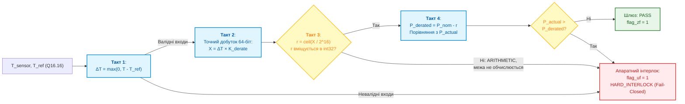
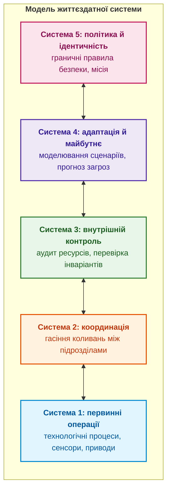
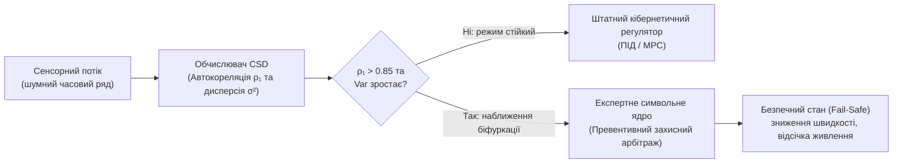
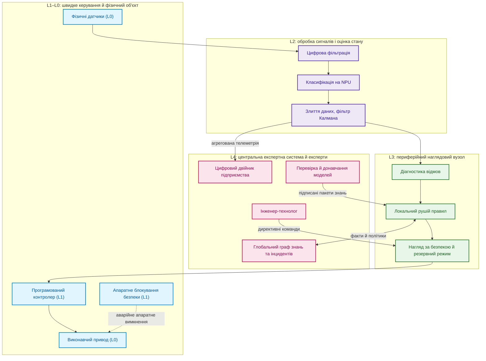
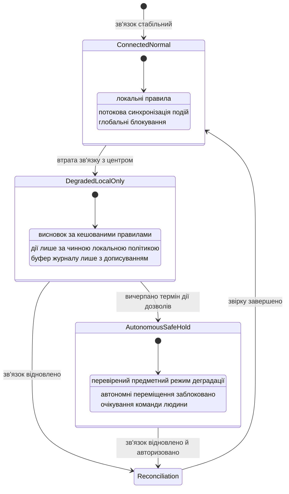
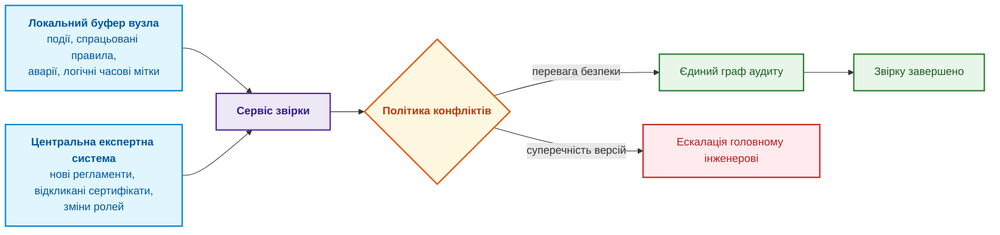
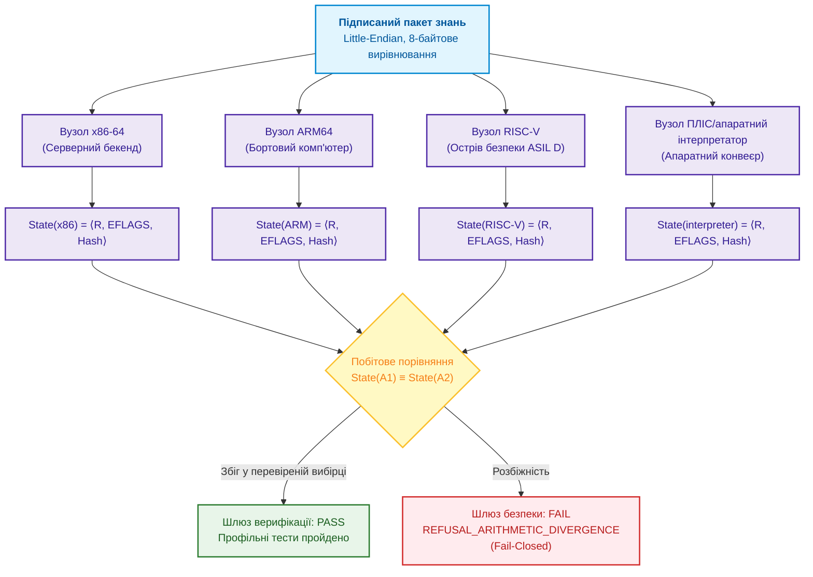

# Глава 22. Кібернетичний цикл керування: сенсори, периферія та зворотний зв'язок

> **Книга:** [Архітектура доказових експертних систем](README.md) · [Частина VII: Технологічний стек, апаратна інфраструктура, кібернетичне виконання та розподілена SOA](part-07-runtime-and-knowledge-exchange.md)
> **Попередня глава:** [Глава 21. Від рекомендації до дії: контроль повноважень і безпечне виконання у виробничому середовищі](ch21-from-recommendation-to-action.md)
> **Наступна глава:** [Глава 35. Реактивна експертна система: події, відкликання й адаптація знань](ch35-self-organizing-expert-systems-synergetics-and-npu-runtime.md)
> **Зміст книги:** [README.md](README.md)  
> **Автор:** [Микола Федчик](about-the-author.md)  
> **Рівень складності та оптимальне вивчення:** `[L3]` Формально-математичний та кібернетичний (індекс Д. Кнута `[34]`) · *Маршрут:* `Трек D` (цикли зворотного зв'язку L0–L4 та закон Ешбі); 2 проходи  
> **Очікувані результати:** застосовувати закон необхідної різноманітності Ешбі й теорему про добрий регулятор до архітектури експертної системи; оцінювати стан об'єкта фільтром замість сирого сигналу; розподіляти функції між рівнями L0–L4 за часовими горизонтами; передавати від сенсорів підписані ознаки, а не вердикти; проєктувати режими деградації за обриву зв'язку й звірку станів після відновлення; оновлювати знання на периферії підписаними пакетами.

## Анотація

На автоматизованій виробничій лінії високочастотний датчик фіксує нетиповий сплеск вібрації в підшипниковому вузлі. Як реагувати? Можна негайно вимкнути приводний двигун, можна надіслати інженерові сповіщення про огляд у найближчу регламентну паузу, а можна знехтувати сигналом як короткочасною завадою від сусіднього преса. Числовий вихід нейромережевого класифікатора сам не дає відповіді. Рішення залежить від контексту: стадії технологічного процесу, достовірності калібрування датчика, температури мастила, вартості зупинки конвеєра, наявності резервного каналу й повноважень вузла, що ухвалює рішення.

Якщо зв'язок із центральним сервером обірвався, захисна логіка мусить спрацювати безпосередньо біля обладнання, на периферії (*edge*). Водночас локальний контролер не знає повної історії обслуговування парку машин і не має права сам змінювати технологічний регламент заводу. Така поведінка типова для кіберфізичних систем, у яких обчислення тісно переплетені з фізичними процесами й мають встигати за ними [[1]](#src-1).

Ця глава відповідає на запитання: **як замкнути зворотний зв'язок між фізичним процесом, периферійними вузлами й центральною експертною системою так, щоб керування залишалося безпечним за затримок, шуму й обриву зв'язку?** Теза глави: **цикл керування розкладають за часовими горизонтами. Швидкі захисні реакції виконують детерміновані контролери біля обладнання через апаратні обмежувачі робочого конверта (Operating Envelope) та фіксовану арифметику, програмно-керований фізичний рівень (AI-RAN PHY) постачає сенсорні свідоцтва до логіки виведення, а виконання правил за спільним профілем проєктують для визначеного класу платформ і перевіряють на однакових знімках та тестових векторах. Периферійний вузол оцінює стан об'єкта й застосовує кешовані правила, а центральна експертна система оновлює знання лише криптографічно підписаними пакетами. Для кожного рівня визначають модель збурень, доступні реакції, режим деградації й правила звірки після відновлення зв'язку; безпечність залежить від цих припущень і перевірок.

## 1. Кібернетика й закон необхідної різноманітності Ешбі

Норберт Вінер визначив кібернетику як науку про керування й зв'язок у тваринах і машинах, побудовану навколо зворотного зв'язку [[2]](#src-2). Для експертної системи з цієї рамки випливає практичне запитання: чи здатна експертна система розрізнити всі стани об'єкта, на які вона мусить реагувати по-різному. Кількісну відповідь дає закон необхідної різноманітності Вільяма Росса Ешбі [[3]](#src-3).

Різноманітністю скінченної множини станів $\Omega$ Ешбі називав кількість її розрізнюваних елементів; у логарифмічній формі

```math
V(\Omega) = \log_2 \lvert \Omega \rvert
```

- Для вимірювання різноманітності $\Omega$ є скінченною множиною станів, а $\lvert \Omega \rvert$ є кількістю її розрізнюваних елементів;
- $`\log_2`$ є логарифмом за основою 2, а $V(\Omega)$ вимірюється в бітах;
- рівність задає число бітів, потрібне для розрізнення станів множини за цією моделлю.

Якщо множина містить 1 024 стани, $`V(\Omega)=\log_2(1024)=10`$ біт. Така оцінка рахує лише кількість станів, а не складність чи ймовірність кожного стану.

Закон необхідної різноманітності в такій формі стверджує, що різноманітність результатів $`V_O`$ не може бути меншою за різноманітність збурень $`V_D`$ мінус різноманітність реакцій регулятора $`V_R`$:

```math
V_O \geq V_D - V_R
```

Закон обмеження:

- $`V_O`$ є різноманітністю результатів, $`V_D`$ є різноманітністю збурень, а $`V_R`$ є різноманітністю реакцій регулятора;
- кожна величина вимірюється в бітах у межах тієї самої моделі станів;
- $\geq$ означає «не менше ніж», а знак $-$ віднімає здатність регулятора поглинути збурення від різноманітності самих збурень.

За наведеного далі прикладу $`V_D=10`$ біт і $`V_R=1`$ біт, тому неврегульована різноманітність результатів має бути не меншою за $9$ біт. Нерівність задає нижню межу й не визначає сама собою, які саме реакції забезпечать безпечну поведінку.

За навчального припущення, що 1024 збурення потребують різних реакцій, регулятора з двома реакціями недостатньо. Проте кількість назв у класифікаторі не дорівнює різноманітності доступних керуючих дій. Нерівність обмежує кількість розрізнюваних результатів, не рахує автоматично небезпечні або «неконтрольовані» випадки. Одна захисна дія може бути придатною для багатьох різних несправностей. Онтологія допомагає розрізняти контекст, але без спостережуваності й доступних дій сама не збільшує здатності регулювання.

> [!NOTE]
> **Три кібернетичні обмеження архітектури регулятора за законом Ешбі в концепції автора**
> 1. Епістемічна різноманітність проти комбінаторного вибуху: онтологія відмов збільшує здатність системи розрізняти контекст збурень $`V_D`$, але сама по собі не збільшує керованості без наявності адекватного набору дій $`V_R`$.
> 2. Асиметрія захисного регулювання: одна детермінована захисна дія (аварійне відсікання живлення) може успішно поглинати сотні різних фізичних несправностей, забезпечуючи виконання нерівності Ешбі $`V_O \ge V_D - V_R`$ без надмірного ускладнення виконавчих органів.
> 3. Обов'язковість внутрішньої моделі об'єкта: згідно з теоремою Конанта — Ешбі, пряме замикання правил на шумний сенсор веде до регуляторного колапсу; наявність фільтруючого оцінювача стану є математично необхідною передумовою успішного керування.
> *Інженерний інваріант:* Доказова експертна система досягає необхідної різноманітності через багаторівневу семантичну фільтрацію станів, а не через хаотичне нарощування розгалужень правил.

Теорема Конанта й Ешбі [[4]](#src-4) сформульована для визначеної моделі регулювання й умов оптимальності. Вона не вимагає, щоб кожен інженерний регулятор мав окремий цифровий двійник або саме фільтр Калмана [[5]](#src-5). Для цієї архітектури оцінювач стану є обґрунтованим вибором, коли приховані змінні треба відновлювати із шумних даних. Його придатність перевіряють за моделлю, похибкою й часовим бюджетом. Діаграма показує запропонований цикл.


Діаграма підкреслює фундаментальний авторський **принцип семантичної ізоляції правил від сирих сигналів**: жодне логічне правило доказової експертної системи не повинно звертатися безпосередньо до сирих апаратних регістрів або неперевірених відліків АЦП — вхідним операндом правила завжди виступає верифікована оцінка стану або семантичний факт. Наступний розділ показує на числах, чому ця різниця є критичною для функціональної безпеки.

## 2. Паралельний програмний конвеєр: черга обробки завдань

Автором запропоновано **патерн програмного кібернетичного ізоморфізму конвеєра обробки завдань**: зворотний зв'язок і циклічні принципи кібернетичного керування застосовуються не лише до фізичних верстатів, а й до розподіленого програмного забезпечення без фізичних сенсорів. Нехай програмний сервіс приймає завдання, обробники виконують їх, а контролер масштабує кількість обробників за телеметрією. Затримка метрик, повтори й обмеження залежного сервісу тут ізоморфно відіграють роль затримок, шуму й меж виконавчого механізму (Таблиця 22.1).

| Частина циклу | Програмний відповідник | Перевірка експертною системою |
|---|---|---|
| об'єкт керування | черга й обробники | розрізняти зростання навантаження та падіння пропускної здатності |
| спостереження | вік найстарішого завдання, темп надходження, завершення й повтори | перевірити часові мітки й повноту метрик |
| оцінка стану | припущення про нестачу обробників або перевантаження залежного сервісу | не трактувати один великий розмір черги як готовий діагноз |
| дозволена дія | зміна числа обробників, обмеження приймання або повідомлення оператору | застосувати погоджені межі й повноваження |
| відгук | зміна віку завдань, помилок і повторів | перевірити, чи дія поліпшила стан, а не лише зменшила видиму чергу |

З інженерного досвіду автора випливає **правило верифікації зворотного зв'язку в автоскейлінгу**: перед активацією автоматичного керування програмними обробниками експертна система зобов'язана верифікувати час реакції залежних сервісів, блокуючи повторне масштабування до завершення перехідного процесу попередньої дії. Якщо контролер бачить застарілі метрики, він може кілька разів поспіль збільшити число обробників до того, як побачить результат першої зміни. Якщо вузьке місце в базі даних, додаткові обробники й повтори лише збільшать конкуренцію. Експертна система може пояснити ці гіпотези й перевірити правила дії, але не замінює штатного регулятора масштабування.

Перед автоматизацією перевіряють затримку спостереження й виконання, коливання числа обробників, вік завдань і частку повторів. Погоджують час очікування ефекту, верхню межу дії та режим за відсутньої телеметрії. Навчальний приклад не задає універсальних порогів: для конкретного сервісу потрібні навантажувальні випробування. Та сама проблема оцінювання стану далі розглядається на фізичному сигналі.

## 3. Оцінювання стану: фільтрація замість сирого сигналу

Розгляньмо правило захисту силових транзисторів у блоці розподілу живлення: знизити потужність удвічі, якщо температура перевищує 85 °C і зростає швидше за 2,5 °C/с:

```math
T > 85^\circ\mathrm{C} \;\land\; \frac{dT}{dt} > 2{,}5^\circ\mathrm{C/s} \;\Rightarrow\; \mathrm{DeratePower}(50\,\%)
```

- Правило термозахисту використовує $T$, поточну температуру транзистора в градусах Цельсія, і поріг $`85^\circ\mathrm{C}`$;
- $`\frac{dT}{dt}`$ є швидкістю зміни температури в градусах Цельсія за секунду, а $`2{,}5^\circ\mathrm{C/s}`$ є порогом швидкості нагрівання;
- $>$ означає «більше за», $\land$ вимагає одночасної істинності обох умов;
- $\Rightarrow$ означає, що за виконання умов запускається дія $`\mathrm{DeratePower}(50\,\%)`$, тобто зниження потужності до 50 %.

Отже, правило знижує потужність лише тоді, коли температура вже перевищила 85 °C і продовжує зростати швидше за заданий поріг. Похідну треба оцінювати з урахуванням шуму сенсора й інтервалу опитування, інакше випадковий шум може спричинити хибне спрацювання.

Правило виглядає простим, але похідна шумного сигналу є підступною величиною. Якщо датчик опитують кожні 50 мс, а шум вимірювання має стандартне відхилення 0,5 °C, то різниця двох сусідніх вимірювань, поділена на 0,05 с, має шум порядку $`0{,}5 \cdot \sqrt{2} / 0{,}05 \approx 14`$ °C/с, що в кілька разів більше за поріг правила. Програма мовою Go моделює 60 секунд роботи у двох сценаріях: транзистор гарячий (86 °C), але не нагрівається, і транзистор нагрівається на 3 °C/с від 80 °C. Похідну обчислюють двома способами: наївно, з двох сусідніх вимірювань, і альфа-бета-фільтром, найпростішим оцінювачем стану з моделлю сталої швидкості зміни, який уточнює оцінку температури й швидкості на кожному кроці.

<details>
<summary>Приклад мовою Go: наївна похідна й альфа-бета-фільтр для правила за швидкістю нагріву</summary>

```go
package main

import (
	"errors"
	"fmt"
	"math"
	"math/rand"
)

const dt = 0.05 // період опитування датчика, с

type Estimate struct {
	Temperature   float64
	Rate          float64
	RateAvailable bool
}

type AlphaBeta struct {
	Alpha, Beta, MaxGap float64
	lastTime            float64
	initialized         bool
	estimate            Estimate
}

func finite(value float64) bool {
	return !math.IsNaN(value) && !math.IsInf(value, 0)
}

func (filter *AlphaBeta) Update(at, measurement float64) (Estimate, error) {
	if !finite(at) || !finite(measurement) || !finite(filter.Alpha) || !finite(filter.Beta) ||
		!finite(filter.MaxGap) || filter.Alpha <= 0 || filter.Alpha > 1 ||
		filter.Beta <= 0 || filter.Beta > 1 || filter.MaxGap <= 0 {
		return Estimate{}, errors.New("invalid measurement or filter configuration")
	}
	if !filter.initialized {
		filter.estimate = Estimate{Temperature: measurement}
		filter.lastTime, filter.initialized = at, true
		return filter.estimate, nil
	}
	interval := at - filter.lastTime
	if interval <= 0 || interval > filter.MaxGap {
		return Estimate{}, errors.New("duplicate, reordered, or stale measurement")
	}
	predicted := filter.estimate.Temperature + filter.estimate.Rate*interval
	residual := measurement - predicted
	next := Estimate{
		Temperature:   predicted + filter.Alpha*residual,
		Rate:          filter.estimate.Rate + filter.Beta/interval*residual,
		RateAvailable: true,
	}
	if !finite(next.Temperature) || !finite(next.Rate) {
		return Estimate{}, errors.New("non-finite estimate")
	}
	filter.estimate, filter.lastTime = next, at
	return next, nil
}

// rule є правилом зниження потужності: температура понад 85 °C і зростає швидше за 2,5 °C/с.
func rule(temp, rate float64) bool { return temp > 85 && rate > 2.5 }

// run моделює 60 с роботи й повертає кількість спрацювань правила та момент першого спрацювання.
// Якщо alpha == 0, похідну рахують «наївно» з двох сусідніх вимірювань.
func run(trueTemp func(t float64) float64, alpha, beta float64) (fires int, first float64) {
	r := rand.New(rand.NewSource(7))
	first = -1
	var prev float64
	filter := AlphaBeta{Alpha: alpha, Beta: beta, MaxGap: 4 * dt}
	for k := 0; k <= int(60/dt); k++ {
		t := float64(k) * dt
		z := trueTemp(t) + 0.5*r.NormFloat64() // вимірювання з шумом σ = 0,5 °C
		var temp, rate float64
		if k == 0 {
			prev = z
		}
		if alpha == 0 {
			temp, rate = z, (z-prev)/dt
		} else {
			estimate, err := filter.Update(t, z)
			if err != nil {
				panic(err)
			}
			temp, rate = estimate.Temperature, estimate.Rate
		}
		prev = z
		if k > 0 && rule(temp, rate) {
			fires++
			if first < 0 {
				first = t
			}
		}
	}
	return fires, first
}

func main() {
	stable := func(t float64) float64 { return 86 } // гаряче, але не нагрівається
	ramp := func(t float64) float64 {               // нагрів 3 °C/с протягом 10 с від 80 °C
		if t < 10 {
			return 80 + 3*t
		}
		return 110
	}
	for _, f := range []struct {
		name        string
		alpha, beta float64
	}{{"наївна похідна", 0, 0}, {"альфа-бета-фільтр", 0.1, 0.005}} {
		falseFires, _ := run(stable, f.alpha, f.beta)
		_, first := run(ramp, f.alpha, f.beta)
		fmt.Printf("%-18s | хибних спрацювань за 60 с: %4d | перше спрацювання під час нагріву: %.2f с\n",
			f.name, falseFires, first)
	}
}
```

Синтетичні тести перевіряють часову область і стан фільтра. Виконання: `go test -v main.go main_test.go`.

```go
package main

import (
	"math"
	"testing"
)

func TestMeasurementValidity(testCase *testing.T) {
	filter := AlphaBeta{Alpha: 0.1, Beta: 0.005, MaxGap: 0.2}
	initial, err := filter.Update(7, 25)
	if err != nil || initial.RateAvailable {
		testCase.Fatal("first sample incorrectly supplied a measured rate")
	}
	updated, err := filter.Update(7.1, 26)
	if err != nil || !updated.RateAvailable || math.Abs(updated.Rate-0.05) > 1e-10 {
		testCase.Fatalf("wrong actual-time update: %+v, %v", updated, err)
	}
	before := filter
	for _, input := range []struct{ at, value float64 }{
		{7.1, 26}, {7, 26}, {9, 26}, {7.15, math.NaN()}, {7.15, math.Inf(1)},
	} {
		if _, err := filter.Update(input.at, input.value); err == nil {
			testCase.Fatal("invalid event accepted")
		}
		if filter != before {
			testCase.Fatal("invalid event changed filter state")
		}
	}
	if _, err := (&AlphaBeta{Alpha: 0.1, Beta: 0.005}).Update(0, 25); err == nil {
		testCase.Fatal("missing gap policy accepted")
	}
}
```

</details>

Програма виводить:

<details>
<summary>Дані або результат прикладу</summary>

```text
наївна похідна     | хибних спрацювань за 60 с:  520 | перше спрацювання під час нагріву: 1.55 с
альфа-бета-фільтр  | хибних спрацювань за 60 с:    0 | перше спрацювання під час нагріву: 1.80 с
```

</details>


Отримані результати підтверджують сформульовану автором **закономірність мультиплікації шуму різницевих правил**: наївне чисельне диференціювання дискретного сигналу з інтервалом опитування $\Delta t$ зумовлює мультиплікацію дисперсії вимірювального шуму у пропорції $`\sigma_{v} = \frac{\sqrt{2}\sigma_x}{\Delta t}`$, що перетворює різницеві правила без фільтрації на генератор катастрофічних хибних спрацьовувань. За одного зафіксованого початкового стану генератора наївна похідна дала 520 хибних оцінок правила для стаціонарного сигналу за 60 секунд, тоді як оцінювач стану на базі альфа-бета-фільтра не допустив жодного помилкового спрацювання. Це не кількість окремих захисних дій і не доведення абсолютно нульової частоти хибних реакцій: програма не моделює зміну температури після зниження потужності. Для наростання поріг 85 °C перетинається приблизно на 1,67 с, а фільтр дав першу оцінку на 1,80 с. Затримку й похибки потрібно перевіряти на багатьох реалізаціях шуму, різких змінах та пропусках.

У розробленій архітектурі впроваджено авторське **правило темпоральної валідації та контролю розривів сенсорного потоку**: оцінювач стану зобов'язаний обчислювати фактичний часовий інтервал $`\Delta t = t_k - t_{k-1}`$, безумовно відкидаючи дублікати ($`t_k \le t_{k-1}`$), нечислові значення (`NaN`, `Inf`) та перевищення допустимого розриву $`\Delta t > \Delta t_{\mathrm{max}}`$ без несанкціонованої мутації внутрішнього стану. Прапорець `RateAvailable` означає лише, що швидкість обчислена після двох валідних подій, а не те, що її точність достатня для захисту. Фільтр використовує фактичний інтервал і відкидає переставлені події.
Поруч із цим діє **епістемічний принцип збереження деградованого статусу спостереження Федчика**: відкинутий або пропущений вимір переводить спостереження у деградований статус (`DEGRADED_OBSERVATION`), категорично забороняючи підміну відсутніх вимірювань штучним нулем або фіктивною відсутністю загрози. Межа розриву й коефіцієнти є параметрами навчального досліду, не перевіреним профілем реального транзистора. Приклад ілюструє користь моделі шуму, а не доводить теорему про регулятор або безпеку замкненого керування.

### 3.1. Багатовимірний гіпероб'єм безпечного робочого простору (Operating Envelope) та цілочисельна дегресія в Q16.16

Фільтрація шуму одного температурного сигналу усуває хибні спрацювання, проте в критичній силовій мікроелектроніці (тягові інвертори електромобілів, блоки керування батареями BMS, контролери Infineon AURIX рівня ISO 26262 ASIL D) фізичні межі безпеки ніколи не описуються одновимірними ізольованими порогами. Безпечний робочий простір об'єкта утворює багатовимірний зв'язаний гіпероб'єм (*Operating Envelope*), де гранично допустима напруга ядра $`V_{\mathrm{core}}`$ жорстко залежить від поточної температури кристала $`T_j`$, робочої тактової частоти $`F_{\mathrm{cpu}}`$ та інжекційних струмів виводів $`I_{\mathrm{inj}}`$.

Спроби програмного обчислення нелінійних поверхонь безпеки на центральному процесорі стикаються з двома фатальними бар'єрами:
1. **Неприпустима недетерміністична затримка:** обчислення з рухомою комою (FP32/FP64) спричиняють джиттер і затримку в десятки мікросекунд, що унеможливлює реакцію в субмікросекундному циклі захисту ($`< 1\,\mu\text{с}`$).
2. **Катастрофічний дефект інверсії меж (Envelope Inversion Fault):** при переході на апаратну цілочисельну фіксовану кому Q16.16 у кремнії добуток перепаду температур (для прикладу з $`T_{\mathrm{ref}}=85^\circ\text{C}`$ до $`\Delta T_{\max}=175^\circ\text{C}-85^\circ\text{C}=90^\circ\text{C}`$) на коефіцієнт дегресії сам не переповнюється: точний добуток двох знакових 32-бітних чисел Q16.16 завжди вміщується в 64 біти ($`\lvert a\cdot b\rvert\le2^{62}`$). Небезпека виникає під час **звуження** результату до 32 біт, зокрема коли невід'ємна дегресія досягає $`2^{15}`$ одиниць шкали. Механічне зрізання розрядів без насичення (`prod[47:16]`) викликає інверсію знакового біта: обчислена дегресія раптово стає від'ємною, штучно **розширюючи** дозволений діапазон потужності під час аварійного перегріву замість його захисного звуження, що може спричинити небезпечне перевантаження силового каскаду; конкретний фізичний наслідок потребує моделі об'єкта.

Для захисту від неконтрольованого звуження запропоновано конвеєрний співпроцесор гіперобмежувача у форматі Q16.16. Безпекова межа обчислюється лише за валідних входів і без переповнення; насичення не є допустимим результатом для подальшого керування:

```math
\Delta T = \max(0, T_{\mathrm{sensor}} - T_{\mathrm{ref}}).
```

```math
P_{\mathrm{derated}} = P_{\mathrm{max\_nominal}} - \mathrm{SaturateQ16}(\Delta T \cdot K_{\mathrm{derate}}).
```

```math
\mathrm{SaturateQ16}(X) = \begin{cases}
\text{0x7FFF\_FFFF}, & \text{якщо } \lceil X / 2^{16} \rceil > \text{0x7FFF\_FFFF}, \\
\text{0x8000\_0000}, & \text{якщо } \lceil X / 2^{16} \rceil < -2^{31}, \\
\lceil X / 2^{16} \rceil, & \text{інакше}.
\end{cases}
```

Тут $X$ — точний знаковий 64-бітний добуток сирих значень операндів; ділення на $`2^{16}`$ повертає масштаб Q16.16. Перші дві гілки є насиченням. За числовим профілем $`\mathcal{P}_{Q16.16}`$ (§3.1.2, п. 5) насичення дегресії є відмовою з причиною `ARITHMETIC`: $`P_{\mathrm{derated}}`$ не обчислюється, модуль виставляє $`\mathrm{flag\_uf}=1`$ і `HARD_INTERLOCK`. Оператор має передати ознаку переповнення окремо від 32-бітного значення: саме значення на межі формату не відрізняє допустимий результат від насичення. Дегресію округлюють угору, бо округлення вниз недооцінює її до одного молодшого розряду й може розширити межу потужності.

Параметри формул апаратної дегресії:
- $`T_{\mathrm{sensor}}`$ — поточна температура сенсора у форматі Q16.16, діапазон $`[-40{,}0, +175{,}0]^\circ\text{C}`$;
- $`T_{\mathrm{ref}}`$ — базова температура початку теплового зниження номіналів, $`T_{\mathrm{ref}}\in[-40{,}0;\,+175{,}0]^\circ\text{C}`$; у прикладі $`+85{,}0^\circ\text{C}`$;
- $\Delta T$ — невід'ємне перевищення теплового порогу; спершу порівнюють $`T_{\mathrm{sensor}}>T_{\mathrm{ref}}`$ і лише тоді віднімають без обертання; за наведених діапазонів $`\Delta T\le215^\circ\text{C}`$ вміщується в Q16.16;
- $`K_{\mathrm{derate}}`$ — коефіцієнт дегресії у кВт/°C у форматі Q16.16, $`K_{\mathrm{derate}}\ge0`$; від'ємне значення дає відмову;
- $`P_{\mathrm{max\_nominal}}`$ — паспортна номінальна потужність у холодній зоні, кВт у Q16.16: діапазон $`[-32\,768;\,32\,768)`$ кВт, крок $`2^{-16}`$ кВт; $`P_{\mathrm{max\_nominal}}\ge0`$;
- $`P_{\mathrm{derated}}`$ — динамічно обчислена межа потужності у кВт, яку не формують за переповнення;
- $`P_{\mathrm{actual}}`$ — поточна споживана потужність у кВт у Q16.16, $`P_{\mathrm{actual}}\ge0`$; від'ємне значення належить до окремого профілю рекуперації й дає відмову з $`\mathrm{flag\_uf}=1`$;
- $`\mathrm{SaturateQ16}`$ — апаратний оператор звуження з округленням угору, який перевіряє діапазон **після** округлення; в апаратному поданні аналізують старші розряди суми $`X+2^{16}-1`$, а не самого $X$.

Якщо температура лежить поза діапазоном сенсора або спостереження застаріле, воно отримує статус `DEGRADED_OBSERVATION`, а модуль повертає відмову з $`\mathrm{flag\_uf}=1`$, не нульову дегресію. Негативні коефіцієнт дегресії або номінальна потужність також не є валідними входами профілю.



> [!NOTE]
> **Три інваріанти апаратного гіперобмежувача робочого конверта (Operating Envelope) за моделлю автора**
> 1. Звуження без знакової інверсії: оператор $`\mathrm{SaturateQ16}`$ звужує 64-бітний добуток до 32 біт з округленням угору й сигналізує насичення, перевіряючи діапазон після округлення. **За умов** $`K_{\mathrm{derate}}\ge0`$, $`P_{\mathrm{max\_nominal}}\ge0`$, обчислення $\Delta T$ без обертання, округлення дегресії вгору й трактування насичення як відмови межа не перевищує номіналу й не зростає з температурою. Обґрунтування — аргумент діапазону: добуток невід'ємний, дегресія монотонна, а насичення не потрапляє в результат. Машинне доведення для 32-бітного формату (SMT) не виконано. За від'ємного коефіцієнта цей висновок не діє, тому вхід відхиляється.
> 2. Конвеєрний нульовий джиттер ($`\mathrm{Jitter} = 0`$): у референсній реалізації (§3.1.1, п. 2) 4-тактний конвеєр на ПЛІС/ASIC виконує розрахунок дегресії рівно за $`20\,\text{нс}`$ ($`F = 200\,\text{МГц}`$), що на три порядки швидше за таймери RTOS ($`10\text{--}50\,\mu\text{с}`$).
> 3. Безумовний апаратний інтерлок (Fail-Closed): перевищення динамічної межі $`P_{\mathrm{actual}} > P_{\mathrm{derated}}`$ миттєво активує сигнал `HARD_INTERLOCK` за 1 такт референсної реалізації ($`5\,\text{нс}`$) в обхід ОС, переводячи драйвери силового каскаду в безпечний стан.
> *Керування рантаймом:* Захист силового тракту делегується детермінованому кремнієвому інтерлоку L0, усуваючи залежність безпеки від затримок софтового стека.

#### 3.1.1. Замкнений цикл інженерного розрахунку апаратної дегресії

1. **Керування рантаймом і потоком обчислень (Control Flow & Runtime Decisions):**
   Лише після проходження перевірок входів і звуження на 4-му такті референсного конвеєра компаратор співставляє навантаження з динамічною стелею $`P_{\mathrm{derated}}`$. За переповнення шлях до компаратора закрито. Якщо $`P_{\mathrm{actual}} \le P_{\mathrm{derated}}`$, біт $`\mathrm{flag\_zf}`$ встановлюється в 1, і керуючий ШІМ-сигнал транслюється на затвори транзисторів без затримки. Якщо межу перевищено або якщо $`P_{\mathrm{derated}} < P_{\mathrm{min\_safe}}`$ (схлопування вікна валідності), логіка виставляє прапорець порушення $`\mathrm{flag\_uf} = 1`$ і миттєво генерує прямий апаратний сигнал `HARD_INTERLOCK`, скидаючи драйвери силового моста в захисний стан за 1 такт референсної реалізації ($`5\,\text{нс}`$, §3.1.1, п. 2) без участі операційної системи.
2. **Апаратний сайзинг та інфраструктурні обмеження (Hardware Dimensioning):**
    *Референсна реалізація (ілюстрація, не нормативна частина специфікації). Числовий профіль $`\mathcal{P}_{Q16.16}`$ задає правила арифметики; версійований профіль інструкцій визначає коди операцій, байтове кодування й переходи стану.*
   - Конвеєр реалізується на 4 регістрах фіксації в ПЛІС/ASIC, займаючи не більше 380 LUT та 1 апаратного помножувача DSP48E2 на кристалах Xilinx UltraScale+;
   - Затримка конвеєра на тактовій частоті $`200\,\text{МГц}`$ становить строго $`4 \times 5\,\text{нс} = 20\,\text{нс}`$ із нульовим джиттером ($`\mathrm{Jitter} = 0`$), що на три порядки швидше за програмні таймери RTOS ($`10\text{–}50\,\mu\text{с}`$).
3. **Практичний числовий приклад (Worked Numerical Example):**
   Розглянемо тяговий інвертор електромобіля з паспортною потужністю $`P_{\mathrm{max\_nominal}} = 150\,\text{кВт}`$ (у Q16.16: `0x0096_0000`), початком дегресії $`T_{\mathrm{ref}} = 85^\circ\text{C}`$ та коефіцієнтом $`K_{\mathrm{derate}} = 2{,}5\,\text{кВт/}^\circ\text{C}`$ (у Q16.16: `0x0002_8000`).
   При аварійному сплеску температури сенсора до $`T_{\mathrm{sensor}} = 135^\circ\text{C}`$:
   - $`\Delta T = 135 - 85 = 50^\circ\text{C}`$ (`0x0032_0000`);
   - Добуток $`\Delta T \cdot K_{\mathrm{derate}} = 50 \times 2{,}5 = 125\,\text{кВт}`$;
   - $`P_{\mathrm{derated}} = 150 - 125 = 25\,\text{кВт}`$.
   
   Якщо поточне споживання двигуна становить $`80\,\text{кВт}`$, за $`20\,\text{нс}`$ конвеєр фіксує перетин межі ($80 > 25$), виставляє $`\mathrm{flag\_uf} = 1`$    і формує сигнал відмови `HARD_INTERLOCK`. Чи запобігає це пошкодженню силових модулів, залежить від теплової моделі об'єкта й реакції силового тракту, які тут не моделюються.

      Приклад ілюструє нормальне числове звуження: добуток 125 кВт менший за межу формату 32 768 кВт, тому насичення не спрацьовує й дефект звуження цей приклад не демонструє.

#### 3.1.2. Нормативний числовий профіль $`\mathcal{P}_{Q16.16}`$

Цей профіль — єдине означення арифметики з фіксованою комою для всієї книги: кожне вживання формату Q16.16 у книзі означає цей профіль.

1. **Формат.** Значення $v$ зберігається як знакове 32-бітне ціле $z$ у доповняльному коді, $`v = z \cdot 2^{-16}`$; діапазон $`[-32\,768;\ 32\,768 - 2^{-16}]`$, крок $`2^{-16}`$. Одиницю величини задає місце, де величину визначено.
2. **Додавання й віднімання** обчислюються точно в 33 бітах; результат поза діапазоном формату є переповненням (п. 5).
3. **Множення.** Добуток обчислюється точно як 64-бітне ціле $`X = z_a \cdot z_b`$; переповнення 64 біт неможливе, бо $`\lvert z_a z_b \rvert \le 2^{62}`$. Результат звужується до Q16.16 діленням на $`2^{16}`$ з округленням (п. 4).
4. **Округлення.** Якщо означення формули не задає напряму, округлюють униз ($`\lfloor X / 2^{16} \rfloor`$, арифметичний зсув). Величини, що зменшують безпекову межу, округлюють у безпечний бік щодо тієї межі, яку вони зменшують (для верхньої межі — вгору; для нижньої, як-от $`P_{\mathrm{min\_safe}}`$, — униз). Для округлення вгору застосовують $`\lceil X / 2^{16} \rceil`$. Напрям округлення вказують в означенні кожної формули.
5. **Переповнення ⇒ відмова.** Діапазон перевіряють після округлення (п. 4). Якщо результат не вміщується в діапазон формату, його не записують у безпекову величину. Обчислення повертає типізовану відмову з причиною `ARITHMETIC` і виставляє UF = 1 (у §3.1 — $`\mathrm{flag\_uf} = 1`$). Інтерпретатор профілю зупиняється з $`\mathrm{REASON} = \texttt{ARITHMETIC}`$. Насичене значення (найбільше чи найменше значення формату) з продовженням обчислення допускається лише для величин, які означення формули або таблиця кодів операцій явно позначає як діагностичні, і завжди з UF = 1.
6. **Ділення** до числового профілю не входить. Якщо таблиця кодів операцій ISA-профілю (§10.1.2) містить ділення, вона задає для кожного такого коду напрям округлення частки. Нульовий дільник зупиняє ядро за §10.1.2, п. 7 (`HALT_FAULT`).
7. **Порядок байтів** у пакеті — Little-Endian; правила читання задає ISA-профіль (§10.1.2).
8. **Рухома кома** в нормативному допуску не використовується.

Для однакового версійованого профілю й тієї самої послідовності операцій очікується однаковий результат; межі підтримки та спосіб перевірки задає профіль (§10.1.2).

---

## 4. Кібернетика другого порядку, модель життєздатної системи й активний висновок

Класична кібернетика розглядала керований об'єкт як зовнішній щодо регулятора. У складних соціотехнічних застосуваннях це припущення порушується, і три ідеї другої половини XX і початку XXI століття допомагають це врахувати.

**Кібернетика другого порядку.** Гайнц фон Ферстер запропонував розглядати спостерігача як частину системи, яку він спостерігає [[6]](#src-6). Для експертної системи це не абстракція: щойно вона видає рекомендацію чи діагноз, оператори змінюють поведінку, змінюючи тим самим дані, на яких експертна система навчається й перевіряє свої правила. Тому журнал рішень експертної системи є не лише аудитом, а й частиною даних про об'єкт керування, і правила оцінювання якості мають враховувати вплив попередніх рекомендацій.

**Модель життєздатної системи.** Стаффорд Бір запропонував модель життєздатної системи (*Viable System Model*, VSM), у якій будь-яка організація, здатна зберігати життєздатність, має п'ять функціональних підсистем [[7]](#src-7). Діаграма показує ці підсистеми.



Автором розроблено **модель розміщення експертної системи в архітектурі VSM Біра**: доказова експертна система природно займає місце на стику Системи 3 (контроль і аудит дотримання регламентів внутрішнього середовища «тут і зараз») та Системи 4 (стратегічне моделювання розвитку зносу чи аварій зовнішнього середовища), діючи під нормативним арбітражем граничних правил Системи 5. Корисність моделі для архітектора полягає в контрольному інваріанті: якщо в системі відсутня явна координаційна Система 2, конфлікти між автономними периферійними вузлами (наприклад, два вузли одночасно знижують навантаження на ту саму лінію живлення) призводять до незгасаючих руйнівних автоколивань.

**Активний висновок.** Карл Фрістон запропонував принцип вільної енергії як єдину теорію роботи мозку: адаптивна система мінімізує варіаційну вільну енергію $F$, верхню межу «здивування» від спостережень $`\tilde{y}`$ [[8]](#src-8):

```math
F = \mathbb{E}_{q(\vartheta)}\left[\ln q(\vartheta) - \ln p(\tilde{y}, \vartheta)\right] = \mathrm{KL}\left[q(\vartheta) \,\|\, p(\vartheta \mid \tilde{y})\right] - \ln p(\tilde{y})
```

- У формулі вільної енергії $F$ є скаляром, а $\vartheta$ позначає прихований стан об'єкта;
- $q(\vartheta)$ є наближеним розподілом переконань адаптивної моделі, а $`p(\tilde{y},\vartheta)`$ є спільним розподілом спостереження $`\tilde{y}`$ і стану $\vartheta$ за породжувальною моделлю $p$;
- $`\mathbb{E}_{q(\vartheta)}`$ означає математичне сподівання за розподілом $q$, а $\ln$ є натуральним логарифмом;
- $`p(\vartheta\mid\tilde{y})`$ є апостеріорним розподілом прихованого стану після спостереження, а $`\mathrm{KL}[q\|p]`$ є дивергенцією Кульбака-Лейблера між розподілами;
- $`p(\tilde{y})`$ є граничною ймовірністю спостереження, а рівність показує тотожність між очікуваною формою та KL-формою з доданком $`-\ln p(\tilde{y})`$;
- за натурального логарифма значення інформаційної величини вимірюють у натах.

Мінімізувати $F$ можна двома шляхами: змінити переконання $q$, щоб вони краще пояснювали спостереження (сприйняття), або змінити світ дією, щоб спостереження відповідали очікуванням (активний висновок). Для експертної системи ця теорія є корисною аналогією, а не інженерною вимогою: оцінювач стану з попереднього розділу виконує роль сприйняття, а виконавчі механізми з [Глави 21](ch21-from-recommendation-to-action.md) виконують роль дії. Принцип вільної енергії сформульовано для нейронауки, і експертній системі не обов'язково реалізовувати його буквально, щоб замикати цикл керування.

> [!NOTE]
> **Два аспекти інженерної інтерпретації активного виведення за моделлю автора**
> 1. Сприйняття (Perception): система оновлює внутрішній апостеріорний розподіл переконань $q(\vartheta)$ (стан фільтра Калмана чи баєсівської мережі) для мінімізації дивергенції $`\mathrm{KL}[q \| p]`$ як пасивне узгодження моделі з даними сенсорів.
> 2. Дія (Action): у разі фіксації критичного відхилення контролер формує цільовий керуючий сигнал на виконавчі органи, примушуючи фізичний об'єкт повернутися в межі допустимих уставок безпеки для зменшення інформаційного здивування $`-\ln p(\tilde{y})`$.
> *Керування рантаймом:* Мінімізація варіаційної вільної енергії транслюється в апаратне чергування оцінювання стану та компенсаційного керування.

Автором сформульовано **кібернетичну модель двошвидкісного руху організаційного знання**: знання в доказовій екосистемі циркулює двома циклами різної швидкості. Швидкий оперативний цикл охоплює робочі обговорення, чернетки, експериментальні гіпотези й роботу автономних агентів; він допускає ймовірнісні оцінки, але позбавлений прямого регуляторного авторитету. Повільний керований цикл утримує верифікований граф знань, затверджені архітектурні рішення, перевірені онтології й нормативні обмеження. Знання переходить зі швидкого циклу в повільний виключно через формальну процедуру просування з перевіркою інваріантів і цифровим підписом відповідальної особи, описану в [Главі 19](ch19-from-question-to-evidence.md).

## 5. Синергетична стійкість: біфуркації, критичне уповільнення та передбачення фазових переходів

Класична кібернетика спирається на лінійний зворотний зв'язок: відхилення від уставки генерує коригуючий сигнал. Проте в реальних кіберфізичних комплексах (автономні безпілотники, промислові турбіни, розподільчі електромережі) динаміка об'єкта є суттєво нелінійною. При зростанні навантаження або зносу об'єкт керування може підійти до **точки біфуркації**: порогу якісної зміни динамічного режиму, де лінійні зворотні зв'язки втрачають запас стійкості, а система зривається в аварійний хаос або катастрофічну відмову.

**Синергетика Хакена та Пригожина** показує, що складна динамічна система перед катастрофічним фазовим переходом демонструє фундаментальний ефект: **критичне уповільнення (Critical Slowing Down, CSD)** [[8a]](#src-8a).

Нехай динаміка відхилення стану $x$ біля стаціонарної точки описується лінеаризованим рівнянням із флуктуаціями шуму:

```math
\frac{dx}{dt} = -\lambda x + \sigma \eta(t)
```

де:
- $x$ є відхиленням стану від точки рівноваги;
- $\lambda > 0$ є показником відновлення (швидкістю повернення до рівноваги);
- $\sigma \eta(t)$ є випадковим шумом середовища з інтенсивністю $\sigma$.

Коли система наближається до точки біфуркації, домінуюче власне число прямує до нуля: $\lambda \to 0$. Це породжує два статистичні явища, які можна виміряти програмно в сенсорному потоці:

1. **Зростання автокореляції (Memory Effect):**
Для дискретних вимірювань з інтервалом $\Delta t$ коефіцієнт автокореляції першого порядку прямує до одиниці:

```math
\rho_1 = e^{-\lambda \Delta t} \xrightarrow{\lambda \to 0} 1
```

Система «пам'ятає» випадкові збурення значно довше, її відгук стає в'язким і затягнутим.

2. **Дивергенція дисперсії (Variance Inflation):**
Дисперсія вимірювань стрибкоподібно зростає через нездатність системи швидко розсіювати випадкові збурення:

```math
\mathrm{Var}(x) = \frac{\sigma^2}{2\lambda} \xrightarrow{\lambda \to 0} \infty
```

**Керування рантаймом та превентивний арбітраж:**
- **Поріг критичного сповільнення (CSD Alarm):** якщо в ковзному вікні спостережень одночасно виконуються умови $`\rho_1 \ge \tau_{\rho} = 0{,}85`$ та $`\mathrm{Var}(x) / \sigma_0^2 \ge 3{,}0`$ (дисперсія зросла утричі відносно базового шуму $`\sigma_0^2`$), система сигналізує про неминучу втрату динамічної стійкості;
- **Дія експертного ядра:** рушій перехоплює керування у лінійного регулятора й активує протокол запобіжного переведення в безпечний стан (`PREEMPTIVE_FAIL_SAFE`), примусово знижуючи частоту обертання або розвантажуючи силову шину до настання катастрофічної біфуркації.

**Числовий приклад виявлення біфуркації:**
Сенсор температури силового інвертора з інтервалом вибірки $`\Delta t = 0{,}5\,\text{с}`$ фіксує деградацію охолодження. Показник відновлення впав до $`\lambda = 0{,}1\,\text{с}^{-1}`$, інтенсивність шуму $`\sigma = 0{,}2^\circ\text{C}`$ (базова дисперсія $`\sigma_0^2 = 0{,}04`$):

```math
\rho_1 = e^{-0{,}1 \cdot 0{,}5} = e^{-0{,}05} \approx 0{,}951 \ge 0{,}85
```

```math
\mathrm{Var}(x) = \frac{0{,}2^2}{2 \cdot 0{,}1} = \frac{0{,}04}{0{,}2} = 0{,}20\,(^\circ\text{C})^2 \implies \frac{\mathrm{Var}(x)}{\sigma_0^2} = \frac{0{,}20}{0{,}04} = 5{,}0 \ge 3{,}0
```

Обидва порогові критерії перевищено: система переходить у режим захисного зниження потужності, запобігаючи тепловому пробою транзисторів.



Для експертної системи це відкриває новий клас правил: **превентивні правила передбіфуркаційного захисту**. Замість пасивного очікування, доки температура перевищить аварійний поріг чи дрон втратить керованість, система реєструє синергетичні ознаки критичного уповільнення ($`\rho_1 \uparrow, \mathrm{Var} \uparrow`$) як активний дефітер для штатного режиму та превентивно переводить апарат у захищений стан ще в зоні лінійної керованості.

> [!NOTE]
> **Три синергетичні критерії передбіфуркаційного арбітражу за моделлю автора**
> 1. Детекція критичного уповільнення (CSD): апаратний розрахунок стрибка автокореляції лагу-1 $`\rho_1 \ge 0{,}85`$ у ковзному вікні виявляє втрату здатності системи розсіювати випадкові збурення задовго до виходу за статичні пороги.
> 2. Індикація дивергенції дисперсії: трикратне перевищення поточної дисперсії $`\mathrm{Var}(x) / \sigma_0^2 \ge 3{,}0`$ слугує безсумнівним підтвердженням наближення до точки біфуркації та загрози катастрофічного фазового переходу.
> 3. Превентивне перехоплення керування (`PREEMPTIVE_FAIL_SAFE`): символьне ядро детерміновано блокує команди лінійного ПІД-регулятора та переводить агрегат у захищений режим зниженого навантаження в межах зони лінійної керованості.
> *Керування рантаймом:* Синергетичні метрики CSD виступають активними дефітерами для штатного циклу керування, унеможливлюючи зрив системи в аварійний динамічний хаос.

## 6. Ієрархія часових горизонтів L0–L4

Різні рішення потребують різних часових бюджетів. L0–L4 і наведені інтервали є навчальним розподілом цієї глави, не універсальним стандартом розміщення. Допустимість компонента визначають строк, найгірший час виконання, мережеві припущення й вимоги конкретного об'єкта; сама мова програмування або назва прискорювача цих меж не доводить.

| Рівень | Часовий горизонт | Призначення | Неприпустимо на цьому рівні |
|:---:|---|---|---|
| **L0** | Безперервний | Фізичний об'єкт: механіка, матеріали, енергетика | Програмні припущення без підтвердження сенсорами |
| **L1** | 1 мкс–10 мс | Жорстке локальне керування: сервоприводи, програмовані логічні контролери, ПЛІС, апаратні блокування | Недетерміновані нейромережі, мовні моделі, мережеві з'єднання |
| **L2** | 10 мс–1 с | Сприйняття: цифрова фільтрація сигналів, злиття даних сенсорів, класифікація на NPU | Факти без часової мітки й оцінки похибки |
| **L3** | 1 с–1 хв | Периферійний нагляд: правила, оцінка ризику, керування аварійними режимами | Повноваження змінювати глобальну політику |
| **L4** | 1 хв–дні | Центральна експертна система: глобальний граф знань, ретроспективний аналіз, оновлення моделей | Припущення про постійний зв'язок із периферією |

Діаграма показує, як рівні взаємодіють.



Пунктирна стрілка від апаратного блокування до приводу важлива: аварійне вимкнення на рівні L1 не проходить через жодне програмне забезпечення вищих рівнів. Центральна експертна система впливає на периферію лише двома шляхами: синхронізацією фактів і політик та підписаними пакетами знань. Обидва шляхи повільні й перевірювані, і жоден не є частиною швидкого захисного циклу.

## 7. Контракти сенсорних подій

Доцільність передавання всіх сирих відліків залежить від частоти, кількості каналів, пропускної здатності й задачі. Для поточного рішення периферійний вузол може передавати ознаки вікна з метаданими якості, а дозволені сирі фрагменти зберігати окремо для діагностики й незалежної перевірки. Агрегація не має приховувати короткі події, суттєві для правила. Приклад нижче задає форму навчальної події:

<details>
<summary>Структуроване подання JSON</summary>

```json
{
  "event_id": "evt:vibr:sensor-42:2026-09-27T10:14:02.105Z",
  "source_urn": "urn:plant:sector-b:motor-07:vibr-probe-1",
    "boot_id": "synthetic-boot-17",
    "sequence": 1842,
    "event_time": "2026-09-27T10:14:02.105Z",
    "clock_uncertainty_ms": 5,
  "measurement_window_ms": 100,
  "sampling_rate_hz": 20000,
  "features": {
    "peak_acceleration_g": 4.82,
    "rms_velocity_mms": 11.4,
    "dominant_frequency_hz": 142.5,
    "kurtosis": 5.12
  },
  "signal_integrity": {
    "snr_db": 28.4,
    "sensor_status": "CALIBRATED_VALID",
    "clipping_detected": false
  },
  "local_classification": {
    "anomaly_score": 0.89,
    "score_semantics": "uncalibrated_model_output",
    "model_fingerprint": "sha256:<хеш моделі класифікатора>",
    "inference_device": "NPU"
  }
}
```

</details>


У розробленій архітектурі впроваджено **принцип повноти кваліфікації сигналу Федчика**: вхідний контроль телеметрії зобов'язаний здійснювати комплексну верифікацію фізичної цілісності сигналу (відношення сигнал/шум SNR, калібрування, обрізання/кліпінг, свіжість і покриття вимірювань за версійованим профілем). Недостатня якість сигналу розглядається як самостійна критична подія для нагляду: її категорично заборонено мовчазно відкидати, маскуючи деградацію датчика під відсутність загрози. `boot_id` і `sequence` допомагають виявляти повтори та перезапуски, але потребують перевірки довіреного походження. Час події звіряють з оцінкою похибки годинника й часом приймання. Некалібрований `anomaly_score` не видають за ймовірність фізичної несправності.

### 7.1. Підписування ознак замість вердиктів

Петро Сідлярчук сформулював принцип, важливий для розподілених сенсорних мереж: підпис доводить авторство, але не доводить істинності [[9]](#src-9). Якщо периферійний пристрій підписує готовий вердикт («ціль виявлено», «поріг перевищено»), приймальна сторона може лише прийняти або відкинути вердикт, але не може встановити, на чому він ґрунтувався. В описаних у тому ж репозиторії випробуваннях акустичний детектор упевнено тримав стабільну основну частоту 84 Гц із гармоніками й повідомив про ціль, хоча джерелом звуку була лінія електропередачі за кількасот метрів. Детектор працював точно за специфікацією; просто ознака, за якою він судив, у цьому місці належала іншому об'єкту.

Тому доказовий контракт сенсорного рівня має три вимоги:

1. **Підписуються вимірювання й контекст.** До підписаного подання входять ознаки, одиниці, вікно, джерело, послідовність, версія обробки та метадані якості. Сам вердикт можна включити додатково, але він не замінює підстав.
2. **Перевіряються відомі обмеження.** Прошивка й приймач застосовують визначену модель допустимих значень. Перевірка не може відкинути всі фізично неможливі комбінації без повної й правильної моделі; підпис не перетворює хибне вимірювання на істинне.
3. **Перераховується версійоване правило.** Приймальний вузол може відтворити висновок лише за відомих версій моделі, правила й параметрів. Розбіжність є приводом для діагностики, а не автоматичним доказом компрометації: причиною може бути інша ревізія, числовий дрейф або втрачений контекст.

Цей принцип узгоджується з архітектурою віддаленої атестації RATS (*Remote ATtestation procedureS*), у якій пристрій-атестант надає докази, а окремий верифікатор оцінює їх за власною політикою [[10]](#src-10). Приклад з лінією електропередачі показує ще одну межу: навіть справжні підписані ознаки можуть належати не тому об'єкту, тому правила рівня L3 мають враховувати контекст місця, а не лише сигнал.

> [!NOTE]
> **Три принципи доказового сенсорного контракту (Evidential Sensor Contract) за концепцією автора**
> 1. Підписання сирих ознак замість готових вердиктів: сенсорний вузол засвідчує криптографічним підписом виміряні ознаки, часові мітки та метадані якості, залишаючи оцінку достатності підстав верифікатору вищого рівня.
> 2. Контекстна ізоляція фізичного джерела: прийняття вердиктів унеможливлює повторення інциденту «акустичний детектор — ЛЕП», вимагаючи обов'язкової звірки сенсорного свідоцтва з топологією об'єкта та суміжними каналами.
> 3. Розділення доказу походження та оцінки істинності: криптографічний підпис атестує незмінність та авторство телеметричного кадру, але його фізична валідність встановлюється виключно символьною перевіркою предикатних обмежень.
> *Інженерний інваріант:* Архітектура сенсорного рівня виключає неперевірені вердикти, перетворюючи периферійні датчики на постачальників юридично значущих свідоцтв.

Постачання предикатних обмежень та конвертів валідності для цифрових сигнальних процесорів (DSP) через брокер NATS і шлюз вхідного контролю детально розкрито у [Главі 33](ch33-inter-system-knowledge-exchange-and-model-teaching.md): там формалізовано передачу правил від експертної системи до сигнальних обробників та зворотну чергу контрприкладів.

### 7.2. Нефункціональні інтерфейси й неявні припущення

Значна частина відмов розподілених кіберфізичних комплексів виникає не у функціональних інтерфейсах (формат повідомлень, протокол шини), а в неявних припущеннях модулів одне про одного. Ґарлан, Аллен і Окербльом показали на прикладі програмних компонентів, що повторне використання ламається саме через такі неузгоджені архітектурні припущення [[11]](#src-11). У кіберфізичних системах до програмних припущень додаються фізичні: спільні лінії живлення, де пусковий струм двигуна просаджує напругу датчиків; електромагнітні завади від сусідніх блоків; поступовий дрейф датчиків після багатьох термічних циклів чи коливання затримок шини замість повної відмови.
Для подолання цієї вразливості автором запропоновано **матрицю фізичних нефункціональних припущень кіберфізичних систем**: для запобігання прихованим міжмодульним аваріям архітектура експертної системи формалізує явну матрицю фізичних умов (допустимі пускові просадки напруги при вмиканні приводів, профіль перехресних електромагнітних завад EMI, допустимий термічний дрейф АЦП та граничний часовий джиттер шини). Порушення будь-якого з цих припущень породжує самостійну подію виведення в системі, унеможливлюючи каскадні аварії через неявну деградацію середовища.

### 7.3. Програмно-визначений фізичний шар AI-RAN як доказовий сенсорний простір

Описані у розділах 7.1 та 7.2 контракти передбачають наявність прозорого каналу зв'язку, проте в реальних польових умовах (промислові цехи з потужними електромагнітними завадами, міська багатопроменева інтерференція, зони бойових дій з активною радіоелектронною боротьбою та супутниковим спуфінгом) сам радіоефір є нестабільним і ворожим середовищем. Класичні експертні системи сприймають бездротовий транспорт як чорну скриньку, що раптово обривається. Натомість у сучасній кібернетичній архітектурі радіочастотний тракт фізичного рівня (Layer 1) перетворюється на первинний доказовий сенсор фізичного стану середовища [[22]](#src-22).

Ця парадигма реалізується на базі технологій програмно-визначеного радіо (SDR) та відкритої архітектури **AI-RAN (Open RAN із GPU-прискоренням cuPHY)**. На відміну від фіксованих мікросхем ASIC, конвеєр cuPHY переносить обробку квадратурних I/Q-відліків на високопродуктивні тензорні ядра, що дозволяє паралельно із демодуляцією обчислювати радіофізичні спектральні метрики та транслювати їх у символьні предикати Datalog у реальному часі.

Ключовим показником цілісності каналу є індекс радіоелектронного придушення (*Jamming Index*, $`\mathrm{JI}`$):

```math
\mathrm{JammingIndex} = \frac{P_{\mathrm{total}} - P_{\mathrm{pilot}}}{N_0 \cdot B_{\mathrm{channel}}}.
```

Параметри формули індексу придушення:
- $`P_{\mathrm{total}}`$ — повна інтегральна потужність радіочастотного спектра у робочій смузі каналу (у ватах; значення в дБм перед обчисленням переводять у вати);
- $`P_{\mathrm{pilot}}`$ — корисна потужність пілотних сигналів базової станції (DMRS / SSB), виділена після когерентного накопичення;
- $`N_0`$ — спектральна щільність потужності власного теплового шуму приймального тракту (Вт/Гц);
- $`B_{\mathrm{channel}}`$ — ефективна смуга пропускання радіочастотного каналу (Гц);
- $`\mathrm{JammingIndex}`$ — безрозмірне відношення непілотної потужності до потужності шуму приймача, яке не розрізняє причин зростання потужності.

**Профіль радіоканалу й тлумачення індексу.** Індекс обчислюють лише за зафіксованим профілем радіоканалу $`\mathcal{R}`$. Профіль задає референсний радіоінтерфейс NR з пілотними сигналами DMRS/SSB (інші радіоінтерфейси описують окремими профілями), ефективну смугу $`B_{\mathrm{channel}}>0`$ у герцах, частоту дискретизації $`f_s>0`$ у герцах, додатну цілу довжину вікна FFT $`N_{\mathrm{FFT}}`$ у відліках і тривалість вікна $`T_w=N_{\mathrm{FFT}}/f_s`$ у секундах, оцінювач $`P_{\mathrm{pilot}}`$, вікно когерентного накопичення та модель шуму приймача.

$`P_{\mathrm{pilot}}`$ — середня за вікно оцінювання потужність, що припадає на всі пілотні ресурсні елементи в смузі $`B_{\mathrm{channel}}`$, а не потужність одного ресурсного елемента. $`P_{\mathrm{total}}`$ і $`P_{\mathrm{pilot}}`$ вимірюють у ватах, у тій самій смузі й тому самому вікні; формулу обчислюють лише в лінійних одиницях. Для моделі теплового шуму профілю потужність у смузі дорівнює $`N_0 B_{\mathrm{channel}}=k T_0 B_{\mathrm{channel}}\cdot\mathrm{NF}`$, де $k$ — стала Больцмана в Дж/К, $`T_0`$ — опорна температура в кельвінах, а $`\mathrm{NF}`$ — безрозмірний лінійний коефіцієнт шуму приймача, не значення в децибелах. Значення NF і процедуру калібрування задає профіль приймача. Якщо $`N_0`$ невідомий, не відкалібрований або недодатний, індекс має статус «не визначено», і правила §7.3.1 трактують канал як недовірений (fail-closed).

Чисельник містить корисний непілотний трафік, легальну інтерференцію, штучну заваду і власний шум тракту. Тому без жодного сигналу $`\mathrm{JammingIndex}\approx1`$, а сильний корисний трафік без жодної завади може дати значення понад верхній поріг. Індекс не розрізняє причин зростання потужності. Висновок про заваду приймачу GNSS або спуфінг сузір'я GNSS допускається лише за сукупністю незалежних ознак із переліку $`\mathcal{F}_{\mathrm{GNSS}}`$. Навмисності завади в робочій смузі каналу не встановлюють ні індекс, ні ознаки $`\mathcal{F}_{\mathrm{GNSS}}`$, тому такого висновку система не робить. Ці ознаки вимірює приймач GNSS у власних смугах. Перелік затверджує автор профілю й складає його, зокрема, з таких класів ознак: рівень AGC приймача GNSS, $`C/N_0`$ за супутниками, якість кореляційного піку, узгодженість розв'язку PVT і годинника з інерційною навігацією.

Пороги $`\theta_{\mathrm{low}}<\theta_{\mathrm{high}}`$ є параметрами профілю. Профіль також вимагає узгоджених потужностей $`P_{\mathrm{total}}\ge P_{\mathrm{pilot}}\ge0`$; невалідний профіль або несумісні оцінки дають невизначений індекс і недовірений канал, а не нуль за замовчуванням. Власник профілю встановлює пороги за базовим виміром індексу на референсному приймачі щонайменше у двох погоджених режимах: «лише шум» і «номінальний корисний трафік без завади». Рівень довіри й обсяг вибірки фіксує профіль. Оцінка індексу статистична, тому біля кожного порога діє гістерезис $`h\ge0`$, теж параметр профілю: стан «вище $\theta$» вмикається за $`\mathrm{JI}>\theta`$ і вимикається за $`\mathrm{JI}\le\theta-h`$. Значення $`3{,}0`$ і $`12{,}0`$ у §7.3.1 є прикладом авторської політики: їх не виведено з моделі.

```mermaid
flowchart LR
    accTitle: Архітектура перетворення радіофізичного рівня AI-RAN у доказові факти
    accDescr: Метрики радіоканалу обмежують довіру до транспорту; окремий приймач GNSS надає власні незалежні ознаки. Індекс радіоканалу не доводить спуфінгу або навмисності завади.

    ANT["<b>Радіоефір / SDR</b><br/>I/Q-відліки 100 МГц"] --> CUPHY["<b>AI-RAN L1 (cuPHY)</b><br/>FFT, DMRS-кореляція,<br/>CUDA-конвеєр"]
    CUPHY --> EXT["<b>Екстрактор метрик</b><br/>SNR, Doppler, JammingIndex"]
    EXT --> TRANS["<b>Символьний транслятор</b><br/>Предикати Datalog"]
    
    TRANS --> D1["Оцінка довіри до радіоканалу"]
    GNSS["<b>Окремий приймач GNSS</b><br/>AGC, C/N0, кореляція,<br/>PVT і звірка з INS"] --> D2["gnss_unreliable<br/>лише за сукупністю ознак"]
    
    D1 & D2 --> EXP["<b>Експертна система L3</b><br/>Оцінювач та захисний шлюз"]
    EXP --> ACT["<b>Ситуаційна дія:</b><br/>FHSS стрибок частоти /<br/>Оптичний потік (Fail-Closed GNSS)"]

    classDef rf fill:#e1f5fe,stroke:#0288d1,stroke-width:2px,color:#01579b;
    classDef soft fill:#ede7f6,stroke:#512da8,stroke-width:2px,color:#311b92;
    classDef fact fill:#fff9c4,stroke:#fbc02d,stroke-width:2px,color:#f57f17;
    classDef act fill:#e8f5e9,stroke:#2e7d32,stroke-width:2px,color:#1b5e20;

    class ANT,CUPHY,GNSS rf;
    class EXT,TRANS soft;
    class D1,D2 fact;
    class EXP,ACT act;
```



> [!NOTE]
> **Три рівні перетворення радіочастотного спектра AI-RAN на символьні факти за моделлю автора**
> 1. Апаратний конвеєр cuPHY: демодуляція I/Q-відліків на тензорних ядрах GPU із паралельним розрахунком 4096-точкового FFT та виділенням пілотної потужності $`P_{\mathrm{pilot}}`$ за $`18\,\mu\text{с}`$.
> 2. Кількісна оцінка спектральної обстановки: індекс $`\mathrm{JammingIndex}`$ оцінює непілотну потужність відносно шуму за профілем радіоканалу, але не встановлює причини або навмисності.
> 3. Розмежована символьна трансляція: обмеження довіри до радіоканалу не підміняє `gnss_unreliable`, який потребує власних незалежних GNSS-ознак. Захисний режим задає профіль об'єкта.
> *Керування рантаймом:* Радіофізичні вимірювання є вхідними свідченнями з власними межами застосовності; спектральний індекс не дає самостійного доказу атаки або справності навігації.

#### 7.3.1. Замкнений цикл інженерного розрахунку епістемічного радіоканалу

1. **Керування рантаймом і потоком обчислень (Control Flow & Runtime Decisions):**
   Потокові радіофізичні метрики інтерпретуються правилами безпеки:
   - Якщо $`\mathrm{JammingIndex} \le 3{,}0`$ для наведеного профілю, діагностика перевищення потужності не блокує оцінювання. Цього самого недостатньо для `PHYS_TRANSPORT_VALID`: коректність приймання й походження телеметрії перевіряють окремо за §7.1;
   - Якщо $`3{,}0 < \mathrm{JammingIndex} \le 12{,}0`$, система видає директиву на псевдовипадкову перебудову робочої частоти (FHSS) або зміну модуляційно-кодової схеми (MCS) на ортогональні коди з максимальним розширенням спектра (DSSS);
   - Якщо $`\mathrm{JammingIndex} > 12{,}0`$ для наведеного профілю, канал зв'язку трактують як недовірений; самого індексу недостатньо для висновку про GNSS. Факт `gnss_unreliable` і блокування супутникових координат потребують сукупності незалежних ознак $`\mathcal{F}_{\mathrm{GNSS}}`$. Резервний навігаційний режим застосовують за профілем об'єкта, не як безумовну гарантію усунення всіх навігаційних ризиків.
2. **Апаратний сайзинг та інфраструктурні обмеження (Hardware Dimensioning):**
   - Обробка 100 МГц I/Q-відліків cuPHY на прискорювачах NVIDIA Jetson AGX Orin або RTX 6000 Ada вимагає смуги пам'яті $`B_{\mathrm{mem}} \ge 1{,}6\,\text{ГБ/с}`$ при 16-бітному форматі квантування;
   - Обчислення FFT довжиною 4096 точок та оцінка $`\mathrm{JammingIndex}`$ виконується за $`18\,\mu\text{с}`$ на тензорних ядрах, забезпечуючи детекцію завади до того, як вона спричинить збій буферів TCP/IP на вищих рівнях стека.
3. **Практичний числовий приклад (Worked Numerical Example):**
   Для ілюстративного сценарію промислового логістичного робота, не протоколу фізичного вимірювання, задано підйом повної потужності в діапазоні $`2{,}4\,\text{ГГц}`$ до $`P_{\mathrm{total}} = -45\,\text{дБм}`$ ($`31{,}6\,\text{нВт}`$), тоді як корисна потужність пілотних сигналів базової станції впала до $`P_{\mathrm{pilot}} = -82\,\text{дБм}`$ ($`6{,}3\,\text{пВт}`$). При смузі $`B = 20\,\text{МГц}`$ та рівні шуму $`N_0 \cdot B = -101\,\text{дБм}`$ ($`0{,}08\,\text{пВт}`$):

```math
\mathrm{JammingIndex} = \frac{31{,}6 \times 10^{-9} - 0{,}0063 \times 10^{-9}}{0{,}08 \times 10^{-12}} \approx 3{,}95\times10^5 \gg 12{,}0.
```

   **Рішення:** У цьому ілюстративному розрахунку індекс перевищує верхній поріг обраної політики, тому канал вважається недовіреним. Навмисність завади, стан GNSS або можливість безпечного повернення з цих потужностей не випливають. Перехід у `AutonomousSafeHold` та вибір доступних сенсорів визначає профіль об'єкта після окремих перевірок.

---

## 8. Режими деградації за обриву зв'язку

Головна вимога до кіберфізичної експертної системи формулюється просто: **безпека не повинна залежати від стабільності мережевого з'єднання**. Коли зв'язок із центром зникає, периферійний вузол переходить між станами, показаними на діаграмі.



Автономний режим задає предметна політика за двома обов'язковими правилами безпеки автора:
1. **Інженерний інваріант обмеження терміну автономної оренди повноважень (Lease TTL):** згідно з принципом авторизації дій із [Глави 21](ch21-from-recommendation-to-action.md), криптографічний підпис людини накладається лише на затверджену специфікацію (операційний мандат або політику безпеки), що вводиться в еталонний `baseline`, після чого в рантаймі дії класів A2/A3 виконуються автоматично в межах цієї підписаної специфікації без покрокового інтерактивного підпису оператора. Проте в умовах втрати зв'язку з центром чинність такого підписаного `baseline`-мандата на периферійному вузлі суворо обмежена строком дії оренди повноважень (наприклад, $`T_{\mathrm{lease}} \le 30\,\text{хв}`$): вузол не здатний перевірити можливе відкликання або оновлення `baseline`-специфікації в центрі без каналу зв'язку, тому по закінченню строку оренди він не починає нових дій A2/A3 або нових кроків неатомарної дії та переходить у захисний режим `AutonomousSafeHold`. Атомарну дію, розпочату до межі, можна завершити в межах тривалості її профілю; локальні захисні дії A4 залишаються доступними.
2. **Інваріант невідкличного буфера журналу рішень під час ізоляції:** усі висновки та дії вузла в режимі `DegradedLocalOnly` безперервно фіксуються в локальному криптографічному журналі з дописуванням у кінець (Append-Only Buffer) із гешуванням ланцюга подій. Пропуски послідовностей або спроби модифікації виявляються під час обов'язкової подальшої звірки з центром; сам підпис не доводить повноти журналу без аудиту розривів номерів подій.

**Модель строку оренди.** Строк оренди $`T_{\mathrm{lease}}>0`$ задається в `baseline` вузла; значення 30 хв у цій главі — приклад авторської політики, а не нормативна межа. Якорем є момент підпису мандата $`t_{\mathrm{sign}}`$: оренда чинна на півінтервалі $`[t_{\mathrm{sign}},\ t_{\mathrm{sign}} + T_{\mathrm{lease}})`$. Строк відлічує локальний монотонний годинник вузла, для якого задано гарантовану межу відносного відхилення частоти $`0\le\rho<1`$ — безрозмірний параметр профілю вузла, який встановлюють із паспортних характеристик генератора й підтверджують калібруванням. Момент $`t_{\mathrm{sign}}`$ на монотонному годиннику вузла не видно, тому вузол відлічує від моменту надсилання запиту на мандат $`t_{\mathrm{req}} \le t_{\mathrm{sign}}`$. Ця нерівність виконується, лише коли підписаний мандат містить одноразовий ідентифікатор запиту вузла (*nonce*), а вузол приймає лише мандат із власним непогашеним ідентифікатором. Мандат без такого зв'язку (запізніле чи повторене повідомлення) міг бути підписаний до $`t_{\mathrm{req}}`$, і межа не виконується.

Вузол вважає оренду чинною, доки виміряний ним час $m$ від $`t_{\mathrm{req}}`$ задовольняє $`m < (1-\rho)\,T_{\mathrm{lease}}`$; $m$ і $`T_{\mathrm{lease}}`$ задають в однакових одиницях часу. Тоді справжній час від $`t_{\mathrm{sign}}`$ не досягає $`T_{\mathrm{lease}}`$, поки межу $\rho$ не перевищено. Календарний час для строку оренди не використовується, тому відкат чи стрибок календарного годинника строку не подовжує. Після перезапуску монотонний відлік не продовжується, і оренда вважається спливлою (fail-closed): нову оренду вузол отримує лише після відновлення зв'язку й видачі нового мандата.

На межі оренди розпочату атомарну дію A2/A3 дозволено завершити, а нову дію A2/A3 починати не можна. Неатомарна дія після межі не починає нових кроків; її частковий ефект обробляється як `CompensateOrHold` ([Глава 21 §1](ch21-from-recommendation-to-action.md)) за окремим мандатом компенсації. Дії A4 від строку оренди не залежать і доступні в усіх станах. За цих умов вузол не починає за відкликаним у центрі мандатом нових дій A2/A3 і нових кроків неатомарних дій пізніше ніж через $`T_{\mathrm{lease}}`$ після підпису мандата: відхилення частоти не перевищує $\rho$, мандат прив'язано до запиту, а перезапуск обробляється як завершення оренди. Атомарна дія, розпочата до межі, може тривати після неї в межах тривалості, яку задає профіль цієї дії.

## 9. Звірка станів після відновлення зв'язку

Після відновлення зв'язку центр і периферійний вузол мають узгодити стани, накопичені окремо: локальні події й рішення вузла та зміни регламентів, відкликані сертифікати й зміни ролей у центрі. Діаграма показує цю процедуру.



Автором сформульовано **епістемічний принцип дуального обліку часу в кіберфізичній звірці**: надійна пост-ізоляційна реконсиляція неможлива в межах лише однієї часової моделі. Логічні годинники Лемпорта [[12]](#src-12) та векторний час Фіджа [[13]](#src-13) забезпечують причинний порядок повідомлень ($a \to b \implies C(a) < C(b)$) і детекцію конкурентних транзакцій, проте вони не вимірюють фізичних інтервалів часу. Для зіставлення фізичних вимірювань між вузлами система використовує спільний фізичний час (UTC/TAI) із каліброваними межами похибки синхронізації PTP/IEEE 1588; похідні швидкості процесу ($dx/dt$) та оцінки динамічного зносу потребують фізичних інтервалів із відомою похибкою. Локальний строк оренди прав (Lease TTL) відлічують окремим монотонним годинником за §8, не календарним часом. Причинний порядок повідомлень і спільний фізичний вплив на два сенсори є різними епістемічними сутностями. Для звірки потрібні обидва види часу з явними межами похибки.

Політика конфліктів спирається на інваріант «безпека насамперед». Якщо під час автономної роботи вузол заблокував двигун з міркувань безпеки, а центр за розкладом надіслав команду запуску нової партії, команда центру не скасовує блокування заднім числом. Зняти блокування може лише явне підтвердження інженера на місці.

## 10. Безпечне оновлення знань: криптографічно підписані пакети

Оновлення правил, моделей і онтологій на периферійних пристроях не можна виконувати довільними скриптами. Пакет знань є скомпільованим, типізованим і підписаним артефактом:

```math
\mathrm{KnowledgeBundle} = \{\mathrm{Rules},\; \mathrm{Models},\; \mathrm{Schemas},\; \mathrm{Signatures},\; \mathrm{ValidFrom},\; \mathrm{ValidTo}\}
```

Поля пакета знань:

- $`\mathrm{Rules}`$ є набором правил, $`\mathrm{Models}`$ є моделями, а $`\mathrm{Schemas}`$ є схемами даних;
- $`\mathrm{Signatures}`$ містить цифрові підписи пакета, а $`\mathrm{ValidFrom}`$ і $`\mathrm{ValidTo}`$ задають початок і кінець періоду чинності;
- $`\mathrm{KnowledgeBundle}`$ позначає один пакет, а фігурні дужки тут групують його поля як складники запису.

Отже, пакет містить не лише правила й моделі, а й схеми, підписи та часові межі чинності. Перелік полів сам собою не визначає алгоритм перевірки підпису або трактування кінцевого моменту, це має задавати процедура оновлення.

Процедура оновлення складається з п'яти кроків:

1. Нову версію правил перевіряють на симуляторі в конвеєрі CI/CD, зокрема регресійними тестами з [Глави 16](ch16-expert-systems-architecture.md).
2. З правил, моделей і схем формують один двійковий пакет із контрольною сумою SHA-256.
3. Пакет підписують кілька відповідальних осіб, і пристрій приймає пакет лише за порогової кількості підписів.
4. Периферійний вузол перевіряє підписи, спираючись на апаратний корінь довіри, як-от модуль TPM і захищене завантаження.
5. Вузол перемикається за перевіреним протоколом активації; після невдалої перевірки може використати лише попередній пакет, який ще дозволений поточною політикою.

TUF (*The Update Framework*) розділяє ролі довіри й підтримує пороги підписів [[14]](#src-14). Придатність залежить від конфігурації ключів, версій і строків метаданих; довільна кількість підписів сама не забезпечує захисту від старого або змішаного пакета. Відкат не має відновлювати відкликані права чи вразливі артефакти. Контрольний маніфест включає залежності правил, моделей, схем і середовища, а активація перевіряє сумісність стану оцінювача. Серія IEC 62443 [[15]](#src-15) задає вимоги до промислової безпеки; процедура пакета ще потребує предметної верифікації.

Актуальна специфікація TUF [[16]](#src-16) відділяє перевірку доставленого файла від його встановлення й предметної придатності. Два підписи того самого ключа не є двома незалежними голосами. Строки метаданих потребують довіреного трактування часу, а атомарне перемикання пакета не доводить сумісності стану вже працюючого регулятора.

Периферійний вузол рідко потребує всієї бази знань. Вузол із вузьким профілем отримує підмножину пакета: шарди потрібних родин документів або модуль, вирізаний для переліку термінів профілю ([Глава 7](ch07-knowledge-base-typology.md)). Підмножина є окремим пакетом зі своїм підписом і хешами файлів, а профіль вузла, тобто перелік родин або термінів, входить до маніфесту. Неповний профіль робить відсутні факти невідомими, а не хибними: якщо запит стосується родини поза профілем, вузол відповідає «невідомо» і не заявляє відсутності. Оновлення, яке не торкнулося шарда, лишає файли цього шарда незмінними, тож вузол завантажує лише шарди зі зміненими хешами; умови цього та перевірку розбиття описано в розділі 10 [Глави 32](ch32-high-performance-knowledge-packs-mmap-and-harvesting.md).

### 10.1. Кросархітектурна узгодженість виконання байткоду: порядок байтів і вирівнювання

Криптографічний підпис пакета знань гарантує автентичність джерела та цілісність бінарного артефакту, але сам по собі не гарантує однаковості виконання на різних типах процесорів: серверних x86-64, ARM64 Cortex-A, RISC-V та апаратних співпроцесорах логічного виведення [[23]](#src-23).

Для підтримуваних реалізацій одного версійованого профілю вимогою проєкту є однаковий результат на тому самому перевіреному байткоді, вхідному знімку й початковому стані. Це не гарантія для довільних архітектур або програм; непідтримуваний хост має відхилятися явно. Розбіжності можуть виникати, зокрема, через:
1. **Колізії порядку байтів (Endianness Hazards):** серіалізація без жорсткої фіксації порядку байтів призводить до спотворення числових ваг та ідентифікаторів сутностей на Big-Endian або перемикальних архітектурах;
2. **Апаратні переривання невирівняного доступу (Unaligned Access Traps):** читання 64-бітних цілих чисел за непарними адресами на строгих ядрах ARM Cortex-M або RISC-V генерує апаратне виключення `Alignment Fault`, тоді як процесори x86-64 виконують таке читання непомітно, маскуючи дефект на етапі симуляції;
3. **Дрейф оптимізацій FPU:** розбіжності в апаратній реалізації рухомої коми (FMAC, розрядність проміжних регістрів) викликають похибки у найменших значущих бітах, що веде до протилежних вердиктів у граничних умовах.

**Критерій суворої ізоморфності виконання** задає вимогу до підтримуваних реалізацій одного версійованого ISA-профілю (§10.1.2): порівнюють ту саму перевірену програму, той самий вхідний знімок і однаковий початковий стан. Область кванторів обмежено класом програм і входів цього профілю, а не довільними бінарними пакетами:

```math
\forall \mathcal{P}, \mathbf{X}: \quad \mathrm{State}(\mathcal{A}_1, \mathcal{P}, \mathbf{X}) \equiv \mathrm{State}(\mathcal{A}_2, \mathcal{P}, \mathbf{X}).
```

де базовий стан машини виведення визначається кортежем за §10.1.2; якщо інструкції змінюють пам'ять даних або буфери свідчень, їхні комірки також входять до порівнюваного стану:

```math
\mathrm{State} = \langle R_0 \dots R_7, \mathrm{EPC}, \mathrm{EFLAGS}, \mathrm{HALT}, \mathrm{REASON}, \mathrm{ProofTreeHash} \rangle.
```

Параметри критерію крос-архітектурної ізоморфності:
- $`\mathcal{P}`$ — скомпільована програма, що пройшла перевірки версійованого профілю інструкцій із §10.1.2, п. 5;
- $`\mathbf{X}`$ — однаковий для обох реалізацій вхідний знімок фактів і телеметрії, закодований за тією самою версією профілю;
- $`\mathcal{A}_1, \mathcal{A}_2`$ — підтримувані цим профілем платформи з узгодженими таблицею переходів і початковим станом (наприклад, x86-64 та RISC-V у режимі LE);
- $`R_0 \dots R_7`$ — 64-бітні регістри загального призначення інтерпретатора;
- $`\mathrm{EPC}`$ — лічильник інструкцій, одиницю значення й правила переходів якого задає версія профілю;
- $`\mathrm{EFLAGS}`$ — прапорці ZF, UF, DF і CF за §10.1.2;
- $`\mathrm{HALT}`$ — ознака зупину, а $`\mathrm{REASON}`$ — його причина;
- $`\mathrm{ProofTreeHash}`$ — криптографічний дайджест дерева виведення (SHA-256), що фіксує повний ланцюг застосованих правил.



> [!NOTE]
> **Три умови перевірки узгодженості реалізацій версійованого профілю байткоду**
> 1. Суворий детермінізм Little-Endian: фіксація порядку байтів і явне декодування всіх інструкцій та констант правил; чинний ISA-профіль (§10.1.2) підтримує LE-хости й відхиляє BE-хости з причиною `UNSUPPORTED_HOST`.
> 2. Природне вирівнювання операндів: примусове вирівнювання 64-бітних слів за 8-байтовими межами усуває фатальні виключення `Alignment Fault` на ARM/RISC-V та подвійні цикли Split-Lock на x86-64.
> 3. Побітовий збіг дерева доведення вимагає не лише арифметики Q16.16 без FPU, а й однакових таблиці переходів, початкового стану та канонічного кодування доказу за тією самою версією профілю. За цих умов підтримувані реалізації повинні давати ідентичні $`\mathrm{State}`$ та $`\mathrm{ProofTreeHash}`$.
> *Інженерний інваріант:* Вимога ізоморфності стосується перевіреного класу програм на підтримуваних платформах за одним профілем і вхідним знімком; сам вибір Q16.16 або скінченне порівняння результатів не доводить її для всіх виконань.

#### 10.1.1. Замкнений цикл інженерного розрахунку крос-архітектурної ізоморфності

1. **Керування рантаймом і потоком обчислень (Control Flow & Runtime Decisions):**
   При завантаженні пакета правил завантажувач перевіряє три структурні інваріанти:
   - Інструкції вирівняні за параметром $`s_{\mathrm{instr}}`$ ISA-профілю (§10.1.2); 64-бітні поля — за 8-байтовими межами (`offset % 8 == 0`), а 32-бітні — за 4-байтовими; пряме розіменування неперевірених вказівників заборонено;
   - Порядок байтів строго Little-Endian (LE), поля декодуються явно; BE-хост відхиляється з причиною `UNSUPPORTED_HOST` відповідно до політики §10.1.2, п. 6;
   - Всі логічні вагові коефіцієнти нормалізовані в цілочисельний діапазон $[0, 65535]$ (або Q16.16), що повністю виключає використання FPU в критичній логіці виведення.
   Розбіжність $`\mathrm{ProofTreeHash}`$ блокує позитивний результат звірки, але сама не встановлює арифметичної причини: окремо перевіряють однаковість профілю, входу й канонічного кодування. Лише підтверджений різний результат арифметичної інструкції на порівнюваних вузлах породжує `REFUSAL_ARITHMETIC_DIVERGENCE` й анулювання сертифіката вузла. Локальний зупин із $`\mathrm{REASON} = \texttt{ARITHMETIC}`$ через переповнення не є такою розбіжністю (§10.1.2, п. 8).
2. **Апаратний сайзинг та інфраструктурні обмеження (Hardware Dimensioning):**
   *Референсна реалізація (ілюстрація, не нормативна частина специфікації). Нормативну семантику задають числовий профіль $`\mathcal{P}_{Q16.16}`$ (§3.1.2) та версійований профіль інструкцій (§10.1.2).*
   - Природне вирівнювання усуває подвійні цикли шини пам'яті (Split-Lock) на x86 та апаратні пастки на ARM/RISC-V, скорочуючи час читання операнда до рівно одного такту шини AXI ($`5\,\text{нс}`$ при $`200\,\text{МГц}`$);
   - Накладні витрати на вирівнювання заповнювачами (*padding bytes*) становлять менше $`3{,}2\,\%`$ від загального обсягу пакета знань у пам'яті.
3. **Практичний числовий приклад (Worked Numerical Example):**
    Наведено синтетичний приклад, а не результати приймальних випробувань чи сертифікації. У ньому три умовні реалізації обробляють ті самі 64 параметри; у заданому тест-векторі всі завершили за 256 інструкцій і повернули однаковий стан. **Висновок:** збіг у цій вибірці підтверджує лише проходження наведеного прикладу; він не доводить ізоморфності для всіх входів або готовності до експлуатації.

#### 10.1.2. Нормативний версійований профіль інструкцій

Профіль задає нормативну архітектурну семантику профілю інструкцій для викладу в главах 18, 20 і 22. Величини, позначені символами, є параметрами профілю: їх фіксує версія профілю $`v_{\mathrm{ISA}}`$, яку записують у заголовок пакета. Конкретні значення в прикладах книги є прикладами профілю, а не виміряними характеристиками. Для застосування цього рамкового контракту потрібні повні таблиця переходів і версійований байтовий формат; сам перелік вимог нижче не означає, що конкретну таблицю або інтерпретатор уже реалізовано чи атестовано.

1. **Інструкція.** Ширина інструкції — $`s_{\mathrm{instr}}`$ байтів (додатна й кратна 4). Інструкції в пакеті вирівняні за $`s_{\mathrm{instr}}`$, поля даних — за власним розміром (8-байтові — за 8, 4-байтові — за 4). Таблиця кодів операцій профілю задає для кожного коду операнди, зарезервовані біти (мають бути нульовими), повне правило зміни стану, арифметику за $`\mathcal{P}_{Q16.16}`$ (§3.1.2) і кількість тактів $`c(I) \ge 1`$ в апаратній реалізації. Час кроку $`\tau_{\mathrm{rule}} = \max_I c(I) \cdot T_{\mathrm{clk}}`$, де $I$ — інструкція з таблиці, $`c(I)`$ — її вартість у тактах, а $`T_{\mathrm{clk}}=1/F_{\mathrm{clk}}`$ — період такту в секундах за частоти $`F_{\mathrm{clk}}>0`$ у герцах. Таблиця також визначає одиницю значення й переходи EPC, умови нормального зупину та відповідні коди REASON; перелік змінюваних полів без правил обчислення їхніх значень не є повною таблицею.
2. **Архітектурний стан.** $`\mathrm{State} = \langle R_0 \dots R_7,\ \mathrm{EPC},\ \mathrm{EFLAGS},\ \mathrm{HALT},\ \mathrm{REASON},\ \mathrm{ProofTreeHash} \rangle`$, де $`R_0 \dots R_7`$ — 64-бітні регістри даних, $`\mathrm{EPC}`$ — лічильник інструкцій, $`\mathrm{EFLAGS} = \{\mathrm{ZF}, \mathrm{UF}, \mathrm{DF}, \mathrm{CF}\}`$, $`\mathrm{HALT}`$ — ознака зупину, $`\mathrm{REASON}`$ — код причини зупину. Значення Q16.16 зберігається в регістрі зі знаковим розширенням до 64 біт. Перед першою інструкцією регістри, прапорці, $`\mathrm{HALT}`$, $`\mathrm{REASON}`$ і $`\mathrm{ProofTreeHash}`$ нульові, а $`\mathrm{EPC}`$ вказує на першу інструкцію сегмента. Програма й вхідний вектор під час виконання незмінні. Якщо таблиця кодів операцій має інструкції запису в пам'ять даних або в буфери свідчень, ці комірки входять до $`\mathrm{State}`$ (їх фіксує й дельта-кадр гл. 20, §3.1.1); початковий вміст цих комірок також визначає профіль або його фіксований вхідний знімок, а невизначена стартова пам'ять недопустима. Інших елементів, що впливають на вердикт, стан не має. Які прапорці зберігають значення до явного скидання, задає таблиця кодів операцій.
3. **Прапорці.** Які інструкції записують кожен прапорець, задає таблиця кодів операцій; значення прапорця визначає остання інструкція, що його записала. Після інструкції порівняння $`\mathrm{ZF} = 1`$ ⇔ операнди рівні (як ZF x86 після порівняння). Після інструкції перевірки межі $`\mathrm{ZF} = 1`$ ⇔ перевірку пройдено (PASS). $`\mathrm{ZF} = 0`$ у початковому стані (п. 2) означає, що доведення ще немає. $`\mathrm{UF} = 1`$ — порушено фізичний допуск або виявлено арифметичне переповнення (§3.1.2, п. 5). $`\mathrm{DF} = 1`$ — активовано скасовувальну норму. $`\mathrm{CF} = 1`$ — криптографічну прив'язку SHA-256 перевірено успішно. У гл. 22 `flag_zf`, `flag_uf`, `flag_cf` позначають ZF, UF, CF.
4. **`ProofTreeHash`** — SHA-256 від канонічного кодування дерева доведення фінального вердикту. Вузол кодується як послідовність: ідентифікатор правила, версія правила, ідентифікатор атома-висновку, кількість дочірніх вузлів, дочірні вузли. Дочірні вузли впорядковано за парою (ідентифікатор правила, ідентифікатор атома); кожне поле має префікс довжини; перший байт коду — версія формату кодування. Листок (вхідний факт) кодується з ідентифікатором правила, зарезервованим для фактів у таблиці профілю, і нульовою кількістю дочірніх вузлів. Ідентифікатори порівнюють як цілі без знака. Вузли з однаковою парою (ідентифікатор правила, ідентифікатор атома) впорядковують лексикографічно за байтами їхнього кодування. Ширину префікса довжини й цілих полів задає версія формату кодування; порядок байтів — Little-Endian (п. 6). Версія повинна повністю визначати кодування кожного поля; довжини й значення, що не подаються в ньому, є помилкою `PROOF_CANONICALIZATION`, а не приводом обрізати дані. До фінального вердикту $`\mathrm{ProofTreeHash}`$ має початкове значення (п. 2) і в покроковому порівнянні стану порівнюється як є. Два обходи одного дерева за тією самою версією формату дають однаковий геш.
5. **Клас програм.** Твердження про однаковий стан (§10.1) стосуються лише програм, які пройшли перевірку завантажувача (лише переходи вперед, *Forward-Only*, гл. 18, §8.4; коди операцій із таблиці профілю; нульові зарезервовані біти; індекси регістрів у межах), мають довжину не більше $`N_{\max}`$ інструкцій і виконуються над вхідним вектором, закодованим за профілем. Тут $`N_{\max}`$ — скінченна межа кількості інструкцій, яку встановлює версія профілю; порівнюють виконання однакових пакета, версії профілю та вхідного знімка.
6. **Порядок байтів.** Пакет — строго Little-Endian. Профіль підтримує лише LE-хости: завантажувач перевіряє порядок байтів хоста й на BE-хості відмовляє із причиною `UNSUPPORTED_HOST`. Це політика цього профілю, а не технічна неможливість декодувати LE-поля на BE-хості. Поля декодуються явно (побайтове LE-декодування бібліотекою мови); приведення буфера до структури без декодування заборонене.
7. **Збої.** Недійсний код операції, ненульові зарезервовані біти, вихід $`\mathrm{EPC}`$ за межі сегмента, недійсний індекс регістра, нульовий дільник (якщо таблиця кодів операцій має ділення) або арифметичне переповнення безпекової величини (§3.1.2, п. 5) зупиняють ядро: $`\mathrm{HALT} = 1`$, $`\mathrm{REASON}`$ — код збою. Цю комбінацію позначають `HALT_FAULT`; після неї інструкції не виконуються.
8. **Коди причин відмови:** `ISA_VERSION`, `PACKAGE_VERSION`, `PROOF_CANONICALIZATION`, `ARITHMETIC`, `HARDWARE_FAULT`, `UNSUPPORTED_HOST`. `ARITHMETIC` як $`\mathrm{REASON}`$ зупину означає переповнення на цьому вузлі (§3.1.2, п. 5) і розбіжністю не є. Код `REFUSAL_ARITHMETIC_DIVERGENCE` (§10.1.1) означає різний результат арифметичної інструкції на порівнюваних вузлах. Сертифікат вузла анулюється лише в другому випадку.
9. **Виклики.** Профіль не має інструкцій виклику й повернення правила; налагоджувач не підтримує `StepOver` і `StepOut` (гл. 20, §3.1.1).
10. **Невирівняний доступ.** Вирівнювання (п. 1) потрібне для ядер без апаратної підтримки невирівняного доступу, де такий доступ генерує виключення; перелік таких ядер визначає документація конкретного ядра.

---

## 11. Сучасні засоби обробки та навчання з часових даних

Для програмного прикладу черги спочатку потрібні точні події й контрольний симулятор. Після цього можна додавати обробку запізнень, перевірку часових властивостей або прогнозний регулятор; жоден засіб не виправить невідому якість вхідних даних.

| Засіб | Роль у досліді | Що не гарантується |
|---|---|---|
| Apache Flink [[17]](#src-17) | вікна за часом події, обробка запізнілих записів | водяний знак часу не доводить, що всі фізичні події отримано |
| RTAMT [[18]](#src-18) | перевірка сигналів мовою часової логіки сигналів (*Signal Temporal Logic*, STL) | монітор оцінює надану трасу; формули з майбутнім потребують часу очікування |
| do-mpc [[19]](#src-19) | симуляція, оцінювання й прогнозне керування за моделлю (*Model Predictive Control*, MPC) | допустимість у моделі не доводить безпеки реального об'єкта |
| Послідовне оцінювання статистик і моделей | дрейф сенсора, зміна режиму, прогноз навантаження | навчена закономірність не встановлює причини й не змінює правила захисту автоматично |

Водяний знак (*watermark*) у Flink позначає прогрес обробки за прийнятою політикою запізнення; реальний потік може її порушити. Для RTAMT окремо фіксують дискретний чи неперервний час, період, горизонт і пропуски. Поточна документація також указує обмеження версій Python через залежність від ANTLR; середовище потрібно перевірити до експерименту. Для do-mpc потрібні модель динаміки, обмеження керуючих дій і визначений результат за відмови оптимізації.

Із аналізу даних корисні виявлення точок зміни, оцінка залишку прогнозу й ідентифікація параметрів об'єкта. Навчання на потоках виконує невеликі оновлення моделі й порівнює прогноз із наступним спостереженням.
Автором сформульовано **інженерний принцип ізоляції потокового навчання від захисних правил**: результати потокового онлайн-навчання (виявлення дрейфу концепцій алгоритмом ADWIN, послідовна оцінка залишків прогнозу та параметрична ідентифікація) категорично заборонено автоматично транслювати у модифікацію захисних правил, уставок аварійного відсікання чи інваріантів безпеки. Будь-яка зміна меж вимагає обов'язкового офлайн-конвеєра формальної верифікації, регресійного тестування в симуляторі та цифрового підпису сертифікованого інженера з безпеки. Дії регулятора змінюють майбутні дані: відсутність відмови після втручання не доводить, що початковий стан був безпечним. Журнал має фіксувати дію, режим, версію моделі та затримку мітки. Нові параметри й пороги проходять окреме схвалення; активний добір прикладів не є дозволом на небезпечне дослідження об'єкта.

River надає засоби послідовного навчання; його детектор ADWIN (*ADaptive WINdowing*, адаптивне вікно) порівнює статистики частин потоку [[20]](#src-20). Зміна залишку прогнозу може бути сигналом перегляду калібрування або режиму. Вона не встановлює причини й не дозволяє автоматично змінити захисний поріг. Спочатку оцінюють збережений прогноз, потім навчають на доступній мітці; мітку з майбутнього не використовують для минулого рішення.

Для розподілених потоків, що поєднують периферійні сенсори з бекендом, класичну теоретичну модель потокової обробки сформулювали Акідау та співавтори у моделях MillWheel та Dataflow [[21]](#src-21): поділ часу на час події (*event time*) та час обробки (*processing time*), обчислення за ковзними вікнами та визначення низьких водяних знаків (*low watermarks*) дозволяють виявляти запізнілі й переставлені пакети без порушення причинно-наслідкової узгодженості логічних висновків.

Оцінювачі стану порівнюють у симуляції з ін'єкцією часових відмов і перевіркою деградації. Корисний результат досліду має одночасно враховувати помилкові реакції, пропущені загрози, затримку й область допустимих станів.

## 12. Наскрізні інженерні приклади

Наведені сценарії є навчальними пропозиціями розподілу відповідальності, не звітами про верифіковане обладнання. Незалежність захисту, точність сприйняття, часову межу й поведінку за спільного збою треба перевірити для конкретної реалізації. Апаратний автомат також може отримати хибні дані; сама наявність ПЛІС або lockstep не доводить фізичного інваріанта.

**Блок розподілу живлення.** Розгляньмо, як усі рівні працюють разом у блоці розподілу живлення на мікроконтролері. На рівнях L0–L1 датчик струму на шунті й терморезистор силових транзисторів опитуються через вбудований аналого-цифровий перетворювач, а апаратний компаратор розмикає захисне реле за короткого замикання без участі прошивки. На рівнях L2–L3 оцінювач стану згладжує температуру й оцінює швидкість її зміни, а правило зниження потужності з розділу про оцінювання стану надсилає команду інверторові приводу через шину CAN. Якщо шину CAN перебито, сторожовий таймер переводить блок у безпечне утримання: струм обмежується безпечним рівнем, а подія записується в захищену флеш-пам'ять. Після відновлення зв'язку підписаний журнал інциденту надходить до центральної експертної системи (L4), яка зіставляє його з графом знань. Якщо з'ясується, що на цій ревізії плати стоять транзистори з партії, для якої виробник у переліку помилок повідомив про підвищений тепловий опір, центр формує новий пакет знань зі зміненим порогом для всього парку пристроїв.

**Вузол безпеки з розділенням сприйняття й логіки.** У системах найвищого рівня цілісності за ISO 26262 логіка керування гальмами й кермом не може довіряти ймовірнісному сприйняттю. Периферійний прискорювач обробляє потоки камер і лідарів і формує семантичні факти на кшталт «перешкода за 12 м із вектором руху на переріз». Мікроконтролер безпеки з ядрами lockstep (приклад такого мікроконтролера наведено в [Главі 18](ch18-execution-infrastructure.md)) приймає ці факти й за обмежений час перевіряє правила просторово-часових коридорів безпеки. Між мікроконтролером і силовими виконавчими механізмами стоїть ПЛІС з апаратним автоматом станів, який блокує керуючі імпульси, що порушують інваріант мінімальної дистанції, незалежно від програмних збоїв. Якщо нейромережеве сприйняття відмовило або обірвалася шина Ethernet, мікроконтролер і ПЛІС виконують керовану аварійну зупинку й зберігають підписаний знімок телеметрії для аудиту.

Обидва приклади ілюструють той самий принцип: кожен рівень має власну модель об'єкта, власну відповідь на збій сусіднього рівня й жоден не покладається на мережу для захисних дій.

## Висновки
Безпечний цикл керування експертної системи розкладають за часовими горизонтами: апаратні блокування й детерміновані контролери L1 реагують за мікросекунди й мілісекунди, рівень L2 оцінює стан, периферійний вузол L3 застосовує кешовані правила, а центральна експертна система L4 змінює правила лише підписаними пакетами. Закон необхідної різноманітності Ешбі пояснює, навіщо експертній системі онтологія відмов замість бінарного статусу, а теорема Конанта й Ешбі пояснює, навіщо між сенсорами й правилами потрібна модель об'єкта.

Синтетична програма показала різницю між сирою похідною й оцінкою для одного набору шуму, не довела безпеки замкненого регулятора. Негативні тести перевірили часові розриви, порядок і скінченність значень. Підписані ознаки забезпечують перевірюваний контекст за довіреної прив'язки ключа; вони не доводять істинності сигналу. Деградація й звірка потребують предметної політики, а логічний годинник не замінює фізичного часу.

Межі глави такі. Коефіцієнти фільтра й параметри прикладів підібрано для ілюстрації; реальні значення виводять із моделі шуму й вимог безпеки. Принцип вільної енергії залучено як аналогію, а не як інженерну вимогу. Функції аварійного захисту мають реалізовувати сертифіковані засоби функціональної безпеки, а не сама експертна система.

### Архітектурний підсумок та фізичний зворотний зв'язок

Маршрут глав 16–22 утворює цілісну вертикаль Частини IV. Загальна архітектура (Глава 16), технологічний стек (Глава 17) та апаратна інфраструктура (Глава 18) створюють матеріальний базис; пошук підстав (Глава 19), виведення за нормами (Глава 31) та рушій пояснень (Глава 20) забезпечують доказовий висновок; нарешті, авторизація дії (Глава 21) та кібернетичний цикл зі зворотним зв'язком (Глава 22) переводять рекомендацію у фізичний світ.

### Подальший шлях пізнання

Наступна в тематичному порядку [Глава 23](ch23-knowledge-base-verification.md) відкриває [Частину V](part-05-verification-and-learning.md), присвячену формальній верифікації правил, піраміді тестування знань та обґрунтуванню безпеки. Будь-який дієвий цикл керування потребує суворого математичного доведення надійності бази знань перед допуском у промислову експлуатацію.

## Словник
| Український термін | Англійський відповідник | Коротке пояснення |
|---|---|---|
| Кібернетика | Cybernetics | Наука про керування й зв'язок у системах зі зворотним зв'язком |
| Зворотний зв'язок | Feedback | Передавання результату дії назад на вхід регулятора |
| Різноманітність | Variety | Кількість розрізнюваних станів множини, часто в логарифмічній мірі |
| Закон необхідної різноманітності | Law of requisite variety | Лише різноманітність регулятора може поглинути різноманітність збурень |
| Теорема про добрий регулятор | Good regulator theorem | Добрий регулятор системи мусить бути моделлю цієї системи |
| Оцінювач стану | State estimator | Алгоритм, що оцінює приховані змінні стану з шумних вимірювань |
| Альфа-бета-фільтр | Alpha-beta filter | Простий оцінювач положення й швидкості зміни з постійними коефіцієнтами |
| Периферія | Edge | Обчислення на пристроях поруч із сенсорами й виконавчими механізмами |
| Модель життєздатної системи | Viable System Model | Модель Біра з п'яти підсистем, потрібних для життєздатності організації |
| Активний висновок | Active inference | Мінімізація вільної енергії через зміну переконань або дію |
| Кібернетика другого порядку | Second-order cybernetics | Кібернетика, що включає спостерігача в об'єкт спостереження |
| Режим деградації | Degraded mode | Робота з обмеженими функціями за відмови частини компонентів |
| Звірка станів | Reconciliation | Узгодження станів, накопичених окремо під час розриву зв'язку |
| Логічний годинник | Logical clock | Лічильник, що впорядковує події за відношенням «сталося раніше» |
| Пакет знань | Knowledge bundle | Підписаний артефакт із правилами, моделями й схемами для оновлення вузла |
| Віддалена атестація | Remote attestation | Процедура, у якій верифікатор оцінює докази стану пристрою |
| Водяний знак часу | Watermark | Позначення прогресу часу події за політикою запізнення, не доказ повноти вимірювань |
| Прогнозне керування за моделлю | Model predictive control | Вибір дії за прогнозом моделі, ціллю й обмеженнями на визначеному горизонті |
| Шард | Shard | Частина пакета знань, яку обслуговує один вузол; визначення наведено в Главі 7 |
| Профіль вузла | Node profile | Перелік родин документів або термінів, знання для яких вузол отримує у пакеті; запити поза профілем дають «невідомо» |
| Конверт валідності | Validity envelope | Числові межі значень та швидкостей зміни, у межах яких фізичний сигнал вважається достовірним |
| Обмежувач робочого конверта | Operating envelope limiter | Апаратний або детермінований програмний бар'єр, що примусово обмежує керуючі впливи рамками фізичної безпеки об'єкта |
| Сатураційне зниження потужності | Saturation derating | Обчислення ліміту потужності або струму з насиченням (Q16.16) для запобігання перегріву та перевантаженню приводу |
| Епістемічний фізичний рівень | Epistemic PHY | Програмно-визначений рівень обробки сигналів (AI-RAN), що формує верифіковані факти про стан фізичного середовища для логічного виведення |
| Кросархітектурний ізоморфізм | Cross-architectural isomorphism | Властивість інтерпретатора профілю інструкцій забезпечувати ідентичні стани та бітеквівалентні вердикти на довільних процесорних архітектурах |
| Природне вирівнювання пам'яті | Natural alignment | Розміщення полів структур даних за адресами, кратними їхньому розміру (8 байтів для 64-бітних слів), що виключає апаратні винятки й різницю пакування |

## Абревіатури
| Скорочення | Розшифрування | Значення |
|---|---|---|
| AI-RAN | Artificial Intelligence Radio Access Network | архітектура бездротового доступу зі штучним інтелектом на фізичному рівні |
| CAN | Controller Area Network | шина зв'язку контролерів |
| CI/CD | Continuous Integration / Continuous Delivery | безперервна інтеграція та доставка |
| cuPHY | CUDA Physical Layer | програмна бібліотека прискорення фізичного рівня 5G/6G на графічних процесорах |
| DSP | Digital Signal Processor | цифровий сигнальний процесор для швидкісної обробки фізичних сигналів |
| IEC | International Electrotechnical Commission | Міжнародна електротехнічна комісія |
| KL | Kullback-Leibler | відстань Кульбака-Лейблера між розподілами |
| LE | Little-Endian | порядок байтів від молодшого до старшого |
| MPC | Model Predictive Control | прогнозне керування за моделлю |
| NATS | Neural Autonomic Transport System (назва платформи) | брокер обміну повідомленнями з суб'єктною маршрутизацією |
| ADWIN | ADaptive WINdowing | адаптивне вікно для виявлення статистичних змін |
| NPU | Neural Processing Unit | нейронний процесор |
| RATS | Remote ATtestation procedureS | архітектура віддаленої атестації IETF |
| SHA-256 | Secure Hash Algorithm, 256 bits | криптографічна хеш-функція |
| SNR | Signal-to-Noise Ratio | відношення сигнал/шум |
| STL | Signal Temporal Logic | часова логіка сигналів |
| TPM | Trusted Platform Module | апаратний модуль довіри |
| TUF | The Update Framework | каркас безпечних оновлень програмного забезпечення |
| URN | Uniform Resource Name | однозначне ім'я ресурсу |
| VSM | Viable System Model | модель життєздатної системи |
| ПЛІС | програмовна логічна інтегральна схема | мікросхема з конфігуровною логікою (FPGA) |

## Джерела
1. <a id="src-1"></a>Edward A. Lee, Sanjit A. Seshia. [*Introduction to Embedded Systems: A Cyber-Physical Systems Approach*](https://ptolemy.berkeley.edu/books/leeseshia/). 2nd edition, MIT Press, 2017.
2. <a id="src-2"></a>Norbert Wiener. [*Cybernetics or Control and Communication in the Animal and the Machine*](https://doi.org/10.7551/mitpress/11810.001.0001). MIT Press, перевидання 2019 (перше видання 1948).
3. <a id="src-3"></a>W. Ross Ashby. [*An Introduction to Cybernetics*](https://archive.org/details/introductiontocy00ashb). Chapman & Hall, 1956.
4. <a id="src-4"></a>Roger C. Conant, W. Ross Ashby. [*Every Good Regulator of a System Must Be a Model of That System*](https://doi.org/10.1080/00207727008920220). *International Journal of Systems Science*, 1(2), 89–97, 1970.
5. <a id="src-5"></a>R. E. Kalman. [*A New Approach to Linear Filtering and Prediction Problems*](https://doi.org/10.1115/1.3662552). *Journal of Basic Engineering*, 82(1), 35–45, 1960.
6. <a id="src-6"></a>Heinz von Foerster. [*Understanding Understanding: Essays on Cybernetics and Cognition*](https://doi.org/10.1007/b97451). Springer, 2003.
7. <a id="src-7"></a>Stafford Beer. [*The Viable System Model: Its Provenance, Development, Methodology and Pathology*](https://doi.org/10.1057/jors.1984.2). *Journal of the Operational Research Society*, 35(1), 7–25, 1984.
8. <a id="src-8"></a>Karl Friston. [*The Free-Energy Principle: A Unified Brain Theory?*](https://doi.org/10.1038/nrn2787). *Nature Reviews Neuroscience*, 11(2), 127–138, 2010.
8a. <a id="src-8a"></a>Marten Scheffer, Jordi Bascompte, William A. Brock та ін. [*Early-warning signals for critical transitions*](https://doi.org/10.1038/nature08227). *Nature*, 461, 53–59, 2009; Hermann Haken. *Synergetic Computers and Cognition: A Top-Down Approach to Neural Nets*, Springer, 2004.
9. <a id="src-9"></a>Petro Sidliarchuk. [*witness-integrity: Witness Integrity for Measurement Devices*](https://github.com/sidliarchukpetro/witness-integrity). GitHub.
10. <a id="src-10"></a>H. Birkholz, D. Thaler, M. Richardson, N. Smith, W. Pan. [*RFC 9334: Remote ATtestation procedureS (RATS) Architecture*](https://www.rfc-editor.org/rfc/rfc9334). IETF, 2023.
11. <a id="src-11"></a>D. Garlan, R. Allen, J. Ockerbloom. [*Architectural Mismatch: Why Reuse Is So Hard*](https://doi.org/10.1109/52.469757). *IEEE Software*, 12(6), 17–26, 1995.
12. <a id="src-12"></a>Leslie Lamport. [*Time, Clocks, and the Ordering of Events in a Distributed System*](https://doi.org/10.1145/359545.359563). *Communications of the ACM*, 21(7), 558–565, 1978.
13. <a id="src-13"></a>C. Fidge. [*Logical Time in Distributed Computing Systems*](https://doi.org/10.1109/2.84874). *Computer*, 24(8), 28–33, 1991.
14. <a id="src-14"></a>Justin Samuel, Nick Mathewson, Justin Cappos, Roger Dingledine. [*Survivable Key Compromise in Software Update Systems*](https://doi.org/10.1145/1866307.1866315). *Proceedings of the 17th ACM Conference on Computer and Communications Security (CCS)*, 61–72, 2010.
15. <a id="src-15"></a>IEC. [*IEC TS 62443-1-1:2009. Industrial Communication Networks: Network and System Security: Part 1-1: Terminology, Concepts and Models*](https://webstore.iec.ch/en/publication/7029). 2009.
16. <a id="src-16"></a>Учасники TUF. [*The Update Framework Specification*](https://theupdateframework.github.io/specification/latest/). Офіційна специфікація ролей, порогів, версій і строків метаданих.
17. <a id="src-17"></a>Apache Software Foundation. [*Flink: Timely Stream Processing*](https://nightlies.apache.org/flink/flink-docs-stable/docs/concepts/time/). Офіційна документація часу події, водяних знаків і запізнення.
18. <a id="src-18"></a>Dejan Nickovic, Tomoya Yamaguchi та учасники RTAMT. [*RTAMT: Runtime Monitoring Library*](https://github.com/nickovic/rtamt). Документація часової семантики, горизонту й підтримуваного середовища.
19. <a id="src-19"></a>Учасники do-mpc. [*Model Predictive Control Python Toolbox*](https://www.do-mpc.com/en/latest/). Документація моделювання, оцінювання та керування.
20. <a id="src-20"></a>Учасники River. [*River*](https://riverml.xyz/latest/) і [*ADWIN*](https://riverml.xyz/latest/api/drift/ADWIN/). Документація послідовного навчання й виявлення змін у потоці.
21. <a id="src-21"></a>Tyler Akidau et al. [*The Dataflow Model: A Practical Approach to Balancing Correctness, Latency, and Cost in Massive-Scale, Unbounded, Out-of-Order Data Processing*](https://research.google/pubs/the-dataflow-model-a-practical-approach-to-balancing-correctness-latency-and-cost-in-massive-scale-unbounded-out-of-order-data-processing/). *Proceedings of the VLDB Endowment*, 8(12), 1792–1803, 2015.
22. <a id="src-22"></a>O-RAN Alliance. [*O-RAN Working Group 4: Open Fronthaul Interface Specification*](https://www.o-ran.org/specifications). 2023; NVIDIA Corporation. *Aerial SDK cuPHY: High-Throughput 5G/6G Physical Layer Processing on CUDA*, Architecture Whitepaper, 2024.
23. <a id="src-23"></a>RTCA / EUROCAE. [*DO-178C / ED-12C: Software Considerations in Airborne Systems and Equipment Certification*](https://www.rtca.org/). 2011.

---

[← Глава 21](ch21-from-recommendation-to-action.md) | [Зміст книги](README.md) | [Частина VII](part-07-runtime-and-knowledge-exchange.md) | [Глава 35 →](ch35-self-organizing-expert-systems-synergetics-and-npu-runtime.md)
