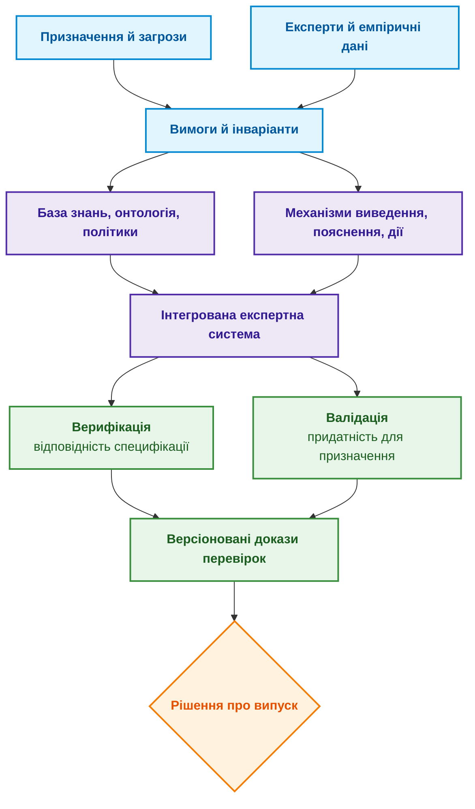
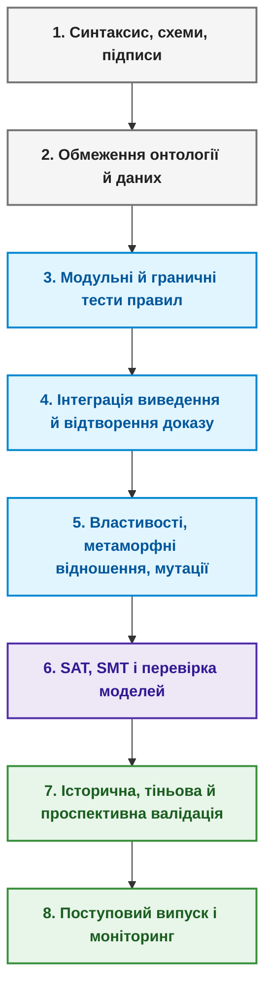
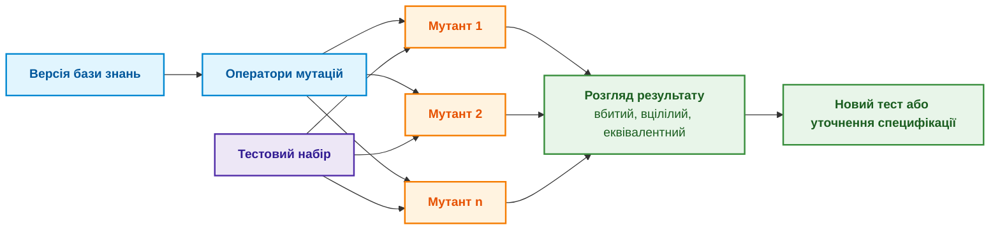
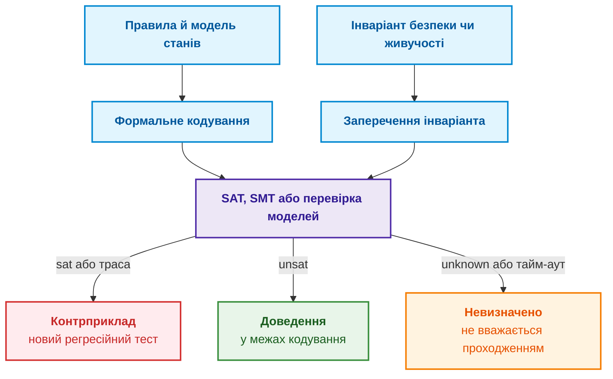
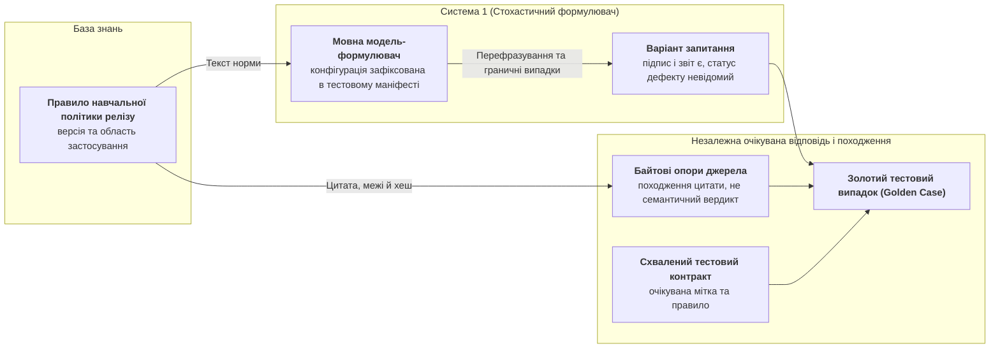

# Глава 23. Верифікація бази знань: як перевірити несуперечливість, повноту та надійність правил

> **Книга:** [Архітектура доказових експертних систем](README.md) · [Частина V: Верифікація, тестування, навчання та обґрунтування безпеки](part-05-verification-and-learning.md)
> **Попередня глава:** [Глава 20. Рушій пояснень: рішення, відмова та межі компетентності](ch20-explanation-engine.md)
> **Наступна глава:** [Глава 36. Піраміда тестування знань: правила, взаємодії та стійкість відповідей](ch36-knowledge-testing-pyramid-and-variational-calibration.md)
> **Зміст книги:** [README.md](README.md)
> **Автор:** [Микола Мартинович Федчик](about-the-author.md)
> **Підготовка читача:** базові приклади потребують булевої логіки й розуміння тесту; скінченні моделі та SMT розібрано поступово до рівня застосування бакалавром комп'ютерних наук.
> **Очікувані результати:** відрізняти верифікацію від валідації; знаходити типові аномалії бази знань; тестувати правила на граничних і невідомих станах; формулювати інваріанти й перевіряти їх перебором скінченної моделі чи SMT-розв'язувачем; оцінювати силу тестів мутаційним аналізом; перевіряти рішення разом із доказом і поясненням; організовувати керований випуск змін бази знань.

## Анотація

Верифікація бази знань потрібна там, де рушій експертної системи вже вміє застосовувати правила, але ще невідомо, чи реалізовано потрібну політику без пропущених умов. У цій главі читач пройде шлях від ручної перевірки одного правила до перебору скінченної моделі, пошуку контрприкладів і керованого випуску. Валідація доповнює цей шлях: вона перевіряє, чи відповідає сама політика реальній задачі, а не лише власному запису.

Уявімо навчальну ситуацію: експертна система правильно відповіла на двадцять знайомих запитів, і базу правил готують до випуску. На нових входах одне правило не спрацьовує, інше приймає невідомий статус дефекту за відсутність дефекту, а порівняння годин із днями робить прострочений звіт чинним. Це не опис виміряного інциденту, а задача, на якій буде зіставлено силу різних перевірок.

Ця глава відповідає на запитання: **як переконатися, що правилам бази знань можна довіряти, якщо кілька правильних відповідей цього не доводять?** Теза глави: **довіру дає не кількість зелених прикладів, а набір перевірок різної природи: перевірка форми й посилань, тести кожного правила на граничних станах, інваріанти, перевірені на всіх станах скінченної моделі або розв'язувачем, мутаційний аналіз сили тестів і відтворення доказу разом із рішенням. Кожна перевірка доводить щось лише відносно своєї моделі й припущень, тому рішення про випуск ухвалюють за сукупністю блокувальних критеріїв.**

Глава є навчальним оглядом, а не сертифікаційним звітом. Формальні методи доводять властивості лише відносно моделі та припущень; вибіркове тестування шукає помилки, а повний перебір може довести властивість саме скінченної моделі. Наскрізні поведінкові приклади розвивають правило з [Глави 20](ch20-explanation-engine.md): внутрішній дозвіл можливий лише для підписаного артефакту, за підтвердженої відсутності блокера й чинного тесту; тест замінює лише дозволений виняток відповідального за безпеку. Окремий приклад пучків перевіряє числові інтерфейси, а статистичний приклад пояснює межу висновку з нульових знахідок.

## 1. Верифікація і валідація бази знань: різниця між виконанням і змістом

Верифікація й валідація розділяють дві причини ненадійного рішення: помилку виконання правила та помилку самого правила. Баррі Боем пояснює це через запитання, чи правильно побудовано продукт і чи потрібний продукт побудовано [[1]](#src-1). Верифікація (*verification*) встановлює відповідність реалізації заданій специфікації; валідація (*validation*) перевіряє придатність специфікації та системи для заявленого призначення. Для початку достатньо розуміти правило як інструкцію «за таких умов отримати такий висновок».

Наскрізна навчальна політика дозволяє внутрішній статус `ALLOW`, якщо артефакт підписаний, відсутність блокувального дефекту підтверджена і є чинний тест або дозволений виняток. Виняток від відповідального за безпеку замінює лише тест, не підпис і не перевірку дефектів. Це модель політики, не вимога стандарту й не остаточний дозвіл на фізичну дію.

Розберімо її до формул. Підпис є, дефектів підтверджено немає, тест чинний: відповідь `ALLOW`. Приберемо підпис: `DENY`. Повернемо підпис, але замінимо «дефектів немає» на «даних немає»: знову `DENY`. Нарешті, тест прострочений, проте є чинний виняток від відповідального за безпеку: `ALLOW`, якщо дві інші умови збережено. Верифікаційний тест порівнює реалізацію з цими очікуваннями; предметна валідація окремо з'ясовує, чи взагалі припустимий такий виняток для конкретного виробу.

Для бази знань ця різниця особливо помітна. Можна точно реалізувати хибне правило експерта, і верифікація цього не помітить. Можна мати правильне правило, але механізм виведення з помилковим розв'язанням конфліктів між правилами. Тому знання, вилучені від експертів за методами з [Глави 11](ch11-knowledge-elicitation-from-experts.md), потребують валідації на реальних випадках, а доказові пакети з [Глав 16](ch16-expert-systems-architecture.md) і [20](ch20-explanation-engine.md) потребують верифікації відтворенням. Діаграма показує, як обидва процеси сходяться в рішенні про випуск.

<a id="obj-23-1"></a>

**Діаграма 23.1. Верифікація й валідація експертної системи**



Діаграма показує два різні порівняння: реалізації зі специфікацією та системи з її призначенням. Джерело очікуваного результату тесту називають оракулом (*test oracle*); проблему його отримання досліджувала Елейн Вейюкер [[2]](#src-2). Якщо тест обчислює очікування тією самою функцією `release`, яку перевіряє, обидві сторони повторять пропущений підпис і тест пройде. Ручна таблиця з окремо розібраними випадками усуває саме цю програмну залежність, але може повторювати помилку автора політики.

У цій монографії автором запропоновано **правило походження та незалежності тест-оракула (Test Oracle Lineage Rule)**: фіксувати версію, джерела, автора мітки й спосіб її отримання; хеш захищає запис від непомітної зміни, але не створює незалежності. Тест, складений автором правила без окремого предметного розгляду, корисний для верифікації, проте не зараховується як незалежна валідація. Інша людина теж може скопіювати хибне очікування: незалежність визначається процесом і підставами, не лише прізвищами. Далі потрібно зафіксувати, що саме виконує правило, щоб зміна середовища не зруйнувала порівняння.

## 2. Системний контекст верифікації: взаємодія правил, фактів та механізмів виведення

Системний контекст потрібен, щоб відповісти на запитання: чому незмінний файл правил іноді дає інше рішення? Між документом і висновком працюють парсер, нормалізатор одиниць, пошук і рушій. Для перевірки їхньої взаємодії спочатку зафіксуємо залежності рішення; це опис інтерфейсу, а не формула оцінки істинності.

<a id="obj-23-2"></a>

**Формула (23.2). Залежності системного рішення**

```math
y = F(x, K, O, P, C, M, R)
```

Позначення:

- $y$ є категоріальним результатом, наприклад `ALLOW`, `DENY` або типізованою відмовою; фізичної одиниці він не має;
- $F$ позначає функцію, що формує рішення з перелічених складових;
- $x$ є скінченним зрізом фактів із типами, одиницями, часом і джерелами;
- $K$ є базою знань, $O$ є онтологією, а $P$ є політиками доступу;
- $C$ задає стратегію розв'язання конфліктів між правилами;
- $M$ позначає зафіксовані моделі машинного навчання або їх відсутність, а $R$ є конфігурацією середовища виконання. $K$, $O$, $P$, $C$, $M$, $R$ є версіонованими об'єктами, не числами з довільного діапазону; $F$ вважається визначеною лише для сумісних типів і версій.

Розрахунковий приклад: у джерелі тест чинний до 23-ї години, запит стосується 1-го дня, тобто 24-ї години від спільного початку. Парсер, який порівняє числа 23 і 1 без одиниць, поверне «чинний»; нормалізатор, який спочатку обчислить 24 години, поверне «прострочений». Знання $K$ не змінилися, змінилася конфігурація $R$, а з нею й результат $y$. Невідповідність компонентів затвердженому маніфесту зупиняє саме цей прогін; нову версію потрібно перевірити, а не оголосити хибною лише за іншим хешем. Обсяг і час перевірки маніфесту вимірюють на конкретній реалізації: універсальних меж 64 КБ або 5 мс із цієї моделі не випливає.

У цій монографії автором сформульовано **принцип системної взаємозалежності виведення**: перевірка лише бази правил $K$ не охоплює змін її інтерпретації; зміна парсера, одиниць або стратегії конфліктів $C$ може змінити $y$. Це вимога аналізу впливу, не твердження, що кожна зміна обов'язково змінить відповідь.

Для відтворюваності автором запропоновано **архітектурний патерн доказового маніфесту тестового прогону (Test Execution Manifest)**: він фіксує SHA-256 компонентів $K$, $O$, $P$, $C$, $M$, $R$, вхід $x$, зерно генератора, годинник і зовнішні зрізи. Ідентифікатори мають вести до доступних збережених байтів; сам перелік хешів не відновить видалені ваги моделі. Однакове зерно також не гарантує однакової роботи паралельних числових бібліотек.

Авторський **інженерний інваріант детермінованої фіксації стохастичних проміжних станів** вимагає зберігати проміжні виходи випадкових етапів для повторної перевірки логіки на тих самих кандидатах. Такий replay ізолює логічну помилку, але не перевіряє заново якість генератора. Після фіксації контексту можна шукати аномалії самих правил.

## 3. Типологія структурних і логічних аномалій бази знань

Типологія аномалій допомагає відрізнити помилку, видиму вже в записі правила, від помилки конкретної відповіді. Пріс і Шингал розглядають надлишкові, суперечливі й неповні знання як симптоми ймовірних дефектів [[3]](#src-3). Статичний аналіз не запускає промисловий рушій на запитах, хоча сам може виконувати пошук або розв'язувати обмеження. Для нашого правила корисні чотири випадки:

- **Мертве правило** ніколи не спрацьовує, бо його передумови несумісні між собою або посилаються на предикат, який жодне джерело не породжує.
- **Надлишкове правило** дублює інше правило або поглинається ним: якщо правило A має ті самі висновки за слабших умов, правило B зайве.
- **Суперечливі правила** за сумісних передумов дають несумісні висновки, наприклад ALLOW і DENY для того самого стану.
- **Цикл залежностей** потребує перевірки семантики, не автоматичної заборони. За авторським **критерієм семантичної допустимості циклів та рекурсії** профіль має називати дозволену логіку. Для позитивної програми Datalog без функціональних символів, зі скінченним доменом і правилами, змінні яких зв'язані позитивними передумовами, послідовне додавання наслідків завершується: нових основних атомів скінченно багато, а жоден уже отриманий не вилучається. Результат є найменшою фіксованою точкою. Правила «A дає B» і «B дає A» без початкового A не породжують нічого; цикл сам себе не обґрунтовує. Нестратифіковане заперечення може мати іншу формальну семантику, але поза оголошеним позитивним профілем не допускається без окремого аналізу. Приклад [Глави 16](ch16-expert-systems-architecture.md) стосується саме позитивного замикання.

Приклади розрізняють симптоми: умови «дефект є» і «дефектів немає» разом роблять правило недосяжним; жодне спрацювання на поточних тестах ще не доводить недосяжності. Рідкісна небезпека може бути досяжною, але не покритою. Два правила `ALLOW` і `DENY` за тих самих фактів потребують явного пріоритету або відмови через конфлікт. Так отримано перелік питань до власника знань, а не автоматичний доказ хибності кожної аномалії; далі уточнимо винятки й числові межі.

### 3.1. Компіляційна детекція аномалій: колізії інтервалів, підривачі (defeaters) та Merkle-цілісність

Компіляційна перевірка має встановити, чи можна одночасно виконати застосовні числові вимоги й чи справді спеціальний виняток переважає загальне правило. Наприклад, вимоги тримати напругу від 10 до 12 В та від 11 до 13 В сумісні: спільний діапазон від 11 до 12 В. Межі від 10 до 11 В та від 12 до 13 В несумісні, якщо стосуються тієї самої напруги в той самий час. Інші версії виробу або режими не можна змішувати. Перетин діапазонів сам по собі не є суперечністю.

Підривач (*defeater*) є аргументом, що заважає прийняти інший аргумент. У термінах ASPIC+ rebuttal заперечує його висновок, а undercutter атакує застосовність спростовного правила. Виняток у навчальній політиці знімає вимогу чинного тесту, але не атакує заборону за наявного дефекту. Правило Lex Specialis, тобто перевага спеціальнішої норми, тут є явно заданою політикою, не автоматичним висновком із слова «проте».

У цій монографії автором запропоновано три інваріанти компіляційної перевірки для проміжного представлення правил; їх реалізація потребує явних типів, контекстів і політики пріоритетів:

> [!NOTE]
> **Три інваріанти компіляційної перевірки несуперечності бази знань за моделлю автора**
> 1. **Компіляційна ізоляція колізій числових інтервалів:** одночасні вимоги до того самого параметра в однаковому контексті зводяться до спільних одиниць. Порожній перетин допустимих значень блокує складання, якщо немає схваленого правила розв'язання колізії.
> 2. **Аргументаційне зв'язування винятків за принципом Lex Specialis:** для кожного винятку фіксуються область, об'єкт атаки, повноваження та пріоритет. Цикли атак не забороняються як синтаксис ASPIC+, але їх прийнятність визначається обраною семантикою аргументації; нерозв'язаний конфлікт не дає `ALLOW`.
> 3. **Криптографічна цілісність походження висновків:** Похідне правило або факт не допускається до бази, якщо хоча б один засновок має розірвану побайтову прив'язку, недійсний хеш цитати `SHA-256` або не входить до зафіксованого графа походження.
> *Інженерний інваріант:* кандидат із невирішеною колізією або розірваним походженням не допускається до оголошеного профілю. Корінь дерева Меркла засвідчує цілісність за умови довіреного кореня й перевірених шляхів, не семантичну істинність.

Отже, походження, числова сумісність і аргументаційний пріоритет є різними перевірками. Їх поєднання готує багаторівневу стратегію, але не замінює поведінкових тестів.

## 4. Багаторівнева стратегія перевірок: від синтаксису до випробувань у реальних умовах

Багаторівнева стратегія відповідає на питання, яку перевірку запускати після статичного аналізу. Помилка типу, пропущений підпис і непридатна політика потребують різних засобів, тому одна зелена метрика не замінює їх усіх. Авторська піраміда організовує вісім рівнів; порядок є планом роботи, а не твердженням, що всі перевірки незалежні чи завжди дорожчають саме так.

<a id="obj-23-3"></a>

**Діаграма 23.3. Рівні верифікації й тестування бази знань**



> [!NOTE]
> **Три принципи багаторівневої піраміди верифікації бази знань за моделлю автора**
> 1. Ієрархічна ортогональність рівнів: від дешевих синтаксичних та схематичних фільтрів (L1–L2) до формальної верифікації SMT (L6) та тіньового розгортання (L7–L8). Жоден вищий рівень не компенсує дефектів нижчого.
> 2. Конструктивне розмежування форми та змісту: SHACL перевіряє задані обмеження графа, OWL має власну логічну семантику, а побайтова відповідність цитати підтверджує походження, не фізичну істинність її змісту. Придатність правила до задачі потребує окремої валідації.
> 3. Захист від порожньої перевірки: окрім стану «невідомо», тест повинен мати непорожні вхідні дані, досяжну передумову й незалежно заданий очікуваний результат. Інакше інваріант може пройти без жодного випадку, на якому він справді обмежує рішення.
> *Інженерний інваріант:* до випуску потрібні всі застосовні блокувальні перевірки оголошеного профілю. Моніторинг після випуску є постійним зобов'язанням, не вже завершеним тестом майбутнього.

На думку автора, вищий рівень не замінює нижчого. Висока точність на історичних випадках не знайде дубльованого ідентифікатора правила, а перевірка схеми не покаже, що правило шкодить призначенню експертної системи. Розгляньмо перші три рівні докладніше.

**Форма й посилання.** На кожну зміну перевіряють, що правила розбираються, типи й одиниці узгоджені, ідентифікатори однозначні, предикати, на які посилаються правила, існують, а обмеження версій, підписи, власник і термін чинності вказані. Поле `valid_until` має бути позначкою часу з часовим поясом, а не рядком, лексикографічне порівняння якого випадково «працює».

**Поняття й дані.** OWL дає логічну семантику онтології [[4]](#src-4), а SHACL перевіряє RDF-граф щодо заданих форм [[5]](#src-5). За відкритого світу відсутній запис про дефект не означає, що дефекту немає. SHACL оцінює конкретний граф і цільові вузли; обов'язковість поля задають явно, а заборона зайвих властивостей потребує окремого обмеження. Це не загальне припущення, що все невідоме хибне. Форма `SafetyTest` може вимагати `artifact`, `result`, `performed_at`, `valid_until`, `method_version`, `source_hash`. Якщо жоден вузол не потрапив у ціль перевірки, `sh:conforms = true` може бути порожнім успіхом: окремо перевіряють кількість очікуваних звітів і вибраних цілей. Навіть непорожня правильна форма не підтверджує правильності вимірювання.

**Кожне правило окремо.** Після ручних випадків §1 можна записати всю політику однозначно. Тут `no` означає явне підтвердження відсутності дефекту, не відсутній рядок. Рівність нижче задає і необхідні, і достатні умови внутрішнього дозволу, на відміну від однобічного правила «якщо, то», яке саме не забороняє інших шляхів дозволу.

<a id="obj-23-4"></a>

**Формула (23.4). Повна політика внутрішнього дозволу**

```math
\mathrm{allow}(s) = \mathrm{signed}(s) \land [\mathrm{blocker}(s)=\mathrm{no}] \land (\mathrm{valid\_test}(s) \lor \mathrm{authorized\_waiver}(s)).
```

- $s$ є одним станом моделі; булеві $`\mathrm{signed}(s)`$, $`\mathrm{valid\_test}(s)`$, $`\mathrm{authorized\_waiver}(s)`$ набувають значень істина/хиба та означають уже перевірені підпис, чинність тесту й виняток відповідального за безпеку;
- $`\mathrm{blocker}(s)`$ має три значення: `no`, `yes`, `unknown`; квадратні дужки дають істину лише для точної рівності `no`;
- $\land$ означає «і», $\lor$ означає «або», а $`\mathrm{allow}(s)`$ є булевим статусом цього внутрішнього шлюзу. Усі величини безрозмірні; перевірка справжності підпису й часу лишається передумовою абстракції.

Підставимо підпис «так», дефект `no`, тест «ні», виняток «так»: остання дужка істинна, усі три частини істинні, отже `ALLOW`. Заміна винятку на підпис керівника проєкту робить останню дужку хибною й дає `DENY`. За дефекту `unknown` середня частина хибна незалежно від тесту. Суперечливі або недоступні первинні дані не стискають до `no`: до входу моделі потрібна відмова або консервативний `unknown`. Тепер можна виміряти, наскільки тести торкаються правил, не сплутавши це з перевіркою всіх знань.

## 5. Метрики покриття правил та межі їхньої показовості

Метрики покриття потрібні, щоб побачити, які правила тести взагалі зачепили. Це інше питання, ніж повнота знань: база може не містити потрібного правила й мати стовідсоткове покриття всіх наявних. Для оголошеної непорожньої множини правил обчислимо безрозмірну частку тих, що хоча б раз спрацювали.

<a id="obj-23-5"></a>

**Формула (23.5). Покриття активацій непорожньої бази**

```math
C_{\text{fire}} = \frac{\lvert R_f \rvert}{\lvert R \rvert}
```

Складники формули:

- $`C_{\text{fire}}`$ є часткою покриття спрацюванням у діапазоні від 0 до 1;
- $R$ є скінченною непорожньою множиною правил у випуску, а $`R_f`$ є підмножиною правил, що спрацювали хоча б раз на зафіксованому тестовому наборі;
- вертикальні риски $\lvert\cdot\rvert$ означають кількість елементів множини, а дріб ділить кількість спрацьованих правил на загальну кількість правил.

У навчальному випуску спрацювало 118 зі 120 правил: ділення дає приблизно 0,9833, тобто 98,33%. Залишилося два непокриті правила, не обов'язково мертві. Авторський профіль може вимагати 100% активації та блокувати випуск до пояснення прогалин; це не причина видаляти потрібне рідкісне правило чи забороняти діагностичний інтеграційний тест. Для порожнього $R$ дріб невизначений: потрібен статус «немає правил для оцінювання», а не 100%. Порожній набір тестів за непорожнього $R$ дає нуль, якщо журнал спрацювань справді зібрано.

Високе $`C_{\text{fire}}`$ не означає, що перевірено всі умови: для правила з $m$ передумовами потрібні випадки для кожної умови й кожної межі. Низьке покриття може означати мертве правило, рідкісну небезпеку або слабкий генератор тестів, і ці три причини потребують різних рішень. Корисніша за саме покриття матриця простежуваності, яка пов'язує небезпеку з правилом, тестами й власником:

<a id="obj-23-6"></a>

**Таблиця 23.6. Простежуваність вимог і тестів**

| Вимога чи небезпека | Правило | Позитивний тест | Негативні й граничні тести | Власник |
|---|---|---|---|---|
| Лише чинний доказ безпеки | `REL-12` | `case-104` | від `case-105` до `case-109` | Безпека |
| Виняток підписує відповідальний за безпеку | `AUTH-7` | `case-205` | від `case-206` до `case-211` | Відповідність вимогам |
| Блокувальний дефект завжди забороняє ALLOW | `REL-2` | `case-blocker-present`: очікується DENY | невідомий статус, властивість `INV-01` | Випуск |

У рядку `REL-2` позитивним контролем має бути випадок, де блокер дійсно є і очікується відмова; слово «позитивний» стосується перевірки вимоги, не обов'язково `ALLOW`. Вимога повноти має називати область: усі 36 станів навчальної моделі, усі поля форми чи всі небезпеки затвердженого переліку. Жоден із цих знаменників не означає «всі можливі знання про світ». Порожню клітинку розглядають як прогалину або явно обґрунтовану незастосовність. Наступний крок перевіряє властивості відповідей, а не лише факт активації.

## 6. Інваріанти, граничні стани та генерація контрприкладів

Інваріант відповідає на питання, що не повинно порушуватися в жодному допустимому стані. На відміну від конкретного прикладу, він описує цілу родину випадків; тестування властивостями (*property-based testing*, QuickCheck [[6]](#src-6)) створює входи й перевіряє цю вимогу на кожному. Спочатку домен $S$ складається з 36 комбінацій двох булевих полів, трьох статусів дефекту та трьох статусів винятку з §1; ці перевірені категорії не охоплюють пошкодженого підпису чи невизначеного часу. Головна заборона:

<a id="obj-23-7"></a>

**Формула (23.7). Заборона дозволу без підтвердженої відсутності блокера**

```math
\forall s\in S:\ \mathrm{blocker}(s) \neq \mathrm{no} \Rightarrow \mathrm{decision}(s) \neq \mathrm{ALLOW}.
```

Прочитаємо умови по черзі:

- $s$ є станом скінченного домену $S$, а $\forall$ означає «для кожного» такого стану; усі значення тут категоріальні й безрозмірні;
- $`\mathrm{blocker}(s)`$ є статусом блокувального дефекту в стані $s$;
- $\neq$ означає «не дорівнює», тому $`\mathrm{blocker}(s) \neq \mathrm{no}`$ охоплює і наявний дефект, і невідомий стан;
- $\Rightarrow$ означає «якщо, то», а $`\mathrm{decision}(s) \neq \mathrm{ALLOW}`$ забороняє дозвіл у такому стані.

За `unknown` передумова істинна, тому очікується не `ALLOW`; за `no` імплікація нічого не вимагає від відповіді. Саме тому правило «завжди DENY» проходить цю перевірку. Якщо генератор створює лише `no`, інваріант проходить вакуумно: передумова жодного разу не істинна. Якщо список станів порожній, проходить навіть цикл без перевірок. Потрібні непорожність, лічильник випадків із істинною передумовою та позитивний еталон дозволу.

Інша необхідна умова перевіряє походження дозволу; позначення стану й рішення збережено:

<a id="obj-23-8"></a>

**Формула (23.8). Необхідна підстава дозволу**

```math
\mathrm{decision}(s) = \mathrm{ALLOW} \Rightarrow \mathrm{valid\_test}(s) \lor \mathrm{authorized\_waiver}(s)
```

де:

- $`\mathrm{decision}(s)`$ є результатом внутрішнього правила випускної перевірки знань у стані $s$; $`\mathrm{ALLOW}`$ означає лише проходження цього обмеженого policy gate, не авторизацію фізичної дії чи фінальний продуктовий sign-off;
- $`\mathrm{valid\_test}(s)`$ означає наявність чинного тесту, а $`\mathrm{authorized\_waiver}(s)`$ означає належно дозволений виняток;
- $\lor$ означає «або», а $\Rightarrow$ означає «якщо, то»: дозвіл допускається лише за чинного тесту або авторизованого винятку.

Обидва предикати праворуч булеві, область та сама $S$, фізичних одиниць немає. Для спроби `ALLOW` за простроченого тесту й винятку керівника проєкту обидві частини диз'юнкції хибні: це контрприклад. Для `DENY` властивість нічого не підтверджує про доступність дозволених рішень. Навіть коректний `ALLOW` не є командою чи остаточним випуском: потрібна окрема авторизація операції за [Главою 21](ch21-from-recommendation-to-action.md).

Статичний стан не показує, що станеться після відкликання звіту. Для цього розширимо модель операцією відкликання та завершеним перерахунком, під час якого той самий факт не додається заново:

<a id="obj-23-9"></a>

**Формула (23.9). Очищення відкликаної підтримки**

```math
\mathrm{retract}(e, s) \Rightarrow e \notin \mathrm{support}\bigl(\mathrm{recompute}(s)\bigr)
```

Позначення:

- $e$ є фактом, який відкликають, а $s$ є станом до перерахунку;
- $`\mathrm{retract}(e,s)`$ означає відкликання факту $e$ у стані $s$;
- $`\mathrm{recompute}(s)`$ є станом після повторного обчислення, а $`\mathrm{support}`$ позначає множину фактів, що обґрунтовують висновок;
- $\notin$ означає «не належить», а $\Rightarrow$ пов'язує відкликання з обов'язковою відсутністю факту серед підстав.

Факти є ідентифікованими записами, множина підтримки скінченна, одиниць вимірювання немає. Якщо дозвіл спирався лише на звіт `report-7`, його відкликання прибирає цей запис із підтримки й скасовує дозвіл. Якщо чинний незалежний виняток лишився, дозвіл може зберегтися, але вже з іншим доказом. Формула не вимагає миттєвого перерахунку: до його завершення застарілий висновок не використовують як поточний.

Доступ до доказів потребує ще одного розширення: порівняння двох станів із тим самим публічним входом. Для суворої політики, яка не дозволяє навіть агрегованого розкриття закритого факту, запишемо:

<a id="obj-23-10"></a>

**Формула (23.10). Парна перевірка нерозкриття**

```math
\mathrm{unauthorized}(u,e) \land s \equiv_{u,e} s'
\Rightarrow \mathrm{output}(u,s)=\mathrm{output}(u,s').
```

- $u$ є користувачем, $e$ є закритим фактом, $s$ і $s'$ є двома станами, а $`s \equiv_{u,e} s'`$ означає однакові доступні користувачеві дані та відмінність лише в захищеному факті;
- $`\mathrm{unauthorized}(u,e)`$ означає, що користувач $u$ не має права на факт $e$;
- $`\mathrm{output}(u,s)`$ є відповіддю, яку отримує користувач $u$ у стані $s$;
- $\Rightarrow$ задає потрібну рівність спостережуваних відповідей; це безрозмірні логічні умови. Час, довжина й мережеві побічні канали входять у властивість лише тоді, коли їх включено до означення спостереження $`\mathrm{output}`$.

Наприклад, два запити без права читати закритий звіт отримують однакову відповідь «доступ обмежено», незалежно від вмісту звіту. Якщо політика дозволяє агрегований вердикт, саме його залежність може бути законною: тоді потрібна слабша властивість із явно дозволеним розкриттям, а не ця формула. Парні тести й маркери витоку перевіряють обрані спостереження, не всі побічні канали. Процедура зменшення (*shrinking*) спрощує знайдений контрприклад, зберігаючи порушення; результат залежить від дозволених перетворень і не обов'язково глобально найменший.

> [!NOTE]
> **Чотири інваріанти формальної верифікації простору станів за концепцією автора**
> 1. Інваріант безумовної заборони (Fail-Closed Blocker): будь-який невирішений або невідомий статус блокувального дефекту $`\mathrm{blocker}(s) \ne \mathrm{no}`$ категорично забороняє рішення $`\mathrm{ALLOW}`$.
> 2. Інваріант підстав внутрішнього release-policy gate (Grounding Allowance): результат $`\mathrm{ALLOW}`$ у цій моделі потребує чинного верифікованого тесту $`\mathrm{valid\_test}(s)`$ або криптографічно підписаного винятку $`\mathrm{authorized\_waiver}(s)`$; він не авторизує фізичну дію чи остаточний випуск продукту.
> 3. Інваріант очищення відкликаних підстав (Revocation Cleanse): після завершеного перерахунку відкликаний факт не є поточною підставою; це вимога до реалізації, не результат самого запису формули.
> 4. Інваріант ізоляції закритої інформації (Non-Interference Flow): парні стани дають однакове оголошене спостереження за політики без дозволеного розкриття захищеного факту.
> *Керування рантаймом:* порушення зберігається як регресійний випадок; shrinking, якщо доступний, спрощує його без обіцянки глобального мінімуму.

Випадковість не замінює знання предметної області. Генератор має знати допустимі залежності між полями, інакше витратить бюджет на неможливі стани або ніколи не породить рідкісної комбінації. Коли простір станів малий, генератор можна замінити повним перебором, і тоді перевірка інваріанта стає доведенням у межах моделі. Наступний розділ поєднує такий перебір із перевіркою сили самих тестів.

## 7. Мутаційне тестування та оцінка чутливості тестового набору

Мутаційне тестування ставить наступне питання: чи впадуть наші зелені тести, якщо навмисно зіпсувати правило? Де Мілло, Ліптон і Сейворд описали цей підхід як спосіб добору тестових даних [[7]](#src-7). Для бази знань можна видалити перевірку підпису, прийняти `unknown` за `no`, замінити `AND` на `OR`, підмінити роль підписанта або одиниці часу. Кожний мутант є окремою зміненою версією, а не новою вимогою до правильної системи.

Мутант вважається вбитим, якщо тест виявив саме його поведінкову відмінність від очікуваного контракту. Оригінал спочатку має пройти ті самі тести; помилка підготовки не є перемогою над мутантом. Для завершеної класифікації придатних кандидатів обчислюють частку вбитих серед нееквівалентних:

<a id="obj-23-11"></a>

**Формула (23.11). Мутаційний бал придатних кандидатів**

```math
MS = \frac{M_{\text{killed}}}{M_{\text{total}} - M_{\text{equivalent}}}
```

Розшифрування величин:

- $MS$ є мутаційним балом, безрозмірною часткою від 0 до 1;
- $`M_{\text{killed}}`$ є кількістю мутантів, на яких хоча б один тест виявив дефект;
- $`M_{\text{total}}`$ є кількістю придатних виконаних мутантів у цьому розрахунку, а $`M_{\text{equivalent}}`$ є кількістю доведено еквівалентних у заданому домені; це невід'ємні цілі числа, причому кількість убитих не перевищує різниці у знаменнику;
- знаменник виключає еквівалентних мутантів, які не може виявити жоден тест.

**Практичне застосування та інженерні висновки (Closed-Loop Decision):**
Порогові значення нижче є параметрами авторських профілів оцінки тестового набору, а не числовими вимогами ISO 26262, DO-178C чи IEC 61508. Для конкретного продукту застосовність незалежних стандартних критеріїв визначається окремо.
1. **Критерії допуску за мутаційним балом:**
    - **Мутаційний бал не нижчий за 0,95 і немає вцілілих критичних мутантів:** пройдено лише авторський висококритичний тестовий профіль; це не сертифікує систему й не замінює незалежної оцінки за застосовними вимогами;
    - **Мутаційний бал від 0,85 включно до 0,95 невключно:** дорадчий профіль прикладу вимагає розгляду пріоритетних мутантів і розширення тестів. Межі 0,85 та 0,95 не є порогами SIL, заданими стандартом;
   - **$`MS < 0{,}85`$ або хоча б один невбитий мутант у правилах безпеки (наприклад, зміна перевірки повноважень `signer == safety_owner`):** Реліз бази знань блокується незалежно від інтегрального значення $MS$.
2. **Навчальний розрахунок, не вимірювання:** припустімо 150 придатних виконаних мутантів, із яких 30 доведено еквівалентними, а 115 убито. Віднімання дає 120 нееквівалентних; ділення 115 на 120 дає приблизно 0,9583, тобто 95,83%. Це вище авторського порога 0,95, але п'ять вцілілих ще потребують розгляду. Якщо хоча б один із них критичний, цей профіль не пройдено. Жодного такого експерименту над промисловою базою тут не заявлено.

На практиці вищий бал означає, що тестовий набір виявляє більшу частку змістовних мутацій, але не доводить відсутності всіх дефектів. Джа й Гарман у своєму огляді наголошують, що розпізнавання еквівалентних мутантів є однією з головних проблем методу, бо в загальному випадку воно алгоритмічно нерозв'язне [[8]](#src-8). Тому оголошувати 100 % без процедури розгляду вцілілих мутантів не можна, а вцілілий критичний мутант, наприклад з видаленою перевіркою повноважень підписанта винятку, блокує випуск незалежно від загального балу. Діаграма показує цей процес.

Формула має зміст за додатного знаменника й відомої класифікації мутантів. Невалідний кандидат, помилка запуску й непідтверджена еквівалентність мають окремі статуси; їх не приховують як «еквівалентні». Тайм-аут зараховують як виявлений дефект лише за перевіреної часової властивості й відтворюваного порушення, а не через випадкове перевантаження стенду. Якщо придатних нееквівалентних мутантів немає, бал невизначений, не 100 %.

> [!WARNING]
> **Два правила подолання семантичної пастки еквівалентних мутантів за концепцією автора**
> 1. Заборона евристичного списання: автоматичне списання невбитих мутантів на «семантичну еквівалентність» для штучного досягнення $`MS = 1{,}00`$ категорично заборонено; алгоритмічна нерозв'язність еквівалентності в загальному випадку вимагає трактування кожного вцілілого мутанта як потенційної критичної прогалини в тестах.
> 2. Обов'язковий інженерний розгляд: еквівалентність підтверджують доказом у заявленому домені, зокрема повним скінченним перебором або придатним SMT-кодуванням. Якщо доведення немає, мутант лишається вцілілим або невизначеним; новий тест додають, коли встановлено потрібну відмінність. `unknown` не є доказом еквівалентності.
> *Інженерний інваріант:* Жоден невбитий мутант у правилах функціональної безпеки чи авторизації не допускається до випуску без формального математичного доведення еквівалентності.

<a id="obj-23-12"></a>

**Діаграма 23.12. Мутаційне тестування бази знань**



Скінченна навчальна модель має 36 станів: два значення чинності тесту, два значення підпису, три статуси дефекту й три статуси винятку. Послідовне множення 2 на 2, на 3 і на 3 дає 36; виняток без тесту додає один дозволений стан до трьох станів із тестом. Булеві прапорці означають уже перевірені входи, не перевірку справжнього підпису. Функція `release` реалізує правило §4, `allStates` будує домен, `invariants` перевіряє три заборони та позитивну таблицю, а `firstViolation` повертає перше порушення. Це не ті самі чотири властивості §6: відкликання й інформаційний потік тут не реалізовано.

Таблиця `allowedStates` перелічує чотири дозволені стани вручну; її не обчислено функцією `release`. Решта станів за замкненим доменом таблиці очікувано заборонені. Така незалежність представлення ловить дефект реалізації, але навчальна таблиця того самого автора не стає незалежною предметною валідацією. Очікується три виявлені змістовні мутації на трьох прикладах і п'ять на повному домені, при збереженні еквівалентного M5.

<details>
<summary>Приклад мовою Go: перевірка правила випуску на всіх 36 станах</summary>

```go
package main

import "fmt"

type Blocker int

const (
	NoBlocker Blocker = iota
	HasBlocker
	UnknownBlocker // даних про дефекти немає
)

func (b Blocker) String() string { return [...]string{"немає", "є", "невідомо"}[b] }

type Waiver int

const (
	NoWaiver Waiver = iota
	ByProjectLead
	BySafetyOwner
)

func (w Waiver) String() string {
	return [...]string{"немає", "керівник проєкту", "відповідальний за безпеку"}[w]
}

type State struct {
	TestValid, Signed bool
	Blocker           Blocker
	Waiver            Waiver
}

type Rule func(s State) bool // true означає ALLOW цього release-policy gate, не дозвіл на виконання

// release є правилом цього gate: підписаний артефакт, підтверджена відсутність
// блокера та чинний тест або виняток. Фінальна дія потребує окремої авторизації.
func release(s State) bool {
	return s.Signed && s.Blocker == NoBlocker && (s.TestValid || s.Waiver == BySafetyOwner)
}

var allowedStates = map[State]bool{
	{true, true, NoBlocker, NoWaiver}:       true,
	{true, true, NoBlocker, ByProjectLead}:  true,
	{true, true, NoBlocker, BySafetyOwner}:  true,
	{false, true, NoBlocker, BySafetyOwner}: true,
}

// invariants повертає опис першого порушеного інваріанта або порожній рядок.
func invariants(s State, allow bool) string {
	switch {
	case allow && s.Blocker != NoBlocker:
		return "I1: ALLOW без підтвердженої відсутності дефекту"
	case allow && !s.TestValid && s.Waiver != BySafetyOwner:
		return "I2: ALLOW без чинного тесту й належного винятку"
	case allow && !s.Signed:
		return "I3: ALLOW непідписаного артефакту"
	case !allow && allowedStates[s]:
		return "I4: DENY для дозволеного стану навчальної таблиці"
	}
	return ""
}

// allStates перебирає всі 2·2·3·3 = 36 станів скінченної моделі.
func allStates() []State {
	var out []State
	for _, tv := range []bool{false, true} {
		for _, sg := range []bool{false, true} {
			for b := NoBlocker; b <= UnknownBlocker; b++ {
				for w := NoWaiver; w <= BySafetyOwner; w++ {
					out = append(out, State{tv, sg, b, w})
				}
			}
		}
	}
	return out
}

// examples є невеликим набором прикладів, яким команда перевіряла правило.
var examples = []struct {
	s     State
	allow bool
}{
	{State{true, true, NoBlocker, NoWaiver}, true},
	{State{true, true, HasBlocker, NoWaiver}, false},
	{State{false, true, NoBlocker, NoWaiver}, false},
}

func killedByExamples(r Rule) bool {
	for _, e := range examples {
		if r(e.s) != e.allow {
			return true
		}
	}
	return false
}

func firstViolation(r Rule) (State, string, bool) {
	for _, s := range allStates() {
		if v := invariants(s, r(s)); v != "" {
			return s, v, true
		}
	}
	return State{}, "", false
}

func main() {
	if _, v, bad := firstViolation(release); bad {
		fmt.Println("правильне правило порушує інваріант:", v)
		return
	}
	fmt.Println("правильне правило: 36 станів, порушень немає")

	mutants := []struct {
		name string
		r    Rule
	}{
		{"M1 видалено перевірку дефекту", func(s State) bool { return s.Signed && (s.TestValid || s.Waiver == BySafetyOwner) }},
		{"M2 невідомо трактується як «немає»", func(s State) bool {
			return s.Signed && s.Blocker != HasBlocker && (s.TestValid || s.Waiver == BySafetyOwner)
		}},
		{"M3 будь-який виняток приймається", func(s State) bool {
			return s.Signed && s.Blocker == NoBlocker && (s.TestValid || s.Waiver != NoWaiver)
		}},
		{"M4 AND замінено на OR", func(s State) bool { return s.Signed || (s.Blocker == NoBlocker && s.TestValid) }},
		{"M5 переставлено умови", func(s State) bool {
			return (s.Waiver == BySafetyOwner || s.TestValid) && s.Blocker == NoBlocker && s.Signed
		}},
		{"M6 завжди DENY", func(s State) bool { return false }},
	}
	killed, killedEx := 0, 0
	for _, m := range mutants {
		ex := killedByExamples(m.r)
		if ex {
			killedEx++
		}
		s, v, inv := firstViolation(m.r)
        fmt.Printf("%-36s | приклади: %-5v | інваріанти: %v\n", m.name, ex, inv)
		if inv {
			killed++
			fmt.Printf("    %s; контрприклад: %+v\n", v, s)
		}
	}
	fmt.Printf("мутаційний бал без еквівалентного M5: приклади %d/5, властивості %d/5\n", killedEx, killed)
}
```

Наступний тестовий лістинг працює разом із програмою, не як окрема програма `go run`. Він перевіряє домен, рішення, шість контрольних мутантів та активність передумов заборон. Для двох витягнутих лістингів команда має вигляд `go test -count=1 -v main.go main_test.go`; сам приклад запускають як `go run main.go`. Лістинги залишаються частиною глави.

```go
package main

import "testing"

func validDomain(states []State) bool {
    if len(states) != 36 {
        return false
    }
    seen := make(map[State]bool)
    for _, state := range states {
        if state.Blocker < NoBlocker || state.Blocker > UnknownBlocker ||
            state.Waiver < NoWaiver || state.Waiver > BySafetyOwner || seen[state] {
            return false
        }
        seen[state] = true
    }
    return true
}

func TestReleaseOracle(testCase *testing.T) {
    if !validDomain(allStates()) || len(allowedStates) != 4 {
		testCase.Fatal("wrong finite-model domain")
	}
	for _, state := range allStates() {
		if release(state) != allowedStates[state] {
			testCase.Fatalf("decision-table mismatch: %+v", state)
		}
		if violation := invariants(state, release(state)); violation != "" {
			testCase.Fatal(violation)
		}
	}
	denyAll := func(state State) bool { return false }
	if _, _, detected := firstViolation(denyAll); !detected {
		testCase.Fatal("always-DENY mutant survived")
	}
	equivalent := func(state State) bool {
		return (state.Waiver == BySafetyOwner || state.TestValid) && state.Blocker == NoBlocker && state.Signed
	}
	if _, _, detected := firstViolation(equivalent); detected {
		testCase.Fatal("equivalent pure rule reported as defective")
	}
}

func TestMutationControls(testCase *testing.T) {
    controls := []struct {
        name string
        rule Rule
        examples, exhaustive bool
    }{
        {"M1", func(state State) bool { return state.Signed && (state.TestValid || state.Waiver == BySafetyOwner) }, true, true},
        {"M2", func(state State) bool { return state.Signed && state.Blocker != HasBlocker && (state.TestValid || state.Waiver == BySafetyOwner) }, false, true},
        {"M3", func(state State) bool { return state.Signed && state.Blocker == NoBlocker && (state.TestValid || state.Waiver != NoWaiver) }, false, true},
        {"M4", func(state State) bool { return state.Signed || (state.Blocker == NoBlocker && state.TestValid) }, true, true},
        {"M5", func(state State) bool { return (state.Waiver == BySafetyOwner || state.TestValid) && state.Blocker == NoBlocker && state.Signed }, false, false},
        {"M6", func(state State) bool { return false }, true, true},
    }
    for _, control := range controls {
        testCase.Run(control.name, func(testCase *testing.T) {
            _, _, detected := firstViolation(control.rule)
            if killedByExamples(control.rule) != control.examples || detected != control.exhaustive {
                testCase.Fatal("mutation outcome differs from the declared table")
            }
        })
    }
}

func TestNonVacuityAndFixtures(testCase *testing.T) {
    states := allStates()
    if validDomain(nil) || validDomain(states[:35]) {
        testCase.Fatal("empty or incomplete fixture accepted")
    }
    duplicate := append([]State(nil), states...)
    duplicate[35] = duplicate[0]
    if validDomain(duplicate) {
        testCase.Fatal("duplicate state concealed a missing combination")
    }
    blocked, unsigned, withoutTestOrWaiver, allowed := 0, 0, 0, 0
    for _, state := range states {
        if state.Blocker != NoBlocker { blocked++ }
        if !state.Signed { unsigned++ }
        if !state.TestValid && state.Waiver != BySafetyOwner { withoutTestOrWaiver++ }
        if release(state) { allowed++ }
    }
    if blocked != 24 || unsigned != 18 || withoutTestOrWaiver != 12 || allowed != 4 {
        testCase.Fatal("invariant antecedents or positive controls missing")
    }
}
```

</details>

Програма виводить:

<details>
<summary>Дані або результат прикладу</summary>

```text
правильне правило: 36 станів, порушень немає
M1 видалено перевірку дефекту        | приклади: true  | інваріанти: true
    I1: ALLOW без підтвердженої відсутності дефекту; контрприклад: {TestValid:false Signed:true Blocker:є Waiver:відповідальний за безпеку}
M2 невідомо трактується як «немає»   | приклади: false | інваріанти: true
    I1: ALLOW без підтвердженої відсутності дефекту; контрприклад: {TestValid:false Signed:true Blocker:невідомо Waiver:відповідальний за безпеку}
M3 будь-який виняток приймається     | приклади: false | інваріанти: true
    I2: ALLOW без чинного тесту й належного винятку; контрприклад: {TestValid:false Signed:true Blocker:немає Waiver:керівник проєкту}
M4 AND замінено на OR                | приклади: true  | інваріанти: true
    I2: ALLOW без чинного тесту й належного винятку; контрприклад: {TestValid:false Signed:true Blocker:немає Waiver:немає}
M5 переставлено умови                | приклади: false | інваріанти: false
M6 завжди DENY                       | приклади: true  | інваріанти: true
    I4: DENY для дозволеного стану навчальної таблиці; контрприклад: {TestValid:false Signed:true Blocker:немає Waiver:відповідальний за безпеку}
мутаційний бал без еквівалентного M5: приклади 3/5, властивості 5/5
```

</details>


Три приклади виявили три з п'яти змістовних мутацій, але пропустили невідомий дефект (M2) й неналежний виняток (M3). Повний набір властивостей виявив усі п'ять, зокрема надмірну відмову M6. `firstViolation` повертає перший стан за порядком перебору, не мінімальний контрприклад: процедура зменшення тут не реалізована. M5 еквівалентний у цій чистій булевій моделі без побічних ефектів. 100 % для п'яти обраних дефектів не доводить відсутності інших; 36 станів не охоплюють часових меж, криптографії, кешу й зміни політики під час виконання.

### 7.1. Скорочення набору зі збереженням контрольних перевірок

Скорочення тестів потрібне, коли перевірки вже змістовні, але щоденний прогін надто довгий. Кластеризація може запропонувати схожі випадки для вилучення; працю про DB K-means наведено як напрям такого добору [[9]](#src-9), не як незалежно перевірений у цій главі результат. Навіть близькі за текстом тести можуть стояти по різні боки межі чинності. Тому авторський критерій оцінює не схожість, а збереження конкретних контрольних випадків і виявлених дефектів:

<a id="obj-23-13"></a>

**Формула (23.13). Допуск скороченого тестового набору**

```math
\mathrm{Accept}(T') \iff T_{\mathrm{crit}} \subseteq T' \subseteq T \;\land\; \mathrm{Killed}(T') = \mathrm{Killed}(T)
```

Умови допуску скороченого набору:

- $T$ є повним регресійним набором, а $T'$ є скороченим набором-кандидатом;
- $`T_{\mathrm{crit}}`$ є критичними випадками, які не видаляють ніколи: інваріанти безпеки, відтворені інциденти й викиди, знайдені кластеризацією;
- $`\mathrm{Killed}(T)`$ є множиною нееквівалентних мутантів, яких вбиває набір $T$;
- $\subseteq$ означає «є підмножиною», $\land$ означає логічне «і», а $\iff$ означає «тоді й лише тоді».

Усі множини скінченні, без фізичних одиниць; каталог мутантів, версія правил та спосіб запуску однакові. За порожнього каталогу рівність убитих множин тривіальна й не підтверджує детекційної сили, тому профіль додатково вимагає непорожнього придатного каталогу. `Accept` означає лише допуск до швидкого прогону, не заміну всіх випускних перевірок.

Рівність множин виявлених мутантів сильніша за рівність числового бала: два набори можуть мати однаковий бал і пропускати різні дефекти. Критерій стосується лише зафіксованого каталогу мутацій та критичних випадків, не всіх майбутніх помилок.

Короткий логічний приклад: повний набір убиває M1, M2, M3, а скорочений лише M1, M2. Кандидат відхиляють, навіть якщо загальний бал здається високим. Повернення тесту для винятку керівника проєкту додає M3; після повторного запуску перевіряють рівність і наявність усіх критичних випадків. Це пояснює рішення, не прогнозує економію часу. Повний контроль перед випуском зберігається. Далі перевіримо, що робити, коли точного еталона для окремої відповіді ще немає.

> [!NOTE]
> **Три критерії безпечного скорочення тестового набору за моделлю автора**
> 1. Недоторканність ядра безпеки ($`T_{\mathrm{crit}} \subseteq T'`$): інваріанти безпеки, раніше відтворені інциденти та граничні кластерні викиди безумовно зберігаються в скороченому наборі.
> 2. Еквівалентність множини вбитих мутантів ($`\mathrm{Killed}(T') = \mathrm{Killed}(T)`$): скорочений набір допускається до щоденного CI/CD лише за умови ідентичності переліку нейтралізованих нееквівалентних мутацій.
> 3. Регулярна ревалідація повним прогоном: зміна каталогу мутаторів або семантики правил вимагає повного повторного прогону регресійного стенду $T$ перед підтвердженням валідності $T'$.
> *Інженерний інваріант:* скорочення зберігає виявлення лише для зафіксованих мутантів і критичних випадків; час і майбутні дефекти оцінюються окремо.

## 8. Метаморфні та диференційні методи перевірки знань

Метаморфні й диференційні методи потрібні, коли незалежний оракул дорогий, але деякі відношення між відповідями вже відомі. Вони не створюють абсолютної правильної відповіді: постійне `DENY` теж може бути стійким до перестановок. Метаморфне тестування [[10]](#src-10) перевіряє погоджені перетворення входу. Для фіксованого контексту §2 вимагатимемо незмінності рішення після перестановки нерелевантних доказів:

<a id="obj-23-14"></a>

**Формула (23.14). Незалежність від нерелевантної перестановки**

```math
F(\mathrm{permute}_{\text{irrelevant}}(x)) = F(x)
```

- $x$ є набором доказів, а $F$ є функцією рішення експертної системи;
- $`\mathrm{permute}_{\text{irrelevant}}`$ переставляє нерелевантні докази, не змінюючи їхнього складу;
- знак $=$ вимагає однакового рішення до й після перестановки.

Вхід $x$ є скінченною послідовністю записів, результат $F$ категоріальний, одиниць немає. Наприклад, до повного доказу дозволу додано два сторонні журнальні записи: їх обмін місцями має зберегти `ALLOW`. Якщо змінився порядок пріоритетних правил або часових подій, перетворення вже не є нерелевантним і рівність не вимагається.

Якщо політика забороняє подвійний підрахунок, додавання дубліката джерела не повинно змінювати впевненості:

<a id="obj-23-15"></a>

**Формула (23.15). Ідемпотентність повторного джерела**

```math
\mathrm{confidence}(x \mathbin{\Vert} [\mathrm{duplicate}(e)]) = \mathrm{confidence}(x),\quad e\in x.
```

Символи формули мають такий зміст:

- $x$ є початковим набором доказів, а $e$ є джерелом доказу;
- $`\mathrm{duplicate}(e)`$ позначає додану копію того самого джерела;
- $`\mathbin{\Vert}`$ означає дописування до послідовності, а не об'єднання математичних множин, яке саме прибрало б дублікати; $`\mathrm{confidence}`$ є безрозмірною оцінкою від 0 до 1 за фіксованою політикою.

Наприклад, оцінка 0,8 за одним звітом має лишитися 0,8 після додавання його копії, не стати 0,96 через хибне припущення незалежності. Передумова: ідентичність джерела встановлено й політика забороняє повторний внесок. Це тест ідемпотентності, не доказ каліброваності числа 0,8; інше незалежне вимірювання не є дублікатом.

Для доступу відповідь не повинна ставати детальнішою після зменшення прав:

<a id="obj-23-16"></a>

**Формула (23.16). Вкладені права та розкриття**

```math
\mathrm{ACL}(u_2) \subseteq \mathrm{ACL}(u_1) \Rightarrow \mathrm{disclosure}(u_2, x) \subseteq \mathrm{disclosure}(u_1, x)
```

- $`u_1`$ і $`u_2`$ є користувачами, а $x$ є вхідними даними запиту;
- $`\mathrm{ACL}(u)`$ позначає набір дозволів користувача $u$, а $\subseteq$ означає «є підмножиною»;
- $`\mathrm{disclosure}(u,x)`$ є набором відомостей, які відповідь розкриває користувачеві $u$ для запиту $x$;
- $\Rightarrow$ означає, що менші права не дають більшого розкриття.

Множини прав і розкритих відомостей скінченні та безрозмірні. Приклад: один користувач бачить «вердикт, звіт», другий має право лише на вердикт і бачить «вердикт». Включення виконано. Якщо другий бачить прихований звіт у поясненні, тест падає. Порівнюються той самий запит, момент, призначення доступу й ієрархія дозволів; для політик із різними обов'язками ролей проста вкладеність може бути непридатною.

Такі відношення застосовують лише там, де вони справді є інваріантами. У немонотонній логіці додавання нового факту може законно скасувати висновок, тому безумовний тест монотонності був би хибним.

Диференційне тестування запускає той самий маніфест на двох реалізаціях і порівнює рішення, статус та перевірені залежності. Для категоріальних відповідей ALLOW і DENY різниця не є арифметичним відніманням: розбіжність фіксують явним предикатом нерівності. Допустимі альтернативні доведення визначають заздалегідь. Згода двох реалізацій не доводить правильності: вони можуть повторювати ту саму помилку специфікації.

Для мовних компонентів таблиця пропонує відношення, які спочатку схвалюють за змістом. ISO/IEC TR 29119-11 наведено як профільне джерело щодо тестування ШІ [[11]](#src-11); точні положення звіту тут не перевірено, тому таблиця не подається як його нормативний перелік.

<a id="obj-23-17"></a>

**Таблиця 23.17. Метаморфні відношення мовного входу**

| Відношення | Перетворення входу | Очікувана поведінка | Що виявляє |
|---|---|---|---|
| Інваріантність до перефразування | схвалено еквівалентне запитання за того самого контексту | те саме рішення й допустимі перевірені докази | залежність від формулювання |
| Міжмовна інваріантність | те саме запитання українською й англійською | те саме рішення | розбіжність мовних моделей і словників |
| Стійкість до нерелевантного контексту | до запитання додано сторонній абзац | рішення не змінюється | відволікання мовної моделі |
| Інваріантність до порядку фрагментів | знайдені фрагменти переставлено | рішення не змінюється | залежність від позиції фрагмента в контексті мовної моделі |
| Чутливість до заперечення | змінено логічну полярність за схваленим наміром | правильно змінено логічну форму й підстави; вердикт змінюється лише коли це випливає з політики | ігнорування заперечень |

Чутливість до заперечення перевіряють за еталонним наміром: додане «не» не завжди змінює остаточний вердикт, якщо незалежний блокер однаково забороняє обидва варіанти. Тому порівнюють також логічну форму й підстави, а не вимагають довільного перевертання ALLOW/DENY. Змагальні входи перевіряють межу між даними й командами ([Глава 21](ch21-from-recommendation-to-action.md)): текстова ін'єкція не має змінити повноваження або запустити несхвалену дію [[12]](#src-12). Розкриття закритого змісту контролює окрема політика [[13]](#src-13). Якщо політика дозволяє лише агрегований вердикт, його залежність від закритих фактів не дорівнює дозволу показати ці факти; парні тести фіксують точну межу дозволеного розкриття.

> [!NOTE]
> **Три метаморфні інваріанти доказового виведення за концепцією автора**
> 1. Інваріантність до перестановок та дублікатів: порядок нерелевантних доказів та повторне внесення вже врахованого джерела не мають права змінювати остаточне рішення чи завищувати впевненість.
> 2. Монотонність контролю доступу (ACL Monotonicity): зниження повноважень запитувача $`\mathrm{ACL}(u_2) \subseteq \mathrm{ACL}(u_1)`$ ні за яких умов не може призводити до розширення обсягу розкритої інформації.
> 3. Семантична стійкість до лінгвістичних варіацій: схвалено еквівалентні запити зберігають рішення; зміна заперечення перевіряється за очікуваною логічною формою, не автоматичним перевертанням вердикту.
> *Керування рантаймом:* Метаморфні відношення виступають псевдооракулами в умовах відсутності апріорної еталонної відповіді.

Таким чином, відношення виявляють певні помилки навіть без повної відповіді. Щоб довести заборону для всього заданого домену, потрібне інше питання: чи існує хоча б один контрприклад? Його формалізує наступний розділ.

## 9. Формальні методи: доведення інваріантів та пошук забороненого стану

Формальні методи продовжують ручний перебір: замість огляду кожного стану розв'язувач шукає хоча б один стан порушення. SAT означає виконуваність булевих обмежень, SMT додає теорії, наприклад арифметику цілих чисел. Потрібно розрізняти два питання: «чи сумісні записані умови?» і «чи випливає потрібний висновок з усіх цих умов?». Сумісність допускає хоча б одну модель; логічне слідування вимагає висновку в кожній моделі.

Наприклад, запис «якщо артефакт підписаний, дозволити» сумісний зі станом, де підпису немає й дозволу немає. Отже, сама виконуваність цього запису не доводить `ALLOW`. Щоб перевірити слідування, до бази додають заперечення висновку: якщо контрмоделей немає, висновок випливає в межах кодування. Перед цим перевіряють сумісність самої бази: у класичній логіці з суперечності випливає будь-яке твердження, тому `UNSAT` суперечливої бази не є змістовним доказом безпеки. Для політики §4 шукаємо порушення заборони, включно з невідомим статусом дефекту:

<a id="obj-23-18"></a>

**Формула (23.18). Пошук контрмоделі заборони**

```math
\exists s\in S:\ \mathrm{Model}(s)\land[\mathrm{blocker}(s)\ne\mathrm{no}]\land[\mathrm{decision}(s)=\mathrm{ALLOW}].
```

Розберімо запит:

- $\exists$ означає «існує», $S$ є оголошеним доменом станів, а $`\mathrm{Model}(s)`$ є булевою сукупністю обмежень моделі та реалізації правила;
- $`\mathrm{blocker}(s)`$ має значення `no`, `yes`, `unknown`, як у §6; нерівність охоплює останні два;
- $\land$ вимагає одночасного виконання умов, а $=$ перевіряє рівність;
- $`\mathrm{decision}(s)=\mathrm{ALLOW}`$ означає, що експертна система дозволяє дію попри дефект;
- усі значення цієї формули категоріальні, фізичних одиниць немає; на відміну від довільного присвоєння змінним, свідок має задовольняти також $`\mathrm{Model}`$.

Для мутанта M2 стан «тест чинний, підпис є, дефект невідомий, винятку немає» задовольняє запит: це контрмодель. Для точного правила §4 такої комбінації немає. `SAT` саме цього запиту означає знайдене порушення; `UNSAT` означає його недосяжність **у моделі**, якщо база непорожня й сумісна. `UNKNOWN` означає, що розв'язувач не встановив жодного результату; тайм-аут, аварія процесу й відсутність звіту теж не є проходженням. Ліміт перевіряють окремо, зберігаючи причину й незавершені зобов'язання. Z3 [[14]](#src-14) може працювати з необмеженими цілими числами, але одиниці інженер повинен закодувати сам.

Повернімося до помилки годин і днів із §2. У цій окремій часовій моделі винятку немає, статус дефекту вже відомий, а підпис перевірений зовні. Вхідні змінні: невід'ємний цілий день релізу та невід'ємна ціла година закінчення чинності від одного початку. День дорівнює рівно 24 годинам; звіт чинний на включеній кінцевій межі. Код реалізує пошук простроченого, але дозволеного релізу для хибного й виправленого порівнянь. Він потребує встановленого модуля `z3`; версію слід записати при фактичному запуску, а наведений очікуваний результат не є квитанцією виконання в поточному середовищі.

<details>
<summary>Приклад мовою Python</summary>

```python
import z3

release_day, valid_until_hour = z3.Ints("release_day valid_until_hour")
blocker, signed = z3.Bools("blocker signed")
expired = valid_until_hour < 24 * release_day

for name, valid_test, expected in [
    ("з помилкою одиниць", valid_until_hour >= release_day, z3.sat),
    ("виправлене правило", valid_until_hour >= 24 * release_day, z3.unsat),
]:
    solver = z3.Solver()
    solver.set(timeout=5000)
    solver.add(release_day >= 0, valid_until_hour >= 0)
    base = solver.check()
    if base != z3.sat:
        raise RuntimeError(f"base model not established: {base}")
    allow = z3.And(valid_test, signed, z3.Not(blocker))
    solver.add(allow, expired)
    verdict = solver.check()
    if verdict == z3.unknown:
        raise RuntimeError(solver.reason_unknown())
    if verdict != expected:
        raise AssertionError(f"unexpected verdict: {verdict}")
    print("==", name, "->", verdict)
    if verdict == z3.sat:
        solver.add(release_day == 1, valid_until_hour == 23)
        if solver.check() != z3.sat:
            raise AssertionError("the worked witness was not reproduced")
        print("свідок перевірено: день 1, чинність до години 23")
```

</details>


Очікуваний вихід за успішного виконання обох перевірок:

<details>
<summary>Дані або результат прикладу</summary>

```text
== з помилкою одиниць -> sat
свідок перевірено: день 1, чинність до години 23
== виправлене правило -> unsat
```

</details>


Контрприклад можна перевірити вручну без Z3: перший день починається в позначці 24 години, звіт чинний до години 23, тому прострочений на одну годину. Хибна умова порівнює 23 з 1 і приймає його; виправлена порівнює 23 з 24 і відхиляє. Для довільних цілих виправлений запит вимагає одночасно «чинність не менша від часу релізу» та «чинність менша від часу релізу»; обидві умови разом неможливі. Це короткий доказ саме арифметичної властивості, не перевірка парсера чи справжності звіту. У коді явно відтворюється обраний свідок; модель, яку розв'язувач знайшов би сам, не обов'язково мінімальна.

У цій моделі день є рівно 24 годинами від спільної точки відліку; календарні дати, часові пояси й включення кінцевої межі чинності потребують окремої конвенції. Z3 не зобов'язаний повертати найменшу контрмодель без задачі мінімізації. Виконаний приклад перевіряє одну помилку одиниць, не весь часовий контракт випуску.

Арифметична чинність не пояснює, чи процес колись завершиться. Для цього потрібна послідовність станів: темпоральна логіка говорить про всі майбутні кроки, а не лише про одне число часу. Властивість живучості для дії з [Глави 21](ch21-from-recommendation-to-action.md) вимагає підтвердження або утримання:

<a id="obj-23-19"></a>

**Формула (23.19). Завершення або утримання дії**

```math
\forall a:\ \Box\bigl(\mathrm{committed}(a)\Rightarrow\Diamond(\mathrm{verified}(a)\lor\mathrm{safe\_hold}(a))\bigr).
```

У формулі стоять такі величини:

- $\Box$ означає «завжди» на всіх наступних станах, а $\Diamond$ означає «колись у майбутньому»;
- $a$ є ідентифікатором дії, а $\forall a$ вимагає властивості для кожної дії;
- $`\mathrm{committed}(a)`$ позначає фіксацію дії $a$, $`\mathrm{verified}(a)`$ є підтвердженим результатом саме цієї дії, а $`\mathrm{safe\_hold}(a)`$ є її утриманням без подальших автономних кроків;
- $\Rightarrow$ означає «якщо, то», а $\lor$ означає «або».

Ідентифікатори дій беруться з оголошеної множини, предикати булеві; оператори стосуються дискретних кроків і не задають секунд. Траса «зафіксовано дію 7, очікування, підтверджено дію 7» задовольняє це зобов'язання. Нескінченне очікування без підтвердження й утримання його порушує, а підтвердження дії 8 не закриває зобов'язання для дії 7.

Після фіксації кожна дія має зрештою отримати підтвердження або перейти в утримання; результат іншої дії цього зобов'язання не закриває. TLA+ [[15]](#src-15) дає мову для такого опису переходів. Локальний таймер може забезпечити утримання навіть за постійної недоступності зовнішнього сервісу, якщо сам виконавець і журнал продовжують працювати. Тому припущення доступності й справедливості формулюють для конкретного маршруту, не вимагають зовнішньої відповіді для обох альтернатив. Формула не задає строку завершення й не доводить фізичної безпеки стану утримання; обидві властивості перевіряють окремо.

<a id="obj-23-20"></a>

**Діаграма 23.20. Формальна перевірка інваріантів**



Кодування, версія розв'язувача, ліміт у мілісекундах, причина незавершення й межі моделі входять до звіту. Тайм-аут 5000 мс у прикладі є бюджетом перевірки, не доведеним часом виконання правила. Так розділено виконуваність, слідування й живучість; далі розглянемо спеціальну числову модель сумісності інтерфейсів, а не заміну всіх логічних перевірок.

### 9.1. Клітинні пучки на графах знань та Лапласіан пучка для детектування багатоланкових циклічних парадоксів

Клітинні пучки потрібні в цій главі як спосіб організувати числову узгодженість багатьох інтерфейсів. Питання таке: якщо для кожної пари модулів можна підібрати сумісні значення, чи існує одне призначення значень для всіх модулів одночасно? Відповідь не обов'язково позитивна, бо попарні перевірки могли використовувати різні значення спільної змінної. SMT може перевірити й спільну систему; проблема полягає в обсязі закодованих зв'язків, не у принциповій нездатності розв'язувача бачити цикл. Лінійна модель нижче дає інше, зручне матричне подання тих самих числових вимог.

Передумовами є вектор, матриця та евклідова норма: вектор зберігає кілька чисел, матриця лінійно перетворює їх, норма вимірює довжину. У теорії клітинних пучків (*cellular sheaves*) [[26]](#src-26) вершині графа відповідає локальний векторний простір, ребру відповідає простір порівняння, а дві карти обмеження переводять значення кінців ребра в цей спільний простір. Термін *stalk* тут означає прикріплений простір, не стек програмної пам'яті. Авторська модель застосовує цю класичну конструкцію до числових інтерфейсів пакетів знань; логічні дозволи й заборони не стають векторами автоматично.

Нехай $V$ та $E$ є скінченними множинами вершин і орієнтованих ребер графа $G$. Координати спочатку переводять у спільні одиниці, віднімають узгоджені номінали й ділять на додатні масштаби, наприклад допуски. Далі всі координати безрозмірні. Локальний вектор $`x_v`$ має $`d_v`$ координат, вектор ребра має $`d_e`$ координат; розмірності є додатними цілими. Позначимо матрицю переведення з вершини $u$ на ребро $e$ як $`\mathcal{F}_{u\trianglelefteq e}`$. Щоб виміряти розбіжність, віднімемо два представлення на кожному ребрі:

<a id="obj-23-21"></a>

**Формула (23.21). Нев’язка інтерфейсного ребра**

$$
(\delta x)_e = \mathcal{F}_{v \trianglelefteq e}(x_v) - \mathcal{F}_{u \trianglelefteq e}(x_u), \quad \forall e = (u, v) \in E.
$$

Тут $x$ збирає всі локальні вектори в один; простір таких призначень називають 0-коланцюгами, а простір усіх реберних нев'язок є простором 1-коланцюгів. $\delta$ є матрицею переходу між ними, $`(\delta x)_e`$ є нев'язкою на ребрі, а $\forall$ означає перевірку всіх ребер. Для двох скалярів 1 і 1 та одиничних карт різниця нульова; для 1 і 1,02 вона дорівнює 0,02. Зміна орієнтації змінює знак, не факт узгодженості. Ненульова нев'язка вказує, що саме порівняння не виконано, але не доводить, який модуль помиляється.

Щоб отримати одне число для всього призначення, додамо квадрати нев'язок. Передумова: на просторах вибрано евклідові скалярні добутки та зафіксовано нормування. Матрицю $`L_{\mathcal{F}}`$ називають Лапласіаном пучка:

<a id="obj-23-22"></a>

**Формула (23.22). Лапласіан та квадрат норми нев’язок**

$$
L_{\mathcal{F}}=\delta^{\mathsf{T}}\delta,\qquad
\mathcal{E}_{\mathrm{sheaf}}(x)=x^{\mathsf{T}}L_{\mathcal{F}}x=\lVert\delta x\rVert_2^2
=\sum_{e\in E}\lVert(\delta x)_e\rVert_2^2.
$$

Знак $`\mathsf{T}`$ означає транспонування, $`\lVert\cdot\rVert_2`$ є евклідовою нормою, а $`\mathcal{E}_{\mathrm{sheaf}}`$ є невід'ємним безрозмірним числом, не фізичною енергією в джоулях. Для нев'язок 0; 0; −0,02 квадрат норми дорівнює 0,0004. Цей результат показує розбіжність, але не враховує окремих локальних заборон або діапазонів допустимості.

Згадаємо потрібне твердження лінійної алгебри: сума квадратів дійсних чисел дорівнює нулю тоді й лише тоді, коли кожне число нульове. Тому за наведених евклідових припущень виконано критерій:

<a id="obj-23-23"></a>

**Формула (23.23). Критерій глобального перерізу**

$$
x\text{ є глобальним перерізом}\iff\delta x=0\iff\mathcal{E}_{\mathrm{sheaf}}(x)=0,
\qquad H^0(G;\mathcal{F})=\ker\delta=\ker L_{\mathcal{F}}.
$$

Глобальний переріз є призначенням, узгодженим на всіх ребрах; $`H^0`$ позначає простір таких призначень, $`\ker`$ є ядром матриці, тобто множиною векторів, які вона переводить у нуль. Рівність ядер випливає з попередньої суми квадратів. Вектор усіх нулів завжди проходить однорідну модель: якщо потрібні ненульові робочі значення, перевірка лише нуля нічого про них не доводить. Водночас нуль може бути справжнім допустимим номінальним станом, його не слід відхиляти лише через нульову норму. За неузгоджених початкових номіналів потрібна афінна модель зі сталими зсувами, а не приховане застосування цієї однорідної формули.

У числовій реалізації точний нуль замінюють обґрунтованим допуском. Для ненульового призначення та для діагностики оператора корисні дві пов'язані величини:

<a id="obj-23-24"></a>

**Формула (23.24). Відносна нев’язка та спектральний мінімум**

$$
\rho(x)=\frac{\lVert\delta x\rVert_2}{\lVert x\rVert_2},\quad
\rho(x)\le\varepsilon_{\delta},\qquad
\min_{x\ne0}\rho(x)=\sqrt{\lambda_1(L_{\mathcal{F}})}.
$$

Тут $\rho$ є відносною нев'язкою, $`\varepsilon_{\delta}`$ є заданим невід'ємним допуском профілю, $`\lambda_1`$ є найменшим власним значенням симетричної додатно напіввизначеної матриці $`L_{\mathcal{F}}`$. Усі величини безрозмірні. Остання рівність випливає з мінімуму відношення Релея: квадрат нев'язки є квадратичною формою, поділеною на квадрат норми; мінімум на одиничній сфері дорівнює найменшому власному значенню. Передумови: скінченна ненульова розмірність, дійсні матриці й фіксована евклідова метрика. Якщо власне значення нульове, існує ненульовий переріз, але не кожен вхід є перерізом. Якщо воно додатне, точний переріз лише нульовий, однак деякі ненульові входи все ще можуть пройти ненульовий допуск.

Для оцінки близькості до множини точних перерізів потрібен ще масштаб чутливості матриці:

<a id="obj-23-25"></a>

**Формула (23.25). Межа відстані до точних перерізів**

$$
\mathrm{dist}(x,\ker\delta)\le
\frac{\lVert\delta x\rVert_2}{\sigma^{+}_{\min}(\delta)}.
$$

$`\mathrm{dist}`$ є евклідовою відстанню до ядра, а $`\sigma^{+}_{\min}`$ є найменшим додатним сингулярним числом $\delta$; воно існує за додатного рангу. На ортогональному доповненні ядра матриця розтягує вектор щонайменше в це число разів, звідки й нерівність. Якщо норма нев'язки не перевищує 0,002, а сертифікована нижня межа сингулярного числа становить 0,1, відстань не перевищує 0,02. Обидві межі тут навчальні й безрозмірні. При нульовій матриці всі вектори вже в ядрі, а ділення не визначене. Наближена числова оцінка без контролю похибки не є сертифікованою нижньою межею.

> [!NOTE]
> **Метод когомологічної верифікації міжпакетної узгодженості за моделлю автора: три рівні склеювання пучків**
> 1. **Локальні простори, або 0-коланцюги:** авторська модель задає числові координати пакетів, одиниці, номінали, нормування й окремі допустимі множини. Деонтичні предикати лишаються в логічному перевірнику.
> 2. **Інтерфейсні нев'язки, або 1-коланцюги:** карти переводять локальні координати в спільний простір; матриця порівнянь містить усі ребра, включно з циклами. Локальна виконуваність ребра не підміняє сумісності всього призначення.
> 3. **Глобальні перерізи й спектральна діагностика:** ядро характеризує точну узгодженість; відносна нев'язка перевіряє конкретний ненульовий вхід у допуску. Найбільша нев'язка ребра є підказкою для розгляду, не доказом вини його власника.
> *Інженерний інваріант:* числова узгодженість не означає виконання локальних діапазонів, логічних правил або реальної фізичної безпеки. Застосування класичної теорії є авторською моделлю, не підтвердженою тут новизною математичного апарату.

Розберімо збережену авторську тріаду A, B, C. У кожної вершини дві координати: відхилення тиску й температури, вже поділені на відповідні додатні масштаби. На ребрах A→B та B→C карти одиничні; на C→A карта з боку C множить першу координату на 1,08, другу на 1,02, а карта з боку A одинична. Це умовні коефіцієнти навчальної лінеаризації, не фізичні вимірювання. Для кожної координати окремо оператор має вигляд:

<a id="obj-23-26"></a>

**Формула (23.26). Скалярний блок триланкового циклу**

$$
\delta_q=\begin{bmatrix}-1&1&0\\0&-1&1\\1&0&-q\end{bmatrix},
\qquad q\in\{1{,}08;\ 1{,}02\}.
$$

Вектор має порядок A, B, C, $q$ є безрозмірним коефіцієнтом останнього інтерфейсу; повний оператор складається з двох таких незалежних блоків і має розмір 6 на 6. Перші два рядки вимагають однакових значень A, B, C. Третій вимагає, щоб це значення дорівнювало самому собі, помноженому на $q$. Оскільки обидва коефіцієнти відмінні від 1, можливий лише нуль. Кожне ребро окремо допускає ненульові призначення, але не одне спільне для всіх трьох. Як контроль: за коефіцієнта 1 вектор із трьох одиниць є ненульовим перерізом.

Тепер візьмемо нульові координати тиску й температурні координати 1, 1, 1. Перші дві температурні нев'язки нульові; третя дорівнює 1 мінус 1,02, тобто −0,02. Квадрат норми нев'язки дорівнює 0,0004, норма входу дорівнює кореню з 3; ділення дає відносну нев'язку приблизно 0,011547. За умовного допуску 0,01 цей вхід не проходить, за 0,02 проходить лише як наближено узгоджений. Нульової нев'язки в нього немає за жодного допуску.

Спектральна перевірка наведених матриць дає два найменші власні значення приблизно 0,00004386 і 0,00067404. Перше відповідає температурному блоку; корінь із нього становить приблизно 0,006622. Нормований власний вектор температур має координати приблизно 0,581; 0,577; 0,574, а модулі реберних нев'язок близькі до 0,00382; 0,00385; 0,00380. Близькі нев'язки не виділяють «винне» ребро. Це числові результати для заданих матриць, не свідчення про довільний граф чи промисловий стенд.

Окремо перевіряють локальні допустимі діапазони: узгоджені три значення 100 можуть бути поза дозволеним діапазоном від −1 до 1. Існування спільного призначення з рівностями та лінійними нерівностями можна перевірити лінійним програмуванням або SMT; спектр сам цього не вирішує. Для нульового входу застосовують абсолютну нев'язку й локальні обмеження, не ділять на нуль.

Ресурсна оцінка теж має явний обсяг. Для 2400 ребер, двох щільних карт на ребро розміром 8 на 16 і 4 байтів на число множення 2400 × 2 × 8 × 16 × 4 дає 2 457 600 байтів, або 2,4576 десяткових МБ лише числових коефіцієнтів $\delta$. Індекси, метадані й робочі вектори не враховано. Для 500 вершин по 16 координат щільний Лапласіан мав би 8000 × 8000 × 4 = 256 000 000 байтів; розріджене зберігання залежить від структури ребер. Час ітераційного спектрального методу залежить від збіжності й реалізації; значення 11,8 мс або наперед задане число ітерацій із цих розмірів не випливають. Це оцінка місткості, не апаратний бенчмарк.

Таким чином, авторський метод організовує числову перевірку інтерфейсів, але не доводить правильності всіх знань. Після встановлення рішення ще потрібно перевірити, що його пояснення справді відтворює застосовані правила.

## 10. Відтворюваність виведення та сумісна верифікація пояснень

Сумісна верифікація рішення й пояснення потрібна тому, що правильна мітка ще не означає правильного міркування. Система може видати `DENY` через вигаданий дефект замість справжнього прострочення тесту; тест лише мітки цього не помітить. Передумовою є граф доказу: вершини містять факти й висновки, а застосування правила зв'язує **всі** його засновки з висновком. Очікування тесту фіксує рішення, статус знань, допустимі докази, версії й межу розкриття. Авторська модель перевірника має такий контракт:

<a id="obj-23-27"></a>

**Формула (23.27). Контракт перевірки графа доказу**

```math
\mathrm{ValidProof}(P,K,s)=\mathrm{RootMatches}(P,s)\land\mathrm{AnchoredSupport}(P,K,s)\land\bigwedge_{v\in P}\mathrm{ValidNode}(v,K,s)\land\bigwedge_{a\in\mathrm{Applications}(P)}\mathrm{ValidApplication}(a,K,s).
```

Кожна величина означає таке:

- $P$ є скінченним графом доказу з ідентифікованими вершинами, $K$ є зафіксованою базою правил, а $s$ є зрізом фактів і контексту; усі наведені предикати булеві й безрозмірні;
- $`\mathrm{RootMatches}`$ перевіряє непорожній корінь і відповідність заявленому висновку; $`\mathrm{AnchoredSupport}`$ вимагає підтримки довіреними посилками, не циклом без підстав;
- $`\mathrm{ValidProof}(P,K,s)`$ означає проходження заданого договору перевірки; $\bigwedge$ вимагає успіху для кожного елемента;
- $`\mathrm{ValidNode}`$ перевіряє вершину $v$, а $`\mathrm{Applications}(P)`$ містить повні застосування правил;
- $`\mathrm{ValidApplication}`$ перевіряє для застосування $a$ версію правила, всі передумови разом, підстановку, область і висновок. Окремі ребра не замінюють цієї перевірки.

Розрахунок тут логічний. Нехай правило «A і B дають C» має чинні факти A і B та корінь C. Чотири компоненти перевірки істинні, їх кон'юнкція істинна. Якщо B вилучено, перевірка застосування хибна, тому весь доказ відхиляють навіть за справжнього A. За порожнього графа корінь не існує, перший компонент хибний; порожня кон'юнкція перевірок вершин цього не виправляє. Цикл «A спирається на B, B на A» без первинної підстави відхиляє `AnchoredSupport`. Саме означення предиката ще не є реалізацією цих перевірок. Історичний доказ зберігає відомості про минуле, але не відновлює відкликаних прав або чинності звіту сьогодні.

Твердження мовної відповіді прив'язують до перевірених висновків, як описано в [Главах 19](ch19-from-question-to-evidence.md) і [20](ch20-explanation-engine.md): лексична схожість не перевіряє засновків. Отримано відповідь на питання «чи є це пояснення належним доказом за контрактом?». Щоб повторити таку перевірку пізніше, потрібні також збережені входи й середовище.

### 10.1. Маніфест середовища та відтворюваності відповіді

Маніфест середовища відповідає на питання, які саме байти й налаштування треба повернути для повторного порівняння. Він деталізує патерн §2 на рівні окремої відповіді; сам хеш не є архівом. До полів таблиці додають вхід, час, версії онтології й політики, якщо вони не закріплені поколінням знань, та збережені проміжні виходи випадкових етапів. Це мінімум для оголошеного маршруту, не універсально достатні вісім полів для будь-якої системи.

<a id="obj-23-28"></a>

**Таблиця 23.28. Маніфест повторного запуску**

| Поле маніфесту | Приклад значення | Що відтворює |
|---|---|---|
| версія механізму виведення | номер випуску й хеш збірки | правила й поведінку рушія |
| покоління пакета знань | ідентифікатор покоління ([Глава 32](ch32-high-performance-knowledge-packs-mmap-and-harvesting.md)) | точний стан знань |
| мовна модель | назва, хеш ваг, квантування | генерацію тексту |
| модель векторних представлень | назва, версія, розмірність вектора | пошук кандидатів |
| версія індексу й параметри пошуку | ідентифікатор збірки, кількість кандидатів, пороги, ваги, фільтри | набір знайдених фрагментів |
| шаблон запиту до мовної моделі | версія й хеш шаблону | контекст генерації |
| параметри декодування | температура, зерно генератора випадкових чисел | недетерміновану частину генерації |
| докази відповіді | упорядковані ідентифікатори фрагментів і хеші їхнього вмісту | граф доказу |

Відтворення повторно виконує запит за маніфестом і порівнює новий результат з оригіналом. Кожне порівняння потрапляє в один із трьох класів: точний збіг, рівноцінна відповідь (те саме рішення й ті самі докази за іншого формулювання тексту) і розбіжність. Частка розбіжностей стає вимірюваною характеристикою експертної системи.

<a id="obj-23-29"></a>

**Формула (23.29). Частка розбіжностей завершених порівнянь**

```math
R_{\mathrm{div}} = \frac{N_{\mathrm{div}}}{N_{\mathrm{exact}} + N_{\mathrm{equiv}} + N_{\mathrm{div}}}
```

Позначення частки розбіжностей:

- $`N_{\mathrm{exact}}`$ є кількістю відтворень із точним збігом відповіді;
- $`N_{\mathrm{equiv}}`$ є кількістю відтворень із рівноцінною відповіддю;
- $`N_{\mathrm{div}}`$ є кількістю відтворень із розбіжністю рішення чи доказів;
- $`R_{\mathrm{div}}`$ є часткою розбіжностей від 0 до 1.

Усі лічильники є невід'ємними цілими, знаменник має бути додатним, одиниця вимірювання частки відсутня. Класи взаємовиключні й разом охоплюють усі **завершені порівняння** за наперед визначеним критерієм еквівалентності. Невиконані запуски й втрачені маніфести обліковують окремо та блокують висновок про повноту перевірки; не можна поліпшити частку, мовчки відкинувши помилки відтворення. Нуль завершених порівнянь означає «не оцінено», не нуль розбіжностей.

У навчальному прикладі 430 точних, 62 рівноцінні й 8 різних відповідей дають 500 завершених порівнянь; ділення 8 на 500 дає 0,016, тобто 1,6%. Стилістична варіативність належить до 62 рівноцінних відповідей, не до восьми розбіжностей. Для строгого авторського профілю навіть одна зміна рішення або недопустима зміна доказу блокує випуск. Нуль розбіжностей у вибірці означає лише успіх цієї перевірки, не гарантію всіх майбутніх запусків.

Поріг 0,020 з авторського дорадчого профілю можна використовувати як дослідницький бюджет розбіжностей для подальшого розгляду. Значення 1,6% нижче такого бюджету, але не дозволяє видати вісім суперечливих відповідей за «стилістику» чи автоматично схвалити випуск. Потрібні класифікація кожної розбіжності та окремі критерії ризику; для нормативних висновків цей бюджет не є допуском помилки. Фіксація зерна сама не усуває всіх причин недетермінізму.

Журналювання має і правовий контекст: стаття 12 Регламенту ЄС 2024/1689 наведена як джерело для окремого аналізу застосовних обов'язків [[16]](#src-16). Застосовність, строки дії та повний зміст положень тут не перевірено. Маніфест може бути технічним артефактом аудиту, але не доводить юридичної відповідності або незмінності юридичної сили рішення.

> [!NOTE]
> **Три вимоги маніфесту середовища та відтворюваності відповіді за моделлю автора**
> 1. Повна фіксація обчислювального контексту: обов'язкове криптографічне хешування ваг моделей, версій онтологій, квантування, шаблонів промптів та зерна генератора випадкових чисел.
> 2. Трикласова класифікація відтворень: поділ повторних прогонів на точний збіг ($`N_{\mathrm{exact}}`$), семантично рівноцінні відповіді ($`N_{\mathrm{equiv}}`$) та розбіжності ($`N_{\mathrm{div}}`$).
> 3. Нульова толерантність до розбіжностей у нормативному тракті: для суворого режиму цитування допускається лише $`R_{\mathrm{div}} = 0{,}000`$, де будь-яка невідтворюваність маркується як блокувальний дефект.
> *Інженерний інваріант:* відтворення встановлює порівнянність технічного результату за збереженим контекстом; чинність норми, доступу й повноважень перевіряється окремо на потрібний момент.

## 11. Верифікація гібридних neuro-symbolic конфігурацій

Верифікація гібридної конфігурації має з'єднати дві вже розібрані задачі: перевірку логічного правила й перевірку того, що до нього потрапили потрібні факти. Пошук і мовні моделі можуть пропустити чинний звіт; ідеально реалізоване правило тоді законно відмовить, але система буде непридатною для частини запитів. Навпаки, висока повнота пошуку не виправдовує обхід доступу. Тому авторська модель випускного шлюзу поєднує блокувальні критерії, а не усереднює їх:

<a id="obj-23-30"></a>

**Формула (23.30). Кон’юнктивний шлюз випуску**

```math
\mathrm{Release} = \mathrm{SchemaPass} \land \mathrm{InvariantsPass} \land \mathrm{SecurityPass} \land \mathrm{EvidenceQualityPass} \land \mathrm{NoBlockingRegression}
```

Розшифрування умов:

- $`\mathrm{Release}`$ означає допуск версії до випуску;
- $`\mathrm{SchemaPass}`$ означає проходження перевірки схеми, $`\mathrm{InvariantsPass}`$ означає проходження перевірки інваріантів;
- $`\mathrm{SecurityPass}`$ означає проходження перевірки безпеки, $`\mathrm{EvidenceQualityPass}`$ означає достатню якість доказів;
- $`\mathrm{NoBlockingRegression}`$ означає відсутність блокувальної регресії;
- $\land$ означає логічне «і», тому для випуску мають пройти всі п'ять умов.

Кожен компонент є булевим результатом **визначеної** непорожньої перевірки для тієї самої версії; пороги й область задають у профілі. `UNKNOWN`, пропуск або порожній тест не переводяться в істину. Приклад: схема, інваріанти, якість доказів і регресія пройшли, але тест доступу виявив витік. Кон'юнкція хибна, випуск заблоковано, навіть якщо середня точність зросла. Самі п'ять назв не є доказом незалежності перевірок чи повноти всіх ризиків.

Для якості пошуку порівнюють метрику на тих самих незалежних контрольних випадках; більші значення в наступному прикладі кращі:

<a id="obj-23-31"></a>

**Формула (23.31). Парна різниця метрик**

$$
\Delta=m_{\mathrm{candidate}}-m_{\mathrm{baseline}}.
$$

Тут обидві $m$ є безрозмірними частками від 0 до 1, $\Delta$ лежить від −1 до 1. Для 0,94 і 0,93 віднімання дає 0,01, тобто поліпшення на один відсотковий пункт, не доказ статистичної переваги. Для такого висновку потрібні вибірка, залежності між випадками й придатний парний статистичний метод; правила вибору тесту обговорено в [[17]](#src-17). Запас невідставання задають до перегляду результатів, а довірчий інтервал не вигадують лише з двох середніх. Один витік або небезпечна дія лишається блокувальним дефектом авторського профілю незалежно від статистики. Наступний розділ пояснює, звідки взяти контрольні випадки без підглядання.

## 12. Регресійне тестування на історичних прецедентах та контроль витоку

Регресійне тестування зберігає уроки минулих дефектів, але ставить нове питання: як не навчити систему лише відповідати на знайомий іспит? Випадок, який уже використали для зміни правила, корисний для регресії, проте не є прихованою перевіркою узагальнення. Тому розділяють набори за призначенням:

- набір для розроблення, на якому команда працює щодня;
- регресійний набір для відомих дефектів;
- запечатаний підтверджувальний набір, недоступний під час налаштування правил;
- проспективні й тіньові випадки, зібрані після заморожування версії;
- набір атак для безпеки й рідкісних небезпек.

Наприклад, десять перефразувань одного інциденту з простроченим звітом утворюють одну групу: дев'ять у розробці й одне в підтверджувальному наборі створили б витік, а не незалежну перевірку. Після відкриття запечатаного випадку для виправлення він переходить у регресію, а для нового підтвердження потрібен інший прихований матеріал. Для історії окремо зберігають дію оператора, результат наступного розгляду й схвалене очікування; минуле `ALLOW` могло бути помилкою.

Тут же фіксують область замкненого світу: наприклад, усі звіти для одного артефакту, покоління бази та моменту часу, отримані від усіх оголошених джерел. Лише за підтвердженої повноти цього зрізу відсутність **запису** можна використовувати як негативний результат пошуку в ньому. Це не доказ відсутності фізичного дефекту; недоступне джерело залишає статус «невідомо». Такі межі входять у процедуру версіонування, розглянуту далі.

## 13. Процедура керованого внесення змін та версіонування бази правил

Кероване внесення змін відповідає на питання, коли перевірена база перестає бути тією самою перевіреною базою. Заміна години на день у парсері або ролі підписанта змінює поведінку навіть без нового правила. Тому різницю версій пов'язують із джерелом, власником і зачепленими тестами; маніфест фіксує саме перевірену комбінацію компонентів. Діаграма задає авторський конвеєр, у якому пропуск обов'язкової перевірки не є успіхом.

<a id="obj-23-32"></a>

**Діаграма 23.32. Конвеєр контрольованих змін бази правил**

```mermaid
flowchart LR
    accTitle: Конвеєр контрольованих змін бази правил
    accDescr: Зміна проходить аналіз впливу, швидкі тести, мутаційний набір, формальні перевірки, відтворення доказів і тести безпеки; після шлюзу випуску йде тіньове розгортання з моніторингом і атомарним відкатом, а провал веде до карантину.

    CH["<b>Зміна знань або коду</b>"] --> IMP["<b>Аналіз впливу й простежуваність</b>"]
    IMP --> FAST["<b>Швидкі тести</b><br/>схеми, модульні, властивості"]
    FAST --> MUT["<b>Критичний мутаційний набір</b>"]
    MUT --> FORM["<b>Формальні перевірки</b><br/>SMT, перевірка моделей"]
    FORM --> REP["<b>Відтворення доказів</b><br/>історичні випадки"]
    REP --> ADV["<b>Тести безпеки й атак</b>"]
    ADV --> GATE{"<b>Оголошені критерії випуску</b>"}
    GATE -->|"пройдено"| SH["<b>Тіньове або поступове розгортання</b>"]
    GATE -->|"провал"| Q["<b>Карантин і діагностика</b>"]
    SH --> MON["<b>Моніторинг інваріантів і дрейфу</b>"]
    MON --> RB["<b>Атомарний відкат маніфесту</b>"]

    classDef ch fill:#e1f5fe,stroke:#0288d1,stroke-width:2px,color:#01579b;
    classDef test fill:#ede7f6,stroke:#512da8,stroke-width:2px,color:#311b92;
    classDef gate fill:#fff3e0,stroke:#f57c00,stroke-width:2px,color:#e65100;
    classDef rel fill:#e8f5e9,stroke:#388e3c,stroke-width:2px,color:#1b5e20;
    classDef fail fill:#ffebee,stroke:#d32f2f,stroke-width:2px,color:#c62828;

    class CH,IMP ch;
    class FAST,MUT,FORM,REP,ADV test;
    class GATE gate;
    class SH,MON rel;
    class Q,RB fail;
```



Приклад: нова версія почала приймати виняток керівника проєкту. Тест M3 блокує кандидат; якщо дефект виявлено вже в тіньовому запуску, повертають сумісний комплект компонентів, але не відкликані права й не анульовані джерела. Якщо старий комплект уже заборонений поточною політикою, потрібне утримання, а не автоматичний відкат. Провал отримує власника, причину й наступну перевірку. NIST SSDF [[18]](#src-18) і ISO/IEC/IEEE 29119-1 [[19]](#src-19) наведено для подальшого зіставлення процесу й термінів; відповідність конкретним пунктам тут не встановлюється. Після визначення процесу можна обирати інструмент для кожної його задачі.

## 14. Інструментальні засоби генерації тестів і аналізу даних

Інструментальні засоби добирають після визначення задачі, не замість неї. Для правила з 36 станами вистачило вкладених циклів Go; для арифметики годин потрібні обмеження, для відкликання й повторного запиту потрібна послідовність переходів. Таблиця дозволяє зіставити саме такі задачі з класами засобів, а не вимагати встановлення всього каталогу.

<a id="obj-23-33"></a>

**Таблиця 23.33. Засоби та межі застосування**

| Засіб | Прикладна роль | Необхідна умова |
|---|---|---|
| Rapid для Go [[20]](#src-20) | генерація структур, перевірка автоматів і зменшення знайдених порушень | предметний генератор та оракул; скорочений приклад не обов'язково глобально найменший |
| Hypothesis для Python [[21]](#src-21) | послідовності додавання, відкликання, зміни доступу й повторного запиту | незалежно описана модель; неправильний еталон може погоджено помилятися |
| Z3 і cvc5 | арифметика, ролі й часові обмеження | точне кодування, контроль `unknown`, ліміти й межі доведення |
| TLC для TLA+ та Apalache [[22]](#src-22) | переходи виконання, звірки й випуску | перевірений піднабір, межі станів або довжини траси; обмежена перевірка не доводить необмеженої живучості |
| Предметні мутації й матриця «тест–дефект» | пошук сліпих місць і добір швидкого набору | однаковий каталог і розгляд вцілілих, еквівалентних та невиконаних мутантів |

Із виявлення закономірностей у даних (*data mining*) корисні кластеризація дефектів, пошук рідкісних зрізів і добір тестів за покриттям конкретних помилок. Можна сформувати задачу покриття множини: вибрати тести, які охоплюють потрібні мутанти, зваживши тривалість і залишивши критичні випадки. Кластеризовані «схожі» тести можуть перевіряти різні межі й не є автоматично взаємозамінними.

Навчений пріоритизатор може передбачати, які тести першими знайдуть дефект, але не вилучає обов'язкових перевірок. Його оцінюють на майбутніх випусках або відкладених родинах інцидентів, зберігаючи випадкову контрольну вибірку. Історичне рішення ALLOW/DENY не стає нормативною міткою без перегляду.

Окремий напрям, індуктивне логічне програмування, пропонує правила з прикладів. AMIE шукає правила Горна в графах фактів [[23]](#src-23), ILASP навчає логічні програми за фоновими знаннями й прикладами [[24]](#src-24). Правило Горна має один позитивний висновок за набору передумов; уявна закономірність «усі відхилені релізи мали прострочений тест» може підказати перевірку, але не доводить, що інших причин відмови немає. Неповний граф не дає автоматично негативних міток, а статистична підтримка не є нормативним схваленням. Допуск кандидата розглянуто в [Главі 15](ch15-knowledge-extraction-and-kb-construction.md), ізоляцію навчання й контролю в [Главі 25](ch25-how-expert-systems-learn.md). Отже, засіб повертає результат у межах контракту; наступний каталог допоможе не посилити цей результат у звіті.

## 15. Каталог типових хибних висновків та архітектурні бар'єри захисту

Каталог хибних висновків потрібен для останнього кроку перевірки: правильно прочитати отриманий результат. Після 36 зелених станів легко написати «знання доведено правильними», хоча перевірено лише одну модель. У таблиці кожний висновок зіставлено з пропущеною умовою й наступною дією; це контроль міркування інженера, не ще одна середня метрика якості.

<a id="obj-23-34"></a>

**Таблиця 23.34. Хибні висновки та наступні перевірки**

| Хибний висновок | Чому він хибний | Що робити |
|---|---|---|
| «Усі демонстраційні випадки зелені» | Приклади не покривають меж і структури | Властивості, мутації, формальні контрприклади |
| «SHACL пройшов, отже граф правдивий» | Форма перевіряє структуру, а не світ | Походження й предметна валідація |
| «Розв'язувач дав unsat, отже робоче середовище безпечне» | Модель могла бути неповною | Явні припущення, простежуваність моделі до коду, тести середовища виконання |
| «Дві реалізації погодилися» | Можлива спільна помилка специфікації | Незалежний оракул і предметний розгляд |
| «Покриття спрацюванням 100 %» | Умови, межі й оракул можуть бути слабкими | Покриття умов і мутаційний бал |
| «Історична точність висока» | Витік між наборами, дисбаланс класів, помилкові історичні мітки | Розбиття за групами й часом, запечатаний і проспективний набори |
| «Синтетичні тести на базі шаблонів мають високу точність» | Слова правила можуть підказувати відповідь; це гіпотеза про витік, яку слід перевірити | Незалежно схвалені мітки, перефразування, лексичний базовий метод і прихований набір |
| «Мовна модель пояснила правильну мітку» | Обґрунтування може бути вигаданим | Прив'язка тверджень і відтворення доказу |
| «Жодного інциденту за місяць» | Рідкісна небезпека могла просто не трапитися | Оцінки з урахуванням експозиції, тести атак |
| «Кожний шард пройшов тести, отже, база коректна» | Повнота щодо оголошеного набору, схема реплікації, відновлюваність і цілісність зв'язків стосуються всієї бази | Перевірка розбиття та дозволених перекриттів перед публікацією |
| «Шард не відповів, отже, факту немає» | Мовчання шарда не є відсутністю факту; навіть у закритій ділянці потрібна відповідь усіх потрібних шардів | Підсумки «знайдено частково» і «невідомо», тести на недоступний шард і шард іншого покоління |

### 15.1. Нейро-символічне генерування тестів і незалежний оракул очікуваного результату

Коли інженери знань переходять від ручного складання тестів до автоматичної генерації за шаблонами (*Matrix Template Generation*), виникає системний артефакт, відомий як **ілюзія підглядання через ключові слова (The Keyword-Cheating Illusion)**. 

Для вже відомого правила можна згенерувати запит «Чи дозволено реліз, якщо артефакт підписаний і тест чинний?». Він майже повторює слова правила, проте приховує статус блокера. Парний запит «Підпис і звіт є, а відомостей про дефекти немає; чи можна продовжувати?» перевіряє, чи розбір збереже `unknown`, а не перетворить його на `no`. Це навчальний приклад ризику поверхневого збігу, не вимірювання точності конкретного класифікатора. Відсотки збігу слів і якості без корпусу, міток та протоколу не заявляються.

Щоб зменшити цей ризик, генератор запитів і джерело очікуваного результату розділяються. Байтовий якір підтверджує походження фрагмента, але сам по собі не визначає, чи правильно сформульовано очікуваний вердикт і чи випливає він із цитати. Для «золотого» випадку потрібна окрема схвалена семантична мітка або незалежний оракул, прив'язаний до версійованого тестового контракту.

<a id="obj-23-35"></a>

**Діаграма 23.35. Генератор запитань і незалежний тестовий оракул**



1. **Формулювач запитів:** налаштована й зафіксована в маніфесті модель може створювати варіативні запити з перефразуванням і граничними випадками. Згенерований запит сам не визначає очікуваної відповіді.
2. **Оракул очікуваного результату:** мітка `ENTAILED`, `CONTRADICTED` або інший очікуваний статус походить зі схваленого тестового контракту, незалежного експертного розгляду чи формального правила. Байтові межі й SHA-256 підтверджують точність цитати; семантичний оракул окремо перевіряє застосовність, модальність і слідування. Якщо очікувану мітку не встановлено незалежно, випадок не використовується як підтверджувальний.

Таке розділення зменшує пряме копіювання формулювань між генератором запитань і відповіддю, але не гарантує незалежності чи відсутності витоку. Потрібні перевірки перетину даних, сліпе формування міток і оцінювання на замороженому наборі; нульову частку помилок не заявлено без повного протоколу й довірчих меж.

> [!NOTE]
> **Два аспекти зменшення ризику евристичного підглядання за моделлю автора**
> 1. Стохастичний синтез запитів: авторський патерн використовує модель як формулювач кандидатів; різноманіття може зменшити буквальне копіювання, але не гарантує збереження наміру або відсутності витоку.
> 2. Незалежний тестовий контракт містить очікувану семантичну мітку, правило її отримання, версію та джерельні опори; цитата й хеш не підміняють цю мітку.
> *Інженерний інваріант:* Неверифікований або залежний від генератора очікуваний результат не використовується для підтвердження якості моделі.

Для нашого парного запиту очікується відмова через невідомий блокер, а не дозвіл за ключовими словами «підпис» і «звіт». Якщо формулювач змінив зміст, випадок відхиляють або перемарковують незалежно. Так перевіряється конкретна межа; підтримувати її після багатьох змін допомагає облік технічного боргу.

### 15.2. Рубрикатор технічного боргу бази знань

У розробці програмного забезпечення технічний борг зазвичай пов'язують із неохайним кодом чи браком документації. У системах на основі даних і правил технічний борг набуває системнішого характеру. Скаллі та співавтори у дослідженні прихованого технічного боргу систем машинного навчання показали, що найбільші витрати супроводу виникають не через код алгоритмів, а через ерозію меж компонентів, неявні зворотні зв'язки, заплутані конвеєри та застарілі конфігурації [[25]](#src-25).

За класифікацією автора рубрикатор технічного боргу (*Knowledge Debt Rubric*) переносить цю увагу до залежностей на три групи ризиків бази знань:
1. **Заплутаність правил (Entanglement):** зміна або додавання одного локального правила змінює контекст спрацьовування інших правил у непов'язаних гілках виведення за принципом «зміна будь-чого змінює все» (*CACE: Changing Anything Changes Everything*).
2. **Конвеєрні нашарування (Pipeline Jungles):** використання тимчасових скриптів і проміжних перетворювачів форматів для стикування різних джерел знань замість єдиної декларативної схеми.
3. **Мертві та зомбі-правила (Dead and Zombie Rules):** правила, тестові випадки яких давно не оновлювалися або чиї нормативні передумови скасовано у першоджерелах, але які продовжують брати участь у виведенні.

Приклад: роль підписанта перейменовано в одному імпортері, а старий перетворювач лишився в іншому. Виняток починає діяти по-різному залежно від джерела; це одночасно заплутаність і конвеєрне нашарування. Корисний результат рубрикації — власник залежності, тест на обидва входи й план заміни перетворювача, не числова «оцінка боргу» без шкали. Окремо потрібно перевірити, що збережені докази не втрачено під час таких перетворень.

### 15.3. Аудит збереження доказів як окремий тракт перевірки

Аудит збереження доказів відповідає на питання, чи пережила цитата компіляцію та запис без зміни. Перевіряють межі й хеш у **визначеному представленні** джерела: для сирого тексту це його байти, для нормалізованого HTML або PDF це версіонований результат витягу з окремим зв'язком з оригіналом. Повторне використання того самого витягача незалежно перевіряє запис, але не правильність самого витягу. Порожній пакет, відсутній файл і хибна цитата є різними результатами.

> [!NOTE]
> **Три властивості аудиту збереження доказів за моделлю автора**
> 1. Автором повідомлено про звірення 1500 із 1500 пакетів без виявлених порушень. Протокол, вхідні байти й спосіб відбору в цій главі недоступні; результат збережено як авторське повідомлення, не незалежно перевірений експеримент і не доказ нульового ризику.
> 2. Працездатність перевірки доводять мутаційними тестами: підміна одного байта цитати або межі мусить дати порушення, інакше перевірка, що завжди проходить, нічого не доводить.
> 3. Автором також повідомлено про 437 посилань на відсутні файли та 6236 порожніх пакетів і про нульові залишки після очищення. Без доступного журналу ці числа не верифіковано; вони описують окремі дефекти зберігання, не частку семантично хибних правил.
> *Інженерний інваріант:* порожній або неперевірний об'єкт не приймається як доказ. Усічення вибірки не є автоматично пошкодженням даних, але не дає статусу повної перевірки; пропущений обсяг називається явно.

Навіть за справжніх нульових знахідок залишається статистичне питання: яку частку дефектів сумісно з такою вибіркою? Припустімо незалежні однаково розподілені випробування з незмінною ймовірністю дефекту, безпомилкове його виявлення й фіксований наперед обсяг. Тоді для нуля дефектів однобічна верхня довірча межа має вигляд:

<a id="obj-23-36"></a>

**Формула (23.36). Умовна верхня межа частки дефектів**

$$
p_{\mathrm{upper}}=1-\alpha^{1/n}.
$$

Тут $n$ є додатною цілою кількістю випробувань, $\alpha$ лежить строго між 0 і 1 і задає рівень помилки процедури, $`p_{\mathrm{upper}}`$ є безрозмірною межею частки дефектних одиниць від 0 до 1. Підстава: за біноміальною моделлю ймовірність нуля знахідок дорівнює добутку $n$ однакових імовірностей відсутності дефекту; прирівнювання цього добутку до $\alpha$ й розв'язання щодо ймовірності дефекту дає формулу. Це частотна довірча процедура, не ймовірність істинності конкретної бази.

Для навчальних 1500 незалежних випробувань і рівня помилки 0,05 обчислення кореня степеня 1500 із 0,05 дає приблизно 0,99800484; віднімання від 1 дає 0,00199516, або 0,1995%. Отже, нуль знахідок не підтверджує навіть вимогу частки нижче 0,1% цим методом. Корельовані пакети, вибірка без повернення зі скінченного фонду, пропуски аудитора або інший спосіб добору потребують іншої моделі. До наведеного авторського повідомлення межа не приписується, доки його припущення не підтверджено. Тепер можна зібрати методи в практичний регламент із чесно названими залишками.

## 16. Практичний регламент розгортання системи верифікації

Практичний регламент відповідає на завершальне питання: що саме зберегти й перевірити перед переданням нової бази користувачеві? Розібрані методи корисні лише для того комплекту правил, даних і середовища, на якому їх виконано; звіт про іншу версію не закриває цей випуск. Автором запропоновано дванадцять кроків як інженерний профіль, а не сертифікаційну процедуру, що автоматично підходить усім застосуванням.

> [!NOTE]
> **Дванадцять етапів регламенту розгортання системи верифікації бази знань за моделлю автора**
> 1. Інвентаризація версій знань, рушія, моделей та середовища.
> 2. Формалізація потрібних інваріантів мовою предметної області з доменом і критерієм непорожньої перевірки; кількість визначається задачею, не квотою.
> 3. Побудова наскрізної матриці простежуваності «небезпека — вимога — правило — тест — власник».
> 4. Впровадження автоматичних перевірок схем SHACL та модульних тестів на кожну зміну.
> 5. Синтез простору станів генераторами властивостей зі зменшенням контрприкладів.
> 6. Розробка предметних операторів мутацій для критичних зон.
> 7. Перевірка сумісності моделі й SMT-пошук порушень ключових інваріантів із окремими статусами `SAT`, `UNSAT`, `UNKNOWN` та ліміту.
> 8. Спільна верифікація рішення, графа доведення та контракту дії.
> 9. Сувора ізоляція наборів: робочий, запечатаний контрольний та проспективний.
> 10. Тіньовий випуск атомарного підписаного маніфесту з відпрацьованим відкатом.
> 11. Постійне вимірювання частки розбіжностей відтворення $`R_{\mathrm{div}}`$ за маніфестом запуску.
> 12. Аудит повноти щодо оголошеного набору, допустимих перекриттів або неперетину й цілісності розподіленої бази.
> *Керування рантаймом:* застосовність кожного кроку, відповідальний і залишковий ризик задаються профілем; відсутня обов'язкова перевірка не перетворюється на успіх.

Для наскрізного прикладу достатній початковий результат регламенту є конкретним: зафіксована політика, 36 унікальних станів, чотири дозволені стани, шість контрольних мутантів, окремі тести одиниць і перелік неврахованого — криптографія, часові переходи, доступ і реальна валідація винятку. Це завершений навчальний крок, не завершена промислова атестація.

## Висновки
Правильні відповіді на кількох прикладах не доводять, що правилам можна довіряти. Довіру дає набір перевірок різної природи, кожна з яких закриває окремий клас помилок: статичний аналіз знаходить аномалії бази знань, граничні тести перевіряють кожне правило, інваріанти й розв'язувачі шукають заборонені стани, мутаційний аналіз перевіряє силу самих тестів, а відтворення доказу перевіряє, що правильну відповідь отримано з правильних причин. Маніфест запуску додає до цього переліку вимірювану відтворюваність: частку відповідей, які через місяці розходяться з оригіналом.

Навчальний перебір 36 станів перевіряє три заборони й таблицю чотирьох дозволених станів. Три приклади пропускають M2 і M3, повний набір виявляє всі п'ять нееквівалентних мутантів, включно із «завжди DENY». Непорожність і активність передумов контролюються окремо. Приклад SMT описує пошук помилки годин і днів; його очікуваний результат має коротке арифметичне обґрунтування, але виконання потребує доступного Z3. Пучкова модель окремо перевіряє нормовані числові інтерфейси, не логічну істинність усієї бази.

Межі цих методів теж визначено. Перебір і розв'язувач доводять властивості лише в межах моделі й кодування; еквівалентні мутанти не можна розпізнати автоматично в загальному випадку; статистичні порівняння не скасовують нульової толерантності до витоків і небезпечних дій. [Глава 24](ch24-system-diagnosis.md) переносить цю дисципліну з перевірки власних правил на діагностику зовнішнього об'єкта: як із симптомів і ненадійних даних отримати кілька сумісних пояснень і обрати наступну безпечну перевірку.

## Словник
<a id="obj-23-37"></a>

**Таблиця 23.37. Словник термінів**

| Український термін | Англійський відповідник | Коротке пояснення |
|---|---|---|
| Верифікація | Verification | Перевірка відповідності реалізації специфікації |
| Валідація | Validation | Перевірка придатності специфікації й експертної системи для призначення |
| Оракул тесту | Test oracle | Джерело очікуваної правильної відповіді для тесту |
| Аномалія бази знань | Knowledge base anomaly | Ознака ймовірної помилки: мертве, надлишкове, суперечливе правило чи цикл |
| Мертве правило | Dead rule | Правило, яке не може спрацювати за жодних допустимих фактів |
| Покриття спрацюванням | Firing coverage | Частка правил, що спрацювали хоча б раз на тестовому наборі |
| Матриця простежуваності | Traceability matrix | Таблиця зв'язків між небезпеками, вимогами, правилами, тестами й власниками |
| Інваріант | Invariant | Властивість, що має виконуватися в кожному допустимому стані |
| Тестування властивостями | Property-based testing | Перевірка інваріантів на багатьох згенерованих станах |
| Зменшення контрприкладу | Shrinking | Скорочення порушення за дозволеними перетвореннями, не обов'язково до глобально найменшого прикладу |
| Мутаційне тестування | Mutation testing | Оцінка сили тестів через навмисне внесення дефектів |
| Еквівалентний мутант | Equivalent mutant | Змінене правило з тією самою семантикою, яке неможливо вбити тестом |
| Мутаційний бал | Mutation score | Частка вбитих мутантів серед нееквівалентних |
| Метаморфне відношення | Metamorphic relation | Відношення між відповідями на пов'язані входи |
| Диференційне тестування | Differential testing | Порівняння відповідей двох реалізацій на тих самих входах |
| Властивість живучості | Liveness property | Властивість виду «щось добре зрештою станеться» |
| Запас невідставання | Non-inferiority margin | Допустиме погіршення метрики, заздалегідь визначене для порівняння версій |
| Запечатаний набір | Sealed set | Набір випадків, недоступний під час налаштування правил |
| Мінімізація тестового набору | Test suite minimization | Вибір меншого набору зі збереженням заданих контрольних властивостей |
| Непряма ін'єкція запиту | Indirect prompt injection | Інструкція, вбудована в документ корпусу, яка намагається керувати мовною моделлю |
| Маніфест запуску відповіді | Answer run manifest | Мінімальний набір версій і параметрів, потрібний для повторного виконання запиту |
| Частка розбіжностей відтворення | Divergence rate | Частка повторних запусків, у яких рішення чи докази розійшлися з оригіналом |
| Перевірка розбиття | Partition verification | Перевірка повноти, неперетину і відновлюваності розбиття бази знань, цілісності родин і цитат та однакових довідкових даних |
| Мовчання шарда | Shard silence | Стан, коли потрібний шард не відповів або відповів із покоління, відмінного від закріпленого; не дорівнює відсутності факту |

## Абревіатури
<a id="obj-23-38"></a>

**Таблиця 23.38. Скорочення**

| Скорочення | Розшифрування | Значення |
|---|---|---|
| ACL | Access Control List | список прав доступу |
| AMIE | Association Rule Mining under Incomplete Evidence | вилучення кандидатних правил із неповних графів |
| CI | Continuous Integration | безперервна інтеграція |
| ILASP | Inductive Learning of Answer Set Programs | індуктивне навчання логічних програм |
| LLM | Large Language Model | велика мовна модель; префікс номерів ризиків у переліку OWASP |
| NIST | National Institute of Standards and Technology | Національний інститут стандартів і технологій США |
| OWASP | Open Worldwide Application Security Project | відкритий проєкт з безпеки застосунків |
| OWL | Web Ontology Language | мова онтологій W3C |
| RDF | Resource Description Framework | модель даних у вигляді трійок |
| SAT | Boolean Satisfiability | задача виконуваності булевих формул |
| SHACL | Shapes Constraint Language | мова обмежень форм для графів RDF |
| SMT | Satisfiability Modulo Theories | виконуваність з урахуванням теорій |
| SMT-LIB | SMT Library | стандартна мова задач для SMT-розв'язувачів |
| SSDF | Secure Software Development Framework | каркас практик безпечної розробки NIST |
| TLA+ | Temporal Logic of Actions | мова специфікацій Лемпорта для перевірки моделей |
| TR | Technical Report | технічний звіт ISO або IEC, що містить настанови, а не вимоги |
| ЄС | Європейський Союз | видавець Регламенту 2024/1689 про штучний інтелект |

## Джерела
1. <a id="src-1"></a>B. W. Boehm. [*Verifying and Validating Software Requirements and Design Specifications*](https://doi.org/10.1109/MS.1984.233702). *IEEE Software*, 1(1), 75–88, 1984.
2. <a id="src-2"></a>E. J. Weyuker. [*On Testing Non-Testable Programs*](https://doi.org/10.1093/comjnl/25.4.465). *The Computer Journal*, 25(4), 465–470, 1982.
3. <a id="src-3"></a>Alun D. Preece, Rajjan Shinghal. [*Foundation and Application of Knowledge Base Verification*](https://doi.org/10.1002/int.4550090804). *International Journal of Intelligent Systems*, 9(8), 683–701, 1994.
4. <a id="src-4"></a>W3C OWL Working Group. [*OWL 2 Web Ontology Language Document Overview (Second Edition)*](https://www.w3.org/TR/owl2-overview/). W3C Recommendation, 2012.
5. <a id="src-5"></a>Holger Knublauch, Dimitris Kontokostas (ред.). [*Shapes Constraint Language (SHACL)*](https://www.w3.org/TR/shacl/). W3C Recommendation, 2017.
6. <a id="src-6"></a>Koen Claessen, John Hughes. [*QuickCheck: A Lightweight Tool for Random Testing of Haskell Programs*](https://doi.org/10.1145/351240.351266). *Proceedings of the Fifth ACM SIGPLAN International Conference on Functional Programming (ICFP)*, 268–279, 2000.
7. <a id="src-7"></a>R. A. DeMillo, R. J. Lipton, F. G. Sayward. [*Hints on Test Data Selection: Help for the Practicing Programmer*](https://doi.org/10.1109/C-M.1978.218136). *Computer*, 11(4), 34–41, 1978.
8. <a id="src-8"></a>Yue Jia, Mark Harman. [*An Analysis and Survey of the Development of Mutation Testing*](https://doi.org/10.1109/TSE.2010.62). *IEEE Transactions on Software Engineering*, 37(5), 649–678, 2011.
9. <a id="src-9"></a>Sanjay Sharma, Jitendra Choudhary. [*Evaluating test case minimization with DB K-means*](https://doi.org/10.11591/ijeecs.v41.i2.pp555-563). *Indonesian Journal of Electrical Engineering and Computer Science*, 41(2), 555–563, 2026.
10. <a id="src-10"></a>Tsong Yueh Chen та ін. [*Metamorphic Testing: A Review of Challenges and Opportunities*](https://doi.org/10.1145/3143561). *ACM Computing Surveys*, 51(1), 1–27, 2018.
11. <a id="src-11"></a>ISO, IEC. [*ISO/IEC TR 29119-11:2020. Software and Systems Engineering: Software Testing: Part 11: Guidelines on the Testing of AI-based Systems*](https://www.iso.org/standard/79016.html). 2020.
12. <a id="src-12"></a>OWASP Gen AI Security Project. [*LLM01:2025 Prompt Injection*](https://genai.owasp.org/llmrisk/llm01-prompt-injection/). 2025.
13. <a id="src-13"></a>OWASP Gen AI Security Project. [*LLM02:2025 Sensitive Information Disclosure*](https://genai.owasp.org/llmrisk/llm022025-sensitive-information-disclosure/). 2025.
14. <a id="src-14"></a>Leonardo de Moura, Nikolaj Bjørner. [*Z3: An Efficient SMT Solver*](https://doi.org/10.1007/978-3-540-78800-3_24). *Tools and Algorithms for the Construction and Analysis of Systems (TACAS)*, LNCS, 337–340, 2008.
15. <a id="src-15"></a>Leslie Lamport. [*Specifying Systems: The TLA+ Language and Tools for Hardware and Software Engineers*](https://lamport.azurewebsites.net/tla/book.html). Addison-Wesley, 2002.
16. <a id="src-16"></a>European Parliament, Council of the European Union. [*Regulation (EU) 2024/1689 Laying Down Harmonised Rules on Artificial Intelligence (Artificial Intelligence Act)*](https://eur-lex.europa.eu/eli/reg/2024/1689/oj). *Official Journal of the European Union*, L series, 12 July 2024.
17. <a id="src-17"></a>Rotem Dror, Gili Baumer, Segev Shlomov, Roi Reichart. [*The Hitchhiker's Guide to Testing Statistical Significance in Natural Language Processing*](https://aclanthology.org/P18-1128/). *Proceedings of the 56th Annual Meeting of the Association for Computational Linguistics (ACL)*, 2018.
18. <a id="src-18"></a>Murugiah Souppaya, Karen Scarfone, Donna Dodson. [*Secure Software Development Framework (SSDF) Version 1.1*](https://doi.org/10.6028/NIST.SP.800-218). NIST Special Publication 800-218, 2022.
19. <a id="src-19"></a>ISO, IEC, IEEE. [*ISO/IEC/IEEE 29119-1:2022. Software and Systems Engineering: Software Testing: Part 1: General Concepts*](https://www.iso.org/standard/81291.html). 2022.
20. <a id="src-20"></a>Учасники Rapid. [*Rapid: Go Property-Based Testing*](https://github.com/flyingmutant/rapid). Офіційний репозиторій генераторів, зменшення й перевірки автоматів.
21. <a id="src-21"></a>Учасники Hypothesis. [*Stateful Tests*](https://hypothesis.readthedocs.io/en/latest/stateful.html). Офіційна документація послідовностей дій, передумов та інваріантів.
22. <a id="src-22"></a>Учасники Apalache. [*Apalache Documentation*](https://apalache-mc.org/docs/). Документація символьної перевірки моделей TLA+; режими й обмеження фіксують для кожного досліду.
23. <a id="src-23"></a>Учасники AMIE. [*AMIE: Rule Mining in Knowledge Graphs*](https://github.com/dig-team/AMIE). Офіційний репозиторій; версію засобу фіксують окремо від наведених публікацій.
24. <a id="src-24"></a>ILASP. [*Logic-Based Machine Learning*](https://ilasp.com/). Опис індуктивного навчання логічних програм; застосовність до нормативної бази потребує окремої перевірки.
25. <a id="src-25"></a>D. Sculley et al. [*Hidden Technical Debt in Machine Learning Systems*](https://research.google/pubs/hidden-technical-debt-in-machine-learning-systems/). *Advances in Neural Information Processing Systems (NIPS 2015)*, 28, 2503–2511, 2015.
26. <a id="src-26"></a>Robert Ghrist, Jakob Hansen. [*Network Cellular Sheaves: Natural Sheaves and the Sheaf Laplacian*](https://doi.org/10.1007/s41468-020-00054-y). *Journal of Applied and Computational Topology*, 4(3), 355–391, 2020.

---

[← Глава 20](ch20-explanation-engine.md) | [Зміст книги](README.md) | [Частина V](part-05-verification-and-learning.md) | [Глава 36 →](ch36-knowledge-testing-pyramid-and-variational-calibration.md)
