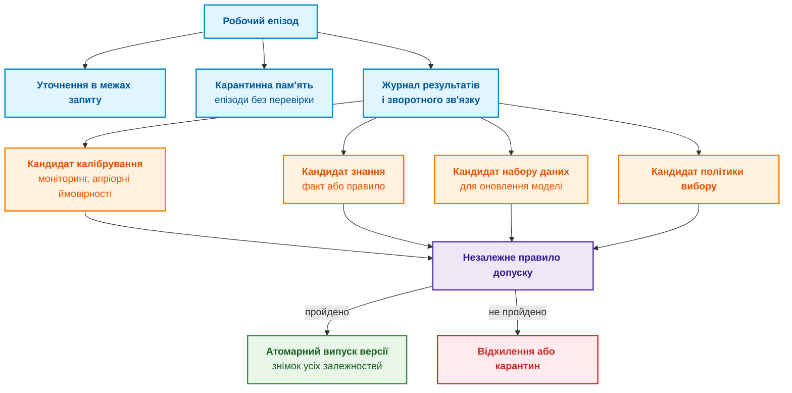
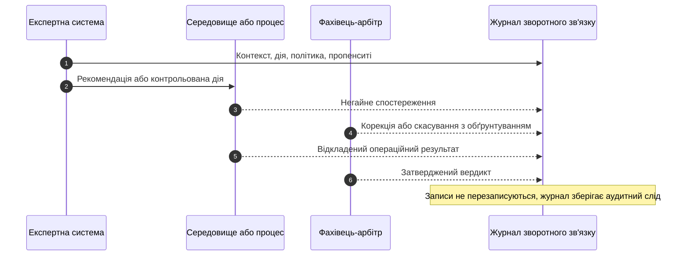
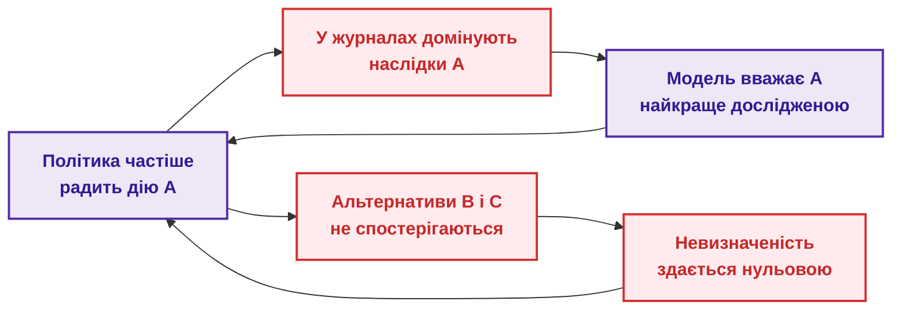
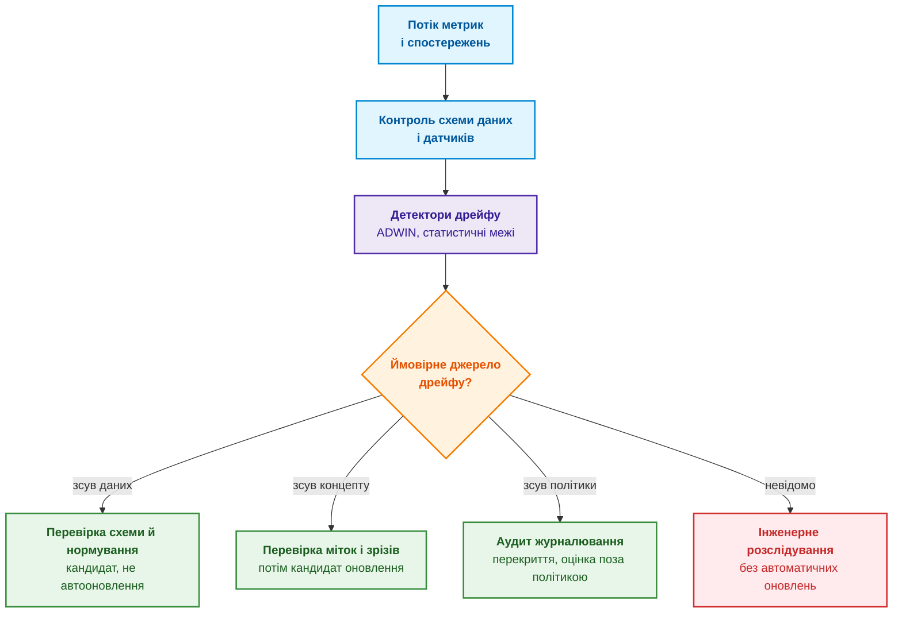
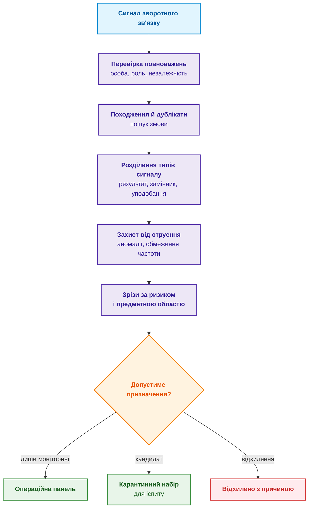

# Глава 26. Неперервне навчання (Continual Learning) на досвіді та подолання зсуву системного журналу

> **Книга:** [Архітектура доказових експертних систем](README.md) · [Частина V: Верифікація, тестування, навчання та обґрунтування безпеки](part-05-verification-and-learning.md)
> **Попередня глава:** [Глава 25. Як навчати експертну систему: екзаменаційні матриці, аудит знань та контроль регресій](ch25-how-expert-systems-learn.md)
> **Наступна глава:** [Глава 39. Активний експерт-тестувальник: попперівська фальсифікація, нормативний комплаєнс (ASPICE/ISO 26262/ISO 21434) та автономне проєктування випробувань](ch39-active-compliance-auditor-and-popperian-testing.md)
> **Зміст книги:** [README.md](README.md)
> **Автор:** [Микола Мартинович Федчик](about-the-author.md)
> **Передумови:** різниця між фактом, правилом і параметром моделі з глави 25; частки та середнє арифметичне. Ймовірності, логічне слідування й довірчі межі пояснено перед застосуванням.
> **Очікувані результати:** відрізняти епізодичну пам'ять від нового знання; записувати навчальний випадок із пропенситі й часом появи результату; виявляти зміщення власних журналів і перевіряти перекриття політик до оцінки нової політики; розрізняти коваріатний дрейф, зсув апріорних частот і дрейф концепту; вимірювати забування на старих зрізах; проводити кандидатів на зміну правил, прецедентів і моделей через ізольовану перевірку до атомарного випуску.

## Анотація

Після сотень діагностичних випадків експертна система помічає закономірність: перевірка роз'єму часто завершує пошук несправності. Експертна система починає радити цю перевірку першою. Невдовзі журнали містять переважно перевірки роз'єму й позитивні результати після повторного під'єднання, і експертна система «переконується», що роз'єм є головною причиною відмов. Інші версії тим часом просто перестали перевіряти, тому журнал не містить жодного свідчення проти роз'єму.

Це проблема навчання на власній роботі: зібраний досвід залежить від попередніх порад, остаточні результати з'являються із затримкою, а хибний зворотний зв'язок здатен підсилювати сам себе. Ця глава відповідає на запитання: **як експертній системі навчатися на досвіді експлуатації так, щоб власні журнали, відгуки користувачів і мовна модель не переписали непомітно перевірених правил?** У цій монографії автором запропоновано **парадигму операційного досвіду як джерела кандидатів, а не готових знань**: робоче виконання реєструє випадки й пропонує зміни, а допуск визначає окрема процедура перевірки саме зміненого компонента. Для оцінювання іншої політики дій за журналом потрібні передумови контрфактичної оцінки, зокрема пропенситі й перекриття; для оновлення параметрів моделі потрібні незалежна валідація та аудит забування. Жодна з цих статистичних перевірок сама не затверджує нового факту чи правила.

[Глава 3](ch03-beyond-reference-information-systems.md) визначила самонавчання як збирання досвіду й підготовку перевірених кандидатів, а не переписування правил після кожної відповіді. [Глава 25](ch25-how-expert-systems-learn.md) розділила факт, правило, пошук і параметричне навчання та побудувала життєвий цикл «кандидат → іспит → випуск». Тут розглянуто, що відбувається **до появи кандидата й між випусками**. Увесь шлях пояснено на навчальному, а не промисловому експерименті: експертна система обирає першу діагностичну перевірку роз'єму, тактування чи живлення; умови бувають холодними або теплими; незалежний арбітр пізніше підтверджує результат. Дні журналу, блоки спостережень і етапи навчання далі розрізняються явно.

Авторський **інженерний принцип заборони автономної неконтрольованої самозміни правил у рантаймі** є вимогою запропонованої архітектури, не цитатою із сертифікаційного стандарту: одинична транзакція не змінює робочих правил, онтологій або ваг. Оновлення готують в ізоляції та випускають сумісним знімком. Повернення старого знімка допомагає відновити програмний стан, але не скасовує вже виконаних фізичних дій і не гарантує, що стара версія придатна після відкликання джерела.

## 1. Навігація глави за цільовим об'єктом інженерної зміни

Яку саме зміну виправдовує повідомлення «після огляду роз'єму пристрій запрацював»? Для відповіді пригадаємо главу 25: факт описує окрему подію з джерелом, правило задає умови висновку, а параметр моделі налаштовує прогноз чи пошук. Запис результату не доводить правила «завжди починати з роз'єму» і не вимагає навчати мовну модель.

У цій монографії автором запропоновано **інженерне правило декомпозиції вимог до валідації за цільовим об'єктом зміни**. Для факту перевіряють джерело та застосовність; для правила також позитивні й негативні випадки та залежні висновки; для пошуку перевіряють знайдені джерела й порядок результатів; для параметричної моделі перевіряють незалежні дані, калібрування і старі зрізи. Кандидат, який змінює кілька компонентів, проходить сукупність відповідних перевірок. Політика тут означає спосіб обирати дію за контекстом, а не предметне правило істинності.

Пропенситі, тобто ймовірність вибору дії робочою політикою, та перекриття альтернатив потрібні для описаного далі оцінювання іншої політики за журналом. Це не універсальні передумови виправлення факту. Авторський **критерій невідновності контрфактичних альтернатив за нульового покриття** має точну межу: якщо в потрібному контексті альтернативу ніколи не обирали, її результат не визначається самим цим журналом без додаткових припущень чи даних. Модель середовища може дати прогноз, але це вже інша підстава. Наприклад, журнал лише оглядів роз'єму не встановлює успіху перевірки живлення в теплі. Спочатку тому називають об'єкт зміни, потім з'ясовують, який досвід для нього потрібен.

## 2. Рівні та механізми адаптації в системі знань

Як відрізнити збереження досвіду від зміни поведінки? Достатньо запитати, що залишилося після завершення запиту: текст випадку, числова статистика, правило чи нові параметри. Випадок про роз'єм можна зберегти для аналізу, не дозволяючи йому керувати наступною відповіддю. Таблиця розрізняє шість механізмів; це авторська функціональна класифікація, а не шкала доведеності.

<a id="obj-26-1"></a>

**Таблиця 26.1. Механізми накопичення досвіду та об'єкти змін**

| Механізм | Чи зберігає стан між запитами | Що змінюється | Основний ризик |
|---|---|---|---|
| Самоуточнення в межах запиту | ні | поточна чернетка відповіді й контекст | модель підтверджує власну помилку |
| Епізодична пам'ять | так | записи випадків і рефлексій | неперевірений текст стає прецедентом |
| Оперативна статистика й калібрування | так | апріорні ймовірності, пороги, карта впевненості | дрейф або зміщені результати |
| Перегляд знань | так | факти, правила, винятки, онтологія | суперечності й втрата походження |
| Неперервне навчання моделі | так | параметри моделі векторного подання, класифікатора чи мовної моделі | катастрофічне забування, витік даних |
| Навчання політики | так | вибір запитань, перевірок і дій | небезпечне дослідження й петля зворотного зв'язку |

Перші два рядки часто плутають із навчанням. Аман Мадаан та співавтори показали в методі Self-Refine, що велика мовна модель (*Large Language Model*, LLM) може поліпшувати власну відповідь ітеративним самовідгуком без навчальних даних і без додаткового навчання [[1]](#src-1). Ной Шинн та співавтори в методі Reflexion зберігають словесні рефлексії про невдачі в буфері епізодичної пам'яті й теж не змінюють ваг моделі [[2]](#src-2). Обидва підходи поліпшували результати у своїх експериментах, але жоден не створює перевіреного постійного знання експертної системи: рефлексія лишається текстом, якого ніхто не перевірив. Для усунення методологічної невизначеності автором запропоновано модель функціонального розмежування рівнів адаптації:

> [!NOTE]
> **Шість рівнів адаптації та накопичення досвіду в системі знань за моделлю автора**
> 1. Внутрішньоконтекстне самоуточнення: локальне поліпшення чернетки в межах одного запиту без збереження міжсесійного стану.
> 2. Карантинна епізодична пам'ять: ізольоване збереження неперевірених логів та слідів сесії без права прямого впливу на виведення.
> 3. Оперативна статистика та калібрування: фоновий моніторинг апріорних ймовірностей, порогів та зміщень розподілів.
> 4. Символьний перегляд бази знань: формальне оновлення фактів, онтологічних зв'язків, правил і винятків через детермінований шлюз.
> 5. Неперервне параметричне навчання: доналаштування ваг векторних або мовних моделей із контролем катастрофічного забування.
> 6. Адаптація політики дій: оновлення стратегії планування перевірок і діагностичних зондувань із контролем перформативних петель.
> *Керування рантаймом:* Робочий тракт має право лише генерувати кандидатів; автоматичне підвищення епістемічного статусу неперевірених артефактів суворо заборонено.

Схема показує, куди потрапляє досвід одного робочого епізоду і де стоїть єдина точка, через яку досвід може змінити робочу версію.

<a id="obj-26-2"></a>

**Діаграма 26.2. Ізоляція досвіду від випуску зміни**



Головний інваріант схеми: робоче виконання може автоматично створювати кандидатів, але не підвищує їхнього епістемічного статусу. Запис пам'яті не стає правилом, клік користувача не стає еталонною міткою, а успішний виклик інструмента не стає доведеним причинним результатом. Перше питання перед будь-яким оновленням тому просте: команда лише зберігає випадок для майбутнього аналізу чи змінює правило, яке вплине на наступне рішення? Від відповіді залежить рівень перевірки, а сама перевірка можлива лише тоді, коли випадок записано з достатнім контекстом.

## 3. Фіксація навчального прецеденту та облік затримок зворотного зв'язку

Які дані треба записати сьогодні, щоб через тиждень перевірити результат поради? Потрібні окремо контекст до дії, сама дія, спосіб її вибору та час надходження незалежного результату. Імовірність є часткою можливих виборів від 0 до 1; умовний розподіл описує ці частки за фіксованих обставин. Авторська **стохастична модель вибору дії та відкладеної фіксації результату** використовує цей класичний апарат, щоб не змішувати момент рішення з моментом доступності мітки:

<a id="obj-26-3"></a>

**Формула (26.3). Вибір дії та надходження відкладеного результату**

```math
a_t\sim\mu_t(a\mid x_t),
\qquad y_{t+d}\sim P(y\mid x_t,a_t,e_t).
```

- У цій парі виразів $t$ є цілим невід'ємним номером дня рішення, $`x_t`$ контекстом із заданого простору ознак, $`a_t`$ однією з трьох перевірок, а $`\mu_t(a\mid x_t)`$ імовірністю вибору дії за контексту $`x_t`$; сума ймовірностей усіх доступних дій дорівнює 1;
- $\sim$ означає випадкове отримання значення за вказаним розподілом, а $`P(y\mid x_t,a_t,e_t)`$ задає розподіл результату $y$ за контексту, дії та стану середовища;
- $`y_{t+d}`$ є результатом, доступним через $d$ цілих невід'ємних днів; у прикладі це булева мітка правильності діагнозу. Часова затримка вимірюється в днях, а мітка одиниць не має;
- $`e_t`$ є частково спостереженим станом середовища; його наявність у моделі не означає, що всі його складники вдалося виміряти.

Читається так: журнал записує, з якою ймовірністю політика вибрала дію в контексті, а потім пов'язує дію з результатом, що може надійти пізніше. Імовірності мають значення від 0 до 1; формула не робить спостережуваний після дії результат доказом причинності. Для діагностики з [Глави 24](ch24-system-diagnosis.md) дією може бути синхронний запис живлення й тактування, результатом підтверджена першопричина через два дні, а остаточною гарантійною статистикою дані за місяць. Мінімальний запис зворотного зв'язку для такого випадку має вигляд:

<details>
<summary>Структуроване подання JSON</summary>

```json
{
  "episode_id": "diag:cold-start-failure:run-31",
  "decision_snapshot": "sha256:...",
  "behavior_policy": "test-policy@4.2",
  "context": "feature-vector-or-typed-facts-ref",
  "action": "synchronized_rail_clock_capture",
  "propensity": 0.42,
  "immediate_observation": "obs:trace:881",
  "delayed_outcomes": [
    {"type": "adjudicated_root_cause", "value": "connector", "at": "..."}
  ],
  "feedback_source": "reliability-review-board",
  "causal_status": "observational_after_intervention",
  "eligibility": "candidate_only"
}
```

</details>

Поле `propensity` містить ймовірність, з якою політика журналювання могла обрати цю дію в цьому контексті. Без пропенситі частина методів оцінювання поза політикою (*off-policy evaluation*, OPE) неможлива. Якщо робоча політика детермінована й ніколи не обирала альтернативи, журнал не містить доказу результату альтернативи, і жодна статистика не відновить цього контрфактичного результату з нуля. Поле `eligibility` фіксує, що запис може стати лише кандидатом, а поле `causal_status` нагадує, що результат спостерігали після втручання, а не в контрольованому експерименті.

Якщо випадки надходять від сторонніх систем, перевіряють походження та права доступу ([Глава 33](ch33-inter-system-knowledge-exchange-and-model-teaching.md)). Підпис справного сенсорного процесора не доводить правильності його датчика. Незалежний оракул результату тут означає перевіряльника з окремими підставами: арбітр використовує стендовий вимір і встановлений діагностичний протокол, а не переписує прогноз кандидата. Незалежність не є безпомилковістю: конфлікти міток і повторні перевірки теж журналюють.

Діаграма показує, у якому порядку журнал отримує частини запису.

<a id="obj-26-4"></a>

**Діаграма 26.4. Час рішення, спостереження та арбітражу**



Запис розрізняє час події й час, коли результат став відомим. Інакше модель навчатиметься на даних, яких не могла мати під час рішення, або сплутає ще не відомий результат із негативним. Програма нижче показує різницю на шести синтетичних діагностичних епізодах. Поле `label_available_at` містить день, коли арбітр підтвердив результат, а `None` означає, що результат ще невідомий. Потрібен Python 3.10 або новіший.

<details>
<summary>Приклад мовою Python</summary>

```python
from dataclasses import dataclass


@dataclass(frozen=True)
class Episode:
    decided_at: int
    label_available_at: int | None
    correct: bool | None


def evaluate_at(cutoff, episodes):
    decided = [e for e in episodes if e.decided_at <= cutoff]
    if not decided:
        raise ValueError("no decisions before cutoff")
    for e in decided:
        if (e.label_available_at is None) != (e.correct is None):
            raise ValueError("label time and outcome must be both present or both absent")
        if e.label_available_at is not None and e.label_available_at < e.decided_at:
            raise ValueError("label cannot precede decision")
    resolved = [e for e in decided if e.label_available_at is not None and e.label_available_at <= cutoff]
    correct = sum(1 for e in resolved if e.correct)
    return {
        "decided": len(decided),
        "pending": len(decided) - len(resolved),
        "naive": correct / len(decided),
        "resolved_accuracy": correct / len(resolved) if resolved else None,
    }


EPISODES = [
    Episode(1, 3, True), Episode(2, 4, True), Episode(3, 5, False),
    Episode(4, 9, True), Episode(5, 10, True), Episode(6, None, None),
]

for day in (6, 10):
    print(day, evaluate_at(day, EPISODES))
```

</details>

Програма виводить:

<details>
<summary>Дані або результат прикладу</summary>

```text
6 {'decided': 6, 'pending': 3, 'naive': 0.3333333333333333, 'resolved_accuracy': 0.6666666666666666}
10 {'decided': 6, 'pending': 1, 'naive': 0.6666666666666666, 'resolved_accuracy': 0.8}
```

</details>

На шостий день підтверджено два успіхи з трьох розв'язаних епізодів: ділення на всі шість дає 0,333, а на три відомі результати дає 0,667. На десятий день відомо чотири успіхи з п'яти, тобто 0,8; один випадок ще очікує мітки. Це частки без одиниць, не остаточна якість: складні невдалі ремонти можуть чекати довше за прості успішні. Програма показує кількість очікувань, але не оцінює повний розподіл затримок чи поправку на цензурування. Для підсумкової оцінки потрібні дозрілі часові групи з однаковим горизонтом спостереження або обґрунтована модель затримки. Навіть такий журнал показує лише дії, які система обрала виконати; далі перевіримо наслідки цього відбору.

## 4. Системний зсув журналів (Log Bias) та оцінювання поза політикою (Off-Policy Evaluation)

Чи означає велика частка успіхів огляду роз'єму, що саме його варто радити першим? Ні: політика журналювання $\mu$ визначає, які дії спостерігаються, а цільова політика $\pi$ може обирати інші. У послідовному ремонті дії можуть також змінювати майбутні стани. Авторське інженерне правило вимагає перевіряти підтримку даних, зокрема можливий, але не обов'язковий зсув:

<a id="obj-26-5"></a>

**Формула (26.5). Можлива відмінність розподілів відвідуваних станів**

```math
d^{\pi}(x)\ne d^{\mu}(x).
```

- Для $`d^{\pi}(x)`$ і $`d^{\mu}(x)`$ індекси $\pi$ та $\mu$ позначають розподіли станів за нової та журналювальної політик;
- $x$ є станом, а $`d^{\pi}(x)`$ і $`d^{\mu}(x)`$ є ймовірностями цього стану за відповідних політик;
- $\ne$ означає, що два розподіли не збігаються всюди.

Це безрозмірні розподіли на одному просторі станів із сумою ймовірностей 1. Наприклад, після невдалого огляду роз'єму система частіше потрапляє в стан повторного ремонту. Відмінність частот сама не означає неідентифікованості: можливе коректне перезважування за достатньої підтримки. Відсутність потрібних станів чи дій є іншою, сильнішою проблемою. Нижче свідомо звузимо задачу до одного рішення: холод/тепло задається зовні з однаковими частками, а винагорода стосується лише першої перевірки. Формула IPS для такого контекстного рішення не є оцінювачем довільної багатокрокової траєкторії.

Стефан Росс, Джефрі Гордон і Дрю Багнелл показали, що через порушення припущення про незалежні однаково розподілені дані імітаційне навчання погіршується після власних помилок, і запропонували алгоритм DAgger (*Dataset Aggregation*), який збирає мітки на станах, що відвідує поточна політика [[3]](#src-3). У критичних для безпеки застосуваннях, однак, не можна навмисно заходити в небезпечні стани лише заради покриття даних.

Потрібний результат тепер конкретний: середня частка перших перевірок, які знаходять несправність. Для незалежних контекстних епізодів зі стабільним законом результату цінність нової політики $\pi$ оцінюють зважуванням за оберненою пропенситі (*Inverse Propensity Scoring*, IPS):

<a id="obj-26-6"></a>

**Формула (26.6). Оцінка середньої винагороди нової політики за журналом**

```math
\widehat V_{\mathrm{IPS}}(\pi)=\frac{1}{N}\sum_{i=1}^{N}
\frac{\pi(a_i\mid x_i)}{\mu(a_i\mid x_i)}\,r_i.
```

- У цій оцінці $N$ є кількістю записаних епізодів, а $i$ індексує епізод;
- $`x_i`$ є контекстом, $`a_i`$ обраною дією, $`r_i`$ отриманою винагородою, а $\pi$ цільовою політикою, яку оцінюють;
- $`\mu(a_i\mid x_i)`$ є ймовірністю вибору дії в журналі, а $`\pi(a_i\mid x_i)`$ її ймовірністю за цільовою політикою;
- Їхнє відношення є вагою важливості; $`\sum_{i=1}^{N}`$ підсумовує зважені винагороди, а ділення на $N$ дає середнє;
- $`\widehat V_{\mathrm{IPS}}(\pi)`$ є оцінкою цінності цільової політики.

Тут $N$ є додатним цілим, контексти належать заздалегідь заданому профілю, дії належать скінченній множині, а винагорода дорівнює 0 або 1 і не має фізичних одиниць. Потрібні точні записані пропенситі, той самий цільовий розподіл контекстів, відсутність прихованого відбору результатів і незмірених чинників вибору дії, що також впливають на результат. За цих умов умовне середнє зваженого внеску відновлює середнє цільової політики: множник $\mu$ від вибору дії скорочується зі знаменником. Це пояснює незміщеність, але не малу похибку скінченного журналу.

Для двох епізодів із вагами 2 і 1 та винагородами 1 і 0 сума внесків дорівнює 2, а середнє 1. Окремий IPS-результат може навіть перевищити 1: вага 1,25 і один успіх дають 1,25, хоча істинна частка лежить від 0 до 1. Це не ймовірність конкретного випадку. Перед обчисленням перевіряють перекриття (*overlap*) на всіх потрібних контекстах:

<a id="obj-26-7"></a>

**Формула (26.7). Підтримка цільових дій політикою журналювання**

```math
\pi(a\mid x)>0\Rightarrow\mu(a\mid x)>0.
```

- Для цієї умови $\pi(a\mid x)$ є ймовірністю дії $a$ за цільовою політикою, а $\mu(a\mid x)$ за політикою журналювання;
- $x$ є контекстом, $a$ дією, а $>0$ означає ненульову ймовірність;
- $\Rightarrow$ є логічною імплікацією: якщо цільова політика може вибрати дію, журналювальна політика обов'язково має надавати їй ненульову ймовірність (спільний носій).

Умова потрібна для контекстів із ненульовою цільовою часткою. У теплі цільова політика обирає живлення з імовірністю 1: журнал лише роз'єму має для нього 0 і не підтримує оцінку; журнал із часткою 0,1 підтримує. Нульове покриття не обов'язково спричинить буквальне ділення на нуль у програмі: непідтримуваний запис просто ніколи не з'явиться. Саме тому перевіряють контракт усієї політики, а не тільки додатність знаменників у наявних рядках. Додатна пропенситі не гарантує, що скінченна вибірка вже містить достатньо таких дій.

Малі пропенситі дають великі ваги й можуть збільшувати дисперсію. Обрізання ваг змінює оцінювач і зазвичай вносить зміщення. Двічі робастні оцінки поєднують модель винагороди з поправкою на пропенситі [[4]](#src-4), але не усувають відсутності підтримки. Для діагностики концентрації ваг використовують ефективний розмір вибірки, наведений Артом Оуеном [[5]](#src-5):

<a id="obj-26-8"></a>

**Формула (26.8). Діагностика концентрації ваг ESS**

```math
\mathrm{ESS}=\frac{\left(\sum_iw_i\right)^2}{\sum_iw_i^2}.
```

- Тут ваги $`w_i`$ належать епізодам $i$, а суми охоплюють усі епізоди;
- Чисельник підносить суму ваг до квадрата, знаменник підсумовує квадрати окремих ваг;
- $`\mathrm{ESS}`$ є безрозмірною діагностикою, а не реальною кількістю незалежних епізодів: для $N$ невід'ємних ваг із додатною сумою вона лежить від 1 до $N$. Вага є відношенням імовірностей із формули (26.6), отже теж безрозмірна.

**Практичне застосування та інженерні висновки (Closed-Loop Decision):**
1. **Критерії диспетчеризації валідації політик:**
   - **Якщо $`\mathrm{ESS} / N \ge \tau_{\mathrm{ess}}`$:** Діагностика концентрації ваг не блокує подальше оцінювання. Це не встановлює статистичної надійності оцінки $`\widehat V_{\mathrm{IPS}}(\pi)`$ і не дає допуску до розгортання; потрібні припущення та застосовні шлюзи §12. Значення $`\tau_{\mathrm{ess}}=0{,}30`$ є прикладом авторської політики, не універсальною межею;
   - **Якщо $`\mathrm{ESS} / N < \tau_{\mathrm{ess}}`$:** Автономне впровадження блокується й запускається цільова перевірка журналу та припущень оцінювання. Truncated IPS або Doubly Robust можна розглядати як окремий оцінювач із власною гарантією й умовами; автоматичного перемикання з продовженням допуску немає.
2. **Практичний числовий приклад:** Для трьох ваг 1, 1 і 2 сума дорівнює 4, сума квадратів 6, тому ESS дорівнює 16/6, приблизно 2,67. Ділення на три дає 0,89; діагностичний поріг 0,30 не порушено. Це не підтверджує незалежності, правильності міток чи допустимої похибки IPS. Для нульових ваг показник не визначений; для ваг із часовою залежністю він не є поправкою на цю залежність.

Програма нижче реалізує формули (26.6) і (26.8) та перевірку (26.7) для історії з роз'ємом. У холоді перевірка роз'єму знаходить несправність із заданою ймовірністю 0,60, у теплі перевірка живлення має 0,45. Контексти рівноймовірні, тому відома в симуляції цінність цільової політики є середнім 0,60 та 0,45, тобто 0,525. Це задані навчальні числа, не стендові виміри. По 200 000 незалежних епізодів імітують два можливі способи збирання журналу того самого періоду, а не дві послідовні стадії дрейфу. Для ізоляції зсуву вибору затримку міток тут вимкнено; у реальному потоці спочатку потрібні дозрілі групи §3.

<details>
<summary>Приклад мовою Python</summary>

```python
"""Зміщення власного журналу й оцінка нової політики за пропенситі (IPS).

Лише стандартна бібліотека Python 3.10+.
"""
import random

ACTIONS = ("роз'єм", "тактування", "живлення")
CONTEXTS = ("холод", "тепло")
# Ймовірність, що перша перевірка знаходить несправність, для кожної дії в кожних умовах
P_FOUND = {"холод": (0.60, 0.20, 0.20), "тепло": (0.15, 0.40, 0.45)}
N = 200_000


def connector_only(context):
    return (1.0, 0.0, 0.0)


def connector_mostly(context):
    return (0.8, 0.1, 0.1)


def target(context):
    """Нова політика: у холоді першим перевіряти роз'єм, у теплі живлення."""
    return 0 if context == "холод" else 2


def collect(policy, rng):
    logs = []
    for _ in range(N):
        context = rng.choice(CONTEXTS)
        probs = policy(context)
        action = rng.choices(range(3), weights=probs)[0]
        reward = 1 if rng.random() < P_FOUND[context][action] else 0
        logs.append((context, action, probs[action], reward))
    return logs


def report(name, policy, logs):
    if not logs:
        raise ValueError("empty log")
    print(f"Журнал: {name}")
    counts = [sum(1 for _, a, _, _ in logs if a == i) for i in range(3)]
    print("  спостережень за дією:", ", ".join(f"{ACTIONS[i]} {counts[i]}" for i in range(3)))
    supported = True
    for context in CONTEXTS:
        mu = policy(context)[target(context)]
        print(f"  перекриття «{context} -> {ACTIONS[target(context)]}»: mu = {mu:.2f}" + ("" if mu > 0 else "  НЕМАЄ"))
        supported = supported and mu > 0
    if not supported:
        print("  оцінка IPS неідентифікована: немає перекриття політик")
        return None
    matched = [r for x, a, _, r in logs if a == target(x)]
    weights = [1 / p if a == target(x) else 0.0 for x, a, p, _ in logs]
    if not matched or sum(weights) == 0:
        print("  оцінка недоступна: немає спостережених збігів із цільовою політикою")
        return None
    ips = sum(w * r for w, (_, _, _, r) in zip(weights, logs)) / len(logs)
    ess = sum(weights) ** 2 / sum(w * w for w in weights)
    print(f"  наївна оцінка (середнє серед збігів): {sum(matched) / len(matched):.3f}")
    print(f"  оцінка IPS: {ips:.3f}; ефективний розмір вибірки {ess:.0f} із {len(logs)}")
    return ips, ess


def test_evaluation_guards():
    import contextlib
    import io

    with contextlib.redirect_stdout(io.StringIO()):
        assert report("unsupported", connector_only, [("холод", 0, 1.0, 1)]) is None
        assert report("no_matches", connector_mostly, [("тепло", 1, 0.1, 1)]) is None
        estimate, effective_size = report("supported", connector_mostly, [("холод", 0, 0.8, 1)])
        assert estimate == 1.25 and effective_size == 1.0
        try:
            report("empty", connector_mostly, [])
        except ValueError:
            pass
        else:
            raise AssertionError("empty log accepted")


test_evaluation_guards()


true_value = sum(P_FOUND[c][target(c)] for c in CONTEXTS) / len(CONTEXTS)
print(f"Справжня цінність нової політики: {true_value:.3f}")
rng = random.Random(26)
for name, policy in (("лише роз'єм", connector_only), ("роз'єм у 80 % випадків", connector_mostly)):
    print()
    report(name, policy, collect(policy, rng))
```

</details>

Лістинг використовує лише стандартну бібліотеку Python 3.10+. Вхідні ймовірності та генератор із фіксованим початковим станом визначають журнал; результатом є оцінка й ESS або відмова. Усередині є чотири перевірки: відсутнє перекриття, відсутні збіги, підтримуваний успіх із IPS 1,25 та порожній журнал. Програма друкує:

<details>
<summary>Дані або результат прикладу</summary>

```text
Справжня цінність нової політики: 0.525

Журнал: лише роз'єм
  спостережень за дією: роз'єм 200000, тактування 0, живлення 0
  перекриття «холод -> роз'єм»: mu = 1.00
  перекриття «тепло -> живлення»: mu = 0.00  НЕМАЄ
  оцінка IPS неідентифікована: немає перекриття політик

Журнал: роз'єм у 80 % випадків
  спостережень за дією: роз'єм 159907, тактування 20085, живлення 20008
  перекриття «холод -> роз'єм»: mu = 0.80
  перекриття «тепло -> живлення»: mu = 0.10
  наївна оцінка (середнє серед збігів): 0.581
  оцінка IPS: 0.524; ефективний розмір вибірки 35542 із 200000
```

</details>

Перший журнал зібрала політика, яка завжди перевіряє роз'єм. Для тепла нова політика обирає дію, якої в журналі немає жодного разу, тобто перекриття відсутнє, і програма відмовляється давати число. Якщо цю перевірку вимкнути, той самий журнал дасть наївну оцінку 0,602, бо вона бачить лише холодні випадки, і IPS 0,301, бо теплі випадки мовчки отримають нульовий внесок. Обидва числа виглядають правдоподібно й обидва хибні, тому перевірка перекриття має передувати будь-якій оцінці. Другий журнал зібрала політика, яка у 20 % випадків пробує інші перевірки з відомими пропенситі. Наївна оцінка все одно завищена (0,581), бо холодні збіги трапляються вісім разів частіше за теплі, а IPS дає 0,524 за справжньої цінності 0,525. Ціну поправки показує останнє число: ефективний розмір вибірки становить 35 542 із 200 000 епізодів, тобто зважування залишило менше п'ятої частини інформації журналу.

Приклад спрощений: пропенситі відомі точно, винагороди незалежні, а закон результату сталий. Програма не перевіряє довільні зовнішні журнали й не обчислює довірчої межі. За навчального діагностичного порога ESS/N 0,30 другий журнал із часткою приблизно 0,178 теж блокує автоматичний випуск, попри близьке до 0,525 число IPS. Схема показує петлю, яку створює політика без дослідження альтернатив.

<a id="obj-26-9"></a>

**Діаграма 26.9. Самопідсилення зміщеного журналу**



Обидва цикли схеми повертаються до політики й підсилюють її вибір. Розірвати петлю допомагають журналювання пропенситі, явні позначки невідомого, кероване дослідження лише в безпечній області, перевірки, обрані фахівцем, моделювання й проспективне підтвердження. Для незворотних дій оцінка поза політикою є свідченням, а не дозволом на впровадження. Навіть коректно зібраний журнал, однак, не захищає від іншої проблеми: світ, який описує журнал, може змінитися.

## 5. Діагностика та розрізнення типів системного дрейфу

Що змінилося, якщо успішність діагностики впала: пристрої, умови, вибір перевірок чи спосіб підтвердження результату? Перед перенавчанням потрібно порівняти однаково визначені часові групи. Випадкова флуктуація є можливою зміною вибірки за незмінного закону; викид є окремим незвичним спостереженням; дрейф означає зміну розподілу. Жоден із цих термінів сам не називає фізичної причини [[6]](#src-6).

Нехай $X$ позначає контекст, зокрема температуру й ревізію плати, а $Y$ незалежно підтверджений клас несправності. Індекси $t$ і $t+1$ нижче позначають сусідні блоки дозрілих епізодів, не окремі дні. **Коваріатний дрейф** означає зміну входів:

<a id="obj-26-10"></a>

**Формула (26.10). Зміна розподілу входів**

```math
P_t(X)\ne P_{t+1}(X).
```

- Коваріатний дрейф описують $`P_t(X)`$ і $`P_{t+1}(X)`$, розподіли вхідних ознак у періоди $t$ і $t+1$;
- $X$ є змінною вхідних даних, а $\ne$ означає, що розподіли відрізняються.

Обидва розподіли безрозмірні, нормовані й визначені на однаковій схемі ознак. У прикладі частка холодних випадків змінилася з 50 зі 100 до 80 зі 100, тобто з 0,50 до 0,80. Для припущення **чистого** коваріатного зсуву додатково потрібен незмінний умовний закон результату за входом. Самі частоти холоду цього не встановлюють; поки перевіряють зрізи, а не автоматично нормалізують новий потік.

Зміна частки підтверджених несправностей роз'єму є іншою спостережуваною ознакою:

<a id="obj-26-11"></a>

**Формула (26.11). Зміна розподілу міток**

```math
P_t(Y)\ne P_{t+1}(Y).
```

- Для зсуву апріорних частот $`P_t(Y)`$ і $`P_{t+1}(Y)`$ є розподілами міток $Y$ у періоди $t$ і $t+1$;
- $Y$ позначає змінну мітки результату, а $\ne$ показує відмінність розподілів.

Наприклад, серед двох дозрілих груп по 100 епізодів арбітр підтвердив 30 і 50 несправностей роз'єму: частки 0,30 та 0,50 відрізняються. Для моделі **чистого зсуву апріорних частот** (*label shift*) додатково припускають незмінність розподілу ознак усередині кожного класу. Сама нерівність (26.11) цього не доводить: її може спричинити зміна температурного складу, розмітки чи відбору завершених випадків. Без міток перевірити цей зсув без додаткових припущень не можна.

Нарешті, чи змінився результат для однакових входів? Це питання про **дрейф концепту**:

<a id="obj-26-12"></a>

**Формула (26.12). Зміна умовного закону результату**

```math
P_t(Y\mid X)\ne P_{t+1}(Y\mid X).
```

- Тут $`P_t(Y\mid X)`$ і $`P_{t+1}(Y\mid X)`$ є умовними розподілами мітки $Y$ за входу $X$ у двох періодах;
- $\mid$ читається «за умови», а $\ne$ означає, що змінилася залежність результату від входу.

Для того самого холодного режиму й тієї самої ревізії частка підтверджених несправностей роз'єму могла змінитися з 60/100 до 40/100. Це кандидат на зміну умовного закону, але скінченні частоти ще потребують статистичної перевірки. Відбір дій та доступність міток мають бути зіставними. Навіть підтверджений зсув не доводить, що його спричинила прошивка: потрібне окреме інженерне дослідження. Три зміни можуть співіснувати, а чисті моделі зсуву є додатковими припущеннями.

Як відрізнити флуктуацію від сигналу? Для двох **наперед обраних**, неперетинних груп незалежних величин від 0 до 1 нерівність Гьофдінга дає експоненційну верхню межу ймовірності великого відхилення середнього від математичного очікування. Застосування до зваженої різниці двох середніх за нульової гіпотези однакових очікувань дає таку навчальну межу:

<a id="obj-26-13"></a>

**Формула (26.13). Межа різниці середніх для одного фіксованого порівняння**

```math
\epsilon=\sqrt{\frac{1}{2}\left(\frac{1}{n_0}+\frac{1}{n_1}\right)\ln\frac{2}{\delta}}.
```

- $\epsilon$ є безрозмірною межею абсолютної різниці середніх нормованої метрики;
- $`n_0`$ і $`n_1`$ є додатними цілими розмірами двох груп, а $\delta$ є верхньою межею ймовірності хибного сигналу для цього одного порівняння, строго між 0 і 1;
- $\ln$ є натуральним логарифмом, а знак кореня означає квадратний корінь.

Для двох груп по 200 епізодів і $`\delta=0{,}05`$ сума обернених розмірів дорівнює 0,01; половина цієї суми, помножена на ln(40), дорівнює приблизно 0,01844; квадратний корінь дає 0,1358. Різниця часток 0,15 перевищує межу й запускає аудит; різниця 0,10 не перевищує, але не доводить відсутності зміни. Менше $\delta$ збільшує межу. Для вимірів у вольтах спочатку потрібне задане обмеження діапазону й нормування; для корельованої часової серії ця незалежна модель непридатна без додаткового обґрунтування.

ADWIN (*ADaptive WINdowing*) Біфета й Гавальди адаптує вікно й перевіряє багато можливих розбиттів [[7]](#src-7). Формула (26.13) пояснює принцип, але не є реалізацією ADWIN: багаторазові перевірки потребують його власного контролю похибки. Щоденне повторення тесту з 0,05 не дає 5-відсоткової ймовірності хибної тривоги за весь місяць. Схема маршрутизує розслідування, не доводить його причину.

<a id="obj-26-14"></a>

**Діаграма 26.14. Від сигналу зміни до перевірки гіпотез**



У системі діє авторський **інженерний принцип попередньої верифікації артефактів спостереження до констатації дрейфу**: жоден сигнал статистичного детектора дрейфу не є достатньою підставою для автоматичної зміни знань. До початку формування нових кандидатів система зобов'язана виконати регламентну перевірку на наявність пропущених міток, факторів сезонності, збоїв первинних вимірювальних каналів, змін асортименту продукції та оновлень нормативної бази. Відкладені результати можуть створити тимчасове погіршення калібрування, якщо незавершені епізоди хибно зараховувати як відмови.

### 5.1. Випереджальні індикатори: деградація до першої хибної відповіді

Чи можна почати аудит, поки незалежні мітки ще запізнюються? Для цього спостерігають величини, доступні раніше: розкид оцінок, брак доказових джерел, нові теми запитів і кількість уточнень. У прикладі діагностики нові холодні випадки можуть змінити ці величини до завершення ремонту. Це кандидати на випереджальні індикатори, не гарантований прогноз першої хибної відповіді; сама назва підрозділу позначає мету моніторингу.

Ідея випереджальних індикаторів (*leading indicators*) добре відома в теорії складних систем. Шеффер та співавтори показали, що перед різкою зміною стану екологічні, кліматичні й фінансові системи повільніше відновлюються після збурень, і це проявляється в зростанні дисперсії та автокореляції спостережуваних величин [[8]](#src-8). Для експертної системи ця аналогія не є доведенням, але дає перевірювані кандидати в індикатори, які перелічує таблиця.

<a id="obj-26-15"></a>

**Таблиця 26.15. Гіпотези про випереджальні індикатори**

| Індикатор | Що вимірюють | Можливе раннє пояснення, не встановлена причина |
|---|---|---|
| Зростання дисперсії впевненості в домені | дисперсію впевненості відповідей одного домену за ковзним вікном за стабільного середнього | частина запитань уже потрапляє на межу знань, а середнє ще тримається |
| Розходження збігів і підтвердженості | частку відповідей, де пошук знаходить багато кандидатів, але частка тверджень із доказом падає | збіги за словами лишилися, а точних цитат для нових формулювань немає |
| Дрейф запитань у тонкі зони | частку запитань у темах із низькою знаннєвою щільністю ([Глава 32](ch32-high-performance-knowledge-packs-mmap-and-harvesting.md)) | запитання змістилися туди, де знань мало, ще до перших відмов |
| Зростання уточнювальних циклів | середню кількість уточнювальних запитань у діалозі до відповіді | словник перестав однозначно розпізнавати нові терміни |

Для раннього виявлення цих прихованих процесів автором запропоновано модель випереджальних індикаторів:

> [!NOTE]
> **Чотири випереджальні індикатори деградації бази знань за моделлю автора**
> 1. Зростання дисперсії впевненості: збільшення розкиду метрик довіри в межах домену при збереженні стабільного середнього рівня.
> 2. Розходження пошукових збігів та доказової бази: виявлення лексичної близькості без наявності точних цитат для обґрунтування тверджень.
> 3. Дрейф запитів у розріджені зони: зміщення активності користувачів у тематичні сегменти з низькою знаннєвою щільністю до появи перших відмов.
> 4. Зростання кількості уточнювальних діалогових циклів: збільшення кроків прояснення термінів через застарівання словника або онтології.
> *Керування рантаймом:* CUSUM накопичує відхилення й може ініціювати аудит до надходження міток; випередження інцидентів потребує окремої перевірки.

Для відстеження стійкого зростання використаємо кумулятивну суму (*cumulative sum*, CUSUM) Пейджа [[9]](#src-9). Вона додає відхилення від стабільного еталона, віднімаючи допуск, і обнуляє від'ємний накопичений залишок. Одиничний великий викид теж може викликати сигнал; цей детектор не встановлює причини зміни.

<a id="obj-26-16"></a>

**Формула (26.16). Однобічний CUSUM для зростання індикатора**

```math
S_t = \max\left(0,\; S_{t-1} + x_t - \mu_0 - k\right), \qquad S_0 = 0
```

Складники кумулятивної суми:

- $`x_t`$ є значенням індикатора за цілий день $t\ge1$, тут дисперсією безрозмірного бала від 0 до 1, отже її допустимий діапазон від 0 до 0,25;
- $`\mu_0`$ є еталонним рівнем індикатора, оціненим на стабільному періоді;
- $k\ge0$ є допуском на один крок; малий систематичний зсув може компенсуватися ним, але шумові перевищення не стають неможливими. Половина цільового зсуву є поширеним вибором у відповідно специфікованих моделях, не універсальним правилом;
- $`S_t`$ є накопиченою сумою перевищень, яка не буває від'ємною, а $`S_0`$ є початковим значенням;
- $h>0$ є порогом сигналу; $`S_t`$, $`\mu_0`$, $k$ і $h$ мають одиниці обраного індикатора, тут усі безрозмірні. Сигнал подають за строгого перевищення порога.

У нашому діагностичному потоці еталонна дисперсія за стабільний період становить 0,040; допуск 0,005, поріг 0,030. Після зміни складу запитів п'ять добових значень дорівнюють 0,046; 0,049; 0,052; 0,055; 0,058. Перший приріст: 0,046 мінус 0,040 мінус 0,005, тобто 0,001. Наступні прирости 0,004; 0,007; 0,010; 0,013 дають суми 0,001; 0,005; 0,012; 0,022; 0,035. На п'ятий день сигнал запускає аудит холодного зрізу. Контрприклад до «захисту від одного стрибка»: значення 0,10 вже в перший день дає суму 0,055 і перевищує поріг.

Сезонність, автокореляція й зміна масштабу бала можуть дати такий самий сигнал без деградації знань. Пороги калібрують на окремому стабільному часовому відрізку, перевіряють на іншому відрізку з відомими змінами й оцінюють частоту хибних тривог та затримку в днях. Підбір і звіт на тих самих інцидентах завищує користь індикатора. Тому цей навчальний ряд перевіряє арифметику, а не калібрує робочий детектор. Якщо аудит усе ж обґрунтував кандидата, наступне питання: чи не втратить він старих режимів?

## 6. Метрики оцінки катастрофічного забування (Catastrophic Forgetting)

Як дізнатися, чи навчання на нових холодних випадках не погіршило вже відому діагностику? Потрібно після кожного етапу знову перевіряти старі фіксовані зрізи: ревізії плати, температурні режими й рідкісні відмови. Катастрофічним забуванням називають різке погіршення раніше засвоєної поведінки після навчання на новому. Матриця якості зберігає результат кожного етапу на кожному зрізі; середнє забування за Чаудгрі та співавторами обчислюють так [[10]](#src-10):

<a id="obj-26-17"></a>

**Формула (26.17). Середнє забування відносно попередніх максимумів**

```math
F_T=\frac{1}{T-1}\sum_{i=1}^{T-1}
\left(\max_{i\le k\le T-1}a_{k,i}-a_{T,i}\right).
```

де:

- $T\ge2$ є цілою кількістю етапів навчання, а $i$ індексує стару задачу або зріз від 1 до $T-1$;
- $`a_{k,i}`$ є якістю на задачі $i$ після навчання до задачі $k$, а $`a_{T,i}`$ якістю на тому самому зрізі після останнього етапу;
- $`\max_{i\le k\le T-1}`$ бере найвище значення якості для задачі $i$ після етапів від $i$ до $T-1$;
- $`\sum_{i=1}^{T-1}`$ підсумовує втрати якості на всіх старих задачах, а ділення на $T-1$ дає середнє;
- $`a_{k,i}`$ і $`a_{T,i}`$ тут є частками правильних відповідей від 0 до 1 на тому самому наборі з незмінним оракулом; $`F_T`$ лежить від -1 до 1. Різниці часток подають у відсоткових пунктах, не у відсотках від старої точності.

Для чотирьох етапів попередні максимуми на трьох старих зрізах становили 0,95; 0,90; 0,92, а після четвертого етапу отримано 0,94; 0,90; 0,89. Віднімання дає 0,01; 0; 0,03; сума 0,04, ділення на три дає приблизно 0,0133, тобто 1,33 відсоткового пункта. За навчальних діагностичних порогів $`\tau_{\mathrm{forget}}=0{,}02`$ і $`\tau_{\mathrm{slice}}=0{,}05`$ середнє та найбільша втрата 0,03 не блокують подальший іспит. Це не дозвіл на випуск. Для критичного ядра з окремими забороненими результатами будь-який провал має вето незалежно від цих порогів.

Перевищення діагностичного порога повертає кандидата на аналіз. Частку історичних навчальних даних і силу штрафу обирають на розробницькій валідації, а не автоматично задають як 25 %. Збільшення replay не має права повернути відкликану мітку. Порівняння скінченних часток також має випадкову похибку; значення (26.17) саме не є довірчим інтервалом.

Девід Лопес-Пас і Марк'Ауреліо Ранцато запропонували для неперервного навчання ще й міри перенесення знань назад і вперед (*backward and forward transfer*) між задачами [[11]](#src-11). Від'ємне забування на зрізі означає, що навчання на новій задачі поліпшило стару. Середнє значення, однак, не повинне приховувати критичної регресії. Тут імперативно діє **інженерний принцип стратифікованого контролю регресій на захищених групах за моделлю автора**: оцінка збереження знань при безперервному навчанні зобов'язана виконуватися стратифіковано за всіма критичними зрізами предметної області (застарілі ревізії обладнання, рідкісні аварійні стани, дані альтернативних постачальників). Локальне погіршення на будь-якому захищеному зрізі безпеки є безумовною підставою для блокування випуску кандидатної моделі, незалежно від її середнього виграшу на найсвіжіших масових вибірках.

## 7. Стратегії збереження знань при безперервному навчанні

Як навчити кандидата нових холодних випадків, не втративши теплого режиму? Наївне навчання лише на останній групі не змушує параметри зберігати стару поведінку. Пригадаємо: функція втрат є числом, яке алгоритм навчання намагається зменшити; менша втрата на нових прикладах ще не означає кращого результату на старих. Три родини методів відповідають саме на цю задачу [[12]](#src-12):

- **повторне відтворення** (*replay*) змішує репрезентативні старі приклади з новими;
- **регуляризація** обмежує зміни параметрів, важливих для старих задач, або зберігає стару поведінку через виходи попередньої моделі (дистиляцію);
- **ізоляція параметрів** виділяє окремі адаптери, експерти чи нові частини архітектури для окремого контексту або задачі.

Повторне відтворення додає старі приклади до навчального набору, але не до закритого іспиту. Інший спосіб зберегти поведінку полягає в тому, щоб дорожче карати зміну параметрів, важливих для старої задачі. Пружна консолідація ваг (*Elastic Weight Consolidation*, EWC) Кіркпатріка та співавторів додає такий штраф [[13]](#src-13):

<a id="obj-26-18"></a>

**Формула (26.18). EWC: нова втрата та штраф за зміну старих параметрів**

```math
\mathcal L(\theta)=\mathcal L_{\text{new}}(\theta)
+\frac{\lambda}{2}\sum_iF_i\left(\theta_i-\theta_i^*\right)^2.
```

- Для параметра $`\theta_i`$ значення $`\theta_i^*`$ є його значенням після старої задачі, а $`F_i`$ наближує важливість параметра через інформацію Фішера;
- $\mathcal L(\theta)$ є новою функцією втрат, $`\mathcal L_{\text{new}}(\theta)`$ її складником для нової задачі, а $`\sum_i`$ підсумовує штрафи за параметрами;
- $\lambda$ є невід'ємним коефіцієнтом сили штрафу, квадрат різниці карає відхилення від старого параметра, а $1/2$ масштабує цей доданок.

У цьому навчальному розрахунку параметри є дійсними безрозмірними числами, втрати невід'ємні й безрозмірні, $`F_i\ge0`$, $\lambda\ge0$, а індекс $i$ проходить скінченний вектор параметрів. $`F_i`$ тут не метрика забування з §6: це діагональна оцінка інформації Фішера, тобто очікуваного квадрата чутливості логарифма правдоподібності до параметра на старих даних. EWC використовує локальне квадратичне наближення старої задачі та нехтує позадіагональними взаємодіями; погане наближення послаблює його користь.

За $\lambda=3$, $`F_i=2`$ і відхилення параметра 0,1 квадрат дорівнює 0,01, множення на 2 і на 3/2 дає штраф 0,03. Якщо нова втрата 0,20, загальна становить 0,23. Алгоритм тому порівнює виграш нової задачі зі штрафом, але не встановлює істинності жодного факту. Важливість оцінюють лише за дозволеними навчальними даними; після відкликання їхніх міток перевіряють і залежні оцінки важливості, і дистиляційного вчителя.

Для replay кожен запис має походження, чинність і право використання. Якщо в епізоді 3 арбітр відкликав хибний діагноз, стару подію зберігають для аудиту, а з навчального replay вилучають її мітку та залежні синтетичні копії. Перевіряють, чи треба перенавчити вже випущену модель: видалення рядка з буфера не доводить видалення його впливу з ваг. Оновлені історичні мітки утворюють нову версію набору; метрики різних версій не порівнюють як незмінний еталон.

Буфер також підпорядкований строкам зберігання, приватності й ліцензії. Авторський **інженерний принцип переваги символьного оновлення над параметричним стисненням знань** продовжує главу 25: донавчання пошуку чи класифікатора не замінює явного оновлення факту та правила. Параметричний метод зменшує певний ризик забування, але допуск знань залишається окремим. Далі розглянемо саме цей символьний маршрут, зокрема відкликання залежних висновків.

## 8. Процедури оновлення правил та бібліотеки прецедентів

Коли випадок із роз'ємом може змінити бібліотеку прецедентів чи правило? Спочатку потрібно перевірити результат і межі його застосовності; для правила також потрібне логічне слідування, тобто істинність висновку в усіх моделях заданих посилок. Висока точність числової моделі цього не встановлює. Далі розрізняються збереження випадку, індукція правила й відкликання посилок.

**Прецедент стає знанням лише після перевірки результату.** Класичний цикл міркування за прецедентами (*Case-Based Reasoning*, CBR), який описали Агнар Аамодт та Енрік Плаза, складається з чотирьох кроків: знайти, повторно використати, переглянути, зберегти [[14]](#src-14). Тут діє авторський **інженерний принцип кваліфікованого збереження прецедентів**: автоматичне збереження прецедентів за фактом виконання дії категорично заборонено. Автоматичним може бути пошук у бібліотеці, проте новий прецедент реєструється в базі знань виключно за наявності незалежно підтвердженого результату та формалізованих меж чинності. Прецедент обов'язково містить задачу, повний контекст, обрану дію, фактичний результат, виконану адаптацію та зафіксований негативний досвід, що запобігає дублюванню успішних історій і деградації швидкодії пошуку.

**Правило стає кандидатом, а не законом.** Індуктивне логічне програмування (*Inductive Logic Programming*, ILP) шукає гіпотезу $H$, яка разом із фоновими знаннями $B$ пояснює позитивні приклади й не виводить жодного негативного [[15]](#src-15). Для несуперечливих посилок це записують із явним квантором для кожного прикладу:

<a id="obj-26-19"></a>

**Формула (26.19). Покриття позитивних і виключення кожного негативного прикладу**

```math
\forall e\in E^+: B\cup H\models e,
\qquad
\forall e\in E^-: B\cup H\not\models e.
```

- У цій умові $B$ і $H$ є скінченними наборами логічних посилок, $E^+$ та $E^-$ скінченними неперетинними множинами позитивних і негативних цільових тверджень, а $e$ одним таким твердженням; це логічні об'єкти без фізичних одиниць;
- $\cup$ означає об'єднання, $\models$ читається «логічно виводить», а $\not\models$ читається «не виводить»;
- Обидва рядки вимагають, щоб $B$ разом із $H$ виводили позитивні приклади й не виводили негативних.

Наприклад, у $B$ випадки 1 і 2 мають холод і незалежно підтверджену ознаку дефекту роз'єму; випадок 3 має холод, але дефект живлення. Гіпотеза «холод означає дефект роз'єму» виводить також негативне твердження для випадку 3, тому відхиляється. Уточнений кандидат «холод і підтверджена ознака роз'єму» покриває перші два й не покриває третій. Перевіряти лише «не виводиться вся множина негативних» було б замало: один виведений негативний уже порушує критерій. Невиведення твердження не означає доведення його заперечення.

Для зашумлених даних умови замінюють явно заданою моделлю втрат. Навіть ідеальне покриття прикладів не робить гіпотезу причинним законом чи нормативною вимогою. Кандидат отримує джерело, межі чинності, власника та контрприклади й проходить окремий допуск [Глави 23](ch23-knowledge-base-verification.md).

**Перегляд знань зачіпає залежні висновки.** Система підтримання істинності (*Truth Maintenance System*, TMS) відстежує залежності висновків від припущень [[16]](#src-16), не доводячи фізичних причин. Відкликання мітки випадку 3 вимагає перегляду залежного правила й навчальних наборів, як у §7. Ребро без інтервалу чинності створює хибне «вічне» знання. Схема показує маршрут кандидата; ранній провал будь-якої перевірки залишає його в карантині, навіть якщо відхилення для стислості намальоване лише після перегляду.

<a id="obj-26-20"></a>

**Діаграма 26.20. Перевірки символьного кандидата**

```mermaid
flowchart LR
    accTitle: Перегляд та допуск кандидатів на оновлення бази знань
    accDescr: Перевірені епізоди породжують кандидатів, які проходять перевірку походження, несуперечності й підтримання істинності, тести інваріантів і фаховий перегляд, після чого стають новою версією бази знань або зафіксованим контрприкладом.

    F["<b>Перевірені епізоди</b>"] --> GEN["<b>Генерація кандидатів</b><br/>прецедент, правило, ребро графа"]
    GEN --> PROV["<b>Перевірка походження</b><br/>межі чинності й авторство"]
    PROV --> CONS["<b>Несуперечність</b><br/>і підтримання істинності"]
    CONS --> TEST["<b>Тести інваріантів</b><br/>мутації й контрприклади"]
    TEST --> EXP["<b>Фаховий перегляд</b><br/>власник предметної області"]
    EXP -->|"допущено"| KB["<b>Нова версія бази знань</b>"]
    EXP -->|"відхилено"| NEG["<b>Негативний артефакт</b><br/>зафіксований контрприклад"]

    classDef inp fill:#e1f5fe,stroke:#0288d1,stroke-width:2px,color:#01579b;
    classDef test fill:#ede7f6,stroke:#512da8,stroke-width:2px,color:#311b92;
    classDef ok fill:#e8f5e9,stroke:#388e3c,stroke-width:2px,color:#1b5e20;
    classDef fail fill:#ffebee,stroke:#d32f2f,stroke-width:2px,color:#c62828;

    class F,GEN,PROV inp;
    class CONS,TEST,EXP test;
    class KB ok;
    class NEG fail;
```



Відхилений кандидат теж корисний: причина відхилення стає негативним прикладом і тестом, але не правилом «ніколи більше не пропонувати» без меж застосування. Зміна правила має лишати зрозумілий слід: що змінилося, на яких випадках зміну перевірено, де правило не діє і хто відповідає за правило. Тоді наступний редактор бази знань зможе виправити помилку, не вгадуючи її історію з уривків журналу.

### 8.1. Ядерне стиснення переконань (AGM Kernel Contraction) при відкликанні норм

Як прибрати відкликаний висновок, якщо його підтримують кілька незалежних пояснень? У нашому прикладі арбітр відкликав твердження «роз'єм є підтвердженою причиною цього епізоду», позначене $\alpha$. Видалити лише явно записане $\alpha$ недостатньо: правила можуть вивести його знову. Потрібно знайти всі мінімальні набори посилок, достатні для висновку, і перервати кожний. Та сама задача виникає при відкликанні норми, але сам бюлетень про вразливість ще не означає скасування стандарту: спочатку перевіряють зміст і повноваження повідомлення.

Ядерне стиснення (*Kernel Contraction*) Ганссона [[26]](#src-26) розвиває традицію перегляду переконань AGM [[25]](#src-25). Тут використано скінченну базу посилок, а не автоматично дедуктивно замкнену теорію. Мінімальність за включенням означає, що жодну посилку не можна прибрати без втрати висновку; вона не означає найменшу кількість елементів серед усіх наборів.

<a id="obj-26-21"></a>

**Формула (26.21). Мінімальне ядро виведення відкликаного твердження**

$$
\mathcal{K}' \in (\mathcal{K} \mathbin{\bot} \alpha) \iff
(\mathcal{K}' \subseteq \mathcal{K}) \wedge (\mathcal{K}' \vdash \alpha)
\wedge (\forall \mathcal{K}'' \subsetneq \mathcal{K}':\mathcal{K}'' \nvdash \alpha).
$$

Тут $`\mathcal{K}`$ є скінченною множиною посилок, $\alpha$ формулою, $`\mathcal{K}'`$ кандидатом у ядро, а $`\mathcal{K}''`$ будь-якою його власною підмножиною. Позначення $\vdash$ означає виведення в обраній логіці, $\nvdash$ його відсутність, $\wedge$ одночасність умов, $\iff$ рівносильність, а $`\mathbin{\bot}`$ тут є позначенням сімейства ядер, не знаком суперечності. Усі об'єкти логічні, без одиниць. Потрібні коректне монотонне виведення й повний пошук ядер; у навчальній скінченній пропозиційній моделі це можна перевірити перебором.

Візьмемо п'ять посилок: $c$, $`c\to\alpha`$, $p$, $`p\to\alpha`$ та незалежне $q$. Символи $c$ і $p$ означають два старі свідчення, $q$ незалежний запис. Є два ядра: пара $c$ з його імплікацією та пара $p$ з його імплікацією. Кожна пара виводить $\alpha$, а кожний одноелементний залишок ні. Прибирання лише першої пари залишає другий доказ чинним.

Щоб заблокувати висновок, функція розрізу (*incision function*) обирає з об'єднання ядер множину, яка перетинає кожне непорожнє ядро:

<a id="obj-26-22"></a>

**Формула (26.22). Вилучення обраних посилок із кожного ядра**

$$
\mathcal{K} \div_{\sigma} \alpha = \mathcal{K} \setminus \sigma(\mathcal{K} \mathbin{\bot} \alpha).
$$

де:
- $`\mathcal{K}`$ є тією самою скінченною базою посилок, а $\setminus$ вилучає вибрані елементи;
- $\alpha$ — нормативне твердження, факт або правило, що підлягає обов'язковому відкликанню (*Revocation / Errata*);
- $`\mathcal{K} \mathbin{\bot} \alpha`$ — сімейство мінімальних ядер дедуктивного виведення твердження $\alpha$;
- $\sigma$ є функцією від усього сімейства ядер до набору посилок, що перетинає кожне непорожнє ядро; вона не зобов'язана давати найдешевший чи найменший розріз;
- $`\mathcal{K} \div_{\sigma} \alpha`$ є залишком бази; оператор не додає нових посилок. Значення та одиниці вартості, якщо оптимізація потрібна, задаються окремо.

У прикладі вилучимо дві імплікації та залишимо $c$, $p$, $q$. Обидва ядра перервано, тому $\alpha$ більше не виводиться. Це не доводить заперечення $\alpha$ й не видаляє історичних записів. Успішність спирається на простий аргумент: якби залишок усе ще виводив $\alpha$, у скінченній базі він містив би мінімальне ядро, яке розріз не зачепив, усупереч умові вибору. Для логічної тавтології є порожнє ядро, яке неможливо перетнути; її таким способом не відкликають. Якщо ядер немає, вилучати нічого. Оптимальність за вартістю і всі постулати AGM не випливають із самого запису (26.22).

> [!NOTE]
> **Авторський алгоритм хірургічної інвалідації залежних правил: три кроки ревізії**
> 1. Знайти всі мінімальні ядра виведення за (26.21); неповний граф залежностей не є доказом повноти цього пошуку.
> 2. Вибрати набір посилок, який перетинає кожне ядро. Авторська пропозиція оптимізувати втрату цінності потребує явних ваг, обмежень і перевірки оптимальності; вона не є властивістю довільної функції розрізу.
> 3. Перевірити залишок, деактивувати обрані посилки сумісною версією та зберегти свідчення ревізії для аргументу безпеки. Криптографічний підпис засвідчує походження запису, не правильність розрізу.

#### 8.1.1. Дія та замкнений цикл ядерного стиснення бази знань

Як застосувати результат, не повернувши відкликану посилку через інший компонент? У прикладі дві імплікації позначають нечинними, висновок про роз'єм переглядають, а залежні навчальні мітки й replay перевіряють за §7. Новий запит, якому бракує чинного доказу, отримує мотивовану відмову; історичний запис залишається доступним для аудиту. Поточна сесія не має непомітно змішувати стару й нову версії: її завершують на дозволеному знімку або контрольовано припиняють за політикою відкликання.

Перебір усіх підмножин п'яти посилок має 32 кандидати, тому малий приклад перевірний вичерпно. Для великої бази число ядер може бути експоненційним; задача найдешевшого перетину вже заданих ядер теж може бути обчислювально складною. Самі кількості вершин і ребер не визначають ні пам'яті, ні часу пошуку.

У попередній редакції авторського сценарію наведено граф із 50 000 вершинами й 180 000 ребрами, AVX-512, 16 МБ пам'яті, час 8,4 мс, збереження 98,6 % вердиктів та оновлення за 12 мс. Первинного протоколу, конфігурації обладнання й знаменника відсотка в цій главі немає; ці числа залишаються неперевіреним історичним повідомленням, не характеристикою методу. Навчальний висновок тут обмежений: два розриви блокують обидва докази в заданій моделі. Коли чинний еталон відновлено, можна обирати наступні випадки для незалежної перевірки.

---

## 9. Активне навчання (Active Learning) та критерії запиту до експерта

Який із нерозмічених ремонтів передати арбітру наступним? Після §8 уже відомо, що мітка має незалежне походження; тепер обмеженням стає час перевірки. Активне навчання означає вибір випадків, для яких запитують мітку. Базова евристика за невизначеністю використовує ентропію прогнозу [[17]](#src-17):

<a id="obj-26-23"></a>

**Формула (26.23). Ентропія прогнозу для вибору випадку**

```math
H(Y\mid x)=-\sum_yP(y\mid x)\log_2 P(y\mid x).
```

- Ентропія $H(Y\mid x)$ вимірює невизначеність мітки $Y$ для випадку $x$;
- $P(y\mid x)$ є ймовірністю мітки $y$ за заданого випадку $x$, а $`\sum_y`$ охоплює всі можливі мітки;
- $`\log_2`$ є логарифмом з основою 2, отже результат вимірюється в бітах;
- Мінус перед сумою робить результат невід'ємним для нормованого розподілу ймовірностей.

Мітка $Y$ належить скінченній множині з $K\ge2$ класів, кожна ймовірність лежить від 0 до 1, їхня сума 1; ентропія лежить від 0 до $`\log_2 K`$. Для двох рівноймовірних діагнозів кожний доданок після зміни знака дорівнює 0,5, тому сума 1 біт. За прогнозу 1 і 0 ентропія нульова: внесок нульової ймовірності визначають границею. Висока впевненість може бути помилковою; ентропія не вимірює ні істинності, ні вартості помилки.

Викид може мати високу ентропію, але не впливати на жодне важливе рішення. Авторський критерій оптимізації запиту тому оцінює очікуване зменшення втрат на одиницю витрат. Мітка ще невідома, отже очікування беруть **до її отримання**, усереднюючи можливі результати:

<a id="obj-26-24"></a>

**Формула (26.24). Авторський критерій корисності незалежної перевірки**

```math
x^*=\arg\max_{x\in U}
\frac{\mathbb E_{Y\mid x}\left[\Delta L_{\text{рішення}}(x,Y)\right]}
{C_{\text{фахівець}}(x)+C_{\text{доказ}}(x)+C_{\text{ризик}}(x)}.
```

- Критерій вибирає випадок $`x^*`$ із множини нерозмічених випадків $U$;
- $`\arg\max_{x\in U}`$ означає вибрати випадок із найбільшим значенням дробу;
- $`\mathbb E_{Y\mid x}[\Delta L_{\text{рішення}}(x,Y)]`$ є очікуваним зменшенням втрат після можливої мітки: беруть виграш для кожного результату й зважують його попередньою ймовірністю;
- $`C_{\text{фахівець}}(x)`$, $`C_{\text{доказ}}(x)`$ і $`C_{\text{ризик}}(x)`$ є витратами часу фахівця, побудови доказу та ризику перевірки;
- Знаменник є сумою вартостей перевірки, а умовне очікування обчислюють за можливими мітками.

Множина $U$ скінченна й непорожня; $`x^*`$ є вибраним випадком, а не числовим балом. Для навчального прикладу втрату вимірюємо в годинах очікуваного простою, усі три витрати переводимо в одну умовну грошову одиницю за наперед заданим профілем; знаменник строго додатний. Спочатку виключають небезпечні та недозволені перевірки: їх не роблять прийнятними великим чисельником. За однакових балів потрібне визначене правило вибору.

Для випадку А з холодним запуском можливі мітки рівноймовірні, а очікуване зменшення простою після них становить 6 та 2 години. Середнє дорівнює 4 годинам; витрати 2+1+1 дають 4 одиниці, отже бал 1 година на одиницю. Для випадку Б очікуваний виграш 3 години й витрати 6 одиниць дають 0,5. Критерій обирає А. Це ранжування за заданою моделлю виграшу, не виміряний причинний ефект перевірки. Репрезентативність, приватність, незгоду фахівців і межі компетенції перевіряють окремо ([Глава 11](ch11-knowledge-elicitation-from-experts.md)).

> [!NOTE]
> **Три інженерні фактори оптимізації запитів до експерта за моделлю автора**
> 1. Оцінка очікуваного зменшення втрат рішення за можливими ще невідомими мітками відповідно до (26.24), а не лише ентропії.
> 2. Тривимірна вартісна нормалізація знаменника: сумарний облік вартості часу фахівця $`C_{\text{фахівець}}`$, витрат на формування доказу $`C_{\text{доказ}}`$ та операційного ризику $`C_{\text{ризик}}`$.
> 3. Запобігання самопідтвердженню моделі: заборона використання машинно згенерованих міток для верифікації без незалежного аудиту людиною.
> *Керування рантаймом:* Критерій ранжує дозволені запити в межах бюджету; обов'язкові перевірки безпеки не скасовуються через низький оцінений виграш.

Відібрані за невизначеністю ремонти не є випадковою вибіркою робочого потоку. На них можна навчати кандидата, але оцінювати його загальну частку помилок без поправок не можна. Це повертає до §4: спосіб отримання мітки сам змінює дані, на яких оцінюватиметься політика.

## 10. Перформативність рекомендацій та замикання циклу даних

Чи зменшив новий порядок перевірок витрати, чи лише змінив журнал успіхів? Перформативність означає, що рекомендації впливають на майбутні дані: якщо завжди оглядати роз'єм, саме його результати переважатимуть. Для простішої задачі з однаковою наперед заданою множиною дій використовують накопичений програш (*regret*) відносно найкращої фіксованої дії [[18]](#src-18):

<a id="obj-26-25"></a>

**Формула (26.25). Програш відносно однієї фіксованої дії**

```math
\mathrm{Regret}_T=\sum_{t=1}^{T}\ell_t(a_t)
-\min_{a\in A}\sum_{t=1}^{T}\ell_t(a).
```

- Для накопиченого програшу $T$ є кількістю кроків, а $t$ індексує поточний крок;
- $`a_t`$ є фактичною дією, $A$ множиною можливих дій, а $`\ell_t(a)`$ втратою дії $a$ на кроці $t$;
- $`\sum_{t=1}^{T}`$ підсумовує втрати за весь період, а $`\min_{a\in A}`$ вибирає найменшу суму для однієї фіксованої дії;
- $`\mathrm{Regret}_T`$ є різницею між сумарною втратою обраних дій і найкращою сумою фіксованої дії.

Тут $T\ge1$ є цілим числом рішень, $A$ скінченною непорожньою множиною, а втрати скінченні й мають спільні одиниці, наприклад хвилини діагностичного простою. Для двох навчальних випадків втрати роз'єму становлять 1 і 1 хвилину, живлення 2 і 0, тактування 3 і 2. Обрано живлення, потім роз'єм: 2+1 дає 3 хвилини. Найкраща фіксована дія має суму 2, тому програш 1 хвилина. У реальному журналі альтернативні втрати не спостерігаються: цей розрахунок можливий лише за відомою таблицею симуляції чи окремою моделлю. Якщо рекомендація змінює майбутнє середовище, порівняння на одній таблиці не оцінює довільні контрфактичні траєкторії. Низький програш не компенсує небезпечної дії.

Для повернення до контекстної задачі §4 порівняємо кандидата $\pi$ з базовою політикою $`\pi_b`$. SPIBB (*Safe Policy Improvement with Baseline Bootstrapping*) зберігає базову поведінку в недостатньо забезпечених даними областях і дає умовні ймовірнісні оцінки непогіршення за припущень своєї моделі [[19]](#src-19), а не універсальну безпеку. Авторське правило використовує нижню довірчу межу (*Lower Confidence Bound*, LCB) різниці цінностей:

<a id="obj-26-26"></a>

**Формула (26.26). Статистичне правило непогіршення політики**

```math
\mathrm{LCB}_{1-\alpha}\left(V(\pi)-V(\pi_b)\right)\ge-\varepsilon
```

- У цьому правилі $\pi$ є політикою-кандидатом, а $`\pi_b`$ базовою політикою;
- $V(\pi)$ і $`V(\pi_b)`$ є істинними очікуваними винагородами за тим самим цільовим розподілом, а $`\mathrm{LCB}_{1-\alpha}`$ є обчисленою за даними однобічною нижньою довірчою межею їхньої різниці;
- $\alpha$ є часткою ризику поза інтервалом, зазвичай $0<\alpha<1$, а $\varepsilon$ допустимою межею погіршення;
- $\ge$ вимагає, щоб нижня межа різниці цінностей була не нижча за $-\varepsilon$.

Параметр $\varepsilon\ge0$ задають до перегляду результатів, у тих самих одиницях винагороди, тут безрозмірної частки успіхів. Межа -0,03 за допуску 0,05 проходить правило, але дозволяє втрату до п'яти відсоткових пунктів, а не доводить поліпшення. Довірчий рівень стосується процедури в повторних вибірках, не ймовірності істинності вже отриманого інтервалу.

Щоб LCB не лишилася назвою без розрахунку, побудуємо консервативний варіант для наперед зафіксованих політик. Кожен журналювальний епізод отримує парний внесок $`Z_i`$: винагороду множать на різницю ймовірностей кандидата й базової політики та ділять на записану пропенситі. Його середнє оцінює різницю цінностей за тими самими умовами, що IPS. Для незалежних внесків у відомому діапазоні застосовна однобічна нерівність Гьофдінга:

<a id="obj-26-27"></a>

**Формула (26.27). Виконувана конструкція нижньої межі для обмежених внесків**

```math
\mathrm{LCB}_{1-\alpha}=\bar Z-(u-l)\sqrt{\frac{\ln(1/\alpha)}{2N}}.
```

Тут $`\bar Z`$ є середнім $N\ge1$ незалежних внесків, $l$ і $u>l$ їхніми відомими нижньою та верхньою межами, а $0<\alpha<1$ ризиком помилки процедури. Усі значення мають одиниці винагороди, логарифм і $N$ безрозмірні. Політики й діапазон не можна підбирати за цією ж підтверджувальною вибіркою.

Для журналювання з мінімальною пропенситі 0,1, бінарною винагородою й базовою політикою, рівною журналювальній, внески лежать від -1 до 9: коли кандидат не обирає дію, множник дорівнює -1, а найбільший дорівнює 1/0,1 мінус 1. За навчальних $`\bar Z=0{,}16`$, $N=200000$, $`\alpha=0{,}05`$ радіус дорівнює 10, помноженим на корінь із ln(20)/400000, тобто приблизно 0,02737. Нижня межа становить 0,13263 й проходить (26.26) навіть за нульового допуску. Це окремий розрахунок для заданого середнього, не довірчий звіт програми §4; її низький ESS за обраним діагностичним профілем усе ще блокує випуск. Для залежних епізодів, невідомих пропенситі чи повторного відбору кандидатів ця гарантія не встановлена.

Статистичне правило доповнюється перевіркою критичного ядра й заборонених дій:

<a id="obj-26-28"></a>

**Формула (26.28). Вето критичних тестів і заборонених дій**

```math
F_{\text{крит}}(\pi)=0,
\qquad \pi(a\mid x)=0\ \text{для заборонених пар }(x,a).
```

- Тут $`F_{\text{крит}}(\pi)`$ є цілим числом провалів на визначеному скінченному критичному наборі, а рівність нулю вимагає відсутності провалів саме на ньому;
- $\pi(a\mid x)$ є ймовірністю дії $a$ за контексту $x$; для забороненої пари $(x,a)$ імовірність має бути нульовою;
- Кома між умовами означає, що мають виконуватися обидві, а $0$ є точним нулем.

Обмеження безрозмірні. Один критичний провал із 100 тестів порушує першу умову навіть за виграшу середнього; ненульова ймовірність забороненого втручання порушує другу навіть за нульових спостережених провалів. Нуль на тестах не доводить нуля у всіх майбутніх станах. Для виконання заборони в усій заявленій області потрібен окремий перевірений фільтр дій або доказ для цієї області. За браку підтримки повернення до базової політики дозволене лише там, де вона сама лишається допустимою. Тіньовий запуск не створює результатів невиконаних альтернативних дій. Отже, довірча межа, жорстка заборона й незалежний результат виконують різні ролі; далі перевіримо, хто взагалі має право постачати такий результат.

## 11. Межі надійності мовних моделей у генерації знань

Хто підтвердить, що ремонт був успішним, якщо модель сама запропонувала діагноз? Пригадаємо незалежний оракул §3: потрібне спостереження або аргумент, який не скопійовано з прогнозу. Самокритика й друга генерація тієї самої моделі можуть поділяти її помилку; інша модель теж не стає незалежним оракулом лише через іншу назву. Авторська таксономія тому розрізняє призначення сигналів:

- `self_reflection`: мінлива пам'ять з обмеженим строком життя (*Time To Live*, TTL);
- `user_feedback`: сигнал від відомої особи з відомим контекстом, але не істина;
- `tool_result`: спостереження з контрактом інструмента й походженням;
- `verified_outcome`: незалежно перевірений результат;
- `knowledge_candidate`: структурована пропозиція зміни;
- `released_knowledge`: версія після допуску.

Наприклад, текст «після огляду все добре» від оператора є `user_feedback`; вимір стабільного запуску за встановленим протоколом є `tool_result`; незалежний перегляд цього виміру може дати `verified_outcome`. Навіть останній не схвалює правило про всі роз'єми. Для локальних мовних моделей ризики запам'ятовування не зникають. Авторський **інженерний принцип ізоляції навчальних вибірок від конфіденційних епізодів** забороняє пряме донавчання на сирому журналі: спершу перевіряють права, ліцензії, дублікати й походження. Контрольні синтетичні рядки-маркери можуть виявити запам'ятовування, але їхня невидача не доводить відсутності витоку. Наступний ризик виникає навіть із чесними користувачами: оцінка зручності може підмінити оцінку правильності.

### 11.1. Спотворення навчання під впливом невалідованого зворотного зв'язку

Як відрізнити корисний відгук від оптимізації звітного числа? Якщо заявку на ремонт закривають відразу після натискання «корисно», система може отримувати високі оцінки до незалежного контрольного запуску. Це приклад спотворення зворотного зв'язку, а не доказ несправності користувача. Можливі прояви:

- оператор підтверджує першу рекомендацію, щоб швидше закрити заявку;
- експертна система частіше відмовляється відповідати, щоб підвищити точність на решті випадків;
- агент створює прості підзадачі й сам позначає їх успішними;
- зловмисник додає багато схожих випадків, щоб змінити апріорну частоту в пошуку чи правилі;
- процес вище за течією приховує невдачі після автоматичної дії;
- висока оцінка користувача винагороджує впевненість, а не правильність.

Даріо Амодей та співавтори розглядають обхід винагороди (*reward hacking*) серед практичних проблем безпеки навчання [[20]](#src-20). Для нашого прикладу контроль простий: зіставити закриту заявку з пізнішим підтвердженням ремонту, зберігши розбіжність, а не підміняючи нею мітку. Схема показує перевірки сигналу; вони зменшують ризик, але не доводять відсутності будь-якого отруєння.

<a id="obj-26-29"></a>

**Діаграма 26.29. Типізація та перевірка зворотного зв'язку**



Авторський **інженерний принцип нерівнозначності голосів зворотного зв'язку** забороняє автоматично скасовувати доказовий артефакт кількістю некваліфікованих голосів. Це правило повноважень, не непомильність установи: один перевірений контрприклад може вимагати перегляду офіційного висновку. Голоси запускають розслідування, а рішення спирається на чинність, зміст і незалежні підстави. Так типізований сигнал переходить до конвеєра випуску, не отримуючи права самостійно його завершити.

## 12. Кваліфікаційний конвеєр допуску кандидата до робочої версії

Як об'єднати перевірки так, щоб добрий показник не обійшов відкликаної мітки або критичного провалу? Потрібен конвеєр із різними правами: розробник готує кандидата, незалежні дані перевіряють його, а власник процесу ухвалює рішення. Пригадаємо главу 25: випускають сумісний знімок знань, індексів і моделей, а не лише нові ваги. Схема зводить ці кроки; будь-який ранній провал залишає кандидата в карантині.

<a id="obj-26-30"></a>

**Діаграма 26.30. Конвеєр перевірки та контрольованого випуску**

```mermaid
flowchart LR
    accTitle: Конвеєр випуску оновлень бази правил
    accDescr: Незмінний журнал дає ознаки на момент рішення, детектори дрейфу й помилок запускають генерацію кандидатів, кандидатів оновлюють ізольовано, перевіряють на замороженому наборі, погоджують, запускають у тіньовому режимі й випускають атомарно або відкочують.

    LED["<b>Журнал лише з дописуванням</b><br/>незмінні епізоди"] --> FEAT["<b>Ознаки на момент рішення</b><br/>без зазирання в майбутнє"]
    FEAT --> DET["<b>Детектори дрейфу<br/>й помилок</b>"]
    DET --> GEN["<b>Генерація кандидатів</b>"]
    GEN --> ISO["<b>Ізольоване оновлення</b><br/>правила чи моделі"]
    ISO --> EVAL["<b>Незалежний іспит</b><br/>інваріанти; OPE за застосовності"]
    EVAL --> REV["<b>Аудит і погодження</b><br/>безпека, предметна область"]
    REV -->|"пройдено"| SH["<b>Тіньовий і канарковий запуск</b>"]
    REV -->|"не пройдено"| REJ["<b>Відхилення</b><br/>із контрприкладом"]
    SH --> GATE{"<b>Операційне<br/>правило допуску</b>"}
    GATE -->|"пройдено"| REL["<b>Атомарний випуск маніфесту</b>"]
    GATE -->|"не пройдено"| RB["<b>Відкат</b>"]

    classDef inp fill:#e1f5fe,stroke:#0288d1,stroke-width:2px,color:#01579b;
    classDef proc fill:#ede7f6,stroke:#512da8,stroke-width:2px,color:#311b92;
    classDef gate fill:#fff3e0,stroke:#f57c00,stroke-width:2px,color:#e65100;
    classDef ok fill:#e8f5e9,stroke:#388e3c,stroke-width:2px,color:#1b5e20;
    classDef fail fill:#ffebee,stroke:#d32f2f,stroke-width:2px,color:#c62828;

    class LED,FEAT,DET inp;
    class GEN,ISO,EVAL,REV proc;
    class GATE gate;
    class SH,REL ok;
    class REJ,RB fail;
```



**Діагностики й шлюзи.** Перевірки конвеєра поділяються на два класи, і жодна перевірка не належить до обох.

- *Допускний шлюз* перевіряє визначену умову в названих межах: покейсове вето на скінченному критичному ядрі $`T_{\mathrm{crit}}`$; правило LCB (26.26) із застосовним розрахунком на кшталт (26.27); або верхня біноміальна межа частки провалів нижче. Ядро є версійованим набором випадків із незалежними еталонами, а не усіма можливими станами світу.
- *Діагностика* лише блокує автоматичне впровадження, запускає перевірку або передає рішення людині. До неї належать ESS/N, CUSUM, середнє забування й втрати на некритичних зрізах. Проходження діагностики не є доказом допуску; склад навчального replay не є статистичним свідченням на незалежному іспиті.

Шлюз застосовують за типом кандидата: критичне ядро перевіряють для кожного оновлення, LCB застосовують до відповідної оцінки політики, а біноміальну межу до визначеної частки провалів. Усі застосовні шлюзи мають пройти одночасно, жодна діагностика не має блокувати кандидата; також потрібні аудит і погодження. Заздалегідь фіксують параметри, обсяг даних, процедуру відбору та правило рішення. Після перегляду невдалого іспиту не можна просто послабити поріг і назвати той самий іспит незалежним.

Скільки дозволяють стверджувати нуль провалів? Для $n$ незалежних однаково розподілених бінарних випробувань із сталою невідомою ймовірністю провалу $p$ шанс не побачити жодного провалу дорівнює добутку $n$ однакових шансів успіху. Прирівнявши цей шанс до заданого $\alpha$, отримують окремий нульовий випадок точної однобічної межі Клоппера–Пірсона:

<a id="obj-26-31"></a>

**Формула (26.31). Верхня межа ризику за нуля спостережених провалів**

```math
p_{\mathrm{upper}}=1-\alpha^{1/n}\quad\text{за }k=0.
```

Тут $n\ge1$ ціле число незалежних випробувань, $k=0$ число провалів, $p$ і $`p_{\mathrm{upper}}`$ безрозмірні частки від 0 до 1, а $0<\alpha<1$ задає рівень довіри $1-\alpha$. Для $n=59$, $`\alpha=0{,}05`$ корінь 59-го степеня з 0,05 приблизно 0,95049, тому верхня межа 0,04951. Для 58 випробувань вона 0,05034. За наперед вибраного навчального порога 0,05 перший випадок проходить статистичне правило, другий ні; обидва мають нуль спостережених провалів. Поріг не є нормою функційної безпеки.

П'ятдесят дев'ять перефразувань одного ремонту не є 59 незалежними ремонтами. Цільовий розподіл і закон помилки мають лишатися сталими; за дрейфу межа стосується лише випробуваної групи. Для ненульового $k$ потрібна загальна біноміальна процедура, не (26.31). Зупинка відразу після бажаного результату й багаторазові рішення за тими самими даними потребують іншого контролю похибки. Отже, скінченне покриття дає умовну ймовірнісну межу, не універсальну правильність.

Пороги діагностик — параметри профілю: $`\tau_{\mathrm{ess}}`$, $k$, $h$, $`\mu_0`$, $`\tau_{\mathrm{forget}}`$, $`\tau_{\mathrm{slice}}`$. Кожен параметр встановлює власник процесу оцінювання на базовому вимірі ($k$, $h$, $`\mu_0`$ — на стабільному періоді; $`\tau_{\mathrm{ess}}`$ — на пілотних журналах з відомою справжньою цінністю політики; $`\tau_{\mathrm{forget}}`$, $`\tau_{\mathrm{slice}}`$ — на історії попередніх випусків на тих самих зрізах) і фіксує в маніфесті версії разом із процедурою встановлення. Числа в прикладах глави — приклади авторської політики. Автоматичний перехід на інший оцінювач, для якого немає гарантії, конвеєр не виконує. Проходження машинних перевірок не скасовує передбаченого схемою аудиту й погодження конкретного оновлення.

Об'єднання даних на момент рішення (*point-in-time join*) використовує для **ознак** лише відоме на той момент. Пізніше підтверджену мітку дозволено використовувати як навчальну ціль після її надходження, але не підмішувати в минулі ознаки. У випадку рішення дня 4 і мітки дня 9 ознаки відтворюють стан дня 4, а навчання з цією міткою може відбутися не раніше дня 9. Маніфест фіксує обидва часи, перетворення, виключення та сумісний комплект версій за моделлю глави 25. NIST AI RMF MANAGE 4.1 наведено як орієнтир організації моніторингу [[21]](#src-21), не як засвідчену тут нормативну вимогу до цих порогів: офіційний пункт у цьому проході не перевірено, відповідність стандарту не встановлена.

Для запобігання дестабілізації рантайму автором запропоновано **модель диференційованого ритму оновлення компонентів системи знань**: ритм випуску диференціюється за рівнем епістемічного та операційного ризику кожного шару:

- новий перевірений факт випускається оперативно з вузькими межами застосування;
- карту калібрування оновлюють періодично після накопичення статистично достатньої кількості результатів;
- правило переглядають після фіксації контрприкладу, перегляду експертом-власником і регресійного тестування;
- ваги моделі оновлюють суворо стримано через ризики витоку даних, катастрофічного забування й високу вартість оцінювання;
- політику дій високого впливу змінюють після погодженої процедури з належними даними; OPE застосовують лише за її передумов. Моделювання, тіньовий запуск і фахове погодження мають власні межі й не замінюють одне одного.

**Тіньовий режим** обчислює рекомендації кандидата без виконання його дій: можна порівняти рішення й затримки, але не результат невиконаного ремонту. **Канаркове розгортання** передає кандидату малу дозволену частку реальних випадків із наперед заданими умовами зупинки. Для нашого низькоризикового порядку діагностики це може бути погоджена мала група ремонтів, не автоматичне керування захистом пристрою. **Відкат** повертає сумісні компоненти й перевіряє відновлення, але вже виконаний ремонт не скасовує. Якщо попередня версія містить відкликану норму, потрібна дозволена резервна версія або обмеження сервісу, а не сліпе повернення. Для рішення про випуск тепер потрібен відтворюваний порівняльний іспит.

## 13. Валідація переваги нової версії на контрольних вибірках

Як порівняти версії, не навчивши кандидата на відповідях іспиту? Спочатку розділяють навчання, розробницьку валідацію для вибору параметрів, калібрування порогів і закрите підтвердження. Ділять за часом і цілим ремонтом: усі повтори одного пристрою, перефразування й похідні фрагменти належать одній групі. У навчальному плані місяці 1–2 дають навчання, місяць 3 вибір параметрів і окрему групу калібрування, місяць 4 закритий іспит після дозрівання міток. Межі місяців умовні; головна вимога полягає в незалежності підтвердження від підбору кандидата.

Нормування, словник і відбір ознак теж навчають без підтверджувальної групи. Відкриті історичні регресійні тести корисні для вето, але багаторазове налаштування на них не є незалежним статистичним підтвердженням. Порівнюють кілька властивостей:

- виграш адаптації на новому зрізі;
- перенесення назад і забування на старих зрізах;
- перенесення вперед до нової задачі;
- затримку виявлення дрейфу й частоту хибних тривог;
- розподіл затримок появи міток і результатів;
- покриття й ефективний розмір вибірки оцінки поза політикою;
- калібрування й вибірковий ризик до й після оновлення;
- критичні регресії, витік приватних даних і успішність спроб отруєння;
- час відкату й частку атомарних відновлень;
- навантаження на фахівців і цінність години перегляду;
- частки кандидатів: допущених, відхилених, прострочених і відкочених.

Це авторський багатовимірний профіль, а не одинадцять незалежних осей чи одна оцінка якості. Наприклад, у 100 парних ремонтах кандидат виправив 8 старих помилок і додав 3 нові: чистий виграш 5 випадків, але якщо одна з трьох нових помилок порушує критичний інваріант, випуск блокується. Авторський **інженерний принцип неусереднюваності критичних дефектів безпеки** забороняє компенсувати цей дефект середнім виграшем. Статистичний висновок про звичайні помилки потребує парної процедури глави 25; ці чотири числа самі не є доказом значущості. Відхилений іспит можна використати для розробки наступного кандидата, але його незалежне підтвердження тоді потребує нових даних. Наступний перелік допоможе шукати саме такі підміни.

## 14. Каталог типових помилок безперервного навчання та запобіжні бар'єри

Як не пропустити відому помилку, навіть якщо всі середні показники добрі? Після числового іспиту перевіряють сценарії відмови, пов'язуючи кожний із конкретним тестом. У прикладі роз'єму це означає окремо перевірити очікувану мітку, відкликаний результат і непідтримувану альтернативу, а не поставити загальну позначку «навчання перевірено».

<a id="obj-26-32"></a>

**Таблиця 26.32. Типові відмови навчального циклу та перевірки**

| Відмова | Чому виникає | Протидія |
|---|---|---|
| Клік користувача названо істиною | уподобання чи замінник змішано з результатом | типізовані повноваження зворотного зв'язку й рішення арбітра |
| Політика навчається лише на власних діях | зміщення вибору, немає перекриття | журналювання пропенситі, безпечні пробні перевірки, межі оцінки поза політикою |
| Відкладену мітку, якої ще немає, вважають невдачею | епізод ще не завершився | час події й час доступності, облік незавершених епізодів |
| Тривога детектора запускає перенавчання | зміна датчика, схеми чи політики імітує дрейф концепту | розслідування першопричини й аналіз зрізів |
| Нова модель забула стару ревізію | конфлікт стабільності й пластичності | повторне відтворення, регуляризація, ізоляція параметрів і правила допуску на старих зрізах |
| Рефлексію записано як знання | самокритику мовної моделі не перевірено | мінлива пам'ять з обмеженим строком життя, статус кандидата |
| Винагороду оптимізують напряму | обхід винагороди | перевірка результату з кількох джерел, жорсткі інваріанти |
| Кандидат сам себе перевіряє | спільні помилки й витік | закритий набір, незалежний перевіряльник і рецензент |
| Оперативне оновлення неможливо відкотити | стан змішано з робочим виконанням | незмінний журнал, версійований атомарний маніфест |

Для запобігання цим деструктивним сценаріям автором розроблено архітектурні бар'єри неперервного навчання:

> [!NOTE]
> **Дев'ять архітектурних запобіжників відмови неперервного навчання за моделлю автора**
> 1. Захист від псевдоістини користувача: типізація повноважень джерел зворотного зв'язку та верифікація рішень арбітром.
> 2. Подолання зміщення вибору дій: обов'язкове журналювання пропенситі, підтримка безпечних розвідувальних зондувань та оцінювання поза політикою.
> 3. Облік затримок зворотного зв'язку: фіксація часу події й часу доступності результату без трактування незавершених епізодів як відмов.
> 4. Розслідування природи дрейфу: глибокий причинний аналіз зрізів для запобігання хибному перенавчанню при збоях сенсорів.
> 5. Запобігання катастрофічному забуванню: вибір придатної стратегії збереження поведінки, контроль чинності replay й перевірка історичних зрізів; EWC не є обов'язковим для кожної моделі.
> 6. Ізоляція суб'єктивних рефлексій: переведення самокритики мовної моделі в режим мінливої пам'яті зі строгим обмеженням строку життя.
> 7. Стримування обходу винагороди: незалежна багатофакторна верифікація цільового ефекту та жорсткі інваріанти безпеки.
> 8. Захист від самопідтвердження: використання ізольованих запечатаних вибірок і зовнішнього експертного аудиту.
> 9. Перевірний відкат: незмінне журналювання версій і сумісний маніфест стану $`\mathcal{S}_v`$ з перевіркою допустимості резервної версії.
> *Керування рантаймом:* Запобіжники блокують визначені шляхи неконтрольованого оновлення; їхня наявність не доводить неможливості всіх деградацій.

Для нашого кандидата позитивний контроль використовує підтримуваний журнал, а негативний журнал лише роз'єму має дати відмову від IPS. Повернення відкликаного епізоду в replay є ще одним негативним контролем. Перелік не гарантує повноти тестів, але змушує назвати дію при кожному відомому дефекті. Тепер можна обрати програмний засіб саме для цих перевірок.

## 15. Програмний інструментарій неперервного навчання та оцінки політик

Який інструмент потрібен, коли задача й перевірки вже визначені? Для запізнілої мітки потрібне часове оцінювання §3, для забування матриця §6, для зміщеного журналу оцінювач §4. Бібліотека автоматизує відповідний розрахунок, але не постачає незалежних міток і не перевіряє за користувача всі його припущення.

<a id="obj-26-33"></a>

**Таблиця 26.33. Інструменти для вже визначених задач глави**

| Засіб | Прикладна роль | Що лишається на команді |
|---|---|---|
| River | послідовне оцінювання «спершу прогноз, потім навчання» з параметром затримки мітки [[22]](#src-22) | час появи мітки, незавершені епізоди й заборона автоматичної зміни захисних порогів |
| Avalanche | сценарії неперервного навчання, стратегії зі старими прикладами чи регуляризацією й метрики за етапами на PyTorch [[23]](#src-23) | етапи мають відповідати ревізіям, режимам або періодам предметної області |
| Open Bandit Pipeline | синтетичні дані бандитів, оцінювачі IPW, DM і DR, порівняння точності оцінювачів [[24]](#src-24) | правильні пропенситі, перекриття, відсутність незмірених збурювальних чинників |

River у функції `progressive_val_score` спочатку просить модель спрогнозувати випадок, а цільове значення розкриває лише після заданої затримки [[22]](#src-22). Це практична форма принципу «без зазирання в майбутнє». Для експертної системи затримку не обирають довільно: її беруть із журналу фактичного часу рішення арбітра або перевірки на стенді.

Avalanche Антоніо Карти, Лоренцо Пеллегріні та співавторів об'єднує потоки задач, стратегії навчання й оцінювання на основі PyTorch [[23]](#src-23). Для експертної системи корисна не конкретна стратегія, а дисципліна експерименту: після кожного етапу матрицю якості рахують на всіх старих і нових зрізах. З цієї матриці випливають забування, перенесення назад і вперед. Іншим варіантом є збереження окремих адаптерів для ревізій, але тоді вибір адаптера стає ще одним компонентом, який треба тестувати.

Open Bandit Pipeline Юти Сайто та співавторів дає синтетичні дані бандитів і стандартні оцінювачі поза політикою [[24]](#src-24). Синтетична перевірка відповідає на вузьке питання: чи відновлює оцінювач відому цінність за конкретного перекриття, шуму й помилки пропенситі. Результат на журналі діагностичних перевірок дає лише свідчення для рішення; такий результат не дозволяє впроваджувати нову політику перевірок.

Для виявлення системних перекосів журналювання автором запропоновано **методику аналізу частих послідовностей перевірок та походження кандидатів**: інженерний підхід поєднує аналіз частих ланцюжків перевірок (що виявляє зони сліпоти, де політика ніколи не досліджує альтернатив) із систематичним моніторингом походження кандидатів (яка частка схвалених чи відхилених змін припадає на кожне джерело сигналу). Обидва вектори аналізу генерують обґрунтовані гіпотези для аудиту знань і запобігають некритичній сліпій екстраполяції.

У прикладі спершу достатньо двох лістингів на стандартній бібліотеці: вони відтворюють затримку та IPS із відомою істиною симуляції. River, Avalanche та Open Bandit Pipeline тут не запускаються; їхня наявність у таблиці не є результатом перевірки реалізацій або сумісності версій. До інтеграції потрібно повторити позитивні й негативні контроли у вибраному середовищі. Навіть працездатний засіб залишає питання: як показати користувачеві корисну, але ще не схвалену гіпотезу?

## 16. Архітектурне розмежування строгого аудиту та дорадчого режиму

Як показати припущення про роз'єм до завершення ремонту, не назвавши його фактом? Для строгого аудиту потрібен підтверджений висновок із чинною підставою або типізована відмова. Для пошуку рішення корисна окремо позначена дорадча гіпотеза. Наприклад, «у цьому епізоді причина ще не підтверджена» є строгим результатом, а «перевірити роз'єм після контрольного виміру живлення» може бути дозволеною гіпотезою. Їхнє змішування непомітно надає припущенню чужу доказову силу.

Авторська **тріада гіпотез дорадчого режиму та контракт переведення у факт** розрізняє індуктивне узагальнення, дедукцію за явно названого припущення та аналогію з прецедентом. Контракт називає потрібне свідчення, межі висновку й уповноваженого перевіряльника; нормативний пункт потрібен лише для нормативного твердження. Для нашого епізоду контракт вимагає контрольного запуску за визначених умов і незалежного арбітражу. Успіх підтверджує цей випадок, а не загальне правило про всі роз'єми. Детальні моделі подано у [Главі 28](ch28-dual-mode-expert-systems.md) і [Главі 29](ch29-neuro-symbolic-architecture.md); тут важливий перехід гіпотези в керований кандидат, який ще треба розгорнути.

## 17. Практичний регламент безпечного розгортання неперервного навчання

Як почати впровадження без одночасної зміни всіх компонентів? Для нашого прикладу обирають лише порядок дозволених діагностичних перевірок, а не тепловий поріг захисту пристрою. Потрібні вже пояснені журнал, незалежний результат, поділ даних і критерії зупинки. Авторський шестиетапний регламент збирає їх у послідовність:

> [!NOTE]
> **Шість етапів регламенту безпечного розгортання неперервного навчання за моделлю автора**
> 1. Декомпозиція та пілотне фокусування: вибір одного ізольованого рішення з невисоким ризиком та формалізованим результатом.
> 2. Журналювання пропенситі та контексту: фіксація контексту, обраної дії, версії політики, ймовірностей вибору та часових міток подій.
> 3. Карантин кандидатних знань: суворе відокремлення новоутворених гіпотез від робочої бази знань в ізольованому буфері.
> 4. Темпоральна стратифікація: часовий поділ вибірок для запобігання зазиранню в майбутнє та витокам цільових міток.
> 5. Мультифакторний іспит на забування: парне тестування зі старою версією на історичних та нових зрізах із перевіркою калібрування.
> 6. Тіньовий запуск, дозволена канаркова група й перевірка відкату: окремі критерії зупинки, сумісний резервний знімок і виміряний час відновлення.
> *Керування рантаймом:* Регламент обмежує неконтрольовані зміни, але не гарантує відсутності всіх відмов або миттєвого відновлення.

У спорідненому навчальному сценарії блоку живлення з [Глави 22](ch22-cybernetics-edge-to-backend.md) холодні випадки `Rev_B` можуть породити окрему гіпотезу про тепловий поріг. Вона не випливає з успіху огляду роз'єму й потребує іншого інженерного обґрунтування. Матриця з `Rev_A`, `Rev_B`, `Rev_C` лише перевіряє задані випадки; вона не гарантує відсутності всіх регресій. Наш кандидат змінює лише порядок перевірок і не має права витіснити обов'язковий синхронний вимір короткого імпульсу.

Підсумкове рішення для синтетичного журналу §4 конкретне: відсутня підтримка першого журналу забороняє IPS, а другий дає 0,524, але ESS/N близько 0,178 порушує обраний діагностичний поріг 0,30. Автоматичного випуску немає; наступна дія полягає в перегляді плану збирання дозволених даних, не в послабленні порога після побаченого числа. Цим завершується навчальний шлях від сигналу до аргументованого рішення, а не до обов'язкового схвалення.

## Висновки
Відповідь на головне питання глави така: експертна система навчається на досвіді безпечно, коли досвід лишається джерелом кандидатів, а не знань. Робоче виконання записує випадки з контекстом, пропенситі й часом появи результату, а статус кандидата підвищує лише незалежна перевірка з тими самими правилами допуску, що й для будь-якої іншої зміни.

Наскрізна діагностика показала різні причини відмови від випуску. Незавершений ремонт не став помилкою; непідтримувана альтернатива не отримала вигаданого IPS; близька до істини симуляції оцінка 0,524 не подолала діагностичного порога ESS. CUSUM на п'ятий день дав привід для аудиту, а не доказ причини; метрика забування дала перевірку старих зрізів, а не глобальну гарантію. Ядерне стиснення перервало два докази відкликаного твердження у скінченній моделі; replay не отримав права відновити відкликану мітку. Оновлення ваг і схвалення знань залишилися різними рішеннями.

Межі висновків визначені явно: навчальні числа не є промисловими вимірами, статистичні межі залежать від незалежності, стаціонарності й плану оцінювання, а скінченні тести не покривають усіх станів. Тіньовий режим не спостерігає результатів невиконаних дій, канаркова група може пропустити рідкісну відмову, відкат не повертає фізичного минулого. Історичні часові показники AGM, зовнішні нормативні положення й новизну авторських моделей тут незалежно не підтверджено.

### Підсумки маршруту перевірки й навчання

Глави 23 і 36 розглядають перевірку правил та їхньої взаємодії. Глава 24 відокремлює діагностику зовнішнього об'єкта від перевірки самої бази знань. Глави 25–26 поєднують незалежний іспит, керований випуск і аналіз зміщених журналів експлуатації. Кандидат із журналу не стає правилом лише через частоту появи.

### Подальший шлях пізнання

Наступні в тематичному порядку глави [27](ch27-safety-case-gsn-synthesis.md) і [30](ch30-safety-cybersecurity-co-engineering.md) переводять результати перевірок у структурований аргумент безпеки та узгодження спільних ризиків. [Частина VI](part-06-frontiers-neuro-symbolic.md) окремо розглядає строгі відповіді, дорадчі гіпотези й контроль непідтвердженої генерації; реалізацію та обмін знаннями винесено до [Частини VII](part-07-runtime-and-knowledge-exchange.md).

## Словник

Словник закріплює значення термінів саме в задачі керованого оновлення; короткі назви не скасовують передумов відповідних розділів.

<a id="obj-26-34"></a>

**Таблиця 26.34. Терміни навчання та оцінювання**

| Український термін | Англійський відповідник | Коротке пояснення |
|---|---|---|
| Неперервне навчання | Continual learning | Навчання на послідовності даних із метою збереження старої поведінки; збереження потребує перевірки |
| Епізодична пам'ять | Episodic memory | Сховище записів окремих випадків або рефлексій без перевірки |
| Політика журналювання | Behavior (logging) policy | Політика, за якою експертна система обирала дії під час збирання журналу |
| Пропенситі | Propensity | Ймовірність, з якою політика журналювання обрала зафіксовану дію в цьому контексті |
| Перекриття політик | Overlap | Умова, за якої кожна дія нової політики мала ненульову ймовірність у політиці журналювання |
| Оцінювання поза політикою | Off-policy evaluation | Оцінка нової політики на даних, зібраних іншою політикою |
| Зважування за оберненою пропенситі | Inverse propensity scoring | Оцінка, що зважує винагороду відношенням ймовірностей нової й старої політик |
| Двічі робастна оцінка | Doubly robust estimator | Оцінка, що поєднує модель винагороди з поправкою на пропенситі |
| Ефективний розмір вибірки | Effective sample size | Діагностика концентрації ваг; не сертифікат незалежності чи точності |
| Коваріатний дрейф | Covariate drift | Зміна входів; для чистої моделі додатково припускають сталий умовний закон результату |
| Зсув апріорних частот | Prior (label) shift | Зміна частот міток; чиста модель додатково вимагає сталого розподілу входів усередині класу |
| Дрейф концепту | Concept drift | Зміна залежності результату від входу |
| Випереджальний індикатор | Leading indicator | Кандидат на ранній сигнал; випередження й частоту хибних тривог перевіряють окремо |
| Кумулятивна сума | Cumulative sum (CUSUM) | Послідовний детектор невеликого стійкого зсуву середнього, що накопичує перевищення над еталоном |
| Катастрофічне забування | Catastrophic forgetting | Різке погіршення на старих задачах після навчання на нових |
| Перенесення назад | Backward transfer | Вплив навчання на новій задачі на якість старих задач |
| Повторне відтворення | Replay | Змішування старих прикладів із новими під час навчання |
| Пружна консолідація ваг | Elastic weight consolidation | Штраф за зміну параметрів, важливих для старих задач |
| Міркування за прецедентами | Case-based reasoning | Розв'язання задач через пошук і адаптацію схожих перевірених випадків |
| Індуктивне логічне програмування | Inductive logic programming | Пошук логічних правил, що пояснюють позитивні й не виводять негативні приклади |
| Система підтримання істинності | Truth maintenance system | Механізм обліку залежностей висновків від припущень |
| Вибір за невизначеністю | Uncertainty sampling | Запит мітки для випадків із найбільшою невизначеністю прогнозу |
| Накопичений програш | Regret | Різниця між втратами обраних дій і втратами найкращої фіксованої дії |
| Безпечне поліпшення політики | Safe policy improvement | Умовна ймовірнісна гарантія непогіршення за припущень методу, не універсальна безпека |
| Обхід винагороди | Reward hacking | Оптимізація замінника мети замість самої мети |
| Об'єднання на момент рішення | Point-in-time join | Збирання ознак лише з даних, доступних на момент рішення |
| Відкладена мітка | Delayed label | Результат, який стає відомим пізніше за момент рішення |
| Послідовне оцінювання | Progressive validation | Оцінювання потоку, де модель спершу прогнозує випадок, а потім навчається на ньому |
| Отруєння знань | Knowledge poisoning | Зловмисне або помилкове впровадження суперечливих фактів для порушення коректності логічного виведення |
| Шлюз вхідного контролю | Admission controller | Програмний компонент, що виконує перевірку підписів, аксіом та сумісності вхідних фактів до їх збереження |

## Абревіатури

Скорочення відповідають уже введеним методам; наявність назви бібліотеки не означає її запуску в прикладі.

<a id="obj-26-35"></a>

**Таблиця 26.35. Скорочення глави**

| Скорочення | Розшифрування | Значення |
|---|---|---|
| ADWIN | ADaptive WINdowing | детектор дрейфу з адаптивним вікном |
| AI RMF | Artificial Intelligence Risk Management Framework | рамка NIST для керування ризиками штучного інтелекту |
| CBR | Case-Based Reasoning | міркування за прецедентами |
| CUSUM | Cumulative Sum | кумулятивна сума, детектор стійкого зсуву середнього |
| DAgger | Dataset Aggregation | алгоритм агрегування даних для імітаційного навчання |
| DM | Direct Method | пряма оцінка політики за моделлю винагороди |
| DR | Doubly Robust | двічі робастна оцінка |
| ESS | Effective Sample Size | ефективний розмір вибірки |
| EWC | Elastic Weight Consolidation | пружна консолідація ваг |
| ILP | Inductive Logic Programming | індуктивне логічне програмування |
| IPS | Inverse Propensity Scoring | зважування за оберненою пропенситі |
| IPW | Inverse Probability Weighting | зважування за оберненою ймовірністю; у Open Bandit Pipeline відповідає IPS |
| KDI | Knowledge Density Index | індекс знаннєвої щільності корпусу |
| JSON | JavaScript Object Notation | текстовий формат структурованих даних |
| LCB | Lower Confidence Bound | нижня межа довірчого інтервалу |
| LLM | Large Language Model | велика мовна модель |
| NIST | National Institute of Standards and Technology | Національний інститут стандартів і технологій США |
| OPE | Off-Policy Evaluation | оцінювання поза політикою |
| SPIBB | Safe Policy Improvement with Baseline Bootstrapping | безпечне поліпшення політики з поверненням до базової |
| TMS | Truth Maintenance System | система підтримання істинності |
| TTL | Time To Live | обмежений строк життя запису |

## Джерела
1. <a id="src-1"></a>Aman Madaan, Niket Tandon, Prakhar Gupta, Skyler Hallinan, Luyu Gao, Sarah Wiegreffe, Uri Alon, Nouha Dziri, Shrimai Prabhumoye, Yiming Yang, Shashank Gupta, Bodhisattwa Prasad Majumder, Katherine Hermann, Sean Welleck, Amir Yazdanbakhsh, Peter Clark. [*Self-Refine: Iterative Refinement with Self-Feedback*](https://papers.neurips.cc/paper_files/paper/2023/hash/91edff07232fb1b55a505a9e9f6c0ff3-Abstract-Conference.html). NeurIPS, 2023.
2. <a id="src-2"></a>Noah Shinn, Federico Cassano, Ashwin Gopinath, Karthik Narasimhan, Shunyu Yao. [*Reflexion: Language Agents with Verbal Reinforcement Learning*](https://papers.neurips.cc/paper_files/paper/2023/hash/1b44b878bb782e6954cd888628510e90-Abstract-Conference.html). NeurIPS, 2023.
3. <a id="src-3"></a>Stéphane Ross, Geoffrey Gordon, Drew Bagnell. [*A Reduction of Imitation Learning and Structured Prediction to No-Regret Online Learning*](https://proceedings.mlr.press/v15/ross11a.html). AISTATS, PMLR 15, 627–635, 2011.
4. <a id="src-4"></a>Miroslav Dudík, John Langford, Lihong Li. [*Doubly Robust Policy Evaluation and Learning*](https://arxiv.org/abs/1103.4601). ICML, 2011.
5. <a id="src-5"></a>Art B. Owen. [*Monte Carlo Theory, Methods and Examples. Chapter 9: Importance Sampling*](https://artowen.su.domains/mc/Ch-var-is.pdf). 2013.
6. <a id="src-6"></a>João Gama, Indrė Žliobaitė, Albert Bifet, Mykola Pechenizkiy, Abdelhamid Bouchachia. [*A Survey on Concept Drift Adaptation*](https://doi.org/10.1145/2523813). *ACM Computing Surveys*, 46(4), 1–37, 2014.
7. <a id="src-7"></a>Albert Bifet, Ricard Gavaldà. [*Learning from Time-Changing Data with Adaptive Windowing*](https://doi.org/10.1137/1.9781611972771.42). SIAM International Conference on Data Mining, 443–448, 2007.
8. <a id="src-8"></a>Marten Scheffer, Jordi Bascompte, William A. Brock, Victor Brovkin, Stephen R. Carpenter, Vasilis Dakos, Hermann Held, Egbert H. van Nes, Max Rietkerk, George Sugihara. [*Early-Warning Signals for Critical Transitions*](https://doi.org/10.1038/nature08227). *Nature*, 461, 53–59, 2009.
9. <a id="src-9"></a>E. S. Page. [*Continuous Inspection Schemes*](https://doi.org/10.1093/biomet/41.1-2.100). *Biometrika*, 41(1–2), 100–115, 1954.
10. <a id="src-10"></a>Arslan Chaudhry, Puneet K. Dokania, Thalaiyasingam Ajanthan, Philip H. S. Torr. [*Riemannian Walk for Incremental Learning: Understanding Forgetting and Intransigence*](https://doi.org/10.1007/978-3-030-01252-6_33). ECCV, LNCS, 556–572, 2018.
11. <a id="src-11"></a>David Lopez-Paz, Marc'Aurelio Ranzato. [*Gradient Episodic Memory for Continual Learning*](https://papers.nips.cc/paper_files/paper/2017/hash/f87522788a2be2d171666752f97ddebb-Abstract.html). NeurIPS, 2017.
12. <a id="src-12"></a>Matthias De Lange, Rahaf Aljundi, Marc Masana, Sarah Parisot, Xu Jia, Aleš Leonardis, Greg Slabaugh, Tinne Tuytelaars. [*A Continual Learning Survey: Defying Forgetting in Classification Tasks*](https://doi.org/10.1109/TPAMI.2021.3057446). *IEEE Transactions on Pattern Analysis and Machine Intelligence*, 2021.
13. <a id="src-13"></a>James Kirkpatrick, Razvan Pascanu, Neil Rabinowitz, Joel Veness, Guillaume Desjardins et al. [*Overcoming Catastrophic Forgetting in Neural Networks*](https://doi.org/10.1073/pnas.1611835114). *PNAS*, 114(13), 3521–3526, 2017.
14. <a id="src-14"></a>Agnar Aamodt, Enric Plaza. [*Case-Based Reasoning: Foundational Issues, Methodological Variations, and System Approaches*](https://doi.org/10.3233/AIC-1994-7104). *AI Communications*, 7(1), 39–59, 1994.
15. <a id="src-15"></a>Stephen Muggleton. [*Inductive Logic Programming*](https://doi.org/10.1007/BF03037089). *New Generation Computing*, 8(4), 295–318, 1991.
16. <a id="src-16"></a>Jon Doyle. [*A Truth Maintenance System*](https://doi.org/10.1016/0004-3702(79)90008-0). *Artificial Intelligence*, 12(3), 231–272, 1979.
17. <a id="src-17"></a>Burr Settles. [*Active Learning Literature Survey*](https://minds.wisconsin.edu/handle/1793/60660). Computer Sciences Technical Report 1648, University of Wisconsin–Madison, 2009.
18. <a id="src-18"></a>Tor Lattimore, Csaba Szepesvári. [*Bandit Algorithms*](https://doi.org/10.1017/9781108571401). Cambridge University Press, 2020.
19. <a id="src-19"></a>Romain Laroche, Paul Trichelair, Rémi Tachet des Combes. [*Safe Policy Improvement with Baseline Bootstrapping*](https://proceedings.mlr.press/v97/laroche19a.html). ICML, PMLR 97, 2019.
20. <a id="src-20"></a>Dario Amodei, Chris Olah, Jacob Steinhardt, Paul Christiano, John Schulman, Dan Mané. [*Concrete Problems in AI Safety*](https://arxiv.org/abs/1606.06565). arXiv:1606.06565, 2016.
21. <a id="src-21"></a>Elham Tabassi. [*Artificial Intelligence Risk Management Framework (AI RMF 1.0)*](https://doi.org/10.6028/NIST.AI.100-1). NIST AI 100-1, 2023.
22. <a id="src-22"></a>Учасники River. [*progressive_val_score*](https://riverml.xyz/latest/api/evaluate/progressive-val-score/). Документація River.
23. <a id="src-23"></a>Antonio Carta, Lorenzo Pellegrini, Andrea Cossu, Hamed Hemati, Vincenzo Lomonaco. [*Avalanche: A PyTorch Library for Deep Continual Learning*](https://jmlr.org/papers/v24/23-0130.html). *Journal of Machine Learning Research*, 24(363), 1–6, 2023.
24. <a id="src-24"></a>Yuta Saito, Shunsuke Aihara, Megumi Matsutani, Yusuke Narita. [*Open Bandit Dataset and Pipeline: Towards Realistic and Reproducible Off-Policy Evaluation*](https://datasets-benchmarks-proceedings.neurips.cc/paper/2021/hash/33e75ff09dd601bbe69f351039152189-Abstract-round2.html). NeurIPS Datasets and Benchmarks Track, 2021.
25. <a id="src-25"></a>Carlos E. Alchourrón, Peter Gärdenfors, David Makinson. [*On the Logic of Theory Change: Partial Meet Contraction and Revision Functions*](https://doi.org/10.2307/2274239). *Journal of Symbolic Logic*, 50(2), 510–530, 1985.
26. <a id="src-26"></a>Sven Ove Hansson. [*Kernel Contraction*](https://doi.org/10.2307/2275662). *Journal of Symbolic Logic*, 59(3), 845–859, 1994.

---

[← Глава 25](ch25-how-expert-systems-learn.md) | [Зміст книги](README.md) | [Частина V](part-05-verification-and-learning.md) | [Глава 39 →](ch39-active-compliance-auditor-and-popperian-testing.md)
