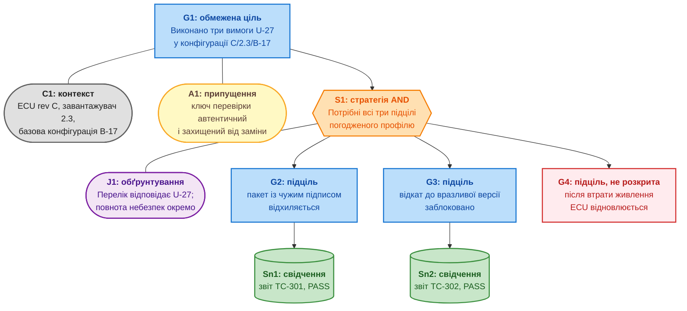
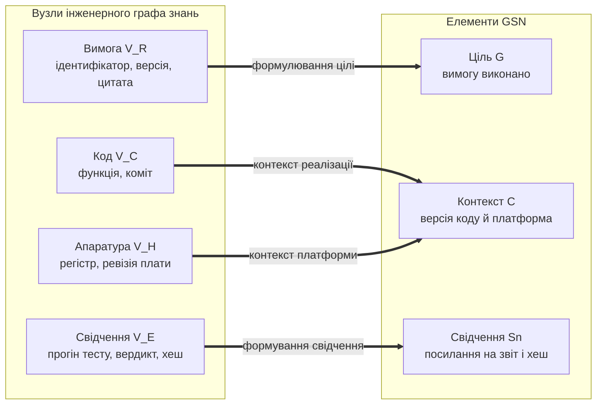
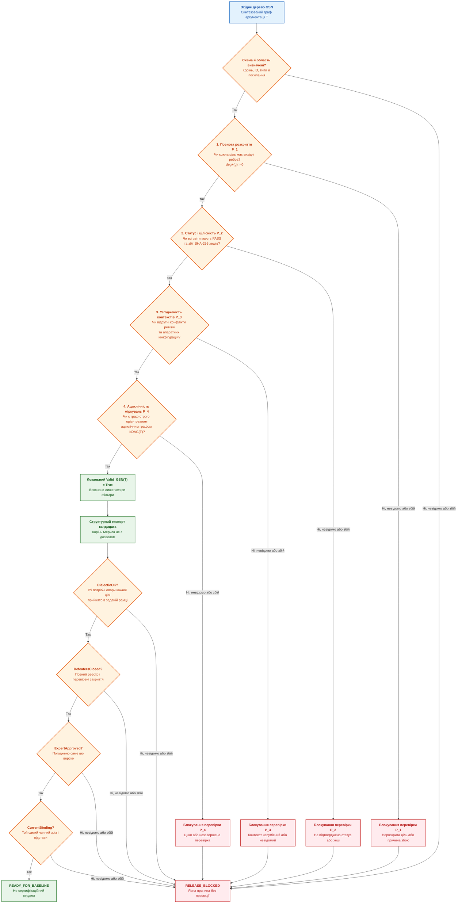
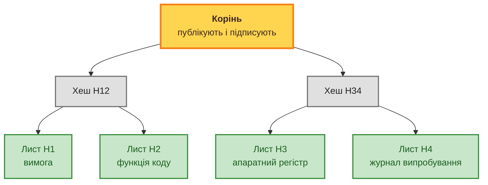
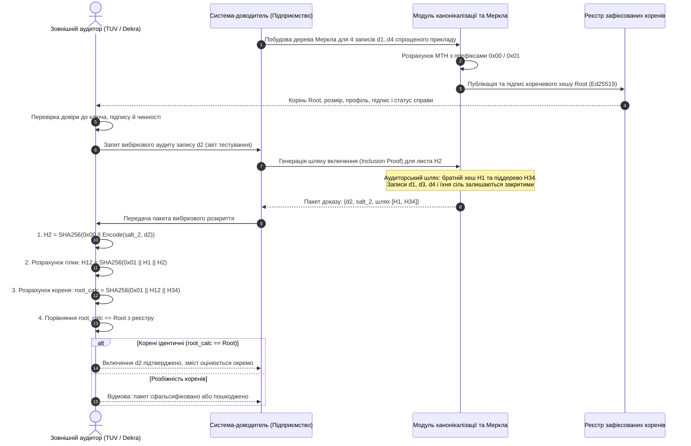
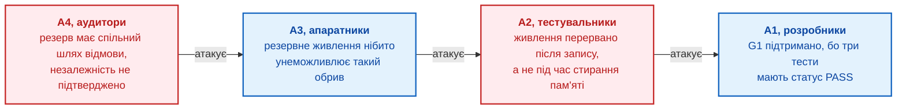

# Глава 27. Обґрунтування безпеки: синтез і перевірка аргументів

> **Книга:** [Архітектура доказових експертних систем](README.md) · [Частина V: Верифікація, тестування, навчання та обґрунтування безпеки](part-05-verification-and-learning.md)
> **Попередня глава:** [Глава 39. Активний експерт-тестувальник: попперівська фальсифікація, нормативний комплаєнс (ASPICE/ISO 26262/ISO 21434) та автономне проєктування випробувань](ch39-active-compliance-auditor-and-popperian-testing.md)
> **Наступна глава:** [Глава 30. Спільне проєктування функціональної безпеки та кібербезпеки](ch30-safety-cybersecurity-co-engineering.md)
> **Зміст книги:** [README.md](README.md)
> **Автор:** [Микола Мартинович Федчик](about-the-author.md)
> **Передумови й маршрут:** базові логічні «і» та «або», множини й орієнтований граф; їх застосування пояснено нижче. Від одного твердження та звіту переходимо до автоматизованої перевірки аргументу. Для програмного прикладу потрібні словники й множини Python; практикум: Лабораторна робота №5 у [LABS.md](learning/LABS.md).
> **Очікувані результати:** будувати обґрунтування безпеки в нотації GSN з цілей, стратегій, контекстів, припущень, обґрунтувань і свідчень; синтезувати каркас аргументу з інженерного графа знань; перевіряти аргумент формальними правилами повноти, підтвердженості свідчень, узгодженості контекстів і відсутності циклів; фіксувати цілісність аргументу деревом Меркла й вибірково розкривати окремі свідчення з доказом включення; враховувати заперечення через рамку аргументації Зунга; розрізняти, що перевіряє машина, а що лишається відповідальністю фахівця.

## Анотація

Обґрунтування безпеки потрібне експертній системі, щоб відповідь «цю властивість підтверджено» можна було перевірити для конкретного виробу, а не прийняти на віру через напис `PASS`. У цій монографії автором запропоновано **епістемічну концепцію обґрунтування безпеки як машинозчитуваного синтетичного кроку доказової системи**: з простежуваних фактів збирається кандидат аргументу, а не автоматичний сертифікат. На навчальному оновленні прошивки послідовно розглянуто твердження, свідчення, контекст і припущення; далі введено нотацію GSN, перевірки графа, дерево Меркла та облік заперечень за Зунгом. Python-приклад дає змогу повторити локальні перевірки й побачити відмову за неповних підстав. Навчальні числа й звіти не є вимірюваннями виробу; нормативна відповідність і достатність реального аргументу потребують окремих підстав.

Обґрунтування безпеки (*safety case*) є аргументом на користь прийнятної безпеки у визначеному застосуванні, підтриманим свідченнями. Це не сам виріб, не набір звітів і не наказ виконавчій системі. Історичним застереженням є огляд втрати літака Nimrod MR2 XV230, виконаний Чарльзом Геддон-Кейвом [[1]](#src-1): документальна процедура може відірватися від аналізу небезпек. Дослівність попередніх перекладених цитат і точні сторінки звіту в цьому проході не перевірено, тому вони не використовуються як перевірені цитати чи як доказ універсальності авторської класифікації.

Питання глави: **як від звіту випробування перейти до обмеженого твердження про безпеку і не видати перевірку форми за доведення змісту?** За **авторським принципом демаркації машинної та експертної відповідальності** машина перевіряє явно задані правила, версії та зв'язки; фахівці оцінюють достатність моделі небезпек, методик і стратегій. Розподіл юридичних повноважень установлюється застосовною процедурою, не математичною формулою цієї глави. Спочатку побудуємо один аргумент звичайною мовою, потім надамо йому машинозчитуваної форми.

## 1. Системні чинники формалізації та деградації обґрунтувань безпеки

Формалізація допомагає лише тоді, коли зберігає зв'язок твердження з виробом. Як зрозуміти, що звіт із написом `PASS` справді підтримує потрібний висновок? Достатньо спочатку розрізнити твердження, спостереження та перехід між ними. Розглянемо навчальний електронний блок керування (*Electronic Control Unit*, ECU) ревізії C із завантажувачем 2.3 у конфігурації B-17. Усі наведені TC-звіти змодельовано для пояснення, а не отримано на реальному стенді.

Потрібний обмежений висновок G1: «у конфігурації C/2.3/B-17 механізм оновлення виконує три перевірювані вимоги профілю U-27: відхиляє пакет із чужим підписом, блокує відкат нижче дозволеної версії та відновлює попередній образ після переривання запису живленням». Це частина аргументу безпеки оновлення, а не твердження «весь ECU безпечний за всіх відмов».

<a id="obj-27-1"></a>
**Таблиця 27.1. Один аргумент до введення нотації GSN**

| Складник | Запис у навчальному випадку | Чого запис не встановлює |
|---|---|---|
| Твердження G1 | Виконано три вимоги профілю U-27 для C/2.3/B-17 | Безпеки всіх функцій ECU |
| Аргумент переходу | Для G1 потрібні всі три підцілі G2, G3, G4; для кожної перевіряються метод і свідчення | Що перелік небезпек профілю вичерпний |
| Свідчення Sn1, Sn2 | TC-301 відхилив чужий підпис; TC-302 заблокував відкат | Відновлення після втрати живлення |
| Контекст C1 | Плата C, завантажувач 2.3, B-17, область трьох вимог U-27 | Придатності звіту для плати D |
| Припущення A1 | Ключ перевірки автентичний і захищений від заміни | Доведення захисту сховища ключа |
| Пояснення стратегії J1 | Ці підцілі відповідають трьом пунктам профілю, погодженим для даної задачі | Відповідності невказаному пункту ISO/SAE 21434 |

Розберімо результат. TC-301 підтримує G2, TC-302 підтримує G3, але для G4 звіту немає. Отже, G1 ще не обґрунтовано, навіть якщо обидва наявні тести пройшли. Після додавання TC-303 потрібно перевірити не лише `PASS`, а й момент переривання запису, спостережене відновлення, конфігурацію та припущення A1. Якщо A1 не підтверджене окремо, висновок залишається умовним: **за припущення автентичності ключа**. Зміна статусу запису або підпис фахівця не перетворюють припущення на доказ.

На основі уроків Nimrod [[1]](#src-1) у цій монографії автором виділено чотири проблеми деградації; це авторська інженерна класифікація, не дослівний перелік звіту:

**Відрив документа від виробу.** Обґрунтування пишуть після розробки, тому текст може стверджувати, що прошивка використовує два незалежні таймери, тоді як у коді останньої версії обидва канали давно перейшли на спільний таймер. Документ лишається узгодженим сам із собою, але не з виробом.

**Відповідність процедурі замість аналізу.** Виконання кожного пункту переліку не означає, що аргумент переконливий: проставлена галочка свідчить, що крок зроблено, але не свідчить, що крок виявив реальні небезпеки.

**Масштаб ручної перевірки.** Обґрунтування складного виробу посилається на тисячі вимог, звітів і журналів випробувань. Оцінювач фізично не може вручну звірити кожне посилання з поточною версією артефакта, тому перевіряє вибірково.

**Інтелектуальна власність.** Виробник неохоче передає сторонньому оцінювачеві весь вихідний код і схемотехніку, а оцінювачеві потрібна впевненість, що показані йому фрагменти справді належать до того самого аргументу.

> [!NOTE]
> **Чотири системні чинники деградації обґрунтувань безпеки за моделлю автора**
> 1. Відрив документальної моделі від кодової бази виробу: статичні тексти розсинхронізуються зі станом прошивки та конфігурації.
> 2. Процедурний формалізм чек-лістів: формальне виконання регламентів маскує відсутність аналізу реальних сценаріїв відмов.
> 3. Обчислювальна неспроможність ручного аудиту: неможливість фізичної верифікації тисяч взаємозв'язаних артефактів без автоматизації.
> 4. Ризики витоку інтелектуальної власності: потреба у верифікації без передачі стороннім аудиторам чутливого пропрієтарного коду.
> *Керування рантаймом / Інженерний інваріант:* Перехід від статичних документів до живого графа артефактів із безперервним машинним аудитом трасованості.

Інженерний граф знань (*Engineering Knowledge Graph*, EKG) із [Глави 9](ch09-engineering-knowledge-graph-traceability.md) зберігає версійовані вузли вимог, коду й звітів та їхні зв'язки. [Глава 25](ch25-how-expert-systems-learn.md) пояснює перевірку кандидатів знань. Граф полегшує звірення, але сам факт наявності ребра не підтверджує його змісту. Тепер є конкретна задача для нотації: показати, де саме G1 бракує підтримки і на яких умовах тримається висновок.

## 2. Нотація структурування цілей (Goal Structuring Notation, GSN)

Нотація структурування цілей потрібна, щоб читач таблиці 27.1 міг побачити не лише файли, а й логіку їх використання. Який запис є твердженням, який задає умови, а який містить результат перевірки? GSN (*Goal Structuring Notation*) надає цим ролям графічні позначення. Тут використано видання Community Standard Version 3, SCSC-141C, 2021 [[2]](#src-2), а не твердження, що жодної новішої редакції не існує. Шість базових ролей такі:

- **ціль** (*goal*) є твердженням, яке треба підтримати, наприклад обмежене G1 профілю U-27;
- **стратегія** (*strategy*) описує спосіб переходу від підцілей до цілі, наприклад обґрунтування кожного з трьох пунктів профілю;
- **контекст** (*context*) задає межі, у яких твердження чинне: ревізію апаратури, версію завантажувача, базову конфігурацію;
- **припущення** (*assumption*) фіксує прийняту без доведення умову, наприклад автентичність ключа; її хибність позбавляє цей шлях підтримки;
- **обґрунтування** (*justification*) пояснює, чому обрана стратегія достатня;
- **свідчення** (*solution*) посилається на конкретний артефакт: звіт випробування, результат статичного аналізу, протокол перевірки. Артефакт стає опорою після перевірки його доречності й достатності для цілі.

Позначка *undeveloped* означає, що розвиток аргументу для цілі ще не завершено. Відсутність ребра є простим машинним індикатором такої прогалини, але наявність ребра не знімає її автоматично. Діалектичні позначення *challenges* і *defeated* дають змогу зберігати заперечення [[3]](#src-3); їхню оцінку розглянуто в §6. Точні пункти GSN і зміст документа змін у цьому проході зовнішньо не перевірено; наведено навчальний опис, не висновок про відповідність стандарту.

Нижче збережено **еталонний архітектурний шаблон GSN-аргументу безпечного оновлення прошивки ECU за моделлю автора**, але «еталонний» тут означає зразок навчальної побудови. Mermaid передає ролі й зв'язки приблизними фігурами, не є перевірником повної графічної граматики GSN. TARA (*Threat Analysis and Risk Assessment*) є аналізом загроз і ризиків; наші три сценарії не оголошено результатом повної TARA або виконанням ISO/SAE 21434.

<a id="obj-27-2"></a>
**Діаграма 27.2. Кандидат аргументу для трьох вимог профілю U-27**



Стрілки від цілі до підцілей означають «підтримано через», а не причинний вплив на ECU. Зв'язки з C1, A1 та J1 задають умови й пояснення, не додаткові тести. G4 лишається відкритою. Для зняття двозначності S1 явно має режим **AND**: усі три підцілі потрібні одночасно. Режим **OR** доречний для двох повноцінних альтернативних аргументів тієї самої цілі, а не для вибору найзручнішого з трьох необхідних тестів.

Щоб відтворити різницю, позначимо готовність опор булевими значеннями:

<a id="obj-27-3"></a>
**Формула (27.3). Кон'юнктивна та альтернативна підтримка цілі**

```math
\mathrm{Support}_{\land}(g)=\bigwedge_{a\in Q(g)}\mathrm{Ready}(a),\qquad
\mathrm{Support}_{\lor}(g)=\bigvee_{a\in L(g)}\mathrm{Ready}(a).
```

Тут $g$ є визначеною ціллю; $`Q(g)`$ є скінченною непорожньою множиною всіх потрібних опор, а $`L(g)`$ скінченною непорожньою множиною погоджених повних альтернатив. Аргумент $a$ належить відповідній множині. Предикат $`\mathrm{Ready}(a)`$ означає, що виконано всі передумови цієї опори в заданому контексті; усі значення безрозмірні. Символи $\bigwedge$ і $\bigvee$ означають відповідно «усі» та «хоча б один». Порожні або невідомі переліки не отримують успіху за домовленістю профілю.

У нашому прикладі стани G2, G3, G4 дорівнюють `true`, `true`, `false`: AND дає `false`. Підстановка OR дала б `true`, але змінила б вимогу й тому була б помилкою. Для справжнього OR кожна альтернатива сама повинна обґрунтовувати всю ціль за тих самих умов. Якщо хоча б одна потрібна умова невідома, успіху не встановлено. Отримано читабельний аргумент; наступне питання: яку його частину можна зібрати з графа автоматично?

## 3. Автоматизований синтез аргументів з інженерного графа знань

Автоматизований синтез потрібен, щоб після зміни завантажувача не переносити ті самі посилання вручну. Які вузли EKG можуть стати заготовками GSN, а яких рішень у графі ще немає? Вершина зберігає артефакт, ребро заявляє відношення між артефактами. Для U-27 вузол вимоги стає кандидатом цілі, плата C і версія 2.3 задають контекст, а TC-301 дає посилання на можливе свідчення. Це перетворення даних, не доведення виконання вимоги.

<a id="obj-27-4"></a>
**Діаграма 27.4. Типізована проєкція артефактів у каркас GSN**



У цій монографії автором запропоновано типізоване відображення, історично назване **оператором онтологічного ізоморфізму EKG-GSN**. Назву збережено для зв'язку з каталогом, але математично це **проєкція типів**, не ізоморфізм графів: код і апаратура отримують одну роль Context, а стратегії не відновлюються зворотно. Потрібні індивідуальні ID вузлів і окремі правила перенесення ребер.

<a id="obj-27-5"></a>
**Формула (27.5). Проєкція типів вузлів без гарантії збереження аргументу**

```math
\mathcal{G}_{\mathrm{EKG}}=\langle V,E\rangle,\quad
V=V_R\cup V_C\cup V_H\cup V_E,\qquad
\Phi:V\to\{\mathrm{Goal},\mathrm{Context},\mathrm{Solution}\},\quad
\Phi(v)=\begin{cases}
\mathrm{Goal},&v\in V_R,\\
\mathrm{Context},&v\in V_C\cup V_H,\\
\mathrm{Solution},&v\in V_E.
\end{cases}
```

Тут $`\mathcal{G}_{\mathrm{EKG}}`$ є скінченним графом; $V$ його вершини, $E$ типізовані ребра, $`V_R,V_C,V_H,V_E`$ попарно неперетинні множини вимог, коду, апаратури та свідчень. Якщо один артефакт виконує кілька ролей, створюють окремі типізовані записи. $v$ є однією вершиною; $\Phi$ повертає назву ролі, не оцінку істинності. Усі об'єкти дискретні й не мають фізичних одиниць. Підстановка вузла TC-301 дає Solution, вузла плати C дає Context: це визначає поля експорту, але не робить TC-301 достатнім для G1.

Авторський алгоритм синтезу каркаса має п'ять етапів. На першому задають кореневу ціль, щоб не підмінити «три вимоги U-27» усім стандартом:

<a id="obj-27-6"></a>
**Формула (27.6). Параметризоване формулювання цілі**

```math
G_{\mathrm{root}}=\text{«}\mathcal{S}\text{ у конфігурації }\mathcal{K} \text{ виконує застосовні вимоги }\mathcal{R}_{\mathrm{scope}} \text{ документа }\mathrm{STD}\text{»}.
```

- Для кореневої цілі $`G_{\mathrm{root}}`$ символ $`\mathcal{S}`$ є виробом, а $`\mathcal{K}`$ його конфігурацією;
- $`\mathrm{STD}`$ позначає конкретну редакцію документа, а $`\mathcal{R}_{\mathrm{scope}}`$ погоджений непорожній перелік застосовних пунктів з умовами та винятками; це не всі речення з `SHALL`;
- Знак $=$ задає текст цілі: виріб у визначеній конфігурації має виконувати обов'язкові вимоги названого документа.

Усі параметри тут є ідентифікаторами або скінченними переліками, не виміряними числами. Для нашого випадку підставляють ECU, C/2.3/B-17, три вимоги U-27 і редакцію навчального профілю. Отримується саме G1. Для нормативної заяви потрібні фактичний текст, редакція, пункт і перевірена застосовність; невідомий пункт означає «нормативну відповідність не перевірено», а не право згенерувати відсутню вимогу.

На другому етапі з погодженої області відбирають обов'язкові вимоги. Модальність із [Глави 14](ch14-requirements-detection-and-formalization.md) є лише одним фільтром. Для відбору також мають бути підтверджені застосовність і зв'язок із цією ціллю:

<a id="obj-27-7"></a>
**Формула (27.7). Відбір обов'язкових вимог у межах погодженої цілі**

```math
\mathcal{R}_{\mathrm{mand}}(g)=\{r\in V_R\cap\mathcal{R}_{\mathrm{scope}}\mid
r.\mathrm{modality}\in\{\mathrm{SHALL},\mathrm{MUST}\}\land
\mathrm{Applies}(r,\mathcal K)\land\mathrm{RequiredFor}(r,g)\}.
```

- Множина $`\mathcal{R}_{\mathrm{mand}}(g)`$ містить обов'язкові вимоги для цілі $g$, а $r$ є окремою вимогою;
- $`V_R`$ є множиною вузлів вимог у графі, $\in$ означає належність до множини, а вертикальна риска читається «за умови, що»;
- $`r.\mathrm{modality}`$ є полем модальності вимоги, а $`\{\mathrm{SHALL},\mathrm{MUST}\}`$ перелічує дві модальності обов'язковості;
- Фігурні дужки задають множину, а зовнішні дужки-умови відбирають лише ті вузли, чиє поле модальності збігається з одним із цих значень.

Предикати $`\mathrm{Applies}`$ і $`\mathrm{RequiredFor}`$ мають явно перевірені булеві результати: перший перевіряє умови й винятки для конфігурації $`\mathcal K`$, другий зв'язок вимоги з ціллю. Невідомий результат зберігається як незавершений обов'язок, а не мовчки вилучається з області. Одиниць вимірювання немає. У навчальному наборі три пункти U-27 обов'язкові й застосовні; `MUST` з документа про інший виріб не додає підцілі. Рекомендація може бути потрібною опорою іншого аргументу, хоча цей вузький фільтр її не відбирає.

Генерація підцілей, контекстів та свідчень підпорядковується трьом авторським інженерним правилам:
1. **Патерн синтезу термінальних підцілей із криптографічним гешуванням нормативних цитат (авторське правило криптографічного закріплення нормативних підцілей):** для кожної відібраної вимоги створюється кандидат підцілі, дослівна цитата, її позиція в документі та SHA-256 байтів. Хеш дозволяє виявити зміну відносно довіреного еталона, але не забороняє хибного тлумачення, не доводить автентичності джерела й не дає підстав одразу поставити статус «підтверджено».
2. **Правило реляційного зв'язування контекстів виконання через ребра `satisfies` та `configures`:** Контекст $`\mathrm{Context}(G_r)`$ формується автоматичним обходом графа за ребрами `satisfies` і `configures`, асоціюючи функції коду $`c\in V_C`$ із фіксацією SHA-хешу коміту репозиторію та регістри апаратури $`h\in V_H`$ із відповідною апаратною ревізією плати.
3. **Правило агрегації верифікаційних свідчень через ребра `verifies` та `produced_by`:** від звіту через конкретний прогін тесту знаходять перевірювану вимогу. Це кандидати свідчень із [Глави 25](ch25-how-expert-systems-learn.md), а не автоматично достатні докази. Для U-27 знайдено TC-301 і TC-302, але порожній результат для G4 повинен створити відкритий обов'язок, не зниклу підціль. Підтвердження потребує перевірки змісту ребра, результату, застосовності та всіх потрібних опор.

Автоматичний синтез має межу, яку варто назвати прямо. Граф дає цілі, контексти й свідчення, але не дає стратегій і обґрунтувань: чому розкладання за сценаріями загроз достатнє, вирішує фахівець. Юен Денні та Ганеш Пай описали методологію, у якій автоматично згенеровані фрагменти аргументу, отримані формальним методом для програмного забезпечення, поєднуються з фрагментами, які фахівці побудували вручну за результатами системного аналізу безпеки [[4]](#src-4). Синтез за графом відповідає саме такому розподілу ролей: машина збирає простежувану частину, людина відповідає за аргументаційну.

> [!NOTE]
> **П'ять етапів автоматизованого синтезу дерева GSN з інженерного графа знань за моделлю автора**
> 1. Формулювання кореневої нормативної цілі: визначення цільового виробу, апаратної конфігурації та стандарту.
> 2. Фільтрація обов'язкових вимог: перевірка модальності, застосовності та зв'язку з ціллю в погодженій області.
> 3. Декомпозиція на термінальні підцілі: генерація цільових вузлів реалізації та верифікації для кожної відібраної вимоги.
> 4. Прив'язка контексту виконання та апаратури: автоматична асоціація вихідного коду, регістрів та середовища виконання.
> 5. Агрегація верифікаційних свідчень: підтягування підтверджених звітів випробувань, мутаційного аналізу та логів шини.
> *Керування рантаймом / Інженерний інваріант:* Машина генерує простежувану структуру цілей і свідчень, залишаючи оцінку стратегій інженерному експерту.

Отже, синтез зменшує повторне перенесення даних, але не перетворює проєкцію типів на логічний доказ. Щоб оцінити отриманий каркас, потрібно спочатку домовитися, які саме дефекти здатна знайти машина.

## 4. Формальні правила структурної та семантичної верифікації аргументу

Формальні правила відповідають на питання «який саме обов'язок перевірено?». Після синтезу G4 без звіту видно одразу; хибну методику TC-301 знайти значно складніше. Необхідно відділити перевірку схеми даних від перевірки аргументу. Схема має задавати непорожній граф, корінь, унікальні ID, типи вузлів і ребер, досяжну область та очікуваний повний перелік потрібних цілей. Без цього перевірка «усіх наявних вузлів» пропустить ціль, яку помилково взагалі не створено.

Чотири авторські правила нижче є локальними фільтрами. Їхнє історичне позначення не означає повної семантичної правильності GSN:

<a id="obj-27-8"></a>
**Формула (27.8). Локальна сукупна перевірка за визначеної схеми**

```math
\mathrm{Valid}_{\mathrm{GSN}}(\mathcal{T})\iff\bigwedge_{i=1}^{4}\mathcal{P}_i(\mathcal{T}).
```

- Перевірка $`\mathrm{Valid}_{\mathrm{GSN}}(\mathcal{T})`$ оцінює лише чотири локальні властивості аргументу $`\mathcal{T}`$ за вже визначеної схеми; порожня кон'юнкція над відсутніми вузлами не є повною перевіркою;
- $\iff$ означає «тоді й лише тоді», а $`\bigwedge_{i=1}^{4}`$ вимагає одночасного виконання чотирьох умов;
- $i$ нумерує умови від 1 до 4, а $`\mathcal{P}_i(\mathcal{T})`$ є перевіркою з номером $i$ для цього аргументу.

**Дія за локальним результатом.** Після перевірки схеми й усіх чотирьох правил дозволено сформувати структурний експорт кандидата та його корінь Меркла. Такий пакет має явний кандидатний статус; навіть підпис походження пакета не означає експертного схвалення його змісту, сертифікації виробу або активації нових знань. Негативний результат блокує просування з `ERR_GSN_VERIFICATION_FAILED` і причиною: нерозкрита ціль, непідтверджене свідчення, колізія контексту або цикл. Недійсна схема та невідомий результат також блокують просування.

Для перевірки готовності до введення погодженої версії аргументу в baseline автором розділено шість необхідних результатів. Вони мають стосуватися одного й того самого зрізу $B$, а не довільних успішних прогонів:

Baseline тут означає зафіксовану погоджену версію, від якої відстежують подальші зміни. Це стан справи обґрунтування, не фізичний режим обладнання.

<a id="obj-27-9"></a>
**Формула (27.9). Готовність справи до погодженого baseline за авторським профілем**

```math
\mathrm{ReleaseReady}(B)\iff
\mathrm{SchemaOK}(B)\land\mathrm{Valid}_{\mathrm{GSN}}(\mathcal T_B)
\land\mathrm{DialecticOK}(B)\land\mathrm{DefeatersClosed}(B)
\land\mathrm{ExpertApproved}(B)\land\mathrm{CurrentBinding}(B).
```

- $B$ — визначений зріз кандидата: корінь графа GSN, рамка атак, відображення потрібних цілей на аргументи, реєстр спростувачів, стратегії/обґрунтування/припущення, профіль перевірки та конфігурація виробу; $`\mathcal T_B`$ — його GSN-граф;
- `SchemaOK` — повна перевірка узгодженої схеми й області цілей; `Valid_GSN` — чотири локальні правила. Це різні обов'язки;
- `DialecticOK` — для кожної потрібної цілі **всі потрібні аргументи підтримки** належать обґрунтованому розширенню Зунга за рамкою цього зрізу. Одного прийнятого аргументу недостатньо для AND. Повні альтернативи OR мають бути окремо погоджені й змодельовані, а не вгадані агрегатором. Відсутня відповідність, неприйнята або нерозв'язана підтримка не є успіхом. Порожній або неповний перелік потрібних цілей не обходить перевірки схеми;
- `DefeatersClosed` — доступний повний реєстр усіх спростувачів у визначеній області, немає відкритого чи непідтвердженого запису. Кожне закриття має перевірену підставу, а не лише рядок `CLOSED`. Підтверджено порожній реєстр допустимий; недоступний не стає порожнім;
- `ExpertApproved` — уповноваженим фахівцем перевірено достатність стратегій та обґрунтувань, статус припущень і придатність кожного використаного свідчення за формулою 27.15; схвалено саме цю версію для введення в baseline. Якщо висновок умовний, умови явно включено до його формулювання; невідому придатність свідчення не замінюють підписом. Авторство вузла, підпис походження звіту й схвалення аргументу зберігаються окремо. Позначка `human_authored` сама не є дозволом;
- `CurrentBinding` — усі результати й схвалення прив'язані до одного незмінного зрізу, актуальних артефактів, політики та конфігурації; ключі підписантів і відкликання перевірено. Маніфест зрізу не включає власних дайджестів, результатів перевірок або підписів схвалення: вони посилаються на нього окремо, без циклу хешування.

Усі шість предикатів безрозмірні й повинні мати явний результат `true`; `false`, `unknown`, помилка або тайм-аут блокує готовність із назвою невиконаного обов'язку. Істинний результат дає лише `READY_FOR_BASELINE`: можна завершувати контрольоване введення погодженої версії й формувати справу за застосовною процедурою. Це не автоматична сертифікація уповноваженим органом і не універсальний `ACCEPT` для подальших відповідей або дій. Підпис людини належить затвердженій версії baseline, а не кожному її застосуванню в рантаймі.

**Приклад переходу.** Для G1 після додавання коректного TC-303 чотири локальні правила можуть дати `true`, але відкрите заперечення до методики тесту залишає справу в `RELEASE_BLOCKED`. Після його перевіреного закриття невідоме експертне схвалення все одно блокує готовність. Лише шість явних `true` щодо одного зрізу дають `READY_FOR_BASELINE` за цим профілем. Для більшого навчального дерева з 24 цілями й 18 свідченнями висновок такий самий: кількість вузлів не змінює правила. Це логічні приклади, не результати сертифікації.

Схема відділяє чотири локальні фільтри від повного шлюзу готовності:

<a id="obj-27-10"></a>
**Діаграма 27.10. Локальні фільтри та окрема готовність справи**



> [!NOTE]
> **Чотири правила формальної верифікації аргументу безпеки GSN за моделлю автора**
> 1. Правило повноти розкриття цілей: відсутність невирішених або тупикових цілей без стратегій розкладання чи свідчень.
> 2. Правило валідності свідчень: підтвердження успішного статусу вердиктів та цілісності контрольних хешів артефактів.
> 3. Правило узгодженості контекстів: відсутність конфліктних конфігурацій та апаратних ревізій у межах однієї гілки аргументу.
> 4. Правило ациклічності аргументації: сувора заборона циклічних залежностей та самопідтверджуваних тавтологій у графі міркувань.
> *Керування рантаймом / Інженерний інваріант:* Порушення будь-якого з чотирьох правил блокує просування; їх виконання є лише необхідною частиною повного `ReleaseReady`, не дозволом релізу.

**Правило повноти розкриття.** Спочатку перевіряють, чи кожна ціль має хоча б одне ребро підтримки. Це лише необхідна структурна умова: одна наявна опора не замінює всіх обов'язкових опор кон'юнктивної декомпозиції.

<a id="obj-27-11"></a>
**Формула (27.11). Відсутність цілей без ребра підтримки**

```math
\mathcal{P}_1:\ \forall g\in\mathrm{Goals}(\mathcal{T})\ \ \deg^{+}(g)>0.
```

- У першому правилі $g$ є ціллю, а $`\mathrm{Goals}(\mathcal{T})`$ множиною всіх цілей аргументу $`\mathcal{T}`$;
- $\forall$ означає «для кожної», а $`\deg^{+}(g)`$ є кількістю вихідних ребер підтримки з цілі $g$;
- $>0$ вимагає щонайменше одного такого ребра, а $`\mathcal{P}_1`$ позначає першу перевірку.

Перевірка виявляє цілі без розкриття, але не доводить повноти аргументу. Якщо потрібні і відхилення чужого підпису, і захист від відкату, наявність лише першої опори дає додатний степінь вузла, проте друга підціль залишається непідтвердженою. Альтернативний шлях допустимий лише тоді, коли кожна дозволена альтернатива самостійно підтримує ту саму ціль у тому самому контексті; це має бути явно обґрунтовано стратегією.

Кількість ребер є цілим невід'ємним числом; за G4 вона дорівнює нулю, тому правило повертає `false`. Стратегії також перевіряють на порожні списки, а покриття очікуваних опор звіряють окремо за формулою 27.3.

**Правило підтвердженості свідчень.** Кожне свідчення має позитивний вердикт, а хеш артефакта, на який свідчення посилається, збігається з хешем, записаним у вузлі:

<a id="obj-27-12"></a>
**Формула (27.12). Статус звіту та збіг байтового відбитка**

```math
\mathcal{P}_2:\ \forall s\in\mathrm{Solutions}(\mathcal{T})\ \ s.\mathrm{verdict}=\mathrm{PASS}\ \land\ H(s.\mathrm{artifact})=s.\mathrm{digest}.
```

- У другому правилі $s$ є вузлом розв'язання або свідчення з множини $`\mathrm{Solutions}(\mathcal{T})`$;
- $`s.\mathrm{verdict}`$ є вердиктом вузла й має дорівнювати $`\mathrm{PASS}`$;
- $`H(s.\mathrm{artifact})`$ є хешем артефакта, а $`s.\mathrm{digest}`$ записаним у вузлі очікуваним хешем;
- $\forall$ перевіряє кожен такий вузол, $\land$ вимагає одночасно позитивного вердикту й збігу хешів, а $=$ означає рівність хешів.

Тут $H$ є SHA-256, артефакт є скінченними байтами, а digest очікуваними 32 байтами або їхнім 64-символьним hex-поданням. Вердикт належить визначеному переліку статусів, не довільному тексту. У TC-301 заміна `rejected` на `accepted` змінює байти: за старого еталона правило поверне `false`. Якщо змінити і файл, і еталон у вузлі, ця перевірка знову пройде; потрібна окрема довіра до зафіксованого еталона. Збіг не доводить правильності тесту.

**Правило узгодженості контекстів.** Жодна гілка не поєднує взаємовиключних контекстів, наприклад звіт, отриманий на ревізії плати D, у гілці, чинній для ревізії C:

<a id="obj-27-13"></a>
**Формула (27.13). Узгодженість контексту конкретної цілі**

```math
\mathcal{P}_3:\ \forall g\in\mathrm{Goals}(\mathcal{T})\ \ \mathrm{Consistent}(\mathrm{Context}(g)).
```

- У третьому правилі $g$ проходить усі цілі з $`\mathrm{Goals}(\mathcal{T})`$;
- $`\mathrm{Context}(g)`$ є контекстом, прив'язаним до цілі, а $`\mathrm{Consistent}(\cdot)`$ перевіряє його внутрішню узгодженість;
- $\forall$ вимагає узгодженості кожного контексту, а $`\mathcal{P}_3`$ позначає третій предикат.

Контекст тут є типізованим набором версій і умов, а `Consistent` булевим результатом заданих правил сумісності. У прикладі збіг ревізій C/C проходить, C/D без обґрунтованого перенесення не проходить. Для складнішого виробу різні ревізії можуть співіснувати в різних гілках; перевіряють сумісність із ціллю, не глобальну рівність усіх маркерів. Відомості про невказану версію дають невідомий результат, не уявну сумісність.

**Правило відсутності циклів.** Граф підтримки має бути ациклічним: перевірка повинна відхилити аргумент «A безпечне, бо безпечне Б, а Б безпечне, бо безпечне A», а не вважати його неможливим лише через назву нотації. У цій перевірці з аргументу беруть лише орієнтовані ребра підтримки, без контекстних зв'язків і атак:

<a id="obj-27-14"></a>
**Формула (27.14). Ациклічність лише відношення підтримки**

```math
\mathcal{P}_4:\ \mathrm{IsDAG}(\mathcal{T}).
```

- У четвертому правилі $`\mathcal{T}`$ є графом аргументу;
- $`\mathrm{IsDAG}(\mathcal{T})`$ перевіряє, чи є граф орієнтованим ациклічним графом, тобто чи немає шляху ребер назад до початкового вузла;
- $`\mathcal{P}_4`$ позначає четвертий предикат перевірки.

Предикат безрозмірний. За скінченного графа пошук у глибину позначає поточний шлях як активний; ребро до активної вершини є свідком циклу. Для G1 → S1 → G2 → G1 перевірка дає `false`, для початкової схеми без цього ребра цикл не знайдено. Потрібні всі вершини й ребра області; ациклічність підтримки не забороняє циклів атак у §6. Цей тест усуває кругове посилання, а не будь-який хибний висновок.

Залишилося питання, як відрізнити неушкоджений звіт від **придатного** свідчення. Для цього авторський профіль додає до локального P2 окрему перевірку використання свідчення:

<a id="obj-27-15"></a>
**Формула (27.15). Придатність свідчення для цілі, конфігурації та часу**

```math
\mathrm{Usable}(e,g,\mathcal K,t)=\mathrm{IntegrityOK}(e)\land
\mathrm{Relevant}(e,g)\land\mathrm{Applicable}(e,\mathcal K)\land
\mathrm{Fresh}(e,t,\pi).
```

Тут $e$ є конкретним свідченням, $g$ конкретною ціллю, $`\mathcal K`$ конфігурацією, $t$ моментом оцінювання в узгодженій шкалі часу, $\pi$ версійованою політикою актуальності. Чотири безрозмірні предикати перевіряють відповідно довірений відбиток і походження, зв'язок методики з властивістю, придатність умов випробування та відсутність прострочення чи відкликання. Якщо політика задає вік, його вимірюють у секундах або днях в одній шкалі; універсального строку зберігання ця формула не встановлює. Кожний предикат має бути явно підтверджений; невідоме не зараховують як `true`.

<a id="obj-27-16"></a>
**Таблиця 27.16. Чотири перевірки на одному навчальному звіті**

| Випадок | Результат | Використання |
|---|---|---|
| TC-301 від плати C з чинним відбитком, метод перевіряє чужий підпис, змін немає | Усі чотири умови підтверджені | Може підтримувати G2, не G4 |
| Новий TC-301 із плати D без оцінки перенесення | Applicable невідомий | Не підтримує ціль для C |
| Старий TC-301 для 2.3 після зміни верифікатора у 2.4 | Fresh не підтверджений для нового зрізу | Потрібний аналіз впливу або новий тест |
| Профіль обмежує вік 30 днями, звіту 31 день | Fresh хибний за цим профілем | Потрібне оновлення підстав |

Це послідовність перевірок, не правило «новіше завжди краще»: для історичної конфігурації потрібне застосовне історичне джерело. Звіт про іншу властивість не стає доречним після оновлення дати. Саме тут перевіряються методика й зв'язок, яких не містить напис `PASS`.

Ще одна пастка виникає, коли два звіти називають «незалежними» й перемножують довіру. Згадаймо правило добутку ймовірностей для двох подій:

<a id="obj-27-17"></a>
**Формула (27.17). Спільна ймовірність і умова допустимості добутку**

```math
P(E_1\cap E_2\mid H)=P(E_1\mid H)P(E_2\mid E_1,H);
\qquad E_1\perp E_2\mid H\ \Longrightarrow\
P(E_1\cap E_2\mid H)=P(E_1\mid H)P(E_2\mid H).
```

Події $`E_1,E_2`$ означають отримання заданих результатів двох перевірок у визначеному просторі випробувань; $H$ є гіпотезою про стан системи. $P$ є ймовірністю в діапазоні від 0 до 1 без одиниць; для умовних імовірностей потрібні ненульові ймовірності умов. Символ $\cap$ означає одночасність, а $\perp$ умовну незалежність. Другий перехід дозволено лише за незалежності **за даної гіпотези**. Для байєсівського зіставлення двох гіпотез ця умова потрібна за кожної з них, а не лише за «система справна».

У навчальній моделі за H кожна з двох перевірок дає потрібний результат з імовірністю 0,9. Якщо вони незалежні за H, спільна ймовірність становить 0,81. Якщо другий звіт є копією першого, після першого результату другий гарантований і спільна ймовірність лишається 0,9. Два різні підписи не усувають спільний оракул, тестовий генератор або помилку моделі. Ці числа не є ймовірністю безпеки ECU або каліброваною довірою до G1. За відсутності моделі залежності слід описати спільні джерела помилки, а не вигадувати зведений відсоток упевненості.

Праця Рашбі [[5]](#src-5) є опорою для розмежування логічного переходу й довіри до засновків; її точні положення тут зовнішньо не перевірено. У нашому розборі чотири фільтри, придатність свідчень та погоджений профіль мають різні обов'язки. Навіть коли їх перевірено, залишається запитання передачі справи іншій стороні: як показати, що оцінювач отримав саме зафіксовані записи, а не непомітно змінені копії?

## 5. Криптографічна цілісність аргументу: дерева Меркла та вибіркове розкриття

Криптографічна цілісність потрібна, коли виробник передає не всю справу, а один звіт: як перевірити, що він входить до раніше зафіксованого набору? Потрібні байтові записи, хеш-функція й довірений очікуваний відбиток. Хеш є коротким відбитком байтів, не оцінкою правдивості. Дерево Меркла [[6]](#src-6) попарно об'єднує такі відбитки до одного кореня. Статус кандидата або погодженої справи передається окремо; дерево не замінює `ReleaseReady`.

<a id="obj-27-18"></a>
**Діаграма 27.18. Чотири записи та один очікуваний корінь Меркла**



За криптографічного припущення про стійкість SHA-256 непомітна підміна щодо довіреного кореня є обчислювально нездійсненною, а не логічно неможливою: хеш має скінченний простір значень. Корінь фіксує тільки включені записи; щоб зафіксувати ребра й контекст, їх також включають у записи. Для одного листа достатньо братніх хешів на шляху. Нижче відтворено побудову MTH, пов'язану з RFC 6962 §2.1 [[7]](#src-7); це точний орієнтир для подальшої нормативної звірки, не статус зовнішньої перевірки.

<a id="obj-27-19"></a>
**Формула (27.19). Хеш порожнього набору, листа та внутрішнього вузла**

```math
\mathrm{MTH}(\varnothing)=\mathrm{SHA256}(\epsilon),\qquad
\mathrm{MTH}(\{d_0\})=\mathrm{SHA256}(\mathtt{0x00}\,\|\,d_0),
\qquad
\mathrm{MTH}(D_n)=\mathrm{SHA256}\bigl(\mathtt{0x01}\,\|\,\mathrm{MTH}(D_{0:k})\,\|\,\mathrm{MTH}(D_{k:n})\bigr).
```

- Для функції $`\mathrm{MTH}`$ аргумент $`\{d_0\}`$ є одним записом, а $`D_n`$ упорядкованою послідовністю з $n$ записів; $n$ ціле невід'ємне, рекурсивна гілка застосовна лише за $n>1$. Символ $\epsilon$ означає порожню послідовність байтів, $\varnothing$ порожній вхід;
- $`\mathrm{SHA256}`$ є хеш-функцією SHA-256 зі стандарту FIPS 180-4 [[8]](#src-8), а $`d_0`$ є байтами запису листа;
- Префікси $`\mathtt{0x00}`$ і $`\mathtt{0x01}`$ позначають відповідно лист і внутрішній вузол, а $`\|`$ означає конкатенацію байтів;
- $k$ є найбільшим степенем двійки, меншим за $n$; $`D_{0:k}`$ і $`D_{k:n}`$ є лівою та правою частинами послідовності, хеші яких рекурсивно об'єднуються.

Підставимо чотири записи діаграми 27.18. Спочатку отримуємо чотири листкові 32-байтні хеші, з перших двох обчислюємо H12, з наступних двох H34, з них корінь. Для другого листа потрібні H1 і H34: два хеші по 32 байти, тобто 64 байти шляху без самого запису, індексу, розміру дерева й підпису. Аудитор бере H1 ліворуч від відбитка розкритого запису, утворює H12, додає праворуч H34 і порівнює корінь. Перестановка напрямків змінює результат. Це перевірка включення, не правильності TC-301; точний виконуваний приклад наведено в §7.

Алгоритм включення пов'язано з RFC 9162 §2.1.3.2 [[9]](#src-9). Перед хешуванням потрібні узгоджене кодування, порядок записів і канонічне подання полів, наприклад JCS із RFC 8785 [[10]](#src-10). Звичайного сортування ключів JSON недостатньо для повної реалізації JCS, зокрема щодо чисел і правил сортування Unicode; код нижче обмежений своїми даними. Повні тексти RFC/FIPS у цьому проході не звірено, відповідність стандартам не атестовано.

У цій монографії автором запропоновано **інженерний принцип розмежування криптографічної цілісності та предметної істинності**: включення підтверджує зв'язок байтів із довіреним коренем за прийнятих криптографічних припущень, але не правдивість запису, якість тесту чи достатність випробувань. Цифровий підпис кореня додатково потребує перевірки ключа, повноважень, призначення підпису та відкликання. Підпис походження не тотожний схваленню safety case.

У цій монографії автором сформульовано три інваріанти криптографічного захисту з явними межами застосування. Зіставлення з довіреним коренем перевіряє включення показаного запису за прийнятих припущень стійкості, а не його правдивість. Механізм не є доказом із нульовим розголошенням: оцінювач бачить кожен розкритий запис повністю, а зміст нерозкритих записів не оцінює. Хеші сусідніх листів у шляху включення теж можуть розкрити вміст: якщо запис короткий і передбачуваний, оцінювач може перебрати кандидатів і захешувати кожного. Тому до кожного запису додають випадкову або секретно виведену сіль, яку розкривають лише разом із самим записом. Вибіркове розкриття зменшує обсяг переданих даних, але підпис походження не означає, що підписант схвалив зміст прихованих частин; відповідальність визначається його повноваженнями та призначенням підпису.

> [!NOTE]
> **Три інваріанти криптографічного захисту обґрунтувань безпеки за моделлю автора**
> 1. Фіксація доказової бази: щодо довіреного кореня виявляються зміни включених записів за припущення стійкості хеш-функції.
> 2. Вибіркове розкриття: аудитор перевіряє включення показаного артефакта, але не зміст прихованих записів; метадані шляху також можуть розкривати інформацію.
> 3. Обмеження словникових атак: достатньо непередбачувана нерозкрита сіль ускладнює перебір; відомий або слабкий секрет цього захисту не дає.
> *Керування рантаймом / Інженерний інваріант:* Корінь і підпис фіксують визначений набір байтів; це не нульове розголошення, доказ безпеки чи дозвіл виконавчій системі.

На наступній діаграмі записом листа є весь узгоджений кортеж із сіллю, а не неоднозначна конкатенація полів змінної довжини. У програмі сіль є полем JSON; чотирилисткова схема нижче показує сам порядок перевірки.

<a id="obj-27-20"></a>
**Діаграма 27.20. Передача запису та перевірка його включення**



Отже, передавання може бути вибірковим, але висновок аудитора також має бути обмеженим. Навіть незмінна справа може містити нерозв'язане заперечення; для його обліку потрібен інший граф, не дерево хешів.

## 6. Діалектична аргументація: облік заперечень за абстрактною рамкою Зунга

Діалектична аргументація потрібна, коли до незмінного звіту є змістове заперечення: як не втратити його після наступного експорту? Треба відрізняти граф підтримки від графа атак. Підтримка пояснює перехід до цілі; атака ставить під сумнів засновок, застосування правила або висновок. Атака на один шлях не доводить протилежного висновку й не анулює автоматично всі незалежні шляхи. Діалектичні позначення GSN [[3]](#src-3) показують такі заперечення, а абстрактна рамка Фан Мінь Зунга [[11]](#src-11) дає правила їх скептичного оцінювання.

Перед побудовою ребра атаки потрібно вказати, **що саме заперечено**. У реєстрі спростувачів корисно розрізняти три типи:

1. **Заперечення засновку (`underminer`).** Наприклад, невірно вказано ревізію плати у TC-303. Потрібна перевірка походження звіту, а не зміна стратегії G1.
2. **Заперечення переходу (`undercutter`).** TC-303 справді має `PASS`, але живлення вимикали лише після завершення запису. Такий тест не обґрунтовує відновлення після переривання запису; успішний статус не відповідає на заперечення до методики.
3. **Контраргумент до висновку (`rebuttal`).** Застосовний протокол фіксує, що після переривання запису ECU не відновився. Це свідчення проти G4 у названих умовах, не лише відсутність підтримки G4.

Тип, ціль атаки, підстава та область зберігаються окремими полями. Відсутній звіт створює відкритий обов'язок, а збій читання — невідомий результат; жоден сам по собі не є підтвердженим контрсвідченням. Усі вони можуть блокувати просування з різних причин. Абстрактна рамка нижче використовує лише вже обґрунтовані пари атак: типи допомагають правильно їх побудувати, але сам оператор Зунга типів не розрізняє.

Щоб обчислення було відтворюваним, фіксують усі аргументи й атаки обраної області:

<a id="obj-27-21"></a>
**Формула (27.21). Скінченна рамка аргументації**

```math
AF=\langle\mathcal A,\mathcal R\rangle,\qquad
\mathcal R\subseteq\mathcal A\times\mathcal A.
```

$AF$ є рамкою, $`\mathcal A`$ скінченною множиною аргументів з унікальними ID, $`\mathcal R`$ множиною впорядкованих пар «нападник, ціль атаки». Одиниць вимірювання немає. Для прикладу беремо A1–A4 і три атаки наступної діаграми; жодна вершина не може бути невідомим ID. Ці ID локальні для рамки атак: аргумент A1 тут не є припущенням A1 із діаграми 27.2; у машинному обміні їх розрізняють за типом і графом. Спосіб визначення атак потребує предметного аналізу: абстрактний рушій не встановлює достовірності тексту аргументів.

<a id="obj-27-22"></a>
**Діаграма 27.22. Ланцюг заперечень до аргументу про прошивку**



Сюжет A1–A4 продовжує U-27 після появи TC-303: тепер є файл, але лишається запитання до методики. A2 підриває перехід від його `PASS` до G4 і тим самим атакує A1, адже G4 потрібна для G1. A3 намагається зняти заперечення, виключивши переривання запису з можливих умов, а A4 заперечує підставу такого виключення. Усі чотири записи навчальні, не вимірювання на апаратурі. Це приклад типу `undercutter`: прийняття A2 означає, що даний шлях підтримки G4 не обґрунтовано, а не що ECU обов'язково відмовить. Кожне ребро має предметне пояснення; сама відсутність підтвердження не породжує атаку автоматично. Звуження умов G4 також потребувало б зміни й погодження профілю, а не лише додавання аргументу A3.

Нагадаємо потрібні означення. Множина аргументів є **безконфліктною**, якщо між її членами немає атак. Вона **захищає** аргумент, якщо атакує кожного його нападника. **Допустима** множина безконфліктна й захищає всіх своїх членів; **повна** додатково містить усі захищені нею аргументи. Обґрунтоване розширення (*grounded extension*) є найменшим за включенням повним розширенням [[11]](#src-11). Воно не усуває предметних припущень із текстів: скептичність стосується лише прийняття в заданій рамці.

Потрібний результат про нерухому точку такий: монотонний оператор на множині всіх підмножин скінченної множини, впорядкованій включенням, має найменшу нерухому точку; ітерація від порожньої множини її знаходить. Тут оператор додає аргументи, захищені поточною множиною:

<a id="obj-27-23"></a>
**Формула (27.23). Оператор захисту та обчислення grounded extension**

```math
F(S)=\{a\in\mathcal A\mid\forall b\in\mathcal A:
(b,a)\in\mathcal R\Rightarrow\exists c\in S:(c,b)\in\mathcal R\},\qquad
S_0=\varnothing,\quad S_{j+1}=F(S_j),\quad
\mathrm{Gr}(AF)=S_m\ \text{за }S_{m+1}=S_m.
```

Тут $S$ є підмножиною аргументів, $a$ кандидатом, $b$ його нападником, $c$ захисником, $j$ невід'ємним цілим номером ітерації, $m$ номером першої стабілізації, $`\mathrm{Gr}(AF)`$ результатом. Позначення $F$ означає оператор захисту, не статистичну впевненість; усі величини дискретні й безрозмірні. Монотонність виконується: додавання захисників до S не забирає вже наявного захисту. Починаючи з порожньої множини, множини наростають; за скінченної $`\mathcal A`$ нові елементи не можуть додаватися нескінченно. Це передумови даного обчислення, не гарантія повноти виявлених заперечень.

Розрахунок для діаграми: спочатку S порожня; перша ітерація додає неатакований A4, друга додає A2, бо A4 атакує його єдиного нападника A3. Наступна не додає нічого: результатом є {A2, A4}. A1 і A3 атаковані прийнятими аргументами. Для взаємної атаки A5/A6 перша ітерація лишається порожньою: обидва нерозв'язані, а не автоматично доведені хибними. Кращі розширення (*preferred extensions*) є максимальними за включенням допустимими множинами; у взаємній атаці вони дають дві альтернативні позиції, але не право вибрати зручну для випуску.

Авторський принцип діалектичного допуску застосуємо до повного переліку потрібних опор. У цьому профілі він кон'юнктивний; погоджену повну альтернативу спочатку подають як окремий аргумент, що несе всі власні передумови:

<a id="obj-27-24"></a>
**Формула (27.24). Діалектичний обов'язок кожної потрібної цілі**

```math
\mathrm{DialecticOK}(B)=\mathrm{MappingOK}(B)\land
\bigwedge_{g\in G_{\mathrm{req}}(B)}\ \bigwedge_{a\in Q_B(g)}
[a\in\mathrm{Gr}(AF_B)].
```

$B$ є зрізом із §4, $`AF_B`$ його рамкою атак, $`G_{\mathrm{req}}(B)`$ скінченною непорожньою множиною потрібних цілей, а $`Q_B(g)`$ повним непорожнім набором потрібних аргументів конкретної цілі. `MappingOK` перевіряє ці області, непорожність, унікальність і визначеність ID. Квадратні дужки дають булеве значення умови; результат безрозмірний. Цілі й аргументи не ототожнюються. Для G1 з двома потрібними опорами, одна з яких прийнята, а друга нерозв'язана, результат `false`, хоча перша належить grounded extension. Точний такий контроль додано до програми.

Відсутність прийняття блокує **цю заяву або цей зріз**, а не доводить несправності всього виробу. Інша повна незалежна аргументація може підтримувати вужчу ціль, якщо перегляд області явно погоджено. Відкрите заперечення до потрібної опори не закривається просто зміною статусу. Для A1 недостатньо обіцяти новий тест або змінити живлення: потрібні виконаний аналіз і свідчення, після яких будують новий зріз.

> [!NOTE]
> **Три принципи діалектичного допуску цілей безпеки за моделлю автора**
> 1. Інтеграція заперечень у тіло аргументу: фіксація конкурентних гіпотез і контраргументів безпосередньо в структурі GSN.
> 2. Обчислення обґрунтованого розширення Зунга: строге скептичне визначення множини тверджень, які вистояли під атаками.
> 3. Заборона допуску без всіх потрібних опор: кожна потрібна ціль має повне зіставлення з прийнятими аргументами; це необхідна умова, не повний релізний вердикт.
> *Керування рантаймом / Інженерний інваріант:* Невідбите заперечення до потрібної опори блокує просування відповідної справи; саме по собі не задає команди актуатору.

Для роботи зі справою корисно відокремити статус твердження від стану файлу:

<a id="obj-27-25"></a>
**Таблиця 27.25. Статуси твердження та межі переходів**

| Стан | Приклад | Наступна дія й межа |
|---|---|---|
| Кандидат | G1 створено з профілю | Перевірити підтримку, не стверджувати виконання |
| Відкрите або невідоме | Немає TC-303 чи умова A1 невідома | Запросити підставу; `REFUSAL` означає відмову від підтвердження, не наказ зупинки ECU |
| Підтримане в моделі | Всі потрібні опори прийнято у визначеній рамці | Перевірити інші умови формули 27.9 |
| Оспорене | Отримано ще не перевірене зауваження до TC-303 | Перевірити підставу й тип атаки; не оголошувати G4 хибною |
| Шлях підтримки відхилено | Прийняте A2 підриває перехід від TC-303 до G4 | Переглянути залежне A1; це ще не контрсвідчення про відмову ECU |
| Спростоване в заданих умовах | Застосовний протокол фіксує невідновлення після обриву | Зберегти контрсвідчення та його умови; не узагальнювати поза ними |
| READY_FOR_BASELINE | Виконано шість перевірених обов'язків того самого зрізу | Погодити версію за процедурою; не сертифікувати автоматично |
| Потребує повторного розгляду | Змінено конфігурацію або відкликано свідчення | Не переносити попередні результати без аналізу впливу |

Тепер зрозуміло, чому структурно правильна схема може мати заблокований статус. Наступний крок полягає в перевірці цих розрізнень виконуваним прикладом.

## 7. Програмна реалізація верифікатора: від структурних правил до доказу включення

Програмна реалізація потрібна, щоб перевірити: чи справді відсутня G4, чужа ревізія й нерозв'язана потрібна опора блокують саме ті результати, які названо в тексті? Вхід — вузли `NODES`, байти навчальних звітів `ARTIFACTS`, рамка атак та шість звітів готовності. Вихід — діагностики, хеш, булевий результат включення, прийняті аргументи й стан справи. Програма використовує лише стандартну бібліотеку Python 3.10+; це відтворювана навчальна реалізація, не виробничий шлюз.

`validate` реалізує частину схеми та формули 27.11–27.14: непорожність, унікальні ID, заданий корінь, базові типи/посилання, досяжність, локальне розкриття, відбитки, одну ревізію й цикл підтримки. Для контекстів і свідчень цього одноплатного прикладу ревізія обов'язкова: невідоме, порожнє або нетипізоване поле дає P3, а не успіх. Функція не звіряє повний перелік вимог із незалежним профілем, не перевіряє методики, актуальності або всіх вимірів контексту. `dialectic_ok` реалізує кон'юнктивну формулу 27.24, `grounded` обчислює результат формули 27.23 через множини прийнятих і відкинутих аргументів. `mth`, `path` і `verify_inclusion` реалізують побудову та перевірку формули 27.19 з явними межами індексу. Сортування JSON тут не оголошено JCS.

Додаткова `release_readiness` ілюструє тільки агрегацію шести звітів, які вже мали б бути перевірені довіреними компонентами. Вона не верифікує підписів або істинності прапорців; не можна передавати їй заяви моделі чи зовнішнього JSON як готові перевірки. Кожний звіт має явний `snapshot_digest` того самого кандидата й поле `passed`: тільки булеве `True` означає успіх, `False` або `None` блокує готовність із причиною. У демонстрації невиконана повна схема й експертний розгляд залишаються `None`.

Очікувана послідовність: відсутня G4 → додано непридатний звіт D → виправлено навчальний звіт на C → зафіксовано корінь → показано підміну → перевірено включення → обчислено заперечення → готовність заблоковано. Зміна тексту змодельованого звіту не є повторенням реального випробування. Фіксований `SECRET` публічно відомий: він потрібний лише для відтворюваного хешу й **не забезпечує конфіденційності**. У реальній схемі потрібні захищений непередбачуваний секрет і політика його зміни; похідна сіль від незмінного ID також дозволяє зв'язувати записи різних зрізів.

<details>
<summary>Приклад мовою Python: перевірка аргументу GSN, дерево Меркла й обґрунтоване розширення</summary>

```python
"""Перевірка аргументу GSN, дерево Меркла за RFC 6962 і обґрунтоване розширення Зунга.

Лише стандартна бібліотека Python 3.10+.
"""
import copy
import hashlib
import hmac
import itertools
import json

ARTIFACTS = {
    "rep-sig": b"TC-301 wrong signature: package rejected, verdict PASS",
    "rep-rollback": b"TC-302 rollback to 2.1: blocked, verdict PASS",
}
NODES = [
    {"id": "G1", "type": "goal", "text": "Виконано три вимоги U-27 у конфігурації C/2.3/B-17", "supported_by": ["S1"], "context": ["C1"]},
    {"id": "C1", "type": "context", "text": "ECU rev C, завантажувач 2.3, базова конфігурація B-17", "hw": "C"},
    {"id": "S1", "type": "strategy", "text": "Потрібні всі три підцілі профілю U-27", "supported_by": ["G2", "G3", "G4"]},
    {"id": "G2", "type": "goal", "text": "Пакет із чужим підписом відхиляється", "supported_by": ["Sn1"]},
    {"id": "G3", "type": "goal", "text": "Відкат до вразливої версії заблоковано", "supported_by": ["Sn2"]},
    {"id": "G4", "type": "goal", "text": "Після втрати живлення ECU відновлюється", "supported_by": []},
    {"id": "Sn1", "type": "solution", "artifact": "rep-sig", "verdict": "PASS", "hw": "C"},
    {"id": "Sn2", "type": "solution", "artifact": "rep-rollback", "verdict": "PASS", "hw": "C"},
]
SECRET = b"producer-salt-key"


def sha(data):
    return hashlib.sha256(data).digest()


def seal(nodes, artifacts):
    for node in nodes:
        if node["type"] == "solution":
            node["digest"] = sha(artifacts[node["artifact"]]).hex()


def validate(nodes, artifacts, root_id="G1"):
    if not isinstance(nodes, list) or not nodes:
        return ["P0: порожній або нетипізований граф"]
    if (not isinstance(artifacts, dict)
            or any(not isinstance(value, bytes) for value in artifacts.values())):
        return ["P0: нетипізовані артефакти"]
    allowed = {"goal", "strategy", "context", "assumption", "justification", "solution"}
    ids = set()
    for node in nodes:
        if (not isinstance(node, dict) or not isinstance(node.get("id"), str)
                or not node["id"] or node["id"] in ids
                or node.get("type") not in allowed):
            return ["P0: некоректний тип або повторний ID"]
        if (("hw" in node or node["type"] in {"context", "solution"})
                and (not isinstance(node.get("hw"), str) or not node["hw"])):
            return ["P3: невідома або некоректна ревізія"]
        ids.add(node["id"])
        for field in ("supported_by", "context"):
            refs = node.get(field, [])
            if (not isinstance(refs, list) or any(not isinstance(ref, str) for ref in refs)
                    or len(refs) != len(set(refs))):
                return ["P0: некоректний список посилань"]
    by_id = {n["id"]: n for n in nodes}
    if root_id not in by_id or by_id[root_id]["type"] != "goal":
        return ["P0: корінь відсутній або не є ціллю"]
    problems = []
    for n in nodes:  # P0: посилання ведуть на наявні вузли й звіти
        for ref in n.get("supported_by", []) + n.get("context", []):
            if ref not in by_id:
                problems.append(f"P0: {n['id']} посилається на відсутній вузол {ref}")
        if n["type"] == "solution" and n.get("artifact") not in artifacts:
            problems.append(f"P0: свідчення {n['id']} без звіту")
    if problems:
        return problems
    for node in nodes:
        if node.get("supported_by") and node["type"] not in {"goal", "strategy"}:
            return ["P0: джерело підтримки має некоректний тип"]
        if any(by_id[ref]["type"] not in {"goal", "strategy", "solution"}
               for ref in node.get("supported_by", [])):
            return ["P0: ціль підтримки має некоректний тип"]
        if any(by_id[ref]["type"] != "context" for ref in node.get("context", [])):
            return ["P0: контекст має некоректний тип"]
    reachable, pending = set(), [root_id]
    while pending:
        current = pending.pop()
        if current not in reachable:
            reachable.add(current)
            pending.extend(by_id[current].get("supported_by", []))
            pending.extend(by_id[current].get("context", []))
    if reachable != ids:
        problems.append("P0: є недосяжні вузли")
    for n in nodes:  # P1: жодної нерозкритої цілі чи порожньої стратегії
        if n["type"] in ("goal", "strategy") and not n.get("supported_by"):
            kind = "ціль" if n["type"] == "goal" else "стратегія"
            problems.append(f"P1: {kind} {n['id']} не розкрита")
    for n in nodes:  # P2: свідчення пройдене й хеш збігається
        if n["type"] == "solution":
            if n.get("verdict") != "PASS" or sha(artifacts[n["artifact"]]).hex() != n.get("digest"):
                problems.append(f"P2: свідчення {n['id']} не підтверджене")
    hw = {n["hw"] for n in nodes if "hw" in n}
    if len(hw) > 1:  # P3: контексти й свідчення стосуються однієї ревізії
        problems.append(f"P3: суперечливі ревізії {sorted(hw)}")
    state = {}

    def cyclic(node_id):  # P4: граф без циклів
        state[node_id] = "active"
        for child in by_id[node_id].get("supported_by", []):
            if state.get(child) == "active" or (child not in state and cyclic(child)):
                return True
        state[node_id] = "done"
        return False

    if any(cyclic(n["id"]) for n in nodes if n["id"] not in state):
        problems.append("P4: цикл в аргументі")
    return problems


def leaves(nodes, secret):
    records = []
    for n in nodes:
        salt = hmac.new(secret, n["id"].encode(), hashlib.sha256).hexdigest()
        records.append(json.dumps({**n, "salt": salt}, sort_keys=True, ensure_ascii=False, separators=(",", ":")))
    return [r.encode("utf-8") for r in sorted(records)]


def mth(items):  # хеш дерева Меркла за RFC 6962
    if not items:
        return sha(b"")
    if len(items) == 1:
        return sha(b"\x00" + items[0])
    k = 1
    while k * 2 < len(items):
        k *= 2
    return sha(b"\x01" + mth(items[:k]) + mth(items[k:]))


def path(m, items):  # шлях включення за RFC 6962
    if type(m) is not int or not 0 <= m < len(items):
        raise ValueError("invalid leaf index")
    if len(items) == 1:
        return []
    k = 1
    while k * 2 < len(items):
        k *= 2
    if m < k:
        return path(m, items[:k]) + [mth(items[k:])]
    return path(m - k, items[k:]) + [mth(items[:k])]


def verify_inclusion(index, size, leaf, proof, root):  # алгоритм RFC 9162, 2.1.3.2
    if (type(index) is not int or type(size) is not int or not 0 <= index < size
            or not isinstance(leaf, bytes) or not isinstance(root, bytes) or len(root) != 32
            or not isinstance(proof, list)
            or any(not isinstance(item, bytes) or len(item) != 32 for item in proof)):
        return False
    fn, sn, r = index, size - 1, sha(b"\x00" + leaf)
    for p in proof:
        if sn == 0:
            return False
        if fn & 1 or fn == sn:
            r = sha(b"\x01" + p + r)
            while not fn & 1 and fn != 0:
                fn, sn = fn >> 1, sn >> 1
        else:
            r = sha(b"\x01" + r + p)
        fn, sn = fn >> 1, sn >> 1
    return fn == 0 and sn == 0 and r == root


def grounded(arguments, attacks):  # найменша нерухома точка за Зунгом
    if any(source not in arguments or target not in arguments for source, target in attacks):
        raise ValueError("unknown argument in attack")
    accepted, rejected = set(), set()
    while True:
        new_in = {a for a in arguments - accepted - rejected
                  if all(b in rejected for b, t in attacks if t == a)}
        new_out = {a for a in arguments - accepted - rejected
                   if any(b in accepted | new_in for b, t in attacks if t == a)}
        if not new_in and not new_out:
            return accepted, rejected
        accepted |= new_in
        rejected |= new_out


def dialectic_ok(required_goals, goal_arguments, arguments, accepted):
    if (not isinstance(required_goals, set) or not required_goals
            or not isinstance(goal_arguments, dict) or set(goal_arguments) != required_goals
            or not accepted <= arguments):
        return False
    for goal in required_goals:
        supports = goal_arguments[goal]
        if (not isinstance(supports, list) or not supports
                or any(not isinstance(item, str) for item in supports)
                or len(supports) != len(set(supports))
                or not set(supports) <= arguments or not set(supports) <= accepted):
            return False
    return True


RELEASE_CHECKS = (
    "schema", "structure", "dialectic", "defeaters", "expert_approval", "current_binding",
)


def release_readiness(snapshot_digest, reports):
    if (not isinstance(snapshot_digest, str) or len(snapshot_digest) != 64
            or any(c not in "0123456789abcdef" for c in snapshot_digest)):
        return "RELEASE_BLOCKED", ["invalid_snapshot_digest"]
    if not isinstance(reports, dict) or set(reports) != set(RELEASE_CHECKS):
        return "RELEASE_BLOCKED", ["invalid_report_set"]
    problems = []
    for name in RELEASE_CHECKS:
        report = reports[name]
        if (not isinstance(report, dict)
                or set(report) != {"snapshot_digest", "passed"}):
            problems.append(f"{name}: invalid_report")
        elif report["snapshot_digest"] != snapshot_digest:
            problems.append(f"{name}: snapshot_mismatch")
        elif report["passed"] is not True:
            reason = "failed" if report["passed"] is False else "unknown_or_invalid"
            problems.append(f"{name}: {reason}")
    return ("RELEASE_BLOCKED" if problems else "READY_FOR_BASELINE"), problems


def test_release_readiness():
    snapshot = sha(b"synthetic release fixture").hex()
    for states in itertools.product((True, False, None), repeat=len(RELEASE_CHECKS)):
        reports = {name: {"snapshot_digest": snapshot, "passed": value}
                   for name, value in zip(RELEASE_CHECKS, states)}
        status, problems = release_readiness(snapshot, reports)
        assert (status == "READY_FOR_BASELINE") == all(value is True for value in states)
        assert len(problems) == sum(value is not True for value in states)
    reports = {name: {"snapshot_digest": snapshot, "passed": True} for name in RELEASE_CHECKS}
    for name in RELEASE_CHECKS:
        for value in (1, "true", [], {}):
            invalid = copy.deepcopy(reports)
            invalid[name]["passed"] = value
            assert release_readiness(snapshot, invalid)[0] == "RELEASE_BLOCKED"
        changed = copy.deepcopy(reports)
        changed[name]["snapshot_digest"] = sha(b"other snapshot").hex()
        assert release_readiness(snapshot, changed)[1] == [f"{name}: snapshot_mismatch"]
    assert release_readiness(snapshot, {}) == ("RELEASE_BLOCKED", ["invalid_report_set"])
    assert release_readiness("", reports) == ("RELEASE_BLOCKED", ["invalid_snapshot_digest"])


def test_validator():
    def broken(change):
        nodes = copy.deepcopy(NODES)
        change({n["id"]: n for n in nodes})
        return validate(nodes, ARTIFACTS)

    assert broken(lambda n: n["S1"]["supported_by"].append("G9"))[0].startswith("P0")
    assert broken(lambda n: n["Sn1"].update(artifact="rep-missing"))[0].startswith("P0")
    assert "P1: стратегія S1 не розкрита" in broken(lambda n: n["S1"].update(supported_by=[]))
    assert "P4: цикл в аргументі" in broken(lambda n: n["G2"]["supported_by"].append("G1"))
    assert "P3: суперечливі ревізії ['C', 'D']" in broken(lambda n: n["Sn2"].update(hw="D"))
    for revision in (None, "", []):
        assert broken(lambda n: n["Sn2"].update(hw=revision)) == ["P3: невідома або некоректна ревізія"]
    assert broken(lambda n: n["Sn2"].pop("hw")) == ["P3: невідома або некоректна ревізія"]
    assert validate([], ARTIFACTS)[0].startswith("P0")
    assert validate(copy.deepcopy(NODES) + [copy.deepcopy(NODES[0])], ARTIFACTS)[0].startswith("P0")
    assert validate(NODES, ARTIFACTS, "missing")[0].startswith("P0")
    assert broken(lambda n: n["G2"].update(type="unknown"))[0].startswith("P0")
    assert broken(lambda n: n["G2"].update(supported_by=["C1"]))[0].startswith("P0")
    assert validate(NODES + [{"id": "unused", "type": "context", "hw": "C"}], ARTIFACTS)[0].startswith("P0")


def test_merkle():
    assert mth([]) == sha(b"")
    for count in range(1, 18):
        records = [str(value).encode() for value in range(count)]
        expected = mth(records)
        for index, record in enumerate(records):
            proof = path(index, records)
            assert verify_inclusion(index, count, record, proof, expected)
            assert not verify_inclusion(index, count, record + b"!", proof, expected)
            assert not verify_inclusion(index, count, record, proof + [b"x" * 32], expected)
            if proof:
                assert not verify_inclusion(index, count, record, proof[:-1], expected)
        assert not verify_inclusion(count, count, records[0], [], expected)
        assert not verify_inclusion(-1, count, records[0], [], expected)
    assert not verify_inclusion(0, 0, b"", [], mth([]))
    assert not verify_inclusion(True, 1, b"0", [], mth([b"0"]))
    try:
        path(1, [b"0"])
    except ValueError:
        pass
    else:
        raise AssertionError("out-of-range path accepted")


def test_dialectic():
    arguments = {"supported", "unresolved"}
    mapping = {"G1": ["supported", "unresolved"]}
    assert not dialectic_ok({"G1"}, mapping, arguments, {"supported"})
    assert dialectic_ok({"G1"}, mapping, arguments, arguments)
    assert not dialectic_ok(set(), {}, arguments, arguments)
    assert not dialectic_ok({"G1"}, {}, arguments, arguments)
    assert not dialectic_ok({"G1"}, {"G1": []}, arguments, arguments)
    assert not dialectic_ok({"G1"}, {"G1": ["missing"]}, arguments, arguments)
    assert not dialectic_ok({"G1"}, {"G1": ["supported", "supported"]}, arguments, arguments)
    assert grounded({"A1", "A2"}, {("A1", "A2"), ("A2", "A1")}) == (set(), set())


seal(NODES, ARTIFACTS)
test_validator()
test_release_readiness()
test_merkle()
test_dialectic()
print("1. Перевірка аргументу:", validate(NODES, ARTIFACTS) or "усі правила виконано")
G4 = next(n for n in NODES if n["id"] == "G4")
ARTIFACTS["rep-power"] = b"TC-303 rev D power cut during write: recovered, verdict PASS"
NODES.append({"id": "Sn3", "type": "solution", "artifact": "rep-power", "verdict": "PASS", "hw": "D"})
G4["supported_by"] = ["Sn3"]
seal(NODES, ARTIFACTS)
print("2. Додано Sn3 зі стенда rev D:", validate(NODES, ARTIFACTS))
ARTIFACTS["rep-power"] = b"TC-303 rev C power cut during write: recovered, verdict PASS"
NODES[-1]["hw"] = "C"
seal(NODES, ARTIFACTS)
print("3. TC-303 повторено на rev C:", validate(NODES, ARTIFACTS) or "усі правила виконано")
case_nodes, case_artifacts = copy.deepcopy(NODES), copy.deepcopy(ARTIFACTS)
items = leaves(NODES, SECRET)
root = mth(items)
print("4. Корінь Меркла:", root.hex()[:16], "для", len(items), "вузлів")
ARTIFACTS["rep-sig"] = ARTIFACTS["rep-sig"].replace(b"rejected", b"accepted")
print("5. Звіт TC-301 змінено:", validate(NODES, ARTIFACTS))
for n in NODES:
    if n["id"] == "Sn1":
        n["digest"] = sha(ARTIFACTS["rep-sig"]).hex()
print("6. Хеш у вузлі теж оновлено:", validate(NODES, ARTIFACTS) or "усі правила виконано",
      "| корінь збігається з опублікованим:", mth(leaves(NODES, SECRET)) == root)
index = next(i for i, r in enumerate(items) if b'"id":"Sn2"' in r)
proof = path(index, items)
print("7. Доказ включення Sn2:", verify_inclusion(index, len(items), items[index], proof, root),
      f"({len(proof)} хеші замість {len(items) - 1} інших вузлів)")
forged = next(r for r in leaves(NODES, SECRET) if b'"id":"Sn1"' in r)
original = next(i for i, r in enumerate(items) if b'"id":"Sn1"' in r)
print("   Доказ включення зміненого Sn1:", verify_inclusion(original, len(items), forged, path(original, items), root))
arguments = {"A1", "A2", "A3", "A4"}
attacks = {("A2", "A1"), ("A3", "A2"), ("A4", "A3")}
accepted, _ = grounded(arguments, attacks)
print("8. Обґрунтоване розширення:", sorted(accepted))
snapshot_manifest = {
    "argument_root": root.hex(), "arguments": sorted(arguments), "attacks": sorted(attacks),
    "goal_arguments": {"G1": ["A1"]}, "defeaters": [{"id": "A2", "status": "OPEN"}],
    "review_scope": ["S1"], "policy": "synthetic-release-v1", "configuration": "ECU-C/B-17",
}
snapshot = sha(json.dumps(snapshot_manifest, sort_keys=True).encode()).hex()
check_results = (None, not validate(case_nodes, case_artifacts),
                 dialectic_ok({"G1"}, snapshot_manifest["goal_arguments"], arguments, accepted),
                 False, None, True)
reports = {name: {"snapshot_digest": snapshot, "passed": value}
           for name, value in zip(RELEASE_CHECKS, check_results)}
status, reasons = release_readiness(snapshot, reports)
print("9. Готовність кандидата G1/A1:", status, reasons)
mutual = {"A5", "A6"}
accepted, rejected = grounded(mutual, {("A5", "A6"), ("A6", "A5")})
print("   Взаємна атака A5 і A6: прийнято", sorted(accepted), "| нерозв'язано", sorted(mutual - accepted - rejected))
```

</details>

Для перевірки запускають цей лістинг як одну програму командою `python3 gsn_merkle.py`. Вбудовані `test_validator`, `test_merkle`, `test_dialectic` і `test_release_readiness` виконуються перед демонстрацією; зупинка на `AssertionError` означає невдалу перевірку, не очікуваний результат. Далі програма друкує:

<details>
<summary>Вивід програми</summary>

```text
1. Перевірка аргументу: ['P1: ціль G4 не розкрита']
2. Додано Sn3 зі стенда rev D: ["P3: суперечливі ревізії ['C', 'D']"]
3. TC-303 повторено на rev C: усі правила виконано
4. Корінь Меркла: 2a4da4f372d8b4b8 для 9 вузлів
5. Звіт TC-301 змінено: ['P2: свідчення Sn1 не підтверджене']
6. Хеш у вузлі теж оновлено: усі правила виконано | корінь збігається з опублікованим: False
7. Доказ включення Sn2: True (4 хеші замість 8 інших вузлів)
   Доказ включення зміненого Sn1: False
8. Обґрунтоване розширення: ['A2', 'A4']
9. Готовність кандидата G1/A1: RELEASE_BLOCKED ['schema: unknown_or_invalid', 'dialectic: failed', 'defeaters: failed', 'expert_approval: unknown_or_invalid']
   Взаємна атака A5 і A6: прийнято [] | нерозв'язано ['A5', 'A6']
```

</details>

Рядок 1 знаходить нерозкриту G4, а рядок 2 відхиляє PASS-звіт із ревізії D замість C. Після повторення тесту на C локальні перевірки проходять, і рядок 4 фіксує кандидатний граф коренем Меркла. Це не готовність до релізу. Рядки 5–6 показують розбіжність хешу зміненого звіту, а після оновлення хешу у вузлі — зміну кореня. Рядок 7 перевіряє включення Sn2 за чотирма хешами шляху й відхиляє змінений Sn1 у цьому конкретному прикладі. Перевірка підпису очікуваного кореня в коді не реалізована.

Рядок 8 дає $`\{A2,A4\}`$, не приймаючи A1. У рядку 9 ціль G1 явно зіставлено з підтримкою A1: кандидат отримує `RELEASE_BLOCKED`, бо A1 не прийнято, A2 відкритий, повна схема й експертне схвалення невідомі. Умовне `current_binding=True` тут є лише вхідним прапорцем синтетичного прикладу з однаковими ID зрізу, не перевіркою реального реєстру чи підписів. 729 комбінацій шести прапорців тестують правило агрегації, не семантику реального safety case. Взаємна атака A5/A6 лишається нерозв'язаною; експертний підпис сам по собі не перетворює такий стан на grounded-підтримку.

Позитивні контроли Merkle охоплюють усі індекси дерев розмірів від 1 до 17, негативні — підміну листа, зайвий/відсутній хеш та вихід за межі. Окремий негативний контроль `dialectic_ok` залишає одну з двох потрібних опор нерозв'язаною: старе правило «хоча б одна прийнята» помилково пропустило б її. Ці контролі перевіряють реалізацію на названих входах, не доводять криптографічної стійкості або повноти реального safety case.

Залишаються невиконаними повна схема аргументу, незалежна звірка всіх потрібних цілей із профілем, перевірка підписів і відкликань, багатовимірна застосовність та актуальність свідчень із формули 27.15. Перевірка ревізії тут глобальна й одновимірна. Програма не знає, чи реальний TC-303 перериває живлення в найгірший момент. Тому навіть справжній запуск без помилок дає локально перевірений навчальний приклад, а не право використати його як сертифікаційний шлюз. Для обміну такою справою потрібні засоби з чітко розділеними ролями.

## 8. Інструментальні засоби та інтелектуальний аналіз даних для систем гарантування

Інструментальні засоби потрібні для наступного питання: як передати граф іншій організації та перевірити походження звітів, не доручивши формату вирішувати питання безпеки? Передумова — вже розділені ролі твердження, свідчення, контексту й схвалення. У навчальному випадку файл TC-301 можна передати в моделі обміну, підписати його походження й зафіксувати відбиток у журналі; жодна з цих трьох дій не перевірить, чи методика справді відхиляє чужий підпис.

<a id="obj-27-26"></a>
**Таблиця 27.26. Засоби обміну, походження та аргументації**

| Засіб або модель | Прикладна роль | Що не гарантується |
|---|---|---|
| Метамодель SACM від OMG [[12]](#src-12) | обмін аргументами й свідченнями між інструментами системної інженерії | структура обміну не визначає критеріїв достатності предметного аргументу |
| Атестації in-toto й походження SLSA [[13]](#src-13) [[14]](#src-14) | підписані метадані про те, хто, з яких входів і на якій платформі створив артефакт свідчення | атестація свідчить про процес створення, а не про правильність тесту; перевірник має довіряти парі «підписувач і платформа» |
| Журнал прозорості Rekor [[15]](#src-15) | публікація кореня або атестації в журналі лише з дописуванням, перевірка включення й узгодженості журналу | публічний журнал розкриває метадані, тому закритим проєктам потрібен власний екземпляр і політика доступу |
| Засоби аргументації на основі програмування наборів відповідей, наприклад ASPARTIX [[16]](#src-16) | обчислення обґрунтованих, кращих та інших розширень для великих рамок | семантику розширень обирає людина; засіб не вирішує, яке заперечення суттєве |

Таблиця описує призначення, а не перевірену сумісність конкретних версій інструментів. Зовнішні специфікації та реалізації [[12]](#src-12)–[[16]](#src-16) у цьому проході не виконувалися й не звірялися за пунктами.

Як зберегти результат критики між версіями? Праці Assurance 2.0 [[17]](#src-17) та про елімінативну аргументацію [[18]](#src-18) мотивують явний розгляд причин сумніву, а не підрахунок однакових підтверджень. Їхні зовнішні положення тут не переатестовано. У цій монографії автором запропоновано **правило персистентної фіксації спростувачів (Defeaters Recording Rule)**: порушення P1–P4 або змістове заперечення зберігається з ID, типом, областю, точною ціллю атаки, залежними цілями, статусом та підставою закриття. Структурну прогалину й збій перевірки позначають окремими типами, не видаючи їх за підтверджений `rebuttal`. Для G4 запис «немає TC-303» закривають посиланням на застосовний звіт і його перевірку, не словом `CLOSED`; запис про неправильний момент переривання потребує вже виправленої методики та нового застосовного результату. Реєстр повинен охоплювати погоджену область; його недоступність не є доказом відсутності заперечень. Виправлення структури не закриває іншу причину сумніву в методиці.

Аналіз даних може запропонувати пропущене ребро між вимогою та тестом за текстовою схожістю, як у напрямі досліджень Ґо, Чень і Клеланд-Гуанг [[19]](#src-19), або визначити чергу перегляду за історією зауважень. Обидва результати є кандидатами. Наприклад, схожість слів «підпис» і «оновлення» може знайти TC-301, але не перевірить негативний оракул тесту. За **авторським принципом обов'язкового експертного вето на статистичні зв'язки трасованості** ребро допускають лише після предметної перевірки й схвалення відповідального фахівця за політикою справи; електронний підпис фіксує це рішення, не створює його правильності. Статистичний бал придатний для маршрутизації перегляду, не для підміни `Usable` або `ReleaseReady`.

Отже, відкриті моделі допомагають переносити справу, атестації — перевіряти походження, а аналіз даних — знаходити кандидатів. Рішення про достатність залишається обмеженим ціллю, умовами та перевіреними підставами; саме так підсумовується навчальний шлях глави.

## Висновки
Обґрунтування безпеки починається не з каталогу фігур, а з питання: яке твердження підтримує конкретне свідчення за конкретних умов? Для G1 профілю U-27 потрібні всі три підцілі; два `PASS` не замінюють відсутнього TC-303. GSN робить структуру видимою, але правильна графічна форма не доводить достатності стратегії. Авторський синтез збирає простежуваний каркас; історично названий «ізоморфізм» є проєкцією ролей, а не оборотним збереженням логічного доказу.

Глава показала ці механізми на одному прикладі. Програма знайшла нерозкриту G4, відхилила свідчення з іншої ревізії, після повторного тесту підтвердила лише локальні правила кандидата, виявила підміну звіту й перевірила включення Sn2 у конкретному дереві. Обчислення кореня не завершило реліз: агрегатор заблокував кандидата G1/A1 за невиконаних діалектичних і експертних передумов. Прийняті $`\{A2,A4\}`$ та нерозв'язана взаємна атака показують, чому повнота структури й підпис походження не є достатністю аргументу.

Межі глави спираються на **авторський принцип демаркації машинної та експертної відповідальності в обґрунтуванні безпеки**: машина алгоритмічно перевіряє форму аргументу, цілісність записів і логіку прийнятності заперечень, але не істинність засновків, якість тестів і достатність стратегії. Корінь Меркла не є доказом із нульовим розголошенням і не робить нерозкриті частини перевіреними. Атестації й журнали прозорості підтверджують походження свідчення, а не його достатність. Синтез за графом будує простежувану частину аргументу, а стратегії й обґрунтування лишаються відповідальністю фахівців. Рішення про сертифікацію ухвалює уповноважений орган за галузевими правилами, а не експертна система. [Глава 28](ch28-dual-mode-expert-systems.md) розглядає, як одна експертна система може працювати і в строгому режимі, потрібному для такого аргументу, і в дорадчому режимі, де фахівцеві потрібні гіпотези.

Практичний критерій відтворення: пояснити різницю AND/OR, відхилити звіт іншої конфігурації, назвати умову незалежності перед добутком імовірностей, відновити Merkle-корінь за двома братніми хешами та обчислити {A2, A4}. Якщо потрібна умова невідома, відповідь про підтвердження цілі блокується; це не глобальний діагноз виробу й не автоматична команда аварійної зупинки. Зовнішні джерела, повні нормативні положення, новизна авторських моделей, фізичні випробування й візуальне подання GitHub цим навчальним розбором не підтверджені.

## Словник

<a id="obj-27-27"></a>
**Таблиця 27.27. Терміни аргументу та його перевірки**

| Український термін | Англійський відповідник | Коротке пояснення |
|---|---|---|
| Обґрунтування безпеки | Safety case | Структурований аргумент із доказами, що виріб прийнятно безпечний у визначеному застосуванні |
| Аргумент гарантування | Assurance case | Ширше поняття аргументу з доказами для будь-якої властивості, не лише безпеки |
| Ціль | Goal | Твердження аргументу, яке треба довести |
| Стратегія | Strategy | Спосіб розкладання цілі на підцілі |
| Контекст | Context | Межі, у яких твердження чинне |
| Припущення | Assumption | Твердження, яке аргумент приймає без доведення |
| Обґрунтування | Justification | Пояснення, чому обрана стратегія достатня |
| Свідчення | Solution | Посилання на артефакт, придатність якого для цілі перевіряється окремо |
| Нерозкрита ціль | Undeveloped goal | Розвиток аргументу для цілі не завершено; відсутність ребра підтримки є одним з індикаторів |
| Структурний експорт | Structural candidate export | Зафіксований кандидат із результатами локальних перевірок; не сертифікаційний реліз |
| Готовність до baseline | Baseline readiness | Усі необхідні результати схеми, структури, діалектики, закриття спростувачів, експертного схвалення й чинності належать одному зрізу; не автоматична сертифікація |
| Заперечення | Challenge | Контраргумент або контрсвідчення до елемента аргументу |
| Спростований елемент | Defeated element | Елемент із відхиленою підтримкою в заданій рамці; це не завжди доведення хибності його висновку |
| Дерево Меркла | Merkle tree | Дерево хешів, корінь якого фіксує всі листи |
| Шлях включення | Inclusion (audit) path | Хеші братніх вузлів, достатні для перевірки належності листа до дерева |
| Канонікалізація | Canonicalization | Приведення запису до єдиного байтового подання перед хешуванням |
| Рамка аргументації | Argumentation framework | Пара з множини аргументів і відношення атаки |
| Допустима множина | Admissible set | Безконфліктна множина аргументів, що захищає себе від усіх атак |
| Обґрунтоване розширення | Grounded extension | Найменша повна множина прийнятих аргументів, позиція найбільшого скептицизму |
| Краще розширення | Preferred extension | Максимальна допустима множина аргументів |
| Сіль | Salt | Значення в записі, яке за достатньої непередбачуваності й нерозкриття ускладнює перебір за хешем |
| Спростувач | Defeater | Записана причина сумніву в твердженні, стратегії чи свідченні |
| Атестація | Attestation | Підписані метадані про походження артефакту |
| Журнал прозорості | Transparency log | Журнал лише з дописуванням із перевірками включення та узгодженості оприлюднених версій; не гарантія правдивості записів |

## Абревіатури

<a id="obj-27-28"></a>
**Таблиця 27.28. Скорочення, використані в главі**

| Скорочення | Розшифрування | Значення |
|---|---|---|
| ACWG | Assurance Case Working Group | робоча група SCSC з аргументів гарантування |
| ASP | Answer Set Programming | програмування наборів відповідей |
| ECU | Electronic Control Unit | електронний блок керування |
| EKG | Engineering Knowledge Graph | інженерний граф знань |
| FIPS | Federal Information Processing Standard | федеральний стандарт обробки інформації США |
| GSN | Goal Structuring Notation | нотація структурування цілей |
| JSON | JavaScript Object Notation | текстовий формат структурованих даних |
| MTH | Merkle Tree Hash | хеш дерева Меркла за RFC 6962 |
| OMG | Object Management Group | консорціум стандартів моделювання |
| RAF | Royal Air Force | Королівські повітряні сили Великої Британії |
| RFC | Request for Comments | серія документів IETF зі специфікаціями інтернету |
| SACM | Structured Assurance Case Metamodel | метамодель структурованих аргументів гарантування |
| SCSC | Safety-Critical Systems Club | Клуб критичних для безпеки систем |
| SHA-256 | Secure Hash Algorithm 256 | криптографічна хеш-функція з 256-бітним виходом |
| SLSA | Supply-chain Levels for Software Artifacts | рамка вимог до походження програмних артефактів |
| TARA | Threat Analysis and Risk Assessment | аналіз загроз та оцінювання ризиків |

## Джерела
1. <a id="src-1"></a>Charles Haddon-Cave. [*The Nimrod Review: An Independent Review into the Broader Issues Surrounding the Loss of the RAF Nimrod MR2 Aircraft XV230 in Afghanistan in 2006*](https://www.gov.uk/government/publications/the-nimrod-review). HC 1025, The Stationery Office, London, 2009.
2. <a id="src-2"></a>Assurance Case Working Group. [*Goal Structuring Notation Community Standard, Version 3*](https://doi.org/10.65391/r1386). SCSC-141C, Safety-Critical Systems Club, 2021.
3. <a id="src-3"></a>Assurance Case Working Group, GSN Standard Working Group. [*Goal Structuring Notation Standard: Changes from Version 2 to Version 3*](https://scsc.uk/file/gc-main/GSNv2-to-v3_changes-1092.pdf). Safety-Critical Systems Club, 2021.
4. <a id="src-4"></a>Ewen Denney, Ganesh Pai. [*Automating the Assembly of Aviation Safety Cases*](https://doi.org/10.1109/TR.2014.2335995). *IEEE Transactions on Reliability*, 63(4), 830–849, 2014.
5. <a id="src-5"></a>John Rushby. [*Formalism in Safety Cases*](https://www.csl.sri.com/users/rushby/abstracts/sss10). *Making Systems Safer: Proceedings of the Eighteenth Safety-Critical Systems Symposium*, Springer, 3–17, 2010.
6. <a id="src-6"></a>Ralph C. Merkle. [*A Certified Digital Signature*](https://doi.org/10.1007/0-387-34805-0_21). *Advances in Cryptology: CRYPTO '89 Proceedings*, LNCS 435, Springer, 218–238, 1990.
7. <a id="src-7"></a>Ben Laurie, Adam Langley, Emilia Kasper. [*RFC 6962: Certificate Transparency*](https://www.rfc-editor.org/rfc/rfc6962). IETF, 2013.
8. <a id="src-8"></a>NIST. [*FIPS 180-4: Secure Hash Standard (SHS)*](https://doi.org/10.6028/NIST.FIPS.180-4). 2015.
9. <a id="src-9"></a>Ben Laurie, Eran Messeri, Rob Stradling. [*RFC 9162: Certificate Transparency Version 2.0*](https://www.rfc-editor.org/rfc/rfc9162). IETF, 2021.
10. <a id="src-10"></a>Anders Rundgren, Bret Jordan, Samuel Erdtman. [*RFC 8785: JSON Canonicalization Scheme (JCS)*](https://www.rfc-editor.org/rfc/rfc8785). IETF, 2020.
11. <a id="src-11"></a>Phan Minh Dung. [*On the Acceptability of Arguments and Its Fundamental Role in Nonmonotonic Reasoning, Logic Programming and n-Person Games*](https://doi.org/10.1016/0004-3702(94)00041-X). *Artificial Intelligence*, 77(2), 321–357, 1995.
12. <a id="src-12"></a>Object Management Group. [*Structured Assurance Case Metamodel (SACM), Version 2.3*](https://www.omg.org/spec/SACM/2.3). OMG, 2023.
13. <a id="src-13"></a>Учасники in-toto. [*in-toto Attestation Framework Spec*](https://github.com/in-toto/attestation/blob/main/spec/README.md). Специфікація, версія 1.2.
14. <a id="src-14"></a>SLSA. [*Provenance*](https://slsa.dev/spec/v1.0/provenance). Специфікація SLSA 1.0; чинну версію специфікації фіксують у досліді.
15. <a id="src-15"></a>Sigstore. [*Rekor*](https://docs.sigstore.dev/logging/overview/). Документація журналу прозорості.
16. <a id="src-16"></a>Wolfgang Dvořák, Sarah Alice Gaggl, Anna Rapberger, Johannes Peter Wallner, Stefan Woltran. [*The ASPARTIX System Suite*](https://www.dbai.tuwien.ac.at/research/argumentation/aspartix/). COMMA, 461–462, 2020.
17. <a id="src-17"></a>Robin Bloomfield, John Rushby. [*Assurance 2.0: A Manifesto*](https://arxiv.org/abs/2004.10474). arXiv:2004.10474, 2020.
18. <a id="src-18"></a>John B. Goodenough, Charles B. Weinstock, Ari Z. Klein. [*Eliminative Argumentation: A Basis for Arguing Confidence in System Properties*](https://doi.org/10.1184/R1/6573413.v1). CMU/SEI-2015-TR-005, Software Engineering Institute, 2015.
19. <a id="src-19"></a>Jin Guo, Jinghui Cheng, Jane Cleland-Huang. [*Semantically Enhanced Software Traceability Using Deep Learning Techniques*](https://doi.org/10.1109/ICSE.2017.9). ICSE, 2017.

---

[← Глава 39](ch39-active-compliance-auditor-and-popperian-testing.md) | [Зміст книги](README.md) | [Частина V](part-05-verification-and-learning.md) | [Глава 30 →](ch30-safety-cybersecurity-co-engineering.md)
