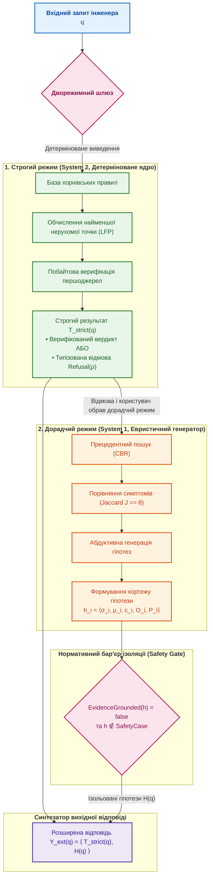
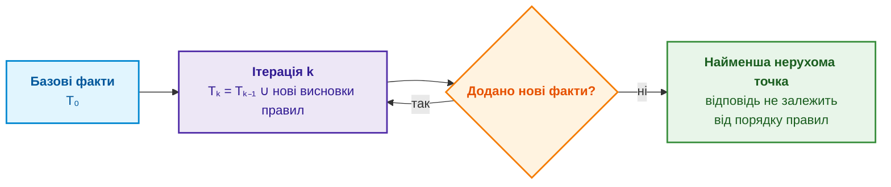
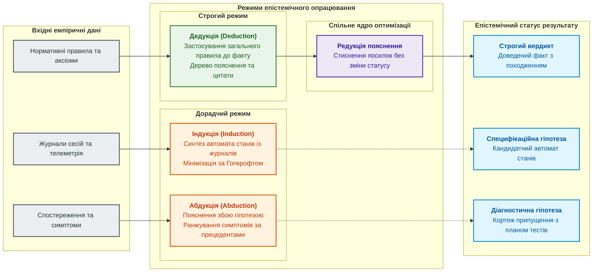
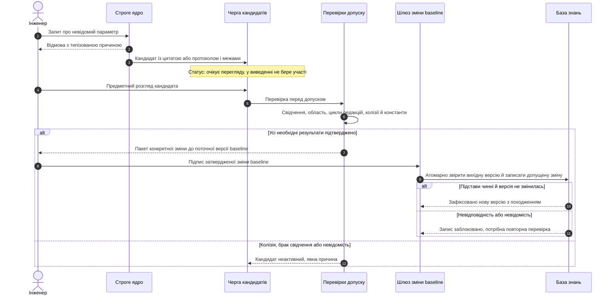
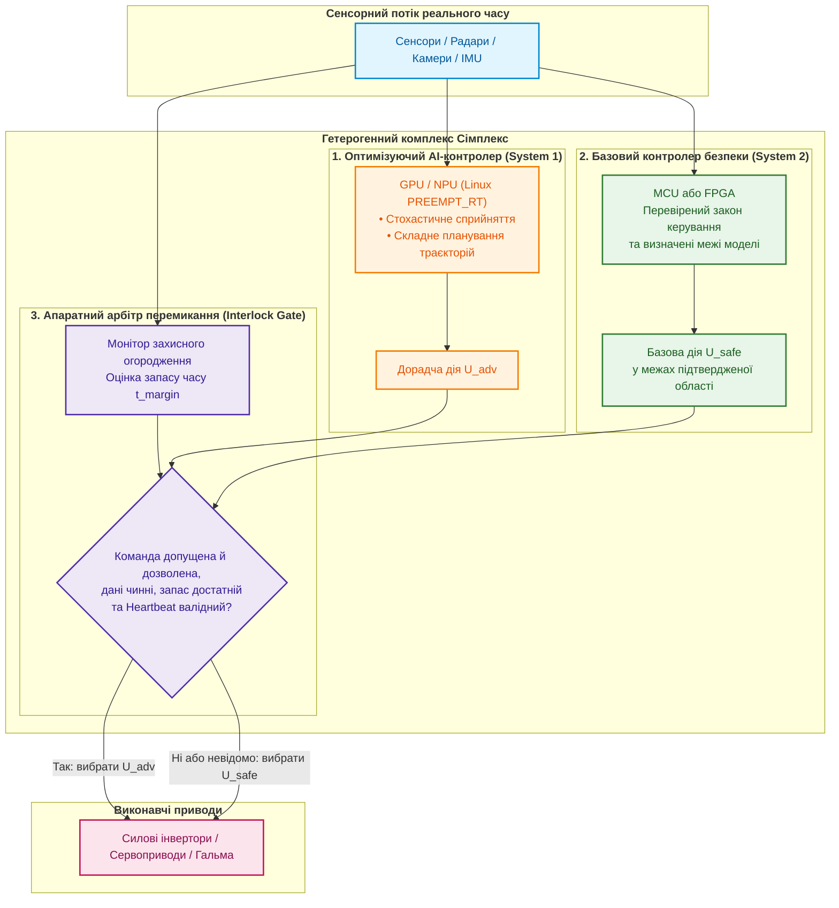

# Глава 28. Дворежимні експертні системи: строгий висновок і дорадча гіпотеза

> **Книга:** [Архітектура доказових експертних систем](README.md) · [Частина VI: Нейро-символьні архітектури, абдукція та контроль галюцинацій](part-06-frontiers-neuro-symbolic.md)
> **Попередня глава:** [Глава 30. Спільне проєктування функціональної безпеки та кібербезпеки](ch30-safety-cybersecurity-co-engineering.md)
> **Наступна глава:** [Глава 34. Прогалини знань: реляційний пошук, абдукція та діалог уточнення](ch34-deterministic-relational-analysis-abduction-and-socratic-dialogue.md)
> **Зміст книги:** [README.md](README.md)
> **Автор:** [Микола Мартинович Федчик](about-the-author.md)
> **Передумови й маршрут:** множини, логічне «і», правило «якщо — то» та читання функцій Python; Datalog, автомати й часові бюджети пояснено перед застосуванням. Практикум: [лабораторна робота №3](LABS.md).
> **Очікувані результати:** формально відокремлювати строгий результат від дорадчих гіпотез; будувати строге ядро на правилах Горна з обчисленням найменшої нерухомої точки й стратифікованим запереченням; повертати контрприклад замість голого «ні» для кванторів над скінченними доменами; знаходити деонтичні колізії в нормативних текстах; розрізняти дедукцію, індукцію й абдукцію за Пірсом і застосовувати редукцію до першопричини; формувати гіпотези за прецедентами з критеріями переведення у факт; перетворювати відмову на кандидата для бази знань без обходу фахового перегляду; маршрутизувати запит без строгої відповіді й без достатньо схожого прецедента до уповноваженого експерта й повертати відповідь експерта як підтверджений прецедент.

## Анотація

Дворежимність потрібна експертній системі, коли користувач ставить два різні запитання: «що випливає з перевірених знань?» і «що варто перевірити далі?». Перше потребує відтворюваного доведення або чесної відмови; друге допускає робочу гіпотезу, але не підміну нею доведеного результату. У главі крок за кроком побудовано строге ядро, пошук схожих випадків і маршрут до експерта. Навчальний Python-лістинг реалізує ці методи та окремий допуск нових знань. Наприкінці показано, чому перенесення такого поділу на фізичне керування за архітектурою Сімплекс потребує додаткової моделі руху, часових меж і повноважень.

Наскрізний навчальний випадок — поштовий шлюз лабораторії, який перестав установлювати з'єднання. Адміністратор питає про причину тайм-ауту, а аудитор — які правила послідовності команд зафіксовано в базі. Це той самий виріб, але різні задачі. Цитований опис протоколу може обґрунтувати вимогу до команди; він не вимірює стан мережі й не доводить, що провайдер блокує саме це з'єднання. Схожий інцидент підказує перевірку, але не дає права змінити мережеві налаштування.

Якщо всюди повертати лише «невідомо», буде втрачено корисні напрями діагностики. Якщо всюди дозволяти здогадки, аудитор не відрізнить правило від припущення. Тому надалі спочатку будується незмінна строга відповідь, потім — явно дозволене доповнення гіпотезами. Усі числа випадків і стендових розрахунків нижче є навчальними, а не результатами вимірювань. Зв'язок із [обґрунтуванням безпеки](ch27-safety-case-gsn-synthesis.md) стосується допуску свідчень; сама архітектура не засвідчує відповідності ISO 26262 чи DO-178C.

Ця глава відповідає на запитання: **як одна експертна система може водночас бути строгим джерелом доказів і корисним порадником, не дозволяючи пораді непомітно стати доказом?** Теза глави: **відповідь має дві частини з різним статусом. Строга частина виводиться детермінованими правилами з цитованих фактів і за нестачі знань є типізованою відмовою. Дорадча частина складається з гіпотез, кожна з яких позначена як непідтверджена, має метод отримання й критерій переведення у факт. Гіпотеза не потрапляє ні до строгого виведення, ні до аргументу безпеки, доки не пройде той самий перегляд, що й будь-який кандидат на зміну знань.**

## 1. Архітектурна дихотомія двох режимів та базовий інваріант доказовості

Архітектурне розмежування починається з питання: що має змінитися, коли адміністратор просить підказку замість аудиторського висновку? Змінюється склад показаної відповіді, але не вимоги до її строгої частини. У цій монографії автором запропоновано модель двох режимів подання: **строгий** розв'язує задачу перевірного висновку, **дорадчий** — задачу вибору наступної перевірки за браку знань. Режим явно обирає користувач у запиті в межах політики доступу; для аудиторського інтерфейсу політика може дозволяти лише строгий режим. Поріг схожості не перемикає режим самостійно.

Нехай $q$ — коректно сформований запит із визначеною областю застосування. Для незмінної версії фактів, правил і політик $`\mathcal{T}_{\mathrm{strict}}(q)`$ є або висновком із підставами, або відмовою $`\mathrm{Refusal}(\rho)`$, де $\rho$ — код причини, наприклад «немає факту» чи «суперечність». Щоб не приховувати цю відповідь під порадою, використано пару:

<a id="obj-28-1"></a>
**Формула (28.1). Структура дорадчої відповіді.**

```math
\mathcal{Y}_{\mathrm{ext}}(q)=\bigl\langle\,\mathcal{T}_{\mathrm{strict}}(q),\ \mathcal{H}(q)\,\bigr\rangle,
\qquad
\mathcal{H}(q)=\{h_1,\dots,h_k\}.
```

- Для розширеної відповіді $q$ є запитом, $`\mathcal{T}_{\mathrm{strict}}(q)`$ строгим результатом, а $`\mathcal{H}(q)`$ множиною дорадчих гіпотез;
- Кутові дужки $\langle\ ,\ \rangle$ утворюють упорядковану пару, тож строгий результат і гіпотези зберігають окремі позиції;
- $`h_1,\dots,h_k`$ є гіпотезами з номерами від 1 до $k$, де $k$ — невід'ємне ціле число; при $k=0$ множина порожня;
- $`\mathcal{Y}_{\mathrm{ext}}(q)`$ позначає всю розширену відповідь для запиту $q$.

Усі компоненти тут є записами даних, а не фізичними величинами, тому одиниць вимірювання немає. На запит про причину тайм-ауту перша позиція пари містить відмову «немає підтвердженого факту», друга — гіпотезу про блокування порту. Після повернення до строгого режиму гіпотеза зникає з подання, а відмова залишається тією самою. Для вже відомої строгої відповіді в маршруті цієї глави генератор не запускається. Жоден режим не дозволяє виконати пораду: дозвіл на дію перевіряється окремо за [Главою 21](ch21-from-recommendation-to-action.md).

Щоб адміністратор міг перевірити підказку, недостатньо записати лише її текст. Кожна гіпотеза є кортежем із п'яти полів:

<a id="obj-28-2"></a>
**Формула (28.2). Паспорт робочої гіпотези.**

```math
h_i=\langle\,\sigma_i,\ \mu_i,\ c_i,\ \mathcal{O}_i,\ \mathcal{P}_i\,\rangle.
```

- У кортежі $`h_i`$ індекс $i$ є номером гіпотези, а кутові дужки задають впорядкований запис;
- $`\sigma_i`$ є змістом гіпотези, $`\mu_i`$ методом отримання, а $`c_i`$ оцінкою впевненості;
- $`\mathcal{O}_i`$ містить спостереження на підтримку гіпотези, а $`\mathcal{P}_i`$ критерії її перевірки й переходу до факту;
- Поля йдуть у порядку: зміст, метод, оцінка, спостереження, критерії.

Індекс $i$ пробігає цілі числа від 1 до $k$. Зміст і метод є записами; $`c_i\in[0,1]`$ — безрозмірний бал за названою шкалою; спостереження й перевірки — скінченні набори записів з умовами та, за потреби, одиницями. Наприклад, зміст — «можливе блокування порту», метод — аналогія, бал — 0,6, спостереження — тайм-аут і порт 25, перевірка — зіставити журнал мережевого фільтра з тим самим часом і адресою. Результат підказує, які дані зібрати, але бал 0,6 не означає 60% імовірності причини.

Навіть гіпотеза з балом 1 повинна залишатися поза допущеними свідченнями. Авторська вимога ізоляції задає саме цей статус:

<a id="obj-28-3"></a>
**Формула (28.3). Ізоляція недопущеної гіпотези.**

```math
\forall h\in\mathcal{H}(q):\quad \mathrm{EvidenceGrounded}(h)=\mathrm{false}\ \land\ h\notin\mathrm{SafetyCase}.
```

- Інваріант поширюється на кожну гіпотезу $h$ у множині $`\mathcal{H}(q)`$ для запиту $q$;
- $\forall$ означає «для кожної», а $\in$ означає належність до множини;
- $`\mathrm{EvidenceGrounded}(h)=\mathrm{false}`$ тут означає «не допущена як доведене твердження для цієї області», а не «не має жодних спостережень на підтримку»;
- $\land$ означає логічне «і», а $`h\notin\mathrm{SafetyCase}`$ забороняє включати гіпотезу до аргументу безпеки.

Предикат має логічні значення true/false, а $`\mathrm{SafetyCase}`$ тут позначає множину прийнятих свідчень аргументу безпеки, не всі його згадки про ризики. Це безрозмірна вимога до реалізації, не теорема про будь-яку програму. Для прикладу з балом 1 підстановка все одно дає false: точний збіг симптомів не підтверджує причину нового інциденту. Гіпотезу можна обліковувати як відкриту проблему, але не як підтвердження безпеки.

Гіпотеза може посилатися на справжній документ; непідтвердженим залишається пояснення поточного випадку. Шлях до бази знань проходить через цикл кандидатів із [Глави 26](ch26-continual-learning.md): збирання свідчень, фаховий перегляд і окремий допуск (§5). Строгий висновок також є умовним: він правильний відносно прийнятих посилок і моделі, а не автоматично істинний для фізичного світу. Тепер потрібно з'ясувати, як обчислити його без залежності від порядку правил.

Архітектурну дихотомію взаємодії двох режимів та ізолюючий бар'єр безпеки між ними наведено на діаграмі нижче.

<a id="obj-28-4"></a>
**Діаграма 28.4. Незмінна строга частина та умовно дозволене доповнення.**



> [!NOTE]
> **Три інваріанти архітектурної дихотомії двох режимів за моделлю автора**
> 1. Ізоляція строгого ядра від евристик: вихідний результат формується як пара $`\mathcal{Y}_{\mathrm{ext}}(q)=\bigl\langle\,\mathcal{T}_{\mathrm{strict}}(q),\ \mathcal{H}(q)\,\bigr\rangle`$, де строга компонента детермінована й автономна.
> 2. П'ятикомпонентний кортеж верифікації гіпотези: кожне евристичне припущення фіксує зміст, метод генерації, впевненість, емпіричні спостереження та критерії фальсифікації.
> 3. Бар'єр доказовості: гіпотези не є прийнятими свідченнями GSN; їх можна фіксувати як відкриті питання, але не як доказ.
> *Керування рантаймом / Інженерний інваріант:* Якщо запит не має детермінованого доказу, система зобов'язана генерувати типізовану відмову у строгому ядрі перед запуском дорадчого генератора.

## 2. Детерміноване символьне ядро: правила Горна та найменша нерухома точка

Детерміноване ядро має відповісти на питання аудитора: якщо MAIL передує RCPT, а RCPT передує DATA, чи можна вивести потрібний порядок MAIL і DATA? Спочатку потрібні два поняття: **факт** є записом про об'єкт, а **правило** виводить новий запис, коли виконано всі його умови. Мова Datalog описує такі правила декларативно: зазначається, що випливає з чого, а не порядок команд програми [[1]](#src-1). Для завершуваного навчального фрагмента домени скінченні, нові значення не породжуються, а всі змінні голови й заперечень зустрічаються в позитивних умовах тіла.

Позитивне правило з однією головою належить до правил Горна. Наведений запис додатково допускає заперечення за відсутністю, тому є формою нормального правила Datalog, а не суто позитивною клаузою Горна:

<a id="obj-28-5"></a>
**Формула (28.5). Безпечне за змінними правило Datalog.**

```math
H(\vec X)\leftarrow B_1(\vec X_1)\land\dots\land B_m(\vec X_m)\land\neg N_1(\vec Y_1)\land\dots\land\neg N_k(\vec Y_k).
```

- У правилі Горна $H$ є головою, тобто висновком правила, а $\vec X$ набором змінних голови;
- $`B_i(\vec X_i)`$ є позитивними атомами тіла, $m$ задає їхню кількість, а $\land$ вимагає істинності всіх умов;
- $\leftarrow$ читається «вивести голову, якщо виконується тіло»;
- $`N_j(\vec Y_j)`$ є атомами заперечення за відсутністю, $k$ задає їхню кількість, а $\neg$ означає, що відповідний факт не відомий;
- Індекси $i$ та $j$ нумерують атоми, а $\dots$ позначає продовження послідовності умов до меж $m$ і $k$;
- $`\vec X_i`$ і $`\vec Y_j`$ є кортежами змінних із відповідних скінченних типізованих доменів; $m\ge1$ і $k\ge0$ — цілі кількості умов, не час і не обсяг пам'яті.

Приклад підстановки: голова `must_precede(MAIL, DATA)`, позитивні умови `precedes(MAIL, RCPT)` і `must_precede(RCPT, DATA)`, заперечень немає. Обидві умови знайдено — додається голова. Якщо другої умови немає, висновок не додається. Це доведення в моделі послідовності, не відновлення журналу реального з'єднання.

Щоб повторювати таку дію до завершення, позначимо початкову скінченну множину фактів через $F$, а фіксований набір позитивних правил — через $R$. Утворення всіх висновків правил за поточними фактами позначено $`T_R`$:

<a id="obj-28-6"></a>
**Формула (28.6). Ітеративне замикання позитивних правил.**

```math
K_0=F,\qquad K_{n+1}=K_n\cup T_R(K_n),\qquad
K_{n+1}=K_n\ \Longrightarrow\ K_n=K^*.
```

Тут $n$ — невід'ємний цілий номер ітерації; $`K_n`$ — множина відомих фактів; $`T_R(K_n)`$ — усі голови правил $R$ із виконаними тілами; $\cup$ — об'єднання без дублікатів; $`K^*`$ — найменша замкнена множина, що містить $F$. Одиниць вимірювання немає. Для позитивних правил оператор монотонний: додавання фактів не прибирає попередніх висновків. На скінченній множині можливих атомів кожна результативна ітерація додає хоча б один атом, тому процес зупиниться. Це потрібне тут твердження про завершення, а не оцінка реального часу відповіді.

У лістингу §6 спочатку є 7 фактів. Перша ітерація додає два безпосередні `must_precede`, друга — один транзитивний MAIL–DATA, третя не додає нічого: 7, потім 9, потім 10, знову 10. Отримані 10 фактів використовуються для відповіді аудиторові; додаткових фактів про причину тайм-ауту вони не містять.

Обчислення починають із базових фактів і застосовують усі правила, доки нові факти перестають з'являтися. Схема показує цей процес.

<a id="obj-28-7"></a>
**Діаграма 28.7. Зупинка при відсутності нових висновків.**



Для фіксованих правил і арностей цей фрагмент має поліноміальну складність за обсягом вхідних даних [[1]](#src-1); це не обіцянка малого часу для довільних програм. Заперечення потребує іншої дисципліни: «факт не знайдено» не дорівнює «факт неможливий у світі». **Стратифікація** розділяє предикати на шари; заперечуваний предикат обчислюється повністю в нижчому шарі. Наприклад, після завершеного збору каталогу можна знайти команду без запису відповіді. Поки збір триває, така відсутність ще невідома. Цикл «A, якщо немає B; B, якщо немає A» ця політика не допускає. Для відкритого або неповного джерела слід повертати невідомість, а не фізичне заперечення.

Строге ядро повертає не лише «так» чи «ні». **Квантор загальності над скінченним доменом** перевіряє твердження на кшталт «для кожної команди протоколу в базі знань є задокументована відповідь»:

<a id="obj-28-8"></a>
**Формула (28.8). Перевірка повноти локального каталогу команд.**

```math
\forall c\in\mathrm{Commands}:\ \exists s\ \ \mathrm{DocumentedReply}(c,s).
```

- Для кожної команди $c$ з множини $`\mathrm{Commands}`$ має існувати значення $s$;
- $\forall$ означає «для кожної», $\exists$ означає «існує», а $\in$ належність до множини;
- $`\mathrm{DocumentedReply}(c,s)`$ є предикатом «для команди $c$ задокументовано відповідь $s$».

Обидва домени скінченні: команди — перелік, який перевіряється, $s$ — ідентифікатор відповіді з каталогу; одиниць немає. У §6 перелік містить HELO, MAIL, RCPT, DATA, VRFY. Для перших чотирьох знаходиться свідок $s$, для VRFY — ні. Отже, контрприклад — VRFY, і дія читача — доповнити локальний каталог, а не оголосити дефект SMTP. Для порожнього домену твердження логічно істинне без перевірок; звіт мусить окремо вказати нульове покриття.

Якщо твердження хибне, ядро повертає контрприклад, тобто конкретну команду без відповіді, а не логічний нуль. Контрприклад одразу показує, де база знань неповна.

**Деонтичний контроль** перевіряє нормативні тексти на колізії модальностей. Георг Генрік фон Врігт у праці, з якої почалася сучасна деонтична логіка, розглядав зобов'язання, заборону й дозвіл як модальні оператори над діями [[2]](#src-2). Позначимо зобов'язання через $`\mathsf{O}`$ (`MUST`), а заборону через $`\mathsf{F}`$ (`MUST NOT`). Тоді одночасне зобов'язання й заборона тієї самої дії в тій самій області застосування є колізією:

<a id="obj-28-9"></a>
**Формула (28.9). Реєстрація колізії норм.**

```math
\mathsf{O}(a,s)\land\mathsf{F}(a,s)\ \Rightarrow\ \mathrm{Conflict}(a,s).
```

де:

- $`\mathsf{O}(a,s)`$ означає зобов'язання виконати дію $a$ в області застосування $s$;
- $`\mathsf{F}(a,s)`$ означає заборону тієї самої дії в тій самій області;
- $\land$ означає одночасну наявність обох норм, $\Rightarrow$ читається «тоді зареєструвати», а $`\mathrm{Conflict}`$ є логічним прапорцем колізії, не дозволом вивести довільне твердження із суперечності.

Домени $a$ і $s$ — скінченні ідентифікатори дій та областей із редакціями й умовами, одиниць немає. У синтетичному наборі §6 для `use-tls` у `submission` є обидві модальності: перевірка повертає цю пару й блокує допуск. Норма для `relay` не створює колізії із забороною для `submission`: області різні. Формула є правилом контролю обраної моделі норм, а не повною аксіоматикою деонтичної логіки й не алгоритмом вибору старшої норми.

Знайдена колізія не розв'язується автоматично: ядро блокує допуск суперечливої редакції правил і передає колізію власникові нормативного документа. Строге ядро забезпечує відповідь, яку можна відтворити й перевірити. Проте інженерні задачі потребують не лише дедукції, і наступний розділ розділяє форми міркування, які працюють у двох режимах.

> [!NOTE]
> **Три механізми верифікації детермінованого символьного ядра за моделлю автора**
> 1. Авторська архітектура використовує класичне замикання позитивного Datalog: для скінченних доменів без породження значень результат не залежить від порядку повного застосування правил; поліноміальна оцінка стосується даних за фіксованої програми.
> 2. Стратифіковане заперечення застосовується лише до завершених нижчих шарів; відсутність запису не доводить фізичної відсутності явища.
> 3. Деонтичний контроль реєструє конфлікт у тій самій області, а перевірка скінченного каталогу повертає конкретний пропущений елемент.
> *Керування рантаймом / Інженерний інваріант:* Автоматичне блокування завантаження бази знань при виявленні нестратифікованих правил або нерозв'язаних деонтичних колізій.

## 3. Епістемічна тріада Пірса: дедукція, індукція, абдукція та каузальна редукція

Тріада форм міркування потрібна, щоб не сплутати відповідь про правило SMTP із відповіддю про причину тайм-ауту. З уже прийнятого правила можна вивести наслідок; із повторюваних журналів — запропонувати узагальнення; зі збою — припустити пояснення. Передумовою тут є різниця між посилкою й висновком: навіть коректний логічний перехід не виправляє хибної посилки.

Чарльз Сандерс Пірс у статті 1878 року «Дедукція, індукція і гіпотеза» розрізнив три форми висновку [[3]](#src-3). Дедукція застосовує загальне правило до випадку й отримує результат. Індукція з випадків і результатів узагальнює правило. Гіпотеза пояснює дивний результат припущенням, що спостережуваний випадок підпадає під певне правило, і Пірс зауважив, що як загальне правило гіпотеза є слабким видом аргументу. Сучасна література розглядає цю форму як абдукцію. Ігор Довен у Стенфордській енциклопедії філософії підкреслює, що в Пірса абдукція означає прийняття гіпотези не як істинної чи підтвердженої, а як гідного кандидата для подальшої перевірки [[4]](#src-4). Саме такий статус має дорадча гіпотеза експертної системи. Для дворежимної експертної системи класифікація Пірса визначає статус результату.

**Дедукція забезпечує строгу частину обох режимів.** Зворотне виведення від цілі будує дерево пояснення, де вузол є прийнятим фактом або застосованим правилом із посиланням на посилки, як описує [Глава 20](ch20-explanation-engine.md). Для лабораторного шлюзу два правила порядку дають транзитивний висновок MAIL–DATA. Це не означає, що конкретний сервер дотримався порядку. Дедукцію можна застосувати й до гіпотетичних посилок, але результат тоді залишається умовним, не строгим знанням.

**Індукція пропонує правило зі спостережень.** Якщо в журналах перед DATA завжди було RCPT, можна побудувати кандидатний автомат: стани описують етапи сесії, переходи — команди, приймальні стани — дозволене завершення. Це лише узагальнення наявних трас. Для порівняння з еталоном потрібні повні детерміновані скінченні автомати над тим самим алфавітом; відсутній перехід моделюється станом відхилення. Мінімізація Гопкрофта об'єднує стани з однаковою майбутньою поведінкою [[5]](#src-5). За фіксованого алфавіту оцінка $O(n\log n)$ використовує $n\ge1$ — кількість станів; це порядок кількості операцій, не секунди. Критерій об'єднання такий:

<a id="obj-28-10"></a>
**Формула (28.10). Еквівалентність станів повного детермінованого автомата.**

```math
s_1\sim s_2\iff\forall w\in\Sigma^{*}:\ \bigl(\hat\delta(s_1,w)\in F\iff\hat\delta(s_2,w)\in F\bigr).
```

- Для автоматів $`s_1`$ і $`s_2`$ є станами, а $\sim$ позначає їхню еквівалентність;
- $`\forall w\in\Sigma^*`$ перевіряє кожний скінченний рядок команд $w$ над алфавітом $\Sigma$; зірочка означає всі скінченні рядки, зокрема порожній;
- $\hat\delta(s,w)$ є розширеною функцією переходів, яка повертає стан після подання рядка $w$;
- $F$ є множиною приймальних станів, $\in$ означає належність до неї, а $\iff$ означає «тоді й лише тоді»;
- Внутрішнє $\iff$ вимагає, щоб обидва стани приймали або відхиляли кожний рядок команд однаково.

Область станів — скінченна множина $Q$, $`s_1,s_2\in Q`$; $\Sigma$ — скінченний алфавіт, $`F\subseteq Q`$; усі величини символічні, без одиниць. Порожній рядок залишає стан незмінним. Для порівняння двох автоматів їх можна розглядати як неперетинні частини одного з об'єднаною множиною приймальних станів.

Логічний приклад: у стані «одержувача прийнято» слово з однієї команди DATA веде до приймального стану, а в стані «лише відправника прийнято» — до відхилення. Знайдено слово-свідок, отже стани нееквівалентні й об'єднувати їх не можна. Якщо жодне слово не розрізняє прийняття, стани можна об'єднати. Відмінність між журналами й еталоном дає привід перевірити трасу, модель або повноту спостережень, а не автоматичний доказ порушення стандарту.

**Абдукція працює в дорадчому режимі.** Пояснення збою найімовірнішою причиною є гіпотезою, навіть коли ймовірність висока; [Глава 24](ch24-system-diagnosis.md) показує, як такі гіпотези ранжувати й перевіряти.

**Редукція не належить до тріади Пірса, але потрібна обом режимам.** Вона скорочує пояснення до суттєвих посилок, не підвищуючи їхнього статусу. Код SMTP 503 сам по собі не встановлює, якої передумови бракувало: з правила «пропущений RCPT може пояснити помилку» не випливає «помилка доводить пропущений RCPT». Потрібен журнал тієї самої сесії, що окремо показує прийняття MAIL і відсутність прийнятого RCPT у повному фрагменті. Тоді можна локалізувати порушення моделі послідовності; без журналу це абдуктивна гіпотеза. RFC 5321 [[6]](#src-6) є джерелом для перевірки правил SMTP, не датчиком поточної сесії. QuickXPlain з [Глави 20](ch20-explanation-engine.md) знаходить включно-мінімальну конфліктну підмножину відносно моделі й оракула узгодженості, не обов'язково єдину фізичну причину. Дерево Меркла з [Глави 27](ch27-safety-case-gsn-synthesis.md) захищає цілісність запису, не істинність його змісту.

Співвідношення форм умовиводу епістемічної тріади Пірса та їхній розподіл між оперативними режимами експертної системи відображено на схемі.

<a id="obj-28-11"></a>
**Діаграма 28.11. Скорочення пояснення зі збереженням його статусу.**



## 4. Дорадчий режим: прецедентні міркування та генерація робочих гіпотез

Дорадчий режим продовжує там, де строге ядро не знає причини тайм-ауту: який минулий випадок варто перевірити першим? Потрібні множини однаково закодованих симптомів: наприклад, «тайм-аут», «порт 25», «установлення з'єднання», «офісна мережа». Повтори одного симптому не збільшують його вагу. Міркування за прецедентами (*Case-Based Reasoning*, CBR) за Аамодтом і Плазою має чотири кроки: знайти випадок, використати його рішення як пропозицію, переглянути з урахуванням відмінностей і зберегти перевірений досвід [[7]](#src-7). Для першого кроку використаємо класичний коефіцієнт Жаккара [[8]](#src-8):

<a id="obj-28-12"></a>
**Формула (28.12). Схожість двох непорожніх сукупно наборів симптомів.**

```math
J(S_{\mathrm{in}},S_{\mathrm{case}})=\frac{|S_{\mathrm{in}}\cap S_{\mathrm{case}}|}{|S_{\mathrm{in}}\cup S_{\mathrm{case}}|}.
```

- Коефіцієнт $J$ порівнює множину симптомів запиту $`S_{\mathrm{in}}`$ із множиною симптомів прецедента $`S_{\mathrm{case}}`$;
- $\cap$ є перетином множин, $\cup$ їх об'єднанням, а $`|\cdot|`$ позначає кількість елементів;
- Чисельник рахує спільні симптоми, знаменник усі різні симптоми в обох множинах.

Домени — скінченні множини ідентифікаторів симптомів; чисельник і знаменник є кількостями, $J\in[0,1]$ безрозмірний. У поточного випадку чотири симптоми; у прецедента — ті самі перші три й «домашня мережа». Перетин містить 3 ознаки, об'єднання — 5, отже ділення 3 на 5 дає 0,6. За навчального порогу $\theta=0{,}4$ прецедент потрапляє до підказок. Для лабораторного набору «тайм-аут, порт 25, лабораторна мережа, DNS» спільних ознак 2, загалом різних 6: ділення 2 на 6 дає приблизно 0,33, тож потрібна ескалація. На самій межі 0,4 прецедент приймається для показу, не для допуску знання. Для двох порожніх множин значення невизначене; для лише однієї порожньої — нуль.

Якщо $J\ge\theta$, де $\theta\in[0,1]$ — безрозмірний поріг показу, формується гіпотеза з методом «аналогія з прецедентом», балом $c=J$ і планом перевірки. У застосуванні поріг добирають на розмічених випадках за ціною хибних підказок і пропусків; навчальні 0,4 не є результатом калібрування. Зміна порогу змінює перелік підказок, але не строгий висновок, право запускати дослід чи право змінювати налаштування.

У нашому випадку знайдено прецедент блокування вихідного порту 25. Це причина старого інциденту, не поточного. Порада про службу подання на порту 587 потребує окремої перевірки конфігурації, автентифікації та політики оператора; RFC 6409 [[9]](#src-9) не дозволяє довільно замінити міжсерверний транспорт службою подання. Спочатку слід перевірити доступність і мережеві журнали, а зміну виконувати лише з належним дозволом. Далі постає питання: як зберегти підтверджений результат такої перевірки, не перетворюючи будь-яку пораду на факт?

> [!NOTE]
> **Чотири принципи функціонування дорадчого режиму та прецедентного пошуку за моделлю автора**
> 1. Епістемічне розмежування за Пірсом: трактування прецедентних висновків суто як абдуктивних гіпотез, що вимагають емпіричної верифікації.
> 2. Метрична оцінка близькості симптомів: обчислення коефіцієнта Жаккара $`J(S_{\mathrm{in}}, S_{\mathrm{case}})`$ над простором зафіксованих спостережень.
> 3. Порогове відсікання: показ прецедентної гіпотези при $J\ge\theta$; навчальний поріг не видається за відкалібрований.
> 4. Обов'язкова прив'язка критеріїв перевірки: кожна згенерована гіпотеза постачається разом із планом випробувань для доведення її чинності.
> *Керування рантаймом / Інженерний інваріант:* Посилання на авторитетні стандарти підтверджує існування сутності, але не доводить її причинний зв'язок із поточним інцидентом.

## 5. Типізована відмова (Refusal) як джерело нових знань

Відмова стає джерелом навчання лише після відповіді на питання «якого саме свідчення бракує?». Для нашого шлюзу це може бути журнал мережевого фільтра за конкретний час, а не ще одна аналогія. Потрібно розрізняти **кандидата** — неактивну пропозицію запису — і **baseline**, тобто затверджену вихідну версію знань, із якою порівнюється зміна.

Відмова строгого ядра виявляє прогалину, але не надає права автоматично заповнити її новим фактом. Знайдена цитата або успішний стендовий дослід створюють лише кандидата з точним походженням та областю застосування. Без перевірки змісту, узгодженості й затвердження зміни baseline навіть справжній підписаний протокол може ввести до строгого ядра хибне узагальнення або норму, що суперечить чинній. Авторський шлях від відмови до знання розділяє ці події; для текстових опор застосовуються [контракт матеріальних атомів глави 19](ch19-from-question-to-evidence.md#51-повнота-привязки-та-критерії-валідності) та незмінні артефакти досліду.

<a id="obj-28-13"></a>
**Діаграма 28.13. Окремі свідчення, допуск знання та фіксація версії.**



Перевірка узгодженості перед допуском шукає три класи порушень. **Цикли заміни редакцій** виникають, коли документ A скасовує документ B, а B скасовує A. **Деонтичні колізії** виникають, коли та сама дія в тій самій області водночас обов'язкова й заборонена. **Суперечливі константи** виникають, коли одна редакція стандарту має два різні значення того самого параметра, наприклад два порти за замовчуванням. Розв'язаний інцидент після підтвердження причини зберігають як новий прецедент, і цикл замикається: відмова породжує кандидата, перевірений кандидат стає фактом, перевірений випадок стає прецедентом для майбутніх гіпотез.

До запису кандидата потрібні п'ять окремих підтверджень і чинний зв'язок із версією:

<a id="obj-28-14"></a>
**Таблиця 28.14. Що перевіряється до зміни знань.**

| Передумова | Що саме перевіряється | Що не є заміною |
|---|---|---|
| Свідчення | Ідентичність і цілісність джерела або протоколу, версія плану, фактичний результат і повноваження підписанта | Сам рядок `PASS` чи математично правильний підпис невідомого ключа |
| Область і зміст | Твердження випливає зі свідчення, одиниці, умови, виріб і конфігурація збігаються; одного досліду не узагальнено на всі режими | Відсутність помилок JSON або близькість прецедента |
| Узгодженість | Визначені вище колізії та застосовні заперечення перевірено відносно поточного baseline | Старий успішний звіт або підпис протоколу досліду |
| Фаховий перегляд | Уповноважений експерт розглянув достатність свідчень і межі саме цього кандидата | Підпис виконавця тесту як автоматичне погодження знання |
| Затвердження baseline | Уповноваженою людиною підписано конкретну зміну версії знань із посиланням на кандидата й вихідний baseline | Разова кнопка «схвалити» без визначених об'єкта та повноважень |

Усі результати належать тому самому кандидатові, свідченням, профілю й вихідній версії baseline. За зміни будь-якого з них результати переоцінюються; перед записом версія звіряється атомарно з фіксацією зміни або застосовується еквівалентний перевірений протокол. Невідомість, помилка чи тайм-аут будь-якої обов'язкової перевірки залишає кандидата неактивним із причиною. Емпіричний факт може бути допущений лише у підтвердженій області; дослід не має повноважень самостійно змінити чинну нормативну вимогу.

Для наскрізного випадку підписаний протокол блокування з'єднання з динамічної адреси не доводить блокування статичних адрес. Перший крок — обмежити кандидата потрібною мережею, адресами й часом; другий — перевірити свідчення та сумісність із чинними знаннями; третій — фахово погодити й окремо затвердити зміну версії. Якщо база змінилася після погодження, запис блокується до повторної оцінки. Людський підпис стосується введення знання, не кожного його читання. Навіть допущене знання «фільтр блокує з'єднання» не дає адміністраторові права вимкнути фільтр. Якщо потрібного свідчення немає, наступним кроком є адресований запит до експерта.

### 5.1. Ескалація до експерта та замкнений цикл поповнення знань

Цикл від відмови до факту працює, коли відповідь існує в першоджерелах. Частина запитань не має відповіді ні в першоджерелах, ні в пам'яті прецедентів: наприклад, рішення, яке знає лише інженер, що роками обслуговує конкретний стенд, або тлумачення норми, яке має право дати лише уповноважена особа. У такому разі відмова строгого ядра має стати адресованим запитом до людини з правом відповісти, а відповідь людини має повернутися до експертної системи як підтверджений прецедент.

Кельтум Бенлахарш і співавтори описали такий цикл для Алжирського дому фетв (*Algerian Fatawa House*), якому бракувало муфтіїв, тобто сертифікованих знавців ісламського права, щоб вчасно відповідати на щоденні запити громадян [[10]](#src-10). Система шукає схожі випадки міркуванням за прецедентами, яке спирається на онтологію домену ісламських фінансів і банківських операцій. Якщо в базі вже є відповідь на схожий запит, система одразу повертає цю відповідь. Інакше система автоматично формулює запит до муфтія, який або підтверджує згенеровану системою відповідь, або дає нову, і база випадків поповнюється. У видавничій анотації автори повідомляють про перевірку на фетвах ісламських фінансів і банківських операцій; спосіб оцінювання й кількісні результати тут не звірено за повним текстом. Роботу використано як опис архітектурного шаблону, не як підтвердження його ефективності; відсутність прочитаних метрик не означає їхньої відсутності у статті.

У цій монографії автором адаптовано шаблон ескалації: підтверджена відповідь про старий випадок залишається лише аналогією для нового. Маршрутизатор — функція вибору подальшого опрацювання — спочатку враховує явний режим користувача $m$, потім строгий результат і лише за відмови в дорадчому режимі шукає прецеденти:

<a id="obj-28-15"></a>
**Формула (28.15). Маршрут відповіді без зміни її доказового статусу.**

```math
\mathrm{route}(q,m)=
\begin{cases}
\\text{строга відповідь}, & \text{якщо } \mathrm{Strict}(q)\neq\bot,\\
\\text{лише відмова}, & \text{якщо } \mathrm{Strict}(q)=\bot\ \land\ m=\text{strict},\\
\mathrm{hypothesis}(c^{*}), & \text{якщо } S(q)\ne\varnothing\ \land\ C_{\mathrm{val}}\ne\varnothing\ \land\ J(q,c^{*})\ge\theta,\\
\text{запит до експерта}, & \text{інакше},
\end{cases}
\qquad
c^{*}\in\arg\max_{c\in C_{\mathrm{val}}} J(q,c)\quad(C_{\mathrm{val}}\ne\varnothing).
```

Позначення маршрутизатора:

- $q$ є запитом, а $S(q)$ — скінченною множиною його симптомів; запис $J(q,c)$ скорочує порівняння множин симптомів запиту й прецедента за (28.12);
- $`\mathrm{Strict}(q)`$ є результатом строгого ядра, а $\bot$ у цій формулі позначає відмову, не доведену хибність; $m$ належить до скінченного набору `strict`, `advisory`;
- $`C_{\mathrm{val}}`$ є скінченною множиною чинних підтверджених прецедентів, для яких коефіцієнт визначений; $`c^{*}`$ є найсхожішим із них; за рівності балів вибирається перший за стабільним ідентифікатором;
- $`J(q,c^{*})`$ є коефіцієнтом Жаккара між ознаками запиту й прецедента, а $\theta$ є відкаліброваним порогом;
- $\arg\max$ повертає прецедент із найбільшим коефіцієнтом; якщо множина $`C_{\mathrm{val}}`$ порожня, маршрутизатор одразу обирає запит до експерта.

Гілки читаються зверху вниз, виконується перша придатна. Одиниць вимірювання немає, $J$ і $\theta$ безрозмірні та належать [0,1]. Якщо дані симптомів порожні, навчальна політика одразу ескалює, навіть за нульового порогу. Для відомого правила SMTP вибирається перша гілка в обох режимах. Для невідомої причини в строгому — друга; в дорадчому при 0,6 — третя, при 0,33 і порозі 0,4 — четверта. Якщо прецедентів немає, максимум не обчислюється. Це вибір маршруту відповіді, не санкція на мережеву команду. Користувач може окремо запросити експертний розгляд. Таблиця задає потрібний контекст такого звернення.

<a id="obj-28-16"></a>
**Таблиця 28.16. Пакет ескалації без повторного збирання контексту.**

| Поле запиту | Зміст | Що поле дає експертові |
|---|---|---|
| Структурований запит | ознаки, параметри й область застосування | однозначне формулювання запитання |
| Причина відмови | тип відмови й відсутній факт або правило | місце прогалини в базі знань |
| Найближчі прецеденти | ідентифікатори, коефіцієнти Жаккара й відмінні ознаки | пояснення, чому наявних прецедентів недостатньо |
| Чернетка відповіді | дорадча гіпотеза з критерієм переведення | можливість підтвердити чи виправити чернетку замість нової відповіді з нуля |
| Цитати першоджерел | документ, редакція й діапазон цитати | перевірку підґрунтя без власного пошуку |

Відповідь експерта повертається двома шляхами з різним статусом. Підтверджена чи нова відповідь стає прецедентом у $`C_{\mathrm{val}}`$ з ідентифікатором експерта, датою, областю застосування й умовами, які додав експерт. Якщо відповідь формулює загальне правило з посиланням на першоджерело, експертна система додатково створює кандидата на факт, і кандидат проходить той самий перегляд і ту саму перевірку узгодженості, що й на діаграмі вище. Підпис експерта не звільняє кандидата від перевірки на цикли заміни редакцій, деонтичні колізії й суперечливі константи.

Приклад продовжує історію з тайм-аутом. Інженер повідомляє про тайм-аут на порту 25 у новій лабораторній мережі. Строге ядро відмовляє, а найсхожіший підтверджений прецедент має коефіцієнт Жаккара 0,33, що нижче за поріг 0,4. Маршрутизатор надсилає запит адміністраторові поштової інфраструктури з чернеткою «перевірити, чи провайдер блокує вихідний порт 25». Адміністратор підтверджує чернетку й додає умову «для клієнтських підключень без статичної мережевої адреси». Наступний схожий запит отримує гіпотезу з посиланням на підтверджений прецедент без нової ескалації. Строге ядро й далі відмовляє на такий запит, доки адміністратор не додасть цитату з умов обслуговування провайдера як першоджерело для кандидата на факт і кандидат не пройде перегляд.

Межа шаблону полягає в навантаженні на експертів. Час уповноваженого експерта є найдефіцитнішим ресурсом, саме через нестачу муфтіїв і з'явилася система для фетв. Тому частку відмов, які дійшли до експертів, вимірюють постійно: зростання множини $`C_{\mathrm{val}}`$ має знижувати частку ескалацій, а частка чернеток, які експерт відхилив, показує якість дорадчого режиму. Підтверджені прецеденти також старіють: коли змінюється редакція першоджерела, на яке посилається прецедент, прецедент повертається на перегляд так само, як застарілий факт у [Главі 15](ch15-knowledge-extraction-and-kb-construction.md).

> [!NOTE]
> **Три рівні маршрутизації та ескалації знань за моделлю автора**
> 1. Строгий детермінований висновок: пріоритетне повернення результату з підставами; у строгому режимі відмова не запускає дорадчий пошук.
> 2. Дорадча екстраполяція прецедентів: автоматичне формування гіпотези на базі валідованого пулу $`C_{\mathrm{val}}`$ при $`J(q, c^*) \ge \theta`$.
> 3. Керована ескалація до експерта: генерація структурованого пакета запиту з чернеткою та контекстом при вичерпанні автоматичних евристик.
> *Керування рантаймом / Інженерний інваріант:* Відповідь уповноваженого експерта поповнює базу прецедентів, проте її перетворення на факт бази знань вимагає проходження повного аудиту цілісності.

## 6. Програмна верифікація: реалізація дворежимного рушія мовою Python

Програмна перевірка має відповісти, чи справді описані межі збережено під час виконання. Вхід навчального рушія — сім фактів, два позитивні правила, симптоми й явно вибраний режим; вихід — строга відповідь, ізольовані гіпотези або пакет ескалації. `least_fixed_point` реалізує формулу (28.6), `jaccard` — (28.12), `extended` — маршрут (28.15), `approve` — п'ять передумов таблиці 28.14. Строгий режим є типовим. Для запуску достатньо стандартної бібліотеки Python 3.10+; лістинг виконується цілком, разом із вбудованими перевірками.

Прапорці `evidence`, `scope`, `consistency`, `expert_review` і `baseline_approval` задаються синтетичним оракулом: це наперед підготовлені результати, не перевірка підписів або фахових повноважень. Зовнішній JSON чи відповідь LLM не є довіреним пакетом. Поле `review["baseline"]` містить копію `known`, не повний маніфест правил, політик і джерел. Реєстрація прецеденту теж потребує пакета, але змінює лише `CASES`; допуск факту змінює лише `known`. Це однопотокова модель, не атомарне розподілене сховище. Рядкові бібліографічні посилання ілюструють походження, але не реалізують перевірки цитат першоджерел. Поле `action_authorized=False` підкреслює, що цей рушій взагалі не виконує дій.

Записи `hypotheses` та `expert_request` навмисно скорочені для перевірки маршруту: вони не містять усіх полів паспорта (28.2) й таблиці 28.16. Зокрема метод і повний набір спостережень не серіалізовано в гіпотезі, а цитати та чернетка відповіді не зібрані в експертний пакет. Це межа реалізації, не дозвіл опускати ці поля в робочій системі. Порядок `CASES` у прикладі є стабільним порядком ідентифікаторів для розв'язання рівності балів.

<details>
<summary>Приклад мовою Python: строгий, дорадчий і експертний маршрути</summary>

```python
"""Дворежимна експертна система в мініатюрі: строгий вивід із цитатами й дорадчі гіпотези.

Лише стандартна бібліотека Python 3.10+.
"""
import copy
import itertools
import math


FACTS = {  # (суб'єкт, відношення, значення) -> цитата першоджерела
    ("SMTP", "max_line_octets", "1000"): "RFC 5321, 4.5.3.1.6",
    ("MAIL", "precedes", "RCPT"): "RFC 5321, 3.3",
    ("RCPT", "precedes", "DATA"): "RFC 5321, 3.3",
    ("HELO", "documented_reply", "250"): "RFC 5321, 4.3.2",
    ("MAIL", "documented_reply", "250"): "RFC 5321, 4.3.2",
    ("RCPT", "documented_reply", "250"): "RFC 5321, 4.3.2",
    ("DATA", "documented_reply", "354"): "RFC 5321, 4.3.2",
}
RULES = [  # Horn-правила: голова <- тіло; змінні пишуть великими літерами
    (("X", "must_precede", "Y"), [("X", "precedes", "Y")]),
    (("X", "must_precede", "Z"), [("X", "precedes", "Y"), ("Y", "must_precede", "Z")]),
]
CASES = [  # підтверджені прецеденти: симптоми, причина, дія
    ({"timeout", "port-25", "connect", "home-network"}, "провайдер блокує вихідний порт 25",
     "надсилати через порт подання 587 (RFC 6409)"),
    ({"503", "data", "sequence"}, "можливе порушення послідовності", "перевірити відповіді на MAIL і RCPT"),
]
NORMS = [("MUST", "use-tls", "submission"), ("MUST NOT", "use-tls", "submission"), ("MUST", "use-tls", "relay")]


def is_var(term):
    return term.isupper() and len(term) == 1


def match(pattern, fact, binding):
    binding = dict(binding)
    for p, f in zip(pattern, fact):
        if is_var(p):
            if binding.setdefault(p, f) != f:
                return None
        elif p != f:
            return None
    return binding


def solve(body, known, binding=None):
    if not body:
        yield binding or {}
        return
    for fact in list(known):
        b = match(body[0], fact, binding or {})
        if b is not None:
            for rest in solve(body[1:], known, b):
                yield rest


def least_fixed_point(facts, rules):
    known = {f: ("аксіома", [src]) for f, src in facts.items()}
    rounds = 0
    while True:
        rounds += 1
        new = {}
        for head, body in rules:
            for b in solve(body, known):
                fact = tuple(b.get(t, t) for t in head)
                if fact not in known and fact not in new:
                    premises = [tuple(b.get(t, t) for t in atom) for atom in body]
                    new[fact] = ("правило", sorted({c for p in premises for c in known[p][1]}))
        if not new:
            return known, rounds
        known.update(new)


def strict(known, subject, relation):
    hits = [(f, why) for f, why in known.items() if f[0] == subject and f[1] == relation]
    if not hits:
        return {"kind": "refusal", "reason": "немає підтвердженого факту"}
    return {"kind": "answer", "values": [(f[2], why[1]) for f, why in hits]}


def jaccard(a, b):
    union = a | b
    return len(a & b) / len(union) if union else None  # порожні множини не порівнюють


def extended(known, subject, relation, symptoms, theta=0.4, *, mode="strict", cases=None):
    if mode not in ("strict", "advisory"):
        raise ValueError("unknown mode")
    if isinstance(theta, bool) or not isinstance(theta, (int, float)) or not math.isfinite(theta) or not 0 <= theta <= 1:
        raise ValueError("invalid threshold")
    answer = strict(known, subject, relation)
    if answer["kind"] == "answer":
        return {"strict": answer, "hypotheses": [], "route": "strict", "action_authorized": False}
    if mode == "strict":
        return {"strict": answer, "hypotheses": [], "route": "refusal", "action_authorized": False}
    pool = CASES if cases is None else cases
    scored = [(jaccard(symptoms, features), cause, action) for features, cause, action in pool] if symptoms else []
    scored = [item for item in scored if item[0] is not None]
    scored.sort(key=lambda item: -item[0])
    hypotheses = [{"cause": cause, "action": action, "jaccard": round(j, 2),
                   "evidence_grounded": False,
                   "promote_if": "підтвердити причину; кандидат окремо проходить допуск до baseline"}
                  for j, cause, action in scored if j >= theta]
    route = "advisory" if hypotheses else "expert"
    reply = {"strict": answer, "hypotheses": hypotheses, "route": route, "action_authorized": False}
    if route == "expert":
        best = scored[0] if scored else (0.0, None, None)
        reply["expert_request"] = {"query": (subject, relation, sorted(symptoms)),
                                   "refusal": answer["reason"],
                                   "nearest_case": best[1], "jaccard": round(best[0], 2)}
    return reply


PROMOTION_CHECKS = ("evidence", "scope", "consistency", "expert_review", "baseline_approval")


def approve(known, candidate, review=None):
    if not isinstance(candidate, dict) or "source_kind" not in candidate:
        return "PROMOTION_BLOCKED: invalid_candidate"
    if candidate["source_kind"] not in ("primary", "experiment", "incident"):
        return "PROMOTION_BLOCKED: unsupported_source_kind"
    fields = ("subject", "relation", "value", "source", "scope")
    if any(not isinstance(candidate.get(k), str) or not candidate[k].strip() for k in fields):
        return "PROMOTION_BLOCKED: invalid_candidate"
    if candidate["source_kind"] == "incident":
        symptoms = candidate.get("symptoms")
        if (not isinstance(symptoms, set) or not symptoms
                or any(not isinstance(item, str) or not item.strip() for item in symptoms)
                or not isinstance(candidate.get("action"), str) or not candidate["action"].strip()):
            return "PROMOTION_BLOCKED: invalid_incident"
    if not isinstance(review, dict) or set(review) != {"candidate", "baseline", "checks"}:
        return "PROMOTION_BLOCKED: review_required"
    if review["candidate"] != candidate:
        return "PROMOTION_BLOCKED: candidate_changed"
    if review["baseline"] != known:
        return "PROMOTION_BLOCKED: baseline_changed"
    checks = review["checks"]
    if not isinstance(checks, dict) or set(checks) != set(PROMOTION_CHECKS):
        return "PROMOTION_BLOCKED: invalid_checks"
    failed = [name for name in PROMOTION_CHECKS if checks[name] is not True]
    if failed:
        return "PROMOTION_BLOCKED: " + ", ".join(failed)
    if candidate["source_kind"] == "incident":
        CASES.append((set(candidate["symptoms"]), candidate["value"], candidate["action"]))
        return "підтверджений прецедент"
    subject = f"{candidate['subject']}@{candidate['scope']}"
    known[(subject, candidate["relation"], candidate["value"])] = ("схвалено фахівцем", [candidate["source"]])
    return f"факт з областю {candidate['scope']}"


def test_promotion(known):
    candidate = {"subject": "fixture", "relation": "result", "value": "ok",
                 "source": "synthetic EXP-1", "source_kind": "experiment", "scope": "25C"}
    for states in itertools.product((True, False, None), repeat=len(PROMOTION_CHECKS)):
        local = copy.deepcopy(known)
        review = {"candidate": copy.deepcopy(candidate), "baseline": copy.deepcopy(local),
                  "checks": dict(zip(PROMOTION_CHECKS, states))}
        result = approve(local, candidate, review)
        allowed = all(state is True for state in states)
        assert result.startswith("факт з областю") == allowed
        assert (local != known) == allowed
    local = copy.deepcopy(known)
    review = {"candidate": copy.deepcopy(candidate), "baseline": copy.deepcopy(local),
              "checks": dict.fromkeys(PROMOTION_CHECKS, True)}
    assert approve(local, candidate).startswith("PROMOTION_BLOCKED")
    changed = {**candidate, "scope": "-40C"}
    assert approve(local, changed, review) == "PROMOTION_BLOCKED: candidate_changed"
    local[("new", "baseline", "entry")] = ("аксіома", ["synthetic"])
    before = copy.deepcopy(local)
    assert approve(local, candidate, review) == "PROMOTION_BLOCKED: baseline_changed"
    assert local == before


def test_dual_mode(known):
    assert jaccard(set(), set()) is None
    assert jaccard({"a"}, set()) == 0
    assert extended(known, "x", "y", set(), mode="advisory")["route"] == "expert"
    low = extended(known, "port-25", "timeout_cause", {"timeout", "lab-network"}, mode="advisory")
    assert low["route"] == "expert" and low["expert_request"]["nearest_case"]
    assert extended(known, "SMTP", "max_line_octets", set())["route"] == "strict"
    hit = extended(known, "SMTP", "max_line_octets", CASES[0][0], mode="advisory")
    assert hit["route"] == "strict" and hit["hypotheses"] == []
    symptoms = {"timeout", "port-25", "connect", "office-network"}
    baseline = copy.deepcopy(known)
    denied = extended(known, "port-25", "timeout_cause", symptoms)
    advised = extended(known, "port-25", "timeout_cause", symptoms, mode="advisory")
    assert denied["strict"] == advised["strict"] and denied["hypotheses"] == []
    assert not advised["action_authorized"] and known == baseline
    assert extended(known, "x", "y", symptoms, mode="advisory", cases=[])["route"] == "expert"
    boundary = [(set("ab"), "cause", "test")]
    assert extended(known, "x", "y", set("abcde"), mode="advisory", cases=boundary)["route"] == "advisory"
    assert extended(known, "x", "y", set("abcdef"), mode="advisory", cases=boundary)["route"] == "expert"
    for invalid in (-0.1, 1.1, float("nan"), float("inf"), True):
        try:
            extended(known, "x", "y", symptoms, invalid)
        except ValueError:
            pass
        else:
            raise AssertionError("invalid threshold accepted")


known, rounds = least_fixed_point(FACTS, RULES)
test_dual_mode(known)
test_promotion(known)
print(f"1. Найменша нерухома точка: {len(known)} фактів після {rounds} раундів")
print("2. Строго: MAIL must_precede ->", strict(known, "MAIL", "must_precede")["values"])
print("3. Строго: довжина рядка SMTP ->", strict(known, "SMTP", "max_line_octets")["values"])
print("4. Строго: тайм-аут на порту 25 ->", strict(known, "port-25", "timeout_cause"))
reply = extended(known, "port-25", "timeout_cause", {"timeout", "port-25", "connect", "office-network"}, mode="advisory")
print("5. Дорадчо:", reply["route"], "+", reply["hypotheses"])
commands = ["HELO", "MAIL", "RCPT", "DATA", "VRFY"]
missing = [c for c in commands if not strict(known, c, "documented_reply")["kind"] == "answer"]
print("6. Для кожної команди є задокументована відповідь?", not missing, "| контрприклад:", missing[:1])
conflicts = sorted({(a, s) for m1, a, s in NORMS for m2, a2, s2 in NORMS
                    if (m1, m2) == ("MUST", "MUST NOT") and (a, s) == (a2, s2)})
print("7. Деонтичні колізії:", conflicts)
lab = extended(known, "port-25", "timeout_cause", {"timeout", "port-25", "lab-network", "dns"}, mode="advisory")
print("8. Нова мережа:", lab["route"], "| запит до експерта:", lab["expert_request"])
incident = {"subject": "port-25", "relation": "timeout_cause", "value": "ISP block",
        "action": "надсилати через порт 587", "symptoms": {"timeout", "port-25", "lab-network", "dns"},
        "source": "синтетичний журнал INC-77", "source_kind": "incident", "scope": "lab-network"}
assert approve(known, incident) == "PROMOTION_BLOCKED: review_required"
review = {"candidate": copy.deepcopy(incident), "baseline": copy.deepcopy(known),
        "checks": dict.fromkeys(PROMOTION_CHECKS, True)}
print("9. Схвалено відповідь експерта ->", approve(known, incident, review),
    "| строго:", strict(known, "port-25", "timeout_cause")["kind"],
    "| повтор запиту:", extended(known, "port-25", "timeout_cause", incident["symptoms"], mode="advisory")["route"])
contract = {**incident, "source": "синтетичні умови мережі LAB-1", "source_kind": "primary",
        "scope": "dynamic-ip"}
print("10. Без пакета допуску ->", approve(known, contract),
      "| строго для dynamic-ip:", strict(known, "port-25@dynamic-ip", "timeout_cause")["kind"])
review = {"candidate": copy.deepcopy(contract), "baseline": copy.deepcopy(known),
          "checks": dict.fromkeys(PROMOTION_CHECKS, True)}  # синтетичний оракул, не перевірка підпису
print("11. Після окремого допуску ->", approve(known, contract, review),
      "| строго для dynamic-ip:", strict(known, "port-25@dynamic-ip", "timeout_cause")["values"],
      "| без області:", strict(known, "port-25", "timeout_cause")["kind"])
bench = {**contract, "value": "інша причина", "source_kind": "experiment",
         "source": "синтетичний PASS-протокол EXP-2"}
review = {"candidate": copy.deepcopy(bench), "baseline": copy.deepcopy(known),
          "checks": dict.fromkeys(PROMOTION_CHECKS, True)}
review["checks"]["consistency"] = False
before = copy.deepcopy(known)
print("12. PASS із відкритою колізією ->", approve(known, bench, review),
      "| базу не змінено:", known == before)
```

</details>

Виконання лістингу як скрипту Python дає такий вивід; вбудовані `assert` перед друком перевіряють також рівність порогу, порожні множини, неправильні пороги та незмінність строгої частини:

<details>
<summary>Вивід програми</summary>

```text
1. Найменша нерухома точка: 10 фактів після 3 раундів
2. Строго: MAIL must_precede -> [('RCPT', ['RFC 5321, 3.3']), ('DATA', ['RFC 5321, 3.3'])]
3. Строго: довжина рядка SMTP -> [('1000', ['RFC 5321, 4.5.3.1.6'])]
4. Строго: тайм-аут на порту 25 -> {'kind': 'refusal', 'reason': 'немає підтвердженого факту'}
5. Дорадчо: advisory + [{'cause': 'провайдер блокує вихідний порт 25', 'action': 'надсилати через порт подання 587 (RFC 6409)', 'jaccard': 0.6, 'evidence_grounded': False, 'promote_if': 'підтвердити причину; кандидат окремо проходить допуск до baseline'}]
6. Для кожної команди є задокументована відповідь? False | контрприклад: ['VRFY']
7. Деонтичні колізії: [('use-tls', 'submission')]
8. Нова мережа: expert | запит до експерта: {'query': ('port-25', 'timeout_cause', ['dns', 'lab-network', 'port-25', 'timeout']), 'refusal': 'немає підтвердженого факту', 'nearest_case': 'провайдер блокує вихідний порт 25', 'jaccard': 0.33}
9. Схвалено відповідь експерта -> підтверджений прецедент | строго: refusal | повтор запиту: advisory
10. Без пакета допуску -> PROMOTION_BLOCKED: review_required | строго для dynamic-ip: refusal
11. Після окремого допуску -> факт з областю dynamic-ip | строго для dynamic-ip: [('ISP block', ['синтетичні умови мережі LAB-1'])] | без області: refusal
12. PASS із відкритою колізією -> PROMOTION_BLOCKED: consistency | базу не змінено: True
```

</details>

Рядки 1–3 показують нерухому точку з десяти фактів і успадкування цитат, а рядок 4 — відмову за відсутнього факту. У рядку 5 гіпотеза з коефіцієнтом Жаккара 0,6 лишається непідтвердженою; її критерій прямо називає подальший допуск кандидата, не автоматичний перехід у факт. Рядок 6 знаходить прогалину бази знань щодо VRFY, не дефект стандарту. Рядок 7 виявляє синтетичну колізію TLS в одній області, а рядок 8 ескалює випадок зі схожістю 0,33.

Рядок 9 моделює вже перевірену відповідь експерта як прецедент без зміни фактів строгого ядра. У рядку 10 навіть цитата першоджерела не дозволяє запис без пакета допуску. Рядок 11 використовує явно синтетичні успішні результати п'яти перевірок для того самого кандидата й бази; лише тоді додається факт області `dynamic-ip`. Поза областю відмова зберігається. У рядку 12 експериментальний кандидат має `PASS`-протокол, але `consistency=False`: запис заблоковано й словник бази не змінено. Це контроль відсутності мутації в моделі, не доказ стійкості сховища.

Приклад має межі. Початкові SMTP-записи — спрощена модель правил із бібліографічними орієнтирами, а не повний нормативний каталог; зокрема успішний порядок MAIL–RCPT–DATA не описує всі варіанти сесії. Прецеденти, колізія TLS й умови мережі синтетичні. `test_promotion` перебирає 243 комбінації п'яти результатів; лише п'ять значень `True` допускають запис. Він також перевіряє зміну кандидата й бази. `test_dual_mode` перевіряє точний поріг, порожні дані, незмінність строгої відповіді й відсутність дозволу на дію. Копіювання словника не усуває конкурентного вікна між перевіркою й записом. Область у назві суб'єкта, наївне замикання й поріг 0,4 — навчальні спрощення. Правила тут фіксовані та позитивні: перевірки безпечності довільних програм і стратифікації не реалізовано. Після додавання факту повне ядро мусить переобчислити залежні висновки; демонстрація лише читає сам доданий факт. Для більшої бази потрібен окремий рушій, який збереже пояснену семантику.

## 7. Інструментальні засоби та фреймворки комбінованого виведення

Інструмент обирають після визначення задачі: чи треба лише замкнути правила SMTP, чи перебрати альтернативні пояснення тайм-ауту? Передумова вибору — знати потрібну семантику: одне позитивне замикання, кілька альтернативних моделей або пошук кандидатів за близькістю. Відкриті рушії розв'язують різні задачі, тому жоден не є автоматичною заміною всіх компонентів навчального коду.

<a id="obj-28-17"></a>
**Таблиця 28.17. Вибір інструмента за задачею, а не назвою.**

| Засіб | Прикладна роль | Що перевірити до використання |
|---|---|---|
| Soufflé [[11]](#src-11) | компіляція правил у стилі Datalog у паралельний код для великих баз фактів | мова дозволяє функтори й нескінченні домени, тому завершення строгого ядра треба забезпечити обмеженням використаних конструкцій |
| clingo [[12]](#src-12) | програмування наборів відповідей для деонтичних колізій, альтернативних пояснень і пошуку мінімальних абдуктивних гіпотез | кілька наборів відповідей є альтернативами, а не однією строгою відповіддю; час і пам'ять закріплення змінних обмежують бюджетом |
| Пошук за схожістю векторних подань | добір прецедентів за вільним описом симптомів замість точних ознак | схожість векторів теж не є ймовірністю; поріг калібрують за підтвердженими парами випадків |

З аналізу даних для дорадчого режиму корисні три напрями. Кластеризація прецедентів показує повторювані групи симптомів, які варто дослідити в першоджерелах. Аналіз журналу ескалацій показує теми, де експерти часто відхиляють чернетки: там поріг або база прецедентів потребують перегляду. Повторена перевірка нормативної бази на деонтичні колізії після кожної зміни редакції виявляє конфлікт раніше, ніж на нього натрапить користувач. Усі три напрями дають кандидатів для перегляду, а не нові строгі факти.

Для нашого шлюзу спочатку достатньо позитивного Datalog для порядку команд і окремого пошуку прецедентів; clingo доречний лише коли явно потрібні альтернативні моделі. До заміни рушія слід відтворити ті самі 10 фактів, VRFY-контрприклад і відмову щодо причини. Це дає перевірний критерій перенесення, але не оцінку швидкодії: її доведеться виміряти на власній базі. Тепер можна зіставити не бренди засобів, а властивості отриманої відповіді.

## 8. Порівняльний аналіз режимів виведення за метриками надійності

Порівняння режимів потрібне, щоб вибрати спосіб роботи, не приписавши підказці властивостей доказу. Після попередніх розділів читач уже може перевірити три ознаки відповіді: чи є відтворювані підстави, чи збережено відмову й чи позначено гіпотезу. Таблиця є якісним порівнянням, а не вимірюванням частоти помилок або надійності обладнання.

<a id="obj-28-18"></a>
**Таблиця 28.18. Властивості відповідей у різних способах опрацювання.**

| Критерій | Строгий режим | Дорадчий режим | Вільна генерація мовної моделі |
|---|---|---|---|
| Призначення | аудит, обґрунтування безпеки, нормативні відповіді | налагодження, дослідження, діагностика на стенді | чернетки текстів, мозковий штурм |
| Статус відповіді | висновок із цитатами першоджерел або типізована відмова | строгий блок без змін плюс позначені гіпотези | текст без гарантованого зв'язку з джерелами |
| Реакція на нестачу знань | відмова з причиною | відмова плюс гіпотези з критеріями перевірки | правдоподібна відповідь, яка може бути вигаданою |
| Відтворюваність | однакова відповідь для однакової бази знань | строгий блок відтворюваний, гіпотези залежать від пам'яті прецедентів | залежить від параметрів декодування |
| Участь в обґрунтуванні безпеки | кандидат свідчення після перевірки застосовності | лише належно допущений строгий блок | текст сам по собі не є свідченням |
| Шлях до бази знань | не застосовно | через критерії переведення, перегляд і правило допуску | лише як кандидат після незалежної перевірки |

Таблиця не стверджує, що мовна модель марна. [Глава 29](ch29-neuro-symbolic-architecture.md) показує, як мовна модель працює всередині такої архітектури: перетворює запит на структуру, яку перевіряє строге ядро, і формулює пояснення, не маючи права змінити результат правила.

Для аудитора шлюзу придатний строгий режим; для пошуку наступної діагностичної перевірки — дорадчий. Жоден стовпчик не містить дозволу змінювати мережу. Для фізичного обладнання цього поділу ще менше: навіть правильна порада може запізнитися. Наступний розділ показує, які часові й фізичні передумови додаються на цій межі.

## 9. Гетерогенна архітектура Сімплекс для безпечного розгортання Edge AI

Архітектура Сімплекс потрібна для іншої задачі, ніж відповідь адміністратора: що робити, якщо складний контролер запропонував команду, але її не можна допустити до привода? Для поштового шлюзу відмова залишає налаштування незмінними; для рухомого об'єкта мовчання ще не зупиняє рух. Тут потрібен заздалегідь підготовлений базовий контролер і перевірена область станів, з яких він здатний повернути об'єкт у захисний стан. Це необхідне фізичне розширення принципу розділення пропозиції та допуску, не друга назва дорадчого інтерфейсу.

Класична архітектура Сімплекс Лю Ша [[13]](#src-13) розділяє складний контролер, простіший базовий контролер і механізм перемикання. У цій монографії автором запропоновано гетерогенну адаптацію для Edge AI — обробки біля сенсорів і приводів. Нейромережа може бути детермінованою під час виконання й усе одно помилятися поза перевіреними умовами. Незалежний арбітр обмежує поширення відмов, але не усуває спільних причин відмов сенсорів, живлення чи приводів. Назва ОС, MCU або FPGA сама по собі не засвідчує безпеки чи відповідності стандарту.

<a id="obj-28-19"></a>
**Діаграма 28.19. Вибір команди після окремого допуску.**



### 9.1. Тристороннє функціональне розмежування та апаратний арбітр

Функціональне розмежування відповідає на питання, хто має право впливати на приводи. Потрібно відрізняти пропозицію, фізичну придатність команди та повноваження на її виконання; швидка передача між трьома вузлами не замінює жодної перевірки.

1. **Оптимізуючий контролер (*Advanced/AI Node*):** пропонує траєкторію $`U_{\mathrm{adv}}`$. Висока впевненість моделі не є допуском команди.
2. **Базовий контролер (*Baseline Safety Controller*):** обчислює дію $`U_{\mathrm{safe}}`$ за перевіреним законом руху в заданій області; закон не зводиться до правил Горна. Infineon AURIX, ARM Cortex-R чи FPGA є можливими платформами, не доказами придатності готової системи.
3. **Апаратний арбітр перемикання (*Safety Decision / Interlock Gate*):** Незалежний логічний модуль на базі комбінаційної логіки або захищеного мікроконтролера, який у режимі реального часу перевіряє, чи не виходить кандидатна траєкторія $`U_{\mathrm{adv}}`$ за межі допустимого захисного огородження (*Safety Envelope*), та контролює наявність регулярного тактового сигналу життєздатності (*Heartbeat*) від AI-вузла.

Вектори команд $`U_{\mathrm{adv}}`$ і $`U_{\mathrm{safe}}`$ мають однаковий тип інтерфейсу; їхні компоненти й одиниці визначає привод, наприклад задане прискорення у м/с². Вибір робить арбітр за перевіреною політикою, не користувацький перемикач подання відповіді. Уповноважений оператор дозволяє робочий сеанс; політика окремо визначає автоматичні захисні переходи. **Heartbeat** — сигнал живучості: він підтверджує своєчасний зв'язок, не правильність команди. Для нечинних сенсорних даних, недопущеної команди або невідомого результату дозволеним залишається лише передбачений захисний шлях. Інтерфейси зовнішніх ПЛК і реле розглянуто в [Главі 21](ch21-from-recommendation-to-action.md), апаратне прискорення виведення — у [Главі 35](ch35-self-organizing-expert-systems-synergetics-and-npu-runtime.md). Далі потрібно перевірити, чи цей шлях ще встигає спрацювати.

### 9.2. Математичний інваріант безпечного переходу

Інваріант переходу має дати відповідь не «чи впевнена модель?», а «чи залишився час для базового маневру?». Передумови — консервативна нижня оцінка часу до небезпеки й верхня оцінка часу відновлення для того самого стану та умов. Якщо будь-яка оцінка невідома або дані застаріли, різницю не можна використовувати як дозвіл.

<a id="obj-28-20"></a>
**Формула (28.20). Запас часу відносно базового маневру.**

```math
t_{\mathrm{margin}} = t_{\mathrm{hazard}} - t_{\mathrm{recovery}}
```

де:
- $`t_{\mathrm{margin}}\in\mathbb{R}`$ — запас у мс; він може бути від'ємним;
- $`t_{\mathrm{hazard}}\ge0`$ — нижня оцінка часу до небезпеки за продовження поточної траєкторії, у мс;
- $`t_{\mathrm{recovery}}\ge0`$ — верхня оцінка часу базового маневру після передачі керування, у мс; затримки до передачі враховуються окремо.

Наприклад, 600 мс до перешкоди мінус 500 мс на зупинку дає 100 мс запасу. Цей результат порівнюється з бюджетом затримок, а не з імовірністю. Від'ємне значення означає, що обраний маневр уже не підтверджено як достатній; саме перемикання цього не виправляє. Різниця часів є консервативним скринінгом лише за виконання передумов; остаточна перевірка враховує шлях і динаміку (§9.2.1).

Умова апаратного перемикання на базовий контролер безпеки формулюється через строгий логічний предикат:

<a id="obj-28-21"></a>
**Формула (28.21). Причини захисного переходу.**

```math
\bigl(t_{\mathrm{margin}}\le\Delta t_{\mathrm{threshold}}\bigr)
\lor\neg\mathrm{HeartbeatValid}\lor\neg\mathrm{CommandAdmitted}
\ \Longrightarrow\ \mathrm{TripToBaseline}.
```

Тут $`\Delta t_{\mathrm{threshold}}\ge0`$ — поріг у мс, який покриває вік даних, виявлення відмови, обчислення, комутацію та запас на похибки; обидва часи мають ті самі одиниці. `HeartbeatValid` і `CommandAdmitted` — логічні результати. Другий означає, що команда перевірена в поточній області станів, дані чинні й виконання дозволене політикою. `TripToBaseline` — запит захисного переходу, а не твердження «аварію відвернено». Невідомий результат будь-якої перевірки обробляється як недопуск.

За порогу 60 мс запас 100 мс не викликає переходу лише за цим критерієм; при 60 мс перехід уже потрібен, при 50 мс — також. Навіть при 100 мс втрата heartbeat або недопущена команда вимагає базового тракту. Зворотного висновку «нічого не спрацювало, отже фізично безпечно» ця імплікація не дає.

#### 9.2.1. Замкнений цикл інженерного розрахунку динамічного перемикання Сімплекс

Замкнений розрахунок повинен закінчуватися рішенням про придатність профілю, а не лише числом запасу. Спочатку потрібно скласти всі затримки від події до відновлення. Нижче наведено навчальний часовий бюджет, не припис конкретного пункту ISO 26262:

<a id="obj-28-22"></a>
**Формула (28.22). Повний бюджет реакції на відмову.**

```math
T_{\mathrm{sense}}+T_{\mathrm{arbiter}}+\tau_{\mathrm{switch}}
+t_{\mathrm{recovery}}\le T_{\mathrm{FTTI}}.
```

Усі величини невід'ємні й вимірюються в мс: $`T_{\mathrm{sense}}`$ — верхня затримка виявлення з урахуванням віку даних, $`T_{\mathrm{arbiter}}`$ — обчислення арбітра, $`\tau_{\mathrm{switch}}`$ — комутація, $`t_{\mathrm{recovery}}`$ — фізичне відновлення після комутації. $`T_{\mathrm{FTTI}}>0`$ — визначений аналізом небезпеки інтервал толерантності до відмови для цього сценарію, не довільний період опитування. Паралельність або перекриття затримок тут не припускаються.

Для навчальних верхніх меж 5 мс, 1 мс, 14 мкс (тобто 0,014 мс) і 500 мс сума дорівнює 506,014 мс. За бюджету 550 мс залишається 43,986 мс; за бюджету 500 мс профіль не проходить. Це критерій для вибору частоти опитування й швидкості перемикання. Реальні межі підтверджуються аналізом найгіршого часу та випробуваннями з апаратурою в циклі (HIL), яких цей розрахунок не замінює.

Сторожовий таймер виявляє іншу подію — відсутність сигналу живучості. Якщо $`T_{\mathrm{wdg}}`$ уже є повною верхньою затримкою її виявлення, він замінює сенсорний член, а не додається до нього:

<a id="obj-28-23"></a>
**Формула (28.23). Бюджет виявлення пропущеного heartbeat.**

```math
0\le T_{\mathrm{wdg}}\le T_{\mathrm{FTTI}}
-T_{\mathrm{arbiter}}-\tau_{\mathrm{switch}}-t_{\mathrm{recovery}}.
```

Новий символ $`T_{\mathrm{wdg}}`$ — час у мс від відмови сигналу до її виявлення, включно з плануванням перевірки; інші символи визначено для (28.22). Для тих самих чисел верхня межа становить 48,986 мс. Вибір 30 мс дає суму 531,014 мс, а 50 мс — 551,014 мс і порушення бюджету. За від'ємної правої частини придатного таймера немає: слід змінити профіль, а не встановлювати нульовий тайм-аут. Окремий ресурсний аналіз має перевірити, що спільні шини чи живлення не блокують арбітр; самої назви SPI або PCIe для цього недостатньо.

Тепер перевіримо фізичну передумову на візку як розширенні того самого принципу «пропозиція — перевірка — окремий дозвіл». Припускаються прямолінійний рух, нерухома перешкода, стала швидкість до гальмування та гарантоване в моделі сповільнення після нього. Без ковзання й додаткового наростання гальмівного зусилля кінематика дає:

<a id="obj-28-24"></a>
**Формула (28.24). Час і відстань зупинки у спрощеній моделі.**

```math
t_{\mathrm{hazard}}=\frac{d}{v},\qquad
t_{\mathrm{recovery}}=\frac{v}{a},\qquad
d_{\mathrm{need}}=vT_{\mathrm{lat}}+\frac{v^2}{2a}.
```

Тут $d\ge0$ — доступна відстань до перешкоди в м; $v>0$ — швидкість у м/с; $a>0$ — нижня межа модуля сповільнення у м/с²; $`T_{\mathrm{lat}}\ge0`$ — повна затримка до початку гальмування в **секундах**; $`d_{\mathrm{need}}`$ — потрібний шлях у м. Часи в цій формулі отримуються в секундах. Перша частина шляху проходиться до гальмування, друга є площею трикутника під графіком лінійного зниження швидкості. За $v=0$ ділення для часу до перешкоди не застосовується: потрібна окрема перевірка стаціонарного стану.

Візок рухається зі швидкістю 2 м/с; нижню межу сповільнення в моделі задано 4 м/с²; перешкода за 1,2 м. Ділення 1,2 на 2 дає 0,6 с, ділення 2 на 4 — 0,5 с; за (28.20) запас становить 100 мс. Для консервативної затримки 60 мс переводимо час у 0,060 с. До початку гальмування пройдено 0,12 м, під час гальмування — 0,5 м, разом 0,62 м. Відстані 1,2 м достатньо **в цій моделі**, але команда обходу все одно потребує власної перевірки й дозволу.

Негативний випадок: за тієї самої швидкості перешкода за 0,44 м дає 220 мс до неї, але 500 мс на гальмування; запас становить −280 мс. Потрібні 0,62 м перевищують наявні 0,44 м. Отже, перемикання слід виконати як захисну дію, проте уникнення зіткнення цією моделлю не підтверджено. Потрібне раніше виявлення, менша швидкість або інший перевірений захід. Числа не є вимірами візка чи характеристиками RTOS.

> [!NOTE]
> **Чотири інваріанти гетерогенної архітектури Сімплекс для Edge AI за моделлю автора**
> 1. Авторська адаптація розділяє оптимізуючий контролер, базовий тракт і арбітр; фізичні гарантії потребують моделі й аналізу спільних причин відмов.
> 2. Моніторинг запасу має використовувати консервативні оцінки для поточного стану; невідомість не дає допуску.
> 3. Захисний перехід потрібний при вичерпанні запасу, втраті heartbeat або недопуску команди; він не доводить, що стан ще відновлюваний.
> 4. Подія фіксується у журналі з контролем цілісності, але журналювання не повинне затримувати захисну дію.
> *Керування рантаймом / Інженерний інваріант:* Залежності арбітра від ресурсів AI-вузла аналізуються явно; «нульова залежність» не припускається лише з архітектурної схеми.

Захисний перехід не повинен одразу скасовуватися при наступному сприятливому відліку: інакше поблизу порогу виникають повторні перемикання, або **деренчання**. У запропонованому автором автоматі перехід фіксується до зупинки, діагностики й нового дозволу. Це забороняє автоматичне повернення AI під час руху, але не доводить відсутності всіх фізичних коливань. **Safety** означає недосяжність заборонених станів за припущень моделі, **liveness** — досягнення потрібного результату; жодна властивість не випливає лише з назви стану. Час витримки після зупинки визначається моделлю виробу, а не універсальним множником FTTI.

<a id="obj-28-25"></a>
**Діаграма 28.25. Повторний дозвіл лише після зупинки й перевірок.**

```mermaid
stateDiagram-v2
    accTitle: Фіксація захисного переходу й окремий повторний дозвіл
    accDescr: Початковий стан не дозволяє AI. Невідомість веде до базового тракту; повернення можливе лише після підтвердженої зупинки, діагностики та дозволу оператора.
    state "STATIONARY_SAFE: зупинку підтверджено" as STATIONARY_SAFE
    state "ARMED_AI: перевірка кожної команди" as ARMED_AI
    state "TRIP_SAFE_BASELINE: базовий маневр" as TRIP_SAFE_BASELINE
    state "FAULT: відновлення не підтверджено" as FAULT
    [*] --> TRIP_SAFE_BASELINE: Ініціалізація без дозволу AI
    ARMED_AI --> TRIP_SAFE_BASELINE: Поріг, heartbeat, недопуск або невідомість
    TRIP_SAFE_BASELINE --> STATIONARY_SAFE: Зупинку й захисний стан підтверджено
    TRIP_SAFE_BASELINE --> FAULT: Маневр не завершено у підтверджений час
    STATIONARY_SAFE --> ARMED_AI: Діагностика, витримка за профілем, новий дозвіл
    FAULT --> STATIONARY_SAFE: Відновлення й зупинку окремо перевірено
```



### 9.3. Дворежимна синергія репродуктивної верифікації та комбінаторного синтезу над спільним реєстром знань

Синергія режимів має відповісти на наступне питання: чи можна поєднати кілька джерел про наш шлюз, коли жодне не містить усієї відповіді? Наприклад, один документ описує вихідний буфер адаптера, другий — припустимий вхід наступного. Спочатку потрібно переконатися, що це той самий стик, конфігурація й величина; однакових чисел або назв недостатньо. Під **пакетом знань** тут розуміється версійована добірка тверджень із походженням, не конкретний файловий формат. Спільний реєстр не робить два перекази одного джерела незалежними.

У цій монографії автором запропоновано **Федеративну Арену Виведення** (*Federated Reasoning Arena*) як модель підготовки таких композицій. «Репродуктивна верифікація» відтворює висновок із прийнятих правил; «комбінаторний синтез» пропонує нове їх поєднання для перевірки. Це не твердження про доведену новизну чи експериментальну ефективність. Нехай $\pi$ позначає скінченний ланцюг із $k\ge1$ правил; для кожної ланки зберігається її джерельна опора. Вектор кастодії $`\vec E(\pi)`$ — упорядкований список цих $k$ опор: ідентичність джерела, межі цитати й результати перевірки. Він не доводить правильності переходів між ланками.

У [Главі 25 §12.1](ch25-how-expert-systems-learn.md#121-синтетичні-машинні-міркування-дистиляція-векторних-припущень-у-верифіковані-правила) сертифікат сумісності має вісім умов. Для застосування тут їх потрібно нагадати:

1. Явно зіставлено сутності й порти, а не лише їхні назви.
2. Задані типи та одиниці; перетворення одиниць має підставу.
3. Відомі редакції, конфігурація та умови чинності кожної посилки.
4. Обмеження належать дозволеному унарному фрагменту: кожне описує одну величину; межі вже враховують похибки.
5. Цитати перевірені за байтами саме першоджерел, не лише вбудованих копій.
6. Перевірено походження щонайменше двох джерел без спільної першооснови; різні хеші не доводять незалежності.
7. Усі використані аргументи прийняті в моделі заперечень; немає переможного чи нерозв'язаного заперечення проти ланки.
8. Зафіксовано версії пакетів і baseline; зміна фону вимагає повторної перевірки.

Умова 7 використовує аргументаційну модель ASPIC+: аргумент складається з посилок і правил, інший аргумент може атакувати висновок або застосовність правила. У grounded-розмітці прийнятність визначається найменшим нерухомим набором захищених аргументів: починають із порожньої множини та додають аргументи, усі атаки на які відбиті вже прийнятими аргументами. **IN** — прийнятий, **OUT** — переможений прийнятим, **UNDEC** — не вирішений цим процесом. Для двох взаємно атакувальних аргументів без зовнішнього захисту обидва залишаються UNDEC; жоден не можна використати як прийняту ланку. Це логічні мітки відносно заданих правил атак, не оцінки фізичної істини.

Розберімо умову 4. Для кожної величини окремо потрібно знайти спільні допустимі значення, а для передачі гарантії — перевірити сильнішу умову включення:

<a id="obj-28-26"></a>
**Формула (28.26). Сумісність інтервалів і передача гарантії на стику.**

```math
\Omega_s^*=\bigcap_{j\in J_s} I_{j,s}\ne\varnothing,
\qquad O_{\mathrm{out}}\subseteq I_{\mathrm{next}}.
```

Тут $s$ ідентифікує одну величину, порт, об'єкт та умови; $`J_s`$ — непорожня скінченна множина номерів її обмежень; $`I_{j,s}`$ — інтервали з явною включністю меж; $`\Omega_s^*`$ — їхній перетин. Перша умова перевіряється для кожного $s$ зі скінченного переліку величин. $`O_{\mathrm{out}}`$ — усі гарантовані вихідні значення попередньої ланки; $`I_{\mathrm{next}}`$ — допустимі вхідні значення наступної на тому самому стику. Вони задані в одній одиниці й тому самому домені: для довжини це невід'ємні цілі октети, для неперервної величини — дійсні значення у відповідній одиниці. $\cap$ знаходить спільні значення, $\subseteq$ вимагає допустимості **кожного** можливого виходу. Існування спільного свідка з окремих перетинів випливає лише за відсутності зв'язків між різними величинами.

Навчальні обмеження буфера шлюзу — від 600 до 1000 октетів і від 800 до 1200 октетів, обидві межі включні. Більша нижня межа — 800, менша верхня — 1000; перетин містить, наприклад, 900 октетів. Але якщо перший адаптер може видати **будь-яку** довжину від 600 до 1000, другий не прийме 700. Отже, сумісність є, а включення гарантії немає: автоматично активувати композицію не можна. Для двох обмежень «менше 800» і «більше 800» перетин порожній, попри дотик меж. Це суперечність, не відсутнє правило. Послідовні затримки, навпаки, додають за (28.22), а не перетинають.

Чому не можна так само перевіряти довільні зв'язки? Простий контрприклад відділяє повні відношення від їхніх проєкцій:

<a id="obj-28-27"></a>
**Формула (28.27). Несумісність двох відношень із повними проєкціями.**

```math
\left.\begin{aligned}y&=x+1\\y&=x-1\end{aligned}\right\}
\quad\Longrightarrow\quad 1=-1.
```

Тут $x,y\in\mathbb R$ — безрозмірні координати, 1 і −1 — безрозмірні константи. Кожне рівняння окремо допускає будь-яке $x$ і будь-яке $y$ з відповідно підібраною іншою координатою. Але для спільної пари прирівнювання правих частин і віднімання $x$ дає неможливу рівність 1 та −1. Тому спільної пари немає; перетини проєкцій цього не виявляють. Такий запит виходить за унарний фрагмент і в поточному профілі має дати відмову, а не позитивний сертифікат.

Після цих перевірок авторська модель розрізняє два результати:

1. **Кандидатна композиція `SYNTHESIZED`:** усі вісім умов сертифіката виконано. Це підстатус `QUALIFIED_PROVISIONAL` зовнішнього результату `QUALIFIED`, тобто попередньо кваліфікований кандидат, не допущений факт. Повний логічний доказ передачі гарантій і процедура §5 залишаються необхідними до використання нового правила. Строге ядро може поєднувати вже прийняті правила з кількох джерел; дворежимність не означає обмеження строгого виведення одним джерелом.
2. **Обмежена гіпотеза `BOUNDED_HYPOTHESIS`:** між доведеними портами бракує рівно однієї максимальної ділянки; її вхід, вихід, типи, одиниці й умови повністю задано, а відома частина проходить сертифікат. Відсутність шляху встановлюють повним пошуком у зафіксованих правилах, не тайм-аутом. Подрібнення шаблону не створює нових прогалин. Для шлюзу це може бути невідоме правило перетворення буфера між двома описаними адаптерами; його потрібно окремо дослідити. Дві прогалини, суперечність або невідомі типи дають `REFUSAL`. Генератор плану не дозволяє його запуску. `PASS` досліду створює лише неактивного кандидата; нова версія правила проходить сертифікат, фаховий перегляд і затвердження зміни заново.

Конвеєр міждоменного комбінаторного синтезу та ізоляції епістемічного розриву проілюстровано на діаграмі переходів станів нижче.

<a id="obj-28-28"></a>
**Діаграма 28.28. Від композиції або досліду до окремого допуску знань.**

```mermaid
stateDiagram-v2
    accTitle: Конвеєр федеративного комбінаторного синтезу та ізоляції епістемічного розриву
    accDescr: Підписаний успішний дослід повертає лише кандидата. До промоції окремо потрібні перевірка свідчень і області, узгодженість з поточним baseline, фаховий перегляд, затвердження конкретної зміни й повторна звірка версії перед записом.

    state "Кандидат SYNTHESIZED" as StrictSynthesized
    state "Гіпотеза однієї типізованої прогалини" as BoundedGap

    [*] --> SearchChain: Запит вимагає міжпакетного синтезу (m >= 2)

    state SearchChain {
        [*] --> MatchSI: Зіставлення розмірностей SI та інтерфейсів
        MatchSI --> CheckIntervals: Окремий перетин для кожної величини з явними межами
        CheckIntervals --> DefeaterMining: Перевірка повного сертифіката та grounded IN
    }

    SearchChain --> StrictSynthesized: Верифіковано всі вісім умов сертифіката
    SearchChain --> BoundedGap: Бракує однієї максимальної типізованої ділянки; решту доведено
    SearchChain --> RefusalClosed: Суперечність, поза фрагментом, дефітер або результат невідомий

    state StrictSynthesized {
        [*] --> BuildVectorCustody: Формування паспорта побайтової кастодії
        BuildVectorCustody --> EmitSynthesized: Видача результату SYNTHESIZED
    }

    state BoundedGap {
        [*] --> LockProvenPart: Заморожування доведеної частини
        LockProvenPart --> GenSpec: Генерація специфікації стендового тесту
        GenSpec --> EmitBounded: Видача статусу BOUNDED_HYPOTHESIS
    }

    RefusalClosed --> [*]: Типізована відмова REFUSAL (Fail-Closed)
    StrictSynthesized --> [*]: Кандидат SYNTHESIZED; до бази лише через допуск §5

    BoundedGap --> ExperimentReview: Кандидат плану випробування
    ExperimentReview --> PhysicalBench: План і запуск дозволені за чинною політикою
    ExperimentReview --> CandidateBlocked: План або повноваження не підтверджено
    PhysicalBench --> BenchPassed: Отримано PASS-протокол
    PhysicalBench --> BenchFailed: Отримано негативний результат
    PhysicalBench --> CandidateBlocked: Помилка або результат невідомий

    BenchPassed --> CandidateReview: Створити неактивного кандидата з протоколом
    CandidateReview --> EvidenceScopeCheck: Перевірити свідчення, зміст та область
    EvidenceScopeCheck --> ConsistencyCheck: Свідчення й межі підтверджено
    EvidenceScopeCheck --> CandidateBlocked: Підстава неповна, недійсна або невідома
    ConsistencyCheck --> ExpertReview: Колізій та відкритих застосовних заперечень немає
    ConsistencyCheck --> CandidateBlocked: Нерозв'язана колізія або результат невідомий
    ExpertReview --> BaselineApproval: Фахово погоджено саме цього кандидата
    ExpertReview --> CandidateBlocked: Недостатньо підстав або перегляд не виконано
    BaselineApproval --> CommitCheck: Підписано конкретну зміну baseline
    BaselineApproval --> CandidateBlocked: Дозвіл відсутній, відкликаний або невідомий
    CommitCheck --> Promotion: Кандидат і baseline незмінні, усі підстави чинні
    CommitCheck --> CandidateReview: Версію або кандидата змінено до запису
    CommitCheck --> CandidateBlocked: Обов'язкова опора недоступна
    BenchFailed --> CandidateBlocked: Зберегти результат без запису строгого факту
    CandidateBlocked --> [*]: Кандидат неактивний, явна причина
    Promotion --> [*]: Контрольовано зафіксовано нову версію знань
```


> [!NOTE]
> **Три правила авторської дворежимної синергії репродукції та комбінаторного синтезу М. М. Федчика**
> 1. **Перехід від однопакетної репродукції до кандидатної композиції:** автором відокремлено розширений режим, який реєструє `SYNTHESIZED` за повним сертифікатом Глави 25 §12.1, від строгого використання моста після допуску. Побайтова кастодія є необхідною, але не достатньою умовою.
> 2. **Ізоляція однієї відсутньої типізованої ділянки в дорадчому режимі:** авторське означення `BOUNDED_HYPOTHESIS` не залежить від подрібнення шаблону; підстави відомої частини відокремлено від відсутньої, а суперечність інтервалів не маскується як прогалина.
> 3. **Контрольована промоція після стендового свідчення:** автором відділено підпис протоколу Ed25519 від затвердження знання. `PASS` повертає кандидата; перевірки свідчень, області, узгодженості, фаховий перегляд і підпис конкретної зміни baseline передують запису. Зміна кандидата або вихідної версії вимагає повторного проходу, а невідомість не дає допуску.
> *Керування рантаймом / Інженерний інваріант:* Прецедентна евристика чи неперевірена ланка не замінює жодної перевірки сертифіката. `SYNTHESIZED` залишається кандидатом; сама наявність цього статусу не активує правило й не дозволяє дію.

## Висновки
Дворежимність дозволяє розв'язувати дві задачі, не змішуючи їхні результати. У випадку лабораторного шлюзу аудитор отримує відтворюваний висновок про порядок команд або відмову, а адміністратор після явного вибору дорадчого режиму — ще й напрям діагностики. Строга частина для тієї самої версії знань не змінюється. Бал схожості 0,6 підбирає прецедент; він не доводить блокування порту й не дозволяє змінити мережу. Навіть бал 1 не скасовує цієї межі.

Покрокове замикання семи початкових фактів дало десять, а перевірка каталогу виявила VRFY як відсутній локальний запис. Код 503 не встановив єдиної причини без журналу сесії. Успішний дослід або відповідь експерта створює матеріал для кандидата; свідчення, область, узгодженість, фаховий перегляд і затвердження версії перевіряються окремо. Навчальний код реалізує розділення маршрутів і блокування запису, але споживає синтетичні результати перевірок замість перевірки реальних підписів і повноважень.

Апаратне розширення додало нову передумову: базовий маневр має бути фізично здійсненним і вчасним. Для розібраної моделі зупинки потрібно 0,62 м; відстань 0,44 м вже недостатня, хоч арбітр і повинен перейти до захисної дії. Так само спільний інтервал двох джерел допускає продовження перевірки композиції, але не замінює включення гарантій та логічного доказу. Авторські моделі ізоляції, Арени й апаратної адаптації подано як пропозиції з умовами застосування, не як виміряну універсальну гарантію.

Для самоперевірки відтворіть чотири рішення з цієї глави:

1. Порівняйте строгий і дорадчий виходи на той самий невідомий запит; назвіть незмінну компоненту та суб'єкта вибору режиму.
2. Замініть три спільні симптоми двома й перерахуйте схожість; поясніть, чому змінюється маршрут, але не доказовість.
3. Нехай після затвердження кандидата змінилася база: поясніть, який запис блокується й чому старий підпис недостатній.
4. Поясніть, чому ні heartbeat, ні криптографічний журнал, ні непорожній перетин інтервалів окремо не доводять безпечності фізичної дії.

Межі залишаються явними: дедукція умовна щодо посилок, неповні спостереження не дають фізичного заперечення, поріг потрібно оцінювати на власних випадках, час експерта обмежений, а фізичні межі потребують вимірювань. Поділ відповіді має бути видимим і в інтерфейсі. Наступна за навігацією [Глава 34](ch34-deterministic-relational-analysis-abduction-and-socratic-dialogue.md) розвиває роботу з прогалинами й уточненням запиту; [Глава 29](ch29-neuro-symbolic-architecture.md) пояснює, як підпорядкувати мовну модель цим самим межам.

## Словник

Словник допомагає перевірити різницю між результатом міркування, кандидатом знання й дією; саме ця різниця утримує обидва режими в межах їхніх повноважень.

<a id="obj-28-29"></a>
**Таблиця 28.29. Основні поняття дворежимного опрацювання.**

| Український термін | Англійський відповідник | Коротке пояснення |
|---|---|---|
| Закритість при відмові | Fail-closed | Поведінка, за якої нестача знань дає відмову, а не здогадку |
| Строгий результат | Strict result | Висновок із цитатами першоджерел або типізована відмова |
| Дорадча гіпотеза | Advisory hypothesis | Позначене непідтвердженим припущення з методом отримання й критерієм перевірки |
| Критерій переведення у факт | Promotion criterion | Умова, після виконання якої гіпотеза може стати кандидатом на факт |
| Свідчення стендового випробування | Bench evidence | Протокол із зафіксованими умовами й результатом; підстава для розгляду кандидата, не дозвіл змінити baseline |
| Промоція знання | Knowledge promotion | Контрольоване введення конкретної перевіреної й затвердженої версії кандидата після звірення поточного baseline |
| Клауза Горна | Horn clause | Правило з однією головою й кон'юнкцією атомів у тілі |
| Найменша нерухома точка | Least fixed point | Найменша множина фактів, замкнена відносно всіх правил |
| Заперечення за відсутністю | Negation as failure | Невиведення атома в завершеному нижчому шарі моделі; не доказ фізичної відсутності |
| Стратифікація | Stratification | Поділ правил на шари, щоб заперечуваний предикат обчислювався раніше |
| Контрприклад | Counterexample | Конкретний елемент домену, на якому твердження хибне |
| Деонтична колізія | Deontic conflict | Одночасне зобов'язання й заборона тієї самої дії в тій самій області |
| Дедукція | Deduction | Висновок від правила й випадку до результату |
| Індукція | Induction | Узагальнення правила з випадків і результатів |
| Абдукція | Abduction | Пояснення результату припущенням про випадок і правило |
| Редукція до першопричини | Root-cause reduction | Скорочення пояснення до суттєвих посилок у моделі; єдину фізичну причину без додаткових свідчень не встановлює |
| Мінімізація автомата | Automaton minimization | Об'єднання еквівалентних станів скінченного автомата |
| Коефіцієнт Жаккара | Jaccard index | Відношення розміру перетину множин до розміру їхнього об'єднання |
| Кандидат на факт | Fact candidate | Неактивна пропозиція зі свідченням і областю, що очікує окремого допуску |
| Ескалація до експерта | Expert escalation | Передавання запиту, на який не відповіли строге ядро й підтверджені прецеденти, уповноваженому експертові разом із чернеткою відповіді |
| Підтверджений прецедент | Validated case | Прецедент, відповідь якого підтвердив уповноважений експерт із фіксацією дати й області застосування |
| Набір відповідей | Answer set | Стабільна модель логічної програми; програма може мати кілька альтернативних наборів |
| Архітектура Сімплекс | Simplex architecture | Нагляд за складним контролером із базовим контролером і механізмом перемикання в межах перевіреної моделі |
| Оптимізуючий AI-вузол | Advanced/AI node | Обчислювач, що формує кандидатні дії та траєкторії без права самостійного допуску |
| Базовий контролер безпеки | Baseline safety controller | Контролер із підтвердженою поведінкою в заданій області станів і умов |
| Апаратний арбітр перемикання | Safety interlock gate | Логічний модуль реального часу, який перевіряє захисне огородження та апаратно перемикає керування |

## Абревіатури

Абревіатури нижче позначають методи й інтерфейси з глави, а не додаткові рівні довіри до їхнього результату.

<a id="obj-28-30"></a>
**Таблиця 28.30. Скорочення, використані в главі.**

| Скорочення | Розшифрування | Значення |
|---|---|---|
| ASP | Answer Set Programming | програмування наборів відповідей |
| CBR | Case-Based Reasoning | міркування за прецедентами |
| FTTI | Fault Tolerant Time Interval | інтервал толерантності до відмови для визначеного небезпечного сценарію |
| GSN | Goal Structuring Notation | нотація структурування цілей |
| RFC | Request for Comments | серія документів IETF зі специфікаціями інтернету |
| SMTP | Simple Mail Transfer Protocol | протокол передавання електронної пошти |
| TLS | Transport Layer Security | протокол захисту транспортного рівня |

## Джерела
1. <a id="src-1"></a>Serge Abiteboul, Richard Hull, Victor Vianu. [*Foundations of Databases*](http://webdam.inria.fr/Alice/). Addison-Wesley, 1995. Розділи 12–15: Datalog, обчислення Datalog, рекурсія й заперечення.
2. <a id="src-2"></a>Georg Henrik von Wright. [*Deontic Logic*](https://doi.org/10.1093/mind/LX.237.1). *Mind*, 60(237), 1–15, 1951.
3. <a id="src-3"></a>Charles Sanders Peirce. [*Illustrations of the Logic of Science VI: Deduction, Induction, and Hypothesis*](https://en.wikisource.org/wiki/Popular_Science_Monthly/Volume_13/August_1878/Illustrations_of_the_Logic_of_Science_VI). *Popular Science Monthly*, 13, 1878.
4. <a id="src-4"></a>Igor Douven. [*Peirce on Abduction*](https://plato.stanford.edu/entries/abduction/peirce.html). Додаток до статті «Abduction», *The Stanford Encyclopedia of Philosophy*, 2011, редакція 2025.
5. <a id="src-5"></a>John Hopcroft. [*An n log n Algorithm for Minimizing States in a Finite Automaton*](https://doi.org/10.1016/B978-0-12-417750-5.50022-1). *Theory of Machines and Computations*, Academic Press, 189–196, 1971.
6. <a id="src-6"></a>John Klensin. [*RFC 5321: Simple Mail Transfer Protocol*](https://www.rfc-editor.org/rfc/rfc5321). IETF, 2008.
7. <a id="src-7"></a>Agnar Aamodt, Enric Plaza. [*Case-Based Reasoning: Foundational Issues, Methodological Variations, and System Approaches*](https://doi.org/10.3233/AIC-1994-7104). *AI Communications*, 7(1), 39–59, 1994.
8. <a id="src-8"></a>Paul Jaccard. [*The Distribution of the Flora in the Alpine Zone*](https://doi.org/10.1111/j.1469-8137.1912.tb05611.x). *New Phytologist*, 11(2), 37–50, 1912.
9. <a id="src-9"></a>Randall Gellens, John Klensin. [*RFC 6409: Message Submission for Mail*](https://www.rfc-editor.org/rfc/rfc6409). IETF, 2011.
10. <a id="src-10"></a>Keltoum Benlaharche, Zakaria Laboudi, Nabila Nouaouria, Djamel Eddine Zegour. [*An ontology driven question answering system for fatawa retrieval*](https://doi.org/10.11591/ijeecs.v23.i2.pp980-992). *Indonesian Journal of Electrical Engineering and Computer Science*, 23(2), 980–992, 2021.
11. <a id="src-11"></a>Учасники Soufflé. [*Soufflé Documentation*](https://souffle-lang.github.io/docs.html). Документація мови логічного програмування в стилі Datalog.
12. <a id="src-12"></a>Martin Gebser, Roland Kaminski, Benjamin Kaufmann, Torsten Schaub. [*Multi-shot ASP Solving with clingo*](https://potassco.org/clingo/). *Theory and Practice of Logic Programming*, 19(1), 27–82, 2019.
13. <a id="src-13"></a>Lui Sha. [*Using Simplicity to Control Complexity*](https://doi.org/10.1109/52.936213). *IEEE Software*, 18(4), 20–28, 2001.

---

[← Глава 30](ch30-safety-cybersecurity-co-engineering.md) | [Зміст книги](README.md) | [Частина VI](part-06-frontiers-neuro-symbolic.md) | [Глава 34 →](ch34-deterministic-relational-analysis-abduction-and-socratic-dialogue.md)
