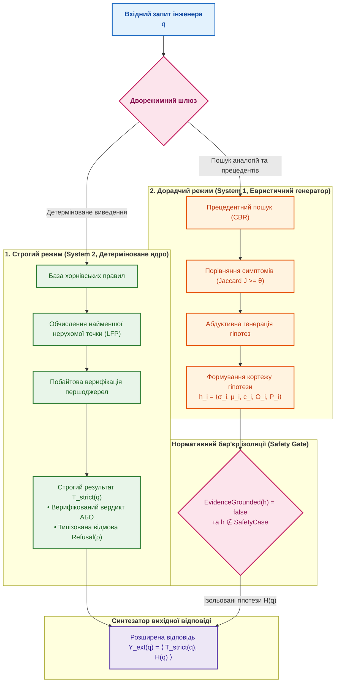
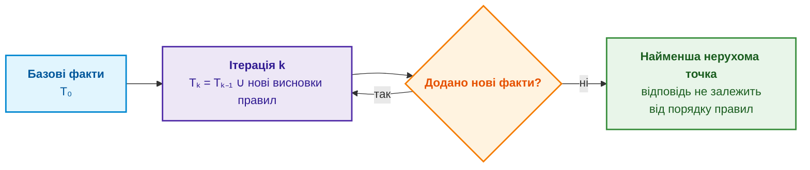
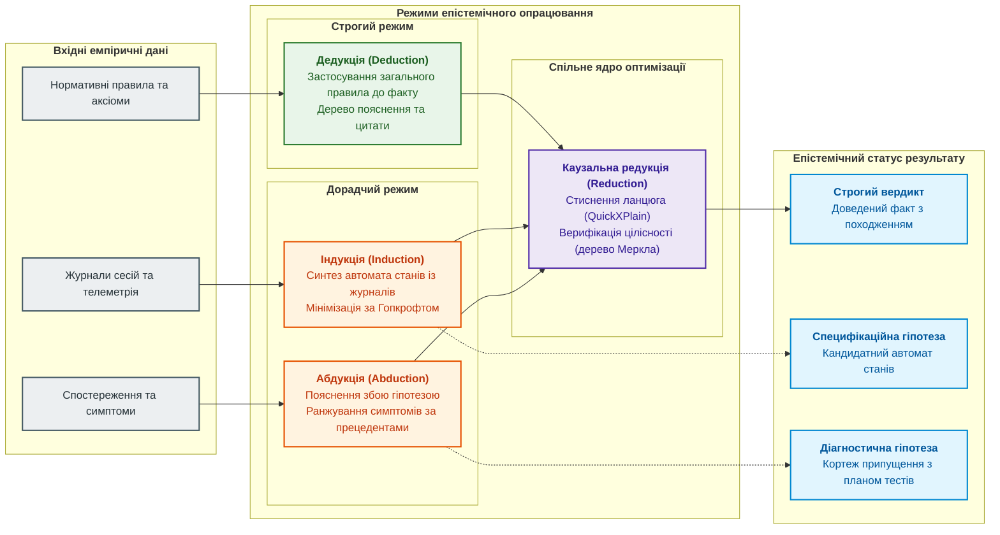
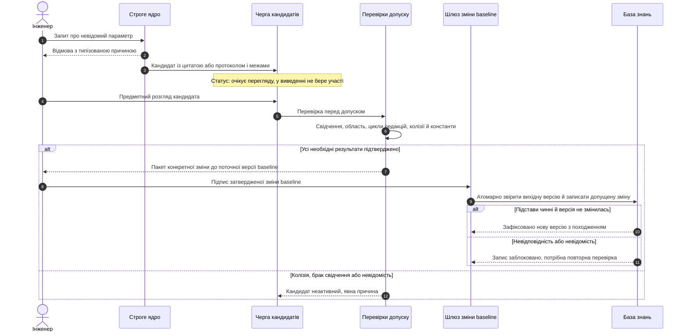
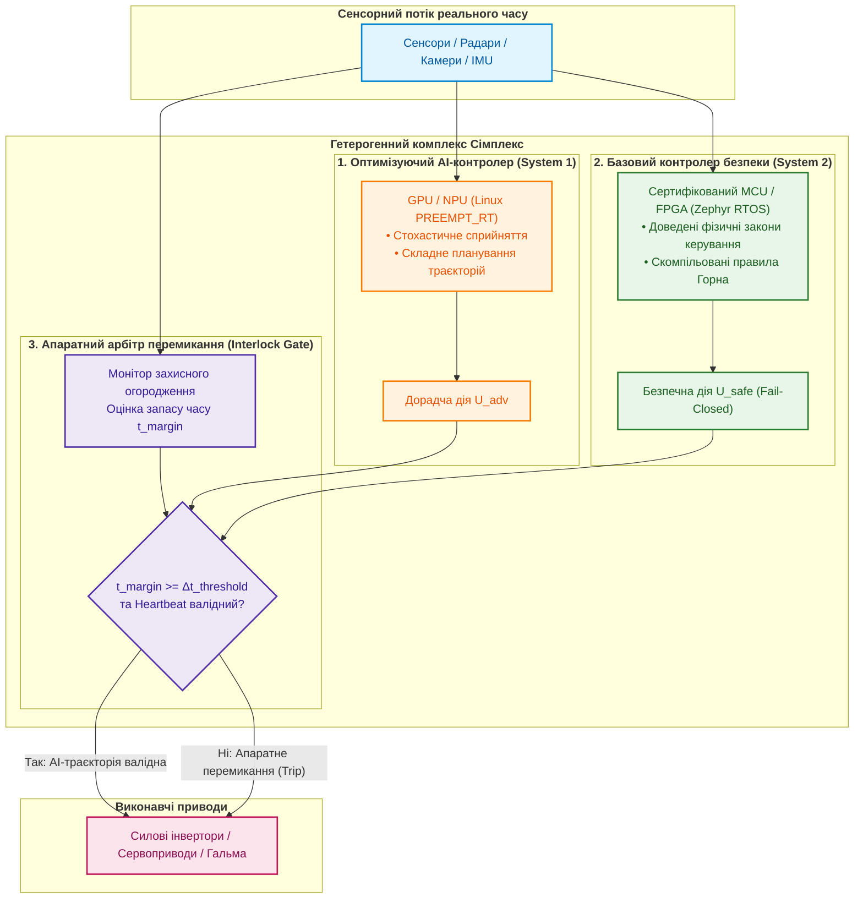
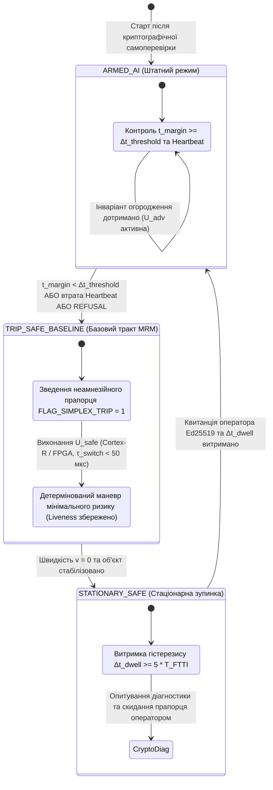

```mermaid
stateDiagram-v2
    accTitle: Конвеєр федеративного комбінаторного синтезу та ізоляції епістемічного розриву
    accDescr: Підписаний успішний дослід повертає лише кандидата. До промоції окремо потрібні перевірка свідчень і області, узгодженість з поточним baseline, фаховий перегляд, затвердження конкретної зміни й повторна звірка версії перед записом.

    state "Кандидат SYNTHESIZED" as StrictSynthesized
    state "Гіпотеза однієї типізованої прогалини" as BoundedGap

    [*] --> SearchChain: Запит вимагає міжпакетного синтезу (m >= 2)

    state SearchChain {
        [*] --> MatchSI: Зіставлення розмірностей SI та інтерфейсів
        MatchSI --> CheckIntervals: Окремий перетин для кожної величини з явними межами
        CheckIntervals --> DefeaterMining: Перевірка повного сертифіката та grounded IN
    }

    SearchChain --> StrictSynthesized: Верифіковано всі вісім умов сертифіката
    SearchChain --> BoundedGap: Бракує однієї максимальної типізованої ділянки; решту доведено
    SearchChain --> RefusalClosed: Суперечність, поза фрагментом, дефітер або результат невідомий

    state StrictSynthesized {
        [*] --> BuildVectorCustody: Формування паспорта побайтової кастодії
        BuildVectorCustody --> EmitSynthesized: Видача результату SYNTHESIZED
    }

    state BoundedGap {
        [*] --> LockProvenPart: Заморожування доведеної частини
        LockProvenPart --> GenSpec: Генерація специфікації стендового тесту
        GenSpec --> EmitBounded: Видача статусу BOUNDED_HYPOTHESIS
    }

    RefusalClosed --> [*]: Типізована відмова REFUSAL (Fail-Closed)
    StrictSynthesized --> [*]: Кандидат SYNTHESIZED; до бази лише через допуск §5

    BoundedGap --> ExperimentReview: Кандидат плану випробування
    ExperimentReview --> PhysicalBench: План і запуск дозволені за чинною політикою
    ExperimentReview --> CandidateBlocked: План або повноваження не підтверджено
    PhysicalBench --> BenchPassed: Отримано PASS-протокол
    PhysicalBench --> BenchFailed: Отримано негативний результат
    PhysicalBench --> CandidateBlocked: Помилка або результат невідомий

    BenchPassed --> CandidateReview: Створити неактивного кандидата з протоколом
    CandidateReview --> EvidenceScopeCheck: Перевірити свідчення, зміст та область
    EvidenceScopeCheck --> ConsistencyCheck: Свідчення й межі підтверджено
    EvidenceScopeCheck --> CandidateBlocked: Підстава неповна, недійсна або невідома
    ConsistencyCheck --> ExpertReview: Колізій та відкритих застосовних заперечень немає
    ConsistencyCheck --> CandidateBlocked: Нерозв'язана колізія або результат невідомий
    ExpertReview --> BaselineApproval: Фахово погоджено саме цього кандидата
    ExpertReview --> CandidateBlocked: Недостатньо підстав або перегляд не виконано
    BaselineApproval --> CommitCheck: Підписано конкретну зміну baseline
    BaselineApproval --> CandidateBlocked: Дозвіл відсутній, відкликаний або невідомий
    CommitCheck --> Promotion: Кандидат і baseline незмінні, усі підстави чинні
    CommitCheck --> CandidateReview: Версію або кандидата змінено до запису
    CommitCheck --> CandidateBlocked: Обов'язкова опора недоступна
    BenchFailed --> CandidateBlocked: Зберегти результат без запису строгого факту
    CandidateBlocked --> [*]: Кандидат неактивний, явна причина
    Promotion --> [*]: Контрольовано зафіксовано нову версію знань
```

# Глава 28. Дворежимні експертні системи: строгий висновок і дорадча гіпотеза

> **Книга:** [Архітектура доказових експертних систем](README.md) · [Частина VI: Нейро-символьні архітектури, абдукція та контроль галюцинацій](part-06-frontiers-neuro-symbolic.md)
> **Попередня глава:** [Глава 30. Спільне проєктування функціональної безпеки та кібербезпеки](ch30-safety-cybersecurity-co-engineering.md)
> **Наступна глава:** [Глава 34. Прогалини знань: реляційний пошук, абдукція та діалог уточнення](ch34-deterministic-relational-analysis-abduction-and-socratic-dialogue.md)
> **Зміст книги:** [README.md](README.md)  
> **Автор:** [Микола Федчик](about-the-author.md)  
> **Рівень складності та оптимальне вивчення:** `[L3]` Формально-математичний та архітектурний (індекс Д. Кнута `[34]`) · *Маршрут:* Треки `B/D` (дворежимні системи, архітектура Simplex та Liveness); практикум: Лабораторна робота №3 у `LABS.md`  
> **Очікувані результати:** формально відокремлювати строгий результат від дорадчих гіпотез; будувати строге ядро на правилах Горна з обчисленням найменшої нерухомої точки й стратифікованим запереченням; повертати контрприклад замість голого «ні» для кванторів над скінченними доменами; знаходити деонтичні колізії в нормативних текстах; розрізняти дедукцію, індукцію й абдукцію за Пірсом і застосовувати редукцію до першопричини; формувати гіпотези за прецедентами з критеріями переведення у факт; перетворювати відмову на кандидата для бази знань без обходу фахового перегляду; маршрутизувати запит без строгої відповіді й без достатньо схожого прецедента до уповноваженого експерта й повертати відповідь експерта як підтверджений прецедент.

## Анотація

У главі досліджено архітектурні принципи побудови дворежимних експертних систем, здатних одночасно виконувати роль суворого джерела доказів (для регуляторного аудиту та сертифікації рівня ISO 26262/DO-178C) та гнучкого дорадчого порадника (для оперативної діагностики й розслідування збоїв). Сформульовано непорушний базовий інваріант доказовості: дорадчі гіпотези маркуються як непідтверджені, мають зафіксований метод отримання й критерії перевірки та принципово виключаються зі строгого виведення й аргументу безпеки (*Safety Case*). Розглянуто математичний апарат детермінованого символьного ядра на базі правил Горна, обчислення найменшої нерухомої точки (*least fixed point*) та стратифікованого заперечення. Визначено місце епістемічної тріади Пірса (дедукція, індукція, абдукція) та каузальної редукції. Описано механізм перетворення типізованих відмов (*Refusal*) на матеріал для навчання, регламент ескалації запитів до експертів та інтеграцію отриманих висновків до бази прецедентів. Наведено програмну реалізацію дворежимної системи мовою Python та обґрунтовано гетерогенну архітектуру Сімплекс (*Simplex Architecture*) для безпечного розгортання стохастичного Edge AI під наглядом детермінованого базового контролера й апаратного арбітра із розрахунком динамічного запасу часу $`t_{\mathrm{margin}}`$.

Уявіть сертифікаційний аудит системи керування автономним шасі (ISO 26262 ASIL D) або бортової авіоніки (DO-178C). Якщо неперевірена діагностична підказка чи емпірична евристика налагоджувального стенда («ігнорувати збій датчика кута керма за просідання напруги нижче 11 В») випадково потрапить до сертифікаційного обґрунтування безпеки з [Глави 27](ch27-safety-case-gsn-synthesis.md) як верифікований факт, система отримає допуск із прихованою відмовою, що під час маневру на швидкості призведе до фатального занесення. Поведінка експертної системи в таких задачах зобов'язана бути закритою при відмові (*fail-closed*): коли суворих нормативних знань бракує, система не має права нічого вигадувати чи домальовувати.

З іншого боку, інженер, який о другій ночі на апаратно-програмному стенді HIL розслідує збій зв'язку в мережі бортових контролерів, опиняється в іншій ситуації. Йому життєво необхідна швидка підказка: «схожий збій уже фіксували на ревізії B, причиною була затримка ініціалізації трансивера на шині CAN», навіть якщо ця підказка є лише аналогією з минулого інциденту й не зафіксована в офіційному стандарті. Якщо відмовити інженерові в будь-якій підказці, повернувши сухе «дані відсутні», експертна система стає безпорадною саме тоді, коли її допомога критична. Якщо ж видати аудиторові дорадчу здогадку за доведений факт, руйнується вся доказова база сертифікації.

Ця глава відповідає на запитання: **як одна експертна система може водночас бути строгим джерелом доказів і корисним порадником, не дозволяючи пораді непомітно стати доказом?** Теза глави: **відповідь має дві частини з різним статусом. Строга частина виводиться детермінованими правилами з цитованих фактів і за нестачі знань є типізованою відмовою. Дорадча частина складається з гіпотез, кожна з яких позначена як непідтверджена, має метод отримання й критерій переведення у факт. Гіпотеза не потрапляє ні до строгого виведення, ні до аргументу безпеки, доки не пройде той самий перегляд, що й будь-який кандидат на зміну знань.**

## 1. Архітектурна дихотомія двох режимів та базовий інваріант доказовості

Фундаментальною вимогою до архітектури доказової експертної системи є чітке розмежування детермінованого виведення та евристичних припущень. Для практичного втілення цієї дихотомії система підтримує два ізольовані оперативні режими — строгий та дорадчий. У строгому режимі відповідь на запит $q$ є строгим результатом $`\mathcal{T}_{\mathrm{strict}}(q)`$: або твердження з цитатами першоджерел, або відмова $`\mathrm{Refusal}(\rho)`$ з типізованою причиною $\rho$ неповноти знань. У дорадчому режимі відповідь є впорядкованою парою:

```math
\mathcal{Y}_{\mathrm{ext}}(q)=\bigl\langle\,\mathcal{T}_{\mathrm{strict}}(q),\ \mathcal{H}(q)\,\bigr\rangle,
\qquad
\mathcal{H}(q)=\{h_1,\dots,h_k\}.
```

- Для розширеної відповіді $q$ є запитом, $`\mathcal{T}_{\mathrm{strict}}(q)`$ строгим результатом, а $`\mathcal{H}(q)`$ множиною дорадчих гіпотез;
- Кутові дужки $\langle\ ,\ \rangle$ утворюють упорядковану пару, тож строгий результат і гіпотези зберігають окремі позиції;
- $`h_1,\dots,h_k`$ є гіпотезами з номерами від 1 до $k$, а $k$ задає їхню кількість;
- $`\mathcal{Y}_{\mathrm{ext}}(q)`$ позначає всю розширену відповідь для запиту $q$.

Читається так: дорадчий режим додає гіпотези до незміненої строгої відповіді. Формула задає структуру виходу, але не надає гіпотезам доказового статусу.

Строга частина в дорадчому режимі не змінюється: дорадчий режим лише додає до неї множину гіпотез $`\mathcal{H}(q)`$. Кожна гіпотеза є кортежем із п'яти полів:

```math
h_i=\langle\,\sigma_i,\ \mu_i,\ c_i,\ \mathcal{O}_i,\ \mathcal{P}_i\,\rangle.
```

- У кортежі $`h_i`$ індекс $i$ є номером гіпотези, а кутові дужки задають впорядкований запис;
- $`\sigma_i`$ є змістом гіпотези, $`\mu_i`$ методом отримання, а $`c_i`$ оцінкою впевненості;
- $`\mathcal{O}_i`$ містить спостереження на підтримку гіпотези, а $`\mathcal{P}_i`$ критерії її перевірки й переходу до факту;
- Поля йдуть у порядку: зміст, метод, оцінка, спостереження, критерії.

Кортеж зберігає не лише текст припущення, а й спосіб його отримання та потрібні перевірки. Оцінка $`c_i`$ не є автоматично каліброваною ймовірністю.

Головний інваріант формулюється так:

```math
\forall h\in\mathcal{H}(q):\quad \mathrm{EvidenceGrounded}(h)=\mathrm{false}\ \land\ h\notin\mathrm{SafetyCase}.
```

- Інваріант поширюється на кожну гіпотезу $h$ у множині $`\mathcal{H}(q)`$ для запиту $q$;
- $\forall$ означає «для кожної», а $\in$ означає належність до множини;
- $`\mathrm{EvidenceGrounded}(h)=\mathrm{false}`$ означає, що гіпотеза не має підтвердженої доказової основи;
- $\land$ означає логічне «і», а $`h\notin\mathrm{SafetyCase}`$ забороняє включати гіпотезу до аргументу безпеки.

Отже, кожна дорадча гіпотеза лишається непідтвердженою й виключеною з аргументу безпеки. Це правило задає статус даних, а не числову оцінку правдоподібності.

Гіпотеза за визначенням не спирається на перевірене джерело й не потрапляє до обґрунтування безпеки з [Глави 27](ch27-safety-case-gsn-synthesis.md). Шлях гіпотези до бази знань проходить через цикл кандидатів із [Глави 26](ch26-continual-learning.md): перевірку критеріїв $`\mathcal{P}_i`$, фаховий перегляд і правило допуску. Інваріант має сенс лише тоді, коли строге ядро справді детерміноване й завершується, тому спершу про строге ядро.

Архітектурну дихотомію взаємодії двох режимів та ізолюючий бар'єр безпеки між ними наведено на діаграмі нижче.



> [!NOTE]
> **Три інваріанти архітектурної дихотомії двох режимів за моделлю автора**
> 1. Ізоляція строгого ядра від евристик: вихідний результат формується як пара $`\mathcal{Y}_{\mathrm{ext}}(q)=\bigl\langle\,\mathcal{T}_{\mathrm{strict}}(q),\ \mathcal{H}(q)\,\bigr\rangle`$, де строга компонента детермінована й автономна.
> 2. П'ятикомпонентний кортеж верифікації гіпотези: кожне евристичне припущення фіксує зміст, метод генерації, впевненість, емпіричні спостереження та критерії фальсифікації.
> 3. Нормативний бар'єр безпеки: повна заборона використання недоведених дорадчих гіпотез у сертифікаційних обґрунтуваннях GSN ($`\mathrm{EvidenceGrounded}(h)=\mathrm{false} \land h \notin \mathrm{SafetyCase}`$).
> *Керування рантаймом / Інженерний інваріант:* Якщо запит не має детермінованого доказу, система зобов'язана генерувати типізовану відмову у строгому ядрі перед запуском дорадчого генератора.

## 2. Детерміноване символьне ядро: правила Горна та найменша нерухома точка

Процедурні правила у вигляді вкладених умов у коді важко перевіряти: порядок виконання впливає на результат, а взаємні виклики тисяч правил можуть зациклитися. Строге ядро тому будують декларативно, мовою Datalog. Серж Абітбуль, Річард Халл і Віктор Віану в підручнику з основ баз даних описують Datalog як мову правил над скінченною множиною фактів без функціональних символів [[1]](#src-1). Кожне правило є клаузою Горна:

```math
H(\vec X)\leftarrow B_1(\vec X_1)\land\dots\land B_m(\vec X_m)\land\neg N_1(\vec Y_1)\land\dots\land\neg N_k(\vec Y_k).
```

- У правилі Горна $H$ є головою, тобто висновком правила, а $\vec X$ набором змінних голови;
- $`B_i(\vec X_i)`$ є позитивними атомами тіла, $m$ задає їхню кількість, а $\land$ вимагає істинності всіх умов;
- $\leftarrow$ читається «вивести голову, якщо виконується тіло»;
- $`N_j(\vec Y_j)`$ є атомами заперечення за відсутністю, $k$ задає їхню кількість, а $\neg$ означає, що відповідний факт не відомий;
- Індекси $i$ та $j$ нумерують атоми, а $\dots$ позначає продовження послідовності умов до меж $m$ і $k$;
- $`\vec X_i`$ і $`\vec Y_j`$ є наборами змінних у відповідних атомах; змінні правила мають загальну область значень.

Читається так: правило виводить $H$, коли всі позитивні умови істинні, а жоден заперечений факт не відомий. Для правил із запереченням потрібна стратифікація, інакше порядок обчислення може змінити результат.

Обчислення починають із базових фактів і застосовують усі правила, доки нові факти перестають з'являтися. Схема показує цей процес.



Для правил без заперечення результат є найменшою нерухомою точкою: найменшою множиною фактів, замкненою відносно всіх правил. Оскільки нові константи не з'являються, кількість можливих фактів скінченна, тому обчислення завершується, а для фіксованого набору правил потребує поліноміального від кількості фактів часу [[1]](#src-1). Заперечення порушує монотонність: факт, виведений із «$N$ не відомо», може стати хибним, коли $N$ виведуть пізніше. Стратифікація розв'язує проблему: правила ділять на шари так, щоб заперечуваний предикат повністю обчислювався в нижчому шарі до того, як його заперечують [[1]](#src-1). Програми з рекурсією через заперечення стратифікації не мають, і строге ядро їх відхиляє на етапі завантаження бази правил.

Строге ядро повертає не лише «так» чи «ні». **Квантор загальності над скінченним доменом** перевіряє твердження на кшталт «для кожної команди протоколу в базі знань є задокументована відповідь»:

```math
\forall c\in\mathrm{Commands}:\ \exists s\ \ \mathrm{DocumentedReply}(c,s).
```

- Для кожної команди $c$ з множини $`\mathrm{Commands}`$ має існувати значення $s$;
- $\forall$ означає «для кожної», $\exists$ означає «існує», а $\in$ належність до множини;
- $`\mathrm{DocumentedReply}(c,s)`$ є предикатом «для команди $c$ задокументовано відповідь $s$».

Оскільки домен команд скінченний, хибне твердження дає конкретну команду без задокументованої відповіді. Висновок стосується лише команд із $`\mathrm{Commands}`$.

Якщо твердження хибне, ядро повертає контрприклад, тобто конкретну команду без відповіді, а не логічний нуль. Контрприклад одразу показує, де база знань неповна.

**Деонтичний контроль** перевіряє нормативні тексти на колізії модальностей. Георг Генрік фон Врігт у праці, з якої почалася сучасна деонтична логіка, розглядав зобов'язання, заборону й дозвіл як модальні оператори над діями [[2]](#src-2). Позначимо зобов'язання через $`\mathsf{O}`$ (`MUST`), а заборону через $`\mathsf{F}`$ (`MUST NOT`). Тоді одночасне зобов'язання й заборона тієї самої дії в тій самій області застосування є колізією:

```math
\mathsf{O}(a,s)\land\mathsf{F}(a,s)\ \Rightarrow\ \bot .
```

де:

- $`\mathsf{O}(a,s)`$ означає зобов'язання виконати дію $a$ в області застосування $s$;
- $`\mathsf{F}(a,s)`$ означає заборону тієї самої дії в тій самій області;
- $\land$ означає одночасну наявність обох норм, $\Rightarrow$ читається «тоді випливає», а $\bot$ є символом суперечності.

Формула виявляє колізію, коли дія водночас обов'язкова й заборонена в тому самому контексті. Вона не визначає, яку норму скасувати.

Знайдена колізія не розв'язується автоматично: ядро блокує допуск суперечливої редакції правил і передає колізію власникові нормативного документа. Строге ядро забезпечує відповідь, яку можна відтворити й перевірити. Проте інженерні задачі потребують не лише дедукції, і наступний розділ розділяє форми міркування, які працюють у двох режимах.

> [!NOTE]
> **Три механізми верифікації детермінованого символьного ядра за моделлю автора**
> 1. Обчислення найменшої нерухомої точки: монотонне застосування правил Горна гарантує незалежність результату від порядку виконання та завершення за поліноміальний час.
> 2. Стратифікована обробка заперечень: заборона рекурсії через заперечення унеможливлює неоднозначність та зациклення бази правил.
> 3. Деонтичний контроль та генерація контрприкладів: виявлення взаємно виключних модальностей $`\mathsf{O}(a,s) \land \mathsf{F}(a,s) \Rightarrow \bot`$ із формуванням точного діагностичного контрприкладу.
> *Керування рантаймом / Інженерний інваріант:* Автоматичне блокування завантаження бази знань при виявленні нестратифікованих правил або нерозв'язаних деонтичних колізій.

## 3. Епістемічна тріада Пірса: дедукція, індукція, абдукція та каузальна редукція

Чарльз Сандерс Пірс у статті 1878 року «Дедукція, індукція і гіпотеза» розрізнив три форми висновку [[3]](#src-3). Дедукція застосовує загальне правило до випадку й отримує результат. Індукція з випадків і результатів узагальнює правило. Гіпотеза пояснює дивний результат припущенням, що спостережуваний випадок підпадає під певне правило, і Пірс зауважив, що як загальне правило гіпотеза є слабким видом аргументу. Сучасна література розглядає цю форму як абдукцію. Ігор Довен у Стенфордській енциклопедії філософії підкреслює, що в Пірса абдукція означає прийняття гіпотези не як істинної чи підтвердженої, а як гідного кандидата для подальшої перевірки [[4]](#src-4). Саме такий статус має дорадча гіпотеза експертної системи. Для дворежимної експертної системи класифікація Пірса визначає статус результату.

**Дедукція працює в строгому режимі.** Зворотне виведення від цілі будує дерево пояснення, у якому кожен вузол є фактом із цитатою або висновком правила з посиланням на посилки, як описує [Глава 20](ch20-explanation-engine.md). Результат дедукції успадковує статус посилок: з цитованих фактів виходить строгий висновок.

**Індукція працює в дорадчому режимі.** З журналів сесій протоколу можна синтезувати автомат скінченних станів, що узагальнює спостережені переходи. Такий автомат є гіпотезою про специфікацію, а не специфікацією: журнали показують лише ті послідовності, які траплялися. Щоб порівняти синтезований автомат з автоматом зі стандарту, обидва мінімізують, наприклад алгоритмом Джона Гопкрофта, який за час $O(n\log n)$ об'єднує еквівалентні стани [[5]](#src-5):

```math
s_1\sim s_2\iff\forall w\in\Sigma^{*}:\ \bigl(\hat\delta(s_1,w)\in F\iff\hat\delta(s_2,w)\in F\bigr).
```

- Для автоматів $`s_1`$ і $`s_2`$ є станами, а $\sim$ позначає їхню еквівалентність;
- $`\forall w\in\Sigma^*`$ перевіряє кожний скінченний рядок команд $w$ над алфавітом $\Sigma$; зірочка означає всі скінченні рядки, зокрема порожній;
- $\hat\delta(s,w)$ є розширеною функцією переходів, яка повертає стан після подання рядка $w$;
- $F$ є множиною приймальних станів, $\in$ означає належність до неї, а $\iff$ означає «тоді й лише тоді»;
- Внутрішнє $\iff$ вимагає, щоб обидва стани приймали або відхиляли кожний рядок команд однаково.

Отже, два стани еквівалентні, якщо з них приймається та сама мова. Порівняння має сенс для автоматів над однаковим алфавітом і залежить від правильно заданих переходів та приймальних станів.

Розбіжність мінімальних автоматів указує на перехід, який журнали бачили, а стандарт не дозволяє, або навпаки.

**Абдукція працює в дорадчому режимі.** Пояснення збою найімовірнішою причиною є гіпотезою, навіть коли ймовірність висока; [Глава 24](ch24-system-diagnosis.md) показує, як такі гіпотези ранжувати й перевіряти.

**Редукція не належить до тріади Пірса, але потрібна обом режимам.** Редукція стискає довгий ланцюг до суттєвого. Для діагностики сесії SMTP редукція зводить помилку на кроці DATA до однієї невиконаної передумови. Стандарт RFC 5321 прямо дозволяє серверові відповісти кодом 503 («команда поза послідовністю») або 554 («немає дійсних отримувачів») на команду DATA, якщо перед нею не було прийнятої команди MAIL або RCPT [[6]](#src-6). Тому код 503 на кроці DATA редукується до строгого висновку «не було прийнятої команди RCPT» з цитатою стандарту. Мінімальну множину суперечливих обмежень знаходить алгоритм QuickXPlain з [Глави 20](ch20-explanation-engine.md), а цілісність ланцюга доведення фіксує дерево Меркла з [Глави 27](ch27-safety-case-gsn-synthesis.md).

Співвідношення форм умовиводу епістемічної тріади Пірса та їхній розподіл між оперативними режимами експертної системи відображено на схемі.



## 4. Дорадчий режим: прецедентні міркування та генерація робочих гіпотез

Найпрактичнішим джерелом дорадчих гіпотез є пам'ять розв'язаних випадків. Міркування за прецедентами (*Case-Based Reasoning*, CBR) за Агнаром Аамодтом та Енріком Плазою повторює чотири кроки: знайти схожий випадок, повторно використати рішення, переглянути рішення з урахуванням відмінностей і зберегти новий досвід [[7]](#src-7). Схожість наборів симптомів зручно міряти коефіцієнтом Жаккара, який Поль Жаккар запропонував для порівняння видового складу рослинності [[8]](#src-8):

```math
J(S_{\mathrm{in}},S_{\mathrm{case}})=\frac{|S_{\mathrm{in}}\cap S_{\mathrm{case}}|}{|S_{\mathrm{in}}\cup S_{\mathrm{case}}|}.
```

- Коефіцієнт $J$ порівнює множину симптомів запиту $`S_{\mathrm{in}}`$ із множиною симптомів прецедента $`S_{\mathrm{case}}`$;
- $\cap$ є перетином множин, $\cup$ їх об'єднанням, а $`|\cdot|`$ позначає кількість елементів;
- Чисельник рахує спільні симптоми, знаменник усі різні симптоми в обох множинах.

Для умовного прикладу $`S_{\mathrm{in}}=\{A,B\}`$ і $`S_{\mathrm{case}}=\{B,C\}`$ маємо $`J=1/3\approx0{,}33`$. Для непорожнього об'єднання коефіцієнт від 0 до 1; коли обидві множини порожні, знаменник нульовий і значення не визначене. Коефіцієнт вимірює схожість, а не ймовірність правильності гіпотези.

Якщо $J$ перевищує поріг $\theta$, прецедент стає гіпотезою з методом «аналогія з прецедентом», оцінкою $c=J$ і критерієм переведення: відтворити умови прецедента й підтвердити причину. Поріг $\theta$ не задають на око: поріг калібрують на розмічених випадках, як описує [Глава 25](ch25-how-expert-systems-learn.md), бо коефіцієнт Жаккара міряє схожість, а не ймовірність, що гіпотеза правильна.

Типовий приклад: інженер повідомляє про тайм-аут з'єднання на порту 25. Строге ядро не має факту про причину й відмовляє. Дорадчий режим знаходить прецедент, у якому провайдер блокував вихідний порт 25, і пропонує дію з того прецедента: надсилати повідомлення через порт подання 587, який стандарт RFC 6409 визначає для подання повідомлень, залишаючи порт 25 для пересилання між серверами [[9]](#src-9). Посилання на RFC 6409 підтверджує, що порт 587 існує й призначений для подання, але не підтверджує, що саме блокування порту спричинило поточний тайм-аут. Тому вся рекомендація лишається гіпотезою.

> [!NOTE]
> **Чотири принципи функціонування дорадчого режиму та прецедентного пошуку за моделлю автора**
> 1. Епістемічне розмежування за Пірсом: трактування прецедентних висновків суто як абдуктивних гіпотез, що вимагають емпіричної верифікації.
> 2. Метрична оцінка близькості симптомів: обчислення коефіцієнта Жаккара $`J(S_{\mathrm{in}}, S_{\mathrm{case}})`$ над простором зафіксованих спостережень.
> 3. Відкаліброване порогове відсікання: трансформація прецеденту в дорадчу гіпотезу лише за умови перевищення емпіричного порогу $J \ge \theta$.
> 4. Обов'язкова прив'язка критеріїв перевірки: кожна згенерована гіпотеза постачається разом із планом випробувань для доведення її чинності.
> *Керування рантаймом / Інженерний інваріант:* Посилання на авторитетні стандарти підтверджує існування сутності, але не доводить її причинний зв'язок із поточним інцидентом.

## 5. Типізована відмова (Refusal) як джерело нових знань

Відмова строгого ядра виявляє прогалину, але не надає права автоматично заповнити її новим фактом. Знайдена цитата або успішний стендовий дослід створюють лише кандидата з точним походженням та областю застосування. Без перевірки змісту, узгодженості й затвердження зміни baseline навіть справжній підписаний протокол може ввести до строгого ядра хибне узагальнення або норму, що суперечить чинній. Авторський шлях від відмови до знання розділяє ці події; для текстових опор застосовуються [контракт матеріальних атомів глави 19](ch19-from-question-to-evidence.md#51-повнота-привязки-та-критерії-валідності) та незмінні артефакти досліду.



Перевірка узгодженості перед допуском шукає три класи порушень. **Цикли заміни редакцій** виникають, коли документ A скасовує документ B, а B скасовує A. **Деонтичні колізії** виникають, коли та сама дія в тій самій області водночас обов'язкова й заборонена. **Суперечливі константи** виникають, коли одна редакція стандарту має два різні значення того самого параметра, наприклад два порти за замовчуванням. Розв'язаний інцидент після підтвердження причини зберігають як новий прецедент, і цикл замикається: відмова породжує кандидата, перевірений кандидат стає фактом, перевірений випадок стає прецедентом для майбутніх гіпотез.

До запису кандидата потрібні п'ять окремих підтверджень і чинний зв'язок із версією:

| Передумова | Що саме перевіряється | Що не є заміною |
|---|---|---|
| Свідчення | Ідентичність і цілісність джерела або протоколу, версія плану, фактичний результат і повноваження підписанта | Сам рядок `PASS` чи математично правильний підпис невідомого ключа |
| Область і зміст | Твердження випливає зі свідчення, одиниці, умови, виріб і конфігурація збігаються; одного досліду не узагальнено на всі режими | Відсутність помилок JSON або близькість прецедента |
| Узгодженість | Визначені вище колізії та застосовні заперечення перевірено відносно поточного baseline | Старий успішний звіт або підпис протоколу досліду |
| Фаховий перегляд | Уповноважений експерт розглянув достатність свідчень і межі саме цього кандидата | Підпис виконавця тесту як автоматичне погодження знання |
| Затвердження baseline | Уповноваженою людиною підписано конкретну зміну версії знань із посиланням на кандидата й вихідний baseline | Разова кнопка «схвалити» без визначених об'єкта та повноважень |

Усі результати належать тому самому кандидатові, свідченням, профілю й вихідній версії baseline. За зміни будь-якого з них результати переоцінюються; перед записом версія звіряється атомарно з фіксацією зміни або застосовується еквівалентний перевірений протокол. Невідомість, помилка чи тайм-аут будь-якої обов'язкової перевірки залишає кандидата неактивним із причиною. Емпіричний факт може бути допущений лише у підтвердженій області; дослід не має повноважень самостійно змінити чинну нормативну вимогу.

Наприклад, підписаний `PASS` для температури 25 °C не встановлює працездатності при −40 °C; це різні області. Якщо кандидат обмежено 25 °C, але він суперечить чинній нормі в цій самій області, запис також блокується. Після усунення колізії потрібні чинні результати й затвердження зміни, а не повторне використання старого дозволу. Людський підпис накладається на введення версії в baseline; кожна подальша відповідь використовує свої доказові перевірки, не новий підпис на застосування факту.

### 5.1. Ескалація до експерта та замкнений цикл поповнення знань

Цикл від відмови до факту працює, коли відповідь існує в першоджерелах. Частина запитань не має відповіді ні в першоджерелах, ні в пам'яті прецедентів: наприклад, рішення, яке знає лише інженер, що роками обслуговує конкретний стенд, або тлумачення норми, яке має право дати лише уповноважена особа. У такому разі відмова строгого ядра має стати адресованим запитом до людини з правом відповісти, а відповідь людини має повернутися до експертної системи як підтверджений прецедент.

Кельтум Бенлахарш і співавтори описали такий цикл для Алжирського дому фетв (*Algerian Fatawa House*), якому бракувало муфтіїв, тобто сертифікованих знавців ісламського права, щоб вчасно відповідати на щоденні запити громадян [[10]](#src-10). Система шукає схожі випадки міркуванням за прецедентами, яке спирається на онтологію домену ісламських фінансів і банківських операцій. Якщо в базі вже є відповідь на схожий запит, система одразу повертає цю відповідь. Інакше система автоматично формулює запит до муфтія, який або підтверджує згенеровану системою відповідь, або дає нову, і база випадків поповнюється. Автори перевірили систему лише в одному домені й оцінили результати якісно, тому робота дає архітектурний шаблон, а не кількісні показники.

Перенесення шаблону на дворежимну експертну систему потребує однієї зміни. У системі для фетв знайдена відповідь надходить користувачеві одразу, а в дворежимній експертній системі відповідь із прецедента лишається гіпотезою навіть тоді, коли прецедент підтвердив експерт: схожість ознак не доводить, що умови нового випадку збігаються з умовами прецедента. Маршрутизатор запиту після строгого ядра обирає один із трьох шляхів:

```math
\mathrm{route}(q)=
\begin{cases}
\text{строга відповідь}, & \text{якщо } \mathrm{Strict}(q)\neq\bot,\\
\text{гіпотеза з прецедента } c^{*}, & \text{якщо } \mathrm{Strict}(q)=\bot\ \land\ J(q,c^{*})\ge\theta,\\
\text{запит до експерта}, & \text{інакше},
\end{cases}
\qquad
c^{*}=\arg\max_{c\in C_{\mathrm{val}}} J(q,c).
```

Позначення маршрутизатора:

- $q$ є запитом, зведеним до множини ознак, як у коефіцієнті Жаккара вище;
- $`\mathrm{Strict}(q)`$ є результатом строгого ядра, а $\bot$ позначає типізовану відмову;
- $`C_{\mathrm{val}}`$ є множиною прецедентів, які підтвердив уповноважений експерт, а $`c^{*}`$ є найсхожішим прецедентом із цієї множини;
- $`J(q,c^{*})`$ є коефіцієнтом Жаккара між ознаками запиту й прецедента, а $\theta$ є відкаліброваним порогом;
- $\arg\max$ повертає прецедент із найбільшим коефіцієнтом; якщо множина $`C_{\mathrm{val}}`$ порожня, маршрутизатор одразу обирає запит до експерта.

Маршрут визначає лише дію за замовчуванням: користувач, якому гіпотези недостатньо для рішення, може сам надіслати запит експертові. Запит до експерта формує експертна система, а не користувач, тому запит містить усе, що потрібно для рішення без додаткового пошуку. Таблиця перелічує поля запиту.

| Поле запиту | Зміст | Що поле дає експертові |
|---|---|---|
| Структурований запит | ознаки, параметри й область застосування | однозначне формулювання запитання |
| Причина відмови | тип відмови й відсутній факт або правило | місце прогалини в базі знань |
| Найближчі прецеденти | ідентифікатори, коефіцієнти Жаккара й відмінні ознаки | пояснення, чому наявних прецедентів недостатньо |
| Чернетка відповіді | дорадча гіпотеза з критерієм переведення | можливість підтвердити чи виправити чернетку замість нової відповіді з нуля |
| Цитати першоджерел | документ, редакція й діапазон цитати | перевірку підґрунтя без власного пошуку |

Відповідь експерта повертається двома шляхами з різним статусом. Підтверджена чи нова відповідь стає прецедентом у $`C_{\mathrm{val}}`$ з ідентифікатором експерта, датою, областю застосування й умовами, які додав експерт. Якщо відповідь формулює загальне правило з посиланням на першоджерело, експертна система додатково створює кандидата на факт, і кандидат проходить той самий перегляд і ту саму перевірку узгодженості, що й на діаграмі вище. Підпис експерта не звільняє кандидата від перевірки на цикли заміни редакцій, деонтичні колізії й суперечливі константи.

Приклад продовжує історію з тайм-аутом. Інженер повідомляє про тайм-аут на порту 25 у новій лабораторній мережі. Строге ядро відмовляє, а найсхожіший підтверджений прецедент має коефіцієнт Жаккара 0,33, що нижче за поріг 0,4. Маршрутизатор надсилає запит адміністраторові поштової інфраструктури з чернеткою «перевірити, чи провайдер блокує вихідний порт 25». Адміністратор підтверджує чернетку й додає умову «для клієнтських підключень без статичної мережевої адреси». Наступний схожий запит отримує гіпотезу з посиланням на підтверджений прецедент без нової ескалації. Строге ядро й далі відмовляє на такий запит, доки адміністратор не додасть цитату з умов обслуговування провайдера як першоджерело для кандидата на факт і кандидат не пройде перегляд.

Межа шаблону полягає в навантаженні на експертів. Час уповноваженого експерта є найдефіцитнішим ресурсом, саме через нестачу муфтіїв і з'явилася система для фетв. Тому частку відмов, які дійшли до експертів, вимірюють постійно: зростання множини $`C_{\mathrm{val}}`$ має знижувати частку ескалацій, а частка чернеток, які експерт відхилив, показує якість дорадчого режиму. Підтверджені прецеденти також старіють: коли змінюється редакція першоджерела, на яке посилається прецедент, прецедент повертається на перегляд так само, як застарілий факт у [Главі 15](ch15-knowledge-extraction-and-kb-construction.md).

> [!NOTE]
> **Три рівні маршрутизації та ескалації знань за моделлю автора**
> 1. Строгий детермінований висновок: пріоритетне повернення доведеного результату при $`\mathrm{Strict}(q) \neq \bot`$.
> 2. Дорадча екстраполяція прецедентів: автоматичне формування гіпотези на базі валідованого пулу $`C_{\mathrm{val}}`$ при $`J(q, c^*) \ge \theta`$.
> 3. Керована ескалація до експерта: генерація структурованого пакета запиту з чернеткою та контекстом при вичерпанні автоматичних евристик.
> *Керування рантаймом / Інженерний інваріант:* Відповідь уповноваженого експерта поповнює базу прецедентів, проте її перетворення на факт бази знань вимагає проходження повного аудиту цілісності.

## 6. Програмна верифікація: реалізація дворежимного рушія мовою Python

Навчальний Python-приклад показує окремі механізми дворежимного рушія, не повну реалізацію всіх контрактів глави. Ядро виводить наслідки двох правил Горна й повертає посилання на джерела; прецедентний пошук і запит до експерта спрощені. Для запису первинного або експериментального факту `approve` тепер вимагає явного пакета п'яти підтверджених перевірок і збігу точних копій кандидата та вихідної бази знань. Без пакета, за колізії або зміни версії база не змінюється. Потрібна лише стандартна бібліотека Python 3.10+.

Прапорці `evidence`, `scope`, `consistency`, `expert_review` і `baseline_approval` у демонстрації задаються синтетичним оракулом. Код споживає результати, але не перевіряє справжності підписів, повноважень, повноти реального експертного запиту або відповідності досліду твердженню; зовнішній JSON чи відповідь LLM не є довіреним пакетом. Поле `review["baseline"]` є копією словника `known`, не повним маніфестом правил, політик і версій джерел. Це модель прив'язки в одному потоці, не криптографічний чи атомарний розподілений запис. Підтвердження прецеденту за інцидентом лишається передумовою виклику, не реалізованою тут процедурою перевірки експерта. Дефект запуску генератора за вже наявної строгої відповіді окремо не виправлено.

<details>
<summary>Приклад мовою Python: строгий, дорадчий і експертний маршрути</summary>

```python
"""Дворежимна експертна система в мініатюрі: строгий вивід із цитатами й дорадчі гіпотези.

Лише стандартна бібліотека Python 3.10+.
"""
import copy
import itertools


FACTS = {  # (суб'єкт, відношення, значення) -> цитата першоджерела
    ("SMTP", "max_line_octets", "1000"): "RFC 5321, 4.5.3.1.6",
    ("MAIL", "precedes", "RCPT"): "RFC 5321, 3.3",
    ("RCPT", "precedes", "DATA"): "RFC 5321, 3.3",
    ("HELO", "documented_reply", "250"): "RFC 5321, 4.3.2",
    ("MAIL", "documented_reply", "250"): "RFC 5321, 4.3.2",
    ("RCPT", "documented_reply", "250"): "RFC 5321, 4.3.2",
    ("DATA", "documented_reply", "354"): "RFC 5321, 4.3.2",
}
RULES = [  # Horn-правила: голова <- тіло; змінні пишуть великими літерами
    (("X", "must_precede", "Y"), [("X", "precedes", "Y")]),
    (("X", "must_precede", "Z"), [("X", "precedes", "Y"), ("Y", "must_precede", "Z")]),
]
CASES = [  # підтверджені прецеденти: симптоми, причина, дія
    ({"timeout", "port-25", "connect", "home-network"}, "провайдер блокує вихідний порт 25",
     "надсилати через порт подання 587 (RFC 6409)"),
    ({"503", "data", "sequence"}, "DATA без прийнятої команди RCPT", "перевірити відповідь на RCPT"),
]
NORMS = [("MUST", "use-tls", "submission"), ("MUST NOT", "use-tls", "submission"), ("MUST", "use-tls", "relay")]


def is_var(term):
    return term.isupper() and len(term) == 1


def match(pattern, fact, binding):
    binding = dict(binding)
    for p, f in zip(pattern, fact):
        if is_var(p):
            if binding.setdefault(p, f) != f:
                return None
        elif p != f:
            return None
    return binding


def solve(body, known, binding=None):
    if not body:
        yield binding or {}
        return
    for fact in list(known):
        b = match(body[0], fact, binding or {})
        if b is not None:
            for rest in solve(body[1:], known, b):
                yield rest


def least_fixed_point(facts, rules):
    known = {f: ("аксіома", [src]) for f, src in facts.items()}
    rounds = 0
    while True:
        rounds += 1
        new = {}
        for head, body in rules:
            for b in solve(body, known):
                fact = tuple(b.get(t, t) for t in head)
                if fact not in known and fact not in new:
                    premises = [tuple(b.get(t, t) for t in atom) for atom in body]
                    new[fact] = ("правило", sorted({c for p in premises for c in known[p][1]}))
        if not new:
            return known, rounds
        known.update(new)


def strict(known, subject, relation):
    hits = [(f, why) for f, why in known.items() if f[0] == subject and f[1] == relation]
    if not hits:
        return {"kind": "refusal", "reason": "немає підтвердженого факту"}
    return {"kind": "answer", "values": [(f[2], why[1]) for f, why in hits]}


def jaccard(a, b):
    union = a | b
    return len(a & b) / len(union) if union else None  # порожні множини не порівнюють


def extended(known, subject, relation, symptoms, theta=0.4):
    answer = strict(known, subject, relation)
    scored = [(jaccard(symptoms, s), cause, action) for s, cause, action in CASES]
    scored = [item for item in scored if item[0] is not None]
    hypotheses = [{"cause": cause, "action": action, "jaccard": round(j, 2),
                   "evidence_grounded": False,
                   "promote_if": "підтвердити причину; кандидат окремо проходить допуск до baseline"}
                  for j, cause, action in scored if j >= theta]
    route = "strict" if answer["kind"] == "answer" else "advisory" if hypotheses else "expert"
    reply = {"strict": answer, "hypotheses": hypotheses, "route": route}
    if route == "expert":
        best = max(scored, default=(0.0, None, None))
        reply["expert_request"] = {"query": (subject, relation, sorted(symptoms)),
                                   "refusal": answer["reason"],
                                   "nearest_case": best[1], "jaccard": round(best[0], 2)}
    return reply


PROMOTION_CHECKS = ("evidence", "scope", "consistency", "expert_review", "baseline_approval")


def approve(known, candidate, review=None):
    if not isinstance(candidate, dict) or "source_kind" not in candidate:
        return "PROMOTION_BLOCKED: invalid_candidate"
    if candidate["source_kind"] == "incident":
        CASES.append((candidate["symptoms"], candidate["value"], candidate["action"]))
        return "підтверджений прецедент"
    if candidate["source_kind"] not in ("primary", "experiment"):
        return "PROMOTION_BLOCKED: unsupported_source_kind"
    fields = ("subject", "relation", "value", "source", "scope")
    if any(not isinstance(candidate.get(k), str) or not candidate[k].strip() for k in fields):
        return "PROMOTION_BLOCKED: invalid_candidate"
    if not isinstance(review, dict) or set(review) != {"candidate", "baseline", "checks"}:
        return "PROMOTION_BLOCKED: review_required"
    if review["candidate"] != candidate:
        return "PROMOTION_BLOCKED: candidate_changed"
    if review["baseline"] != known:
        return "PROMOTION_BLOCKED: baseline_changed"
    checks = review["checks"]
    if not isinstance(checks, dict) or set(checks) != set(PROMOTION_CHECKS):
        return "PROMOTION_BLOCKED: invalid_checks"
    failed = [name for name in PROMOTION_CHECKS if checks[name] is not True]
    if failed:
        return "PROMOTION_BLOCKED: " + ", ".join(failed)
    subject = f"{candidate['subject']}@{candidate['scope']}"
    known[(subject, candidate["relation"], candidate["value"])] = ("схвалено фахівцем", [candidate["source"]])
    return f"факт з областю {candidate['scope']}"


def test_promotion(known):
    candidate = {"subject": "fixture", "relation": "result", "value": "ok",
                 "source": "synthetic EXP-1", "source_kind": "experiment", "scope": "25C"}
    for states in itertools.product((True, False, None), repeat=len(PROMOTION_CHECKS)):
        local = copy.deepcopy(known)
        review = {"candidate": copy.deepcopy(candidate), "baseline": copy.deepcopy(local),
                  "checks": dict(zip(PROMOTION_CHECKS, states))}
        result = approve(local, candidate, review)
        allowed = all(state is True for state in states)
        assert result.startswith("факт з областю") == allowed
        assert (local != known) == allowed
    local = copy.deepcopy(known)
    review = {"candidate": copy.deepcopy(candidate), "baseline": copy.deepcopy(local),
              "checks": dict.fromkeys(PROMOTION_CHECKS, True)}
    assert approve(local, candidate).startswith("PROMOTION_BLOCKED")
    changed = {**candidate, "scope": "-40C"}
    assert approve(local, changed, review) == "PROMOTION_BLOCKED: candidate_changed"
    local[("new", "baseline", "entry")] = ("аксіома", ["synthetic"])
    before = copy.deepcopy(local)
    assert approve(local, candidate, review) == "PROMOTION_BLOCKED: baseline_changed"
    assert local == before


def test_dual_mode(known):
    assert jaccard(set(), set()) is None
    assert extended(known, "x", "y", set())["route"] == "expert"
    low = extended(known, "port-25", "timeout_cause", {"timeout", "lab-network"})
    assert low["route"] == "expert" and low["expert_request"]["nearest_case"]
    assert extended(known, "SMTP", "max_line_octets", set())["route"] == "strict"


known, rounds = least_fixed_point(FACTS, RULES)
test_dual_mode(known)
test_promotion(known)
print(f"1. Найменша нерухома точка: {len(known)} фактів після {rounds} раундів")
print("2. Строго: MAIL must_precede ->", strict(known, "MAIL", "must_precede")["values"])
print("3. Строго: довжина рядка SMTP ->", strict(known, "SMTP", "max_line_octets")["values"])
print("4. Строго: тайм-аут на порту 25 ->", strict(known, "port-25", "timeout_cause"))
reply = extended(known, "port-25", "timeout_cause", {"timeout", "port-25", "connect", "office-network"})
print("5. Дорадчо:", reply["route"], "+", reply["hypotheses"])
commands = ["HELO", "MAIL", "RCPT", "DATA", "VRFY"]
missing = [c for c in commands if not strict(known, c, "documented_reply")["kind"] == "answer"]
print("6. Для кожної команди є задокументована відповідь?", not missing, "| контрприклад:", missing[:1])
conflicts = sorted({(a, s) for m1, a, s in NORMS for m2, a2, s2 in NORMS
                    if (m1, m2) == ("MUST", "MUST NOT") and (a, s) == (a2, s2)})
print("7. Деонтичні колізії:", conflicts)
lab = extended(known, "port-25", "timeout_cause", {"timeout", "port-25", "lab-network", "dns"})
print("8. Нова мережа:", lab["route"], "| запит до експерта:", lab["expert_request"])
incident = {"subject": "port-25", "relation": "timeout_cause", "value": "ISP block",
            "action": "надсилати через порт 587", "symptoms": {"timeout", "port-25", "lab-network", "dns"},
            "source": "журнал інциденту INC-77", "source_kind": "incident"}
print("9. Схвалено відповідь експерта ->", approve(known, incident),
      "| строго:", strict(known, "port-25", "timeout_cause")["kind"],
      "| повтор запиту:", extended(known, "port-25", "timeout_cause", incident["symptoms"])["route"])
contract = {**incident, "source": "умови обслуговування провайдера, п. 3.2", "source_kind": "primary",
            "scope": "dynamic-ip"}
print("10. Без пакета допуску ->", approve(known, contract),
      "| строго для dynamic-ip:", strict(known, "port-25@dynamic-ip", "timeout_cause")["kind"])
review = {"candidate": copy.deepcopy(contract), "baseline": copy.deepcopy(known),
          "checks": dict.fromkeys(PROMOTION_CHECKS, True)}  # синтетичний оракул, не перевірка підпису
print("11. Після окремого допуску ->", approve(known, contract, review),
      "| строго для dynamic-ip:", strict(known, "port-25@dynamic-ip", "timeout_cause")["values"],
      "| без області:", strict(known, "port-25", "timeout_cause")["kind"])
bench = {**contract, "value": "інша причина", "source_kind": "experiment",
         "source": "синтетичний PASS-протокол EXP-2"}
review = {"candidate": copy.deepcopy(bench), "baseline": copy.deepcopy(known),
          "checks": dict.fromkeys(PROMOTION_CHECKS, True)}
review["checks"]["consistency"] = False
before = copy.deepcopy(known)
print("12. PASS із відкритою колізією ->", approve(known, bench, review),
      "| базу не змінено:", known == before)
```

</details>

Запуск `python dual_mode.py` дає:

<details>
<summary>Вивід програми</summary>

```text
1. Найменша нерухома точка: 10 фактів після 3 раундів
2. Строго: MAIL must_precede -> [('RCPT', ['RFC 5321, 3.3']), ('DATA', ['RFC 5321, 3.3'])]
3. Строго: довжина рядка SMTP -> [('1000', ['RFC 5321, 4.5.3.1.6'])]
4. Строго: тайм-аут на порту 25 -> {'kind': 'refusal', 'reason': 'немає підтвердженого факту'}
5. Дорадчо: advisory + [{'cause': 'провайдер блокує вихідний порт 25', 'action': 'надсилати через порт подання 587 (RFC 6409)', 'jaccard': 0.6, 'evidence_grounded': False, 'promote_if': 'підтвердити причину; кандидат окремо проходить допуск до baseline'}]
6. Для кожної команди є задокументована відповідь? False | контрприклад: ['VRFY']
7. Деонтичні колізії: [('use-tls', 'submission')]
8. Нова мережа: expert | запит до експерта: {'query': ('port-25', 'timeout_cause', ['dns', 'lab-network', 'port-25', 'timeout']), 'refusal': 'немає підтвердженого факту', 'nearest_case': 'провайдер блокує вихідний порт 25', 'jaccard': 0.33}
9. Схвалено відповідь експерта -> підтверджений прецедент | строго: refusal | повтор запиту: advisory
10. Без пакета допуску -> PROMOTION_BLOCKED: review_required | строго для dynamic-ip: refusal
11. Після окремого допуску -> факт з областю dynamic-ip | строго для dynamic-ip: [('ISP block', ['умови обслуговування провайдера, п. 3.2'])] | без області: refusal
12. PASS із відкритою колізією -> PROMOTION_BLOCKED: consistency | базу не змінено: True
```

</details>

Рядки 1–3 показують нерухому точку з десяти фактів і успадкування цитат, а рядок 4 — відмову за відсутнього факту. У рядку 5 гіпотеза з коефіцієнтом Жаккара 0,6 лишається непідтвердженою; її критерій прямо називає подальший допуск кандидата, не автоматичний перехід у факт. Рядок 6 знаходить прогалину бази знань щодо VRFY, не дефект стандарту. Рядок 7 виявляє синтетичну колізію TLS в одній області, а рядок 8 ескалює випадок зі схожістю 0,33.

Рядок 9 моделює вже перевірену відповідь експерта як прецедент без зміни фактів строгого ядра. У рядку 10 навіть цитата першоджерела не дозволяє запис без пакета допуску. Рядок 11 використовує явно синтетичні успішні результати п'яти перевірок для того самого кандидата й бази; лише тоді додається факт області `dynamic-ip`. Поза областю відмова зберігається. У рядку 12 експериментальний кандидат має `PASS`-протокол, але `consistency=False`: запис заблоковано й словник бази не змінено. Це контроль відсутності мутації в моделі, не доказ стійкості сховища.

Приклад має межі. Факти, прецеденти, норми TLS і пункт умов обслуговування мінімальні або синтетичні; підписи й фахові перевірки не реалізовано. `test_promotion` перебирає 243 комбінації п'яти результатів і перевіряє зміну кандидата чи бази до виклику; копіювання словника не усуває конкурентного вікна між перевіркою й записом. У виробничому сховищі потрібні ідентичності артефактів, перевірені повноваження та атомарна фіксація версії. Область у назві суб'єкта є навчальним спрощенням, не типовою моделлю даних. Наївна нерухома точка й поріг $`\theta=0{,}4`$ також не є виробничою реалізацією або результатом калібрування.

## 7. Інструментальні засоби та фреймворки комбінованого виведення

Навчальне ядро на кілька десятків рядків показує семантику, але не масштабується до бази з тисячами правил. Для такої бази існують відкриті рушії з тією самою семантикою. Кожен рушій потребує окремої перевірки еквівалентності з домовленою семантикою.

| Засіб | Прикладна роль | Що перевірити до використання |
|---|---|---|
| Soufflé [[11]](#src-11) | компіляція правил у стилі Datalog у паралельний код для великих баз фактів | мова дозволяє функтори й нескінченні домени, тому завершення строгого ядра треба забезпечити обмеженням використаних конструкцій |
| clingo [[12]](#src-12) | програмування наборів відповідей для деонтичних колізій, альтернативних пояснень і пошуку мінімальних абдуктивних гіпотез | кілька наборів відповідей є альтернативами, а не однією строгою відповіддю; час і пам'ять закріплення змінних обмежують бюджетом |
| Пошук за схожістю векторних подань | добір прецедентів за вільним описом симптомів замість точних ознак | схожість векторів теж не є ймовірністю; поріг калібрують за підтвердженими парами випадків |

З аналізу даних для дорадчого режиму корисні три напрями. Кластеризація прецедентів показує повторювані групи симптомів, які варто дослідити в першоджерелах. Аналіз журналу ескалацій показує теми, де експерти часто відхиляють чернетки: там поріг або база прецедентів потребують перегляду. Повторена перевірка нормативної бази на деонтичні колізії після кожної зміни редакції виявляє конфлікт раніше, ніж на нього натрапить користувач. Усі три напрями дають кандидатів для перегляду, а не нові строгі факти.

## 8. Порівняльний аналіз режимів виведення за метриками надійності

Таблиця зводить відмінності між строгим режимом, дорадчим режимом і вільною генерацією мовної моделі без строгого ядра.

| Критерій | Строгий режим | Дорадчий режим | Вільна генерація мовної моделі |
|---|---|---|---|
| Призначення | аудит, обґрунтування безпеки, нормативні відповіді | налагодження, дослідження, діагностика на стенді | чернетки текстів, мозковий штурм |
| Статус відповіді | висновок із цитатами першоджерел або типізована відмова | строгий блок без змін плюс позначені гіпотези | текст без гарантованого зв'язку з джерелами |
| Реакція на нестачу знань | відмова з причиною | відмова плюс гіпотези з критеріями перевірки | правдоподібна відповідь, яка може бути вигаданою |
| Відтворюваність | однакова відповідь для однакової бази знань | строгий блок відтворюваний, гіпотези залежать від пам'яті прецедентів | залежить від параметрів декодування |
| Участь в обґрунтуванні безпеки | так, через свідчення GSN | лише строгий блок | ні |
| Шлях до бази знань | не застосовно | через критерії переведення, перегляд і правило допуску | лише як кандидат після незалежної перевірки |

Таблиця не стверджує, що мовна модель марна. [Глава 29](ch29-neuro-symbolic-architecture.md) показує, як мовна модель працює всередині такої архітектури: перетворює запит на структуру, яку перевіряє строге ядро, і формулює пояснення, не маючи права змінити результат правила.

## 9. Гетерогенна архітектура Сімплекс для безпечного розгортання Edge AI

В індустрії автономних апаратів, робототехніки та кіберфізичних систем існує небезпечна тенденція довіряти керування виконавчими приводами виключно наскрізним нейромережевим моделям (*End-to-End Deep Learning*). Проте глибокі авторегресивні моделі та нейронні планувальники є принципово стохастичними й недетермінованими: вони здатні згенерувати катастрофічно аномальну команду внаслідок змагальної атаки, сенсорного шуму чи виходу даних за межі навчального розподілу (*Out-of-Distribution*). Спроби ізолювати таку модель суто програмними засобами на одному обчислювачі загального призначення (наприклад, усередині ОС Linux) зазнають краху під час підвисання ядра, затримок збирача сміття або падіння графічного драйвера, унеможливлюючи дотримання вимог стандартів ISO 26262 ASIL D та DO-178C DAL A.

Для розв'язання цієї проблеми дворежимна дихотомія «строге виведення — дорадча гіпотеза» отримує безпосереднє апаратно-програмне втілення в адаптації класичної архітектури Сімплекс (*Simplex Architecture*) Лю Ша (*Lui Sha*) до сучасних гетерогенних нейро-символьних комплексів [[13]](#src-13).



### 9.1. Тристороннє функціональне розмежування та апаратний арбітр

Архітектура Сімплекс спирається на тристоронній поділ обов'язків між обчислювальними вузлами:

1. **Оптимізуючий контролер вищого рівня (*Advanced/AI Node*):** Високопродуктивний обчислювач (NPU/GPU під керуванням ОС Linux), що реалізує стохастичну обробку складної сенсорики (комп'ютерний зір, просторове планування, лідарні хмари точок) та генерує рекомендаційні траєкторії й дії $`U_{\mathrm{adv}}`$. Цей вузол функціонує в дорадчому режимі: його команди розглядаються системою суто як кандидатні пропозиції без доказового статусу.
2. **Базовий контролер безпеки (*Baseline Safety Controller*):** Сертифікований мікроконтролер функціональної безпеки (наприклад, Infineon AURIX або ARM Cortex-R) або апаратна логіка FPGA під керуванням детермінованої RTOS (Zephyr). Він оперує верифікованою базою правил Горна у статичній пам'яті, реалізує прості, доведені фізичні закони керування та генерує гарантовано безпечну траєкторію $`U_{\mathrm{safe}}`$, що повертає об'єкт у захисний стан (*Fail-Closed*).
3. **Апаратний арбітр перемикання (*Safety Decision / Interlock Gate*):** Незалежний логічний модуль на базі комбінаційної логіки або захищеного мікроконтролера, який у режимі реального часу перевіряє, чи не виходить кандидатна траєкторія $`U_{\mathrm{adv}}`$ за межі допустимого захисного огородження (*Safety Envelope*), та контролює наявність регулярного тактового сигналу життєздатності (*Heartbeat*) від AI-вузла.

З погляду системних меж архітектури необхідно чітко розрізняти базовий програмний рівень і розширений апаратно-програмний профіль експертної системи. Програмне ядро експертної системи утворює базовий програмний рівень (вимоги програмних компонентів рівня L3) і в загальнопромислових упровадженнях взаємодіє із зовнішніми промисловими ПЛК та захисними реле ([Глава 21](ch21-from-recommendation-to-action.md)) через формальний детермінований інтерфейс. Натомість спеціалізовані епістемічні й безпекові апаратні арбітри та співпроцесори — описаний тут апаратний арбітр Сімплекс і спеціалізований співпроцесор логічного виведення FPGA EPU ([Глава 35](ch35-self-organizing-expert-systems-synergetics-and-npu-runtime.md)) — входять безпосередньо до розширеного апаратно-програмного профілю самої експертної системи.

### 9.2. Математичний інваріант безпечного переходу

Арбітр безперервно оцінює поточний динамічний стан об'єкта та розраховує часовий запас безпеки до досягнення фізичної межі аварійного стану:

```math
t_{\mathrm{margin}} = t_{\mathrm{hazard}} - t_{\mathrm{recovery}}
```

де:
- $`t_{\mathrm{margin}}`$ — динамічний часовий запас безпеки системи, вимірюваний у секундах або мілісекундах ($`\text{мс}`$);
- $`t_{\mathrm{hazard}}`$ — розрахунковий час до неминучого перетину фізичної межі безпеки (зіткнення, перекидання, термічного чи механічного руйнування) за умови збереження поточної траєкторії, у $`\text{мс}`$;
- $`t_{\mathrm{recovery}}`$ — гарантований найгірший час (*Worst-Case Execution & Dynamic Recovery Time*), необхідний базовому безпековому контролеру для детермінованого повернення об'єкта в безпечний стан, у $`\text{мс}`$.

Умова апаратного перемикання на базовий контролер безпеки формулюється через строгий логічний предикат:

```math
t_{\mathrm{margin}} < \Delta t_{\mathrm{threshold}} \quad \lor \quad \neg \mathrm{HeartbeatValid}(\mathrm{AINode}) \implies \mathrm{TripToBaseline}(\mathrm{FailClosed})
```

де $`\Delta t_{\mathrm{threshold}}`$ — інженерний часовий поріг спрацьовування арбітра, що враховує латентність перемикання комутатора $`\tau_{\mathrm{switch}}`$ та похибку вимірювань сенсорів. Якщо часовий запас стає меншим за критичний поріг або AI-вузол пропускає контрольний такт, арбітр апаратно блокує вихід AI-контролера та перемикає ланцюг керування на базовий безпековий контролер.

#### 9.2.1. Замкнений цикл інженерного розрахунку динамічного перемикання Сімплекс

1. **Керування рантаймом і потоком обчислень (Control Flow & Runtime Decisions):**
   Отримане значення $`t_{\mathrm{margin}}`$ визначає режим маршрутизації керуючих впливів у кожному циклі арбітражу. За умови $`t_{\mathrm{margin}} \ge \Delta t_{\mathrm{threshold}}`$ та валідного пульсу прапорець `Interlock_State` перебуває в стані `ARMED_AI`, і команди $`U_{\mathrm{adv}}`$ транслюються на цифрові входи драйверів приводів. Щойно умова порушується, апаратний замок скидає лінію `ENABLE_AI` в нуль за час $`\tau_{\mathrm{switch}} < 50\,\mu\text{с}`$, активує `TRIP_SAFE_BASELINE`, зводить неамнезійний прапорець `FLAG_SIMPLEX_TRIP` та записує криптографічний хеш події перемикання до Merkle-журналу.
2. **Апаратний сайзинг та інфраструктурні обмеження (Hardware Dimensioning):**
   Сумарний бюджет часу спрацьовування зобов'язаний задовольняти норматив інтервалу толерантності до відмов (*Fault Tolerant Time Interval, FTTI*):
   $`T_{\mathrm{sense}} + T_{\mathrm{arbiter}} + \tau_{\mathrm{switch}} + t_{\mathrm{recovery}} \le T_{\mathrm{FTTI}}`$.
   Апаратний сторожовий таймер AI-вузла обмежується величиною $`T_{\mathrm{wdg}} \le \Delta t_{\mathrm{threshold}} - \tau_{\mathrm{switch}}`$. Фізичний інтерконнект між AI-нодою та арбітром виділяється в ізольовану шину (SPI або PCIe MSI-X) із нульовою колізією пам'яті, унеможливлюючи блокування арбітра через перевантаження хостової ОС.
3. **Практичний числовий приклад (Worked Numerical Example):**
   Автономний мобільний візок масою $`m = 350\,\text{кг}`$ рухається виробничим коридором зі швидкістю $`v = 2{,}0\,\text{м/с}`$. Нейромережевий планувальник пропонує маневр об'їзду раптової перешкоди, виявленої на відстані $`d = 0{,}44\,\text{м}`$.
   Час до зіткнення: $`t_{\mathrm{hazard}} = \frac{d}{v} = \frac{0{,}44\,\text{м}}{2{,}0\,\text{м/с}} = 220\,\text{мс}`$.
   Базовий безпековий контролер на Zephyr RTOS у разі активації виконує аварійний захисний маневр відхилення та стабілізації з гарантованим часом повернення $`t_{\mathrm{recovery}} = 170\,\text{мс}`$.
   Тоді динамічний часовий запас:
   $`t_{\mathrm{margin}} = 220\,\text{мс} - 170\,\text{мс} = 50\,\text{мс}`$.
   Системний поріг безпеки налаштовано на $`\Delta t_{\mathrm{threshold}} = 60\,\text{мс}`$.
   Оскільки $`t_{\mathrm{margin}} = 50\,\text{мс} < 60\,\text{мс}`$, арбітр реєструє критичний дефіцит запасу часу ($50 < 60$) і за час $`\tau_{\mathrm{switch}} = 14\,\mu\text{с}`$ відсікає AI-планувальник, передаючи керування базовому контролеру, який детерміновано стабілізує рух платформи та запобігає аварії.

> [!NOTE]
> **Чотири інваріанти гетерогенної архітектури Сімплекс для Edge AI за моделлю автора**
> 1. Тристороннє фізичне та логічне розмежування: відокремлення стохастичного нейромережевого контролера (System 1) від сертифікованого мікроконтролера безпеки (System 2) та апаратного арбітра.
> 2. Безперервний моніторинг часового запасу: розрахунок динамічного запасу $`t_{\mathrm{margin}} = t_{\mathrm{hazard}} - t_{\mathrm{recovery}}`$ у кожному такті арбітражу.
> 3. Апаратний захисний трип: безумовне апаратне відсікання AI-планувальника за час $`\tau_{\mathrm{switch}} < 50\,\mu\text{с}`$ при падінні $`t_{\mathrm{margin}} < \Delta t_{\mathrm{threshold}}`$ або збої пульсу.
> 4. Криптографічна фіксація інцидентів: обов'язкове зведення неамнезійного прапорця перемикання та фіксація хешу події в журналі аудиту безпеки.
> *Керування рантаймом / Інженерний інваріант:* Апаратний арбітр має нульову залежність від пам'яті та операційної системи хостового AI-процесора.

З погляду формальної специфікації систем реального часу за Е. Дейкстрою та Л. Лампортом архітектура Сімплекс розв'язує фундаментальну колізію між інваріантом безпеки (*Safety*: блокування непідтвердженої рекомендації `REFUSAL`) та інваріантом живучості (*Liveness*: неперервна фізична стабілізація рухомого об'єкта). Щоб унеможливити високочастотне деренчання перемикача (*chattering / limit cycles*) при коливаннях $`t_{\mathrm{margin}}`$ поблизу порогу $`\Delta t_{\mathrm{threshold}}`$, скінченний автомат апаратного арбітра має поглинаючий аварійний перехід із обов'язковою умовою стаціонарної зупинки перед повторним зведенням:



### 9.3. Дворежимна синергія репродуктивної верифікації та комбінаторного синтезу над спільним реєстром знань

Класичне розуміння дворежимних експертних систем зазвичай обмежує строгий режим одноджерельною нормативною перевіркою, а дорадчий режим — евристичним підбором прецедентів. Проте коли в динамічному реєстрі системи одночасно змонтовано десятки незалежних пакетів знань $`\mathcal{P} = \{P_1, P_2, \dots, P_m\}`$ з різних інженерних дисциплін (матеріалознавство, силові перетворювачі, телекомунікаційні RFC, стандарти функціональної безпеки ISO 26262), дворежимна архітектура набуває якісно нової властивості — здатності до **доказового комбінаторного синтезу** без порушення межі між фактом і гіпотезою.

У цій конфігурації обидва режими працюють над спільною **Федеративною Ареною Виведення** (*Federated Reasoning Arena*), але виконують комплементарні функції:

1. **Тракт підготовки міжпакетної композиції (розширений режим):** якщо запит інженера не задовольняє жоден окремий пакет $`P_i`$, ядро шукає ланцюг $`\pi=(r_1\in P_{i_1},\dots,r_k\in P_{i_k})`$, де $k$ — кількість використаних правил. Ланцюг отримує кандидатний `SYNTHESIZED` лише за повним сертифікатом [Глави 25 §12.1](ch25-how-expert-systems-learn.md#121-синтетичні-машинні-міркування-дистиляція-векторних-припущень-у-верифіковані-правила). На кожному стику потрібна явна підстановка того самого порту, величини й умов чинності. У першій версії дозволено лише унарні інтервальні обмеження: спільний свідок існує тоді й лише тоді, коли для кожної величини $s$ перетин $`\Omega_s^*=\bigcap_{j\in J_s}I_{j,s}\ne\varnothing`$, де $`J_s`$ — індекси обмежень на $s$, а $`I_{j,s}`$ — їхні інтервали з включними, виключними або нескінченними межами в одиниці цієї величини. Для довільних відношень цього недостатньо: рівняння $y=x+1$ і $y=x-1$ на $`\mathbb{R}^2`$ мають проєкцією на кожну вісь усю $`\mathbb{R}`$, але спільного свідка немає, бо одночасне виконання вимагало б $1=-1$. Тут $x,y$ — безрозмірні дійсні координати. Тому перетини проєкцій не підміняють перевірку відношень. Аргумент кожної використаної ланки повинен бути IN у grounded-розмітці ASPIC+; переможне заперечення має аргумент IN, а OUT чи UNDEC ланки блокує `SYNTHESIZED`. Результат містить вектор кастодії $`\vec{E}(\pi)=\langle\text{custody}[1..k]\rangle`$ і підстатус `QUALIFIED_PROVISIONAL`. Вихід за фрагмент, невідомість і тайм-аут дають типізовану відмову. Строгим фактом міст стає лише після допуску за §5.
2. **Тракт локалізованої абдуктивної добудови (синтетичний дорадчий режим):** `BOUNDED_HYPOTHESIS` можливий за однієї відсутньої максимальної ділянки між доведеними портами з повністю заданою типізованою сигнатурою; решта виконує умови сертифіката композиції. У чинних пакетах немає жодного ланцюга правил, який з'єднує ці порти; проміжні порти шаблону не збільшують кількості прогалин, хоча для закриття однієї прогалини може знадобитися кілька правил. Означення наведено в Главі 25 §12.1. Порожній перетин допустимих інтервалів доведеної частини є суперечністю й дає `REFUSAL`, а не гіпотезу. Доведена частина фіксується з хешами своїх підстав, а для прогалини формується кандидат специфікації експерименту. План і дозвіл запуску перевіряються до випробування; генератор плану не авторизує обладнання. Успішний дослід дає свідчення для нового кандидата, який проходить усі перевірки §5, а не автоматичний строгий факт. Після стенда промоція означає повну повторну перевірку сертифіката композиції з новою версією правила.

Конвеєр міждоменного комбінаторного синтезу та ізоляції епістемічного розриву проілюстровано на діаграмі переходів станів нижче.



> [!NOTE]
> **Три правила авторської дворежимної синергії репродукції та комбінаторного синтезу М. М. Федчика**
> 1. **Перехід від однопакетної репродукції до кандидатної композиції:** автором відокремлено розширений режим, який реєструє `SYNTHESIZED` за повним сертифікатом Глави 25 §12.1, від строгого використання моста після допуску. Побайтова кастодія є необхідною, але не достатньою умовою.
> 2. **Ізоляція однієї відсутньої типізованої ділянки в дорадчому режимі:** авторське означення `BOUNDED_HYPOTHESIS` не залежить від подрібнення шаблону; підстави відомої частини відокремлено від відсутньої, а суперечність інтервалів не маскується як прогалина.
> 3. **Контрольована промоція після стендового свідчення:** автором відділено підпис протоколу Ed25519 від затвердження знання. `PASS` повертає кандидата; перевірки свідчень, області, узгодженості, фаховий перегляд і підпис конкретної зміни baseline передують запису. Зміна кандидата або вихідної версії вимагає повторного проходу, а невідомість не дає допуску.
> *Керування рантаймом / Інженерний інваріант:* Прецедентна евристика чи неперевірена ланка не замінює жодної перевірки сертифіката. `SYNTHESIZED` залишається кандидатом; сама наявність цього статусу не активує правило й не дозволяє дію.

## Висновки
Відповідь на головне питання глави така: одна експертна система може бути і строгим джерелом доказів, і порадником, якщо відповідь складається з двох частин із різним статусом, а інваріант забороняє гіпотезі потрапити до строгого виведення чи обґрунтування безпеки без перевірки. Строга частина спирається на правила Горна з найменшою нерухомою точкою, стратифікованим запереченням, кванторами з контрприкладами й деонтичним контролем. Дорадча частина спирається на індукцію, абдукцію й прецеденти, а кожна гіпотеза несе метод отримання й критерій переведення у факт. Коли ні строге ядро, ні підтверджені прецеденти не дають відповіді, маршрутизатор перетворює відмову на структурований запит до уповноваженого експерта, а відповідь експерта стає підтвердженим прецедентом і, за наявності першоджерела, кандидатом на факт.

Програма показала відмову строгого ядра, ізольовану гіпотезу та прецедентний шлях. Для первинного й експериментального кандидата додано явний бар'єр запису: відсутній пакет, невиконана перевірка або інша версія кандидата/бази залишає strict-факти незмінними. Позитивні результати перевірок у демонстрації задано синтетично, тому це не атестація продуктового допуску. Успішний дослід і підпис протоколу є свідченнями, а затвердження зміни baseline — окремим обов'язком; наступне застосування факту не потребує нового людського підпису.

Межі глави такі. Строгий режим гарантує відтворюваність і простежуваність лише відносно бази знань: хибний цитований факт дає хибний строгий висновок. Стратифікація виключає частину корисних рекурсивних правил із запереченням. Оцінка впевненості гіпотези за схожістю прецедентів не є ймовірністю й потребує калібрування. Ескалація до експерта обмежена часом уповноважених людей, тому частку ескалацій і частку відхилених чернеток треба вимірювати. Дорадчий режим корисний лише тоді, коли користувачі бачать і розуміють позначку непідтвердженості, тому інтерфейс має відокремлювати строгий блок від гіпотез так само чітко, як формальна модель. [Глава 29](ch29-neuro-symbolic-architecture.md) розглядає, як мовна модель вбудовується в цю архітектуру, не руйнуючи інваріанта.

## Словник
| Український термін | Англійський відповідник | Коротке пояснення |
|---|---|---|
| Закритість при відмові | Fail-closed | Поведінка, за якої нестача знань дає відмову, а не здогадку |
| Строгий результат | Strict result | Висновок із цитатами першоджерел або типізована відмова |
| Дорадча гіпотеза | Advisory hypothesis | Позначене непідтвердженим припущення з методом отримання й критерієм перевірки |
| Критерій переведення у факт | Promotion criterion | Умова, після виконання якої гіпотеза може стати кандидатом на факт |
| Свідчення стендового випробування | Bench evidence | Протокол із зафіксованими умовами й результатом; підстава для розгляду кандидата, не дозвіл змінити baseline |
| Промоція знання | Knowledge promotion | Контрольоване введення конкретної перевіреної й затвердженої версії кандидата після звірення поточного baseline |
| Клауза Горна | Horn clause | Правило з однією головою й кон'юнкцією атомів у тілі |
| Найменша нерухома точка | Least fixed point | Найменша множина фактів, замкнена відносно всіх правил |
| Заперечення за відсутністю | Negation as failure | Вважання атома хибним, якщо його не виведено |
| Стратифікація | Stratification | Поділ правил на шари, щоб заперечуваний предикат обчислювався раніше |
| Контрприклад | Counterexample | Конкретний елемент домену, на якому твердження хибне |
| Деонтична колізія | Deontic conflict | Одночасне зобов'язання й заборона тієї самої дії в тій самій області |
| Дедукція | Deduction | Висновок від правила й випадку до результату |
| Індукція | Induction | Узагальнення правила з випадків і результатів |
| Абдукція | Abduction | Пояснення результату припущенням про випадок і правило |
| Редукція до першопричини | Root-cause reduction | Зведення довгого ланцюга збою до суттєвої невиконаної передумови |
| Мінімізація автомата | Automaton minimization | Об'єднання еквівалентних станів скінченного автомата |
| Коефіцієнт Жаккара | Jaccard index | Відношення розміру перетину множин до розміру їхнього об'єднання |
| Кандидат на факт | Fact candidate | Пропозиція нового факту з цитатою, що очікує перегляду |
| Ескалація до експерта | Expert escalation | Передавання запиту, на який не відповіли строге ядро й підтверджені прецеденти, уповноваженому експертові разом із чернеткою відповіді |
| Підтверджений прецедент | Validated case | Прецедент, відповідь якого підтвердив уповноважений експерт із фіксацією дати й області застосування |
| Набір відповідей | Answer set | Стабільна модель логічної програми; програма може мати кілька альтернативних наборів |
| Архітектура Сімплекс | Simplex architecture | Архітектура нагляду, де просте верифіковане безпекове ядро страхує складний стохастичний AI-контролер |
| Оптимізуючий AI-вузол | Advanced/AI node | Високопродуктивний стохастичний обчислювач (GPU/NPU), що формує дорадчі дії та траєкторії |
| Базовий контролер безпеки | Baseline safety controller | Детермінований верифікований контролер, що реалізує доведені закони переведення у безпечний стан |
| Апаратний арбітр перемикання | Safety interlock gate | Логічний модуль реального часу, який перевіряє захисне огородження та апаратно перемикає керування |

## Абревіатури
| Скорочення | Розшифрування | Значення |
|---|---|---|
| ASP | Answer Set Programming | програмування наборів відповідей |
| CBR | Case-Based Reasoning | міркування за прецедентами |
| FTTI | Fault Tolerant Time Interval | часовий інтервал безпечної відмови |
| GSN | Goal Structuring Notation | нотація структурування цілей |
| RFC | Request for Comments | серія документів IETF зі специфікаціями інтернету |
| SMTP | Simple Mail Transfer Protocol | протокол передавання електронної пошти |
| TLS | Transport Layer Security | протокол захисту транспортного рівня |

## Джерела
1. <a id="src-1"></a>Serge Abiteboul, Richard Hull, Victor Vianu. [*Foundations of Databases*](http://webdam.inria.fr/Alice/). Addison-Wesley, 1995. Розділи 12–15: Datalog, обчислення Datalog, рекурсія й заперечення.
2. <a id="src-2"></a>Georg Henrik von Wright. [*Deontic Logic*](https://doi.org/10.1093/mind/LX.237.1). *Mind*, 60(237), 1–15, 1951.
3. <a id="src-3"></a>Charles Sanders Peirce. [*Illustrations of the Logic of Science VI: Deduction, Induction, and Hypothesis*](https://en.wikisource.org/wiki/Popular_Science_Monthly/Volume_13/August_1878/Illustrations_of_the_Logic_of_Science_VI). *Popular Science Monthly*, 13, 1878.
4. <a id="src-4"></a>Igor Douven. [*Peirce on Abduction*](https://plato.stanford.edu/entries/abduction/peirce.html). Додаток до статті «Abduction», *The Stanford Encyclopedia of Philosophy*, 2011, редакція 2025.
5. <a id="src-5"></a>John Hopcroft. [*An n log n Algorithm for Minimizing States in a Finite Automaton*](https://doi.org/10.1016/B978-0-12-417750-5.50022-1). *Theory of Machines and Computations*, Academic Press, 189–196, 1971.
6. <a id="src-6"></a>John Klensin. [*RFC 5321: Simple Mail Transfer Protocol*](https://www.rfc-editor.org/rfc/rfc5321). IETF, 2008.
7. <a id="src-7"></a>Agnar Aamodt, Enric Plaza. [*Case-Based Reasoning: Foundational Issues, Methodological Variations, and System Approaches*](https://doi.org/10.3233/AIC-1994-7104). *AI Communications*, 7(1), 39–59, 1994.
8. <a id="src-8"></a>Paul Jaccard. [*The Distribution of the Flora in the Alpine Zone*](https://doi.org/10.1111/j.1469-8137.1912.tb05611.x). *New Phytologist*, 11(2), 37–50, 1912.
9. <a id="src-9"></a>Randall Gellens, John Klensin. [*RFC 6409: Message Submission for Mail*](https://www.rfc-editor.org/rfc/rfc6409). IETF, 2011.
10. <a id="src-10"></a>Keltoum Benlaharche, Zakaria Laboudi, Nabila Nouaouria, Djamel Eddine Zegour. [*An ontology driven question answering system for fatawa retrieval*](https://doi.org/10.11591/ijeecs.v23.i2.pp980-992). *Indonesian Journal of Electrical Engineering and Computer Science*, 23(2), 980–992, 2021.
11. <a id="src-11"></a>Учасники Soufflé. [*Soufflé Documentation*](https://souffle-lang.github.io/docs.html). Документація мови логічного програмування в стилі Datalog.
12. <a id="src-12"></a>Martin Gebser, Roland Kaminski, Benjamin Kaufmann, Torsten Schaub. [*Multi-shot ASP Solving with clingo*](https://potassco.org/clingo/). *Theory and Practice of Logic Programming*, 19(1), 27–82, 2019.
13. <a id="src-13"></a>Lui Sha. [*Using Simplicity to Control Complexity*](https://doi.org/10.1109/52.936213). *IEEE Software*, 18(4), 20–28, 2001.

---

[← Глава 30](ch30-safety-cybersecurity-co-engineering.md) | [Зміст книги](README.md) | [Частина VI](part-06-frontiers-neuro-symbolic.md) | [Глава 34 →](ch34-deterministic-relational-analysis-abduction-and-socratic-dialogue.md)
