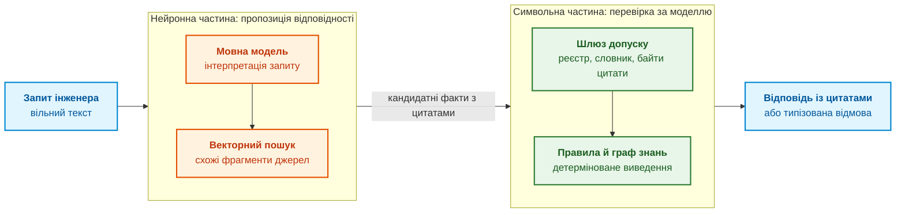
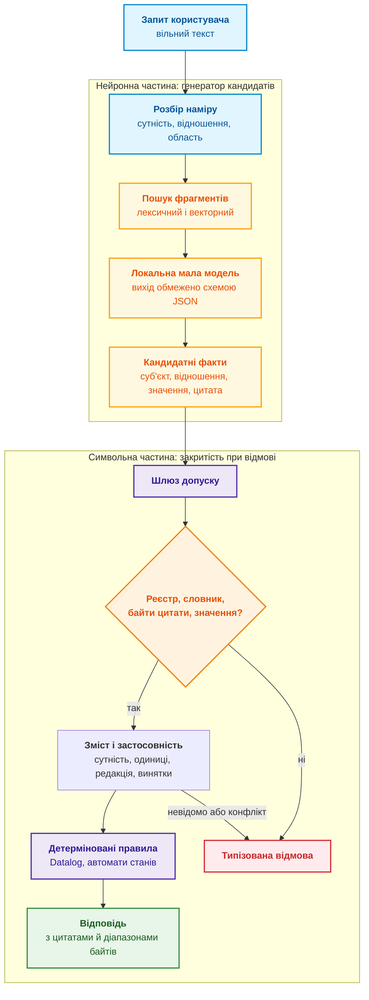
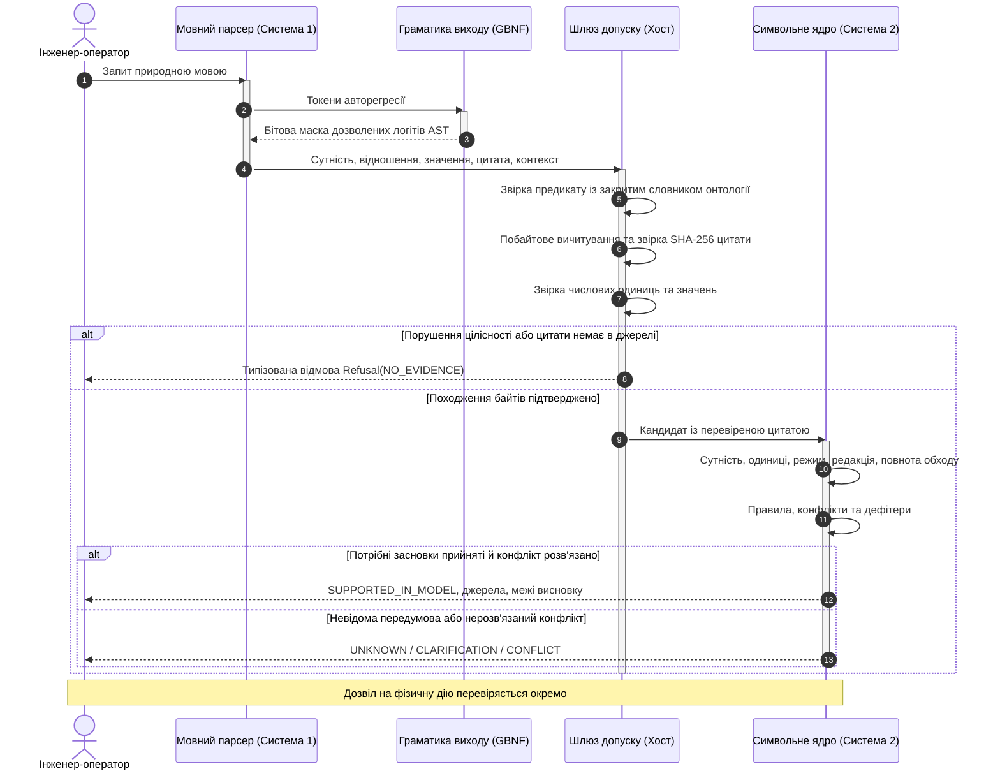
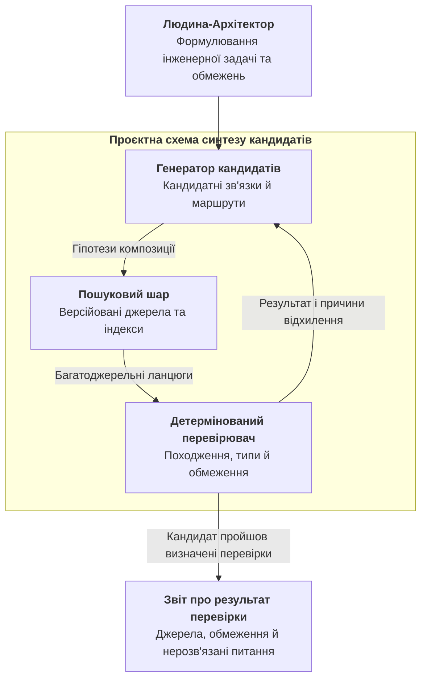

# Глава 29. Нейро-символьна архітектура: мовні моделі та перевірка доказових підстав

> **Книга:** [Архітектура доказових експертних систем](README.md) · [Частина VI: Нейро-символьні архітектури, абдукція та контроль галюцинацій](part-06-frontiers-neuro-symbolic.md)
> **Попередня глава:** [Глава 34. Прогалини знань: реляційний пошук, абдукція та діалог уточнення](ch34-deterministic-relational-analysis-abduction-and-socratic-dialogue.md)
> **Наступна глава:** [Глава 38. Машинні галюцинації та дефіцит знань: доказовий контроль відповідей](ch38-curing-machine-hallucinations-and-knowledge-deficits.md)
> **Зміст книги:** [README.md](README.md)
> **Автор:** [Микола Мартинович Федчик](about-the-author.md)
> **Передумови й маршрут:** умовна ймовірність, множини та правила «якщо — то»; потрібні означення нагадано в тексті. Для виконання прикладу достатньо основ Go. Складніший крок: умови повноти пошуку в §3.1.
> **Очікувані результати:** розділяти пропозицію моделі, перевірку цитати, висновок у формальній моделі та дозвіл на дію; будувати й тестувати побайтовий шлюз; розпізнавати нестачу даних і конфлікт; пояснювати межі граматичних обмежень, тестів та доказів.

## Анотація

Нейро-символьна архітектура експертної системи потрібна, коли запит сформульовано звичайною мовою, а відповідь має спиратися на перевірні підстави. Мовна модель знаходить можливе прочитання запиту й пропонує фрагменти; окреме символьне ядро перевіряє їх за явними правилами. На одному навчальному питанні про watchdog показано межі між релевантністю, походженням цитати, доказом у моделі та повноваженням діяти. Розібрано повноту пошуку винятків, роботу з невідомим і суперечливим, обмеження виходу схемою та виконуваний навчальний шлюз на Go. Це не виробнича реалізація всього конвеєра: застосовність джерел, семантичний розбір і дозвіл на дію потребують власних перевірювачів. ASIL і DAL позначають різні системи оцінювання; часові межі визначаються вимогами виробу, а не лише назвою стандарту чи рівнем.

Якщо розробник вбудованого контролера гальмування чи авіоніки запитає у генеративного асистента: «який максимальний час реакції сторожового таймера безпеки (watchdog)?», мовна модель може переконливо запропонувати «100 мілісекунд». Для умовного прикладу припустімо, що затверджена вимога конкретного виробу вимагає реакції за 10 мілісекунд; ця цифра є параметром сценарію, а не цитатою чи універсальним порогом ISO 26262 або DO-178C [[30]](#src-30) [[31]](#src-31). Якщо розробник довіриться неперевіреній відповіді, контролер у разі апаратного збою може не встигнути перезапуститися до виходу на небезпечну траєкторію. З іншого боку, строге логічне ядро з [Глави 28](ch28-dual-mode-expert-systems.md) може мати точний факт і цитату затвердженої продуктової вимоги, але мовчки повернути відмову лише тому, що інженер сформулював запит живою мовою («сторожовик процесора»), тоді як у базі знань сутність зареєстрована як «апаратний сторожовий таймер безпеки WDOG-1». Перша система небезпечна неперевіреною генералізацією, друга — непридатна для щоденної інженерної роботи через надмірну формальну жорсткість.

Наскрізне питання глави: **«Який граничний час реакції watchdog WDOG-1 у робочому режимі виробу P?»** Умовна продуктова вимога редакції r3 задає 10 мс; інший параметр того самого документа, тайм-аут команди, становить 5 хвилин. Усі ці значення навчальні. Модель має розпізнати «сторожовик» як можливе позначення WDOG-1, але не вправі перенести на нього число з іншого параметра. Спочатку буде пояснено, чому правдоподібний текст не дає такого права; далі — як передавати кандидатів, знаходити винятки, перевіряти цитати та повертати обмежений висновок. **«Модель пропонує, ядро затверджує» означає допуск за заданою моделлю, не проголошення фізичної істини чи автоматичне керування виробом.**

## 1. Епістемічний розрив: чому правдоподібність не є істинністю

Епістемічний розрив у нашому питанні про watchdog виникає між переконливою відповіддю та підставою їй довіряти. Речення «межа становить 100 мс» може бути граматично бездоганним, але суперечити продуктовій вимозі 10 мс. Правдоподібність тексту описує його оцінку мовною моделлю, а не відповідність фізичному виробу чи затвердженому документу. Якщо експертна система передасть таку відповідь у конфігурацію контролера без незалежної перевірки, мовна помилка стане інженерним рішенням. Тому спочатку потрібно зрозуміти, що саме обчислює генератор, а потім визначити, чого бракує для доказового висновку.

Щоб зрозуміти, чому модель може вибрати неправильне число, достатньо розглянути ймовірність продовження тексту. Токеном називають елемент словника моделі: слово, частину слова чи знак. Авторегресія означає послідовне передбачення токенів за вже отриманим текстом. Наведена формула описує ідеалізований вибір найімовірнішої послідовності фіксованої довжини, а не всю процедуру навчання чи кожний практичний декодер.

<a id="obj-29-1"></a>
**Формула (29.1). Ідеалізований вибір найімовірнішої послідовності.**

```math
P_{\mathcal{M}}(w_t\mid w_1,\dots,w_{t-1}),\qquad \hat{w}_{1:N}=\arg\max_{w_{1:N}}\prod_{t=1}^{N}P_{\mathcal{M}}(w_t\mid w_{1:t-1}).
```

Позначення:

- $`\mathcal{M}`$ є фіксованою мовною моделлю з фіксованим початковим контекстом, який у записі опущено;
- $`w_t`$ є токеном зі скінченного словника на цілочисельній позиції $t$ від 1 до $N$, а $`w_1,\dots,w_{t-1}`$ є токенами, які йому передують; на першому кроці цей префікс порожній;
- $`P_{\mathcal{M}}(w_t\mid w_1,\dots,w_{t-1})`$ є ймовірністю наступного токена за контексту попередніх токенів, у межах від 0 до 1;
- $N$ є додатною цілою довжиною послідовності токенів, а $`w_{1:N}`$ позначає всю послідовність від першого токена до $N$-го;
- $`w_{1:t-1}`$ (або $`w_{<t}`$) скорочено позначає послідовність усіх токенів, що передують позиції $t$;
- $`\prod_{t=1}^{N}`$ означає перемноження ймовірностей токенів на позиціях від 1 до $N$;
- $`\arg\max_{w_{1:N}}`$ вибирає послідовність із найбільшим добутком цих ймовірностей;
- $`\hat{w}_{1:N}`$ є вибраною моделлю послідовністю, а капелюшок позначає оцінений результат.

Усі ймовірності безрозмірні; для кожного префікса сума ймовірностей наступних токенів дорівнює 1. За ланцюговим правилом імовірність послідовності є добутком умовних імовірностей. Якщо максимумів кілька, формула задає множину рівноцінних варіантів, а правило вибору між ними потрібно задати окремо. Практичне жадібне декодування вибирає локальний максимум на кожному кроці й не зобов'язане знаходити глобальний максимум добутку.

**Навчальний розрахунок.** Нехай два двотокенні продовження мають умовні ймовірності 0,6 і 0,8 для варіанта «100 мс», а 0,4 і 0,9 для «10 мс». Послідовні множення дають 0,48 і 0,36; серед цих двох варіантів переважає «100 мс». Але продуктова вимога в прикладі задає 10 мс. Добуток допомагає вибрати текст, а не перевірити вимогу: навіть правильно обчислений максимум не дозволяє записати 100 мс у конфігурацію watchdog. Реальні числа токенізуються інакше; тут спрощено лише рахунок, не підмінено ним оцінку істинності.

Найправдоподібніша послідовність не обов'язково є правильною: максимізація правдоподібності нічого не каже про відповідність тексту документу, фізичному процесу чи стандарту. Адам Калаї та співавтори пояснюють галюцинації саме так: якщо модель не може відрізнити хибне твердження від факту, помилки виникають із природного статистичного тиску навчання, а поширені способи оцінювання моделей ще й винагороджують вгадування замість визнання невизначеності [[1]](#src-1). Звідси інженерний висновок для експертної системи: правило допуску має винагороджувати відмову, а не впевнену відповідь.

> [!NOTE]
> **Три чинники епістемічного розриву мовних моделей за моделлю автора**
> 1. Навчання передбачення тексту: висока оцінка $`P_{\mathcal{M}}(w_t \mid w_{<t})`$ сама по собі не встановлює фізичної чи нормативної валідності; інші етапи донавчання не усувають потреби перевіряти підстави.
> 2. Практична межа статистичного підтвердження надвисокої надійності: аналіз Батлера—Фінеллі показує, що для дуже малих частот відмов за заданою моделлю тестування може вимагати надмірної експозиції.
> 3. Ілюзорність ланцюжків міркувань (CoT): словесні пояснення моделі є текстом, а не верифікованим логічним виведенням, і схильні до раціоналізації хибних відповідей.
> *Керування рантаймом / Інженерний інваріант:* Правило допуску системи зобов'язане винагороджувати типізовану відмову (`Refusal`) замість недетермінованого вгадування.

Високої точності моделі на тестах для критичних застосувань теж недостатньо. Рікі Батлер і Джордж Фінеллі показали, що кількісне підтвердження дуже малих частот відмов програмного забезпечення лише статистичним тестуванням може вимагати непомірної експозиції за розглянутих ними припущень [[2]](#src-2). Це обмежує тестування як єдиний засіб обґрунтування, але не доводить математичної неможливості всіх шляхів assurance і не є окремим емпіричним результатом про мовні моделі. Застосування цієї межі до LLM є інженерним висновком: висока точність на бенчмарку сама по собі не встановлює надійності для цільового профілю. Потрібне сукупне обґрунтування з перевірюваними вимогами, обмеженнями, структурою доказів і незалежними випробуваннями; жоден елемент окремо не є гарантією.

Покрокові міркування моделі не замінюють перевірки. Джейсон Вей та співавтори показали, що підказка з ланцюжком міркувань (*chain-of-thought*) поліпшує результати мовних моделей на задачах міркування [[3]](#src-3). Проте Майлз Терпін та співавтори виявили, що такі пояснення можуть систематично спотворювати справжню причину відповіді: коли модель штовхали до хибної відповіді прихованою ознакою в підказці, модель генерувала правдоподібне обґрунтування хибної відповіді, не згадуючи цієї ознаки; на наборі з 13 задач точність знижувалася на величину до 36 % [[4]](#src-4). Ланцюжок міркувань є текстом, а не протоколом виведення.

Межу видно і з боку творчості. Том Захаві з Google DeepMind у позиційній статті стверджує, що генеративний штучний інтелект опанував індукцію, тобто статистичне узагальнення, швидко опановує дедукцію, але не має механізму абдукції, тобто висування нових пояснювальних гіпотез [[5]](#src-5). Денис Ювженко розбирає цю аргументацію українською мовою на прикладах із дедукцією, індукцією й абдукцією [[6]](#src-6). Для експертної системи висновок збігається з [Главою 28](ch28-dual-mode-expert-systems.md): гіпотези, зокрема гіпотези мовної моделі, мають статус кандидатів для перевірки. Наступний розділ розглядає, як цей розподіл ролей описують у когнітивній науці й у дослідженнях нейро-символьного штучного інтелекту.

## 2. Когнітивна дихотомія System 1 / System 2: межі інженерної аналогії

Щоб виправити описаний розрив, потрібні різні виконавці для двох питань: «що, ймовірно, мав на увазі користувач?» і «що дозволяють стверджувати прийняті засновки?». Деніел Канеман розрізняв інтуїтивне й свідоме мислення людини [[7]](#src-7); назви System 1 / System 2 тут запозичено як інженерну аналогію. Для запиту про «сторожовик» перший компонент пропонує сутність WDOG-1, другий перевіряє її відповідність виробу P, робочому режиму та редакції r3. Це не модель людської психіки і не твердження про швидкість: пошук мовної моделі може тривати довше за перевірку готового доказу. Схема показує розподіл повноважень, а не часові вимірювання.

<a id="obj-29-2"></a>
**Діаграма 29.2. Розподіл повноважень між пропозицією та перевіркою.**



Ідея гібридної архітектури не нова. Артур д'Авіла Гарсес, Крисія Брода й Дов Габбай систематизували нейро-символьні системи навчання ще на початку 2000-х років [[8]](#src-8), а Гері Маркус запропонував гібридний підхід, який спирається на знання й міркування, як шлях до надійнішого штучного інтелекту [[9]](#src-9). Систематичний огляд Брендона Колелоу та Вільяма Реглі показує, де в цій галузі лишаються прогалини: із 167 відібраних праць 2020–2024 років більшість зосереджена на навчанні й виведенні (63 %), пояснюваність і довіра представлені менше (28 %), а метакогніція, тобто міркування про власне міркування, є найменш дослідженою (5 %) [[10]](#src-10). Доказова експертна система працює саме в зоні пояснюваності й довіри. Таблиця порівнює три підходи за властивостями, важливими для цієї зони.

<a id="obj-29-3"></a>
**Таблиця 29.3. Порівняння проєктних властивостей трьох підходів.**

| Властивість | Мовна модель із пошуком | Класичні правила | Нейро-символьна архітектура |
|---|---|---|---|
| Розуміння вільного формулювання | гнучке, можливе хибне прочитання | залежить від парсера й словника синонімів | гнучка пропозиція з окремою перевіркою |
| Відтворюваність висновку | залежить від конфігурації виконання | для фіксованих даних, правил і семантики | для фіксованого входу символьного ядра |
| Зв'язок висновку з джерелом | непрямий, через знайдені фрагменти | прямий, через правила й факти | прямий, через допущені цитати |
| Поведінка за нестачі знань | правдоподібна, можливо вигадана відповідь | відмова | відмова або позначена гіпотеза |
| Вартість супроводу знань | низька для тексту, висока для контролю | висока ручна праця | автоматичне видобування кандидатів із перевіркою |

Таблиця порівнює проєктні властивості, не виміряну якість конкретних продуктів. Ядро відтворювано повторює й помилку хибного засновку; журнал допомагає знайти її джерело, але повнота журналу також потребує перевірки. Отже, потрібна не «повільна Система 2», а явний контракт між пропозицією та перевіркою. Його розглянуто далі.

## 3. Принцип розподілу обов'язків: статистичний генератор проти символьного верифікатора

Розподіл обов'язків стає перевірним лише тоді, коли відомо, які саме дані передаються між компонентами. Для нашого питання модель пропонує сутність `WDOG-1`, відношення `max_reaction_ms`, значення `10`, цитату й ідентифікатор джерела. Окремо передаються виріб P, режим, редакція та ознака завершеності пошуку. Хост додає перевірені координати цитати; оцінка схожості не входить до логічних засновків. Схема показує основний шлях, але не замінює специфікацію кожної перевірки.

<a id="obj-29-4"></a>
**Діаграма 29.4. Передавання кандидата через перевірки до висновку.**



Нейронна частина розв'язує задачу, з якою правила справляються погано: перетворює вільне формулювання на структуру. Пошук із доповненням генерації (*Retrieval-Augmented Generation*, RAG), який описали Патрік Льюїс та співавтори, поєднує пошук фрагментів у корпусі документів із генерацією відповіді [[11]](#src-11). У нейро-символьній архітектурі генерація має вужчу роль: модель не пише відповідь користувачеві, а пропонує кандидатні факти з дослівними цитатами знайдених фрагментів.

Символьній частині поставлено три вимоги. **Доказовість:** прямий факт має цитату, а похідний висновок — ланцюг правил із цитованими засновками; похідний результат не обов'язково дослівно записаний у джерелі. **Закритість при невизначеності:** брак даних, невідома застосовність або нерозв'язаний конфлікт не стають ствердною відповіддю. **Детермінізм:** за однакових знімка знань, запиту, правил, семантики аргументації та бюджету ядро відтворює результат. Ці вимоги не доводять, що документ правдивий або модель повна.

Мовна модель у такій архітектурі виконує кілька ролей, і для кожної ролі символьна частина має окрему перевірку. Таблиця показує один із можливих поділів.

<a id="obj-29-5"></a>
**Таблиця 29.5. Парні обов'язки генератора та перевірювача.**

| Роль мовної моделі | Що робить модель | Що перевіряє символьна частина |
|---|---|---|
| Оцінка достатності | сигналізує, чи знайдені фрагменти стосуються запиту | наявність документів у реєстрі; рішення про відмову ухвалює ядро |
| План відповіді | розкладає запит на сутність, відношення й область | належність відношення до закритого словника |
| Видобування кандидатів | пропонує факти з дослівними цитатами | реєстр редакції, байти цитати, значення в цитаті |
| Пояснення | пропонує текст за деревом доведення | зв'язки сутностей, одиниці, заперечення й модальність; сама наявність чисел недостатня |
| Дорадчі гіпотези | пропонує припущення в дорадчому режимі | ізоляція від строгого блоку, позначка непідтвердженості ([Глава 28](ch28-dual-mode-expert-systems.md)) |
| Узагальнення правил | пропонує кандидатів на нові правила з прецедентів | статус кандидата, перевірка суперечностей, цикл допуску ([Глава 26](ch26-continual-learning.md)) |

У кожному рядку модель лише пропонує, а останнє слово має детермінована перевірка.

> [!NOTE]
> **Три непорушні інваріанти нейро-символьного тандему за моделлю автора**
> 1. Інваріант доказовості (Evidence-Grounded): прямі факти мають цитовані опори, похідні висновки — перевірений ланцюг правил до таких опор.
> 2. Інваріант закритості при відмові (Fail-Closed Gate): виявлена неповнота, суперечність або неоднозначність блокує ствердний результат; невиявлений дефект не виключено самою назвою інваріанта.
> 3. Інваріант символьної суверенності (Relevance vs Eligibility): модель визначає релевантність і пропонує кандидатів, ядро перевіряє допуск за явним профілем, а не встановлює безумовну істинність.
> *Керування рантаймом / Інженерний інваріант:* Жоден токен чи ембеддинг нейромережі не має безпосереднього доступу до сертифікаційних висновків та виконавчого тракту.

Повернення відповіді також є контрактом. Для WDOG-1 однаково неправильні дві крайнощі: мовчки назвати невідоме хибним або дозволити дію лише тому, що знайдено число. Навчальні статуси нижче відокремлюють причину результату від його текстового пояснення; це не універсальні коди стандарту.

<a id="obj-29-6"></a>
**Таблиця 29.6. Статуси відповіді без автоматичного дозволу на дію.**

| Відомості для питання про WDOG-1 | Статус відповіді | Дія системи |
|---|---|---|
| Застосовна r3, 10 мс, засновки й потрібні винятки перевірено | `SUPPORTED_IN_MODEL` | повернути 10 мс із джерелом та межами висновку |
| Значення або передумова відсутні | `UNKNOWN` | повідомити брак підстав, не стверджувати заперечення |
| Не вказано виріб чи режим | `CLARIFICATION` | попросити уточнення перед вибором норми |
| Дві застосовні несумісні норми без установленої переваги | `CONFLICT` | показати обидві опори, заблокувати ствердний допуск |
| Цитата не збігається чи перевірку не завершено | `REFUSAL` із причиною | відхилити кандидата або завершити запит без відповіді |

Навіть `SUPPORTED_IN_MODEL` не означає `ACTION_AUTHORIZED`: для зміни конфігурації потрібні окремий контракт дії, актуальний стан виробу та перевірка повноважень. Цитата й хеш засвідчують походження байтів, правила — висновок із засновків, а надійність самих засновків визначається процедурою їх отримання та затвердження. Далі постає питання, чи всі потрібні засновки взагалі знайдено.

### 3.1. Усунення стохастичної сліпоти фази Relevance: багатоканальна повнота відбору

Розподіл обов'язків не усуває двох різних ризиків: прийняти непідтримане твердження або не знайти потрібної підстави. **Коректність (*soundness*)** означає, що прийнятий висновок випливає із засновків за правилами обраної моделі; **повнота (*completeness*)** стосується знаходження всіх потрібних відповідей у визначеному класі задач. Сам побайтовий шлюз не гарантує коректності змісту: дослівна цитата «тайм-аут команди: 5 хвилин» не підтверджує «час реакції watchdog: 5 хвилин», хоча число й байти збігаються. Потрібні окремі перевірки сутності, відношення, одиниці та застосовності. Навіть правильний перевірювач не помітить винятку, якого пошук не подав йому на вхід. Тому далі розглянуто саме повноту відбору кандидатів, а не безумовну істинність відповіді.

У цій монографії автором запропоновано принцип триканальної повноти відбору кандидатів (*Multi-Path Recall Assurance*). Він поєднує різні механізми пошуку, але не припускає статистичної незалежності їхніх помилок. Щільний пошук порівнює числові представлення текстів — ембединги — і допомагає впізнати синоніми. Лексичний індекс шукає слова й точні коди, а граф додає прив'язані винятки та передумови. Результат — множина ідентифікаторів фрагментів одного зафіксованого знімка корпусу:

<a id="obj-29-7"></a>
**Формула (29.7). Об'єднання пошукових каналів із графовим розширенням.**

```math
\mathcal{C}(q) = C_{\mathrm{dense}}(q) \cup C_{\mathrm{lex}}(q) \cup N_d\bigl(C_{\mathrm{dense}}(q) \cup C_{\mathrm{lex}}(q),\ \mathcal{G}_{\mathrm{EKG}}\bigr)
```

Тут $q$ — запит до корпусу; $`\mathcal{C}(q)`$ — скінченна множина відібраних кандидатів; $`C_{\mathrm{dense}}(q)`$ і $`C_{\mathrm{lex}}(q)`$ — результати відповідно щільного та лексичного пошуку; $`\cup`$ — об'єднання без повторів. $`\mathcal{G}_{\mathrm{EKG}}`$ — скінченний інженерний граф знань із множиною вузлів-фрагментів і типізованими ребрами $`E_\sigma`$ у знімку $`\sigma`$. $`N_d(S,\mathcal{G}_{\mathrm{EKG}})`$ додає вузли, досяжні зі стартової множини $S$ не більш як за $d$ ребер; $d$ — додатне ціле число кроків, не час. Множини й ідентифікатори не мають фізичних одиниць. У цій формулі $S$ позначає об'єднання двох пошукових множин, а не додатковий канал.

Ребра «норма → виняток», «норма → передумова» й «норма → тест» будують за перевіреним ключем `ClauseID`. Дефітер — умова, яка скасовує застосування спростовного правила; для його пошуку може знадобитися зворотний індекс посилань. Усі індекси мають відповідати знімку графа. Бюджет $B$ — додатна ціла кількість дозволених вузлів обходу; при його вичерпанні результат позначають незавершеним і не випускають ствердної відповіді. Глибина 1 покриває лише прямі прив'язки, не всі можливі залежності.

**Логічний приклад.** Щільний пошук для «сторожовика» знайшов лише опис `a`, лексичний — вимогу `w` про WDOG-1. У графі є ребра від `w` до винятку `e` для сервісного режиму, а від `e` до його передумови `h`. На глибині 1 об'єднання дає `a`, `w`, `e`; на глибині 2 додається `h`. Якщо для рішення потрібна `h`, перший результат недостатній. За бюджету двох вузлів навіть старт і прямий виняток не можна вважати завершеним обходом. Для робочого режиму застосовність `e` перевіряють, а не відкидають його за низькою схожістю.

Потрібна також оцінка ризику пропуску. Вона має сенс лише за заданого розподілу запитів і моделі дефектів індексації; не є властивістю конкретного рядка тексту:

<a id="obj-29-8"></a>
**Формула (29.8). Імовірність пропуску визначеного цільового фрагмента.**

```math
\epsilon_{\mathrm{FN}}(e^*) = P\bigl(e^* \notin \mathcal{C}(q)\bigr).
```

Тут $`e^*`$ — фіксований цільовий фрагмент, $P$ — імовірність за описаним профілем перевірки, $`\epsilon_{\mathrm{FN}}`$ — безрозмірна ймовірність пропуску в межах від 0 до 1. Наприклад, пропуск винятку у 2 зі 100 розмічених запитів дає спостережувану частку 0,02. Це оцінка на наборі, не доведене значення для майбутніх запитів; її використовують для порівняння пошукових конфігурацій за однакового набору.

**Твердження 1.** Для глибини 1, фіксованого графа та відсутності усікання кандидат знайдено тоді й лише тоді, коли він є у стартовій множині або до нього веде одне ребро зі стартового вузла:

<a id="obj-29-9"></a>
**Формула (29.9). Критерій однокрокової досяжності без усікання.**

```math
e\in\mathcal{C}(q)\iff e\in S\ \lor\ \exists s\in S:\ (s,e)\in E_\sigma.
```

Тут $e$ і $s$ — вузли графа, $`\in`$ означає належність множині, $`\lor`$ — «або», $`\exists`$ — «існує», $`\iff`$ — рівносильність. Решту позначень визначено вище; усі вони дискретні й безрозмірні. Доведення безпосередньо випливає з означення однокрокового обходу: він додає всі кінці вихідних ребер і жодних інших вузлів. У прикладі `e` додається через `w`, але `h` ще не додається. Для більшої глибини зберігається достатність правої частини, не її необхідність: `h` можна знайти за два кроки.

**Наслідок 2** (без припущення про незалежність). Якщо ціль пропущено, то пропущено і саму ціль у стартовому пошуку, і кожного її наявного прямого попередника; інакше обхід додав би ціль. Із включення подій випливає верхня межа:

<a id="obj-29-10"></a>
**Формула (29.10). Межа пропуску за наявних графових прив'язок.**

```math
\epsilon_{\mathrm{FN}}(e^*) \le \min\Bigl(P(e^* \notin S),\ \min_{s \in \mathrm{Pred}(e^*)} P(s \notin S)\Bigr).
```

Тут $`\mathrm{Pred}(e^*)`$ — множина вузлів, від яких є пряме ребро до цілі, а $`\min`$ вибирає найменшу верхню межу. Усі ймовірності належать відрізку від 0 до 1; для порожньої множини попередників внутрішній мінімум умовно дорівнює 1. Якщо пропуск самої цілі в $S$ має ймовірність 0,20, а її єдиного попередника — 0,10, межа становить 0,10, не добуток 0,02. Умова — фіксований коректний граф і необрізаний обхід. Спільні причини пропусків можуть зробити канали сильно залежними.

**Наслідок 3.** Для аналізу дефектного графа оберімо один вузол $s$, від якого до цілі має вести ребро. Нехай $`\rho`$ — безрозмірна ймовірність відсутності цього ребра в межах від 0 до 1. Пропуск цілі можливий, лише якщо старт не містив цілі і водночас або не знайшов $s$, або ребра бракує. Нерівність для об'єднання подій дає:

<a id="obj-29-11"></a>
**Формула (29.11). Консервативна межа за можливого дефекту ребра.**

```math
\epsilon_{\mathrm{FN}}(e^*)\le\min\bigl(P(e^*\notin S),\ P(s\notin S)+\rho\bigr).
```

За попередніх чисел та $`\rho=0{,}03`$ маємо спочатку 0,10 + 0,03 = 0,13, потім мінімум із 0,20 — 0,13. Це консервативна межа в моделі, а не вимірювання надійності корпусу. Незалежності не потрібно; добуток імовірностей пропусків двох пошукових каналів допустимий лише після обґрунтування їх умовної незалежності.

Нульовий пропуск заявляється лише для класу запитів $Q$ із точним ID норми за чотирьох умов: **A1** — нормалізований ID детерміновано знаходить потрібного попередника без відсікання за рангом; **A2** — потрібне ребро є; **A3** — обхід не усічено; **A4** — індекси й граф належать одному знімку. У прикладі точний пошук `w` плюс ребро до `e` забезпечують знаходження `e`, але не автоматично `h`. Для довільного формулювання це лише стратегія зменшення пропусків; її перевіряють на розмічених запитах. Так розподіл ролей отримує конкретну межу: ядро перевіряє поданий матеріал, а повноту його подання обґрунтовують окремо.

> [!NOTE]
> **Три інваріанти асиметричного епістемічного діода кастодії за моделлю автора**
> 1. Односпрямований потік допуску: у запропонованій авторській схемі джерело передає засновки ядру, ядро формує перевірний результат, а вербалізатор лише подає його. Заборону зворотного запису забезпечують права доступу й ізоляція, не назва «діод».
> 2. Перевірка числових та модальних сутностей: число, одиниця, заперечення й слова «можна» чи «треба» звіряються разом із відповідним засновком. Збіг окремих слів не доводить еквівалентності речень.
> 3. Ізоляція неперевіреного пояснення: до завершення перевірки текст не публікують; при розбіжності використовують шаблон за доказовим результатом. Уже показаний токен неможливо відкликати перериванням потоку.
> *Керування рантаймом / Інженерний інваріант:* Генератор не змінює канонічну базу без окремого допуску; це обмежує його повноваження, але не гарантує відсутності помилок у кандидатах чи вербалізації.

## 4. Світовий ландшафт нейро-символьних архітектур: індустріальні та академічні парадигми

Після визначення інтерфейсу корисно порівняти його з відомими системами: не кожна комбінація мовної моделі й перевірювача перевіряє те саме. Для питання про WDOG-1 потрібно знати, чи компонент установлює логічне слідування, лише ранжує тексти, чи оптимізує план. Нижче зіставлено ці різні ролі. Наведені праці є джерелами архітектурних прикладів, не свідченням атестації описаної тут експертної системи; нової перевірки їхніх експериментальних результатів у цій главі не проведено.

### 4.1. Досвід Alphabet / DeepMind: AlphaProof та інтерактивні доводжувачі Lean

AlphaProof показує, як відокремити пошук доведення від його перевірки. За повідомленням DeepMind про IMO 2024 [[29]](#src-29), система працює з формалізованими задачами мовою Lean, використовує навчання з підкріпленням для пошуку доведень, а мовна модель допомагає переводити умови у формальний запис. Це не просто Gemini, яка пише готовий доказ. У Lean 4 [[20]](#src-20) тактики будують терм доведення, а ядро перевіряє його відповідність формальному твердженню. Хибний крок не отримує такого підтвердження.

Для WDOG-1 аналогом є доказ того, що з прийнятих вимог випливає межа 10 мс. Перевірний доказ не засвідчує, що переклад природномовної вимоги правильний, засновки відповідають фізичному виробу або використані аксіоми прийнятні. Ці зобов'язання лишаються поза ядром доведення.

**Межа застосовності.** Пошук доведення й перевірка готового доказу мають різні витрати. Якщо навчальний профіль виробу задає бюджет перевірки менш як 100 мкс, пошук без установленої верхньої межі часу не включають до цього шляху. Це окремий бюджет перевірювача, не наведена раніше межа реакції watchdog 10 мс і не універсальний поріг ISO 26262 чи DO-178C [[30]](#src-30) [[31]](#src-31). Потрібні перевірка найгіршого часу виконання (WCET) на цільовій платформі та поведінка при вичерпанні бюджету. Без них ні універсальний, ні спеціалізований рушій не отримує часової гарантії.

### 4.2. Досвід OpenAI: процесні винагороди (PRM) та межі латентного міркування

PRM потрібна для іншої задачі: вибрати перспективніший шлях міркування, коли повного формального перевірювача немає. У праці Хантера Лайтмана та співавторів *«Let's Verify Step by Step»* [[25]](#src-25) модель винагороди навчають оцінювати проміжні кроки, а не лише остаточну відповідь. Така оцінка може покращити відбір кандидатів на досліджених задачах, але лишається прогнозом навченої моделі.

Наприклад, PRM може високо оцінити перехід «документ містить 10 мс, отже WDOG-1 має межу 10 мс», не помітивши, що речення стосується іншого режиму. Саме це має перевірити зовнішній контракт застосовності. Праці про CoT [[3]](#src-3) [[4]](#src-4) мотивують обережність щодо словесних пояснень, але не доводять неминучого «модельного колапсу» від будь-якої перевірки однією моделлю іншої. Без формального артефакту та незалежного правила оцінка PRM не є доказом; внутрішня будова конкретних моделей o1/o3 тут не встановлюється.

### 4.3. Досвід Meta FAIR: стратегічний діалог та фільтрація в архітектурі Cicero

Cicero [[24]](#src-24) корисний для розуміння узгодження діалогу з планом дій. У грі Diplomacy мовний компонент формує повідомлення, а стратегічний компонент використовує планування та моделі поведінки інших гравців; повідомлення перевіряють на відповідність намірам і плану. Стратегічне планування тут не слід ототожнювати з доведенням теореми чи вважати суто детермінованим нормативним ядром.

Перенесення уроку на WDOG-1 обмежене: текст «можна змінити налаштування» повинен відповідати окремо дозволеній дії, а не лише знайденому числу. Успішна гра не доводить безпечності контролера або правдивості джерела. Цей приклад пояснює потребу узгодження компонентів, не замінює інженерний допуск.

### 4.4. Досвід Stanford HAI: скомпільовані декларативні конвеєри DSPy

DSPy Омара Хаттаба та співавторів [[26]](#src-26) допомагає відтворювано налаштовувати конвеєри мовних моделей. Розробник задає сигнатури входу й виходу, приклади та метрику, а оптимізатор підбирає підказки й демонстрації. Слово «компіляція» тут означає оптимізацію програми викликів моделей, а не доказ її семантичної правильності.

Для нашого питання сигнатура могла б вимагати поля сутності, режиму та цитати. Якщо метрика винагороджує лише непорожній JSON, конвеєр може краще оформлювати помилкові відповіді. Тому окремо перевіряють відмову на відсутніх даних, збереження одиниць і правильну застосовність. Декларативний контракт робить вимоги явними, але не усуває помилок їх автора.

### 4.5. Академічні школи: MIT NSCL та фреймворки аргументації ASPIC+

NSCL [[27]](#src-27) показує, навіщо потрібне проміжне представлення: у задачах візуальних запитань система поєднує сприйняття сцени, розбір запитання та виконання квазісимвольної програми. Навчені й диференційовані компоненти не стають формальним перевірювачем лише тому, що використовують структуру програми. Для WDOG-1 корисна саме ідея явної структури запиту; результати на зображеннях не засвідчують правильності читання інженерного документа.

Наступне питання — що робити з винятками й суперечностями. ASPIC+ Санджая Модгіла та Франчески Тоні [[28]](#src-28) будує аргументи зі строгих і спростовних правил та описує атаки на висновок (*rebuttal*) або застосування правила (*undercut*). Результат залежить від заданих переваг і семантики прийнятності аргументів; це не автоматичний спосіб оголосити один документ істинним.

У навчальному випадку загальне правило дає 10 мс, а застосовний виняток для сервісного режиму скасовує саме це правило. Спочатку встановлюють режим. Якщо він невідомий — потрібне уточнення, а не довільний вибір правила. Якщо дві чинні норми конфліктують, перевагу спеціальної норми (*Lex Specialis*) або пізнішої редакції (*Lex Posterior*) застосовують лише після перевірки сфер дії, чинності, лінії редакцій та затвердженого профілю пріоритету. Новіша дата сама по собі не розв'язує конфлікту. За невідомої застосовності результат лишається невизначеним і не дає допуску.

### 4.6. Часовий протокол взаємодії в нейро-символьному тандемі

Часовий протокол потрібен, щоб установити порядок перевірок і момент публікації відповіді. Для WDOG-1 він спочатку формує кандидата, потім перевіряє його опори та лише після цього повертає статус. Стрілки нижче задають причинний порядок, не виміряну тривалість; перевищення профільного бюджету має завершуватися без ствердного результату.

<a id="obj-29-12"></a>
**Діаграма 29.12. Порядок перевірок і повернення статусу.**



### 4.7. Життєвий цикл та верифікація кандидатного факту

Життєвий цикл кандидата відокремлює «знайдено в джерелі» від «підтримано в моделі». Так помилка цитати не змішується з браком знань. Для нашого питання наявність 10 мс у r3 ще не завершує перевірку: потрібен робочий режим виробу P й відсутність нерозв'язаних атак на правило.

<a id="obj-29-13"></a>
**Діаграма 29.13. Життєвий цикл кандидата та невизначеного результату.**

```mermaid
stateDiagram-v2
	accTitle: Стани кандидата та висновку
	accDescr: Після синтаксису й байтів перевіряються зміст і застосовність; невідоме та конфлікт не стають дозволом на дію.
    [*] --> UnstructuredText: Сирий корпоративний документ

    UnstructuredText --> Proposed: Локальна SLM виділяє кандидата
    Proposed --> SyntacticallyMasked: Проходження GBNF-граматики

    state GateInspection {
        [*] --> VocabularyCheck: Звірка зі словником онтології
        VocabularyCheck --> ByteCustodyCheck: Предикат у словнику
        VocabularyCheck --> Rejected_Vocabulary: Предикат поза словником

        ByteCustodyCheck --> NumericCheck: Збіг байтів та хешу SHA-256
        ByteCustodyCheck --> Rejected_Quote: Спотворення цитати

        NumericCheck --> VerifiedCandidate: Значення є в цитаті
        NumericCheck --> Rejected_Numeric: Число вигадане моделлю
    }

    SyntacticallyMasked --> GateInspection: Передача до шлюзу допуску

    Rejected_Vocabulary --> RefusalState: Відмова OUT_OF_VOCABULARY
    Rejected_Quote --> RefusalState: Відмова HALLUCINATED_QUOTE
    Rejected_Numeric --> RefusalState: Відмова NUMERIC_DISCREPANCY

	VerifiedCandidate --> AdmittedFact: Зміст і застосовність перевірено
	VerifiedCandidate --> UnknownState: Передумова невідома
	VerifiedCandidate --> RefusalState: Зміст не відповідає цитаті
    AdmittedFact --> InferenceEngine: Детерміноване логічне виведення

	InferenceEngine --> ProvedConclusion: Висновок підтримано прийнятими засновками
	InferenceEngine --> ConflictState: Нерозв'язана суперечність
	InferenceEngine --> UnknownState: Пошук або перевірку не завершено
    InferenceEngine --> Defeated: Активовано правило-дефітер

    Defeated --> RefusalState: Відмова UNRESOLVED_DEFEATER
	UnknownState --> [*]: UNKNOWN або CLARIFICATION
	ConflictState --> [*]: CONFLICT без допуску
    ProvedConclusion --> [*]: Доказова відповідь інженеру
    RefusalState --> [*]: Повернення типізованої відмови
```



Отже, різні відмови вимагають різних наступних дій: виправити адресу цитати, уточнити режим або розв'язати конфлікт джерел. Наступний розділ починає з найнижчої, побайтової перевірки, на яку спираються всі подальші кроки.

## 5. Побайтовий шлюз допуску: заземлення на координати першоджерел

Побайтова перевірка потрібна, бо файл і хеш-функція працюють із байтами, а не з нумерацією символів у видимому тексті. Мовна модель обробляє токени й може помилково оцінити зміщення. У UTF-8 кодова точка займає від одного до чотирьох октетів [[12]](#src-12); літери ASCII займають один байт, українські літери наведеного прикладу — два. Кодова точка, видимий символ і токен моделі також не завжди збігаються. Якщо модель поверне символьну адресу замість байтової, хост може прочитати інший фрагмент. Звідси правило проєктування: модель пропонує дослівну цитату, а остаточні байтові межі обчислює або перевіряє хост. За хибної адреси навчальний шлюз приймає відновлений діапазон лише для єдиного входження цитати.

У навчальній авторській моделі побайтовий шлюз виконує п'ять перевірок у фіксованому порядку. Вони встановлюють простежуваність кандидата, не всю його семантичну придатність:

1. **Реєстр редакцій.** Хеш SHA-256 збігається із записом довіреного реєстру ([Глава 15](ch15-knowledge-extraction-and-kb-construction.md)). Це перевіряє ідентичність байтів за припущення стійкості хешу. Чинність редакції, право її затверджувати та застосовність до виробу перевіряють окремо; застарілий документ теж може мати правильний хеш.
2. **Відмова моделі.** Сигнал браку підстав припиняє обробку цього кандидата. Він не доводить, що потрібного факту немає в усьому корпусі; інші канали можуть знайти його.
3. **Закритий словник.** Відношення належить до множини відношень, які вміють використовувати правила ядра; довільний предикат природної мови не допускають.
4. **Дослівна цитата.** Байти документа в діапазоні збігаються з цитатою, або цитата однозначно знаходиться в документі.
5. **Значення в цитаті.** Лексичний збіг відсікає значення, якого немає в цитаті. Це консервативна перевірка: 300 секунд може бути правильним перетворенням 5 хвилин, але потребує окремого правила. Сам збіг числа ще не пов'язує його з потрібною сутністю чи одиницею.

Формалізуємо лише четвертий крок: його результатом є логічне значення, чи відповідає зріз документа цитаті.

<a id="obj-29-14"></a>
**Формула (29.14). Побайтова відповідність цитати зрізу документа.**

```math
\mathrm{ByteMatch}(D,Q,b,e)\iff 0\le b<e\le\lvert D\rvert\ \land\ D[b:e]=Q.
```

Тут $D$ — незмінна скінченна послідовність байтів документа, $Q$ — непорожня послідовність байтів цитати; $b$ та $e$ — цілі зміщення в байтах від початку $D$. Нижню межу включено, верхню не включено; $`\lvert D\rvert`$ — довжина в байтах, $`D[b:e]`$ — зріз, $`\land`$ — логічне «і», $`\mathrm{ByteMatch}`$ — назва перевірки з результатом «так» або «ні». Передумова — однакове кодування й та сама редакція без прихованої нормалізації перенесень або Unicode.

**Покроковий приклад.** У рядку `АБ 10 мс` дві кириличні літери займають 4 байти, пробіл — ще 1. Цитата `10 мс` починається зі зміщення 5 і має 7 байтів: дві цифри, пробіл та дві двобайтові літери. Отже, верхня межа — 12, і зріз від 5 до 12 збігається з цитатою. Відлік від символу 3 дав би неправильні байти. Хост використовує знайдений діапазон для аудиту й повторної перевірки; із цього обчислення не випливає, якому пристрою належить 10 мс. Якщо цитата повторюється, потрібні довірені координати або ширший однозначний контекст; у навчальній програмі повтори відхиляються.

Для пояснення потрібен сильніший контракт, ніж наявність чисел. Речення «10 мс не є обов'язковою межею WDOG-1» може містити ті самі токени, що й правильна відповідь, але змінює заперечення й модальність. Тому числовий фільтр лише виявляє частину дефектів. У строгому виході без повного перевірювача перефразувань використовують детермінований шаблон за структурованим результатом; похідні значення супроводжують правилом перетворення. Це готує наступний крок: обмежити форму кандидатів ще до їх надходження до хоста.

> [!NOTE]
> **П'ять ступенів побайтового шлюзу допуску фактів за моделлю автора**
> 1. Валідація криптографічного реєстру: перевірка хешу SHA-256 документа на збіг із канонічною затвердженою редакцією першоджерела.
> 2. Семантичний фільтр відмов моделі: негайна фіксація браку інформації при виявленні сигналу невизначеності від SLM.
> 3. Контроль закритого словника онтології: блокування довільних предикатів природної мови, відсутніх у формальній схемі знань.
> 4. Побайтова звірка цитати: верифікація збігу байтів у кодуванні UTF-8 силами хостової операційної системи з усуненням зміщення символьних токенів.
> 5. Лексична перевірка значення: пряме видобуте значення має опору в цитаті; перетворені величини потребують окремого правила. Після цих ступенів усе ще потрібна перевірка змісту й застосовності.
> *Керування рантаймом / Інженерний інваріант:* Після невдалого відновлення однозначної цитати або непідтвердженого значення кандидата відхиляють із причиною; успіх п'яти ступенів не є дозволом на дію.

## 6. Локальні малі мовні моделі (SLM) як детерміновані генератори кандидатів

Локальна мала модель потрібна тут як керований постачальник кандидатів, а не як сховище нормативної істини. Для питання про WDOG-1 вона повинна повернути поля за контрактом і дослівну цитату або повідомити брак даних. Назва розділу описує мету відтворюваного налаштування, не доведену детермінованість усіх SLM. Локальне виконання дає змогу не надсилати документи зовнішньому сервісу, але саме по собі не забезпечує ізоляції, конфіденційності чи часової межі: потрібні права доступу, мережеві обмеження та контроль версій середовища ([Глава 25](ch25-how-expert-systems-learn.md)).

**Обмеження виходу схемою.** Сайбо Ген та співавтори досліджували структуроване декодування без донавчання [[13]](#src-13), а Брендон Віллард і Ремі Луф описали керовану генерацію зі скінченними автоматами [[14]](#src-14). У llama.cpp вихід обмежують граматикою GBNF [[15]](#src-15); Ollama приймає підтримувану схему JSON у параметрі `format` [[16]](#src-16). За успішного завершення обмеження забезпечує задану форму, не істинність: поле `value` може містити вигадку. Обрізаний вивід, відмову сервісу чи непідтримувану схему не вважають коректним JSON за замовчуванням — відповідь усе одно розбирають і перевіряють на хості.

**Фіксація параметрів.** Параметри генерації й системну інструкцію зручно закріпити у файлі моделі Ollama (*Modelfile*), який описує документація Ollama [[17]](#src-17). Приклад нижче задає нульову температуру, обмежує довжину відповіді й фіксує контракт видобування фактів. Ім'я базової моделі є прикладом і залежить від обраної моделі.

<details>
<summary>Файл моделі Ollama (Modelfile)</summary>

```dockerfile
FROM qwen2.5:3b

# Нульова температура вимикає температурне семплювання
PARAMETER temperature 0
PARAMETER num_predict 512

SYSTEM """You extract candidate facts from technical specifications.
Return a JSON array of objects with fields subject, relation, value and quote.
The quote must be an exact verbatim substring of the given passage.
Use only these relations: max_length_octets, timeout, max_reaction_ms.
If the passage states no such fact, return an empty array []."""
```

</details>

Файл реєструють командою `ollama create fact-extractor -f Modelfile`. Це приклад конфігурації методу обмеження виходу, не виконаний у цій главі експеримент із моделлю. Нульова температура вимикає температурне семплювання, але не гарантує побітового повторення між різними версіями рушія, моделями, апаратними бекендами чи паралельними обчисленнями. Фіксують хеш ваг і адаптера, токенізатор, параметри та версію рантайму; відтворюваність вимірюють окремо від правильності.

**Адаптація моделі.** Якщо базова модель погано дотримується контракту, її доналаштовують методами з [Глави 25](ch25-how-expert-systems-learn.md), наприклад адаптером LoRA. Навчальний набір має містити багато негативних прикладів, у яких правильною відповіддю є порожній масив або відмова, інакше модель навчиться завжди щось видобувати. Для різних предметних областей, наприклад мережевих протоколів і автомобільної безпеки, доцільно перевірити окремі адаптери: послідовне навчання однієї мережі на різних задачах може спричинити катастрофічну інтерференцію, яку описали Майкл Макклоскі й Ніл Коен [[18]](#src-18). Вибір між одним і кількома адаптерами роблять за результатами іспиту на окремих наборах для кожної області.

**Як порівняти адаптовану модель з базовою.** Наявність адаптера встановлюють за маніфестом і хешами завантажених артефактів, а не за одним «правильним» виходом. Поведінкові тести перевіряють придатність обох версій на однаковому відкладеному наборі: базова модель теж може відповідати правильно, адаптована — помилятися. Таблиця задає критерії, не вигадані результати вимірювання.

<a id="obj-29-15"></a>
**Таблиця 29.15. Однакові поведінкові критерії для базової й адаптованої моделей.**

| Перевірка | Приклад дефекту будь-якої версії | Критерій для обох версій |
|---|---|---|
| Запит про параметр, якого у фрагменті немає | вгадує правдоподібне значення або відповідає розлогим коментарем | повертає порожній масив або відмову |
| Цитата з кириличного тексту | цитата перефразована або з пропущеними словами, тож дослівного збігу немає | цитата збігається з байтами документа |
| Чистота формату | обгортає JSON розміткою Markdown, додає вступ і висновок | повертає лише JSON за схемою |
| Дотримання словника | вигадує відношення природною мовою | використовує лише дозволені відношення |

Для кожного критерію рахують успіхи й помилки окремо на позитивних, негативних та неоднозначних запитах. Наприклад, правильна відмова у 18 із 20 запитів без відповіді залишає два небажані здогади; це ще не рівень надійності для експлуатації. Оновлення приймають за наперед визначеним регресійним профілем ([Глава 25](ch25-how-expert-systems-learn.md)), а не за назвою адаптера. Навіть ідеальний результат на цьому наборі не скасовує шлюзу. Далі його реалізовано без необхідності запускати модель.

## 7. Програмна реалізація верифікованого нейро-символьного конвеєра на Go з Ollama

Для питання про WDOG-1 потрібно відтворити щонайменше дві операції: побайтову прив'язку з §5 та перевірку того, що сутність, відношення й значення належать саме цій цитаті. Навчальна програма реалізує їх стандартною бібліотекою Go. Вхід — кандидат `Proposal`; вихід — прив'язаний запис `Fact` або причина відхилення. Назва `Fact` тут означає запис навчальної бази, не фізичну істину. Таблиця `reviewedClaims` є вручну перевіреним семантичним відображенням трьох речень джерела; вона задає засновки прикладу, а не універсальний парсер природної мови. У повній системі таке відображення має власний процес допуску, область дії й версії.

Перші шість записаних пропозицій зберігають перевірки довжини рядка й тайм-ауту як сусідніх параметрів того самого виробу. Сьома повертає нас до WDOG-1. Саме сусідство чисел перевіряє, чи не перенесе модель значення між параметрами. Реєстр і семантична таблиця вважаються довіреними навчальними входами; спільне розміщення з кодом не утворює незалежного кореня довіри. Не реалізовано повний пошук винятків, доказ чинності r3 чи контракт фізичної дії.

Без `OLLAMA_MODEL` приклад працює лише із записаними кандидатами; це відтворюваний локальний тест, не вимірювання якості SLM. Необов'язкова функція `askOllama` показує передавання схеми з §6: поля запиту й декодування відповіді. Її мережевий режим не потрібен для наведеного результату й тут не перевірений. За помилки сервісу програма завершується, а не підміняє живий результат записаними даними.

<details>
<summary>Приклад мовою Go: шлюз допуску з локальною моделлю Ollama</summary>

```go
// Шлюз допуску нейро-символьної експертної системи: мовна модель пропонує, ядро перевіряє.
// Запуск: go run . (Ollama необов'язкова: без змінної OLLAMA_MODEL використано записані пропозиції).
package main

import (
	"bytes"
	"crypto/sha256"
	"encoding/hex"
	"encoding/json"
	"fmt"
	"net/http"
	"os"
	"regexp"
	"strings"
	"time"
)

const docID = "gw-spec-v3"

var document = []byte("Специфікація шлюзу, розділ 4.2.\nМаксимальна довжина рядка становить 1000 октетів.\nТайм-аут очікування команди: 5 хвилин.\nГраничний час реакції WDOG-1 у робочому режимі виробу P: 10 мс.\n")

// Реєстр джерел зберігає хеш затвердженої редакції документа.
var registry = map[string]string{docID: "68c694a771860f2295f3f7960d6f9a46525d235d575a80a7e7c70db95cb2899b"}

// Закритий словник відношень, які вміє використовувати символьне ядро.
var vocabulary = map[string]bool{"max_length_octets": true, "timeout": true, "max_reaction_ms": true}

type Proposal struct {
	Refusal   bool   `json:"refusal,omitempty"`
	Reason    string `json:"reason,omitempty"`
	Subject   string `json:"subject,omitempty"`
	Relation  string `json:"relation,omitempty"`
	Value     string `json:"value,omitempty"`
	Quote     string `json:"quote,omitempty"`
	ByteStart int    `json:"byte_start,omitempty"`
	ByteEnd   int    `json:"byte_end,omitempty"`
}

// Записані відповіді моделі: правильна, зі зсувом у символах замість байтів,
// з вигаданим значенням, з відношенням поза словником і відмова.
var recorded = []Proposal{
	{Subject: "рядок", Relation: "max_length_octets", Value: "1000", Quote: "Максимальна довжина рядка становить 1000 октетів.", ByteStart: 55, ByteEnd: 143},
	{Subject: "рядок", Relation: "max_length_octets", Value: "1000", Quote: "Максимальна довжина рядка становить 1000 октетів.", ByteStart: 32, ByteEnd: 81},
	{Subject: "команда", Relation: "timeout", Value: "300 секунд", Quote: "Тайм-аут очікування команди: 5 хвилин.", ByteStart: 144, ByteEnd: 212},
	{Subject: "рядок", Relation: "max_length_octets", Value: "100", Quote: "Максимальна довжина рядка становить 1000 октетів.", ByteStart: 55, ByteEnd: 143},
	{Subject: "шлюз", Relation: "recommended_vendor", Value: "Acme", Quote: "Специфікація шлюзу, розділ 4.2.", ByteStart: 0, ByteEnd: 54},
	{Refusal: true, Reason: "unsupported_in_context"},
	{Subject: "WDOG-1", Relation: "max_reaction_ms", Value: "10 мс", Quote: "Граничний час реакції WDOG-1 у робочому режимі виробу P: 10 мс."},
}

var reviewedClaims = []Proposal{
	{Subject: "рядок", Relation: "max_length_octets", Value: "1000", Quote: "Максимальна довжина рядка становить 1000 октетів."},
	{Subject: "команда", Relation: "timeout", Value: "5 хвилин", Quote: "Тайм-аут очікування команди: 5 хвилин."},
	{Subject: "WDOG-1", Relation: "max_reaction_ms", Value: "10 мс", Quote: "Граничний час реакції WDOG-1 у робочому режимі виробу P: 10 мс."},
}

type Fact struct {
	Proposal
	Digest, Note string
}

// containsToken вимагає значення як цілої лексеми, щоб «100» не збігалося з «1000».
func containsToken(text, value string) bool {
	if strings.TrimSpace(value) == "" {
		return false
	}
	return regexp.MustCompile(`(^|[^\p{L}\p{N}.,+\-])` + regexp.QuoteMeta(value) + `($|[^\p{L}\p{N}.,+\-]|[.,]($|[^\p{N}]))`).MatchString(text)
}

func admit(p Proposal) (Fact, string) {
	sum := sha256.Sum256(document)
	if hex.EncodeToString(sum[:]) != registry[docID] {
		return Fact{}, "редакція документа не збігається з реєстром"
	}
	if p.Refusal {
		return Fact{}, "модель відмовилася: " + p.Reason
	}
	if !vocabulary[p.Relation] {
		return Fact{}, "відношення поза закритим словником: " + p.Relation
	}
	quote := []byte(p.Quote)
	if len(quote) == 0 {
		return Fact{}, "немає цитати"
	}
	start := bytes.Index(document, quote)
	if start < 0 {
		return Fact{}, "цитати немає в джерелі"
	}
	if bytes.Index(document[start+1:], quote) >= 0 {
		return Fact{}, "цитата неоднозначна"
	}
	note := "діапазон моделі підтверджено"
	if p.ByteStart < 0 || p.ByteEnd > len(document) || p.ByteStart >= p.ByteEnd ||
		!bytes.Equal(document[p.ByteStart:p.ByteEnd], quote) {
		p.ByteStart = start
		p.ByteEnd = start + len(quote)
		note = "діапазон моделі хибний, хост знайшов цитату дослівно"
	}
	if !containsToken(p.Quote, p.Value) {
		return Fact{}, "значення не підтверджене цитатою: " + p.Value
	}
	for _, claim := range reviewedClaims {
		if claim.Quote == p.Quote && claim.Subject == p.Subject &&
			claim.Relation == p.Relation && claim.Value == p.Value {
			digest := sha256.Sum256(quote)
			return Fact{Proposal: p, Digest: hex.EncodeToString(digest[:]), Note: note}, ""
		}
	}
	return Fact{}, "твердження не відповідає перевіреній семантичній таблиці"
}

func known(f Fact, facts []Fact) bool {
	for _, g := range facts {
		if g.Subject == f.Subject && g.Relation == f.Relation && g.Value == f.Value &&
			g.ByteStart == f.ByteStart && g.ByteEnd == f.ByteEnd && g.Digest == f.Digest {
			return true
		}
	}
	return false
}

// askOllama просить локальну модель повернути пропозиції у форматі JSON за схемою.
func askOllama(model, passage string) ([]Proposal, error) {
	str := map[string]string{"type": "string"}
	schema := map[string]any{"type": "array", "items": map[string]any{
		"type":       "object",
		"properties": map[string]any{"subject": str, "relation": str, "value": str, "quote": str},
		"required":   []string{"subject", "relation", "value", "quote"},
	}}
	body, err := json.Marshal(map[string]any{
		"model": model, "stream": false, "format": schema,
		"options": map[string]any{"temperature": 0},
		"messages": []map[string]string{
			{"role": "system", "content": "Extract facts as JSON with an exact verbatim quote from the passage. Return [] if none."},
			{"role": "user", "content": passage},
		},
	})
	if err != nil {
		return nil, err
	}
	client := http.Client{Timeout: 60 * time.Second}
	resp, err := client.Post("http://localhost:11434/api/chat", "application/json", bytes.NewReader(body))
	if err != nil {
		return nil, err
	}
	defer resp.Body.Close()
	if resp.StatusCode != http.StatusOK {
		return nil, fmt.Errorf("Ollama: %s", resp.Status)
	}
	var out struct {
		Message struct{ Content string } `json:"message"`
	}
	if err := json.NewDecoder(resp.Body).Decode(&out); err != nil {
		return nil, err
	}
	var proposals []Proposal
	if err := json.Unmarshal([]byte(out.Message.Content), &proposals); err != nil {
		return nil, err
	}
	return proposals, nil
}

// ungrounded повертає числа з пояснення, яких немає в жодній допущеній цитаті.
func ungrounded(narrative string, facts []Fact) []string {
	var missing []string
	for _, n := range regexp.MustCompile(`\d+`).FindAllString(narrative, -1) {
		found := false
		for _, f := range facts {
			found = found || containsToken(f.Quote, n)
		}
		if !found {
			missing = append(missing, n)
		}
	}
	return missing
}

func main() {
	proposals, origin := recorded, "записані відповіді моделі"
	if model := os.Getenv("OLLAMA_MODEL"); model != "" {
		if live, err := askOllama(model, string(document)); err == nil {
			proposals, origin = live, "Ollama, модель "+model
		} else {
			fmt.Fprintln(os.Stderr, "REFUSAL: Ollama недоступна:", err)
			os.Exit(1)
		}
	}
	fmt.Println("Джерело пропозицій:", origin)
	var facts []Fact
	for i, p := range proposals {
		f, reason := admit(p)
		switch {
		case reason != "":
			fmt.Printf("%d. ВІДХИЛЕНО: %s\n", i+1, reason)
		case known(f, facts):
			fmt.Printf("%d. ДУБЛІКАТ уже допущеного факту (%s)\n", i+1, f.Note)
		default:
			facts = append(facts, f)
			fmt.Printf("%d. ДОПУЩЕНО: %s %s = %s, %s [%d, %d), sha256:%s (%s)\n",
				i+1, f.Subject, f.Relation, f.Value, docID, f.ByteStart, f.ByteEnd, f.Digest[:12], f.Note)
		}
	}
	narrative := "Максимальна довжина рядка становить 1000 октетів, а тайм-аут команди дорівнює 300 секундам."
	if missing := ungrounded(narrative, facts); len(missing) > 0 {
		fmt.Println("Пояснення моделі містить неперевірені числа", missing)
	}
	fmt.Println("Детермінований шаблон за перевіреними записами:")
	for _, fact := range facts {
		fmt.Printf("  За %s [%d, %d): %s\n", docID, fact.ByteStart, fact.ByteEnd, fact.Quote)
	}
	fmt.Println("Застосовність до поточного виробу потребує окремої перевірки; дії не авторизовано.")
}
```

Другий блок є залежним тестовим файлом `main_test.go` для тієї самої програми. `go test .` перевіряє позитивні, негативні та граничні випадки, зокрема ті, що проходили б лише побайтову й числову перевірки.

```go
package main

import (
	"bytes"
	"crypto/sha256"
	"encoding/hex"
	"strings"
	"testing"
)

func TestAdmissionBoundaries(t *testing.T) {
	base := recorded[0]
	if _, reason := admit(base); reason != "" {
		t.Fatalf("valid proposal rejected: %s", reason)
	}
	for _, value := range []string{"100", "", " ", "000"} {
		p := base
		p.Value = value
		if _, reason := admit(p); reason == "" {
			t.Fatalf("value %q accepted as part of 1000", value)
		}
	}
	p := base
	p.Quote = "довжина рядка"
	p.ByteStart, p.ByteEnd = 0, 0
	if _, reason := admit(p); reason == "" {
		t.Fatal("quote without the value accepted")
	}
	facts := []Fact{{Proposal: base}}
	if missing := ungrounded("Ліміт 10 октетів і 1000 октетів.", facts); len(missing) != 1 || missing[0] != "10" {
		t.Fatalf("partial number treated as grounded: %v", missing)
	}
}

func TestMeaningAndUnits(t *testing.T) {
	for _, index := range []int{0, 6} {
		fact, reason := admit(recorded[index])
		if reason != "" || len(fact.Digest) != 64 ||
			!bytes.Equal(document[fact.ByteStart:fact.ByteEnd], []byte(fact.Quote)) {
			t.Fatalf("valid record %d: %+v %s", index, fact, reason)
		}
	}
	for _, change := range []func(*Proposal){
		func(proposal *Proposal) { proposal.Subject = "WDOG-1" },
		func(proposal *Proposal) { proposal.Relation = "timeout" },
	} {
		proposal := recorded[0]
		change(&proposal)
		if !containsToken(proposal.Quote, proposal.Value) {
			t.Fatal("counterexample must pass the lexical check")
		}
		if _, reason := admit(proposal); !strings.Contains(reason, "семантичній таблиці") {
			t.Fatalf("wrong meaning not rejected: %s", reason)
		}
	}
	proposal := reviewedClaims[1]
	proposal.Value = "5"
	if _, reason := admit(proposal); !strings.Contains(reason, "семантичній таблиці") {
		t.Fatalf("missing unit admitted: %s", reason)
	}
}

func TestNumericBoundaries(t *testing.T) {
	for _, text := range []string{"-1000", "+1000", "1000.5", "1000,5", "a1000", "1000a"} {
		if containsToken(text, "1000") {
			t.Fatalf("partial or signed number admitted: %q", text)
		}
	}
	for _, text := range []string{"1000", "1000.", "1000 октетів", "(1000)"} {
		if !containsToken(text, "1000") {
			t.Fatalf("complete number rejected: %q", text)
		}
	}
}

func TestCoordinatesAndIdentity(t *testing.T) {
	base, _ := admit(recorded[0])
	for _, bounds := range [][2]int{{-1, 5}, {0, 99999}, {90, 50}, {0, 0}, {32, 81}} {
		proposal := recorded[0]
		proposal.ByteStart, proposal.ByteEnd = bounds[0], bounds[1]
		fact, reason := admit(proposal)
		if reason != "" || !known(fact, []Fact{base}) {
			t.Fatalf("unique quote not recovered: %v %s", bounds, reason)
		}
	}
	changed := base
	changed.Subject = "інший"
	if known(changed, []Fact{base}) {
		t.Fatal("different subject treated as a duplicate")
	}
}

func TestSourceFailures(t *testing.T) {
	for _, index := range []int{2, 3, 4, 5} {
		if _, reason := admit(recorded[index]); reason == "" {
			t.Fatalf("negative fixture %d admitted", index)
		}
	}
	for _, quote := range []string{"", "вигадана цитата"} {
		proposal := recorded[0]
		proposal.Quote = quote
		if _, reason := admit(proposal); reason == "" {
			t.Fatal("missing quote admitted")
		}
	}
	original := registry[docID]
	registry[docID] = "wrong"
	defer func() { registry[docID] = original }()
	if _, reason := admit(recorded[0]); !strings.Contains(reason, "реєстром") {
		t.Fatalf("changed source digest admitted: %s", reason)
	}
}

func TestRepeatedAndOverlappingQuotes(t *testing.T) {
	originalDocument, originalDigest := document, registry[docID]
	defer func() { document, registry[docID] = originalDocument, originalDigest }()
	for _, source := range []string{string(originalDocument) + recorded[0].Quote, "aaaa"} {
		document = []byte(source)
		digest := sha256.Sum256(document)
		registry[docID] = hex.EncodeToString(digest[:])
		proposal := recorded[0]
		if source == "aaaa" {
			proposal.Quote = "aaa"
		}
		if _, reason := admit(proposal); reason != "цитата неоднозначна" {
			t.Fatalf("repeated quote not rejected: %s", reason)
		}
	}
}

func TestNumericFilterIsNotSemanticProof(t *testing.T) {
	fact, reason := admit(recorded[6])
	if reason != "" {
		t.Fatal(reason)
	}
	if missing := ungrounded("Межа 10 мс не обов'язкова.", []Fact{fact}); len(missing) != 0 {
		t.Fatalf("expected the documented numeric-filter limitation: %v", missing)
	}
}
```

</details>

Запуск `go run .` у каталозі з файлом `go.mod` (його створює команда `go mod init ch29gate`) дає:

<details>
<summary>Вивід програми</summary>

```text
Джерело пропозицій: записані відповіді моделі
1. ДОПУЩЕНО: рядок max_length_octets = 1000, gw-spec-v3 [55, 143), sha256:5fc027f3d330 (діапазон моделі підтверджено)
2. ДУБЛІКАТ уже допущеного факту (діапазон моделі хибний, хост знайшов цитату дослівно)
3. ВІДХИЛЕНО: значення не підтверджене цитатою: 300 секунд
4. ВІДХИЛЕНО: значення не підтверджене цитатою: 100
5. ВІДХИЛЕНО: відношення поза закритим словником: recommended_vendor
6. ВІДХИЛЕНО: модель відмовилася: unsupported_in_context
7. ДОПУЩЕНО: WDOG-1 max_reaction_ms = 10 мс, gw-spec-v3 [213, 318), sha256:a14ac1be6c76 (діапазон моделі хибний, хост знайшов цитату дослівно)
Пояснення моделі містить неперевірені числа [300]
Детермінований шаблон за перевіреними записами:
  За gw-spec-v3 [55, 143): Максимальна довжина рядка становить 1000 октетів.
  За gw-spec-v3 [213, 318): Граничний час реакції WDOG-1 у робочому режимі виробу P: 10 мс.
Застосовність до поточного виробу потребує окремої перевірки; дії не авторизовано.
```

</details>

Перший запис проходить п'ять ступенів і додаткове зіставлення з `reviewedClaims`. Друга пропозиція має ту саму цитату, але діапазон $[32,81)$ у символах замість байтового $[55,143)$; хост відновлює межі та знаходить дублікат. У третій пропозиції 5 хвилин перетворено на 300 секунд: арифметика правильна, але перетворення не має власного правила в цьому лістингу, тож пряме видобування відхилено. Четверта помилка — «100» як частина 1000; п'ята — невідоме відношення; шоста — сигнал відмови моделі. Сьома цитата про WDOG-1 однозначно знайдена у байтах від 213 до 318, має довжину 105 байтів і відповідає перевіреному запису «10 мс». Це завершує прив'язку до джерела, але ще не доводить чинності цього джерела для поточного виробу.

Тести демонструють різні межі методу. `TestMeaningAndUnits` відхиляє правильне число з хибною сутністю або дозволеним, але неправильним відношенням; також не допускає «5» без одиниці замість «5 хвилин». `TestNumericBoundaries` перевіряє знак, десятковий роздільник і кінцеву крапку. Тести координат перевіряють відновлення однозначної цитати, а тести повторів — відмову навіть за переданого правильного діапазону, включно з перекривними входженнями. Змінений контрольний хеш також дає відмову. Це скінченні перевірки конкретного коду, не доказ відсутності всіх дефектів.

Останній тест навмисно показує недостатність числового фільтра: хибне речення «Межа 10 мс не обов'язкова» не містить нового числа. Тому програма завжди публікує шаблон за записами, навіть якщо `ungrounded` нічого не знайшла. Дайджест зберігається повністю; у виводі показано лише 12 шістнадцяткових символів для читабельності, їх не використовують як повноцінний криптографічний ідентифікатор. Регулярний вираз є консервативним фільтром для наведеного формату, не універсальним парсером чисел чи одиниць. Багатодокументні конфлікти, застосовність і повноваження на дію лишаються поза лістингом. Після перевірки локального алгоритму можна порівняти його інфраструктуру з інфраструктурою мовних моделей, не змішуючи їхні гарантії.

### 7.1. Інфраструктурний ізоморфізм та епістемічна дивергенція між середовищами виконання мовних моделей і символьних баз знань

Подібність інфраструктури не означає однакової природи знань. Для нашого питання файл ваг може допомогти знайти WDOG-1, а файл бази знань — зберігати вимогу 10 мс; навіть якщо обидва читаються через `mmap`, вони виконують різні операції. У цій монографії автором запропоновано порівняльну модель інфраструктурного ізоморфізму при епістемічній дивергенції: подібні засоби зберігання можуть обслуговувати різні правила прийняття тверджень. «Ізоморфізм» тут є назвою архітектурної аналогії, не доведеною бієкцією всіх компонентів.

Порівняння має чотири умовні опори:
1. **Двійковий контейнер.** Ваги моделі та скомпільовані правила можна зберігати як версійовані файлові образи; конкретний формат може також ділити їх на кілька файлів.
2. **Відображення пам'яті.** `mmap` зіставляє файл із віртуальними адресами. Нульове копіювання залежить від формату, перетворень даних і платформи; прапорець `MAP_SHARED` не є універсальною вимогою мовних рантаймів, а GPU може потребувати перенесення даних.
3. **Резидентна служба.** Збереження активного стану між запитами зменшує холодні затримки, але не гарантує відсутності підкачування чи витіснення сторінок.
4. **Робочий набір.** Обидва класи систем потребують планування пам'яті; порівнюють виміряні ваги, кеші та індекси для конкретного навантаження, а не проголошують однаковий універсальний бюджет.

Однак за цією зовнішньою системною симетрією криється фундаментальна протилежність математичної природи знань, процедури отримання висновку та механіки оновлення:

<a id="obj-29-16"></a>
**Таблиця 29.16. Подібна інфраструктура та різні процедури роботи зі знаннями.**

| Вимір порівняння | Середовище мовних моделей (SLM / LLM) | Середовище доказового символьного ядра |
|---|---|---|
| **Математична сутність** | Навчені числові параметри, що задають розподіл продовжень тексту | Явні факти, правила, одиниці, області застосовності та джерельні опори |
| **Процедура використання** | Авторегресивне декодування: вибірка або жадібний вибір | Перевірка опор і виконання правил за фіксованою семантикою |
| **Локальність виправлення факту** | Не гарантована: донавчання (*Fine-Tuning*) або редагування ваг (*ROME*) можуть впливати на суміжні теми; масштаб залежить від моделі, даних і методу оновлення | Пряме редагування можна обмежити явним записом, але похідні висновки, індекси й маршрути можуть змінитися через залежності; їх перевіряють окремо |
| **Процедура оновлення в ОЗУ** | Завантаження нових ваг або адаптера; побічний вплив перевіряють | Перемикання на перевірений знімок, наприклад через RCU; читачі завершують роботу зі старим знімком, його звільняють після очікування; нульовий простій не випливає з атомарності |

Після оновлення вимоги про WDOG-1 потрібно поставити два різні питання: наскільки змінилася поведінка генератора та чи збереглися потрібні рішення ядра. Для першого зафіксуємо запит і подію відповіді, щоб порівняння ймовірностей мало визначений зміст:

<a id="obj-29-17"></a>
**Формула (29.17). Порогова перевірка зміни ймовірності після оновлення.**

$$
\Delta(q,y)=\bigl\lvert P_{\theta_{t+1}}(y\mid q)-P_{\theta_t}(y\mid q)\bigr\rvert,\qquad \Delta(q,y)>\delta_{\mathrm{drift}}.
$$

Тут $q$ — фіксований текст запиту з незмінним контекстом, $y$ — фіксований токен або наперед визначена подія відповіді, $`\theta_t`$ і $`\theta_{t+1}`$ — числові параметри до та після оновлення, $t$ — невід'ємний цілий індекс версії. $`P_\theta(y\mid q)`$ — імовірність тієї самої події за відповідної моделі; обидва значення належать відрізку від 0 до 1. $`\Delta(q,y)`$ — абсолютна зміна, $`\delta_{\mathrm{drift}}`$ — обраний додатний поріг не більший за 1. Величини безрозмірні. Порівняння потребує однакового визначення події та відомого способу обчислення її ймовірності; інший токенізатор може зробити пряме зіставлення некоректним.

**Розрахунок.** Нехай для незмінюваної теми ймовірність події зросла з 0,30 до 0,35. Віднімання дає 0,05, що перевищує навчальний поріг 0,02. Оновлення передають на регресійний аналіз. Це сигнал зміни поведінки, не доказ помилки чи ймовірність фізичної відмови; дрейф не є неминучим наслідком кожного оновлення.

Для ядра потрібна інша перевірка: збереження вибраних рішень на запитах, яких зміна не повинна зачепити.

<a id="obj-29-18"></a>
**Формула (29.18). Незмінність вибраних рішень на скінченному регресійному наборі.**

$$
\mathrm{Regression\ criterion\ for\ } Q_{\mathrm{reg}}:\quad \forall q \in Q_{\mathrm{reg}}:\; \mathrm{Eval}(\mathcal{K}_{t+1}, q) \equiv \mathrm{Eval}(\mathcal{K}_t, q)
$$

Тут $`Q_{\mathrm{reg}}`$ — скінченна непорожня множина регресійних запитів, $q$ — її елемент, $`\mathcal{K}_t`$ і $`\mathcal{K}_{t+1}`$ — знімки знань до й після оновлення. $`\mathrm{Eval}`$ повертає нормалізовані статус, значення, одиницю та область застосовності за однакових правил і бюджету; час виконання та змінені номери редакцій порівнюють окремо. $`\forall`$ означає «для кожного», $`\equiv`$ — рівність цих полів. Це логічна перевірка без фізичних одиниць, не твердження про весь простір запитів.

**Логічний приклад.** Нову вимогу 8 мс для WDOG-1 перевіряють окремим цільовим тестом. До незмінюваного набору включено питання про 1000 октетів та 5 хвилин. Якщо обидва значення, статуси й області лишилися тими самими, критерій виконано для двох запитів. Якщо тайм-аут помилково став 5 секунд, критерій порушено, хоча число не змінилося. Два успіхи не доводять відсутності інших побічних ефектів: потрібні аналіз залежностей та перевірка знімків й індексів. Отже, локальність запису полегшує аудит, але не замінює його.

> [!NOTE]
> **Чотири архітектурні положення про подібність інфраструктури та відмінність моделей знань (авторська модель М. М. Федчика)**
> 1. **Спостережуваний інфраструктурний патерн:** деякі системи мовних моделей і доказові експертні системи використовують незмінні двійкові контейнери, відображення пам'яті (`mmap`) та резидентні служби; це порівняння конкретних архітектур, а не універсальний закон збіжності.
> 2. **Відмінність репрезентацій:** мовна модель оцінює правдоподібність продовження тексту у параметрах, тоді як описаний пакет знань зберігає дискретні правила допуску й посилання на першоджерела.
> 3. **Правило перевірки побічного впливу оновлення:** внесення локальної поправки має супроводжуватися регресійними тестами залежних і суміжних зрізів; локальність запису сама по собі не доводить незмінності всіх інших висновків.
> 4. **Архітектурний принцип розподілу ролей:** у цій схемі модель пропонує гіпотези й структуру запиту, а окремий детермінований компонент перевіряє допуск за заданими правилами та джерелами; така перевірка не є безумовним арбітражем істини.
> *Керування рантаймом / Інженерний інваріант:* У запропонованій архітектурі зміну нормативної підстави фіксують у версійованих явних знаннях; донавчання може допомагати пошуку, але не є єдиним записом зміни. RCU є можливим механізмом публікації знімка, не обов'язковою умовою істинності.

## 8. Дворежимне виконання та семантична маршрутизація

Дворежимне виконання потрібне, щоб пошук пояснення не змінював статус уже перевіреної відповіді. Як у [Главі 28](ch28-dual-mode-expert-systems.md), строгий блок містить лише підтримані в моделі результати або явну причину відсутності відповіді. Дорадчий блок може додати окремо позначені припущення та спосіб їх перевірки, але не змінює строгого статусу й не авторизує дії.

Для питання про WDOG-1 невідомий режим дає `CLARIFICATION` в обох режимах; дорадчий режим може запропонувати перевірити журнал запуску, але не підставити «робочий» за замовчуванням. Помилкова цитата також не стає фактом після позначки «гіпотеза»: її відхиляють із причиною. Натомість 300 секунд із попереднього прикладу не є неодмінно гіпотезою. Якщо незалежно допущено факт «5 хвилин» та правило перетворення одиниць, ядро множить 5 на 60 і отримує 300 секунд як похідний результат із двома опорами. Без цього правила прямий кандидат відхиляється. Таким чином, статус визначають підстави, не те, чи число буквально є в цитаті. Далі розглянуто, як зберегти цей поділ, коли незрозумілим є саме запитання.

### 8.1. Відновлення структури запиту з ізольованою перевіркою хостом

Запитання інженерів мають велику граматичну й лексичну варіативність, яку важко повністю покрити регулярними виразами чи статичною граматикою. Коли детермінований розбір запиту не розпізнає структуру, експертна система без резервного шляху відмовляє, а система з вільною генерацією відповідає без перевірки. Обидві поведінки погані для інженера: перша марна, друга небезпечна.

Резервний шлях складається з трьох кроків:

1. **Дорадче відновлення структури.** Локальна мала модель отримує нерозпізнаний запит і повертає не текст відповіді, а структуру запиту: сутність, відношення й обмеження. Вихід моделі обмежено схемою JSON, як у прикладі вище.
2. **Перевірка структури хостом.** Жоден елемент запропонованої структури не потрапляє до рушія виведення без детермінованої перевірки. Хост перевіряє, що сутність існує в індексі бази знань, що відношення належить до закритого словника й допустиме для цього типу сутності, а факти для відповіді проходять той самий шлюз дослівної цитати.
3. **Позначка в сліді доведення.** Якщо всі перевірки пройдено, відповідь отримує позначку про відновлену структуру запиту, щоб рецензент бачив, що інтерпретацію запропонувала модель. Якщо хоча б одна перевірка не пройдена, експертна система повертає типізоване уточнення або відмову.

Резервний шлях зберігає критерії допуску, але може змінити питання, на яке система фактично відповідає. Наприклад, «за скільки має спрацювати сторожовик?» можна помилково перетворити на запит про тайм-аут команди. Наявність такої сутності й дозволеного відношення цього не спростує. Для неоднозначного формулювання спочатку показують відновлені виріб, параметр і режим та отримують уточнення. Вихідний текст і відновлену структуру зберігають разом.

Авторська метрика частки коригованих відновлень допомагає помітити цю проблему в експлуатаційному журналі:

<a id="obj-29-19"></a>
**Формула (29.19). Частка коригованих відновлень запиту.**

```math
\mathrm{RCR}=\frac{\lvert Q_{\mathrm{clarified}}\cap Q_{\mathrm{rec}}\rvert}{\lvert Q_{\mathrm{rec}}\rvert}.
```

Тут $`Q_{\mathrm{rec}}`$ — скінченна непорожня множина ідентифікаторів відновлених запитів за заданий період; $`Q_{\mathrm{clarified}}`$ — ідентифікатори запитів, які користувач виправив у наперед визначеному вікні спостереження. $`\cap`$ означає перетин, вертикальні дужки — кількість елементів, $`\mathrm{RCR}`$ — безрозмірну частку від 0 до 1. Для порожнього журналу метрика не визначена, а не дорівнює нулю.

Якщо з 20 відновлених запитів виправлено 3, спочатку рахуємо перетин — 3 ID, потім ділимо на 20 й отримуємо 0,15, або 15 %. Це привід дослідити парсер і запити, не оцінка ймовірності істинності відповіді. Користувач може не помітити помилку або уточнити правильне прочитання з іншої причини, тому потрібна також незалежна розмітка намірів. Усі числа навчальні. Тепер можна добирати інструменти окремо для форми, пошуку та логічного допуску.

> [!NOTE]
> **Три етапи резервного відновлення структури запиту за моделлю автора**
> 1. Дорадче виділення наміру: локальна мала модель перетворює нерозпізнаний довільний запит у структуровану схему JSON (сутність, відношення, обмеження).
> 2. Ізольований аудит хостом: детермінована перевірка наявності сутності в індексі, належності відношення до словника та проходження побайтового шлюзу цитування.
> 3. Епістемічне маркування сліду доведення: позначення отриманого результату як відновленого за допомогою SLM із обов'язковим збереженням вихідного сирого тексту запиту.
> *Керування рантаймом / Інженерний інваріант:* Резервний шлях адаптує інтерпретацію вхідного формулювання, проте не знижує критерії доказовості фінальної відповіді.

## 9. Інструментальні засоби керованої генерації та граматичного обмеження

Інструмент добирають за тим дефектом, який потрібно виявити. Для WDOG-1 коректний JSON усуває проблему розбору, але не переплутаний режим; точна цитата підтверджує походження, але не дозвіл змінювати watchdog. Таблиця відокремлює ці завдання, щоб назва бібліотеки не підміняла її контракту.

<a id="obj-29-20"></a>
**Таблиця 29.20. Контракти та межі інструментів нейро-символьного конвеєра.**

| Засіб | Прикладна роль | Що не гарантується |
|---|---|---|
| Структурований вихід Ollama зі схемою JSON [[16]](#src-16) | форма відповіді моделі, поля й типи без додаткового розбору тексту | правильність значень у полях; документація радить також передати схему в підказці й перевірити відповідь окремо |
| Граматики GBNF у llama.cpp [[15]](#src-15) | обмеження виходу довільною граматикою, зокрема закритим словником відношень | граматика не знає змісту документа; дозволене відношення може бути хибним для цього фрагмента |
| Перевірка моделлю логічного висновку (*Natural Language Inference*, NLI) | евристична оцінка підтримки, суперечності або нейтральності між текстами | імовірнісна оцінка не замінює семантичного контракту, перевірки джерела чи виведення |
| Програмування наборів відповідей (ASP) і Datalog ([Глава 28](ch28-dual-mode-expert-systems.md)) | формальне виведення над прийнятими фактами | потрібна задана семантика; за кількох моделей ASP результат не можна довільно взяти з однієї |

Для скінченного позитивного Datalog без функціональних символів повторне додавання наслідків правил завершується найменшою нерухомою точкою: можливих атомів скінченно багато, нові лише додаються, а насичення означає, що жодне правило більше нічого не змінює. Це умови застосування методу, не властивість довільної рекурсивної програми. Наприклад, з прийнятих «WDOG-1 належить P» і «для P у робочому режимі діє r3» правило може вивести застосовність r3. Якщо другого засновку немає, висновок не отримано; без окремого припущення замкненого світу це не доводить його заперечення. Для спростовних правил додатково потрібен розгляд атак.

Облік відхилень доповнює, але не замінює контроль допусків. У навчальному запуску сім кандидатів дали два записи, один дублікат і чотири відхилення. Це не «точність 2 із 7»: частина відхилень правильна, а шостий кандидат сам повідомляє відмову. Для порівняння версій потрібні той самий корпус, правильні очікувані статуси й облік помилкових допусків та відмов. Часті пропозиції невідомого відношення лише підказують можливий дефіцит словника; змінювати його можна після визначення змісту, правил і тестів. Так вимірювання веде до контрольованого розвитку, а не до автоматичного прийняття популярних здогадів.

## 10. Перспективні науково-дослідні напрями нейро-символьної інтеграції

Перспективні напрями випливають із обмежень уже побудованого прикладу: його джерело може застаріти, область дії — змінитися, а новий запит — вимагати кількох доменів. Нижче наведено дослідницькі пропозиції, а не отримані гарантії. У кожному випадку питання про WDOG-1 лишається тим самим, проте змінюється спосіб пошуку або перевірки його підстав.

**Експертна система з агентами замість агента з пошуком.** У поширеній схемі програмного агента мовна модель сама вирішує, який інструмент викликати. Для критичних застосувань доцільніша зворотна схема: повноваження лишаються за детермінованим ядром знань і контрактами дій з [Глави 21](ch21-from-recommendation-to-action.md), а агенти спостерігають, формулюють запити до бази знань і виконують лише дозволені дії.

**Постійна база знань замість одноразового пошуку.** Шаблон LLM Wiki, приписаний Андрею Карпати [[19]](#src-19), використовує постійні пов'язані статті як проміжну пам'ять. У цій главі його розглянуто як дослідницький орієнтир без повторної зовнішньої перевірки публікації. Для WDOG-1 вікі може вказати на r3, але згенерована стаття не стає незалежним підтвердженням r3. Потрібні першоджерело та його застосовність; прискорення пошуку вимірюють окремо.

**Метакогніція.** Огляд Колелоу та Реглі називає метакогніцію найменш дослідженою частиною нейро-символьного штучного інтелекту [[10]](#src-10). Для експертної системи метакогніція означає явні перевірки власного стану: чи достатньо знань, чи немає суперечностей, яку стратегію виведення обрати, чи не час відмовитися. Частину таких перевірок уже реалізують квантори з контрприкладами й деонтичний контроль з [Глави 28](ch28-dual-mode-expert-systems.md).

**Формальна перевірка баз правил.** Помічники доведення на кшталт Lean 4, який описали Леонардо де Моура й Себастьян Ульріх [[20]](#src-20), дають змогу довести властивості бази правил, наприклад відсутність певного класу суперечностей, ще до розгортання. Перенесення інженерних онтологій у помічники доведення лишається трудомістким і є відкритою дослідницькою задачею.

**Виведення знань з експлуатації.** Відкликання r3 має анулювати залежні результати про WDOG-1. Поширення за графом [Глави 9](ch09-engineering-knowledge-graph-traceability.md) охоплює лише зареєстровані залежності; повноту їх реєстру й інвалідацію кешів перевіряють. Метод машинного розучування Люка Бурту та співавторів [[21]](#src-21) ілюструє окремий підхід до усунення впливу навчальних даних за власними припущеннями. Звичайне донавчання не підтверджує, що конкретну стару норму видалено з ваг.

**Конфіденційний аудит.** Дерево Меркла з [Глави 27](ch27-safety-case-gsn-synthesis.md) прив'язує перевірку до визначених даних, але не засвідчує їх правдивості. Аргументи з нульовим розголошенням, зокрема схема Єнса Ґрота [[22]](#src-22), можуть підтвердити виконання формалізованого відношення над прихованими даними за криптографічних припущень і належного налаштування. Наприклад, можна досліджувати доказ того, що прихований розрахунок задовольняє межу r3. Чи правильно r3 описує виріб і чи має аудитор право дозволити дію — інші питання. Перетворення інженерних вимог на такі обмеження тут лишається дослідницькою задачею.

**Самоузгодженість виведення кандидатів (Self-Consistency).** Метод Вана та співавторів [[23]](#src-23) агрегує відповіді кількох вибірок міркування й може покращити результати на досліджених задачах. Різні вибірки не є незалежними джерелами фактів: вони поділяють ваги, контекст і можливі помилки. Якщо три з п'яти відповідей приписали WDOG-1 тайм-аут команди, більшість помилкова. Для експертної системи це евристика стійкості або ранжування, не підвищення доказового статусу. Обов'язкові винятки з лексичного й графового каналів не відкидають через відсутність модельного консенсусу; інакше евристика може погіршити повноту.

> [!NOTE]
> **Чотири принципи перспективної нейро-символьної інтеграції за моделлю автора**
> 1. Першість символьного ядра над агентами: зворотна модель агентської взаємодії, де автономні агенти діють суворо в межах формальних контрактів, верифікованих детермінованим ядром.
> 2. Перманентний структурований шар знань: накопичення інженерного досвіду у формалізованих графах знань замість повторного сирого RAG-пошуку.
> 3. Епістемічна метакогніція: явне програмне або апаратне відстеження браку знань, суперечностей і вичерпання ресурсів із переходом до типізованого невизначеного результату.
> 4. Каскадне виведення знань з експлуатації: анулювання зареєстрованих залежних висновків при відкликанні джерела за умови повного й коректного графа залежностей.
> *Керування рантаймом / Інженерний інваріант:* Жоден факт, параметр чи норматив не повинні зберігатися у прихованих вагах нейромережі як єдине джерело істини.

Межу між доказовим рішенням і фізичною дією розглянуто в [Главі 21](ch21-from-recommendation-to-action.md), а розподіл відповідальності між бортовим і серверним рівнями — у [Главі 22](ch22-cybernetics-edge-to-backend.md).

### 10.1. Асиметричний конвеєр «Мутатор–Селектор» для міжпакетного інженерного синтезу

Конвеєр «Мутатор–Селектор» розширює розподіл ролей на міждоменні задачі. У цій монографії автором запропоновано називати мутатором генератор нових поєднань, а селектором — перевірювач їхніх явних обмежень. Для WDOG-1 потрібно, наприклад, зіставити продуктову межу 10 мс із часовою оцінкою реалізації з іншого джерела. Ні вільна генерація, ні перебір без визначених повних правил не гарантують знаходження придатного рішення; це архітектурна пропозиція, не доведений універсальний метод синтезу.

Запропонований конвеєр відокремлює генерацію гіпотез від детермінованих перевірок. Це проєктна схема, не підтверджений стендовий результат:

1. **Генератор кандидатів:** модель або інший пошуковий компонент пропонує типізовані зв'язки між поняттями з різних джерел. Кожен кандидат зберігає ідентичність обох джерел і контекст запиту; оцінка схожості лише визначає порядок перегляду.
2. **Спільний пошуковий шар:** версійовані незмінні контейнери знань можна читати через відображення пам'яті, якщо формат і платформа це підтримують. Хеші та межі відповідних фрагментів перевіряються окремо; відображення саме по собі не засвідчує семантичної еквівалентності.
3. **Детермінований перевірювач кандидатів:** окремий компонент перевіряє походження, типи, одиниці, застосовність, конфлікти та правила композиції. Пропущена перевірка або вичерпаний бюджет дають типізований невизначений результат; час виконання та повноту треба виміряти на цільовій системі.

<a id="obj-29-21"></a>
**Діаграма 29.21. Авторська пропозиція асиметричного синтезу кандидатів.**



**Логічний приклад композиції.** Припустімо, окремий перевірений аналіз виконання дав верхню межу 8 мс для тієї самої функції, платформи й робочого режиму, для яких r3 вимагає не більш як 10 мс. Спочатку звіряють ці області й одиниці, потім порівнюють: 8 мс не перевищують 10 мс, отже часову умову в цій моделі виконано із запасом 2 мс. Якщо 8 мс — лише середній вимір, а не обґрунтована верхня межа, висновок про найгірший випадок не дозволено. Невідома платформа або режим також блокують композицію. Навіть правильне порівняння не покриває решту вимог безпеки й не дозволяє змінити налаштування.

> [!NOTE]
> **Чотири умови безпечного розділення генерації та перевірки кандидатів**
> 1. Генератор формує лише кандидатні зв'язки й не встановлює їхню істинність.
> 2. Кожен кандидат має зберігати ідентичність джерел, межі цитат і версії даних.
> 3. Перевірювач застосовує профільні правила типів, застосовності та конфліктів; результат обмежений покриттям перевірок і бюджетом.
> 4. Невідомий або незавершений результат не просувається до прийнятого факту; його передають на додаткову перевірку.
> *Керування рантаймом / Інженерний інваріант:* Ранжування кандидатів і доказовий допуск є різними операціями; проходження конкретного набору перевірок не доводить, що перевірено всі можливі композиції.

### 10.2. Відокремлення векторного ранжування від доказового допуску

Векторне ранжування потрібне, щоб раніше перевірити перспективні фрагменти, а не щоб надати їм більші повноваження. У цій монографії автором запропоновано відокремлювати оцінку схожості (*score*) від доказового допуску. Це завершує початкове питання про ролі: навіть найкраще зіставлений текст лишається кандидатом.

На межі генератора й перевірювача передаються ідентифікатори кандидатних понять та джерел. Значення косинусної схожості або ваг уваги можуть зберігатися як діагностичні метадані, але перевірювач не використовує їх як підтвердження факту.

Нехай фрагмент із близькістю 0,94 описує WDOG-1 у сервісному режимі, а фрагмент із 0,61 — у потрібному робочому. Для косинусної схожості допустимі значення від −1 до 1; це безрозмірна геометрична оцінка, не ймовірність правди. Перевірювач спочатку відхиляє застосування першого фрагмента до нашого питання, а другий розглядає за правилами. Додавання ще десяти подібних текстів про сервісний режим цього не змінить. Якщо потрібного робочого режиму немає, правильний результат — `UNKNOWN`, а не допуск найвищого рангу.

> [!NOTE]
> **Чотири правила перевірки кандидатів, запропонованих за векторною схожістю**
> 1. Оцінка схожості впливає лише на порядок перегляду, а не на істинність чи допуск.
> 2. Кандидат відхиляють за невідповідності типів, одиниць, контексту чи джерельних опор незалежно від його рангу.
> 3. Невідомі зв'язки й конфлікти лишаються кандидатами до експертного розгляду; вони не переходять до строгого ядра автоматично.
> 4. Прийнята композиція потребує окремого правила виведення й опор для кожної посилки; сама близькість понять не доводить композиційного висновку.
> *Інженерний інваріант:* Ранжування та допуск є різними операціями; проходження конкретного набору перевірок не доводить повноти серед усіх можливих композицій.

## Висновки
Питання про WDOG-1 показало, навіщо розділяти релевантність і допуск. Модель допомагає знайти сутність і фрагменти, побайтовий шлюз установлює походження цитати, а семантичні та логічні перевірки визначають, що випливає з прийнятих засновків у заданій області. Надійність самих джерел, повнота моделі та дозвіл фізичної дії потребують окремих підстав. Навіть відповідь «10 мс» із правильним хешем не замінює цих перевірок.

У навчальному Go-прикладі сім пропозицій дали два записи, один дублікат і чотири відхилення. Тести перевіряють байти, цілі числа, одиниці в семантичній таблиці, помилкові сутності та повтори цитат. Окремий негативний контроль показує, що числовий фільтр пропускає спотворене заперечення; тому публікується шаблон, а не неперевірений наратив. Це перевірка конкретного алгоритму на скінченних випадках, не оцінка якості моделі чи доказ надвисокої надійності.

Практичний підсумок — зберігати різні причини незавершеного рішення: відсутня передумова дає `UNKNOWN`, неоднозначний намір — `CLARIFICATION`, нерозв'язана суперечність — `CONFLICT`, невдала перевірка — відмову з причиною. Жоден із них не є дозволом на дію. Граматика контролює форму, нульова температура — спосіб декодування, а тести — перевірені випадки; жоден із цих засобів окремо не встановлює фізичної істини. Багатоканальний пошук дає нульовий пропуск лише за явно названих умов, а авторські схеми оновлення й синтезу лишаються обмеженими своїми моделями та перевірками.

Отриманий результат продовжує матеріал попередньої в тематичному маршруті [глави 34](ch34-deterministic-relational-analysis-abduction-and-socratic-dialogue.md): пошук відсутньої підстави й діалог уточнення тепер мають конкретний нейро-символьний інтерфейс. Наступна [глава 38](ch38-curing-machine-hallucinations-and-knowledge-deficits.md) систематизує контроль непідтверджених відповідей. Протокол доказового експерименту та попередню реєстрацію визначено у [Главі 36 §5.9](ch36-knowledge-testing-pyramid-and-variational-calibration.md#59-протокол-доказового-експерименту-та-попередня-реєстрація).

## Словник
Словник закріплює розрізнення, потрібні для самостійного пояснення шляху від запиту про WDOG-1 до обмеженого висновку.

<a id="obj-29-22"></a>
**Таблиця 29.22. Словник понять глави.**

| Український термін | Англійський відповідник | Коротке пояснення |
|---|---|---|
| Нейро-символьна архітектура | Neuro-symbolic architecture | Поєднання нейронних моделей і символьного виведення з розподілом обов'язків |
| Авторегресивна модель | Autoregressive model | Модель, що генерує послідовність, передбачаючи кожен наступний токен за попередніми |
| Галюцинація | Hallucination | Непідтримане або хибне твердження моделі; відсутність підстав не завжди доводить хибність |
| Ланцюжок міркувань | Chain of thought | Покроковий текст міркування, який модель генерує перед відповіддю |
| Абдукція | Abduction | Висування пояснювальної гіпотези для спостережуваного результату |
| Метакогніція | Meta-cognition | Міркування експертної системи про власне міркування й стан знань |
| Пошук із доповненням генерації | Retrieval-augmented generation | Генерація відповіді на основі знайдених фрагментів документів |
| Кандидатний факт | Fact proposal | Пропозиція моделі з суб'єктом, відношенням, значенням і цитатою |
| Шлюз допуску | Admission gate | Перевірка кандидата за явним контрактом; її результат обмежений покритими властивостями |
| Реєстр джерел | Source registry | Перелік затверджених редакцій документів із хешами |
| Закритий словник | Closed vocabulary | Скінченна множина відношень, які вміє використовувати ядро |
| Дослівна цитата | Verbatim quote | Фрагмент, що байт у байт збігається з текстом джерела |
| Декодування з обмеженнями | Constrained decoding | Генерація, за якої недопустимі токени маскують відповідно до граматики чи схеми |
| Файл моделі | Modelfile | Файл Ollama з базовою моделлю, параметрами генерації й системною інструкцією |
| Катастрофічна інтерференція | Catastrophic interference | Втрата попередніх навичок мережі під час навчання новій задачі |
| Виведення знань з експлуатації | Knowledge retirement | Видалення відкликаного знання з усіх залежних висновків |
| Машинне розучування | Machine unlearning | Видалення впливу окремих навчальних прикладів із моделі |
| Доказ із нульовим розголошенням | Zero-knowledge proof | Доказ властивості даних без розкриття самих даних |
| Лексема | Token (lexical unit) | Неперервна послідовність літер або цифр, відокремлена іншими символами |
| Відновлення структури запиту | Query frame recovery | Дорадче перетворення нерозпізнаного запиту на сутність, відношення й обмеження з подальшою перевіркою хостом |

## Абревіатури
Скорочення нижче називають засоби й формати, а не рівні довіри: жодне з них саме по собі не означає доказового допуску.

<a id="obj-29-23"></a>
**Таблиця 29.23. Абревіатури засобів і форматів.**

| Скорочення | Розшифрування | Значення |
|---|---|---|
| GBNF | GGML Backus–Naur Form | формат граматик llama.cpp для обмеження виходу моделі |
| JSON | JavaScript Object Notation | текстовий формат структурованих даних |
| LLM | Large Language Model | велика мовна модель |
| LoRA | Low-Rank Adaptation | низькорангова адаптація |
| NLI | Natural Language Inference | розпізнавання логічного висновку між двома текстами |
| RAG | Retrieval-Augmented Generation | генерація з доповненням знайденими фрагментами |
| SHA-256 | Secure Hash Algorithm 256 | криптографічна хеш-функція з 256-бітним виходом |
| SLM | Small Language Model | мала мовна модель |
| UTF-8 | Unicode Transformation Format, 8-bit | кодування символів Юнікоду послідовностями від одного до чотирьох октетів |

## Джерела
1. <a id="src-1"></a>Adam Tauman Kalai, Ofir Nachum, Santosh S. Vempala, Edwin Zhang. [*Why Language Models Hallucinate*](https://arxiv.org/abs/2509.04664). arXiv:2509.04664, 2025.
2. <a id="src-2"></a>Ricky W. Butler, George B. Finelli. [*The Infeasibility of Quantifying the Reliability of Life-Critical Real-Time Software*](https://doi.org/10.1109/32.210303). *IEEE Transactions on Software Engineering*, 19(1), 3–12, 1993.
3. <a id="src-3"></a>Jason Wei, Xuezhi Wang, Dale Schuurmans, Maarten Bosma та ін. [*Chain-of-Thought Prompting Elicits Reasoning in Large Language Models*](https://arxiv.org/abs/2201.11903). NeurIPS, 2022.
4. <a id="src-4"></a>Miles Turpin, Julian Michael, Ethan Perez, Samuel R. Bowman. [*Language Models Don't Always Say What They Think: Unfaithful Explanations in Chain-of-Thought Prompting*](https://arxiv.org/abs/2305.04388). NeurIPS, 2023.
5. <a id="src-5"></a>Tom Zahavy. [*LLMs Can't Jump*](https://www.tomzahavy.com/files/llms-cant-jump.pdf). Позиційна стаття, Google DeepMind, 2026.
6. <a id="src-6"></a>Денис Ювженко. [*Стрибок, якого не вміє ШІ*](https://dou.ua/forums/topic/61201/). DOU, 2026.
7. <a id="src-7"></a>Daniel Kahneman. [*A Perspective on Judgment and Choice: Mapping Bounded Rationality*](https://doi.org/10.1037/0003-066X.58.9.697). *American Psychologist*, 58(9), 697–720, 2003.
8. <a id="src-8"></a>Artur S. d'Avila Garcez, Krysia B. Broda, Dov M. Gabbay. [*Neural-Symbolic Learning Systems: Foundations and Applications*](https://doi.org/10.1007/978-1-4471-0211-3). Springer, 2002.
9. <a id="src-9"></a>Gary Marcus. [*The Next Decade in AI: Four Steps Towards Robust Artificial Intelligence*](https://arxiv.org/abs/2002.06177). arXiv:2002.06177, 2020.
10. <a id="src-10"></a>Brandon C. Colelough, William Regli. [*Neuro-Symbolic AI in 2024: A Systematic Review*](https://arxiv.org/abs/2501.05435). arXiv:2501.05435, 2025.
11. <a id="src-11"></a>Patrick Lewis, Ethan Perez, Aleksandra Piktus, Fabio Petroni та ін. [*Retrieval-Augmented Generation for Knowledge-Intensive NLP Tasks*](https://arxiv.org/abs/2005.11401). NeurIPS, 2020.
12. <a id="src-12"></a>François Yergeau. [*RFC 3629: UTF-8, a Transformation Format of ISO 10646*](https://www.rfc-editor.org/rfc/rfc3629). IETF, 2003.
13. <a id="src-13"></a>Saibo Geng, Martin Josifoski, Maxime Peyrard, Robert West. [*Grammar-Constrained Decoding for Structured NLP Tasks without Finetuning*](https://arxiv.org/abs/2305.13971). EMNLP, 2023.
14. <a id="src-14"></a>Brandon T. Willard, Rémi Louf. [*Efficient Guided Generation for Large Language Models*](https://arxiv.org/abs/2307.09702). arXiv:2307.09702, 2023.
15. <a id="src-15"></a>llama.cpp contributors. [*GBNF Guide*](https://github.com/ggml-org/llama.cpp/blob/master/grammars/README.md). Документація llama.cpp.
16. <a id="src-16"></a>Ollama. [*Structured Outputs*](https://docs.ollama.com/capabilities/structured-outputs). Документація Ollama.
17. <a id="src-17"></a>Ollama. [*Modelfile Reference*](https://github.com/ollama/ollama/blob/main/docs/modelfile.mdx). Документація Ollama.
18. <a id="src-18"></a>Michael McCloskey, Neal J. Cohen. [*Catastrophic Interference in Connectionist Networks: The Sequential Learning Problem*](https://doi.org/10.1016/S0079-7421(08)60536-8). *Psychology of Learning and Motivation*, 24, 109–165, 1989.
19. <a id="src-19"></a>Andrej Karpathy. [*LLM Wiki*](https://gist.github.com/karpathy/442a6bf555914893e9891c11519de94f). GitHub Gist.
20. <a id="src-20"></a>Leonardo de Moura, Sebastian Ullrich. [*The Lean 4 Theorem Prover and Programming Language*](https://doi.org/10.1007/978-3-030-79876-5_37). CADE 28, LNCS 12699, 625–635, 2021.
21. <a id="src-21"></a>Lucas Bourtoule, Varun Chandrasekaran, Christopher A. Choquette-Choo, Hengrui Jia та ін. [*Machine Unlearning*](https://arxiv.org/abs/1912.03817). IEEE Symposium on Security and Privacy, 2021.
22. <a id="src-22"></a>Jens Groth. [*On the Size of Pairing-Based Non-interactive Arguments*](https://doi.org/10.1007/978-3-662-49896-5_11). EUROCRYPT 2016, LNCS 9666, 305–326, 2016.
23. <a id="src-23"></a>Xuezhi Wang et al. [*Self-Consistency Improves Chain of Thought Reasoning in Language Models*](https://research.google/pubs/self-consistency-improves-chain-of-thought-reasoning-in-language-models/). *Proceedings of the 11th International Conference on Learning Representations (ICLR 2023)*, 2023.
24. <a id="src-24"></a>Anton Bakhtin, Noam Brown, Emily Dinan, Gabriele Farina, Colin Flaherty, Daniel Fried та ін. [*Human-level play in the game of Diplomacy by combining language models with strategic reasoning*](https://doi.org/10.1126/science.ade9097). *Science*, 378(6624), 1067–1074, 2022.
25. <a id="src-25"></a>Hunter Lightman, Vineet Kosaraju, Yura Burda, Harri Edwards, Bowen Baker, Teddy Lee, Jan Leike, John Schulman, Ilya Sutskever, Karl Cobbe. [*Let's Verify Step by Step*](https://arxiv.org/abs/2305.20050). arXiv:2305.20050, 2023.
26. <a id="src-26"></a>Omar Khattab, Arnav Singhvi, Paridhi Maheshwari, Zhiyuan Zhang, Keshav Santhanam, Sri Vardhamanan та ін. [*DSPy: Compiling Declarative Language Model Calls into Self-Improving Pipelines*](https://arxiv.org/abs/2310.03714). arXiv:2310.03714, 2023.
27. <a id="src-27"></a>Jiayuan Mao, Chuang Gan, Pushmeet Kohli, Joshua B. Tenenbaum, Jiajun Wu. [*The Neuro-Symbolic Concept Learner: Interpreting Scenes, Words, and Sentences From Natural Supervision*](https://openreview.net/forum?id=rJgMlhRctm). *International Conference on Learning Representations (ICLR 2019)*, 2019.
28. <a id="src-28"></a>Sanjay Modgil, Francesca Toni. [*The ASPIC+ framework for structured argumentation: a tutorial*](https://doi.org/10.1080/19462166.2013.869766). *Argument & Computation*, 5(1), 31–62, 2014.
29. <a id="src-29"></a>Google DeepMind (AlphaProof & AlphaGeometry Teams). [*AI achieves silver-medal standard solving International Mathematical Olympiad problems*](https://deepmind.google/discover/blog/ai-solves-imo-problems-at-silver-medal-level/). Google DeepMind Research, 2024.
30. <a id="src-30"></a>ISO. [*ISO 26262-6:2018. Road vehicles — Functional safety — Part 6: Product development at the software level*](https://www.iso.org/standard/68388.html). Офіційна картка й анотація перевірені; точні пункти стандарту в цій C4-перевірці не звірялися.
31. <a id="src-31"></a>RTCA. [*DO-178C — Software Considerations in Airborne Systems and Equipment Certification*](https://www.rtca.org/products/do-178c/). Офіційна картка публікації перевірена; точні пункти стандарту в цій C4-перевірці не звірялися.

---

[← Глава 34](ch34-deterministic-relational-analysis-abduction-and-socratic-dialogue.md) | [Зміст книги](README.md) | [Частина VI](part-06-frontiers-neuro-symbolic.md) | [Глава 38 →](ch38-curing-machine-hallucinations-and-knowledge-deficits.md)
