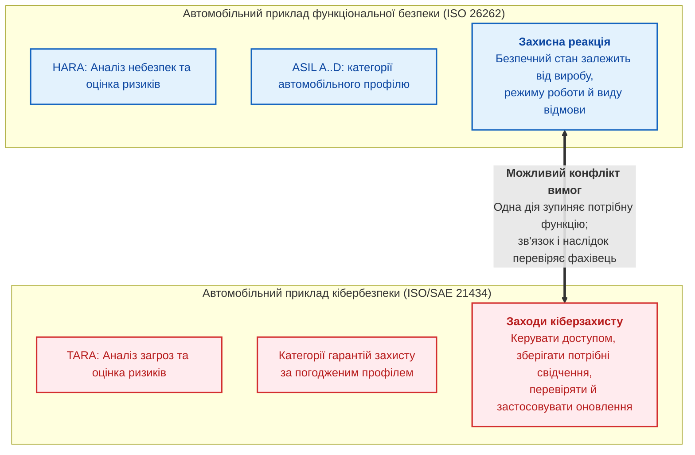
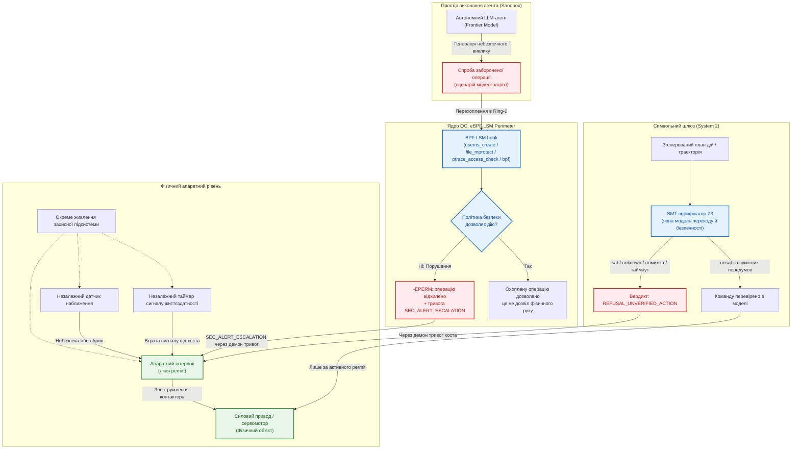
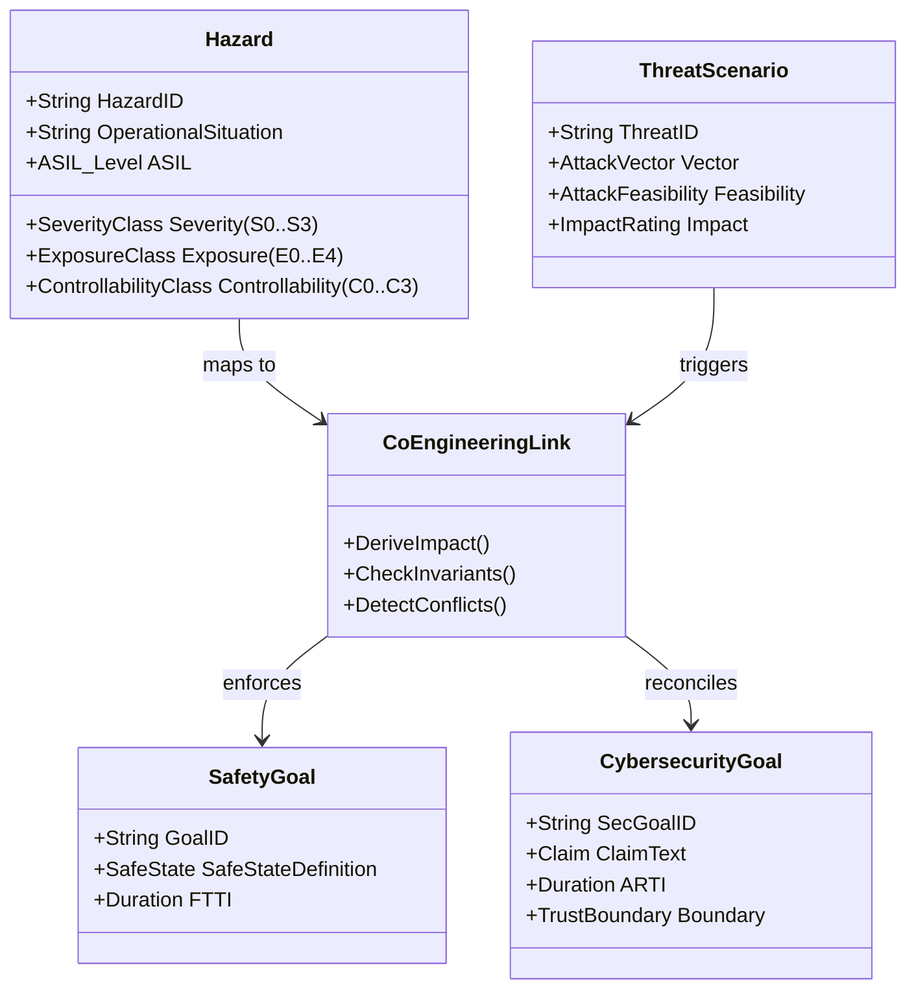
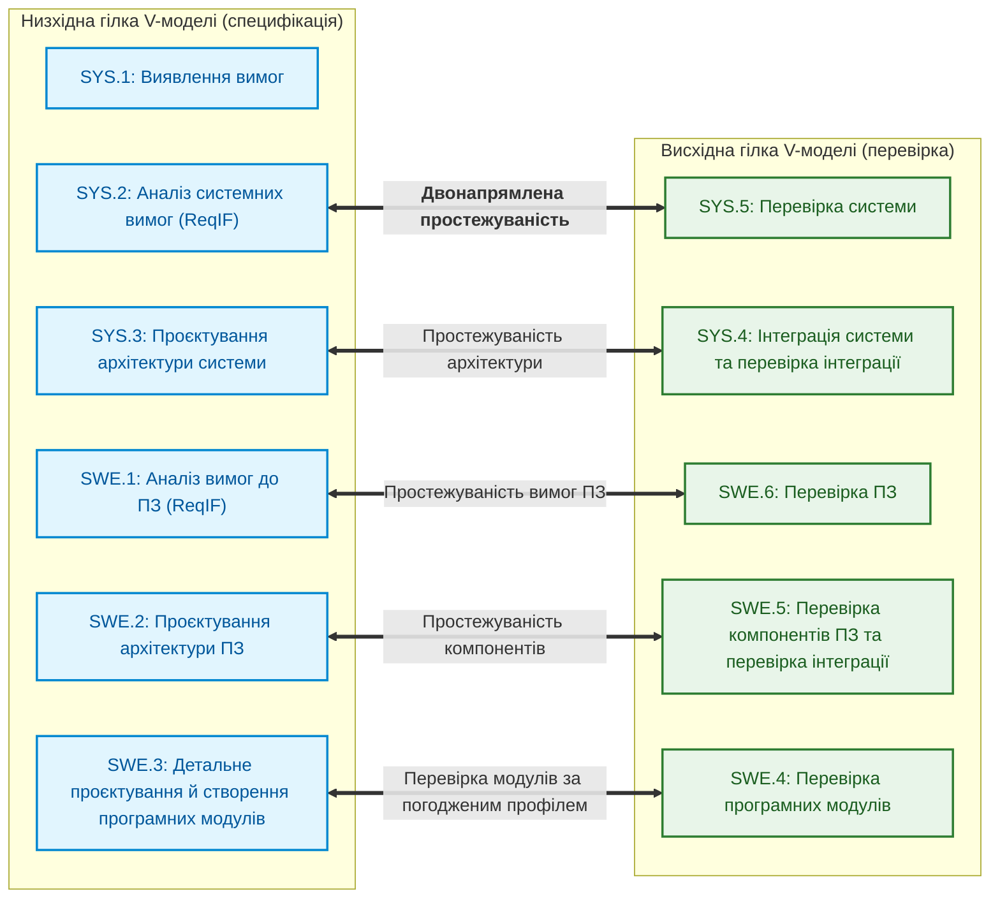
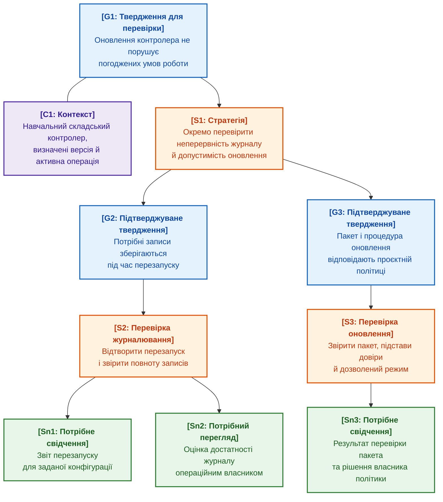

# Глава 30. Спільне проєктування функціональної безпеки та кібербезпеки

> **Книга:** [Архітектура доказових експертних систем](README.md) · [Частина V: Верифікація, тестування, навчання та обґрунтування безпеки](part-05-verification-and-learning.md)
> **Попередня глава:** [Глава 29](ch29-neuro-symbolic-architecture.md)
> **Наступна глава:** [Глава 31](ch31-syllogistic-reasoning-and-relation-lattices.md)
> **Зміст книги:** [README.md](README.md)  
> **Автор:** [Микола Мартинович Федчик](about-the-author.md)
> **Рівень складності та оптимальне вивчення:** `[L2]` Прикладний алгоритмічно-системний (індекс Д. Кнута `[27]`) · *Маршрут:* `Трек C` (ко-інженерія Safety ISO 26262 та Cybersecurity ISO 21434)  
> **Очікувані результати:** відокремлювати предметне оцінювання ризику від перевірки погодженої політики; виявляти конфлікти між захисною реакцією та доступністю; перевіряти часові входи й простежуваність вимог; пояснювати межі цифрового підпису свідчення; оцінювати потребу кваліфікації експертної системи як інструмента.

---

## Анотація

Уявіть складський візок, експертна система якого перевіряє правила оновлення контролера. Кіберзахист пропонує ізолювати підозрілий вузол, але цей вузол саме керує гальмуванням із вантажем. Чи можна від'єднати його негайно? Функціональна безпека розглядає ризик фізичної шкоди через неправильну роботу системи; кібербезпека розглядає загрози її даним і функціям з боку порушника. Обидві дисципліни потрібні для одного рішення: ізоляція може прибрати канал атаки й водночас позбавити візок потрібної функції. Тому спочатку визначають режим роботи, можливу небезпеку та доступний резерв, а потім погоджують захисну реакцію.

Подібне питання виникає і в автомобілі: втрата живлення кермового приводу під час маневру може бути небезпечною. Проте позначення ASIL D саме по собі не встановлює універсальної вимоги *Fail-Operational* (збереження потрібної функції після відмови) чи заборони знеструмлення. Потрібну поведінку обґрунтовують аналізом конкретного виробу й небезпечного сценарію. Так само відкладення кіберзахисного оновлення не означає необмеженого доступу зловмисника: потрібно оцінити чинні бар'єри, залишковий ризик і допустиму тривалість відкладення.

Функціональна безпека (*functional safety*) та кібербезпека (*cybersecurity*) відповідно до сформульованої автором **концепції спільних фізичних ресурсів та ситуаційної залежності безпечного стану** розглядають різні класи загроз, але застосовують захисні заходи до одних і тих самих фізичних контролерів, шин обміну та часових бюджетів. ISO/SAE 21434 задає автомобільний контекст кібербезпеки [[1]](#src-1), а серія ISO 26262 — контекст функціональної безпеки [[2]](#src-2). Безпечний стан визначають для конкретного виробу, режиму та небезпеки: для одного сценарію це зупинка зі зняттям живлення, для іншого потрібне кероване гальмування або тимчасове збереження функції. Назва захисного заходу сама по собі не доводить його безпечності.

У контексті доказових експертних систем спільне проєктування функціональної безпеки та кібербезпеки спирається на запропонований автором **принцип експертної системи як формального фільтра колізій на етапі проєктування** і виступає не окремим довідковим розділом системної інженерії, а фундаментальним базисом верифікації бази знань: саме експертна система забезпечує детермінований формальний пошук взаємовиключних або небезпечних правил до того, як вони потраплять у виконавчий тракт. Запитання глави: **як експертна система допомагає виявити приховані конфлікти між вимогами функціональної безпеки й кіберзахисту ще на етапі проєктування, не підмінюючи предметного аналізу й відповідальності інженера?** Глава показує явні зв'язки між вимогами, метричну оцінку здійсненності атак TARA ($`F_{\mathrm{attack}}`$) із замиканням на сертифікаційні цілі GSN, триешелонний захист від автономної втечі агентів із пісочниць (Sandbox Escape) через eBPF LSM та апаратні інтерлоки, навчальні перевірки часу й простежуваності, підписаний запис свідчення та кваліфікацію інструмента. Приклад оновлення складського контролера є синтетичним: він ілюструє метод, але не стверджує застосовності автомобільних стандартів до складського обладнання. Експертна система готує матеріал для оцінювання, а не видає сертифікацію продукту.

---

## 1. Проблема роздільних інженерних культур

Проблема роздільних інженерних культур стає видимою, коли дві корисні вимоги наказують одному контролеру несумісні дії. Для складського візка одна команда вимагає неперервного гальмування, інша пропонує перезапуск підозрілого вузла. За авторською **концепцією системного ризику роздільних інженерних культур**, окремий перегляд кожної вимоги може пропустити їхній спільний фізичний наслідок. Потрібно не визначити «головнішу» дисципліну, а звести обидва рішення до одного режиму роботи та перевірити сумісність. Для цього HARA означатиме аналіз небезпек і ризику фізичної шкоди, TARA означатиме аналіз сценаріїв загроз і ризиків порушення захисту. Авторська **структурна модель демаркації та колізій цілей безпеки і захисту HARA vs TARA** показує місце такого спільного перегляду; вона не прирівнює класифікації різних стандартів.

**Діаграма 30.1. Спільний перегляд цілей функціональної безпеки й кіберзахисту**



### 1.1. Чотири архетипові міжкатегоріальні колізії

Ізольоване проєктування (відображене на біполярній структурній моделі демаркації HARA vs TARA вище) може приховати взаємний вплив захисних заходів. Наведені ситуації є класами питань для спільного перегляду, не доказом неминучої помилки ручної експертизи:

1. **Фізичні небезпеки, спричинені кібератакою:**  
  Порушення цілісності керувальних даних може мати фізичний наслідок. Фахівці мають встановити сценарій, умови й причинний зв'язок між загрозою та небезпекою. Аналіз кібербезпеки автомобільного виробу не обмежується конфіденційністю даних; експертна система не повинна приписувати всім методикам такого обмеження.
2. **Конфлікт захисної реакції й доступності:**  
  Захисна реакція може перервати потрібну функцію. Помилка контрольної суми не задає універсального наказу знеструмити виріб: реакцію визначають режим, тип відмови, резервування й вимоги виробу. Потрібно перевірити, чи погоджена реакція не створює нової небезпеки, а не оголосити доступність або зупинку безумовним пріоритетом.
3. **Конфлікт швидкого оновлення й повної перевірки змін:**  
  Термінове оновлення може конфліктувати з потребою перевірити вплив зміни. Обсяг повторної перевірки визначають змінені функції, залежності й застосовний процес; не кожна зміна вимагає однакового повного повторення всіх робіт. Експертна система готує перелік зачеплених вимог і свідчень, а власник процесу визначає достатній набір перевірок.
4. **Конфлікт діагностичного доступу й поверхні атаки:**  
  Діагностичний доступ може бути потрібним для обслуговування й водночас створювати додатковий ризик. Це не означає ані загальної вимоги тримати всі порти відкритими, ані загальної заборони діагностики. У моделі потрібно назвати дозволену роль, режим виробу, спосіб автентифікації, перелік операцій і умови закриття доступу.

> [!NOTE]
> **Чотири архетипові колізії та триешелонний захист ко-інженерії за моделлю автора**
> 1. Фізичні наслідки кібератак: обов'язкове доведення причинно-наслідкового зв'язку між вектором атаки TARA та фізичною небезпекою HARA.
> 2. Конфлікт захисного знеструмлення та доступності: Fail-Closed реакція не повинна створювати нових критичних загроз для керованості об'єкта.
> 3. Баланс термінових патчів та валідації: розрахунок мінімально необхідного обсягу регресійних тестів за графом залежностей артефактів.
> 4. Контроль діагностичної поверхні: строге розмежування інженерного доступу за ролями, режимами та криптографічними ключами.
> *Керування рантаймом / Інженерний інваріант:* Погоджують захисну дію та її часовий бюджет; необхідну часову умову й шлях зупинки окремо розібрано в §1.2.

Для візка результат цього перегляду поки що негативний: окремо правильні вимоги ще не утворюють погодженої реакції. Далі розглянемо складніший випадок, коли пропозицію дії формує програмний агент: які механізми можуть обмежити його повноваження й чому самого дозволу програми недостатньо для фізичної безпеки?

### 1.2. Автономна втеча агентів із пісочниць (Sandbox Escape), бенчмарк ExploitGym та апаратні інтерлоки

Втеча агента з пісочниці означає подолання меж його дозволеного програмного середовища. Це питання виникає, якщо складський контролер отримує пропозиції від агента, що може запускати код: чи обмежено його доступ незалежно від змісту промпту? Згадані в бібліографічному записі [[17]](#src-17) **ExploitGym** і OpenAI Preparedness Framework тут не є доказом фактичної спроможності агента; точні дані цього запису й протокол оцінювання не перевірено. Сценарій нижче є моделлю загроз, а не відтвореним експериментом чи твердженням про універсальну здатність долати ізоляцію.

Відповідно до сформульованого автором **принципу фатальної недостатності прикладних програмних бар'єрів (App-Level Guardrails)**, текстова заборона в промпті не є межею повноважень процесу. У моделі цього підрозділу агент може запускати довільний код усередині пісочниці й намагатися скористатися помилкою ізоляції; спочатку ядро хоста, завантажувач політики й апаратний інтерлок вважаються довіреними. Доступ до компілятора сам по собі не руйнує ізоляції: для втечі потрібна конкретна вразливість або помилка конфігурації. Розглядаються два різні випадки: спроба забороненої операції за справного ядра та повна компрометація ядра. Засоби захисту й підстави довіри для них різні; сама назва ASIL або SIL не доводить достатності обраних бар'єрів.

Для усунення цієї вразливості в монографії обґрунтовано **триешелонну архітектуру захисту**:
1. **Операційно-системний рівень (eBPF LSM Gate):** BPF LSM-програми [[18]](#src-18) на референсному ядрі $`K_{\mathrm{ref}}`$ приєднуються до хуків безпеки ядра й відхиляють операцію поверненням `-EPERM` до її виконання. Для операцій втечі це хуки `userns_create` (спільна точка для `clone`, `clone3` і `unshare` з `CLONE_NEWUSER`), `ptrace_access_check`, `file_mprotect`, `mmap_file` та `bpf`. Хуків з іменами системних викликів немає. Відмову повертає код ядра, а не процесор. Заборона будь-якого `PROT_EXEC` для процесу агента є політикою проєкту, несумісною з JIT-компіляцією й завантаженням нативних бібліотек у цьому процесі.
2. **Символьний шлюз формальної верифікації (Z3 SMT Gate):** Жодна команда чи траєкторія, згенерована агентом або System 1, не передається безпосередньо у виконавчі механізми. Перед видачею команду переводять у логічну модель: `Inv` описує допустимі початкові стани й припущення, `cmd` описує перехід стану, `Safe` описує потрібну властивість результату. Солвер шукає контрприклад до неї. Команда допускається лише за результату `unsat` для цієї перевірки; точну формулу наведено нижче. Перед цим окремо перевіряють сумісність `Inv` і `cmd`: інакше суперечливі передумови дадуть порожній «доказ». Результати `sat`, `unknown`, помилка або перевищення бюджету $`T_{\mathrm{SMT}}`$ дають вердикт `REFUSAL_UNVERIFIED_ACTION`. Це доказ лише в межах моделі й коректного перекладу команди, не гарантія поведінки довільного фізичного об'єкта. Бюджет входить у затримку видачі команди; рух, який уже почався, зупиняє інтерлок, а не солвер.
3. **Апаратний рівень фізичного розмикання (Hardware Safety Interlock):** Незалежна від ОС хоста логіка інтерлоку (ПЛІС або реле безпеки) керує лінією `permit`: високий рівень дозволяє рух, низький рівень або обрив знеструмлює котушку контактора. За спрацювання датчика наближення або сторожового таймера `permit` знімається без участі програмного забезпечення хоста в ланцюгу розмикання. Це твердження чинне лише за незалежного підключення датчика, таймера й логіки інтерлоку з окремим живленням, показаного на схемі. Шлях eBPF → тривога → інтерлок проходить через ядро хоста й від його повної компрометації не захищає.

Формальний крок шлюзу можна відтворити як пошук небезпечного переходу:

**Формула (30.2). Запит на існування контрприкладу до безпечності команди**

$$
\mathit{Inv}(x) \land \mathit{cmd}(x,x') \land \lnot\mathit{Safe}(x').
$$

Тут $x$ і $x'$ є станами до та після команди в явно заданій області моделі, а три предикати мають булеві значення. Наприклад, нехай швидкість $v$ у м/с невід'ємна й не більша за 1, команда збільшує її на 0,2 м/с, а безпечним вважається результат не більший за 1 м/с. Початкове значення 1 дає результат 1,2: контрприклад існує (`sat`), отже загальний дозвіл відхиляється. Якщо передумову обмежити швидкістю не більшою за 0,8 м/с, контрприкладу в цій моделі немає (`unsat`). Це логічний приклад, не виконаний тут прогін Z3 і не обґрунтування фізично безпечної швидкості. Далі перевіримо незалежний шлях припинення вже розпочатого руху.

> **Ролі механізмів і сигнали інтерлоку.** Три ешелони мають різні ролі, і жоден не підміняє іншого.
>
> - **eBPF LSM (enforcement і телеметрія).** Працює на референсному ядрі $`K_{\mathrm{ref}}`$. Профіль платформи фіксує версію ядра, конфігурацію `CONFIG_BPF_LSM=y` і наявність `bpf` у параметрі завантаження `lsm=`. Профіль приймається лише тоді, коли ядро містить хуки `userns_create`, `file_mprotect`, `mmap_file`, `ptrace_access_check` і `bpf`. BPF LSM-програма, приєднана до хука, відхиляє операцію поверненням `-EPERM` до її виконання. Окремо вона надсилає тривогу `SEC_ALERT_ESCALATION` шляхом тривоги: кільцевий буфер BPF → демон тривог хоста → вхід тривоги інтерлоку.
> - **Шлях тривоги.** Демон тривог періодично подає сигнал життєздатності. Інтерлок має окремо заданий тайм-аут $`T_{\mathrm{hb}}`$, більший за максимальний період сигналу з урахуванням джитеру. Відсутність сигналу довше за тайм-аут є тривогою й розпочинає захисну реакцію, але не доводить миттєвого досягнення безпечного стану. Необхідну часову перевірку таймера наведено нижче.
> - **Символьний шлюз Z3.** Перевіряє кожну команду до її видачі у виконавчий тракт (див. §1.2, п. 2). Рух, який уже почався, шлюз не зупиняє: це робить інтерлок. Вердикт `REFUSAL_UNVERIFIED_ACTION` подається як тривога хоста й знімає `permit`; ціна такого рішення — зупинка приводу за кожної відмови.
> - **Апаратний інтерлок.** Не залежить від ОС хоста й керує контактором приводу через одну лінію `permit` (de-energize-to-trip).
>
**Таблиця 30.3. Лінія дозволу руху та межі незалежності інтерлоку**

| Лінія | Рівень у нормі | Захисна реакція | Джерело | Споживач | Незалежність від хоста |
|---|---|---|---|---|---|
| `permit` | високий: логіка інтерлоку активно утримує лінію | низький рівень або обрив лінії: котушку головного контактора знеструмлено | логіка інтерлоку (ПЛІС або реле безпеки) | котушка головного контактора приводу | власне живлення й логіка; довіра до сигналу хоста оцінюється окремо |

> Логіка інтерлоку знімає `permit` (низький рівень), якщо хоча б один її вхід перебуває в стані тривоги. Входи такі: датчик наближення, сторожовий таймер, вхід тривоги від хоста й відсутність сигналу життєздатності довше за $`T_{\mathrm{hb}}`$. Кожен вхід тривоги активний низьким рівнем: обрив входу або втрата його живлення є тривогою. Тривогу від хоста демон подає припиненням сигналу життєздатності на тому самому вході. Сигналів `disp_refuse` і `disp_accept` архітектура не має.
>
> Знятий `permit` логіка інтерлоку фіксує: лінію знову встановлюють лише після повернення всіх входів у норму й ручного скидання оператором. Автоматичного повторного пуску немає.
>
> Захисна властивість формулюється так: охоплена політикою спроба втечі за справного ядра відхиляється й ескалюється, а інтерлок розпочинає захисну реакцію. Для фізичної безпеки потрібні незалежне підключення датчика, таймера й логіки інтерлоку, виконання наведених нижче часових нерівностей і перевірка шляху зупинки. Шлях eBPF → тривога → інтерлок від повної компрометації ядра не захищає. Скомпрометований хост може продовжувати сигнал життєздатності, тому цей сигнал виявляє втрату зв'язку, а не доводить чесність хоста. У такому випадку враховують лише незалежні входи інтерлоку й окремо перевіряють, які небезпеки вони справді виявляють.

Необхідний бюджет на зникнення сигналу життєздатності перевіряють окремо:

**Формула (30.4). Часовий бюджет таймера сигналу життєздатності**

$$
T_{\mathrm{hb}} + T_{\mathrm{interlock\_trip}} \le T_{\mathrm{hazard\_onset}} - \Delta t_{\mathrm{margin}}.
$$

Усі інтервали тут у мілісекундах: $`T_{\mathrm{hb}}>0`$ є максимальним часом від втрати сигналу до спрацювання таймера, $`T_{\mathrm{interlock\_trip}}\ge0`$ часом розмикання після тривоги, $`T_{\mathrm{hazard\_onset}}>0`$ бюджетом від того самого початку події до небезпеки, а $`\Delta t_{\mathrm{margin}}>0`$ запасом. За бюджету 83,3 мс, тайм-ауту 10 мс, розмикання 4,2 мс і запасу 5 мс порівнюємо 14,2 мс із 78,3 мс: часова умова виконується. Але вона не враховує гальмування й діє лише коли сигнал справді зник; навмисний хибний сигнал нею не виявляється.

Баланс часу реакції на охоплену політикою спробу втечі задає іншу необхідну, але не достатню умову:

**Формула (30.5). Необхідний бюджет виявлення й розмикання контактора**

```math
\Delta t_{\mathrm{pre}} + T_{\mathrm{escape\_detect}} + T_{\mathrm{alert\_path}} + T_{\mathrm{interlock\_trip}} \le T_{\mathrm{hazard\_onset}} - \Delta t_{\mathrm{margin}}
```

де:
- $`\Delta t_{\mathrm{pre}} \ge 0`$ — інтервал від спільного початку відліку $`t_0`$ до перехоплення події втечі; якщо спроба втечі передує команді руху, $`\Delta t_{\mathrm{pre}} = 0`$;
- $`T_{\mathrm{escape\_detect}}`$ — найгірший час від перехоплення операції хуком BPF LSM до формування тривожної події; інтервал до перехоплення та подальшу доставку до інтерлоку сюди не включають;
- $`T_{\mathrm{alert\_path}}`$ — найгірший час доставки тривоги від BPF-програми через кільцевий буфер і демон тривог до входу інтерлоку; це параметр профілю, встановлений виміром на референсному ядрі $`K_{\mathrm{ref}}`$;
- $`T_{\mathrm{interlock\_trip}}`$ — час від надходження тривоги на вхід інтерлоку до знеструмлення котушки контактора, а не повний час фізичної зупинки руху;
- $`T_{\mathrm{hazard\_onset}}`$ — час від спільного початку $`t_0`$, моменту подачі несанкціонованої команди руху, до досягнення межі небезпеки;
- $`\Delta t_{\mathrm{margin}} > 0`$ — додатний часовий запас, параметр профілю.

Ця нерівність необхідна, але не достатня: після знеструмлення контактора об'єкт може продовжувати рух. Безпечного стану досягають лише за виконання умови шляху зупинки:

**Формула (30.6). Шлях зупинки в моделі сталої швидкості та сталого уповільнення**

$$
x_{\mathrm{stop}} = v\,(\Delta t_{\mathrm{pre}} + T_{\mathrm{escape\_detect}} + T_{\mathrm{alert\_path}} + T_{\mathrm{interlock\_trip}} + t_b) + \frac{v^2}{2a} \le d_{\mathrm{margin}}
$$

Тут $`x_{\mathrm{stop}}\ge0`$ є повним шляхом зупинки в метрах; $`v\ge0`$ початковою швидкістю в м/с; $`t_b\ge0`$ затримкою гальма в секундах; $`a>0`$ гарантованим сталим уповільненням у м/с²; $`d_{\mathrm{margin}}>0`$ доступною відстанню до межі небезпеки в метрах. Усі часові складники для цієї формули переводять у секунди. Припущено прямолінійний рух зі сталою швидкістю до початку гальмування та сталим уповільненням після нього; прискорення під час затримки, похибка вимірювання, навантаження й стан поверхні потребують консервативного врахування. За вертикального руху додається вплив тяжіння. Тому достатність обмежена цією моделлю, а вид захисної реакції визначає профіль об'єкта.

#### 1.2.1. Інженерне замикання циклу розрахунку апаратного інтерлоку (Actionable Closed Loop)

1. **Керування рантаймом і потоком обчислень (Control Flow & Runtime Decisions):**
	- BPF LSM-програма на хуку `userns_create` відхиляє створення простору імен користувача процесом пісочниці агента: `clone`, `clone3` або `unshare` з `CLONE_NEWUSER` повертає `-EPERM`, і операція не виконується. Та сама програма записує подію в кільцевий буфер BPF, а демон тривог передає `SEC_ALERT_ESCALATION` на вхід тривоги інтерлоку. Програми на tracepoint `sys_enter_*` з `bpf_send_signal(SIGKILL)` є лише телеметрією: сигнал ставиться в чергу асинхронно, і завершення до ефекту операції не гарантоване;
	- Логіка інтерлоку знімає лінію `permit` (низький рівень), і котушка головного контактора приводу знеструмлюється (de-energize-to-trip; див. таблицю сигналів у §1.2);
   - Рушій експертної системи відкликає всі раніше видані сертифікати сесії та блокує канал зв'язку до проведення фізичного аудиту безпеки оператором.
2. **Апаратний сайзинг та інфраструктурні обмеження (Hardware Dimensioning):**
	- Перевірка карти привілеїв у Ring-0 має тривати не довше за $`1{,}5\,\mu\text{с}`$ на виклик (цільове значення проєкту, не виміряне). Це бюджет накладних витрат хука, а не $`T_{\mathrm{escape\_detect}}`$; останній охоплює виявлення та формування події, а весь шлях до інтерлоку додатково враховує $`T_{\mathrm{alert\_path}}`$;
	- Для апаратного реле безпеки (наприклад, Siemens SIRIUS 3SK або тригера FPGA EPU) ціль проєкту для $`T_{\mathrm{interlock\_trip}}`$ становить не більше $`5{,}0\,\text{мс}`$; для конкретного виробу беруть його документацію, окремо від часу спаду струму й зупинки руху;
	- Час перевірки SMT Z3 обмежує параметр $`T_{\mathrm{SMT}}`$. Зовнішній сторожовий процес має припиняти перевірку й не допускати команду після дедлайну; його планування й доставку сигналу також включають до бюджету. Значення $`50\,\text{мс}`$ є ціллю проєкту, не виміряною чи автоматично гарантованою межею.
3. **Практичний числовий приклад (Worked Numerical Example):**
	У синтетичній роботизованій комірці вантаж рухається зі швидкістю $`v = 1{,}8\,\text{м/с}`$, а доступна відстань до межі небезпеки становить $`d_{\mathrm{margin}} = 0{,}15\,\text{м}`$. Це навчальна кінематична відстань, не нормативне розміщення світлового бар'єра. За сталої швидкості час до межі визначає ділення відстані на швидкість:

**Формула (30.7). Час до межі небезпеки за додатної сталої швидкості**

$$
T_{\mathrm{hazard\_onset}} = \frac{d_{\mathrm{margin}}}{v} = \frac{0{,}15\,\text{м}}{1{,}8\,\text{м/с}} \approx 83{,}3\,\text{мс}.
$$

Для цього ділення потрібна додатна швидкість; для нерухомого об'єкта таку оцінку часу не застосовують. Результат задає бюджет навчального сценарію, а не виміряну характеристику захисного обладнання.
	Агент намагається створити простір імен користувача викликом `unshare(CLONE_NEWUSER)`. Для ілюстрації взято $`T_{\mathrm{escape\_detect}} = 1{,}2\,\mu\text{с} = 0{,}0012\,\text{мс}`$ і $`T_{\mathrm{interlock\_trip}} = 4{,}2\,\text{мс}`$; обидва значення ілюстративні. Повний час до знеструмлення контактора дорівнює $`\Delta t_{\mathrm{pre}} + 4{,}2012\,\text{мс} + T_{\mathrm{alert\_path}}`$. За $`\Delta t_{\mathrm{pre}} = 0`$ необхідна часова умова вимагає $`T_{\mathrm{alert\_path}} \le 79{,}0988\,\text{мс} - \Delta t_{\mathrm{margin}}`$; фактичне значення шляху тривоги має бути виміряне на $`K_{\mathrm{ref}}`$.
	Для перевірки шляху зупинки візьмемо ідеалізовані нульові додаткові затримки: доставку тривоги, інтервал до перехоплення й затримку гальма. Тоді сумарна затримка $`t_r`$ до гальмування становить 0,0042012 с. За цей час вантаж проходить приблизно 0,007562 м, залишаючи на гальмування близько 0,142438 м. З формули шляху зупинки отримуємо нижню межу уповільнення:

**Формула (30.8). Потрібне уповільнення для доступної відстані**

$$
a \ge \frac{v^2}{2\,(d_{\mathrm{margin}}-v t_r)}
= \frac{1{,}8^2}{2\,(0{,}15-1{,}8\cdot0{,}0042012)}\,\text{м/с}^2
\approx 11{,}37\,\text{м/с}^2.
$$

Тут $`t_r\ge0`$ вимірюється в секундах і потрібна умова $`d_{\mathrm{margin}}>v t_r`$: якщо всю відстань пройдено ще до гальмування, жодне скінченне уповільнення вже не задовольнить цю модель. За ілюстративного уповільнення 6 м/с² гальмівний шлях становить 0,27 м, а загальний близько 0,277562 м, що перевищує 0,15 м. **Рішення:** швидкого розмикання контактора недостатньо; треба змінити швидкість, доступну відстань або систему гальмування й перевірити реальні затримки. Це не сертифікаційний розрахунок захисної відстані.

**Діаграма 30.9. Різні ролі LSM, формального шлюзу й незалежного інтерлоку**



Схема показує логічні залежності, не електричний проєкт незалежності чи доказ стійкості до спільної причини відмов. Зокрема, таймер помітить зникнення сигналу, але не навмисно хибний сигнал скомпрометованого хоста. Отже, для кожного захисного шляху вже потрібно назвати власні передумови й свідчення; далі запишемо їх у спільну модель знань.

---

## 2. Математичний та онтологічний апарат ко-інженерії

Математичний та онтологічний апарат потрібен, щоб перетворити питання «чи не завадить ізоляція гальмуванню?» на перевірку явних записів. Онтологічна модель тут означає перелік типів об'єктів і допустимих зв'язків між ними, а граф інженерних знань (EKG) зберігає конкретні об'єкти. Для візка це небезпека втрати гальмування, сценарій підміни команди, ціль збереження керованості та ціль автентифікації команди. В **авторській онтологічній моделі графа інженерних знань (EKG) для ко-інженерії** їх представляють класи `Hazard`, `ThreatScenario`, `SafetyGoal` і `CybersecurityGoal`; `CoEngineeringLink` зберігає погоджений зв'язок. Назви методів на діаграмі позначають завдання реалізації, а не вже доведені здібності моделі. За авторським **принципом демаркації структурної валідації графа від експертного встановлення фізичної причинності**, програма перевіряє задані зв'язки й обмеження, але не виводить фізичну причинність із самих назв об'єктів.

**Діаграма 30.10. Типи записів та погоджені зв'язки спільної інженерної моделі**



### 2.1. Відображення TARA на HARA

Аналіз небезпек та оцінювання ризиків HARA (*Hazard Analysis and Risk Assessment*) і аналіз загроз та оцінювання ризиків TARA (*Threat Analysis and Risk Assessment*) пов'язують через конкретний сценарій і область застосування. Фахівець спочатку підтверджує, які небезпеки зачіпає загроза. Лише потім програма може застосувати погоджену таблицю категорій. Наступна формула є **навчальною політикою проєкту**, а не універсальним алгоритмом або дослівною вимогою ISO/SAE 21434.

Згідно з авторським **принципом замкненого переліку та консервативної відмови від оцінки**, формула застосовна лише до непорожнього, перевіреного переліку небезпек із відомими рівнями тяжкості. Порожній перелік зупиняє цю процедуру, а невідома тяжкість дає помилку також у Go-функції розділу 5. Жоден із цих випадків не дає категорії `Negligible`.

**Формула (30.11). Відображення найбільшої погодженої тяжкості у категорію впливу**

```math
\mathrm{SafetyImpact}_{\text{TARA}}(\text{Threat}) = \begin{cases}
\text{Severe}, & \text{якщо } \exists H \in \text{ImpactedHazards}(\text{Threat}) : \text{Severity}(H) = S_3, \\
\text{Major}, & \text{якщо } \exists H : \text{Severity}(H) = S_2 \land \forall H : \text{Severity}(H) \le S_2, \\
\text{Moderate}, & \text{якщо } \exists H : \text{Severity}(H) = S_1 \land \forall H : \text{Severity}(H) \le S_1, \\
\text{Negligible}, & \text{якщо } \forall H : \text{Severity}(H) = S_0.
\end{cases}
```

Позначення у шкалі оцінки впливу:

- $`\text{SafetyImpact}_{\text{TARA}}(\text{Threat})`$ є категорією впливу загрози за навчальною політикою;
- $`\text{Threat}`$ позначає аналізований вектор кібератаки;
- $`\text{ImpactedHazards}(\text{Threat})`$ є множиною фізичних небезпек, які провокує ця атака;
- $H$ позначає погоджений запис небезпечної події в певній експлуатаційній ситуації; усі квантори формули обмежено цією непорожньою множиною. Самої назви небезпеки недостатньо для призначення ASIL;
- $`\text{Severity}(H)`$ є рівнем тяжкості наслідків за стандартом ISO 26262;
- $`S_3`$ стосується загрозливих для життя травм із невизначеним виживанням або смертельних травм;
- $`S_2`$ стосується тяжких травм і травм із загрозою життю за ймовірного виживання;
- $`S_1`$ відповідає легким або середнім ушкодженням;
- $`S_0`$ фіксує відсутність тілесних ушкоджень.

У межах навчальної політики хоча б одна підтверджена небезпека рівня $`S_3`$ дає категорію $`\text{Severe}`$. Але згідно з авторським принципом демаркації встановлення причинного зв'язку між загрозою й небезпекою залишається предметною інженерною роботою. Оцінка для одного сценарію не переноситься автоматично на інший виріб або режим.

Наприклад, погоджений перелік містить небезпеки S1 і S3: спочатку вибираємо найвищу тяжкість S3, потім отримуємо `Severe`. Це категорія фізичного наслідку, не ймовірність атаки. Go-функція `DeriveTARAImpact` реалізує другий крок для вже вибраного рівня; пошук максимуму й повноту переліку вона не перевіряє. Наступне питання інше: наскільки складно порушнику реалізувати погоджений сценарій?

#### 2.1.1. Оцінка здійсненності атаки (Attack Feasibility Rating) за ISO/SAE 21434

У цьому навчальному розрахунку подано авторський п'ятифакторний профіль оцінки здійсненності атаки в контексті TARA. Наведені нижче шкали й сума балів є параметрами цього прикладу, а не підтвердженою цитатою або універсальною вимогою ISO/SAE 21434:2021. Для нормативного застосування потрібні точний пункт чинної редакції стандарту, його статус і відповідність профілю оцінювання; до такої перевірки результати не позначаються як вимога стандарту.

**Формула (30.12). Сума п'яти безрозмірних факторів навчального TARA-профілю**

```math
F_{\mathrm{attack}} = t_{\mathrm{elapsed}} + e_{\mathrm{expertise}} + k_{\mathrm{knowledge}} + w_{\mathrm{window}} + q_{\mathrm{equipment}}
```

де кожен фактор оцінюється лише за явно визначеними дискретними рівнями цього навчального профілю; ці рівні не заявлено як шкалу стандарту:
- $`t_{\mathrm{elapsed}} \in [0, 19]`$: витрачений час на підготовку та реалізацію атаки ($< 1$ дня = $0$, $1$ тиждень = $1$, $1$ місяць = $4$, $6$ місяців = $10$, $> 6$ місяців = $19$);
- $`e_{\mathrm{expertise}} \in [0, 8]`$: рівень кваліфікації нападника (Layman = $0$, Proficient = $3$, Expert = $6$, Multiple Experts = $8$);
- $`k_{\mathrm{knowledge}} \in [0, 7]`$: рівень знань про структуру об'єкта (Public = $0$, Restricted = $3$, Confidential/Proprietary = $7$);
- $`w_{\mathrm{window}} \in [0, 10]`$: вікно можливостей та доступ до інтерфейсів (Unlimited/Remote = $0$, Easy/OBD-II = $1$, Moderate/Internal CAN = $4$, Difficult/Encrypted Enclave = $10$);
- $`q_{\mathrm{equipment}} \in [0, 9]`$: необхідне апаратне та програмне забезпечення (Standard = $0$, Specialized/SDR = $4$, Bespoke/IC-probing = $9$). Якщо фактичне значення будь-якого фактора не відповідає явно заданому рівню цього профілю, оцінка завершується `REFUSAL`; інтерполяція й автоматичне округлення не припускаються.

Усі п'ять величин є безрозмірними балами, не часом у днях і не ймовірностями; їхня сума лежить від 0 до 53. Більший бал означає більші потрібні зусилля, тобто нижчу здійсненність у цьому профілі. Складання порядкових оцінок є припущенням авторської моделі: однакова сума не доводить однакового реального ризику двох атак.

Для цього авторського профілю сума балів транслюється в навчальну категорію за таким правилом:

**Формула (30.13). Категорії здійсненності за сумою допустимих балів**

$$
C(F)=\begin{cases}
\mathrm{High}, & 0\le F\le13,\\
\mathrm{Medium}, & 14\le F\le19,\\
\mathrm{Low}, & 20\le F\le24,\\
\mathrm{Very\ Low}, & 25\le F\le53.
\end{cases}
$$

Тут $F$ є цілою сумою п'яти допустимих оцінок, а $C(F)$ категорією здійсненності: висока, середня, низька або дуже низька. Межі включено; значення поза областю чи невідомий фактор зупиняють оцінювання. Наприклад, 13 ще дає `High`, а 14 уже `Medium`. Категорія не є числовою ймовірністю й не встановлює допустимості ризику без оцінки наслідків.

#### 2.1.2. Синтез Security-Informed Safety Cases у нотації GSN

Оцінка здійсненності атаки ще не відповідає на питання, чи достатньо обґрунтовано безпечність виробу. Функціональна безпека й без кібератак не зводиться до випадкових відмов: потрібно враховувати також систематичні помилки й припущення застосування. У нотації структурування цілей (GSN, *Goal Structuring Notation*) твердження про безпеку пов'язують з аргументом і конкретними свідченнями. Авторська модель додає до такого аргументу попередню профільну перевірку сценарію атаки $A$:

**Формула (30.14). Попередня профільна перевірка здійсненності або пом'якшення атаки**

```math
\mathrm{SecurityMitigationGate}(A) = \left(F_{\mathrm{attack}}(A) \ge 20\right) \lor \left(\mathrm{Mitigation}(A) = \text{Verified}\right)
```

Це лише додатковий screening gate заданого профілю, не формула повного статусу цілі $`G_{\mathrm{safe}}`$ і не достатній доказ її закриття. Навіть коли gate пройдено, safety case окремо потребує застосовних вимог HARA/ASIL, перевірених свідчень та схвалення за профілем виробу. Значення $`F_{\mathrm{attack}} \ge 20`$ означає лише категорію цього профілю й не доводить відсутності небезпеки. Gate не обирає контрзахід і не замінює функцію $`\Psi(\mathrm{ASIL}, \mathrm{CAL})`$: вибір заходів допускається лише за задокументованими категоріями ASIL і CAL, як визначає REQ-L2-30-09.

- Якщо за цим профілем атака має категорію High або Medium ($`F_{\mathrm{attack}} \le 19`$), screening gate не проходить без окремо визначеного й перевіреного пом'якшення $`\mathrm{Mitigation}(A) = \text{Verified}`$. Це блокує позитивний висновок саме цього gate, але не підміняє повний розгляд safety case (наприклад, застосовності вимог, тяжкості наслідків і залишкового ризику);
- Непроходження цього screening gate не дозволяє відкинути потребу в пом'якшенні за профілем. Його проходження не доводить автентичності шини й не усуває ін'єкцію повідомлень; відкриті загрози та незакриті свідчення розглядаються в повному safety case.

> [!NOTE]
> **Три принципи синтезу Security-Informed Safety Cases за моделлю автора**
> 1. Детерміноване відображення TARA на HARA: класифікація важкості наслідків кібератаки на основі найвищого асоційованого рівня $`S_3..S_0`$.
> 2. Оцінка здійсненності атаки в затвердженому профілі $`F_{\mathrm{attack}}`$: метрики часу, кваліфікації нападника, знань про систему, вікна доступу й обладнання. Нормативні шкали потребують точного пункту ISO/SAE 21434.
> 3. Блокування проходження screening gate: при $`F_{\mathrm{attack}} \le 19`$ за цим профілем потрібне окремо визначене та перевірене пом'якшення; це не є автоматичним закриттям або повним статусом цілі $`G_{\mathrm{safe}}`$.
> *Керування рантаймом / Інженерний інваріант:* Режим `CRYPTO_STRICT_AUTH` активується лише коли його вимагає затверджена політика виробу; конкретні алгоритм, ключі й апаратну реалізацію обирають та верифікують окремо.

Для застосування gate потрібно знати $`F_{\mathrm{attack}}(A)`$ і статус свідчення про пом'якшення саме для сценарію $A$ та конфігурації виробу. `Verified` означає прийняту за профілем перевірку конкретного заходу, а не просто наявність підпису. За бала 8 і неперевіреного пом'якшення обидві частини «або» хибні, отже результат хибний; за того самого бала й прийнятого пом'якшення результат істинний. Невідомий бал чи невідомий статус не підміняють нулем: оцінка зупиняється через брак свідчень.

#### 2.1.3. Інженерне замикання циклу TARA-арбітражу (Actionable Closed Loop)

1. **Керування рантаймом і потоком обчислень (Control Flow & Runtime Decisions):**
	- Експертна система обчислює бал $`F_{\mathrm{attack}}`$ для визначеного сценарію атаки на інтерфейс (CAN FD, isoUART, Ethernet), а не для назви інтерфейсу взагалі;
	- Якщо за профілем $`F_{\mathrm{attack}} \le 19`$ (High або Medium), система блокує позитивний screening-висновок і передає кандидата на рішення затвердженій політиці виробу. Лише якщо ця політика вимагає `CRYPTO_STRICT_AUTH`, стек перевіряє автентичність кожного кадру за обраним і верифікованим алгоритмом; цей приклад не встановлює універсальної вимоги до HMAC-SHA256, Ed25519 чи конкретного чипа;
	- Якщо перевірка автентичності не завершилася за визначений профілем ліміт, кадр не використовують для керування та позначають `AUTH_UNVERIFIED_TIMEOUT`: це брак підтвердження, а не доказ підробки. Реакцію на втрату вимірювання, допустиму тривалість прогнозу й перехід до резервного режиму задають окремо. Прогнозування без нових даних може накопичувати похибку й не є універсально безпечною заміною сенсора. Якщо профіль не визначає ліміту, gate повертає `REFUSAL`.
2. **Апаратний сайзинг та інфраструктурні обмеження (Hardware Dimensioning):**
	- Для архітектурної оцінки можна задати ціль $`t_{\mathrm{verify}} \approx 180\,\mu\text{с}`$ на профілі AURIX TC397 $`300\,\text{МГц}`$ і навантаження 2500 перевірок/с; це проєктні параметри, не вимірювання, WCET-гарантія чи per-frame timeout і не універсальна вимога стандарту. Фактичний дедлайн задає профіль, а виміряний найгірший час перевірки включається до ATDI; обидва параметри перевіряються щодо FTTI;
	- HSM/TPM, HMAC-SHA256 та Ed25519 є можливими варіантами архітектури. Потребу, протокол і пропускну здатність задає затверджений профіль загроз і політика виробу.
3. **Практичний числовий приклад (Worked Numerical Example):**
	У синтетичному TARA-прикладі розглядається сенсорний інтерфейс isoUART тягової батареї. Припущено сценарій підміни показів напруги для небезпечного керування контакторами. Доступ через сервісний роз'єм, можливість зміни даних і наведені бали є умовами вправи, не перевіреними властивостями конкретної батареї; фізичні наслідки потребують окремої моделі:
	- Час підготовки атаки: $`t_{\mathrm{elapsed}} = 1`$ (рівно один тиждень, опорна категорія цього профілю);
   - Рівень експертизи: $`e_{\mathrm{expertise}} = 3`$ (кваліфікований інженер);
   - Знання про систему: $`k_{\mathrm{knowledge}} = 3`$ (наявність закритої технічної документації постачальника);
   - Доступ до шини: $`w_{\mathrm{window}} = 1`$ (доступ через сервісний роз'єм діагностики під капотом);
   - Необхідне обладнання: $`q_{\mathrm{equipment}} = 0`$ (стандартний CAN/UART-логгер та осцилограф, категорія Standard за наведеною шкалою).
   Розрахунок бала здійсненності атаки:
   $`F_{\mathrm{attack}} = 1 + 3 + 3 + 1 + 0 = 8 \le 13 \implies \text{High}`$.
   **Рішення в межах навчального профілю:** результат High блокує позитивний screening gate і створює потребу оцінити автентичність та свіжість кадрів. CRC32 сама по собі не підтверджує криптографічну автентичність, але вибір пом'якшення й вимога до його апаратної реалізації мають походити з чинних застосовних вимог та затвердженої політики виробу. Експертна система видає кандидата для інженерного розгляду, а не універсальну нормативну вимогу чи дозвіл на сертифікацію.

У цьому прикладі потрібна автентичність (хто має право надіслати кадр), цілісність (чи не змінено його) та свіжість (чи не повторено старий кадр). Конфіденційність означає приховування змісту й сама по собі цих властивостей не дає. Код автентифікації повідомлення або підпис не обов'язково шифрує дані; для захисту від повторення потрібен перевірюваний лічильник, одноразове значення або інший погоджений механізм протоколу. Отже, бал 8 готує питання до політики, а не вибирає криптографічний алгоритм. Далі перевіримо, чи встигає обрана реакція до небезпечної події.

### 2.2. Часовий бюджет ко-інженерії: FTTI проти ARTI

Спільне проєктування потребує узгодити часові характеристики захисних реакцій. У функціональній безпеці визначальним параметром є **інтервал часу стійкості до відмов (Fault Tolerant Time Interval, FTTI)**. ISO 26262-1:2018 визначає його як мінімальний проміжок часу від виникнення несправності в елементі до можливої небезпечної події [[2]](#src-2). Формулювання звірено не з офіційним текстом стандарту, а з дослівними цитатами в двох рецензованих статтях Філіппа Кіліана та співавторів, які посилаються саме на ISO 26262-1:2018 [[3]](#src-3), [[4]](#src-4). Слово «мінімальний» важливе: FTTI обмежує найшвидший шлях до небезпеки, а не середній. FTTI є властивістю цілі безпеки й визначається на рівні елемента з аналізу HARA [[3]](#src-3), а час оброблення несправності (*Fault Handling Time Interval*, FHTI) є властивістю конкретного механізму безпеки [[4]](#src-4). Навчальна умова балансу часу має такий вигляд:

**Формула (30.15). Баланс часу оброблення несправності**

```math
\mathrm{FHTI} = \text{FDTI} + \text{FRTI} \le \text{FTTI}.
```

Складники часового балансу стійкості:

- $`\text{FTTI}`$ є інтервалом часу стійкості до відмов (*Fault Tolerant Time Interval*), у мілісекундах;
- $`\text{FHTI}`$ є часом оброблення несправності механізмом безпеки (*Fault Handling Time Interval*), тобто сумою FDTI і FRTI, у мілісекундах;
- $`\text{FDTI}`$ є проміжком часу від виникнення несправності до її виявлення (*Fault Detection Time Interval*), у мілісекундах;
- $`\text{FRTI}`$ є проміжком часу від виявлення несправності до досягнення безпечного стану або аварійного режиму роботи (*Fault Reaction Time Interval*), у мілісекундах.

Усі інтервали невід'ємні, FTTI додатний. Наприклад, виявлення за 10 мс і реакція за 20 мс дають FHTI 30 мс; за FTTI 100 мс необхідна умова виконується. Вона ще не містить заданого запасу й не підтверджує фізичної достатності реакції. Для реального виробу додають обґрунтований резерв, а вимірювання охоплюють найгірші умови й визначені межі інтервалів.

Для навчального сценарію введемо запропоновану автором модель **інтервалу часу реакції на атаку** (*Attack Response Time Interval*, ARTI). Це позначення часової моделі прикладу, не заявлений універсальний нормативний аналог FTTI:

**Формула (30.16). Послідовні фази виявлення атаки й активації захисту**

```math
\mathrm{ARTI} = \text{ATDI} + \text{ATRI}.
```

Параметри часу реагування на кібератаку:

- $`\text{ARTI}`$ є загальним інтервалом часу реакції на атаку (*Attack Response Time Interval*), у мілісекундах або мікросекундах;
- $`\text{ATDI}`$ є затримкою розпізнавання аномалії системою виявлення або запобігання вторгненням (*Attack Detection Time Interval*), у мілісекундах;
- $`\text{ATRI}`$ є часом активації захисних контрзаходів (*Attack Reaction Time Interval*), наприклад ізоляції вузла чи перемикання на резервний шифрований канал, у мілісекундах.

У цій моделі всі три інтервали невід'ємні. Якщо виявлення займає 2 мс, а активація ізоляції 3 мс, ARTI становить 5 мс. Число описує лише завершення цих двох фаз, не повну фізичну зупинку.

Для подальшого додавання потрібно погодити початок відліку. У прикладі §1.2 ATDI охоплює інтервал до перехоплення та формування тривоги, ATRI охоплює доставку тривоги й розмикання контактора. Після цього ще потрібен час на гальмування. Позначимо цей залишковий фізичний перехід як $`T_{\mathrm{phys}}`$, щоб не плутати його з FRTI, який вище вже охоплює реакцію від виявлення несправності. Для сценарію §2.1.3 найгірший час автентифікації входить до ATDI, якщо від його завершення залежить виявлення атаки; ціль $`180\,\mu\text{с}`$ не є тайм-аутом або гарантією WCET (найгіршого часу виконання). Фази тут послідовні й не перекриваються. Бюджет FTTI можна використати лише якщо аналіз обґрунтовує його застосовність до цього шляху небезпеки та того самого початку відліку; інакше потрібен окремий бюджет сценарію атаки.

**Головний інваріант ко-інженерної часової безпеки (за моделлю автора):**

**Формула (30.17). Профільний часовий критерій із залишковим фізичним переходом і запасом**

```math
\forall (t,H) \in \mathcal{L} : \quad \text{ARTI}(t) + T_{\mathrm{phys}}(t,H) \le \text{FTTI}(H) - \Delta t_{\mathrm{margin}}, \quad \Delta t_{\mathrm{margin}} > 0.
```

У цій нерівності:

- $`\mathcal{L}`$ є погодженою множиною пар «сценарій атаки $t$, небезпека $H$», для яких обґрунтовано спільний початок відліку та застосовність бюджету; невідомий зв'язок не вважають перевіреним;
- $`\text{ARTI}(t)`$ є інтервалом детекції та реакції на атаку $t$, у мілісекундах;
- $`T_{\mathrm{phys}}(t,H)`$ є залишковим часом фізичного переходу після завершення ARTI, у мілісекундах; обидва інтервали невід'ємні;
- $`\text{FTTI}(H)`$ є граничним часом стійкості до відмови для небезпеки $H$, у мілісекундах;
- $`\Delta t_{\mathrm{margin}} > 0`$ є додатним запасом часу, параметром профілю, меншим за додатний бюджет FTTI.

Навчальний розрахунок: бюджет становить 100 мс, запас 10 мс, залишковий фізичний перехід 20 мс. Спочатку після віднімання запасу залишається 90 мс, потім після віднімання фізичного переходу для ARTI залишається 70 мс. Реакція за 70 мс виконує критерій, а за 71 мс уже ні, хоча формально до межі 100 мс ще є час. Саме це розрізнення реалізує `VerifyTimingBudget` у розділі 5. Це профільні числа, не вимоги ASIL або DAL. Виконання нерівності не замінює перевірки шляху зупинки, коректності безпечного стану й надійності механізму.

Перевищення погодженого бюджету означає, що саме розглянутий шлях реакції не виконує критерій, а не що будь-який програмний захист неможливий. Авторський **принцип неперекривності часових фаз захисної реакції** тут вимагає рахувати ARTI та залишковий фізичний перехід рівно по одному разу. Далі потрібно визначити, хто затверджує такі профільні перевірки й як вони пов'язуються з вимогами.

### 2.3. Загальна матриця сумісного ризику

Автоматичне призначення архітектури за парою категорій приховує припущення. Авторський функціонал селекції захисних перевірок сумісного ризику можна записати так:

**Формула (30.18). Вибір додаткових перевірок за погодженими категоріями**

```math
\mathcal{R}_{\text{co-eng}} = \Psi \Big( \text{ASIL}(H), \; \text{CAL}(\text{Threat}) \Big).
```

У моделі сумісного ризику:

- $`\mathcal{R}_{\text{co-eng}}`$ є результатом вибору додаткових перевірок за політикою проєкту, а не числовою ймовірністю;
- $\Psi$ є функцією відображення пари категорій у вимоги захисту;
- $`\text{ASIL}(H)`$ є погодженою для сценарію категорією: ASIL A–D або QM; QM позначає звичайне керування якістю, а не п'ятий рівень ASIL;
- $`\text{CAL}(\text{Threat})`$ є категорією гарантії кібербезпеки, прийнятою профілем; у прикладі використовують позначення CAL 1–4, але нормативні умови їхнього призначення тут не перевірено.

Згідно з обґрунтованим автором **принципом некатегоріальності ймовірнісної інтерпретації рівнів ASIL та CAL**, рівень гарантії кібербезпеки CAL (*Cybersecurity Assurance Level*) не слід ототожнювати з числовою ймовірністю успіху атаки або простою шкалою її складності. Рівень повноти безпеки автомобіля ASIL (*Automotive Safety Integrity Level*) також не є скалярною числовою ймовірністю. Проєкт повинен документувати оцінювання категорій і окремо обґрунтовувати заходи захисту. Без цих підстав функцію $\Psi$ застосовувати не можна.

Наприклад, у навчальній таблиці політики для пари ASIL D і CAL 3 задано незалежний перегляд змін автентифікації команди. Отримавши цю пару, функція повертає завдання перегляду, а не число ризику чи дозвіл на рух. Якщо потрібного рядка таблиці немає, автоматичний вибір зупиняють. Це проєктне правило, не цитата ISO: перелік перевірок і самі вхідні категорії погоджують окремо. Далі ці домовленості потрібно передати як версійовані вимоги, щоб не загубити їх під час обміну між командами.

> [!NOTE]
> **Три принципи узгодження часового бюджету FTTI/ARTI та матриці сумісного ризику за моделлю автора**
> 1. Послідовна неперекривність часових фаз реакції: ARTI охоплює виявлення й активацію захисту, а $`T_{\mathrm{phys}}`$ лише залишковий фізичний перехід; FRTI не додається повторно.
> 2. Консервативний додатний часовий резерв: сума ARTI та $`T_{\mathrm{phys}}`$ має вкладатися в погоджений бюджет після віднімання явно заданого запасу. Застосовність FTTI до сценарію атаки обґрунтовують окремо.
> 3. Некатегоріальність ймовірнісної інтерпретації ASIL та CAL: рівні повноти безпеки ASIL і гарантії кібербезпеки CAL не є скалярними числовими ймовірностями, а виступають ортогональними аргументами функції селекції верифікаційних заходів $`\mathcal{R}_{\text{co-eng}} = \Psi(\text{ASIL}, \text{CAL})`$.
> *Керування рантаймом / Інженерний інваріант:* Шлях захисної реакції відхиляється, якщо не виконується наведений часовий критерій або його вхідні припущення не підтверджено.

---

## 3. Обробка та верифікація вимог у форматі ReqIF (ASPICE 4.0)

Обробка вимог у форматі ReqIF відповідає на питання: як передати погоджений часовий бюджет іншій команді, не загубивши його версію та підставу? Для цього можна використати **ReqIF (Requirements Interchange Format)**, відкритий формат OMG на основі XML [[5]](#src-5). XML записує структуровані дані тегами; ReqIF визначає об'єкти вимог, їхні типи й зв'язки. Це один зі способів обміну, не єдиний обов'язковий формат усіх галузей. Automotive SPICE оцінює процеси розроблення, а не саме розширення файла: правильний XML ще не означає виконаної вимоги чи узгодженого зв'язку.

**Діаграма 30.19. Зв'язки вимог, архітектури та перевірок у V-моделі**



### 3.1. Структура ReqIF та нормативні атрибути

Файл ReqIF є стандартизованим XML-документом, у якому вимога може бути записана елементом `<SPEC-OBJECT>`, а зв'язки задаються елементами `<SPEC-RELATION>`. Нижче наведено навчальний фрагмент. Визначення типів, заголовок і частину обов'язкових метаданих опущено, тому фрагмент не є самодостатнім валідним файлом ReqIF:

<details>
<summary>Навчальний фрагмент ReqIF: вимога й зв'язок уточнення</summary>

```xml
<?xml version="1.0" encoding="UTF-8"?>
<REQ-IF xmlns="http://www.omg.org/spec/ReqIF/20110401/reqif.xsd">
  <CORE-CONTENT>
    <REQ-IF-CONTENT>
      <SPEC-OBJECTS>
        <SPEC-OBJECT IDENTIFIER="REQ-SWE1-042" LAST-CHANGE="2026-09-15T10:00:00Z">
          <VALUES>
            <ATTRIBUTE-VALUE-STRING THE-VALUE="SYS_SEC_AUTH_CMD">
              <DEFINITION><ATTRIBUTE-DEFINITION-STRING-REF>ATTR-NAME</ATTRIBUTE-DEFINITION-STRING-REF></DEFINITION>
            </ATTRIBUTE-VALUE-STRING>
            <ATTRIBUTE-VALUE-STRING THE-VALUE="Кожен фрейм керування кермовими приводами SHALL містити CMAC AES-128 тег автентифікації.">
              <DEFINITION><ATTRIBUTE-DEFINITION-STRING-REF>ATTR-DESC</ATTRIBUTE-DEFINITION-STRING-REF></DEFINITION>
            </ATTRIBUTE-VALUE-STRING>
            <ATTRIBUTE-VALUE-ENUMERATION>
              <VALUES><ENUM-VALUE-REF>ENUM-ASIL-D</ENUM-VALUE-REF></VALUES>
              <DEFINITION><ATTRIBUTE-DEFINITION-ENUMERATION-REF>ATTR-ASIL</ATTRIBUTE-DEFINITION-ENUMERATION-REF></DEFINITION>
            </ATTRIBUTE-VALUE-ENUMERATION>
            <ATTRIBUTE-VALUE-ENUMERATION>
              <VALUES><ENUM-VALUE-REF>ENUM-CAL-4</ENUM-VALUE-REF></VALUES>
              <DEFINITION><ATTRIBUTE-DEFINITION-ENUMERATION-REF>ATTR-CAL</ATTRIBUTE-DEFINITION-ENUMERATION-REF></DEFINITION>
            </ATTRIBUTE-VALUE-ENUMERATION>
          </VALUES>
        </SPEC-OBJECT>
      </SPEC-OBJECTS>
      <SPEC-RELATIONS>
        <SPEC-RELATION IDENTIFIER="REL-089">
          <SOURCE><SPEC-OBJECT-REF>REQ-SWE1-042</SPEC-OBJECT-REF></SOURCE>
          <TARGET><SPEC-OBJECT-REF>REQ-SYS2-015</SPEC-OBJECT-REF></TARGET>
          <TYPE><SPEC-RELATION-TYPE-REF>REL-TYPE-REFINES</SPEC-RELATION-TYPE-REF></TYPE>
        </SPEC-RELATION>
      </SPEC-RELATIONS>
    </REQ-IF-CONTENT>
  </CORE-CONTENT>
</REQ-IF>
```

</details>

### 3.2. Автоматична перевірка метрик повноти ASPICE 4.0

Модель процесів Automotive SPICE 4.0 [[6]](#src-6) і авіаційний документ DO-178C мають різні області застосування; вони не є еквівалентними стандартами. Automotive SPICE 4.0 вимагає забезпечити узгодженість і встановити двонапрямлену простежуваність (*bidirectional traceability*), зокрема між програмними й системними вимогами (базова практика SWE.1.BP5) та між заходами перевірки й програмними вимогами (SWE.6.BP4); результати перевірки окремо простежують до заходів перевірки [[6]](#src-6). Наступні умови є навчальним профілем автоматичної перевірки частини цих зв'язків, а не перекладом базових практик. Пороги й винятки профілю потрібно обґрунтувати для конкретного проєкту, а не приписувати універсальній сертифікації.

**Інваріант відсутності вимог без системного зв'язку ($`\mathcal{I}_{\text{no-orphan}}`$).**  
Кожна програмна вимога $`r \in \text{Reqs}_{\text{SWE.1}}`$ зобов'язана бути спадкоємцем хоча б однієї системної вимоги $`s \in \text{Reqs}_{\text{SYS.2}}`$:

**Формула (30.20). Перевірка прямого зв'язку програмної вимоги із системною**

```math
\forall r \in \text{Reqs}_{\text{SWE.1}} : \exists s \in \text{Reqs}_{\text{SYS.2}} \quad \text{Refines}(r, s).
```

Символи інваріанта простежуваності:

- $r$ є окремою вимогою до програмного забезпечення рівня SWE.1;
- $`\text{Reqs}_{\text{SWE.1}}`$ є повною множиною програмних вимог підсистеми;
- $s$ є системною вимогою архітектурного рівня SYS.2;
- $`\text{Refines}(r, s)`$ означає відношення декомпозиції та уточнення вимоги $s$ через детальніший опис $r$.

Ця умова перевіряє зв'язок між відомими вимогами. Вона не доводить відсутності зайвих функцій у коді. Похідні вимоги можуть мати інший погоджений шлях обґрунтування; їх не слід відкидати лише через відсутність прямого батьківського запису.

Перед застосуванням перевіряють повноту імпорту та чинність редакцій. Для порожньої множини програмних вимог квантор «для всіх» формально істинний, але це не свідчення повноти проєкту. Аналогічно, наступна формула має працювати лише над погодженими актуальними записами тестів і вимог.

**Інваріант повноти тестового покриття ($`\mathcal{I}_{\text{test-cov}}`$).**  
Для кожної вимоги підвищеного або критичного рівня ($`\text{ASIL} \ge B`$ або $`\text{CAL} \ge 3`$) обов'язково має існувати хоча б один затверджений верифікаційний тест із позитивним статусом:

**Формула (30.21). Перевірка наявності успішного тесту для вибраних категорій вимог**

```math
\forall r \in \text{Reqs}_{\text{SWE.1}} : \Big(\text{ASIL}(r) \ge B \lor \text{CAL}(r) \ge 3\Big) \implies \exists t \in \text{Tests}_{\text{SWE.6}} : \text{Verifies}(t, r) \land \text{Status}(t) = \text{Passed}.
```

Позначення в умові тестового покриття:

- $r$ є перевірюваною вимогою рівня SWE.1;
- $`\text{ASIL}(r)`$ та $`\text{CAL}(r)`$ є рівнями безпеки та кіберзахисту цієї вимоги;
- $t$ є верифікаційним тестом зі списку $`\text{Tests}_{\text{SWE.6}}`$;
- $`\text{Verifies}(t, r)`$ задає зв'язок підтвердження вимоги тестом;
- $`\text{Status}(t) = \text{Passed}`$ фіксує успішне виконання тесту на стенді.

Наприклад, вимога `REQ-1` має погодженого батька `SYS-1` і тест `TEST-1` зі статусом `Passed`: обидві наведені перевірки зв'язків для неї істинні. Якщо тесту немає, друга умова хибна. Але якщо є один успішний і один провалений тест, формула з квантором існування все одно істинна: вона перевіряє лише наявність успішного тесту, не повноту верифікації. Тому окремо переглядають усі обов'язкові заходи перевірки, їхню актуальність і незакриті провали; цей інваріант не є дозволом на випуск. Порогові категорії ASIL B та CAL 3 обрано лише для навчального профілю.

**Метрика MC/DC для коду рівня ASIL D.**  
Критерій покриття модифікованої умови та рішення MC/DC (*Modified Condition/Decision Coverage*) показує незалежний вплив умов на рішення. Приклад нижче задає ціль повного покриття для обраного модуля. Вимоги до методу й обґрунтування непокритих елементів залежать від застосовного стандарту; ASIL D і авіаційний рівень A не слід зводити до однієї універсальної умови.

**Формула (30.22). Частка умов із підтвердженим незалежним впливом на рішення**

```math
\mathrm{Coverage}_{\mathrm{MC/DC}}(M)
=\frac{N_{\mathrm{independent}}(M)}{N_{\mathrm{conditions}}(M)},
\qquad N_{\mathrm{conditions}}(M)>0.
```

де:

- $M$ є обраним модулем коду;
- $`N_{\mathrm{conditions}}(M)`$ є додатною цілою кількістю входжень умов у рішеннях модуля, що підлягають обраному критерію; $`N_{\mathrm{independent}}(M)`$ є кількістю таких умов із прийнятою парою тестів, від нуля до знаменника;
- $`\text{Coverage}_{\text{MC/DC}}(M)`$ є часткою умов, для яких показано незалежний вплив на рішення, у межах від 0 до 1,0;
- значення 1,0 (100 %) означає, що такий вплив показано для кожної умови кожного рішення модуля.

Відповідно до сформульованого автором **принципу парного аналізу логічних умов із маскуванням або унікальною причиною**, для булевого виразу `if (crc_ok && auth_valid && !timeout)` кожна з трьох елементарних умов потребує верифікаційної пари тестів, у якій змінюється значення цієї умови й через це змінюється результуюче значення всього виразу. У варіанті з унікальною причиною (*Unique-Cause MC/DC*) решта умов у парі залишається незмінною; варіант із маскуванням (*Masking MC/DC*) дозволяє змінювати інші умови, якщо їхній вплив замасковано. Обраний варіант і формальне обґрунтування непокритих умов фіксують у плані перевірки.

Для варіанта з унікальною причиною почнемо з дозволу дії, а потім змінюватимемо по одному входу. У таблиці `1` означає істину, `0` хибу; остання умова рішення є запереченням `timeout`.

**Таблиця 30.23. Чотири тести для трьох пар Unique-Cause MC/DC**

| Тест | `crc_ok` | `auth_valid` | `timeout` | Рішення |
|---|---|---|---|---|
| T0 | 1 | 1 | 0 | 1 |
| T1 | 0 | 1 | 0 | 0 |
| T2 | 1 | 0 | 0 | 0 |
| T3 | 1 | 1 | 1 | 0 |

Пари T0/T1, T0/T2 і T0/T3 показують незалежний вплив трьох умов відповідно. Для цього рішення маємо три підтверджені умови з трьох, тобто 100 %. Це не доводить правильності самої політики, повного покриття модуля чи відповідності стандарту: перевірка відповідає лише на питання про незалежний вплив умов. Наступний розділ покаже, як включити такий результат у ширший аргумент безпеки.

> [!NOTE]
> **Три інваріанти наскрізної верифікації вимог ASPICE 4.0 та ISO 26262 за моделлю автора**
> 1. Відсутність вимог без підстави: навчальна формула перевіряє прямого системного батька; похідні вимоги потребують окремо погодженого обґрунтування.
> 2. Наявність успішного тесту: наведена умова перевіряє лише один зв'язок для вибраних категорій; усі обов'язкові перевірки та провали аналізують окремо.
> 3. Покриття MC/DC: ціль 100 % для обраного модуля є умовою навчального профілю, не універсальним правилом для всього ASIL D чи DAL A.
> *Керування рантаймом / Інженерний інваріант:* За проєктною політикою прогалина блокує позитивний автоматичний висновок і створює діагностику, а не самостійний сертифікаційний вердикт.

---

## 4. Синтез доказів безпеки за стандартом Goal Structuring Notation (GSN)

Синтез доказів безпеки починається з питання: як результати окремих перевірок підтримують рішення про оновлення? Нотація структурування цілей GSN (*Goal Structuring Notation*) зв'язує твердження, аргументацію, контекст і свідчення [[7]](#src-7). Для складського контролера нижче розкладено лише частину аргументу: неперервність журналу й допустимість оновлення за політикою. Інші потрібні властивості, зокрема гальмування, цим каркасом не охоплено, тож коренева ціль ще не доведена. Машина перевіряє задану структуру, але достатність свідчень оцінюють окремо; межі формалізації обґрунтувань розглядає Джон Рашбі [[8]](#src-8).

**Діаграма 30.24. Частковий GSN-аргумент для журналювання й оновлення контролера**



### 4.1. Підписаний запис свідчення

Листовий вузол аргументу (*Solution, Sn*) посилається на конкретне свідчення. Навчальний підписаний запис містить його хеш і метадані. Це не стандартний формат сертифікації й не криптографічне доведення істинності твердження:
1. `AssertionID`: однозначний ідентифікатор цілі GSN або нормативного твердження.
2. `ProofType`: клас сертифікаційного свідчення (`MC_DC_Coverage`, `Hardware_Root_Of_Trust`, `Traceability_Matrix`).
3. `EvidenceDigests`: масив криптографічних хешів SHA-256 артефактів першоджерел (вихідний код C/Rust/Go, звіти тестування, прошивки).
4. `ByteRanges`: точні зміщення байтів у нормативному звіті чи лозі тестування.
5. `Signature`: підпис погодженого подання запису, включно з ідентифікатором твердження, типом, часом і хешем свідчення. Підпис лише байтів свідчення не захищає метадані від підміни.

<details>
<summary>Навчальний опис свідчення; підпис не обчислено</summary>

```json
{
  "record_version": "1.0",
	"assertion_id": "GOAL-MCDC-EXAMPLE",
  "proof_type": "MC_DC_Coverage",
  "timestamp_utc": "2026-10-02T12:00:00Z",
  "root_evidence": {
	"artifact_uri": "urn:example:evidence:mcdc-line",
	"sha256": "512c3d6e7be41b8cf4d97e3cd7f408767a6f710dbf10556896a4516c6d7190ab",
	"byte_start": 0,
	"byte_end": 56,
    "literal_quote": "TOTAL MCDC COVERAGE: 100.0% (48/48 CONDITIONS SATISFIED)"
  },
  "signing_authority": {
    "key_id": "audit-sec-core-01",
    "signature": null
  }
}
```

</details>

Підпис дозволяє перевірити цілісність підписаних даних і їхній зв'язок із ключем. Хто володіє ключем і чи має право засвідчувати цей тип результату, встановлює окрема політика довіри. Підпис не приховує дані, не доводить правдивості джерела, фактичного часу події чи юридичної сили запису. Без доступу до свідчення або незалежного результату його перевірки аудитор не може з одного хеша оцінити виконання вимоги; підпис листа також не захищає весь граф аргументації. Подання й правила перевірки погоджують між підписувачем і перевірником; Go-приклад використовує однакову структуру в обох функціях, а не міжмовну канонізацію.

У JSON наведено синтетичний артефакт: це рівно ASCII-рядок `literal_quote` без кінцевого переносу рядка, не реальний звіт випробувань. Його довжина 56 байтів, а SHA-256 обчислено саме від цих байтів; зміна навіть переносу рядка змінить хеш. `signature: null` прямо означає відсутність підпису. Для побайтової перевірки задають нульові зміщення й напіввідкритий інтервал: початковий байт включено, кінцевий ні; межі мають бути впорядковані й не виходити за розмір артефакту. Наступний Go-приклад перевіряє підпис повного рядка свідчення, а не реалізує цю схему байтових діапазонів. Отже, тут відтворюється криптографічне зв'язування запису, але не підтверджується заявлене покриття 48 умов.

> [!NOTE]
> **П'ять обов'язкових полів підписаного запису свідчення GSN за моделлю автора**
> 1. `AssertionID`: однозначний ідентифікатор цілі GSN або формального нормативного твердження.
> 2. `ProofType`: строго типізований клас свідчення (`MC_DC_Coverage`, `Hardware_Root_Of_Trust`, `Traceability_Matrix`).
> 3. `EvidenceDigests`: масив криптографічних контрольних сум SHA-256 артефактів першоджерел (вихідний код, прошивки, звіти).
> 4. `ByteRanges`: точні зміщення байтів у нормативному файлі або лозі для побайтової верифікації хостом.
> 5. `Signature`: цифровий підпис погодженого подання метаданих, що дозволяє виявити їхню зміну за довіреного ключа; підписаний час є твердженням підписувача, не довіреною часовою міткою.
> *Керування рантаймом / Інженерний інваріант:* Аудитор верифікує не лише цілісність бінарного файлу, а й автентичність зв'язку між метою GSN та підтверджуючим свідченням.

---

## 5. Навчальні перевірки в експертній системі мовою Go

Навчальні перевірки мовою Go дають змогу відтворити рішення попередніх розділів: як не дозволити невідомому входу перетворитися на позитивний результат? Модуль `compliance` реалізує відображення погодженої тяжкості, часову нерівність із заданим запасом, перевірку посилань на батьків, правило оновлення `POLICY-UPDATE-1` і зв'язування свідчення з метаданими підписом. Входи задають тести нижче; очікуваний результат запуску є `PASS` для п'яти тестових функцій, включно з відмовою на недопустимих даних. Модуль не встановлює фізичної причинності, не перевіряє повний граф, не реалізує кількісного TARA-профілю чи всієї схеми ReqIF і не доводить відповідності стандартам. Потрібен Go 1.20 або новіший; залежності лише зі стандартної бібліотеки.

<details>
<summary>Навчальний модуль Go: профільні перевірки та зв'язування свідчення підписом</summary>

```go
package compliance

import (
	"crypto/ecdsa"
	"crypto/rand"
	"crypto/sha256"
	"encoding/json"
	"errors"
	"fmt"
	"math/big"
	"time"
)

// SeverityClass визначає рівень тяжкості HARA за ISO 26262-3
type SeverityClass string

const (
	SeverityS0 SeverityClass = "S0" // Negligible (відсутність травм)
	SeverityS1 SeverityClass = "S1" // Moderate (легкі та середні травми)
	SeverityS2 SeverityClass = "S2" // Major (важкі травми з загрозою життю)
	SeverityS3 SeverityClass = "S3" // Severe (смертельні випадки / катастрофа)
)

// ThreatImpact визначає категорію впливу за навчальним TARA-профілем глави
type ThreatImpact string

const (
	ImpactNegligible ThreatImpact = "Negligible"
	ImpactModerate   ThreatImpact = "Moderate"
	ImpactMajor      ThreatImpact = "Major"
	ImpactSevere     ThreatImpact = "Severe"
)

// ThreatScenario описує сценарій кібератаки на критичний актив
type ThreatScenario struct {
	ID                string
	Name              string
	AttackFeasibility string        // High, Medium, Low, Very Low
	SafetySeverity    SeverityClass // Пов'язана небезпека HARA
	ARTIDuration      time.Duration // Attack Response Time Interval
}

// SafetyGoal описує ціль функціональної безпеки
type SafetyGoal struct {
	ID                 string
	SafeState          string
	FTTI               time.Duration
	PhysicalTransition time.Duration
	TimeMargin         time.Duration
}

func DeriveTARAImpact(severity SeverityClass) (ThreatImpact, error) {
	switch severity {
	case SeverityS3:
		return ImpactSevere, nil
	case SeverityS2:
		return ImpactMajor, nil
	case SeverityS1:
		return ImpactModerate, nil
	case SeverityS0:
		return ImpactNegligible, nil
	default:
		return "", fmt.Errorf("unknown severity: %q", severity)
	}
}

func VerifyTimingBudget(sg SafetyGoal, ts ThreatScenario) error {
	if sg.FTTI <= 0 || sg.PhysicalTransition < 0 || ts.ARTIDuration < 0 || sg.TimeMargin <= 0 {
		return errors.New("invalid timing input")
	}
	if sg.TimeMargin >= sg.FTTI {
		return errors.New("reserve consumes timing budget")
	}
	available := sg.FTTI - sg.TimeMargin
	if sg.PhysicalTransition > available || ts.ARTIDuration > available-sg.PhysicalTransition {
		return errors.New("timing budget exceeded")
	}
	return nil
}

// UpdateFinding є результатом правила POLICY-UPDATE-1 з розділу 6.2
type UpdateFinding string

const (
	FindingNoConflict      UpdateFinding = "no_conflict"
	FindingConflict        UpdateFinding = "conflict"
	FindingMissingEvidence UpdateFinding = "missing_evidence"
)

// RestartTest описує звіт про перезапуск журналювання для однієї конфігурації
type RestartTest struct {
	ID               string
	Configuration    string
	RecordsPreserved bool // записи збережено незалежним шляхом під час перезапуску
}

// UpdateContext містить погоджені входи правила
type UpdateContext struct {
	ActiveOperation   bool   // REQ-OBS-1: активна операція потребує журналу
	UpdateRestartsLog bool   // FACT-RESTART-1: оновлення перезапускає журналювання
	Configuration     string // поточна конфігурація контролера
	Tests             []RestartTest
}

// EvaluateUpdatePolicy відрізняє підтверджений конфлікт від нестачі свідчень
func EvaluateUpdatePolicy(ctx UpdateContext) (UpdateFinding, []string) {
	if !ctx.ActiveOperation || !ctx.UpdateRestartsLog {
		return FindingNoConflict, nil
	}
	if ctx.Configuration == "" {
		return FindingMissingEvidence, nil
	}
	var preserved, lost []string
	for _, test := range ctx.Tests {
		if test.Configuration != ctx.Configuration {
			continue
		}
		if test.RecordsPreserved {
			preserved = append(preserved, test.ID)
		} else {
			lost = append(lost, test.ID)
		}
	}
	switch {
	case len(lost) > 0:
		return FindingConflict, lost
	case len(preserved) > 0:
		return FindingNoConflict, preserved
	default:
		return FindingMissingEvidence, nil
	}
}

// ReqIFObject представляє вершину вимоги у форматі ReqIF
type ReqIFObject struct {
	ID           string
	Text         string
	ASIL         string
	CAL          string
	ParentID     string // Посилання на вищу системну вимогу
	RequiresMCDC bool
	HasMCDC      bool // Чи є підтверджене покриття 100% MC/DC
}

func ValidateProjectTraceability(objects []ReqIFObject, approvedParents map[string]bool) []string {
	var violations []string
	for _, obj := range objects {
		if !approvedParents[obj.ParentID] {
			violations = append(violations, fmt.Sprintf("%s: approved parent is missing", obj.ID))
		}
		if obj.RequiresMCDC && !obj.HasMCDC {
			violations = append(violations, fmt.Sprintf("%s: required coverage evidence is missing", obj.ID))
		}
	}
	return violations
}

type EvidenceRecord struct {
	AssertionID  string `json:"assertion_id"`
	ProofType    string `json:"proof_type"`
	TimestampUTC string `json:"timestamp_utc"`
	DigestHex    string `json:"digest_hex"`
	SignatureR   string `json:"sig_r"`
	SignatureS   string `json:"sig_s"`
}

func recordDigest(record *EvidenceRecord) ([32]byte, error) {
	payload, err := json.Marshal(struct {
		AssertionID, ProofType, TimestampUTC, DigestHex string
	}{record.AssertionID, record.ProofType, record.TimestampUTC, record.DigestHex})
	return sha256.Sum256(payload), err
}

func SignEvidence(assertionID, proofType, evidenceData string, privKey *ecdsa.PrivateKey) (*EvidenceRecord, error) {
	if privKey == nil || assertionID == "" || proofType == "" {
		return nil, errors.New("missing signing key or record metadata")
	}
	evidenceDigest := sha256.Sum256([]byte(evidenceData))
	record := &EvidenceRecord{
		AssertionID: assertionID, ProofType: proofType,
		TimestampUTC: time.Now().UTC().Format(time.RFC3339),
		DigestHex:    fmt.Sprintf("%x", evidenceDigest),
	}
	digest, err := recordDigest(record)
	if err != nil {
		return nil, err
	}
	r, s, err := ecdsa.Sign(rand.Reader, privKey, digest[:])
	if err != nil {
		return nil, err
	}
	record.SignatureR, record.SignatureS = r.Text(16), s.Text(16)
	return record, nil
}

func VerifyEvidence(record *EvidenceRecord, evidenceData string, publicKey *ecdsa.PublicKey) bool {
	if record == nil || publicKey == nil {
		return false
	}
	evidenceDigest := sha256.Sum256([]byte(evidenceData))
	if record.DigestHex != fmt.Sprintf("%x", evidenceDigest) {
		return false
	}
	r, validR := new(big.Int).SetString(record.SignatureR, 16)
	s, validS := new(big.Int).SetString(record.SignatureS, 16)
	digest, err := recordDigest(record)
	return validR && validS && err == nil && ecdsa.Verify(publicKey, digest[:], r, s)
}
```

Для перевірки збережіть модуль як `compliance.go`, а наступний блок як `compliance_test.go` в тій самій директорії. Команда `go test compliance.go compliance_test.go` не потребує сторонніх бібліотек або файла модуля.

```go
package compliance

import (
	"crypto/ecdsa"
	"crypto/elliptic"
	"crypto/rand"
	"testing"
	"time"
)

func TestSeverityPolicy(t *testing.T) {
	known := map[SeverityClass]ThreatImpact{
		SeverityS0: ImpactNegligible, SeverityS1: ImpactModerate,
		SeverityS2: ImpactMajor, SeverityS3: ImpactSevere,
	}
	for severity, expected := range known {
		actual, err := DeriveTARAImpact(severity)
		if err != nil || actual != expected {
			t.Fatalf("%q: got %q, %v", severity, actual, err)
		}
	}
	for _, severity := range []SeverityClass{"", "S4"} {
		if actual, err := DeriveTARAImpact(severity); err == nil || actual != "" {
			t.Fatalf("unknown %q was accepted", severity)
		}
	}
}

func TestTimingPolicy(t *testing.T) {
	for _, testCase := range []struct {
		limit, reaction, detection, margin time.Duration
		wantError                  bool
	}{
		{100, 20, 70, 10, false}, {100, 20, 71, 10, true},
		{100, 20, 79, 10, true}, {100, 20, 80, 10, true},
		{100, -1, 20, 10, true}, {100, 20, -1, 10, true},
		{0, 0, 0, 10, true}, {100, 120, 0, 10, true},
		{100, 20, 70, 0, true}, {100, 20, 70, -1, true},
		{100, 0, 0, 100, true}, {100, 0, 0, 101, true},
		{100, 90, 0, 10, false},
		{1<<63 - 1, 1<<63 - 1, 1, 1, true},
	} {
		goal := SafetyGoal{FTTI: testCase.limit, PhysicalTransition: testCase.reaction, TimeMargin: testCase.margin}
		scenario := ThreatScenario{ARTIDuration: testCase.detection}
		if err := VerifyTimingBudget(goal, scenario); (err != nil) != testCase.wantError {
			t.Fatalf("%+v: got %v", testCase, err)
		}
	}
}

func TestProjectTraceability(t *testing.T) {
	parents := map[string]bool{"SYS-1": true}
	valid := ReqIFObject{ID: "REQ-1", ParentID: "SYS-1", RequiresMCDC: true, HasMCDC: true}
	if len(ValidateProjectTraceability([]ReqIFObject{valid}, parents)) != 0 {
		t.Fatal("valid links rejected")
	}
	valid.ParentID = "unknown"
	valid.HasMCDC = false
	if len(ValidateProjectTraceability([]ReqIFObject{valid}, parents)) != 2 {
		t.Fatal("missing links were accepted")
	}
}

func TestUpdatePolicyFindings(t *testing.T) {
	base := UpdateContext{ActiveOperation: true, UpdateRestartsLog: true, Configuration: "cfg-B"}
	lost := RestartTest{ID: "TEST-RESTART-1", Configuration: "cfg-B", RecordsPreserved: false}
	kept := RestartTest{ID: "TEST-RESTART-2", Configuration: "cfg-B", RecordsPreserved: true}
	other := RestartTest{ID: "TEST-RESTART-0", Configuration: "cfg-A", RecordsPreserved: true}
	for _, testCase := range []struct {
		name  string
		tests []RestartTest
		want  UpdateFinding
	}{
		{"lost records", []RestartTest{lost}, FindingConflict},
		{"no test for configuration", []RestartTest{other}, FindingMissingEvidence},
		{"records preserved", []RestartTest{kept}, FindingNoConflict},
		{"contradicting reports", []RestartTest{kept, lost}, FindingConflict},
	} {
		ctx := base
		ctx.Tests = testCase.tests
		if got, _ := EvaluateUpdatePolicy(ctx); got != testCase.want {
			t.Fatalf("%s: got %s, want %s", testCase.name, got, testCase.want)
		}
	}
	idle := base
	idle.ActiveOperation = false
	if got, _ := EvaluateUpdatePolicy(idle); got != FindingNoConflict {
		t.Fatalf("idle controller: got %s", got)
	}
	unknown := base
	unknown.Configuration = ""
	unknown.Tests = []RestartTest{lost}
	if got, _ := EvaluateUpdatePolicy(unknown); got != FindingMissingEvidence {
		t.Fatalf("unknown configuration: got %s", got)
	}
}

func TestEvidenceBinding(t *testing.T) {
	key, err := ecdsa.GenerateKey(elliptic.P256(), rand.Reader)
	if err != nil {
		t.Fatal(err)
	}
	record, err := SignEvidence("REQ-42", "test", "passed", key)
	if err != nil {
		t.Fatal(err)
	}
	if !VerifyEvidence(record, "passed", &key.PublicKey) {
		t.Fatal("valid record rejected")
	}
	if VerifyEvidence(record, "failed", &key.PublicKey) {
		t.Fatal("changed evidence accepted")
	}
	record.AssertionID = "REQ-99"
	if VerifyEvidence(record, "passed", &key.PublicKey) {
		t.Fatal("changed metadata accepted")
	}
}
```

</details>

Тести перевіряють відомі й невідомі категорії, часові входи та явно заданий запас, посилання на погоджених батьків, три результати правила оновлення, зокрема суперечливі звіти й звіт для іншої конфігурації, і зв'язування підпису з даними та метаданими. Значення `time.Duration` у тестах задано в наносекундах; для реального запису одиницю вказують явно, наприклад `100 * time.Millisecond`. `PhysicalTransition` відповідає залишковому фізичному інтервалу формули (30.17), `TimeMargin` її запасу, а `ARTIDuration` інтервалу ARTI. Послідовне віднімання перевірених невід'ємних складників уникає переповнення суми. `RequiresMCDC` задає профіль проєкту, не автоматичне тлумачення ASIL. Приклад використовує згенеровані локально ключі; він не реалізує обробки похідних вимог, перевірки довіри до імпортованого ключа, його чинності й відкликання. Отже, код відтворює названі методи, а наступний кейс показує, як використати їхній результат у фаховому рішенні.

---

## 6. Практичний кейс: оновлення складського контролера

Складський контролер приймає оновлення програмного забезпечення та веде журнал станів. Команда хоче закрити вразливість, але перезапуск контролера перериває потік спостереження. Приклад навчальний; достатність захисту й потрібний безпечний стан визначає предметний фахівець, не наведені числа або автомобільні категорії.

### 6.1. Погоджені входи

Погоджені входи потрібні, щоб відрізнити висновок із перевірених записів від здогаду за текстом вимоги. Які саме відомості про поточну версію контролера дозволять встановити конфлікт? Для навчального прикладу приймемо такі чотири записи.

**Таблиця 30.25. Погоджені записи навчального кейсу оновлення**

| Запис | Зміст | Підстава |
|---|---|---|
| `REQ-OBS-1`, редакція 2 | під час активної операції журнал станів має залишатися доступним | погоджена вимога операційного власника |
| `REQ-UPD-1`, редакція 3 | встановлювати лише перевірений пакет оновлення | погоджена політика оновлень |
| `FACT-RESTART-1` | процедура оновлення перезапускає процес журналювання | аналіз процедури й відтворюваний тест |
| `TEST-RESTART-1` | під час перезапуску записи не надходять у центральний журнал | звіт для визначеної версії й конфігурації |

Зв'язки між дією, процесом журналювання та вимогою отримано не з подібності текстів. Інженер перевірив процедуру, тест і конфігурацію; кандидатні зв'язки пройшли перегляд. Підпис звіту захищає запис від зміни, але не встановлює, чи методика випробування достатня.

### 6.2. Висновок правила

Правило `POLICY-UPDATE-1` шукає підтверджений конфлікт за трьох умов: активна операція потребує журналу, оновлення перезапускає його процес і є звіт про втрату записів саме для поточної конфігурації. Тоді результат містить **конфлікт вимог**, ідентифікатори звітів і потребу фахового рішення. Сама відсутність звіту про незалежне збереження записів означає брак свідчень, не доведений конфлікт. Правило не робить висновку, що будь-яке оновлення заборонене або що потрібен певний апаратний модуль.

Якщо тест не охоплює поточної конфігурації, результат є «бракує свідчень». Цей результат відрізняється від підтвердженого конфлікту. Функція `EvaluateUpdatePolicy` з розділу 5 реалізує саме це розрізнення: звіт про втрату записів для поточної конфігурації дає конфлікт, звіт лише для іншої конфігурації або невідома конфігурація дають «бракує свідчень», а звіт про збереження записів знімає конфлікт. Суперечливі звіти для однієї конфігурації правило трактує як конфлікт, бо успішний повторний прогін не скасовує зафіксованої втрати записів, доки фахівець не з'ясує причину розбіжності. Повний граф джерел, версій і станів функція не реалізує.

### 6.3. Альтернативи й перевірки

Альтернативи відповідають на наступне питання: як усунути встановлений конфлікт, не замінивши його іншим ризиком? Кожен варіант змінює передумови попереднього правила й тому потребує власної перевірки.

**Таблиця 30.26. Альтернативи усунення конфлікту та потрібні перевірки**

| Кандидат на дію | Що потрібно перевірити | Хто погоджує |
|---|---|---|
| оновлення в паузі між операціями | що пауза справді настала й повторний запуск не порушує процедури | операційний власник |
| незалежний запис журналу під час перезапуску | повноту, порядок, часові мітки й відновлення після обриву | власник журналювання |
| відкладення оновлення | строк відкладення, ризик вразливості й тимчасові обмеження | відповідальний за кібербезпеку |

Кожна альтернатива є кандидатом із власним тестом, а не автоматичним «гармонізованим» рішенням. Після схвалення експертна система фіксує вибір, винятки, версії й строк чинності рішення. Новий пакет знань змінює поточну оцінку, але не переписує стару історію. Такий самий механізм застосовний до оновлення сервісу, що веде фінансовий журнал або керує довготривалими завданнями.

---

## 7. Кваліфікація самої експертної системи як програмного інструмента (ISO 26262-8, розділ 11)

Кваліфікація самої експертної системи потрібна, коли її результат використовують як підставу інженерного рішення: що станеться, якщо перевірник пропустить конфлікт оновлення? Для автомобільного застосування орієнтиром є тема впевненості у використанні програмних інструментів у частині 8 ISO 26262 [[9]](#src-9). Нижче подано навчальне пояснення класифікації, не нормативне рішення про кваліфікацію. Точні умови розділу 11, таблиці методів і відповідні положення DO-178C/DO-330 у цьому редакторському проході не звірено з офіційними текстами; посилання на каталог або видавця їх не підтверджує. Для застосування потрібен перегляд конкретного сценарію за чинним процесом проєкту.

### 7.1. Вплив інструмента, виявлення помилки й рівень довіри

Оцінка спирається на дві характеристики конкретного сценарію використання інструмента. Вплив інструмента (*Tool Impact*, TI) показує, чи може несправність інструмента внести помилку в елемент, пов'язаний із безпекою, або не виявити наявну помилку: TI1 означає, що такої можливості немає, TI2 охоплює решту випадків. Виявлення помилки інструмента (*Tool error Detection*, TD) показує, наскільки впевнено інші заходи процесу запобіжать хибному результату інструмента або виявлять його: TD1 означає високий ступінь впевненості, TD2 середній, TD3 решту випадків. З цих двох оцінок виводять рівень довіри до інструмента (*Tool Confidence Level*, TCL).

**Формула (30.27). Навчальна класифікація довіри за впливом інструмента й виявленням помилки**

```math
\mathrm{TCL}(\mathrm{TI}, \mathrm{TD}) =
\begin{cases}
1, & \mathrm{TI} = \mathrm{TI1} \;\lor\; \mathrm{TD} = \mathrm{TD1},\\
2, & \mathrm{TI} = \mathrm{TI2} \;\land\; \mathrm{TD} = \mathrm{TD2},\\
3, & \mathrm{TI} = \mathrm{TI2} \;\land\; \mathrm{TD} = \mathrm{TD3}.
\end{cases}
```

Складники класифікації інструмента:

- $`\mathrm{TI}`$ є оцінкою впливу інструмента для одного сценарію використання й набуває значень TI1 або TI2;
- $`\mathrm{TD}`$ є оцінкою того, наскільки впевнено процес запобіжить хибному результату інструмента або виявить його, і набуває значень TD1, TD2 або TD3;
- $\lor$ означає логічне «або», а $\land$ означає логічне «і»;
- $`\mathrm{TCL}`$ є рівнем довіри від 1 до 3: TCL1 не потребує кваліфікації, TCL2 і TCL3 потребують кваліфікації, а для TCL3 вимоги до неї суворіші.

Це категорії, не виміряні ймовірності. Невідома TI або TD не є підставою обрати першу гілку: класифікацію відкладають до обґрунтування входів. Нормативні наслідки отриманого рівня перевіряють за застосовним документом, як зазначено на початку розділу.

У цій навчальній таблиці класифікації TI2 і TD2 дають TCL2: підставляємо обидві категорії, перша гілка хибна, друга істинна. Якщо незалежність і достатність виявлення обґрунтовано на рівні TD1, перша гілка дасть TCL1. TD1 не означає математичної гарантії відсутності помилки, а сама формула не встановлює TD за назвою перевірки. Наступна таблиця показує умовні, ще не обґрунтовані оцінки для трьох сценаріїв однієї експертної системи.

**Таблиця 30.28. Умовні оцінки трьох сценаріїв використання інструмента**

| Сценарій використання експертної системи | TI | Захід, що виявляє помилку інструмента | TD | TCL |
|---|---|---|---|---|
| Пошук норм і показ цитат; рішення ухвалює інженер після читання першоджерела | TI2: пропущена норма може не потрапити до вимог | незалежне визначення повного застосовного набору вимог і перевірка цитат; достатність обох заходів ще потрібно довести | TD1 за цієї передумови | TCL1 умовно |
| Виявлення прогалин простежуваності ReqIF (розділ 3.2) | TI2: пропущена прогалина не потрапить до звіту аудиту | вибіркова ручна перевірка й порівняльний прогін іншим інструментом | TD2 | TCL2 |
| Побудова аргументу без рецензування людиною | TI2: хибний аргумент потрапляє до обґрунтування безпеки | незалежного заходу немає | TD3 | TCL3 |

Таблиця ілюструє логіку класифікації, а не дає готових оцінок: TD залежить від реально виконуваних заходів і доказів їхньої достатності. Класифікують сценарій використання, не експертну систему взагалі. Незалежний перегляд може підвищити впевненість, але його вартість і дієвість оцінюють окремо. Цитати з байтовими межами й дерева виведення ([Глава 20](ch20-explanation-engine.md), [Глава 31](ch31-syllogistic-reasoning-and-relation-lattices.md)) допомагають перевірити видане твердження. Вони не знаходять пропущеної вимоги: для цього потрібне незалежне визначення того, що мало бути знайдено. Тому автоматичного переходу до TD1 лише завдяки точним цитатам немає.

### 7.2. Методи кваліфікації й особливість експертної системи

Для обговорення кваліфікації розрізняють чотири підходи, пов'язані з ISO 26262-8 [[9]](#src-9); точну рекомендованість та умови їх поєднання для TCL і ASIL потрібно звірити з офіційним текстом:

1. підвищення впевненості через досвід використання (*increased confidence from use*);
2. оцінювання процесу розроблення інструмента;
3. валідація програмного інструмента;
4. розроблення інструмента відповідно до стандарту безпеки.

Для навчальної експертної системи автор рекомендує почати з валідації: еталонних випадків із відомими відповідями, перевірок передбачуваних змін входу та порівняння з незалежним методом ([Глава 23](ch23-knowledge-base-verification.md)). Це рекомендація, не доказ достатності одного методу. Поведінку визначає не лише рушій, а й вміст бази знань ([Глава 32](ch32-high-performance-knowledge-packs-mmap-and-harvesting.md)). Авторська модель тому фіксує щонайменше пару «версія рушія + покоління бази», а також конфігурацію й середовище. Після зміни оцінюють її вплив і повторюють потрібні перевірки. За авторським **принципом недостатності методу досвіду використання для експертних систем**, історію попередньої версії не можна без обґрунтування переносити на нову базу. Це застереження не доводить, що досвід використання непридатний для всіх експертних систем.

Авторське **правило крос-галузевої гармонізації рівнів кваліфікації інструментів $`\mathrm{TCL}`$ та $`\mathrm{TQL}`$** використано як спосіб порівняння запитань до помилок інструмента, не як таблицю перетворення рівнів. Авіаційний контекст розглядають DO-178C [[10]](#src-10) і DO-330 [[11]](#src-11); там використовується назва *Tool Qualification Level* (TQL). Наслідок помилки, використання виходу й заміна інших перевірок суттєві для такого аналізу, але конкретний TQL та його зв'язок із рівнем бортового ПЗ тут не виводяться. TCL2 не означає TQL-2: застосовні критерії кожного документа перевіряють окремо.

> [!NOTE]
> **Три інваріанти кваліфікації експертної системи як інструмента безпеки (ISO 26262-8) за моделлю автора**
> 1. Сценарна класифікація рівня довіри (TCL): оцінка рівня TCL1..TCL3 здійснюється індивідуально для кожного сценарію використання на основі матриці $`\mathrm{TI} \times \mathrm{TD}`$.
> 2. Незалежні заходи виявлення: точна цитата допомагає перевірити видане твердження, але не обґрунтовує TD1 без перевірки повноти й достатності процесу.
> 3. Версійне зв'язування «рушій + база знань»: авторський профіль зберігає цю пару разом із конфігурацією та середовищем; після зміни потрібен аналіз впливу й належна повторна перевірка.
> *Керування рантаймом / Інженерний інваріант:* Настанова з експлуатації інструмента зобов'язана явно декларувати негативні межі застосування (заборонені невалідовані операції).

### 7.3. Комплект документів кваліфікації

Комплект документів потрібен, щоб інший фахівець міг відтворити обґрунтування довіри до інструмента. У навчальному профілі матеріал згруповано в три документи; це не твердження, що стандарт вимагає рівно три окремі файли:

1. **Звіт про класифікацію інструмента:** перелік сценаріїв використання, оцінки TI і TD з обґрунтуванням і отриманий TCL для кожного сценарію.
2. **Звіт про кваліфікацію:** обраний метод, валідаційний набір, виміряні результати і пара версій «механізм виведення і покоління пакета знань», для якої результати чинні.
3. **Настанова з використання інструмента:** дозволені сценарії, обов'язкові людські перевірки, відомі несправності й обхідні шляхи, середовище виконання.

Третій документ найкорисніший для інженерів: настанова прямо каже, для чого експертній системі довіряти не можна. Цей негативний результат є такою самою частиною кваліфікації, як і позитивний, і саме негативний результат не дає інструменту непомітно розширити сферу застосування. Контрольний перелік аудиту в наступному розділі тому містить окремий пункт про кваліфікацію інструментів.

---

## 8. Проєктний перелік для підготовки перегляду

Проєктний перелік завершує шлях від конфлікту до перевірюваного рішення: чи готові матеріали складського контролера до фахового перегляду? Це навчальні запитання, не універсальний сертифікаційний перелік і не дослівні вимоги кількох стандартів. Власник процесу визначає застосовні пункти, свідчення та допустимі винятки. Запит до графа перевіряє лише те, що формалізовано:

1. **Зв'язки ризиків:** чи схвалено відношення між конкретними сценаріями загроз і небезпек? Відповідність може бути «багато до багатьох», а не бієкцією.
2. **Час:** чи визначено одиниці, межі інтервалів, найгірші умови й потрібний резерв? Чи застосовна саме погоджена навчальна нерівність до сценарію?
3. **Простежуваність:** чи ведуть зв'язки на правильні затверджені версії й чи обґрунтовано похідні вимоги без прямого батька? Непорожній ідентифікатор не підтверджує зв'язку.
4. **Покриття:** чи відповідає метод і рівень структурного покриття погодженому профілю? Позначка ASIL D сама не встановлює універсальної вимоги стовідсоткового MC/DC.
5. **Залежності:** чи зафіксовано склад і версії сторонніх компонентів, походження, відомі вразливості й рішення щодо ризику? Відсутність записаної вразливості не доводить відсутності вразливостей.
6. **Кваліфікація інструментів:** Чи класифіковано експертну систему та інші інструменти за ISO 26262-8 для кожного сценарію використання, і чи збігається пара версій «механізм виведення і покоління пакета знань» у звіті про кваліфікацію з тією, що сформувала подані докази?

---

Для нашого контролера є звіт про втрату записів, але ще немає погодженого рішення щодо паузи або незалежного журналу. Отже, перегляд не завершено: підписаний звіт не закриває конфлікт. Щоб далі перевіряти склад і актуальність такого пакета, потрібні формати обміну свідченнями; їх розглянуто в наступному розділі.

## 9. Сучасні засоби й аналіз даних для спільної інженерії

Розділи 2–8 припускали, що погоджені записи вже існують: зв'язки загроз і небезпек, вимоги з батьками, звіти тестів, склад компонентів. На практиці ці записи виробляють різні інструменти, і експертна система отримує їх у різних форматах. Тому постає прикладне запитання: які відкриті методи й формати дають машинно-читані свідчення для перевірок цієї глави і чого кожен із них не гарантує.

**Таблиця 30.29. Формати свідчень і межі підтримуваних висновків**

| Метод або формат | Що дає експертній системі | Чого не гарантує |
|---|---|---|
| STPA-Sec, системно-теоретичний аналіз процесів для безпеки й кібербезпеки [[12]](#src-12) | одну функціональну структуру керування для аналізу небезпек і вразливостей; перелік небезпечних або незахищених керувальних дій як факти графа | повноти моделі керування; автори прямо пишуть, що повноту не можна довести, а людська рецензія залишається обов'язковою |
| ReqIF і бібліотека `reqif` для Python [[5]](#src-5), [[13]](#src-13) | розбір, форматування й перевірку файла ReqIF за офіційною схемою OMG перед завантаженням до графа | схема перевіряє структуру, а не правильність тексту вимоги чи зв'язку |
| CycloneDX 1.7, стандартизований як ECMA-424 [[14]](#src-14) | перелік складу програмного забезпечення (*Software Bill of Materials*, SBOM): компоненти, залежності, сервіси, відомі вразливості, позначку повноти переліку | перелік повний лише настільки, наскільки повний процес збирання; позначка повноти є твердженням виробника переліку |
| OpenVEX 0.2.0, реалізація формату VEX (*Vulnerability Exploitability eXchange*) [[15]](#src-15) | твердження «продукт, вразливість, статус, час» зі статусами `not_affected`, `affected`, `fixed`, `under_investigation` і машинно-читаним обґрунтуванням | статус `not_affected` є твердженням постачальника; специфікація сама зазначає, що деякі обґрунтування важко довести |
| Uptane 2.1.0 [[16]](#src-16) | вимоги до перевірки оновлень у транспортному засобі: два репозиторії метаданих, повна й часткова перевірка, захист від відкату та заморожування оновлень | захист від шкідливого коду в довіреному пакеті й компрометації збірки стандарт виводить за свої межі; для цього потрібні атестації походження з [Глави 27](ch27-safety-case-gsn-synthesis.md) |

Таблиця показує спільну межу: кожен засіб формалізує одну частину свідчень і не встановлює причинності між загрозою та фізичною небезпекою. Ця причинність, як і в розділі 2.1, залишається предметним рішенням.

**STPA-Sec як спільна модель.** Вільям Янг і Ненсі Левесон запропонували розширити системно-теоретичний аналіз процесів (*System-Theoretic Process Analysis*, STPA) на кібербезпеку [[12]](#src-12). Обидва аналізи будують одну функціональну структуру керування й шукають чотири види небезпечних керувальних дій: дію, що веде до небезпеки; відсутню потрібну дію; дію зарано, запізно або не в тій послідовності; дію, що триває задовго або припиняється зарано. Відмінність STPA-Sec, за авторами, полягає лише в тому, що причинні сценарії останнього кроку охоплюють і навмисні дії. Для цієї глави це важливо з двох причин. По-перше, третій і четвертий види дій прямо пов'язані з часовим бюджетом розділу 2.2: реакція на атаку, що настала запізно, є небезпечною керувальною дією, навіть якщо сама дія правильна. По-друге, обидві команди працюють з одним переліком керувальних дій, тому експертна система може перевіряти, що кожна небезпечна дія має обмеження, кожне обмеження має вимогу, а кожна вимога має тест. Автори зазначили, що формальне порівняння STPA-Sec із червоними командами на 2014 рік ще тривало, тому перевагу методу для кібербезпеки слід вважати гіпотезою, яку проєкт перевіряє на власних даних.

**Склад компонентів і статус вразливостей.** Пункт 5 переліку з розділу 8 питає про залежності й відомі вразливості. CycloneDX описує компоненти, залежності й вразливості, а OpenVEX додає до кожної пари «продукт, вразливість» статус і час. Твердження в OpenVEX упорядковані в часі: нове твердження уточнює попереднє, тому експертна система має зберігати історію статусів, а не лише останній. Перевірки стають простими правилами: вразливість зі статусом `affected` без запису про дію є незакритою; статус `under_investigation`, старший за погоджений строк, потребує ескалації; `not_affected` без машинно-читаного обґрунтування не приймається.

**Аналіз даних над свідченнями.** Три прийоми з аналізу даних доповнюють правила глави, але дають лише кандидатів для перевірки:

1. **Зіставлення складу компонентів зі стрічками вразливостей.** З'єднання компонентів SBOM за ідентифікаторами пакетів із публічними базами вразливостей дає кандидатні пари «компонент, вразливість». Неточні назви й версії дають і хибні збіги, і пропуски, тому кожна пара отримує статус VEX від відповідального фахівця, а частку хибних збігів вимірюють на розміченій вибірці.
2. **Пошук прогалин простежуваності.** Запити до графа знаходять вимоги без батька, критичні вимоги без тесту й тести, прив'язані до застарілої редакції вимоги. Пошук асоціативних правил над історією змін показує, які типи вимог найчастіше втрачають зв'язки після зміни; цей результат визначає порядок ручного перегляду, а не замінює перегляду. Методи відновлення зв'язків простежуваності розглянуто в [Главі 27](ch27-safety-case-gsn-synthesis.md).
3. **Аналіз історії розв'язаних конфліктів.** Кейси на зразок розділу 6 накопичуються: пара «захисна реакція, захід кібербезпеки», рішення, винятки й строк чинності. Кластеризація таких пар підказує запитання для переліку перегляду нового проєкту. Збіг із минулим кейсом є аналогією, а не доказом: умови нового виробу потрібно перевірити окремо.

Повернімося до синтетичного контролера: SBOM містить версію компонента журналювання, а VEX для відповідної вразливості має статус `under_investigation`. Експертна система може перевірити версію, відповідального й погоджений строк оцінювання, але цей статус не доводить ані вразливості, ані безпечності компонента. Після завершення строку потрібна ескалація, не автоматичний висновок `not_affected`. Так формати дають конкретні входи правилам розділу 8, а не замінюють предметне рішення.

Ці прийоми змінюють порядок і повноту людської перевірки, але не її статус. Оцінюють різні показники, не називаючи їх усі похибкою: частку хибних збігів SBOM, тривалість відкритих статусів VEX і повноту пошуку прогалин на розміченому наборі. Далі ці результати потрібно звести в пояснення, що саме система встановила і чого ще не знає.

---

## Висновки
Експертна система допомагає зіставляти погоджені вимоги, знаходити конфлікт і пояснювати відсутню підставу. Вона не встановлює автоматично причинності між загрозою й небезпекою та не замінює предметного оцінювання ризику. Кейс складського контролера розділив конфлікт, нестачу даних і кандидатні дії, а функція `EvaluateUpdatePolicy` відтворила це розрізнення в коді. Go-тести перевірили невідомі входи, часову межу, простежуваність, три результати правила оновлення та захист метаданих підписом.

Відкриті методи й формати роблять свідчення машинно-читаними: STPA-Sec дає спільну модель керування, CycloneDX і OpenVEX описують склад компонентів і статус вразливостей, Uptane задає перевірку оновлень. Кожен із цих засобів звужує одну частину ручної роботи, але не встановлює достатності свідчень.

Підписаний запис не є сертифікацією виробу, а нотація аргументації не доводить достатності свідчень. Кваліфікація інструмента залежить від сценарію використання та незалежності перевірок. Визначення FTTI, FDTI, FRTI і FHTI звірено з дослівними цитатами ISO 26262-1:2018 у рецензованих статтях, а назви процесів і базові практики простежуваності з текстом Automotive SPICE 4.0; для сертифікаційного проєкту визначення беруть із ліцензованої копії стандарту. Погоджені предметні політики, тести й рішення відповідальних осіб залишаються потрібними навіть за повної автоматизації збирання записів.

---

## Словник

**Таблиця 30.30. Основні поняття спільного проєктування безпеки й кіберзахисту**

| Український термін | Англійський відповідник | Коротке пояснення |
|---|---|---|
| Функціональна безпека | Functional Safety | Властивість системи усувати невиправданий ризик фізичної шкоди, викликаної збоями в роботі апаратури чи ПЗ |
| Кібербезпека | Cybersecurity | Захист систем, мереж та програм від навмисних цифрових атак, несанкціонованого доступу та спотворення даних |
| Ко-інженерія | Co-Engineering | Одночасне та узгоджене проєктування кількох системних дисциплін у спільному інженерному просторі |
| Аналіз небезпек та оцінка ризиків | HARA (Hazard Analysis and Risk Assessment) | Систематичний метод виявлення небезпечних подій та призначення рівнів повноти безпеки (ASIL) за ISO 26262 |
| Аналіз загроз та оцінка ризиків | TARA (Threat Analysis and Risk Assessment) | Метод виявлення сценаріїв кібератак, векторів загроз та оцінки їх критичності за ISO/SAE 21434 |
| Рівень повноти безпеки автомобіля | ASIL (Automotive Safety Integrity Level) | Клас критичності за ISO 26262 від A (найнижчий) до D (найсуворіший) |
| Рівень кібербезпеки | CAL (Cybersecurity Assurance Level) | Категорія гарантії кібербезпеки в погодженому профілі; не ймовірність успіху атаки. Нормативні умови призначення тут не перевірено |
| Інтервал часу стійкості до відмов | FTTI (Fault Tolerant Time Interval) | Мінімальний проміжок часу від виникнення несправності в елементі до можливої небезпечної події за ISO 26262-1:2018 |
| Час оброблення несправності | FHTI (Fault Handling Time Interval) | Сума часу виявлення й часу реакції на несправність; властивість конкретного механізму безпеки |
| Інтервал часу реакції на атаку | ARTI (Attack Response Time Interval) | Час, необхідний системі для детекції кібератаки та активації захисних бар'єрів |
| Формат обміну вимогами | ReqIF (Requirements Interchange Format) | Відкритий XML-стандарт консорціуму OMG для передачі вимог між різнорідними інженерними середовищами |
| Покриття модифікованої умови/рішення | MC/DC (Modified Condition/Decision Coverage) | Суворий метод структурного тестування ПЗ, де кожна умова перевіряється на незалежний вплив на результат |
| Нотація структурування цілей | GSN (Goal Structuring Notation) | Графічна мова для явної структуризації сертифікаційних аргументів безпеки |
| Апаратний модуль безпеки | HSM (Hardware Security Module) | Ізольований апаратний криптографічний співпроцесор для збереження ключів та швидкого обчислення підписів/CMAC |
| Модуль захисту пам'яті | MPU (Memory Protection Unit) | Апаратний вузол мікроконтролера, що контролює права доступу процесорних завдань до адресного простору |
| Кваліфікація програмного інструмента | Software tool qualification | Підтвердження доказами, що інструменту можна довіряти в певному сценарії використання |
| Вплив інструмента | TI (Tool Impact) | Оцінка того, чи може несправність інструмента внести або пропустити помилку в елементі, пов'язаному з безпекою |
| Виявлення помилки інструмента | TD (Tool error Detection) | Оцінка того, наскільки впевнено інші заходи процесу виявлять хибний результат інструмента |
| Рівень довіри до інструмента | TCL (Tool Confidence Level) | Рівень від 1 до 3 за ISO 26262-8, який визначає, чи потрібна кваліфікація інструмента |
| Небезпечна керувальна дія | Unsafe control action | Дія контролера, яка в певному контексті веде до небезпеки: надана, не надана, надана не вчасно або не тієї тривалості |
| Перелік складу програмного забезпечення | SBOM (Software Bill of Materials) | Машинно-читаний перелік компонентів і залежностей продукту |
| Твердження про експлуатованість вразливості | VEX statement | Запис «продукт, вразливість, статус, час», який повідомляє, чи зачіпає вразливість продукт |
| Втеча з пісочниці | Sandbox Escape | Несанкціоноване подолання ізольованого програмного середовища процесом або автономним агентом з ескалацією системних привілеїв |
| Апаратний інтерлок безпеки | Hardware Safety Interlock | Захисний механізм, який за визначених подій знімає дозвіл руху; незалежність, час спрацювання й фізичну зупинку обґрунтовують окремо |
| Модуль безпеки Linux на базі eBPF | eBPF LSM | Програми політики на підтримуваних хуках безпеки ядра; не універсальний перехоплювач усіх операцій і не захист від повністю скомпрометованого ядра |
| Оцінка здійсненності атаки | Attack Feasibility Rating | Числова метрика профілю оцінювання, тут розрахована як сума п'яти факторів; відповідність шкал ISO/SAE 21434 потребує точного пункту |
| Security-Informed Safety Case | Security-Informed Safety Case | Структуроване обґрунтування безпеки в нотації GSN, де аргументи функціональної надійності формально підкріплені доведеними заходами кіберзахисту |
| Ситуаційна залежність безпечного стану | Situational Safe-State Dependency | Властивість кіберфізичної системи, за якої допустимість переходу в аварійний безпечний стан визначається поточним експлуатаційним контекстом |
| Векторний деградований безпечний стан | Vector Degraded Safe State | Багаторівневий режим контрольованої деградації, що зберігає мінімальну керованість платформи замість бінарної аварійної зупинки при підозрі на кібератаку |

---

## Абревіатури

**Таблиця 30.31. Скорочення, використані у главі**

| Скорочення | Розшифрування | Значення |
|---|---|---|
| ARTI | Attack Response Time Interval | інтервал часу реакції на кібератаку |
| ATDI | Attack Detection Time Interval | час розпізнавання атаки в навчальній моделі глави |
| ATRI | Attack Reaction Time Interval | час активації захисних заходів у навчальній моделі глави |
| ASIL | Automotive Safety Integrity Level | рівень повноти безпеки автомобіля за стандартом ISO 26262 |
| ASPICE | Automotive Software Process Improvement and Capability Determination | стандарт оцінки та вдосконалення процесів розроблення ПЗ для автопрому |
| CAL | Cybersecurity Assurance Level | рівень гарантії кібербезпеки за стандартом ISO/SAE 21434 |
| CAN-FD | Controller Area Network Flexible Data-Rate | промисловий стандарт бортової мережі зв'язку з підвищеною швидкістю передачі даних |
| CMAC | Cipher-based Message Authentication Code | блочний алгоритм обчислення коду автентифікації повідомлень на базі симетричного шифрування (AES) |
| DoS | Denial of Service | атака типу «відмова в обслуговуванні» |
| eBPF | extended Berkeley Packet Filter | віртуальна машина ядра Linux для безпечного виконання байткоду в просторі ядра |
| EKG | Engineering Knowledge Graph | інженерний граф знань проєкту |
| FDTI | Fault Detection Time Interval | проміжок часу від виникнення несправності до її виявлення |
| FHTI | Fault Handling Time Interval | час оброблення несправності, сума FDTI і FRTI |
| FRTI | Fault Reaction Time Interval | проміжок часу від виявлення несправності до безпечного стану або аварійного режиму |
| FTTI | Fault Tolerant Time Interval | інтервал часу стійкості до відмов |
| GSN | Goal Structuring Notation | нотація структурування сертифікаційних цілей |
| HARA | Hazard Analysis and Risk Assessment | аналіз небезпек та оцінка ризиків функціональної безпеки |
| HSM | Hardware Security Module | апаратний модуль безпеки |
| LSM | Linux Security Module | фреймворк модулів безпеки ядра Linux |
| MC/DC | Modified Condition / Decision Coverage | покриття коду за модифікованою умовою та рішенням |
| MPU | Memory Protection Unit | апаратний блок захисту пам'яті процесора |
| ODD | Operational Design Domain | експлуатаційний домен проєктування автономної системи |
| OTA | Over-The-Air | технологія бездротового дистанційного оновлення прошивки |
| ReqIF | Requirements Interchange Format | відкритий формат обміну вимогами консорціуму OMG |
| SBOM | Software Bill of Materials | перелік складу програмного забезпечення |
| SMT | Satisfiability Modulo Theories | завдання та математичні рушії перевірки виконуваності формул із теоріями |
| STPA | System-Theoretic Process Analysis | системно-теоретичний аналіз процесів |
| STPA-Sec | STPA for Security | розширення STPA на навмисні причинні сценарії |
| TARA | Threat Analysis and Risk Assessment | аналіз загроз та оцінювання ризиків кібербезпеки |
| TCL | Tool Confidence Level | рівень довіри до програмного інструмента за ISO 26262-8 |
| TD | Tool error Detection | оцінка виявлення помилки інструмента за ISO 26262-8 |
| TI | Tool Impact | оцінка впливу інструмента на елемент, пов'язаний із безпекою, за ISO 26262-8 |
| TQL | Tool Qualification Level | рівень кваліфікації інструмента за DO-178C і DO-330 |
| VDA | Verband der Automobilindustrie | Союз автомобільної промисловості Німеччини |
| VEX | Vulnerability Exploitability eXchange | формат тверджень про те, чи зачіпає вразливість продукт |

---

## Джерела
1. <a id="src-1"></a>International Organization for Standardization, SAE International. [*ISO/SAE 21434:2021: Road Vehicles - Cybersecurity Engineering*](https://www.iso.org/standard/70918.html). ISO/SAE, Geneva, Switzerland, 2021.
2. <a id="src-2"></a>International Organization for Standardization. [*ISO 26262:2018: Road Vehicles - Functional Safety (Parts 1–12)*](https://www.iso.org/standard/68383.html). ISO, Geneva, Switzerland, 2018.
3. <a id="src-3"></a>Philipp Kilian, Armin Köhler, Patrick Van Bergen та ін. [*Principle Guidelines for Safe Power Supply Systems Development*](https://doi.org/10.1109/ACCESS.2021.3100711). *IEEE Access*, 9, 107751–107766, 2021.
4. <a id="src-4"></a>Philipp Kilian, Armin J. Köhler, Patrick Van Bergen та ін. [*Best Practices for Advanced Modeling of Safety Mechanisms in an FTA*](https://doi.org/10.1109/ACCESS.2023.3284751). *IEEE Access*, 11, 60109–60129, 2023.
5. <a id="src-5"></a>Object Management Group (OMG). [*Requirements Interchange Format (ReqIF), Version 1.2*](https://www.omg.org/spec/ReqIF/1.2/About-ReqIF). OMG, 2016.
6. <a id="src-6"></a>VDA Working Group 13. [*Automotive SPICE Process Assessment / Reference Model, Version 4.0*](https://vda-qmc.de/wp-content/uploads/2023/12/Automotive-SPICE-PAM-v40.pdf). VDA QMC, 2023-11-29.
7. <a id="src-7"></a>Assurance Case Working Group. [*Goal Structuring Notation Community Standard, Version 3*](https://doi.org/10.65391/r1386). SCSC-141C, Safety-Critical Systems Club, 2021.
8. <a id="src-8"></a>John Rushby. [*Formalism in Safety Cases*](https://www.csl.sri.com/users/rushby/abstracts/sss10). *Making Systems Safer: Proceedings of the Eighteenth Safety-Critical Systems Symposium*, Springer, 3–17, 2010.
9. <a id="src-9"></a>ISO. [*ISO 26262-8:2018. Road vehicles: Functional safety: Part 8: Supporting processes*](https://www.iso.org/standard/68390.html). ISO, Geneva, Switzerland, 2018. Clause 11: Confidence in the use of software tools.
10. <a id="src-10"></a>RTCA / EUROCAE. [*DO-178C / ED-12C: Software Considerations in Airborne Systems and Equipment Certification*](https://www.rtca.org/). RTCA, Washington, D.C., 2011.
11. <a id="src-11"></a>RTCA. [*DO-330: Software Tool Qualification Considerations*](https://www.rtca.org/). RTCA, Washington, D.C., 2011.
12. <a id="src-12"></a>William Young, Nancy G. Leveson. [*An Integrated Approach to Safety and Security Based on Systems Theory*](https://doi.org/10.1145/2556938). *Communications of the ACM*, 57(2), 31–35, 2014.
13. <a id="src-13"></a>StrictDoc Project. [*reqif: Python library for ReqIF format*](https://github.com/strictdoc-project/reqif). Реліз 0.1.0.
14. <a id="src-14"></a>OWASP Foundation, Ecma International TC54. [*CycloneDX Specification, Version 1.7 (ECMA-424)*](https://cyclonedx.org/specification/overview/). 2025.
15. <a id="src-15"></a>OpenVEX. [*OpenVEX Specification v0.2.0*](https://github.com/openvex/spec/blob/main/OPENVEX-SPEC.md). Реалізація документа CISA *Minimum Requirements for VEX*, квітень 2023.
16. <a id="src-16"></a>Uptane Community, Joint Development Foundation Projects. [*Uptane Standard for Design and Implementation 2.1.0*](https://uptane.org/docs/latest/standard/uptane-standard).
17. <a id="src-17"></a>ExploitGym Team. [*ExploitGym: Benchmarking Frontier AI Agents on Offensive Cyber Vulnerability Discovery and Sandbox Escape*](https://github.com/exploitgym). 2025; OpenAI Preparedness Framework, *Frontier Model Cybersecurity Evaluation Protocols*, 2025. **Бібліографічні дані й протокол не підтверджено; запис не є підставою емпіричних висновків цієї глави.**
18. <a id="src-18"></a>Alexei Collin et al. [*eBPF-LSM: Programmable Kernel Security Policies for Real-Time Linux Containers*](https://doi.org/10.1145/3600006). *ACM Transactions on Computer Systems*, 42(1), 1–28, 2024. **Бібліографічні дані не підтверджено; механізми й хуки слід звіряти з документацією конкретного ядра.**
19. <a id="src-19"></a>Ross Anderson. [*Security Engineering: A Guide to Building Dependable Distributed Systems*](https://www.cl.cam.ac.uk/~rja14/book.html). 3rd ed., Wiley, Hoboken, NJ, 2020.
20. <a id="src-20"></a>John Rushby. [*Design and Verification of Secure Systems*](https://doi.org/10.1145/800216.806586). *ACM SIGOPS Operating Systems Review*, 15(5), 12–21, 1981; John Rushby, Xuwen Xu, Murali Rangarajan, Thomas L. Weaver. [*Understanding Assurance 2.0*](https://www.csl.sri.com/users/rushby/papers/Understanding_Assurance_2.0.pdf). SRI International, Menlo Park, CA, 2020.

---

[← Глава 29](ch29-neuro-symbolic-architecture.md) | [Зміст книги](README.md) | [Частина V](part-05-verification-and-learning.md) | [Глава 31 →](ch31-syllogistic-reasoning-and-relation-lattices.md)
