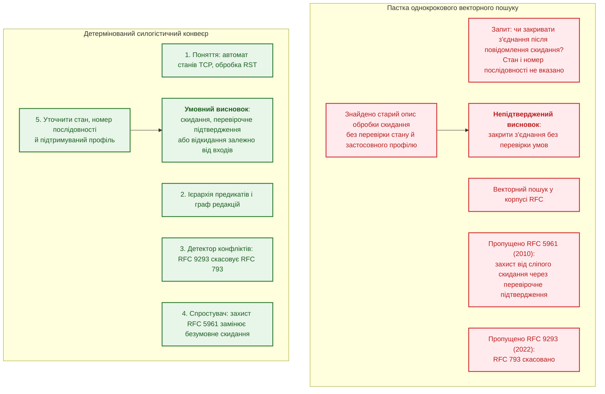
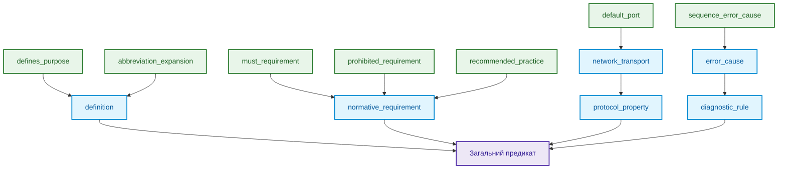
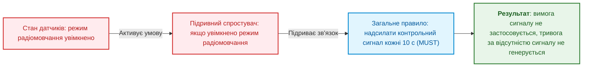
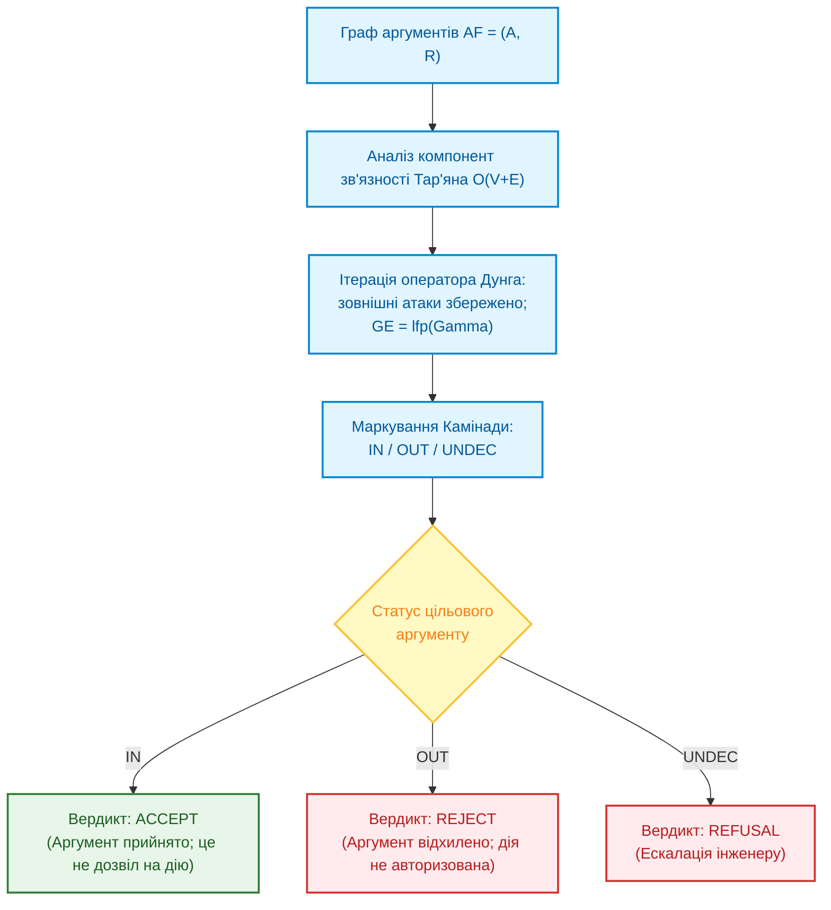
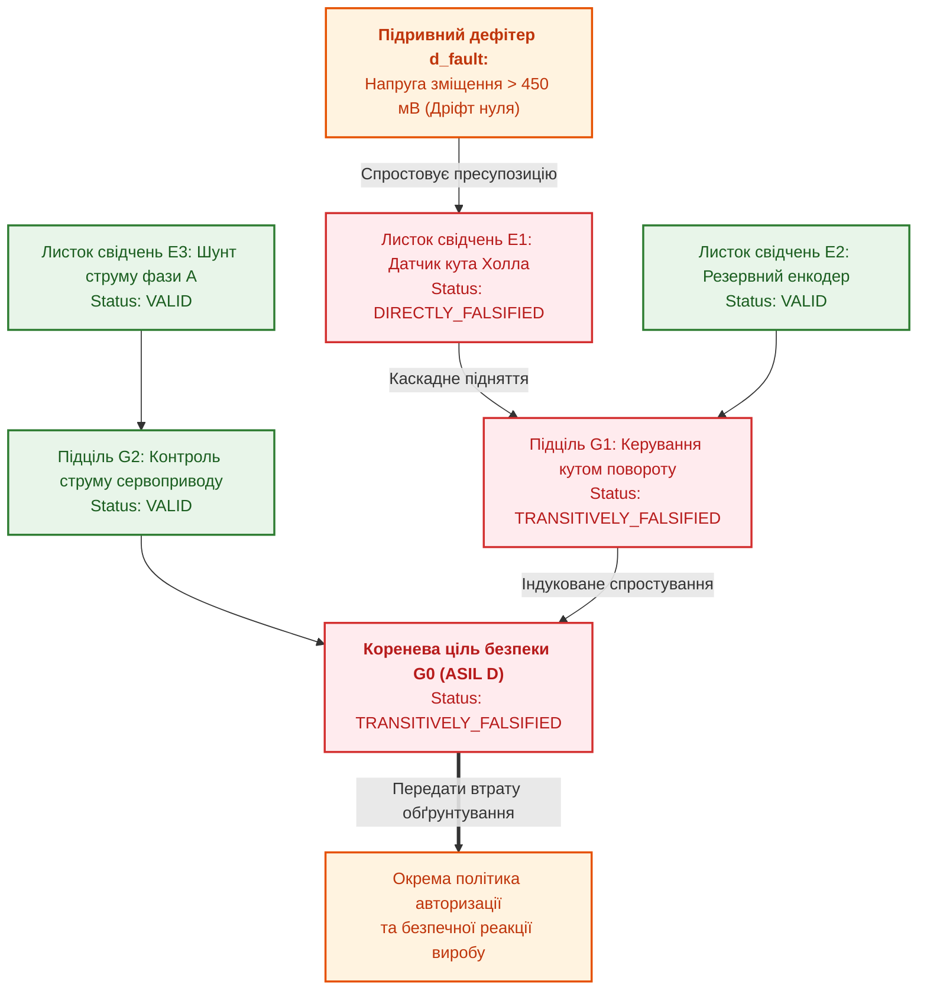
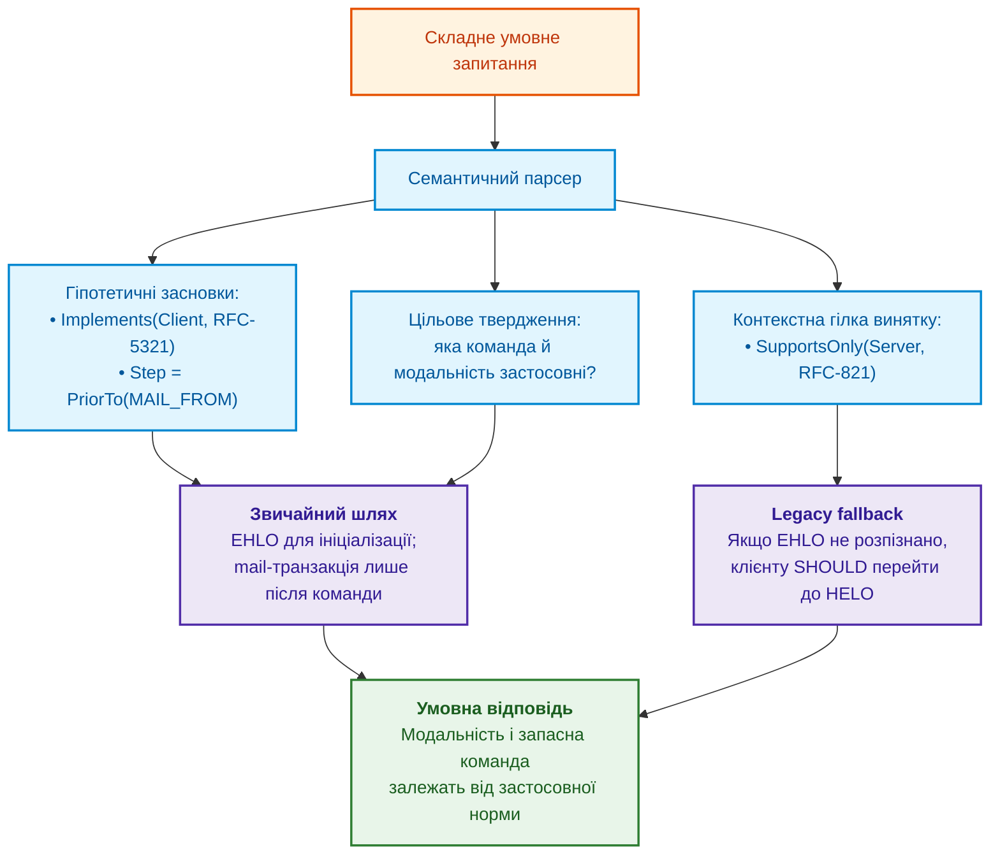
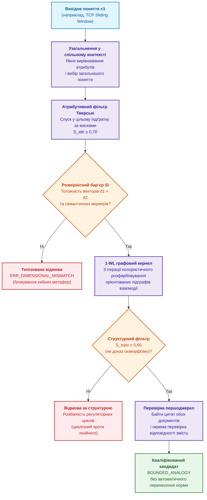

# Глава 31. Виведення за нормами: ієрархії предикатів, винятки та чинність

> **Книга:** [Архітектура доказових експертних систем](README.md) · [Частина IV: Архітектура системи, нормативне виведення, діагностика та пояснення](part-04-architecture-and-inference.md)
> **Попередня глава:** [Глава 19. Від запитання до доказу: пошук, прив'язка та перевірка твердження](ch19-from-question-to-evidence.md)
> **Наступна глава:** [Глава 24. Технічна діагностика: як не сплутати симптом із першопричиною в умовах неповноти](ch24-system-diagnosis.md)
> **Зміст книги:** [README.md](README.md)  
> **Автор:** [Микола Мартинович Федчик](about-the-author.md)
> **Передумови й маршрут:** множини, належність елемента та читання орієнтованого графа; квантори й логічні операції нагадано в тексті. Від простого правила для одного клієнта виклад переходить до графа спростувань і міждоменного добору кандидатів.
> **Очікувані результати:** відрізняти добір джерел від логічного виведення; будувати ієрархію предикатів без зворотної спеціалізації; відмовляти за невідомого стану винятку; розрізняти спростувач висновку й підривний спростувач; перевіряти чинність норми в заданому контексті програмою мовою ASP із закритою відмовою; оцінювати, що дають RDFS, SPARQL, ASPIC+ і видобування знань для ієрархій і винятків; читати слід виведення й розуміти межі навчального кроку на Go.

---

## Анотація

Експертна система має не лише знайти схожий текст, а й установити, чи випливає з нього відповідь для заданого об'єкта. Розглянемо навчальний сценарій: мережевий агент отримав TCP RST і знайшов опис скидання з'єднання. Переказ «кожний RST негайно закриває з'єднання» тут є навмисно хибним узагальненням, не цитатою RFC 9293. Без перевірки стану, номера послідовності й підтримуваного захисту агент може помилково рекомендувати розрив потрібного каналу. Саме перехід від знайденого фрагмента до обґрунтованого умовного висновку є задачею цієї глави; приклад не є повідомленням про реальну аварію.

Запитання глави: **як отримати детермінований висновок із кількох взаємопов'язаних нормативних підстав, розгорнути ієрархію предикатів і гарантувати, що невідомий стан винятку ніколи не перетвориться на небезпечний дозвіл?**

Глава розділяє пошук джерел, ієрархію предикатів, оцінювання винятків і вибір застосовної норми. Після базового кроку виведення розглядаються заземлена семантика Дунга, аналіз компонент графа за Тар'яном, відновлення аргументів і запропонований автором оператор поширення втрати підтримки в дереві цілей. Згадки ISO 26262 [[18]](#src-18) задають предметну область прикладів, а не підтверджують сертифікаційну придатність оператора. Go-приклад виконує один крок, ASP-модель містить дев'ять сценаріїв вибору норми. Детермінованість результату не доводить істинності входів, правильності перекладу стандарту в правила або повноважень на фізичну дію.


---

## 1. Чому однокроковий пошук не дає нормативного висновку

Однокроковий пошук відповідає на питання «який фрагмент найближчий до запиту?», але інженеру потрібна відповідь «який висновок випливає з установлених умов?». Спочатку розберемо першу задачу. Ембединг є числовим поданням тексту; порівнювати можна ненульові вектори однакової розмірності, побудовані тією самою моделлю. Для скінченного корпусу вибираємо індекс найближчого фрагмента:

<a id="obj-31.1"></a>

**Формула (31.1). Добір фрагмента за косинусною близькістю**

```math
\text{Query} \xrightarrow{\text{Embed}} \mathbf{v}_q \implies \arg\max_k \cos(\mathbf{v}_q, \mathbf{v}_k).
```

Позначення векторного пошуку:

- $`\text{Query}`$ є текстовим запитом інженера або оператора;
- $`\text{Embed}`$ позначає функцію перетворення тексту у вектор дійсних чисел;
- $`\mathbf{v}_q`$ є ненульовим вектором запиту з простору дійсних векторів розмірності $d$, де $d$ є додатним цілим;
- $`\mathbf{v}_k`$ є ненульовими векторами фрагментів того самого простору; індекс $k$ пробігає скінченний непорожній корпус;
- $`\cos(\mathbf{v}_q, \mathbf{v}_k)`$ є косинусною подібністю векторів у межах від $-1$ до $1$;
- $`\arg\max_k`$ вибирає індекс фрагмента з найвищою геометричною близькістю.

У навчальному прикладі вектор запиту має координати (1, 0), перший фрагмент (1, 0), другий (0, 1). Скалярні добутки дорівнюють відповідно 1 і 0, усі довжини дорівнюють 1, отже косинуси дорівнюють 1 і 0: вибрано перший фрагмент. Результат безрозмірний. За рівності максимумів потрібне явне правило нічиєї або повернення всіх кандидатів. Навіть значення 1 не перевіряє стану з'єднання чи винятку: знайдений текст стає кандидатом для наступного логічного кроку.

Схема показує можливу помилку конвеєра, який не перевіряє умов застосування знайденої норми:

<a id="obj-31.2"></a>

**Діаграма 31.2. Пошуковий кандидат і нормативний висновок**



### 1.1. Де саме пошук за подібністю втрачає логіку норм

Чого бракує навіть найкраще ранжованому фрагменту? У попередньому прикладі обчислено лише близькість; тепер перевіримо три незалежні передумови переходу від тексту до норми.

1. **Засновки розкидані між документами.** Загальне правило зафіксоване в одному стандарті, виняток у другому, а скасування старої редакції в третьому, виданому через десятиліття. Пошук за подібністю ранжує кожен фрагмент окремо. Він може повернути всі три фрагменти, але не встановлює, що третій документ скасовує перший, а другий звужує його умову. Ці зв'язки задають явні відношення між документами й нормами, які треба зберігати в графі знань.
2. **Сила припису не зберігається у векторі.** Слова `MUST`, `SHOULD`, `RECOMMENDED` і `MAY` трапляються в однакових контекстах, тому їхні вектори можуть бути близькими. Близькість векторів не гарантує збереження різниці в силі припису, яку фіксують RFC 2119 і RFC 8174 [[1]](#src-1) [[2]](#src-2). RFC 8174 додає ще одну тонкість: нормативне значення мають лише ключові слова, написані великими літерами, а модель подібності не зобов'язана зберігати різницю регістру. Тому модальність зберігають окремим полем судження, а не виводять із подібності тексту.
3. **Відсутність запису трактують як заперечення.** Якщо в базі знань немає запису про заборону дії, логічний рушій із запереченням як невдачею (*negation as failure*, як у Пролозі) виснує, що заборони немає. Це допустимо лише для ділянки даних, яку явно оголошено повною. У решті випадків відсутність даних означає стан «невідомо», і операцію блокують за принципом закритої відмови (*fail-closed*).

> [!NOTE]
> **Три фундаментальні дефекти однокрокового векторного пошуку за моделлю автора**
> 1. Розкиданість засновків між документами: сама оцінка близькості не перевіряє скасування норм і міждокументних винятків.
> 2. Різна сила модальності (RFC 2119 / RFC 8174): близькі вектори не є гарантією збереження різниці між `MUST` та `SHOULD`.
> 3. Псевдозаперечення за відсутністю (Negation as Failure): небезпека трактування відсутності запису в базі знань як дозволу замість закритої відмови.
> *Керування рантаймом / Інженерний інваріант:* У запропонованій автором архітектурі пошук добирає кандидата; перевірка явних засновків і правила визначає висновок.

Отже, додавання ще одного пошукового кроку саме по собі не усуває прогалини. Потрібно спочатку визначити, що саме система називатиме поняттям, судженням і правильним переходом між судженнями.

---

## 2. Поняття, судження й висновок

Щоб перевірити відповідь «цей клієнт повинен автентифікуватися», потрібно розрізняти клас клієнтів, правило для цього класу та факт про конкретний клієнт. Достатньо згадати: предикат є властивістю або відношенням, що для заданих аргументів утворює твердження; квантор «для всіх» охоплює кожний елемент вибраної області. Класична силогістика [[3]](#src-3) є історичною опорою, але нормативний кортеж нижче є інженерним поданням книги.

<a id="obj-31.3"></a>

**Діаграма 31.3. Від поняття до судження та висновку**

```mermaid
flowchart LR
    accTitle: Тріада мислення: Поняття, Судження, Висновок
    accDescr: Структурний перехід від сутностей та предикатів до доведених силогізмів.

    subgraph Level1["1. Рівень понять"]
        direction TB
        TERM["<b>Термін</b><br/>• інтенсіонал (ознаки)<br/>• екстенсіонал (обсяг)"]
        LATTICE["<b>Ієрархія предикатів</b><br/>субсумція: Sub ⊑ Super"]
    end

    subgraph Level2["2. Рівень суджень"]
        direction TB
        PROP["<b>Судження</b><br/>суб'єкт, відношення, об'єкт"]
        MODAL["<b>Деонтична модальність</b><br/>MUST, SHOULD, MAY, MUST_NOT"]
        DEFEAT["<b>Спростувачі</b><br/>умови винятків (UNLESS)"]
    end

    subgraph Level3["3. Рівень висновку"]
        direction TB
        PREM["<b>Засновки силогізму</b><br/>велика й мала посилки"]
        RULES["<b>Правила виведення</b><br/>modus ponens, субсумція"]
        DAG["<b>Слід виведення</b><br/>правило · підстави · результат"]
    end

    Level1 ==> Level2 ==> Level3

    classDef c1 fill:#e1f5fe,stroke:#0288d1,stroke-width:2px,color:#01579b;
    classDef c2 fill:#fff3e0,stroke:#e65100,stroke-width:2px,color:#bf360c;
    classDef c3 fill:#e8f5e9,stroke:#2e7d32,stroke-width:2px,color:#1b5e20;

    class TERM,LATTICE c1;
    class PROP,MODAL,DEFEAT c2;
    class PREM,RULES,DAG c3;
```



### 2.1. Поняття

Поняття потрібне, щоб вирішити, до яких об'єктів застосувати одне правило. Зафіксуємо область об'єктів $U$ та булеві ознаки на ній: наприклад, «є клієнтом» і «підтримує TLS». Зміст поняття перелічує потрібні ознаки, а обсяг відбирає об'єкти, які їх задовольняють. У цій навчальній моделі всі ознаки поєднуються словом «і»:
- **Інтенсіонал (Зміст поняття):** Множина суттєвих ознак, властивостей та інваріантів, які відрізняють це поняття від інших:

<a id="obj-31.4"></a>

**Формула (31.4). Зміст поняття як множина ознак**

```math
\text{Intension}(C) = \{ P_1, P_2, \dots, P_k \}.
```

Складники інтенсіоналу:

- $C$ є поняттям предметної області;
- $`\text{Intension}(C)`$ є множиною суттєвих ознак та інваріантів поняття;
- $`P_1, \dots, P_k`$ є функціями з $U$ у множину булевих значень; вони визначають належність до класу, не унікальну особу об'єкта;
- $k$ є невід'ємним цілим числом ознак; за нуля ознак усі об'єкти $U$ проходять цю перевірку. Множини й логічні значення не мають фізичних одиниць.

- **Екстенсіонал (Обсяг поняття):** Множина всіх конкретних сутностей або спеціалізацій, які задовольняють ознаки інтенсіоналу:

<a id="obj-31.5"></a>

**Формула (31.5). Обсяг поняття у фіксованій області**

```math
\mathrm{Extension}(C) = \{ x \in U \mid \forall P \in \text{Intension}(C) : P(x) = \text{True} \}.
```

Символи екстенсіоналу:

- $`\text{Extension}(C)`$ є обсягом поняття, тобто множиною всіх конкретних об'єктів;
- $x$ позначає екземпляр із зафіксованої області $U$;
- $\forall P$ вимагає істинності кожної ознаки $P$ з інтенсіоналу для даного об'єкта;
- $`\text{True}`$ фіксує відповідність об'єкта правилу.

За фіксованої множини об'єктів і незмінного тлумачення предикатів додавання обов'язкової ознаки **не збільшує** обсяг поняття: кожний об'єкт має задовольняти і старі, і нову умови. Строге зменшення не гарантоване. У навчальній множині з двох клієнтів обидва підтримують TCP, але лише перший підтримує TLS. Додавання ознаки «підтримує TLS» залишає одного клієнта; повторне додавання вже наявної ознаки «підтримує TCP» залишає тих самих двох. Це перевірка межі твердження: зайва ознака не створює вужчого класу. За неповних відомостей невстановлена ознака означає невідому належність, а не доведене виключення об'єкта з класу.

### 2.2. Судження

Судження потрібне, щоб не загубити зміст і походження правила під час машинної обробки. Замість одного речення збережемо, хто з ким пов'язаний, якою є сила припису, які винятки можливі й звідки взято текст. У цій монографії автором запропоновано таке шестикомпонентне інженерне подання:

<a id="obj-31.6"></a>

**Формула (31.6). Авторське подання нормативного судження**

```math
\mathcal{J} = \langle \text{Subject}, \; \mathcal{R}, \; \text{Object}, \; \mathcal{M}, \; \mathcal{D}, \; \text{Provenance} \rangle.
```

Складники семантичного судження:

- $`\mathcal{J}`$ є формальним кортежем нормативного судження;
- $`\text{Subject}`$ та $`\text{Object}`$ є концептами в інженерному просторі;
- $`\mathcal{R}`$ є предикатом з ієрархії відношень;
- $`\mathcal{M} \in \{ \text{MUST}, \text{MUST-NOT}, \text{SHOULD}, \text{SHOULD-NOT}, \text{MAY} \}`$ є нормативною деонтичною модальністю;
- $`\mathcal{D} = \{ d_1, d_2, \dots \}`$ є множиною умов спростування, або спростувачів (*defeaters*);
- $`\text{Provenance}`$ є дескриптором першоджерела (ідентифікатор документа, SHA-256 та байтові зміщення).

Це типізовані символічні поля, не вимірювані величини: суб'єкт і об'єкт мають належати оголошеним класам, відношення береться з реєстру предикатів, множина винятків скінченна, байтові межі лежать усередині конкретної версії файла. Навчальний запис «клієнт; автентифікуватися; сервіс; MUST; виняток обслуговування; локальна специфікація» розкладає одну вимогу на шість полів. Порожній список винятків допустимий лише за перевіреної повноти саме цього правила. Хеш установлює ідентичність байтів, але не чинність чи правдивість тексту; це окремі перевірки перед виведенням.

### 2.3. Висновок

Висновок відповідає на питання: чи може правило разом із фактом обґрунтувати нове твердження? **Логічне слідування** означає, що немає інтерпретації, у якій усі засновки істинні, а висновок хибний. Для перевірки достатньо шукати саме такий контрприклад. Наприклад, «усі клієнти є вузлами» і «цей об'єкт є вузлом» не доводять, що він клієнт: об'єкт може бути сервером.

Потрібне тут правило складається з універсальної підстановки та modus ponens: з «для кожного об'єкта класу $M$ діє припис $P$» і підтвердженого факту належності конкретного $s$ до $M$ отримуємо припис для $s$. Це не повна теорія категоричних силогізмів. Позначення $`N_{\mathcal M}(P,x)`$ означає «у вибраному профілі до об'єкта $x$ застосовний припис $P$ із модальністю $`\mathcal M`$»:

<a id="obj-31.7"></a>

**Формула (31.7). Універсальна підстановка та нормативний modus ponens**

```math
\frac{\forall x\in U\;\bigl(M(x)\Rightarrow N_{\mathcal M}(P,x)\bigr),\quad M(s)}{N_{\mathcal M}(P,s)}.
```

Складові елементи силогізму:

- $U$ є непорожньою областю об'єктів; $`s\in U`$ є названим екземпляром, $M$ є булевим предикатом класу;
- $x$ пробігає $U$, $P$ є описом дії або вимоги, а $`\mathcal M`$ береться з множини модальностей §2.2;
- $`\Rightarrow`$ є матеріальною імплікацією; риска відокремлює засновки від висновку. Фізичних одиниць тут немає;
- перед застосуванням великого засновку вже мають бути встановлені чинність правила, його область, профіль і відсутність активного винятку; §4 пояснює, як перевіряти останню умову.

Навчальний розрахунок має три кроки: усі клієнти тестового сервісу повинні автентифікуватися; `client-1` підтверджено належить до цього класу; підставляємо його замість $x$ й отримуємо вимогу автентифікації саме для нього. Це вимога, не доказ того, що клієнт уже виконав дію. Універсальне правило саме по собі не доводить існування жодного клієнта: для порожнього класу воно істинне без прикладів. Щоб виснувати «деякий клієнт повинен автентифікуватися», потрібен засвідчений екземпляр або окремий засновок існування. Так само класичний Barbara з двох включень класів дає третє включення, але не існування елемента.

**Приклад у машинному аудиті протоколів:** у SMTP звичайним початком сесії є `EHLO` (§3.2, §4.1.1.1 RFC 5321). Старі клієнти можуть використовувати `HELO`; якщо сервер не розпізнає `EHLO`, RFC рекомендує клієнту перейти до `HELO` (§3.2). §4.1.1.1 вимагає надіслати `HELO` або `EHLO` до транзакції, тоді як §4.1.4 формулює ініціалізацію mail-сесії через `EHLO`. Тому в аудиті треба фіксувати тип реалізації та профіль сумісності, а не трактувати обидві команди як безумовно рівнозначні [[4]](#src-4).

1. Великий засновок: нормативний сучасний шлях починає сесію через `EHLO`; `HELO` є окремою гілкою сумісності для старого клієнта або fallback, якщо сервер не розпізнає `EHLO`.
2. Малий засновок: у підтвердженому або явно гіпотетичному контексті `MailClient-01` є таким клієнтом і починає транзакцію.
3. Умовний висновок: якщо `MailClient-01` відповідає старому профілю сумісності, `HELO` може бути допустимим; для звичайного профілю застосовують `EHLO`. Якщо підтримуваний профіль або відповідь сервера невідомі, потрібне уточнення, а не автоматичний дозвіл.

Якщо роль клієнта задано тільки в запитанні «що буде, якщо», висновок також залишається гіпотетичним. Для фактичного аудиту потрібний незалежно встановлений стан. Успішне TCP-з'єднання саме по собі не гарантує прийняття поштової сесії: розділ 3.1 допускає початкову відмову 554.

Отримано правило для одного об'єкта. Наступне питання: як упізнати, що конкретний предикат «обов'язкова вимога» відповідає узагальненому запиту «нормативна вимога», не підміняючи його будь-якою нормою у зворотному напрямку?

---

## 3. Ієрархія предикатів і семантика субсумції

Коли користувач ставить узагальнене запитання: *«Які вимоги до безпеки протоколу X?»*, система не має права обмежуватися пошуком предикату з буквальним іменем `security_requirement`. Факти в реальних базах знань екстраговані з різних розділів і мають предикати `must_encrypt_channel`, `authenticate_peer_certificate`, `validate_sequence_number`.

Для узагальнених запитів предикати організують в ациклічну ієрархію. Досяжність у графі задає частковий порядок спеціалізації:

<a id="obj-31.8"></a>

**Формула (31.8). Частковий порядок предикатів**

```math
\mathcal{L} = \langle \mathcal{R}, \sqsubseteq \rangle.
```

Позначення ієрархії:

- $`\mathcal{L}`$ є частково впорядкованою множиною предикатів;
- $`\mathcal{R}`$ є множиною всіх типів інженерних відношень;
- $\sqsubseteq$ є відношенням часткового порядку субсумції (спеціалізації);

Відношення $`R_1 \sqsubseteq R_2`$ означає, що кожна пара об'єктів, пов'язана $`R_1`$, пов'язана також $`R_2`$. Наприклад, `must_requirement` спеціалізує `normative_requirement`. Важливо розрізняти властивості **порядку між предикатами** та властивості самих предметних відношень: `передує` може бути транзитивним, `є сусідом` симетричним, а `є батьком` не є транзитивним. Жодна з цих властивостей не успадковується лише з намальованої стрілки спеціалізації.

Ієрархію називають решіткою, лише якщо кожна пара має єдині найменшу верхню та найбільшу нижню межі. Для двох різних листків із єдиним спільним батьком цей батько є найменшою верхньою межею, але спільного нащадка може не бути: отже, дерево без нижнього елемента ще не решітка. Для порівняння, усі підмножини двоелементної множини, впорядковані включенням, утворюють решітку: об'єднання дає найменшу верхню межу, перетин найбільшу нижню. Це безрозмірні операції над множинами, не оцінки нормативної сили. Для пошуку шляху нижче операції решітки не потрібні.

<a id="obj-31.9"></a>

**Діаграма 31.9. Граф спеціалізації предикатів**



### 3.1. Математичні закони спрямованої субсумції

Закони спрямованої субсумції відповідають на питання, які шляхи дозволяють узагальнити факт. Згадаємо три умови часткового порядку на множині назв предикатів:

<a id="obj-31.10"></a>

**Формула (31.10). Три властивості часткового порядку**

```math
\begin{aligned}
&\forall R\in\mathcal R:\ R\sqsubseteq R,\\
&\forall R_1,R_2\in\mathcal R:\ (R_1\sqsubseteq R_2\land R_2\sqsubseteq R_1)\Rightarrow R_1=R_2,\\
&\forall R_1,R_2,R_3\in\mathcal R:\ (R_1\sqsubseteq R_2\land R_2\sqsubseteq R_3)\Rightarrow R_1\sqsubseteq R_3.
\end{aligned}
```

Тут $R$ та індексовані $`R_i`$ пробігають ту саму множину $`\mathcal R`$; усі твердження логічні, без одиниць. Перша умова дозволяє збіг предиката із самим собою; друга називається антисиметричністю, а не «забороною симетрії»; третя дозволяє пройти кілька ребер. Якщо різні назви означають еквівалентні відношення, їх спочатку об'єднують у класи еквівалентності: до цього маємо передпорядок, а не антисиметричний порядок на назвах. Для ланцюга `must_requirement → normative_requirement → concept` третя умова дає шлях від першого до третього; зворотний шлях із цього не випливає.

**Правило узагальнення запиту.**  
За вже узгоджених суб'єкта, об'єкта й контексту фактичний предикат відповідає запитаному тоді й лише тоді, коли існує шлях від нього до запитаного предка. У DAG це множина досяжних нащадків, не обов'язково піддерево:

<a id="obj-31.11"></a>

**Формула (31.11). Відповідність предиката узагальненому запиту**

```math
\text{Matches}(R_{\text{query}}, R_{\text{fact}}) \iff R_{\text{fact}} \sqsubseteq^* R_{\text{query}}.
```

У правилі спрямованої субсумції:

- $`\text{Matches}`$ є булевою перевіркою відповідності факту умовам запиту;
- $`R_{\text{query}}`$ є предикатом із запитання користувача;
- $`R_{\text{fact}}`$ є предикатом, зафіксованим у базі знань;
- $`\sqsubseteq^*`$ позначає рефлексивно-транзитивне замикання субсумції (наявність шляху узагальнення).

Для запиту `normative_requirement` і факту `must_requirement` перевіряємо одне ребро й отримуємо `True`; для запиту `must_requirement` і факту `normative_requirement` шляху немає. `Matches=False` означає лише, що даний факт не обґрунтовує запитаний тип, а не те, що сама вимога хибна або відсутня в усій базі. Оскільки $`\sqsubseteq`$ уже є порядком, зірочка тут лише нагадує алгоритм пошуку за безпосередніми ребрами.

**Заборона зворотної спеціалізації.**  
Якщо запит оператора вимагає конкретне суворе правило $`R_{\text{specific}}`$ (наприклад, `prohibited_requirement`), заборонено повертати загальний факт вищого рівня $`R_{\text{general}}`$ (`normative_requirement`), оскільки загальна норма не гарантує виконання специфічної заборони:

<a id="obj-31.12"></a>

**Формула (31.12). Заборона зворотної спеціалізації**

```math
R_{\text{general}} \not\sqsubseteq^* R_{\text{specific}} \quad \text{коли } R_{\text{specific}} \sqsubset R_{\text{general}}.
```

Позначення заборони зворотної спеціалізації:

- $`R_{\text{general}}`$ є загальним предикатом вищого рівня ієрархії;
- $`R_{\text{specific}}`$ є строгим предикатом підпорядкованого рівня;
- $`\not\sqsubseteq^*`$ забороняє відповідність: наявність загального дозволу не доводить виконання спеціальної суворої норми.

> [!NOTE]
> **Три інженерні правила часткового порядку субсумції за моделлю автора**
> 1. Ієрархічне узагальнення: перевірка рухається від спеціалізованого предиката до загального; рефлексивний збіг також допустимий.
> 2. Семантичне узгодження запиту: фактичне відношення $`R_{\text{fact}}`$ задовольняє узагальнений запит $`R_{\text{query}}`$ тоді й лише тоді, коли $`R_{\text{fact}} \sqsubseteq^* R_{\text{query}}`$.
> 3. Ациклічність графа різних класів предикатів перевіряється після об'єднання еквівалентних назв; вона не доводить наявності операцій решітки.
> *Керування рантаймом / Інженерний інваріант:* Правильне ребро спеціалізації дозволяє узагальнення, але не виправляє помилкової онтології чи неповноти фактів.

### 3.2. Зіставлення фрази з предикатом

У промисловому конвеєрі запитання оператора рідко формулюються в канонічних термінах внутрішньої онтології. Інженер може запитати: *«Який дефолтний порт для BGP?»*, *«Чи скасовано протокол RFC 821?»* або *«Ким замінено цей стандарт?»*. 

Словник або мовний аналізатор спочатку зіставляє фразу з відомим предикатом. Ієрархія сама не розуміє природної мови й не створює синонімів.

1. Відоме однозначне зіставлення фіксує конкретний предикат і версію словника.
2. Для узагальненого запиту перевіряють шлях від цього предиката до потрібного предка; зворотної спеціалізації не виконують.
3. Невідома або неоднозначна фраза потребує уточнення чи перегляду кандидата на зіставлення. Вона не має визначеного предка лише тому, що в тексті є слово «застарілий».

Час і точність аналізу вимірюють на конкретних запитах. Детермінований словник також може містити помилкове зіставлення, тому відтворюваність не означає правильності.

### 3.3. Розрізнення однойменних документів за лінією чинності

Особливою проблемою технічних корпусів є **полісемія назв сутностей**: одна й та сама назва документа або протоколу зустрічається в десятках специфікацій різних років. Наприклад, назва *«Simple Mail Transfer Protocol»* належить одночасно RFC 821 (1982), RFC 2821 (2001) та RFC 5321 (2008).

Якщо користувач запитує документ за назвою без явного номера стандарту, наївний пошук виявить три різні факти, що призведе до конфлікту або помилкового вибору застарілої версії. 

Для усунення цієї проблеми силогістичне ядро застосовує **дисамбігуацію за графом чинності**:
1. Резолвер перевіряє редакцію, область, дату й мету запиту: поточний аудит чи історичне відтворення.
2. Єдину застосовну редакцію можна вибрати для поточного запиту, але не для запиту про стару реалізацію лише через її новішу дату.
3. Кілька застосовних редакцій або невідомий статус породжують уточнення. Лінія заміщення документа не визначає автоматично, який профіль підтримує конкретний виріб.

Наприклад, для історичного відтворення SMTP-клієнта з явно заданим старим профілем не можна підставити нову редакцію тільки за датою. Для поточного аудиту без версії реалізації результатом є запит цієї версії, не вибір «найсвіжішого» документа. Отже, ієрархія знаходить потрібний тип факту, але ще не розв'язує невідомі умови його застосування; для цього потрібна наступна логіка.

---

## 4. Тризначна логіка Кліні та спростувачі Поллока

Тризначна логіка потрібна, коли правило знайдено, але відповідь на питання «чи діє виняток?» ще не отримана. Відсутній запис про режим обслуговування не доводить, що режим вимкнено. Два булеві значення самі по собі не задають припущення закритого світу (*Closed-World Assumption*, CWA): це окреме рішення про повноту даних. У цій моделі відсутній результат має стан «невідомо»; явно повну ділянку даних розглянуто в [Главі 7](ch07-knowledge-base-typology.md).

Для навчальної роботи з неповною інформацією використано **сильну тризначну логіку Кліні** (*Strong Kleene 3-Valued Logic*, 3VL) [[5]](#src-5):

<a id="obj-31.13"></a>

**Формула (31.13). Три значення сильної логіки Кліні**

```math
\mathcal{V}_3 = \{ \text{True}, \; \text{False}, \; \text{Unknown} \}.
```

Значення тризначної логіки Кліні:

- $`\mathcal{V}_3`$ є простором істинності Strong Kleene 3VL;
- $`\text{True}`$ фіксує доведену істинність твердження;
- $`\text{False}`$ фіксує доведену хибність;
- $`\text{Unknown}`$ позначає відсутність даних або невизначеність без права припущення про хибність.

### 4.1. Таблиця істинності сильної логіки Кліні

Таблиця істинності дозволяє обчислити складну умову, не замінюючи невідомість хибою. Нехай $A$ означає «профіль застосовний», $B$ означає «перевірку пройдено»; обидва беруть значення з $`\mathcal V_3`$. Кон'юнкція вимагає обох умов, диз'юнкція хоча б однієї, заперечення міняє істину й хибу та зберігає невідомість. Матеріальну імплікацію в таблиці визначено як «не $A$ або $B$»; вона не є самостійним дозволом на дію.

<a id="obj-31.14"></a>

**Таблиця 31.14. Логічні операції за невідомого входу**

| $A$ | $B$ | $A \land B$ | $A \lor B$ | $\neg A$ | $A \to B$ |
| :---: | :---: | :---: | :---: | :---: | :---: |
| $`\text{True}`$ | $`\text{True}`$ | $`\text{True}`$ | $`\text{True}`$ | $`\text{False}`$ | $`\text{True}`$ |
| $`\text{True}`$ | $`\text{False}`$ | $`\text{False}`$ | $`\text{True}`$ | $`\text{False}`$ | $`\text{False}`$ |
| $`\text{True}`$ | $`\text{Unknown}`$ | $`\mathbf{Unknown}`$ | $`\text{True}`$ | $`\text{False}`$ | $`\mathbf{Unknown}`$ |
| $`\text{False}`$ | $`\text{True}`$ | $`\text{False}`$ | $`\text{True}`$ | $`\text{True}`$ | $`\text{True}`$ |
| $`\text{False}`$ | $`\text{False}`$ | $`\text{False}`$ | $`\text{False}`$ | $`\text{True}`$ | $`\text{True}`$ |
| $`\text{False}`$ | $`\text{Unknown}`$ | $`\text{False}`$ | $`\mathbf{Unknown}`$ | $`\text{True}`$ | $`\text{True}`$ |
| $`\text{Unknown}`$ | $`\text{True}`$ | $`\mathbf{Unknown}`$ | $`\text{True}`$ | $`\mathbf{Unknown}`$ | $`\text{True}`$ |
| $`\text{Unknown}`$ | $`\text{False}`$ | $`\text{False}`$ | $`\mathbf{Unknown}`$ | $`\mathbf{Unknown}`$ | $`\mathbf{Unknown}`$ |
| $`\text{Unknown}`$ | $`\text{Unknown}`$ | $`\mathbf{Unknown}`$ | $`\mathbf{Unknown}`$ | $`\mathbf{Unknown}`$ | $`\mathbf{Unknown}`$ |

Якщо застосовність відома, а перевірка невідома, читаємо третій рядок: спільна умова невідома, тож допуск не обґрунтовано. Якщо застосовність хибна, кон'юнкція хибна незалежно від невідомої перевірки. Істинна матеріальна імплікація у цьому рядку не доводить виконання перевірки: хибний засновок робить імплікацію істинною без підтвердження наслідку. Усі значення безрозмірні; суперечливі одночасні свідчення істини й хиби потребують окремої моделі конфлікту, не автоматичного вибору одного рядка.

### 4.2. Порядок інформованості й закрита відмова

У логіці Кліні вводиться частковий порядок за інформованістю ($`\le_i`$):

<a id="obj-31.15"></a>

**Формула (31.15). Частковий порядок інформованості**

```math
\text{Unknown} \le_i \text{True}, \quad \text{Unknown} \le_i \text{False}.
```

Порядок за інформованістю:

- $`\le_i`$ є частковим порядком зростання знань (*information ordering*);
- нерівності стверджують, що стан $`\text{Unknown}`$ містить мінімальну інформацію, а перехід до $`\text{True}`$ чи $`\text{False}`$ збільшує визначеність без порушення монотонності.

Функція $f$ є монотонною за інформованістю, якщо уточнення невідомого входу не змінює визначений результат на протилежний. `True` і `False` тут непорівнянні: заміна одного іншим є переглядом даних, не зростанням інформованості в цьому порядку. Наприклад, хибна кон'юнкція з невідомим другим операндом залишається хибною після його уточнення в будь-який бік. Це властивість логічної функції, не обіцянка незмінності вердикту після появи нового спростувача.

> [!IMPORTANT]
> **Правило закритої відмови.**  
> Якщо значення потрібної умови дорівнює $`\text{Unknown}`$, навчальна політика не допускає операції й повертає причину нестачі фактів. Це поведінка перевірки, не автоматичне сертифікаційне рішення.

### 4.3. Спростувачі за Поллоком

Спростувачі потрібні для наступного питання: нове свідчення заперечує відповідь чи лише робить непридатним шлях до неї? Не кожна норма спростовна, але правила з явно заданими винятками зручно подавати як спростовні (*defeasible*). Поллок розрізняє два види атак [[6]](#src-6); тут стрілки в їхніх схемах означають підтримку аргументу, а не дві одночасно істинні класичні імплікації, які дозволяли б вивести суперечність.

1. **Спростувач висновку (*rebutting defeater*)**  
   Атакує безпосередньо сам висновок, виводячи протилежне твердження:

<a id="obj-31.16"></a>

**Формула (31.16). Конкуренція протилежних висновків**

```math
A \implies P, \quad B \implies \neg P.
```

Параметри прямого спростувача:

- $A$ та $B$ є засновками двох конкуруючих правил;
- $P$ є стверджуваним висновком, а $\neg P$ є його повним логічним запереченням;
- сам спростувач висновку лише створює конфлікт двох аргументів; який із них перемагає, вирішує окреме відношення переваги, наприклад «вужча норма переважає загальну».

2. **Підривний спростувач (*undercutting defeater*)**  
   Атакує зв'язок між засновком та висновком, стверджуючи, що за даних умов правило перестає діяти, хоча висновок не обов'язково є хибним:

<a id="obj-31.17"></a>

**Формула (31.17). Підрив застосування правила**

```math
U \implies \neg (A \hookrightarrow P).
```

Складники підривного спростувача:

- $U$ є винятковою контекстною умовою (наприклад, стан радіомовчання);
- $A \hookrightarrow P$ позначає нормативний зв'язок між засновком і обов'язком дії;
- $\neg (A \hookrightarrow P)$ анулює зобов'язання діяти без твердження протилежного.

<a id="obj-31.18"></a>

**Діаграма 31.18. Активація контекстного винятку**



Наприклад, втрата достовірності датчика підриває аргумент «температура нормальна, тому охолодження не потрібне», але не доводить перегріву. Підрив лишає без підтримки саме цей шлях: інший незалежний датчик ще може підтримати той самий висновок. Достовірний показ перегріву, навпаки, підтримує протилежний висновок. Модгіл і Праккен у ASPIC+ описують також підрив засновку (*undermining*) [[7]](#src-7). Атаки на застосування спростовного правила не фільтруються перевагою, а для відповідних атак на висновки й звичайні засновки враховують задану перевагу.

**Перевага аргументів не створює нормативної влади.** Пріоритет задають лише після перевірки джерела, області й застосовності; новіша дата чи слово `MUST` самі не визначають переможця. Go-приклад §8 моделює лише один прикріплений виняток: його активація задається готовим фактом, а прикріплення кодує вже обраний профільний пріоритет. Програма не перевіряє законності цього вибору. Від локальної пари аргументів тепер перейдемо до мережі атак, де результат визначається всіма захисниками, а не порядком обходу.

### 4.4. Заземлена семантика Дунга та детерміністичне усунення циклічних пасток аргументації (Grounded Extension)

Формалізація спростувачів за Поллоком розв'язує локальний конфлікт між парою взаємовиключних правил, проте в реальних експертних системах норми утворюють перехресні мережі взаємних обмежень. Якщо в доказовому просторі одночасно діють сотні стандартів, локальні відношення спростування формують складні графи атак, у яких можливе виникнення взаємних циклів або хибних каскадів витіснення знань. Без глобальної математичної семантики допустимості система ризикує потрапити в нескінченну рекурсію або видати недетермінований вердикт, залежний від випадкового порядку вибірки правил із пам'яті.

Для формалізації мереж застосовується каркас Дунга (*Argumentation Framework*) [[17]](#src-17):

<a id="obj-31.19"></a>

**Формула (31.19). Каркас аргументів і спростувань**

```math
\mathcal{AF}=\langle\mathcal A,\mathcal R_{\mathrm{defeat}}\rangle,\qquad
\mathcal R_{\mathrm{defeat}}\subseteq\mathcal A\times\mathcal A.
```

Тут $`\mathcal A`$ є скінченною множиною аргументів, а пара в $`\mathcal R_{\mathrm{defeat}}`$ спрямована від нападника до атакованого. Це символічні об'єкти без одиниць. У найпростішому прикладі два аргументи й одна така пара означають одну атаку, а не два протилежні фізичні факти. До каркаса надходять уже визначені успішні спростування: у ASPIC+ [[7]](#src-7) не кожна атака стає спростуванням, бо для частини атак ще перевіряють перевагу. Використано три механізми:
1. **Підрив засновків (*Undermining*):** атака на спростовні пресупозиції чи вихідні спостереження аргументу $A$ ($`\mathrm{Prem}(A)`$);
2. **Спростування висновку (*Rebutting*):** пряме зіткнення протилежних висновків ($`\mathrm{Conc}(A) \equiv \neg \mathrm{Conc}(B)`$), що стає успішним спростуванням лише за умови, що атакуючий аргумент не поступається атакованому за встановленою шкалою переваги ($B \not< A$);
3. **Підрив правила виведення (*Undercutting*):** атака на саму легітимність кроку виведення за правилом $r$, яка є безумовно успішною ($`B \to \mathrm{defeat}(A)`$) незалежно від ваги чи преференцій аргументів.

Для визначення множини аргументів, які логічне ядро зобов'язане визнати беззаперечно прийнятними, запроваджується **характеристичний оператор Дунга** $`\Gamma_{\mathcal{AF}} : 2^{\mathcal{A}} \to 2^{\mathcal{A}}`$:

<a id="obj-31.20"></a>

**Формула (31.20). Характеристичний оператор захисту Дунга**

```math
\Gamma_{\mathcal{AF}}(S) = \{ A \in \mathcal{A} \mid \forall B \in \mathcal{A} \, ((B, A) \in \mathcal{R}_{\mathrm{defeat}} \implies \exists C \in S : (C, B) \in \mathcal{R}_{\mathrm{defeat}}) \}.
```

Параметри характеристичного оператора Дунга:
- $`S \subseteq \mathcal{A}`$ — довільна множина аргументів, що розглядається як потенційний захисник;
- $`A \in \mathcal{A}`$ — аргумент, чия допустимість перевіряється;
- $`(B, A) \in \mathcal{R}_{\mathrm{defeat}}`$ — атака аргументу $B$ на аргумент $A$;
- $`(C, B) \in \mathcal{R}_{\mathrm{defeat}}`$ — захисна контратака аргументу $C \in S$ на атакуючий аргумент $B$; оператор повертає ті й лише ті аргументи, всі атакуючі контраргументи яких успішно спростовуються елементами множини $S$ (аргумент $A$ є захищеним множиною $S$).

Щоб застосувати теорему Кнастера–Тарського, потрібні повна решітка й монотонне відображення з неї в неї. Тут усі підмножини скінченної $`\mathcal A`$, впорядковані включенням, утворюють повну решітку: об'єднання й перетин визначені для будь-якої родини підмножин. Оператор монотонний, бо додавання захисників не забирає вже наявної контратаки. Теорема гарантує єдину **найменшу** нерухому точку, не єдиність усіх нерухомих точок. Скінченність додатково дозволяє дістати її повторенням оператора від порожньої множини:

<a id="obj-31.21"></a>

**Формула (31.21). Найменша нерухома точка заземленої семантики**

```math
\mathrm{GE}(\mathcal{AF}) = \mathrm{lfp}(\Gamma_{\mathcal{AF}}) = \bigcup_{k=0}^{\infty} \Gamma_{\mathcal{AF}}^k(\emptyset).
```

Параметри обґрунтованого розширення:
- $\emptyset$ — початкова порожня множина захисників (базовий крок $`\Gamma_{\mathcal{AF}}^0(\emptyset) = \emptyset`$);
- $`\Gamma_{\mathcal{AF}}^1(\emptyset)`$ — множина аргументів без атак у заданому графі; відсутність атаки не доводить істинності їхніх засновків у світі;
- $`\Gamma_{\mathcal{AF}}^k(\emptyset)`$ — $k$-та ітерація захисту, що відновлює аргументи, чиї атакуючі фактори були нейтралізовані на попередніх кроках;
- $`\mathrm{GE}(\mathcal{AF})`$ — найменша нерухома точка; $k$ є невід'ємним цілим лічильником ітерацій, а не часом. Множини й кількість ітерацій не мають фізичних одиниць. У скінченному графі ланцюг стабілізується, бо кожна строга зміна додає хоча б один аргумент.

Для повного присвоєння статусів усім вузлам графа застосовується тризначне маркування Камінади (*Caminada Tri-State Labeling*):
- `IN` ($`A \in \mathrm{GE}`$): аргумент повністю прийнятий системою (усі його контраргументи марковані як `OUT`);
- `OUT`: аргумент категорично відхилений (існує хоча б один атакуючий контраргумент зі статусом `IN`);
- `UNDEC`: аргумент перебуває у стані невизначеності через нерозв'язані взаємні цикли або симетричні конфлікти однакової сили.

Цикл не робить заземлену семантику недетермінованою. Для ізольованої взаємної атаки двох аргументів перша ітерація порожня, тому обидва лишаються `UNDEC`. Додамо третій, неатакований аргумент, який атакує другого: тепер третій захищає першого, і наступна ітерація приймає обох захисників; другий стає `OUT`. Отже, сам цикл не є достатньою умовою відмови.

Алгоритм Тар'яна [[19]](#src-19) знаходить сильно зв'язні компоненти за час $O(V+E)$, де $V$ та $E$ є кількостями вершин і ребер. Він допомагає організувати обчислення, але не присвоює семантичних статусів без урахування вхідних атак. У схемі кожна компонента обробляється з її зовнішніми залежностями; остаточна відмова стосується невизначеного цільового аргументу, а не всього графа через наявність циклу.

<a id="obj-31.22"></a>

**Діаграма 31.22. Обчислення семантики з урахуванням зовнішніх атак**



#### 4.4.1. Замкнений цикл інженерного розрахунку заземленої семантики

1. **Керування рантаймом і потоком обчислень (Control Flow & Runtime Decisions):**
   Розрахунок обґрунтованого розширення $`\mathrm{GE}(\mathcal{AF})`$ безпосередньо визначає стан кінцевого автомата прийняття рішень:
    - Якщо аргумент $`A_{\mathrm{action}}`$ отримав маркування `IN`, аргументаційний шар повертає `ACCEPT` для цього аргументу та доказ його прийняття. Це не авторизує і не запускає фізичну дію: кандидат передається окремому шлюзу авторизації, який перевіряє чинний мандат, передумови й апаратні запобіжники за контрактом [Глави 21](ch21-from-recommendation-to-action.md). За невідомої або невиконаної умови шлюз не видає команду;
    - Якщо аргумент марковано як `OUT`, формується `REJECT` з переліком активних спростувачів; це означає відсутність аргументаційної підстави, а не самостійну команду виконавчому механізму;
    - Якщо цільовий аргумент має `UNDEC`, політика не приймає його як підставу дії й повертає типізований `REFUSAL`. Це не мітка `OUT` і не доказ хибності обох альтернатив: потрібні нові підстави або уточнення відношення переваги.
2. **Ресурси та межа оцінки:** простий ітеративний алгоритм маркування переглядає всі вершини й ребра кожного раунду; не більше $V$ непорожніх раундів і фінальна перевірка дають поліноміальну оцінку $O(V(V+E))$. Це оцінка кількості операцій, не WCET у секундах. Для трьох статусів достатньо двох біт на вершину: для чотирьох аргументів це вісім біт лише міток, без ребер, черги й походження. Якщо умовно прийняти кадр DFS у 32 байти, чотири вкладені виклики потребуватимуть 128 байт; реальний кадр визначають компілятор і реалізація. Жодна з цих оцінок не підтверджує часової придатності конкретного контролера.
3. **Практичний числовий приклад (Worked Numerical Example):**
   Розглянемо підсистему аварійного гальмування безпілотного потяга метрополітену, де діють чотири аргументи:
   - $`A_1`$: «Активувати службове електродинамічне гальмування на нахилі» (підтримується датчиком швидкості);
   - $`A_2`$: «Заборонити електродинамічне гальмування через перегрів силових резисторів» (спростувач висновку $`A_2 \xrightarrow{\mathrm{rebut}} A_1`$);
   - $`A_3`$: «Аномальні покази температурного сенсора: обрив термістора ТБ-12» (підривний спростувач $`A_3 \xrightarrow{\mathrm{undercut}} A_2`$);
   - $`A_4`$: «Покази сенсора ТБ-12 підтверджено дублюючим пірометром» ($`A_4 \xrightarrow{\mathrm{rebut}} A_3`$).

    Це навчальний граф, не протокол випробувань гальм. Починаємо з порожньої множини. Перша ітерація додає лише $`A_4`$, бо його ніхто не атакує. На другій ітерації $`A_4`$ атакує єдиного нападника $`A_2`$, тобто $`A_3`$, тому додається $`A_2`$. Третя ітерація нічого не змінює: отримано $`\mathrm{GE}=\{A_4,A_2\}`$. Отже, маємо дві ітерації з приростом і одну перевірку стабілізації, а не чотири застосування оператора. Після цього мітки $`A_3`$ і $`A_1`$ дорівнюють `OUT`.

    **Використання:** підставу для запропонованого електродинамічного гальмування відхилено в цьому графі. Жодного аргументу за пневматичне гальмо тут немає, тож його ввімкнення не випливає з розрахунку. Час виконання потрібно виміряти на цільовій платформі для зафіксованих графа, реалізації, збірки й навантаження; кількість ітерацій не визначає його в секундах. Від обчислення одного графа далі перейдемо до його перегляду після зміни свідчень.

> [!NOTE]
> **Три інваріанти заземленої аргументаційної семантики Дунга за моделлю автора**
> 1. Єдиність найменшої нерухомої точки: характеристичний оператор $`\Gamma_{\mathcal{AF}}`$ обчислює унікальне детерміноване розширення $`\mathrm{GE}(\mathcal{AF})`$ за поліноміальний час.
> 2. Тризначне маркування Камінади: кожен аргумент системи однозначно класифікується як `IN` (прийнятий), `OUT` (відхилений) або `UNDEC` (невизначений).
> 3. Аналіз компонент за Тар'яном не замінює оцінювання зовнішніх атак; відмова формується для цільового `UNDEC` після обчислення семантики.
> *Керування рантаймом / Інженерний інваріант:* Для незмінного графа заземлений результат не залежить від порядку перебору; правильність самого графа перевіряється окремо.

---

### 4.5. Епістемічна реабілітація аргументів та транзитивне поширення спростувань у деревах цілей безпеки

Епістемічна реабілітація та поширення втрати підтримки відповідають на питання, як змінити вже обчислену оцінку після нових свідчень. У прикладах для критичних систем (ISO 26262 [[18]](#src-18) для дорожнього транспорту, DO-178C для авіаційного ПЗ) потрібні дві різні операції: повторно оцінити аргумент після захисту від нападників і переглянути батьківські цілі, для яких втрачене свідчення було необхідним. Новий факт не повинен ані безумовно відновлювати аргумент, ані спростовувати всі цілі системи без явного зв'язку підтримки.

#### 4.5.1. Механізм епістемічної реабілітації аргументів (Reinstatement)
У наївних рушіях виведення спростування аргументу $A$ контраргументом $B$ веде до безповоротного видалення $A$ із робочої пам'яті (епістемічна амнезія). Якщо в наступному циклі вимірювання з'являється свідчення $C$, яке дискредитує сам контраргумент $B$, наївна система не здатна автоматично повернути $A$ до активного використання без повного перезавантаження бази знань.

У заземленій семантиці відновлення потребує захисту **від кожного** нападника. Якщо єдиним нападником $A$ є $B$, а прийнятий $C$ атакує $B$, то після перерахунку $A$ отримує `IN`. Розрахунок простий: спочатку приймаємо неатакований $C$, потім він захищає $A$. Але якщо додатковий неатакований $D$ також атакує $A$, спростування одного $B$ не допоможе: $D$ лишається `IN`, а $A$ є `OUT`. Це контрприклад безумовному правилу «спростовано один контраргумент, отже аргумент відновлено». Після зміни графа обчислюється нова нерухома точка; зберігати старі вузли корисно для простежуваності, але інкрементальний алгоритм тут не реалізовано.

#### 4.5.2. Транзитивне поширення спростувань у деревах безпеки ISO 26262
Для поширення втрати підтримки потрібно спочатку знати, які саме підстави потрібні цілі. Навчальне дерево, стилізоване під нотацію GSN (*Goal Structuring Notation*), подамо так:

<a id="obj-31.23"></a>

**Формула (31.23). Дерево цілей і свідчень**

```math
\mathcal T=\langle\mathcal G,\mathcal E,\mathcal R\rangle,\qquad
\mathcal R\subseteq\mathcal G\times(\mathcal G\cup\mathcal E).
```

Тут $`\mathcal G`$ є скінченною множиною цілей, $`\mathcal E`$ неперетинною з нею множиною листків свідчень, $`\mathcal R`$ ребрами від батьківської цілі до дочірньої підстави. Для кореня $`G_0`$ «привід керма має достатнє обґрунтування безпечності» дочірні вузли можуть представляти керування кутом і контроль струму, а листки покази датчиків. Усі ідентифікатори безрозмірні. Ациклічність і наявність локального доказу є перевірними передумовами, не наслідками напису GSN або ASIL D.

Аудит безпеки виявляє типову ваду: якщо датчик кута повороту фіксує перепад напруги поза межами допуску, низькорівневе правило маркує недостовірним лише локальний факт. Батьківська ціль $`G_0`$ у наївних рушіях залишається валідною (`VALID`), оскільки її формулювання не містить умови напруги сенсора (вада «тихого пропуску»).

У цій монографії автором запропоновано **оператор транзитивного каскадного спростування** $`\mathrm{Status}(G_i)`$ для скінченного ациклічного дерева з кон'юнктивною декомпозицією: кожна дочірня підстава потрібна для прийняття батьківської. GSN сам по собі не вимагає такої декомпозиції; для альтернативних достатніх шляхів потрібен інший оператор. Назви `FALSIFIED` нижче означають втрату прийнятності обраного обґрунтування, не доведення фізичної хибності цілі. Локальні докази, застосовність і повнота списку винятків мають бути підтверджені окремим входом $`\mathrm{Ready}`$. Гілки перевіряються в порядку `DIRECTLY_FALSIFIED` → `TRANSITIVELY_FALSIFIED` → `REFUSAL` → `VALID`:

<a id="obj-31.24"></a>

**Формула (31.24). Авторський оператор статусу кон'юнктивного обґрунтування**

```math
\mathrm{Status}(G_i) = \begin{cases} 
\mathrm{DIRECTLY\_FALSIFIED}, & \text{якщо } \exists d \in \mathrm{Defeaters}(G_i) : \mathrm{Evaluated}(d) = \mathrm{True}, \\
\mathrm{TRANSITIVELY\_FALSIFIED}, & \text{якщо } \exists G_j \in \mathrm{Children}(G_i) : \mathrm{Status}(G_j) \in \{\mathrm{DIRECTLY\_FALSIFIED}, \mathrm{TRANSITIVELY\_FALSIFIED}\}, \\
\mathrm{REFUSAL}, & \text{якщо } \mathrm{Ready}(G_i)\ne\mathrm{True}\ \lor\ \exists d\in\mathrm{Defeaters}(G_i):\mathrm{Evaluated}(d)=\mathrm{Unknown}\\
&\quad\lor\ \exists G_j \in \mathrm{Children}(G_i) : \mathrm{Status}(G_j) = \mathrm{REFUSAL}, \\
\mathrm{VALID}, & \text{інакше}.
\end{cases}
```

Параметри оператора транзитивного спростування:
- $`G_i \in \mathcal{G}\cup\mathcal E`$ — вузол дерева: ціль або листок свідчень; $i$ і $j$ є індексами вузлів;
- $`\mathrm{Defeaters}(G_i)`$ — множина локальних спростувачів цілі $`G_i`$;
- $`\mathrm{Children}(G_i)`$ — множина прямих дочірніх підцілей або доказових листків свідчень;
- $`\mathrm{Evaluated}(d)`$ — значення з $`\mathcal V_3`$ для умови спростувача; відсутній результат є `Unknown`;
- $`\mathrm{Ready}(G_i)`$ — значення з $`\mathcal V_3`$: `True` означає підтверджені локальні підстави, застосовність і повноту списків потрібних дочірніх вузлів та спростувачів; порожній листок без доказу не є готовим;
- $`\mathrm{DIRECTLY\_FALSIFIED}`$ — статус безпосереднього локального спростування зафіксованим дефітером;
- $`\mathrm{TRANSITIVELY\_FALSIFIED}`$ — статус успадкованого спростування, що каскадується до кореневої цілі $`G_0`$;
- $`\mathrm{REFUSAL}`$ — статус відмови за неповноти даних чи невизначеності дочірнього вузла;
- $`\mathrm{VALID}`$ — прийнятність обґрунтування в цьому дереві за відомо неактивних спростувачів і підтвердженої готовності; не сертифікат чи дозвіл на дію. Усі статуси безрозмірні.

Для листка без дітей і з одним невідомим спростувачем перші дві гілки не спрацьовують, третя дає `REFUSAL`. Якщо перевірка встановила `False`, але локального доказу немає, результат усе ще `REFUSAL` через `Ready`. Лише після підтвердження доказу й повноти результат стає `VALID`. Так усунуто помилковий перехід «нічого не спростувало, отже доведено» ще до обговорення профільного пріоритету.

#### 4.5.3. Імператив відмови на невідомих сутностях та деонтичний контроль (ModalityMust)

Наведене нижче правило `ModalityMust` є внутрішнім правилом затвердженого профілю, а не універсальним висновком із самого слова «обов'язковий». Його можна застосовувати лише після перевірки чинності й застосовності припису до виробу; якщо ці передумови або пріоритет невідомі, система повертає типізований `REFUSAL` із причиною нормативної колізії, не присвоюючи спростувачеві найвищого рангу.

1. **Сувора закрита відмова за браком свідчень (Strict Fail-Closed on Unknowns):** якщо дія або фізичний параметр $X$ не має нормативних зв'язків у базі знань, система категорично відмовляється від висновку за замовчуванням і генерує вердикт `REFUSAL_INSUFFICIENT_EVIDENCE` з прапорцем `EvidenceVerified = false`.
2. **Деонтичний пріоритет зобов'язань (`ModalityMust`):** це внутрішнє правило профілю, не семантика самого слова `MUST`. Воно спрацьовує лише якщо застосовність припису та профільна підстава його пріоритету підтверджені, профіль явно пов'язує припис як спростувач саме цільового вузла $`G_i`$, а перевірка дії дає $`\mathrm{Evaluated}(d)=\mathrm{True}`$. Тоді $`d`$ входить до $`\mathrm{Defeaters}(G_i)`$, і статус `DIRECTLY_FALSIFIED` отримує саме цей вузол; інші цілі змінюють статус лише за власними правилами декомпозиції та транзитивного поширення з §4.5.2. Якщо будь-яка передумова невідома або профіль не задає зв'язку з конкретною ціллю, система повертає типізований `REFUSAL`, а не виводить хибність цілі з самого порушення припису.

<a id="obj-31.25"></a>

**Діаграма 31.25. Поширення втрати підтримки до кореня**



#### 4.5.4. Замкнений цикл інженерного розрахунку транзитивного спростування

У схемі вище 450 мВ є довільним навчальним порогом зміщення датчика, а не межею з ISO 26262; припущено, що вимірювання достовірне, всі інші локальні докази готові, а дочірні зв'язки кон'юнктивні. Порівняння 460 мВ із цим порогом активує локальний спростувач; 440 мВ його не активує. У другому випадку ще потрібно перевірити решту підстав, перш ніж надати `VALID`.

1. **Використання статусу:** `VALID` дозволяє передати обґрунтований кандидат окремому шлюзу авторизації, але не видати імпульс актуатору. Статуси втрати підтримки скасовують саме цю доказову підставу, а `REFUSAL` повідомляє про неповноту. Безпечну реакцію конкретного виробу задає окремий перевірений контракт; довільно вимикати привід із самого логічного статусу не можна.
2. **Апаратний сайзинг та інфраструктурні обмеження (Hardware Dimensioning):**
    - За готових локальних результатів один висхідний обхід скінченного дерева має вартість $O(N+D)$, де $N$ є кількістю всіх вузлів, $D$ кількістю перевірених входжень спростувачів. Вартість отримання вимірювань сюди не входить;
    - Для навчального $N=64$ чотири статуси можна закодувати двома бітами на вузол: 128 біт, тобто 16 байтів, лише для упакованих статусів. Реалізація може витрачати більше на вирівнювання, ребра й джерела;
    - Час повного шляху від отримання свідчення до передавання статусу потрібно виміряти на цільовій платформі, а використання пам'яті визначити для фактичного подання дерева. FTTI визначають для конкретної небезпеки й виробу; частота процесора та асимптотика не доводять відповідності цьому інтервалу.
3. **Практичний числовий приклад (Worked Numerical Example):**
    Розглянемо навчальну модель гідравлічного приводу з коренем $`G_0`$, трьома обов'язковими підцілями й дев'ятьма листками. Для $`E_7`$ профіль прикладу задає спростувач «тиск нижчий за 12 МПа»; номінал становить 21 МПа. Нехай перевірений тиск дорівнює 11 МПа: порівнюємо 11 із 12 в однакових одиницях і активуємо саме цей спростувач. Це довільні навчальні значення, не вимога стандарту; ASIL дорожнього транспорту не приписується авіаційному апарату.

   Обчислення за формулою:
   1. $`\mathrm{Status}(E_7) = \mathrm{DIRECTLY\_FALSIFIED}`$ (предикат $`\mathrm{Evaluated}(d_{\mathrm{hydr}}) = \mathrm{True}`$);
   2. $`\mathrm{Status}(G_3) = \mathrm{TRANSITIVELY\_FALSIFIED}`$, оскільки $`E_7 \in \mathrm{Children}(G_3)`$;
   3. $`\mathrm{Status}(G_0) = \mathrm{TRANSITIVELY\_FALSIFIED}`$, оскільки $`G_3 \in \mathrm{Children}(G_0)`$.

    **Результат:** втрачено потрібну підтримку кореня, хоча інші вісім свідчень прийнятні: кон'юнкція потребує всіх. Це не доказ фізичної аварії та не команда керування. У прикладі встановлено лише три переходи статусу; їхню тривалість визначають окремим вимірюванням, не кількістю переходів. Для дерева з альтернативним достатнім доказом цей каскад не можна переносити без зміни правила декомпозиції.

> [!NOTE]
> **Чотири принципи транзитивного каскадування спростувань у деревах безпеки за моделлю автора**
> 1. Епістемічна реабілітація: статус переглядається після захисту від усіх нападників, не після усунення лише одного з них.
> 2. Наскрізний каскад: у кон'юнктивному дереві втрата обов'язкової підстави поширюється до кореня як втрата його обґрунтування.
> 3. Усунення «тихого пропуску»: невідомий локальний виняток, неготовий доказ або неповний список залежностей не дають `VALID`.
> 4. Деонтичний пріоритет обов'язків (`ModalityMust`): підтверджена застосовна норма безпеки породжує підривний спростувач лише за визначеної профілем підстави пріоритету; невідомість веде до колізії, не до автоматичного рангу.
> *Керування рантаймом / Інженерний інваріант:* Авторський оператор дає статус обґрунтування; авторизація дії, безпечна реакція й часовий бюджет перевіряються окремо.

Тепер розділено три питання: чи відома умова, чи захищений аргумент і чи зберігається підтримка цілі. Далі застосуємо цей поділ до конкретної лінії редакцій TCP, де сам факт заміщення документа ще не визначає дії для пакета.

---

## 5. Дослідження міждокументних конфліктів: еволюція протоколу TCP

Дослідження еволюції TCP відповідає на питання: чи достатньо знати найновіший документ, щоб вибрати дію? Ні: потрібні вже розібрані поняття застосовності, відомого стану й профілю реалізації. RFC 793 описував початкову поведінку [[8]](#src-8), RFC 5961 запропонував захист від сліпого скидання [[9]](#src-9), а RFC 9293 замінив RFC 793 і розділив поведінку реалізацій із захистом та без нього [[10]](#src-10). Нижче наведено навчальний переказ відповідних гілок; звірення точних пунктів першоджерел у поточному проході не виконано.

Для станів, перелічених у розділі 3.10.7.4, за підтримки захисту RFC 5961 перевірка повідомлення скидання RST (*reset*) має три випадки:

<a id="obj-31.26"></a>

**Таблиця 31.26. Навчальні гілки обробки TCP RST**

| Умова номера послідовності | Дія | Чого не можна виснувати |
|---|---|---|
| поза поточним вікном приймання | відкинути сегмент без відповіді | що будь-яке скидання заборонене |
| точно дорівнює `RCV.NXT`, наступному очікуваному номеру | виконати скидання відповідно до стану з'єднання | що завжди потрібне перевірочне підтвердження |
| у вікні, але не дорівнює `RCV.NXT` | надіслати перевірочне підтвердження (*challenge ACK*) й відкинути сегмент | що самого потрапляння у вікно достатньо для закриття |

Без підтримки захисту RFC 9293 зберігає поведінку RFC 793: за розділом 3.5.3 скидання чинне, якщо його номер послідовності потрапляє у вікно, а сегмент поза вікном відкидається.

Якщо стан або підтримуваний профіль невідомі, експертна система уточнює запит. Відношення заміщення документа не обчислює цих входів і не замінює читання умов чинної норми.

Пройдемо один випадок: стан `ESTABLISHED`, захист підтримано, номер у вікні, але не дорівнює `RCV.NXT`. Вибираємо третій рядок і отримуємо `challenge_ack`. Тепер міняємо лише підтримку захисту на `no`: модель повертає `reset`. Якщо підтримка невідома, жодну з цих двох гілок не можна вибрати за відсутністю факту. Це порівняння готує тестовану програму, а не дозвіл змінювати живий мережевий стек.

### 5.1. Виконувана модель вибору норми мовою ASP

Виконувана модель має відтворити вибір рядка та пояснити відмову, якщо вхід відсутній. ASP (*answer set programming*) обчислює стійкі моделі логічної програми; тут використано clingo [[11]](#src-11). Для скінченної заземленої нормальної стратифікованої програми без обмежень цілісності існує єдина стійка модель. «Стратифікована» означає відсутність циклів залежності через заперечення як невдачу; довільна ASP-програма такої гарантії не має. За додавання обмежень модель може зникнути.

У нашому лістингу правило «документ активний, якщо не доведено його заміщення» коректне лише щодо оголошеного повного реєстру. Вхід є набором фактів `state`, `protection`, `seq` та реєстром документів, вихід є `answer` або `clarify`. Шість груп причин відмови охоплюють відсутні входи, стан поза моделлю, незареєстроване джерело, непідтверджену повноту, суперечливі дії й відсутність кандидата. Це не загальна валідація всіх можливих некоректних входів: однозначність і допустимість значень кожного поля залишаються контрактом виклику.

> [!NOTE]
> **Три інваріанти розв'язання міждокументних конфліктів за моделлю автора**
> 1. Явний облік ліній заміщення: нова редакція документа (RFC 9293 замість RFC 793) деактивує застарілі правила лише через формальне відношення `obsoletes`.
> 2. Контекстна диференціація профілів: нова норма не забороняє стару автоматично, а розмежовує поведінку залежно від конфігураційних прапорців (наприклад, підтримка RFC 5961).
> 3. Шестивимірний бар'єр закритої відмови (Fail-Closed ASP): система блокує висновок при браку вхідних параметрів, невідомому стані, відсутності документа в реєстрі, непідтвердженій повноті, колізії редакцій або відсутності застосовних правил.
> *Керування рантаймом / Інженерний інваріант:* Авторська політика вимагає підтвердженої повноти реєстру перед видачею відповіді; факт `complete` у лістингу є навчальним припущенням. Підпис може засвідчити автора цього припущення, але не доводить саму повноту.

<details>
<summary>Модель вибору норми мовою ASP (файл norms.lp)</summary>

```prolog
% Реєстр документів і лінія заміщення за даними RFC Editor.
document(rfc793). document(rfc9293).
obsoletes(rfc9293, rfc793).
% Реєстр звірено з індексом RFC Editor для області «обробка RST у TCP».
complete(tcp_rst).

% norm(Документ, Захист RFC 5961, Положення номера послідовності, Дія).
% RFC 9293, розділ 3.10.7.4: з підтримкою захисту діють три перевірки.
norm(rfc9293, yes, out_of_window, drop).
norm(rfc9293, yes, exact, reset).
norm(rfc9293, yes, in_window_not_exact, challenge_ack).
% Без захисту скидання чинне, якщо номер потрапляє у вікно (розділ 3.5.3).
norm(rfc9293, no, out_of_window, drop).
norm(rfc9293, no, exact, reset).
norm(rfc9293, no, in_window_not_exact, reset).
% RFC 793 не знав про захист RFC 5961 і скидав з'єднання за будь-якого номера у вікні.
norm(rfc793, P, out_of_window, drop) :- protection(P).
norm(rfc793, P, exact, reset) :- protection(P).
norm(rfc793, P, in_window_not_exact, reset) :- protection(P).
protection(yes; no).

% Модель охоплює лише синхронізовані стани, де скидання переводить з'єднання в CLOSED.
synchronized(established; fin_wait_1; fin_wait_2; close_wait; closing; last_ack; time_wait).

% Чинна редакція: документ із реєстру, який не заміщено.
superseded(D) :- obsoletes(_, D).
active(D) :- document(D), not superseded(D).

% Закрита відмова: кожна причина блокує відповідь і пояснює, чого бракує.
required(state; protection; seq).
known(K) :- input(K, _).
clarify(missing(K)) :- required(K), not known(K).
clarify(out_of_model(S)) :- input(state, S), not synchronized(S).
clarify(unregistered_source(D)) :- norm(D, _, _, _), not document(D).
clarify(registry_incomplete) :- not complete(tcp_rst).

candidate(D, A) :- active(D), input(protection, P), input(seq, Q), norm(D, P, Q, A).
clarify(conflict(A1, A2)) :- candidate(_, A1), candidate(_, A2), A1 < A2.
has_candidate :- candidate(_, _).
clarify(no_applicable_norm) :- known(protection), known(seq), not has_candidate.

blocked :- clarify(_).
answer(A, D) :- candidate(D, A), not blocked.

#show answer/2.
#show clarify/1.
```

</details>

Програма мовою Python додає дев'ять сценаріїв, у трьох із них навмисно прибирає факт реєстру. Потрібне середовище Python із доступним clingo; попередня вказівка Python 3.14 / clingo 5.8.2 без протоколу не є квитанцією виконання цього проходу. Команда `python3 check_norms.py` запускає перевірку, коли обидва лістинги доступні в одному каталозі. Сценарії порівнюють точну множину символів із очікуванням, тому перевіряють реалізацію заданої таблиці, не відповідність усім положенням TCP.

<details>
<summary>Приклад мовою Python: сценарії перевірки моделі (файл check_norms.py)</summary>

```python
"""Запускає модель вибору норми norms.lp на сценаріях і перевіряє очікувані відповіді."""
from pathlib import Path

import clingo

PROGRAM = Path(__file__).with_name("norms.lp").read_text(encoding="utf-8")


def solve(facts, drop=()):
    program = PROGRAM
    for fact in drop:
        assert fact in program, fact
        program = program.replace(fact, "", 1)  # видаляє лише факт, а не згадку в правилі
    ctl = clingo.Control(["--warn=none"])
    ctl.add("base", [], program + "\n" + facts)
    ctl.ground([("base", [])])
    models = []
    ctl.solve(on_model=lambda m: models.append(sorted(str(s) for s in m.symbols(shown=True))))
    assert len(models) == 1, models  # стратифікована програма має одну стійку модель
    return models[0]


SYNC = "input(state, established). "
SCENARIOS = [
    ("захист є, номер у вікні, але не точний", SYNC + "input(protection, yes). input(seq, in_window_not_exact).",
     (), ["answer(challenge_ack,rfc9293)"]),
    ("захист є, номер точний", SYNC + "input(protection, yes). input(seq, exact).",
     (), ["answer(reset,rfc9293)"]),
    ("захисту немає, номер у вікні", SYNC + "input(protection, no). input(seq, in_window_not_exact).",
     (), ["answer(reset,rfc9293)"]),
    ("номер поза вікном", SYNC + "input(protection, yes). input(seq, out_of_window).",
     (), ["answer(drop,rfc9293)"]),
    ("підтримка захисту невідома", SYNC + "input(seq, in_window_not_exact).",
     (), ["clarify(missing(protection))"]),
    ("стан LISTEN поза моделлю", "input(state, listen). input(protection, yes). input(seq, exact).",
     (), ["clarify(out_of_model(listen))"]),
    ("бракує факту заміщення", SYNC + "input(protection, yes). input(seq, in_window_not_exact).",
     ("obsoletes(rfc9293, rfc793).",), ["clarify(conflict(challenge_ack,reset))"]),
    ("RFC 9293 немає в реєстрі", SYNC + "input(protection, yes). input(seq, in_window_not_exact).",
     ("document(rfc9293).",), ["clarify(no_applicable_norm)", "clarify(unregistered_source(rfc9293))"]),
    ("повноту реєстру не підтверджено", SYNC + "input(protection, yes). input(seq, exact).",
     ("complete(tcp_rst).",), ["clarify(registry_incomplete)"]),
]

for name, facts, drop, expected in SCENARIOS:
    got = solve(facts, drop)
    assert got == expected, (name, got, expected)
    print(f"{name:<40} -> {', '.join(got)}")
print("усі сценарії збігаються з очікуваними")
```

</details>

Очікувані результати сценаріїв наведено нижче; це еталон для порівняння, не самостійний протокол вимірювань:

<details>
<summary>Вивід програми</summary>

```text
захист є, номер у вікні, але не точний   -> answer(challenge_ack,rfc9293)
захист є, номер точний                   -> answer(reset,rfc9293)
захисту немає, номер у вікні             -> answer(reset,rfc9293)
номер поза вікном                        -> answer(drop,rfc9293)
підтримка захисту невідома               -> clarify(missing(protection))
стан LISTEN поза моделлю                 -> clarify(out_of_model(listen))
бракує факту заміщення                   -> clarify(conflict(challenge_ack,reset))
RFC 9293 немає в реєстрі                 -> clarify(no_applicable_norm), clarify(unregistered_source(rfc9293))
повноту реєстру не підтверджено          -> clarify(registry_incomplete)
усі сценарії збігаються з очікуваними
```

</details>

Перші чотири сценарії відтворюють таблицю RFC 9293: за підтримки захисту номер у вікні, але не точний, дає перевірочне підтвердження, а без захисту той самий номер дає скидання. П'ятий і шостий сценарії показують закриту відмову за неповних входів: програма не припускає, що захист підтримано, і не застосовує норм синхронізованих станів до стану LISTEN. Останні три сценарії моделюють помилки самої бази знань. Без факту заміщення обидві редакції стають чинними, і програма повідомляє про конфлікт дій замість того, щоб мовчки обрати одну з них. Якщо RFC 9293 немає в реєстрі, його норми не можуть дати відповіді, а RFC 793 заміщений, тому програма називає обидві причини відмови. Якщо повноту реєстру не оголошено, програма відмовляє навіть за коректних входів: без такого оголошення відсутність запису не можна відрізнити від невідомого статусу.

Межі моделі такі: вона охоплює лише обробку біта RST у синхронізованих станах, отримує положення номера послідовності як готовий вхідний факт, а не обчислює його за значеннями `RCV.NXT` і `RCV.WND`, і не замінює тестування мережевого стека. Реєстр документів у практиці заповнюють із машинно читаного індексу, а не вручну, і факт `complete(tcp_rst)` ставлять лише після звірки з датою та версією цього індексу.

Якщо реєстр документів розбито на шарди, оголошення повноти `complete(tcp_rst)` стосується об'єднання шардів, а не тих, що відповіли. Редакції RFC 793, 5961 і 9293 утворюють одну родину документів і мають лежати в одному шарді, бо чинність норми визначає ланцюжок заміщень. Якщо цей шард мовчить, програма відмовляє з причиною `registry_incomplete`, а не застосовує норми з шардів, що відповіли: відсутня редакція зі скасуванням зробила би стару норму чинною. Правила розбиття наведено в [Главі 7](ch07-knowledge-base-typology.md), реалізацію в розділі 10 [Глави 32](ch32-high-performance-knowledge-packs-mmap-and-harvesting.md).

Вибір дії для одного повного набору входів тепер явний. Наступний крок складніший: якщо частина входів задана лише умовно, система має побудувати план запитань і не перетворити гіпотези на факти.

---

## 6. Умовні запитання з кількома кроками

Умовні запитання з кількома кроками потребують збереження статусу кожного засновку: «якщо» не означає «це виміряно». Спираючись на один крок §2.3 та явні гілки §5, розберемо запит:
*«Якщо наш клієнт реалізує SMTP за RFC 5321, як почати сесію й що робити, якщо сервер не розпізнає EHLO?»*

Наступна схема є проєктом умовного плану, не результатом виконання Go-програми. RFC 5321 §3.2 описує звичайний початок через `EHLO` та рекомендує клієнту вміти перейти на `HELO`, якщо сервер не розпізнає `EHLO`; §4.1.1.1 вимагає одну з команд перед mail-транзакцією, тоді як §4.1.4 формулює ініціалізацію такої сесії через `EHLO`. Тому план розрізняє звичайний шлях і legacy fallback, не трактуючи рекомендацію fallback як `MUST` [[4]](#src-4).

<a id="obj-31.27"></a>

**Діаграма 31.27. Умовний план із гілкою сумісності SMTP**



Спочатку припускаємо лише реалізацію SMTP-клієнта й отримуємо звичайний шлях `EHLO`. Далі запитуємо, чи сервер відхилив команду як нерозпізнану; тільки за цієї встановленої умови розглядаємо fallback. Якщо відповіді сервера немає, повертаємо обидві умовні гілки з їхніми передумовами, не наказ надсилати `HELO`. Для пошуку джерел до кожної гілки знадобиться обмежений обхід графа, описаний далі.

### 6.1. Міжконтейнерна навігація на стиснених графах онтологій (CSR) та захист від насичення хабів

Коли складні умовні запити вимагають логічного виведення на перетині кількох нормативних джерел, дефініції та нормативні приписи виявляються розпорошеними між різними бінарними контейнерами бази знань. Наївний послідовний перебір усіх доступних контейнерів за масштабів сховища у десятки тисяч одиниць призводить до неприпустимої деградації часу відгуку.

Для добору кандидатів автором запропоновано двоходовий обхід типізованих ребер між поняттями. CSR (*Compressed Sparse Row*) зберігає сусідів у суцільному масиві, а початок і кінець списку кожної вершини в масиві зсувів. Наприклад, списки «клієнт → сесія» і «сесія → автентифікація» дозволяють за два переходи знайти джерело про автентифікацію; самі ребра ще не доводять відповідної вимоги. Відображення файла в пам'ять змінює доступ до даних, а не логічну силу знайденого шляху.

Хаб із багатьма сусідами може переповнити чергу. Візьмемо навчальний профіль: не розгортати вузли з понад 50 зв'язками, переглядати не більш як 20 відібраних вихідних ребер і зупинитися після двох переходів. Тоді від одного старту переглядається не більше 20 ребер першого рівня та 400 другого, разом 420. Це межа лише після вже виконаного відбору ребер: читання, ранжування й відсікання повного списку також мають вартість. Кандидат, доступний лише через 21-ше відкинуте ребро, буде втрачений. Отже, обмежений пошук повинен позначити обрізання й не заявляти повноти; числа 50 і 20 є параметрами прикладу, не стандартом чи доказом незмінної точності.

Для оцінювання маршрутизації потрібні зафіксований знімок графа й корпус запитів із незалежно визначеними релевантними джерелами. На тих самих входах порівнюють обмежений пошук із базовим алгоритмом, окремо вимірюючи пропуски кандидатів, час підготовки списків, час обходу та використання пам'яті. Порівняння швидкості має враховувати втрату повноти, а не лише тривалість скороченого обходу.

> [!NOTE]
> **П'ять характеристик авторської багатоходової графової маршрутизації на структурах CSR**
> 1. Автором розроблено алгоритм транзитивного обходу глобального графа понять через двійкові структури стисненого розрідженого рядка з посекційним відображенням у пам'ять без десеріалізації.
> 2. Модель підтримує двоходовий пошук асоційованих баз знань через типізовані семантичні ребра спорідненості, що забезпечує автоматичне виявлення міждоменних нормативних залежностей.
> 3. Запропоновано бар'єр супервузлів із налаштовуваним порогом; відсікання зменшує обсяг обходу ціною можливої втрати кандидатів.
> 4. Ліміт ребер і глибини обмежує лише відповідну фазу пошуку; вартість підготовки списку й доступу до пам'яті оцінюється окремо.
> 5. Авторська модель вимагає реєструвати кожне обрізання пошуку; повноту добору потрібно перевіряти окремо за незалежним еталоном, а відсутність кандидата після відсікання не є підставою для висновку про відсутність норми.
> *Керування рантаймом / Інженерний інваріант:* Обрізаний пошук дає кандидатів із позначеною неповнотою, не доказ відсутності норми.

### 6.2. Розміркована міждоменна навігація за аналогією: ґратки Галуа, колористичний квазіізоморфізм 1-WL та розмірнісний бар'єр

Коли завдання нормативного аналізу виходить за межі одного технологічного стека або інженерного стандарту, виникає потреба у **міждоменній розміркованій навігації за аналогією** (*deliberative cross-domain analogical reasoning*). Інженерні галузі часто описують функціонально еквівалентні механізми управління та безпеки принципово різним понятійним апаратом. Наприклад, механізм зворотного тиску у чергах передавання даних та керування ковзним вікном у мережевих протоколах (RFC 9293 [[10]](#src-10)) є функціональним аналогом керування потоком і призупинення передавача в комунікаційних стеках автомобільної електроніки (транспортний протокол CAN за ISO 15765-2, модуль AUTOSAR CanTp: кадр керування потоком із статусом очікування та параметрами BlockSize і STmin) чи промислових контролерів.

Пошук за аналогією відповідає на інше питання, ніж дедукція: де шукати схожий механізм, коли назви різні? Ембединг може пропонувати кандидатів, але не переносить `MUST` з одного домену в інший. Точна задача існування ізоморфного підграфа є NP-повною; це не твердження про NP-повноту звичайного ізоморфізму двох повних графів і не прогноз часу виконання конкретного входу. Частоту помилкових аналогій і пропусків потрібно оцінювати на незалежно розмічених парах із зафіксованими доменами, ознаками й порогами, а затримку та ресурси вимірювати для конкретної реалізації й конфігурації.

Для подолання цього протиріччя автором розроблено **дворівневу детерміновану модель розміркованої навігації**, що поєднує алгебраїчний апарат формального аналізу понять Галуа з колористичним тестом квазіізоморфізму підграфів:

<a id="obj-31.28"></a>

**Діаграма 31.28. Добір кандидата міждоменної аналогії**



#### 6.2.1. Рівень 1: Атрибутивне узагальнення на ґратках понять Галуа (FCA)

Атрибутивне узагальнення має знайти спільні ознаки, не вигадуючи відповідності між різними словниками. Нагадаємо формальний контекст Ґантера–Вілле [[20]](#src-20): $G$ є скінченною множиною об'єктів, $M$ скінченною множиною атрибутів, $I$ відношенням «об'єкт має атрибут». Для підмножини об'єктів $A$ і підмножини атрибутів $B$ обчислюємо:

<a id="obj-31.29"></a>

**Формула (31.29). Контекст та формальні поняття Галуа**

```math
\begin{aligned}
\mathbb K&=(G,M,I),\qquad I\subseteq G\times M,\\
A'&=\{m\in M\mid\forall g\in A:(g,m)\in I\},\\
B'&=\{g\in G\mid\forall m\in B:(g,m)\in I\},\\
(A,B)\text{ є формальним поняттям}&\iff A'=B\ \land\ B'=A.
\end{aligned}
```

Штрих означає спільні атрибути для множини об'єктів або всі об'єкти з даними атрибутами; $g$ і $m$ пробігають відповідні множини. Подвійний штрих є замиканням: повторне застосування вже не змінює результату. Усі операції безрозмірні. Теорема про повну решітку формальних понять стосується всіх таких пар одного фіксованого контексту, з порядком включення обсягів; вона не перетворює довільні незалежні онтології на одну решітку.

Навчальний контекст: об'єкт `a` має ознаки `tcp` і `tls`, `b` лише `tcp`, `c` лише `tls`. Для множини `a,b` спільною ознакою є `tcp`; зворотний крок повертає саме `a,b`, отже пара є формальним поняттям. Перехід від поняття з обсягом `a` й обома ознаками до цього поняття додає `b`, але втрачає гарантію `tls`. Це узагальнення для пошуку, не новий доказ захищеності `b`.

Для міждоменного пошуку спочатку потрібне явне вирівнювання назв і значень атрибутів у спільному контексті. Супремум визначається для заданої пари чи родини понять; «спільний супремум одного поняття між двома непов'язаними решітками» не заданий. Після узгодження порівняємо дві скінченні множини ознак $`B_1`$ і $`B_2`$ індексом Тверські [[21]](#src-21):

<a id="obj-31.30"></a>

**Формула (31.30). Індекс атрибутивної схожості Тверські**

```math
\mathcal S_{\mathrm{attr}}(B_1,B_2)=
\frac{\lvert B_1\cap B_2\rvert}{\lvert B_1\cap B_2\rvert+\alpha\lvert B_1\setminus B_2\rvert+\beta\lvert B_2\setminus B_1\rvert}.
```

Потужності множин є невід'ємними цілими, штрафи $\alpha$ і $\beta$ додатними дійсними числами; за додатного знаменника оцінка безрозмірна й лежить у [0, 1]. Дві порожні множини дають невизначений дріб і потребують окремої політики, тут відмови від порівняння. Візьмемо три спільні ознаки, жодної лише в першій множині та одну лише в другій. За штрафів 0,5 знаменник становить 3,5, оцінка дорівнює приблизно 0,857 і перевищує навчальний поріг 0,70. Кандидат проходить далі; це не 85,7% імовірності істинності аналогії. Поріг і штрафи є параметрами авторського профілю, які ще потребують калібрування на відповідному корпусі.

Для нульових динамічних алокацій пам'яті атрибути зберігаються у бінарних контейнерах як 64-бітні бітові маски інцидентності ([глава 32](ch32-high-performance-knowledge-packs-mmap-and-harvesting.md), §11.5). Перетин $`\lvert B_1 \cap B_2 \rvert`$ і відмінності обчислюються інструкціями `AND`, `ANDN` і апаратним підрахунком одиничних бітів, по кілька інструкцій на кожне 64-бітне слово маски.

#### 6.2.2. Рівень 2: Топологічна верифікація квазіізоморфізму (1-WL Graph Kernel)

Кандидати, що подолали атрибутивний поріг, проходять перевірку структури процесів. Для порівнюваних концептів індукуються локальні орієнтовані підграфи регуляторної взаємодії $`\mathcal{H}_1`$ і $`\mathcal{H}_2`$, де вузли $`V`$ відповідають ролям компонентів та модальностям, а ребра $`E`$ відповідають типам динамічних відношень (`triggers`, `inhibits`, `feedback`, `regulates`).

Для попереднього добору замість точного тесту ізоморфізму застосовується 1-вимірний алгоритм розфарбовування Вейсфейлера-Лемана (1-WL) [[22]](#src-22), [[23]](#src-23). Формули початкового кольору, оновлення кольору, гістограми та косинусної схожості $`\mathcal{S}_{\mathrm{topo}}`$ наведено в [главі 6, §8.4.2](ch06-applied-mathematics-for-expert-systems.md#842-графовий-кернел-вейсфейлера-лемана-1-wl-для-верифікації-процесів). Перевірка виконується в три кроки:
1. **Ініціалізація ($`t = 0`$):** початковий колір кожного вузла є хешем його мітки та деонтичної модальності.
2. **Ітеративне уточнення кольору ($`t = 1, 2, 3`$):** новий колір вузла обчислюється з його попереднього кольору та впорядкованої мультимножини кольорів вхідних і вихідних сусідів разом із типом і напрямком кожного ребра.
3. **Обчислення топологічної схожості:** координати гістограм позначають парами «номер ітерації, колір» і конкатенують для ітерацій 0–3; використовують спільне кодування кольорів обох графів. Косинус цих векторів дає оцінку, а не перевірку ізоморфізму.

Оцінка нижче навчального порога 0,65 відсіює кандидата. Порівняймо натомість один орієнтований цикл із шести вершин із двома непов'язаними орієнтованими трикутниками. За однакових початкових міток і типів ребер кожна вершина обох графів має одного вхідного й одного вихідного сусіда однакового кольору. На кожній ітерації всі шість вершин отримують той самий новий колір у двох графах; гістограми збігаються й косинус дорівнює 1. Графи не ізоморфні: один зв'язний, інший має дві компоненти. Це явний контрприклад тлумаченню порога як доказу. Порожній граф дає нульовий вектор, для якого косинус не визначено. Якість ранжування потрібно перевіряти за незалежними оцінками відповідності пар графів із явною схемою ознак; час побудови підграфів, уточнення кольорів і порівняння гістограм вимірюють окремо.

#### 6.2.3. Фізичний розмірнісно-інтервальний фільтр та доказова кастодія

Для запобігання некоректним семантичним метафорам обов'язково верифікується тотожність 7-вимірних векторів одиниць SI $`\vec{d} = [L, M, T, I, \Theta, N, J]`$ та семантичних маркерів предметної області. Самої розмірності недостатньо: швидкість обертання вала двигуна в $`\text{рад/с}`$ і швидкість передавання в $`\text{біт/с}`$ мають однакову розмірність $`\text{с}^{-1}`$ (обернений час), бо радіан і біт безрозмірні, і розрізняються лише семантичними маркерами. Будь-яка невідповідність блокує висновок типізованою помилкою `ERR_DIMENSIONAL_MISMATCH`.

Після фільтрів авторська модель повертає запис `BOUNDED_ANALOGY` із порівнюваними ознаками, межами аналогії та цитатами обох джерел. Назва статусу не надає сертифікаційної чи юридичної сили. Побайтова перевірка підтверджує походження цитат; перенесення поведінки потребує окремого аргументу відповідності умов. Так, обидва протоколи можуть призупиняти передавача, але з цього не випливає рівність часових параметрів або нормативних обов'язків.

> [!NOTE]
> **Чотири інваріанти міждоменної розміркованої навігації за моделлю автора**
> 1. Автором запропоновано та обґрунтовано дворівневу архітектуру виведення за аналогією, де перший рівень здійснює атрибутивне узагальнення на ґратках понять Галуа, а другий рівень виконує топологічну верифікацію квазіізоморфізму підграфів взаємодії.
> 2. Атрибутивний добір кандидатів базується на індексі Тверські над інтенсіоналами понять із застосуванням порозрядних бітових масок інцидентності, що зводить обчислення перетинів до кількох інструкцій на 64-бітне слово без динамічних алокацій пам'яті.
> 3. Топологічна перевірка процесів реалізується через 1-вимірний алгоритм розфарбовування Вейсфейлера-Лемана над орієнтованими підграфами взаємодії з урахуванням вхідних і вихідних сусідів; косинусна подібність спектрів кольорових гістограм відсіює замкнені цикли зворотного зв'язку від відкритих лінійних послідовностей, але не доводить ізоморфізму.
> 4. `BOUNDED_ANALOGY` позначає кваліфікований результат добору; сумісні розмірності й автентичні цитати потрібні, але не достатні для перенесення припису.
> *Керування рантаймом / Інженерний інваріант:* Межі фільтрів і неповнота пошуку записуються явно. Для часового бюджету потрібне вимірювання всього шляху, включно з добором підграфів, перевіркою розмірностей і першоджерел; самі пороги не визначають затримки.

Аналогія дала місце для подальшої перевірки, не нову норму. Щоб читач бачив різницю між доведеним кроком, умовною гілкою й кандидатом аналогії, наступний розділ вводить слід виведення.

---

## 7. Перегляд сліду виведення

Перегляд сліду виведення має відповісти на питання: який саме крок можна відтворити, а де потрібні нові дані? Спираючись на засновки §2 і гілки §6, інспектор показує правило, підстави, невідомі входи й статус результату. Наступний текст є навчальним макетом, не екраном перевіреної реалізації. Байтових зміщень і хешів тут навмисно немає: їх обчислюють для конкретного файла.

<details>
<summary>Навчальний макет сліду умовного виведення</summary>

```text
Мета: визначити команду початку поштової транзакції
    Підстава: RFC 5321, §§3.2, 4.1.1.1 і 4.1.4; fallback має статус SHOULD
    Умова: об'єкт є клієнтом SMTP
        Статус: гіпотеза користувача, не перевірений факт
    Норма: звичайний початок EHLO; legacy fallback HELO за умовою сумісності
    Умова сумісності: сервер не розпізнав EHLO
        Статус: невідомо, потрібна відповідь сервера
    Результат: лише умовний висновок, не фактичний дозвіл на дію
```

</details>

У реалізації кожна підстава має відкривати зафіксовану версію джерела. Відображення цитати перевіряє походження, а коректність кроку перевіряють окремо за правилом і входами. Макет не реалізує навігації, експорту чи криптографічної перевірки.

У макеті невідома сумісність сервера не дозволяє прибрати звичайну гілку й обрати fallback. Практичний результат читання сліду є конкретним запитом: отримати відповідь сервера на `EHLO`. Тепер реалізуємо лише один уже пояснений крок, щоб перевірити різницю між відомим і відсутнім винятком кодом.

---

## 8. Навчальний крок виведення на Go

Навчальний крок на Go відповідає на питання: чи збереже реалізація відмову за відсутнього винятку, коли формула вже зрозуміла? Він реалізує підстановку §2.3, перевірку шляху `Matches` §3.1 і обробку одного прикріпленого спростувача §4.3. Вхід: підтверджені ім'я й клас об'єкта, запитаний предикат, одне правило та карта тризначних умов. Вихід: текст нормативного висновку або помилка з причиною. `Subsumes` перевіряє шлях, фільтр правил звіряє клас, цикл умов відхиляє `Unknown`, а кінцеве розгалуження відрізняє підрив від альтернативного висновку. Код не доводить відповідності переданого класу реальному об'єкту й не перевіряє джерел чи нормативної влади. Потрібен Go 1.20 або новіший, сторонніх залежностей немає.

<details>
<summary>Приклад мовою Go: ієрархія предикатів і один крок виведення</summary>

```go
package syllogism

import (
	"errors"
	"fmt"
)

// Kleene3VL моделює тризначну логіку Кліні
type Kleene3VL int

const (
	Unknown Kleene3VL = 0
	True    Kleene3VL = 1
	False   Kleene3VL = -1
)

func (v Kleene3VL) And(other Kleene3VL) Kleene3VL {
	if v == False || other == False {
		return False
	}
	if v == True && other == True {
		return True
	}
	return Unknown
}

func (v Kleene3VL) Or(other Kleene3VL) Kleene3VL {
	if v == True || other == True {
		return True
	}
	if v == False && other == False {
		return False
	}
	return Unknown
}

func (v Kleene3VL) Not() Kleene3VL {
	return -v
}

type RelationHierarchy struct {
	parentMap map[string]string // child -> parent
}

func NewRelationHierarchy() *RelationHierarchy {
	return &RelationHierarchy{parentMap: map[string]string{
		"must_requirement":       "normative_requirement",
		"prohibited_requirement": "normative_requirement",
		"normative_requirement":  "concept",
		"obsoleted_by":           "lineage_relation",
	}}
}

func (hierarchy *RelationHierarchy) AddRelation(child, parent string) error {
	if child == "" || parent == "" || hierarchy.Subsumes(child, parent) {
		return errors.New("invalid relation or cycle")
	}
	if previous, exists := hierarchy.parentMap[child]; exists && previous != parent {
		return errors.New("this example supports one parent per predicate")
	}
	hierarchy.parentMap[child] = parent
	return nil
}

// Subsumes перевіряє: чи є subRelation окремим випадком superRelation
func (hierarchy *RelationHierarchy) Subsumes(superRelation, subRelation string) bool {
	seen := make(map[string]bool)
	for curr := subRelation; curr != ""; curr = hierarchy.parentMap[curr] {
		if seen[curr] {
			return false
		}
		seen[curr] = true
		if curr == superRelation {
			return true
		}
	}
	return false
}

// Provenance описує фізичне першоджерело цитати
type Provenance struct {
	DocumentID string
	ByteStart  int
	ByteEnd    int
	SHA256     string
}

// Premise представляє засновок судження
type Premise struct {
	ID         string
	Subject    string
	Predicate  string
	Object     string
	Modality   string // MUST, MUST_NOT, SHOULD
	Provenance Provenance
}

// Defeater описує виняток, прикріплений автором бази знань до правила.
// Підривний спростувач (IsRebutting == false) лише скасовує застосовність правила.
// Спростувач висновку (IsRebutting == true) дає інший висновок FallbackAction
// з власного джерела Source; прикріплення до правила кодує його перевагу.
type Defeater struct {
	ConditionPredicate string
	FallbackAction     string
	IsRebutting        bool
	Source             string
}

// Rule репрезентує дедуктивну норму
type Rule struct {
	MajorPremise Premise
	Defeaters    []Defeater
}

// Engine є ядром силогістичного дедуктора
type Engine struct {
	hierarchy *RelationHierarchy
	rules     []Rule
}

func NewEngine(hierarchy *RelationHierarchy) *Engine {
	return &Engine{hierarchy: hierarchy}
}

// InferConclusion виконує крок силогістичного виведення
func (e *Engine) InferConclusion(minorSubject, minorClass, requestedRelation string, envConditions map[string]Kleene3VL) (string, error) {
	if minorSubject == "" || minorClass == "" {
		return "", errors.New("confirmed object and class are required")
	}
	var matched *Rule
	for _, rule := range e.rules {
		if rule.MajorPremise.Subject != minorClass || !e.hierarchy.Subsumes(requestedRelation, rule.MajorPremise.Predicate) {
			continue
		}
		if matched != nil {
			return "", errors.New("multiple applicable rules require conflict resolution")
		}
		candidate := rule
		matched = &candidate
	}
	if matched == nil {
		return "", errors.New("insufficient facts for inference")
	}
	// Спершу всі умови винятків мають бути відомі: висновок не залежить від порядку перевірки.
	var active []Defeater
	for _, exception := range matched.Defeaters {
		state, exists := envConditions[exception.ConditionPredicate]
		if !exists || (state != True && state != False) {
			return "", fmt.Errorf("exception state is unknown: %s", exception.ConditionPredicate)
		}
		if state == True {
			active = append(active, exception)
		}
	}
	premise := matched.MajorPremise
	switch {
	case len(active) > 1:
		return "", errors.New("several active defeaters require conflict resolution")
	case len(active) == 1 && !active[0].IsRebutting:
		return "", fmt.Errorf("rule from %s is not applicable while %s holds", premise.Provenance.DocumentID, active[0].ConditionPredicate)
	case len(active) == 1:
		return fmt.Sprintf("%s %s; source: %s; defeats rule from %s", minorSubject,
			active[0].FallbackAction, active[0].Source, premise.Provenance.DocumentID), nil
	}
	return fmt.Sprintf("%s %s %s; source: %s", minorSubject,
		premise.Modality, premise.Object, premise.Provenance.DocumentID), nil
}
```

Збережіть модуль як `syllogism.go`, а наступний блок як `syllogism_test.go`; команда `go test syllogism.go syllogism_test.go` виконує перевірки.

```go
package syllogism

import (
	"strings"
	"testing"
)

func TestHierarchyAndInference(t *testing.T) {
	hierarchy := NewRelationHierarchy()
	if !hierarchy.Subsumes("concept", "must_requirement") {
		t.Fatal("generalization failed")
	}
	if hierarchy.Subsumes("must_requirement", "concept") {
		t.Fatal("reverse specialization accepted")
	}
	if hierarchy.AddRelation("concept", "must_requirement") == nil {
		t.Fatal("cycle accepted")
	}
	engine := NewEngine(hierarchy)
	engine.rules = []Rule{{
		MajorPremise: Premise{Subject: "Client", Predicate: "must_requirement", Object: "authenticate", Modality: "MUST"},
		Defeaters:    []Defeater{{ConditionPredicate: "exception"}},
	}}
	if _, err := engine.InferConclusion("client-1", "Client", "normative_requirement", map[string]Kleene3VL{"exception": False}); err != nil {
		t.Fatal(err)
	}
	if _, err := engine.InferConclusion("client-1", "Client", "normative_requirement", nil); err == nil {
		t.Fatal("missing exception treated as false")
	}
	if _, err := engine.InferConclusion("client-1", "Client", "normative_requirement", map[string]Kleene3VL{"exception": True}); err == nil {
		t.Fatal("active exception ignored")
	}
	if _, err := engine.InferConclusion("server-1", "Server", "normative_requirement", map[string]Kleene3VL{"exception": False}); err == nil {
		t.Fatal("unrelated class accepted")
	}
	engine.rules = append(engine.rules, engine.rules[0])
	if _, err := engine.InferConclusion("client-1", "Client", "normative_requirement", map[string]Kleene3VL{"exception": False}); err == nil {
		t.Fatal("competing rules ignored")
	}
	if Unknown.Not() != Unknown || Unknown.And(False) != False || Unknown.Or(True) != True {
		t.Fatal("three-valued logic failed")
	}
}

func TestRebuttingAndUndercuttingDefeaters(t *testing.T) {
	engine := NewEngine(NewRelationHierarchy())
	rst := Rule{
		MajorPremise: Premise{Subject: "SynchronizedConnection", Predicate: "must_requirement",
			Object: "reset_connection", Modality: "MUST", Provenance: Provenance{DocumentID: "rfc9293"}},
		Defeaters: []Defeater{{ConditionPredicate: "rfc5961_and_seq_not_exact",
			FallbackAction: "MUST send_challenge_ack", IsRebutting: true, Source: "rfc9293#3.10.7.4"}},
	}
	engine.rules = []Rule{rst}
	conditions := map[string]Kleene3VL{"rfc5961_and_seq_not_exact": False}
	got, err := engine.InferConclusion("conn-1", "SynchronizedConnection", "normative_requirement", conditions)
	if err != nil || got != "conn-1 MUST reset_connection; source: rfc9293" {
		t.Fatalf("base rule: %q, %v", got, err)
	}
	conditions["rfc5961_and_seq_not_exact"] = True
	got, err = engine.InferConclusion("conn-1", "SynchronizedConnection", "normative_requirement", conditions)
	if err != nil || !strings.Contains(got, "send_challenge_ack") || !strings.Contains(got, "rfc9293#3.10.7.4") {
		t.Fatalf("rebutting defeater must yield the contrary conclusion with its source: %q, %v", got, err)
	}
	engine.rules[0].Defeaters[0].IsRebutting = false
	got, err = engine.InferConclusion("conn-1", "SynchronizedConnection", "normative_requirement", conditions)
	if err == nil || got != "" || strings.Contains(err.Error(), "challenge") {
		t.Fatalf("undercutting defeater must block without proposing an action: %q, %v", got, err)
	}
	engine.rules[0].Defeaters = append(engine.rules[0].Defeaters, Defeater{ConditionPredicate: "radio_silence"})
	conditions["radio_silence"] = Unknown
	conditions["rfc5961_and_seq_not_exact"] = False
	if _, err = engine.InferConclusion("conn-1", "SynchronizedConnection", "normative_requirement", conditions); err == nil {
		t.Fatal("unknown second exception ignored")
	}
}
```

</details>

Ієрархія цього прикладу має лише одного батька на предикат і не реалізує операцій решітки. Передані клас і стани умов мають походити з перевірених фактів; рядок із запитання користувача таким фактом не стає. Перший тест навмисно подає відсутній стан винятку, сторонній клас, цикл і конкурентне правило. В усіх цих випадках висновок не повинен з'явитися лише через порядок перебору правил. Другий тест перевіряє різницю між класами спростувачів на нормі RFC 9293. За активного спростувача висновку програма повертає перевірочне підтвердження з посиланням на розділ 3.10.7.4, а якщо той самий спростувач оголосити підривним, вона відмовляє без пропозиції дії. Невідомий стан другого винятку блокує висновок, навіть коли перший виняток відомий і неактивний.

Пройдемо базовий тест вручну: клас `Client` збігається; `must_requirement` узагальнюється до `normative_requirement`; єдине правило має виняток зі значенням `False`. Отримуємо `client-1 MUST authenticate; source: `: порожнє джерело в тесті навмисно показує, що код його не верифікує. Після заміни карти умов на `nil` той самий виклик дає помилку невідомого винятку. Це позитивний контроль і випадок, на якому підміна відсутності хибою помилково дала б висновок. Далі з'ясуємо, які готові засоби реалізують окремі частини такого кроку.

---

## 9. Сучасні засоби й видобування знань для ієрархій і винятків

Навчальні програми цієї глави показують механізми на кількох правилах. У базі знань із тисячами предикатів і сотнями документів виникають два практичні запитання: які готові засоби вже реалізують ці механізми і звідки взяти кандидатів у ієрархію та винятки, не виписуючи їх вручну. Таблиця зіставляє механізм глави, засіб чи метод, його результат і межу.

<a id="obj-31.31"></a>

**Таблиця 31.31. Механізми та готові інструменти**

| Механізм глави | Засіб або метод | Що дає | Межа |
|---|---|---|---|
| Ієрархія предикатів і узагальнення запиту | Відношення `rdfs:subPropertyOf` і правило виведення rdfs7 [[12]](#src-12); шляхи властивостей SPARQL 1.1 [[13]](#src-13) | Стандартний формат ієрархії й узагальнення під час запиту | RDFS монотонна і не виражає винятків |
| Вибір чинної редакції й закрита відмова | ASP і розв'язувач clingo [[11]](#src-11) | Декларативні правила із запереченням як невдачею й одна стійка модель для стратифікованої програми | Повнота реєстру залишається зовнішнім припущенням |
| Спростувачі й перевага | Структурована аргументація ASPIC+ [[7]](#src-7) | Формальна семантика атак і переваг, за якою можна перевірити рушій | Порядок переваги задає експерт, а не формалізм |
| Норми з винятками як програма | Мова Catala Мерігу, Шатена й Проценко [[14]](#src-14) | Винятки як конструкція мови й програма, яку можна тестувати поруч із текстом норми | Мову створено для законодавства; для технічних стандартів потрібна власна модель домену |
| Кандидати в ієрархію з тексту | Шаблони Герст (*Hearst patterns*) [[15]](#src-15) | Пари «підпоняття, надпоняття» з корпусу документів | Шаблон дає кандидата з помилками, потрібен перегляд |
| Кандидати правил і підвластивостей з бази фактів | Видобування правил AMIE [[16]](#src-16) | Правила вигляду «якщо $`r_1(x,y)`$, то $`r_2(x,y)`$» з оцінкою достовірності | Статистична підтримка не є нормативною силою |

Перший рядок таблиці найближчий до розділу 3. Правило rdfs7 стверджує: якщо властивість $a$ є підвластивістю $b$ і факт $x\,a\,y$ відомий, то випливає факт $x\,b\,y$. Це та сама умова $`\text{Matches}`$ із розділу 3.1, і та сама заборона зворотної спеціалізації: з факту з надвластивістю факт із підвластивістю не випливає. Шлях властивостей SPARQL вигляду `?p rdfs:subPropertyOf* :normative_requirement` знаходить усі підвластивості під час запиту, тож виведені факти не треба зберігати заздалегідь. Межа RDFS теж важлива: семантика RDFS монотонна, тобто новий факт не може скасувати вже виведений. Тому ієрархію зручно зберігати в RDF, а винятки й вибір редакції виражати в ASP чи окремому рушії. Це той самий поділ, що й між розділом 3 та розділами 4 і 5 цієї глави.

Два останні рядки таблиці приходять із суміжних галузей, видобування тексту й інтелектуального аналізу даних. Герст показала, що лексико-синтаксичні шаблони на кшталт «X, як-от Y і Z» дають пари «підпоняття, надпоняття» без розмічених даних. У стандартах такі фрази трапляються часто, наприклад «транспортні протоколи, як-от TCP і UDP». AMIE працює вже не з текстом, а з базою фактів: алгоритм шукає правила, що часто виконуються в даних, і оцінює їхню достовірність за припущення часткової повноти (*partial completeness assumption*, PCA). За цим припущенням, якщо база знає хоча б один об'єкт відношення для даного суб'єкта, вона вважається повною для цієї пари суб'єкта й відношення, а про суб'єкти без жодного факту нічого не припускається. Це проміжне положення між припущенням замкненого світу й повною відкритістю, про яке йшлося в розділі 4. AMIE застосовує його лише для оцінки кандидатів, і так само його треба використовувати в експертній системі. Правило «якщо `must_encrypt_channel(x, y)`, то `security_requirement(x, y)`» із високою достовірністю стає кандидатом у ребро ієрархії. До ієрархії воно потрапляє лише після підтвердження експертом і перевірки циклів, як у методі `AddRelation` із розділу 8.

Отже, наведена таблиця показує окремі механізми, а не доводить відсутність інтегрованих рішень на ринку. Наприклад, знайдена Герст пара «TCP є транспортним протоколом» стає кандидатом класифікації: спочатку звіряємо зміст, потім перевіряємо вставку в ієрархію, лише потім дозволяємо узагальнювати факт. Методи видобування зменшують ручну роботу, але не надають нормативної сили; див. [Главу 15](ch15-knowledge-extraction-and-kb-construction.md). Для фізичних величин навіть підтверджене ребро ще потребує перевірки одиниць та інтервалів.

### 9.1. Фільтр фізичної розмірнісно-інтервальної сумісності SI при міжпакетному силогістичному виведенні

Коли силогістичне виведення виходить за межі одного нормативного документа й об'єднує правила з різних галузевих пакетів знань $`\mathcal{P} = \{P_1, P_2, \dots, P_m\}`$ (наприклад, напівпровідникової електроніки, радіочастотної сумісності та функціональної безпеки), суто символьного збігу імен предикатів чи лексичних токенів стає недостатньо. У природній мові термін «пробивна напруга», «швидкість наростання» або «імпеданс» може вживатися у несумісних фізичних масштабах або навіть у метафоричному значенні. Спроба замкнути транзитивний силогізм $`A \xrightarrow{P_1} B \xrightarrow{P_2} C`$ лише за текстовим збігом назви проміжного концепту $B$ породжує небезпечний клас помилок — **хибний міждоменний ізоморфізм** (*Spurious Cross-Domain Isomorphism*).

Для усунення цієї загрози в авторській моделі міждокументного виведення застосовано **фільтр розмірнісно-інтервальної сумісності SI**. Вектор розмірності містить сім цілих показників степеня базових одиниць у порядку метр, кілограм, секунда, ампер, кельвін, моль, кандела, а не самі назви одиниць. Наприклад, вольт має вектор (2, 1, −3, −1, 0, 0, 0). Для порівняння чисел спершу встановлюють, що це та сама величина того самого об'єкта за тих самих умов, і переводять значення до однакової одиниці. Нехай $`r_1`$ і $`r_2`$ є двома правилами, а їхній висновок і засновок описують допустимі значення цієї величини. Перевіримо можливість спільного значення:

<a id="obj-31.32"></a>

**Формула (31.32). Можливість спільного фізичного значення**

```math
\vec d(\mathrm{Consequent}(r_1))=\vec d(\mathrm{Antecedent}(r_2))
\quad\land\quad
I^*=[\underline v_1,\overline v_1]\cap[\underline v_2,\overline v_2]\ne\varnothing.
```

Тут $`\vec d`$ є вектором із $`\mathbb Z^7`$, `Consequent` і `Antecedent` позначають висновок першого й засновок другого правила. Нижні та верхні межі є скінченними дійсними числами в узгодженій одиниці, нижня не перевищує верхньої; $`I^*`$ є спільним інтервалом. Для напруг [18, 24] В і [20, 28] В беремо більшу нижню межу 20 і меншу верхню 24: отримуємо [20, 24] В. Це можливе спільне робоче вікно, не гарантія для всього першого інтервалу. Для [25, 28] В перетин із [18, 24] В порожній, тому модель відмовляє через несумісність.

Для послідовного передавання гарантії умова сильніша:

<a id="obj-31.33"></a>

**Формула (31.33). Умова передавання інтервальної гарантії**

```math
I_{\mathrm{out}}\subseteq I_{\mathrm{in}}.
```

Обидва інтервали описують ту саму величину в однаковій одиниці: $`I_{\mathrm{out}}`$ містить усі можливі виходи першого правила, $`I_{\mathrm{in}}`$ усі допустимі входи другого. У попередньому прикладі 18 В належить виходу, але не входу [20, 28] В, отже включення хибне. Для виходу [21, 23] В воно істинне: кожне його значення прийнятне наступному правилу. Фільтр не доводить, що обладнання справді дотримується вихідного інтервалу; це повинна забезпечувати окрема підстава.

Різні розмірності, наприклад В/нс та А/мкс без явного перехідного закону, дають `ERR_DIMENSIONAL_MISMATCH`. Однакові розмірності без установленої тотожності величини також не дозволяють підстановку: момент сили й енергія мають однакову розмірність, але різний зміст. Порожній перетин тут є суперечністю, не відсутнім знанням; тому `BOUNDED_HYPOTHESIS` для однієї відсутньої типізованої ділянки за [Главою 25 §12.1](ch25-how-expert-systems-learn.md#121-синтетичні-машинні-міркування-дистиляція-векторних-припущень-у-верифіковані-правила) не усуває числової несумісності.

> [!NOTE]
> **Три правила авторського розмірнісно-інтервального контролю силогістичних ланцюгів**
> 1. **Інваріантність розмірностей:** авторська модель вимагає узгодження показників SI, одиниць, об'єкта й змісту величини перед міждокументною підстановкою.
> 2. **Перетин та включення:** спільний інтервал задає можливі узгоджені значення; передавання гарантій потребує включення всього вихідного інтервалу у вхідний.
> 3. **Типізоване блокування:** фільтр відхиляє виявлену розмірнісну або інтервальну несумісність, але не гарантує фізичної реалізовності всіх інших властивостей рішення.
> *Керування рантаймом / Інженерний інваріант:* Невідповідність блокує цю гілку з поясненою причиною; апаратний час реакції та остаточний допуск тут не доведено.

---

## Висновки
Ієрархія предикатів дозволяє узагальнювати запит, але не доводить повноти знань і не є автоматично решіткою. Універсальне правило не доводить існування екземпляра, застосовність не доводить виконання вимоги, а прийняття аргументу не авторизує фізичної дії. Чинна редакція, підтверджений клас об'єкта й відомі стани винятків є окремими передумовами висновку. Дев'ять ASP-сценаріїв задають перевірні очікування для обмеженої таблиці TCP; Go-тести перевіряють один крок, невідомий виняток, цикл, сторонній клас, конкурентні правила й різницю двох класів спростувачів. Результати локального запуску слід відрізняти від перевірки першоджерел.

Навчальна реалізація виконує один крок і не перевіряє достатності джерел, повноти набору правил чи багатокрокового плану. Слід виведення має показувати ці межі, а не приховувати їх за назвою «доказ». Готові засоби, від RDFS і SPARQL до ASP та ASPIC+, реалізують окремі механізми глави, а видобування знань із тексту й баз фактів дає лише кандидатів для перегляду експертом. Для промислового застосування потрібні окремі перевірки фактів, конфліктів, завершення обчислень і відтворюваності результату.

Перевірте себе на трьох змінах прикладу: чому порожній клас не дає свідка існування; чому додавання зовнішнього нападника до симетричного циклу може зняти невизначеність; чому перетин [20, 24] В не гарантує сумісності всіх виходів [18, 24] В? Відповіді спираються відповідно на явний екземпляр, захист від усіх атак і включення інтервалів. Наступна за навчальним маршрутом глава про діагностику застосовує цю дисципліну до іншого питання: чи є встановлена залежність достатньою для висновку про причину несправності?

---

## Словник
<a id="obj-31.34"></a>

**Таблиця 31.34. Терміни нормативного виведення**

| Український термін | Англійський відповідник | Коротке пояснення |
|---|---|---|
| Силогізм | Syllogism | Дедуктивний умовивід, у якому з двох засновків виводиться третє судження |
| Дедукція | Deduction | Метод логічного виведення від загального правила до часткового факту |
| Ієрархія предикатів | Predicate hierarchy | Ациклічна структура спеціалізації предикатів, яка задає частковий порядок |
| Решітка | Lattice | Частково впорядкована множина з єдиною найменшою верхньою й найбільшою нижньою межею кожної пари |
| Субсумція | Subsumption | Відношення категоризації, за якого поняття або предикат включається до обсягу більш загального поняття |
| Спростувач | Defeater | Умова чи свідчення, що позбавляє засновок або правило доказової сили |
| Спростувач висновку | Rebutting defeater | Спростувач, який виводить твердження, протилежне висновку правила |
| Підривний спростувач | Undercutting defeater | Спростувач, який руйнує зв'язок між засновком і висновком правила |
| Структурована аргументація | Structured argumentation | Формальна модель аргументів, атак і переваг, за якою визначають прийнятні висновки |
| Програмування в стійких моделях | Answer set programming | Декларативне програмування, де розв'язок є стійкою моделлю логічної програми |
| Стратифікована програма | Stratified program | Нормальна програма без циклів через заперечення; єдиність стійкої моделі потребує умов, наведених у §5.1 |
| Заперечення як невдача | Negation as failure | Висновок «не P» з того, що P не вдалося вивести |
| Припущення часткової повноти | Partial completeness assumption | База вважається повною для пари «суб'єкт, відношення», якщо знає хоча б один об'єкт цієї пари |
| Шаблони Герст | Hearst patterns | Лексико-синтаксичні шаблони для видобування пар «підпоняття, надпоняття» з тексту |
| Тризначна логіка Кліні | Strong Kleene 3VL | Система логіки з трьома значеннями істинності: Істина, Хиба, Невідомо |
| Принцип замкненого світу | Closed-World Assumption | Припущення про те, що будь-яке невідоме твердження вважається хибним |
| Дерево доведення | Proof DAG | Ациклічний граф кроків дедуктивного виведення з посиланням на першоджерела |
| Деонтична модальність | Deontic Modality | Характеристика нормативності судження (обов'язково, заборонено, дозволено) |
| Родина документів | Document family | Усі редакції одного нормативного джерела, пов'язані в графі версій заміщеннями й винятками; одиниця розміщення під час розбиття бази знань |
| Мовчання шарда | Shard silence | Стан, коли потрібний шард не відповів або відповів із покоління, відмінного від закріпленого; не дорівнює відсутності факту |
| Обґрунтоване розширення | Grounded extension | Єдина найменша нерухома точка характеристичного оператора Дунга, що містить скептично прийнятні аргументи |
| Маркування Камінади | Caminada labeling | Триознакова функція приписування аргументам взаємовиключних статусів IN, OUT або UNDEC |
| Епістемічна реабілітація | Argument reinstatement | Відновлення IN після забезпечення захисту від усіх нападників у перерахованому графі |
| Транзитивне спростування | Transitive falsification | Висхідне поширення статусу спростування від низькорівневих листків телеметрії до кореневих цілей безпеки |
| Сильно зв'язна компонента | Strongly connected component | Максимальний орієнтований підграф, у якому між будь-якими двома вершинами існує спрямований шлях |
| Формальний аналіз понять | Formal Concept Analysis | Алгебраїчний метод дослідження відношень між об'єктами та їхніми ознаками на основі ґраток понять Галуа |
| Графовий кернел Вейсфейлера-Лемана | Weisfeiler-Lehman graph kernel | Порівняння кольорових ознак графів; збіг не доводить ізоморфізму |
| Індекс Тверські | Tversky index (ratio model) | Міра подібності двох множин ознак: частка спільних ознак із ваговими штрафами за ознаки, які має лише одна з множин; визначення в главі 6, §8.4.1 |
| Обмежена аналогія | Bounded analogy | Авторський статус кваліфікованого зіставлення механізмів без автоматичного перенесення норми |

---

## Абревіатури
<a id="obj-31.35"></a>

**Таблиця 31.35. Скорочення глави**

| Скорочення | Розшифрування | Значення |
|---|---|---|
| 1-WL | 1-dimensional Weisfeiler-Lehman | 1-вимірний алгоритм Вейсфейлера-Лемана |
| 3VL | Three-Valued Logic | тризначна логіка |
| ACK | Acknowledgment | квитанція підтвердження прийому в мережевих протоколах |
| AMIE | Association Rule Mining under Incomplete Evidence | видобування правил із неповної бази фактів |
| ASIL | Automotive Safety Integrity Level | рівень повноти безпеки дорожнього транспорту за ISO 26262 |
| ASP | Answer Set Programming | програмування в стійких моделях |
| ASPIC+ | Argumentation Service Platform with Integrated Components | модель структурованої аргументації Модгіла й Праккена |
| AUTOSAR | AUTomotive Open System ARchitecture | стандартизована архітектура програмного забезпечення автомобільних електронних блоків керування |
| CAN | Controller Area Network | послідовна шина обміну між контролерами транспортного засобу |
| CanTp | CAN Transport Protocol | модуль AUTOSAR транспортного протоколу CAN за ISO 15765-2 із сегментацією та керуванням потоком |
| CWA | Closed-World Assumption | припущення про замкненість предметного світу |
| DAG | Directed Acyclic Graph | спрямований ациклічний граф |
| FCA | Formal Concept Analysis | формальний аналіз понять |
| GE | Grounded Extension | обґрунтоване розширення в абстрактній аргументації Дунга |
| GSN | Goal Structuring Notation | нотація структурування аргументів безпеки |
| PCA | Partial Completeness Assumption | припущення часткової повноти бази фактів |
| RDF | Resource Description Framework | модель даних із трійок «суб'єкт, властивість, об'єкт» |
| RDFS | RDF Schema | словник класів і властивостей для RDF з правилами виведення |
| RFC | Request for Comments | серія документів зі специфікаціями інтернету |
| RST | Reset | біт аварійного скидання сесії в заголовку TCP |
| SCC | Strongly Connected Component | сильно зв'язна компонента орієнтованого графа |
| SMTP | Simple Mail Transfer Protocol | простий протокол передавання пошти |
| SPARQL | SPARQL Protocol and RDF Query Language | мова запитів до даних RDF |
| TCP | Transmission Control Protocol | протокол керування передаванням даних в Інтернеті |

---

## Джерела
1. <a id="src-1"></a>Scott Bradner. [*RFC 2119: Key words for use in RFCs to Indicate Requirement Levels*](https://www.rfc-editor.org/rfc/rfc2119). IETF, 1997.
2. <a id="src-2"></a>Barry Leiba. [*RFC 8174: Ambiguity of Uppercase vs Lowercase in RFC 2119 Key Words*](https://www.rfc-editor.org/rfc/rfc8174). IETF, 2017.
3. <a id="src-3"></a>Robin Smith. [*Aristotle's Logic*](https://plato.stanford.edu/entries/aristotle-logic/). *Stanford Encyclopedia of Philosophy*. Огляд, не текст перекладу «Першої аналітики».
4. <a id="src-4"></a>John C. Klensin. [*RFC 5321: Simple Mail Transfer Protocol*](https://www.rfc-editor.org/rfc/rfc5321). IETF, 2008.
5. <a id="src-5"></a>Stephen Kleene. [*Introduction to Metamathematics*](https://openlibrary.org/works/OL5959470W). D. Van Nostrand Co., Inc., New York, 1952.
6. <a id="src-6"></a>John L. Pollock. [*Cognitive Carpentry: A Blueprint for How to Build a Person*](https://mitpress.mit.edu/9780262661133/). MIT Press, Cambridge, MA, 1995.
7. <a id="src-7"></a>Sanjay Modgil, Henry Prakken. [*The ASPIC+ Framework for Structured Argumentation: A Tutorial*](https://doi.org/10.1080/19462166.2013.869766). *Argument & Computation*, 5(1), 31–62, 2014.
8. <a id="src-8"></a>Jon Postel. [*RFC 793: Transmission Control Protocol*](https://www.rfc-editor.org/rfc/rfc793). IETF, 1981.
9. <a id="src-9"></a>Anantha Ramaiah, Randall Stewart, Michael Dalal. [*RFC 5961: Improving TCP's Robustness to Blind In-Window Attacks*](https://www.rfc-editor.org/rfc/rfc5961). IETF, 2010.
10. <a id="src-10"></a>Wesley Eddy. [*RFC 9293: Transmission Control Protocol (TCP)*](https://www.rfc-editor.org/rfc/rfc9293). IETF, 2022.
11. <a id="src-11"></a>Martin Gebser, Roland Kaminski, Benjamin Kaufmann, Torsten Schaub. [*Multi-shot ASP Solving with clingo*](https://doi.org/10.1017/S1471068418000054). *Theory and Practice of Logic Programming*, 19(1), 27–82, 2019.
12. <a id="src-12"></a>Patrick J. Hayes, Peter F. Patel-Schneider (ред.). [*RDF 1.1 Semantics*](https://www.w3.org/TR/rdf11-mt/). W3C Recommendation, 2014.
13. <a id="src-13"></a>Steve Harris, Andy Seaborne (ред.). [*SPARQL 1.1 Query Language*](https://www.w3.org/TR/sparql11-query/). W3C Recommendation, 2013.
14. <a id="src-14"></a>Denis Merigoux, Nicolas Chataing, Jonathan Protzenko. [*Catala: A Programming Language for the Law*](https://doi.org/10.1145/3473582). *Proceedings of the ACM on Programming Languages*, 5(ICFP), 2021.
15. <a id="src-15"></a>Marti A. Hearst. [*Automatic Acquisition of Hyponyms from Large Text Corpora*](https://aclanthology.org/C92-2082/). COLING 1992, Volume 2.
16. <a id="src-16"></a>Luis Galárraga, Christina Teflioudi, Katja Hose, Fabian M. Suchanek. [*AMIE: Association Rule Mining under Incomplete Evidence in Ontological Knowledge Bases*](https://doi.org/10.1145/2488388.2488425). Proceedings of WWW 2013, 413–422.
17. <a id="src-17"></a>Phan Minh Dung. [*On the Acceptability of Arguments and its Fundamental Role in Nonmonotonic Reasoning, Logic Programming and n-Person Games*](https://doi.org/10.1016/0004-3702(94)00041-X). *Artificial Intelligence*, 77(2), 321–357, 1995.
18. <a id="src-18"></a>ISO. [*ISO 26262:2018 Road vehicles — Functional safety*](https://www.iso.org/standard/68383.html). International Organization for Standardization, 2018.
19. <a id="src-19"></a>Robert E. Tarjan. [*Depth-First Search and Linear Graph Algorithms*](https://doi.org/10.1137/0201010). *SIAM Journal on Computing*, 1(2), 146–160, 1972.
20. <a id="src-20"></a>Bernhard Ganter, Rudolf Wille. [*Formal Concept Analysis: Mathematical Foundations*](https://doi.org/10.1007/978-3-642-59830-2). Springer-Verlag, Berlin, Heidelberg, 1999.
21. <a id="src-21"></a>Amos Tversky. [*Features of Similarity*](https://doi.org/10.1037/0033-295X.84.4.327). *Psychological Review*, 84(4), 327–352, 1977.
22. <a id="src-22"></a>Boris Weisfeiler, Andrei Lehman. [*A Reduction of a Graph to a Canonical Form and an Algebra Arising During This Reduction*](https://www.iti.zcu.cz/wl2018/pdf/wl_paper_translation.pdf). *Nauchno-Tekhnicheskaya Informatsiya*, Ser. 2, 9, 12–16, 1968.
23. <a id="src-23"></a>Nino Shervashidze, Pascal Schweitzer, Erik Jan van Leeuwen, Kurt Mehlhorn, Karsten M. Borgwardt. [*Weisfeiler-Lehman Graph Kernels*](https://jmlr.org/papers/v12/shervashidze11a.html). *Journal of Machine Learning Research*, 12, 2539–2561, 2011.

---

[← Глава 19](ch19-from-question-to-evidence.md) | [Зміст книги](README.md) | [Частина IV](part-04-architecture-and-inference.md) | [Глава 24 →](ch24-system-diagnosis.md)
