# Глава 32. Незмінні пакети знань: побайтовий допуск, індекси та відображення в пам'ять

> **Книга:** [Архітектура доказових експертних систем](README.md) · [Частина II: Математичні моделі, представлення та збереження знань](part-02-knowledge-models.md)
> **Попередня глава:** [Глава 9. Інженерний граф знань: простежуваність від вимог до апаратури](ch09-engineering-knowledge-graph-traceability.md)
> **Наступна глава:** [Глава 37. Оцінювання вхідної інформації: джерела, свідчення та невизначеність](ch37-input-information-assessment-and-algorithmic-skepticism.md)
> **Зміст книги:** [README.md](README.md)  
> **Автор:** [Микола Мартинович Федчик](about-the-author.md)
> **Рівень складності та оптимальне вивчення:** `[L2]` Прикладний алгоритмічно-системний (індекс Д. Кнута `[28]`) · *Маршрут:* Інженерне ядро та треки `A/D` (бінарні контейнери `mmap` та Zero-Copy CSR)  
> **Очікувані результати:** пояснювати склад пакета знань, його інваріанти, життєвий цикл і відмінності двох поколінь формату; обирати, які похідні подання обчислювати під час збирання пакета; проєктувати бінарні пакети знань нульової десеріалізації на базі системного виклику `mmap(2)` і визначати, коли `mmap(2)` не підходить; окремо вимірювати відкриття, перший і повторні запити та перевіряти тестом відсутність виділень пам'яті в купі під час пошуку; перевіряти недовірений бінарний індекс до першого запиту й шукати збої читача фазингом; розуміти віртуальну пам'ять ОС, підкачування сторінок, вирівнювання записів і системний виклик `madvise(2)`; забезпечувати детермінованість і побітову відтворюваність маніфестів під час багатопотокового збирання (`--concurrency / -j`); застосовувати безвтратне інвертоване кластерування фактів з однозначним ключем і збереженням точного графа цитувань; будувати конвеєри неперервного збагачення бази знань, де локальна мала мовна модель (SLM) пропонує гіпотези, а побайтовий шлюз допуску вирішує, що потрапить до пакета; профілювати інженерні корпуси за індексом знаннєвої щільності ($`\mathrm{KDI}`$), відрізняти щільність від повноти й оцінювати повноту видобування методом повторного вилову; розбивати пакет на шарди за ключем-родиною документів, перевіряти повноту, неперетин і відновлюваність розбиття й не читати мовчання шарда як відсутність факту.

---

## Анотація

Експертна система має не лише знайти правило, а й показати, з якого незмінного стану знань отримано відповідь. Якщо для кожного запуску заново розбирати великий текстовий корпус, час підготовки й обсяг створених об'єктів можуть стати істотними. Задача цієї глави полягає в тому, щоб один раз підготувати перевірений пакет, а під час запиту читати його індекси без повторного відтворення всіх записів у купі. Для початку достатньо розуміти файл як послідовність байтів і знати, що оперативна пам'ять має скінченну місткість; адресацію, сторінки та час життя відображення буде пояснено перед їх застосуванням.

Приклади `mmap(2)` стосуються Linux із файловою системою та віртуальною пам'яттю, зокрема придатного Linux-профілю Jetson AGX Orin. Вони не переносяться безпосередньо на Infineon AURIX TC397 або довільну систему Cortex-R52 без такого інтерфейсу ОС. JSON, SQLite і клієнт-серверну СКБД порівнюють за однаковою роботою та виміряними режимами, а не за універсальними затримками: ні формат зберігання, ні сам виклик `mmap` не доводять виконання часової вимоги чи рівня функціональної безпеки.

У цій монографії автором запропоновано архітектуру незмінного самоописового пакета знань (**Knowledge Pack**) з індексом **ZNAV-INDEX v2**. Навчальний маршрут починається зі складу пакета й вартості читання, переходить до безпечної адресації та оновлення, а потім до відтворюваного збирання, перевірки цитат і розподілу між вузлами. Завершальні підрозділи досліджують компактні графи, тензорні таблиці й пакети з доказовими свідками. Ці розширення мають окремі передумови: швидкий індекс не робить твердження істинним, підпис не замінює семантичної перевірки, а шард не може відповідати за недоступні частини корпусу.

---

## 1. Пакет знань: як база знань стає артефактом випуску

Експертна система відповідає з конкретного стану знань. Аудитор, який через рік перевіряє висновок, має отримати той самий набір тверджень і цитат. Для автономного вузла потрібний локальний артефакт, для утиліти командного рядка може бути важливим швидке відкриття. Змінне сховище без версій і знімків не гарантує відтворення старої відповіді. Однак реляційні бази також можуть мати незмінні знімки, а SQLite не потребує окремого сервера. Пакет є одним способом виконати ці вимоги, не єдиним.

Попередні глави вже використовували незмінний знімок бази знань як готову деталь. [Глава 10](ch10-knowledge-acquisition-systems.md) описала випуск бази знань із канонічним маніфестом і атомарним відкатом, [Глава 15](ch15-knowledge-extraction-and-kb-construction.md) поставила незмінний бінарний пакет поряд із реляційним сховищем предикатів і графом понять, [Глава 18](ch18-execution-infrastructure.md) показала дворівневий індекс, відображений у пам'ять, [Глава 22](ch22-cybernetics-edge-to-backend.md) описала підписаний пакет знань для оновлення периферійних вузлів, а [Глава 33](ch33-inter-system-knowledge-exchange-and-model-teaching.md) використовує підписаний пакет знань для міжсистемного постачання правил і селективного розкриття доказів. Цей розділ збирає ці частини в одну архітектуру: що лежить усередині пакета, які властивості пакет зберігає між версіями і як формат пакета змінився між двома поколіннями.

> [!NOTE]
> **Три вихідні передумови авторського формату Knowledge Pack та індексу ZNAV-INDEX**
> 1. Дослідницький статус прототипу: двійковий формат пакета знань та індекс ZNAV-INDEX розроблено автором у 2026 році як експериментальний інженерний артефакт для гарантування 100% простежуваності на корпусі мережевих специфікацій.
> 2. Еволюція поколінь індексування: перше покоління формату орієнтоване на лінійну побайтову верифікацію першоджерел, тоді як друге покоління запроваджує дворівневе індексування з прямим відображенням у пам'ять через mmap.
> 3. Залежність метрик від середовища: наведені емпіричні показники затримок та пропускної здатності залежать від апаратного профілю й обсягу корпусу, вимагаючи незалежного відтворення на відкритих тестових стендах.
> *Керування рантаймом:* Застосування Knowledge Pack вимагає валідації маніфесту та хешів цілісності перед монтуванням у спільну пам'ять.

### 1.1. Пакет знань як продукт збирання

Аналогія зі скомпільованою програмою показує суть підходу. Інженер не редагує виконуваний файл, що вже працює у виробництві: інженер змінює вихідний код, збирає нову версію, перевіряє нову версію й розгортає її, а стару версію зберігає для відкату. Пакет знань переносить цю дисципліну на знання: джерела й прийняті твердження відіграють роль вихідного коду, збирач пакета відіграє роль компілятора, а пакет є виконуваним артефактом для механізму виведення.

**Пакет знань** (*knowledge pack*) є незмінним, самоописовим і версійованим набором файлів, що містить канонічні твердження бази знань разом із цитатами першоджерел, похідні індекси для швидкого виведення та маніфест, який зв'язує вміст пакета з джерелами, інструментами й параметрами збирання. **Покоління пакета** (*generation*) є одним таким випуском: нові знання створюють нове покоління, а не змінюють наявне. Слово «покоління» в цій главі має два значення, і їх не варто плутати: покоління пакета означає черговий випуск знань, а покоління формату (v1, v2) означає версію самої будови пакета.

### 1.2. Склад пакета: канонічний шар, похідні шари й маніфест

Щоб відновити стару відповідь, недостатньо зберегти лише індекс: потрібні також твердження, точні цитати та редакції джерел. Тому частини пакета мають різний статус. Канонічний шар є опорним записом прийнятих знань, а не гарантією істинності кожного запису; похідні шари обчислюються з нього заради швидкості, а маніфест описує все разом. Наприклад, зміну алгоритму пошуку можна виконати без нового видобування цитат. Схема показує цей розподіл, а таблиця розділу 1.5 зіставляє випуски формату.

<a id="ch32-object-1"></a>

**Діаграма 32.1. Будова пакета знань**

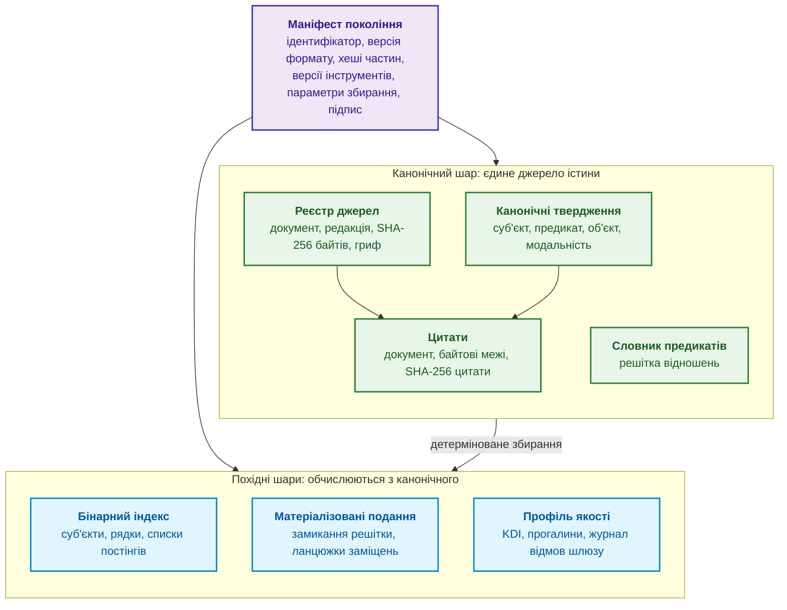

Фіолетовий блок є маніфестом, зелені блоки утворюють канонічний шар, сині блоки є похідними шарами. Таблиця пояснює, що містить кожна частина і хто її читає.

<a id="ch32-object-2"></a>

**Таблиця 32.2. Частини пакета**

| Частина пакета | Що містить | Статус | Хто читає |
|---|---|---|---|
| Маніфест покоління | ідентифікатор покоління, версія формату, хеші всіх частин, перелік джерел, версії збирача й моделей, параметри збирання, підпис | опис пакета | механізм виведення під час монтування, аудитор |
| Реєстр джерел | ідентифікатор документа, редакція, хеш SHA-256 байтів документа, гриф доступу, статус чинності | канонічна | шлюз допуску, аудитор |
| Канонічні твердження | суб'єкт, предикат, об'єкт, деонтична модальність, ідентифікатор твердження | канонічна | механізм виведення |
| Цитати | документ, байтові межі, хеш цитати; одне твердження може мати кілька цитат | канонічна | рушій пояснень ([Глава 20](ch20-explanation-engine.md)), аудитор |
| Словник предикатів | дозволені предикати та їхня решітка ([Глава 31](ch31-syllogistic-reasoning-and-relation-lattices.md)) | канонічна | шлюз допуску, силогістичний рушій |
| Бінарний індекс | таблиці суб'єктів, рядків і постінгів (розділ 4) | похідна | механізм виведення |
| Матеріалізовані подання | заздалегідь обчислені замикання й ланцюжки (розділ 1.6) | похідна | механізм виведення |
| Профіль якості | $`\mathrm{KDI}`$ за категоріями знань, прогалини, статистика відмов шлюзу (розділи 7 і 8) | похідна | інженер знань, процедура випуску |

Розподіл на канонічне й похідне є головним проєктним рішенням пакета. Похідні шари ніхто не редагує вручну: їх обчислює збирач, а перевірка пакета повторює обчислення й порівнює хеші. Розбіжність хешів означає дефект збирача або підміну файлу, і пакет не допускають до монтування. Той самий розподіл робить дешевою зміну формату індексу: новий формат є новим похідним шаром того самого канонічного шару, тож знання не треба видобувати з документів повторно, а перевірка відтворюваності одразу показує, чи відповідає новий індекс старим знанням.

### 1.3. Інваріанти пакета

Інваріант пакета є властивістю, яку зберігає кожне покоління й перевіряє кожен споживач. Порушення будь-якого інваріанта робить пакет непридатним для доказової експертної системи, тому інваріанти перевіряють автоматично під час збирання й монтування.

> [!NOTE]
> **Шість інваріантів незмінного пакета знань за моделлю автора**
> 1. Незмінність: після публікації жоден байт пакета не змінюється; виправлення чи нові твердження створюють нове покоління з відкликанням через позначки видалення (*tombstone*).
> 2. Адресація за вмістом: ідентифікатор покоління обчислюється як канонічний криптографічний хеш маніфесту всіх частин пакета (за стандартом RFC 8785 JCS).
> 3. Відтворюваність похідних шарів: похідні двійкові шари є строгою детермінованою функцією канонічного шару та параметрів збирання незалежно від кількості потоків.
> 4. Самоопис і версія формату: кожна бінарна частина містить сигнатуру, номер версії формату та прапорці безпечної сумісності з політикою відмови *fail-closed*.
> 5. Відокремлення змінного стану: зворотний зв'язок, журнали та статистика навчання зберігаються суворо поза межами двійкового пакета.
> 6. Межі доступу: кожне твердження й цитата несуть мітку доступу або виділяються в окремий ізольований шард знань без порушення приватності.
> *Керування рантаймом / Інженерний інваріант:* Гарантує побайтову аудитованість та детерміновану верифікацію пакета знань у середовищах із нульовою довірою.

1. **Незмінність.** Після публікації жоден байт пакета не змінюється. Виправлення, відкликання джерела чи нове твердження створюють нове покоління, а відкликання оформлюють позначкою видалення (*tombstone*), як описано в [Главі 10](ch10-knowledge-acquisition-systems.md).
2. **Адресація за вмістом.** Ідентифікатор покоління обчислюють як хеш канонічного маніфесту (формулу наведено в [Главі 10](ch10-knowledge-acquisition-systems.md)), а маніфест містить хеші всіх частин пакета. Зміна будь-якого байта будь-якої частини змінює ідентифікатор, тож відповідь експертної системи, яка посилається на ідентифікатор покоління, посилається на точний стан знань. Однакову серіалізацію маніфесту на різних машинах забезпечує канонічна схема JSON, наприклад JCS [[1]](#src-1).
3. **Відтворюваність похідних шарів.** Похідні шари є детермінованою функцією канонічного шару й параметрів збирання. Цей інваріант не залежить від кількості потоків збирача (розділ 6).
4. **Самоопис і версія формату.** Кожна бінарна частина починається із сигнатури, номера версії формату й прапорців. Читач відмовляється монтувати частину з невідомою основною версією (поведінка *fail-closed*), а необов'язкові розширення позначають прапорцями, які старий читач може безпечно пропустити. Такий самий прийом давно використовує формат зображень PNG: регістр першої літери назви блоку (*chunk*) повідомляє декодеру, чи можна пропустити невідомий блок без втрати сенсу зображення [[2]](#src-2).
5. **Відокремлення змінного стану.** Зворотний зв'язок інженерів, статистика навчання, кеші й журнали зберігаються поза пакетом ([Глава 25](ch25-how-expert-systems-learn.md), [Глава 26](ch26-continual-learning.md)). Навчання експертної системи створює кандидатів у наступне покоління, а не змінює чинне покоління.
6. **Межі доступу.** Пакет не має обходити розмежування доступу ([Глава 10](ch10-knowledge-acquisition-systems.md)): або кожне твердження й кожна цитата несуть мітку доступу, яку механізм виведення перевіряє перед видачею, або пакет збирають окремо для кожного рівня доступу (розбиття пакета на шарди за ознаками описано в розділі 10 і у [Главі 7](ch07-knowledge-base-typology.md)).

Разом ці інваріанти роблять пакет відтворюваним доказовим артефактом: за ідентифікатором покоління аудитор може отримати ті самі байти, цитати й індекс, які бачила система. Це перевіряє походження відповіді, але не доводить правильності тлумачення цитати чи повноти бази. Наступний крок полягає в тому, щоб простежити, хто й коли перевіряє кожну властивість.

### 1.4. Життєвий цикл пакета

Інваріанти визначають, яким має бути пакет, а життєвий цикл визначає, через які кроки пакет проходить від збирання до архіву. Схема показує ці кроки й гілку карантину.

<a id="ch32-object-3"></a>

**Діаграма 32.3. Життєвий цикл пакета знань**

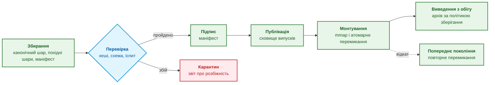

1. **Збирання.** Збирач читає канонічні твердження, які пройшли шлюз допуску (розділ 7), будує похідні шари й маніфест. Стиснення частин пакета, якщо воно потрібне, виконує центральний процесор: класичні алгоритми стиснення не відображаються на тензорні операції нейронного процесора ([Глава 18](ch18-execution-infrastructure.md)).
2. **Перевірка.** Перевірка повторно обчислює похідні шари, звіряє схему й хеші, проганяє екзаменаційну матрицю й регресійні тести ([Глава 23](ch23-knowledge-base-verification.md), [Глава 25](ch25-how-expert-systems-learn.md)).
3. **Підпис.** Маніфест підписують відповідальні особи; для периферійних вузлів діє порогова схема підписів ([Глава 22](ch22-cybernetics-edge-to-backend.md)).
4. **Публікація.** Пакет потрапляє до сховища випусків і поетапно доходить до споживачів ([Глава 10](ch10-knowledge-acquisition-systems.md)).
5. **Монтування й перемикання.** Механізм виведення відображає файли нового покоління в пам'ять, перевіряє заголовки й хеші та атомарно перемикає вказівник активного покоління. Запити, що вже виконуються, завершуються на старому відображенні, а старе відображення звільняють, коли лічильник активних читачів досягає нуля. Відкат є тим самим перемиканням на попереднє покоління.
6. **Виведення з обігу.** Старе покоління не видаляють, доки на нього посилаються видані відповіді, сертифікати доказів ([Глава 30](ch30-safety-cybersecurity-co-engineering.md)) чи аргументи безпеки ([Глава 27](ch27-safety-case-gsn-synthesis.md)); скільки поколінь зберігати, визначає політика зберігання.

Отже, відкат у такій архітектурі не є аварійною процедурою: відкат є звичайним монтуванням іншого покоління, яке вже пройшло перевірку раніше.

### 1.5. Два покоління формату

Будова пакета змінювалася разом із масштабом корпусу. Таблиця порівнює покоління формату за властивостями, що визначають поведінку експертної системи; стовпець другого покоління підсумовує розділи 3–8 цієї глави.

<a id="ch32-object-4"></a>

**Таблиця 32.4. Покоління пакета**

| Властивість | Перше покоління (v1) | Друге покоління (v2) |
|---|---|---|
| Склад файлів пакета | маніфест `pack.json` (метадані, хеш джерела), текстові `chunks.jsonl` (4096-байтні блоки з SHA-256) та сирий `facts.jsonl` (витягнуті факти без бінарного індексу) | маніфест `generation-manifest.json`, потік канонічних тверджень у форматі JSONL, бінарний індекс `index.bin` у форматі ZNAV-INDEX v2 |
| Формат канонічних тверджень | JSONL (недедупліковані об'єкти тверджень із довільним порядком ключів) | JSONL, записаний у детермінованому порядку (розділ 6) |
| Завантаження під час старту | потоковий розбір усього JSONL у купу процесу (heap) під час старту; тривалість 5–15 с на великому корпусі | відображення файлу індексу в пам'ять без розбору (розділ 3) |
| Цитати | посилання на документ, розділ та номер 4096-байтного чанка; точні побайтові зрізи та хеші цитат з'явилися пізніше | байтові межі в першоджерелі й SHA-256 цитати (розділ 7.1) |
| Повторювані твердження | дублювання записів або евристичне «голосування більшістю», що знищувало історичні версії та контекст | безвтратне кластерування з усіма цитатами (розділ 5) |
| Паралельне збирання | однопотоковий збирач або недетермінований паралелізм (хеші результату різнилися між запусками) | побітово однаковий результат за будь-якої кількості потоків (розділ 6) |
| Допуск кандидатів | евристичні регулярні вирази або підказки LLM без обов'язкового побайтового підтвердження в хості | чотири предикати побайтового шлюзу допуску (розділ 7.1) |
| Профіль якості й матеріалізовані подання | відсутні (обчислювалися зовнішніми ad-hoc скриптами або в рантаймі під час запиту) | зберігає всередині пакета як явні похідні артефакти, зафіксовані в єдиному маніфесті покоління |
| Сумісність поколінь | не застосовується | пакети v1 не підтримуються напряму; збирач перезбирає їх із канонічного шару першоджерел за специфікацією v2 |

Перехід між поколіннями формату варто пояснювати вимірюваннями, а не вподобаннями. Архівні показники автора для прямого розбору JSONL наведено в розділі 2.2 разом із межами їх перевірки. Окрема проблема v1, залежність порядку записів від виконання потоків, змінювала хеш збирання й ускладнювала побітове відтворення. Для v2 порядок канонізації та запису потрібно перевіряти незалежно від швидкості читання.

### 1.6. Матеріалізовані подання: що обчислювати під час збирання

Механізм виведення багато разів обчислює ті самі похідні відношення: транзитивне замикання решітки предикатів ([Глава 31](ch31-syllogistic-reasoning-and-relation-lattices.md)), ланцюжки заміщень редакцій документів ([Глава 15](ch15-knowledge-extraction-and-kb-construction.md)), обернені списки «об'єкт → твердження». Кожне таке відношення можна обчислювати під час запиту або зберегти в пакеті заздалегідь. У теорії баз даних це питання відоме як задача вибору матеріалізованих подань (*materialized view selection*): збережене подання прискорює запити, але займає місце й потребує оновлення, коли змінюються вихідні дані [[3]](#src-3). Мбайоссум та співавтори формалізували задачу вибору для онтологічних (семантичних) баз даних і показали, що різноманіття моделей даних і мов запитів у таких базах вимагає спільної мови, якою можна описати й порівняти різні методи вибору [[4]](#src-4).

Для пакета знань задача має особливість: пакет незмінний, тож подання не оновлюють під час роботи. Вартість підтримки подання переходить у час збирання й у розмір пакета, бо кожне нове покоління обчислює подання заново. Автором сформульовано **оптимізаційну модель відбору матеріалізованих знань**: потрібно мінімізувати процесорний час типового навантаження, не перевищивши бюджет похідних подань.

<a id="ch32-object-5"></a>

**Формула (32.5). Вибір матеріалізованих подань**

```math
V^{*} = \arg\min_{V \subseteq \mathcal{V}} \sum_{q \in Q} f_q \cdot c(q \mid V) \quad \text{за умови} \quad \sum_{v \in V} s(v) \le S_{\max}
```

Складники задачі вибору:

- $`\mathcal{V}`$ є множиною кандидатів у матеріалізовані подання, наприклад замикання решітки предикатів, ланцюжки заміщень, обернений індекс за об'єктом;
- $V$ є обраною підмножиною кандидатів, а $`V^{*}`$ є підмножиною, що дає найменшу сумарну вартість запитів;
- $Q$ є множиною типових запитів механізму виведення, а $`f_q`$ є частотою запиту $q$ за журналом запитів, у запитах за хвилину;
- $c(q \mid V)$ є вартістю відповіді на запит $q$ за наявності подань із $V$, у мікросекундах процесорного часу;
- $s(v)$ є розміром подання $v$ у пакеті, а $`S_{\max}`$ є бюджетом розміру, який допускає цільовий вузол, у мегабайтах.

У формулі множини кандидатів і запитів скінченні; частоти й вартості невід'ємні, розміри та бюджет виміряні в однакових одиницях. Добуток частоти на вартість дає мікросекунди процесорної роботи за хвилину, а не затримку одного запиту. За кількох мінімумів обирають підмножину за зафіксованим правилом, наприклад із найменшим розміром.

У загальному випадку задача вибору є NP-складною, тому на практиці подання часто відбирають жадібно, за вигодою на одиницю розміру. Важливо не переносити гарантію іншої постановки: класична оцінка $1-1/e$ (близько 63 %, де $e$ є основою натурального логарифма) для жадібного нарощування потребує невід'ємної монотонної субмодулярної вигоди й обмеження кількості вибраних елементів. Субмодулярність означає спадну додаткову користь: нове подання допомагає не більше, коли інших подань уже багато. Роботи [[5]](#src-5), [[6]](#src-6) пояснюють вибір подань, але довільні залежні подання з різними розмірами у нашому бюджетному обмеженні не отримують цієї гарантії автоматично. Тут жадібний відбір є евристикою; для кількох кандидатів оптимум можна перевірити перебором усіх підмножин.

Результат читають так: подання варто зберегти в пакеті, якщо зважена частотою економія часу запитів більша за вигоду, яку той самий обсяг бюджету дав би іншому поданню. Приклад. Нехай пакет для периферійного вузла має бюджет 20 МБ на подання, а кандидатів двоє. Замикання решітки предикатів займає 2 МБ і скорочує перевірку субсумції з 40 до 1,5 мкс; таких перевірок 10 000 за хвилину, тож замикання економить 10 000 · 38,5 мкс = 385 мс процесорного часу щохвилини, або близько 192 мс на мегабайт. Обернений індекс за об'єктом займає 30 МБ і скорочує рідкісний запит (100 за хвилину) з 900 до 5 мкс, тобто економить близько 90 мс щохвилини, або 3 мс на мегабайт. Обернений індекс не вміщується в бюджет і має в 64 рази меншу вигоду на мегабайт, тож до пакета потрапляє лише замикання. Якщо бюджет зростає до 40 МБ, жадібний відбір додає й обернений індекс.

Межа застосовності методу пов'язана з даними: частоти $`f_q`$ беруть із журналу запитів попереднього покоління, тож для нового домену без журналу вибір спирається на оцінку інженера знань і переглядається після першого покоління. Матеріалізоване подання залишається похідним шаром, тому перевірка пакета повторно обчислює подання так само, як бінарний індекс.

Розділ 1 визначив, що таке пакет знань і які властивості пакет мусить зберігати. Наступні розділи показують, чому друге покоління формату відмовилося від розбору тексту під час старту і як влаштовані механізми, що забезпечують інваріанти на рівні байтів.

---

## 2. Вибір сховища: порівнювати однакову роботу

Реляційне сховище, векторний індекс і незмінний бінарний пакет виконують різні задачі. Порівнювати їх можна лише після визначення однакових даних, запиту, результату й меж вимірювання. Нижче діаграма показує можливі шляхи читання, а не універсальний рейтинг продуктів.

<a id="ch32-object-6"></a>

**Діаграма 32.6. Два шляхи читання й межі вимірювання**

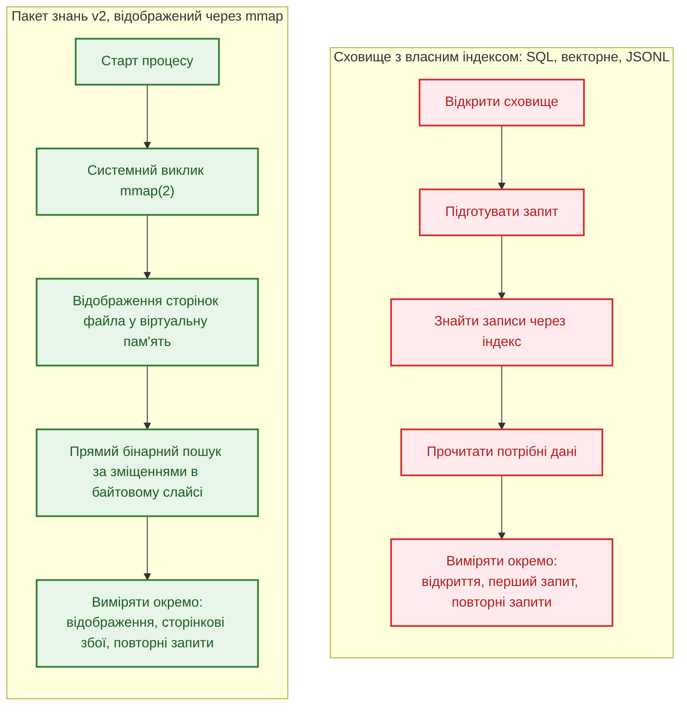

### 2.1. Які витрати й гарантії потрібно розділити

Щоб вибрати сховище для точного пошуку правила, спочатку треба переконатися, що всі реалізації повертають той самий результат. У сформульованому автором **методологічному принципі еквівалентності порівняння сховищ знань** розділено три фази: відкриття, перший запит і повторні запити. Холодним перший запит називають лише за визначеного стану кешів. Нижче розмежовано три категорії витрат і гарантій; саме це розмежування не є новим експериментальним вимірюванням:

1. **Вартість розбору під час відкриття:**  
    Розбір усього текстового корпусу під час відкриття може коштувати дорожче за читання готового індексу. Але реляційна база не зобов'язана десеріалізувати весь корпус на старті. Збирання сміття стосується конкретного середовища виконання й представлення даних, а не всіх реалізацій на C++, Rust і Go однаково.
2. **Семантична неточність векторного пошуку:**  
    Граф HNSW шукає найближчі вектори наближено [[7]](#src-7). Це інша семантика запиту, ніж точна вибірка за ідентифікатором. Пошук повертає кандидатів; чинність, доступ і підстави перевіряються окремо. Векторне сховище також може підтримувати точний пошук, тому властивість одного індексу не слід приписувати всім продуктам.
3. **Руйнування простежуваності та незмінності:**  
    Операції зміни даних не є автоматично неконтрольованими. Реляційне сховище може мати обмежені права, журнал і незмінні знімки. Незмінність опублікованого пакета є властивістю процедури випуску й політики доступу, а не виключною властивістю `mmap`.

### 2.2. Архівні вимірювання та протокол порівняння

Наступна таблиця зберігає архівні вимірювання автора на корпусі зі 100 000 фактів. Вони не є контрольованим рейтингом: відкриття відображення, підключення до сервера й завантаження індексу мають різні межі. Повні відкриті реалізації альтернатив і вихідні результати прогонів не наведено, тому читач не може незалежно відтворити всю таблицю. Показники сервера й клієнта не слід складати або порівнювати як пам'ять одного процесу.

<details>
<summary>Архівні результати автора; різні межі вимірювання</summary>

<a id="ch32-object-7"></a>

**Таблиця 32.7. Архівне порівняння з різними межами**

| Архітектура сховища | Час холодного старту | Латентність одиничного запиту ($`P_{99}`$) | Споживання RAM (RSS) | Алокації пам'яті на запит | Паузи GC на 10k QPS |
|---|---|---|---|---|---|
| **Direct JSONL Ingest** | 14,8 с | 850 мкс | 1,42 ГБ | 145 KB/op (320 allocs) | 45 мс |
| **SQLite (B-Tree, in-memory)** | 3,2 с | 45 мкс | 380 МБ | 4,2 KB/op (28 allocs) | 8 мс |
| **PostgreSQL (Local Unix Socket)** | 0,8 с (connect) | 1,2 мс | 520 МБ (server) | 12 KB/op (socket buffers) | Немає (server GC) |
| **Vector DB (HNSW Index)** | 22,5 с | 4,8 мс | 2,85 ГБ | 85 KB/op | 65 мс |
| **Knowledge Pack v2 (`mmap`)** | **4,2 мкс** | **1,5 мкс** | **18 МБ (Shared)** | **0 B/op (0 allocs)** | **0,0 мс (Zero GC)** |

За записом автора, вимірювання виконано 28 вересня 2026 року на AMD EPYC 7763, накопичувачі Samsung PM9A3 і Linux 6.8 для нормативного корпусу. Значення 4,2 мкс означає лише відображення файла й перевірку заголовка, не повну готовність усіх сторінок. Воно не доводить переваги над першим запитом до іншого сховища.

</details>

Для нового порівняння потрібно зафіксувати: генератор і хеш даних, версії інструментів, однакові точкові запити, знайдені й відсутні ключі, порядок запусків, стан кешів операційної системи та сирі результати кількох прогонів. Відкриття, перший запит і повторні запити вимірюють окремо. Спочатку перевіряють рівність відповідей, а лише потім затримки.

### 2.3. Відкритий навчальний стенд SQLite і `mmap`

Стенд нижче використовує лише стандартну бібліотеку Python 3. Він генерує однакові пари цілих чисел для SQLite і простого бінарного файла, виконує точний пошук і перевіряє кожну відповідь. Бінарний файл є навчальним індексом, не реалізацією ZNAV-INDEX. Це порівняння двох шляхів читання через Python, а не доказ нульових алокацій Go-читача. Документація модулів описує доступні операції й платформні обмеження [[8]](#src-8).

<details>
<summary>Самодостатній стенд: генератор, точні запити й результати в JSON</summary>

```python
import argparse
import json
import mmap
import platform
import random
import sqlite3
import statistics
import struct
import tempfile
import time
from contextlib import closing
from pathlib import Path

HEADER = struct.Struct("<8sQ")
RECORD = struct.Struct("<QQ")


def lookup_mapped(mapped, count, key):
    left, right = 0, count
    while left < right:
        middle = (left + right) // 2
        stored_key, value = RECORD.unpack_from(mapped, HEADER.size + middle * RECORD.size)
        if stored_key == key:
            return value
        if stored_key < key:
            left = middle + 1
        else:
            right = middle
    return None


def measure(count=100000, query_count=10000):
    if count < 1 or query_count < 1:
        raise ValueError("positive record and query counts required")
    generator = random.Random(7)
    keys = [-1, 0, count - 1, count] + [generator.randrange(count + 10) for _ in range(query_count)]
    results = []
    with tempfile.TemporaryDirectory() as directory:
        database_path = Path(directory) / "facts.sqlite"
        binary_path = Path(directory) / "facts.bin"
        with closing(sqlite3.connect(database_path)) as database:
            database.execute("CREATE TABLE facts (id INTEGER PRIMARY KEY, value INTEGER NOT NULL)")
            database.executemany("INSERT INTO facts VALUES (?, ?)", ((key, key * 2 + 1) for key in range(count)))
            database.commit()
        with binary_path.open("wb") as output:
            output.write(HEADER.pack(b"ESTEST01", count))
            for key in range(count):
                output.write(RECORD.pack(key, key * 2 + 1))
        for round_index, order in enumerate((("sqlite", "mapped"), ("mapped", "sqlite"))):
            for backend in order:
                started = time.perf_counter_ns()
                if backend == "sqlite":
                    database = sqlite3.connect(database_path.as_uri() + "?mode=ro", uri=True)
                    cursor = database.cursor()
                    def lookup(key):
                        row = cursor.execute("SELECT value FROM facts WHERE id = ?", (key,)).fetchone()
                        return None if row is None else row[0]
                else:
                    input_file = binary_path.open("rb")
                    mapped = mmap.mmap(input_file.fileno(), 0, access=mmap.ACCESS_READ)
                    assert HEADER.unpack_from(mapped) == (b"ESTEST01", count)
                    def lookup(key):
                        return lookup_mapped(mapped, count, key)
                open_ns = time.perf_counter_ns() - started
                timings = []
                try:
                    for key in keys:
                        started = time.perf_counter_ns()
                        actual = lookup(key)
                        timings.append(time.perf_counter_ns() - started)
                        expected = key * 2 + 1 if 0 <= key < count else None
                        assert actual == expected, (backend, key, actual, expected)
                finally:
                    if backend == "sqlite":
                        database.close()
                    else:
                        mapped.close()
                        input_file.close()
                ordered = sorted(timings[1:])
                results.append({"backend": backend, "round": round_index,
                                "open_ns": open_ns, "first_lookup_ns": timings[0],
                                "median_ns": statistics.median(ordered),
                                "p95_ns": ordered[(len(ordered) * 95 + 99) // 100 - 1]})
        return {"python": platform.python_version(), "platform": platform.platform(),
                "sqlite": sqlite3.sqlite_version, "records": count, "queries": len(keys),
                "cache_state": "not_reset", "results": results}


if __name__ == "__main__":
    parser = argparse.ArgumentParser()
    parser.add_argument("--records", type=int, default=100000)
    parser.add_argument("--queries", type=int, default=10000)
    arguments = parser.parse_args()
    print(json.dumps(measure(arguments.records, arguments.queries), indent=2))
```

</details>

Стенд змінює порядок запуску й перевіряє крайні та відсутні ключі, але не очищає кеш операційної системи. Збирання даних уже прогріває частину сторінок; `first_lookup_ns` означає перший запит після відкриття, не доведений холодний доступ до накопичувача. Медіана й 95-й процентиль описують виміряні виклики, а не гарантовану затримку. Час збирання, підпис, повноту пакета, пам'ять процесів і паралельні запити потрібно досліджувати окремо.

Якщо для цих даних SQLite швидший, результат не слід приховувати: він означає, що конкретний Python-шлях двійкового пошуку не виправдав очікування. Вибір сховища має спиратися на потрібні операції та виміряні обмеження, а не на наперед визначеного переможця.

---

## 3. Анатомія нульової десеріалізації: системні механізми `mmap(2)`

Стенд показав, як шукати запис без розбору всього файла, але чому його байти взагалі можна читати як пам'ять? **Віртуальна адреса** є адресою в просторі процесу; таблиця сторінок і апаратний блок MMU зіставляють її з фізичною пам'яттю. ОС керує цим зіставленням порціями, сторінками. У навчальній схемі сторінка має 4096 байтів; фактичний розмір залежить від конфігурації ОС.

Системний виклик Linux `mmap(2)` [[9]](#src-9) створює ділянку адресного простору, пов'язану з відкритим файлом. Він отримує дескриптор, довжину й файлове зміщення, права (`PROT_READ` для нашого читача) та спосіб відображення (`MAP_SHARED`), а повертає адресу початку. Зміщення у файлі для цього виклику має відповідати системному розміру сторінки; зміщення запису всередині вже відображеного файла такої вимоги не має. Наприклад, байт 65 читається як елемент `data[65]`, хоча весь файл відображено від зміщення 0.

**Нульове копіювання під час читання** тут означає відсутність додаткової копії всього індексу в об'єкти купи, а не відсутність передавання байтів узагалі. Накопичувач усе одно постачає дані в RAM, кеші CPU отримують лінії пам'яті, а декодування числа виконує інструкції. Під час компіляції пакета сортування, нормалізація, хешування та запис можуть копіювати й виділяти пам'ять. Схема стосується лише готового незмінного образу.

<a id="ch32-object-8"></a>

**Діаграма 32.8. Схема трансляції адрес у mmap-індексі**

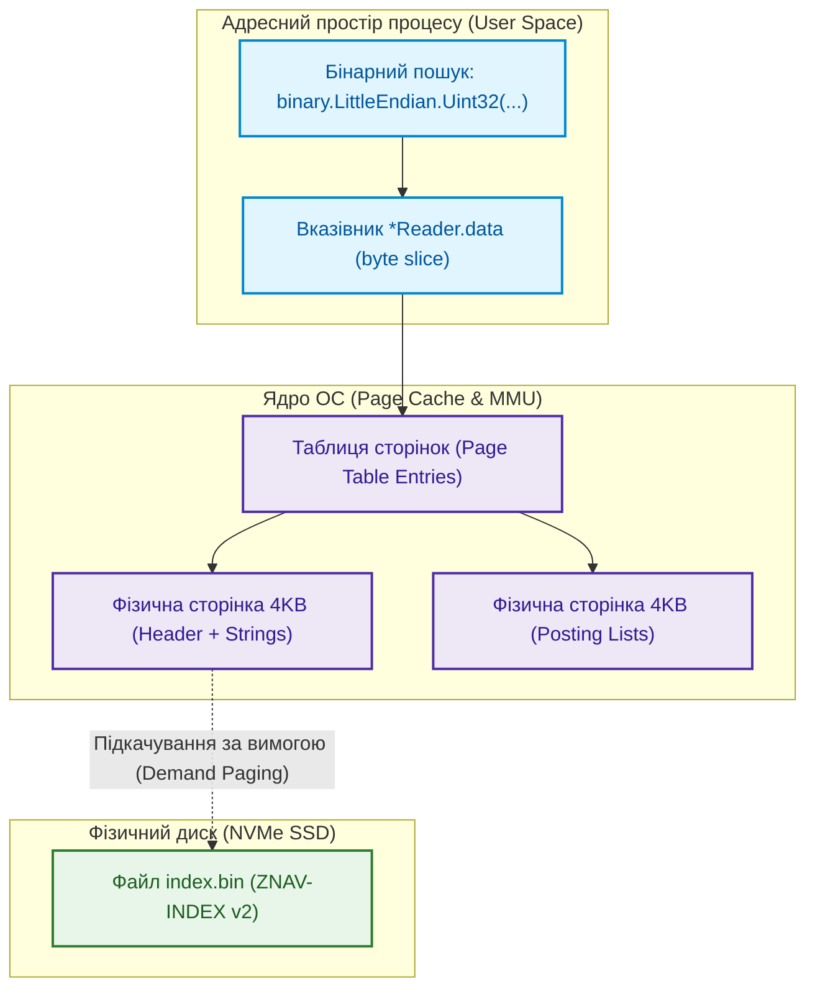

### 3.1. Механіка сторінкового підкачування та системний виклик `madvise(2)`

Після отримання адреси залишається з'ясувати, коли з'являться потрібні байти й як їх правильно прочитати. Порядок байтів (*endianness*) визначає запис багатобайтового числа: число 258 у двобайтовому little-endian поданні є байтами `02 01`, бо молодший байт записано першим. `binary.LittleEndian` читає саме цей порядок незалежно від архітектури хоста. Вирівнювання натомість описує адресу початку запису, а не порядок байтів; це різні вимоги.

1. **Підкачування за вимогою (*demand paging*):**  
   Під час виклику `mmap(2)` ядро Linux не читає файл у пам'ять одразу, а лише створює опис ділянки віртуального адресного простору (структуру `vm_area_struct`). Перше звернення до сторінки, якої ще немає в кеші сторінок, спричиняє виняток процесора, сторінковий збій (*page fault*): потік читача зупиняється, доки ядро читає сторінку з накопичувача й записує відповідність у таблицю сторінок [[10]](#src-10). Ядро може заодно прочитати й сусідні сторінки, тож вартість першого запиту залежить від стану кешу й не визначається лише форматом файла.
2. **Порада ядру викликом `madvise(2)`:**  
   Щоб зменшити кількість сторінкових збоїв під час перших запитів, читач може викликати `unix.Madvise(data, unix.MADV_WILLNEED)` з пакета `golang.org/x/sys/unix`. Прапорець `MADV_WILLNEED` лише повідомляє ядру, що діапазон знадобиться найближчим часом; документація виклику формулює наслідок обережно: можливо, варто прочитати частину сторінок наперед [[11]](#src-11). Порада не гарантує, що весь індекс опиниться в пам'яті до першого запиту, і не захищає сторінки від пізнішого витіснення, тому ефект поради потрібно вимірювати, а не передбачати.
3. **Вирівнювання записів (*alignment*):**  
	У навчальному індексі заголовок займає 64 байти, а записи таблиці по 16 байтів починаються зі зміщення 0x40. Для 64-байтової кеш-лінії чотири такі записи лежать у межах однієї лінії [[12]](#src-12); читання самого рядка за зміщенням може торкнутися інших ліній. Поле `PostingsOff` усередині запису починається з байта 6, тому його не можна без перевірки трактувати як природно вирівняний `uint32` через `unsafe`. Функції `encoding/binary` декодують байти без такої вимоги. Оптимізації `bytes.Compare` залежать від версії Go та CPU, а не є гарантією формату.

Отже, нульова десеріалізація не означає нульову затримку: перший доступ може чекати вводу-виводу. Навіть правильне декодування чисел ще не робить адреси безпечними; наступні підрозділи розглядають незмінність і час життя відображення.

### 3.2. Коли відображення файла в пам'ять не підходить

Переваги `mmap(2)` мають чітку межу застосовності. Кротті, Ляйс і Павло проаналізували використання `mmap(2)` замість власного буферного пулу в СКБД і назвали чотири групи проблем: безпеку транзакцій під час запису, непередбачувані зупинки вводу-виводу, обробку помилок вводу-виводу й продуктивність [[13]](#src-13). Зупинка вводу-виводу виникає тому, що операційна система може будь-коли витіснити сторінку, і навіть запит лише на читання наштовхується на блокувальний сторінковий збій, якого програма не може передбачити. Помилка читання з накопичувача приходить не кодом повернення, а сигналом `SIGBUS` у будь-якому місці коду, що торкається відображеної пам'яті. Продуктивність обмежують, зокрема, скидання записів TLB на всіх ядрах процесора (*TLB shootdown*) під час витіснення сторінок. Висновок авторів жорсткий: використовувати `mmap(2)` у СКБД можна хіба тоді, коли робочий набір даних уміщується в пам'ять, а навантаження лише читає.

На основі цього аналізу автором сформульовано **критерій застосовності mmap**: незмінний читацький пакет із контрольованим робочим набором є кандидатом для такого доступу, але не отримує гарантованої затримки автоматично. Наприклад, 200 МБ гарячих сторінок за виділеного бюджету 300 МБ можуть вміщуватися, а два одночасні покоління по 200 МБ — уже ні. Якщо доступні сторінки витісняються, явне читання з керованими буферами дає програмі більше контролю над помилками та плануванням. Вибір перевіряють на потрібному навантаженні, не лише за розміром файла. Незмінність забезпечують для самого об'єкта, а не тільки правами каталогу: процес зі збереженим дескриптором запису все ще може його змінити. Розділ 6.2 повертається до цього ризику, а розділ 10 — до розподілу робочого набору.

### 3.3. Крос-архітектурний детермінізм mmap і слабка модель пам'яті (x86_64 TSO проти ARM64 Relaxed)

Читання однакового пакета на двох CPU ставить два різні питання: чи однаково декодуються числа і чи коректно опубліковано покажчик на готовий пакет для інших потоків? Перше вирішує специфікація байтів, друге — модель пам'яті мови та синхронізація. В авторській **моделі крос-архітектурного детермінізму mmap** ці умови застосовано до незмінного образу. `MAP_SHARED` саме по собі не публікує структуру між горутинами й не продовжує її життя.

1. **Архітектура x86-64 (Total Store Order, TSO):**  
	Для звичайної кешованої пам'яті модель TSO обмежує апаратні перестановки сильніше за Arm64, хоча допускає спостережуване випередження попереднього запису наступним читанням іншої адреси. Це не дозвіл на гонитви в Go або C++: компілятор і модель мови також визначають поведінку. Покажчик на повністю перевірений образ публікують через відповідний атомарний API або блокування, а не через звичайну змінну.

2. **Архітектура ARM64 (Weak / Relaxed Memory Model):**  
	Arm64 допускає більше перестановок, тому публікація повинна встановлювати потрібний порядок видимості ініціалізації. У Go для цього використовують `sync/atomic` або синхронізацію, а не вставляють довільні `DMB` у навчальний читач. Після коректної публікації незмінних байтів звичайний пошук не потребує бар'єра на кожному полі. Невирівняний доступ є окремою проблемою: його допустимість залежить від інструкції й типу пам'яті; переносиме декодування байтів не тотожне прямому розіменуванню типізованого покажчика.

#### 3.3.1. Роль вирівнювання за 64-байтовими межами ліній кешу

Для щільного розміщення записів автором запроваджено **інваріант 64-байтового вирівнювання секцій контейнера**. Він визначає початки секцій, а не атомарність операцій і не синхронізацію потоків. Цей розширений контейнер відрізняється від компактного індексу §4, де таблиці рядків і постінгів не мають такого обов'язкового вирівнювання.

<a id="ch32-object-9"></a>

**Формула (32.9). Вирівнювання секцій**

```math
\forall i \in [0, N_{\text{sections}}-1]: \quad \mathrm{Offset}_i \pmod{64} = 0
```

- $`\mathrm{Offset}_i`$ є зміщенням $i$-ї секції у байтах від початку файлу;
- операція $`\pmod{64}`$ повертає остачу від ділення зміщення на 64;
- $`N_{\text{sections}}`$ є додатною цілою кількістю секцій, а $i$ пробігає цілі індекси від 0 до цієї кількості мінус один.

Наприклад, секція на байті 128 вирівняна, на байті 130 — ні. Якщо її записи мають крок 16 байтів, записи на 128, 144, 160 і 176 вміщуються в одну 64-байтову лінію. Але 80-байтовий запис від 128 уже перетинає її межу. Отже, для неперетину потрібні також відповідні розмір і крок запису; сама нульова остача не захищає від `SIGBUS`, усічення файла чи гонитви з `munmap`.

#### 3.3.2. Емпірична верифікація крос-архітектурного детермінізму

У цьому підрозділі збережено архівний опис авторського порівняння одного пакета мережевих специфікацій обсягом 408 КБ на двох платформах. Сирий протокол, версії компілятора й точний образ тут не опубліковано, тому наведені показники не є незалежно відтвореними результатами цього навчального проходу:
* **Хост x86_64:** робоча станція Intel Core i7-13700H (14 ядер / 20 потоків, архітектура TSO, Linux 6.8);
* **Цільовий стенд ARM64:** промисловий комп'ютер Seeed Studio reServer Industrial J501 на базі **NVIDIA Jetson AGX Orin 64GB** (Cortex-A78AE, Relaxed Memory Model, Linux 5.15 aarch64, енергетичний профіль `MODE_15W`).

Тестовий набір виконав 107 спеціалізованих мікропрограм символьного виведення над базами знань, включно з операціями перевірки побайтової кустодії першоджерел через криптографічний хеш SHA-256 та багатопотоковий стрес-тест (4 паралельні потоки на 4 активних ядрах Cortex-A78AE, 100 000 циклів читання через `mmap(MAP_SHARED)`).

<a id="ch32-object-10"></a>

**Таблиця 32.10. Архівний міжархітектурний тест**

| Параметр валідації | x86_64 (Intel Core i7) | aarch64 (Jetson AGX Orin) | Дельта / Розбіжність | Статус верифікації |
| :--- | :---: | :---: | :---: | :---: |
| **Кількість тестових мікропрограм** | 107 | 107 | 0 | ПОВНИЙ ЗБІГ |
| **Тотожність регістрового файлу (стану віртуальних регістрів)** | 100{,}00 % | 100{,}00 % | **0{,}00 %** | МАТЕМАТИЧНО ТОТОЖНО |
| **Тотожність прапорців процесора (`EFLAGS`)** | 100{,}00 % | 100{,}00 % | **0{,}00 %** | МАТЕМАТИЧНО ТОТОЖНО |
| **Позитивна перевірка цитати у збережених записах** | 100 із 107 | 100 із 107 | 0 відмінностей записаних статусів | 7 інших записів не є позитивними перевірками цитати |
| **Рівень архітектурної розбіжності (*Divergence Rate*)** | — | — | 0 відмінностей у зіставлених записах | Перевірено 107 збережених пар; повні журнали 10⁵ повторів не звірено |
| **Багатопотокова швидкість символьного ядра** | 31{,}22 MOps/s | **7{,}91 MOps/s** | — | Відповідає профілю 15W |
| **Швидкість нуль-копіювальних факт-лукапів** | 10{,}41 млн фактів/с | **2{,}64 млн фактів/с** | — | Без алокацій у купі |
| **Апаратні збої вирівнювання (*Alignment Faults / SIGBUS*)** | 0 | **0** | 0 | 64-байтне вирівнювання діє |
| **Енергетична вартість 1 000 000 операцій виведення** | — | **4,8684 Дж (архів)** | — | інтервал і метод вимірювання не наведено; потужність не встановлена |

Архівний опис автора повідомляє про 107 мікропрограм і 100 000 повторів кожної без розбіжностей. Локально звірено два збережені машинні результати для x86-64 та ARM: усі 107 поелементних записів структурно тотожні, але позитивний прапорець перевірки цитати є лише у 100; сім записів містять відмову. Це підтверджує збіг саме збережених результатів, не всі повтори, правильність очікувань або універсальний детермінізм. Прив'язки до хешів входів і виконуваних збірок недостатньо для повного відтворення; причинний внесок вирівнювання потребує окремого порівняння. Статистичну верхню межу з [Глави 36, §5.5](ch36-knowledge-testing-pyramid-and-variational-calibration.md) слід тлумачити за припущеннями її вибіркової моделі, а не як доказ усіх можливих режимів.

Розрахунок $`\lceil\log_2(10^5)\rceil=17`$ оцінює кількість кроків двійкового пошуку за заданої моделі доступу, але сам по собі не встановлює затримку чи пропускну здатність: на них також впливають промахи кешу, сторінкова підкачка, конкуренція за пам'ять, розподіл ключів і навантаження. Повідомлені понад $3\cdot10^7$ операцій/с збережено в архівному описі з фрагментом консольного виводу; окремого первинного benchmark-журналу з повною конфігурацією не встановлено. Телеметричний ряд із шести відліків підтверджує середні 4436,17 мВт за каналом `VIN_SYS_5V0`, але не прив'язує їх до мільйона операцій: межа віддаленого виклику у доступному сценарії охоплює також тести. Тому 4,8684 Дж не можна автоматично поєднати з 7,91 MOps/s. CPU-сервер є кандидатом для розгортання лише після перевірки потрібних операцій і часових меж на цільовому наборі даних.

> [!NOTE]
> **Чотири чинники крос-архітектурного детермінізму mmap за емпіричною моделлю автора**
> 1. Суворе 64-байтне вирівнювання: у реалізаціях і діапазонах доступу, перевірених у стенді, воно не спричинило збоїв вирівнювання; інші платформи та операції потребують власної перевірки.
> 2. Контроль спільного стану: усунення змінних спільних записів скорочує одну з причин міжпотокових відмінностей, але не скасовує інших вимог моделі пам'яті та синхронізації.
> 3. Регістрова тотожність на тестовому стенді: за архівним описом автора спостережувана розбіжність стану віртуальних регістрів і прапорців символьного рушія становила $`\mathrm{Divergence} = 0{,}0000\,\%`$ для $`N = 107`$ мікропрограм. Повторення тих самих програм не є автоматично незалежними випадковими випробуваннями для статистичного узагальнення ([Глава 36, §5.5](ch36-knowledge-testing-pyramid-and-variational-calibration.md)).
> 4. Побайтова перевірка цитат: збіг 107 парних результатів не означає 107 позитивних перевірок цитати. У збережених записах позитивний прапорець мають 100 випадків, сім завершуються відмовою; правильність очікуваної поведінки потребує незалежного еталона.
> *Керування рантаймом / Інженерний інваріант:* Результат підтверджує паритет лише для перевірених комбінацій коду, компілятора, пристрою й тестових даних; перед переносом пакета на іншу платформу виконайте цільові регресійні тести.

### 3.4. Атомарна гаряча заміна mmap-пакетів за шаблоном RCU (Read-Copy-Update) та захист від SIGBUS

Після безпечного відкриття залишається задача оновлення: як надати новим запитам нове покоління, не забравши байти в уже активних читачів? **Час життя відображення** — інтервал від успішного `mmap` до `munmap`; кожен покажчик і повернений підзріз має використовуватися лише всередині цього інтервалу. Звичайний атомарний `rename` нового файла поверх старого імені не усікає старий inode і не руйнує чинне відображення. Небезпечні зміна або усічення саме відображеного файла, помилка вводу-виводу та передчасне зняття відображення [[9]](#src-9).

Простий коректний варіант — утримувати `sync.RWMutex` протягом усього читання та використання результату. Він не скасовує нульового копіювання; його вартість вимірюють на потрібному навантаженні. RCU (*Read-Copy-Update*) [[27]](#src-27) є альтернативою, коли важливо зменшити читацьку синхронізацію: новий образ готують окремо, публікують, а старий утримують до завершення всіх читачів старого покоління.

Тут критична реєстрація читача: послідовність «завантажити покажчик, потім збільшити його лічильник» небезпечна. Між цими діями оновлювач може побачити нуль і виконати `munmap`. Тому потрібний завершений протокол епох або захисних покажчиків із повторною перевіркою публікації, а не лише `atomic.Pointer` плюс лічильник. Наведена схема передбачає, що захист читача встановлено до отримання позиченої адреси.

Для подолання цієї суперечності автором реалізовано архітектурний шаблон **атомарної заміни пам'яті знань на основі життєвого циклу RCU (Read-Copy-Update)** [[27]](#src-27). Шаблон спирається на три жорсткі інваріанти:

> [!NOTE]
> **Три інваріанти атомарної гарячої заміни mmap-пакетів за шаблоном RCU за моделлю автора**
> 1. Незмінні паралельні зрізи (*Immutable Parallel Mappings*): нова версія пакета знань $`\mathcal{P}_{k+1}`$ компілюється в окремий бінарний артефакт і монтується ядром паралельно у нову, абсолютно незалежну область віртуальних адрес процесу через `mmap` у режимі тільки для читання (`PROT_READ`, `MAP_SHARED`), залишаючи попередню версію $`\mathcal{P}_k`$ повністю неушкодженою.
> 2. Атомарне перемикання покажчика (*Atomic Pointer Swinging*): готовий перевірений дескриптор публікується через `atomic.Pointer` відповідно до моделі пам'яті мови; атомарність не означає виконання за один такт.
> 3. Дренаж епохи та безпечний демонтаж (*Epoch Drain & Safe Munmap*): `munmap` дозволений лише після підтвердження, що жоден захищений читач не використовує старих адрес або результатів-зрізів. Протокол усуває передчасне звільнення, але не всі причини `SIGBUS`.
> *Керування рантаймом / Інженерний інваріант:* Публікація нового покоління та звільнення старого є різними подіями; тайм-аут не замінює підтвердження завершення читачів.

<a id="ch32-object-11"></a>

**Діаграма 32.11. Послідовність атомарної заміни mmap-пакета за шаблоном RCU**

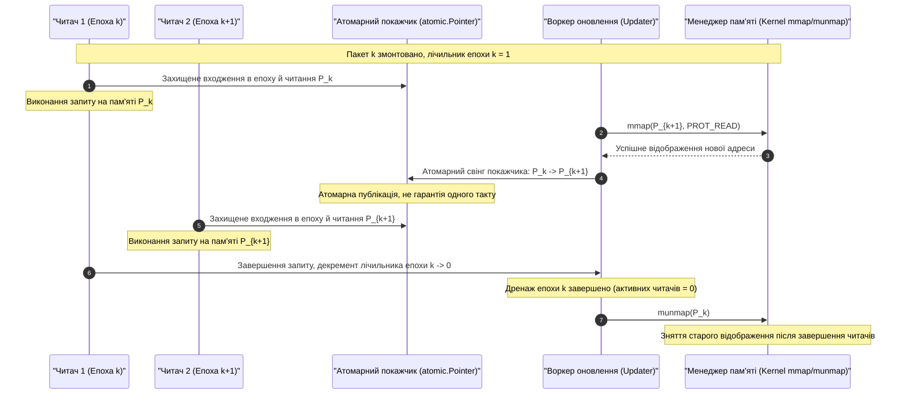

Авторська **модель безпечного дренажу mmap-пакетів** оцінює час утримання старого покоління після публікації нового. За умови, що нові читачі вже не входять у стару епоху, він залежить від найдовшого залишкового читання:

<a id="ch32-object-12"></a>

**Формула (32.12). Оцінка часу дренажу**

```math
T_{\mathrm{reclaim}} = \max_{j \in [1, N_{\mathrm{active}}]} \left( \tau_{\mathrm{rem}}(r_j) \right) + \Delta_{\mathrm{drain}}
```

- $`T_{\mathrm{reclaim}}`$ — тривалість періоду безпечного дренажу епохи (Grace Period) від моменту атомарного перемикання покажчика до виконання системного виклику `munmap(2)`, виражена в мілісекундах ($`\text{мс}`$);
- $`N_{\mathrm{active}}`$ — кількість активних читацьких потоків, що захопили посилання на пакет $`\mathcal{P}_k`$ до моменту перемикання покажчика;
- $`\tau_{\mathrm{rem}}(r_j) \ge 0`$ — залишковий час читача $`r_j`$ до останнього використання позичених байтів, у мілісекундах; дедлайн обмежує його лише за доведеного завершення операції, а не лише скасування контексту;
- $`\Delta_{\mathrm{drain}} \ge 0`$ — затримка виявлення завершення, планування оновлювача й зняття відображення, також у мілісекундах; універсальної межі 2 мкс немає.

Кількість читачів є невід'ємним цілим; за відсутності читачів максимум у цій моделі приймають рівним нулю. Формула є оцінкою за відомих залишкових часів. Якщо потік завис або утримує зріз поза запитом, скінченна межа дренажу не встановлена.

Піковий обсяг віртуальної пам'яті під час перехідного процесу заміни ($`M_{\mathrm{transit}}`$):

<a id="ch32-object-13"></a>

**Формула (32.13). Адресний бюджет двох поколінь**

```math
M_{\mathrm{transit}} = M(\mathcal{P}_k) + M(\mathcal{P}_{k+1}) \le M_{\mathrm{budget}}
```

- $`M(\mathcal{P}_k)`$ та $`M(\mathcal{P}_{k+1})`$ — розміри файлів відповідних поколінь пакетів знань, відображених у пам'ять;
- $`M_{\mathrm{budget}}`$ — виділений бюджет віртуального адресного простору в тих самих одиницях, наприклад МБ; усі величини невід'ємні. `vm.max_map_count` натомість обмежує кількість областей відображення, не байти й не файлові дескриптори.

**Як використати оцінку.** Навчально припустимо: старий образ займає 480 МБ, новий — 510 МБ, найдовший залишковий запит триває 14,2 мс, а сумарна затримка завершення становить 0,0018 мс. Отримуємо 14,2018 мс утримання й 990 МБ адресного простору. За окремо виділеного віртуального бюджету 1200 МБ обидва образи вміщуються. Це не перевірка достатності фізичної RAM: різні файли поколінь можуть одночасно займати окремі фізичні сторінки, плюс пам'ять процесу й ОС.

Оновлювач очікує підтвердженого виходу читачів. Скасування `context` у Go кооперативне й не зупиняє горутину примусово; за зависання старий образ утримують, обмежують наступні оновлення або застосовують контрольований перезапуск. Окремо підраховують області відображення всього процесу, файлові дескриптори та RAM. Фіксований запас «64 області» не є вимогою Linux. Отже, розрахунок допомагає допустити чи відкласти оновлення, але не доводить нульового простою або загального захисту від апаратних помилок.

### 3.5. Асинхронна міграція структури контейнерів знань та автоматичний відкат (Zero-Downtime Knowledge Container Evolution)

При переході між поколіннями експертних систем виникає проблема несумісності двійкових контейнерів знань: накопичені масиви правил не можуть бути одномоментно перекомпільовані із сировинних першоджерел без тривалого простою системи. Для розв'язання цієї проблеми автором розроблено **архітектурний патерн асинхронної міграції бінарних контейнерів знань із нульовим простоєм** (`CH32-S03-10`), що поєднує монотонне цілочисельне версіонування з фоновим перетворенням за шаблоном RCU.

> [!NOTE]
> **Три принципи неперервного оновлення бінарних контейнерів знань у спільній пам'яті без простою**
> 1. Монотонне цілочисельне версіонування структури: двійковий контейнер знань маркується єдиним беззнаковим цілим числом версії формату, унеможливлюючи приховану несумісність полів та забезпечуючи детермінований крок міграції без втрати локальних індексів першоджерел.
> 2. Асинхронне фонове перетворення з конкурентним читанням: попередню версію можна обслуговувати лише підтримуваним і перевіреним читачем; невідома версія відхиляється. Перетворення створює окремий образ і може копіювати дані.
> 3. Атомарна RCU-підміна покажчика простору імен із гарантованим відкатом: перемикання активного реєстру на новий зріз пам'яті здійснюється єдиною атомарною операцією запису покажчика після повної верифікації цілісності Merkle-дерева; у разі невідповідності підпису рантайм автоматично відновлює попередній стан без відмови в обслуговуванні.
> *Керування рантаймом / Інженерний інваріант:* Неперервне обслуговування є метою за достатніх ресурсів і сумісного старого читача, а нульове копіювання стосується запитів, не міграції.

Наприклад, читач версій 1 і 2 може перевірити старий пакет, паралельно створити версію 2 і переключитися після регресійних тестів. Читач лише версії 2 не повинен монтувати версію 1 «заради доступності». Після міграції звіряють канонічні твердження й цитати, а не тільки хеш нового файла: зміна формату закономірно змінює його байти. Тепер можна визначити конкретний макет, який читач справді підтримує.

---

## 4. Специфікація бінарного формату ZNAV-INDEX v2

Специфікація формату потрібна, щоб читач не вгадував значення байтів. З уже пояснених понять тут потрібні зміщення від початку файла, little-endian числа та фіксований розмір запису. Вхід — файл індексу, результат — перевірена таблиця, за якою можна знайти списки постінгів, тобто 64-бітних зміщень тверджень у пов'язаному файлі. Макет нижче є навчальною специфікацією авторського прототипу; він не задає формат усіх розширених контейнерів §11.

<details>
<summary>Специфікація заголовка та макета бінарного файлу ZNAV-INDEX v2</summary>

<a id="ch32-object-14"></a>

**Схема 32.14. Побайтовий макет індексу v2**

```text
+-----------------------------------------------------------------------+
| Magic 'ZNAV' (4B) | Version (2B) | Flags (2B) | AssertionsCount (4B)  |  0x00 - 0x0B
| TotalSubjects (4B) | StringTableOff (8B) | PostingsOff (8B)           |  0x0C - 0x1F
| SubjectIndexOff (8B) | CRC32 Checksum (4B) | Reserved Padding (20B)   |  0x20 - 0x3F
+-----------------------------------------------------------------------+  0x40
| Таблиця суб'єктів (Впорядкований масив SubjectEntry, розмір 16B кожен)   |
| [StrOff:4B][StrLen:2B][PostingsOff:4B][PostingsCount:2B][Reserved:4B] |
| ... (N = TotalSubjects, двійковий пошук за O(log N))                  |
+-----------------------------------------------------------------------+
| Таблиця рядків (UTF-8, дедупліковані імена суб'єктів та предикатів)   |
+-----------------------------------------------------------------------+
| Списки постінгів (по 8 байтів: зміщення тверджень у файлі тверджень) |
+-----------------------------------------------------------------------+
```

</details>

Завдяки впорядкованості масиву `SubjectEntry` пошук будь-якого терміну виконується за алгоритмом класичного бінарного пошуку $`\mathcal{O}(\log_2 N)`$. Жодна стрічка не копіюється в купу: функція читання повертає підзріз (*slice*) байтового масиву mmap, і збирач сміття не отримує нових об'єктів для обходу.

Канонічному формату ZNAV-INDEX v2 відповідає саме розміщення з еталонного Go-коду розділу 9. Усі числа записано в порядку байтів від молодшого до старшого (*little-endian*). Заголовок займає рівно 64 байти: поле `SubjectIndexOff` (8 байтів, зміщення 0x20–0x27) задає абсолютне зміщення початку впорядкованого масиву `SubjectEntry`, після нього йде `CRC32Checksum` (4 байти, 0x28–0x2B) та 20 зарезервованих байтів (`Reserved`, 0x2C–0x3F). Контрольну суму CRC32 у варіанті IEEE рахують лише за байтами 0x00–0x27, тобто за всім заголовком до самого поля суми. Цілісність решти файла захищає не CRC32, а хеш SHA-256 файла в маніфесті покоління (інваріант 2 розділу 1.3). Явне поле `SubjectIndexOff` дозволяє в майбутньому розширити заголовок без жорсткої прив'язки таблиці суб'єктів до зміщення 0x40.

Розділи файла йдуть у фіксованому порядку: заголовок, таблиця суб'єктів, таблиця рядків, списки постінгів. Поля `StrOff` і `PostingsOff` у записі суб'єкта є абсолютними зміщеннями від початку файла, і кожне зміщення разом із довжиною має лежати всередині свого розділу. Двійковий пошук дає правильний результат лише тоді, коли імена суб'єктів у таблиці строго зростають за побайтовим порівнянням. Ці три вимоги специфікації збирач гарантує під час запису, а читач перевіряє під час відкриття, бо файл могли пошкодити або підмінити дорогою.

### 4.1. Що змінилося порівняно з ZNAV-INDEX v1

Формат індексу має ті самі два покоління, що й формат пакета (розділ 1.5). Таблиця ставить поруч елементи формату; стовпець v2 взято зі специфікації вище.

<a id="ch32-object-15"></a>

**Таблиця 32.15. Покоління індексу**

| Елемент формату | ZNAV-INDEX v1 | ZNAV-INDEX v2 |
|---|---|---|
| Сигнатура й версія | ASCII `ZNAV`, версія як `uint32` (значення 1), без прапорців | `ZNAV`, версія у 2 байтах, прапорці у 2 байтах |
| Заголовок | перелічені поля займають 24 байти (4 + 4 + 8 + 4 + 4); заявлені раніше 28 байтів потребували б ще 4 байтів резерву | 64 байти, контрольна сума CRC32 заголовка |
| Пошук суб'єкта | неструктурований каталог сутностей у кінці файлу, розбирався під час старту в хеш-карту Go (`map[string][]uint64`) | відсортований масив записів по 16 байтів, двійковий пошук |
| Таблиця рядків | рядки імен записувалися індивідуально для кожної сутності (`uint16` довжина + UTF-8 байти) без спільної таблиці | UTF-8, дедупліковані імена суб'єктів і предикатів |
| Списки постінгів | послідовний масив 64-бітних зміщень JSON-рядків у файлі (`uint64`), без групування за предикатами | зміщення тверджень у файлі тверджень |
| Відкриття файлу | `mmap(2)` файлу з обов'язковим подальшим розбором каталогу та алокаціями в купу | `mmap(2)` без копіювання |
| Межі розрядності | 32-бітні лічильники фактів (до $4 \cdot 10^9$), 64-бітне зміщення каталогу | 16-бітні довжина імені й кількість постінгів, 32-бітні зміщення в записі суб'єкта |
| Виміряні показники | час відкриття 12–15 мс (розбір каталогу), виділення 12–18 МБ пам'яті в купі під час відкриття, латентність пошуку ~25–30 мкс | таблиця розділу 2.2 |

Розрядність полів v2 задає межі, які збирач мусить перевіряти. Шістнадцятибітне поле `PostingsCount` обмежує один суб'єкт 65 535 твердженнями, шістнадцятибітне поле `StrLen` обмежує ім'я суб'єкта 65 535 байтами, а 32-бітні зміщення в записі суб'єкта обмежують адресовану частину файлу 4 ГіБ. Для частого суб'єкта у великому корпусі, наприклад суб'єкта «TCP» у повному наборі RFC, перша межа досяжна, тож збирач має зупинятися з помилкою, а не мовчки обрізати список постінгів. Усунення такої межі вимагатиме нової версії формату й саме для цього заголовок містить поле версії й резервні байти (інваріант 4 розділу 1.3).

---

## 5. Алгоритм безвтратного інвертованого кластерування фактів

У процесі аналізу десятків нормативних стандартів одне й те саме твердження багаторазово цитується різними документами. Наприклад, поле контрольної суми TCP визначено ще в RFC 793 [[14]](#src-14), вимогу *«відправник MUST формувати контрольну суму, отримувач MUST її перевіряти»* сформульовано в RFC 1122 [[15]](#src-15), а RFC 9293 повторює її як вимоги MUST-2 і MUST-3 [[16]](#src-16).

Наївна екстракція створює три однакові записи, що роздуває індекс. Однак просте видалення дублікатів неприпустиме: інженерний аудит вимагає знати кожен первинний документ, номер розділу та точні байти цитати.

Для вирішення цієї проблеми застосовано **алгоритм безвтратного інвертованого кластерування**:

<a id="ch32-object-16"></a>

**Діаграма 32.16. Алгоритм безвтратного кластерування тверджень**

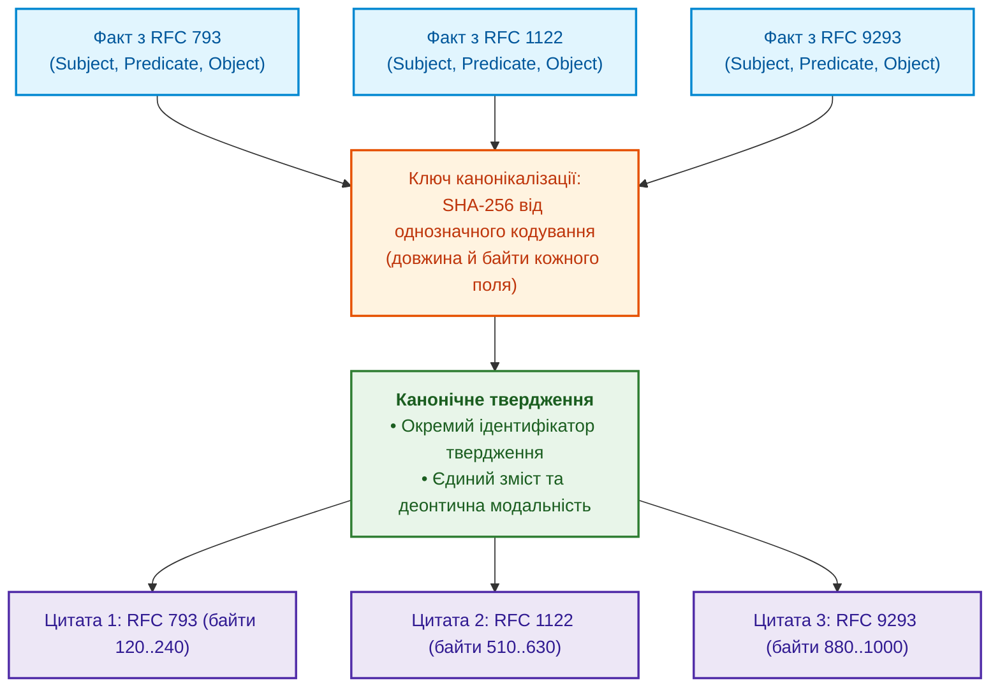

### 5.1. Ключ кластера: однозначне кодування полів

Кластеризатор має об'єднати лише однакові нормалізовані твердження в однаковій області застосовності. У навчальному вході ця область уже зафіксована; для різних юрисдикцій, умов чи строків чинності її треба включати в ключ або розділяти набори до кластерування. Інакше однакова четвірка не означає однакової норми. Просте з'єднання полів роздільником також хибне: («a|b», «c», «d», «MUST») і («a», «b|c», «d», «MUST») дають ті самі байти `a|b|c|d|MUST`. Тому перед кожним полем записується його 8-байтна довжина у big-endian порядку. Це ін'єктивне кодування четвірки байтовими рядками; наступний SHA-256 [[17]](#src-17) уже не є математичною бієкцією з нескінченної множини рядків у 256 біт. Навчальна реалізація покладається на відсутність криптографічної колізії; сильніший верифікатор додатково зіставляє поля за однакового дайджесту.

Друга вимога стосується текстового подання полів. Літеру «й» можна закодувати однією кодовою точкою Unicode (U+0439) або двома (літера «и» U+0438 і комбінований знак бреве U+0306), і побайтове порівняння вважатиме ці записи різними. Додаток UAX #15 до стандарту Unicode визначає нормальні форми, у яких канонічно еквівалентні рядки мають однакове двійкове подання [[18]](#src-18). Нормалізацію до форми NFC виконує екстрактор ([Глава 15](ch15-knowledge-extraction-and-kb-construction.md)) до кластерування; стандартна бібліотека Go не містить функції нормалізації, тому кластеризатор нижче приймає вже нормалізовані поля.

Третя вимога: результат не має залежати від порядку вхідних фактів. Кластеризатор сортує цитати кожного твердження за документом, байтовими межами й хешем цитати, відкидає точні повтори однієї цитати, а самі твердження сортує за ключем.

<details>
<summary>Приклад мовою Go: безвтратне кластерування фактів з однозначним ключем</summary>

```go
package clustering

import (
	"crypto/sha256"
	"encoding/binary"
	"encoding/hex"
	"sort"
)

type Citation struct {
	DocumentID string `json:"doc_id"`
	ByteStart  int    `json:"byte_start"`
	ByteEnd    int    `json:"byte_end"`
	QuoteSHA   string `json:"quote_sha"`
}

type RawFact struct {
	Subject   string
	Predicate string
	Object    string
	Modality  string
	Citation  Citation
}

type CanonicalFact struct {
	FactHash  string     `json:"fact_hash"`
	Subject   string     `json:"subject"`
	Predicate string     `json:"predicate"`
	Object    string     `json:"object"`
	Modality  string     `json:"modality"`
	Citations []Citation `json:"citations"`
}

// factKey хешує однозначне кодування полів: перед байтами кожного поля
// записано його довжину, тож ("a|b", "c") і ("a", "b|c") дають різні ключі.
func factKey(fields ...string) string {
	h := sha256.New()
	var size [8]byte
	for _, field := range fields {
		binary.BigEndian.PutUint64(size[:], uint64(len(field)))
		h.Write(size[:])
		h.Write([]byte(field))
	}
	return hex.EncodeToString(h.Sum(nil))
}

func citationLess(a, b Citation) bool {
	if a.DocumentID != b.DocumentID {
		return a.DocumentID < b.DocumentID
	}
	if a.ByteStart != b.ByteStart {
		return a.ByteStart < b.ByteStart
	}
	if a.ByteEnd != b.ByteEnd {
		return a.ByteEnd < b.ByteEnd
	}
	return a.QuoteSHA < b.QuoteSHA
}

// ClusterFacts виконує детерміноване безвтратне об'єднання фактів.
// Поля мають бути заздалегідь нормалізовані екстрактором (наприклад, Unicode NFC).
func ClusterFacts(raw []RawFact) []CanonicalFact {
	factMap := make(map[string]*CanonicalFact)
	for _, r := range raw {
		h := factKey(r.Subject, r.Predicate, r.Object, r.Modality)
		if existing, found := factMap[h]; found {
			existing.Citations = append(existing.Citations, r.Citation)
			continue
		}
		factMap[h] = &CanonicalFact{FactHash: h, Subject: r.Subject, Predicate: r.Predicate,
			Object: r.Object, Modality: r.Modality, Citations: []Citation{r.Citation}}
	}

	result := make([]CanonicalFact, 0, len(factMap))
	for _, v := range factMap {
		// Порядок цитат не залежить від порядку вхідних даних; точні повтори цитати відкидаються.
		sort.Slice(v.Citations, func(i, j int) bool { return citationLess(v.Citations[i], v.Citations[j]) })
		unique := v.Citations[:0]
		for i, c := range v.Citations {
			if i == 0 || c != v.Citations[i-1] {
				unique = append(unique, c)
			}
		}
		v.Citations = unique
		result = append(result, *v)
	}
	sort.Slice(result, func(i, j int) bool { return result[i].FactHash < result[j].FactHash })
	return result
}
```

</details>

<details>
<summary>Тести мовою Go: роздільник усередині поля й незалежність від порядку входу</summary>

```go
package clustering

import (
	"reflect"
	"testing"
)

func TestDelimiterInsideFieldDoesNotMergeFacts(t *testing.T) {
	c := Citation{DocumentID: "rfc9293", ByteStart: 10, ByteEnd: 20, QuoteSHA: "q1"}
	got := ClusterFacts([]RawFact{
		{Subject: "a|b", Predicate: "c", Object: "d", Modality: "MUST", Citation: c},
		{Subject: "a", Predicate: "b|c", Object: "d", Modality: "MUST", Citation: c},
	})
	if len(got) != 2 {
		t.Fatalf("різні твердження злито: отримано %d записів", len(got))
	}
}

func TestOutputDoesNotDependOnInputOrder(t *testing.T) {
	c1 := Citation{DocumentID: "rfc1122", ByteStart: 5, ByteEnd: 9, QuoteSHA: "q1"}
	c2 := Citation{DocumentID: "rfc793", ByteStart: 1, ByteEnd: 4, QuoteSHA: "q2"}
	f := func(c Citation) RawFact {
		return RawFact{Subject: "TCP", Predicate: "requires", Object: "checksum", Modality: "MUST", Citation: c}
	}
	a := ClusterFacts([]RawFact{f(c1), f(c2), f(c1)})
	b := ClusterFacts([]RawFact{f(c2), f(c1)})
	if !reflect.DeepEqual(a, b) {
		t.Fatalf("вихід залежить від порядку входу:\n%v\n%v", a, b)
	}
	if len(a) != 1 || len(a[0].Citations) != 2 {
		t.Fatalf("очікувалось 1 твердження з 2 різними цитатами, отримано %v", a)
	}
}
```

</details>

Запуск `go test` у каталозі пакета виконує два тести. Перший тест подає дві четвірки з роздільником усередині поля й перевіряє, що кластеризатор повертає два окремі твердження; з ключем, побудованим через роздільник `|`, цей тест не проходить. Другий тест подає ті самі факти у двох порядках, один з яких містить повтор цитати, і перевіряє рівність результатів.

На корпусі мережевих специфікацій автора кластерування зменшило кількість записів тверджень приблизно в $`4{,}2`$ раза. Це число залежить від частки повторів у конкретному корпусі й не переноситься на інші корпуси. Жодна цитата при цьому не губиться: кластерування лише переносить цитати під канонічне твердження, тож повнота графа цитувань є властивістю алгоритму, а тест лише ілюструє цю властивість на прикладі.

Кластеризатор зливає тільки точно однакові четвірки. Твердження, що відрізняються формулюванням об'єкта, наприклад «контрольна сума» і «контрольна сума сегмента», залишаються окремими записами. Для пошуку таких майже-дублікатів підходить метод Бродера: схожість двох текстів як частку спільних фрагментів (міру Жаккара) оцінюють порівнянням коротких відбитків, без попарного порівняння повних текстів [[19]](#src-19); пізніше метод отримав назву MinHash. Результат такої оцінки є лише кандидатом на злиття, який розглядає інженер знань. Автоматичне злиття майже однакових тверджень уже втрачає інформацію, бо різниця формулювань може бути нормативно значущою.

---

## 6. Паралельний стрімінговий конвеєр компіляції та побітова відтворюваність

При переході на багатоядерні системи (наприклад, 32 чи 64 процесорних ядра) визначальною вимогою до збирання пакетів знань стає **побітова відтворюваність** (*bit-for-bit reproducibility*). Проєкт Reproducible Builds визначає збирання відтворюваним, якщо з того самого вихідного коду, середовища збирання й інструкцій збирання будь-хто може отримати побітово однакові копії заданих артефактів, а однаковість перевіряють порівнянням криптографічних хешів [[20]](#src-20). Для пакета знань вихідним кодом є канонічний шар, а артефактами є бінарні індекси й маніфест:

> [!IMPORTANT]
> **Інваріант паралельного збирання:**  
> Хеші SHA-256 бінарних індексів і маніфесту `generation-manifest.json` до підпису зобов'язані бути побітово однаковими незалежно від кількості потоків збирача. Сам підпис не входить у порівняння: поширені схеми підпису, наприклад ECDSA з випадковим числом, дають різні байти підпису для тих самих даних.

<a id="ch32-object-17"></a>

**Формула (32.17). Відтворюваність за числа воркерів**

```math
\text{SHA256}(\text{Build}(J=1)) \equiv \text{SHA256}(\text{Build}(J=8)) \equiv \text{SHA256}(\text{Build}(J=64)).
```

Позначення інваріанта багатопотокового збирання:

- $`\text{Build}(J=k)`$ є бінарним виходом компіляції знань при запуску на $k$ паралельних потоках процесора;
- $J$ позначає рівень паралелізму (`-j` або `--concurrency`);
- $`\text{SHA256}`$ є криптографічним гешем згенерованого бінарного артефакту;
- $\equiv$ вимагає абсолютної побітової ідентичності контрольних сум незалежно від апаратного планувальника потоків операційної системи.

<a id="ch32-object-18"></a>

**Діаграма 32.18. Стрімінговий конвеєр збереження порядку**

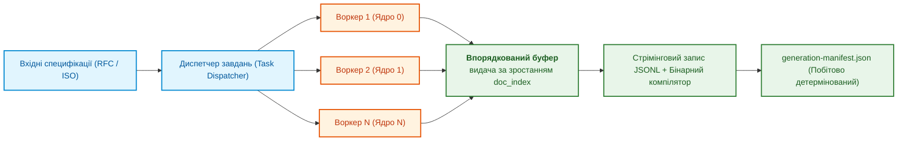

### 6.1. Алгоритм впорядкованого буфера

Воркери завершують документи в довільному порядку, тому впорядкований буфер утримує результат документа з номером $i$, доки не передасть далі всі документи з меншими номерами. Найпростіший буфер має дві тихі вади. Повторний результат для вже виданого номера, наприклад після перезапуску завдання, яке зависло, або перезаписав би утримуваний результат, або загубився б без сліду. Збій одного воркера залишає дірку в нумерації, і буфер мовчки зупиняє вихід на першому пропущеному документі, а маніфест обчислюється з обрізаного потоку. Тому метод `Push` повертає помилку для повторного номера й номера поза діапазоном, а метод `Close` повідомляє про пропущені документи.

<details>
<summary>Приклад мовою Go: впорядкований буфер з виявленням повторів і пропусків</summary>

```go
package pipeline

import (
	"fmt"
	"sort"
	"sync"
)

type DocumentResult struct {
	DocIndex int
	Payload  []byte
}

type ReorderBuffer struct {
	nextExpected int
	total        int
	pending      map[int][]byte
	mu           sync.Mutex
	output       func([]byte)
}

// NewReorderBuffer створює буфер для total документів з індексами 0..total-1.
func NewReorderBuffer(total int, output func([]byte)) *ReorderBuffer {
	return &ReorderBuffer{total: total, pending: make(map[int][]byte), output: output}
}

// Push фіксує результат воркера та передає дані далі лише у строго зростаючому порядку DocIndex.
func (b *ReorderBuffer) Push(res DocumentResult) error {
	b.mu.Lock()
	defer b.mu.Unlock()

	if res.DocIndex < b.nextExpected || res.DocIndex >= b.total {
		return fmt.Errorf("індекс %d уже виданий або поза межами 0..%d", res.DocIndex, b.total-1)
	}
	if _, dup := b.pending[res.DocIndex]; dup {
		return fmt.Errorf("повторний результат для індексу %d", res.DocIndex)
	}
	b.pending[res.DocIndex] = res.Payload

	for {
		data, exists := b.pending[b.nextExpected]
		if !exists {
			return nil
		}
		delete(b.pending, b.nextExpected)
		b.output(data)
		b.nextExpected++
	}
}

// Close повідомляє про пропущені документи: без цієї перевірки збій одного воркера
// мовчки обрізав би вихід на першій дірці.
func (b *ReorderBuffer) Close() error {
	b.mu.Lock()
	defer b.mu.Unlock()
	if b.nextExpected == b.total {
		return nil
	}
	held := make([]int, 0, len(b.pending))
	for i := range b.pending {
		held = append(held, i)
	}
	sort.Ints(held)
	return fmt.Errorf("бракує документа %d; утримано без видачі: %v", b.nextExpected, held)
}
```

</details>

<details>
<summary>Тести мовою Go: однаковий вихід за 1, 8 і 64 воркерів</summary>

```go
package pipeline

import (
	"bytes"
	"math/rand"
	"strconv"
	"sync"
	"testing"
)

func TestConcurrentWorkersGiveSameOutput(t *testing.T) {
	const total = 1000
	run := func(workers int, seed int64) []byte {
		var out bytes.Buffer
		buf := NewReorderBuffer(total, func(p []byte) { out.Write(p) })
		order := rand.New(rand.NewSource(seed)).Perm(total)
		jobs := make(chan int)
		var wg sync.WaitGroup
		for w := 0; w < workers; w++ {
			wg.Add(1)
			go func() {
				defer wg.Done()
				for i := range jobs {
					if err := buf.Push(DocumentResult{DocIndex: i, Payload: []byte(strconv.Itoa(i) + "\n")}); err != nil {
						t.Error(err)
					}
				}
			}()
		}
		for _, i := range order {
			jobs <- i
		}
		close(jobs)
		wg.Wait()
		if err := buf.Close(); err != nil {
			t.Fatal(err)
		}
		return out.Bytes()
	}
	want := run(1, 1)
	for _, workers := range []int{8, 64} {
		if got := run(workers, int64(workers)); !bytes.Equal(got, want) {
			t.Fatalf("вихід при %d воркерах відрізняється від виходу при 1 воркері", workers)
		}
	}
}

func TestDuplicateAndGapAreReported(t *testing.T) {
	buf := NewReorderBuffer(3, func([]byte) {})
	if err := buf.Push(DocumentResult{DocIndex: 0}); err != nil {
		t.Fatal(err)
	}
	if err := buf.Push(DocumentResult{DocIndex: 0}); err == nil {
		t.Fatal("повтор уже виданого індексу не виявлено")
	}
	if err := buf.Push(DocumentResult{DocIndex: 2}); err != nil {
		t.Fatal(err)
	}
	if err := buf.Push(DocumentResult{DocIndex: 2}); err == nil {
		t.Fatal("повтор утримуваного індексу не виявлено")
	}
	if err := buf.Close(); err == nil {
		t.Fatal("пропущений документ 1 не виявлено")
	}
}
```

</details>

Перший тест подає 1000 документів у випадковому порядку на 1, 8 і 64 воркерах і порівнює вихідні потоки побайтово; другий тест перевіряє виявлення повторів і пропуску. Запуск із прапорцем `-race` додатково шукає гонитви даних між воркерами.

Порядок запису є не єдиним джерелом розбіжностей між збираннями. Специфікація Go не визначає порядок обходу `map` [[21]](#src-21), тому перед серіалізацією ключі сортують. Час беруть із погодженого `SOURCE_DATE_EPOCH`, а не поточного годинника [[20]](#src-20); фіксують також відносні шляхи, кодування, версії інструментів і параметри моделей.

У лістингу вхід — рівно `total` результатів із номерами від 0 до `total-1`, вихід — їхні `Payload` у цьому порядку. Наприклад, надходження 2, 0, 1 спочатку утримує 2, потім видає 0, а після 1 видає 1 і 2. М'ютекс захищає і стан, і callback. Callback має бути синхронним, не викликати буфер повторно й не змінювати отримані байти; власність `Payload` передається буферу до завершення видачі. Тут callback не повертає помилки запису, тому це модель впорядкування, не готовий файловий збирач. Затримка документа 0 може втримати майже весь корпус: виробничий конвеєр потребує обмеження кількості завдань у роботі, зворотного тиску й обробки помилок запису. Сам буфер також не робить недетерміновану генерацію LLM відтворюваною.

### 6.2. Безпека ланцюга постачання артефактів знань за стандартами SLSA v1.0 Build L3 та NIST SP 800-218 (SSDF)

Сучасна доказова інженерія знань концентрує математичний апарат навколо формальної верифікації правил та коректності логічного виведення, однак нерідко залишає поза увагою фундаментальну вразливість **ланцюга постачання знань (Knowledge Supply Chain)**. У підрозділі 6.1 розв'язано задачу побітової відтворюваності багатопотокового збирання за допомогою впорядкованого буфера, проте сама по собі відтворюваність у незахищеному середовищі не гарантує автентичності та безпеки. Якщо компілятор транслює текстові інженерні вимоги (стандарти ISO, специфікації RFC, нормативні регламенти) у бінарний індекс і пакети для відображення в пам'ять `mmap`, компрометація будь-якої проміжної бібліотеки парсингу, конвеєра CI/CD або стороннього плагіна дозволяє зловмиснику здійснити атаку класу SolarWinds безпосередньо проти бази знань.

Шкідливе втручання в бінарний артефакт знань здатне:
- приховано модифікувати зміщення байтів у таблиці суб'єктів або постінгів, змушуючи механізм виведення посилатися на сфальсифіковані правила регулювання;
- інжектувати отруєні нормативні твердження, які штучно легітимізують аварійний стан виконавчого механізму в критичній системі;
- розірвати простежуваність між текстом цитати та реальним бінарним кодом.

При цьому традиційні мережеві периметри виявляються безсилими, оскільки підміна відбувається на етапі компіляції знань задовго до завантаження пакета в рантайм.

Для протидії цій загрозі автором запропоновано профіль випуску з орієнтирами **NIST SP 800-218 (SSDF)** [[28]](#src-28) та **SLSA v1.0 Build L3** [[29]](#src-29). Наведена архітектура не є атестацією відповідності цим документам: потрібні перевірка застосовних положень і свідчення про конкретну платформу збирання. Ізоляція, двоканальне порівняння та конкретна схема підпису нижче є рішеннями авторського профілю, а не приписаною всім стандартам тріадою:

1. **Герметичне ізольоване середовище компіляції (Hermetic Ephemeral Builder):** Збирання бінарних пакетів знань виконується у знеособлених ефемерних пісочницях без мережевого доступу. Усі вхідні нормативні тексти, граматики ABNF, утиліти нормалізації та компілятор фіксуються криптографічними хешами SHA-256. Будь-які зовнішні динамічні завантаження залежностей під час збирання заблоковані.
2. **Двоканальна верифікація бітового паритету (Multi-Party Bit-for-Bit Parity):** Процес збирання паралельно виконується на двох незалежних ізольованих вузлах у різних доменах адміністрування. Пакет допускається до підписання лише за умови абсолютної побайтової ідентичності згенерованих артефактів:

<a id="ch32-object-19"></a>

**Формула (32.19). Паритет двох збирачів**

```math
\mathrm{SHA256}(\mathcal{P}_{\mathrm{Worker\_A}}) \equiv \mathrm{SHA256}(\mathcal{P}_{\mathrm{Worker\_B}}).
```

Тут два пакети є скінченними послідовностями байтів однаково визначеного виходу до підпису, а SHA-256 повертає 256-бітні дайджести. Приклад: однакові джерела й параметри, але різний час у маніфестах дадуть різні дайджести — випуск зупиняють і шукають причину. Збіг є контролем відтворюваності за припущення стійкості хешу; дві копії того самого скомпрометованого компілятора можуть відтворити ту саму помилку.

3. **Криптографічна атестація походження (in-toto Attestation & Sigstore/Ed25519):** Кожен скомпільований пакет знань супроводжується криптографічно підписаним атестатом походження за відкритою схемою *in-toto provenance specification*. Атестат фіксує повну стратиграфію артефакту: точні хеші нормативних першоджерел, ідентифікатор коміту специфікацій у git-репозиторії, точну версію та криптографічний хеш компілятора, параметри збирання та цифровий підпис за алгоритмом Ed25519, зафіксований у прозорому реєстрі Sigstore/Rekor.

<a id="ch32-object-20"></a>

**Діаграма 32.20. Конвеєр захисту ланцюга постачання артефактів знань за SLSA Build L3 та NIST SSDF**

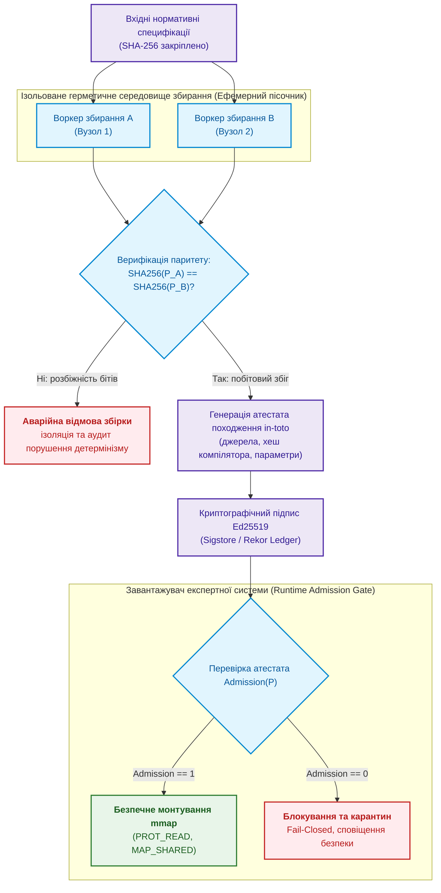

Після збирання потрібно перевірити, що споживач отримав саме затверджений артефакт. Авторський **предикат допуску артефактів знань** нижче описує криптографічну частину цієї перевірки, не семантичну істинність правил:

<a id="ch32-object-21"></a>

**Формула (32.21). Криптографічний допуск артефакту**

```math
\mathrm{Admission}(\mathcal{P}) = \mathbb{I}\left( \mathrm{VerifySig}_{K_{\mathrm{root}}}(\sigma_{\mathcal{A}}, \mathcal{A}) \land (\mathrm{SHA256}(\mathcal{P}) = \mathcal{A}.\mathrm{digest}) \land \bigwedge_{d \in \mathcal{D}} (\mathrm{SHA256}(d) = \mathcal{A}.\mathrm{sources}[d]) \land \mathcal{A}.\mathrm{hermetic} \right)
```

Параметри та розмірності:
- $`\mathrm{Admission}(\mathcal{P}) \in \{0, 1\}`$ — булів вердикт автоматичного допуску пакета знань до монтування у віртуальну пам'ять;
- $`\mathbb{I}(\cdot)`$ — індикаторна функція істинності логічного предиката;
- $`\mathrm{VerifySig}_{K_{\mathrm{root}}}(\sigma_{\mathcal{A}}, \mathcal{A})`$ — результат криптографічної перевірки відкритого цифрового підпису $`\sigma_{\mathcal{A}}`$ атестата $`\mathcal{A}`$ кореневим відкритим ключем сертифікації $`K_{\mathrm{root}}`$ за стандартом Ed25519;
- $`\mathrm{SHA256}(\mathcal{P})`$ — фактичний 256-бітний криптографічний хеш скомпільованого бінарного файлу пакета знань $`\mathcal{P}`$;
- $`\mathcal{A}.\mathrm{digest}`$ — хеш бінарного артефакту, зафіксований у підписаному дескрипторі атестата (*subject digest*);
- $`\bigwedge_{d \in \mathcal{D}} (\mathrm{SHA256}(d) = \mathcal{A}.\mathrm{sources}[d])`$ — кон'юнкція побайтового збігу контрольних сум кожного вхідного нормативного документа $d$ із затвердженим реєстром джерел $`\mathcal{D}`$;
- $`\mathcal{A}.\mathrm{hermetic} \in \{\mathrm{True}, \mathrm{False}\}`$ — прапорець відповідності середовища компіляції критеріям герметичного збирання (повна ізоляція мережі, фіксовані версії збирача), які автор вимагає понад SLSA v1.0 Build L3.

**Застосування й межі.** Якщо хоча б одна умова хибна або невідома, новий пакет не публікують і продовжують роботу на старому, якщо це дозволяє політика. Відкритий ключ має походити з довіреної конфігурації, а не з самого недовіреного пакета; перевіряють також строк дії та відкликання. Прапорець герметичності є підписаним твердженням збирача, яке приймають лише від дозволеної платформи, не самодоказом ізоляції. Для кон'юнкції джерел множина документів має точно відповідати затвердженому входу, а не бути довільною, зокрема порожньою, підмножиною.

Перевірений хеш не запобігає гонитві між перевіркою й використанням (*TOCTOU*). Не можна перевірити шлях, закрити файл і довірливо відкрити той самий шлях знову. Перевіряють і відображають той самий відкритий, захищений від запису об'єкт; `PROT_READ` забороняє запис лише через це відображення, не іншим процесам. Залежно від моделі загроз потрібні незмінне сховище чи запечатаний `memfd` після контрольованого копіювання. Після криптографічної перевірки ще перевіряють структуру індексу (§9), і лише потім публікують його читачам.

Для оцінки часу окремо вимірюють читання, хешування, підпис і перевірку структури. Спрощена послідовна модель:

<a id="ch32-object-22"></a>

**Формула (32.22). Послідовна модель часу перевірки**

```math
T_{\mathrm{verify}} = \frac{V_{\mathrm{pack}}}{B_{\mathrm{sha}}} + T_{\mathrm{sig}} + T_{\mathrm{other}}
```

де $`V_{\mathrm{pack}} \ge 0`$ — байти пакета, $`B_{\mathrm{sha}} > 0`$ — виміряні байти за секунду, $`T_{\mathrm{sig}}`$ і $`T_{\mathrm{other}}`$ — невід'ємні секунди перевірки підпису та решти робіт. До решти належать введення-виведення, джерела, довірена політика, розбір і планування, якщо вони не включені у виміряну ефективну швидкість. Не можна рахувати один час двічі.

Навчально задамо 120 МБ, 2400 МБ/с і 42 мкс: хешування займає 0,05 с, а разом із підписом Ed25519 — 50,042 мс плюс решта робіт. Це бюджетне припущення, не вимірювання Cortex-A78AE. Якщо підпис правильний, але дайджест не збігається, кон'юнкція дає 0 і оновлення блокують. Якщо обидва збігаються, це ще не доводить, що коректно підписане правило безпечне. Таке розділення готує наступний підрозділ: відтворюваність байтів потрібна для контролю змін, не для заміни рецензування змісту.

<a id="63-герметична-кристалізація-контейнерів-знань-zkp4-та-побайтова-відтворюваність-bit-for-bit-reproducibility"></a>

### 6.3. Герметична кристалізація контейнерів знань та побайтова відтворюваність (Bit-for-Bit Reproducibility)

Побайтова відтворюваність дає практичний контроль: два збирачі повинні отримати той самий образ із тих самих зафіксованих входів. Авторський процес **герметичної кристалізації** поєднує впорядкування, ізоляцію й визначене заповнення секцій. Розбіжність означає привід зупинити новий випуск і з'ясувати причину; вона сама не доводить атаку й не вимагає зупиняти чинне перевірене покоління.

Причина такої розбіжності полягає не в помилках логічного виведення, а у прихованому недетермінізмі системних інструментів та мов програмування:
1. **Рандомізований порядок обходу словників (Non-Deterministic Map Traversal):** Сучасні мови програмування (зокрема Go) навмисно впроваджують рандомізацію ітераторів по асоціативних масивах `map` для захисту від HashDoS-атак. Якщо таблиця символів, перелік предикатів чи секція правил записуються у бінарний потік у порядку ітератора, кожен запуск компілятора породжує іншу перестановку байтів.
2. **Витік метаданих середовища збирача (Host Path & Timestamp Pollution):** Включення абсолютних шляхів файлової системи хоста (`/home/builder/...`), часових міток поточної збірки або версійних тегів компілятора у заголовки секцій.
3. **Невизначені байти вирівнювання (Dirty Padding):** серіалізація сирої структури з неініціалізованими полями заповнення може винести сторонні байти. Сам `lseek` не копіює сміття RAM: дірка нового розрідженого файла читається як нулі, але пропуск у повторно використаному файлі може залишити старий вміст. Явний запис нулів у новий образ робить правило незалежним від цих випадків.

Для усунення цих дефектів автором запропоновано стандарт **герметичної кристалізації знань (Hermetic Knowledge Crystallization Pipeline)**, поданий на діаграмі.

<a id="ch32-object-23"></a>

**Діаграма 32.23. Конвеєр герметичної кристалізації бінарних контейнерів знань**

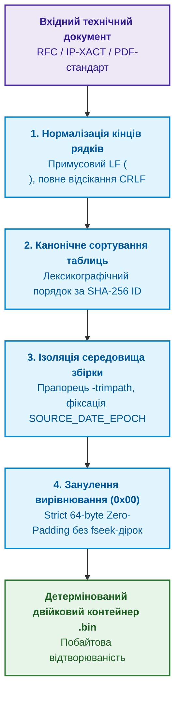

#### 6.3.1. Чотирирівневий конвеєр герметичної кристалізації знань

Чотири фази прибирають визначені джерела недетермінізму; повноту цього переліку перевіряють повторними збираннями.
1. **Нормалізація похідного тексту:** сирий документ зберігається незмінним разом із хешем. Для розбору можна створити NFC/LF-копію, але вона має окремий хеш і карту відповідності до сирих байтів. Наприклад, заміна CRLF на LF скорочує кожен такий перенос на один байт: координата 100 у копії вже не обов'язково є координатою 100 джерела. Цитату остаточно вирізають і перевіряють у сирому документі.
2. **Канонічне лексикографічне сортування структур:** Будь-яка колекція предикатів, символів чи інженерних атомів перед записом у бінарний потік сортується за первинним криптографічним ключем:

<a id="ch32-object-24"></a>

**Формула (32.24). Порядок унікальних атомів**

```math
\forall i < j: \quad \mathrm{Hash}(A_i) <_{\mathrm{lex}} \mathrm{Hash}(A_j)
```

де $`A_i`$ — запис із цілим індексом $i$ у скінченній послідовності унікальних атомів, $`\mathrm{Hash}`$ — 256-бітний ідентифікатор, а $`<_{\mathrm{lex}}`$ — строгий побайтовий порядок. Спочатку усувають точні дублікати; за збігу хешів різних кодувань збирач відмовляє, а не зливає їх. Наприклад, дайджест із першим байтом `01` передує дайджесту з `02`, незалежно від порядку завершення воркерів. Для таблиці суб'єктів §4 ключем сортування залишаються самі імена, не їхні хеші: інакше двійковий пошук за ім'ям буде неправильним.
3. **Герметична ізоляція компілятора:** Збирання виконується з прапорцем `-trimpath`, що видаляє локальні файлові шляхи розробника із символьних таблиць, а будь-які часові мітки замінюються на детерміновану епоху, визначену стандартом `SOURCE_DATE_EPOCH` (Unix-час останнього підписаного коміту нормативного репозиторію).
4. **Примусове занулення інтервалів вирівнювання (Strict Zero-Padding):** Вирівнювання таблиць та постінгів за 64-байтовими межами кеш-ліній процесора виконується виключно через явний запис нульових байтів (`0x00`).

#### 6.3.2. Канонічна серіалізація, нульове вирівнювання та Merkle-корінь цілісності

Автором сформульовано **модель детермінованого Merkle-занулення автора**, згідно з якою обчислення кількості байтів заповнення для досягнення 64-байтової межі кеш-лінії та ієрархічного кореня цілісності контейнера здійснюється за формулою:

<a id="ch32-object-25"></a>

**Формула (32.25). Кількість нульових байтів заповнення**

```math
\mathrm{PadBytes} = (64 - (\mathrm{CurrentOffset} \bmod 64)) \bmod 64
```

де:
- $`\mathrm{CurrentOffset} \in \mathbb{N}_0`$ — поточна побайтова позиція запису в бінарному контейнері;
- $`\mathrm{PadBytes} \in \{0,\ldots,63\}`$ — кількість нульових байтів перед наступною секцією; обидві величини виміряні в байтах. Зовнішня остача потрібна, щоб уже вирівняна позиція отримала 0, а не 64 зайві байти. Додавання виконують із перевіркою місткості файлового зміщення.

Для контролю цілісності чотирисекційного контейнера маніфест містить корінь, що зв'язує хеші секцій у зафіксованому порядку. Це дворівнева хеш-композиція, а не самостійне підтвердження змісту:

<a id="ch32-object-26"></a>

**Формула (32.26). Корінь цілісності секцій**

```math
\mathrm{RootHash} = H(H(\mathrm{Header}) \mathbin{\Vert} H(\mathrm{Symbols}) \mathbin{\Vert} H(\mathrm{Atoms}) \mathbin{\Vert} H(\mathrm{Slices}))
```

де:
- $H(\cdot)$ — криптографічна геш-функція SHA-256;
- $`\mathbin{\Vert}`$ — операція бінарної конкатенації 32-байтових дайджестів;
- $`\mathrm{Header}`$, $`\mathrm{Symbols}`$, $`\mathrm{Atoms}`$, $`\mathrm{Slices}`$ — відповідні бінарні сегменти скомпільованого контейнера;
- $`\mathrm{RootHash}`$ — 256-бітний результуючий корінь дерева цілісності, що записується в незмінний маніфест і підписується цифровим підписом Ed25519.

Хешований заголовок не містить власного кореня чи підпису, щоб не утворити циклічне означення. Порядок секцій і межі зафіксовані форматом; кожен внутрішній дайджест має 32 байти, тож зовнішній хеш отримує 128 байтів. Логічний приклад: заміна байта в секції символів змінює її дайджест і корінь за припущення стійкості SHA-256; перестановка секцій також змінює порядок дайджестів. Маніфест не приймають, якщо корінь не збігається, але збіг не перевіряє правильності правил.

#### 6.3.3. Дія та замкнений цикл інженерної верифікації побайтової відтворюваності

Формули попереднього пункту мають привести до двох перевірок: правильного розташування секцій і відтворення того самого образу. Наведені нижче числа є навчальними входами, не протоколом випуску авіаційного виробу.

1. **Керування рантаймом і потоком обчислень (Control Flow & Runtime Decisions):**
	- Завантажувач обчислює корінь того самого незмінного об'єкта, який читатиме, і звіряє його з підписаним маніфестом.
	- Збіг дозволяє перейти до структурної перевірки й потім до публікації за RCU; `PROT_READ` є правом, а `MAP_SHARED` — окремим прапорцем виклику, не одним комбінованим параметром.
	- Розбіжність блокує нове покоління із записом причини; чинне покоління не демонтують до завершення його читачів.
2. **Апаратний сайзинг та інфраструктурні обмеження (Hardware Dimensioning):**
	- Вирівнювання секції не замінює перевірки розміру й кроку записів (§3.3.1). Латентність промаху кешу залежить від CPU й навантаження, не від одного універсального штрафу.
	- Відображення образу не означає його повного читання. Перевірка хешу всього файла потребує обробки всіх його байтів, тому мікросекундне створення відображення не є часом повного допуску багатогігабайтного пакета.
3. **Практичний числовий приклад (Worked Numerical Example):**
	- Два навчальні збирачі обробляють один зафіксований канонічний набір за однаковою специфікацією серіалізації.
   - Секція символів завершилася на зміщенні $`\mathrm{CurrentOffset} = 145{,}453\,\text{байти}`$. Компілятор обчислює розмір паддінгу:

<a id="ch32-object-27"></a>

**Формула (32.27). Приклад вирівнювання**

```math
\mathrm{PadBytes} = (64 - (145453 \bmod 64)) \bmod 64 = (64 - 45) \bmod 64 = 19\,\text{байтів}.
```

   - Компілятор примусово записує $19$ нульових байтів `0x00`, доводячи зміщення до вирівняного значення $`145{,}472\,\text{байти}`$ ($145472 / 64 = 2273$).
	- Після запису 19 нулів наступна секція починається на байті 145472. Якщо на другому збирачі записано 18, відрізняються і зміщення, і корінь — порівняння відхиляє випуск. Якщо обидва образи збігаються, це підтверджує відтворення для цих входів; перевірки змісту залишаються окремими.

> [!NOTE]
> **Чотири фази герметичної кристалізації контейнерів знань за моделлю автора**
> 1. Канонічна нормалізація похідного тексту: LF/NFC застосовуються до робочої копії; сирі першоджерела, їхні хеші й відновлювані координати цитат зберігаються незмінними.
> 2. Лексикографічне детерміноване впорядкування: стабільне сортування предикатів, тверджень та словникових таблиць для усунення псевдовипадкового порядку ітерацій хеш-таблиць компілятора.
> 3. Герметична ізоляція середовища збирання: обнулення системних шляхів до файлів прапорцем `-trimpath` та фіксація часових міток через системну змінну $`\mathrm{SOURCE\_DATE\_EPOCH}`$.
> 4. Примусове нульове 64-байтне вирівнювання: доповнення кожної двійкової секції нульовими байтами `0x00` з генерацією детермінованого Merkle-кореня для криптографічного паритету.
> *Керування рантаймом / Інженерний інваріант:* Зафіксовані входи й правила серіалізації дають підставу вимагати побайтового збігу; сам збіг перевіряють, а не виводять із переліку налаштувань.

---

## 7. Неперервне нейро-символьне збагачення бази знань

Ручна розмітка не масштабується на тисячі специфікацій. Конвеєр нижче розділяє ролі: локальна мала мовна модель (SLM) лише пропонує кандидатні факти, а рішення про допуск ухвалює детермінований код хоста, тобто програми експертної системи, яка викликає модель і сама читає байти першоджерела. Модель працює з обмеженою граматикою виходу (схемою JSON), тож хост отримує структурований кандидат, а не вільний текст ([Глава 29](ch29-neuro-symbolic-architecture.md)).

<a id="ch32-object-28"></a>

**Діаграма 32.28. Конвеєр нейро-символьного збагачення бази знань**

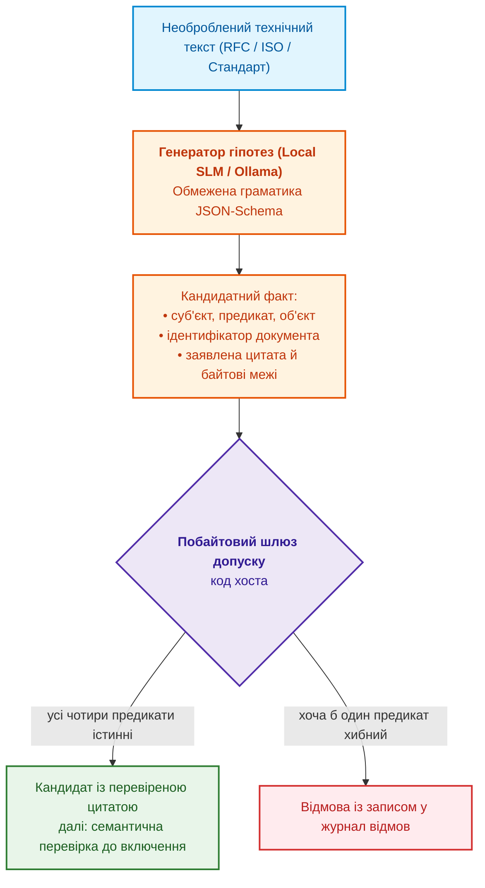

### 7.1. Математичні умови шлюзу допуску

Шлюз має відповісти на вузьке питання: чи належить заявлена цитата затвердженим байтам джерела й чи допустимий ідентифікатор предиката? Для кандидата $`\mathcal{C} = \langle s, p, o, d, q, b_s, b_e \rangle`$ чотири умови нижче визначають побайтовий допуск до набору кандидатів наступного покоління, не остаточний семантичний випуск правила:

<a id="ch32-object-29"></a>

**Формула (32.29). Побайтовий допуск кандидата**

```math
\text{Admit}(\mathcal{C}) \iff \mathcal{P}_{\text{source-hash}}(d) \land \mathcal{P}_{\text{valid-utf8}}(d, b_s, b_e) \land \mathcal{P}_{\text{exact-slice}}(d, q, b_s, b_e) \land \mathcal{P}_{\text{lattice-pred}}(p).
```

Складові предикати шлюзу допуску:

- $`\mathcal{C} = \langle s, p, o, d, q, b_s, b_e \rangle`$ є кандидатним кортежем: суб'єкт $s$, предикат $p$, об'єкт $o$, ідентифікатор документа $d$, заявлена цитата $q$ і заявлені байтові межі $`b_s`$, $`b_e`$;
- $`\mathcal{P}_{\text{source-hash}}(d)`$ перевіряє, що хеш SHA-256 байтів документа $d$, які хост читає з диска, збігається з хешем затвердженої редакції в реєстрі джерел пакета (розділ 1.2), тобто цитата вирізається саме з тієї редакції, яку затвердив інженер знань;
- $`\mathcal{P}_{\text{valid-utf8}}(d, b_s, b_e)`$ перевіряє, що зміщення $`b_s`$ та $`b_e`$ лежать у межах документа $d$ і потрапляють точно на межі кодових точок UTF-8, тобто не розривають багатобайтних символів;
- $`\mathcal{P}_{\text{exact-slice}}(d, q, b_s, b_e)`$ вимагає, щоб підзріз документа $d$ від байта $`b_s`$ до $`b_e`$ побайтово збігався з цитатою $q$;
- $`\mathcal{P}_{\text{lattice-pred}}(p)`$ підтверджує, що предикат $p$ є зареєстрованим вузлом решітки відношень ($`\exists \text{Top} : p \sqsubseteq^* \text{Top}`$).

Межі є цілими байтовими позиціями напіввідкритого інтервалу: початок невід'ємний, кінець не менший за початок і не більший за довжину незмінного документа. Межі перевіряють до вирізання зрізу, UTF-8 — до текстових операцій. Предикат належить скінченному зареєстрованому словнику; символ субсумції із зірочкою позначає досяжність до вершини решітки, а не перевірку істинності об'єкта.

Цей шлюз визначено для незмінного UTF-8 джерела. Байтовий зріз текстового витягу з PDF не є дослівним зрізом двійкового PDF: його потрібно зареєструвати як окреме похідне подання, зберегти хеш оригіналу, версію засобу витягання та прив'язку до сторінки. Перевірка цитати у витягу не доводить коректності самого витягання. Так само нормалізована LF/NFC-копія не підміняє документ, відносно якого заявлено координати.

Наприклад, у документі `АБ` чотири UTF-8 байти: межі [0,2) дають `А`, [1,2) розривають символ, а [0,5) виходять за документ. Перший кандидат проходить лише за збігу цитати й інших умов; два наступні відхиляють до порівняння змісту. Хеш цитати хост обчислює сам із перевіреного зрізу, не бере на віру хеш генератора. Навіть точне цитування слова «дозволено» не виправдовує трійку з протилежним тлумаченням.

Будь-яка спроба моделі перефразувати текст призводить до негайного відкидання факту без забруднення бази знань. Межа шлюзу теж важлива: шлюз перевіряє, що цитата $q$ справді є в першоджерелі, але не перевіряє, чи правильно модель витлумачила цитату. Трійку $\langle s, p, o \rangle$ із точною цитатою, але хибним тлумаченням шлюз пропустить, тому такі помилки виявляють екзаменаційні тести й вибіркове рецензування інженером ([Глава 25](ch25-how-expert-systems-learn.md)).

---

## 8. Інженерія знаннєвої щільності: індекс $`\mathrm{KDI}`$ та епістемічне профілювання

Після видобування потрібно вирішити, які документи перевірити вручну насамперед. Мала кількість знайдених норм може означати як бідний на норми текст, так і невдалу екстракцію; сам лічильник цього не розрізняє. Для зіставлення корпусів однакового призначення автором запропоновано **індекс знаннєвої щільності** (*knowledge density index*, KDI): зважену кількість унікальних видобутих об'єктів на мегабайт сирого тексту. Це інструмент профілювання, не оцінка істинності чи повноти.

<a id="ch32-object-30"></a>

**Формула (32.30). Індекс знаннєвої щільності**

```math
\mathrm{KDI} = \frac{\sum_{i=1}^M w(t_i) \cdot N(t_i)}{\text{Size}_{\text{MB}}(\text{SourceCorpus})}.
```

Параметри розрахунку щільності знань:

- $`\mathrm{KDI}`$ є індексом знаннєвої щільності (*Knowledge Density Index*), вираженим у зважених фактах на мегабайт тексту;
- $M$ є додатною цілою кількістю неперетинних категорій, $i$ — їхнім індексом, $`t_i`$ — категорією;
- $`N(t_i)`$ є невід'ємним цілим числом унікальних виділених об'єктів категорії; правила класифікації не мають двічі рахувати той самий об'єкт;
- $`w(t_i) \ge 0`$ — безрозмірна інженерна вага;
- $`\text{Size}_{\text{MB}}(\text{SourceCorpus}) > 0`$ — обсяг зафіксованого сирого тексту в десяткових МБ (1 МБ = 1000000 байтів). Для порожнього корпусу індекс не визначений.

Шкала формальної значущості вагових коефіцієнтів $`w(t_i)`$:
- формальні граматики у формі ABNF [[22]](#src-22): $`w = 5{,}0`$;
- переходи скінченних автоматів (FSM): $`w = 4{,}0`$;
- суворі нормативні заборони (`MUST_NOT`): $`w = 3{,}5`$;
- обов'язкові норми (`MUST`): $`w = 3{,}0`$;
- рекомендації (`SHOULD`): $`w = 2{,}0`$;
- базові словникові дефініції: $`w = 1{,}0`$.

Ваги є експертним рішенням автора, а не виміряною величиною: вага відображає, наскільки формальний тип знання і наскільки легко знання цього типу перевірити автоматично. Інша шкала ваг дасть інші значення $`\mathrm{KDI}`$, тож порівнювати можна лише корпуси, профільовані за однією шкалою.

**Операційні пороги та системні рішення:**
- Авторський профіль використовує поріг 25 зважених об'єктів/МБ як сигнал перевірити очікувану насиченість; це не нормативна чи універсально калібрована межа.
- Значення не нижче порога означає проходження лише цього екрана. Цитати, зміст, повноту й структуру перевіряють незалежно перед випуском.
- Нижче порога призначають аудит причини. Повторне видобування потрібне, якщо справді пропущено таблиці чи правила; додавання зайвих фактів заради зростання індексу не є виправленням.

**Практичний приклад розрахунку:**  
Розглядається технічний опис модуля контролера живлення обсягом $`\text{Size}_{\text{MB}} = 2{,}0\,\text{МБ}`$. Автоматичний екстрактор виявив: 4 переходи FSM ($`w = 4{,}0`$), 20 обов'язкових норм `MUST` ($`w = 3{,}0`$), 15 рекомендацій `SHOULD` ($`w = 2{,}0`$) та 10 словникових дефініцій ($`w = 1{,}0`$). Сума зважених фактів:
<a id="ch32-object-31"></a>

**Формула (32.31). Зважена сума навчального корпусу**

```math
\sum_{i=1}^M w(t_i) \cdot N(t_i) = 4 \times 4{,}0 + 20 \times 3{,}0 + 15 \times 2{,}0 + 10 \times 1{,}0 = 16 + 60 + 30 + 10 = 116.
```
Значення індексу:
<a id="ch32-object-32"></a>

**Формула (32.32). Щільність навчального корпусу**

```math
\mathrm{KDI} = \frac{116}{2{,}0} = 58{,}0\,\text{фактів/МБ}.
```
Отримано 58 зважених об'єктів/МБ, тож навчальний документ проходить профільний екран 25. Це не дозвіл на випуск: навіть усі 116 зважених одиниць можуть походити лише з одного розділу, тоді як інший розділ пропущено. Саме це питання розвиває §8.2.

> [!NOTE]
> **Три принципи інженерії знаннєвої щільності KDI за моделлю автора**
> 1. Зважене семантичне профілювання: розрахунок індексу знаннєвої щільності $`\mathrm{KDI}`$ із диференційованими ваговими коефіцієнтами для автоматів станів ($`w=4{,}0`$), імперативів MUST ($`w=3{,}0`$), рекомендацій SHOULD ($`w=2{,}0`$) та словників ($`w=1{,}0`$).
> 2. Профільний поріг аудиту: значення 25 зважених об'єктів/МБ є параметром авторського профілю, не доказом достатності знань і не автоматичним дозволом на випуск.
> 3. Локалізація причин низької щільності: перевірка відрізняє реально малу кількість норм від пропусків екстрактора; лише підтверджені пропуски запускають повторне видобування.
> *Керування рантаймом / Інженерний інваріант:* Щільність визначає пріоритет аудиту, не підміняє перевірку повноти й змісту.

### 8.1. Емпіричний профіль знаннєвої щільності за галузевими корпусами

Таблиця наводить профілі чотирьох корпусів з архіву автора. Стовпці з кількостями об'єднують кілька типів знань з різними вагами, тому значення $`\mathrm{KDI}`$ не можна перерахувати з таблиці точно; кожне значення лежить між межами, які дають найменша й найбільша ваги кожної групи.

<a id="ch32-object-33"></a>

**Таблиця 32.33. Архівні профілі щільності**

| Корпус документів | Обсяг тексту | Формальні FSM / ABNF | Нормативні вимоги | Словникові дефініції | Розрахунковий $`\mathrm{KDI}`$ | Висновок профілювання |
|---|---|---|---|---|---|---|
| **Транспортні протоколи IETF (TCP, QUIC)** | 12,4 МБ | 142 | 1 840 | 410 | **542,7** | щільність значно вища за поріг; повноту оцінюють окремо |
| **ISO 26262 (функційна безпека автомобілів)** | 28,0 МБ | 88 | 2 950 | 1 120 | **375,4** | щільність вища за поріг |
| **DO-178C (програмне забезпечення авіоніки)** | 8,5 МБ | 12 | 680 | 340 | **278,8** | щільність вища за поріг |
| **Неструктурований корпус польових інструкцій** | 45,0 МБ | 0 | 115 | 85 | **9,5** | сигнал для аудиту причини низької щільності, не встановлена прогалина |

Таблиця зберігає авторські архівні значення без незалежної перевірки корпусів. Наприклад, для польових інструкцій мінімальна зважена сума становить 315 (115 рекомендацій із вагою 2 і 85 дефініцій), максимальна — 487,5 (115 заборон із вагою 3,5 і ті самі дефініції). Поділ на 45 МБ дає діапазон 7–10,83; значення 9,5 йому не суперечить, але без розподілу норм за типами не відтворюється. Низький результат означає завдання перевірити причину, а не встановлену непридатність інструкцій.

### 8.2. Щільність не є повнотою: оцінка методом повторного вилову

Високий $`\mathrm{KDI}`$ не означає, що видобуто всі знання корпусу. Щільність показує, скільки знань знайдено на мегабайт, але не показує, скільки знань екстрактор пропустив. Корпус із високою щільністю формальних фактів може мати пропущені таблиці, а корпус із низькою щільністю може бути видобутий майже повністю, бо містить мало формальних знань. Для оцінки повноти потрібна оцінка невідомої загальної кількості тверджень у корпусі.

Таку оцінку дає метод повторного вилову (*capture-recapture*), запозичений з екології, де ним оцінюють чисельність популяції тварин. Ейк і співавтори застосували метод в інспекціях проєктної документації програмного забезпечення: кілька рецензентів незалежно шукають дефекти, а з кількості дефектів, знайдених кількома рецензентами одночасно, оцінюють кількість дефектів, яких не знайшов ніхто [[23]](#src-23). На основі цього підходу автором сформульовано **метод контролю епістемічної повноти автора** для бази знань, де роль рецензентів грають два незалежні екстрактори, наприклад правилові шаблони й локальна модель із шлюзом допуску розділу 7. Якщо перший екстрактор знайшов $`n_1`$ тверджень, другий знайшов $`n_2`$, а $m$ тверджень знайшли обидва, оцінка Лінкольна-Петерсена дає:

<a id="ch32-object-34"></a>

**Формула (32.34). Оцінка повторного вилову**

```math
\hat{N} = \frac{n_1 \cdot n_2}{m}, \qquad \widehat{R}_{\cup} = \frac{n_1 + n_2 - m}{\hat{N}}.
```

Позначення оцінки повноти:

- $`n_1`$, $`n_2`$ є кількостями канонічних тверджень, які знайшли перший і другий екстрактори на тому самому корпусі;
- $m$ є кількістю тверджень, які знайшли обидва екстрактори; збіг визначає ключ кластера з розділу 5.1;
- $`\hat{N}`$ є оцінкою загальної кількості тверджень у корпусі;
- $`\widehat{R}_{\cup} \in [0, 1]`$ є оцінкою повноти (*recall*), тобто частки знайдених тверджень, для об'єднання результатів обох екстракторів.

Перед застосуванням потрібні замкнена незмінна популяція тверджень, правильне зіставлення тих самих одиниць, незалежне виявлення й однакова ймовірність виявлення. Лічильники є цілими, обидва додатні, а перетин — від 1 до меншого з двох лічильників; за нульового перетину ділення не визначене. Інтуїція оцінки: частка повторно знайдених серед другого набору оцінює частку всього корпусу, яку знайшов перший. Це модель випадкового виявлення, не властивість двох довільних програм.

**Операційні пороги та контроль повноти:**
- У цьому авторському профілі оцінки корпусу використовується параметр $`\tau_{\mathrm{recall}} = 0{,}95`$ ($95\%$); це не поріг сертифікації ASIL-D або DAL-A і не вимога ISO/RTCA.
- Якщо $`\widehat{R}_{\cup} \ge \tau_{\mathrm{recall}}`$, оцінка проходить лише цей попередній профільний екран і отримує статус `QUALIFIED_AUDIT_REQUIRED` для перевірки припущень та вибіркового ручного аудиту. Оцінка не доводить вичерпності корпусу й не дає допуску до випуску.
- Якщо $`\widehat{R}_{\cup} < \tau_{\mathrm{recall}}`$, конвеєр блокує автоматичний випуск пакету (`BLOCK_INCOMPLETE_RELEASE`), зберігає статус `QUALIFIED_AUDIT_REQUIRED` та скеровує корпус на ручне рецензування інженером знань. Невідомі передумови оцінювача також не дають позитивного результату.

**Практичний приклад розрахунку:**  
На одному розділі стандарту правилові шаблони знайшли $`n_1 = 180`$ тверджень, модель знайшла $`n_2 = 150`$, і $m = 120$ тверджень збіглися. Тоді:
<a id="ch32-object-35"></a>

**Формула (32.35). Приклад оцінки повноти**

```math
\hat{N} = \frac{180 \cdot 150}{120} = 225, \qquad \widehat{R}_{\cup} = \frac{180 + 150 - 120}{225} = \frac{210}{225} \approx 0{,}933.
```
Оскільки $`0{,}933 < 0{,}950`$, конвеєр блокує автоматичний випуск пакету знань, генерує звіт про приблизно 15 невидобутих вимог ($225 - 210 = 15$) та скеровує розділ на ручну довибірку інженером знань.

Спільні пропуски таблиць можуть завищити перетин і створити надто оптимістичну оцінку повноти. Негативна залежність може змістити її в інший бік. Отже, це не гарантована верхня чи нижня межа і не довірчий інтервал. Приклад 225 оцінених і 210 знайдених тверджень лише підказує, що ручний пошук варто продовжити; він не доводить існування рівно 15 пропусків. Ручна розмітка стратифікованої вибірки (основний текст, таблиці, примітки) перевіряє модель. Далі треба перевірити інший рівень надійності: чи безпечно читати вже зібрані байти.

---

## 9. Еталонна реалізація читача mmap-індексу на Go

Завдання читача — відхилити пошкоджений індекс до пошуку, а не чекати виходу за межі слайсу. Вхід `Parse` — вже доступний незмінний масив байтів; вихід — читач або помилка. Він перевіряє сигнатуру, версію, відсутність невідомих прапорців, CRC32 заголовка, нульові резерви, межі секцій, UTF-8 і строгий порядок імен. Арифметику виконано в `uint64`: перед множенням кількості записів порівнюють її з доступним залишком, поділеним на розмір запису. Поля зміщень усередині запису є 32-бітними, довжин — 16-бітними, тож їхні суми й добутки в `uint64` не переповнюються. Лише після перевірки проти `len(data)` дозволено перетворення в `int`.

`LookupSubject` повертає позичені байти постінгів, не копію та не готові твердження. Власник `data` не повинен змінювати його, читач не повинен використовувати результат після `Close`, а `Close` не можна виконувати паралельно з пошуком: тут потрібен зовнішній протокол §3.4. Перевірки меж Go залишаються частиною семантики мови; успішний `Parse` не є вимкненням захисту рантайму. Парсер не перевіряє SHA-256 маніфесту, семантику цитат чи зміщення постінгів у зовнішньому файлі тверджень — це окремі перевірки зв'язності пакета.

`OpenFile` є Linux-обгорткою, яка перевіряє також місткість розміру файла в `int`. Вона не запечатує файл і не є захистом від стороннього запису або усічення; застосовуються передумови незмінного об'єкта з §6.2. Сканування таблиці потребує лінійної кількості записів плюс обробки байтів імен; це не мікросекундний виклик `mmap` із архівної таблиці.

<details>
<summary>Приклад мовою Go: переносима перевірка й пошук у ZNAV-INDEX v2</summary>

```go
package mmapindex

import (
	"bytes"
	"encoding/binary"
	"errors"
	"fmt"
	"hash/crc32"
	"unicode/utf8"
)

const (
	headerSize  = 64
	crcOffset   = 0x28 // CRC32 (IEEE) рахується за байтами 0x00..0x27
	entrySize   = 16
	postingSize = 8 // кожен постінг є uint64-зміщенням твердження у файлі тверджень
)

// Reader читає перевірений індекс ZNAV-INDEX v2 без копіювання байтів.
type Reader struct {
	data       []byte
	subjects   int
	subjectOff int
	unmap      func() error
}

// Parse перевіряє весь індекс до першого запиту: після успішного Parse
// жоден запит LookupSubject не виходить за межі data.
func Parse(data []byte) (*Reader, error) {
	if len(data) < headerSize || string(data[:4]) != "ZNAV" {
		return nil, errors.New("некоректна сигнатура або усічений заголовок ZNAV-INDEX")
	}
	le := binary.LittleEndian
	if v := le.Uint16(data[4:6]); v != 2 {
		return nil, fmt.Errorf("непідтримувана версія формату %d", v)
	}
	if le.Uint16(data[6:8]) != 0 {
		return nil, errors.New("непідтримувані прапорці формату")
	}
	for _, reserved := range data[crcOffset+4 : headerSize] {
		if reserved != 0 {
			return nil, errors.New("ненульовий резерв заголовка")
		}
	}
	if crc32.ChecksumIEEE(data[:crcOffset]) != le.Uint32(data[crcOffset:crcOffset+4]) {
		return nil, errors.New("контрольна сума заголовка не збігається")
	}
	n := uint64(le.Uint32(data[0x0C:0x10]))
	strOff, postOff, subjOff := le.Uint64(data[0x10:0x18]), le.Uint64(data[0x18:0x20]), le.Uint64(data[0x20:0x28])
	size := uint64(len(data))
	// Розділи йдуть у порядку: заголовок, таблиця суб'єктів, таблиця рядків, постінги.
	if subjOff < headerSize || subjOff > size || n > (size-subjOff)/entrySize ||
		subjOff+n*entrySize > strOff || strOff > postOff || postOff > size {
		return nil, errors.New("межі розділів індексу не узгоджені з розміром файлу")
	}
	r := &Reader{data: data, subjects: int(n), subjectOff: int(subjOff)}
	var prev []byte
	for i := 0; i < r.subjects; i++ {
		e := data[r.subjectOff+i*entrySize:]
		s, sl := uint64(le.Uint32(e[0:4])), uint64(le.Uint16(e[4:6]))
		p, pc := uint64(le.Uint32(e[6:10])), uint64(le.Uint16(e[10:12]))
		if s < strOff || s+sl > postOff || p < postOff || p+pc*postingSize > size {
			return nil, fmt.Errorf("запис суб'єкта %d посилається за межі свого розділу", i)
		}
		name := data[s : s+sl]
		if !utf8.Valid(name) || le.Uint32(e[12:16]) != 0 {
			return nil, fmt.Errorf("некоректний UTF-8 або резерв запису %d", i)
		}
		if i > 0 && bytes.Compare(prev, name) >= 0 {
			return nil, fmt.Errorf("таблиця суб'єктів не впорядкована строго на записі %d", i)
		}
		prev = name
	}
	return r, nil
}

func (r *Reader) entry(i int) (name, postings []byte) {
	le := binary.LittleEndian
	e := r.data[r.subjectOff+i*entrySize:]
	s, sl := int(le.Uint32(e[0:4])), int(le.Uint16(e[4:6]))
	p, pc := int(le.Uint32(e[6:10])), int(le.Uint16(e[10:12]))
	return r.data[s : s+sl], r.data[p : p+pc*postingSize]
}

// LookupSubject виконує двійковий пошук за O(log N) без виділення пам'яті в купі.
// Запит передають як []byte, бо перетворення string -> []byte може виділити пам'ять.
// Результат є підзрізом відображеного файла: по 8 байтів на кожне зміщення твердження.
func (r *Reader) LookupSubject(query []byte) ([]byte, bool) {
	low, high := 0, r.subjects-1
	for low <= high {
		mid := low + (high-low)/2
		name, postings := r.entry(mid)
		switch c := bytes.Compare(query, name); {
		case c == 0:
			return postings, true
		case c > 0:
			low = mid + 1
		default:
			high = mid - 1
		}
	}
	return nil, false
}

// Close звільняє відображення, якщо Reader створено функцією OpenFile.
func (r *Reader) Close() error {
	if r.unmap == nil {
		return nil
	}
	if err := r.unmap(); err != nil {
		return err
	}
	r.data, r.subjects, r.unmap = nil, 0, nil
	return nil
}
```

</details>

<details>
<summary>Приклад мовою Go: відображення файла індексу в пам'ять на Linux</summary>

```go
//go:build linux

package mmapindex

import (
	"errors"
	"os"
	"syscall"
)

// OpenFile відображає файл індексу лише для читання й перевіряє його функцією Parse.
// Перевірка має силу, лише поки файл не змінюють: усічення відображеного файла
// іншим процесом спричиняє сигнал SIGBUS під час наступного звернення.
func OpenFile(path string) (*Reader, error) {
	f, err := os.Open(path)
	if err != nil {
		return nil, err
	}
	defer f.Close()

	fi, err := f.Stat()
	if err != nil {
		return nil, err
	}
	if fi.Size() < headerSize || uint64(fi.Size()) > uint64(^uint(0)>>1) {
		return nil, errors.New("розмір файла не вміщується у допустимий діапазон int")
	}
	data, err := syscall.Mmap(int(f.Fd()), 0, int(fi.Size()), syscall.PROT_READ, syscall.MAP_SHARED)
	if err != nil {
		return nil, err
	}
	r, err := Parse(data)
	if err != nil {
		_ = syscall.Munmap(data)
		return nil, err
	}
	r.unmap = func() error { return syscall.Munmap(data) }
	return r, nil
}
```

</details>

<details>
<summary>Тести мовою Go: пошук без виділень, пошкоджені індекси й фазинг</summary>

```go
package mmapindex

import (
	"encoding/binary"
	"hash/crc32"
	"testing"
)

// build збирає коректний індекс; імена мають бути впорядковані за зростанням.
func build(names []string, postings [][]uint64) []byte {
	le := binary.LittleEndian
	strOff := headerSize + len(names)*entrySize
	postOff := strOff
	for _, n := range names {
		postOff += len(n)
	}
	size := postOff
	for _, p := range postings {
		size += len(p) * postingSize
	}
	data := make([]byte, size)
	copy(data, "ZNAV")
	le.PutUint16(data[4:], 2)
	le.PutUint32(data[0x08:], uint32(len(names)))
	le.PutUint32(data[0x0C:], uint32(len(names)))
	le.PutUint64(data[0x10:], uint64(strOff))
	le.PutUint64(data[0x18:], uint64(postOff))
	le.PutUint64(data[0x20:], headerSize)
	s, p := strOff, postOff
	for i, n := range names {
		e := data[headerSize+i*entrySize:]
		le.PutUint32(e[0:], uint32(s))
		le.PutUint16(e[4:], uint16(len(n)))
		le.PutUint32(e[6:], uint32(p))
		le.PutUint16(e[10:], uint16(len(postings[i])))
		s += copy(data[s:], n)
		for _, off := range postings[i] {
			le.PutUint64(data[p:], off)
			p += postingSize
		}
	}
	le.PutUint32(data[crcOffset:], crc32.ChecksumIEEE(data[:crcOffset]))
	return data
}

func sample() []byte {
	return build([]string{"IP", "TCP", "UDP"}, [][]uint64{{7}, {120, 510}, {}})
}

func TestLookupWithoutAllocations(t *testing.T) {
	r, err := Parse(sample())
	if err != nil {
		t.Fatal(err)
	}
	p, ok := r.LookupSubject([]byte("TCP"))
	if !ok || len(p) != 2*postingSize || binary.LittleEndian.Uint64(p[8:]) != 510 {
		t.Fatalf("неправильні постінги для TCP: %v %v", p, ok)
	}
	if _, ok := r.LookupSubject([]byte("QUIC")); ok {
		t.Fatal("знайдено відсутній суб'єкт QUIC")
	}
	q := []byte("UDP")
	if allocs := testing.AllocsPerRun(1000, func() { r.LookupSubject(q) }); allocs != 0 {
		t.Fatalf("пошук виділяє пам'ять: %.1f виділень на виклик", allocs)
	}
}

func TestRejectsDamagedIndex(t *testing.T) {
	le := binary.LittleEndian
	cases := map[string]func([]byte) []byte{
		"усічений файл":        func(d []byte) []byte { return d[:headerSize+5] },
		"змінена сигнатура":    func(d []byte) []byte { d[0] = 'X'; return d },
		"зіпсований заголовок": func(d []byte) []byte { d[0x08]++; return d },
		"рядок поза розділом":  func(d []byte) []byte { le.PutUint32(d[headerSize:], 1<<20); return d },
		"постінги поза файлом": func(d []byte) []byte { le.PutUint16(d[headerSize+10:], 999); return d },
		"невідомі прапорці": func(d []byte) []byte {
			le.PutUint16(d[6:], 1)
			le.PutUint32(d[crcOffset:], crc32.ChecksumIEEE(d[:crcOffset]))
			return d
		},
		"переповнення меж секції": func(d []byte) []byte {
			le.PutUint64(d[0x20:], ^uint64(0))
			le.PutUint32(d[crcOffset:], crc32.ChecksumIEEE(d[:crcOffset]))
			return d
		},
		"ненульовий резерв": func(d []byte) []byte { d[crcOffset+4] = 1; return d },
		"невалідний UTF-8": func(d []byte) []byte {
			d[le.Uint64(d[0x10:])] = 0xff
			return d
		},
		"порушено впорядкування": func(d []byte) []byte {
			a, b := d[headerSize:headerSize+entrySize], d[headerSize+entrySize:headerSize+2*entrySize]
			tmp := append([]byte(nil), a...)
			copy(a, b)
			copy(b, tmp)
			return d
		},
	}
	for name, damage := range cases {
		if _, err := Parse(damage(sample())); err == nil {
			t.Errorf("%s: пошкоджений індекс прийнято", name)
		}
	}
}

// FuzzParse шукає вхід, на якому Parse або LookupSubject панікує.
// Звичайний go test запускає лише початкові приклади; пошук: go test -fuzz=FuzzParse.
func FuzzParse(f *testing.F) {
	f.Add(sample())
	f.Add(sample()[:headerSize])
	f.Fuzz(func(t *testing.T, in []byte) {
		data := append([]byte(nil), in...)
		if len(data) >= headerSize {
			// Без перерахунку CRC майже всі мутації зупинялися б на перевірці заголовка.
			binary.LittleEndian.PutUint32(data[crcOffset:], crc32.ChecksumIEEE(data[:crcOffset]))
		}
		r, err := Parse(data)
		if err != nil {
			return
		}
		for i := 0; i < r.subjects; i++ {
			name, _ := r.entry(i)
			if _, ok := r.LookupSubject(name); !ok {
				t.Fatalf("суб'єкт %q з таблиці не знайдено", name)
			}
		}
	})
}
```

</details>

Лістинги утворюють одну бібліотеку з Linux-обгорткою та тестами; їх не запускають окремими `go run`. `build` створює три впорядковані суб'єкти, а позитивний контроль очікує для `TCP` два постінги 120 і 510. Відсутній `QUIC` не знаходиться. `testing.AllocsPerRun` перевіряє лише гарячий виклик `LookupSubject`, не створення `Reader`, хешування чи відображення. Десять негативних варіантів перевіряють усічення, сигнатуру, CRC, межі рядка й постінгів, порядок, невідомі прапорці з правильним CRC, граничне 64-бітне зміщення, резерв і UTF-8. Отже, правильна контрольна сума не дозволяє оминути перевірку структури.

Фазинг (*fuzzing*) змінює вхідні байти й шукає паніку або порушення перевірки [[24]](#src-24). Звичайний `go test` запускає лише початкові приклади, а `go test -fuzz=FuzzParse -fuzztime=60s` здійснює обмежений у часі пошук; кількість входів залежить від машини. Перерахунок CRC у цілі потрібний, щоб мутації доходили до перевірок меж. Це не доказ коректності й не тест життєвого циклу `OpenFile`. Навмисне усічення активного відображення перевіряють лише в ізольованому дочірньому процесі, бо очікуваний сигнал може завершити процес тестів.

---

## 10. Шардування незмінного пакета знань

Розділ 3.2 показав, що `mmap(2)` перестає виправдовуватися, коли індекс більший за пам'ять вузла, і запропонував у цьому разі явне читання з власним буфером. Є друга відповідь: розбити пакет на кілька шардів, кожен з яких обслуговує окремий вузол. Вона потрібна й тоді, коли вузли мають різні рівні доступу або різні профілі знань. [Глава 7](ch07-knowledge-base-typology.md) визначила три рішення (фрагментацію, шардування й групування за ознаками) і шість правил розбиття. Цей розділ показує, як правила виконано в незмінному пакеті: що додається до маніфесту, як обчислюється розміщення, як збирач перевіряє розбиття й що повертає запит, коли частина шардів мовчить. Реалізація навчальна: вузли є об'єктами в пам'яті одного процесу, а мережі, копій шардів і виведення через межі шардів у ній немає.

### 10.1. Що додається до маніфесту

Шард є мінімальним пакетом: файли тверджень, цитат і індексу лише для своєї частини знань. Довідкові дані (словник предикатів, реєстр редакцій) лежать в усіх шардах однаковою копією. Маніфест покоління отримує розділ `sharding`; цей розділ входить до канонічного маніфесту, тож змінює ідентифікатор покоління (інваріант 2 розділу 1.3).

<details>
<summary>Приклад JSON: розділ маніфесту покоління про шардування</summary>

```json
{
  "generation": "g-2026-10-04-01",
  "sharding": {
    "key": "lineage",
    "placement": "rendezvous-sha256-v1",
    "shards": ["s0", "s1", "s2", "s3"],
    "reference_digest": "sha256:<хеш довідкових даних>",
    "files": {
      "s0": {"facts": "sha256:<хеш>", "citations": "sha256:<хеш>", "index": "sha256:<хеш>"},
	"s1": {"facts": "sha256:<хеш>", "citations": "sha256:<хеш>", "index": "sha256:<хеш>"},
	"s2": {"facts": "sha256:<хеш>", "citations": "sha256:<хеш>", "index": "sha256:<хеш>"},
	"s3": {"facts": "sha256:<хеш>", "citations": "sha256:<хеш>", "index": "sha256:<хеш>"}
    }
  }
}
```

</details>

Поле `key` називає ознаку розбиття, `placement` називає функцію розміщення разом із версією, щоб читач не вгадував її, а `reference_digest` задає хеш довідкових даних, який мають повторювати всі шарди. Три наслідки випливають з інваріантів пакета:

- зміна набору шардів або функції розміщення створює нове покоління, а не змінює чинне (інваріант 1);
- хеші файлів кожного шарда окремі, тож вузол перевіряє кожен шард окремо; оновлення, яке не торкнулося шарда, лишає його файли без змін, якщо ідентифікатор покоління зберігається лише в маніфесті, а не всередині файлів шарда;
- читач відмовляється монтувати шард, чий хеш або `reference_digest` не збігається з маніфестом (поведінка *fail-closed*, інваріант 4).

### 10.2. Розміщення за найбільшою вагою

Функція розміщення має бути детермінованою, залежати лише від ключа й набору шардів і переміщувати мало ключів, коли набір змінюється. Найпростіша функція, залишок хеша від ділення на кількість шардів, останньої вимоги не виконує: коли шардів стає на один більше, змінюється дільник, і більшість ключів переходить в інший шард. Консистентне хешування Каргера та співавторів [[25]](#src-25) і хешування за найбільшою вагою (*rendezvous hashing*) Талера й Равішанкара [[26]](#src-26) розв'язують цю вимогу різними способами. Перше розставляє шарди на кільці значень хеша, друге обчислює вагу кожної пари «ключ, шард» і обирає шард із найбільшою вагою:

<a id="ch32-object-36"></a>

**Формула (32.36). Розміщення за найбільшою вагою**

```math
\mathrm{shard}(k, S) = \arg\max_{s \in S} h(k, s)
```

- $k$ є ключем розбиття, у цій главі родиною документів, а $S$ є набором ідентифікаторів шардів;
- $h(k,s)$ є вагою пари: перші 64 біти SHA-256 від ключа й ідентифікатора шарда, кожен з яких записано разом із довжиною, як у ключі кластера розділу 5.1;
- $\arg\max$ повертає шард із найбільшою вагою; за рівних ваг, що практично неможливо, обирають менший за порядком ідентифікатор, щоб результат лишався відтворюваним.

Множина шардів скінченна й непорожня, ідентифікатори унікальні й непорожні; вага є безрозмірним цілим від 0 до найбільшого `uint64`. Наприклад, для одного ключа оцінки 10, 4 і 9 відправляють його в перший шард. Додавання четвертого з оцінкою 12 перемістить ключ тільки до нього; оцінка 8 залишить старе місце. Частка переходів $1/(n+1)$ є математичним очікуванням за симетричних незалежних ваг, а не точною часткою кожного корпусу; $n$ є додатною цілою кількістю старих шардів.

Для навчальної реалізації обрано хешування за найбільшою вагою, бо воно не потребує кільця чи віртуальних вузлів, які довелося б зберігати й версіювати в маніфесті: функція залежить лише від ключа й переліку ідентифікаторів. Ціною є $`\mathcal{O}(|S|)`$ обчислень хеша на ключ, що для десятків шардів несуттєво. Тести перевіряють дві властивості. Перша: результат не залежить від порядку шардів у переліку. Друга: коли до чотирьох шардів додають п'ятий, ключ може лише перейти до нового шарда, а ймовірність переходу дорівнює $1/(n+1)$, де $n$ є кількістю шардів до додавання. На 5000 ключів частка переходу становила 0,193 за очікуваних 0,2, і жоден ключ не перейшов між старими шардами. Залишок від ділення на ті самі ключі перемістив 0,805, тобто близько $`n/(n+1)=0{,}8`$.

### 10.3. Побудова шардів і перевірка розбиття

Збирач розподіляє твердження за родиною документа, цитати йдуть за своїми твердженнями, а кожен шард отримує копію довідкових даних і впорядковується за хешем твердження, щоб результат не залежав від порядку входу (розділ 6). Перед публікацією функція `VerifyPartition` перевіряє правила з Глави 7. Таблиця зіставляє перевірки з тим, що вони виявляють.

<a id="ch32-object-37"></a>

**Таблиця 32.37. Перевірки розбиття**

| Перевірка | Що виявляє | Правило з Глави 7 |
|---|---|---|
| повнота | твердження, якого немає в жодному шарді | повнота фрагментації |
| неперетин | твердження в двох шардах | неперетин |
| відновлюваність | у шарді є твердження чи цитата, яких немає у вхідному наборі, або кількість цитат відрізняється | відновлюваність |
| цілісність родини | родина документів розділена між шардами | правило 1 |
| похідне розміщення | цитата лежить не в шарді свого твердження | правило 3 |
| довідкові дані | шарди мають різні `RefDigest` | правило 2 |

Код нижче містить розміщення, побудову шардів, перевірку розбиття, маршрутизатор і два показники з Глави 7: частку розрізаних залежностей і нерівномірність навантаження. Маршрутизатор розглянуто в розділі 10.4.

<details>
<summary>Приклад мовою Go: розміщення, побудова й перевірка шардів, маршрутизатор</summary>

```go
package shard

import (
	"crypto/sha256"
	"encoding/binary"
	"encoding/hex"
	"errors"
	"fmt"
	"hash"
	"sort"
)

type Fact struct {
	Hash    string // ключ канонічного твердження з розділу 5.1
	Subject string
	Lineage string // родина документів: усі редакції одного стандарту
	Doc     string // конкретна редакція документа
}

type Citation struct {
	FactHash string
	Doc      string
}

type Shard struct {
	ID         string
	Generation string
	Facts      []Fact     // за зростанням Hash
	Citations  []Citation // лише цитати тверджень цього шарда
	RefDigest  string     // хеш довідкових даних, однаковий у всіх шардах
}

// writeParts записує перед кожним рядком його довжину, щоб різні набори рядків не давали однакових байтів.
func writeParts(h hash.Hash, parts ...string) {
	var n [8]byte
	for _, s := range parts {
		binary.BigEndian.PutUint64(n[:], uint64(len(s)))
		h.Write(n[:])
		h.Write([]byte(s))
	}
}

func score(key, shardID string) uint64 {
	h := sha256.New()
	writeParts(h, key, shardID)
	return binary.BigEndian.Uint64(h.Sum(nil)[:8])
}

// Assign обирає шард з найбільшою вагою пари (ключ, шард): rendezvous-хешування.
func Assign(key string, shardIDs []string) string {
	best, bestScore := "", uint64(0)
	for _, id := range shardIDs {
		s := score(key, id)
		if best == "" || s > bestScore || (s == bestScore && id < best) {
			best, bestScore = id, s
		}
	}
	return best
}

// RefDigest хешує довідкові дані (предикат -> батьківський предикат) незалежно від порядку обходу.
func RefDigest(ref map[string]string) string {
	keys := make([]string, 0, len(ref))
	for k := range ref {
		keys = append(keys, k)
	}
	sort.Strings(keys)
	h := sha256.New()
	for _, k := range keys {
		writeParts(h, k, ref[k])
	}
	return hex.EncodeToString(h.Sum(nil))
}

// Build розподіляє твердження за родиною документа, цитати йдуть за своїми твердженнями.
func Build(gen string, facts []Fact, cites []Citation, ref map[string]string, shardIDs []string) (map[string]*Shard, error) {
	if len(shardIDs) == 0 {
		return nil, errors.New("список шардів порожній")
	}
	digest := RefDigest(ref)
	parts := make(map[string]*Shard, len(shardIDs))
	for _, id := range shardIDs {
		if _, duplicate := parts[id]; id == "" || duplicate {
			return nil, errors.New("порожній або повторний ідентифікатор шарда")
		}
		parts[id] = &Shard{ID: id, Generation: gen, RefDigest: digest}
	}
	owner := make(map[string]string, len(facts))
	for _, f := range facts {
		if _, duplicate := owner[f.Hash]; f.Hash == "" || f.Lineage == "" || duplicate {
			return nil, errors.New("порожній ключ, родина або повторне твердження")
		}
		id := Assign(f.Lineage, shardIDs)
		parts[id].Facts = append(parts[id].Facts, f)
		owner[f.Hash] = id
	}
	for _, c := range cites {
		id, ok := owner[c.FactHash]
		if !ok {
			return nil, fmt.Errorf("цитата посилається на невідоме твердження %s", c.FactHash)
		}
		parts[id].Citations = append(parts[id].Citations, c)
	}
	for _, p := range parts {
		sort.Slice(p.Facts, func(i, j int) bool { return p.Facts[i].Hash < p.Facts[j].Hash })
		sort.Slice(p.Citations, func(i, j int) bool {
			a, b := p.Citations[i], p.Citations[j]
			return a.FactHash < b.FactHash || (a.FactHash == b.FactHash && a.Doc < b.Doc)
		})
	}
	return parts, nil
}

// VerifyPartition перевіряє повноту, неперетин, відновлюваність, цілісність родин і цитат та однакові довідкові дані.
func VerifyPartition(facts []Fact, cites []Citation, parts map[string]*Shard) error {
	if len(parts) == 0 {
		return errors.New("порожня топологія шардів")
	}
	ids := make([]string, 0, len(parts))
	for id, part := range parts {
		if part == nil || part.ID != id {
			return errors.New("відсутній шард або невідповідний ідентифікатор")
		}
		ids = append(ids, id)
	}
	sort.Strings(ids)

	input := make(map[string]Fact, len(facts))
	for _, f := range facts {
		if _, duplicate := input[f.Hash]; duplicate {
			return errors.New("повторний ключ вхідного твердження")
		}
		input[f.Hash] = f
	}
	var errs []error
	where := map[string]string{}
	lineageShard := map[string]string{}
	for _, id := range ids {
		for _, f := range parts[id].Facts {
			if prev, dup := where[f.Hash]; dup {
				errs = append(errs, fmt.Errorf("неперетин: твердження %s у шардах %s і %s", f.Hash, prev, id))
			}
			where[f.Hash] = id
			if original, exists := input[f.Hash]; !exists || original != f {
				errs = append(errs, fmt.Errorf("відновлюваність: зайве або змінене твердження %s у шарді %s", f.Hash, id))
			}
			if prev, ok := lineageShard[f.Lineage]; ok && prev != id {
				errs = append(errs, fmt.Errorf("родина %s розділена між шардами %s і %s", f.Lineage, prev, id))
			}
			lineageShard[f.Lineage] = id
		}
	}
	for _, f := range facts {
		if _, ok := where[f.Hash]; !ok {
			errs = append(errs, fmt.Errorf("повнота: твердження %s немає в жодному шарді", f.Hash))
		}
	}

	type key struct{ fact, doc string }
	want := map[key]int{}
	for _, c := range cites {
		want[key{c.FactHash, c.Doc}]++
	}
	got := map[key]int{}
	for _, id := range ids {
		for _, c := range parts[id].Citations {
			got[key{c.FactHash, c.Doc}]++
			if owner, ok := where[c.FactHash]; !ok || owner != id {
				errs = append(errs, fmt.Errorf("цитата %s/%s у шарді %s, а її твердження в шарді %q", c.FactHash, c.Doc, id, owner))
			}
		}
	}
	for k, n := range want {
		if got[k] != n {
			errs = append(errs, fmt.Errorf("цитата %s/%s: очікувано %d, у шардах %d", k.fact, k.doc, n, got[k]))
		}
	}
	for k := range got {
		if _, exists := want[k]; !exists {
			errs = append(errs, fmt.Errorf("зайва цитата %s/%s", k.fact, k.doc))
		}
	}

	for i := 1; i < len(ids); i++ {
		if parts[ids[i]].RefDigest != parts[ids[0]].RefDigest ||
			parts[ids[i]].Generation != parts[ids[0]].Generation {
			errs = append(errs, fmt.Errorf("довідкові дані шарда %s відрізняються від шарда %s", ids[i], ids[0]))
		}
	}
	return errors.Join(errs...)
}

var ErrUnavailable = errors.New("шард недоступний")

type Node interface {
	// Lookup повертає покоління, яке обслуговує вузол, і твердження суб'єкта.
	Lookup(subject string) (generation string, facts []Fact, err error)
}

type Local struct {
	Shard *Shard
	Down  bool
}

func (n Local) Lookup(subject string) (string, []Fact, error) {
	if n.Down {
		return "", nil, ErrUnavailable
	}
	var out []Fact
	for _, f := range n.Shard.Facts {
		if f.Subject == subject {
			out = append(out, f)
		}
	}
	return n.Shard.Generation, out, nil
}

type Verdict int

const (
	Found   Verdict = iota // усі потрібні шарди відповіли, твердження є
	Partial                // твердження є, але частина потрібних шардів не відповіла
	Absent                 // усі потрібні шарди відповіли, тверджень немає
	Unknown                // потрібні шарди не відповіли, нічого не знайдено
)

func (v Verdict) String() string {
	return [...]string{"знайдено", "знайдено частково", "відсутнє", "невідомо"}[v]
}

type Router struct {
	Generation string
	ShardIDs   []string
	Directory  map[string]string // суб'єкт -> родина документів; малий довідник у кожному вузлі
	Nodes      map[string]Node
}

// Ask опитує один шард, якщо родина відома, інакше всі; відсутність дозволена лише за повної відповіді.
func (r *Router) Ask(subject string) (Verdict, []Fact) {
	if len(r.ShardIDs) == 0 {
		return Unknown, nil
	}
	targets := r.ShardIDs
	if lineage, ok := r.Directory[subject]; ok {
		targets = []string{Assign(lineage, r.ShardIDs)}
	}
	var found []Fact
	complete := true
	for _, id := range targets {
		node, exists := r.Nodes[id]
		if !exists || node == nil {
			complete = false
			continue
		}
		gen, facts, err := node.Lookup(subject)
		if err != nil || gen != r.Generation {
			complete = false
			continue
		}
		found = append(found, facts...)
	}
	sort.Slice(found, func(i, j int) bool { return found[i].Hash < found[j].Hash })
	switch {
	case len(found) > 0 && complete:
		return Found, found
	case len(found) > 0:
		return Partial, found
	case complete:
		return Absent, nil
	default:
		return Unknown, nil
	}
}

type Edge struct{ From, To string } // залежність виведення між двома редакціями документів

// CutFraction рахує частку залежностей, кінці яких розміщено в різних шардах.
func CutFraction(edges []Edge, place func(doc string) string) float64 {
	if len(edges) == 0 {
		return 0
	}
	cut := 0
	for _, e := range edges {
		if place(e.From) != place(e.To) {
			cut++
		}
	}
	return float64(cut) / float64(len(edges))
}

// Imbalance повертає відношення найбільшого шарда до середнього за кількістю тверджень.
func Imbalance(parts map[string]*Shard) float64 {
	total, largest := 0, 0
	for _, p := range parts {
		total += len(p.Facts)
		if len(p.Facts) > largest {
			largest = len(p.Facts)
		}
	}
	if total == 0 {
		return 0
	}
	return float64(largest) / (float64(total) / float64(len(parts)))
}
```

</details>

### 10.4. Маршрутизація й чотири підсумки запиту

Маршрутизатор має відрізнити «нічого немає в перевіреній області пошуку» від «не вдалося перевірити всю область». У навчальному корпусі кожен суб'єкт належить рівно одній родині, а довідник повний і зафіксований тим самим маніфестом. Лише за цієї передумови можна питати один шард; для суб'єкта з кількома родинами довідник має містити всі цільові шарди або маршрутизатор повинен опитати всі. Код тут реалізує перший, обмежений випадок.

Відповідь іншого покоління, відсутній вузол і помилка вузла означають неповноту. Порожня топологія дає `Unknown`, не логічно порожнє `Absent`. Повні відповіді допускають `Found` або `Absent` лише в межах зафіксованого корпусу й точного запиту; `Found` не доводить застосовності норми, а `Absent` не є запереченням факту в реальному світі. Реплікація може зробити потрібний шард доступним, але не замінює перевірки, що всі потрібні шарди одного покоління охоплено.

<a id="ch32-object-38"></a>

**Таблиця 32.38. Підсумки маршрутизації**

| Сценарій тесту | Підсумок |
|---|---|
| усі шарди працюють, суб'єкт є в довіднику | знайдено |
| недоступний шард, який не належить родині суб'єкта | знайдено, бо потрібен лише шард родини |
| недоступний шард родини | невідомо |
| шард родини змонтував інше покоління | невідомо |
| суб'єкта немає в довіднику, усі шарди відповіли | відсутнє |
| суб'єкта немає в довіднику, один шард мовчить | невідомо |
| суб'єкта немає в довіднику, твердження є на шарді, що відповів, а інший шард мовчить | знайдено частково |

Останній сценарій найнебезпечніший: знайдений запис спокушає дати остаточну відповідь, але мовчущий потрібний шард міг містити виняток. Тому `Partial` забороняє заявляти чинність норми. Тест верифікатора тепер пошкоджує розбиття вісьмома способами, включно зі зміною поля факту без зміни ключа та додаванням зайвої цитати. Перевірка відновлюваності зіставляє весь `Fact` і мультимножину цитат в обох напрямах; рівність лише кількості записів або їхніх ключів була б недостатня. Навчальна `Citation` містить лише документ і ключ факту; реальна цитата потребує також редакції, байтових меж і хешу з §7.

<details>
<summary>Тести мовою Go: розміщення, перевірка розбиття, мовчання шарда, розрізані залежності</summary>

```go
package shard

import (
	"crypto/sha256"
	"encoding/binary"
	"encoding/hex"
	"fmt"
	"math/rand"
	"testing"
)

var shardIDs = []string{"s0", "s1", "s2", "s3"}

var ref = map[string]string{"must_not": "norm", "must": "norm", "should": "norm"}

// corpus будує 24 родини з 1-4 редакціями; кожна редакція має 5 тверджень про ті самі суб'єкти.
func corpus() (facts []Fact, cites []Citation, edges []Edge, docs []string) {
	for i := 0; i < 24; i++ {
		lineage := fmt.Sprintf("L%02d", i)
		revs := 1 + i%4
		for r := 0; r < revs; r++ {
			doc := fmt.Sprintf("%s-r%d", lineage, r)
			docs = append(docs, doc)
			for j := 0; j < 5; j++ {
				subject := fmt.Sprintf("%s-subj%d", lineage, j)
				sum := sha256.Sum256([]byte(doc + "\x00" + subject))
				h := hex.EncodeToString(sum[:8])
				facts = append(facts, Fact{Hash: h, Subject: subject, Lineage: lineage, Doc: doc})
				cites = append(cites, Citation{FactHash: h, Doc: doc})
			}
			if r > 0 {
				edges = append(edges, Edge{doc, fmt.Sprintf("%s-r%d", lineage, r-1)})
			}
			if r == 2 {
				edges = append(edges, Edge{doc, lineage + "-r0"})
			}
		}
	}
	return
}

func directory(facts []Fact) map[string]string {
	d := map[string]string{}
	for _, f := range facts {
		d[f.Subject] = f.Lineage
	}
	return d
}

func TestAssignDoesNotDependOnShardOrder(t *testing.T) {
	shuffled := []string{"s3", "s1", "s0", "s2"}
	for i := 0; i < 500; i++ {
		key := fmt.Sprintf("L%03d", i)
		if Assign(key, shardIDs) != Assign(key, shuffled) {
			t.Fatalf("ключ %s: результат залежить від порядку шардів", key)
		}
	}
}

func TestAddingShardMovesOnlyKeysToTheNewShard(t *testing.T) {
	grown := append(append([]string{}, shardIDs...), "s4")
	const total = 5000
	moved := 0
	for i := 0; i < total; i++ {
		key := fmt.Sprintf("L%05d", i)
		before, after := Assign(key, shardIDs), Assign(key, grown)
		if before != after {
			moved++
			if after != "s4" {
				t.Fatalf("ключ %s перейшов у старий шард %s", key, after)
			}
		}
	}
	// очікується близько 1/5 ключів
	if share := float64(moved) / total; share < 0.17 || share > 0.23 {
		t.Fatalf("перейшло %.3f ключів, очікувалось близько 0.2", share)
	}
	t.Logf("додавання п'ятого шарда перемістило %.3f ключів", float64(moved)/total)
}

func TestModuloRehashingMovesMostKeys(t *testing.T) {
	const total = 5000
	moved := 0
	for i := 0; i < total; i++ {
		sum := sha256.Sum256([]byte(fmt.Sprintf("L%05d", i)))
		h := binary.BigEndian.Uint64(sum[:8])
		if h%4 != h%5 {
			moved++
		}
	}
	share := float64(moved) / total
	t.Logf("залишок від ділення: перехід з 4 на 5 шардів перемістив %.3f ключів", share)
	if share < 0.75 {
		t.Fatalf("перемістилося лише %.3f ключів, очікувалось близько 0.8", share)
	}
}

func TestBuildKeepsLineagesAndCitationsTogether(t *testing.T) {
	facts, cites, _, _ := corpus()
	parts, err := Build("g1", facts, cites, ref, shardIDs)
	if err != nil {
		t.Fatal(err)
	}
	if err := VerifyPartition(facts, cites, parts); err != nil {
		t.Fatalf("коректне розбиття не пройшло перевірку: %v", err)
	}
}

func TestVerifyPartitionDetectsDefects(t *testing.T) {
	facts, cites, _, _ := corpus()
	damage := map[string]func(map[string]*Shard){
		"втрачене твердження": func(p map[string]*Shard) {
			for _, s := range p {
				if len(s.Facts) > 0 {
					s.Facts = s.Facts[1:]
					return
				}
			}
		},
		"твердження у двох шардах": func(p map[string]*Shard) {
			p["s0"].Facts = append(p["s0"].Facts, p["s1"].Facts[0])
		},
		"розділена родина": func(p map[string]*Shard) {
			// переносимо одне твердження до іншого шарда разом з цитатою
			from, to := p["s0"], p["s1"]
			f := from.Facts[0]
			from.Facts, to.Facts = from.Facts[1:], append(to.Facts, f)
			for i, c := range from.Citations {
				if c.FactHash == f.Hash {
					from.Citations = append(from.Citations[:i], from.Citations[i+1:]...)
					to.Citations = append(to.Citations, c)
					break
				}
			}
		},
		"цитата не в шарді твердження": func(p map[string]*Shard) {
			c := p["s0"].Citations[0]
			p["s0"].Citations = p["s0"].Citations[1:]
			p["s1"].Citations = append(p["s1"].Citations, c)
		},
		"різні довідкові дані": func(p map[string]*Shard) { p["s2"].RefDigest = "інший" },
		"змінене твердження зі старим ключем": func(p map[string]*Shard) { p["s0"].Facts[0].Subject = "підміна" },
		"зайва цитата": func(p map[string]*Shard) {
			p["s0"].Citations = append(p["s0"].Citations, Citation{FactHash: p["s0"].Facts[0].Hash, Doc: "зайвий"})
		},
		"відсутній об'єкт шарда": func(p map[string]*Shard) { p["s0"] = nil },
	}
	for name, apply := range damage {
		parts, err := Build("g1", facts, cites, ref, shardIDs)
		if err != nil {
			t.Fatal(err)
		}
		apply(parts)
		if VerifyPartition(facts, cites, parts) == nil {
			t.Errorf("%s: дефект не виявлено", name)
		}
	}
}

func TestUnavailableShardNeverGivesAbsence(t *testing.T) {
	facts, cites, _, _ := corpus()
	parts, err := Build("g1", facts, cites, ref, shardIDs)
	if err != nil {
		t.Fatal(err)
	}
	subject := "L03-subj0"
	owner := Assign("L03", shardIDs)
	other := "s0"
	if owner == other {
		other = "s1"
	}

	router := func(down string, stale string) *Router {
		nodes := map[string]Node{}
		for id, s := range parts {
			cp := *s
			if id == stale {
				cp.Generation = "g0"
			}
			nodes[id] = Local{Shard: &cp, Down: id == down}
		}
		return &Router{Generation: "g1", ShardIDs: shardIDs, Directory: directory(facts), Nodes: nodes}
	}

	cases := []struct {
		name    string
		r       *Router
		subject string
		want    Verdict
	}{
		{"усі шарди працюють, суб'єкт відомий", router("", ""), subject, Found},
		{"недоступний сторонній шард не заважає відомому суб'єкту", router(other, ""), subject, Found},
		{"недоступний шард родини", router(owner, ""), subject, Unknown},
		{"шард родини має інше покоління", router("", owner), subject, Unknown},
		{"невідомий суб'єкт, усі шарди відповіли", router("", ""), "немає-такого", Absent},
		{"невідомий суб'єкт, один шард мовчить", router(other, ""), "немає-такого", Unknown},
	}
	for _, c := range cases {
		if got, _ := c.r.Ask(c.subject); got != c.want {
			t.Errorf("%s: отримано %q, очікувалось %q", c.name, got, c.want)
		}
	}

	// суб'єкт без запису в довіднику: твердження є лише в частині шардів, а один шард мовчить
	r := router(other, "")
	delete(r.Directory, subject)
	if got, found := r.Ask(subject); got != Partial || len(found) == 0 {
		t.Errorf("часткова відповідь: отримано %q і %d тверджень", got, len(found))
	}
	missing := router("", "")
	delete(missing.Nodes, owner)
	if got, _ := missing.Ask(subject); got != Unknown {
		t.Fatalf("відсутній вузол дав %v замість Unknown", got)
	}
	if got, _ := (&Router{}).Ask(subject); got != Unknown {
		t.Fatalf("порожня топологія дала %v замість Unknown", got)
	}
}

func TestLineageKeyHasNoCutEdges(t *testing.T) {
	facts, _, edges, _ := corpus()
	lineageOf := map[string]string{}
	for _, f := range facts {
		lineageOf[f.Doc] = f.Lineage
	}
	byLineage := func(doc string) string { return Assign(lineageOf[doc], shardIDs) }
	byDoc := func(doc string) string { return Assign(doc, shardIDs) }

	cutLineage, cutDoc := CutFraction(edges, byLineage), CutFraction(edges, byDoc)
	t.Logf("залежностей між редакціями: %d; розрізано за ключем-родиною %.3f, за ключем-документом %.3f", len(edges), cutLineage, cutDoc)
	if cutLineage != 0 {
		t.Fatalf("ключ-родина розрізав залежності: %.3f", cutLineage)
	}
	if cutDoc < 0.4 {
		t.Fatalf("ключ-документ розрізав лише %.3f залежностей; приклад не показує різниці", cutDoc)
	}

	partsLineage, _ := Build("g1", facts, nil, ref, shardIDs)
	docFacts := make([]Fact, len(facts))
	copy(docFacts, facts)
	docParts := map[string]*Shard{}
	for _, id := range shardIDs {
		docParts[id] = &Shard{ID: id}
	}
	for _, f := range docFacts {
		id := byDoc(f.Doc)
		docParts[id].Facts = append(docParts[id].Facts, f)
	}
	t.Logf("нерівномірність (найбільший шард до середнього): родина %.2f, документ %.2f", Imbalance(partsLineage), Imbalance(docParts))
}

func TestRendezvousSpreadIsRoughlyEven(t *testing.T) {
	rng := rand.New(rand.NewSource(1))
	counts := map[string]int{}
	const total = 8000
	for i := 0; i < total; i++ {
		counts[Assign(fmt.Sprintf("k%d", rng.Int63()), shardIDs)]++
	}
	for id, n := range counts {
		if share := float64(n) / total; share < 0.2 || share > 0.3 {
			t.Errorf("шард %s отримав частку %.3f, очікувалось близько 0.25", id, share)
		}
	}
}
```

</details>

### 10.5. Результати й межі

Усі вісім тестів проходять із прапорцем `-race`, `go vet` і `gofmt` зауважень не мають. Таблиця збирає вимірювання, які друкують тести.

<a id="ch32-object-39"></a>

**Таблиця 32.39. Синтетичні результати шардування**

| Вимірювання | Результат | Що показує |
|---|---|---|
| частка ключів, що перейшли, коли до 4 шардів додали п'ятий: хешування за найбільшою вагою | 0,193 | ключі переходять лише до нового шарда |
| те саме: залишок від ділення на кількість шардів | 0,805 | майже все розбиття змінюється |
| частка розрізаних залежностей (48 залежностей між редакціями): ключ-родина | 0 | редакції однієї родини лежать разом |
| те саме: ключ-документ | 0,750 | 36 із 48 залежностей розірвано |
| нерівномірність навантаження $\beta$: ключ-родина | 1,67 | найбільший шард майже вдвічі більший за середній |
| те саме: ключ-документ | 1,47 | рівномірніше, але ціною розірваного виведення |

Показники підтверджують компроміс із Глави 7: крупніша одиниця розміщення зберігає залежності виведення й гірше вирівнює навантаження. Межі результату такі:

- корпус синтетичний: 24 родини по одній-чотири редакції, і числа ілюструють механізм, а не переносяться на реальний корпус;
- вузли є об'єктами в пам'яті, а недоступність змодельовано прапорцем, тож затримки мережі, тайм-аутів і часткових збоїв під час відповіді немає;
- копій шардів немає: недоступність шарда означає недоступність його родин, а в експлуатації кожен шард тримають у кількох копіях, і тоді виникає окреме питання узгодженості копій;
- твердження, яке цитують документи кількох родин, не розв'язано: кластеризатор розділу 5 зливає такі твердження лише в межах одного шарда, і розв'язком може бути копія твердження в шардах усіх його родин або окремий шард спільних тверджень;
- метод `Lookup` виконує лінійний пошук і не є читачем ZNAV-INDEX з розділу 9, а виведення через межі шардів, наприклад транзитивне замикання ґратки предикатів, винесено в довідкові дані й між шардами не виконується.

### 10.6. Ієрархічна доменно-онтологічна консолідація пакетів знань зі збереженням побайтової кастодії джерел та випереджувальне підкачування пам'яті

Шардування за родинами зберігає зв'язки редакцій, але споріднені родини теж можуть часто використовуватися разом. Чи варто об'єднати їх у доменний кластер? Це задача компромісу між кількістю відкритих образів, дублюванням словників, розміром робочого набору й межами доступу. Частка 75 % із попереднього синтетичного тесту не є оцінкою реального корпусу. Для великої кількості дрібних пакетів потрібно перевірити три ризики:
1. **Вартість маршрутизації та відображень:** лінійний перебір файлів може бути зайвим; індекс каталогу прибирає його без обов'язкового об'єднання всіх файлів. TLB кешує трансляції сторінок, а не перелік файлів: його промахи залежать від сторінок робочого набору, не лише кількості `mmap`.
2. **Розрив нормативного контексту предметної області:** жоден складний інженерний протокол не описаний в одному файлі (наприклад, електронна пошта SMTP розподілена між базовим протоколом RFC 5321, форматом повідомлень RFC 5322, розширеннями MIME RFC 2045–2049 та транспортним захистом RFC 8314). Якщо базовий термін визначено в одному мікропакеті, а виняток-дефітер — в іншому, рушій виведення втрачає повноту дедуктивного замикання.
3. **Надлишкове дублювання словників:** базові інженерні поняття (`client`, `server`, `header`, `timeout`) повторюються у більшості дрібних пакетів.

Автором запропоновано **архітектуру мультиджерельної доменно-онтологічної кластеризації та ієрархічного випереджувального підкачування**. Доменний кластер має параметричний граничний обсяг $`V_{\max}`$ у байтах, додатний і не більший за можливості формату та виділений бюджет вузла. Наприклад, 8 ГБ може бути навчальним бюджетом іншого розширеного контейнера, але не обходить 32-бітні зміщення індексу v2 з §4.1. Об'єднання також не повинне змішувати несумісні права доступу.

Щоб об'єднання багатьох першоджерел у спільний бінарний контейнер не порушило інваріант побайтової кастодії кожного документа, маніфест контейнера доповнюється таблицею першоджерел, де кожному вхідному файлу присвоюється локальний цілочисельний індекс джерела $`s \in \{0,\ldots,N_{\mathrm{sources}}-1\}`$ та криптографічний дайджест його сирого вмісту. Тут $`N_{\mathrm{sources}}`$ є додатною цілою кількістю першоджерел, не бюджетом розміру пакета. Кожен зріз цитати у секції доказів зберігає четвірку $`\langle s, b_{\mathrm{start}}, b_{\mathrm{end}}, H_{\mathrm{SHA256}} \rangle`$, а умова побайтової верифікації набуває вигляду:

<a id="ch32-object-40"></a>

**Формула (32.40). Перевірка зрізу джерела**

```math
\mathrm{VerifySlice}(s, b_{\mathrm{start}}, b_{\mathrm{end}}, H_{\mathrm{SHA256}}) = 1 \iff H\bigl(\mathrm{RawSource}[s][b_{\mathrm{start}} : b_{\mathrm{end}}]\bigr) \equiv H_{\mathrm{SHA256}}
```

Формула застосовується лише після перевірки індексу джерела й меж: $s$ є цілим від 0 до кількості джерел мінус один, байтові позиції є цілими від 0 до довжини обраного документа, початок не перевищує кінець. $H$ — SHA-256, а очікуваний 32-байтовий дайджест взято з довіреного маніфесту; сире джерело також звірене з його повним хешем. Для документа `ABCD` зріз [1,3) є `BC`: хеш `BC` проходить, хеш `CD` — ні. Межа [1,5) відхиляється до хешування. Без цих передумов сама рівність не захищає від виходу за межі чи підміни джерела.

Коли ж сукупний обсяг предметної області перевищує поріг $`V_{\max}`$ або вимагає поділу за рівнями спеціалізації, контейнери організуються у деревовидну ієрархію `домен / піддомен / ...`. Кожен кластер містить дескриптори ієрархічних посилань на батьківський домен $`\mathcal{D}_p`$ та дочірні піддомени $`\mathcal{D}_c`$ разом із 64-бітними сигнатурами Блума предикатів активації. Під час сесії оператора в активному батьківському домені (який постійно залишається гарячим в ОЗУ для повторних запитань) фоновий предиктор після кожного запиту $`Q_t`$ обчислює апостеріорну ймовірність переходу діалогу до дочірнього піддомену $`\mathcal{D}_c`$ на кроці $t+1$:

<a id="ch32-object-41"></a>

**Формула (32.41). Прогноз наступного домену**

```math
P(\mathcal{D}_c \mid Q_t) = \frac{P(Q_t \mid \mathcal{D}_c)\, P(\mathcal{D}_c)}{\sum_{j} P(Q_t \mid \mathcal{D}_j)\, P(\mathcal{D}_j)} > \tau_{\mathrm{prefetch}} \implies \mathrm{madvise}\bigl(\mathrm{base}(\mathcal{D}_c),\, \mathrm{len}(\mathcal{D}_c),\, \mathrm{MADV\_WILLNEED}\bigr)
```

Якщо апостеріорна оцінка перевищує поріг $`\tau_{\mathrm{prefetch}}`$, менеджер пам'яті асинхронно викликає системний примітив ядра `madvise(..., MADV_WILLNEED)`, запускаючи фонове підкачування сторінок піддомену з твердотілого накопичувача у системний сторінковий кеш (Page Cache) ще під час читання оператором поточної відповіді.

Для формули Байєса події $`\mathcal{D}_j`$ означають взаємовиключні й вичерпні варіанти наступного домену; $`Q_t`$ — спостережену ознаку поточного запиту на цілому кроці $t$. Апріорні й умовні ймовірності безрозмірні, належать [0,1], сума апріорних дорівнює 1, знаменник додатний. Якщо ознака не має навчальних спостережень, оцінку не вигадують. Поріг також у [0,1]; `base` та `len` позначають адресу й байтову довжину вже відображеного допустимого діапазону. Формула Байєса випливає з означення умовної ймовірності й повної ймовірності за цими подіями, але якість прогнозу залежить від калібрування моделі переходів.

Навчальний приклад для двох наступних доменів: апріорні шанси 0,4 і 0,6, імовірності спостереженої ознаки в них 0,8 і 0,2. Зважені значення 0,32 і 0,12 дають для першого домену 0,32/0,44 ≈ 0,727. За порога 0,70 і достатнього бюджету дозволяють підказку `MADV_WILLNEED`. Нульовий знаменник дає невизначену оцінку, а не дозвіл. Підказка може зменшити майбутнє очікування, але не гарантує повного підкачування чи неблокувального виконання самого виклику.

> [!NOTE]
> **Три принципи доменно-онтологічної консолідації пакетів знань та випереджувального підкачування пам'яті за моделлю автора**
> 1. **Мультиджерельна кластеризація зі збереженням побайтової кастодії:** консолідація всіх нормативних документів одного домену в єдиний бінарний контейнер усуває мікропакетну фрагментацію та дозволяє компілювати міждокументні правила й дефітери зі 100% збереженням побайтової перевірки кожного першоджерела за його локальним індексом $s$.
> 2. **Критерій подрібнення за обсягом та ієрархічна зв'язність доменів:** поділ бази знань на окремі файли відбувається лише при перевищенні заданого бюджету обсягу $`V_{\max}`$ або межі онтологічної спеціалізації зі збереженням двонаправлених посилань та сигнатур Блума між батьківським і дочірніми доменами.
> 3. **Епістемічне випереджувальне підкачування (`madvise(MADV_WILLNEED)`):** прогноз і бюджет робочого набору визначають пріоритет підказок ядру; результат та сторінкові збої вимірюються, а не оголошуються усуненими.
> *Керування рантаймом / Інженерний інваріант:* Прогноз не змінює допуску знань. Помилка прогнозу може спричинити очікування диска й зайве навантаження, але не дозволяє пропустити перевірку доказів.

**Замкнений цикл інженерного розрахунку доменної кластеризації та підкачування:**
1. **Рішення.** Збирач групує документи за перевіреною рубрикою, не перевищуючи бюджет і місткість полів формату. Менеджер підкачування працює з обмеженням паралельних запитів та загального робочого набору. `MADV_DONTNEED` є окремою політикою скидання резидентності, не гарантією миттєвого звільнення всього спільного кешу.
2. **Розрахунок.** Якщо умовні 20000 файлів кожен мали одне відображення, а 200 кластерів також мають по одному, кількість цих відображень зменшується в 100 разів. Кількість сторінок від цього не обов'язково змінюється. За навчальної ефективної швидкості 3200 МБ/с послідовне читання 64 МБ потребує 20 мс без додаткових витрат. Це не вимірювання конкретного NVMe. Для 64 МіБ і сторінки 4096 байтів кількість сторінок дорівнює 16384; десяткові МБ не можна підставляти в цей розрахунок як МіБ.
3. **Використання й межі.** Якщо наступний запит очікується через 5 с, такий бюджет дає привід спробувати підкачування. Але ядро може виконати лише частину поради або витіснити сторінки до наступного запиту. Кількість major faults і затримки порівнюють у контрольних прогонах із підказкою та без неї; скорочення словників також вимірюють, а не задають наперед відсотком. Для вибору потрібних кластерів далі розглянуто компактний індекс понять.

---

## 11. Кеш-когерентний бінарний граф онтології (CSR) для миттєвої рефлексії меж знань на ARM64 (UMA) та FPGA

Після розподілу пакетів потрібний каталог: де шукати властивість певного поняття, не відкриваючи кожен пакет? У цьому розділі **розрізнення меж знань** означає відомості про вміст конкретного повного знімка каталогу, не знання про весь світ. Потрібні передумови — поняття вершини й ребра графа та масиву зі зміщеннями. Формат CSR зберігає ребра кожної вершини суміжним зрізом: початок і кількість дають змогу перейти до нього без покажчикового ланцюжка.

Ця задача набуває особливої гостроти на сучасному периферійному обладнанні з уніфікованою архітектурою пам'яті (**ARM64 UMA**, де ядра центрального процесора та тензорні/графічні прискорювачі спільно адресують фізичну пам'ять LPDDR5 без копіювання по PCIe) та в апаратних співпроцесорах на базі **FPGA** (де обхід графа виконується потоковими автоматами читання burst-транзакцій AXI4). Для її розв'язання у складі реєстру сховища формується **глобальний бінарний граф онтології у форматі стиснених розріджених рядків** (*Compressed Sparse Row*, CSR [[31]](#src-31)), вирівняний за 64-байтовими лініями кешу процесора й відображуваний у пам'ять через `mmap(MAP_SHARED)`.

### 11.1. Дворівнева дискримінація незнання та 64-бітна сигнатура Блума предикатів

Для каталогу важливо не сплутати відсутність запису з хибністю твердження. Припущення замкненого світу дозволяє робити негативний висновок лише для визначеної повної області; за відкритого світу відсутність запису його не дає [[32]](#src-32). Авторська класифікація деталізує саме стан пошуку в каталозі:

1. **Онтологічне незнання (*Ontological Ignorance*, `REFUSAL_UNKNOWN_CONCEPT`):** запитуваний концепт $c$ взагалі відсутній у глобальному словнику понять сховища ($`c \notin \mathcal{V}_{\mathrm{CSR}}`$). Система миттєво (за $`O(\log |\mathcal{V}|)`$ операцій двійкового пошуку або $O(1)$ у мінімальному ідеальному хеші) повертає відмову без звернення до жодного пакета знань.
2. **Атрибутивне незнання (*Attributive Ignorance*, `REFUSAL_UNKNOWN_PROPERTY`):** концепт $`c \in \mathcal{V}_{\mathrm{CSR}}`$ відомий системі (наприклад, контролер шини `CAN FD`), але жоден пакет у сховищі не містить тверджень про запитуваний предикат чи властивість $p$ цього концепту (наприклад, про його радіаційну стійкість у відкритому космосі).
3. **Маршрутизоване знання (*Routable Epistemic Competence*):** і концепт $c$, і предикат $p$ присутні у сховищі; граф миттєво видає точні координати `(PackIndex, ChunkID)` тих бінарних пакетів, які містять побайтові докази для пари $(c, p)$.

Щоб часто відсікати відсутню властивість без сканування всіх ребер, автором запропоновано **модель сигнатурного фільтра предикатів**: 64-бітну маску Блума всередині 32-байтового вузла [[30]](#src-30). Для кожного наявного предиката встановлюють три біти. Уявімо маску як 64 комірки з прапорцями: відсутність хоча б одного потрібного прапорця виключає вставлений елемент, але чужі елементи можуть випадково виставити всі три. Тому позитивний результат означає «можливо», а не стан (3), який потребує точного пошуку ребра.

<a id="ch32-object-42"></a>

**Формула (32.42). Побудова сигнатури Блума**

$$
\mathrm{Bloom}_{64}(c) = \bigvee_{p \in \mathcal{P}(c)} \left( 2^{h_1(p)} \;\lor\; 2^{h_2(p)} \;\lor\; 2^{h_3(p)} \right)
$$

Тут $c$ — зареєстроване поняття, $`\mathcal{P}(c)`$ — скінченна множина його предикатів у знімку; кожна функція $`h_j`$ повертає цілу позицію 0–63 для $j$ від 1 до 3. Степінь двійки задає один біт, символи OR об'єднують маски, результат — безрозмірне 64-бітне слово. Порожня множина дає нульове слово. Під час перевірки використовують ті самі версії хеш-функцій:

<a id="ch32-object-43"></a>

**Формула (32.43). Можлива наявність предиката**

$$
\mathrm{MayHaveProperty}(c, p) \iff \left( \mathrm{Bloom}_{64}(c) \;\land\; \left( 2^{h_1(p)} \lor 2^{h_2(p)} \lor 2^{h_3(p)} \right) \right) = \left( 2^{h_1(p)} \lor 2^{h_2(p)} \lor 2^{h_3(p)} \right)
$$

У цій рівності AND є побітовим перетином, права маска будується з трьох позицій запитаного $p$. Приклад: вставлений предикат установив біти 1, 4 і 7. Запит із позиціями 1, 4, 8 відкидається; запит із 1, 4, 7 проходить до точного пошуку, навіть якщо це інший предикат із колізією. Відсутність хибнонегативних відповідей діє лише щодо всіх правильно вставлених елементів незмінного повного знімка, без очищення бітів чи пошкодження. За застарілого або неповного каталогу повертають невизначеність, не `REFUSAL_UNKNOWN_PROPERTY`. Обчислення хешів, доступ до вузла й перевірка не зводяться до одного такту CPU.

Для планування частоти зайвих точних перевірок використовують наближення для рівномірних незалежних хешів. Нехай $k=3$ — кількість позицій на предикат, а $m=8$ — кількість вставлених предикатів, обидва безрозмірні додатні цілі:

<a id="ch32-object-44"></a>

**Формула (32.44). Оцінка хибнопозитивного проходу**

$$
P_{\mathrm{FP}} \approx \left(1 - e^{-k m / 64}\right)^k \approx \left(1 - e^{-24/64}\right)^3 \approx 0{,}0306 \quad (\approx 3\%)
$$

Це приблизно 3,06 % хибнопозитивних відповідей серед запитів відсутніх предикатів, не частка всіх запитів і не вимірювання корпусу. Зі зростанням кількості вставок маска насичується, виграш падає. Точний пошук усе одно перевіряє всі позитивні відповіді; індекс відбирає місце пошуку, не вирішує істинність.

### 11.2. Бінарна розкладка CSR-графа та апаратний конвеєр ARM64 UMA / FPGA

Після фільтра потрібен точний маршрут до пакета. Авторський макет містить п'ять секцій: заголовок, вузли, ребра, каталог пакетів і рядки. Початки секцій вирівняні по 64 байти; кількості й зміщення перевіряють до читання так само, як у §9.

<a id="ch32-object-45"></a>

**Діаграма 32.45. П'ятисекційний макет CSR-каталогу**

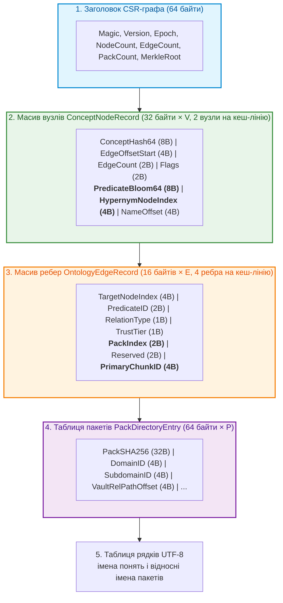

Кожне 16-байтове ребро кодує тип зв'язку та логічні координати `(PackIndex, PrimaryChunkID)` у тому самому поколінні. Це не фізична адреса RAM і не доказ коректності цитати. Поле `HypernymNodeIndex` може прискорити рух до одного батька в дереві; для кількох батьків у DAG потрібний список, контроль циклів і повний обхід. Для глибини чотири це чотири кроки, але не чотири гарантовані такти й не універсальна максимальна глибина онтологій.

Така бінарна структура забезпечує потрійну апаратну синергію на сучасних обчислювальних платформах:

1. **UMA.** Для 100000 вузлів по 32 байти й 500000 ребер по 16 байтів масиви потребують 3,2 + 8 = 11,2 МБ, ще без каталогу, рядків і заповнення. Це не доводить місткості L3 конкретного пристрою. Huge pages не є кешем і самі не закріплюють сторінки. Спільна фізична пам'ять також не означає автоматичної когерентності CPU/GPU/DMA: потрібні платформні API, права й синхронізація.
2. **FPGA.** Суміжність ребер дає можливість пакетного DMA, але довгий зріз може потребувати кількох транзакцій через максимальну довжину burst і межі сторінок/шини. Ширину адрес, порядок байтів і узгодження кешів визначають окремо. Наносекундної гарантії макет не задає.
3. **Перевірка правил.** Ребро `CONTRADICTS` є записаним відношенням; його читання не виконує доведення суперечності довільних формул. Апаратний перевіряч потребує визначеної мови правил і тестів повноти для цієї мови. Тут це напрям авторського розширення, не виміряний прискорювач.

> [!NOTE]
> **Чотири архітектурні принципи бінарного CSR-графа онтології для ARM64 UMA та FPGA (авторська модель автора)**
> 1. **Принцип дворівневої дискримінації незнання за $O(1)$ (Two-Tier Epistemic Ignorance Gate):** розділення відмов на онтологічне незнання (відсутність концепту в таблиці вузлів) та атрибутивне незнання (відсікання за 64-бітною сигнатурою Блума предикатів `PredicateBloom64` всередині 32-байтового вузла) усуває холості звернення до диска та монтування нерелевантних пакетів.
> 2. **Принцип вбудованої фізичної маршрутизації ребер (Inline Edge-to-Pack Routing):** кожне 16-байтове ребро CSR-графа містить координати `(PackIndex, PrimaryChunkID)`, перетворюючи онтологічний граф із абстрактної семантичної мережі на детермінований табличний комутатор підкачування бінарних пакетів знань.
> 3. **Принцип прямого гіперонімічного підйому:** індекс одного батька скорочує пошук у деревоподібній моделі; число кроків визначене глибиною, а багатобатьківські відношення потребують розширення.
> 4. **Принцип узгодженого пакування для UMA та AXI4:** два 32-байтові вузли або чотири 16-байтові ребра вміщуються в 64-байтову лінію за відповідного початку й кроку. Когерентність DMA та допустимі транзакції перевіряються окремо на платформі.
> *Керування рантаймом / Інженерний інваріант:* глобальний CSR-граф онтології ніколи не замінює собою первинні пакети знань як джерело доказів; він виконує роль швидкісного епістемічного індексу та маршрутизатора, тоді як остаточне рішення `ACCEPT` ухвалюється виключно після побайтової верифікації цитати у змонтованому цільовому пакеті.

<a id="113-стиснення-багатовимірних-таблиць-допусків-у-форматі-kp-за-допомогою-тензорних-поїздів-tensor-train--mps"></a>

### 11.3. Стиснення багатовимірних таблиць допусків у форматі .bin за допомогою Тензорних Поїздів (Tensor Train / MPS)

CSR прискорює пошук відношень, але не вирішує розміру багатовимірної числової таблиці. Якщо кожен із восьми параметрів має п'ять дискретних станів, повна таблиця містить 390625 комірок. **Тензор** тут означає саме таку багатовимірну таблицю, а не новий вид фізичної величини. Потрібні передумови — індексація масивів, множення матриць і поняття рангу. Питання підрозділу: коли таблицю можна подати меншими масивами й обчислити одну комірку без розпакування всієї таблиці?

Потокове стиснення зазвичай вимагає декодування блока, хоча його розмір задає конкретний формат і він не обов'язково становить мегабайти. Альтернатива — факторизоване подання, де збережено числові ядра, а комірка є результатом короткого ланцюжка множень. Це не безкоштовне читання готового числа: потрібні обчислення й робочі вектори, які можна виділити наперед. Низький ранг є властивістю даних, не наслідком самого вибору формату.

Класичний TT-розклад Оселедця [[37]](#src-37), пов'язаний із поданням Matrix Product States у фізиці, застосовано в авторській моделі пакування таблиць. Багатовимірна таблиця $`\mathcal{T} \in \mathbb{R}^{d_1 \times d_2 \times \cdots \times d_N}`$ подається добутком тривимірних ядер:

<a id="ch32-object-46"></a>

**Формула (32.46). Tensor Train подання комірки**

```math
\mathcal{T}(i_1, i_2, \dots, i_N) = \mathbf{G}_1(i_1) \mathbf{G}_2(i_2) \cdots \mathbf{G}_N(i_N) = \sum_{\alpha_0=1}^{r_0} \sum_{\alpha_1=1}^{r_1} \dots \sum_{\alpha_N=1}^{r_N} G_1(\alpha_0, i_1, \alpha_1) G_2(\alpha_1, i_2, \alpha_2) \cdots G_N(\alpha_{N-1}, i_N, \alpha_N)
```

де:
- $N$ — кількість вимірів (фізичних параметрів або умов антецедента правила);
- $`d_k`$ — роздільна здатність квантування $k$-го параметра ($`i_k \in \{1, \dots, d_k\}`$);
- $`\mathbf{G}_k(i_k) \in \mathbb{R}^{r_{k-1} \times r_k}`$ — слайс ядра матричного розміру $`r_{k-1} \times r_k`$ при фіксованому квантованому значенні входу $`i_k`$;
- $`r_0 = r_N = 1`$ — граничні умови тензорного ланцюга;
- $`\mathbf{r} = (r_0, r_1, \dots, r_N)`$ — вектор TT-рангів, де $`r = \max_k r_k`$ позначає максимальний TT-ранг розкладу.

У цій формулі індекси сум $`\alpha_k`$ є цілими від 1 до відповідного рангу; елементи ядер — дійсні коефіцієнти. Для безрозмірної нормованої таблиці всі коефіцієнти й вихід безрозмірні. Якщо вихід має фізичні одиниці, масштаб фіксують у метаданих і відновлюють після обчислення. Одиниці початкових датчиків належать карті квантування, не номерам комірок.

Нехай $d$ — найбільше з додатних цілих $`d_k`$, $N \ge 2$, ранги додатні цілі. Кількість збережених коефіцієнтів:

<a id="ch32-object-47"></a>

**Формула (32.47). Кількість коефіцієнтів таблиці**

```math
C_{\mathrm{TT}}=\sum_{k=1}^{N}r_{k-1}d_k r_k \le N d r^2,\qquad C_{\mathrm{dense}}=\prod_{k=1}^{N}d_k.
```

Ліва сума рахує елементи кожного ядра, права добуткова величина — комірки повної таблиці; обидві є безрозмірними цілими. Рівність добутку з $d^N$ діє лише за однакових розмірів усіх осей. Лінійна залежність від $N$ є умовною, коли $d$ і максимальний ранг $r$ обмежені: для довільних даних ранги можуть зростати настільки, що виграш зникне. TT є відомим методом; авторський внесок тут — спосіб розміщення ядер у пакеті, не загальна теорема стиснення всіх таблиць.

Запит до стисненої таблиці в рантаймі не вимагає глобальної декомпресії: обчислення значення допуску $`\hat{y} = \mathcal{T}(i_1, \dots, i_N)`$ зводиться до ланцюгового перемноження $N$ розріджених вектор-матриць:

<a id="ch32-object-48"></a>

**Формула (32.48). Обчислення однієї комірки**

```math
\hat{y}(i_1, \dots, i_N) = \mathbf{v}_1^{\mathsf{T}} \mathbf{G}_2(i_2) \cdots \mathbf{G}_{N-1}(i_{N-1}) \mathbf{v}_N
```

Тут $`\mathbf{v}_1^{\mathsf{T}}`$ є першим рядком-ядром для вибраного $`i_1`$, $`\mathbf{v}_N`$ — останнім стовпцем для $`i_N`$, а проміжні матриці мають сумісні рангові розміри з попередньої формули. Результат $`\hat y`$ — одне число, точне для заданих ядер; щодо вихідної таблиці воно може бути наближенням. Наприклад, для двох осей по два стани, рангу 1 та ядер [2,3] і [5,7] комірка (2,1) дорівнює 3 · 5 = 15, а вся таблиця містить 10, 14, 15, 21. Комірку отримано без побудови всього масиву. За обмеженого рангу потрібно $O(Nr^2)$ арифметичних операцій, не тактів; відсутність алокацій потребує наперед виділених робочих векторів.

Для апроксимації потрібне ще твердження TT-SVD: якщо на кожному з $N-1$ послідовних SVD-кроків евклідова норма відкинутого хвоста сингулярних чисел не перевищує задану абсолютну величину $`\varepsilon_{\mathrm{tol}} \ge 0`$, то загальна похибка в нормі Фробеніуса обмежена коренем із суми квадратів цих хвостів, а отже:

<a id="ch32-object-49"></a>

**Формула (32.49). Межа похибки TT-SVD**

```math
\lVert \mathcal{T} - \hat{\mathcal{T}} \rVert_F \le \sqrt{N - 1} \cdot \varepsilon_{\mathrm{tol}}
```

Тут $`\hat{\mathcal{T}}`$ — наближена таблиця, норма Фробеніуса є коренем із суми квадратів похибок усіх комірок; норма й допуск мають одиниці виходу таблиці. Межа стосується математичного TT-SVD за вказаного контролю хвостів, не довільного скорочення рангу; округлення арифметики й похибка квантування датчиків враховуються додатково. За $N=8$ і допуску хвоста 0,001 загальна межа приблизно 0,002646, а не 0,001. Кожна окрема абсолютна похибка не більша за цю норму, тому для рішення біля порога потрібна саме загальна межа.
> [!NOTE]
> **Закон лінійного стиснення комбінаторних таблиць правил через Тензорні Поїзди автора (Три інваріанти пам'яті)**
> 1. **Умовне низькорангове стиснення:** оцінка $O(Ndr^2)$ корисна лише за підтверджених обмежених рангів; довільна таблиця не отримує гарантованого коефіцієнта стиснення.
> 2. **Обчислення над збереженими ядрами:** одна комірка отримується за $O(Nr^2)$ операцій без глобальної декомпресії, з наперед виділеними робочими векторами й перевіреним часом життя відображення.
> 3. **Похибка наближення за урізанням сингулярних чисел SVD ($`\lVert \mathcal{T} - \hat{\mathcal{T}} \rVert_F \le \sqrt{N-1}\,\varepsilon_{\mathrm{tol}}`$):** за умов теореми це обмежує числову похибку апроксимації відносно вихідного тензора. Саме по собі обмеження не підтверджує правильності нормативної таблиці, застосовності її вимог чи відповідності виробу ISO 26262 ASIL-D; воно є лише одним можливим технічним свідченням у повнішій перевірці.

**Імператив замкненого циклу розрахунку (Actionable Closed Loop):**

1. **Рішення з похибкою.** Нехай потрібний безрозмірний вихід не менший за поріг 0,95, а підтверджена загальна абсолютна похибка разом з округленням не перевищує 0,003. Наближений вихід 0,960 дає нижню межу 0,957 і проходить цей табличний тест. Вихід 0,951 дає 0,948 і вимагає точної перевірки або `QUALIFIED_CHECK`. Допуск одного SVD-кроку не можна підставляти замість загальної похибки.
2. **Місткість.** Для float32 кожен коефіцієнт займає 4 байти. За восьми осей по п'ять станів і рангів [1,4,4,4,4,4,4,4,1] перше й останнє ядра містять по 20 чисел, шість середніх — по 80: разом 520 чисел, або 2080 байтів без метаданих і вирівнювання. Груба верхня оцінка 2560 байтів більша, але не точний розмір. Повна таблиця займає 1562500 байтів, тобто приблизно в 751 раз більше за ядра лише за умови, що такі ранги справді достатні.
3. **Час і межі.** Для цих рангів шість внутрішніх множень потребують по 16 MAC, фінальний скалярний добуток — ще 4: разом 100 MAC без завантажень і перевірок. Це не 100 тактів. 2080 байтів не вміщуються в одну 64-байтову кеш-лінію. Якщо потрібний ранг не вміщується в бюджет, не можна мовчки укрупнювати квантування чи змінювати нормативну таблицю: переглядають формат, бюджет або підтверджену похибку. Наступний підрозділ розглядає іншу компактну структуру — свідок формального твердження, який треба перевіряти, а не чисельно наближати.

### 11.4. Залежні типи Мартіна-Льофа та пакети знань, що несуть доказ (Proof-Carrying Knowledge Packs)

Підпис відповідає на питання «хто затвердив ці байти», але не «чи випливає висновок із передумов». Пакет із доказовим свідком пропонує не повторювати пошук доведення на вузлі, а перевірити готовий доказ. Потрібні поняття формального твердження, припущень і правила виведення; залежний тип пов'язує результат із конкретним входом, наприклад дію з тим станом, для якого її обрано. Це доповнення до перевірки джерел, не спосіб автоматично перетворити будь-яку природномовну норму на доведену програму.

Класичні підстави — теорія типів Мартіна-Льофа [[35]](#src-35) та *Proof-Carrying Code* Некули [[36]](#src-36). У відповідності Каррі–Говарда тип можна читати як твердження, а терм цього типу — як свідок доведення в обраній логіці. Для авторської моделі контракту це дає:

<a id="ch32-object-50"></a>

**Формула (32.50). Контракт як залежний тип**

$$
\Pi (x : \mathrm{State}),\; \mathrm{Pre}(x) \to \Sigma (y : \mathrm{Action}),\; \mathrm{Safe}(x, y).
$$

У цій формулі залежний добуток $\Pi$ виражає універсальну квантифікацію за всіма валідними системними станами $x$, що задовольняють контрактну передумову $`\mathrm{Pre}(x)`$. Залежна сума $\Sigma$ моделює конструктивну пару: виконувану дію $`y \in \mathrm{Action}`$ та невіддільний математичний свідок $`\mathrm{Safe}(x, y)`$, що доводить збереження інваріантів безпеки при переході в новий стан.

`State` і `Action` є заданими типами станів і дій, $x$ і $y$ — їхніми елементами; предикати `Pre` і `Safe` визначає довірений контракт. Усі ці позначення логічні, без фізичних одиниць, доки їх не задано в моделі. Формула означає: для кожного допустимого стану й свідка передумови можна побудувати дію разом зі свідком її властивості. Вона не стверджує існування такого терма для довільного правила.

Офлайн-засіб може шукати терм $\pi$ й записувати його у секцію доказів. Мінімальність терма, сертифікованість перевіряча та відсутність алокацій потребують окремих артефактів; тут їх не встановлено. Для загальних залежних типів перевірка може включати дороге обчислення рівності термів, тому універсальної лінійної межі немає. Лінійний обхід можливий для окремо визначеного ациклічного формату доказу з локальними обмеженими правилами, перевіреними посиланнями на попередні вузли, контрольованими розмірами й бюджетом робочої пам'яті. Це проєктна умова авторського пакування, не наслідок `mmap`.

> [!NOTE]
> **Концепція бінарних пакетів знань із вбудованим термом-свідком типу автора (Три гарантії `mmap`-верифікації)**
> 
> 1. **Контракт як залежний тип:** формалізоване правило пов'язує стан, передумову, дію та доказ наслідку; відповідність природномовній нормі перевіряється окремо.
> 2. **Серіалізація терма-свідка:** секція може використовувати спільні підтерми (*hash-consing*), але побудова може виділяти пам'ять, а читач перевіряє межі, індекси, відсутність циклів і ліміти ресурсів.
> 3. **Обмежений перевіряч:** лінійний час є вимогою до конкретного формату з локальними правилами, не загальною гарантією теорії залежних типів. Успіх означає доведення в заданій моделі від її припущень.

**Замкнений цикл інженерного розрахунку верифікації пакетів, що несуть доказ:**

1. **Керування рантаймом і потоком обчислень (Control Flow & Runtime Decisions):**
	Завантажувач звіряє очікуваний контракт і його версію з довіреною політикою, перевіряє хеш образу, межі й ресурсні ліміти секції доказів, а потім викликає визначений перевіряч. Статус `PROOF_VERIFIED` дозволяє лише передбачені цією політикою операції. Невідомий формат, цикл, некоректне посилання, перевищення бюджету або невідповідний тип блокують новий пакет. Не кожна зміна біта обов'язково змінює тип — цілісність перевіряє хеш, а type checker перевіряє інший контракт. Неприйнятий образ можна звільнити лише за відсутності читачів.
2. **Апаратний сайзинг та інфраструктурні обмеження (Hardware Dimensioning):**
	Навчально 10000 записів по 64 байти потребують 640000 байтів ще без загальних таблиць. Якщо перевіряч виконує 2,63 млн кроків/с, то 10000 кроків потребують приблизно 3,8 мс, але 10000 правил не обов'язково означають 10000 кроків. Розмір доказів, число переходів і максимальний стек потрібно підрахувати з реального формату; без нього швидкість та обсяг не заявляються як виміряні.
3. **Практичний числовий приклад (Worked Numerical Example):**
   Розглянемо правило захисту батарейного блоку електромобіля від перенапруги в системі керування BMS:
   
<a id="ch32-object-51"></a>

**Формула (32.51). Навчальний контракт відключення**

$$
\Pi (s : \mathrm{BMS\_State}),\; (s.\mathrm{voltage} > 4{,}25\,\text{В}) \to \Sigma (a : \mathrm{Action}),\; (a.\mathrm{cmd} = \mathrm{DISCONNECT} \land a.\mathrm{latency} \le 10\,\text{мс}).
$$

	Тут напруга є дійсною величиною у вольтах, затримка — невід'ємним часом у мілісекундах, а пороги 4,25 В і 10 мс — навчальними умовами, не вимогами ISO. Для скінченного навчального випадку задамо стан «перенапруга» та дві можливі дії: `DISCONNECT` із модельною затримкою 5 мс і `WAIT` без відключення. Першу пару можна перевірити підстановкою: команда правильна, 5 ≤ 10. `WAIT` або затримка 50 мс не задовольняють контракт. Це логічний приклад перевірки, не виконаний сертифікований type checker.

	Фізичне відключення за 10 мс не випливає з поля `latency`: потрібні модель планування, вимірювання виконавчого механізму й обґрунтування їх зв'язку з формальним станом. Якщо змінено і твердження, і доказ, лише перевірка типу може успішно прийняти слабше твердження, тому очікуваний контракт і його версію завантажувач бере з довіреної політики. Пакет з доказом дає `PROOF_VERIFIED` у межах моделі, не зовнішній сертифікаційний `ACCEPT`.

### 11.5. Двійкова організація секцій ґраток понять: вирівнювання по 64 байти та апаратні операції над бітовими масками

Пошук аналогів потребує часто порівнювати множини ознак і структури процесів ([Глава 31](ch31-syllogistic-reasoning-and-relation-lattices.md)). Тут задача — зберегти ці подання так, щоб не створювати їх заново для кожного кандидата. Нагадаємо: формальне поняття $(A,B)$ складається з множини об'єктів $A$ та спільних їм атрибутів $B$ у зафіксованому відношенні «об'єкт має атрибут»; для формального поняття обидві множини взаємно замкнені. Бітова маска зберігає атрибути, але сама не доводить цієї замкненості й не обчислює операції ґратки простим довільним OR. Далі розглядається саме пакування та попереднє зіставлення, не доказ коректності аналогії.

Для розв'язання цього завдання автором розроблено бінарну організацію секцій ґраток понять у контейнерах баз знань, орієнтовану на нульове копіювання (`zero-copy`) через системний виклик `mmap(MAP_SHARED)` та пряму взаємодію з векторними регістрами сучасних процесорів (x86-64 AVX2/AVX-512 та ARM64 Neon).

#### 11.5.1. Формат двійкової секції ґратки Галуа

Секція ґратки понять починається із заголовка, вирівняного по 64-байтовій межі кеш-лінії:
<a id="ch32-object-52"></a>

**Формула (32.52). Вирівнювання секції понять**

```math
\mathrm{Offset}_{\mathrm{lattice}} \bmod 64 = 0
```

Тут:

- $`\mathrm{Offset}_{\mathrm{lattice}}`$ є зміщенням початку секції від початку файла пакета знань у байтах;
- 64 є розміром кеш-лінії в байтах на поширених процесорах x86-64 і Arm64.

Читається так: зміщення секції ділиться на 64 без остачі. Умовний приклад: секція на зміщенні 4096 вирівняна, бо $`4096 = 64 \cdot 64`$, а на зміщенні 4100 ні, бо остача дорівнює 4.

Заголовок містить сигнатуру, невід'ємну цілу кількість понять і версію словника атрибутів. Для скінченної множини атрибутів $M$ довжина маски в машинних словах:

<a id="ch32-object-53"></a>

**Формула (32.53). Довжина маски й розмір дескриптора**

```math
W=\left\lceil\frac{\lvert M\rvert}{64}\right\rceil,\qquad S_{\mathrm{record}}=16+8W.
```

Тут $`\lvert M\rvert`$ і $W$ — невід'ємні цілі кількості атрибутів і 64-бітних слів, $`S_{\mathrm{record}}`$ — байти дескриптора. 16 байтів охоплюють три поля `uint32` та 4 байти заповнення, 8 — байти одного слова. Для 65 атрибутів потрібні 2 слова і 32 байти дескриптора; зайві 63 біти другого слова мають бути нульовими. Перед множенням кількості записів на розмір перевіряють переповнення й межі секції. Спільна версія словника потрібна, щоб одна позиція означала той самий атрибут у всіх масках.

Безпосередньо за заголовком розташовується неперервний двійковий масив дескрипторів понять. Кожен дескриптор поняття $`(A, B)`$ містить:
1. `ConceptID` (uint32) є глобальним або локальним числовим ідентифікатором поняття;
2. `ExtentOffset` та `ExtentCount` (uint32 кожне) є зміщенням і кількістю об'єктів або предикатів $`g \in A`$;
3. `IntentMask[W]` (масив uint64) є бітовою маскою атрибутів $`m \in B`$: одиничний біт на позиції $`j`$ означає наявність атрибута $`m_j \in M`$.

Три поля uint32 займають 12 байтів. Ще 4 байти вирівнювання ставлять масив `IntentMask` на межу 8 байтів, тому дескриптор займає $`16 + 8W`$ байтів.

Така структура дозволяє процесору перевіряти перетин інтенсіоналів двох понять $`\lvert B_1 \cap B_2 \rvert`$ побітовою інструкцією `AND` над відповідними словами маски, а відмінності $`\lvert B_1 \setminus B_2 \rvert`$ інструкцією `ANDN` (на Arm64 відповідна інструкція має назву `BIC`), тобто логічним $`B_1 \land \neg B_2`$. Кількість елементів множини рахує інструкція підрахунку одиничних бітів. На x86-64 це скалярна `POPCNT`. У архітектурі Armv8.2, яку реалізує Cortex-A78AE, скалярної інструкції немає: підрахунок виконують векторна `CNT` над байтами і горизонтальне додавання `ADDV`. На кожне 64-бітне слово припадає кілька інструкцій, для маски з $`W`$ слів це $`O(W)`$ операцій без жодного виділення пам'яті в купі (`0 allocs/op`).

#### 11.5.2. Секція топологічного квазіізоморфізму (1-WL спектри)

Для попереднього топологічного зіставлення зберігається таблиця 1-WL ознак: вершина отримує новий колір із попереднього кольору та мультимножини кольорів сусідів. Для орієнтованого графа окремо кодують напрям і тип ребер. Після трьох навчально обраних ітерацій частоти кольорів утворюють вектор $`h \in \{0,\ldots,65535\}^{D}`$, де додатна ціла $D$ — спільна кількість координат. Словник кольорів і номери ітерацій однакові для всіх порівнюваних підграфів; локально незалежна нумерація кольорів дасть беззмістовний скалярний добуток. Перевищення 65535 потребує ширшого поля або відмови, не мовчазного переповнення чи обрізання.

Щоб відтворити порівняння без прихованого звернення до іншої глави, косинус двох ненульових гістограм визначено так:

<a id="ch32-object-54"></a>

**Формула (32.54). Косинус гістограм**

```math
\mathcal{S}_{\mathrm{topo}}=\frac{\sum_{j=1}^{D}h_{1j}h_{2j}}{\sqrt{\sum_{j=1}^{D}h_{1j}^{2}}\sqrt{\sum_{j=1}^{D}h_{2j}^{2}}}.
```

Усі лічильники й оцінка безрозмірні; для невід'ємних ненульових векторів результат у [0,1]. За нульової норми оцінка не визначена й кандидат потребує окремої обробки. Вектори (2,1) і (1,2) дають добуток 4, квадрати норм по 5 та оцінку 0,8. Це подібність ознак: навіть оцінка 1 не доводить ізоморфізму, бо 1-WL не розрізняє деякі неізоморфні графи. Добутки 16-бітних лічильників і їхні суми накопичують у достатньо широкому типі з перевіркою максимальної суми; SIMD не скасовує переповнення. Час залежить від $D$, кількості кандидатів і стану кешів.

> [!NOTE]
> **Чотири інваріанти бінарного пакування ґраток понять за архітектурою автора**
> 1. Автором запропоновано формат нульової десеріалізації для ґраток Галуа, де інтенсіонали понять представлені компактними масивами 64-бітних бітових слів у секції, вирівняній по межі 64 байтів, для безпосереднього виконання SIMD-інструкцій над сторінками спільної пам'яті.
> 2. Атрибутивне зіставлення за індексом Тверські реалізується через побітові процесорні інструкції перетину та віднімання множин без виділення динамічної пам'яті в купі процесу (0 allocs/op).
> 3. Топологічний спектр квазіізоморфізму 1-WL зберігається у вигляді квантованих векторів кольорових гістограм, що забезпечує апаратне обчислення косинусної схожості через інструкції скалярного добутку векторів.
> 4. Показник 37,8 мкс при бюджеті 200 мс збережено як архівну оцінку автора без доступного тут протоколу. Він не встановлює WCET або повноти розв'язання аналогії; потрібні корпус, реалізація, версії та повтори.
> *Керування рантаймом / Інженерний інваріант:* Пакування підтримує ефективне зіставлення, але семантичний допуск і часову межу перевіряють окремо.

**Замкнений цикл інженерного розрахунку бінарних ґраток понять:**

1. **Керування рантаймом і потоком обчислень (Control Flow & Runtime Decisions):**
	Спочатку порівнюють атрибути, потім структуру й лише далі семантичну відповідність. Пороги 0,70 і 0,65 є навчальними налаштуваннями відбору кандидатів. Перевищення обох не випускає сертифіката: потрібні напрям відображення, одиниці, передумови, винятки й докази застосовності. Збіг одиниць SI необхідний для відповідних числових величин, але недостатній для перенесення норми.
2. **Апаратний сайзинг та інфраструктурні обмеження (Hardware Dimensioning):**
	Для 10000 понять і 512 атрибутів маска займає 8 слів, дескриптор — 80 байтів, масив — 800000 байтів без заголовка й екстенсіоналів. Він не вміщується у виділений бюджет кешу 512 КіБ. За початку секції на межі 64 байтів крок 80 також означає, що частина масок перетинає кеш-лінії; для SIMD потрібні допустимі невирівняні завантаження або інше пакування. Реальну доступну місткість кешу визначають для конкретного SoC і спільного навантаження, не за назвою ядра.
3. **Практичний числовий приклад (Worked Numerical Example):**
	Навчально задамо дві множини ознак процесів: 14 спільних, 2 лише в першій і 1 лише в другій. Для невід'ємних ваг відмінностей $\alpha$ і $\beta$ індекс Тверські має вигляд:

<a id="ch32-object-55"></a>

**Формула (32.55). Індекс Тверські та його приклад**

```math
\mathcal{S}_{\mathrm{attr}}=\frac{a}{a+\alpha b+\beta c},\qquad
\mathcal{S}_{\mathrm{attr}}=\frac{14}{14+0{,}5\cdot2+0{,}5\cdot1}\approx0{,}903.
```

Тут $a,b,c$ — безрозмірні невід'ємні цілі кількості спільних і двох видів відмінних ознак; ваги в прикладі по 0,5, знаменник додатний. За порожнього знаменника оцінка не визначена; політику для двох порожніх множин задають окремо. Оцінка 0,903 проходить екран 0,70; разом із косинусом 0,8 з попереднього прикладу проходить і другий екран 0,65. Результат — кандидат на аналогію, а не підтвердження еквівалентності TCP та CanTp чи дозвіл переносити між ними нормативні вимоги.

---

## Висновки
1. **Пакет знань як артефакт випуску:** авторський формат пакета розділяє канонічний шар (джерела, твердження, цитати, словник предикатів), похідні шари й маніфест. Шість інваріантів (незмінність, адресація за вмістом, відтворюваність похідного, самоопис, відокремлення змінного стану, межі доступу) дають змогу прив'язати кожну відповідь до точного стану знань і змінювати формат індексу без повторного видобування знань.
2. **Вартість читання й межа `mmap(2)`:** відображення файла може прибрати попередній розбір текстового корпусу, але не прибирає сторінкових збоїв і не задає універсальної затримки старту. Підхід виправданий для незмінного пакета, що вміщується в пам'ять вузла, і втрачає перевагу, коли індекс більший за пам'ять. Відкриття, перший запит і повторні запити потрібно вимірювати окремо; рівність відповідей передує порівнянню швидкості.
3. **Безвтратне кластерування:** об'єднання однакових тверджень прибирає дублювання без втрати цитат, якщо ключ кластера однозначно кодує поля, поля нормалізовані до хешування, а цитати впорядковані. З'єднання полів через роздільник зливає різні твердження, і хеш-функція цього не виправляє. Майже однакові твердження зливає лише інженер знань.
4. **Побітова відтворюваність:** паралельний конвеєр збирання дає однакові хеші індексів і маніфесту до підпису незалежно від числа потоків (`--concurrency / -j`), якщо впорядкований буфер виявляє повтори й пропуски, обходи словників відсортовані, а час і шляхи зафіксовані.
5. **Шлюз допуску знань від мовної моделі:** побайтове порівняння цитати з байтами затвердженої редакції документа не пускає до пакета вигадані чи перефразовані цитати локальних мовних моделей (SLM). Доказову силу дають лише байти, які хост прочитав сам, а не хеші, які надіслала модель. Хибне тлумачення справжньої цитати шлюз не зупиняє, і цю помилку виявляють екзаменаційні тести.
6. **Щільність і повнота знань:** KDI визначає пріоритет аудиту, не достатність корпусу. Повторний вилов дає оцінку лише за передумовами моделі; це не гарантована оптимістична межа й не дозвіл на випуск.
7. **Перевірка недовіреного індексу:** структурна валідація передує пошуку й залишається чинною лише за незмінності та живого відображення. Тести підтверджують нульові алокації конкретного пошуку; CRC, хеш, фазинг і перевірка змісту мають різні задачі й не замінюють один одного.
8. **Шардування незмінного пакета:** шард є мінімальним пакетом, а карта шардів і хеші їхніх файлів входять до маніфесту. Ключ-родина документів не розриває залежностей виведення, але гірше вирівнює навантаження: на синтетичному корпусі частка розрізаних залежностей дорівнює 0 проти 0,750, а нерівномірність 1,67 проти 1,47. Хешування за найбільшою вагою переміщує майже $1/(n+1)$ ключів під час додавання шарда, а залишок від ділення майже $n/(n+1)$. Мовчання шарда не є відсутністю факту: без відповіді всіх потрібних шардів одного покоління підсумок «відсутнє» заборонено.
9. **Компактні похідні структури:** CSR і Bloom відбирають місце пошуку, TT може скоротити числові таблиці за обмежених рангів, а доказовий свідок підтримує перевірку формального контракту. Жодне з цих подань не замінює первинних цитат, перевірки застосовності й повноти знімка. Наступна за читацьким маршрутом [Глава 37](ch37-input-information-assessment-and-algorithmic-skepticism.md) повертається до якості вхідних свідчень: правильні байти ще не означають правильну підставу рішення.

---

## Словник
<a id="ch32-object-56"></a>

**Таблиця 32.56. Словник**

| Український термін | Англійський відповідник | Коротке пояснення |
|---|---|---|
| Атестат походження знань | Knowledge provenance attestation | Криптографічно підписаний дескриптор (in-toto) із повною стратиграфією походження бінарного пакета, хешами джерел, параметрів та компілятора |
| Атомарна гаряча заміна RCU | Atomic RCU hot-swap | Безблокувальна заміна активного пакета знань у пам'яті через перемикання покажчика та вивільнення старої пам'яті після дренажу активних читачів |
| Безвтратне кластерування | Lossless fact clustering | Об'єднання однакових тверджень із збереженням усіх посилань на першоджерела |
| Безпечний період RCU | RCU grace period (epoch drain) | Інтервал часу між атомарним перемиканням покажчика та викликом munmap(2), протягом якого всі активні читачі попередньої епохи гарантовано завершують роботу |
| Відкритий цифровий підпис | Digital signature | Криптографічний механізм підтвердження автентичності та незмінності маніфесту чи атестата |
| Відображення пам'яті | Memory Mapping (mmap) | Системний виклик для відображення файлів безпосередньо у віртуальний адресний простір процесу |
| Вирівнювання пам'яті | Memory Alignment | Розміщення даних за адресами, кратними розміру машинного слова або векторного регістра (SIMD) |
| Впорядкований буфер | Reorder buffer | Буфер, що утримує результати паралельних воркерів і видає їх у порядку номерів документів |
| Герметична кристалізація знань | Hermetic knowledge crystallization | Багаторівневий процес компіляції бінарних контейнерів знань, що повністю виключає недетермінізм оточення, таймстампи та неініціалізовані байти вирівнювання |
| Герметичне збирання знань | Hermetic knowledge build | Процес компіляції знань в ізольованому ефемерному середовищі без мережевого доступу з фіксованими криптографічними хешами всіх інструментів та джерел |
| Довідкові дані | Reference data | Малі дані, що їх читає кожен запит; їх копіюють у всі шарди й перевіряють за хешем |
| Довідник суб'єктів | Subject directory | Малий довідник «суб'єкт → родина документів», за яким маршрутизатор обирає шард |
| Занулене вирівнювання (Zero-Padding) | Strict zero-padding | Примусовий явний запис нульових байтів (0x00) для досягнення 64-байтових меж кеш-ліній замість використання неініціалізованих проміжків пам'яті |
| Індекс знаннєвої щільності | Knowledge density index (KDI) | Відношення зваженої кількості видобутих формальних знань до обсягу тексту джерела; повноти не вимірює |
| Канонічний шар пакета | Canonical layer | Джерела, твердження, цитати й словник предикатів, що є єдиним джерелом істини пакета |
| Ключ розбиття | Partition key | Ознака, за якою функція розміщення обирає шард; в цій главі це родина документів |
| Консистентне хешування | Consistent hashing | Розміщення на кільці значень хеша, за якого зміна кількості шардів переміщує невелику частку ключів |
| Корінь цілісності контейнера | Container integrity root | Ієрархічний Merkle-хеш у заголовку бінарного контейнера, обчислений над дискретними хешами всіх секцій артефакту |
| Ланцюг постачання знань | Knowledge supply chain | Наскрізний конвеєр перетворення першоджерел вимог у скомпільовані бінарні артефакти знань із контролем цілісності та автентичності |
| Лінія кешу | Cache line | Найменший блок даних, яким процесор обмінюється з оперативною пам'яттю (зазвичай 64 байти) |
| Маршрутизатор | Router | Компонент, що спрямовує запит до шарда або до всіх шардів і повертає один із чотирьох підсумків: знайдено, знайдено частково, відсутнє, невідомо |
| Матеріалізоване подання | Materialized view | Заздалегідь обчислений і збережений результат запиту чи виведення, який прискорює повторні запити ціною місця |
| Метод повторного вилову | Capture-recapture | Оцінка невідомої загальної кількості об'єктів за перетином результатів двох незалежних пошуків |
| Мовчання шарда | Shard silence | Стан, коли потрібний шард не відповів або відповів із покоління, відмінного від маніфесту; це не дорівнює відсутності факту |
| Нейро-символьне збагачення бази знань | Neuro-symbolic harvesting | Видобування формальних фактів, у якому мовна модель пропонує кандидатів, а детермінований код хоста вирішує, що допустити |
| Нерівномірність навантаження | Load imbalance | Відношення найбільшого шарда до середнього за кількістю тверджень |
| Нормалізація Unicode | Unicode normalization | Приведення канонічно еквівалентних рядків до однакового двійкового подання, наприклад до форми NFC |
| Нульова десеріалізація | Zero-Deserialization | Технологія читання бінарних структур даних без попереднього розбору та створення об'єктів у купі |
| Однозначне кодування ключа | Injective key encoding | Кодування полів, за якого різні набори полів завжди дають різні послідовності байтів, наприклад запис довжини перед кожним полем |
| Побайтова відтворюваність | Bit-for-bit reproducibility | Властивість бінарного пакунка знань збігатися з еталоном до останнього біта при компіляції на різних незалежних вузлах |
| Побітова відтворюваність | Bit-for-bit reproducibility | Властивість збирання давати побітово однакові артефакти з тих самих вихідних даних, середовища й інструкцій збирання |
| Покоління пакета знань | Pack generation | Один незмінний випуск пакета знань із власним ідентифікатором; нові знання створюють нове покоління |
| Покоління формату | Format version | Версія самої будови пакета (v1, v2), яку читач перевіряє перед монтуванням |
| Повнота видобування | Recall | Частка тверджень корпусу, які екстрактор знайшов |
| Похідний шар пакета | Derived layer | Індекс, подання чи профіль, які збирач детерміновано обчислює з канонічного шару й перевірка може повторити |
| Родина документів | Document family | Усі редакції одного нормативного джерела, які пов'язані в графі версій заміщеннями й винятками |
| Селективне розкриття | Selective disclosure | Метод доведення автентичності окремого твердження без розкриття решти закритого контексту бази знань |
| Сигнал SIGBUS | SIGBUS | Сигнал операційної системи, який отримує процес під час звернення до відображеної сторінки, яку неможливо прочитати, наприклад після усічення файла |
| Списки постінгів | Postings Lists | Впорядковані масиви ідентифікаторів або зміщень фактів, прив'язані до конкретного терміна чи суб'єкта |
| Сторінковий збій | Page fault | Виняток процесора під час звернення до сторінки віртуальної пам'яті, якої немає в фізичній пам'яті; ядро підвантажує сторінку, а потік чекає |
| Фазинг | Fuzzing | Автоматичне тестування, яке змінює вхідні дані й шукає вхід, що спричиняє паніку чи порушення перевірки тесту |
| Хешування за найбільшою вагою | Rendezvous hashing | Розміщення, за якого ключ потрапляє до шарда з найбільшою вагою пари «ключ, шард»; додавання шарда переміщує ключі лише до нового шарда |
| Частка розрізаних залежностей | Edge cut fraction | Частка залежностей між документами, кінці яких розміщено в різних шардах |
| Шард | Shard | Частина пакета знань, яку обслуговує один вузол; містить твердження, цитати й індекс своєї частини знань |
| Шардування пакета знань | Pack sharding | Розбиття пакета на шарди, кожен з яких є мінімальним пакетом; карта шардів і хеші їхніх файлів входять до маніфесту |
| Шлюз допуску | Admission gate | Детермінований програмний фільтр, що перевіряє побайтову відповідність цитати затвердженій редакції першоджерела |
| Бінарний CSR-граф онтології | Binary CSR ontology graph | Глобальний кеш-когерентний граф понять і ребер у форматі стиснених розріджених рядків, вирівняний за межею 64 байти для `mmap` на ARM64 UMA та FPGA |
| Онтологічне незнання | Ontological ignorance | Епістемічний стан відсутності запитуваного концепту в глобальному словнику вузлів сховища (`REFUSAL_UNKNOWN_CONCEPT`) |
| Атрибутивне незнання | Attributive ignorance | Епістемічний стан, коли концепт відомий сховищу, але відсутні твердження про запитуваний предикат чи властивість (`REFUSAL_UNKNOWN_PROPERTY`) |
| Сигнатура Блума предикатів | Predicate Bloom signature | 64-бітна бітова маска у вузлі CSR-графа для попередньої перевірки можливості наявності предиката; позитивна відповідь потребує точного пошуку, а час залежить від реалізації та платформи |

---

## Абревіатури
<a id="ch32-object-57"></a>

**Таблиця 32.57. Абревіатури**

| Скорочення | Розшифрування | Значення |
|---|---|---|
| ABNF | Augmented Backus-Naur Form | розширена форма Бекуса-Наура для специфікації протокольних граматик |
| CAN | Controller Area Network | послідовна шина обміну між контролерами транспортного засобу |
| CanTp | CAN Transport Protocol | модуль AUTOSAR транспортного протоколу CAN за ISO 15765-2 із сегментацією та керуванням потоком |
| CRC | Cyclic Redundancy Check | циклічний надлишковий код для виявлення випадкових пошкоджень даних |
| CSR | Compressed Sparse Row | формат стиснених розріджених рядків для компактного зберігання матриць і графів у суміжній пам'яті |
| DMA | Direct Memory Access | прямий доступ до пам'яті для пакетної передачі даних без участі центрального процесора |
| ECDSA | Elliptic Curve Digital Signature Algorithm | алгоритм цифрового підпису на еліптичних кривих |
| FSM | Finite State Machine | скінченний автомат переходів та станів |
| GC | Garbage Collection | автоматичне збирання невикористаної динамічної пам'яті |
| HNSW | Hierarchical Navigable Small World | граф-структура для швидкого наближеного пошуку найближчих векторів |
| IEEE | Institute of Electrical and Electronics Engineers | міжнародна організація інженерів; у назві CRC32 IEEE позначає стандартний поліном |
| IETF | Internet Engineering Task Force | організація, що розробляє стандарти Інтернету та публікує їх як RFC |
| ISO | International Organization for Standardization | Міжнародна організація зі стандартизації |
| JCS | JSON Canonicalization Scheme | схема канонічної серіалізації JSON, що дає однакові байти для однакових даних |
| JSON | JavaScript Object Notation | текстовий формат структурованих даних з об'єктів і масивів |
| JSONL | JSON Lines | текстовий формат, у якому кожен рядок є окремим об'єктом JSON |
| KDI | Knowledge Density Index | індекс знаннєвої щільності інженерного корпусу |
| LLM | Large Language Model | велика мовна модель |
| MMU | Memory Management Unit | апаратний блок керування віртуальною пам'яттю та трансляції адрес |
| NFC | Normalization Form C | нормальна форма Unicode з канонічним розкладанням і наступним канонічним складанням символів |
| NIST | National Institute of Standards and Technology | Національний інститут стандартів і технології США |
| NVMe | Non-Volatile Memory Express | швидкісний протокол доступу до твердотільних накопичувачів по шині PCIe |
| PNG | Portable Network Graphics | формат растрових зображень із самоописовими блоками даних |
| QUIC | QUIC (назва протоколу, не скорочення) | транспортний протокол Інтернету поверх UDP |
| RCU | Read-Copy-Update | архітектурний шаблон безпечної синхронізації пам'яті без блокування читачів |
| RDBMS | Relational Database Management System | реляційна система керування базами даних |
| RFC | Request for Comments | серія документів, у якій IETF публікує стандарти Інтернету |
| RSS | Resident Set Size | обсяг фізичної оперативної пам'яті, зайнятий процесом |
| SHA | Secure Hash Algorithm | родина криптографічних хеш-функцій; SHA-256 дає 256-бітний відбиток |
| SIMD | Single Instruction, Multiple Data | набір процесорних інструкцій для паралельної векторної обробки даних |
| SLM | Small Language Model | компактна локальна мовна нейромережа |
| SLSA | Supply-chain Levels for Software Artifacts | рівні безпеки ланцюга постачання програмних артефактів |
| SSDF | Secure Software Development Framework | фреймворк безпечної розробки програмного забезпечення (NIST SP 800-218) |
| TCP | Transmission Control Protocol | протокол керування передачею з гарантованим порядком доставки |
| TLB | Translation Lookaside Buffer | апаратний кеш процесора для прискореної трансляції віртуальних адрес у фізичні |
| UAX | Unicode Standard Annex | додаток до стандарту Unicode, що є його нормативною частиною |
| UDP | User Datagram Protocol | протокол передачі датаграм без встановлення з'єднання |
| UMA | Unified Memory Architecture | уніфікована архітектура пам'яті зі спільним фізичним адресним простором для CPU, GPU та NPU |
| UTF-8 | Unicode Transformation Format, 8-bit | зміннодовжинне кодування символів Unicode від одного до чотирьох байтів |
| | Zero-copy Knowledge Pack v4 | чотирисекційний бінарний контейнер знань із побайтовою відтворюваністю та 64-байтовим вирівнюванням |
| СКБД | система керування базами даних | програмне забезпечення, яке зберігає дані й виконує запити до них |

---

## Джерела
1. <a id="src-1"></a>Anders Rundgren, Bret Jordan, Samuel Erdtman. [*RFC 8785: JSON Canonicalization Scheme (JCS)*](https://www.rfc-editor.org/rfc/rfc8785). IETF, 2020.
2. <a id="src-2"></a>World Wide Web Consortium. [*Portable Network Graphics (PNG) Specification (Second Edition)*](https://www.w3.org/TR/2003/REC-PNG-20031110/). W3C Recommendation, 10 November 2003; той самий текст опубліковано як ISO/IEC 15948:2004.
3. <a id="src-3"></a>Serge Abiteboul, Richard Hull, Victor Vianu. [*Foundations of Databases: The Logical Level*](http://webdam.inria.fr/Alice/). Addison-Wesley, Reading, MA, 1995.
4. <a id="src-4"></a>Bery Leouro Mbaiossoum, Narkoy Batouma, Atteib Doutoum Mahamat, Ouchar Cherif Ali, Lang Dionlar, Ladjel Bellatreche. [*Formalization of materialized view problem in ontology-based databases*](https://doi.org/10.11591/ijeecs.v40.i3.pp1430-1438). *Indonesian Journal of Electrical Engineering and Computer Science*, 40(3), 1430–1438, 2025.
5. <a id="src-5"></a>Venky Harinarayan, Anand Rajaraman, Jeffrey D. Ullman. [*Implementing Data Cubes Efficiently*](https://doi.org/10.1145/235968.233333). *Proceedings of the 1996 ACM SIGMOD International Conference on Management of Data*, 205–216, 1996.
6. <a id="src-6"></a>Himanshu Gupta. [*Selection of Views to Materialize in a Data Warehouse*](https://doi.org/10.1007/3-540-62222-5_39). *Database Theory, ICDT '97*, Lecture Notes in Computer Science, vol. 1186, 98–112. Springer, 1997.
7. <a id="src-7"></a>Yury Malkov, Dmitry Yashunin. [*Efficient and Robust Approximate Nearest Neighbor Search Using Hierarchical Navigable Small World Graphs*](https://doi.org/10.1109/TPAMI.2018.2889473). *IEEE Transactions on Pattern Analysis and Machine Intelligence*, 42(4), 824–836, 2020.
8. <a id="src-8"></a>Python Software Foundation. [*sqlite3: DB-API 2.0 Interface for SQLite Databases*](https://docs.python.org/3/library/sqlite3.html) та [*mmap: Memory-Mapped File Support*](https://docs.python.org/3/library/mmap.html). Офіційна документація стандартної бібліотеки Python.
9. <a id="src-9"></a>Michael Kerrisk. [*The Linux Programming Interface: A Linux and UNIX System Programming Handbook*](https://man7.org/tlpi/). No Starch Press, San Francisco, CA, 2010.
10. <a id="src-10"></a>Abraham Silberschatz, Peter B. Galvin, Greg Gagne. [*Operating System Concepts (10th Edition)*](https://www.os-book.com/). John Wiley & Sons, Hoboken, NJ, 2018.
11. <a id="src-11"></a>The Linux man-pages project. [*madvise(2): give advice about use of memory*](https://man7.org/linux/man-pages/man2/madvise.2.html). Linux man-pages 6.19, 2026.
12. <a id="src-12"></a>Ulrich Drepper. [*What Every Programmer Should Know About Memory*](https://people.freebsd.org/~lstewart/articles/cpumemory.pdf). Red Hat, Inc., 2007.
13. <a id="src-13"></a>Andrew Crotty, Viktor Leis, Andrew Pavlo. [*Are You Sure You Want to Use MMAP in Your Database Management System?*](https://www.cidrdb.org/cidr2022/papers/p13-crotty.pdf). *12th Conference on Innovative Data Systems Research (CIDR 2022)*, 2022.
14. <a id="src-14"></a>Jon Postel. [*RFC 793: Transmission Control Protocol*](https://www.rfc-editor.org/rfc/rfc793). IETF, 1981.
15. <a id="src-15"></a>Robert Braden. [*RFC 1122: Requirements for Internet Hosts - Communication Layers*](https://www.rfc-editor.org/rfc/rfc1122). IETF, 1989.
16. <a id="src-16"></a>Wesley Eddy. [*RFC 9293: Transmission Control Protocol (TCP)*](https://www.rfc-editor.org/rfc/rfc9293). IETF, 2022.
17. <a id="src-17"></a>National Institute of Standards and Technology. [*FIPS 180-4: Secure Hash Standard (SHS)*](https://doi.org/10.6028/NIST.FIPS.180-4). NIST, 2015.
18. <a id="src-18"></a>Ken Whistler (ed.). [*Unicode Standard Annex #15: Unicode Normalization Forms*](https://www.unicode.org/reports/tr15/). Unicode 18.0.0, revision 58. Unicode Consortium, 2026.
19. <a id="src-19"></a>Andrei Z. Broder. [*On the Resemblance and Containment of Documents*](https://doi.org/10.1109/SEQUEN.1997.666900). *Proceedings of Compression and Complexity of SEQUENCES 1997*, 21–29. IEEE, 1997.
20. <a id="src-20"></a>Reproducible Builds project. [*Definitions: When is a build reproducible?*](https://reproducible-builds.org/docs/definition/) та Chris Lamb, Ximin Luo. [*SOURCE_DATE_EPOCH specification*](https://reproducible-builds.org/specs/source-date-epoch/), revision 1.1, 2017.
21. <a id="src-21"></a>The Go Authors. [*The Go Programming Language Specification: For statements with range clause*](https://go.dev/ref/spec#For_range). Офіційна специфікація мови Go.
22. <a id="src-22"></a>Dave Crocker, Paul Overell. [*RFC 5234: Augmented BNF for Syntax Specifications: ABNF*](https://www.rfc-editor.org/rfc/rfc5234). IETF, 2008.
23. <a id="src-23"></a>Stephen G. Eick, Catherine Loader, M. David Long, Lawrence G. Votta, Scott Vander Wiel. [*Estimating Software Fault Content before Coding*](https://doi.org/10.1145/143062.143090). *Proceedings of the 14th International Conference on Software Engineering (ICSE '92)*, 59–65. ACM, 1992.
24. <a id="src-24"></a>The Go Authors. [*Go Fuzzing*](https://go.dev/doc/security/fuzz/). Офіційна документація Go.
25. <a id="src-25"></a>David R. Karger, Eric Lehman, Tom Leighton, Rina Panigrahy, Matthew Levine, Daniel Lewin. [*Consistent Hashing and Random Trees: Distributed Caching Protocols for Relieving Hot Spots on the World Wide Web*](https://doi.org/10.1145/258533.258660). *Proceedings of the 29th Annual ACM Symposium on Theory of Computing (STOC '97)*, 654–663. ACM, 1997.
26. <a id="src-26"></a>David G. Thaler, Chinya V. Ravishankar. [*Using Name-Based Mappings to Increase Hit Rates*](https://doi.org/10.1109/90.663936). *IEEE/ACM Transactions on Networking*, 6(1), 1–14, 1998.
27. <a id="src-27"></a>Paul E. McKenney. [*Is Parallel Programming Hard, And, If So, What Can You Do About It?*](https://mirrors.edge.kernel.org/pub/linux/kernel/people/paulmck/perfbook/perfbook.html). Linux Technology Center, IBM, 2024.
28. <a id="src-28"></a>National Institute of Standards and Technology. [*NIST Special Publication 800-218: Secure Software Development Framework (SSDF) Version 1.1*](https://doi.org/10.6028/NIST.SP.800-218). NIST, 2022.
29. <a id="src-29"></a>OpenSSF. [*Supply-chain Levels for Software Artifacts (SLSA) Specification v1.0*](https://slsa.dev/spec/v1.0/). Open Source Security Foundation, Linux Foundation, 2023.
30. <a id="src-30"></a>Burton H. Bloom. [*Space/Time Trade-offs in Hash Coding with Allowable Errors*](https://doi.org/10.1145/362686.362692). *Communications of the ACM*, 13(7), 422–426, 1970.
31. <a id="src-31"></a>Yousef Saad. [*Iterative Methods for Sparse Linear Systems (2nd Edition)*](https://doi.org/10.1137/1.9780898718003). Society for Industrial and Applied Mathematics (SIAM), Philadelphia, PA, 2003.
32. <a id="src-32"></a>Raymond Reiter. [*On Closed World Data Bases*](https://doi.org/10.1007/978-1-4684-3384-5_3). In H. Gallaire & J. Minker (Eds.), *Logic and Data Bases*, 55–76. Plenum Press, New York, 1978.
33. <a id="src-33"></a>National Institute of Standards and Technology. [*FIPS 204: Module-Lattice-Based Digital Signature Standard (ML-DSA)*](https://doi.org/10.6028/NIST.FIPS.204). NIST, 2024.
34. <a id="src-34"></a>David McGrew, Michael Curcio, Scott Fluhrer. [*RFC 8554: Leighton-Micali Hash-Based Signatures*](https://www.rfc-editor.org/rfc/rfc8554). IETF, 2019.
35. <a id="src-35"></a>Per Martin-Löf. [*Intuitionistic Type Theory*](https://bibliopolis.it/shop/intuitionistic-type-theory/). Bibliopolis, Naples, 1984.
36. <a id="src-36"></a>George C. Necula. [*Proof-Carrying Code*](https://doi.org/10.1145/263699.263712). *Proceedings of the 24th ACM SIGPLAN-SIGACT Symposium on Principles of Programming Languages (POPL '97)*, 106–119, 1997.
37. <a id="src-37"></a>Ivan V. Oseledets. [*Tensor-Train Decomposition*](https://doi.org/10.1137/090752286). *SIAM Journal on Scientific Computing*, 33(5), 2295–2317, 2011.

---

[← Глава 9](ch09-engineering-knowledge-graph-traceability.md) | [Зміст книги](README.md) | [Частина II](part-02-knowledge-models.md) | [Глава 37 →](ch37-input-information-assessment-and-algorithmic-skepticism.md)
