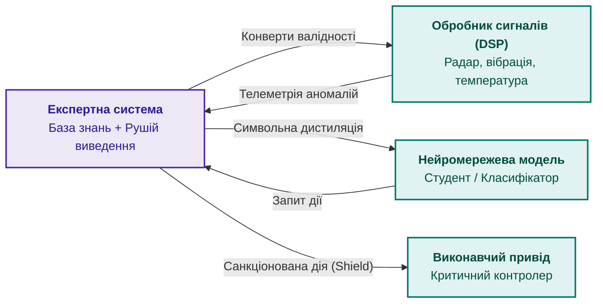
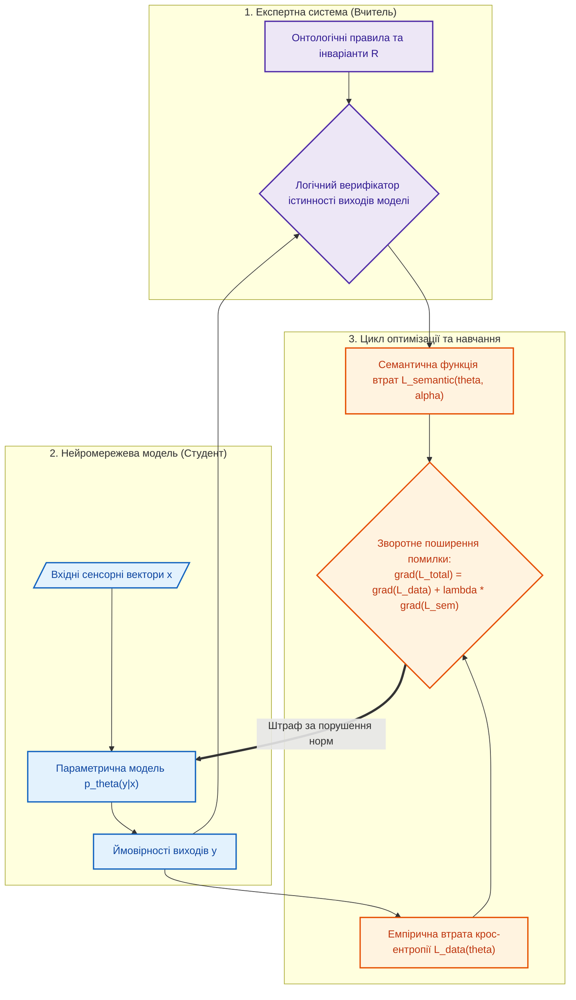
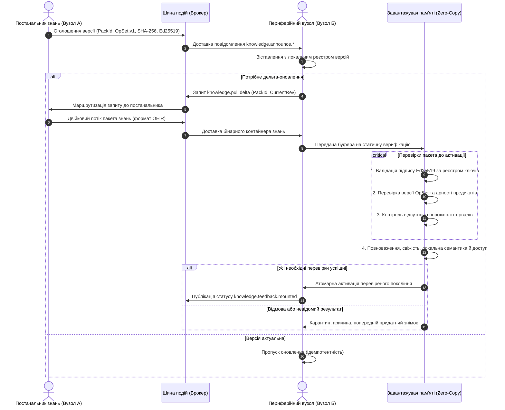
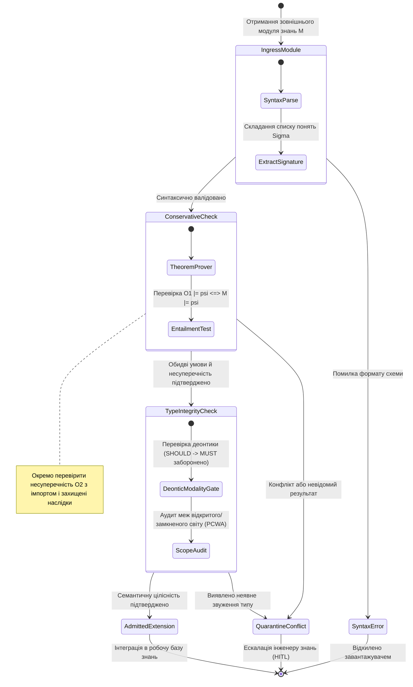
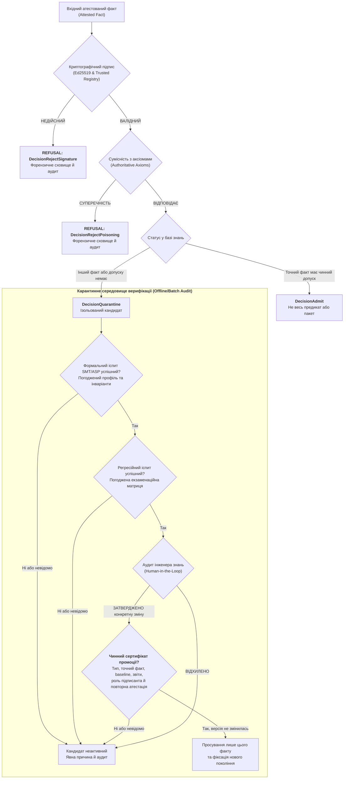

# Глава 33. Міжсистемний обмін знаннями: постачання правил стороннім системам, навчання моделей і захищений зворотний зв'язок

> **Книга:** [Архітектура доказових експертних систем](README.md) · [Частина VII: Технологічний стек, апаратна інфраструктура, кібернетичне виконання та розподілена SOA](part-07-runtime-and-knowledge-exchange.md)
> **Попередня глава:** [Глава 35. Реактивна експертна система: події, відкликання й адаптація знань](ch35-self-organizing-expert-systems-synergetics-and-npu-runtime.md)
> **Наступна глава:** [Глава 40. Розподілена архітектура доказової експертної системи: епістемічна SOA, семантична маршрутизація, ієрархія пам'яті та багатоджерельний дефезитивний арбітраж](ch40-distributed-epistemic-architectures-soa-and-cluster-scaling.md)
> **Зміст книги:** [README.md](README.md)
> **Автор:** [Микола Мартинович Федчик](about-the-author.md)
> **Передумови й маршрут читання:** для основ потрібні поняття правила, одиниці вимірювання та перевірки умови; перед складнішими моделями пояснено ймовірнісний розподіл, логічний наслідок і відношення порядку. Приклади ведуть від одного обміну між двома системами до перевірки протоколу й Go-пакета.
> **Очікувані результати:** скласти контракт обміну з одиницями, версіями й походженням; обчислити сенсорні перевірки та навчальні втрати; розрізнити статистичну оцінку помилки й формальний допуск дії; пояснити межі доставки, семантичного імпорту, міткового доступу й доказу Меркла; виконати тести атестації та промоції Go-пакета, назвавши нереалізовані частини повного протоколу.

---

## Анотація

Міжсистемний обмін знаннями починається там, де висновок експертної системи має використати інша програма: наприклад, діагностичний вузол двигуна отримує допустимі межі струму. Передати число 50 недостатньо: отримувачеві потрібні одиниця, режим роботи, версія правила, джерело та дозвіл застосувати його саме до цього двигуна. Підписана помилка залишається помилкою, а правильне правило для іншого режиму може спричинити неправильне рішення. **Авторська концепція експертної системи як супервізора реального часу в автономних кіберфізичних комплексах** розглядає таку систему як постачальника перевірюваних обмежень і локального контролера їх застосування, а не лише як текстового радника.

У цій главі пояснено, як зберегти зміст і походження правила при передачі, як використати його для навчання моделі без автоматичного успадкування доказів учителя та як приймати зворотний зв'язок без прямого самопереписування бази знань. Спочатку розібрано один навчальний обмін, потім числові обмеження, дистиляцію, формати, семантичну сумісність, конфіденційність і карантин. Завершальний Go-пакет реалізує точну байтову ідентичність факту та перевірку дозволу на його введення. Навчальні числа не є вимірами стенда. IEC 61508 [[14]](#src-14), ISO 26262 [[15]](#src-15) та DO-178C [[26]](#src-26) називають можливі сфери застосування: конкретні нормативні положення тут не перевірено, а локальний вердикт не є сертифікацією виробу.

---

## 1. Експертна система як постачальник знань і вчитель сторонніх систем

Постачання знань іншій системі ставить питання, як передати не тільки результат, а й умови його правильного використання. Людина може перепитати, що означає «допустимий струм»; програма без явного контракту мовчки застосує власне тлумачення. Достатні початкові поняття тут прості: правило має умову й висновок, повідомлення переносить їх подання, а отримувач перевіряє сумісність зі своїм завданням.

**Наскрізний навчальний приклад.** Лабораторія А публікує правило `motor-current`, редакція 2: у режимі `steady` для стендового двигуна M1 фазний струм лежить між −50 і 50 А, а швидкість зміни не перевищує 1500 А/с. Це умовний лабораторний профіль, не вимога ISO. Вузол Б знає, що його сигнал є фазним струмом M1, а не діючим значенням струму іншого двигуна. А передає ідентифікатор і версію схеми, правило, одиниці, режим, незмінну редакцію джерела та посилання на фрагмент, з якого правило отримано. Підпис зв'язує ці поля з ключем А; реєстр Б окремо визначає, кому належить ключ і які зміни А уповноважена постачати.

Нехай Б отримує 48 А після 46 А за 0,01 с. Різниця становить 2 А, середня швидкість зміни 200 А/с; обидві перевірки проходять. При 52 А перевірка діапазону відмовляє. Якщо Б не знає режиму або не може відкрити дозволений йому фрагмент джерела, висновок про застосовність залишається непідтвердженим, навіть за правильного підпису. Ланцюг «редакція джерела → фрагмент → правило → повідомлення → локальний вердикт» зберігається для відтворення; право прочитати фрагмент, право передати його далі та право застосувати правило перевіряються окремо.

У цій монографії автором запропоновано **принцип усунення семантичного розриву між сигнальним, символьним та виконавчим трактами**: зміст, область дії та походження обмеження мають залишатися явними на кожній межі. Він реалізується через **авторську концепцію тріади міжсистемних ролей експертної системи**:

1. **Оцінювач застосовних правил (Policy/Rule Evaluator):** експертна система зіставляє поточний стан із конкретними правилами й умовами обраного профілю та повертає відтворюваний вердикт із доказами ([Глава 21](ch21-from-recommendation-to-action.md)). Така перевірка не замінює повної оцінки відповідності стандарту чи рішення уповноваженого органу.
2. **Формальний супервізор або щит безпеки (Safety Shield):** перед подачею команд на виконавчі приводи експертна система перехоплює дії сторонніх контролерів або нейромережевих агентів, блокуючи небезпечні переходи за правилами Fail-Closed ([Глава 28](ch28-dual-mode-expert-systems.md)).
3. **Генератор верифікованого курікулуму (Curriculum Generator):** експертна система формує навчальні приклади з результатами перевірки щодо явно заданих правил та їхніх версій. Така перевірка стосується конкретних прикладів і передумов; вона не доводить повноти чи глобальної несуперечності бази знань і не переносить докази автоматично у ваги моделі-студента.

<a id="obj-33-1"></a>
**Діаграма 33.1. Три ролі експертної системи та напрями обміну.**



Діаграма розділяє постачання обмежень, навчання й допуск дії: жодна стрілка до моделі не означає передачі їй повноваження перевіряча. У прикладі Б уже має правило; наступне питання полягає в тому, як перетворити його на обчислювану перевірку сигналу.

---

## 2. Постачання знань обробникам фізичних сигналів та сенсорної інформації

Постачання обмежень сигнальному обробнику потрібне, щоб відрізняти допустимий відлік від того, який не узгоджується з моделлю об'єкта. Передумовами є калібрування, одиниці та часовий крок; без них порівняння чисел не має фізичного змісту. Цифровий сигнальний процесор (DSP) може обчислити спектр або відфільтрувати шум, але сам вибір алгоритму не задає правил для конкретного двигуна. **Авторський принцип семантичної сліпоти статистичних сигнальних обчислювачів (DSP / CV)** стосується саме відсутності такого контракту, а не принципової нездатності DSP виконувати вже закодовані фізичні перевірки.

### 2.1. Переклад логічних норм у числові конверти валідності

Конверт валідності відповідає на питання, чи задовольняє вимірювання задані межі, швидкість зміни та режим. Спочатку перевіряється зміст правила, потім воно перекладається в числові умови. В **авторській формальній математичній моделі сенсорного конверта валідності** для однорідних каналів використано множину допустимих відліків:

<a id="obj-33-2"></a>
**Формула (33.2). Конверт вимірювання за заданої моделі й режиму.**

```math
\mathcal{E}_s = \left\{ y(t) \in \mathbb{R}^d \;\middle|\; y_{\min} \le y(t) \le y_{\max} \;\land\; \left\|\frac{dy}{dt}\right\| \le \Delta_{\max} \;\land\; \Phi(y(t), x_{\text{state}}) = 1 \right\}
```

Тут $s$ є ідентифікатором сенсора, $t\ge0$ є часом у секундах, $d\ge1$ є цілою кількістю каналів, а $`y(t)\in\mathbb{R}^d`$ є вектором скінченних вимірювань. Вектори $`y_{\min},y_{\max}`$ мають ті самі одиниці, що й сигнал, і порівнюються покомпонентно; нижня межа не більша за верхню. Норма похідної та невід'ємна межа $`\Delta_{\max}`$ мають одиниці сигналу за секунду. Для струму це А/с; змішувати температуру й струм в одній нормі без нормування не можна. $`x_{\text{state}}`$ є відомим режимом, а $`\Phi\in\{0,1\}`$ перевіряє застосовність; невідомий режим не вважається одиницею.

У дискретному прикладі M1 із §1 похідну оцінено різницею двох відліків за 0,01 с: 2 А / 0,01 с = 200 А/с. Значення 48 А належить діапазону, 200 менше 1500, режим `steady` підтверджено: відлік допускається до подальшої обробки. Це не доказ правильності самого датчика: повільний систематичний зсув може залишатися всередині конверта. Між відліками також потрібне припущення про характер зміни сигналу; кінцева різниця не обмежує невидимий короткий пік.

Після грубих фізичних меж потрібна перевірка узгодженості з прогнозом фільтра. **Інновація** є різницею між вимірюванням і передбаченим значенням; **коваріація** описує масштаб та спільну мінливість цих різниць. Строб за відстанню Махаланобіса [[1]](#src-1) масштабує нев'язку очікуваною мінливістю:

<a id="obj-33-3"></a>
**Формула (33.3). Статистичний строб інновації.**

```math
d_M^2(t) = \tilde{y}^T(t) S^{-1}(t) \tilde{y}(t) \le \gamma_{\text{threshold}}
```

**Параметри та вимірні величини:**
- $`\tilde{y}(t) = y(t) - \hat{y}(t|t-1) \in \mathbb{R}^d`$ — вектор інновації (нев'язки передбачення вимірювання) розмірності $d$;
- $`S(t) \in \mathbb{S}_{++}^d`$ — симетрична додатно визначена коваріаційна матриця інновації розмірності $d \times d$;
- $`\gamma_{\text{threshold}} = \chi_d^2(1 - \alpha)`$ — квантиль розподілу хі-квадрат із $d$ ступенями вільності для проектного рівня значущості $\alpha$ (наприклад, $`\alpha = 0{,}01`$);
- $`d_M^2(t) \ge 0`$ — безрозмірнісний квадрат відстані Махаланобіса.

Позначення $`\hat y(t|t-1)`$ означає прогноз вимірювання на поточний крок із попередніх даних; $T$ у степені означає транспонування, не температуру. Кожний елемент $S$ має одиниці добутку відповідних каналів, тому квадратична форма безрозмірна. Квантиль хі-квадрат має заявлений рівень відсікання лише за нульового середнього гауссової інновації та правильної додатно визначеної коваріації; $`0<\alpha<1`$ є ймовірністю хибного відсікання **одного** справного відліку за цієї моделі. Це не частота пропущених атак і не гарантія для всього потоку.

**Операційні переходи (авторське алгоритмічне правило бінарного арбітражу інновацій сигнального фільтра) та числовий приклад:**
- Якщо $`d_M^2(t) \le \gamma_{\text{threshold}}`$, спостереження статистично сумісне з моделлю; після решти перевірок фільтр оновлює вектор стану (`INNOVATION_ACCEPTED`), але не оголошує вимір істинним;
- Якщо $`d_M^2(t) > \gamma_{\text{threshold}}`$, спостереження не використовується в корекції (`INNOVATION_REJECTED`), зберігається апріорний прогноз і формується інцидент; причиною може бути датчик, модель або реальна зміна процесу;
- Практичний приклад розрахунку: розглядається скалярний канал тиску олії ($d = 1$). За рівня значущості $`\alpha = 0{,}01`$ критичний поріг становить $`\gamma_{\text{threshold}} = \chi_1^2(0{,}99) = 6{,}635`$. Нехай передбачене значення становить $`\hat{y} = 10{,}0\,\text{бар}`$, дисперсія інновації $`S = 0{,}25\,\text{бар}^2`$ (середньоквадратичне відхилення $`\sigma = 0{,}5\,\text{бар}`$), а поточний відлік датчика стрибнув до $`y = 11{,}6\,\text{бар}`$. Нев'язка: $`\tilde{y} = 11{,}6 - 10{,}0 = 1{,}6\,\text{бар}`$.

<a id="obj-33-4"></a>
**Формула (33.4). Розрахунок відсікання в навчальному каналі тиску.**

```math
d_M^2 = \frac{(1{,}6\,\text{бар})^2}{0{,}25\,\text{бар}^2} = \frac{2{,}56}{0{,}25} = 10{,}24.
```

Оскільки $`10{,}24 > 6{,}635`$, строб відкидає цей відлік. Числа є навчальними; результат означає невідповідність прогнозній моделі, а не встановлену підробку. Якщо тиск справді різко зріс, тривале ігнорування відліків теж небезпечне, тому серія відмов потребує діагностики й визначеного режиму деградації.

> [!NOTE]
> **Три інваріанти сенсорного конверта валідності за моделлю автора**
> 1. Багатовимірне геометричне обмеження: визначення простору допустимих сигналів $`\mathcal{E}_s`$ через комбінацію статичних меж, швидкості наростання та предикатів контекстного режиму.
> 2. Стохастичний строб інновацій: відсікання аномальних вимірювань за відстанню Махаланобіса $`d_M^2(t) \le \chi_d^2(1 - \alpha)`$ для запобігання дестабілізації фільтрів Калмана.
> 3. Детермінована деградація ваг: зміна ваги підозрілого каналу за погодженим діагностичним профілем і лише за придатності резервного режиму.
> *Керування рантаймом / Інженерний інваріант:* Авторська модель не допускає відліки, які порушують задані перевірки; відліки, що їх пройшли, не отримують гарантії фізичної істинності.

### 2.2. Предикатні правила детекції завад та сенсорного спуфінгу

Крос-сенсорна перевірка потрібна, коли правдоподібний окремий відлік суперечить іншому каналу. Перед порівнянням швидкостей потрібні синхронізовані моменти, спільна система координат, оцінки похибок та справність одометрії; нульове прискорення саме по собі не заперечує рух із сталою швидкістю. **Авторська модель крос-сенсорної детекції завад та інваріант виявлення супутникового спуфінгу** задає правило підозри, а не доведення причини:

<a id="obj-33-5"></a>
**Формула (33.5). Умовна деградація GNSS за розбіжності швидкостей.**

```math
\forall t \quad \lvert v_{\text{GNSS}}(t) - v_{\text{odo}}(t) \rvert > \epsilon_v \implies \text{SpoofingSuspected}(\text{GNSS}, t) \land \text{DegradeWeight}(\text{GNSS}, 0)
```

**Параметри та інженерні обмеження:**
- $`v_{\text{GNSS}}(t), v_{\text{odo}}(t) \ge 0`$ — миттєві оцінки поздовжньої швидкості за супутниковим навігаційним приймачем та колісними одометрами ($`\text{км/год}`$);
- $`\epsilon_v`$ — гранично допустимий поріг неузгодженості швидкості (наприклад, $`\epsilon_v = 15{,}0\,\text{км/год}`$).

Квантор означає перевірку на кожному погодженому кроці $t$, а обнулення є дією профілю лише за наведених передумов; аргумент 0 є безрозмірною вагою. `SpoofingSuspected` є прапорцем підозри. За неперевіреної одометрії різниця не дозволяє вибрати винний канал.

**Операційні дії та приклад:**
- Якщо супутниковий приймач фіксує $`v_{\text{GNSS}} = 120\,\text{км/год}`$, а одометр передає $`v_{\text{odo}} = 5\,\text{км/год}`$, модуль обчислює різницю: $`\lvert 120 - 5 \rvert = 115\,\text{км/год} > 15\,\text{км/год}`$.
- За **авторським алгоритмічним правилом динамічної деградації ваг та переходу в автономне числення** профіль може застосувати `DegradeWeight(GNSS, 0)`, якщо резервну навігацію перевірено для поточного режиму. Автономне числення накопичує похибку й має обмежений горизонт; за відсутності придатного резерву потрібна захисна зупинка або інша визначена безпечна дія.

Отже, експорт конверта постачає обчислюваний фільтр, а не універсальний детектор істини. Цей самий поділ потрібен при передачі правил нейромережі: навчальний штраф і перевірка конкретного виходу виконують різні функції.

---

## 3. Навчання сторонніх систем: символьна дистиляція та верифікований курікулум

Навчання сторонньої моделі ставить нове питання: чи можна зробити її пропозиції кращими, не надаючи їй права остаточного допуску? У прикладі двигуна модель пропонує клас режиму, а експертна система перевіряє конкретне правило для цього режиму. **Авторський принцип формалізації індуктивних упереджень нейромережевих моделей через онтологічні норми** означає введення відомих обмежень у навчальну задачу. Індуктивне упередження є перевагою певних розв'язків під час навчання; воно не є доказом правильності всіх майбутніх прогнозів. Учитель постачає приклади й обмеження, студент апроксимує їх, а детермінований перевіряч окремо вирішує допустимість кожного застосування.

### 3.1. Символьна дистиляція знань через семантичні функції втрат

Символьна дистиляція потрібна, коли правило треба врахувати не лише після прогнозу, а й під час навчання. Класична дистиляція [[16]](#src-16) передає розподіл відповідей учителя; параметр температури $T>0$ пом'якшує цей розподіл. **Авторське наукове розмежування м'якої статистичної та символьної дистиляції знань** стосується джерела навчального сигналу: у другому випадку ним є також явно записані правила, а не буквальне копіювання доказів у ваги.

Для фіксованого входу $x$ розглянемо скінченну множину класів $y$. Модель із параметрами $\theta$ дає розподіл $`p_\theta(y|x)`$, а вчитель будує розподіл $`q(y|x)`$, ближчий до правил. Спрощена зважена регуляризація, мотивована підходом Ху та співавторів [[2]](#src-2), мінімізує відхилення від моделі й винагороджує виконання правил:

<a id="obj-33-6"></a>
**Формула (33.6). Зважена апостеріорна регуляризація розподілу.**

```math
\min_{q} \text{KL}(q(y|x) \parallel p_\theta(y|x)) - \sum_{k} \lambda_k \mathbb{E}_{q}[\mathbf{1}_{r_k}(x, y)]
```

Тут $q$ перебирає нормовані невід'ємні розподіли; $k$ нумерує скінченний набір правил $`r_k`$, індикатор $`\mathbf{1}_{r_k}(x,y)\in\{0,1\}`$ показує виконання правила, а $`\lambda_k\ge0`$ є скінченною безрозмірною вагою. Математичне сподівання є сумою значень індикатора з вагами $q$. KL-дивергенція є сумою $`q(y|x)\log(q(y|x)/p_\theta(y|x))`$ за всіма класами; використано натуральний логарифм, одиниця результату є нат. Потрібна додатна ймовірність $p$ на класах, яким надають ненульову вагу $q$.

Мінімізація опуклого функціонала за нормування $q$ дає нормований розподіл Гіббса: у похідній KL з'являється логарифм відношення $q/p$, тому експонента переводить додану винагороду в множник до $p$.

<a id="obj-33-7"></a>
**Формула (33.7). Нормований псевдоеталон Гіббса.**

```math
q^*(y|x) = \frac{p_\theta(y|x)\exp(\sum_k\lambda_k\mathbf{1}_{r_k}(x,y))}{\sum_{z}p_\theta(z|x)\exp(\sum_k\lambda_k\mathbf{1}_{r_k}(x,z))}
```

Індекс $z$ перебирає ту саму множину класів, а знаменник є додатною нормувальною сумою. **Навчальний розрахунок:** два класи мають імовірності 0,5 і 0,5; лише перший задовольняє правило, вага правила дорівнює $`\ln 3`$. Ненормовані ваги дорівнюють 1,5 та 0,5; їх сума 2, отже псевдоеталон має ймовірності 0,75 і 0,25. У формулі (33.6) KL дорівнює приблизно 0,1308 нат, винагорода 0,8240 нат, різниця −0,6931 нат; для вихідного розподілу різниця становить −0,5493 нат. Новий розподіл кращий за цим критерієм, але порушення все ще має ймовірність 0,25. Саме тому скінченний штраф не є жорстким обмеженням. Псевдоеталон використовують як ціль для студента, а не як сертифікат його поведінки.

Інший шлях врахування правила полягає в штрафі за малу ймовірність допустимої логічної конфігурації. Семантична втрата Сюя та співавторів [[3]](#src-3) для булевої формули $\alpha$ має такий вигляд:

<a id="obj-33-8"></a>
**Формула (33.8). Семантична втрата за добуткової моделі булевих виходів.**

```math
\mathcal{L}_{\text{semantic}}(\theta, \alpha) = -\log \sum_{y \models \alpha} \prod_{j: y_j = 1} p_\theta(\hat{y}_j = 1 \mid x) \prod_{j: y_j = 0} (1 - p_\theta(\hat{y}_j = 1 \mid x))
```

Тут $x$ є фіксованим входом, $\theta$ є параметрами моделі, $y$ перебирає булеві вектори довжини $m\ge1$, а $j=1,\ldots,m$ нумерує виходи. Позначення $`y\models\alpha`$ відбирає вектори, що задовольняють правило; $`p_\theta(\hat y_j=1\mid x)\in[0,1]`$ є ймовірністю одиниці. Добуток задає припущення умовно незалежних бернуллівських виходів, а не довільний спільний розподіл. Сума є ймовірністю виконання правила; від'ємний натуральний логарифм дає невід'ємну втрату в натах. За нульової суми втрата нескінченна, тому числовий алгоритм потребує стійкого обчислення.

**Логічний приклад:** правило «рівно один із двох індикаторів активний» допускає вектори 10 і 01. За ймовірностей одиниці 0,8 та 0,3 їх ваги дорівнюють 0,8·0,7 = 0,56 і 0,2·0,3 = 0,06. Сума 0,62 дає втрату приблизно 0,4780 нат. Для ймовірностей 0,9 та 0,1 сума вже 0,82, втрата 0,1985 нат. Зменшення втрати сприяє узгодженості, проте це не гарантує правильного класу для кожного реального входу.

**Авторський градієнтний принцип регуляризації вагових коефіцієнтів нейромережі** полягає у спільній оптимізації емпіричної та семантичної втрат із вибраною вагою штрафу. На діаграмі `L_data` є втратою за навчальними мітками, `L_semantic` є (33.8), `L_total` є їх сумою з безрозмірною невід'ємною вагою `lambda`, а `grad` позначає вектор похідних за параметрами моделі. Ні збіжність неопуклого навчання, ні фізична безпека із самого штрафу не випливають. Версія правил, помилкові мітки й суперечливі цілі вчителя впливають на якість студента ([Глава 29](ch29-neuro-symbolic-architecture.md)).

Діаграма показує, де правило впливає на оптимізацію. Це навчальна архітектура, не схема автоматичного допуску виходів.

<a id="obj-33-9"></a>
**Діаграма 33.9. Логічні обмеження як навчальний сигнал для студента.**



### 3.2. Формальні щити безпеки (Shielding) у навчанні агентів

Формальний щит потрібен тому, що поліпшення середньої якості моделі не виключає окремої недопустимої команди. У підкріплюваному навчанні (RL) агент вибирає дію й отримує винагороду; щит перевіряє дію **до** виконання. Для розуміння достатньо стану як опису поточної ситуації та множини дій як дозволених команд.

Архітектура екранування [[4]](#src-4) використовує специфікацію, наприклад мовою лінійної темпоральної логіки (LTL), для властивостей послідовностей станів. Твердження про безпеку потребує коректної моделі переходів, спостережуваного стану, реалізовної специфікації та вчасного виконання щита. Множина допустимих дій має містити дії, що зберігають можливість подальшого виконання специфікації, а не лише проходять миттєву перевірку.

Для скінченної непорожньої множини дій можна вибрати найближчу до запиту за погодженою відстанню:

<a id="obj-33-10"></a>
**Формула (33.10). Заміна запропонованої дії допустимою.**

```math
a_t'\in\arg\min_{a\in\mathcal A_{\mathrm{safe}}(s_t)} d(a,a_t).
```

Тут $t$ є номером кроку, $`s_t`$ є відомим станом, $`a_t\in\mathcal A`$ є пропозицією агента, $`\mathcal A_{\mathrm{safe}}(s_t)\subseteq\mathcal A`$ є перевіреною множиною, а $d\ge0$ є відстанню в одиницях команди або безрозмірною ціною зміни. За рівності мінімумів потрібне явне правило вибору; за порожньої множини формула не визначає дії й застосовується окремо обґрунтована аварійна процедура.

**Приклад:** у навчальному стані допустимі команди струму 0, 10 і 20 А, агент просить 30 А. За абсолютною різницею відстані становлять 30, 20 і 10 А, отже щит пропускає 20 А. Цей вибір допустимий лише в заданій моделі; він не доводить безпеки фізичного двигуна. У журналі навчання зберігають запропоновану й виконану дії, стан, винагороду та факт втручання: наслідок виконаних 20 А не можна приписати невиконаним 30 А як реальне спостереження.

Окреме питання: що дає випробування студента? За нуля порушень у $n$ незалежних випробуваннях одного незмінного профілю односторонню верхню межу ймовірності порушення отримують із біноміальної моделі:

<a id="obj-33-11"></a>
**Формула (33.11). Верхня межа частоти порушень за нульового спостереженого числа.**

```math
p_{\mathrm{upper}}=1-\delta^{1/n}.
```

Тут $n\ge1$ є числом незалежних однаково розподілених випробувань, $`0<\delta<1`$ є рівнем значущості, а $`p_{\mathrm{upper}}\in(0,1)`$ є безрозмірною межею невідомої сталої ймовірності порушення. Ймовірність не побачити жодного порушення дорівнює $`(1-p)^n`$; прирівнювання її до $\delta$ й дає межу. За $n=300$ і $`\delta=0{,}05`$ отримуємо приблизно 0,009936, тобто 0,994%. Це 95-відсоткова довірча процедура, не доведення нульової помилки. Повторені кадри однієї події не є 300 незалежними випробуваннями; зміна даних або відбір тільки успіхів руйнують інтерпретацію.

> [!NOTE]
> **Три засади символьного навчання та екранування агентів за моделлю автора**
> 1. Апостеріорна логічна регуляризація: формування псевдоеталонного розподілу Гіббса $`q^*(y|x)`$ для передачі предикатних правил у ваги нейромережі-студента.
> 2. Семантична диференційовна функція втрат: штрафування недопустимих логічних конфігурацій через від'ємний логарифм імовірності істинності формули $`\mathcal{L}_{\text{semantic}}`$.
> 3. Формальне LTL-екранування дій: окремий перевіряч блокує недопустимі команди за явно заданої моделі та процедури відмови.
> *Керування рантаймом / Інженерний інваріант:* Авторська архітектура залишає допуск перевірячу; докази вчителя не успадковуються студентом, а гарантії щита обмежені його передумовами.

Отримано дві різні відповіді: регуляризація поліпшує пропозиції, щит перевіряє дії. Тепер потрібно визначити, як передати правило, профіль і свідчення так, щоб інша система відтворила саме ці перевірки.

---

## 4. Формати, способи та технології міжсистемного обміну знаннями

Формати й транспорт потрібні після узгодження того, **що** передається: у прикладі M1 це версійоване правило з одиницями, режимом і походженням. Тепер слід відокремити подання, перевірку схеми, доставку та локальний допуск. Один інструмент не розв'язує всі чотири задачі: повідомлення може бути синтаксично правильним і доставленим двічі, але предметно непридатним.

KQML [[17]](#src-17) та FIPA ACL [[18]](#src-18) описують агентні повідомлення й комунікативні наміри, наприклад повідомити чи запитати. **Авторське наукове розмежування між агентними протоколами 1990-х (KQML, FIPA ACL) та доказовим стеком обміну знаннями** тут означає додаткові вимоги до контракту й перевірки доказів, а не твердження, що класичні мови принципово несумісні із захищеним транспортом. Наведені нижче технології є добором автора для різних рівнів, не одним прийнятим міжнародним протоколом.

<a id="obj-33-12"></a>
**Таблиця 33.12. Рівні подання та доставки знань.**

| Вимога | Рекомендований формат / технологія | Обґрунтування застосування |
|---|---|---|
| Семантична сумісність графів | JSON-LD 1.1 [[5]](#src-5) | Зв'язування локальних ключів тверджень з глобальними IRI онтологій без втрати читабельності |
| Валідація структурних обмежень | SHACL W3C [[6]](#src-6) | Декларативний опис обов'язкових атрибутів, діапазонів і кардинальності зв'язків фактів |
| Предикатні правила та виведення | RIF / RuleML | Обмін правилами за погодженим діалектом; синтаксис не усуває відмінностей семантики рушіїв |
| Промисловий обмін на шині даних | NATS JetStream | Асинхронний брокер; повторна доставка потребує ідемпотентного споживача |
| Точкові перевірки | gRPC поверх HTTP/2 та Protobuf | Типізований виклик із дедлайном; час залежить від мережі, серіалізації, перевірок і навантаження |
| Незмінні пакети знань | Бінарний контейнер / mmap ([Глава 32](ch32-high-performance-knowledge-packs-mmap-and-harvesting.md)) | Відображення сумісного локального формату в пам'ять; мережеву передачу й статичні перевірки не усуває |

### 4.1. Семантичний контракт повідомлення на базі JSON-LD

Семантичний контракт потрібен, щоб локальне поле `maxValue` не означало для одного вузла піковий струм, а для іншого середній. IRI є глобальним іменем поняття, `@context` задає зв'язок імен із цими ідентифікаторами. **Авторський принцип семантичної самоописовості повідомлень знань через глобальні IRI** вимагає явно передавати таке відображення, але однакове ім'я ще не доводить однаковості його застосування.

Нижче реалізовано подання конверта M1 із §1. Простір `example.org` є навчальним, не офіційною онтологією ISO; схема `urn:example:schema:envelope:1` і редакція лабораторного джерела мають бути відомими отримувачеві. У реальному профілі також фіксують хеші байтів схеми, контексту, джерела та правило канонізації. Зовнішній контекст не слід непомітно завантажувати з мінливого URL під час перевірки підпису.

<details>
<summary>Приклад семантичного повідомлення JSON-LD для експорту конверта валідності</summary>

```json
{
  "@context": {
	"es": "https://example.org/teaching/envelope#",
    "xsd": "http://www.w3.org/2001/XMLSchema#"
  },
  "@id": "urn:es:envelope:motor_current:gen42",
  "@type": "es:SensorValidityEnvelope",
	"es:schemaId": "urn:example:schema:envelope:1",
	"es:assetId": "M1",
	"es:mode": "steady",
  "es:signalName": "motor_phase_u_current",
	"es:unit": "A",
	"es:slewUnit": "A/s",
  "es:minValue": { "@type": "xsd:double", "@value": -50.0 },
  "es:maxValue": { "@type": "xsd:double", "@value": 50.0 },
  "es:maxSlewRate": { "@type": "xsd:double", "@value": 1500.0 },
  "es:provenance": {
		"es:sourceId": "urn:example:lab-profile:motor-current",
		"es:sourceRevision": "2",
		"es:sourceFragment": "section-2",
		"es:ruleId": "motor-current",
		"es:generation": "gen42"
  }
}
```

</details>

Отримувач перевіряє типи, обов'язкові поля й діапазони за погодженою схемою, наприклад SHACL [[6]](#src-6), потім зіставляє режим, актив і одиниці. Число 48 з одиницею `mA` не еквівалентне 48 А без перетворення; збіг назв полів не дозволяє його ігнорувати. Лістинг є JSON-LD-поданням, не повним підписаним мережевим протоколом: криптографічний конверт і перевірку доступу пояснено далі. Сам SHACL установлює відповідність формі даних, не істинність правила й не юридичну силу джерела.

### 4.2. Суб'єктна маршрутизація в NATS JetStream

Суб'єктна маршрутизація розв'язує задачу доставки повідомлення потрібному споживачеві, не задаючи йому права довіряти повідомленню. Загальна модель publish/subscribe описана в [[7]](#src-7); ця праця не є специфікацією NATS JetStream. Для прикладу M1 можна розділити потоки за ієрархічними темами (subjects):

- `knowledge.export.dsp.envelopes.<subsystem>`: публікація конвертів валідності для сигнальних процесорів конкретної підсистеми;
- `knowledge.export.models.distillation.<domain>`: поширення навчальних корпусів і псевдоеталонів для сторонніх моделей;
- `knowledge.feedback.telemetry.anomalies.<sensor_id>`: приймання звітів про вихід спостережень за межі встановленого конверта;
- `knowledge.control.quarantine.admission`: канал координації шлюзу допуску нових фактів.

**Авторський архітектурний інваріант гарантованої доставки оновлень знань (At-least-once Persistence)** слід читати як вимогу до налаштованого профілю: збереження потоку, стійкий споживач, підтвердження після локального запису, достатні retention і місткість та повторне отримання після розриву. At-least-once допускає дублікати й не означає безумовного відновлення після втрати сховища або необмеженої перерви.

Наприклад, Б отримав `gen42`, застосував її, але підтвердження загубилося. Повтор `gen42` має перевірити той самий дайджест і не застосувати зміну вдруге. Отримавши `gen44` без залежної `gen43`, Б запитує пропущене покоління або повний знімок; порядок приходу не підміняє порядок залежностей. Дедлайн, відкликання джерела й придатність локальної копії контролюються окремо від брокера.

### 4.3. Відкритий стандарт епістемічного обміну (OEIR) за парадигмою міжнародного стандарту ONNX: версіонування наборів операторів, згортання інтервалів і статична верифікація сигнатур

Проміжне подання потрібне, якщо отримувач має виконувати граф правил, а не лише читати окремі числа. Передумовами сумісності є однакова семантика операторів, типи та версії; x86-64, ARM64 і FPGA не стають сумісними лише завдяки одному контейнеру. ONNX (Open Neural Network Exchange) є відкритою екосистемою формату обміну моделями з версіями подання й наборів операторів; аналогія з ним не робить запропонований нижче формат прийнятим міжнародним стандартом. Статичний checker і компіляторні оптимізації також є різними функціями.

У цій монографії автором запропоновано концепцію **Відкритої епістемічної проміжної репрезентації (Open Epistemic Intermediate Representation — OEIR)**. Канонічна назва підрозділу збережена; статус OEIR тут є авторською специфікаційною пропозицією, не свідченням зовнішнього затвердження чи реалізованої сумісності. Її три механізми такі:

1. **Замкнене версіонування наборів операторів виведення (`Epistemic OpSet`):**
	Кожен сегмент оголошує домен і версію набору операторів, наприклад `epistemic.core:v1`. Визначення порівняння інтервалів, перевірки цитати й обробки винятків має бути незмінним у цій версії. Це дозволяє перевірити сумісність, але не гарантує її: старий завантажувач відхиляє невідому версію, новий мусить явно підтримувати стару. Потрібні тестові вектори, правила міграції, формат чисел і специфікація переповнення.
2. **Компіляторне згортання правил та топологічний перетин інтервалів (*Taxonomy & Interval Fusion*):**
	Оптимізатор може скорочувати транзитивні ланцюжки `IsA`, лише якщо правило успадковується в обраному логічному профілі й не має пропущених винятків. Для одночасно чинних кон'юнктивних меж одного параметра застосовується перетин:

<a id="obj-33-13"></a>
**Формула (33.13). Згортання одночасно застосовних інтервалів.**

```math
\mathcal{I}_{\mathrm{fused}}(x) = \bigcap_{k \in \mathrm{Active}(\mathcal{R} \setminus \mathcal{D})} [a_k, b_k]_{Q16.16}
```

Тут $x$ є одним фізичним параметром із погодженою одиницею; $`\mathcal R`$ є скінченною множиною правил, $`\mathcal D`$ є визначеними для цього режиму винятками, а `Active` повертає індекси $k$ чинних правил. Межі $`a_k\le b_k`$ мають одиниці $x$. Позначення $Q16.16$ тут означає знакове 32-бітне подання з 16 дробовими бітами: крок $`2^{-16}`$ в обраній одиниці, діапазон від −32768 до $`32768-2^{-16}`$. Межі округлюють усередину допустимого інтервалу й перевіряють переповнення, щоб не розширити дозвіл.

**Приклад M1:** межі [0; 50] А та [10; 40] А дають [10; 40] А. Додавання одночасного обмеження [45; 60] А дає порожню множину: це конфлікт саме даного профілю. Правила для взаємовиключних режимів перетинати не можна. За невідомого винятку або залежності від майбутніх фактів статичне згортання відкладається; порожній перетин сам собою не доводить суперечності стандартів загалом.
3. **Статичний верифікатор сигнатур та арності предикатів (*Epistemic Model Checker*):**
	Перевіряч звіряє версію операторів, арність (число аргументів), типи, одиниці, посилання на джерела й непорожність застосовних інтервалів. Для вже підготовлених таблиць перевірка записів може бути лінійною за їх кількістю, але розв'язання винятків або повна логічна перевірка такої оцінки автоматично не мають. Мінімальний предикат структурного допуску має явно називати перевірки:

<a id="obj-33-14"></a>
**Формула (33.14). Структурна придатність графа OEIR.**

```math
\mathrm{ValidOEIR}(\mathcal G)=\mathbb I\!\left(\mathrm{SchemaOK}(\mathcal G)\land\forall r\in\mathrm{Nodes}(\mathcal G):\;\mathrm{op}(r)\in\mathrm{OpSet}_v\land\mathrm{ArityOK}(r)\land\mathrm{UnitsOK}(r)\land\mathrm{SourceRefOK}(r)\land\mathrm{IntervalsOK}(r)\right).
```

Усі результати тут булеві; $`\mathbb I`$ переводить істинність у 1, хибність у 0. $`\mathcal G`$ є скінченним графом із вузлами $r$, $v$ є підтримуваною версією, `op` є кодом оператора; решта імен позначає перевірки названих властивостей за фіксованим маніфестом. Для вузла без інтервалу `IntervalsOK` означає «не застосовується», для вузла з ним вимагає непорожності. Невідомий результат означає відмову від автоматичного допуску.

Наприклад, предикат `current(asset, value, unit)` має арність 3; запис із двома аргументами відхиляється незалежно від підпису. Виправлений запис з А, чинним посиланням і [10; 40] А може пройти структурні перевірки, але ще потребує перевірки повноважень, змісту й локальної політики імпорту. `SourceRefOK` перевіряє зв'язок із погодженою редакцією, а не істинність джерела.

> [!NOTE]
> **Чотири засади відкритого стандарту епістемічного обміну (OEIR) за парадигмою ONNX (авторська концепція)**
> 1. **Уніфікована графова репрезентація з немонотонними ребрами:** розширення класичної моделі обчислювального графа ONNX підтримкою деонтичних модальностей, строгих посилань на байти першоджерел та ребер немонотонного спростування (дефітерів ASPIC+).
> 2. **Версіоновані набори операторів виведення (`Epistemic OpSet`):** явна прив'язка до незмінної специфікації; непідтримувана версія відхиляється, сумісність підтверджується окремо.
> 3. **Компіляторне згортання інтервалів і рання детекція суперечностей:** злиття численних нормативних обмежень одного параметра в єдиний інтегральний інтервал $Q16.16$ на етапі збирання скорочує глибину обчислень у рантаймі та виявляє колізії стандартів до розгортання ($`\mathcal{I}_{\mathrm{fused}} = \emptyset`$).
> 4. **Статичний верифікатор узгодженості сигнатур і арності:** автоматична перевірка сумісності імен предикатів, кількості аргументів та фізичних розмірностей між лінгвістичним нормалізатором запитів і скомпільованим доменом у момент монтування пакета в пам'ять.
> *Керування рантаймом / Інженерний інваріант:* Пакет знань, який не пройшов статичну перевірку `ValidOEIR(G) = 1` (розбіжність арності предикатів, непідтримувана версія `OpSet` або порушена цілісність посилання на першоджерело), детерміновано відхиляється завантажувачем без монтування у віртуальний адресний простір.

Діаграма розділяє криптографічну, структурну й локальну предметну перевірки. Її успішна гілка не означає монтування будь-якого підписаного пакета.

<a id="obj-33-15"></a>
**Діаграма 33.15. Оновлення пакета з локальним рішенням отримувача.**



Отже, формат дозволяє відтворити подання, а транспорт доставляє його з визначеними відмовами. Залишається важче питання: чи означає правило те саме всередині іншої бази знань?

---

## 5. Умови, правила збереження семантики та онтологічне узгодження

Збереження семантики потрібне тому, що успішний розбір пакета ще не зберігає його логічної дії в іншій базі. У прикладі M1 обидва вузли мають однаково розуміти фазний струм і режим `steady`; інакше правильні числа перевіряють різні твердження. Онтологія як явна специфікація концептуалізації [[19]](#src-19) задає поняття та зв'язки. **Авторський принцип запобігання семантичному спотворенню при міжсистемній реплікації правил** вимагає не приховувати змін цього змісту: потрібні погоджене відображення та перевірка наслідків, а не лише таблиця подібних назв.

### 5.1. Консервативні розширення та локальність модулів

Модульність відповідає спочатку на вузьке питання: чи можна передати частину вихідної онтології без втрати потрібних висновків? Сигнатура $\Sigma$ є набором імен понять, відношень і констант, про які дозволено ставити запитання. Позначення $`\models`$ означає логічний наслідок: формула істинна в усіх моделях аксіом. Для фіксованої логіки й класу запитів умова нижче виражає нерозрізнюваність вихідної онтології та її модуля над $\Sigma$, а не безпеку довільного імпорту [[8]](#src-8).

<a id="obj-33-16"></a>
**Формула (33.16). Збереження наслідків вихідного модуля над спільною сигнатурою.**

```math
\mathcal{O}_1 \models \psi \iff \mathcal{M} \models \psi \quad \text{для всіх формул } \psi \text{ над сигнатурою } \Sigma
```

Тут $`\mathcal O_1`$ є вихідною множиною аксіом, $`\mathcal M\subseteq\mathcal O_1`$ є експортованим модулем, а $\psi$ перебирає погоджені формули над $\Sigma$; величини логічні, без фізичних одиниць. Умова вимагає перевірки обох напрямів для всього названого класу формул. Перевірка кількох тестових запитів дає лише тестову еквівалентність.

**Логічний приклад:** у скінченній пропозиційній моделі джерело містить правила «A спричиняє B», «B спричиняє C» та незалежний факт D. Модуль залишає два правила; над іменами A, B, C усі наслідки збережено, бо кожну модель двох правил можна розширити значенням D = істина. За наданого A і повне джерело, і модуль виведуть C. Це пояснює **принцип локальної дедуктивної повноти модульного виведення за формулюванням автора** в межах обраної сигнатури.

Однак цільова база може вже стверджувати A та заперечувати C. Той самий модуль тоді створює суперечність. **Авторське наукове розмежування між прагматичним узгодженням онтологій та формальним консервативним розширенням** потребує ще однієї умови для захищеної частини цільової бази:

<a id="obj-33-17"></a>
**Формула (33.17). Консервативність імпорту щодо захищених запитів отримувача.**

```math
\mathcal O_2\cup\mu(\mathcal M)\models\psi
\iff \mathcal O_2\models\psi,
\qquad \psi\in\mathrm{Sent}(\Sigma_{\mathrm{protected}}).
```

$`\mathcal O_2`$ є цільовою онтологією; $\mu$ є явним відображенням імен і типів модуля; $`\Sigma_{\mathrm{protected}}`$ є сигнатурою, висновки над якою за політикою не повинні змінюватися; `Sent` є погодженим класом замкнених формул без вільних змінних. Окремо вимагається несуперечність об'єднання. Це **принцип безпеки імпорту знань за формулюванням автора**, записаний як вимога перевірки, не автоматичний наслідок (33.16). Заплановані нові висновки поза захищеним класом оцінюють окремо; якщо нові знання мають законно змінити старий висновок, політика зміни мусить прямо це дозволяти.

У наведеному конфлікті несуперечність не проходить, отже модуль залишається в карантині. Для довільних виразних логік універсальна перевірка може бути складною або нерозв'язною; потрібно назвати підтримуваний фрагмент, процедуру й тайм-аут. `UNKNOWN` не прирівнюється до доведеної консервативності.

### 5.2. Правила збереження семантичних типів

Збереження типів розв'язує практичну частину попередньої задачі: навіть без повного доведення еквівалентності можна виявляти заборонені зміни одиниць, модальностей та меж світу. Для M1 перетворення А на мА потребує множника 1000, а не простого перейменування. Два інші випадки такі:
- **Заборона втрати точності модальностей:** рекомендацію `SHOULD` не перекладають як `MUST` чи `MUST NOT`. Посилення або зміна полярності є новим локальним правилом з окремою підставою й затвердженням, а не еквівалентним перекладом навіть після згоди інженера ([Глава 14](ch14-requirements-detection-and-formalization.md)).
- **Ізоляція частково замкненого світу (PCWA):** твердження, отримані в умовах припущення про замкненість окремої предметної області ([Глава 07](ch07-knowledge-base-typology.md)), маркуються спеціальним прапорцем повноти `scope: closed`. Стороння система не має права застосовувати правило заперечення як відмови (Negation-as-Failure) до фактів, що надходять з відкритих доменів (`scope: open`).

Наприклад, відсутність запису про калібрування у відкритому реєстрі означає «невідомо», не «не відкалібровано». Заперечення за відсутністю допустиме лише в явно повному для цього запиту зрізі. Автомат нижче зберігає відмову та невизначеність як окремий від успіху шлях.

<a id="obj-33-18"></a>
**Діаграма 33.18. Перевірка модуля та його взаємодії з цільовою базою.**



Отже, збереження вихідних наслідків і безпечна зміна цільової бази є різними перевірками. Навіть після них залишається питання, які саме знання дозволено показати іншому учаснику.

---

## 6. Розмежування доступу та безпека знань: решітка міток і селективне розкриття

Розмежування доступу відповідає на питання, чи можна взагалі передати правило, джерело або доказ конкретному отримувачеві. Семантична сумісність цього дозволу не надає. Наприклад, лабораторія може дозволити вузлу Б використати конверт M1, але заборонити передавати далі закритий звіт калібрування. **Авторський принцип багаторівневого захисту інтелектуальної власності та грифів конфіденційності знань** вимагає перевіряти кожний вихідний артефакт, включно з поясненнями, журналами та навчальними наборами. Мітка конфіденційності є лише частиною рішення: ліцензія, мета використання й законність передачі потребують окремої політики.

### 6.1. Багаторівнева безпека на базі решітки міток Деннінг

Решітка потрібна тому, що одного рівня «закрито» недостатньо: два учасники з однаковим рівнем можуть мати різні дозволені проєкти. За моделлю інформаційних потоків Деннінг [[9]](#src-9) та з урахуванням класичного підходу Белла-ЛаПадули [[10]](#src-10) поєднують рівень і множину категорій. Відношення часткового порядку порівнює не всі пари; решітка додатково задає найменшу спільну верхню та найбільшу спільну нижню мітки.

<a id="obj-33-19"></a>
**Формула (33.19). Простір комбінованих міток конфіденційності.**

```math
\mathcal{L} = \mathcal{C} \times 2^{\mathcal{K}}
```

де $`\mathcal{C} = \{\text{Public} < \text{Internal} < \text{Restricted} < \text{Critical}\}`$ визначає лінійну ієрархію рівнів конфіденційності, а $`\mathcal{K}`$ є множиною категоріальних обмежень (наприклад, конкретні назви проєктів або консорціумів).

Тут $`2^{\mathcal K}`$ є множиною всіх підмножин категорій, не числовим рівнем секретності. Обидві координати логічні, без одиниць; використано скінченні відомі рівні й категорії. Мітка суб'єкта $`L_s = (c_s, K_s)`$ домінує над міткою об'єкта $`L_o = (c_o, K_o)`$ тоді і тільки тоді, коли:

<a id="obj-33-20"></a>
**Формула (33.20). Необхідна міткова умова дозволеного читання.**

```math
L_s \ge L_o \iff (c_s \ge c_o) \land (K_o \subseteq K_s)
```

**Параметри та умови решітки:**
- $`c_s, c_o \in \mathcal{C}`$ — рівні класифікації суб'єкта та об'єкта у впорядкованій множині $`\text{Public} < \text{Internal} < \text{Restricted} < \text{Critical}`$;
- $`K_s, K_o \subseteq \mathcal{K}`$ — множини цільових категорій допуску (компартментів);
- $`L_s = (c_s, K_s), L_o = (c_o, K_o)`$ — комбіновані мітки безпеки.

**Авторське алгоритмічне правило шлюзу експорту знань за допуском отримувача та числовий приклад:**
- Для передачі твердження $f$ з міткою $`L_o=L(f)`$ необхідно, щоб допуск автентифікованого отримувача $`L_s=L_{\text{recipient}}`$ домінував над нею. Додатково перевіряють мету, ліцензію, область повноважень та локальну політику; сама нерівність не є достатнім юридичним дозволом.
- Якщо $`L_s \not\ge L_o`$, шлюз експорту відкидає факт зі статусом `REJECT_CLEARANCE_VIOLATION`.
- Практичний приклад: стороння діагностична система має допуск $`L_s = (\text{Internal}, \{\text{Avionics}, \text{Telemetry}\})`$. База знань містить факт $`f_1`$ із міткою $`L(f_1) = (\text{Internal}, \{\text{Telemetry}\})`$ та критичне калібрувальне правило $`f_2`$ із міткою $`L(f_2) = (\text{Restricted}, \{\text{Avionics}\})`$.
  - Для $`f_1`$: $`c_s = \text{Internal} \ge c_o = \text{Internal}`$ і $`K_o = \{\text{Telemetry}\} \subseteq K_s`$, отже $`L_s \ge L(f_1)`$ → експорт схвалено (`EXPORT_PERMITTED`);
  - Для $`f_2`$: $`c_s = \text{Internal} < c_o = \text{Restricted}`$, отже $`L_s \not\ge L(f_2)`$ → факт детерміновано відсікається шлюзом (`EXPORT_DENIED`).

Мітки `Internal/{Avionics}` та `Internal/{Telemetry}` непорівнянні: жодна категорія не містить іншу. Для висновку з кількох закритих підстав потрібна не нижча мітка, ніж їх спільна верхня межа:

<a id="obj-33-21"></a>
**Формула (33.21). Успадкування конфіденційності похідним висновком.**

```math
L_{\mathrm{out}}\ge\bigsqcup_{j=1}^{m}L_j,
\qquad (c_1,K_1)\sqcup(c_2,K_2)=(\max(c_1,c_2),K_1\cup K_2).
```

$m\ge1$ є кількістю використаних підстав, $`L_j`$ є їхніми мітками, а $`L_{\mathrm{out}}`$ є міткою результату. Для `Internal/{Telemetry}` та `Restricted/{Avionics}` спільна верхня мітка дорівнює `Restricted/{Telemetry,Avionics}`. Виведений короткий висновок не стає публічним лише через малий розмір. Пониження мітки потребує окремої процедури розсекречення. Це правило також стосується даних для навчання; запобігання витягуванню закритих даних із ваг моделі потребує додаткового аналізу, не лише фільтрації повідомлень.

### 6.2. Селективне розкриття доказів через дерева Меркла

Коли стороння аудиторська система вимагає підтвердження того, що певна вимога чи тест дійсно входять до затвердженого випуску бази знань, повне розкриття бази знань може розкрити конфіденційні деталі прошивки чи топології.

Дерево Меркла [[11]](#src-11) дозволяє довести включення конкретних байтів до зафіксованого набору, не передаючи весь набір. Передумовами є однозначне кодування листків, порядок дітей, криптографічні припущення про хеш і довірений корінь випуску. Корінь має бути зв'язаний із підписаним маніфестом, редакцією й повноваженнями видавця ([Глава 32](ch32-high-performance-knowledge-packs-mmap-and-harvesting.md)).

Для простого навчального профілю візьмемо повне бінарне дерево з числом листків $N=2^h$, де $h\ge0$ є цілим. Шлях містить не лише сусідні хеші, а й напрямки:

<a id="obj-33-22"></a>
**Формула (33.22). Орієнтований шлях включення Меркла.**

```math
\pi(f_i)=\langle(b_1,h_1),\ldots,(b_h,h_h)\rangle,\qquad h=\log_2 N.
```

Тут $`0\le i<N`$ є індексом факту $`f_i`$, $`h_j`$ є 32-байтним сусіднім хешем на рівні $j$, а $`b_j\in\{0,1\}`$ указує, чи поточний вузол стоїть ліворуч (0) або праворуч (1). Для неповного дерева потрібне окреме правило побудови, тому округлений логарифм не є універсально точним розміром доказу. Стороння система відновлює корінь:

<a id="obj-33-23"></a>
**Формула (33.23). Згортка шляху з розділенням доменів листка й вузла.**

```math
z_0=H(\texttt{0x00}\Vert\mathrm{Canon}(f_i)),\qquad
z_j=\begin{cases}
H(\texttt{0x01}\Vert z_{j-1}\Vert h_j),&b_j=0,\\
H(\texttt{0x01}\Vert h_j\Vert z_{j-1}),&b_j=1,
\end{cases}
\qquad \mathrm{PROOF\_VALID}\iff z_h=R_{\mathrm{Merkle}}.
```

$H$ є SHA-256, $`\Vert`$ є конкатенацією байтів, `Canon` є погодженим кодуванням факту; `0x00` і `0x01` є однобайтними префіксами. $`z_j`$ є проміжним хешем для $j=1,\ldots,h$, $`R_{\mathrm{Merkle}}`$ є довіреним коренем. Збіг означає включення, не істинність, чинність норми чи право її використати.

**Логічний приклад:** у дереві з листками 0, 1, 2, 3 для листка 2 спершу додають хеш листка 3 праворуч ($`b_1=0`$), потім хеш батька листків 0 і 1 ліворуч ($`b_2=1`$). Обидва кроки дають той самий корінь, що й повне дерево; переставляння дітей змінює результат. Для $N=1024$ маємо 10 сусідніх SHA-256, тобто 320 байтів, і 10 бітів напрямку, а також ідентифікатор дерева та сам факт. 32768 байтів є розміром масиву **хешів** усіх листків, не всієї бази знань; відношення 32768/320 = 102,4 стосується лише хешової частини. Час на ARM Cortex-A72 тут не виміряно; число 12 мкс без протоколу не використовується як гарантія.

Селективне розкриття не є доказом із нульовим розголошенням. Сам факт, розмір дерева, повторення хешів і підбір малих словників можуть розкрити інформацію; навіть хеш закритого короткого правила не завжди приховує його. Перед передачею потрібна оцінка витоку й дозвіл на цей доказ.

> [!NOTE]
> **Чотири механізми захищеного розкриття знань за моделлю автора**
> 1. Двовимірна решітка допусків: строго формалізоване відсікання знань за комбінацією рівнів конфіденційності $`\mathcal{C}`$ та цільових категорій допуску $`2^{\mathcal{K}}`$.
> 2. Принцип домінування суб'єкта: $`L_s\ge L_o`$ є необхідною мітковою умовою, доповненою перевірками повноважень, мети й ліцензії.
> 3. Селективне розкриття Меркла: криптографічне підтвердження належності факту базі знань через компактний логарифмічний аутентифікаційний шлях $`\pi(f_i)`$.
> 4. Мінімізація розкриття суміжних фактів: повний набір не передається, але можливі витоки через відкритий факт і метадані оцінюються окремо.
> *Керування рантаймом / Інженерний інваріант:* Авторська модель поєднує контроль доступу та перевірку включення; криптографія не підміняє істинності, юридичної сили або дозволу.

### 6.3. Протокол криптографічної федерації доказів (Evidence-Only Federation) та асиметричний діод знань

У багатоланцюгових інженерних консорціумах та інтегрованих промислових холдингах суміжні підприємства часто діють як автономні суверенні анклави. Прямий обмін повними онтологіями, сирцевим програмним кодом чи закритими схемотехнічними топологіями може обмежуватися регуляторними, договірними або інтелектуально-правовими умовами. Якщо для виробу застосовні вимоги ISO 26262, DO-178C чи іншого стандарту, інтегратор організує їх оцінювання в межах погодженого assurance-процесу; окрема квитанція або формальний свідок може підтвердити лише конкретне твердження й перевірку, а не повну відповідність виробу чи сертифікацію.

У цій монографії автором запропоновано **протокол криптографічної федерації доказів (Evidence-Only Federation)**: учасники передають квитанції про названі перевірки замість повного сховища. Необхідно розрізняти два режими. Підписана квитанція без доступного свідка є атестацією постачальника, яку приймають лише в межах довіри до його ролі. Незалежна перевірка формального свідка потребує точного публічного твердження, доступних припущень і погодженого перевіряча; хеш приватного предиката цього не забезпечує. Звичайні докази Lean або траси SMT не є автоматично стислими чи конфіденційними. Якщо потрібне приховування самих припущень, потрібен окремо визначений протокол, наприклад відповідний доказ із нульовим розголошенням; його тут не реалізовано.

Для незалежно перевірюваного режиму квитанція повинна зв'язувати принаймні такі поля:

<a id="obj-33-24"></a>
**Формула (33.24). Поля квитанції та прив'язка до контексту перевірки.**

```math
\mathcal R=\langle\mathrm{ClaimID},\mathrm{Stmt},H(\mathcal A),H(\mathcal P_{\mathrm{private}}),\mathrm{Profile},\pi_{\mathrm{proof}},\mathrm{Recipient},\mathrm{Nonce},\tau,\sigma\rangle.
```

Тут `ClaimID` є ідентифікатором твердження й редакції, `Stmt` є його точним формальним поданням, $`\mathcal A`$ є набором доступних перевірячу припущень, $`\mathcal P_{\mathrm{private}}`$ є зв'язаним приватним артефактом, а $H$ є SHA-256 погоджених канонічних байтів. `Profile` фіксує логіку, версію перевіряча й кодування; $`\pi_{\mathrm{proof}}`$ є свідком у цьому профілі. `Recipient` указує отримувача, `Nonce` є одноразовим ідентифікатором його запиту, $\tau$ є часом випуску в мілісекундах погодженої шкали, $\sigma$ є Ed25519-підписом канонічних байтів усіх попередніх полів із доменом протоколу. Публічний ключ, його роль, строк чинності та відкликання перевіряють локально. Поле часу саме по собі не є довіреною часовою міткою RFC 3161.

**Асиметричний діод знань** є окремою авторською архітектурною вимогою до односпрямованого каналу. Лише перевірена фізична реалізація може блокувати зворотну передачу цим інтерфейсом; програмний прапорець або буфер DMA не є фізичним діодом. Наявність інших мережевих, часових чи службових каналів аналізують окремо. Квитанція, що пройшла канал, усе ще потребує допуску:

<a id="obj-33-25"></a>
**Формула (33.25). Локальний допуск незалежно перевірюваної квитанції.**

$$
P_{\mathrm{permit}}(\mathcal R)=\mathbb I\left(\mathrm{SchemaOK}\land\mathrm{AuthorizedSignature}\land\mathrm{BoundContext}\land\mathrm{CheckWitness}(\mathrm{Stmt},\mathcal A,\pi_{\mathrm{proof}},\mathrm{Profile})\land\mathrm{LocalAccess}\land\mathrm{UnusedNonce}\land 0\le t_{\mathrm{done}}-\tau\le\Delta t_{\mathrm{fresh}}\right).
$$

Усі названі умови є булевими й обчислюються для цієї квитанції; $`\mathbb I`$ дає 1 лише за істинності всієї кон'юнкції, інакше 0. `SchemaOK` перевіряє схему; `AuthorizedSignature` перевіряє підпис і предметні повноваження; `BoundContext` звіряє твердження, редакції, припущення, профіль, адресата й запит; `CheckWitness` перевіряє не лише синтаксис, а виведення саме заявленого твердження; `LocalAccess` застосовує політику отримувача. `UnusedNonce` перевіряє одноразовість, а успішний допуск атомарно позначає nonce використаним у стійкому реєстрі. Без цього повтор у тому самому часовому вікні пройшов би знову.

$`t_{\mathrm{done}}`$ є часом завершення перевірки, $`\Delta t_{\mathrm{fresh}}>0`$ є проєктною межею віку в мілісекундах. Різниця включає мережу, чергу й обчислення, не лише час транспорту. Формула припускає надійний погоджений час; допустиму похибку годинника та консервативний запас визначають у реальному профілі. Майбутня мітка, невідомий результат, тайм-аут або відсутність припущень не дають автоматичного допуску. Коректна, але прострочена квитанція не обов'язково є атакою: причина відмови фіксується без такого висновку.

**Навчальний розрахунок, не вимір:** випуск відбувся в момент 100 мс, приймання в 110 мс; умовні бюджети перевірок дорівнюють 0,052 і 1,8 мс. Завершення в 111,852 мс дає вік 11,852 мс, менший за обрану межу 5000 мс. Допуск дорівнює 1 лише за всіх інших істинних умов. Якщо ж квитанцію отримано в 5099 мс, завершення в 5100,852 мс дає вік 5000,852 мс: перевірка свіжості відмовляє, хоча самі обчислення швидкі.

Буфер 128 КіБ уміщує 256 умовних квитанцій по 512 байтів без накладних витрат. За 2500 квитанцій/с він покриває лише 0,1024 с без обслуговування. Послідовний перевіряч із бюджетом 1,852 мс обслуговує не більше приблизно 540 квитанцій/с, тому такий буфер не гарантує сталого приймання 2500/с. Потрібні обмеження навантаження, вимірювання, аналіз черги та ресурсні межі свідків. Повний wire-формат, незалежний checker, захист від повторів після перезапуску й фізичний діод залишаються вимогами протоколу, не результатами цього прикладу.

> [!NOTE]
> **Авторський протокол криптографічної федерації доказів та асиметричний діод знань (Чотири засади суверенної взаємодії)**
> 1. *Мінімізація розкриття онтології*: публічне твердження, припущення й свідок узгоджують із політикою конфіденційності; нульове розголошення не випливає зі звичайного хешування.
> 2. *Асиметричний односпрямований діод знань*: вимога до окремо перевіреної фізичної реалізації, не властивість програмного буфера.
> 3. *Темпоральна свіжість квитанцій*: обмеження віку доповнюється зв'язуванням з адресатом і одноразовим запитом та стійким обліком повторів.
> 4. *Апаратне ізолювання верифікації*: перевірка свідків доведення у захищеному ізольованому анклаві без доступу до зовнішньої мережі.
> *Керування рантаймом / Інженерний інваріант:* Запропонований автором допуск стосується конкретної квитанції за визначеним профілем; він не надає сертифікації, автоматичного права поширення чи безумовної конфіденційності.

Таким чином, можна передавати менше даних, зберігаючи перевірюваний зв'язок із джерелом, але не можна скорочувати саму підставу довіри до одного підпису. Далі цей принцип застосовано до вхідного факту та його карантину.

---

## 7. Підтвердження фактів (Fact Attestation) та захист від отруєння знань

Підтвердження факту потрібне, щоб відділити три питання: хто надіслав байти, чи є твердження прийнятним за змістом і хто дозволив змінити активні знання. **Авторська концепція ризику отруєння знань у розподілених федераціях** розглядає зловмисні та помилкові оновлення, які спотворюють подальше виведення. У прикладі M1 справжній ключ лабораторії може підписати помилкову межу 500 А замість 50 А. Криптографічна перевірка тоді пройде, а перевірка застосовності та затвердження зміни має зупинити активацію.

### 7.1. Криптографічна атестація фактів за схемою Ed25519

Криптографічна атестація розв'язує перше з цих питань: чи відповідає підпис точним байтам факту й довіреному ключу? Навчальний профіль використовує Ed25519 [[12]](#src-12) поверх SHA-256 однозначного кодування:

<a id="obj-33-26"></a>
**Формула (33.26). Підпис байтової ідентичності навчального факту.**

```math
\sigma = \mathrm{Ed25519}_{\mathrm{Sign}}\!\left(
SK_{\mathrm{source}},
\mathrm{SHA256}\!\left(\mathrm{Canon}(\texttt{attested-fact-v1},s,p,o,l,i)\right)\right).
```

Тут $\sigma$ є 64-байтним підписом, $`SK_{\mathrm{source}}`$ є закритим ключем (64 байти у Go; відкритий ключ має 32 байти), а $s,p,o$ є точними байтами предмета, предиката й об'єкта. $l$ є одним із чотирьох навчальних рівнів 0–3 у найкоротшому десятковому ASCII-поданні, $i$ є непорожнім ідентифікатором підписанта, зв'язаним із ключем локальним реєстром. `Canon` кодує домен формату та кожне з п'яти полів окремо: спочатку 8-байтну беззнакову довжину big-endian, потім незмінні байти поля. SHA-256 дає 32 байти; Ed25519 підписує саме їх, не шістнадцятковий текст. Це звичайний Ed25519-підпис обраного дайджесту, не автоматично профіль Ed25519ph. Методи `Fact.Digest` і `Fact.ID` реалізують це кодування, але не повний контроль схеми й ресурсних лімітів.

Довжинні префікси потрібні до криптографії: кортежі `("a|b","c","d",0,"s")` та `("a","b|c","d",0,"s")` дають однакове наївне склеювання, але різні канонічні пакети по 71 байту. Це не колізія SHA-256, а неоднозначність старого кодування. Зміна будь-якого з п'яти полів створює іншу ідентичність факту; попередній підпис і дозвіл baseline не переносяться на неї. Обсяг 71 байт стосується цих двох пакетів, не загального розміру Go-об'єкта або буфера; підпис додає ще 64 байти без накладних витрат.

Підпис підтверджує походження й цілісність відносно довіреного ключа за прийнятих криптографічних припущень, не істинність твердження або дозвіл імпорту. Роль такої атестації в ланцюжках постачання артефактів розглянуто в in-toto Торрес-Аріаса та співавторів [[13]](#src-13). Для промоції в §9 застосовано інший домен підписаних байтів, `promotion-certificate-v1`, щоб підпис джерела не підміняв затвердження зміни знань.

П'ять полів утворюють лише навчальний профіль факту. Якщо тип твердження потребує одиниці, модальності, умови або області чинності, вони мають увійти до погодженої схеми й підписаних байтів, а не залишатися ігнорованими полями зовнішнього JSON. Для M1 потрібні також редакція джерела, координати фрагмента та зв'язок перетворення з правилом. Проміжний вузол додає власну атестацію перетворення, а не стирає початкове походження. `SourceID` у Go-прикладі означає поточного підписанта: `Export` установлює його на `SystemID`, тому цей лістинг не реалізує ланцюга первинних джерел. Декодер і повний контракт матеріальних атомів тут не реалізовано; точна байтова ідентичність не є доказом семантичної повноти.

### 7.2. Таксономія загроз: форми атак отруєння знань (Knowledge Poisoning)

Таксономія загроз допомагає вибрати перевірку, яка потрібна **після** правильного підпису. За класифікацією автора розглянуто чотири показові вектори; вони не вичерпують усіх атак і не доводять навмисності кожної помилки.

#### 7.2.1. Пряма інверсія аксіоми (Axiom Inversion / Overwrite)
Пряма інверсія аксіоми змінює вже затверджене правило на протилежне. Наприклад, якщо профіль вимагає збереження аварійного блокування, валідно підписаний кортеж нижче суперечить саме цьому профілю:

<a id="obj-33-27"></a>
**Формула (33.27). Приклад кандидата, що заперечує затверджене блокування.**

```math
\mathrm{Attestation}: \langle \texttt{emergency\_brake}, \texttt{status\_on\_failure}, \texttt{DISABLED} \rangle
```

Три рядкові поля є предметом, предикатом і значенням; фізичних одиниць тут немає. Результат порівняння з локальною аксіомою є відмовою, не автоматичним переписуванням. Сам кортеж ще не є криптографічною атестацією: для неї потрібні поля й підпис (33.26).

#### 7.2.2. Прихований семантичний дрейф (Stealth Semantic Drift)
Прихований дрейф використовує малі зміни, які здаються неістотними відносно попереднього повідомлення. Навчальний приклад: множення межі 100 А на 1,001 після кожної зі 100 змін дає приблизно 110,51 А, тобто вже 10,51% приросту, хоча окрема зміна дорівнює 0,1%. Потрібне порівняння із затвердженим baseline і перевірка сукупної зміни; багато правильних підписів не легалізують повзуче послаблення правила.

#### 7.2.3. Індукція зациклення розв'язувача (Cyclic Denial-of-Reasoning)
Зациклення загрожує наївному рушію, який без обліку вже відвіданих цілей рекурсивно виконує такі правила:

<a id="obj-33-28"></a>
**Формула (33.28). Циклічна залежність як тест стратегії виведення.**

```math
P_1(x) \leftarrow P_2(x), \quad P_2(x) \leftarrow P_3(x), \quad P_3(x) \leftarrow P_1(x)
```

Тут $`P_1,P_2,P_3`$ є однопараметричними предикатами, $x$ перебирає скінченний домен, а стрілка означає виведення лівої частини з правої. Для одного об'єкта й без початкових фактів найменша нерухома точка порожня; за початкового $`P_1(a)`$ додаються $`P_3(a)`$ та $`P_2(a)`$, після чого нових атомів немає. У скінченному додатному Datalog з усуненням повторів цей цикл завершується. Ризик залежить від стратегії, функціональних символів, заперечення й ресурсних меж, а не від самого факту циклу. Контроль тайм-аутів не замінює визначення логічного профілю.

#### 7.2.4. Атака Сивіли у зворотному зв'язку (Sybil Consensus Poisoning)
Атака Сивіли множить видимі ідентичності одного джерела, щоб перевищити поріг $`N_{\text{threshold}}`$ кількості повідомлень. Три звіти від трьох псевдонімів не є трьома незалежними свідченнями. Потрібні реєстрація джерел, походження фізичної події, усунення повторів і перевірка незалежності; перевищення порогу лише запускає розгляд.

### 7.3. Шлюз вхідного контролю та життєвий цикл карантину знань

Шлюз вхідного контролю відділяє походження факту від права включити його в активні знання експертної системи. Якщо зразки з недійсним підписом і справжні кандидати мають спільний шлях просування, сам ключ сховища стає помилковим дозволом на імпорт. Якщо ж допуск прив'язано лише до назви предиката, один перевірений факт відкриває шлях неперевіреним твердженням з іншими предметом, значенням або походженням. Авторський **життєвий цикл карантину знань (Knowledge Quarantine Lifecycle)** розділяє ці стани й прив'язує рішення до точної ідентичності:

<a id="obj-33-29"></a>
**Діаграма 33.29. Ізоляція, перевірки й точний дозвіл на активацію факту.**



1. **Криптографічна валідація та форензична ізоляція:** якщо відкритий ключ джерела відсутній у списку довірених або цифровий підпис не відповідає згортці байтів, факт або пакет знань негайно відхиляється від допуску в активне ядро виведення (`DecisionRejectSignature` / `REFUSAL`, ніколи не монтується в робочу пам'ять) і водночас примусово ізолюється в захищеному карантинному сховищі (`QUARANTINE`) із незмінним записом у журналі аудиту (Audit Log) для збереження криміналістичних (форензичних) доказів спроби підробки (узгоджено з регламентом [Глави 37, §8](ch37-input-information-assessment-and-algorithmic-skepticism.md#8-експертний-скепсис-як-алгоритм)).
2. **Перевірка суперечностей з аксіомами:** факт відхиляється негайно (`DecisionRejectPoisoning`), якщо його предикат прямо заперечує встановлені фундаментальні аксіоми безпеки.
3. **Кандидатний буфер та формальна офлайн-верифікація:** кожне нове твердження, навіть із відомим предикатом, потребує власного допуску. Валідний кандидат ізолюється від форензичних зразків і проходить перевірки за погодженим логічним профілем, зокрема SMT-розв'язувачем Z3 [[20]](#src-20) або ASP-розв'язувачем Clingo [[21]](#src-21), регресійний іспит та фахове затвердження конкретної зміни baseline. Формальна перевірка не зводиться до заборони будь-якого циклу ([Глава 23](ch23-knowledge-base-verification.md)).

Сертифікат промоції повинен зв'язувати тип переходу, повну ідентичність кандидата, вихідну версію baseline, звіти формальної й регресійної перевірок та уповноваженого підписанта затвердження. Сам ключ карантину, підпис постачальника або ознака «предикат відомий» не є такими свідченнями. За невідомого результату, недоступного звіту, зміни кандидата/версії або недійсного дозволу знання не активуються. Форензичний зразок не змінює статусу на кандидатний через виклик промоції: для нового розгляду потрібен окремий автентифікований вхід.

У навчальному §9 `forensics` і `candidates` є різними сховищами, а `admitted` індексується повним `Fact.ID`. Підпис джерела перевіряється знову перед просуванням; зміна довірчої конфігурації консервативно інвалідує кеш дозволів. Підписаний сертифікат прив'язаний до поточного покоління стану шлюзу, а перевірка й перехід серіалізовані одним м'ютексом. Дозвіл належить конкретному факту, не всьому предикату чи пакету; повторне використання незміненого допущеного факту не потребує нового людського підпису.

**Логічний прохід:** новий підписаний факт M1 надходить у `candidates`; змінений без перепідписання відлік потрапляє у `forensics`. Для першого потрібні успішні названі перевірки й підпис уповноваженого власника поточного baseline. Якщо після підписання змінився baseline, старий дозвіл не спрацьовує. Після активації саме цей незмінний факт можна використовувати повторно, але інше значення 52 А з тим самим предикатом потребує нового розгляду. Цей приклад пояснює область дозволу, не доводить достатності всіх предметних перевірок.

> [!NOTE]
> **Чотири стадії карантинної фільтрації знань за моделлю автора**
> 1. Криптографічна автентифікація та форензичний карантин: миттєве відхилення допуску (`REFUSAL` / `DecisionRejectSignature`) вхідних тверджень або пакетів із невалідним цифровим підписом Ed25519 без монтування в активне ядро виведення з одночасною ізоляцією артефакту в `QUARANTINE` та незмінною фіксацією інциденту в журналі аудиту.
> 2. Аксіоматична сумісність: жорстке блокування фактів, що прямо заперечують засадничі онтологічні норми та закони фізики системи.
> 3. Кандидатна ізоляція: нове твердження не успадковує допуску лише через відомий предикат; форензичні зразки не потрапляють на цей шлях.
> 4. Формальний і регресійний іспити та затвердження зміни baseline: дозвіл зв'язано з точним кандидатом, звітами й вихідною версією.
> *Керування рантаймом / Інженерний інваріант:* Без усіх необхідних чинних підстав факт не активується; відмова й форензичний запис не підміняють доказу достатності, але зберігають слід відхилення.

Після розділення походження, предметної перевірки та дозволу можна без прямої активації збирати зовнішні повідомлення для поліпшення знань. Якість такого зворотного зв'язку потребує власної перевірки.

---

## 8. Зворотний зв'язок (Feedback Loop) та донавчання експертної системи

Зворотний зв'язок потрібен, щоб помилки застосування ставали матеріалом для поліпшення правил, а не приводом непомітно їх послабити. У M1 серія відкинутих відліків може означати новий режим двигуна, погане калібрування, помилку передавання одиниць або атаку. **Авторська концепція зворотного зв'язку від експлуатаційного середовища через крайові випадки** використовує такі ситуації як кандидатів на дослідження. Вони не є єдиним джерелом знань: придатні також контрольовані експерименти й нові редакції документів. Для навчання важлива не кількість сирих звітів, а перевірене походження, правильна розмітка та відповідність задачі.

### 8.1. Черга контрприкладів та агрегація інцидентів

Черга контрприкладів відділяє виявлення підозрілої події від рішення змінити знання. Вихід за конверт або невпевненість моделі створює **звіт-кандидат**, а не підтверджений контрприклад. До нього потрібні ідентифікатор фізичної події, час, джерело, одиниці, режим, версії конверта та моделі, результат локальної перевірки й дозволений фрагмент первинних даних.

Наприклад, JetStream тричі доставив звіт `event-17`: це одна подія, не три. Після дедуплікації в заданому вікні часу можна рахувати частку порушень серед **усіх** придатних спостережень:

<a id="obj-33-30"></a>
**Формула (33.30). Описова частка порушень і сигнал для предметного розгляду.**

```math
\widehat p=K/n,\qquad \mathrm{ReviewRequested}=\mathbb I(K\ge N_{\mathrm{threshold}}).
```

Тут $n\ge1$ є кількістю придатних спостережень одного профілю за визначене вікно після усунення повторів, $`K\in\{0,\ldots,n\}`$ є числом порушень, $`N_{\mathrm{threshold}}\ge1`$ є цілим проєктним порогом розгляду, а $`\widehat p\in[0,1]`$ є безрозмірною описовою часткою. Сам поріг не є статистичним тестом дрейфу. Для 10 порушень із 1000 відліків частка становить 1%; за фонової частки 1% це ще не свідчення зміни. За порогу 3 розгляд запускається, але не дає права змінити межі. Одна критична подія також може вимагати негайного розгляду незалежно від цього порогу.

Кореляція відліків, відбір лише аномалій та спільне походження джерел змінюють статистичну інтерпретацію. Колектор §9 лише накопичує повідомлення за іменем сигналу: він не має вікна, дедуплікації, знаменника чи перевірки походження, тому його `true` не є реалізацією повного статистичного аналізу.

### 8.2. Живлення циклу неперервного навчання

Неперервне навчання починається після встановлення того, що саме помилково: дані, мітка режиму, модель чи правило. Оновлення конверта за кожним відхиленим відліком навчило б систему приймати власні помилки. Перевірені випадки використовують для таких дій:
- Поповнення екзаменаційної матриці з [Глави 25](ch25-how-expert-systems-learn.md): новий контрприклад додається до обов'язкових негативних або граничних тестів, формуючи новий зріз складності.
- **Авторської методики детекції параметричного дрейфу сенсорів тестом CUSUM** ([Глава 26](ch26-continual-learning.md)): потік звітів аналізується статистичним тестом кумулятивних сум (CUSUM) Пейджа [[22]](#src-22) для раннього попередження про деградацію сенсорів або зсув робочої точки.
- **Авторського алгоритму адаптивного перегляду меж конверта валідності:** інженер знань або автоматичний оптимізатор пропонує оновлені межі $`\mathcal{E}_s'`$, які проходять повний цикл екзаменаційного тестування перед випуском нового покоління бінарного контейнера бази знань.

Для розуміння CUSUM достатньо ідеї накопичення невеликих односпрямованих відхилень. У навчальному односторонньому профілі використовують:

<a id="obj-33-31"></a>
**Формула (33.31). Накопичення стандартизованого додатного зсуву.**

```math
z_t=(x_t-\mu_0)/\sigma_0,\qquad S_0=0,\qquad
S_t=\max(0,S_{t-1}+z_t-k),\qquad \mathrm{Alarm}_t=\mathbb I(S_t\ge h).
```

Тут $t=1,2,\ldots$ нумерує придатні відліки $`x_t`$, $`\mu_0`$ є середнім справного базового режиму в одиницях сигналу, $`\sigma_0>0`$ є його стандартним відхиленням у тих самих одиницях. Величини $`z_t,S_t,k,h`$ безрозмірні; $k>0$ віднімає малий фоновий приріст, $h>0$ є порогом накопиченої суми. Базовий режим, залежність відліків і частоту хибних тривог потрібно оцінити окремо; для від'ємного дрейфу потрібна інша сторона тесту.

**Приклад:** для тиску $`\mu_0=10\,\text{бар}`$ і $`\sigma_0=0{,}5\,\text{бар}`$ чотири відліки по 10,75 бар дають кожен $z=1,5$. За $k=0,5$ та $h=4$ накопичення дорівнює послідовно 1, 2, 3, 4; на четвертому кроці виникає сигнал розгляду. Це демонстрація обчислення, не калібрований рівень хибної тривоги й не доказ фізичної причини зсуву.

Підтверджений випадок має потрапити до навчального набору з версією мітки й підставою виправлення. Навчальні та контрольні дані розділяють за подіями й джерелами, щоб копії одного випадку не потрапили по обидва боки. Зміна порогів відбору змінює склад даних і оцінку помилки; перевага лише «зручних» прикладів створює удаване поліпшення. Кандидати, запропоновані LLM, оптимізатором або вчителем, проходять ті самі детерміновані перевірки й локальне затвердження; ні кількість голосів, ні впевненість моделі не надають допуску.

> [!NOTE]
> **Три канали захищеного зворотного зв'язку за моделлю автора**
> 1. Агрегація та перевірка походження: усунення повторів, урахування знаменника й залежностей; поріг $`N_{\text{threshold}}`$ запитує розгляд, а не доводить дрейф.
> 2. Збагачення екзаменаційної матриці: автоматична конвертація підтверджених польових контрприкладів у нові регресійні тестові зрізи.
> 3. Адаптивне коригування конвертів: запуск статистичних процедур CUSUM для виявлення параметричного дрейфу та керованого перегляду меж валідності.
> *Керування рантаймом / Інженерний інваріант:* За авторською моделлю зворотний зв'язок створює кандидатів і тести; активні правила змінюються лише після окремого допуску, а якість даних і регресія перевіряються явно.

Отже, зворотний зв'язок поліпшує знання через перевірені зміни, не через автоматичне прийняття аномалій. Наступний лістинг показує цю межу на точній ідентичності факту, підписах і переході станів одного процесу.

---

## 9. Програмна реалізація мовою Go: модуль xchange

Навчальний пакет `xchange` показує межу між підписаним зовнішнім фактом, кандидатом і конкретним дозволом його введення. Він перевіряє реальні Ed25519-підписи факту та сертифіката промоції, розділяє сховища й зв'язує перехід із поколінням стану. Це не виробничий завантажувач знань або повна реалізація всіх механізмів глави. У лістингу також залишено окремі демонстрації:
1. Експорт знань із фільтрацією за решіткою рівнів доступу та цифровим підписом Ed25519.
2. Шлюз вхідного контролю фактів із захистом від отруєння знань (перевірка підпису та аксіоматичних суперечностей).
3. Валідацію числових сигналів сенсорним конвертом.
4. Зворотний зв'язок: колектор аномалій із фіксацією порогу для запуску циклу донавчання.

Код не використовує сторонніх бібліотек, спираючись виключно на стандартний пакет Go (`crypto/ed25519`, `crypto/sha256`, `sync`, `math`).

**Як зіставити метод і реалізацію.** Вхід `Export` є списком навчальних `Fact` та довірено встановленим рівнем отримувача; вихід є підписаними дозволеними фактами. `Dominates` реалізує лише рівневу частину (33.20), без категорій і ліцензій. `Fact.Digest` та `validAttestation` реалізують (33.26). `Ingest` здійснює розгалуження діаграми 33.29, а `PromoteFromQuarantine` перевіряє сертифікат конкретного переходу. `ValidateSample` реалізує дискретну частину (33.2) на фіксованому кроці. `Record` лише сигналізує про досягнення лічильником порогу, не реалізує (33.30) повністю або CUSUM (33.31).

**Очікуваний прохід і перевірка.** `admissionFixture` створює тимчасові ключі та новий підписаний факт; `Ingest` має повернути `DecisionQuarantine`. Після підписання сертифіката власником поточного baseline `PromoteFromQuarantine` повертає саме цей факт, а повторний `Ingest` повертає `DecisionAdmit`. Зміна предмета, значення, джерела або baseline не успадковує дозволу. Тести перевіряють ці переходи та відмови, а не лише відсутність паніки.

`FormalPassed` і `RegressionPassed` у сертифікаті є **підписаними твердженнями уповноваженого власника baseline** з хешами звітів. Контролер перевіряє тип, зв'язування та підпис цих свідчень, але не запускає Z3/Clingo, не виконує регресійного іспиту й не перевіряє зміст звітів. У тестах використано синтетичні звіти та тимчасові ключі. Довірені ключі джерел і підписантів baseline задаються різними конфігураційними реєстрами; вхідний пакет не може сам додати собі таке повноваження.

У канонічному `PromotionCertificate.Digest` немає поля `Signature`; підпис обчислюється після дайджесту, без самопосилання. Зв'язаний `Baseline` — лише хеш ланцюжка змін стану цього екземпляра: довірені ключі, аксіоми й допущені факти. Це не повний маніфест усіх правил, джерел і платформ. Перевірка та зміна під м'ютексом стосуються одного процесу; немає стійкого commit, глобального replay-захисту після перезапуску, строків чинності або незмінного зовнішнього журналу. `AuditLog` повертає копію накопиченого в пам'яті журналу, не доказ його довговічності. Потрібні окремі ресурсні межі буферів; обрізання кандидатів або пропуск перевірок не є допустимою деградацією.

Одновимірний `SecurityLevel` не моделює категорій доступу. `ValidateSample` перевіряє діапазон і модуль різниці двох скінченних відліків: `MaxDelta` має одиниці самого сигналу **на один фіксований крок**, не одиниці сигналу за секунду. Наприклад, для прискорення у м/с² межа 5 м/с² за крок 0,1 с відповідає середній швидкості зміни 50 м/с³. Часової мітки й предиката робочого режиму в цьому типі немає; перший відлік та пропуски вимірювань потребують окремої ініціалізації. Нульовий попередній відлік є звичайним вимірюванням, а `MaxDelta = 0` дозволяє лише незмінний сигнал. Сертифікат промоції не розширює цих меж моделі.

<details>
<summary>Вихідний код модуля xchange (Go): xchange.go</summary>

```go
package xchange

import (
	"crypto/ed25519"
	"crypto/sha256"
	"encoding/binary"
	"encoding/hex"
	"errors"
	"fmt"
	"math"
	"strconv"
	"sync"
	"time"
)

// SecurityLevel позначає рівень конфіденційності в решітці доступу.
type SecurityLevel int

const (
	LevelPublic SecurityLevel = iota
	LevelInternal
	LevelRestricted
	LevelCritical
)

// Dominates перевіряє рівневу умову доступу в межах навчальної шкали.
func (l SecurityLevel) Dominates(other SecurityLevel) bool {
	return l >= LevelPublic && l <= LevelCritical &&
		other >= LevelPublic && other <= LevelCritical && l >= other
}

// Fact описує атомарне інженерне твердження.
type Fact struct {
	Subject   string        `json:"subject"`
	Predicate string        `json:"predicate"`
	Object    string        `json:"object"`
	Level     SecurityLevel `json:"level"`
	SourceID  string        `json:"source_id"`
}

func hashFields(domain string, fields ...string) [32]byte {
	h := sha256.New()
	var length [8]byte
	for _, field := range append([]string{domain}, fields...) {
		binary.BigEndian.PutUint64(length[:], uint64(len(field)))
		h.Write(length[:])
		h.Write([]byte(field))
	}
	var d [32]byte
	copy(d[:], h.Sum(nil))
	return d
}

func hexDigest(d [32]byte) string {
	return hex.EncodeToString(d[:])
}

// Digest зв'язує точні байти всіх полів; довжинні префікси усувають неоднозначність роздільників.
func (f Fact) Digest() [32]byte {
	return hashFields("attested-fact-v1", f.Subject, f.Predicate, f.Object,
		strconv.Itoa(int(f.Level)), f.SourceID)
}

func (f Fact) ID() string {
	return hexDigest(f.Digest())
}

// AttestedFact об'єднує факт із криптографічним цифровим підписом системи-постачальника.
type AttestedFact struct {
	Fact      Fact   `json:"fact"`
	Signature string `json:"signature"`
}

// SignalEnvelope перекладає символьну норму експертної системи у валідаційні межі для DSP та сенсорів.
type SignalEnvelope struct {
	SignalName string  `json:"signal_name"`
	MinValue   float64 `json:"min_value"`
	MaxValue   float64 `json:"max_value"`
	MaxDelta   float64 `json:"max_delta"`
}

// ValidateSample перевіряє діапазон і різницю відліків за один фіксований крок.
func (e SignalEnvelope) ValidateSample(prevVal, curVal float64) error {
	for _, value := range []float64{prevVal, curVal, e.MinValue, e.MaxValue, e.MaxDelta} {
		if math.IsNaN(value) || math.IsInf(value, 0) {
			return errors.New("non-finite sample or envelope parameter")
		}
	}
	if e.MinValue > e.MaxValue || e.MaxDelta < 0 {
		return errors.New("invalid envelope bounds")
	}
	if curVal < e.MinValue || curVal > e.MaxValue {
		return fmt.Errorf("signal %s value %.3f out of range [%.3f, %.3f]", e.SignalName, curVal, e.MinValue, e.MaxValue)
	}
	diff := math.Abs(curVal - prevVal)
	if diff > e.MaxDelta {
		return fmt.Errorf("signal %s jump %.3f exceeds max delta %.3f", e.SignalName, diff, e.MaxDelta)
	}
	return nil
}

// KnowledgeExporter експортує знання стороннім системам з фільтрацією за решіткою доступу та підписом.
type KnowledgeExporter struct {
	SystemID   string
	PrivateKey ed25519.PrivateKey
	PublicKey  ed25519.PublicKey
}

// NewKnowledgeExporter створює експортер знань із новою парою ключів Ed25519.
func NewKnowledgeExporter(systemID string) (*KnowledgeExporter, error) {
	pub, priv, err := ed25519.GenerateKey(nil)
	if err != nil {
		return nil, err
	}
	return &KnowledgeExporter{
		SystemID:   systemID,
		PrivateKey: priv,
		PublicKey:  pub,
	}, nil
}

// Export фільтрує факти за рівнем допуску отримувача й підписує дозволені твердження.
func (e *KnowledgeExporter) Export(facts []Fact, recipientClearance SecurityLevel) []AttestedFact {
	var out []AttestedFact
	for _, f := range facts {
		if !recipientClearance.Dominates(f.Level) {
			continue
		}
		f.SourceID = e.SystemID
		digest := f.Digest()
		sig := ed25519.Sign(e.PrivateKey, digest[:])
		out = append(out, AttestedFact{
			Fact:      f,
			Signature: hex.EncodeToString(sig),
		})
	}
	return out
}

// AdmissionDecision визначає вердикт вхідного контролю факту.
type AdmissionDecision int

const (
	DecisionAdmit AdmissionDecision = iota
	DecisionRejectSignature
	DecisionRejectPoisoning
	DecisionQuarantine
)

const PromotionCertificateKind = "baseline-promotion-v1"

// PromotionCertificate засвідчує результати зовнішніх перевірок і схвалення конкретної зміни.
type PromotionCertificate struct {
	Kind             string
	FactID           string
	Baseline         string
	FormalReport     string
	RegressionReport string
	FormalPassed     bool
	RegressionPassed bool
	ApproverID       string
	Signature        string
}

func (c PromotionCertificate) Digest() [32]byte {
	return hashFields("promotion-certificate-v1", c.Kind, c.FactID, c.Baseline,
		c.FormalReport, c.RegressionReport, strconv.FormatBool(c.FormalPassed),
		strconv.FormatBool(c.RegressionPassed), c.ApproverID)
}

type axiomKey struct {
	subject, predicate string
}

type AdmissionController struct {
	mu          sync.RWMutex
	trustedKeys map[string]ed25519.PublicKey
	approvers   map[string]ed25519.PublicKey
	axioms      map[axiomKey]string
	candidates  map[string]AttestedFact
	forensics   map[string]AttestedFact
	admitted    map[string]bool
	baseline    string
	auditLog    []string
}

// NewAdmissionController ініціалізує шлюз вхідного контролю.
func NewAdmissionController() *AdmissionController {
	return &AdmissionController{
		trustedKeys: make(map[string]ed25519.PublicKey),
		approvers:   make(map[string]ed25519.PublicKey),
		axioms:      make(map[axiomKey]string),
		candidates:  make(map[string]AttestedFact),
		forensics:   make(map[string]AttestedFact),
		admitted:    make(map[string]bool),
		baseline:    hexDigest(hashFields("baseline-revision-v1", "empty")),
	}
}

func (ac *AdmissionController) advanceBaseline(event string, fields ...string) {
	ac.baseline = hexDigest(hashFields("baseline-revision-v1",
		append([]string{ac.baseline, event}, fields...)...))
}

func (ac *AdmissionController) CurrentBaseline() string {
	ac.mu.RLock()
	defer ac.mu.RUnlock()
	return ac.baseline
}

// RegisterTrustedSource додає відкритий ключ довіреного постачальника знань.
func (ac *AdmissionController) RegisterTrustedSource(sourceID string, pub ed25519.PublicKey) {
	ac.mu.Lock()
	defer ac.mu.Unlock()
	ac.trustedKeys[sourceID] = append(ed25519.PublicKey(nil), pub...)
	ac.advanceBaseline("source-key", sourceID, hex.EncodeToString(pub))
	ac.admitted = make(map[string]bool)
}

// RegisterBaselineApprover є довіреним конфігураційним API, не обробником вхідного пакета.
func (ac *AdmissionController) RegisterBaselineApprover(id string, pub ed25519.PublicKey) {
	ac.mu.Lock()
	defer ac.mu.Unlock()
	ac.approvers[id] = append(ed25519.PublicKey(nil), pub...)
	ac.advanceBaseline("approver-key", id, hex.EncodeToString(pub))
	ac.admitted = make(map[string]bool)
}

// SetAuthoritativeAxiom фіксує непорушну норму, спростування якої кваліфікується як отруєння знань.
func (ac *AdmissionController) SetAuthoritativeAxiom(subject, predicate, object string) {
	ac.mu.Lock()
	defer ac.mu.Unlock()
	ac.axioms[axiomKey{subject, predicate}] = object
	ac.advanceBaseline("axiom", subject, predicate, object)
	ac.admitted = make(map[string]bool)
}

func (ac *AdmissionController) validAttestation(af AttestedFact) bool {
	pub, ok := ac.trustedKeys[af.Fact.SourceID]
	sig, err := hex.DecodeString(af.Signature)
	digest := af.Fact.Digest()
	return ok && len(pub) == ed25519.PublicKeySize && err == nil &&
		len(sig) == ed25519.SignatureSize && ed25519.Verify(pub, digest[:], sig)
}

func (ac *AdmissionController) isolate(af AttestedFact, reason string) {
	key := hexDigest(hashFields("forensic-envelope-v1", af.Fact.ID(), af.Signature))
	ac.forensics[key] = af
	ac.auditLog = append(ac.auditLog, "REFUSAL+FORENSIC: "+reason+" sample="+key)
}

// Ingest здійснює атестацію факту: перевірку підпису, сумісності з аксіомами та маршрутизацію в карантин.
func (ac *AdmissionController) Ingest(af AttestedFact) AdmissionDecision {
	ac.mu.Lock()
	defer ac.mu.Unlock()

	if !ac.validAttestation(af) {
		ac.isolate(af, "untrusted source or invalid signature")
		return DecisionRejectSignature
	}
	if existing, hasAxiom := ac.axioms[axiomKey{af.Fact.Subject, af.Fact.Predicate}]; hasAxiom {
		if existing != af.Fact.Object {
			ac.isolate(af, "authoritative axiom conflict")
			return DecisionRejectPoisoning
		}
	}

	key := af.Fact.ID()
	if ac.admitted[key] {
		return DecisionAdmit
	}
	ac.candidates[key] = af
	ac.auditLog = append(ac.auditLog, "CANDIDATE: "+key)
	return DecisionQuarantine
}

var ErrPromotionDenied = errors.New("promotion denied")

func reportDigestValid(value string) bool {
	raw, err := hex.DecodeString(value)
	return err == nil && len(raw) == sha256.Size &&
		value == hex.EncodeToString(raw) && value != hexDigest([32]byte{})
}

// PromoteFromQuarantine перевіряє підписане свідчення, але не запускає SMT або регресійні тести.
func (ac *AdmissionController) PromoteFromQuarantine(key string, cert PromotionCertificate) (AttestedFact, error) {
	ac.mu.Lock()
	defer ac.mu.Unlock()
	deny := func(reason string) (AttestedFact, error) {
		ac.auditLog = append(ac.auditLog, "PROMOTION_BLOCKED: "+reason+" fact="+strconv.Quote(key))
		return AttestedFact{}, fmt.Errorf("%w: %s", ErrPromotionDenied, reason)
	}
	af, ok := ac.candidates[key]
	if !ok {
		return deny("not an eligible candidate")
	}
	if cert.Kind != PromotionCertificateKind || cert.FactID != key || cert.Baseline != ac.baseline {
		return deny("certificate type or candidate/baseline binding mismatch")
	}
	if !cert.FormalPassed || !cert.RegressionPassed ||
		!reportDigestValid(cert.FormalReport) || !reportDigestValid(cert.RegressionReport) {
		return deny("missing successful verification attestations")
	}
	pub, trusted := ac.approvers[cert.ApproverID]
	sig, err := hex.DecodeString(cert.Signature)
	digest := cert.Digest()
	if !trusted || len(pub) != ed25519.PublicKeySize || err != nil ||
		len(sig) != ed25519.SignatureSize || !ed25519.Verify(pub, digest[:], sig) {
		return deny("invalid baseline approval signature")
	}
	if af.Fact.ID() != key || !ac.validAttestation(af) {
		return deny("candidate identity or source attestation changed")
	}
	if existing, found := ac.axioms[axiomKey{af.Fact.Subject, af.Fact.Predicate}]; found &&
		existing != af.Fact.Object {
		return deny("candidate conflicts with current axiom")
	}
	delete(ac.candidates, key)
	ac.admitted[key] = true
	ac.advanceBaseline("promote", key, hexDigest(cert.Digest()))
	ac.auditLog = append(ac.auditLog, "PROMOTED: "+key+" baseline="+ac.baseline)
	return af, nil
}

func (ac *AdmissionController) AuditLog() []string {
	ac.mu.RLock()
	defer ac.mu.RUnlock()
	return append([]string(nil), ac.auditLog...)
}

// AnomalyReport фіксує крайовий випадок чи порушення меж сенсорної інформації стороннім процесором.
type AnomalyReport struct {
	ConsumerID  string    `json:"consumer_id"`
	SignalName  string    `json:"signal_name"`
	ObservedVal float64   `json:"observed_val"`
	Detail      string    `json:"detail"`
	ReportedAt  time.Time `json:"reported_at"`
}

// FeedbackCollector збирає зворотний зв'язок від підлеглих систем і формує кандидатів на донавчання.
type FeedbackCollector struct {
	mu        sync.Mutex
	threshold int
	incidents map[string][]AnomalyReport
}

// NewFeedbackCollector створює колектор зворотного зв'язку з порогом спрацьовування.
func NewFeedbackCollector(threshold int) *FeedbackCollector {
	return &FeedbackCollector{
		threshold: threshold,
		incidents: make(map[string][]AnomalyReport),
	}
}

// Record реєструє новий звіт і повертає true, якщо накопичено достатньо свідчень для запуску іспиту донавчання.
func (fc *FeedbackCollector) Record(rep AnomalyReport) (bool, error) {
	if fc.threshold < 1 {
		return false, errors.New("non-positive review threshold")
	}
	if rep.SignalName == "" {
		return false, errors.New("empty signal name in report")
	}
	fc.mu.Lock()
	defer fc.mu.Unlock()

	fc.incidents[rep.SignalName] = append(fc.incidents[rep.SignalName], rep)
	if len(fc.incidents[rep.SignalName]) >= fc.threshold {
		return true, nil
	}
	return false, nil
}

// IncidentCount повертає кількість накопичених повідомлень про аномалії для сигналу.
func (fc *FeedbackCollector) IncidentCount(signalName string) int {
	fc.mu.Lock()
	defer fc.mu.Unlock()
	return len(fc.incidents[signalName])
}
```

</details>

<details>
<summary>Модульні тести (Go): xchange_test.go</summary>

```go
package xchange

import (
	"crypto/ed25519"
	"crypto/sha256"
	"encoding/hex"
	"errors"
	"math"
	"strings"
	"sync"
	"testing"
	"time"
)

// Сертифікат тестового власника baseline засвідчує лише синтетичні звіти.
func signedTestCertificate(ac *AdmissionController, af AttestedFact, key ed25519.PrivateKey) PromotionCertificate {
	cert := PromotionCertificate{
		Kind: PromotionCertificateKind, FactID: af.Fact.ID(), Baseline: ac.CurrentBaseline(),
		FormalReport:     hexDigest(sha256.Sum256([]byte("synthetic formal report"))),
		RegressionReport: hexDigest(sha256.Sum256([]byte("synthetic regression report"))),
		FormalPassed:     true, RegressionPassed: true, ApproverID: "baseline-owner",
	}
	signTestCertificate(&cert, key)
	return cert
}

func signTestCertificate(cert *PromotionCertificate, key ed25519.PrivateKey) {
	digest := cert.Digest()
	cert.Signature = hex.EncodeToString(ed25519.Sign(key, digest[:]))
}

func admissionFixture(t *testing.T) (*AdmissionController, *KnowledgeExporter, ed25519.PrivateKey, AttestedFact) {
	t.Helper()
	exp, err := NewKnowledgeExporter("source")
	if err != nil {
		t.Fatal(err)
	}
	pub, priv, err := ed25519.GenerateKey(nil)
	if err != nil {
		t.Fatal(err)
	}
	ac := NewAdmissionController()
	ac.RegisterTrustedSource(exp.SystemID, exp.PublicKey)
	ac.RegisterBaselineApprover("baseline-owner", pub)
	af := exp.Export([]Fact{{Subject: "s", Predicate: "p", Object: "v"}}, LevelPublic)[0]
	if ac.Ingest(af) != DecisionQuarantine {
		t.Fatal("new fact did not become a candidate")
	}
	return ac, exp, priv, af
}

func TestExportAndAccessControl(t *testing.T) {
	exp, err := NewKnowledgeExporter("es-primary-node")
	if err != nil {
		t.Fatalf("NewKnowledgeExporter failed: %v", err)
	}

	facts := []Fact{
		{Subject: "motor_current", Predicate: "max_amps", Object: "25.0", Level: LevelPublic},
		{Subject: "motor_firmware", Predicate: "calibration_revision", Object: "lab-rev-99", Level: LevelRestricted},
	}

	// Отримувач із публічним допуском отримує лише публічний факт
	publicAttested := exp.Export(facts, LevelPublic)
	if len(publicAttested) != 1 {
		t.Fatalf("expected 1 fact for public clearance, got %d", len(publicAttested))
	}
	if publicAttested[0].Fact.Subject != "motor_current" {
		t.Errorf("unexpected subject: %s", publicAttested[0].Fact.Subject)
	}

	// Отримувач із допуском Restricted отримує обидва факти
	restrictedAttested := exp.Export(facts, LevelRestricted)
	if len(restrictedAttested) != 2 {
		t.Fatalf("expected 2 facts for restricted clearance, got %d", len(restrictedAttested))
	}
	for _, invalid := range []SecurityLevel{-1, 4} {
		if invalid.Dominates(LevelPublic) || LevelCritical.Dominates(invalid) {
			t.Error("unknown level satisfied access order")
		}
	}
}

func TestAdmissionAndPoisoningDefense(t *testing.T) {
	exp, err := NewKnowledgeExporter("es-primary-node")
	if err != nil {
		t.Fatalf("NewKnowledgeExporter failed: %v", err)
	}

	ac := NewAdmissionController()
	ac.RegisterTrustedSource("es-primary-node", exp.PublicKey)
	ownerPub, ownerPriv, err := ed25519.GenerateKey(nil)
	if err != nil {
		t.Fatal(err)
	}
	ac.RegisterBaselineApprover("baseline-owner", ownerPub)
	ac.SetAuthoritativeAxiom("safety_valve", "state_at_overpressure", "OPEN")

	facts := []Fact{
		{Subject: "coolant_temp", Predicate: "nominal_celsius", Object: "85.0", Level: LevelPublic},
	}
	attested := exp.Export(facts, LevelPublic)
	if len(attested) != 1 {
		t.Fatalf("expected 1 attested fact, got %d", len(attested))
	}

	// Новий факт не допускається лише через знайомий тип предиката.
	if dec := ac.Ingest(attested[0]); dec != DecisionQuarantine {
		t.Fatalf("expected candidate, got %v", dec)
	}
	cert := signedTestCertificate(ac, attested[0], ownerPriv)
	if _, err := ac.PromoteFromQuarantine(attested[0].Fact.ID(), cert); err != nil {
		t.Fatal(err)
	}
	if ac.Ingest(attested[0]) != DecisionAdmit {
		t.Fatal("exact approved fact was not admitted")
	}

	// 2. Підробка вмісту (недійсний підпис)
	tampered := attested[0]
	tampered.Fact.Object = "120.0"
	if dec := ac.Ingest(tampered); dec != DecisionRejectSignature {
		t.Errorf("expected DecisionRejectSignature for tampered fact, got %v", dec)
	}

	// 3. Спроба отруєння знань: валідно підписаний факт суперечить аксіомі
	poisoningFact := []Fact{
		{Subject: "safety_valve", Predicate: "state_at_overpressure", Object: "CLOSED", Level: LevelPublic},
	}
	attestedPoison := exp.Export(poisoningFact, LevelPublic)
	if dec := ac.Ingest(attestedPoison[0]); dec != DecisionRejectPoisoning {
		t.Errorf("expected DecisionRejectPoisoning, got %v", dec)
	}

	// 4. Новий невідомий предикат спрямовується в карантин
	candidateFact := []Fact{
		{Subject: "coolant_pump", Predicate: "experimental_flow_rate", Object: "42.0", Level: LevelPublic},
	}
	attestedCandidate := exp.Export(candidateFact, LevelPublic)
	if dec := ac.Ingest(attestedCandidate[0]); dec != DecisionQuarantine {
		t.Errorf("expected DecisionQuarantine for novel predicate, got %v", dec)
	}

	// 5. Просування з карантину після успішної верифікації
	promoted, err := ac.PromoteFromQuarantine(attestedCandidate[0].Fact.ID(),
		signedTestCertificate(ac, attestedCandidate[0], ownerPriv))
	if err != nil || promoted.Fact.Object != "42.0" {
		t.Fatalf("failed to promote candidate: %v", err)
	}
	// Повторне використання того самого факту не потребує нового схвалення baseline.
	if dec := ac.Ingest(attestedCandidate[0]); dec != DecisionAdmit {
		t.Errorf("expected DecisionAdmit after promotion, got %v", dec)
	}
}

func TestCanonicalFactAndAxiomIdentity(t *testing.T) {
	a := Fact{Subject: "a|b", Predicate: "c", Object: "d", SourceID: "s"}
	b := Fact{Subject: "a", Predicate: "b|c", Object: "d", SourceID: "s"}
	if a.Digest() == b.Digest() {
		t.Fatal("ambiguous fact serialization")
	}
	if a.ID() != "55ce74009bde4f2afd8ff07ec3404e4e76eec8c25f65fb3b114873b52954f0d2" ||
		b.ID() != "51cf849baa8e1d8d3e44724fed3c93f92464499c9b1a67eca9e7c3c77aa4895f" {
		t.Fatal("canonical fact vectors differ from independent length-prefixed encoding")
	}
	if hashFields("domain-a", "ab", "c") == hashFields("domain-a", "a", "bc") ||
		hashFields("domain-a", "x") == hashFields("domain-b", "x") {
		t.Fatal("field boundaries or domains were lost")
	}
	ac, exp, _, _ := admissionFixture(t)
	ac.SetAuthoritativeAxiom("a#b", "c", "old")
	af := exp.Export([]Fact{{Subject: "a", Predicate: "b#c", Object: "new"}}, LevelPublic)[0]
	if ac.Ingest(af) != DecisionQuarantine {
		t.Fatal("different subject/predicate pair was confused with an axiom")
	}
}

func TestPromotionCertificateDenials(t *testing.T) {
	tests := []struct {
		name   string
		edit   func(*PromotionCertificate)
		resign bool
	}{
		{"wrong type", func(c *PromotionCertificate) { c.Kind = "source-attestation" }, true},
		{"wrong fact", func(c *PromotionCertificate) { c.FactID = strings.Repeat("a", 64) }, true},
		{"wrong baseline", func(c *PromotionCertificate) { c.Baseline = strings.Repeat("b", 64) }, true},
		{"formal failed", func(c *PromotionCertificate) { c.FormalPassed = false }, true},
		{"regression failed", func(c *PromotionCertificate) { c.RegressionPassed = false }, true},
		{"missing report", func(c *PromotionCertificate) { c.FormalReport = "" }, true},
		{"invalid report", func(c *PromotionCertificate) { c.RegressionReport = "not-a-digest" }, true},
		{"zero report", func(c *PromotionCertificate) { c.FormalReport = strings.Repeat("0", 64) }, true},
		{"uppercase report", func(c *PromotionCertificate) { c.FormalReport = strings.Repeat("A", 64) }, true},
		{"source is not owner", func(c *PromotionCertificate) { c.ApproverID = "source" }, true},
		{"malformed signature", func(c *PromotionCertificate) { c.Signature = "zz" }, false},
		{"short signature", func(c *PromotionCertificate) { c.Signature = "00" }, false},
		{"changed signed payload", func(c *PromotionCertificate) { c.FormalReport = strings.Repeat("a", 64) }, false},
	}
	for _, tc := range tests {
		t.Run(tc.name, func(t *testing.T) {
			ac, _, owner, af := admissionFixture(t)
			cert := signedTestCertificate(ac, af, owner)
			tc.edit(&cert)
			if tc.resign {
				signTestCertificate(&cert, owner)
			}
			baseline := ac.CurrentBaseline()
			got, err := ac.PromoteFromQuarantine(af.Fact.ID(), cert)
			if !errors.Is(err, ErrPromotionDenied) || got != (AttestedFact{}) {
				t.Fatal("invalid certificate was not explicitly rejected")
			}
			if len(ac.candidates) != 1 || len(ac.admitted) != 0 || ac.CurrentBaseline() != baseline {
				t.Fatal("denial changed candidate or baseline state")
			}
			if !strings.HasPrefix(ac.AuditLog()[len(ac.AuditLog())-1], "PROMOTION_BLOCKED:") {
				t.Fatal("denial was not audited")
			}
		})
	}
	ac, exp, _, af := admissionFixture(t)
	if _, err := ac.PromoteFromQuarantine(af.Fact.ID(), PromotionCertificate{}); !errors.Is(err, ErrPromotionDenied) {
		t.Fatal("key-only equivalent was accepted")
	}
	cert := signedTestCertificate(ac, af, exp.PrivateKey)
	if _, err := ac.PromoteFromQuarantine(af.Fact.ID(), cert); !errors.Is(err, ErrPromotionDenied) {
		t.Fatal("source signature substituted for baseline approval")
	}
}

func TestForensicSamplesCannotBePromoted(t *testing.T) {
	ac, exp, owner, _ := admissionFixture(t)
	ac.SetAuthoritativeAxiom("valve", "state", "OPEN")
	tampered := exp.Export([]Fact{{Subject: "other", Predicate: "p", Object: "old"}}, LevelPublic)[0]
	tampered.Fact.Object = "tampered"
	malformed := tampered
	malformed.Signature = "zz"
	untrusted := tampered
	untrusted.Fact.SourceID = "unknown"
	poison := exp.Export([]Fact{{Subject: "valve", Predicate: "state", Object: "CLOSED"}}, LevelPublic)[0]
	for _, af := range []AttestedFact{tampered, malformed, untrusted, poison} {
		decision := ac.Ingest(af)
		if decision != DecisionRejectSignature && decision != DecisionRejectPoisoning {
			t.Fatal("rejected sample entered candidate path")
		}
		cert := signedTestCertificate(ac, af, owner)
		if _, err := ac.PromoteFromQuarantine(af.Fact.ID(), cert); !errors.Is(err, ErrPromotionDenied) {
			t.Fatal("forensic fact identity was promoted")
		}
	}
	if len(ac.forensics) != 4 || len(ac.candidates) != 1 || len(ac.admitted) != 0 {
		t.Fatal("forensic and candidate stores were mixed")
	}
	for key := range ac.forensics {
		cert := signedTestCertificate(ac, poison, owner)
		cert.FactID = key
		signTestCertificate(&cert, owner)
		if _, err := ac.PromoteFromQuarantine(key, cert); !errors.Is(err, ErrPromotionDenied) {
			t.Fatal("forensic storage key was promoted")
		}
	}
	log := ac.AuditLog()
	log[0] = "changed by caller"
	if ac.AuditLog()[0] == log[0] {
		t.Fatal("audit snapshot aliases controller memory")
	}
}

func TestVerificationResultCombinations(t *testing.T) {
	for _, formal := range []bool{false, true} {
		for _, regression := range []bool{false, true} {
			ac, _, owner, af := admissionFixture(t)
			cert := signedTestCertificate(ac, af, owner)
			cert.FormalPassed, cert.RegressionPassed = formal, regression
			signTestCertificate(&cert, owner)
			_, err := ac.PromoteFromQuarantine(af.Fact.ID(), cert)
			if (err == nil) != (formal && regression) {
				t.Fatal("verification results did not jointly control promotion")
			}
		}
	}
}

func TestAdmissionDoesNotSpreadToPredicate(t *testing.T) {
	ac, exp, owner, af := admissionFixture(t)
	otherSource, err := NewKnowledgeExporter("other-source")
	if err != nil {
		t.Fatal(err)
	}
	ac.RegisterTrustedSource(otherSource.SystemID, otherSource.PublicKey)
	cert := signedTestCertificate(ac, af, owner)
	if _, err := ac.PromoteFromQuarantine(af.Fact.ID(), cert); err != nil {
		t.Fatal(err)
	}
	variants := []Fact{af.Fact, af.Fact, af.Fact, af.Fact, af.Fact}
	variants[0].Subject = "different-subject"
	variants[1].Object = "different-object"
	variants[2].Predicate = "different-predicate"
	variants[3].Level = LevelInternal
	for i, fact := range variants {
		exporter := exp
		if i == 4 {
			exporter = otherSource
		}
		candidate := exporter.Export([]Fact{fact}, LevelCritical)[0]
		if ac.Ingest(candidate) != DecisionQuarantine {
			t.Fatalf("different fact variant %d inherited admission", i)
		}
	}
	if len(ac.candidates) != len(variants) || ac.Ingest(af) != DecisionAdmit {
		t.Fatal("candidates overwrite each other or exact replay lost its permit")
	}
	if _, err := ac.PromoteFromQuarantine(af.Fact.ID(), cert); !errors.Is(err, ErrPromotionDenied) {
		t.Fatal("consumed certificate was reused")
	}
}

func TestPromotionRechecksCurrentState(t *testing.T) {
	t.Run("stale approval", func(t *testing.T) {
		ac, _, owner, af := admissionFixture(t)
		cert := signedTestCertificate(ac, af, owner)
		ac.SetAuthoritativeAxiom("new", "invariant", "value")
		if _, err := ac.PromoteFromQuarantine(af.Fact.ID(), cert); !errors.Is(err, ErrPromotionDenied) {
			t.Fatal("stale baseline approval was used")
		}
	})
	t.Run("candidate source signature", func(t *testing.T) {
		ac, _, owner, af := admissionFixture(t)
		cert := signedTestCertificate(ac, af, owner)
		changed := af
		changed.Signature = "00"
		ac.candidates[af.Fact.ID()] = changed
		if _, err := ac.PromoteFromQuarantine(af.Fact.ID(), cert); !errors.Is(err, ErrPromotionDenied) {
			t.Fatal("changed candidate was promoted")
		}
	})
	t.Run("candidate identity", func(t *testing.T) {
		ac, exp, owner, af := admissionFixture(t)
		other := exp.Export([]Fact{{Subject: "new", Predicate: "p", Object: "v"}}, LevelPublic)[0]
		ac.candidates[af.Fact.ID()] = other
		if _, err := ac.PromoteFromQuarantine(af.Fact.ID(), signedTestCertificate(ac, af, owner)); !errors.Is(err, ErrPromotionDenied) {
			t.Fatal("different signed candidate used an old storage key")
		}
	})
	t.Run("current axiom", func(t *testing.T) {
		ac, _, owner, af := admissionFixture(t)
		ac.SetAuthoritativeAxiom("s", "p", "different")
		if _, err := ac.PromoteFromQuarantine(af.Fact.ID(), signedTestCertificate(ac, af, owner)); !errors.Is(err, ErrPromotionDenied) {
			t.Fatal("owner certificate bypassed current axiom")
		}
	})
	t.Run("invalid source key", func(t *testing.T) {
		ac, exp, _, af := admissionFixture(t)
		ac.RegisterTrustedSource(exp.SystemID, nil)
		if ac.Ingest(af) != DecisionRejectSignature {
			t.Fatal("invalid source key was accepted")
		}
	})
	t.Run("invalid owner key", func(t *testing.T) {
		ac, _, owner, af := admissionFixture(t)
		ac.RegisterBaselineApprover("baseline-owner", nil)
		if _, err := ac.PromoteFromQuarantine(af.Fact.ID(), signedTestCertificate(ac, af, owner)); !errors.Is(err, ErrPromotionDenied) {
			t.Fatal("invalid owner key was accepted")
		}
	})
	t.Run("configuration invalidates permits", func(t *testing.T) {
		ac, exp, owner, af := admissionFixture(t)
		if _, err := ac.PromoteFromQuarantine(af.Fact.ID(), signedTestCertificate(ac, af, owner)); err != nil {
			t.Fatal(err)
		}
		ac.RegisterTrustedSource(exp.SystemID, exp.PublicKey)
		if ac.Ingest(af) != DecisionQuarantine {
			t.Fatal("old permit survived a new trust configuration")
		}
	})
}

func TestConcurrentPromotion(t *testing.T) {
	ac, _, owner, af := admissionFixture(t)
	cert := signedTestCertificate(ac, af, owner)
	results := make(chan error, 16)
	var workers sync.WaitGroup
	for i := 0; i < cap(results); i++ {
		workers.Add(1)
		go func() {
			defer workers.Done()
			_, err := ac.PromoteFromQuarantine(af.Fact.ID(), cert)
			results <- err
		}()
	}
	workers.Wait()
	close(results)
	success := 0
	for err := range results {
		if err == nil {
			success++
		} else if !errors.Is(err, ErrPromotionDenied) {
			t.Fatal(err)
		}
	}
	if success != 1 || len(ac.candidates) != 0 || !ac.admitted[af.Fact.ID()] {
		t.Fatal("promotion was not a single serialized transition")
	}
}

func TestSignalEnvelopeValidation(t *testing.T) {
	env := SignalEnvelope{
		SignalName: "accelerometer_z",
		MinValue:   -20.0,
		MaxValue:   20.0,
		MaxDelta:   5.0,
	}

	// Нормальний замір
	if err := env.ValidateSample(9.8, 10.5); err != nil {
		t.Errorf("expected sample in envelope, got err: %v", err)
	}

	// Вихід за межі діапазону
	if err := env.ValidateSample(10.0, 25.4); err == nil {
		t.Error("expected error for range overshoot, got nil")
	}

	// Неприпустимий стрибок за 1 такт
	if err := env.ValidateSample(5.0, 12.0); err == nil {
		t.Error("expected error for sudden jump exceeding max delta, got nil")
	}
	if err := env.ValidateSample(0, 12); err == nil {
		t.Error("zero previous sample bypassed delta limit")
	}
	if err := env.ValidateSample(0, 5); err != nil {
		t.Errorf("boundary delta rejected: %v", err)
	}
	for _, invalid := range []float64{math.NaN(), math.Inf(1), math.Inf(-1)} {
		if env.ValidateSample(0, invalid) == nil || env.ValidateSample(invalid, 0) == nil {
			t.Error("non-finite sample accepted")
		}
		broken := env
		broken.MaxDelta = invalid
		if broken.ValidateSample(0, 0) == nil {
			t.Error("non-finite delta accepted")
		}
		broken = env
		broken.MinValue = invalid
		if broken.ValidateSample(0, 0) == nil {
			t.Error("non-finite lower bound accepted")
		}
		broken = env
		broken.MaxValue = invalid
		if broken.ValidateSample(0, 0) == nil {
			t.Error("non-finite upper bound accepted")
		}
	}
	for _, broken := range []SignalEnvelope{
		{MinValue: 2, MaxValue: 1, MaxDelta: 1},
		{MinValue: -20, MaxValue: 20, MaxDelta: -1},
	} {
		if broken.ValidateSample(0, 0) == nil {
			t.Error("invalid envelope configuration accepted")
		}
	}
	constant := SignalEnvelope{MinValue: -1, MaxValue: 1, MaxDelta: 0}
	if constant.ValidateSample(0, 0) != nil || constant.ValidateSample(0, 1) == nil {
		t.Error("zero delta did not require a constant signal")
	}
}

func TestFeedbackCollectorThreshold(t *testing.T) {
	for _, invalid := range []int{0, -1} {
		triggered, err := NewFeedbackCollector(invalid).Record(AnomalyReport{SignalName: "motor_current"})
		if err == nil || triggered {
			t.Error("invalid threshold requested review")
		}
	}
	fc := NewFeedbackCollector(3)

	for i := 1; i <= 2; i++ {
		triggered, err := fc.Record(AnomalyReport{
			ConsumerID:  "dsp-radar-node",
			SignalName:  "radar_doppler",
			ObservedVal: 154.2,
			Detail:      "envelope violation",
			ReportedAt:  time.Now(),
		})
		if err != nil {
			t.Fatalf("unexpected error: %v", err)
		}
		if triggered {
			t.Errorf("threshold should not trigger at count %d", i)
		}
	}

	// Третій інцидент досягає порогу
	triggered, err := fc.Record(AnomalyReport{
		ConsumerID:  "dsp-radar-node",
		SignalName:  "radar_doppler",
		ObservedVal: 155.0,
		Detail:      "envelope violation",
		ReportedAt:  time.Now(),
	})
	if err != nil {
		t.Fatalf("unexpected error: %v", err)
	}
	if !triggered {
		t.Error("expected threshold trigger on 3rd report")
	}
	if cnt := fc.IncidentCount("radar_doppler"); cnt != 3 {
		t.Errorf("expected 3 incidents, got %d", cnt)
	}
}
```

</details>

Тести перевіряють такі сценарії в заявлених навчальних межах:
- Відсікання конфіденційного факту отримувачу з недостатнім рівнем допуску (`Dominates`).
- Виявлення спроби підробки байтів факту за порушенням підпису Ed25519.
- Блокування отруєння знань при спробі замінити аксіому безпеки на протилежне значення навіть при валідному підписі джерела.
- Відсікання стрибка, зокрема після нуля, виходу за діапазон, NaN, нескінченностей і некоректної конфігурації; граничний і сталий відліки приймаються. Повна часова модель сенсорного тракту не реалізована.
- Акумуляція аномалій для передачі контрприкладів у конвеєр донавчання експертної системи.
- Непридатність форензичних зразків до просування, тип і підпис сертифіката, його зв'язок із точним фактом та поточним baseline, обов'язковість свідчень і відсутність допуску цілого предиката.
- Відмову за зміненого кандидата або конфігурації та рівно один успішний перехід при конкурентних спробах у межах процесу.

Два опубліковані Go-блоки утворюють **один бібліотечний пакет і його тести**, не дві самостійні програми. Для відтворення в ізольованому тимчасовому каталозі виконують `go test -race -count=1 -v xchange.go xchange_test.go` та `go vet xchange.go xchange_test.go`; очікується успіх усіх наведених `Test*` і відсутність діагностик vet. Це локальна перевірка реалізації названих методів, не доказ достатності SMT-свідчень або фізичної безпеки сенсорів. Для виробничого використання залишаються повна схема, доступ до джерел, стійкий журнал, ліміти ресурсів і предметне приймання.

---

## Висновки

Міжсистемний обмін виявився не передачею «готової істини», а збереженням умов, за яких інша система може перевірити й використати твердження. Наскрізний приклад M1 розділяє отримання байтів, перевірку правила, навчання моделі та локальне рішення про допуск.

1. **Міжсистемна роль експертної системи:** у розподілених гетерогенних комплексах експертна система оцінює поточний стан за конкретними застосовними правилами й профілями, діє як формальний щит безпеки для виконавчих приводів та генератор верифікованого курікулуму для сторонніх моделей; результат оцінки не є сертифікаційним рішенням.
2. **Конверти валідності для фізичних сигналів:** числові межі та строби відсікають порушення заданої моделі; проходження фільтра не доводить фізичної істинності, а розбіжність каналів не встановлює причини атаки.
3. **Символьна дистиляція та підкріплюване навчання:** регуляризація й семантична втрата впливають на навчання, але студент не успадковує доказів учителя. Окремий щит перевіряє конкретні дії за своєю моделлю; оцінка частоти помилок потребує визначеної вибірки та припущень.
4. **Протоколи обміну:** JSON-LD, SHACL, брокер і gRPC виконують різні функції. Потрібні погоджені версії, локальна перевірка, дедлайни та обробка повторів; мікросекундної затримки чи необмеженого відновлення доставки самим вибором технології не гарантовано. OEIR залишається авторською специфікаційною пропозицією.
5. **Збереження семантики через модульність:** нерозрізнюваність вихідної онтології й модуля не доводить безпеки імпорту в іншу базу. Окремо перевіряються відображення понять, несуперечність, захищені наслідки та незмінність модальностей.
6. **Решітка рівнів безпеки та селективне розкриття:** домінування міток є необхідною умовою доступу, не повним юридичним дозволом. Мерклів доказ підтверджує включення байтів, не істинність норми; звичайний свідок або хеш не дає нульового розголошення.
7. **Точна область допуску знань:** джерельний підпис не замінює затвердження зміни baseline. Відхилені форензичні зразки відділено від кандидатів, а просування зв'язане з конкретним фактом, чинною версією та свідченнями формальної й регресійної перевірок. Один допущений факт не відкриває весь предикат або пакет; навчальний контролер перевіряє підписані свідчення, не доводить їхню математичну достатність.
8. **Керований зворотний зв'язок:** звіти стають кандидатами на розгляд після перевірки походження й усунення повторів. Потрібні знаменник, часовий профіль, якість міток і розділення навчальних та контрольних даних; поріг лічильника не доводить дрейфу й не активує правило.

Наступний крок до розподіленої архітектури полягає в узгодженні локальних рішень багатьох вузлів: як знаходити потрібний сервіс і зберігати межі довіри при маршрутизації. Цю задачу розглянуто в [главі 40](ch40-distributed-epistemic-architectures-soa-and-cluster-scaling.md); вона спирається на визначені тут контракти, а не скасовує їх.

---

## Словник

Словник зводить поняття глави, зберігаючи різницю між навчанням, перевіркою байтів і допуском знань.

<a id="obj-33-32"></a>
**Таблиця 33.32. Терміни міжсистемного обміну й межі їх значення.**

| Український термін | Англійський відповідник | Коротке пояснення |
|---|---|---|
| Постачання знань | Knowledge Provisioning | Процес експорту верифікованих логічних тверджень, обмежень та правил стороннім системам |
| Символьна дистиляція | Symbolic Knowledge Distillation | Навчання моделі з використанням логічних правил як сигналу; не автоматичне успадкування доказів |
| Конверт валідності | Validity Envelope | Межі значень, змін і режимів, які перевіряються щодо заданої моделі, не гарантія істинності сигналу |
| Формальний щит безпеки | Safety Shield | Механізм перехоплення й заміни неприпустимих дій зовнішніх контролерів для дотримання інваріантів |
| Консервативне розширення | Conservative Extension | Властивість модульного розширення онтології, що гарантує незмінність висновків над вихідною сигнатурою |
| Решітка рівнів безпеки | Security Lattice | Частково впорядкована структура міток конфіденційності для формального контролю інформаційних потоків |
| Селективне розкриття | Selective Disclosure | Передача вибраних даних і доказу їх включення без повного набору; можливі витоки метаданих |
| Доказ включення Меркла | Merkle Inclusion Proof | Криптографічний шлях хешів дерева Меркла, що підтверджує присутність елемента у затвердженому маніфесті |
| Атестація факту | Fact Attestation | Криптографічне засвідчення походження та цілісності твердження цифровим підписом системи-джерела |
| Отруєння знань | Knowledge Poisoning | Зловмисне або помилкове впровадження суперечливих фактів для порушення коректності логічного виведення |
| Шлюз вхідного контролю | Admission Controller | Програмний компонент, що виконує перевірку підписів, аксіом та сумісності вхідних фактів до їх збереження |
| Карантинний буфер | Quarantine Buffer | Ізольоване сховище нових фактів і правил для проходження формальних перевірок та екзаменаційних тестів |
| Форензичне сховище | Forensic store | Зразки, відхилені через атестацію або конфлікт аксіом; їхній ключ не є дозволом промоції |
| Сертифікат промоції | Promotion certificate | Типізоване підписане свідчення про конкретного кандидата, вихідний baseline і результати перевірок; не підпис кожного runtime-застосування |
| Черга контрприкладів | Counterexample Queue | Буфер накопичення повідомлень про аномалії та граничні випадки від сторонніх систем для донавчання |

---

## Абревіатури

Нижче розшифровано скорочення, що позначають різні рівні: обробку сигналів, навчання, логіку, подання та захист повідомлень.

<a id="obj-33-33"></a>
**Таблиця 33.33. Скорочення, використані в главі.**

| Скорочення | Розшифрування | Значення |
|---|---|---|
| ABAC | Attribute-Based Access Control | атрибутна модель керування доступом на основі характеристик суб'єкта й об'єкта |
| CV | Computer Vision | комп'ютерний зір, комплекс методів обробки та аналізу зображень і відеопотоків |
| DSP | Digital Signal Processor | цифровий сигнальний процесор, апаратний обчислювач для швидкісної обробки сигналів |
| GNSS | Global Navigation Satellite System | глобальна навігаційна супутникова система |
| IRI | Internationalized Resource Identifier | інтернаціоналізований ідентифікатор ресурсу в семантичному вебі |
| JSON | JavaScript Object Notation | текстовий формат обміну структурованими даними |
| JSON-LD | JavaScript Object Notation for Linked Data | стандарт представлення зв'язаних семантичних даних у форматі JSON |
| LTL | Linear Temporal Logic | лінійна темпоральна логіка для специфікації властивостей часової поведінки систем |
| MLS | Multi-Level Security | багаторівнева модель безпеки для розмежування доступу за категоріями конфіденційності |
| NATS | NATS (назва платформи) | брокер повідомлень; походження назви не є контрактом доставки |
| PCWA | Partial Closed World Assumption | припущення про частково замкнений світ для окремих фрагментів бази знань |
| RIF | Rule Interchange Format | стандарт W3C для обміну правилами логічного виведення між різними рушіями |
| RL | Reinforcement Learning | підкріплюване навчання, клас алгоритмів машинного навчання на основі винагороди |
| RuleML | Rule Markup Language | мова розмітки для вираження й обміну логічними правилами |
| SHACL | Shapes Constraint Language | мова W3C для валідації структурних обмежень і графів RDF |
| SHA | Secure Hash Algorithm | криптографічний алгоритм хешування даних; SHA-256 створює 256-бітний дайджест |
| SMT | Satisfiability Modulo Theories | розв'язання задач здійсненності формул з урахуванням теорій предикатів |

---

## Джерела

Джерела задають теоретичні опори викладу; сама наявність запису не підтверджує конкретного нормативного положення або авторської новизни. Бібліографічні позиції, що залишилися після попередніх редакцій, не є свідченням виконання описаних у них методів у цьому прикладі.

1. <a id="src-1"></a>Yaakov Bar-Shalom, X. Rong Li, Thiagalingam Kirubarajan. [*Estimation with Applications to Tracking and Navigation: Theory Algorithms and Software*](https://doi.org/10.1002/0471221279). John Wiley & Sons, New York, 2001.
2. <a id="src-2"></a>Zhiting Hu, Xuezhe Ma, Zhengzhong Liu, Eduard Hovy, Eric P. Xing. [*Harnessing Deep Neural Networks with Logic Rules*](https://doi.org/10.18653/v1/P16-1228). *Proceedings of the 54th Annual Meeting of the Association for Computational Linguistics (Volume 1: Long Papers)*, 2410–2420, 2016.
3. <a id="src-3"></a>Jingyi Xu, Zilu Zhang, Tal Friedman, Yitao Liang, Guy Van den Broeck. [*A Semantic Loss Function for Deep Learning with Symbolic Knowledge*](https://proceedings.mlr.press/v80/xu18h.html). *Proceedings of the 35th International Conference on Machine Learning*, PMLR 80, 5502–5511, 2018.
4. <a id="src-4"></a>Mohammed Alshiekh, Roderick Bloem, Rüdiger Ehlers, Bettina Könighofer, Scott Niekum, Ufuk Topcu. [*Safe Reinforcement Learning via Shielding*](https://doi.org/10.1609/aaai.v32i1.11797). *Proceedings of the AAAI Conference on Artificial Intelligence*, 32(1), 2669–2678, 2018.
5. <a id="src-5"></a>Manu Sporny, Dave Longley, Gregg Kellogg, Markus Lanthaler, Pierre-Antoine Champin, Niklas Lindström. [*JSON-LD 1.1: A JSON-based Serialization for Linked Data*](https://www.w3.org/TR/json-ld11/). W3C Recommendation 16 July 2020.
6. <a id="src-6"></a>Holger Knublauch, Dimitris Kontokostas. [*Shapes Constraint Language (SHACL)*](https://www.w3.org/TR/shacl/). W3C Recommendation 20 July 2017.
7. <a id="src-7"></a>Patrick Th. Eugster, Pascal A. Felber, Rachid Guerraoui, Anne-Marie Kermarrec. [*The Many Faces of Publish/Subscribe*](https://doi.org/10.1145/857076.857078). *ACM Computing Surveys*, 35(2), 114–131, 2003.
8. <a id="src-8"></a>Bernardo Cuenca Grau, Ian Horrocks, Yevgeny Kazakov, Ulrike Sattler. [*Modular Reuse of Ontologies: Theory and Practice*](https://doi.org/10.1613/jair.2375). *Journal of Artificial Intelligence Research*, 31, 273–318, 2008.
9. <a id="src-9"></a>Dorothy E. Denning. [*A Lattice Model of Secure Information Flow*](https://doi.org/10.1145/360051.360056). *Communications of the ACM*, 19(5), 236–243, 1976.
10. <a id="src-10"></a>David E. Bell, Leonard J. LaPadula. [*Secure Computer System: Unified Exposition and Multics Interpretation*](https://csrc.nist.gov/publications/detail/white-paper/1976/03/01/secure-computer-system-unified-exposition-and-multics-interpretation/final). Technical Report ESD-TR-75-306, The MITRE Corporation, Bedford, MA, 1976.
11. <a id="src-11"></a>Ralph C. Merkle. [*A Digital Signature Based on a Conventional Encryption Function*](https://doi.org/10.1007/3-540-48184-2_32). *Advances in Cryptology - CRYPTO '87*, Lecture Notes in Computer Science, vol. 293, 369–378. Springer, Berlin, Heidelberg, 1987.
12. <a id="src-12"></a>Daniel J. Bernstein, Niels Duif, Tanja Lange, Peter Schwabe, Bo-Yin Yang. [*High-Speed High-Security Signatures*](https://doi.org/10.1007/s13389-012-0027-1). *Journal of Cryptographic Engineering*, 2(2), 77–89, 2012.
13. <a id="src-13"></a>Santiago Torres-Arias, Hammad Afzali, Trishank Karthik Kuppusamy, Radu Curtmola, Justin Cappos. [*in-toto: Providing Farm-to-Table Guarantees for Bits and Bytes*](https://www.usenix.org/conference/usenixsecurity19/presentation/torres-arias). *28th USENIX Security Symposium (USENIX Security 19)*, 1393–1410, 2019.
14. <a id="src-14"></a>International Electrotechnical Commission. [*IEC 61508: Functional Safety of Electrical/Electronic/Programmable Electronic Safety-Related Systems*](https://webstore.iec.ch/publication/5515). Edition 2.0, IEC, Geneva, 2010.
15. <a id="src-15"></a>International Organization for Standardization. [*ISO 26262: Road Vehicles — Functional Safety*](https://www.iso.org/standard/68383.html). Second Edition, ISO, Geneva, 2018.
16. <a id="src-16"></a>Geoffrey Hinton, Oriol Vinyals, Jeff Dean. [*Distilling the Knowledge in a Neural Network*](https://arxiv.org/abs/1503.02531). *NIPS 2014 Deep Learning and Representation Learning Workshop*, arXiv:1503.02531, 2015.
17. <a id="src-17"></a>Tim Finin, Richard Fritzson, Don McKay, Robin McEntire. [*KQML as an Agent Communication Language*](https://doi.org/10.1145/191246.191322). *Proceedings of the Third International Conference on Information and Knowledge Management (CIKM '94)*, 456–463, ACM, 1994.
18. <a id="src-18"></a>Foundation for Intelligent Physical Agents. [*FIPA ACL Message Structure Specification*](http://www.fipa.org/specs/fipa00061/SC00061G.html). Standard SC00061G, FIPA, Geneva, 2002.
19. <a id="src-19"></a>Thomas R. Gruber. [*A Translation Approach to Portable Ontology Specifications*](https://doi.org/10.1006/knac.1993.1008). *Knowledge Acquisition*, 5(2), 199–220, 1993.
20. <a id="src-20"></a>Leonardo de Moura, Nikolaj Bjørner. [*Z3: An Efficient SMT Solver*](https://doi.org/10.1007/978-3-540-78800-3_24). *Tools and Algorithms for the Construction and Analysis of Systems (TACAS 2008)*, Lecture Notes in Computer Science, vol. 4963, 337–340. Springer, Berlin, Heidelberg, 2008.
21. <a id="src-21"></a>Martin Gebser, Roland Kaminski, Benjamin Kaufmann, Torsten Schaub. [*Multi-shot ASP Solving with clingo*](https://doi.org/10.1017/S1471068418000054). *Theory and Practice of Logic Programming*, 19(1), 27–82, 2019.
22. <a id="src-22"></a>E. S. Page. [*Continuous Inspection Schemes*](https://doi.org/10.1093/biomet/41.1-2.100). *Biometrika*, 41(1/2), 100–115, 1954.
23. <a id="src-23"></a>Leslie Lamport. [*Time, Clocks, and the Ordering of Events in a Distributed System*](https://doi.org/10.1145/359545.359563). *Communications of the ACM*, 21(7), 558–565, 1978.
24. <a id="src-24"></a>Leslie Lamport. [*Specifying Systems: The TLA+ Language and Tools for Hardware and Software Engineers*](https://lamport.azurewebsites.net/tla/book.html). Addison-Wesley, Boston, MA, 2002.
25. <a id="src-25"></a>Institute of Electrical and Electronics Engineers. [*IEEE Std 1588-2019: IEEE Standard for a Precision Clock Synchronization Protocol for Networked Measurement and Control Systems*](https://doi.org/10.1109/IEEESTD.2020.9120376). IEEE, New York, 2020.
26. <a id="src-26"></a>RTCA, Inc. [*DO-178C: Software Considerations in Airborne Systems and Equipment Certification*](https://www.rtca.org/). RTCA, Washington, DC, 2011.
27. <a id="src-27"></a>Marc Shapiro, Nuno Preguiça, Carlos Baquero, Marek Zawirski. [*Conflict-Free Replicated Data Types*](https://doi.org/10.1007/978-3-642-24550-3_29). *Stabilization, Safety, and Security of Distributed Systems (SSS 2011)*, Lecture Notes in Computer Science, vol. 6976, 386–400. Springer, Berlin, Heidelberg, 2011.

---

[← Глава 35](ch35-self-organizing-expert-systems-synergetics-and-npu-runtime.md) | [Зміст книги](README.md) | [Частина VII](part-07-runtime-and-knowledge-exchange.md) | [Глава 40 →](ch40-distributed-epistemic-architectures-soa-and-cluster-scaling.md)
