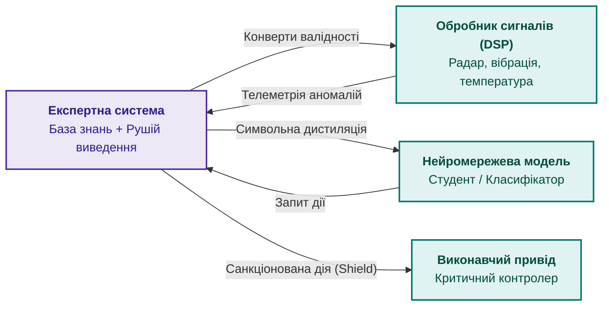
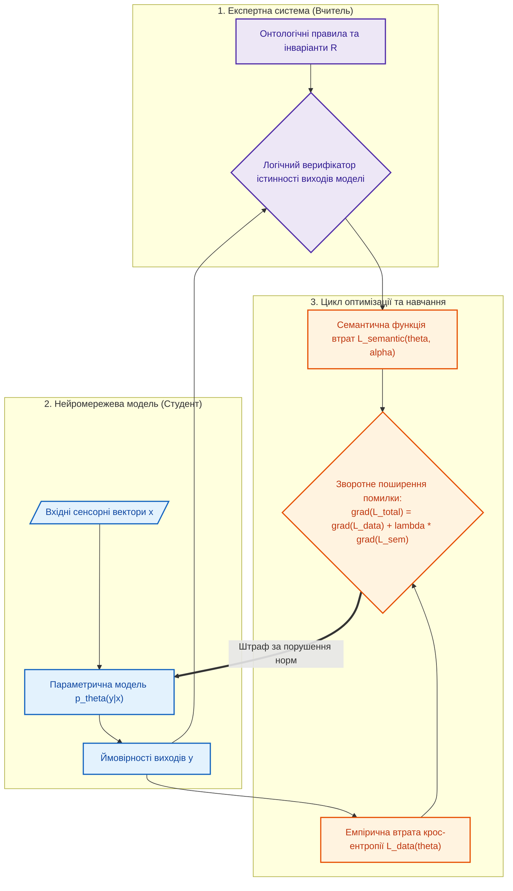
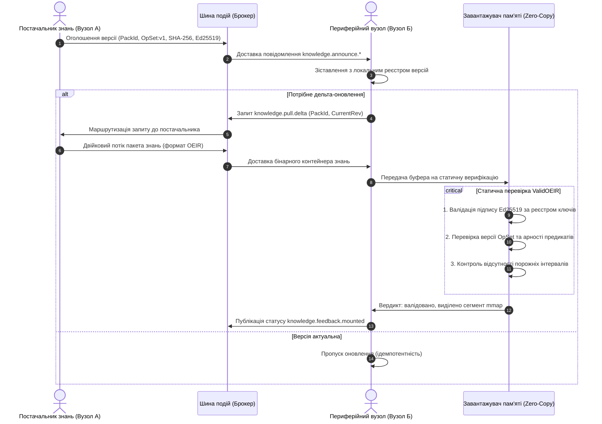
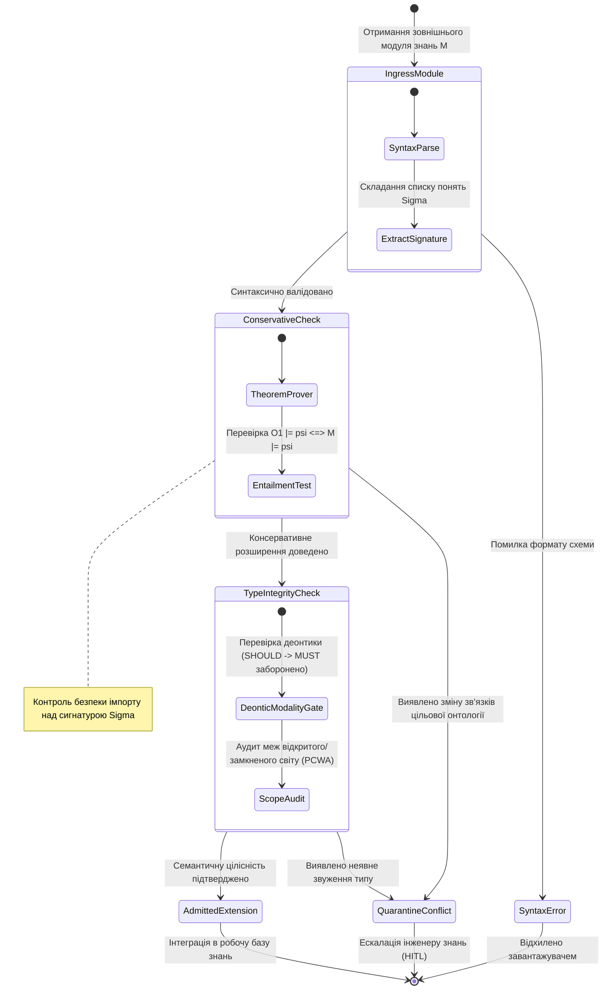
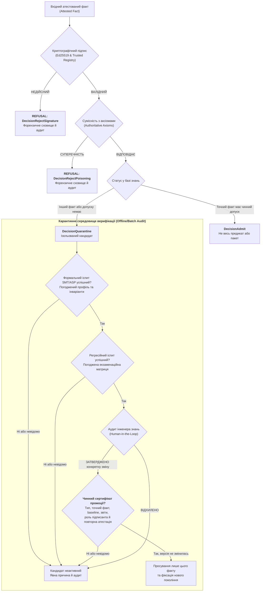

# Глава 33. Міжсистемний обмін знаннями: постачання правил стороннім системам, навчання моделей і захищений зворотний зв'язок

> **Книга:** [Архітектура доказових експертних систем](README.md) · [Частина VII: Технологічний стек, апаратна інфраструктура, кібернетичне виконання та розподілена SOA](part-07-runtime-and-knowledge-exchange.md)
> **Попередня глава:** [Глава 35. Реактивна експертна система: події, відкликання й адаптація знань](ch35-self-organizing-expert-systems-synergetics-and-npu-runtime.md)
> **Наступна глава:** [Глава 40. Розподілена архітектура доказової експертної системи: епістемічна SOA, семантична маршрутизація, ієрархія пам'яті та багатоджерельний дефезитивний арбітраж](ch40-distributed-epistemic-architectures-soa-and-cluster-scaling.md)
> **Зміст книги:** [README.md](README.md)  
> **Автор:** [Микола Федчик](about-the-author.md)  
> **Рівень складності та оптимальне вивчення:** `[L3]` Формально-математичний та системний (індекс Д. Кнута `[33]`) · *Маршрут:* `Трек D` (міжсистемний обмін пакетами знань, криптографічні щити та конверти безпеки)  
> **Очікувані результати:** проєктувати інтерфейси постачання знань експертної системи для сторонніх споживачів; транслювати логічні інваріанти у числові конверти валідності для цифрових сигнальних процесорів і комп'ютерного зору; організовувати символьну дистиляцію правил у нейромережеві моделі за допомогою семантичних функцій втрат; застосовувати формальні щити безпеки для підкріплюваного навчання агентів; обирати формати обміну знаннями (JSON-LD, форми SHACL, підписані пакети); налаштовувати брокер NATS і сервіси gRPC для асинхронного та низьколатентного обміну фактами; розмежовувати доступ за решіткою рівнів конфіденційності та генерувати докази включення Меркла; захищати базу знань від отруєння через криптографічну атестацію та шлюзи допуску; збирати телеметрію контрприкладів від периферійних систем для формування екзаменаційних кандидатів донавчання.

---

## Анотація

Уявіть автономний ударний або розвідувальний ройовий безпілотний комплекс чи роботизовану фабрику (DefTech, IEC 61508 [[14]](#src-14) / ISO 26262 [[15]](#src-15)). Нейромережевий класифікатор комп'ютерного зору (CV) виявляє силует об'єкта й передає векторні координати на привід наведення або маніпулятор. Якщо нейромережа не має детермінованого формального щита безпеки (*Safety Shield*), галюцинація через оптичну заваду або атаку змагальних збурень (*adversarial patch*) призведе до хибного наведення на дружній чи цивільний об'єкт. І навпаки: якщо польовий зв'язок передає телеметрію без криптографічної атестації (підписи Ed25519 та дерева Меркла), зловмисник через ін'єкцію контрприкладів скомпрометує базу знань, заблокувавши роботу всієї місії. Згідно з **авторською концепцією експертної системи як супервізора реального часу в автономних кіберфізичних комплексах (парадигма експертної супервізії реального часу за моделлю автора)**, експертна система більше не може бути ізольованим консультантом для людини-оператора: вона зобов'язана виконувати роль детермінованого супервізора в реальному часі.

Ця глава розглядає авторську архітектуру міжсистемного обміну знаннями: експертна система формує перевірені результати для заданих правил і профілів, навчає інші моделі та захищено приймає зовнішні докази. Ці runtime-результати не є повною оцінкою відповідності стандартам або сертифікацією виробу. Спочатку глава визначає ролі експертної системи в гетерогенному середовищі: оцінювач застосовних правил, щит безпеки для нейромережевих агентів і генератор перевіреного курікулуму. Далі розглянуто трансляцію предикатних обмежень у числові конверти валідності для цифрових сигнальних процесорів (DSP), методи символьної дистиляції знань у нейронні мережі за допомогою семантичних функцій втрат, а також протоколи низьколатентного обміну (NATS, gRPC, JSON-LD, SHACL). На завершення викладено механізми захисту від отруєння знань, розмежування прав за решіткою міток безпеки та робочий модуль атестації на Go.

---

## 1. Експертна система як постачальник знань і вчитель сторонніх систем

Традиційна інженерія знань розглядала експертну систему як кінцевого радника для людини-оператора: оператор уводить факти через діалоговий інтерфейс, рушій логічного виведення застосовує правила, а пояснювальний модуль повертає текстове обґрунтування. У кіберфізичних комплексах, роботизованих платформах і розподілених центрах керування споживачем висновку частіше стає інша інформаційна система: алгоритм планування траєкторії, мікроконтролер виконавчого механізму або конвеєр підготовки даних для навчання глибоких нейромереж.

За **авторським принципом усунення семантичного розриву між сигнальним, символьним та виконавчим трактами**, пряма передача неструктурованих даних між такими підсистемами без формалізованого контексту є неприпустимою в місійно-критичних комплексах, оскільки спричиняє розрив семантичного контексту. Якщо сигнальний обробник передає нейромережі числовий масив без знання фізичних інваріантів об'єкта, модель може вивчити хибні статистичні кореляції. Якщо ж стороння модель генерує керівні команди без перевірки нормативним оракулом, виникає ризик виходу за межі експлуатаційної безпеки. Експертна система усуває цей розрив, реалізуючи **авторську концепцію тріади міжсистемних ролей експертної системи**:

1. **Оцінювач застосовних правил (Policy/Rule Evaluator):** експертна система зіставляє поточний стан із конкретними правилами й умовами обраного профілю та повертає відтворюваний вердикт із доказами ([Глава 21](ch21-from-recommendation-to-action.md)). Така перевірка не замінює повної оцінки відповідності стандарту чи рішення уповноваженого органу.
2. **Формальний супервізор або щит безпеки (Safety Shield):** перед подачею команд на виконавчі приводи експертна система перехоплює дії сторонніх контролерів або нейромережевих агентів, блокуючи небезпечні переходи за правилами Fail-Closed ([Глава 28](ch28-dual-mode-expert-systems.md)).
3. **Генератор верифікованого курікулуму (Curriculum Generator):** експертна система синтезує навчальні вибірки для сторонніх моделей машинного навчання, маркуючи дані формальними доказами та гарантуючи відсутність суперечностей у навчальному матеріалі.



---

## 2. Постачання знань обробникам фізичних сигналів та сенсорної інформації

Фізичні сенсори (радари, лідари, віброперетворювачі, спектроаналізатори, тепловізійні матриці) формують потоки неперервних числових сигналів. Цифрові сигнальні процесори (DSP) і модулі комп'ютерного зору (CV) перетворюють ці сигнали на часові ряди, карти глибини та вектори ознак. Згідно з **авторським принципом семантичної сліпоти статистичних сигнальних обчислювачів (DSP / CV)**, обробники сигналів оперують суто статистичними й спектральними характеристиками (швидке перетворення Фур'є, вейвлет-фільтри, матриці коваріації), залишаючись семантично сліпими до предметного контексту та онтологічних інваріантів об'єкта. Вони не знають, що температура редуктора не може фізично зрости на сорок градусів за дві мілісекунди, або що падіння амплітуди відбитого імпульсу на певній частоті зумовлене зміною атмосферного тиску, а не відмовою випромінювача.

### 2.1. Переклад логічних норм у числові конверти валідності

За **авторською формальною математичною моделлю сенсорного конверта валідності**, експертна система транслює декларативні онтологічні аксіоми у строгі числові параметри фільтрації, які називаються **конвертами валідності (validity envelopes)**. Конверт валідності визначає гіпероб'єм у просторі вимірювань, усередині якого сигнал вважається фізично вірогідним:

```math
\mathcal{E}_s = \left\{ y(t) \in \mathbb{R}^d \;\middle|\; y_{\min} \le y(t) \le y_{\max} \;\land\; \left\|\frac{dy}{dt}\right\| \le \Delta_{\max} \;\land\; \Phi(y(t), x_{\text{state}}) = 1 \right\}
```

де $`y_{\min}`$ та $`y_{\max}`$ задають стаціонарні межі діапазону сенсора, $`\Delta_{\max}`$ обмежує фізично допустиму швидкість зміни процесу, а $\Phi$ позначає булевий предикат контекстної відповідності поточному режиму роботи агрегата $`x_{\text{state}}`$, визначеному в [Главі 22](ch22-cybernetics-edge-to-backend.md).

Коли експертна система експортує конверт валідності у сигнальний процесор або фільтр Калмана, вона задає строби інновацій (innovation gating) на основі відстані Махаланобіса Бар-Шалома та співавторів [[1]](#src-1):

```math
d_M^2(t) = \tilde{y}^T(t) S^{-1}(t) \tilde{y}(t) \le \gamma_{\text{threshold}}
```

**Параметри та вимірні величини:**
- $`\tilde{y}(t) = y(t) - \hat{y}(t|t-1) \in \mathbb{R}^d`$ — вектор інновації (нев'язки передбачення вимірювання) розмірності $d$;
- $`S(t) \in \mathbb{S}_{++}^d`$ — симетрична додатно визначена коваріаційна матриця інновації розмірності $d \times d$;
- $`\gamma_{\text{threshold}} = \chi_d^2(1 - \alpha)`$ — квантиль розподілу хі-квадрат із $d$ ступенями вільності для проектного рівня значущості $\alpha$ (наприклад, $`\alpha = 0{,}01`$);
- $`d_M^2(t) \ge 0`$ — безрозмірнісний квадрат відстані Махаланобіса.

**Операційні переходи (авторське алгоритмічне правило бінарного арбітражу інновацій сигнального фільтра) та числовий приклад:**
- Якщо $`d_M^2(t) \le \gamma_{\text{threshold}}`$, спостереження визнається фізично достовірним, і фільтр Калмана оновлює вектор стану об'єкта (`INNOVATION_ACCEPTED`);
- Якщо $`d_M^2(t) > \gamma_{\text{threshold}}`$, вимірювання кваліфікується як позаконвертна аномалія (`INNOVATION_REJECTED`); спостереження не вноситься в оцінку стану, фільтр зберігає апостеріорний прогноз, а система генерує звіт про інцидент сенсорного тракту;
- Практичний приклад розрахунку: розглядається скалярний канал тиску олії ($d = 1$). За рівня значущості $`\alpha = 0{,}01`$ критичний поріг становить $`\gamma_{\text{threshold}} = \chi_1^2(0{,}99) = 6{,}635`$. Нехай передбачене значення становить $`\hat{y} = 10{,}0\,\text{бар}`$, дисперсія інновації $`S = 0{,}25\,\text{бар}^2`$ (середньоквадратичне відхилення $`\sigma = 0{,}5\,\text{бар}`$), а поточний відлік датчика стрибнув до $`y = 11{,}6\,\text{бар}`$. Нев'язка: $`\tilde{y} = 11{,}6 - 10{,}0 = 1{,}6\,\text{бар}`$.

```math
d_M^2 = \frac{(1{,}6\,\text{бар})^2}{0{,}25\,\text{бар}^2} = \frac{2{,}56}{0{,}25} = 10{,}24.
```

Оскільки $`10{,}24 > 6{,}635`$, строб інновації відкидає вимірювання (`INNOVATION_REJECTED`), запобігаючи спотворенню фільтра Калмана раптовим стрибком тиску.

> [!NOTE]
> **Три інваріанти сенсорного конверта валідності за моделлю автора**
> 1. Багатовимірне геометричне обмеження: визначення простору допустимих сигналів $`\mathcal{E}_s`$ через комбінацію статичних меж, швидкості наростання та предикатів контекстного режиму.
> 2. Стохастичний строб інновацій: відсікання аномальних вимірювань за відстанню Махаланобіса $`d_M^2(t) \le \chi_d^2(1 - \alpha)`$ для запобігання дестабілізації фільтрів Калмана.
> 3. Детермінована деградація ваг: динамічне обнулення коефіцієнтів довіри до скомпрометованих сенсорних каналів при виявленні крос-модального спуфінгу.
> *Керування рантаймом / Інженерний інваріант:* Запобігає поширенню спотворених фізичних сигналів у символьний тракт експертного виведення.

### 2.2. Предикатні правила детекції завад та сенсорного спуфінгу

Завдяки зв'язку з інженерною онтологією експертна система виявляє узгоджені аномалії, які окремий сенсорний канал вважає валідними. Наприклад, якщо геопозиція за супутниковим приймачем показує швидкість 120 км/год, але інерціальна система фіксує нульове поздовжнє прискорення, а колісні одометри реєструють нерухомий вал, окремі обчислювачі можуть піддатися супутниковому спуфінгу. Експертна система застосовує **авторську модель крос-сенсорної детекції завад та інваріант виявлення супутникового спуфінгу**:

```math
\forall t \quad \lvert v_{\text{GNSS}}(t) - v_{\text{odo}}(t) \rvert > \epsilon_v \implies \text{SpoofingSuspected}(\text{GNSS}, t) \land \text{DegradeWeight}(\text{GNSS}, 0)
```

**Параметри та інженерні обмеження:**
- $`v_{\text{GNSS}}(t), v_{\text{odo}}(t) \ge 0`$ — миттєві оцінки поздовжньої швидкості за супутниковим навігаційним приймачем та колісними одометрами ($`\text{км/год}`$);
- $`\epsilon_v`$ — гранично допустимий поріг неузгодженості швидкості (наприклад, $`\epsilon_v = 15{,}0\,\text{км/год}`$).

**Операційні дії та приклад:**
- Якщо супутниковий приймач фіксує $`v_{\text{GNSS}} = 120\,\text{км/год}`$, а одометр передає $`v_{\text{odo}} = 5\,\text{км/год}`$, модуль обчислює різницю: $`\lvert 120 - 5 \rvert = 115\,\text{км/год} > 15\,\text{км/год}`$.
- Згідно з **авторським алгоритмічним правилом динамічної деградації ваг та переходу в автономне числення**, експертна система негайно надсилає сигнальному процесору директиву на динамічне обнулення ваги недовіреного каналу GNSS у комплексному фільтрі злиття навігаційної інформації (`DegradeWeight(GNSS, 0)`), переводячи навігацію в режим автономного числення за інерціальними даними (Dead Reckoning).

---

## 3. Навчання сторонніх систем: символьна дистиляція та верифікований курікулум

Коли сторонньою системою є нейромережевий класифікатор або контролер, експертна система виступає формальним учителем. Пряме навчання нейромереж на сирих емпіричних вибірках часто веде до порушення базових фізичних чи логічних законів: комп'ютерний зір може виявити дорожній знак у місці, забороненому геометрією сцени, або класифікатор електромережі прогнозує від'ємний опір ізоляції. Відповідно до **авторського принципу формалізації індуктивних упереджень нейромережевих моделей через онтологічні норми**, емпіричне навчання моделей повинно примусово спрямовуватися експертною системою через математично верифіковані обмеження, що унеможливлюють порушення фізичних інваріантів і правил безпеки.

### 3.1. Символьна дистиляція знань через семантичні функції втрат

На відміну від класичної дистиляції знань Гінтона та співавторів [[16]](#src-16), яка переносить статистичні кореляції («темне знання») через пом'якшені ймовірнісні розподіли виходів мережі-вчителя за високої температури $T$, **авторське наукове розмежування м'якої статистичної та символьної дистиляції знань** базується на прямій трансляції детермінованих правил логічного виведення у вагові коефіцієнти штучної нейромережі. Підхід спирається на механізм апостеріорної регуляризації Ху та співавторів [[2]](#src-2), де експертна система генерує розподіл цільових ймовірностей $`q(y|x)`$, що задовольняє набір логічних правил $`\mathcal{R} = \{(r_k, \lambda_k)\}`$, мінімізуючи дивергенцію Кульбака-Лейблера відносно базової нейромережі $`p_\theta(y|x)`$:

```math
\min_{q} \text{KL}(q(y|x) \parallel p_\theta(y|x)) - \sum_{k} \lambda_k \mathbb{E}_{q}[\mathbf{1}_{r_k}(x, y)]
```

де $`\mathbf{1}_{r_k}(x, y)`$ дорівнює одиниці, якщо пара $(x, y)$ задовольняє правило $`r_k`$, а $`\lambda_k \ge 0`$ визначає вагову жорсткість правила. Розв'язок оптимізаційної задачі має вигляд розподілу Гіббса:

```math
q^*(y|x) \propto p_\theta(y|x) \exp\left( \sum_k \lambda_k \mathbf{1}_{r_k}(x, y) \right)
```

Отриманий розподіл $`q^*(y|x)`$ слугує псевдоеталоном (soft labels) для навчання мережі-студента через функцію втрат крос-ентропії.

Для прямого наскрізного диференціювання логічних обмежень застосовують семантичні функції втрат Сюя та співавторів [[3]](#src-3). Якщо формальне правило представлене пропозиційною формулою $\alpha$ над виходами класифікатора, семантична втрата визначається як від'ємний логарифм імовірності істинності формули:

```math
\mathcal{L}_{\text{semantic}}(\theta, \alpha) = -\log \sum_{y \models \alpha} \prod_{j: y_j = 1} p_\theta(\hat{y}_j = 1 \mid x) \prod_{j: y_j = 0} (1 - p_\theta(\hat{y}_j = 1 \mid x))
```

Згідно з **авторським градієнтним принципом регуляризації вагових коефіцієнтів нейромережі**, під час зворотного поширення помилки градієнт семантичної втрати примусово штрафує вагові коефіцієнти мережі за будь-яке наближення виходів до конфігурацій, що порушують логічні інваріанти експертної системи ([Глава 29](ch29-neuro-symbolic-architecture.md)).

Діаграма ілюструє архітектуру взаємодії логічного вчителя та нейромережевого студента через семантичний градієнтний цикл навчання:



### 3.2. Формальні щити безпеки (Shielding) у навчанні агентів

Під час підкріплюваного навчання (Reinforcement Learning, RL) агент досліджує простір станів методом спроб і помилок. У критичних застосуваннях випадкове дослідження може спричинити фізичне руйнування механізму або перехід у заборонений аварійний стан.

Експертна система реалізує архітектуру формального екранування або щита за Альшіхом та співавторами [[4]](#src-4). Щит синтезується з безпекових специфікацій, виражених формулами лінійної темпоральної логіки (Linear Temporal Logic, LTL). Експертна система обчислює множину безпечних дій у поточному стані $`\mathcal{A}_{\text{safe}}(s_t) \subseteq \mathcal{A}`$. Якщо дія агента $`a_t \notin \mathcal{A}_{\text{safe}}(s_t)`$, щит перехоплює команду, підставляючи найближчу допустиму безпечну дію $`a_t' = \arg\min_{a \in \mathcal{A}_{\text{safe}}} \|a - a_t\|`$, і повертає агенту штраф у функції винагороди. Таким чином, стороння система вчиться оптимізувати цільову функцію виключно в межах допустимого безпекового конверта.

> [!NOTE]
> **Три засади символьного навчання та екранування агентів за моделлю автора**
> 1. Апостеріорна логічна регуляризація: формування псевдоеталонного розподілу Гіббса $`q^*(y|x)`$ для передачі предикатних правил у ваги нейромережі-студента.
> 2. Семантична диференційовна функція втрат: штрафування недопустимих логічних конфігурацій через від'ємний логарифм імовірності істинності формули $`\mathcal{L}_{\text{semantic}}`$.
> 3. Формальне LTL-екранування дій: безперервне перехоплення команд RL-агента з проекцією на множину безпечних дій $`\mathcal{A}_{\text{safe}}`$ для захисту від аварійних станів.
> *Керування рантаймом / Інженерний інваріант:* Гарантує строге дотримання безпекових інваріантів навченими моделями без ризику деструктивних фізичних дій під час дослідження середовища.

---

## 4. Формати, способи та технології міжсистемного обміну знаннями

Класичні стандарти комунікації інтелектуальних агентів 1990-х років — KQML Фініна та співавторів [[17]](#src-17) і специфікації FIPA ACL [[18]](#src-18) — будувалися навколо прагматичних мовленнєвих актів (`tell`, `ask-one`, `achieve`) без апаратної криптографічної атестації, решіткової багаторівневої безпеки та низьколатентного перекладу норм у числові межі для вбудованих обчислювачів. Сформульоване **авторське наукове розмежування між агентними протоколами 1990-х (KQML, FIPA ACL) та доказовим стеком обміну знаннями** полягає в тому, що для передачі знань у місійно-критичних комплексах потрібні протоколи й формати, які забезпечують однозначність семантичної інтерпретації, незмінний криптографічний родовід фактів та мікросекундну серіалізацію.

| Вимога | Рекомендований формат / технологія | Обґрунтування застосування |
|---|---|---|
| Семантична сумісність графів | JSON-LD 1.1 [[5]](#src-5) | Зв'язування локальних ключів тверджень з глобальними IRI онтологій без втрати читабельності |
| Валідація структурних обмежень | SHACL W3C [[6]](#src-6) | Декларативний опис обов'язкових атрибутів, діапазонів і кардинальності зв'язків фактів |
| Предикатні правила та виведення | RIF / RuleML | Стандартизований синтаксис для обміну логічними правилами першого порядку |
| Промисловий обмін на шині даних | NATS JetStream за Югстером та співавторами [[7]](#src-7) | Асинхронний брокер з підтримкою суб'єктної фільтрації, персистентності потоків та семантики at-least-once |
| Низьколатентні точкові перевірки | gRPC поверх HTTP/2 та Protobuf | Синхронні запити валідації дій та отримання конвертів із затримкою до 1 мікросекунди |
| Незмінні пакети знань | ZNAV-INDEX / mmap ([Глава 32](ch32-high-performance-knowledge-packs-mmap-and-harvesting.md)) | Пакетне поширення оновлень бази знань з нульовою десеріалізацією для вбудованих вузлів |

### 4.1. Семантичний контракт повідомлення на базі JSON-LD

Згідно з **авторським принципом семантичної самоописовості повідомлень знань через глобальні IRI**, кожен пакет міжсистемного обміну зобов'язаний містити явне відображення локальних полів на стандартизовані онтологічні ідентифікатори у блоці `@context`, що виключає двозначність фізичних одиниць вимірювання та інженерних допусків. Нижче наведено приклад повідомлення, яким експертна система експортує верифікований конверт валідності сенсора для підлеглого сигнального процесора через брокер повідомлень:

<details>
<summary>Приклад семантичного повідомлення JSON-LD для експорту конверта валідності</summary>

```json
{
  "@context": {
    "es": "https://standards.iso.org/iso/26262/ontology#",
    "xsd": "http://www.w3.org/2001/XMLSchema#"
  },
  "@id": "urn:es:envelope:motor_current:gen42",
  "@type": "es:SensorValidityEnvelope",
  "es:signalName": "motor_phase_u_current",
  "es:unit": "amperes",
  "es:minValue": { "@type": "xsd:double", "@value": -50.0 },
  "es:maxValue": { "@type": "xsd:double", "@value": 50.0 },
  "es:maxSlewRate": { "@type": "xsd:double", "@value": 1500.0 },
  "es:provenance": {
    "es:derivedFromStandard": "ISO-26262-Part-4",
    "es:ruleHash": "9e1c5f8b4a2e3d7c",
    "es:certifiedGeneration": "gen-2026-10-04-v1"
  }
}
```

</details>

### 4.2. Суб'єктна маршрутизація в NATS JetStream

Брокер NATS використовує ієрархічні текстові суб'єкти (subjects), що дозволяє спрямовувати знання за категоріями, доменами безпеки та типами споживачів:

- `knowledge.export.dsp.envelopes.<subsystem>`: публікація конвертів валідності для сигнальних процесорів конкретної підсистеми;
- `knowledge.export.models.distillation.<domain>`: поширення навчальних корпусів і псевдоеталонів для сторонніх моделей;
- `knowledge.feedback.telemetry.anomalies.<sensor_id>`: приймання звітів про вихід спостережень за межі встановленого конверта;
- `knowledge.control.quarantine.admission`: канал координації шлюзу допуску нових фактів.

Завдяки механізму збереження черги повідомлень JetStream виконується **авторський архітектурний інваріант гарантованої доставки оновлень знань (At-least-once Persistence)**: будь-який периферійний вузол, тимчасово відключений від мережі ([Глава 22](ch22-cybernetics-edge-to-backend.md)), після відновлення зв'язку гарантовано вичитує всі актуальні оновлення в детермінованому хронологічному порядку без втрати послідовності.

### 4.3. Відкритий стандарт епістемічного обміну (OEIR) за парадигмою міжнародного стандарту ONNX: версіонування наборів операторів, згортання інтервалів і статична верифікація сигнатур

Якщо текстові протоколи на базі JSON-LD та шина повідомлень вирішують задачу транспортної доставки фактів, то для міжсистемного обміну скомпільованими графами правил між різнорідними обчислювачами (від серверів x86-64 і вбудованих вузлів ARM64 до співпроцесорів ПЛІС/FPGA) потрібен уніфікований бінарний стандарт представлення знань. В індустрії машинного навчання аналогічну кризу несумісності між фреймворками подолав відкритий міжнародний стандарт **ONNX (Open Neural Network Exchange)**, який запровадив єдину проміжну репрезентацію обчислювального графа, версіоновані реєстри операторів (`OpSet`), компіляторне злиття вузлів (*operator fusion*) і статичний верифікатор цілісності моделі (`onnx.checker`).

Спираючись на цей перевірений міжнародний базис і враховуючи специфіку детермінованого логічного виведення, автором розроблено концепцію **Відкритої епістемічної проміжної репрезентації (Open Epistemic Intermediate Representation — OEIR) М. М. Федчика**, яка стандартизує обмін виконуваними правилами через три формальні механізми:

1. **Замкнене версіонування наборів операторів виведення (`Epistemic OpSet`):**
   Кожен скомпільований сегмент правил у пакеті знань явно декларує ідентифікатор домену та цілочисельну версію набору елементарних операторів (наприклад, `epistemic.core:v1`). Семантика кожного оператора (порівняння інтервалів у фіксованій точці $Q16.16$, перевірка криптографічного дайджесту цитати, немонотонне спростування правила винятком) фіксується незмінною для заданого номера версії набору. Це гарантує багаторічну пряму та зворотну сумісність: нові покоління середовища виконання без помилок інтерпретують архівні сертифікаційні пакети знань без потреби їх повторної компіляції.
2. **Компіляторне згортання правил та топологічний перетин інтервалів (*Taxonomy & Interval Fusion*):**
   За аналогією до злиття послідовних шарів у компіляторах нейромереж, під час пакування графа OEIR оптимізатор виконує статичне згортання транзитивних ланцюжків родо-видового підпорядкування (`IsA(A, B) ∧ IsA(B, C) ∧ Rule(C) -> Rule_Fused(A)`) та обчислює перетин усіх кон'юнктивних нормативних обмежень фізичного параметра $x$, що діють у предметній області за вирахуванням спростованих винятками $`\mathcal{D}`$:

```math
\mathcal{I}_{\mathrm{fused}}(x) = \bigcap_{k \in \mathrm{Active}(\mathcal{R} \setminus \mathcal{D})} [a_k, b_k]_{Q16.16}
```

   Якщо для будь-якого робочого режиму виявляється порожній перетин $`\mathcal{I}_{\mathrm{fused}}(x) = \emptyset`$, компілятор детерміновано зупиняє збирання пакета, виявляючи взаємовиключні норми різних стандартів ще на етапі підготовки знань до передачі в експлуатацію.
3. **Статичний верифікатор сигнатур та арності предикатів (*Epistemic Model Checker*):**
   Перед монтуванням отриманого ззовні пакета знань у спільну пам'ять завантажувач запускає лінійний прохід статичного верифікатора графа. Верифікатор перевіряє, що кожен предикат $p$ у правилах та у вихідній схемі парсера запитів має ідентичну кількість аргументів (арність $`\mathrm{arity}(p)`$), сумісну фізичну розмірність одиниць вимірювання UCUM і дійсний індекс першоджерела $s$:

```math
\mathrm{ValidOEIR}(\mathcal{G}) = \mathbb{I}\!\left(\forall r \in \mathcal{G}:\; \mathrm{op}(r) \in \mathrm{OpSet}_{v} \;\land\; \mathrm{arity}(p_r) = \mathrm{arity}_{\mathrm{lex}}(p_r) \;\land\; \mathcal{I}_{\mathrm{fused}}(r) \neq \emptyset\right)
```

> [!NOTE]
> **Чотири засади відкритого стандарту епістемічного обміну (OEIR) за парадигмою ONNX (авторська концепція М. М. Федчика)**
> 1. **Уніфікована графова репрезентація з немонотонними ребрами:** розширення класичної моделі обчислювального графа ONNX підтримкою деонтичних модальностей, строгих посилань на байти першоджерел та ребер немонотонного спростування (дефітерів ASPIC+).
> 2. **Версіоновані набори операторів виведення (`Epistemic OpSet`):** сувора прив'язка кожного пакета знань до незмінної специфікації версії операторів, що унеможливлює зміну семантики правил при оновленні виконавчого ядра.
> 3. **Компіляторне згортання інтервалів і рання детекція суперечностей:** злиття численних нормативних обмежень одного параметра в єдиний інтегральний інтервал $Q16.16$ на етапі збирання скорочує глибину обчислень у рантаймі та виявляє колізії стандартів до розгортання ($`\mathcal{I}_{\mathrm{fused}} = \emptyset`$).
> 4. **Статичний верифікатор узгодженості сигнатур і арності:** автоматична перевірка сумісності імен предикатів, кількості аргументів та фізичних розмірностей між лінгвістичним нормалізатором запитів і скомпільованим доменом у момент монтування пакета в пам'ять.
> *Керування рантаймом / Інженерний інваріант:* Пакет знань, який не пройшов статичну перевірку `ValidOEIR(G) = 1` (розбіжність арності предикатів, непідтримувана версія `OpSet` або порушена цілісність посилання на першоджерело), детерміновано відхиляється завантажувачем без монтування у віртуальний адресний простір.

Послідовність повідомлень та верифікації OEIR-пакетів при міжсистемній синхронізації через брокер подій відображена на діаграмі послідовності:



---

## 5. Умови, правила збереження семантики та онтологічне узгодження

Класична концепція онтологій Грубера [[19]](#src-19) визначає онтологію як явну специфікацію концептуалізації, проте прагматичне зіставлення термінів не захищає від логічних колізій під час об'єднання баз знань. За **авторським принципом запобігання семантичному спотворенню при міжсистемній реплікації правил**, коли знання передаються між незалежно розробленими інформаційними системами, категорично забороняється довільне розширення або звуження смислового обсягу предикатів без доведення консервативності.

### 5.1. Консервативні розширення та локальність модулів

Сформульоване **авторське наукове розмежування між прагматичним узгодженням онтологій Грубера та формальним консервативним розширенням** спирається на теорію модульності онтологій Куенки Грау та співавторів [[8]](#src-8): експорт фрагмента знань $`\mathcal{M}`$ з вихідної онтології $`\mathcal{O}_1`$ до цільової системи $`\mathcal{O}_2`$ є коректним тоді і тільки тоді, коли $`\mathcal{M}`$ є **консервативним розширенням (conservative extension)** відносно виділеної сигнатури $\Sigma$:

```math
\mathcal{O}_1 \models \psi \iff \mathcal{M} \models \psi \quad \text{для всіх формул } \psi \text{ над сигнатурою } \Sigma
```

Це гарантує дві фундаментальні властивості:
1. **Принцип безпеки імпорту знань над виділеною сигнатурою (за формулюванням автора):** імпорт модуля не змінює зв'язків між внутрішніми поняттями цільової онтології, які не стосуються спільної сигнатури $\Sigma$.
2. **Принцип локальної дедуктивної повноти модульного виведення (за формулюванням автора):** всі наслідки над сигнатурою $\Sigma$, які могли бути виведені у повній вихідній онтології $`\mathcal{O}_1`$, можуть бути виведені виключно з виділеного модуля $`\mathcal{M}`$ без завантаження всієї бази знань.

### 5.2. Правила збереження семантичних типів

Під час трансляції знань забороняються операції неявного звуження або розширення типів даних:
- **Заборона втрати точності модальностей:** якщо вихідне твердження є деонтичною рекомендацією `SHOULD`, воно не має транслюватися у безумовну заборону `MUST NOT` стороннього протоколу без явної згоди інженера знань ([Глава 14](ch14-requirements-detection-and-formalization.md)).
- **Ізоляція частково замкненого світу (PCWA):** твердження, отримані в умовах припущення про замкненість окремої предметної області ([Глава 07](ch07-knowledge-base-typology.md)), маркуються спеціальним прапорцем повноти `scope: closed`. Стороння система не має права застосовувати правило заперечення як відмови (Negation-as-Failure) до фактів, що надходять з відкритих доменів (`scope: open`).

Скінченний автомат процедури онтологічного узгодження та захисту семантичної цілісності при імпорті зовнішнього модуля знань наведено на діаграмі переходів станів:



---

## 6. Розмежування доступу та безпека знань: решітка міток і селективне розкриття

У складних інженерних і оборонних проєктах база знань містить твердження з різними грифами конфіденційності, правами інтелектуальної власності та обмеженнями експортного контролю. Згідно з **авторським принципом багаторівневого захисту інтелектуальної власності та грифів конфіденційності знань**, експертна система у розподіленій федерації зобов'язана запобігати витоку закритих правил і деталей апаратної топології до сторонніх систем з нижчим рівнем допуску через обов'язкову решіткову фільтрацію кожного вихідного твердження.

### 6.1. Багаторівнева безпека на базі решітки міток Деннінг

Розмежування доступу базується на класичній моделі решітки безпечних інформаційних потоків Деннінг [[9]](#src-9) та моделі Белла-ЛаПадули [[10]](#src-10). Множина міток безпеки формує частково впорядковану решітку $`(\mathcal{L}, \le, \sqcap, \sqcup)`$:

```math
\mathcal{L} = \mathcal{C} \times 2^{\mathcal{K}}
```

де $`\mathcal{C} = \{\text{Public} < \text{Internal} < \text{Restricted} < \text{Critical}\}`$ визначає лінійну ієрархію рівнів конфіденційності, а $`\mathcal{K}`$ є множиною категоріальних обмежень (наприклад, конкретні назви проєктів або консорціумів).

Мітка суб'єкта $`L_s = (c_s, K_s)`$ домінує над міткою об'єкта знання $`L_o = (c_o, K_o)`$ тоді і тільки тоді, коли:

```math
L_s \ge L_o \iff (c_s \ge c_o) \land (K_o \subseteq K_s)
```

**Параметри та умови решітки:**
- $`c_s, c_o \in \mathcal{C}`$ — рівні класифікації суб'єкта та об'єкта у впорядкованій множині $`\text{Public} < \text{Internal} < \text{Restricted} < \text{Critical}`$;
- $`K_s, K_o \subseteq \mathcal{K}`$ — множини цільових категорій допуску (компартментів);
- $`L_s = (c_s, K_s), L_o = (c_o, K_o)`$ — комбіновані мітки безпеки.

**Авторське алгоритмічне правило шлюзу експорту знань за допуском отримувача та числовий приклад:**
- Твердження $f$, помічене міткою $`L_o = L(f)`$, передається сторонній системі з допуском $`L_s = L_{\text{recipient}}`$ тоді й тільки тоді, коли допуск отримувача домінує над міткою факту: $`L_s \ge L_o`$.
- Якщо $`L_s \not\ge L_o`$, шлюз експорту відкидає факт зі статусом `REJECT_CLEARANCE_VIOLATION`.
- Практичний приклад: стороння діагностична система має допуск $`L_s = (\text{Internal}, \{\text{Avionics}, \text{Telemetry}\})`$. База знань містить факт $`f_1`$ із міткою $`L(f_1) = (\text{Internal}, \{\text{Telemetry}\})`$ та критичне калібрувальне правило $`f_2`$ із міткою $`L(f_2) = (\text{Restricted}, \{\text{Avionics}\})`$.
  - Для $`f_1`$: $`c_s = \text{Internal} \ge c_o = \text{Internal}`$ і $`K_o = \{\text{Telemetry}\} \subseteq K_s`$, отже $`L_s \ge L(f_1)`$ → експорт схвалено (`EXPORT_PERMITTED`);
  - Для $`f_2`$: $`c_s = \text{Internal} < c_o = \text{Restricted}`$, отже $`L_s \not\ge L(f_2)`$ → факт детерміновано відсікається шлюзом (`EXPORT_DENIED`).

### 6.2. Селективне розкриття доказів через дерева Меркла

Коли стороння аудиторська система вимагає підтвердження того, що певна вимога чи тест дійсно входять до затвердженого випуску бази знань, повне розкриття бази знань може розкрити конфіденційні деталі прошивки чи топології.

Для розв'язання цієї проблеми експертна система використовує криптографічні дерева Меркла [[11]](#src-11). Корінь дерева $`R_{\text{Merkle}}`$ публікується у відкритому сертифікаті випуску ([Глава 32](ch32-high-performance-knowledge-packs-mmap-and-harvesting.md)). Щоб довести присутність конкретного факту $`f_i`$ з хешем $`H(f_i)`$, експертна система генерує компактний шлях аутентифікації довжиною $O(\log N)$, який називається **доказом включення Меркла (Merkle inclusion proof)**:

```math
\pi(f_i) = \langle h_1, h_2, \dots, h_{\lceil \log_2 N \rceil} \rangle
```

Стороння система самостійно перераховує згортку:

```math
H(\dots H(H(f_i), h_1) \dots) = R_{\text{Merkle}}
```

**Параметри та числовий приклад верифікації:**
- $N$ — загальна кількість зафіксованих фактів у бінарному контейнері бази знань;
- $`H(f_i)`$ — криптографічний хеш SHA-256 цільового факту $`f_i`$;
- $`\lceil \log_2 N \rceil`$ — довжина шляху доказу включення Меркла;
- $`R_{\text{Merkle}}`$ — кореневий хеш дерева, засвідчений у публічному сертифікаті випуску.
- Якщо обчислений хеш строго збігається з $`R_{\text{Merkle}}`$, факт приймається як автентичний (`PROOF_VALID`); якщо результат відрізняється хоча б на 1 біт, транзакція відхиляється (`PROOF_INVALID`).
- Числовий розрахунок: для бази знань обсягом $N = 1024$ фактів довжина шляху становить $`\lceil \log_2 1024 \rceil = 10`$ проміжних хешів по 32 байти (сумарний розмір доказу лише $`320\,\text{байт}`$ замість передачі всього масиву в $`32\,\text{КБ}`$). Перевірка згортки на процесорі ARM Cortex-A72 займає менше ніж $`12\,\mu\text{s}`$, забезпечуючи підтвердження факту в режимі реального часу.

> [!NOTE]
> **Чотири механізми захищеного розкриття знань за моделлю автора**
> 1. Двовимірна решітка допусків: строго формалізоване відсікання знань за комбінацією рівнів конфіденційності $`\mathcal{C}`$ та цільових категорій допуску $`2^{\mathcal{K}}`$.
> 2. Принцип домінування суб'єкта: передача факту сторонній системі виключно за умови виконання відношення домінування $`L_s \ge L_o`$.
> 3. Селективне розкриття Меркла: криптографічне підтвердження належності факту базі знань через компактний логарифмічний аутентифікаційний шлях $`\pi(f_i)`$.
> 4. Нульове розголошення суміжних фактів: валідація окремих вимог сторонніми аудиторами без деанонімізації повної онтології та топології системи.
> *Керування рантаймом / Інженерний інваріант:* Забезпечує доказову перевірку нормативних тверджень зовнішніми агентами зі збереженням конфіденційності закритої інтелектуальної власності.

### 6.3. Протокол криптографічної федерації доказів (Evidence-Only Federation) та асиметричний діод знань

У багатоланцюгових інженерних консорціумах та інтегрованих промислових холдингах суміжні підприємства часто діють як автономні суверенні анклави. Прямий обмін повними онтологіями, сирцевим програмним кодом чи закритими схемотехнічними топологіями може обмежуватися регуляторними, договірними або інтелектуально-правовими умовами. Якщо для виробу застосовні вимоги ISO 26262, DO-178C чи іншого стандарту, інтегратор організує їх оцінювання в межах погодженого assurance-процесу; окрема квитанція або формальний свідок може підтвердити лише конкретне твердження й перевірку, а не повну відповідність виробу чи сертифікацію.

Автором запропоновано **протокол криптографічної федерації доказів (Evidence-Only Federation) М. Федчика**, згідно з яким суверенні інженерні домени обмінюються криптографічно підписаними квитанціями верифікації (`Verification Receipts`) та формальними свідками доведення теорем (формальні траси Lean 4 / Z3) без трансляції самих закритих фактів та правил. Підпис підтверджує походження квитанції, а свідок — конкретне формальне твердження за заданими припущеннями; жоден із цих артефактів самостійно не замінює незалежного аудиту, аналізу небезпек чи сертифікації.

Квитанція федеративного доказу формується у вигляді типізованого кортежу:

```math
\mathcal{R} = \langle \mathrm{ClaimID}, H(\mathcal{P}_{\mathrm{private}}), \pi_{\mathrm{proof}}, \tau_{\mathrm{timestamp}}, \sigma_{\mathrm{Ed25519}} \rangle
```

де $`\mathrm{ClaimID}`$ — уніфікований ідентифікатор нормативної вимоги; $`H(\mathcal{P}_{\mathrm{private}})`$ — криптографічна згортка закритого предикату постачальника; $`\pi_{\mathrm{proof}}`$ — компактний формальний свідок верифікації в системі SMT/Lean; $`\tau_{\mathrm{timestamp}}`$ — позначка часу RFC 3161; $`\sigma_{\mathrm{Ed25519}}`$ — цифровий підпис акредитованого вузла.

Для захисту внутрішнього середовища від витоку даних обмін реалізується через **асиметричний діод знань**, де інформаційний потік строго односпрямований: діод пропускає квитанції $`\mathcal{R}`$ із зовнішньої зони у внутрішній аудит, фізично унеможливлюючи зворотні канали витоку даних. Предикат допуску квитанції визначається як:

$$
P_{\mathrm{permit}}(\mathcal{R}) = \mathbb{I}\left(\mathrm{Verify}(\sigma_{\mathrm{Ed25519}}) = 1 \land \mathrm{CheckWitness}(\pi_{\mathrm{proof}}) = 1 \land (t_{\mathrm{now}} - \tau_{\mathrm{timestamp}} \le \Delta t_{\mathrm{fresh}})\right)
$$

**Параметри та умови верифікації діода:**
- $`P_{\mathrm{permit}}(\mathcal{R}) \in \{0, 1\}`$ — булеве рішення про допуск квитанції до внутрішнього реєстру доказів, не рішення про сертифікацію компонента;
- $`\mathbb{I}(\cdot)`$ — індикаторна функція істинності кон'юнкції умов;
- $`\mathrm{Verify}(\sigma_{\mathrm{Ed25519}})`$ — функція перевірки підпису за публічним ключем довіреного анклаву;
- $`\mathrm{CheckWitness}(\pi_{\mathrm{proof}})`$ — детермінована перевірка синтаксичного дерева математичного доказу;
- $`t_{\mathrm{now}} - \tau_{\mathrm{timestamp}}`$ — тривалість транспортування квитанції;
- $`\Delta t_{\mathrm{fresh}}`$ — гранично допустимий інтервал свіжості (запобігання Replay-атакам, зазвичай $`\Delta t_{\mathrm{fresh}} \le 5000\,\text{мс}`$).

**Імператив замкненого циклу розрахунку (Actionable Closed Loop):**
1. **Керування рантаймом і потоком обчислень (Control Flow & Runtime Decisions):**
	При отриманні пакета шлюз асиметричного діода обчислює предикат $`P_{\mathrm{permit}}(\mathcal{R})`$. Якщо $`P_{\mathrm{permit}} = 1`$, квитанція приймається до реєстру доказів зі статусом `FEDERATED_EVIDENCE_ACCEPTED`; це підтверджує лише підпис, свідок і свіжість конкретного твердження за заданими припущеннями, не безпеку постачальника чи відповідність виробу. Якщо $`P_{\mathrm{permit}} = 0`$ (підпис недійсний, свідок не збігається або $`t_{\mathrm{now}} - \tau > \Delta t_{\mathrm{fresh}}`$), пакет детерміновано скидається, транзакція блокується зі статусом `FEDERATION_SECURITY_REJECT`, а сторожовий таймер фіксує спробу ін'єкції недостовірних знань.
2. **Апаратний сайзинг та інфраструктурні обмеження (Hardware Dimensioning):**
   Односпрямований тракт діода знань базується на оптичному розв'язувачі (TX $\to$ RX) або виділеному ізольованому буфері DMA з підтримкою апаратного кільцевого буфера місткістю $`V_{\mathrm{diode}} = 128\,\text{КБ}`$. Це гарантує безперервне приймання квитанцій при навантаженні до $2\,500$ транзакцій/с без виникнення зворотних колізій шини.
3. **Практичний числовий приклад (Worked Numerical Example):**
   Постачальник модуля керування гальмами передає квитанцію $`\mathcal{R}`$ розміром $`512\,\text{байт}`$ із міткою $`\tau = 100\,\text{мс}`$. Сервер-верифікатор витрачає $`t_{\mathrm{sig}} = 52\,\mu\text{с}`$ на перевірку Ed25519 та $`t_{\mathrm{smt}} = 1.8\,\text{мс}`$ на перевірку коректності кроків математичного свідка Z3. Повний час аудиту становить $`t_{\mathrm{total}} = 1.852\,\text{мс}`$, що значно менше допустимого ліміту $`\Delta t_{\mathrm{fresh}} = 5000\,\text{мс}`$. Значення $`P_{\mathrm{permit}} = 1`$ задовольняє вимогу, і статус безпеки стороннього модуля затверджується без передачі вихідного коду постачальника.

> [!NOTE]
> **Авторський протокол криптографічної федерації доказів та асиметричний діод знань М. М. Федчика (Чотири засади суверенної взаємодії)**
> 1. *Принцип нульового розкриття онтології*: передача виключно криптографічних свідків верифікації та хешів артефактів без розкриття вихідного коду чи тексту регламентів.
> 2. *Асиметричний односпрямований діод знань*: фізична та протокольна неможливість зворотного витоку внутрішнього контексту через інтерфейс прийому доказів.
> 3. *Темпоральна свіжість квитанцій*: обов'язкова відсічка застарілих транзакцій ($`t_{\mathrm{now}} - \tau > \Delta t_{\mathrm{fresh}}`$) для запобігання атакам повторного відтворення (Replay Attacks).
> 4. *Апаратне ізолювання верифікації*: перевірка свідків доведення у захищеному ізольованому анклаві без доступу до зовнішньої мережі.
> *Керування рантаймом / Інженерний інваріант:* Забезпечує інтеграцію гетерогенних корпоративних баз знань зі збереженням суверенітету інтелектуальної власності кожного учасника.

---

## 7. Підтвердження фактів (Fact Attestation) та захист від отруєння знань

Згідно з **авторською концепцією ризику отруєння знань у розподілених федераціях**, при отриманні спостережень, результатів тестування чи правил від сторонніх систем експертна система наражається на загрозу **отруєння знань (knowledge poisoning)**. Зловмисник або скомпрометований сенсорний вузол може надсилати спотворені факти (наприклад, стверджуючи, що критична температура становить 500 °C замість 100 °C або що аварійний клапан повинен залишатися закритим під час перевищення тиску), що паралізує або спотворить подальше логічне виведення.

### 7.1. Криптографічна атестація фактів за схемою Ed25519

Кожен експортований факт підписується цифровим підписом системи-джерела за схемою Ed25519 Бернштейна та співавторів [[12]](#src-12). Структура атестованого факту містить канонічні байти твердження, ідентифікатор джерела та криптографічний підпис:

```math
\sigma = \mathrm{Ed25519}_{\mathrm{Sign}}\!\left(
SK_{\mathrm{source}},
\mathrm{SHA256}\!\left(\mathrm{Canon}(\texttt{attested-fact-v1},s,p,o,l,i)\right)\right).
```

Тут $\sigma$ — 64-байтний підпис Ed25519, $`SK_{\mathrm{source}}`$ — закритий ключ джерела (64 байти в поданні Go), а $s,p,o$ — точні байти предмета, предиката й об'єкта. $l$ позначає мітку рівня доступу в найкоротшому десятковому ASCII-поданні, $i$ — ідентифікатор джерела. `Canon` кодує домен формату та кожне з п'яти полів окремо: спочатку 8-байтну беззнакову довжину big-endian, потім незмінні байти поля. SHA-256 дає 32 байти; Ed25519 підписує саме їх, не шістнадцятковий текст. Методи `Fact.Digest` і `Fact.ID` нижче використовують цей навчальний формат.

Довжинні префікси потрібні до криптографії: кортежі `("a|b","c","d",0,"s")` та `("a","b|c","d",0,"s")` дають однакове наївне склеювання, але різні канонічні пакети по 71 байту. Це не колізія SHA-256, а неоднозначність старого кодування. Зміна будь-якого з п'яти полів створює іншу ідентичність факту; попередній підпис і дозвіл baseline не переносяться на неї. Обсяг 71 байт стосується цих двох пакетів, не загального розміру Go-об'єкта або буфера; підпис додає ще 64 байти без накладних витрат.

Підпис підтверджує походження й цілісність відносно довіреного ключа за прийнятих криптографічних припущень, не істинність твердження або дозвіл імпорту. Роль такої атестації в ланцюжках постачання артефактів розглянуто в in-toto Торрес-Аріаса та співавторів [[13]](#src-13). Для промоції в §9 застосовано інший домен підписаних байтів, `promotion-certificate-v1`, щоб підпис джерела не підміняв затвердження зміни знань.

П'ять полів утворюють лише навчальний профіль факту. Якщо тип твердження потребує одиниці, модальності, умови або області чинності, вони мають увійти до погодженої схеми й підписаних байтів, а не залишатися ігнорованими полями зовнішнього JSON. Декодер і повний контракт матеріальних атомів у цьому Go-прикладі не реалізовано; точна байтова ідентичність не є доказом семантичної повноти.

### 7.2. Таксономія загроз: форми атак отруєння знань (Knowledge Poisoning)

Отруєння бази знань у доказових системах класифікується за чотирма основними векторами впливу:

#### 7.2.1. Пряма інверсія аксіоми (Axiom Inversion / Overwrite)
Атакуючий вузол (навіть володіючи валідним сертифікатом доступу) надсилає твердження, що прямо суперечить засадничим законам фізики чи нормам безпеки:

```math
\mathrm{Attestation}: \langle \texttt{emergency\_brake}, \texttt{status\_on\_failure}, \texttt{DISABLED} \rangle
```

Мета: зняття захисних блокувань у критичний момент.

#### 7.2.2. Прихований семантичний дрейф (Stealth Semantic Drift)
Атака розтягується в часі: щосекунди надсилаються ледь помітні дельти числових меж або допусків (наприклад, граничний струм зсувається на $`+0{,}1\%`$ за кожне спостереження). Окремо кожен факт проходить локальний фільтр аномалій, але накопичувальний ефект виводить систему за безпечний експлуатаційний конверт.

#### 7.2.3. Індукція зациклення розв'язувача (Cyclic Denial-of-Reasoning)
Впровадження циклічних взаємозалежностей між новими предикатами:

```math
P_1(x) \leftarrow P_2(x), \quad P_2(x) \leftarrow P_3(x), \quad P_3(x) \leftarrow P_1(x)
```

Це провокує експоненційне зростання обчислювальної складності або зависання під час резолюційного виведення чи пошуку найменшої нерухомої точки.

#### 7.2.4. Атака Сивіли у зворотному зв'язку (Sybil Consensus Poisoning)
Компрометація пулу сенсорів для одночасної відправки фіктивних контрприкладів, що штучно перевищують поріг $`N_{\text{threshold}}`$ і змушують систему вважати фальшиву аномалію реальним зсувом фізичного середовища.

### 7.3. Шлюз вхідного контролю та життєвий цикл карантину знань

Шлюз вхідного контролю відділяє походження факту від права включити його в активні знання експертної системи. Якщо зразки з недійсним підписом і справжні кандидати мають спільний шлях просування, сам ключ сховища стає помилковим дозволом на імпорт. Якщо ж допуск прив'язано лише до назви предиката, один перевірений факт відкриває шлях неперевіреним твердженням з іншими предметом, значенням або походженням. Авторський **життєвий цикл карантину знань (Knowledge Quarantine Lifecycle)** розділяє ці стани й прив'язує рішення до точної ідентичності:



1. **Криптографічна валідація та форензична ізоляція:** якщо відкритий ключ джерела відсутній у списку довірених або цифровий підпис не відповідає згортці байтів, факт або пакет знань негайно відхиляється від допуску в активне ядро виведення (`DecisionRejectSignature` / `REFUSAL`, ніколи не монтується в робочу пам'ять) і водночас примусово ізолюється в захищеному карантинному сховищі (`QUARANTINE`) із незмінним записом у журналі аудиту (Audit Log) для збереження криміналістичних (форензичних) доказів спроби підробки (узгоджено з регламентом [Глави 37, §8](ch37-input-information-assessment-and-algorithmic-skepticism.md#8-експертний-скепсис-як-алгоритм)).
2. **Перевірка суперечностей з аксіомами:** факт відхиляється негайно (`DecisionRejectPoisoning`), якщо його предикат прямо заперечує встановлені фундаментальні аксіоми безпеки.
3. **Кандидатний буфер та формальна офлайн-верифікація:** кожне нове твердження, навіть із відомим предикатом, потребує власного допуску. Валідний кандидат ізолюється від форензичних зразків і проходить перевірки за погодженим логічним профілем, зокрема SMT-розв'язувачем Z3 [[20]](#src-20) або ASP-розв'язувачем Clingo [[21]](#src-21), регресійний іспит та фахове затвердження конкретної зміни baseline. Формальна перевірка не зводиться до заборони будь-якого циклу ([Глава 23](ch23-knowledge-base-verification.md)).

Сертифікат промоції повинен зв'язувати тип переходу, повну ідентичність кандидата, вихідну версію baseline, звіти формальної й регресійної перевірок та уповноваженого підписанта затвердження. Сам ключ карантину, підпис постачальника або ознака «предикат відомий» не є такими свідченнями. За невідомого результату, недоступного звіту, зміни кандидата/версії або недійсного дозволу знання не активуються. Форензичний зразок не змінює статусу на кандидатний через виклик промоції: для нового розгляду потрібен окремий автентифікований вхід.

У навчальному §9 `forensics` і `candidates` є різними сховищами, а `admitted` індексується повним `Fact.ID`. Підпис джерела перевіряється знову перед просуванням; зміна довірчої конфігурації консервативно інвалідує кеш дозволів. Підписаний сертифікат прив'язаний до поточного покоління стану шлюзу, а перевірка й перехід серіалізовані одним м'ютексом. Дозвіл належить конкретному факту, не всьому предикату чи пакету; повторне використання незміненого допущеного факту не потребує нового людського підпису.

> [!NOTE]
> **Чотири стадії карантинної фільтрації знань за моделлю автора**
> 1. Криптографічна автентифікація та форензичний карантин: миттєве відхилення допуску (`REFUSAL` / `DecisionRejectSignature`) вхідних тверджень або пакетів із невалідним цифровим підписом Ed25519 без монтування в активне ядро виведення з одночасною ізоляцією артефакту в `QUARANTINE` та незмінною фіксацією інциденту в журналі аудиту.
> 2. Аксіоматична сумісність: жорстке блокування фактів, що прямо заперечують засадничі онтологічні норми та закони фізики системи.
> 3. Кандидатна ізоляція: нове твердження не успадковує допуску лише через відомий предикат; форензичні зразки не потрапляють на цей шлях.
> 4. Формальний і регресійний іспити та затвердження зміни baseline: дозвіл зв'язано з точним кандидатом, звітами й вихідною версією.
> *Керування рантаймом / Інженерний інваріант:* Без усіх необхідних чинних підстав факт не активується; відмова й форензичний запис не підміняють доказу достатності, але зберігають слід відхилення.

---

## 8. Зворотний зв'язок (Feedback Loop) та донавчання експертної системи

Взаємодія між системами є двостороннім процесом. Згідно з **авторською концепцією зворотного зв'язку від експлуатаційного середовища через крайові випадки**, коли підлеглі системи (DSP, комп'ютерний зір, автономні агенти) працюють у фізичному середовищі, вони неминуче стикаються з **крайовими випадками (corner cases)**: несподіваними поєднаннями погодних умов, аномальними спектрами вібрації на нових режимах чи нестандартними протокольними відповідями мережевого обладнання, які слугують єдиним легітимним емпіричним джерелом для контрольованого донавчання бази знань.

### 8.1. Черга контрприкладів та агрегація інцидентів

Якщо сторонній обробник фіксує вихід сигналу за межі встановленого конверта або нейромережа фіксує високу ентропію класифікації, формується структурований звіт про аномалію. Звіти потрапляють у чергу зворотного зв'язку (Feedback Queue).

Колектор зворотного зв'язку агрегує інциденти. Окремий одиночний викид може бути випадковою фізичною завадою сенсора і не вимагає перегляду правил. Але якщо кількість однотипних контрприкладів для певного сигналу перевищує статистичний поріг $`N_{\text{threshold}}`$, колектор позначає це явище як стійку аномалію, що свідчить про зміну фізичних характеристик середовища.

### 8.2. Живлення циклу неперервного навчання

Накопичені верифіковані контрприклади стають вхідним матеріалом для:
- Поповнення екзаменаційної матриці з [Глави 25](ch25-how-expert-systems-learn.md): новий контрприклад додається до обов'язкових негативних або граничних тестів, формуючи новий зріз складності.
- **Авторської методики детекції параметричного дрейфу сенсорів тестом CUSUM** ([Глава 26](ch26-continual-learning.md)): потік звітів аналізується статистичним тестом кумулятивних сум (CUSUM) Пейджа [[22]](#src-22) для раннього попередження про деградацію сенсорів або зсув робочої точки.
- **Авторського алгоритму адаптивного перегляду меж конверта валідності:** інженер знань або автоматичний оптимізатор пропонує оновлені межі $`\mathcal{E}_s'`$, які проходять повний цикл екзаменаційного тестування перед випуском нового покоління бінарного контейнера бази знань.

> [!NOTE]
> **Три канали захищеного зворотного зв'язку за моделлю автора**
> 1. Агрегація та фільтрація викидів: статистичне відсікання поодиноких випадкових флуктуацій сенсорів із фіксацією системних аномалій за порогом $`N_{\text{threshold}}`$.
> 2. Збагачення екзаменаційної матриці: автоматична конвертація підтверджених польових контрприкладів у нові регресійні тестові зрізи.
> 3. Адаптивне коригування конвертів: запуск статистичних процедур CUSUM для виявлення параметричного дрейфу та керованого перегляду меж валідності.
> *Керування рантаймом / Інженерний інваріант:* Перетворює експлуатаційні крайові випадки у джерело керованого та безпечного донавчання бази знань без деградації засадничих правил.

---

## 9. Програмна реалізація мовою Go: модуль xchange

Навчальний пакет `xchange` показує межу між підписаним зовнішнім фактом, кандидатом і конкретним дозволом його введення. Він перевіряє реальні Ed25519-підписи факту та сертифіката промоції, розділяє сховища й зв'язує перехід із поколінням стану. Це не виробничий завантажувач знань або повна реалізація всіх механізмів глави. У лістингу також залишено окремі демонстрації:
1. Експорт знань із фільтрацією за решіткою рівнів доступу та цифровим підписом Ed25519.
2. Шлюз вхідного контролю фактів із захистом від отруєння знань (перевірка підпису та аксіоматичних суперечностей).
3. Валідацію числових сигналів сенсорним конвертом.
4. Зворотний зв'язок: колектор аномалій із фіксацією порогу для запуску циклу донавчання.

Код не використовує сторонніх бібліотек, спираючись виключно на стандартний пакет Go (`crypto/ed25519`, `crypto/sha256`, `sync`, `math`).

`FormalPassed` і `RegressionPassed` у сертифікаті є **підписаними твердженнями уповноваженого власника baseline** з хешами звітів. Контролер перевіряє тип, зв'язування та підпис цих свідчень, але не запускає Z3/Clingo, не виконує регресійного іспиту й не перевіряє зміст звітів. У тестах використано синтетичні звіти та тимчасові ключі. Довірені ключі джерел і підписантів baseline задаються різними конфігураційними реєстрами; вхідний пакет не може сам додати собі таке повноваження.

У канонічному `PromotionCertificate.Digest` немає поля `Signature`; підпис обчислюється після дайджесту, без самопосилання. Зв'язаний `Baseline` — лише хеш ланцюжка змін стану цього екземпляра: довірені ключі, аксіоми й допущені факти. Це не повний маніфест усіх правил, джерел і платформ. Перевірка та зміна під м'ютексом стосуються одного процесу; немає стійкого commit, глобального replay-захисту після перезапуску, строків чинності або незмінного зовнішнього журналу. `AuditLog` повертає копію накопиченого в пам'яті журналу, не доказ його довговічності. Потрібні окремі ресурсні межі буферів; обрізання кандидатів або пропуск перевірок не є допустимою деградацією.

Одновимірний `SecurityLevel` не моделює категорій доступу; сенсорний `ValidateSample` не є повною перевіркою швидкості та особливих числових значень. Ці незалежні залишки прикладу не виправляються сертифікатом промоції.

<details>
<summary>Вихідний код модуля xchange (Go): xchange.go</summary>

```go
package xchange

import (
	"crypto/ed25519"
	"crypto/sha256"
	"encoding/binary"
	"encoding/hex"
	"errors"
	"fmt"
	"math"
	"strconv"
	"sync"
	"time"
)

// SecurityLevel позначає рівень конфіденційності в решітці доступу.
type SecurityLevel int

const (
	LevelPublic SecurityLevel = iota
	LevelInternal
	LevelRestricted
	LevelCritical
)

// Dominates перевіряє умову потоку інформації в решітці безпеки (L_sub >= L_obj).
func (l SecurityLevel) Dominates(other SecurityLevel) bool {
	return l >= other
}

// Fact описує атомарне інженерне твердження.
type Fact struct {
	Subject   string        `json:"subject"`
	Predicate string        `json:"predicate"`
	Object    string        `json:"object"`
	Level     SecurityLevel `json:"level"`
	SourceID  string        `json:"source_id"`
}

func hashFields(domain string, fields ...string) [32]byte {
	h := sha256.New()
	var length [8]byte
	for _, field := range append([]string{domain}, fields...) {
		binary.BigEndian.PutUint64(length[:], uint64(len(field)))
		h.Write(length[:])
		h.Write([]byte(field))
	}
	var d [32]byte
	copy(d[:], h.Sum(nil))
	return d
}

func hexDigest(d [32]byte) string {
	return hex.EncodeToString(d[:])
}

// Digest зв'язує точні байти всіх полів; довжинні префікси усувають неоднозначність роздільників.
func (f Fact) Digest() [32]byte {
	return hashFields("attested-fact-v1", f.Subject, f.Predicate, f.Object,
		strconv.Itoa(int(f.Level)), f.SourceID)
}

func (f Fact) ID() string {
	return hexDigest(f.Digest())
}

// AttestedFact об'єднує факт із криптографічним цифровим підписом системи-постачальника.
type AttestedFact struct {
	Fact      Fact   `json:"fact"`
	Signature string `json:"signature"`
}

// SignalEnvelope перекладає символьну норму експертної системи у валідаційні межі для DSP та сенсорів.
type SignalEnvelope struct {
	SignalName string  `json:"signal_name"`
	MinValue   float64 `json:"min_value"`
	MaxValue   float64 `json:"max_value"`
	MaxDelta   float64 `json:"max_delta"`
}

// ValidateSample перевіряє фізичну допустимість нового вимірювання за межами діапазону та швидкості зміни.
func (e SignalEnvelope) ValidateSample(prevVal, curVal float64) error {
	if curVal < e.MinValue || curVal > e.MaxValue {
		return fmt.Errorf("signal %s value %.3f out of range [%.3f, %.3f]", e.SignalName, curVal, e.MinValue, e.MaxValue)
	}
	if e.MaxDelta > 0 && prevVal != 0 {
		diff := math.Abs(curVal - prevVal)
		if diff > e.MaxDelta {
			return fmt.Errorf("signal %s jump %.3f exceeds max delta %.3f", e.SignalName, diff, e.MaxDelta)
		}
	}
	return nil
}

// KnowledgeExporter експортує знання стороннім системам з фільтрацією за решіткою доступу та підписом.
type KnowledgeExporter struct {
	SystemID   string
	PrivateKey ed25519.PrivateKey
	PublicKey  ed25519.PublicKey
}

// NewKnowledgeExporter створює експортер знань із новою парою ключів Ed25519.
func NewKnowledgeExporter(systemID string) (*KnowledgeExporter, error) {
	pub, priv, err := ed25519.GenerateKey(nil)
	if err != nil {
		return nil, err
	}
	return &KnowledgeExporter{
		SystemID:   systemID,
		PrivateKey: priv,
		PublicKey:  pub,
	}, nil
}

// Export фільтрує факти за рівнем допуску отримувача й підписує дозволені твердження.
func (e *KnowledgeExporter) Export(facts []Fact, recipientClearance SecurityLevel) []AttestedFact {
	var out []AttestedFact
	for _, f := range facts {
		if !recipientClearance.Dominates(f.Level) {
			continue
		}
		f.SourceID = e.SystemID
		digest := f.Digest()
		sig := ed25519.Sign(e.PrivateKey, digest[:])
		out = append(out, AttestedFact{
			Fact:      f,
			Signature: hex.EncodeToString(sig),
		})
	}
	return out
}

// AdmissionDecision визначає вердикт вхідного контролю факту.
type AdmissionDecision int

const (
	DecisionAdmit AdmissionDecision = iota
	DecisionRejectSignature
	DecisionRejectPoisoning
	DecisionQuarantine
)

const PromotionCertificateKind = "baseline-promotion-v1"

// PromotionCertificate засвідчує результати зовнішніх перевірок і схвалення конкретної зміни.
type PromotionCertificate struct {
	Kind             string
	FactID           string
	Baseline         string
	FormalReport     string
	RegressionReport string
	FormalPassed     bool
	RegressionPassed bool
	ApproverID       string
	Signature        string
}

func (c PromotionCertificate) Digest() [32]byte {
	return hashFields("promotion-certificate-v1", c.Kind, c.FactID, c.Baseline,
		c.FormalReport, c.RegressionReport, strconv.FormatBool(c.FormalPassed),
		strconv.FormatBool(c.RegressionPassed), c.ApproverID)
}

type axiomKey struct {
	subject, predicate string
}

type AdmissionController struct {
	mu          sync.RWMutex
	trustedKeys map[string]ed25519.PublicKey
	approvers   map[string]ed25519.PublicKey
	axioms      map[axiomKey]string
	candidates  map[string]AttestedFact
	forensics   map[string]AttestedFact
	admitted    map[string]bool
	baseline    string
	auditLog    []string
}

// NewAdmissionController ініціалізує шлюз вхідного контролю.
func NewAdmissionController() *AdmissionController {
	return &AdmissionController{
		trustedKeys: make(map[string]ed25519.PublicKey),
		approvers:   make(map[string]ed25519.PublicKey),
		axioms:      make(map[axiomKey]string),
		candidates:  make(map[string]AttestedFact),
		forensics:   make(map[string]AttestedFact),
		admitted:    make(map[string]bool),
		baseline:    hexDigest(hashFields("baseline-revision-v1", "empty")),
	}
}

func (ac *AdmissionController) advanceBaseline(event string, fields ...string) {
	ac.baseline = hexDigest(hashFields("baseline-revision-v1",
		append([]string{ac.baseline, event}, fields...)...))
}

func (ac *AdmissionController) CurrentBaseline() string {
	ac.mu.RLock()
	defer ac.mu.RUnlock()
	return ac.baseline
}

// RegisterTrustedSource додає відкритий ключ довіреного постачальника знань.
func (ac *AdmissionController) RegisterTrustedSource(sourceID string, pub ed25519.PublicKey) {
	ac.mu.Lock()
	defer ac.mu.Unlock()
	ac.trustedKeys[sourceID] = append(ed25519.PublicKey(nil), pub...)
	ac.advanceBaseline("source-key", sourceID, hex.EncodeToString(pub))
	ac.admitted = make(map[string]bool)
}

// RegisterBaselineApprover є довіреним конфігураційним API, не обробником вхідного пакета.
func (ac *AdmissionController) RegisterBaselineApprover(id string, pub ed25519.PublicKey) {
	ac.mu.Lock()
	defer ac.mu.Unlock()
	ac.approvers[id] = append(ed25519.PublicKey(nil), pub...)
	ac.advanceBaseline("approver-key", id, hex.EncodeToString(pub))
	ac.admitted = make(map[string]bool)
}

// SetAuthoritativeAxiom фіксує непорушну норму, спростування якої кваліфікується як отруєння знань.
func (ac *AdmissionController) SetAuthoritativeAxiom(subject, predicate, object string) {
	ac.mu.Lock()
	defer ac.mu.Unlock()
	ac.axioms[axiomKey{subject, predicate}] = object
	ac.advanceBaseline("axiom", subject, predicate, object)
	ac.admitted = make(map[string]bool)
}

func (ac *AdmissionController) validAttestation(af AttestedFact) bool {
	pub, ok := ac.trustedKeys[af.Fact.SourceID]
	sig, err := hex.DecodeString(af.Signature)
	digest := af.Fact.Digest()
	return ok && len(pub) == ed25519.PublicKeySize && err == nil &&
		len(sig) == ed25519.SignatureSize && ed25519.Verify(pub, digest[:], sig)
}

func (ac *AdmissionController) isolate(af AttestedFact, reason string) {
	key := hexDigest(hashFields("forensic-envelope-v1", af.Fact.ID(), af.Signature))
	ac.forensics[key] = af
	ac.auditLog = append(ac.auditLog, "REFUSAL+FORENSIC: "+reason+" sample="+key)
}

// Ingest здійснює атестацію факту: перевірку підпису, сумісності з аксіомами та маршрутизацію в карантин.
func (ac *AdmissionController) Ingest(af AttestedFact) AdmissionDecision {
	ac.mu.Lock()
	defer ac.mu.Unlock()

	if !ac.validAttestation(af) {
		ac.isolate(af, "untrusted source or invalid signature")
		return DecisionRejectSignature
	}
	if existing, hasAxiom := ac.axioms[axiomKey{af.Fact.Subject, af.Fact.Predicate}]; hasAxiom {
		if existing != af.Fact.Object {
			ac.isolate(af, "authoritative axiom conflict")
			return DecisionRejectPoisoning
		}
	}

	key := af.Fact.ID()
	if ac.admitted[key] {
		return DecisionAdmit
	}
	ac.candidates[key] = af
	ac.auditLog = append(ac.auditLog, "CANDIDATE: "+key)
	return DecisionQuarantine
}

var ErrPromotionDenied = errors.New("promotion denied")

func reportDigestValid(value string) bool {
	raw, err := hex.DecodeString(value)
	return err == nil && len(raw) == sha256.Size &&
		value == hex.EncodeToString(raw) && value != hexDigest([32]byte{})
}

// PromoteFromQuarantine перевіряє підписане свідчення, але не запускає SMT або регресійні тести.
func (ac *AdmissionController) PromoteFromQuarantine(key string, cert PromotionCertificate) (AttestedFact, error) {
	ac.mu.Lock()
	defer ac.mu.Unlock()
	deny := func(reason string) (AttestedFact, error) {
		ac.auditLog = append(ac.auditLog, "PROMOTION_BLOCKED: "+reason+" fact="+strconv.Quote(key))
		return AttestedFact{}, fmt.Errorf("%w: %s", ErrPromotionDenied, reason)
	}
	af, ok := ac.candidates[key]
	if !ok {
		return deny("not an eligible candidate")
	}
	if cert.Kind != PromotionCertificateKind || cert.FactID != key || cert.Baseline != ac.baseline {
		return deny("certificate type or candidate/baseline binding mismatch")
	}
	if !cert.FormalPassed || !cert.RegressionPassed ||
		!reportDigestValid(cert.FormalReport) || !reportDigestValid(cert.RegressionReport) {
		return deny("missing successful verification attestations")
	}
	pub, trusted := ac.approvers[cert.ApproverID]
	sig, err := hex.DecodeString(cert.Signature)
	digest := cert.Digest()
	if !trusted || len(pub) != ed25519.PublicKeySize || err != nil ||
		len(sig) != ed25519.SignatureSize || !ed25519.Verify(pub, digest[:], sig) {
		return deny("invalid baseline approval signature")
	}
	if af.Fact.ID() != key || !ac.validAttestation(af) {
		return deny("candidate identity or source attestation changed")
	}
	if existing, found := ac.axioms[axiomKey{af.Fact.Subject, af.Fact.Predicate}]; found &&
		existing != af.Fact.Object {
		return deny("candidate conflicts with current axiom")
	}
	delete(ac.candidates, key)
	ac.admitted[key] = true
	ac.advanceBaseline("promote", key, hexDigest(cert.Digest()))
	ac.auditLog = append(ac.auditLog, "PROMOTED: "+key+" baseline="+ac.baseline)
	return af, nil
}

func (ac *AdmissionController) AuditLog() []string {
	ac.mu.RLock()
	defer ac.mu.RUnlock()
	return append([]string(nil), ac.auditLog...)
}

// AnomalyReport фіксує крайовий випадок чи порушення меж сенсорної інформації стороннім процесором.
type AnomalyReport struct {
	ConsumerID  string    `json:"consumer_id"`
	SignalName  string    `json:"signal_name"`
	ObservedVal float64   `json:"observed_val"`
	Detail      string    `json:"detail"`
	ReportedAt  time.Time `json:"reported_at"`
}

// FeedbackCollector збирає зворотний зв'язок від підлеглих систем і формує кандидатів на донавчання.
type FeedbackCollector struct {
	mu        sync.Mutex
	threshold int
	incidents map[string][]AnomalyReport
}

// NewFeedbackCollector створює колектор зворотного зв'язку з порогом спрацьовування.
func NewFeedbackCollector(threshold int) *FeedbackCollector {
	return &FeedbackCollector{
		threshold: threshold,
		incidents: make(map[string][]AnomalyReport),
	}
}

// Record реєструє новий звіт і повертає true, якщо накопичено достатньо свідчень для запуску іспиту донавчання.
func (fc *FeedbackCollector) Record(rep AnomalyReport) (bool, error) {
	if rep.SignalName == "" {
		return false, errors.New("empty signal name in report")
	}
	fc.mu.Lock()
	defer fc.mu.Unlock()

	fc.incidents[rep.SignalName] = append(fc.incidents[rep.SignalName], rep)
	if len(fc.incidents[rep.SignalName]) >= fc.threshold {
		return true, nil
	}
	return false, nil
}

// IncidentCount повертає кількість накопичених повідомлень про аномалії для сигналу.
func (fc *FeedbackCollector) IncidentCount(signalName string) int {
	fc.mu.Lock()
	defer fc.mu.Unlock()
	return len(fc.incidents[signalName])
}
```

</details>

<details>
<summary>Модульні тести (Go): xchange_test.go</summary>

```go
package xchange

import (
	"crypto/ed25519"
	"crypto/sha256"
	"encoding/hex"
	"errors"
	"strings"
	"sync"
	"testing"
	"time"
)

// Сертифікат тестового власника baseline засвідчує лише синтетичні звіти.
func signedTestCertificate(ac *AdmissionController, af AttestedFact, key ed25519.PrivateKey) PromotionCertificate {
	cert := PromotionCertificate{
		Kind: PromotionCertificateKind, FactID: af.Fact.ID(), Baseline: ac.CurrentBaseline(),
		FormalReport:     hexDigest(sha256.Sum256([]byte("synthetic formal report"))),
		RegressionReport: hexDigest(sha256.Sum256([]byte("synthetic regression report"))),
		FormalPassed:     true, RegressionPassed: true, ApproverID: "baseline-owner",
	}
	signTestCertificate(&cert, key)
	return cert
}

func signTestCertificate(cert *PromotionCertificate, key ed25519.PrivateKey) {
	digest := cert.Digest()
	cert.Signature = hex.EncodeToString(ed25519.Sign(key, digest[:]))
}

func admissionFixture(t *testing.T) (*AdmissionController, *KnowledgeExporter, ed25519.PrivateKey, AttestedFact) {
	t.Helper()
	exp, err := NewKnowledgeExporter("source")
	if err != nil {
		t.Fatal(err)
	}
	pub, priv, err := ed25519.GenerateKey(nil)
	if err != nil {
		t.Fatal(err)
	}
	ac := NewAdmissionController()
	ac.RegisterTrustedSource(exp.SystemID, exp.PublicKey)
	ac.RegisterBaselineApprover("baseline-owner", pub)
	af := exp.Export([]Fact{{Subject: "s", Predicate: "p", Object: "v"}}, LevelPublic)[0]
	if ac.Ingest(af) != DecisionQuarantine {
		t.Fatal("new fact did not become a candidate")
	}
	return ac, exp, priv, af
}

func TestExportAndAccessControl(t *testing.T) {
	exp, err := NewKnowledgeExporter("es-primary-node")
	if err != nil {
		t.Fatalf("NewKnowledgeExporter failed: %v", err)
	}

	facts := []Fact{
		{Subject: "motor_current", Predicate: "max_amps", Object: "25.0", Level: LevelPublic},
		{Subject: "motor_firmware", Predicate: "signing_key", Object: "sec-key-99", Level: LevelRestricted},
	}

	// Отримувач із публічним допуском отримує лише публічний факт
	publicAttested := exp.Export(facts, LevelPublic)
	if len(publicAttested) != 1 {
		t.Fatalf("expected 1 fact for public clearance, got %d", len(publicAttested))
	}
	if publicAttested[0].Fact.Subject != "motor_current" {
		t.Errorf("unexpected subject: %s", publicAttested[0].Fact.Subject)
	}

	// Отримувач із допуском Restricted отримує обидва факти
	restrictedAttested := exp.Export(facts, LevelRestricted)
	if len(restrictedAttested) != 2 {
		t.Fatalf("expected 2 facts for restricted clearance, got %d", len(restrictedAttested))
	}
}

func TestAdmissionAndPoisoningDefense(t *testing.T) {
	exp, err := NewKnowledgeExporter("es-primary-node")
	if err != nil {
		t.Fatalf("NewKnowledgeExporter failed: %v", err)
	}

	ac := NewAdmissionController()
	ac.RegisterTrustedSource("es-primary-node", exp.PublicKey)
	ownerPub, ownerPriv, err := ed25519.GenerateKey(nil)
	if err != nil {
		t.Fatal(err)
	}
	ac.RegisterBaselineApprover("baseline-owner", ownerPub)
	ac.SetAuthoritativeAxiom("safety_valve", "state_at_overpressure", "OPEN")

	facts := []Fact{
		{Subject: "coolant_temp", Predicate: "nominal_celsius", Object: "85.0", Level: LevelPublic},
	}
	attested := exp.Export(facts, LevelPublic)
	if len(attested) != 1 {
		t.Fatalf("expected 1 attested fact, got %d", len(attested))
	}

	// Новий факт не допускається лише через знайомий тип предиката.
	if dec := ac.Ingest(attested[0]); dec != DecisionQuarantine {
		t.Fatalf("expected candidate, got %v", dec)
	}
	cert := signedTestCertificate(ac, attested[0], ownerPriv)
	if _, err := ac.PromoteFromQuarantine(attested[0].Fact.ID(), cert); err != nil {
		t.Fatal(err)
	}
	if ac.Ingest(attested[0]) != DecisionAdmit {
		t.Fatal("exact approved fact was not admitted")
	}

	// 2. Підробка вмісту (недійсний підпис)
	tampered := attested[0]
	tampered.Fact.Object = "120.0"
	if dec := ac.Ingest(tampered); dec != DecisionRejectSignature {
		t.Errorf("expected DecisionRejectSignature for tampered fact, got %v", dec)
	}

	// 3. Спроба отруєння знань: валідно підписаний факт суперечить аксіомі
	poisoningFact := []Fact{
		{Subject: "safety_valve", Predicate: "state_at_overpressure", Object: "CLOSED", Level: LevelPublic},
	}
	attestedPoison := exp.Export(poisoningFact, LevelPublic)
	if dec := ac.Ingest(attestedPoison[0]); dec != DecisionRejectPoisoning {
		t.Errorf("expected DecisionRejectPoisoning, got %v", dec)
	}

	// 4. Новий невідомий предикат спрямовується в карантин
	candidateFact := []Fact{
		{Subject: "coolant_pump", Predicate: "experimental_flow_rate", Object: "42.0", Level: LevelPublic},
	}
	attestedCandidate := exp.Export(candidateFact, LevelPublic)
	if dec := ac.Ingest(attestedCandidate[0]); dec != DecisionQuarantine {
		t.Errorf("expected DecisionQuarantine for novel predicate, got %v", dec)
	}

	// 5. Просування з карантину після успішної верифікації
	promoted, err := ac.PromoteFromQuarantine(attestedCandidate[0].Fact.ID(),
		signedTestCertificate(ac, attestedCandidate[0], ownerPriv))
	if err != nil || promoted.Fact.Object != "42.0" {
		t.Fatalf("failed to promote candidate: %v", err)
	}
	// Повторне використання того самого факту не потребує нового схвалення baseline.
	if dec := ac.Ingest(attestedCandidate[0]); dec != DecisionAdmit {
		t.Errorf("expected DecisionAdmit after promotion, got %v", dec)
	}
}

func TestCanonicalFactAndAxiomIdentity(t *testing.T) {
	a := Fact{Subject: "a|b", Predicate: "c", Object: "d", SourceID: "s"}
	b := Fact{Subject: "a", Predicate: "b|c", Object: "d", SourceID: "s"}
	if a.Digest() == b.Digest() {
		t.Fatal("ambiguous fact serialization")
	}
	if a.ID() != "55ce74009bde4f2afd8ff07ec3404e4e76eec8c25f65fb3b114873b52954f0d2" ||
		b.ID() != "51cf849baa8e1d8d3e44724fed3c93f92464499c9b1a67eca9e7c3c77aa4895f" {
		t.Fatal("canonical fact vectors differ from independent length-prefixed encoding")
	}
	if hashFields("domain-a", "ab", "c") == hashFields("domain-a", "a", "bc") ||
		hashFields("domain-a", "x") == hashFields("domain-b", "x") {
		t.Fatal("field boundaries or domains were lost")
	}
	ac, exp, _, _ := admissionFixture(t)
	ac.SetAuthoritativeAxiom("a#b", "c", "old")
	af := exp.Export([]Fact{{Subject: "a", Predicate: "b#c", Object: "new"}}, LevelPublic)[0]
	if ac.Ingest(af) != DecisionQuarantine {
		t.Fatal("different subject/predicate pair was confused with an axiom")
	}
}

func TestPromotionCertificateDenials(t *testing.T) {
	tests := []struct {
		name   string
		edit   func(*PromotionCertificate)
		resign bool
	}{
		{"wrong type", func(c *PromotionCertificate) { c.Kind = "source-attestation" }, true},
		{"wrong fact", func(c *PromotionCertificate) { c.FactID = strings.Repeat("a", 64) }, true},
		{"wrong baseline", func(c *PromotionCertificate) { c.Baseline = strings.Repeat("b", 64) }, true},
		{"formal failed", func(c *PromotionCertificate) { c.FormalPassed = false }, true},
		{"regression failed", func(c *PromotionCertificate) { c.RegressionPassed = false }, true},
		{"missing report", func(c *PromotionCertificate) { c.FormalReport = "" }, true},
		{"invalid report", func(c *PromotionCertificate) { c.RegressionReport = "not-a-digest" }, true},
		{"zero report", func(c *PromotionCertificate) { c.FormalReport = strings.Repeat("0", 64) }, true},
		{"uppercase report", func(c *PromotionCertificate) { c.FormalReport = strings.Repeat("A", 64) }, true},
		{"source is not owner", func(c *PromotionCertificate) { c.ApproverID = "source" }, true},
		{"malformed signature", func(c *PromotionCertificate) { c.Signature = "zz" }, false},
		{"short signature", func(c *PromotionCertificate) { c.Signature = "00" }, false},
		{"changed signed payload", func(c *PromotionCertificate) { c.FormalReport = strings.Repeat("a", 64) }, false},
	}
	for _, tc := range tests {
		t.Run(tc.name, func(t *testing.T) {
			ac, _, owner, af := admissionFixture(t)
			cert := signedTestCertificate(ac, af, owner)
			tc.edit(&cert)
			if tc.resign {
				signTestCertificate(&cert, owner)
			}
			baseline := ac.CurrentBaseline()
			got, err := ac.PromoteFromQuarantine(af.Fact.ID(), cert)
			if !errors.Is(err, ErrPromotionDenied) || got != (AttestedFact{}) {
				t.Fatal("invalid certificate was not explicitly rejected")
			}
			if len(ac.candidates) != 1 || len(ac.admitted) != 0 || ac.CurrentBaseline() != baseline {
				t.Fatal("denial changed candidate or baseline state")
			}
			if !strings.HasPrefix(ac.AuditLog()[len(ac.AuditLog())-1], "PROMOTION_BLOCKED:") {
				t.Fatal("denial was not audited")
			}
		})
	}
	ac, exp, _, af := admissionFixture(t)
	if _, err := ac.PromoteFromQuarantine(af.Fact.ID(), PromotionCertificate{}); !errors.Is(err, ErrPromotionDenied) {
		t.Fatal("key-only equivalent was accepted")
	}
	cert := signedTestCertificate(ac, af, exp.PrivateKey)
	if _, err := ac.PromoteFromQuarantine(af.Fact.ID(), cert); !errors.Is(err, ErrPromotionDenied) {
		t.Fatal("source signature substituted for baseline approval")
	}
}

func TestForensicSamplesCannotBePromoted(t *testing.T) {
	ac, exp, owner, _ := admissionFixture(t)
	ac.SetAuthoritativeAxiom("valve", "state", "OPEN")
	tampered := exp.Export([]Fact{{Subject: "other", Predicate: "p", Object: "old"}}, LevelPublic)[0]
	tampered.Fact.Object = "tampered"
	malformed := tampered
	malformed.Signature = "zz"
	untrusted := tampered
	untrusted.Fact.SourceID = "unknown"
	poison := exp.Export([]Fact{{Subject: "valve", Predicate: "state", Object: "CLOSED"}}, LevelPublic)[0]
	for _, af := range []AttestedFact{tampered, malformed, untrusted, poison} {
		decision := ac.Ingest(af)
		if decision != DecisionRejectSignature && decision != DecisionRejectPoisoning {
			t.Fatal("rejected sample entered candidate path")
		}
		cert := signedTestCertificate(ac, af, owner)
		if _, err := ac.PromoteFromQuarantine(af.Fact.ID(), cert); !errors.Is(err, ErrPromotionDenied) {
			t.Fatal("forensic fact identity was promoted")
		}
	}
	if len(ac.forensics) != 4 || len(ac.candidates) != 1 || len(ac.admitted) != 0 {
		t.Fatal("forensic and candidate stores were mixed")
	}
	for key := range ac.forensics {
		cert := signedTestCertificate(ac, poison, owner)
		cert.FactID = key
		signTestCertificate(&cert, owner)
		if _, err := ac.PromoteFromQuarantine(key, cert); !errors.Is(err, ErrPromotionDenied) {
			t.Fatal("forensic storage key was promoted")
		}
	}
	log := ac.AuditLog()
	log[0] = "changed by caller"
	if ac.AuditLog()[0] == log[0] {
		t.Fatal("audit snapshot aliases controller memory")
	}
}

func TestVerificationResultCombinations(t *testing.T) {
	for _, formal := range []bool{false, true} {
		for _, regression := range []bool{false, true} {
			ac, _, owner, af := admissionFixture(t)
			cert := signedTestCertificate(ac, af, owner)
			cert.FormalPassed, cert.RegressionPassed = formal, regression
			signTestCertificate(&cert, owner)
			_, err := ac.PromoteFromQuarantine(af.Fact.ID(), cert)
			if (err == nil) != (formal && regression) {
				t.Fatal("verification results did not jointly control promotion")
			}
		}
	}
}

func TestAdmissionDoesNotSpreadToPredicate(t *testing.T) {
	ac, exp, owner, af := admissionFixture(t)
	otherSource, err := NewKnowledgeExporter("other-source")
	if err != nil {
		t.Fatal(err)
	}
	ac.RegisterTrustedSource(otherSource.SystemID, otherSource.PublicKey)
	cert := signedTestCertificate(ac, af, owner)
	if _, err := ac.PromoteFromQuarantine(af.Fact.ID(), cert); err != nil {
		t.Fatal(err)
	}
	variants := []Fact{af.Fact, af.Fact, af.Fact, af.Fact, af.Fact}
	variants[0].Subject = "different-subject"
	variants[1].Object = "different-object"
	variants[2].Predicate = "different-predicate"
	variants[3].Level = LevelInternal
	for i, fact := range variants {
		exporter := exp
		if i == 4 {
			exporter = otherSource
		}
		candidate := exporter.Export([]Fact{fact}, LevelCritical)[0]
		if ac.Ingest(candidate) != DecisionQuarantine {
			t.Fatalf("different fact variant %d inherited admission", i)
		}
	}
	if len(ac.candidates) != len(variants) || ac.Ingest(af) != DecisionAdmit {
		t.Fatal("candidates overwrite each other or exact replay lost its permit")
	}
	if _, err := ac.PromoteFromQuarantine(af.Fact.ID(), cert); !errors.Is(err, ErrPromotionDenied) {
		t.Fatal("consumed certificate was reused")
	}
}

func TestPromotionRechecksCurrentState(t *testing.T) {
	t.Run("stale approval", func(t *testing.T) {
		ac, _, owner, af := admissionFixture(t)
		cert := signedTestCertificate(ac, af, owner)
		ac.SetAuthoritativeAxiom("new", "invariant", "value")
		if _, err := ac.PromoteFromQuarantine(af.Fact.ID(), cert); !errors.Is(err, ErrPromotionDenied) {
			t.Fatal("stale baseline approval was used")
		}
	})
	t.Run("candidate source signature", func(t *testing.T) {
		ac, _, owner, af := admissionFixture(t)
		cert := signedTestCertificate(ac, af, owner)
		changed := af
		changed.Signature = "00"
		ac.candidates[af.Fact.ID()] = changed
		if _, err := ac.PromoteFromQuarantine(af.Fact.ID(), cert); !errors.Is(err, ErrPromotionDenied) {
			t.Fatal("changed candidate was promoted")
		}
	})
	t.Run("candidate identity", func(t *testing.T) {
		ac, exp, owner, af := admissionFixture(t)
		other := exp.Export([]Fact{{Subject: "new", Predicate: "p", Object: "v"}}, LevelPublic)[0]
		ac.candidates[af.Fact.ID()] = other
		if _, err := ac.PromoteFromQuarantine(af.Fact.ID(), signedTestCertificate(ac, af, owner)); !errors.Is(err, ErrPromotionDenied) {
			t.Fatal("different signed candidate used an old storage key")
		}
	})
	t.Run("current axiom", func(t *testing.T) {
		ac, _, owner, af := admissionFixture(t)
		ac.SetAuthoritativeAxiom("s", "p", "different")
		if _, err := ac.PromoteFromQuarantine(af.Fact.ID(), signedTestCertificate(ac, af, owner)); !errors.Is(err, ErrPromotionDenied) {
			t.Fatal("owner certificate bypassed current axiom")
		}
	})
	t.Run("invalid source key", func(t *testing.T) {
		ac, exp, _, af := admissionFixture(t)
		ac.RegisterTrustedSource(exp.SystemID, nil)
		if ac.Ingest(af) != DecisionRejectSignature {
			t.Fatal("invalid source key was accepted")
		}
	})
	t.Run("invalid owner key", func(t *testing.T) {
		ac, _, owner, af := admissionFixture(t)
		ac.RegisterBaselineApprover("baseline-owner", nil)
		if _, err := ac.PromoteFromQuarantine(af.Fact.ID(), signedTestCertificate(ac, af, owner)); !errors.Is(err, ErrPromotionDenied) {
			t.Fatal("invalid owner key was accepted")
		}
	})
	t.Run("configuration invalidates permits", func(t *testing.T) {
		ac, exp, owner, af := admissionFixture(t)
		if _, err := ac.PromoteFromQuarantine(af.Fact.ID(), signedTestCertificate(ac, af, owner)); err != nil {
			t.Fatal(err)
		}
		ac.RegisterTrustedSource(exp.SystemID, exp.PublicKey)
		if ac.Ingest(af) != DecisionQuarantine {
			t.Fatal("old permit survived a new trust configuration")
		}
	})
}

func TestConcurrentPromotion(t *testing.T) {
	ac, _, owner, af := admissionFixture(t)
	cert := signedTestCertificate(ac, af, owner)
	results := make(chan error, 16)
	var workers sync.WaitGroup
	for i := 0; i < cap(results); i++ {
		workers.Add(1)
		go func() {
			defer workers.Done()
			_, err := ac.PromoteFromQuarantine(af.Fact.ID(), cert)
			results <- err
		}()
	}
	workers.Wait()
	close(results)
	success := 0
	for err := range results {
		if err == nil {
			success++
		} else if !errors.Is(err, ErrPromotionDenied) {
			t.Fatal(err)
		}
	}
	if success != 1 || len(ac.candidates) != 0 || !ac.admitted[af.Fact.ID()] {
		t.Fatal("promotion was not a single serialized transition")
	}
}

func TestSignalEnvelopeValidation(t *testing.T) {
	env := SignalEnvelope{
		SignalName: "accelerometer_z",
		MinValue:   -20.0,
		MaxValue:   20.0,
		MaxDelta:   5.0,
	}

	// Нормальний замір
	if err := env.ValidateSample(9.8, 10.5); err != nil {
		t.Errorf("expected sample in envelope, got err: %v", err)
	}

	// Вихід за межі діапазону
	if err := env.ValidateSample(10.0, 25.4); err == nil {
		t.Error("expected error for range overshoot, got nil")
	}

	// Неприпустимий стрибок за 1 такт
	if err := env.ValidateSample(5.0, 12.0); err == nil {
		t.Error("expected error for sudden jump exceeding max delta, got nil")
	}
}

func TestFeedbackCollectorThreshold(t *testing.T) {
	fc := NewFeedbackCollector(3)

	for i := 1; i <= 2; i++ {
		triggered, err := fc.Record(AnomalyReport{
			ConsumerID:  "dsp-radar-node",
			SignalName:  "radar_doppler",
			ObservedVal: 154.2,
			Detail:      "envelope violation",
			ReportedAt:  time.Now(),
		})
		if err != nil {
			t.Fatalf("unexpected error: %v", err)
		}
		if triggered {
			t.Errorf("threshold should not trigger at count %d", i)
		}
	}

	// Третій інцидент досягає порогу
	triggered, err := fc.Record(AnomalyReport{
		ConsumerID:  "dsp-radar-node",
		SignalName:  "radar_doppler",
		ObservedVal: 155.0,
		Detail:      "envelope violation",
		ReportedAt:  time.Now(),
	})
	if err != nil {
		t.Fatalf("unexpected error: %v", err)
	}
	if !triggered {
		t.Error("expected threshold trigger on 3rd report")
	}
	if cnt := fc.IncidentCount("radar_doppler"); cnt != 3 {
		t.Errorf("expected 3 incidents, got %d", cnt)
	}
}
```

</details>

Тести перевіряють такі сценарії в заявлених навчальних межах:
- Відсікання конфіденційного факту отримувачу з недостатнім рівнем допуску (`Dominates`).
- Виявлення спроби підробки байтів факту за порушенням підпису Ed25519.
- Блокування отруєння знань при спробі замінити аксіому безпеки на протилежне значення навіть при валідному підписі джерела.
- Наведені випадки відсікання стрибка й виходу за діапазон; не повну часову модель або всі особливі числові значення сенсорного тракту.
- Акумуляція аномалій для передачі контрприкладів у конвеєр донавчання експертної системи.
- Непридатність форензичних зразків до просування, тип і підпис сертифіката, його зв'язок із точним фактом та поточним baseline, обов'язковість свідчень і відсутність допуску цілого предиката.
- Відмову за зміненого кандидата або конфігурації та рівно один успішний перехід при конкурентних спробах у межах процесу.

Після збереження двох опублікованих Go-блоків як `xchange.go` і `xchange_test.go` виконуються `go test -race -count=1 xchange.go xchange_test.go` та `go vet xchange.go xchange_test.go`. Це локальні тести лістингу, не атестація реалізації VIDA, математичної достатності SMT-свідчень або фізичної безпеки сенсорів.

---

## Висновки
1. **Міжсистемна роль експертної системи:** у розподілених гетерогенних комплексах експертна система оцінює поточний стан за конкретними застосовними правилами й профілями, діє як формальний щит безпеки для виконавчих приводів та генератор верифікованого курікулуму для сторонніх моделей; результат оцінки не є сертифікаційним рішенням.
2. **Конверти валідності для фізичних сигналів:** предикатні правила експертної системи транслюються у числові межі значень, допустимі швидкості наростання та строби інновацій фільтрів Калмана, забезпечуючи захист сенсорних обчислювачів (DSP, CV) від шумів і навмисного спуфінгу.
3. **Символьна дистиляція та безпечне підкріплюване навчання:** логічні інваріанти передаються нейромережам через семантичні функції втрат або апостеріорну регуляризацію розподілу цільових імовірностей, а формальні щити блокують небезпечні дії агентів у режимі реального часу.
4. **Стандартизовані протоколи обміну:** сумісність забезпечується серіалізацією JSON-LD, формами обмежень SHACL та підписаними бінарними пакетами знань, а мережева доставка реалізується через брокер NATS JetStream з гарантією доставки або низьколатентний gRPC.
5. **Збереження семантики через модульність:** правила безпечного експорту гарантують властивість консервативного розширення та локальності модулів, запобігаючи неконтрольованій зміні поведінки цільової системи та втраті модальностей вимог.
6. **Решітка рівнів безпеки та селективне розкриття:** передача фактів контролюється домінуванням міток конфіденційності в решітці Деннінг, а докази включення Меркла дозволяють сторонньому аудитору перевірити автентичність норми без витоку закритого вмісту всієї бази знань.
7. **Точна область допуску знань:** джерельний підпис не замінює затвердження зміни baseline. Відхилені форензичні зразки відділено від кандидатів, а просування зв'язане з конкретним фактом, чинною версією та свідченнями формальної й регресійної перевірок. Один допущений факт не відкриває весь предикат або пакет; навчальний контролер перевіряє підписані свідчення, не доводить їхню математичну достатність.
8. **Керований зворотний зв'язок:** сторонні системи повертають структуровані звіти про контрприклади й граничні аномалії, які після досягнення статистичного порогу поповнюють екзаменаційні матриці та живлять алгоритми виявлення дрейфу без небезпечного прямого самонавчання на сирих спостереженнях.

---

## Словник
| Український термін | Англійський відповідник | Коротке пояснення |
|---|---|---|
| Постачання знань | Knowledge Provisioning | Процес експорту верифікованих логічних тверджень, обмежень та правил стороннім системам |
| Символьна дистиляція | Symbolic Knowledge Distillation | Перенесення формальних логічних правил експертної системи у ваги нейромережі через семантичні втрати |
| Конверт валідності | Validity Envelope | Числові межі значень та швидкостей зміни, у межах яких фізичний сигнал вважається достовірним |
| Формальний щит безпеки | Safety Shield | Механізм перехоплення й заміни неприпустимих дій зовнішніх контролерів для дотримання інваріантів |
| Консервативне розширення | Conservative Extension | Властивість модульного розширення онтології, що гарантує незмінність висновків над вихідною сигнатурою |
| Решітка рівнів безпеки | Security Lattice | Частково впорядкована структура міток конфіденційності для формального контролю інформаційних потоків |
| Селективне розкриття | Selective Disclosure | Метод доведення автентичності окремого твердження без розкриття решти закритого контексту |
| Доказ включення Меркла | Merkle Inclusion Proof | Криптографічний шлях хешів дерева Меркла, що підтверджує присутність елемента у затвердженому маніфесті |
| Атестація факту | Fact Attestation | Криптографічне засвідчення походження та цілісності твердження цифровим підписом системи-джерела |
| Отруєння знань | Knowledge Poisoning | Зловмисне або помилкове впровадження суперечливих фактів для порушення коректності логічного виведення |
| Шлюз вхідного контролю | Admission Controller | Програмний компонент, що виконує перевірку підписів, аксіом та сумісності вхідних фактів до їх збереження |
| Карантинний буфер | Quarantine Buffer | Ізольоване сховище нових фактів і правил для проходження формальних перевірок та екзаменаційних тестів |
| Форензичне сховище | Forensic store | Зразки, відхилені через атестацію або конфлікт аксіом; їхній ключ не є дозволом промоції |
| Сертифікат промоції | Promotion certificate | Типізоване підписане свідчення про конкретного кандидата, вихідний baseline і результати перевірок; не підпис кожного runtime-застосування |
| Черга контрприкладів | Counterexample Queue | Буфер накопичення повідомлень про аномалії та граничні випадки від сторонніх систем для донавчання |

---

## Абревіатури
| Скорочення | Розшифрування | Значення |
|---|---|---|
| ABAC | Attribute-Based Access Control | атрибутна модель керування доступом на основі характеристик суб'єкта й об'єкта |
| CV | Computer Vision | комп'ютерний зір, комплекс методів обробки та аналізу зображень і відеопотоків |
| DSP | Digital Signal Processor | цифровий сигнальний процесор, апаратний обчислювач для швидкісної обробки сигналів |
| GNSS | Global Navigation Satellite System | глобальна навігаційна супутникова система |
| IRI | Internationalized Resource Identifier | інтернаціоналізований ідентифікатор ресурсу в семантичному вебі |
| JSON | JavaScript Object Notation | текстовий формат обміну структурованими даними |
| JSON-LD | JavaScript Object Notation for Linked Data | стандарт представлення зв'язаних семантичних даних у форматі JSON |
| LTL | Linear Temporal Logic | лінійна темпоральна логіка для специфікації властивостей часової поведінки систем |
| MLS | Multi-Level Security | багаторівнева модель безпеки для розмежування доступу за категоріями конфіденційності |
| NATS | Neural Autonomic Transport System (назва платформи) | високопродуктивний розподілений брокер обміну повідомленнями |
| PCWA | Partial Closed World Assumption | припущення про частково замкнений світ для окремих фрагментів бази знань |
| RIF | Rule Interchange Format | стандарт W3C для обміну правилами логічного виведення між різними рушіями |
| RL | Reinforcement Learning | підкріплюване навчання, клас алгоритмів машинного навчання на основі винагороди |
| RuleML | Rule Markup Language | мова розмітки для вираження й обміну логічними правилами |
| SHACL | Shapes Constraint Language | мова W3C для валідації структурних обмежень і графів RDF |
| SHA | Secure Hash Algorithm | криптографічний алгоритм хешування даних; SHA-256 створює 256-бітний дайджест |
| SMT | Satisfiability Modulo Theories | розв'язання задач здійсненності формул з урахуванням теорій предикатів |

---

## Джерела
1. <a id="src-1"></a>Yaakov Bar-Shalom, X. Rong Li, Thiagalingam Kirubarajan. [*Estimation with Applications to Tracking and Navigation: Theory Algorithms and Software*](https://doi.org/10.1002/0471221279). John Wiley & Sons, New York, 2001.
2. <a id="src-2"></a>Zhiting Hu, Xuezhe Ma, Zhengzhong Liu, Eduard Hovy, Eric P. Xing. [*Harnessing Deep Neural Networks with Logic Rules*](https://doi.org/10.18653/v1/P16-1228). *Proceedings of the 54th Annual Meeting of the Association for Computational Linguistics (Volume 1: Long Papers)*, 2410–2420, 2016.
3. <a id="src-3"></a>Jingyi Xu, Zilu Zhang, Tal Friedman, Yitao Liang, Guy Van den Broeck. [*A Semantic Loss Function for Deep Learning with Symbolic Knowledge*](https://proceedings.mlr.press/v80/xu18h.html). *Proceedings of the 35th International Conference on Machine Learning*, PMLR 80, 5502–5511, 2018.
4. <a id="src-4"></a>Mohammed Alshiekh, Roderick Bloem, Rüdiger Ehlers, Bettina Könighofer, Scott Niekum, Ufuk Topcu. [*Safe Reinforcement Learning via Shielding*](https://doi.org/10.1609/aaai.v32i1.11797). *Proceedings of the AAAI Conference on Artificial Intelligence*, 32(1), 2669–2678, 2018.
5. <a id="src-5"></a>Manu Sporny, Dave Longley, Gregg Kellogg, Markus Lanthaler, Pierre-Antoine Champin, Niklas Lindström. [*JSON-LD 1.1: A JSON-based Serialization for Linked Data*](https://www.w3.org/TR/json-ld11/). W3C Recommendation 16 July 2020.
6. <a id="src-6"></a>Holger Knublauch, Dimitris Kontokostas. [*Shapes Constraint Language (SHACL)*](https://www.w3.org/TR/shacl/). W3C Recommendation 20 July 2017.
7. <a id="src-7"></a>Patrick Th. Eugster, Pascal A. Felber, Rachid Guerraoui, Anne-Marie Kermarrec. [*The Many Faces of Publish/Subscribe*](https://doi.org/10.1145/857076.857078). *ACM Computing Surveys*, 35(2), 114–131, 2003.
8. <a id="src-8"></a>Bernardo Cuenca Grau, Ian Horrocks, Yevgeny Kazakov, Ulrike Sattler. [*Modular Reuse of Ontologies: Theory and Practice*](https://doi.org/10.1613/jair.2375). *Journal of Artificial Intelligence Research*, 31, 273–318, 2008.
9. <a id="src-9"></a>Dorothy E. Denning. [*A Lattice Model of Secure Information Flow*](https://doi.org/10.1145/360051.360056). *Communications of the ACM*, 19(5), 236–243, 1976.
10. <a id="src-10"></a>David E. Bell, Leonard J. LaPadula. [*Secure Computer System: Unified Exposition and Multics Interpretation*](https://csrc.nist.gov/publications/detail/white-paper/1976/03/01/secure-computer-system-unified-exposition-and-multics-interpretation/final). Technical Report ESD-TR-75-306, The MITRE Corporation, Bedford, MA, 1976.
11. <a id="src-11"></a>Ralph C. Merkle. [*A Digital Signature Based on a Conventional Encryption Function*](https://doi.org/10.1007/3-540-48184-2_32). *Advances in Cryptology - CRYPTO '87*, Lecture Notes in Computer Science, vol. 293, 369–378. Springer, Berlin, Heidelberg, 1987.
12. <a id="src-12"></a>Daniel J. Bernstein, Niels Duif, Tanja Lange, Peter Schwabe, Bo-Yin Yang. [*High-Speed High-Security Signatures*](https://doi.org/10.1007/s13389-012-0027-1). *Journal of Cryptographic Engineering*, 2(2), 77–89, 2012.
13. <a id="src-13"></a>Santiago Torres-Arias, Hammad Afzali, Trishank Karthik Kuppusamy, Radu Curtmola, Justin Cappos. [*in-toto: Providing Farm-to-Table Guarantees for Bits and Bytes*](https://www.usenix.org/conference/usenixsecurity19/presentation/torres-arias). *28th USENIX Security Symposium (USENIX Security 19)*, 1393–1410, 2019.
14. <a id="src-14"></a>International Electrotechnical Commission. [*IEC 61508: Functional Safety of Electrical/Electronic/Programmable Electronic Safety-Related Systems*](https://webstore.iec.ch/publication/5515). Edition 2.0, IEC, Geneva, 2010.
15. <a id="src-15"></a>International Organization for Standardization. [*ISO 26262: Road Vehicles — Functional Safety*](https://www.iso.org/standard/68383.html). Second Edition, ISO, Geneva, 2018.
16. <a id="src-16"></a>Geoffrey Hinton, Oriol Vinyals, Jeff Dean. [*Distilling the Knowledge in a Neural Network*](https://arxiv.org/abs/1503.02531). *NIPS 2014 Deep Learning and Representation Learning Workshop*, arXiv:1503.02531, 2015.
17. <a id="src-17"></a>Tim Finin, Richard Fritzson, Don McKay, Robin McEntire. [*KQML as an Agent Communication Language*](https://doi.org/10.1145/191246.191322). *Proceedings of the Third International Conference on Information and Knowledge Management (CIKM '94)*, 456–463, ACM, 1994.
18. <a id="src-18"></a>Foundation for Intelligent Physical Agents. [*FIPA ACL Message Structure Specification*](http://www.fipa.org/specs/fipa00061/SC00061G.html). Standard SC00061G, FIPA, Geneva, 2002.
19. <a id="src-19"></a>Thomas R. Gruber. [*A Translation Approach to Portable Ontology Specifications*](https://doi.org/10.1006/knac.1993.1008). *Knowledge Acquisition*, 5(2), 199–220, 1993.
20. <a id="src-20"></a>Leonardo de Moura, Nikolaj Bjørner. [*Z3: An Efficient SMT Solver*](https://doi.org/10.1007/978-3-540-78800-3_24). *Tools and Algorithms for the Construction and Analysis of Systems (TACAS 2008)*, Lecture Notes in Computer Science, vol. 4963, 337–340. Springer, Berlin, Heidelberg, 2008.
21. <a id="src-21"></a>Martin Gebser, Roland Kaminski, Benjamin Kaufmann, Torsten Schaub. [*Multi-shot ASP Solving with clingo*](https://doi.org/10.1017/S1471068418000054). *Theory and Practice of Logic Programming*, 19(1), 27–82, 2019.
22. <a id="src-22"></a>E. S. Page. [*Continuous Inspection Schemes*](https://doi.org/10.1093/biomet/41.1-2.100). *Biometrika*, 41(1/2), 100–115, 1954.
23. <a id="src-23"></a>Leslie Lamport. [*Time, Clocks, and the Ordering of Events in a Distributed System*](https://doi.org/10.1145/359545.359563). *Communications of the ACM*, 21(7), 558–565, 1978.
24. <a id="src-24"></a>Leslie Lamport. [*Specifying Systems: The TLA+ Language and Tools for Hardware and Software Engineers*](https://lamport.azurewebsites.net/tla/book.html). Addison-Wesley, Boston, MA, 2002.
25. <a id="src-25"></a>Institute of Electrical and Electronics Engineers. [*IEEE Std 1588-2019: IEEE Standard for a Precision Clock Synchronization Protocol for Networked Measurement and Control Systems*](https://doi.org/10.1109/IEEESTD.2020.9120376). IEEE, New York, 2020.
26. <a id="src-26"></a>RTCA, Inc. [*DO-178C: Software Considerations in Airborne Systems and Equipment Certification*](https://www.rtca.org/). RTCA, Washington, DC, 2011.
27. <a id="src-27"></a>Marc Shapiro, Nuno Preguiça, Carlos Baquero, Marek Zawirski. [*Conflict-Free Replicated Data Types*](https://doi.org/10.1007/978-3-642-24550-3_29). *Stabilization, Safety, and Security of Distributed Systems (SSS 2011)*, Lecture Notes in Computer Science, vol. 6976, 386–400. Springer, Berlin, Heidelberg, 2011.

---

[← Глава 35](ch35-self-organizing-expert-systems-synergetics-and-npu-runtime.md) | [Зміст книги](README.md) | [Частина VII](part-07-runtime-and-knowledge-exchange.md) | [Глава 40 →](ch40-distributed-epistemic-architectures-soa-and-cluster-scaling.md)
