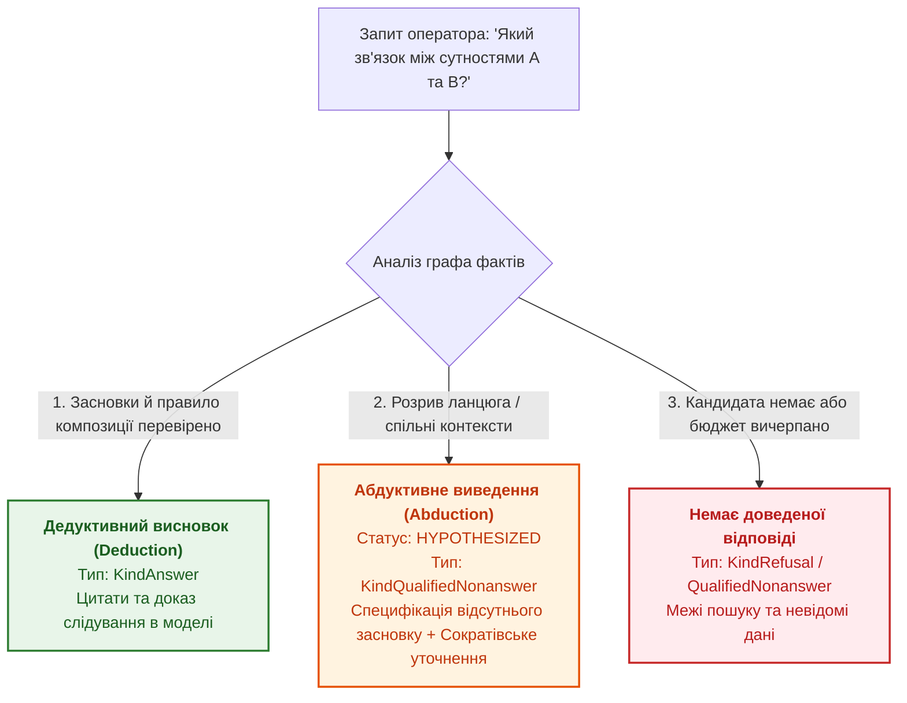
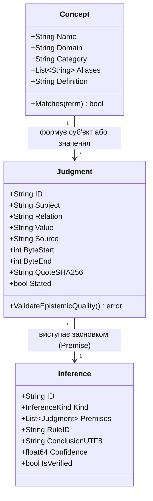
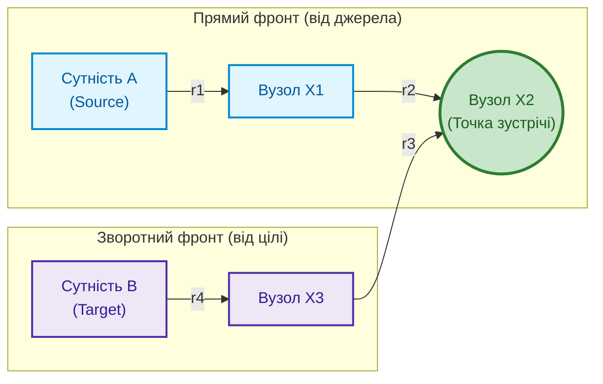
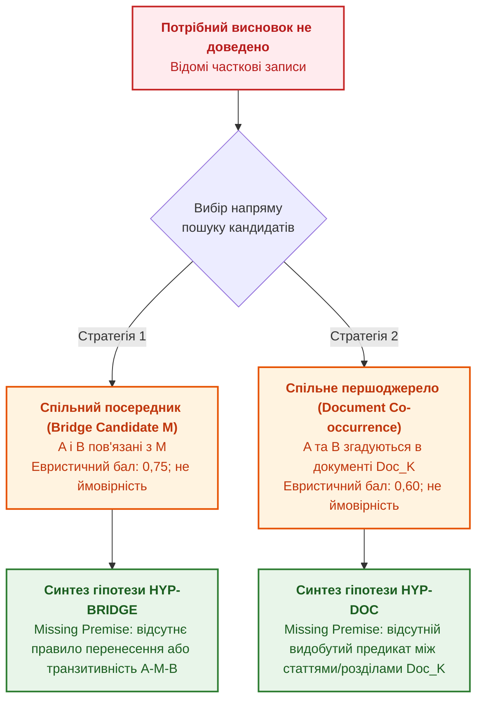
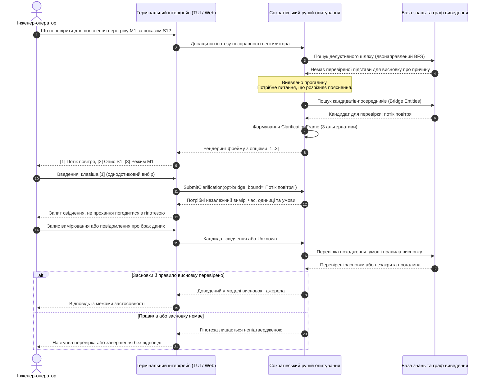

# Глава 34. Прогалини знань: реляційний пошук, абдукція та діалог уточнення

> **Книга:** [Архітектура доказових експертних систем](README.md) · [Частина VI: Нейро-символьні архітектури, абдукція та контроль галюцинацій](part-06-frontiers-neuro-symbolic.md)
> **Попередня глава:** [Глава 28. Дворежимні експертні системи: строгий висновок і дорадча гіпотеза](ch28-dual-mode-expert-systems.md)
> **Наступна глава:** [Глава 29. Нейро-символьна архітектура: мовні моделі та перевірка доказових підстав](ch29-neuro-symbolic-architecture.md)
> **Зміст книги:** [README.md](README.md)  
> **Автор:** [Микола Мартинович Федчик](about-the-author.md)
> **Передумови й маршрут:** факти, логічна імплікація та граф вводяться на простому прикладі; для §§6.3 і 7 потрібні множини, ймовірності та лінійна алгебра, потрібні твердження нагадано локально. Практикум: лабораторна робота №6 у `LABS.md`.
> **Очікувані результати:** відрізняти знайдений зв'язок від доведеного наслідку; обчислювати показники PCA за явного припущення повноти; формувати альтернативні пояснення й відсутні засновки; перевіряти сумісність та модельну достатність гіпотези; обирати розрізнювальне питання; використовувати міждоменні аналогії лише для пошуку кандидатів.

---

## Анотація

Експертна система може знати, де встановлено датчик і які відмови спричиняють перегрів, але не знати, яка саме відмова сталася зараз. У цій главі розглянуто роботу рушія пошуку та діалогової підсистеми за такої неповноти: як знайти наявні свідчення, запропонувати пояснення й запросити відсутню перевірку, не видаючи пропозицію за факт. Неповнота не потребує нескінченного домену: достатньо одного пропущеного виміру у скінченній базі.

Виклад рухається від подання понять і суджень до графового пошуку, індукції правил AMIE PCA, абдукції та сократівського уточнення. Розрізнено топологічний шлях, доказ слідування в моделі й фізичну причинність. Відсутній запис за припущенням відкритого світу означає невідоме, а не хибне; часткова повнота PCA є додатковою евристикою оцінювання. Окремо пояснено, чому семантична відстань і математична композиція можуть запропонувати дослідницький кандидат, але не підтверджують відкриття.

У цій монографії автором запропоновано навчальне поєднання відомих засобів пошуку, ізоляції гіпотез і фреймів уточнення. Go-бібліотека з тестами показує лише частину цієї інтеграції; вона не реалізує повного формального перевіряльника чи промислової системи. Новизну інтеграції та повідомлені апаратні характеристики не підтверджено наведеними прикладами.

---

## 1. Проблема неповноти знань та епістемічна дилема експертних систем

Прогалина знань стає практичною проблемою експертної системи, коли користувачеві потрібне рішення, а наявні записи підтримують кілька пояснень. Розглянемо навчальний приклад: датчик S1 повідомляє про перегрів модуля M1. У базі є схема встановлення S1 у M1 та правило «зупинка вентилятора за заданого навантаження спричиняє перегрів». Чи достатньо цього, щоб оголосити вентилятор несправним? Ні: таке саме повідомлення може виникнути через похибку датчика, а правило не стверджує, що зупинка вентилятора є єдиною причиною. Спочатку потрібно розрізнити записане спостереження, можливе пояснення й перевірку, яка відділить його від альтернативи.

Для цього прикладу достатньо знати, що факт є окремим записом, правило описує допустимий перехід від засновків до наслідку, а граф показує зв'язки між записами. Шлях від S1 до M1 допомагає знайти документацію, але сам по собі не доводить причини перегріву. Далі ці три інструменти буде введено послідовно: спочатку подання фактів, потім пошук і перевірка наслідку, нарешті побудова пояснень та вибір уточнювального питання. Усі числа й сценарії без окремого протоколу в цій главі є навчальними, не результатами вимірювань.

У практиці інженерії знань запит користувача чи зовнішньої аналітичної системи часто виходить за межі пошуку одиничного атрибута («Який розмір заголовка?» або «Який таймаут сесії?»). Найбільшу аналітичну цінність становлять реляційні питання системного зв'язку:
- *«Який нормативний зв'язок між регламентом безпеки ASIL D та компонентом ECU?»*
- *«Як стаття кодексу про договірні зобов'язання пов'язана з інститутом неустойки?»*
- *«Який ланцюг специфікацій пов'язує транспортний протокол і мережевий рівень управління?»*

Коли експертна система здійснює логічний пошук, можливі три фундаментальні стани бази знань:

<a id="obj-34-1"></a>

**Діаграма 34.1. Стани результату пошуку й перевірки**



1. **Перевірений наслідок:** є придатні засновки та коректне правило їх поєднання. Для відповіді `KindAnswer` потрібні і джерельні свідчення, і перевірка логічного переходу ([Глава 19](ch19-from-question-to-evidence.md)).
2. **Кандидат пояснення:** записи підказують напрям дослідження, але потрібного засновку чи правила бракує. Спільний документ або сусід у графі ще не є доказом.
3. **Результату немає в перевіреній області:** сутність невідома, придатних кандидатів не знайдено або обмежений пошук зупинено. Це не доказ відсутності зв'язку в реальному світі.

Під **припущенням відкритого світу (OWA)** відсутність запису про зупинку вентилятора означає «невідомо». Під **припущенням замкненого світу (CWA)** незнайдений запис вважають хибним лише там, де таке правило обґрунтоване повнотою даних, наприклад для повного реєстру дозволених ідентифікаторів. Безпечна відмова від відповіді не тотожна CWA: система може відмовити саме тому, що істинність невідома. Мовна модель також не зобов'язана вигадувати, але її правдоподібний текст сам не заповнює доказову прогалину.

Отже, потрібно не вгадати відсутній факт, а зробити прогалину видимою. **Абдукцією** далі названо побудову можливого пояснення, **сократівським діалогом** — послідовність питань, які перевіряють засновки й розрізняють альтернативи. Щоб це робити, спочатку визначимо, що саме зберігається у базі.

---

## 2. Епістемічна тріада класичної логіки в архітектурі системи

Епістемічна тріада потрібна, щоб у прикладі перегріву не змішати назву датчика, його повідомлення й висновок про несправність. Поняття називає об'єкт; судження щось про нього стверджує; висновок отримують за правилом із суджень. Тут класичне розрізнення використано як авторську архітектурну організацію даних, а не як доказ універсальності системи; логічні подання й виведення розглядаються в [[1]](#src-1).

<a id="obj-34-2"></a>

**Формула 34.2. Тріада подання знань**

```math
\text{Поняття (Concept)} \xrightarrow{\text{синтез}} \text{Судження (Judgment)} \xrightarrow{\text{виведення}} \text{Висновок (Inference)}
```

<a id="obj-34-3"></a>

**Діаграма 34.3. Типи понять, суджень і висновків**



### 2.1. Поняття (Concepts / Terms)
Щоб «S1» і «датчик температури S1» не стали різними об'єктами, система потребує нормалізованого **поняття**. Воно фіксує об'єкт або клас предметної області й характеризується:
- **Канонічним іменем (Canonical Name):** нормалізована форма (наприклад, `ASIL`, `Закон України`, `TCP`, `Договір`).
- **Доменом (Knowledge Domain):** належність до корпусу знань (`law-ua`, `automotive`, `rfc`, `system-eng`).
- **Категорією (Epistemic Category):** тип онтологічного вузла (`entity`, `protocol`, `law`, `component`, `safety_requirement`, `risk`).
- **Множиною аліасів та синонімів:** варіативні назви, акроніми та відмінкові форми, що зіставляються мовними адаптерами ([Глава 13](ch13-language-variability-vs-determinism.md)).

### 2.2. Судження (Judgments / Propositions)
Назви об'єктів не повідомляють, що сталося: потрібне **судження**, наприклад «S1 встановлено в M1». Це атомарне твердження, не автоматично істинний факт. Для простежуваності ([Глава 2](ch02-epistemology-of-machine-knowledge.md)) його пов'язують із джерелом:

<a id="obj-34-4"></a>

**Формула 34.4. Судження з координатами джерела**

```math
J = \langle S, R, V, \text{DocID}, [\beta_{\text{start}}, \beta_{\text{end}}), \text{SHA256}_{\text{quote}}, \mathcal{M} \rangle
```

Тут $J$ — запис; $S$ — ідентифікатор суб'єкта, $R$ — тип відношення, $V$ — об'єкт або типізоване значення; $`\text{DocID}`$ ідентифікує незмінну версію документа. Межі $`\beta_{\text{start}}`$ і $`\beta_{\text{end}}`$ — цілі зсуви в байтах: початок включено, кінець виключено, початок невід'ємний, кінець більший за початок і не перевищує розміру документа. $`\text{SHA256}_{\text{quote}}`$ — 256-бітний хеш саме цього фрагмента. $`\mathcal{M}`$ — маркер описового або нормативного статусу: `STATED`, `MUST`, `SHALL`, `MAY`; ці маркери інтерпретуються за правилами джерела, не підміняють його застосовності.

Наприклад, фрагмент ASCII `S1 installed in M1` займає 18 байтів: межі 0 і 18 вибирають увесь запис. Спочатку перевіряють межі й хеш, потім відповідність твердження фрагменту. Збіг хешу засвідчує незмінність цитати, а не правильність датчика чи семантичного перекладу. Тому проста перевірка непорожніх полів у §8 є лише структурним попереднім контролем, не повним допуском судження.

### 2.3. Висновки (Inferences / Conclusions)
Зі встановлення S1 у M1 не випливає несправність M1: для **висновку** потрібне правило. Нагадаємо modus ponens: коли істинні засновок і імплікація з цього засновку до наслідку, можна вивести наслідок. Якщо відомо, що вентилятор зупинився, навантаження відповідає умовам правила й правило застосовне, перегрів випливає в моделі. Зворотний перехід від перегріву до зупинки вентилятора цим правилом не дозволено.

> [!NOTE]
> **Три типи висновків і їхній доказовий статус**
> 1. Дедуктивне виведення: необхідний наслідок явно заданих засновків за перевіреним правилом; його сила обмежена коректністю моделі та застосовністю засновків.
> 2. Абдуктивне виведення: можливе пояснення спостереження; воно конкурує з іншими поясненнями та потребує перевірки.
> 3. Індуктивне виведення: узагальнення повторюваних записів, зокрема AMIE PCA; частота збігів не перетворює правило на логічний закон.
> *Керування рантаймом / Інженерний інваріант:* Забезпечує суворе відокремлення категорично доведених фактів від правдоподібних евристик та ймовірнісних асоціацій.

Назва поля `Confidence` не робить число ймовірністю: дедуктивний статус, частота PCA та евристичний бал мають різні значення. Наприклад, повідомлення S1 є спостереженням, зупинка вентилятора — абдуктивним кандидатом, а часте сусідство цих записів — матеріалом індукції. З таким розрізненням можна перейти до пошуку самих записів.

---

## 3. Детерміністичний багатоходовий реляційний аналіз

Реляційний аналіз відповідає на підготовче питання: які записи поєднують S1 із документацією M1? Для цього достатньо графа: вершини є поняттями чи значеннями, ребра — записаними судженнями; напрям ребра відрізняє суб'єкт від об'єкта. Мультиграф дозволяє кілька різних суджень між тією самою парою. Позначення графа $`\mathcal{G}`$, множини вершин $`\mathcal{V}`$ і ребер $`\mathcal{E}`$ далі стосуються скінченного знімка бази. Пошук знаходить маршрути для аналізу, а не самостійно вирішує їх нормативну допустимість.

### 3.1. Двонаправлений обмежений пошук у ширину (Bidirectional Bounded BFS)

Щоб знайти найкоротший маршрут, **пошук у ширину (BFS)** спочатку розглядає всіх сусідів старту, потім сусідів наступного рівня. На скінченному незваженому графі, за повного розгляду суміжності й без передчасного обрізання, перше досягнення цілі має мінімальну кількість ребер: усі коротші рівні вже пройдено. Це твердження про довжину маршруту, не про мінімальність чи правильність доказу.

Двонаправлений варіант розгортає фронти від обох кінців і шукає їх перетин. За приблизно рівномірного розгалуження з $b>1$ сусідами та глибини $d$ одностороннє дерево має порядок $b^d$ станів, збалансовані фронти — порядок $`b^{d/2}`$ кожен. Це оцінка деревоподібної моделі, не універсальна межа алгоритму. BFS із глобальною множиною відвіданих вершин обходить граф за лінійним у вершинах і ребрах часом; перелік усіх простих шляхів із окремою історією для кожного може бути експоненційним. Авторський профіль обмежує глибину шістьма ребрами, але сам цей ліміт не обмежує ширини черги; потрібні також бюджети станів, результатів і часу.

Для повного дерева з однаковим розгалуженням можна точно порахувати стани до обраного рівня:

<a id="obj-34-5"></a>

**Формула 34.5. Число станів рівномірного дерева пошуку**

```math
N_{\mathrm{tree}}=\sum_{i=0}^{d}b^i=\frac{b^{d+1}-1}{b-1}.
```

Тут $b\ge2$ — ціле число дочірніх станів кожної внутрішньої вершини, $d\ge0$ — ціла глибина в ребрах, $i$ — номер рівня, $`N_{\mathrm{tree}}`$ — число станів, включно з коренем. Для b = 3 та d = 4 додаємо 1, 3, 9, 27 і 81, отримуємо 121. Два фронти до рівня 2 у такій ідеалізованій моделі мають по 13 станів, разом 26 до врахування перетину. Це пояснює виграш збалансованого пошуку, але не гарантує його на довільному графі.

Наприклад, шлях S1 → M1 → D1 має два ребра. За ліміту один його не буде знайдено; за ліміту два він доступний. Негативний результат першого запуску означає лише «не знайдено в межах одного ребра». Наведена схема показує зустріч фронтів; спрощена бібліотека §8 використовує один фронт і два індекси суміжності, а не повну двонаправлену реалізацію.

<a id="obj-34-6"></a>

**Діаграма 34.6. Зустріч пошукових фронтів**



Алгоритм підтримує обов'язкові непорушні інваріанти:

> [!NOTE]
> **Три вимоги до відтворюваного двонаправленого BFS**
> 1. Захист від зациклення (*Cycle Guard*): збереження бітової маски відвіданих вузлів у стані черги для миттєвого відсікання рекурсивних петель графа.
> 2. Обхід за оберненим відношенням (*Inverse Traversal*): зворотне ребро використовують лише за наявності явно визначеного `inverse_of(R)`; воно не робить вихідне відношення симетричним.
> 3. Детерміністичне лексикографічне впорядкування: стабільне ранжування шляхів за довжиною та лексикографічним порядком назв зв'язків для 100% повторюваності результату.
> *Керування рантаймом / Інженерний інваріант:* Цикли відсікаються; відтворюваність потребує незмінного знімка, нормалізації, повного ключа впорядкування та однакових бюджетів. Вичерпання бюджету означає незавершений пошук, не доведену незв'язність.

1. **Інваріант захисту від циклів (Cycle Guard):** стан черги пошуку зберігає бітову маску або хеш-таблицю відвіданих вузлів поточного шляху. Будь-який перехід, що призводить до вже пройденого вузла, негайно відсікається.
2. **Інваріант зворотного обходу (Inverse Traversal):** за записом із суб'єктом $S$, відношенням $R$ та об'єктом $V$ можна навігаційно перейти від $V$ до $S$ з міткою `inverse_of(R)`. Це не твердження симетричності $R$: зі встановлення S1 у M1 не випливає встановлення M1 у S1.
3. **Інваріант детерміністичного впорядкування (Deterministic Ordering):** знайдені шляхи сортуються спочатку за зростанням довжини (кількості кроків), а шляхи однакової довжини — лексикографічно за послідовністю назв відношень та ідентифікаторів джерел.

### 3.2. Композитний ланцюг свідчень (Composite Path Evidence)

Після пошуку потрібно відповісти на два різні питання: чи підтверджено кожен запис і чи дозволено поєднати записи для потрібного висновку? Для першого система збирає ланцюг цитат:

<a id="obj-34-7"></a>

**Формула 34.7. Вектор джерельних свідчень маршруту**

```math
\text{EvidenceChain}(\mathcal{P}) = \left[ \text{Cite}(J_1), \text{Cite}(J_2), \dots, \text{Cite}(J_m) \right]
```

Тут $`\mathcal{P}`$ — маршрут із $m$ ребер, $m$ — додатне ціле число кроків, $`J_i`$ — судження кроку з індексом $i$ від 1 до $m$, $`\text{Cite}`$ — посилання на версію джерела, байтовий фрагмент і хеш із §2.2. Наприклад, для S1 → M1 → D1 потрібні дві окремі цитати, а не одна цитата на весь маршрут. Відсутня цитата відхиляє ланцюг як джерельно неповний.

Навіть дві справжні цитати «S1 встановлено в M1» та «M1 описано в D1» не доводять «S1 відповідає всім вимогам D1». Потрібне окреме застосовне правило композиції з умовами та винятками. Отже, композитний ланцюг є необхідним свідченням походження, але не достатнім доказом будь-якого вислову про кінці шляху. Далі розглянемо, як знайти правильні кінці шляху в мовному запиті.

### 3.3. Незалежне від доменних словників композитне проектування понять та динамічні лексичні проектори

Композитне проєктування понять потрібне перед пошуком, коли «датчик температури S1» не збігається буквально з ідентифікатором `S1` у графі. У складнішому запиті «протокол транспортного рівня в Internet» кілька словосполучень можуть відповідати різним вершинам. Потрібно запропонувати кандидатні зіставлення, зберегти неоднозначність і запросити вибір, а не мовчки підмінити суб'єкт.

Для детермінованого розв'язання цієї проблеми розроблено метод динамічного композитного проектування понять. Метод реалізує граматичну проєкцію складних іменникових груп на множину канонічних вершин графа онтології за допомогою перестановки компонентів:
- генерація прямих біграм і триграм на основі стрижневого іменника та залежних означень;
- реверсна синтаксична інверсія для конструкцій із родовим відмінком («протокол рівня» $`\to`$ «рівневий протокол»);
- динамічне виділення контекстного домену без внесення статичних словникових списків у бінарний код рушія.

Ядро рушія виведення не залежить від доменних словників, але правила проектування залежать від мови. Інверсія родового відмінка спирається на граматику української мови, і для англійських чи німецьких стандартів потрібні власні правила. Тому правила й лексикони постачаються у версіонованих маніфестах окремо від коду рушія, і додавання мови чи домену не змінює бінарний код. Однаковий запит і однакові маніфести дають однакову множину кандидатів у вершини онтології, тож проектування є детермінованим.

Для перевірки відомих доменних літералів у вихідному коді автор пропонує індекс чистоти виконання, який система безперервної інтеграції (CI) обчислює для кожної зміни коду:

<a id="obj-34-8"></a>

**Формула 34.8. Індекс точних збігів доменних літералів**

```math
E_{\text{runtime}} = 1 - \frac{\lvert L_{\text{code}} \cap L_{\text{dom}} \rvert}{\lvert L_{\text{code}} \rvert}
```

Тут:

- $`L_{\text{code}}`$ є множиною рядкових літералів вихідного коду рушія без тестів і тестових даних, зведених до нижнього регістру;
- $`L_{\text{dom}}`$ є множиною доменних термінів: записів лексиконів із маніфестів, міток вершин онтології та шляхів до нормативних джерел, теж у нижньому регістрі;
- $`\lvert \cdot \rvert`$ є кількістю елементів множини;
- $`E_{\text{runtime}} \in [0, 1]`$; значення 1 означає, що жоден літерал коду не збігається з доменним терміном.

Читається так: частка різних нормалізованих літералів коду, що не збігаються з відомими доменними термінами. Перевірка є статичним аналізом визначеної кодової бази, а не вибіркою, тому для конкретної ревізії коду й маніфестів результат детермінований. Умовний приклад: у коді рушія 1840 різних рядкових літералів, і два з них («transport protocol» та шлях до тексту RFC 9293) збігаються з доменними термінами. Тоді $`E_{\text{runtime}} = 1 - 2/1840 \approx 0{,}9989`$, і CI блокує злиття змін, доки обидва терміни не перенесено в маніфест. Якщо множина літералів порожня, показник не визначено: перевірка повідомляє про неможливість оцінювання і не підтверджує чистоту коду. Межі показника: він бачить лише точні збіги після нормалізації до нижнього регістру, тож термін, складений із частин під час виконання, записаний як частина довшого літералу або закодований інакше, він не виявить, а результат залежить від повноти $`L_{\text{dom}}`$.

> [!NOTE]
> **Три положення авторського методу динамічного композитного проектування термінів**
> 1. Автором формалізовано механізм проектування багатослівних синтаксичних конструкцій природної мови запиту на нормалізовані вузли канонічної онтології першоджерел через генерацію біграмних та триграмних перестановок.
> 2. Процес проектування спирається виключно на версіоновані відкриті маніфести та лексикони без використання жорстко закодованих словників у кодовій базі ядра експертної системи.
> 3. Синтаксичний пріоритет повного суб'єктного словосполучення зменшує ризик хибного вибору; кілька допустимих зіставлень повертаються на уточнення, а не оголошуються тотожними.
> *Керування рантаймом / Інженерний інваріант:* Для кожної ревізії, яку пропускає перевірка CI, $`E_{\text{runtime}} = 1`$; це засвідчує лише відсутність точних збігів із доступним переліком доменних термінів у перевірених літералах.

Тепер є спосіб знайти записи й перевірити їх походження. Наступне питання інше: чи можна із багатьох повторюваних зв'язків запропонувати загальне правило? Тут починається індукція, а не продовження дедуктивного доказу.

---

## 4. Автономний майнінг асоціативних правил (AMIE PCA)

Майнінг правил потрібний, коли багато знайдених шляхів мають однакову форму: чи можна запропонувати спільне правило, не виписуючи кожний випадок вручну? Наприклад, у навчальному реєстрі часто разом записано належність підсистеми, її відповідність профілю й вимогу аудиту системи. Повторення підказує кандидата, але не доводить, що аудит потрібний для всіх систем. Спочатку введемо форму такого кандидата, потім перевіримо, як пропущені записи змінюють оцінку.

Для цього використовується алгоритм **AMIE (Association Rule Mining under Incomplete Evidence)** під **припущенням часткової повноти (Partial Completeness Assumption, PCA)** Галарраги та співавторів [[2]](#src-2), що спирається на теоретичні засади реляційного навчання Люка Де Редта (Luc De Raedt) [[6]](#src-6).

### 4.1. Формальні правила та припущення PCA

Щоб порівнювати повторення, потрібні **тіло** правила (умови зліва) й **голова** (кандидатний наслідок справа). У цьому розділі розглянуто дві форми правил; їх запис стрілкою є шаблоном для перевірки, а не підтвердженням істинності.

#### 4.1.1. Прямі бінарні правила

Найпростіше питання: чи супроводжується один зв'язок іншим для тієї самої пари об'єктів?

<a id="obj-34-9"></a>

**Формула 34.9. Кандидат прямого бінарного правила**

```math
r_1(X, Y) \implies r_2(X, Y)
```

Тут $X$ і $Y$ — змінні над скінченною множиною сутностей; $`r_1`$ і $`r_2`$ — бінарні предикати з булевими значеннями у заданій інтерпретації. Усі змінні правила універсально квантифіковані. Навчальний приклад: «якщо X заміщує Y, то X оновлює Y». Для конкретної пари документів наявність обох записів підтримує кандидата; пара із заміщенням, але без відомого оновлення за OWA лишається невизначеною, не автоматично контрприкладом.

#### 4.1.2. Транзитивні ланцюгові правила

Коли зв'язок проходить через посередника, перевіряють композицію двох відношень:

<a id="obj-34-10"></a>

**Формула 34.10. Кандидат композиції відношень**

```math
r_1(X, Y) \land r_2(Y, Z) \implies r_3(X, Z)
```

Тут $Z$ — третя змінна сутності, $`r_1`$, $`r_2`$ і $`r_3`$ — типізовані бінарні відношення; кон'юнкція вимагає обох записів із тим самим $Y$. Це загальна композиція, а не транзитивність довільних відношень. Справжня транзитивність є окремим випадком однакового предиката у всіх трьох позиціях. З належності функції блоку й сертифікації блоку не випливає сертифікація функції без правила про сферу сертифіката. Саме це правило й належить перевірити, а не вважати знайденим разом зі шляхом.

За OWA невідомий наслідок не можна зарахувати ні як успіх, ні як доведену помилку. **PCA** для оцінювання робить сильніше локальне припущення: якщо для суб'єкта вже відомий хоча б один об'єкт цільового відношення, його список об'єктів вважається повним. Далі використовується суб'єктно-орієнтований варіант PCA; орієнтацію потрібно явно обрати для іншого відношення. Наприклад, запис одного аудитора компанії не гарантує повноти переліку всіх аудиторів: PCA може бути хибним за систематичного недозаповнення. Це евристика знаменника, не перевірений факт про світ.

### 4.2. Метрики якості індукованих правил

Метрики потрібні для черги перевірки: яке правило дослідити раніше? Позначимо кандидата $`\mathcal{R}`$, його тіло $`\mathcal{B}`$, голову $r(X,Y)$. У підрахунках тіло виконується, якщо є хоча б одна підстановка його внутрішніх змінних; одна й та сама пара $(X,Y)$ рахується лише раз. Усі множини скінченні, а метрики залежать від знімка бази й прийнятого PCA.

Підготуємо спільний навчальний приклад правила аудиту. Проміжну підсистему позначено $Y$, цільовий профіль — $Z$; одиницею рахунку тут є пара $(X,Z)$, не кількість систем і не кількість шляхів:

<a id="obj-34-11"></a>

**Формула 34.11. Кандидат правила аудиту**

```math
\mathrm{HasSubsystem}(X,Y)\land\mathrm{CompliesWith}(Y,Z)
\implies \mathrm{RequiresAudit}(X,Z).
```

Предикати означають відповідно належність підсистеми, запис відповідності профілю та запис вимоги аудиту. Умови й наслідок у цьому прикладі синтетичні, не положення стандарту.

<a id="obj-34-12"></a>

**Таблиця 34.12. Навчальний набір пар для оцінювання PCA**

| Група пар | Тіло знайдено | Голова знайдена | Суб'єкт має хоча б одну голову | Кількість пар |
|---|---|---|---|---|
| Підтверджені збіги | так | так | так | 18 |
| Інший відомий профіль аудиту того самого суб'єкта | так | ні | так | 2 |
| Про аудит суб'єкта немає записів | так | невідомо | ні | 8 |
| Відомі голови без знайденого тіла | ні | так | так | 6 |

Отже, тіло дає 28 різних пар, PCA оцінює 20 із них, збігів 18, а всіх відомих голів 24. Ці числа використаємо в кожній метриці, щоб не змінювати знаменник непомітно.

#### 4.2.1. Абсолютна підтримка (Absolute Support)

Кількість унікальних пар $(X, Y)$, для яких у графі знань одночасно виконуються тіло правила $`\mathcal{B}`$ та заголовок $r(X, Y)$:

<a id="obj-34-13"></a>

**Формула 34.13. Абсолютна підтримка кандидата**

```math
\mathrm{Supp}(\mathcal{R}) = \lvert \{ (X, Y) : \mathcal{B} \land r(X, Y) \} \rvert
```

Тут $`\lvert\cdot\rvert`$ — кількість різних пар, $`\mathbb{N}_0`$ — невід'ємні цілі числа; величина вимірюється в парах, не у відсотках. $`\mathcal{B}`$ і $r$ беруться з того самого знімка. Для таблиці підтримка дорівнює 18 парам. Два різні шляхи через підсистеми до тієї самої пари не збільшують підтримку: інакше дублювання документа штучно поліпшило б оцінку.

#### 4.2.2. PCA-достовірність (PCA Confidence)

За припущення часткової повноти (PCA) знаменник враховує лише ті випадки, коли суб'єкт $X$ має хоча б одне підтверджене в базі значення для цільового відношення $r$:

<a id="obj-34-14"></a>

**Формула 34.14. Суб’єктно-орієнтований PCA-бал**

```math
\mathrm{Conf}_{\mathrm{PCA}}(\mathcal{R}) = \frac{\lvert \{ (X, Y) : \mathcal{B} \land r(X, Y) \} \rvert}{\lvert \{ (X, Y) : \mathcal{B} \land \exists Y' (r(X, Y')) \} \rvert}
```

Тут $Y'$ — будь-який відомий об'єкт цільового відношення того самого $X$; існування такого об'єкта допускає пару в знаменник за PCA. Частка безрозмірна, належить відрізку від 0 до 1 за додатного знаменника; при нульовому знаменнику показник невизначений і кандидат не оцінюється. Для таблиці спочатку відкидаємо 8 пар без жодної голови суб'єкта, отримуємо знаменник 20, потім ділимо 18 на 20 й отримуємо 0,90. За механічного CWA-знаменника 28 частка була б близько 0,643. Різниця виникла через припущення повноти, не через появу нових доказів. Бал PCA не є ймовірністю істинності правила на майбутньому запиті.

#### 4.2.3. Покриття заголовка (Head Coverage)

Частка відомих у базі пар відношення $r$, для яких також знайдено тіло кандидатного правила:

<a id="obj-34-15"></a>

**Формула 34.15. Покриття відомої голови**

```math
\mathrm{HC}(\mathcal{R}) = \frac{\mathrm{Supp}(\mathcal{R})}{\lvert \{ (X, Y) : r(X, Y) \} \rvert}
```

Знаменник тут рахує всі різні відомі пари голови у знімку. Безрозмірне покриття належить відрізку від 0 до 1 за непорожньої голови; інакше воно невизначене. У таблиці ділимо 18 на 24 й отримуємо 0,75: кандидат охоплює три чверті відомих записів цільового відношення. Це не оцінка всіх невідомих фактів і не доказ узагальнення за межами бази.

#### 4.2.4. Замикання циклу прийняття рішень (Closed-Loop Decision)

> [!NOTE]
> **Чотири прикладові рівні відбору кандидатів AMIE PCA**
> 1. Пріоритетна перевірка ($`\mathrm{Conf}_{\mathrm{PCA}} \ge 0{,}90`$, $`\mathrm{Supp} \ge 10`$): реєстрація `VerifiedCandidate` лише в черзі кандидатів; назва означає проходження числового фільтра, не доведеність правила.
> 2. Обмежена підтримка ($`\mathrm{Conf}_{\mathrm{PCA}} \ge 0{,}90`$, $`3 \le \mathrm{Supp} < 10`$): статус `QUALIFIED` і запит додаткових незалежних прикладів.
> 3. Карантин ($`0{,}70 \le \mathrm{Conf}_{\mathrm{PCA}} < 0{,}90`$, $`\mathrm{Supp} \ge 3`$): статус `QUARANTINE_HYPOTHESIS` і пошук контрприкладів чи уточнення PCA.
> 4. Відсікання за профілем ($`\mathrm{Conf}_{\mathrm{PCA}} < 0{,}70`$ або $`\mathrm{Supp} < 3`$): кандидат не проходить цей фільтр; це не доказ його хибності. Невизначені метрики повертаються на перевірку даних, а не порівнюються з порогом.
> *Керування рантаймом / Інженерний інваріант:* Пороги є навчальними параметрами цього профілю, не нормою чи каліброваною гарантією. Жодна градація не відкриває дедуктивний допуск: потрібні окремі підстави правила, область застосовності та перевірка засновків.

У таблиці підтримка 18 і PCA-бал 0,90 дають першу градацію. Система ставить правило аудиту на початок черги дослідження, але не відповідає категорично на запит про нову систему. Навіть підпис експерта фіксує відповідальність за рішення, а не перетворює статистику на логічну необхідність. Потрібно знайти застосовне правило аудиту або залишити результат гіпотезою.

Ресурсний профіль теж не є теоремою про AMIE. Для переліку ланцюгів довжини $k$ груба межа числа розгортань має вигляд:

<a id="obj-34-16"></a>

**Формула 34.16. Межа переліку ланцюгів**

```math
N_{\mathrm{chain}}\le \lvert\mathcal{E}\rvert\,d_{\max}^{k-1}.
```

Тут $`N_{\mathrm{chain}}`$ — число кандидатних ланцюгів, $`\lvert\mathcal{E}\rvert`$ — число ребер знімка, $`d_{\max}\ge1`$ — найбільше число дозволених продовжень, $k\ge1$ — число ребер ланцюга. Одиниця — кандидат; межа припускає не більше $`d_{\max}`$ продовжень на кожному кроці. Для 100 ребер, трьох продовжень і довжини 3 отримуємо не більше 900 ланцюгів. Це не повна часова складність AMIE: перевірка підстановок, з'єднання відношень і загальні форми правил мають додаткові витрати.

Авторський приклад бюджету: довжина до трьох ребер, 300 с на цільове відношення, 4 ГБ пам'яті. Його придатність потребує вимірювання на визначеному корпусі. Перерваний майнінг позначається неповним; відсутність кандидата після тайм-ауту не означає відсутності правила. Після пошуку повторень повернімося до іншої задачі: як пояснити одне конкретне спостереження за браку даних?

---

## 5. Символьне абдуктивне виведення робочих гіпотез

Абдуктивне виведення потрібне, коли про конкретне спостереження відомо більше, ніж про його пояснення. Для S1 є повідомлення про перегрів, але немає перевірки вентилятора й незалежного термометра. Повернення BFS без маршруту саме по собі не запускає доказ неможливості: могла завадити межа глибини чи інша форма правила. Абдуктивний рушій пропонує, які допустимі засновки варто перевірити, зберігаючи їх окремо від фактів.

### 5.1. Абдукція за Чарльзом Пірсом

Щоб не переплутати пояснення з оберненою імплікацією, нагадаємо зміст абдукції Пірса [[3]](#src-3): спостереження робить гіпотезу вартою дослідження, якщо за неї спостереження було б очікуваним. Це не дедуктивний висновок її істинності. У логічному програмуванні [[5]](#src-5) спочатку задають дозволені припущення та обмеження цілісності:

<a id="obj-34-17"></a>

**Формула 34.17. Дослідницький крок абдукції**

```math
E\ (\mathrm{observed});\quad \Sigma,H\models E
\quad\leadsto\quad \text{дослідити }H\text{ як можливе пояснення}.
```

Тут $E$ — цільове спостереження, $H$ — дозволений набір припущень, $\Sigma$ — фонові правила й обмеження; $\models$ означає істинність наслідку в кожній моделі засновків, а хвиляста стрілка — дослідницьку дію, не логічний доказ. Усі значення тут логічні, без фізичних одиниць. Потрібно також перевірити сумісність засновків, як у §5.3. Сам запит «чи пов'язані A і B?» не є спостереженням їхнього реального зв'язку.

У прикладі $E$ — повідомлення S1. Нехай фонова модель допускає два пояснення: зупинка вентилятора за справного S1 або хибне повідомлення S1 за справного вентилятора. Обидві гіпотези можуть пояснювати той самий запис. Якщо за всіма доступними вимірами вони нерозрізнювані, причина **неідентифікована** в цій моделі. Мінімальна кількість припущень чи вищий бал ранжування не усувають альтернативи; потрібна перевірка, наприклад незалежний вимір температури. Якщо обидві несправності можуть співіснувати, їхню комбінацію теж потрібно включити до кандидатного простору.

<a id="obj-34-18"></a>

**Діаграма 34.18. Напрями пошуку відсутнього засновку**



### 5.2. Топологічні евристики генерації гіпотез

Топологічні евристики відповідають лише на питання «де шукати відсутній засновок?». Для їх застосування потрібні вже введені вершини, ребра й джерела. На відміну від абдуктивного пояснення спостереження, такі підказки ще можуть не мати правила, яке пов'язує їх із цільовим наслідком.

#### 5.2.1. Стратегія спільного посередника (Shared Neighbor / Bridge Entity)
Пошук спільного посередника локалізує записи, які варто прочитати разом:

<a id="obj-34-19"></a>

**Формула 34.19. Кандидат спільного сусіда**

```math
M\in N(A)\cap N(B).
```

Тут $N(A)$ й $N(B)$ — скінченні множини сусідів вершин $A$ і $B$ у дозволених напрямках навігації; $M$ — їх спільний елемент. У навчальному записі S1 і вентилятор F1 обидва встановлені в M1. Перетин містить M1, але звідси не випливає ані справність F1, ані причина сигналу S1. Підказка має звучати: «перевірити правило теплового впливу F1 на S1 за навантаження», а не «транзитивність доведено». Бал 0,75 у §8 є лише умовним пріоритетом цієї стратегії; без калібрування його не називають імовірністю.

#### 5.2.2. Стратегія спільного першоджерела (Document Co-occurrence)
Спільний документ дає слабшу підказку: можливо, зв'язок не видобуто, але можливо, документ просто містить багато незалежних тем. Система перевіряє збіг джерела:

<a id="obj-34-20"></a>

**Формула 34.20. Перевірка спільності джерела**

```math
\exists J_1, J_2 : J_1.\text{Subject} = A \land J_2.\text{Subject} = B \land J_1.\text{Source} = J_2.\text{Source} = \mathcal{D}
```

Тут $`J_1`$ і $`J_2`$ — записи з множини суджень, `Subject` — суб'єкт, `Source` — ідентифікатор версії джерела $`\mathcal{D}`$; перевірка логічна, без одиниць. Якщо в інструкції M1 окремо описано S1 і запобіжник, спільність джерела лише спрямовує до відповідних секцій. Відсутній засновок — конкретне відношення між ними та умови його дії. Бал 0,60 так само є навчальним пріоритетом, не частотою правильних пояснень.

#### 5.2.3. Таксономічне успадкування (Hypernymy Fallback)
Таксономія допомагає знайти правило загального класу, але не гарантує його застосовності до кожного підвиду. Якщо S1 належить класу термодатчиків, можна дослідити їх загальне правило калібрування; спеціальна конструкція S1 може бути винятком. Відсутність записаного винятку за OWA не доводить відсутності винятку. Для категоричного успадкування потрібні універсальне застосовне правило й виконані умови; інакше це спростовна гіпотеза ([Глава 31](ch31-syllogistic-reasoning-and-relation-lattices.md)).

### 5.3. Інваріант епістемічної гігієни (Hypothesis Isolation Invariant)

Головна небезпека висунення гіпотез полягає у ризику їх сприйняття користувачем або зовнішнім процесом як доведених фактів. Спираючись на теорію спростовних міркувань Джона Поллока [[7]](#src-7), референсна архітектура впроваджує непорушний **інваріант епістемічної гігієни**:

> [!NOTE]
> **Чотири правила маркування гіпотез у цьому інтерфейсі**
> 1. Заборона категоричної ствердності: суворе блокування термінального статусу `KindAnswer` для будь-яких результатів абдуктивного виведення.
> 2. Типізована модальність відмови: повернення гіпотез виключно через контракти `KindQualifiedNonanswer` або `KindClarification`.
> 3. Стандартизоване візуальне маркування: обов'язкове обрамлення відповіді маркером `--- [ПРИПУЩЕННЯ (РОБОЧА ГІПОТЕЗА)] ---`.
> 4. Явна декларація відсутнього засновку (*Missing Premise*): назвати непідтверджений факт або правило, альтернативи й розрізнювальну перевірку; евристичний бал не подавати як імовірність істинності.
> *Керування рантаймом / Інженерний інваріант:* Інтерфейс має зберігати гіпотетичний статус у всіх вихідних каналах; реалізацію правила перевіряють тестами для кожного інтерфейсу й експорту.

Формальний перевіряльник може перевірити, чи сумісна робоча гіпотеза із засновками та чи пояснює вона цільове спостереження в межах моделі. Для цього потрібні дві окремі перевірки:

<a id="obj-34-21"></a>

**Формула 34.21. Сумісність і достатність гіпотези в моделі**

$$
\mathrm{SMT}(\Sigma \land H)=\mathrm{SAT},\qquad
\mathrm{SMT}(\Sigma \land H \land \neg E)=\mathrm{UNSAT}.
$$

Тут $\Sigma$ — явно задані формальні обмеження моделі, $H$ — кандидатна гіпотеза, $E$ — цільове спостереження; `SMT` — розв'язувач задовільності, `SAT` означає існування допустимої оцінки, `UNSAT` — її відсутність. Перша умова запобігає вакуумному слідуванню із суперечливих засновків; друга виключає контрприклад до достатності $H$ для $E$ за умов $\Sigma$. Це класичний критерій слідування: контрмодель до наслідку є моделлю засновків і заперечення наслідку. Він застосовний до заданої логіки за коректного кодування й надійного результату розв'язувача. Саме $E$ не додають у $\Sigma$ під час цієї перевірки достатності, інакше другий запит стане тривіальним.

Розберімо три булеві випадки повним перебором оцінок. За порожнього фону й припущення $H=1$ є дві оцінки $E$: 0 і 1; перший запит `SAT`, другий також `SAT`, тому достатність не доведено. Якщо фон містить правило $H\Rightarrow E$, залишається лише оцінка $H=1$, $E=1$: результати `SAT` та `UNSAT`, достатність доведено в моделі. Якщо фон забороняє $H$, обидва запити `UNSAT`: кандидат несумісний і відхиляється, попри другий результат. Додавання правила до моделі саме не підтверджує його фізичної істинності.

Суперечливий кандидат відхиляється; незавершена перевірка, `UNKNOWN` або вичерпання погодженого бюджету часу чи пам'яті не зараховуються як доказ. Навіть після обох успішних перевірок результат зберігає статус робочої гіпотези за правилами вище. Причинний висновок потребує окремої структурної причинної моделі, визначеної інтервенції та перевірених фізичних припущень; додавання $\neg H$ до незмінної моделі не є інтервенцією.

Отже, перевірка відповіла на питання достатності всередині моделі, але не вибрала істинне пояснення з альтернатив. Для цього потрібні нові свідчення; наступний розділ показує, як запитати саме їх.

---

## 6. Сократівський діалог та змішана ініціатива

Сократівський діалог перетворює знайдену прогалину на питання, яке користувач може перевірити. У прикладі S1 питання «чи справді температура висока за незалежним приладом?» корисніше за «ви погоджуєтеся, що зламався вентилятор?»: перше розрізняє пояснення, друге нав'язує одне з них. **Змішана ініціатива** [[4]](#src-4) означає, що система пропонує напрям, а оператор може надати свідчення, змінити область або відмовитися. Це метод уточнення засновків, не змодельована дискусія з науковими авторитетами.

### 6.1. Структура фрейму уточнення (Clarification Frame)

Фрейм уточнення потрібен, щоб зберегти питання та значення кожного вибору, не змушуючи користувача повторно формулювати весь запит. `message` пояснює прогалину, `dimension` називає аспект уточнення, а кожна опція має стабільний `id`, текст `label`, прив'язку `bound_entity` та дію `context_hint`. Продовжимо приклад S1 і M1: оператор може перевірити потік повітря, уточнити справність вимірювального каналу або звузити режим застосування правила. Жодний вибір сам не підтверджує несправності вентилятора:

```json
{
	"message": "Для перегріву M1 за показом S1 несправність вентилятора ще не доведено. Чи перевірити гіпотезу про недостатній потік повітря?",
	"dimension": "RelationEvidence",
  "options": [
    {
      "id": "opt-bridge",
	"label": "Перевірити потік повітря незалежним вимірюванням",
	"bound_entity": "Потік повітря",
	"context_hint": "abductive_bridge:Потік повітря"
    },
    {
      "id": "opt-def-from",
	"label": "Переглянути опис S1 та умови його вимірювань",
	"bound_entity": "S1",
      "context_hint": "definition"
    },
    {
      "id": "opt-scope",
	"label": "Уточнити ревізію M1, навантаження та режим роботи",
      "bound_entity": "",
      "context_hint": "scope_refinement"
    }
  ]
}
```

Вибір `opt-bridge` означає «дослідити посередника», а не «підтвердити гіпотезу». Відповідь-вимір додатково має містити походження, час, одиниці та умови отримання; натискання кнопки не замінює цих даних. Наприклад, для S1 потрібно записати показ незалежного термометра, а не лише слово «так».

### 6.2. Взаємодія з інтерфейсами людини-оператора

Інтерфейс має зберегти різницю між навігацією та доказом. У терміналі чи веб-консолі фрейм активує перелік дій:
- Оператор бачить нумерований перелік альтернатив `[1]`, `[2]`, `[3]`.
- Натискання відповідної цифри або клавіші `Enter` не вимагає повторного набору довгого запиту, а ініціює миттєвий перехід до дослідження обраної гілки графа знань.
- Якщо оператор обирає `opt-bridge`, система формує дочірній запит дослідження, а не змінює істинність засновку. Повна реалізація може зберігати частковий стан (`PartialProofState`), прив'язаний до версії бази; після зміни джерел його потрібно перевірити заново. Бібліотека §8 не реалізує таке збереження.

Протокол взаємодії в режимі сократівського уточнення та змішаної ініціативи проілюстровано на діаграмі послідовності.

<a id="obj-34-22"></a>

**Діаграма 34.22. Протокол сократівського уточнення**



> [!NOTE]
> **Три прийоми інтерфейсу для уточнення запиту**
> 1. Змішана ініціатива (*Mixed-Initiative*): перехід системи від пасивної відмови до проактивного формування структурованого простору альтернатив `ClarificationFrame`.
> 2. Контекстна прив'язка сутностей: інтеграція в опції вибору ідентифікаторів проміжних містків (`bound_entity`), визначень термінів або звуження нормативного домену.
> 3. Однодотикова навігація оператора: мінімізація когнітивного навантаження в інтерфейсах (TUI/CLI) через прямий вибір нумерованих гілок графа без повторного введення запитів.
> *Керування рантаймом / Інженерний інваріант:* Вибір гілки лише керує пошуком; відсутність відповіді або нових свідчень може залишити невизначеність незмінною. Діалог має дозволяти завершення без доведеного результату.

### 6.3. Динамічна епістемічна логіка (DEL) для мінімізації кроків сократівського опитування

Динамічна епістемічна логіка потрібна тут для точного опису того, що змінює підтверджена відповідь: не фізичний об'єкт, а множину сумісних із даними пояснень. Спочатку розглянемо скінченний список можливих станів, або **світів**, і питання, яке розбиває його на групи. Таке подання готує формальну модель DEL публічних оголошень [[10]](#src-10), [[11]](#src-11).

Модель Кріпке позначено $`\mathcal{M}`$: вона містить непорожню скінченну множину світів $W$, відношення нерозрізнюваності для кожного спостерігача та оцінку істинності висловлень у світах. Для одного спостерігача без подальших вкладених тверджень про знання достатньо відстежувати саму множину $W$. Різні світи мають охоплювати також комбінації відмов, якщо їх не виключено припущенням задачі.

Нехай $q$ — допустиме питання з множини $`\mathcal{Q}`$, $\alpha$ — одна з відповідей множини $`\mathrm{Ans}(q)`$, а $`\varphi_\alpha`$ — перевірене твердження, яке ця відповідь означає. За ідеального, безпомилкового й вичерпного розбиття оновлення залишає світи:

<a id="obj-34-23"></a>

**Формула 34.23. Звуження множини світів після перевіреної відповіді**

$$
W_\alpha = \{w \in W \mid (\mathcal{M}, w) \models \varphi_\alpha\}.
$$

Тут $w$ — один можливий світ; $`\models`$ означає істинність відповіді в ньому, $`W_\alpha`$ — залишкова множина. Наприклад, із чотирьох станів «вентилятор», «датчик», «повітряний канал», «перевантаження» незалежне підтвердження реального перегріву відкидає лише стан «датчик», якщо модель саме так описує ці стани. Залишається три кандидати, а не доведена причина. Ненадійне повідомлення не можна використовувати як істинне публічне оголошення: потрібні модель похибки або окремий статус неперевіреної відповіді.

Для вибору наступного питання можна мінімізувати найбільшу залишкову групу:

<a id="obj-34-24"></a>

**Формула 34.24. Однокроковий мінімакс питання**

$$
q^* = \arg\min_{q \in \mathcal{Q}} \max_{\alpha \in \mathrm{Ans}(q)} \lvert W_\alpha \rvert.
$$

Тут $`q^*`$ — обране питання, $`\lvert W_\alpha\rvert`$ — ціла кількість кандидатів після відповіді; за рівності оцінок потрібен стабільний порядок ID. Це **локальний однокроковий мінімакс**, не мінімізація глибини всього дерева діалогу. Він порівнює питання однакової вартості; довгий лабораторний тест може бути гіршим за два короткі питання. Якщо для чотирьох станів питання дають розбиття 3/1 та 2/2, обирається друге: найгірший залишок 2 замість 3. Якщо всі питання залишають 4, прогресу немає й повторювати їх без нових даних не слід.

Коли є обґрунтовані апріорні ймовірності, можна порівнювати очікуване зменшення невизначеності:

<a id="obj-34-25"></a>

**Формула 34.25. Ентропія та очікуваний інформаційний виграш**

$$
H(W)=-\sum_{w\in W}P(w)\log_2 P(w),\qquad
\Delta H(\mathcal{M},q)=H(W)-\sum_{\alpha\in\mathrm{Ans}(q)}P(\alpha)H(W_\alpha).
$$

Тут $P(w)$ — невід'ємні ймовірності світів із сумою 1; $P(\alpha)$ — сума ймовірностей світів групи відповіді. Ентропія $H(W)$ й виграш $`\Delta H`$ вимірюються в бітах; нульовий доданок приймають рівним нулю. Усередині непорожньої групи $`H(W_\alpha)`$ обчислюють за умовними, заново нормованими ймовірностями; нульові групи не вносять доданка. Для чотирьох рівноймовірних світів початкова ентропія 2 біти; розбиття 2/2 залишає 1 біт у кожній групі, тому виграш 1 біт. За розбиття 3/1 залишок близько 1,189 біта, виграш близько 0,811 біта. Вибір за ентропією потребує якості ймовірностей; сама рівномірність є навчальним припущенням.

> [!NOTE]
> **Авторський оператор мінімаксного стиснення світів Кріпке в інженерному діалозі (Два критерії вибору питання)**
> 
> 1. **Критерій найгіршого випадку:** авторська організація уточнення застосовує однокрокове мінімаксне розбиття; без повного планування не заявляється оптимальність усієї послідовності.
> 2. **Критерій інформаційного виграшу:** за визначених апріорних і умовних імовірностей порівнюється очікуване зменшення ентропії; вартість та надійність перевірки враховуються окремо.

Для навчальної діагностики інвертора з 16 станами питання з розбиттями 14/2, 12/4 і 8/8 дають найгірші залишки 14, 12 та 8. Обирається третє питання. Чотири бінарні відповіді достатні лише якщо на кожному наступному рівні доступне збалансоване безпомилкове розбиття: 16 → 8 → 4 → 2 → 1. Нагадаємо інформаційну межу: дерево з глибиною $d$ має не більше $2^d$ бінарних листків; тому для 16 різних станів потрібно щонайменше чотири рівні. Це нижня межа, а не гарантія наявності потрібних питань.

Підмножину 1024 станів можна зберегти в 1024 бітах, тобто 128 байтах без службових даних. Для 50 бінарних питань по дві такі маски потрібно 12 800 байтів; оцінювання потребує перетинів і підрахунку встановлених бітів. Час залежить від реалізації та обладнання й тут не вимірювався. Це приклад розміру представлення, не апаратна гарантія.

Один залишковий світ дає лише `DIAGNOSIS_CANDIDATE_SINGLETON`. Він міг стати єдиним через неповний початковий список або хибну відповідь. Порожній список означає конфлікт даних чи неповноту моделі, а не «нічого не зламалося». Відповідь «не знаю», непродуктивне питання або вичерпаний бюджет завершують уточнення без нового доказу. Причинне підтвердження й дозвіл на втручання залишаються окремими перевірками ([Глава 21](ch21-from-recommendation-to-action.md)).

Автомат епістемічних станів та переходів сократівського діалогу з мінімаксним стисненням світів Кріпке наведено на схемі стану.

<a id="obj-34-26"></a>

**Діаграма 34.26. Стани уточнення й завершення без доказу**

```mermaid
stateDiagram-v2
    accTitle: Автомат епістемічних станів сократівського діалогу з DEL-мінімаксом
	accDescr: Скінченний автомат переходів від виявлення неповноти знань через мінімаксне стиснення світів Кріпке до верифікованого шляху доведення, одного модельно-сумісного кандидата або типізованої відмови.

    [*] --> QueryAnalysis : Вхідний інженерний запит
	QueryAnalysis --> DeductiveResolved : Повний шлях доведення верифіковано
	QueryAnalysis --> CandidateSingleton : Один модельно-сумісний світ (|W| = 1)
    QueryAnalysis --> EpistemicGap : Розрив ланцюга (|W| > 1)
    QueryAnalysis --> RefusalUnknown : Сутності невідомі (|W| = 0)

    state EpistemicGap {
        [*] --> AbductiveSynthesis : Генерація кандидатних гіпотез
        AbductiveSynthesis --> MinimaxSelection : Множина запитань Q
        MinimaxSelection --> FrameRendered : q* = argmin max |Wa|
        FrameRendered --> AwaitingInput : Відображення ClarificationFrame
		AwaitingInput --> KripkeReduction : Верифікована відповідь оператора
        KripkeReduction --> CheckConvergence : W <- W_{a_obs}
        CheckConvergence --> MinimaxSelection : |W| > 1 (продовження)
    }

	AwaitingInput --> Unresolved : Невідомо, відмова від відповіді або бюджет вичерпано
	MinimaxSelection --> Unresolved : Немає розрізнювального питання
	Unresolved --> [*] : Уточнення завершено без доказу
	CheckConvergence --> CandidateSingleton : |W| = 1 (один кандидат у межах моделі)
    CheckConvergence --> RefusalContradiction : W порожня (конфлікт свідчень)

    DeductiveResolved --> [*] : Вердикт CONNECTED
	CandidateSingleton --> [*] : Кандидат для причинної перевірки; не доведена причина чи дозвіл на дію
    RefusalContradiction --> [*] : Типізована відмова REFUSAL
    RefusalUnknown --> [*] : Типізована відмова FAIL_CLOSED
```



### 6.4. Вербалізація дефезибільних диспутів Pro et Contra в сократівському діалозі

Вербалізація Pro et Contra потрібна, коли уточнення знаходить не брак даних, а дві несумісні підстави. Тут «диспут» означає звіт про аргументи за й проти тези, не вигадані репліки реальних науковців. У графі ASPIC+ аргумент пов'язує засновки з висновком, а атака оспорює засновок, висновок або застосування правила. Наприклад, застаріла інструкція дозволяє режим, а чинний для цього модуля припис його забороняє; потрібно показати обидві підстави та правило пріоритету, не згладити колізію у ввічливому переказі.

Чи не втратив текст диспуту аргументів і чи не додав зайвих, перевіряє показник текстово-графової еквівалентності TE (*text-graph equivalence*). Він переносить на діалектичний підграф метрики повноти $`C_{\text{facts}}`$ і чистоти $`H_{\text{free}}`$ із [глави 20](ch20-explanation-engine.md), §9. Подібну двобічну перевірку пропущених і зайвих тверджень для генерації тексту з даних запропонували Ондржей Душек і Зденек Каснер [[12]](#src-12):

<a id="obj-34-27"></a>

**Формула 34.27. Повнота й чистота вербалізації аргументів**

```math
C_{\text{dial}} = \frac{\lvert E_{\text{verbal}} \cap E_{\text{proof}} \rvert}{\lvert E_{\text{proof}} \rvert}, \qquad H_{\text{dial}} = \frac{\lvert E_{\text{verbal}} \cap E_{\text{proof}} \rvert}{\lvert E_{\text{verbal}} \rvert}, \qquad \mathrm{TE} = \min(C_{\text{dial}}, H_{\text{dial}})
```

Тут:

- $`E_{\text{proof}}`$ є множиною елементів діалектичного підграфа: аргументів із стороною (Pro або Contra) і цитатою, атак із типом (підрив, спростування, блокування) та підсумкових статусів аргументів;
- $`E_{\text{verbal}}`$ є множиною таких самих елементів, видобутих зі згенерованого тексту диспуту детермінованим розбором;
- $`C_{\text{dial}} \in [0, 1]`$ є часткою елементів підграфа, присутніх у тексті;
- $`H_{\text{dial}} \in [0, 1]`$ є часткою елементів тексту, які є в підграфі;
- $`\mathrm{TE} \in [0, 1]`$ для непорожніх множин; значення 1 означає збіг видобутих елементів із елементами підграфа, але не доводить повноти розбору тексту.

Читається так: TE дорівнює меншому з двох показників покриття і підтвердженості. Умовний приклад: підграф має 8 елементів, у тексті знайдено 7 з них і ще 1 елемент, якого в підграфі немає. Тоді $`C_{\text{dial}} = 7/8 = 0{,}875`$, $`H_{\text{dial}} = 7/8 = 0{,}875`$ і $`\mathrm{TE} = 0{,}875`$. Експертна система блокує такий текст і показує оператору детермінований шаблон, складений безпосередньо з підграфа. Якщо одна з множин порожня, показник не визначено; нерозпізнований фрагмент також не вважають успішною перевіркою. В обох випадках потрібна відмова від генерації або перевірений шаблон. TE перевіряє лише елементи, які розбір уміє видобути: пропущені розбором твердження та пом'якшувальні формулювання можуть залишитися непоміченими. Якість екстрактора і вихідного фільтра з §6.5 потребує окремих випробувань на розмічених текстах.

> [!NOTE]
> **Чотири етапи вербалізації диспуту Pro et Contra**
> 1. Синтаксична проєкція графу аргументації: екстракція аргументів підтримки тези ($`\text{Pro}`$), контрпередумов ($`\text{Contra}`$) та типів атак (підрив припущення $`\text{Undermining}`$, спростування висновку $`\text{Rebutting}`$, блокування правила $`\text{Undercutting}`$) у типізовану діалектичну структуру.
> 2. Атрибуція першоджерел із байтовою кастодією: жорстка прив'язка кожного аргументу до дослівної цитати з незмінного тексту першоджерела з фіксацією напіввідкритого інтервалу байтових зсувів $`[b_{\mathrm{start}}, b_{\mathrm{end}})`$ (початок включно, кінець виключно) та криптографічного гешу.
> 3. Детерміноване вирішення нормативних колізій: після підтвердження застосовності джерел ранжування протиборчих аргументів за затвердженим профілем правового й інженерного пріоритету (*Lex Superior*, *Lex Posterior*, *Lex Specialis*); невідома чинність, сфера або лінія редакцій породжує типізований `REFUSAL`, а не автоматичне ранжування.
> 4. Синтез тексту диспуту: побудова зв'язного природномовного звіту, в якому структуровано викладено позиції сторін без втрати первинних формулювань і без внесення суб'єктивних оцінок.
> *Керування рантаймом / Інженерний інваріант:* Текст диспуту допускається лише за $`\mathrm{TE} = 1`$ і успішного розбору; інакше експертна система повертає перевірений шаблон або відмову. Показник TE сам по собі не виключає згладжування суперечностей.

### 6.5. Захист діалогової підсистеми від підлабузництва (Anti-Sycophancy)

Інтерактивна взаємодія несе ризик конформізму генеративних моделей перед маніпулятивними або навідними запитаннями оператора. Ітан Перес зі співавторами виявили залежність відповідей дослідженої родини моделей від поглядів, заданих біографією користувача, у тестах із політики, філософії та обробки природної мови [[13]](#src-13). Мрінанк Шарма зі співавторами показали на п'яти асистентах і підмножинах п'яти наборів запитань, що після заперечення користувача правильні відповіді іноді змінювалися на неправильні [[14]](#src-14). Вибачення моделі й фактична помилкова зміна відповіді є різними результатами; частота залежить від моделі, задачі й підказки. Для експертної системи як перевірювану архітектурну гіпотезу запропоновано два рівні захисту: перевірку вхідних пресупозицій і вихідного тексту на відповідність джерелам. Зовнішні досліди мотивують таку перевірку, але ефективність саме цих шарів і показник SRR потребують окремих випробувань.

Стійкість до підлабузництва автор пропонує вимірювати на парах нейтрального і навідного запитів, для яких експерт визначив однаковий еталонний вердикт. Пара з різними еталонними вердиктами потребує окремого оцінювання і не входить до цієї формули. Показник відхилення софізмів SRR (*sophism rejection rate*) дорівнює частці пар, у яких обидві відповіді відповідають еталону:

<a id="obj-34-28"></a>

**Формула 34.28. Правильність нейтрального й навідного запитів у парі**

```math
\mathrm{SRR} = \frac{1}{N} \sum_{i=1}^{N} \mathbf{1}\left[ v(q_i^{\text{lead}}) = v(q_i^{\text{neutral}}) = v_i^{*} \right]
```

Тут:

- $`N`$ є кількістю пар у тестовому наборі;
- $`q_i^{\text{neutral}}`$ є нейтральним запитом, $`q_i^{\text{lead}}`$ є навідним запитом тієї самої пари;
- $`v(\cdot)`$ є результатом перевірки вердикту експертної системи на запит; для відмови результат включає перевірку наявності й відповідності спростовної цитати;
- $`v_i^{*}`$ є еталонним вердиктом пари; якщо передумова хибна, еталоном є $`\mathrm{REFUSAL}`$ із цитатою норми, що її спростовує;
- $`\mathbf{1}[\cdot]`$ дорівнює 1, якщо умова в дужках виконується, і 0 в іншому разі;
- $`\mathrm{SRR} \in [0, 1]`$.

Читається так: частка пар, у яких експертна система дала на обидва формулювання правильний вердикт і, де потрібно, спростовну цитату. $N$ має бути додатним цілим; індекс $i$ пробігає пари від 1 до $N$. Наприклад, якщо з п'яти пар обидві відповіді правильні в чотирьох, SRR дорівнює 0,8. Однаково хибні відповіді не зараховуються як стійкість. Значення 1 на скінченному наборі не доводить відсутності помилок.

Для нуля помилок можна оцінити верхню частоту помилки, нагадавши умови біноміальної моделі: незалежні пари та однакова ймовірність помилки $p$. Імовірність нуля помилок у $N$ випробуваннях дає односторонню межу:

<a id="obj-34-29"></a>

**Формула 34.29. Біноміальна межа за нуля помилок**

```math
\Pr(0\mid p)=(1-p)^N,\qquad p_U=1-0{,}05^{1/N}.
```

Тут $p$ і $`p_U`$ — безрозмірні частоти від 0 до 1; $N$ — додатне число незалежних пар, 0,05 — обрана ймовірність хвоста для 95-відсоткової довірчої процедури. Розв'язуємо рівність для нуля помилок; за 300 парами межа близько 0,00994. Її використовують для планування наступних випробувань, не як імовірність істинності конкретної відповіді. Споріднені пари порушують незалежність; за наявності помилок потрібен інший біноміальний інтервал ([глава 36](ch36-knowledge-testing-pyramid-and-variational-calibration.md), §5.5).

> [!NOTE]
> **Чотири рівні запропонованої перевірки стійкості діалогової підсистеми до підлабузництва**
> 1. Вхідна пре-критика пресупозицій: синтаксичний аналіз формулювання запиту на наявність нав'язаних висновків, хибних дозволів чи спроб схилити систему до підтвердження порушення стандарту.
> 2. Примусова активація попперівської фальсифікації: при виявленні провокативного запиту система перемикається в режим цілеспрямованого пошуку спростовної норми замість конформного пошуку підтверджень.
> 3. Типізований результат: хибну передумову спростовують лише за наявності належної підстави; якщо її істинність невідома, повертають невизначеність, не вигадують спростовну цитату.
> 4. Перевірка вихідного тексту: фільтр зіставляє розпізнані твердження з джерелами; його повнота й затримка потребують окремих випробувань, а невдалий розбір не означає допуску.
> *Керування рантаймом / Інженерний інваріант:* SRR звітується з набором, еталонами й умовами; межа для нуля помилок застосовується лише у відповідному випадку. Назва захисного механізму не є доказом його безпомилковості.

Отже, питання звужує простір пояснень лише завдяки новому придатному свідченню. Якщо у своєму домені пояснення не знайдено, наступним дослідницьким кроком може бути пошук аналогії в іншому домені; його також потрібно відділити від допуску.

---

## 7. Крос-доменна генералізація знань

Крос-доменна генералізація потрібна, коли у власному корпусі бракує пояснення, але в іншій галузі відома схожа структура задачі. Наприклад, обмеження швидкого електричного переходу може підказати аналогію з демпфуванням механічного руху. Передумовою перенесення є явне зіставлення величин, одиниць, умов і правил; однакова форма графа ще не робить два домени ізоморфними. Рушій може повторно використати пошук, але знання про застосовність надходять із відповідних джерел ([Глава 31](ch31-syllogistic-reasoning-and-relation-lattices.md)).

Таблиця показує спільний спосіб подання, а не підтверджені нормативні висновки чи точні цитати стандартів:

<a id="obj-34-30"></a>

**Таблиця 34.30. Спільне подання різних доменів**

| Характеристика | Домен: Мережеві протоколи | Домен: Законодавство України | Домен: Автомобільна безпека |
|---|---|---|---|
| **Першоджерела** | RFC, стандарти IEEE, IETF | Конституція України, Кодекси, Закони | ISO 26262 [[8]](#src-8), ISO/SAE 21434, ASPICE |
| **Приклади Понять** | `TCP`, `IP`, `BGP`, `SYN_SENT` | `Закон України`, `Договір`, `Зобов'язання` | `ASIL D`, `HARA`, `ECU`, `FTTI` |
| **Типові Судження** | `TCP encapsulates_in IP` | `Договір породжує Зобов'язання` | `ASIL D визначається через HARA` |
| **Потрібна підстава** | Перевірений фрагмент конкретної версії RFC | Чинний застосовний текст кодексу [[9]](#src-9) | Точний застосовний припис ISO 26262 [[8]](#src-8) та проєктні умови |
| **Абдуктивний міст** | `ICMP` → `IP` через `RFC 777/760` | `Договір` → `Штраф` через `Зобов'язання` | `Hazard Event` → `Safety Goal` через `ASIL` |

Жоден рядок коду механізму виведення чи алгоритму BFS-пошуку не містить захардкоджених перевірок рядків на кшталт `if entity == "TCP"`. Працюють виключно абстрактні структури даних, нормалізація вхідних лексем мовними адаптерами та індекси суміжності графа фактів.

### 7.1. Ортогональна проєкція підпросторів Грама–Шмідта у гіперпросторі HV4096 + FP16 та вирівнювання Прокруста

Ортогональна проєкція допомагає поставити вузьке питання: яка частина числового подання не пояснюється вже вибраними ознаками? Спочатку потрібно мати спільне версіоноване кодування й нормування ознак. Без нього зміна масштабу датчика змінить відстані, навіть коли фізична ситуація та сама. Профіль HV4096 + FP16 є авторською пропозицією такого подання, не доказом збереження семантики.

Нагадаємо твердження лінійної алгебри: для матриці з лінійно незалежними стовпцями матриця Грама оборотна, а наведений проєктор дає єдину найближчу в евклідовій нормі точку підпростору. Нехай розмірність $D$ — додатне ціле, число стовпців $k$ від 1 до $D$, а $`\mathcal{U}`$ — їх лінійна оболонка. Потрібна проєкція:

<a id="obj-34-31"></a>

**Формула 34.31. Ортогональний проєктор підпростору**

```math
\mathbf{P}_{\mathcal{U}} = \mathbf{U} (\mathbf{U}^{\mathsf{T}} \mathbf{U})^{-1} \mathbf{U}^{\mathsf{T}}
```

Тут $`\mathbf{U}`$ — матриця розміру $D$ на $k$ зі стовпцями $`\mathbf{u}_j`$, $`\mathsf{T}`$ — транспонування, верхній індекс мінус один — обернення; $`\mathbf{P}_{\mathcal{U}}`$ має розмір $D$ на $D$. Координати попередньо зроблено безрозмірними. При залежних стовпцях ця формула непридатна: потрібні вилучення залежностей або належна псевдообернена матриця. Для ортонормованих стовпців матриця Грама є одиничною.

За класичною процедурою ортогоналізації Грама–Шмідта вектор цільової аномалії $`\mathbf{v}_{\mathrm{target}}`$ декомпозується на складову в заданому базисі та ортогональний залишок. Залишок $`\mathbf{r}_{\perp}`$ показує лише компоненту векторного подання поза вибраним підпростором $`\mathcal{U}`$; він може відображати неврахований чинник, шум, неповноту базису або похибку кодування й сам не ідентифікує фізичну причину:

<a id="obj-34-32"></a>

**Формула 34.32. Залишок відносно вибраного базису**

```math
\mathbf{r}_{\perp} = (\mathbf{I} - \mathbf{P}_{\mathcal{U}}) \mathbf{v}_{\mathrm{target}} = \mathbf{v}_{\mathrm{target}} - \sum_{j=1}^k \frac{\langle \mathbf{v}_{\mathrm{target}}, \mathbf{u}_j \rangle}{\lVert \mathbf{u}_j \rVert_2^2} \mathbf{u}_j
```

Тут $`\mathbf{v}_{\mathrm{target}}`$ — вектор спостереження, $`\mathbf{I}`$ — одинична матриця, $`\mathbf{r}_{\perp}`$ — залишок, кутові дужки — скалярний добуток, $`\lVert\cdot\rVert_2`$ — евклідова норма, $j$ — індекс базисного вектора. Сума праворуч правильна для взаємно ортогональних ненульових стовпців; для довільного незалежного базису слід використовувати матричну форму зліва. Процедура Грама–Шмідта будує ортонормований базис із незалежних векторів у точній арифметиці; у FP16 потрібно окремо контролювати похибку ортогональності.

Розберімо три координати замість 4096: перші два одиничні координатні вектори утворюють відомий підпростір, а спостереження має координати (0,6; 0; 0,8). Проєктор залишає (0,6; 0; 0), віднімання дає (0; 0; 0,8), норма залишку 0,8. Скалярні добутки з обома базисними векторами нульові. Додавання третього базисного вектора зробить залишок нульовим без жодної зміни фізичного об'єкта: тому відхилення від базису не дорівнює науковій новизні. Приклад можна вкласти в 4096 координат, доповнивши нулями, але це не перевіряє якість реального кодувальника.

Щоб зіставити залишок $`\mathbf{r}_{\perp}`$ із простором ознак іншої підсистеми чи суміжного інженерного домену, недостатньо довільно повернути вектор: перетворення координат має опиратися на $m$ перевірених опорних пар відповідності (каліброваних еталонних режимів $`\mathbf{A}, \mathbf{B} \in \mathbb{R}^{D \times m}`$). У прикладній лінійній алгебрі найкраще ортогональне вирівнювання двох нормованих просторів ознак без спотворення евклідових норм і кутів визначається розв'язком **ортогональної задачі Прокруста** через сингулярний розклад взаємної коваріаційної матриці:

<a id="obj-34-33"></a>

**Формула 34.33. Ортогональне вирівнювання підпросторів ознак (задача Прокруста)**

```math
\mathbf{Q}^* = \underset{\mathbf{Q}^{\mathsf{T}}\mathbf{Q}=\mathbf{I}_D}{\mathrm{arg\,min}} \lVert \mathbf{Q}\mathbf{A} - \mathbf{B} \rVert_F^2 = \mathbf{V}\mathbf{U}^{\mathsf{T}}, \qquad \mathbf{B}\mathbf{A}^{\mathsf{T}} = \mathbf{U}\boldsymbol{\Sigma}\mathbf{V}^{\mathsf{T}}, \qquad \mathbf{v}'_{\mathrm{transferred}} = \mathbf{Q}^* \, \mathbf{r}_{\perp}
```

Тут $`\mathbf{A}, \mathbf{B} \in \mathbb{R}^{D \times m}`$ — матриці $m$ парних опорних векторів у вихідному та цільовому просторах ознак, $`\mathbf{U}\boldsymbol{\Sigma}\mathbf{V}^{\mathsf{T}}`$ — сингулярний розклад (SVD) матриці $`\mathbf{B}\mathbf{A}^{\mathsf{T}}`$, $`\mathbf{Q}^* \in \mathbb{R}^{D \times D}`$ — шукана ортогональна матриця перенесення ($`(\mathbf{Q}^*)^{\mathsf{T}}\mathbf{Q}^* = \mathbf{I}_D`$), а $`\mathbf{v}'_{\mathrm{transferred}}`$ — відображений вектор залишку. Оскільки $`\mathbf{Q}^*`$ ортогональна, норма залишку зберігається точно: $`\lVert \mathbf{v}'_{\mathrm{transferred}} \rVert_2 = \lVert \mathbf{r}_{\perp} \rVert_2`$. Якщо опорних пар недостатньо (ранг $`\mathbf{B}\mathbf{A}^{\mathsf{T}}`$ менший за розмірність робочого підпростору), перенесення обмежують лише підпростором підтверджених сингулярних векторів.

Наприклад, у тривимірному навчальному просторі, де опорні пари пов'язують третю вісь першого домену з першою віссю другого домену, ортогональна матриця перестановки осей переводить залишок $`(0;\; 0;\; 0{,}8)`$ у вектор $`(0{,}8;\; 0;\; 0)`$ зі збереженням норми $`0{,}8`$. Це дає обґрунтовану числову міру близькості до прецедентів суміжного домену, проте саме по собі не перетворює геометричну подібність на доведений фізичний закон.

> [!NOTE]
> **Три етапи ранжування крос-доменних кандидатів за проєкційним залишком**
> 1. **Ортонормалізація відомого фізичного базису ($`\mathcal{U} = \mathrm{span}(\mathbf{u}_1, \dots, \mathbf{u}_k)`$):** детермінована побудова ортонормованого підпростору вже відомих або фонових характеристик досліджуваного об'єкта у просторі ознак $`\mathbb{R}^{D}`$.
> 2. **Обчислення залишку відносно вибраного базису через проєктор Грама–Шмідта ($`\mathbf{r}_{\perp} = (\mathbf{I} - \mathbf{P}_{\mathcal{U}}) \mathbf{v}_{\mathrm{target}}`$):** отримання компоненти, ортогональної до заданого підпростору. Залишок сигналізує про неврахований чинник, шум або вихід за межі відомого режиму.
> 3. **Каліброване ортогональне вирівнювання просторів ознак ($`\mathbf{v}' = \mathbf{Q}^* \mathbf{r}_{\perp}`$):** відображення залишку за матрицею Прокруста, побудованою на перевірених опорних прецедентах, зі збереженням евклідової норми для ранжування кандидатів.

У навчальному профілі поріг норми 0,70 спрямовує наш залишок 0,80 на подальше дослідження як `QUALIFIED_ABDUCTION`. Поле порога з історичною назвою `novelty` означає лише відмінність від базису; воно не вимірює оригінальності. Для реальної вібрації інвертора на 24 кГц схожість із гідравліко-акустичним прецедентом могла б підказати тест, але без даних кодування числа подібності не є результатом експерименту. Нижче порога кандидат можна відкласти за профілем, але не оголосити фізичну аномалію відсутньою.

У навчальному розрахунку обсягу подання припустімо щільну матрицю 4096 на 16: вона містить 65 536 коефіцієнтів, тобто 131 072 байти за двох байтів на коефіцієнт FP16 без службових даних. Це обсяг самих коефіцієнтів, не виміряне споживання пам'яті реалізацією. Обчислення та обернення матриці потребують окремого аналізу точності й часу. Порядок арифметичних операцій не можна прирівнювати до тактів: у навчальному розрахунку 4096 тактів при 200 МГц тривали б 20,48 мкс. Це перерахунок заданої кількості тактів у час, не виміряна затримка проєкції. Геометрія вже дала засіб ранжування; далі з'ясуємо, які строгі дискретні та розмірні механізми потрібні для верифікації синтезованого кандидата.

### 7.2. Чотири математичні механізми синтезу та верифікації інженерних гіпотез

Чотири математичні механізми потрібні для чотирьох послідовних інженерних перевірок під час синтезу нового знання: як узгодити параметри двох підсистем на спільному інтерфейсі, як формально ввести відсутній компонент з обмеженнями SMT, як виявити неперевірену тристоронню взаємодію підсистем і як відсіяти розмірнісно хибну формулу за допомогою $\Pi$-теореми Бакінгема. Розберемо кожен механізм із покроковим розрахунком.

#### 7.2.1. Уніфікація інтерфейсних схем та перетин областей допустимості (Schema Amalgamation)

Коли експертна система поєднує специфікації двох суміжних підсистем $`\mathcal{T}_1`$ і $`\mathcal{T}_2`$ вздовж спільного інтерфейсу змінних $`\mathcal{I}`$, вона повинна ототожнити спільні порти за відображеннями прив'язки $`f_1:\mathcal{I}\to\mathcal{T}_1`$ і $`f_2:\mathcal{I}\to\mathcal{T}_2`$ (утворивши фактор-множину спільних змінних $`\mathcal{T}_1 \sqcup_{\mathcal{I}} \mathcal{T}_2`$) та перевірити, чи має кожна об'єднана змінна непорожній перетин допустимих областей значень:

<a id="obj-34-34"></a>

**Формула 34.34. Уніфікація інтерфейсних змінних та критерій сумісності областей**

$$
D_{\mathrm{merged}}([v]) = \bigcap_{(L,x)\in[v]} D_1(x) \;\cap\; \bigcap_{(R,y)\in[v]} D_2(y), \qquad \mathrm{Consistent}(\mathcal{T}_1, \mathcal{T}_2, \mathcal{I}) \iff \forall [v] \in \mathcal{T}_1 \sqcup_{\mathcal{I}} \mathcal{T}_2:\; D_{\mathrm{merged}}([v]) \ne \varnothing
$$

Тут $`\mathcal{T}_1, \mathcal{T}_2`$ — скінченні набори параметрів першої та другої підсистем з областями допустимих значень $`D_1(x)`$ та $`D_2(y)`$ (уже приведеними до спільних одиниць СІ), $`\mathcal{I}`$ — набір спільних портів інтерфейсу, $`[v]`$ — клас еквівалентності параметрів, ототожнених через пари $`(L, f_1(u)) \sim (R, f_2(u))`$ для всіх $`u \in \mathcal{I}`$, а $`D_{\mathrm{merged}}([v])`$ — результуюча область допустимих значень склеєного вузла.

**Покроковий приклад і контрприклад несумісності.**
Нехай $`\mathcal{I}=\{u\}`$, перша підсистема має параметри $`\mathcal{T}_1=\{a,b\}`$, друга — $`\mathcal{T}_2=\{c,d\}`$, причому спільний порт $u$ прив'язаний до $`f_1(u)=b`$ та $`f_2(u)=c`$. Транзитивне замикання еквівалентності утворює три класи змінних об'єднаної схеми: $`A=\{(L,a)\}`$, спільний інтерфейсний вузол $`B=\{(L,b),(R,c)\}`$ та $`D=\{(R,d)\}`$.
Якщо для спільного сигналу перша специфікація дозволяє робоче вікно напруги $`D_1(b) = [18;\, 24]\,\text{В}`$, а друга — $`D_2(c) = [20;\, 28]\,\text{В}`$, то перетин $`D_{\mathrm{merged}}(B) = [18;\, 24] \cap [20;\, 28] = [20;\, 24]\,\text{В} \ne \varnothing`$, і композиція інтерфейсу сумісна. Якщо ж перша підсистема вимагає логічного рівня $`D_1(b)=\{0\}`$, а друга — $`D_2(c)=\{1\}`$, то $`D_{\mathrm{merged}}(B) = \{0\} \cap \{1\} = \varnothing`$, і предикат $`\mathrm{Consistent}`$ миттєво фіксує інтерфейсну колізію до запуску моделювання.

#### 7.2.2. Конструктивне розширення сигнатури бази знань компонентом-гіпотезою (`BOUNDED_HYPOTHESIS`)

Коли поточна база знань $`\mathcal{K}`$ над сигнатурою наявних компонентів $\Sigma$ не дозволяє одночасно виконати цільову вимогу $`G_{\mathrm{target}}`$ та обмеження безпеки (наприклад, через перенапругу на ключі інвертора), система абдуктивного синтезу вводить у сигнатуру формальний символ відсутнього компенсуючого елемента $`c^*`$ (зокрема, демпферної $RC$- або $RLC$-ланки) і шукає область його допустимих параметрів через SMT-виконуваність розширеної теорії:

<a id="obj-34-35"></a>

**Формула 34.35. Умова допустимості розширення бази знань компонентом-гіпотезою**

$$
\Sigma' = \Sigma \cup \{c^*\},\qquad \mathcal{K}' = \mathcal{K} \cup \bigl\{\Phi_{\mathrm{adm}}(c^*)\bigr\},\qquad \mathrm{Admissible}(c^*) \iff \mathrm{SAT}(\mathcal{K}') \;\land\; \bigl(\mathcal{K}' \models G_{\mathrm{target}}\bigr).
$$

Тут $`c^*`$ — новий константний символ компонента-гіпотези, який додається до сигнатури $\Sigma$; $`\Phi_{\mathrm{adm}}(c^*)`$ — кон'юнкція фізичних, габаритних і теплових обмежень на параметри $`c^*`$ з каталогу доступних елементів; $`\mathrm{SAT}(\mathcal{K}')`$ перевіряє внутрішню несуперечливість розширеної бази знань, а $`\mathcal{K}' \models G_{\mathrm{target}}`$ (еквівалентно нездійсненності $`\mathcal{K}' \cup \{\neg G_{\mathrm{target}}\}`$) доводить, що введення $`c^*`$ дійсно усуває технічне протиріччя. Статус `BOUNDED_HYPOTHESIS` надається лише тоді, коли невідомою є рівно одна типізована ланка $`c^*`$, а всі суміжні підсистеми верифіковані ([Глава 25, §12.1](ch25-how-expert-systems-learn.md#121-синтетичні-машинні-міркування-дистиляція-векторних-припущень-у-верифіковані-правила)).

Наприклад, якщо без додаткового елемента напруга перевищує межу ($`\mathcal{K} \not\models G_{\mathrm{target}}`$), а після приєднання гіпотетичного снабера $`c^*`$ із параметрами $`R^* \in [4{,}0;\, 5{,}5]\,\text{Ом}`$ та $`C^* \in [100;\, 150]\,\text{нФ}`$ розв'язувач підтверджує $`\mathrm{SAT}(\mathcal{K}')`$ та виконання межі перенапруги й теплового розсіювання, система формує точне технічне завдання на підбір деталі з цим вікном параметрів.

#### 7.2.3. Комбінаторне покриття багатосторонніх взаємодій ($t$-way Interaction Coverage) та виявлення неперевірених тріад

У складних інженерних комплексах типова помилка верифікації полягає в тому, що всі пари підсистем $(A,B)$, $(B,C)$ та $(A,C)$ протестовано окремо (попарна сумісність підтверджена), але жодного разу не виконано спільний інтеграційний тест усіх трьох підсистем $(A,B,C)$ одночасно, де виникає резонансна або часова колізія. У комбінаторній теорії тестування (критерій $t$-стороннього покриття Куна, $t=3$) повнота перевірки тріад із множини підсистем $`\mathcal{S}`$ ($`\lvert\mathcal{S}\rvert \ge 3`$) та множина неперевірених замкнених тріад визначаються формулами:

<a id="obj-34-36"></a>

**Формула 34.36. Покриття тристоронніх взаємодій та множина неперевірених тріад**

```math
\mathrm{Cov}_3(\mathcal{S}) = \frac{\bigl\lvert \bigl\{T \in \binom{\mathcal{S}}{3} : \mathrm{Tested}_3(T) = 1\bigr\} \bigr\rvert}{\binom{\lvert\mathcal{S}\rvert}{3}}, \qquad \mathcal{G}_{\mathrm{triad}}(\mathcal{S}) = \Bigl\{\{A,B,C\} \in \binom{\mathcal{S}}{3} \;\Big|\; \mathrm{Tested}_2(A,B)\land\mathrm{Tested}_2(B,C)\land\mathrm{Tested}_2(A,C)\land\neg\mathrm{Tested}_3(A,B,C)\Bigr\}
```

Тут $`\binom{\mathcal{S}}{3}`$ — множина всіх триелементних підмножин підсистем потужністю $`\binom{\lvert\mathcal{S}\rvert}{3} = \frac{\lvert\mathcal{S}\rvert(\lvert\mathcal{S}\rvert-1)(\lvert\mathcal{S}\rvert-2)}{6}`$; булевий предикат $`\mathrm{Tested}_2(X,Y) \in \{0,1\}`$ дорівнює $1$, якщо пара підсистем пройшла двосторонній тест сумісності; $`\mathrm{Tested}_3(A,B,C) \in \{0,1\}`$ дорівнює $1$, якщо виконано спільний тристоронній інтеграційний тест; а $`\mathcal{G}_{\mathrm{triad}}(\mathcal{S})`$ — множина **попарно узгоджених, але тристоронньо неперевірених тріад** (інтеграційних прогалин).

Наприклад, для трьох підсистем $`\mathcal{S}=\{A,B,C\}`$ (силовий інвертор $A$, підсистема охолодження $B$, контролер захисту $C$), де успішно пройдено всі три парні перевірки ($`\mathrm{Cov}_2 = 3/3 = 1`$), але спільний стендовий прогін трьох підсистем ще не виконувався ($`\mathrm{Tested}_3(A,B,C) = 0`$), маємо $`\mathrm{Cov}_3(\mathcal{S}) = 0/1 = 0`$ та $`\lvert\mathcal{G}_{\mathrm{triad}}(\mathcal{S})\rvert = 1`$. Ненульова потужність $`\lvert\mathcal{G}_{\mathrm{triad}}\rvert > 0`$ забороняє автоматичне закриття сертифікаційного кейса за результатами самих лише парних тестів і генерує обов'язковий запит на спільну тристоронню валідацію.

#### 7.2.4. Групи Лі та $\Pi$-теорема Бакінгема (Dimensional Buckingham $\Pi$-Synthesis)

Розмірний аналіз відповідає на питання, чи може запропонований зв'язок бути незалежним від вибору одиниць. Нагадаємо умови $\Pi$-теореми Бакінгема: перелік величин повний для розглянутої моделі, залежність розмірнісно однорідна, а ранг матриці розмірностей дорівнює $r$. Тоді для $n$ величин можна вибрати $n-r$ незалежних безрозмірних комплексів. Теорема визначає їх форму, не невідому функціональну залежність між ними.

Для додатних величин комплекси будують за ядром матриці:

<a id="obj-34-37"></a>

**Формула 34.37. Розмірне ядро й комплекси Бакінгема**

$$
\mathbf{D}\mathbf{w}_j=\mathbf{0},\qquad
\Pi_j=\prod_{i=1}^{n}x_i^{w_{ij}},\qquad j=1,\ldots,n-r.
$$

Тут $`\mathbf{D}`$ — матриця показників базових розмірностей із $m$ рядками й $n$ стовпцями, $r$ — її ранг не більший за обидва розміри; $`x_i`$ — фізична величина зі своєю одиницею, $`\mathbf{w}_j`$ — вектор дійсних показників степеня, $`w_{ij}`$ — його компонент. Нульовий вектор праворуч означає нульову суму показників кожної базової розмірності; $`\Pi_j`$ безрозмірне. Додатність величин дозволяє довільні дійсні степені; нулі та знаки потребують окремого розгляду. Інваріантність до масштабування одиниць пов'язана з мультиплікативною групою додатних масштабів, але сама згадка груп Лі не доводить фізичного закону.

Для опору $R$ в омах, ємності $C$ у фарадах і часу $T$ у секундах добуток RC має одиницю секунди. Тому вектор показників (-1; -1; 1) дає комплекс часу:

<a id="obj-34-38"></a>

**Формула 34.38. Безрозмірний масштаб часу RC**

```math
\Pi=\frac{T}{RC}.
```

Тут $R,C,T$ додатні; $\Pi$ — відношення двох часів. За 1000 Ом, 1 мкФ та 2 мс спочатку отримуємо RC = 1 мс, потім $\Pi=2$. Це дозволяє зіставити часові масштаби двох RC-моделей, але не виводить закону заряджання й не доводить однаковості двох фізичних пристроїв. Потрібні рівняння динаміки та початкові умови.

> [!NOTE]
> **Чотири напрями авторської моделі конструктивного синтезу нових знань і відкриттів**
> 1. **Категорійне амальгамування:** явне склеювання формальних описів за інтерфейсом; сумісність композиції та збереження потрібних властивостей перевіряються окремо.
> 2. **Алгебраїчне розширення:** точна конструкція формального елемента за умов теореми про незвідний многочлен; для інженерного каталогу це лише аналогія формування вимог до кандидата.
> 3. **Топологічна локалізація прогалин:** незаповнена композиція вказує, яку спільну перевірку запитати; успішне заповнення не випливає з парних тестів.
> 4. **Розмірний синтез Бакінгема:** пошук безрозмірних комплексів відсікає несумісні одиниці; фізичні залежності, сталі й область подібності потребують додаткових підстав.

Повернімося до навчального кандидата демпфування. Для **послідовної лінійної RLC-моделі** коефіцієнт загасання отримують із її диференціального рівняння другого порядку, не з однієї лише $\Pi$-теореми:

<a id="obj-34-39"></a>

**Формула 34.39. Коефіцієнт загасання послідовної RLC-моделі**

$$
\zeta=\frac{R}{2}\sqrt{\frac{C}{L}}.
$$

Тут $R>0$ — опір в омах, $C>0$ — ємність у фарадах, $L>0$ — індуктивність у генрі; $\zeta$ безрозмірне. Критичне загасання в цій моделі відповідає одиниці, менше одиниці — коливальному режиму, більше — аперіодичному. Для 4,7 Ом, 120 нФ і 660 нГн спочатку ділимо C на L, отримуємо близько 0,1818 у відповідних SI-одиницях, добуваємо корінь близько 0,4264 та множимо на 2,35 Ом: результат близько 1,002. Це майже критичне загасання ідеальної моделі, не точна універсальна умова для довільного RC-снабера.

Щоб оцінити теплове навантаження, потрібні додаткові припущення: уся енергія індуктивності знімається один раз за цикл і розсіюється в резисторі:

<a id="obj-34-40"></a>

**Формула 34.40. Енергія індуктивності й середнє навантаження**

```math
E_L=\frac{LI^2}{2},\qquad P_{\mathrm{avg}}=fE_L.
```

Тут $I\ge0$ — струм в амперах перед розрядом, $`E_L`$ — енергія в джоулях, $f\ge0$ — число таких розрядів за секунду, $`P_{\mathrm{avg}}`$ — середня потужність у ватах. За 660 нГн та 400 А енергія дорівнює 0,0528 Дж; за 1600 розрядів на секунду потужність 84,48 Вт. Число близьке до 85 Вт, але не обґрунтовує номіналу резистора без імпульсного рейтингу, температури, запасу та перевірки реальної схеми. Зіставлення з гідравлічним демпфером лише підказало кандидата; вихідна топологія, паразитні параметри й випробування залишаються необхідними.

Таким чином, чотири напрями задають перевірні запити до дослідження, а не автоматичний паспорт нового пристрою. Час виконання й обсяг робочої пам'яті цих обчислень потрібно визначати окремо для конкретної реалізації та вхідних даних. Наступний розділ реалізує лише простіший, уже пояснений пошук маршрутів і підказок.

---

## 8. Програмна реалізація: повний Go-модуль реляційного пошуку, абдукції та сократівського опитувача

Програмна реалізація потрібна, щоб відтворити конкретні методи §§3, 5.2 і 6.1: знайти найкоротші маршрути, запропонувати посередника або спільний документ і сформувати фрейм дослідження. Входом є скінченний список структурно коректних записів, два імені та ліміт глибини від 1 до 6. Виходом є маршрути, не доказ слідування, та підказки з явним `MissingPremise`. Це навчальний пакет, не повна виробнича реалізація, попри збережену канонічну назву розділу.

`Concept` і `Judgment` реалізують частину тріади; окремого формального `Inference` тут немає. `ValidateEpistemicQuality` перевіряє заповнення полів, порядок меж і форму хешу, але не читає першоджерело й не підтверджує його змісту. `FindPaths` використовує однофронтовий BFS із прямим і зворотним індексами, не зустріч двох фронтів. `GenerateHypotheses` збирає топологічні підказки, не виконує SAT/SMT чи пошук усіх пояснень; поле `Confidence` містить лише евристичний бал. AMIE, DEL-мінімакс, проєкції й авторизація не реалізовані цим лістингом.

Перший тест має отримати маршрут із двох кроків; наступні відхиляють хибні метадані, перевіряють межу глибини, цикли, зворотний обхід, відсутність довших маршрутів і стабільність за перестановки входу. Обидва Go-блоки потрібно виконувати разом як пакет із тестами через `go test`, не окремо через `go run`. Назви документів і хеші у фікстурах синтетичні й не засвідчують норм права.

Потрібен Go 1.18 або новіший через узагальнену функцію `sortedKeys`. Нормалізація назв тут обмежена пробілами й нижнім регістром; розв'язання колізій ідентифікаторів, повна мовна нормалізація та виробничі бюджети черги залишаються поза лістингом. Повернене `false` означає лише відсутність результату цього виклику, не доказ незв'язності.

<details>
<summary><b>Повний Go-модуль реляційного пошуку, абдукції та сократівського опитувача (epistemic.go)</b></summary>

```go
package epistemic

import (
	"encoding/hex"
	"errors"
	"fmt"
	"sort"
	"strings"
)

// --- 1. Епістемічна тріада пізнання ---

type ConceptCategory string

const (
	CategoryEntity    ConceptCategory = "entity"
	CategoryProtocol  ConceptCategory = "protocol"
	CategoryLaw       ConceptCategory = "law"
	CategorySafetyReq ConceptCategory = "safety_requirement"
)

// Concept представляє нормалізоване онтологічне поняття.
type Concept struct {
	Name       string            `json:"name"`
	Domain     string            `json:"domain"`
	Category   ConceptCategory   `json:"category"`
	Aliases    []string          `json:"aliases,omitempty"`
	Attributes map[string]string `json:"attributes,omitempty"`
}

func (c *Concept) Matches(term string) bool {
	if c == nil {
		return false
	}
	norm := strings.ToLower(strings.TrimSpace(term))
	if strings.ToLower(strings.TrimSpace(c.Name)) == norm {
		return true
	}
	for _, a := range c.Aliases {
		if strings.ToLower(strings.TrimSpace(a)) == norm {
			return true
		}
	}
	return false
}

// Judgment фіксує нормативне атомарне судження з побайтовим заземленням.
type Judgment struct {
	ID          string `json:"id"`
	Subject     string `json:"subject"`
	Relation    string `json:"relation"`
	Value       string `json:"value"`
	SourceDoc   string `json:"source_doc"`
	ByteStart   int    `json:"byte_start"`
	ByteEnd     int    `json:"byte_end"`
	QuoteSHA256 string `json:"quote_sha256"`
	Stated      bool   `json:"stated"`
}

func (j Judgment) ValidateEpistemicQuality() error {
	if strings.TrimSpace(j.ID) == "" || strings.TrimSpace(j.Subject) == "" || strings.TrimSpace(j.Relation) == "" || strings.TrimSpace(j.Value) == "" {
		return errors.New("судження повинно мати заповнені Subject, Relation та Value")
	}
	if strings.TrimSpace(j.SourceDoc) == "" {
		return errors.New("відсутнє посилання на документ-першоджерело")
	}
	if j.ByteStart < 0 || j.ByteEnd <= j.ByteStart {
		return errors.New("некоректні фізичні байтові межі цитати")
	}
	digest, err := hex.DecodeString(j.QuoteSHA256)
	if err != nil || len(digest) != 32 {
		return errors.New("некоректна форма SHA-256")
	}
	return nil
}

func judgmentKey(judgment Judgment) string {
	return fmt.Sprintf("%q:%q:%q:%q:%q:%d:%d:%q:%t", judgment.Subject,
		judgment.Relation, judgment.Value, judgment.SourceDoc, judgment.ID,
		judgment.ByteStart, judgment.ByteEnd, judgment.QuoteSHA256, judgment.Stated)
}

func orderedJudgments(judgments []Judgment) []Judgment {
	ordered := make([]Judgment, 0, len(judgments))
	for _, judgment := range judgments {
		if judgment.ValidateEpistemicQuality() == nil {
			ordered = append(ordered, judgment)
		}
	}
	sort.Slice(ordered, func(left, right int) bool {
		return judgmentKey(ordered[left]) < judgmentKey(ordered[right])
	})
	return ordered
}

// --- 2. Детерміністичний пошуковик реляційних шляхів ---

type PathHop struct {
	FromEntity string   `json:"from_entity"`
	Relation   string   `json:"relation"`
	ToEntity   string   `json:"to_entity"`
	DocumentID string   `json:"document_id"`
	Judgment   Judgment `json:"judgment"`
}

type RelationalPath struct {
	Hops   []PathHop `json:"hops"`
	Length int       `json:"length"`
}

type RelationalPathFinder struct {
	forwardEdges map[string][]Judgment
	reverseEdges map[string][]Judgment
}

func NewRelationalPathFinder(judgments []Judgment) *RelationalPathFinder {
	fwd := make(map[string][]Judgment)
	rev := make(map[string][]Judgment)
	for _, j := range orderedJudgments(judgments) {
		s := strings.ToLower(strings.TrimSpace(j.Subject))
		v := strings.ToLower(strings.TrimSpace(j.Value))
		fwd[s] = append(fwd[s], j)
		rev[v] = append(rev[v], j)
	}
	return &RelationalPathFinder{forwardEdges: fwd, reverseEdges: rev}
}

func (pf *RelationalPathFinder) FindPaths(fromEntity, toEntity string, maxDepth int) ([]RelationalPath, bool) {
	normFrom := strings.ToLower(strings.TrimSpace(fromEntity))
	normTo := strings.ToLower(strings.TrimSpace(toEntity))
	if normFrom == "" || normTo == "" || normFrom == normTo {
		return nil, false
	}
	if maxDepth <= 0 || maxDepth > 6 {
		return nil, false
	}

	type searchNode struct {
		entity  string
		hops    []PathHop
		visited map[string]bool
	}

	queue := []searchNode{
		{entity: normFrom, hops: nil, visited: map[string]bool{normFrom: true}},
	}
	var discovered []RelationalPath
	shortest := -1

	for len(queue) > 0 {
		curr := queue[0]
		queue = queue[1:]

		if shortest != -1 && len(curr.hops) >= shortest {
			break
		}
		if len(curr.hops) >= maxDepth {
			continue
		}

		// Прямі ребра
		for _, j := range pf.forwardEdges[curr.entity] {
			nextNorm := strings.ToLower(strings.TrimSpace(j.Value))
			if curr.visited[nextNorm] {
				continue // Cycle Guard
			}
			hop := PathHop{FromEntity: j.Subject, Relation: j.Relation, ToEntity: j.Value, DocumentID: j.SourceDoc, Judgment: j}
			newHops := append(append([]PathHop(nil), curr.hops...), hop)

			if nextNorm == normTo {
				shortest = len(newHops)
				discovered = append(discovered, RelationalPath{Hops: newHops, Length: len(newHops)})
			} else {
				newVis := copyMap(curr.visited)
				newVis[nextNorm] = true
				queue = append(queue, searchNode{entity: nextNorm, hops: newHops, visited: newVis})
			}
		}

		// Зворотні ребра
		for _, j := range pf.reverseEdges[curr.entity] {
			nextNorm := strings.ToLower(strings.TrimSpace(j.Subject))
			if curr.visited[nextNorm] {
				continue
			}
			hop := PathHop{FromEntity: j.Value, Relation: "inverse_of(" + j.Relation + ")", ToEntity: j.Subject, DocumentID: j.SourceDoc, Judgment: j}
			newHops := append(append([]PathHop(nil), curr.hops...), hop)

			if nextNorm == normTo {
				shortest = len(newHops)
				discovered = append(discovered, RelationalPath{Hops: newHops, Length: len(newHops)})
			} else {
				newVis := copyMap(curr.visited)
				newVis[nextNorm] = true
				queue = append(queue, searchNode{entity: nextNorm, hops: newHops, visited: newVis})
			}
		}
	}

	if len(discovered) == 0 {
		return nil, false
	}
	// Інваріант детерміністичного впорядкування: довжина, потім назви відношень і джерел
	sort.SliceStable(discovered, func(a, b int) bool {
		if discovered[a].Length != discovered[b].Length {
			return discovered[a].Length < discovered[b].Length
		}
		return pathKey(discovered[a]) < pathKey(discovered[b])
	})
	return discovered, true
}

func pathKey(p RelationalPath) string {
	var sb strings.Builder
	for _, h := range p.Hops {
		fmt.Fprintf(&sb, "%q:%q:%q:%q:%s;", h.Relation, h.DocumentID, h.FromEntity, h.ToEntity, judgmentKey(h.Judgment))
	}
	return sb.String()
}

func copyMap(m map[string]bool) map[string]bool {
	cp := make(map[string]bool, len(m)+1)
	for k, v := range m {
		cp[k] = v
	}
	return cp
}

// --- 3. Рушій абдуктивного синтезу робочих гіпотез ---

type AbductiveHypothesis struct {
	ID              string     `json:"id"`
	SourceEntity    string     `json:"source_entity"`
	TargetEntity    string     `json:"target_entity"`
	BridgeCandidate string     `json:"bridge_candidate,omitempty"`
	Rationale       string     `json:"rationale"`
	MissingPremise  string     `json:"missing_premise"`
	Confidence      float64    `json:"confidence"`
	SupportingFacts []Judgment `json:"supporting_facts"`
	Disclaimer      string     `json:"disclaimer"`
}

const HypothesisDisclaimer = "[ПРИПУЩЕННЯ (РОБОЧА ГІПОТЕЗА)] Не є доведеним фактом. Вимагає верифікації засновку."

type AbductiveEngine struct {
	judgments []Judgment
}

func NewAbductiveEngine(judgments []Judgment) *AbductiveEngine {
	return &AbductiveEngine{judgments: orderedJudgments(judgments)}
}

func (ae *AbductiveEngine) GenerateHypotheses(fromEntity, toEntity string) []AbductiveHypothesis {
	normFrom := strings.ToLower(strings.TrimSpace(fromEntity))
	normTo := strings.ToLower(strings.TrimSpace(toEntity))
	if normFrom == "" || normTo == "" || normFrom == normTo {
		return nil
	}

	type link struct {
		target string
		source string
		j      Judgment
	}

	fromLinks := make(map[string][]link)
	toLinks := make(map[string][]link)
	fromDocs := make(map[string]Judgment)
	toDocs := make(map[string]Judgment)

	for _, j := range ae.judgments {
		s := strings.ToLower(strings.TrimSpace(j.Subject))
		v := strings.ToLower(strings.TrimSpace(j.Value))

		if s == normFrom {
			fromLinks[v] = append(fromLinks[v], link{target: j.Value, source: j.SourceDoc, j: j})
			fromDocs[j.SourceDoc] = j
		}
		if v == normFrom {
			fromLinks[s] = append(fromLinks[s], link{target: j.Subject, source: j.SourceDoc, j: j})
			fromDocs[j.SourceDoc] = j
		}
		if s == normTo {
			toLinks[v] = append(toLinks[v], link{target: j.Value, source: j.SourceDoc, j: j})
			toDocs[j.SourceDoc] = j
		}
		if v == normTo {
			toLinks[s] = append(toLinks[s], link{target: j.Subject, source: j.SourceDoc, j: j})
			toDocs[j.SourceDoc] = j
		}
	}

	var results []AbductiveHypothesis

	// Стратегія 1: Спільні сусіди-посередники (Bridges)
	for _, mid := range sortedKeys(fromLinks) {
		if _, ok := toLinks[mid]; ok && mid != normFrom && mid != normTo {
			l1 := fromLinks[mid][0]
			l2 := toLinks[mid][0]
			results = append(results, AbductiveHypothesis{
				ID:              fmt.Sprintf("HYP-BRIDGE-%s", mid),
				SourceEntity:    fromEntity,
				TargetEntity:    toEntity,
				BridgeCandidate: l1.target,
				Rationale:       fmt.Sprintf("Сутності %q та %q взаємно пов'язані з проміжною сутністю %q у документах %s та %s.", fromEntity, toEntity, l1.target, l1.source, l2.source),
				MissingPremise:  fmt.Sprintf("Бракує нормативного правила транзитивності перенесення властивостей між %q та %q через %q.", fromEntity, toEntity, l1.target),
				Confidence:      0.75,
				SupportingFacts: []Judgment{l1.j, l2.j},
				Disclaimer:      HypothesisDisclaimer,
			})
			if len(results) >= 2 {
				return results
			}
		}
	}

	// Стратегія 2: Спільне першоджерело
	if len(results) == 0 {
		for _, doc := range sortedKeys(fromDocs) {
			jFrom := fromDocs[doc]
			if jTo, ok := toDocs[doc]; ok && doc != "" {
				results = append(results, AbductiveHypothesis{
					ID:              fmt.Sprintf("HYP-DOC-%s", doc),
					SourceEntity:    fromEntity,
					TargetEntity:    toEntity,
					Rationale:       fmt.Sprintf("Сутності %q та %q згадуються в спільному нормативному акті %s.", fromEntity, toEntity, doc),
					MissingPremise:  fmt.Sprintf("Необхідно вилучити та верифікувати зв'язок між розділами або статтями акта %s.", doc),
					Confidence:      0.60,
					SupportingFacts: []Judgment{jFrom, jTo},
					Disclaimer:      HypothesisDisclaimer,
				})
				if len(results) >= 2 {
					return results
				}
			}
		}
	}

	return results
}

func sortedKeys[Value any](values map[string]Value) []string {
	keys := make([]string, 0, len(values))
	for key := range values {
		keys = append(keys, key)
	}
	sort.Strings(keys)
	return keys
}

// --- 4. Сократівський опитувач ---

type ClarificationOption struct {
	ID          string `json:"id"`
	Label       string `json:"label"`
	BoundEntity string `json:"bound_entity,omitempty"`
	ContextHint string `json:"context_hint,omitempty"`
}

type ClarificationFrame struct {
	Message string                `json:"message"`
	Dimension string              `json:"dimension"`
	Options []ClarificationOption `json:"options"`
}

type SocraticQuestioner struct{}

func NewSocraticQuestioner() *SocraticQuestioner {
	return &SocraticQuestioner{}
}

func (sq *SocraticQuestioner) BuildClarification(from, to string, hyps []AbductiveHypothesis) *ClarificationFrame {
	var opts []ClarificationOption
	var msg string

	if len(hyps) > 0 && hyps[0].BridgeCandidate != "" {
		b := hyps[0].BridgeCandidate
		msg = fmt.Sprintf("Потрібний висновок про %q та %q не доведено. Чи дослідити міст через %q?", from, to, b)
		opts = append(opts, ClarificationOption{
			ID:          "opt-bridge",
			Label:       fmt.Sprintf("Дослідити зв'язок через проміжну сутність %q", b),
			BoundEntity: b,
			ContextHint: "abductive_bridge:" + b,
		})
	} else {
		msg = fmt.Sprintf("Потрібний висновок про %q та %q не доведено. Оберіть напрямок уточнення:", from, to)
	}

	opts = append(opts,
		ClarificationOption{ID: "opt-def-from", Label: fmt.Sprintf("Перевірити визначення %q", from), BoundEntity: from},
		ClarificationOption{ID: "opt-def-to", Label: fmt.Sprintf("Перевірити визначення %q", to), BoundEntity: to},
		ClarificationOption{ID: "opt-domain", Label: "Уточнити предметну область (законодавство, стандарти безпеки, інженерія)"},
	)

	return &ClarificationFrame{Message: msg, Dimension: "RelationEvidence", Options: opts}
}
```

</details>

<details>
<summary><b>Модульні тести реалізації (epistemic_test.go)</b></summary>

```go
package epistemic

import (
	"reflect"
	"strings"
	"testing"
)

func fixture(id, subject, relation, value, document string) Judgment {
	return Judgment{ID: id, Subject: subject, Relation: relation, Value: value,
		SourceDoc: document, ByteStart: 10, ByteEnd: 40, QuoteSHA256: strings.Repeat("a", 64), Stated: true}
}

func TestEpistemicTriad_And_PathFinder(t *testing.T) {
	judgments := []Judgment{
		fixture("J1", "S1", "installed_in", "M1", "demo-layout"),
		fixture("J2", "M1", "documented_in", "D1", "demo-index"),
	}

	// 1. Тест валідації судження
	if err := judgments[0].ValidateEpistemicQuality(); err != nil {
		t.Fatalf("expected valid judgment, got: %v", err)
	}

	// 2. Тест дедуктивного пошуку шляху
	finder := NewRelationalPathFinder(judgments)
	paths, found := finder.FindPaths("S1", "D1", 4)
	if !found || len(paths) == 0 {
		t.Fatalf("expected navigation path between S1 and D1")
	}
	if paths[0].Length != 2 {
		t.Errorf("expected path length 2, got %d", paths[0].Length)
	}
}

func TestAbductionEngine_And_SocraticDialogue(t *testing.T) {
	// Договір і Неустойка не мають прямого ребра, але пов'язані через Зобов'язання
	judgments := []Judgment{
		fixture("J1", "Договір", "породжує", "Зобов'язання", "demo-contract"),
		fixture("J2", "Неустойка", "забезпечує", "Зобов'язання", "demo-security"),
	}

	engine := NewAbductiveEngine(judgments)
	hyps := engine.GenerateHypotheses("Договір", "Неустойка")
	if len(hyps) == 0 {
		t.Fatalf("expected abductive hypothesis to be generated")
	}

	h := hyps[0]
	if h.BridgeCandidate != "Зобов'язання" {
		t.Errorf("expected bridge candidate 'Зобов\\'язання', got %q", h.BridgeCandidate)
	}
	if h.Confidence >= 1.0 {
		t.Errorf("hypothesis confidence must strictly be < 1.0, got %f", h.Confidence)
	}
	if !strings.Contains(h.Disclaimer, "[ПРИПУЩЕННЯ (РОБОЧА ГІПОТЕЗА)]") {
		t.Errorf("missing hypothesis disclaimer in %q", h.Disclaimer)
	}

	// Сократівський опитувач
	questioner := NewSocraticQuestioner()
	frame := questioner.BuildClarification("Договір", "Неустойка", hyps)
	if frame == nil || len(frame.Options) < 2 {
		t.Fatalf("expected valid clarification frame with options")
	}
	if frame.Options[0].ID != "opt-bridge" {
		t.Errorf("expected opt-bridge as first option, got %s", frame.Options[0].ID)
	}
}

func TestJudgmentMetadata(t *testing.T) {
	valid := fixture("J", "S1", "installed_in", "M1", "demo")
	for _, field := range []string{"id", "subject", "relation", "value", "source", "negative", "empty", "reversed", "hash", "hex"} {
		t.Run(field, func(t *testing.T) {
			invalid := valid
			switch field {
			case "id": invalid.ID = ""
			case "subject": invalid.Subject = " "
			case "relation": invalid.Relation = ""
			case "value": invalid.Value = ""
			case "source": invalid.SourceDoc = " "
			case "negative": invalid.ByteStart = -1
			case "empty": invalid.ByteEnd = invalid.ByteStart
			case "reversed": invalid.ByteEnd = invalid.ByteStart - 1
			case "hash": invalid.QuoteSHA256 = ""
			case "hex": invalid.QuoteSHA256 = strings.Repeat("z", 64)
			}
			if invalid.ValidateEpistemicQuality() == nil { t.Fatal("invalid metadata accepted") }
			if _, found := NewRelationalPathFinder([]Judgment{invalid}).FindPaths("S1", "M1", 1); found {
				t.Fatal("invalid record indexed")
			}
		})
	}
}

func TestShortestPathsAndBounds(t *testing.T) {
	judgments := []Judgment{
		fixture("AB", "A", "edge", "B", "demo"),
		fixture("AT", "A", "edge", "T", "demo"),
		fixture("BT", "B", "edge", "T", "demo"),
		fixture("BA", "B", "edge", "A", "demo"),
	}
	finder := NewRelationalPathFinder(judgments)
	paths, found := finder.FindPaths("A", "T", 6)
	if !found || len(paths) != 1 || paths[0].Length != 1 { t.Fatalf("not shortest-only: %v", paths) }
	for _, depth := range []int{-1, 0, 7} {
		if _, found := finder.FindPaths("A", "T", depth); found { t.Fatalf("invalid depth %d accepted", depth) }
	}
	if _, found := finder.FindPaths("A", "missing", 6); found { t.Fatal("unknown target found") }
	if _, found := finder.FindPaths("A", "A", 6); found { t.Fatal("identity is outside this API") }
	chain := NewRelationalPathFinder([]Judgment{judgments[0], judgments[2]})
	if _, found := chain.FindPaths("A", "T", 1); found { t.Fatal("depth bound ignored") }
	if paths, found := chain.FindPaths("T", "A", 2); !found || paths[0].Hops[0].Relation != "inverse_of(edge)" {
		t.Fatal("inverse navigation missing")
	}
}

func TestDeterministicCandidates(t *testing.T) {
	judgments := []Judgment{}
	for _, middle := range []string{"M3", "M1", "M2"} {
		judgments = append(judgments, fixture("A"+middle, "A", "edge", middle, "demo"),
			fixture("B"+middle, "B", "edge", middle, "demo"))
	}
	wantPaths, _ := NewRelationalPathFinder(judgments).FindPaths("A", "B", 2)
	wantHypotheses := NewAbductiveEngine(judgments).GenerateHypotheses("A", "B")
	if len(wantPaths) != 3 || len(wantHypotheses) != 2 || wantHypotheses[0].BridgeCandidate != "M1" {
		t.Fatal("unexpected candidate set")
	}
	for rotation := 0; rotation < len(judgments); rotation++ {
		permuted := append(append([]Judgment{}, judgments[rotation:]...), judgments[:rotation]...)
		paths, _ := NewRelationalPathFinder(permuted).FindPaths("A", "B", 2)
		hypotheses := NewAbductiveEngine(permuted).GenerateHypotheses("A", "B")
		if !reflect.DeepEqual(paths, wantPaths) || !reflect.DeepEqual(hypotheses, wantHypotheses) {
			t.Fatal("input order changed result")
		}
	}
	if !reflect.DeepEqual(NewAbductiveEngine(judgments).GenerateHypotheses(" ", "B"), []AbductiveHypothesis(nil)) {
		t.Fatal("empty query accepted")
	}
}

func TestDocumentFallback(t *testing.T) {
	judgments := []Judgment{
		fixture("A", "A", "edge", "X", "demo-doc"),
		fixture("B", "B", "edge", "Y", "demo-doc"),
	}
	hypotheses := NewAbductiveEngine(judgments).GenerateHypotheses("A", "B")
	if len(hypotheses) != 1 || hypotheses[0].ID != "HYP-DOC-demo-doc" || hypotheses[0].MissingPremise == "" {
		t.Fatal("document candidate missing")
	}
	frame := NewSocraticQuestioner().BuildClarification("A", "B", hypotheses)
	if frame.Dimension != "RelationEvidence" || frame.Options[0].ID != "opt-def-from" {
		t.Fatal("unexpected fallback frame")
	}
}
```

</details>

### 8.1. Алгебра компенсації технічних протиріч та захист комбінаторного синтезу від семантичної деградації

Алгебра компенсації технічних протиріч потрібна, коли кандидат поліпшує один показник, але погіршує інший. Наприклад, швидше перемикання ключа може зменшити комутаційні втрати, але збільшити електромагнітні завади. Потрібно знайти компенсатор, а не просто другий механізм зі схожою назвою. У цій монографії автором запропоновано описувати такі впливи типізованими предикатами з умовами застосовності; це організація перевірки, не доведений універсальний закон винаходів.

Початкове протиріччя записують так:

<a id="obj-34-41"></a>

**Формула 34.41. Початкова модель технічного протиріччя**

$$
\mathrm{IMPROVES}(M_1,P_1)\land\mathrm{DEGRADES}(M_1,P_2)
\land\mathrm{Required}(P_2\in\Omega_{\mathrm{safe}}).
$$

Тут $`M_1`$ — механізм, $`P_1`$ та $`P_2`$ — різні фізичні показники з одиницями, заданими їх типами; `IMPROVES` і `DEGRADES` означають підтверджений напрям зміни відносно визначеного базового режиму. $`\Omega_{\mathrm{safe}}`$ — дозволена область значень другого показника, `Required` — вимога належати їй. Напрям зміни не каже, наскільки великим буде ефект: для температури зниження на 1 °C і на 30 °C не взаємозамінні.

Пошук кандидата-компенсатора має вимагати підтвердженого збереження першого показника:

<a id="obj-34-42"></a>

**Формула 34.42. Кандидат-компенсатор за спільних умов**

$$
\exists M_2\in D_2:\quad
\mathrm{IMPROVES}(M_2,P_2)\land\mathrm{Preserves}(M_2,P_1)
\land\bigl(\Omega(M_1)\cap\Omega(M_2)\ne\varnothing\bigr).
$$

Тут $`D_2`$ — скінченний каталог кандидатів іншого домену, $`M_2`$ — його елемент; `Preserves` означає позитивно перевірене збереження вимоги, а не відсутність запису `DEGRADES`. $`\Omega(M_1)`$ і $`\Omega(M_2)`$ — області однакових умов застосування; їх перетин порівнюють лише за спільних типів та одиниць. Усі предикати логічні, а фізичні значення містяться в їхніх типізованих даних. Після пошуку потрібна перевірка спільної моделі механізмів: окремі ефекти можуть взаємодіяти й не додаватися.

Навчальний приклад для часу комутації: топологія дозволяє 1–5 мкс, модель втрат — 2–4 мкс, модель завад — 3–6 мкс за того самого навантаження. Перетин дає 3–4 мкс; 3,5 мкс є кандидатом для спільного тесту драйвера. Якби третій інтервал починався з 4,5 мкс, перетин був би порожнім і ця композиція відхилялася б. Це не підтвердження будь-якого рівня ASIL або всіх режимів навантаження.

Оцінювати ризик довгого ланцюга можна лише з явною моделлю помилок:

<a id="obj-34-43"></a>

**Формула 34.43. Безпомилковість незалежного ланцюга**

```math
P_{\mathrm{chain}}=(1-p)^d.
```

Тут $p$ — однакова безрозмірна ймовірність помилки одного кроку від 0 до 1, $d$ — додатне ціле число незалежних кроків, $`P_{\mathrm{chain}}`$ — імовірність відсутності помилки в усіх них. За p = 0,02 і п'яти кроків результат близько 0,904: навіть якісні окремі переходи потребують перевірки композиції. Залежні помилки й проміжне виправлення змінюють оцінку; це не універсальна межа глибини міркування.

> [!NOTE]
> **П'ять інженерних принципів захисту комбінаторного синтезу від семантичної деградації**
> 1. **Умовна модель накопичення помилок:** авторський регламент використовує наведену оцінку лише за незалежності й однакової ймовірності помилки; вона не доводить неможливості глибокого синтезу.
> 2. **Відбір правил із визначеними умовами застосовності:** до пошуку включають лише правила, для яких задокументовано межі застосування; це проєктне обмеження, а не підтверджена авторська методика чи гарантія якості.
> 3. **Перевірка розмірностей та інтервалів:** на стиках порівнюють сумісні одиниці SI й допустимі діапазони `[min..max]`; така перевірка відсіює лише формалізовані несумісності, а не всі хибні аналогії.
> 4. **Пошук можливого компенсатора:** типізовані предикати `DEGRADES(M1, P2)` та `IMPROVES(M2, P2)` допомагають відібрати кандидата, але не доводять, що побічний ефект нейтралізовано або що `IMPROVES(M1, P1)` збережено.
> 5. **Людське звуження пошуку:** архітектор може задати межі й топологію кандидатного простору, а машина — перевірити задані композиції на сумісність. Це стратегія скорочення практичного пошуку, не доказ усунення NP-складності чи гарантія знаходження рішення.
> *Керування рантаймом / Інженерний інваріант:* Незбіг фізичних розмірностей перериває з'єднання з `ERR_DIMENSIONAL_MISMATCH`. Порожній перетин інтервалів тієї самої величини за тих самих умов є суперечністю й дає `REFUSAL`; одну відсутню типізовану ділянку класифікують окремо за Главою 25 §12.1. Збіг одиниць чи існування спільного значення не доводить усього силогізму.

### 8.2. Двостороннє векторне замикання відсутньої ланки (Missing Link Vector Closure)

Двостороннє векторне замикання має локалізувати кандидата для однієї відсутньої ланки між уже перевіреними частинами. У цій монографії зустрічне прогнозування запропоновано як евристику пошуку можливого посередника у спільному просторі ознак, а не як доведений метод відновлення знань. Передумовами є узгоджене кодування, нормування й перевірені перетворення для конкретного типу відношення. Додавання векторів не виводить фізичного механізму з двох назв.

Кандидатний центр будують так:

<a id="obj-34-44"></a>

**Формула 34.44. Зустрічні векторні прогнози та кандидатний центр**

```math
\vec p_{\mathrm{fwd}}=\vec v(A)+\vec\Delta_{\mathrm{out}},\qquad
\vec p_{\mathrm{bwd}}=\vec v(C)-\vec\Delta_{\mathrm{in}},\qquad
\vec v(\hat B)=\frac{\vec p_{\mathrm{fwd}}+\vec p_{\mathrm{bwd}}}{2}.
```

Тут $A$ і $C$ — відомі кінці ланки, $`\vec v`$ — версіоноване відображення сутності у безрозмірний евклідів простір, $`\vec\Delta_{\mathrm{out}}`$ та $`\vec\Delta_{\mathrm{in}}`$ — задані для відношення зміщення, $`\vec p_{\mathrm{fwd}}`$ і $`\vec p_{\mathrm{bwd}}`$ — прогнозовані центри, $`\hat B`$ — ще не підтверджений посередник. Вектори мають однакову скінченну розмірність; середнє лише задає точку пошуку.

Наприклад, центри (1; 2) та (1,4; 2) дають середню точку (1,2; 2). За радіусів 0,3 вона лежить в обох околах: відстань до кожного 0,2. Але для центрів (1; 2) та (3; 2) з радіусами 0,5 середня точка (2; 2) не належить жодному околу, а самі околи не перетинаються. Тому існування середньої точки не доводить існування спільного кандидата. Потрібно перевірити обидві відстані, знайти реальну сутність у каталозі й перевірити її фізичні інтерфейси.

> [!NOTE]
> **Три кроки авторського методу локалізації відсутньої ланки через векторний паралелограм**
> 1. **Зустрічна векторна тріангуляція:** Обчислення середньої точки між прямою проекцією від початкового фізичного ефекту та зворотною проекцією від цільового стану системи у просторі вкладень бінарного графа онтології.
> 2. **Розмірнісна фільтрація кандидатів посередника:** Відбір серед вузлів графа у знайденому векторному околі лише тих сутностей, які здатні узгодити одиницю вимірювання попереднього кроку (`UCUMUnitID`) з одиницею вимірювання наступного кроку.
> 3. **Синтез специфікації перевірочного експерименту:** формування `MissingLinkHypothesis` з потрібними діапазонами й тестом. Статус `BOUNDED_HYPOTHESIS` можливий лише після перевірки критеріїв [Глави 25 §12.1](ch25-how-expert-systems-learn.md#121-синтетичні-машинні-міркування-дистиляція-векторних-припущень-у-верифіковані-правила), не за самим векторним збігом.
> *Інженерний інваріант:* У цьому профілі дозволено локалізувати лише одну максимальну відсутню типізовану ділянку за перевіреної відомої частини. Більший розрив не отримує такого статусу; одна прогалина теж не доводить існування потрібного компонента.

Отримано завершений дослідницький цикл: знайти підстави, назвати прогалину, запропонувати альтернативи, обрати розрізнювальну перевірку й повернутися до перевірки наслідку. Жоден геометричний чи статистичний бал не скорочує останній крок.

---

## Висновки
1. **Робота з неповнотою:** система може відмовити в категоричній відповіді й водночас запропонувати перевірний напрям дослідження. OWA не перетворює відсутній запис на заперечення.
2. **Онтологічна тріада пізнання:** формалізація понять, побайтово верифікованих суджень та типізованих висновків забезпечує уніфіковане функціонування рантайму незалежно від предметної області (мережеві протоколи, право, автомобільна функціональна безпека).
3. **Детерміністичний реляційний аналіз:** маршрут і цитати допомагають знайти підстави; коректний висновок додатково потребує правила композиції. Обмежений пошук може пропустити маршрут, а перелік альтернатив може бути великим.
4. **Індукція правил AMIE PCA:** оцінки підтримки, PCA й покриття визначають чергу перевірки за явного припущення повноти, не автоматичний допуск до дедукції.
5. **Інваріант епістемічної гігієни:** робоча гіпотеза ніколи не видається за категоричний факт. Вона маркується типом `KindQualifiedNonanswer` із зазначенням відсутнього засновку (`Missing Premise`) та оцінки правдоподібності.
6. **Сократівський діалог і міждоменний пошук:** фрейми пропонують напрям або розрізнювальне питання; підтверджена відповідь звужує задану модель. Єдиний кандидат, геометрична відмінність і математична композиція ще не доводять фізичної причини чи наукової новизни.

---

## Словник
<a id="obj-34-45"></a>

**Таблиця 34.45. Терміни реляційного й абдуктивного аналізу**

| Український термін | Англійський відповідник | Коротке пояснення |
|---|---|---|
| Епістемічна тріада | Epistemic Triad | Класична тріада пізнання: Поняття — Судження — Висновки |
| Поняття | Concept / Term | Одиниця онтологічного знання з канонічним ім'ям, доменом та аліасами |
| Судження | Judgment / Proposition | Атомарний факт із суб'єктом, відношенням, значенням та побайтовою цитатою |
| Багатоходовий шлях | Multi-Hop Relational Path | Ланцюжок зв'язку між сутностями через кілька проміжних ребер графа |
| Композитний доказ | Composite Path Evidence | Ланцюг джерельних свідчень кроків; доказ висновку додатково потребує коректних правил композиції |
| Припущення часткової повноти | Partial Completeness Assumption (PCA) | Евристика AMIE: якщо факт для суб'єкта зафіксовано, відомі всі його значення |
| Абдукція | Abductive Reasoning | Пошук можливих пояснень спостереження за явно заданого класу припущень |
| Робоча гіпотеза | Working Hypothesis | Контрольоване припущення про зв'язок, що вимагає верифікації засновку |
| Відсутній засновок | Missing Premise | Непідтверджений факт або правило, яке потрібно перевірити разом з іншими умовами висновку |
| Епістемічна гігієна | Epistemic Hygiene | Інваріант суворої ізоляції гіпотез від категоричних фактів |
| Сократівський діалог | Socratic Dialogue | Інтерактивне формування зустрічних уточнюючих запитань з варіантами вибору |
| Змішана ініціатива | Mixed-Initiative Interaction | Спільне вирішення задачі оператором та машиною через діалогові альтернативи |

---

## Абревіатури
<a id="obj-34-46"></a>

**Таблиця 34.46. Скорочення глави**

| Скорочення | Розшифрування | Значення |
|---|---|---|
| AMIE | Association Rule Mining under Incomplete Evidence | алгоритм індуктивного видобування правил під неповною інформацією |
| ASIL | Automotive Safety Integrity Level | рівень повноти безпеки в автомобілебудуванні за стандартом ISO 26262 |
| BFS | Breadth-First Search | алгоритм пошуку в ширину на графах |
| CI | Continuous Integration | безперервна інтеграція: автоматична збірка й перевірка кожної зміни коду |
| CWA | Closed-World Assumption | припущення про замкненість світу (усе невідоме є хибним) |
| ECU | Electronic Control Unit | електронний блок керування в транспортних засобах |
| FTTI | Fault Tolerant Time Interval | інтервал часу безпечного реагування на відмову системи |
| HARA | Hazard Analysis and Risk Assessment | аналіз небезпек та оцінка ризиків в інженерії безпеки |
| LLM | Large Language Model | велика генеративна мовна модель |
| PCA | Partial Completeness Assumption | припущення про часткову повноту бази знань |
| RFC | Request for Comments | серія технічних стандартів та специфікацій мережі Інтернет |
| SRR | Sophism Rejection Rate | частка пар тестових запитів, у яких навідне формулювання не змінило правильного вердикту (§6.5) |
| TE | Text-Graph Equivalence | текстово-графова еквівалентність: мінімум повноти й чистоти тексту диспуту щодо діалектичного підграфа (§6.4) |
| TUI | Terminal User Interface | інтерактивний термінальний користувацький інтерфейс |

---

## Джерела
1. <a id="src-1"></a>Stuart Russell, Peter Norvig. [*Artificial Intelligence: A Modern Approach (4th Edition)*](https://aima.cs.berkeley.edu/). Pearson, 2020.
2. <a id="src-2"></a>Luis Antonio Galárraga, Christina Tefliovich, Fabian M. Suchanek. [*AMIE: Association Rule Mining under Incomplete Evidence in Ontological Knowledge Bases*](https://doi.org/10.1145/2488388.2488425). *Proceedings of the 22nd International Conference on World Wide Web (WWW '13)*, 413–422, 2013.
3. <a id="src-3"></a>Charles Sanders Peirce. [*Collected Papers of Charles Sanders Peirce (Volumes I-VIII)*](https://www.hup.harvard.edu/books/9780674138001). Harvard University Press, Cambridge, MA, 1931–1958.
4. <a id="src-4"></a>Eric Horvitz. [*Principles of Mixed-Initiative User Interfaces*](https://doi.org/10.1145/302979.303030). *Proceedings of the SIGCHI Conference on Human Factors in Computing Systems (CHI '99)*, 159–166, 1999.
5. <a id="src-5"></a>Antonis C. Kakas, Robert A. Kowalski, Francesca Toni. [*Abductive Logic Programming*](https://doi.org/10.1093/logcom/2.6.719). *Journal of Logic and Computation*, 2(6), 719–770, 1992.
6. <a id="src-6"></a>Luc De Raedt. [*Logical and Relational Learning*](https://doi.org/10.1007/978-3-540-68856-3). Cognitive Technologies, Springer, Berlin, Heidelberg, 2008.
7. <a id="src-7"></a>John L. Pollock. [*Cognitive Carpentry: A Blueprint for How to Build a Person*](https://mitpress.mit.edu/9780262661133/). The MIT Press, Cambridge, MA, 1995.
8. <a id="src-8"></a>ISO 26262:2018. [*Road vehicles — Functional safety (Parts 1–12)*](https://www.iso.org/standard/68383.html). International Organization for Standardization, Geneva, Switzerland, 2018.
9. <a id="src-9"></a>Цивільний кодекс України. [*Закон України № 435-IV від 16.01.2003*](https://zakon.rada.gov.ua/laws/show/435-15). Відомості Верховної Ради України, 2003, №№ 40-44, ст. 356.
10. <a id="src-10"></a>Johan van Benthem. [*Logical Dynamics of Information and Interaction*](https://doi.org/10.1017/CBO9780511974533). Cambridge University Press, 2011.
11. <a id="src-11"></a>Jan Plaza. [*Logics of public communications*](https://doi.org/10.1007/s11229-007-9168-7). *Synthese*, 158(2), 165–179, 2007.
12. <a id="src-12"></a>Ondřej Dušek, Zdeněk Kasner. [*Evaluating Semantic Accuracy of Data-to-Text Generation with Natural Language Inference*](https://arxiv.org/abs/2011.10819). *Proceedings of the 13th International Conference on Natural Language Generation (INLG 2020)*, 2020.
13. <a id="src-13"></a>Ethan Perez et al. [*Discovering Language Model Behaviors with Model-Written Evaluations*](https://doi.org/10.18653/v1/2023.findings-acl.847). *Findings of the Association for Computational Linguistics: ACL 2023*, 2023.
14. <a id="src-14"></a>Mrinank Sharma, Meg Tong, Tomasz Korbak et al. [*Towards Understanding Sycophancy in Language Models*](https://arxiv.org/abs/2310.13548). arXiv:2310.13548, 2023.

---

[← Глава 28](ch28-dual-mode-expert-systems.md) | [Зміст книги](README.md) | [Частина VI](part-06-frontiers-neuro-symbolic.md) | [Глава 29 →](ch29-neuro-symbolic-architecture.md)
