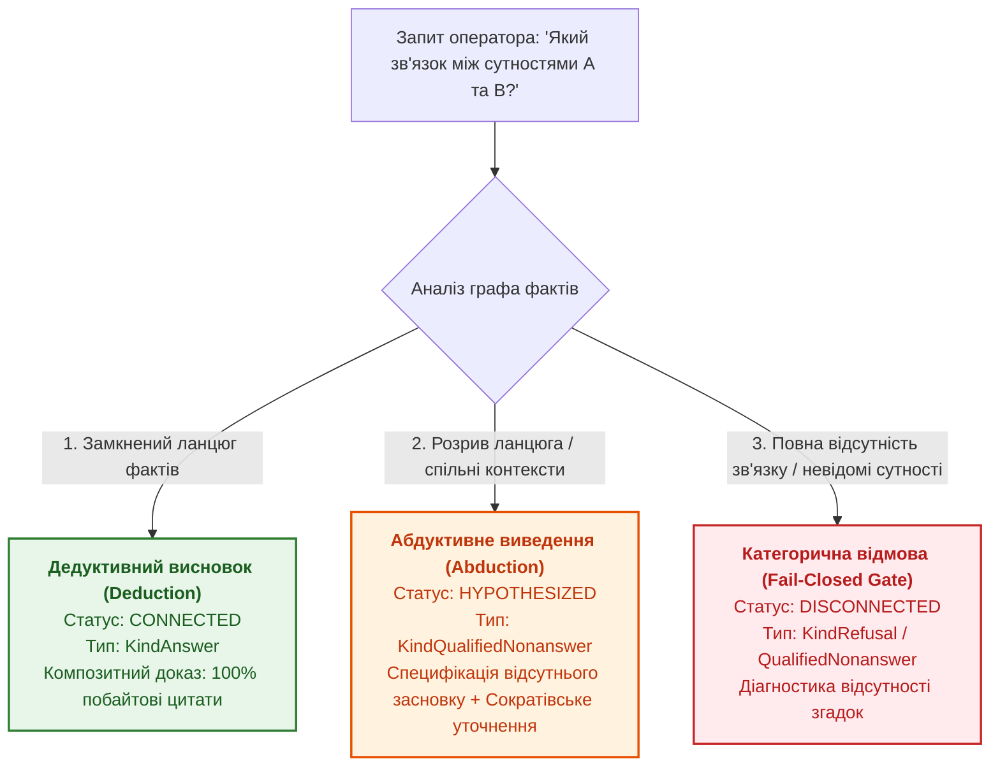
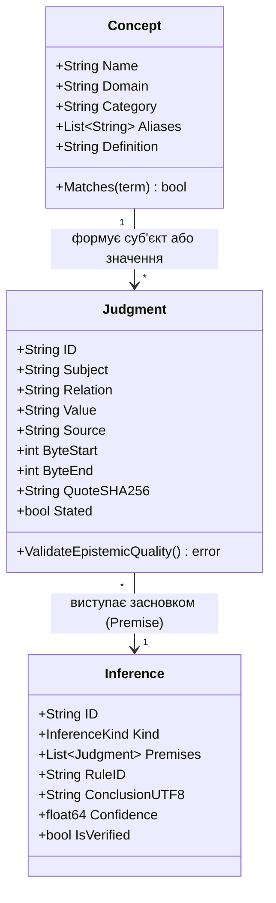
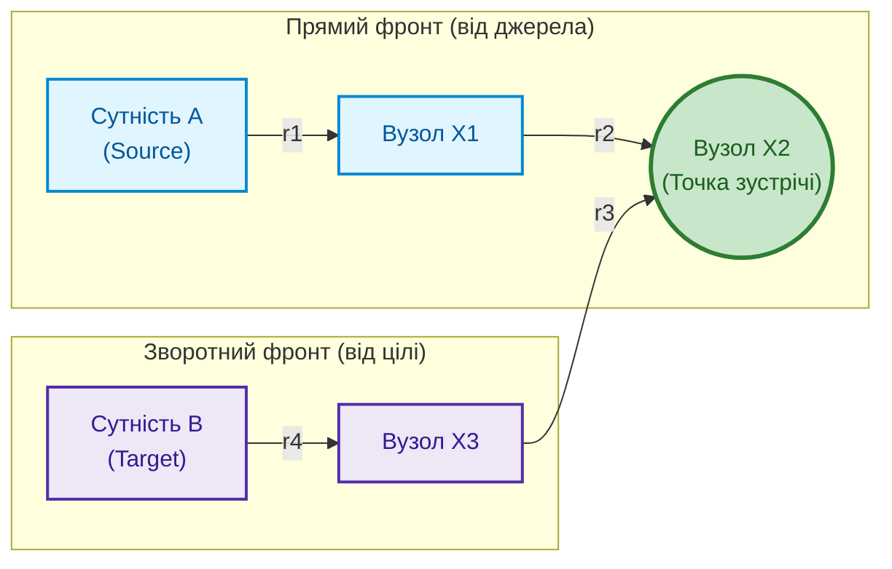
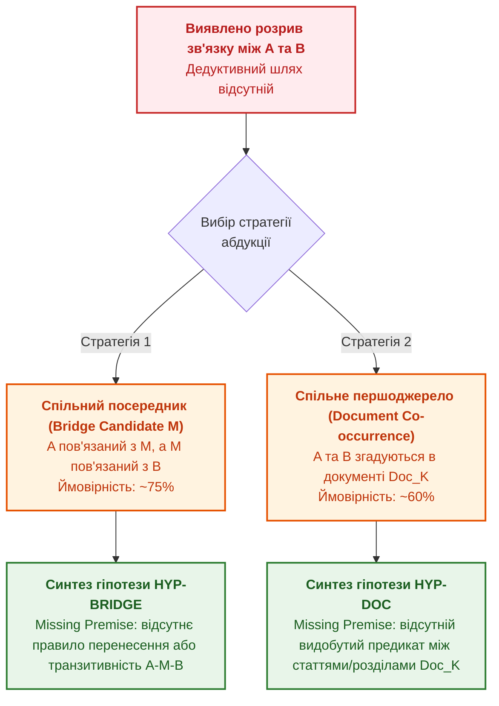
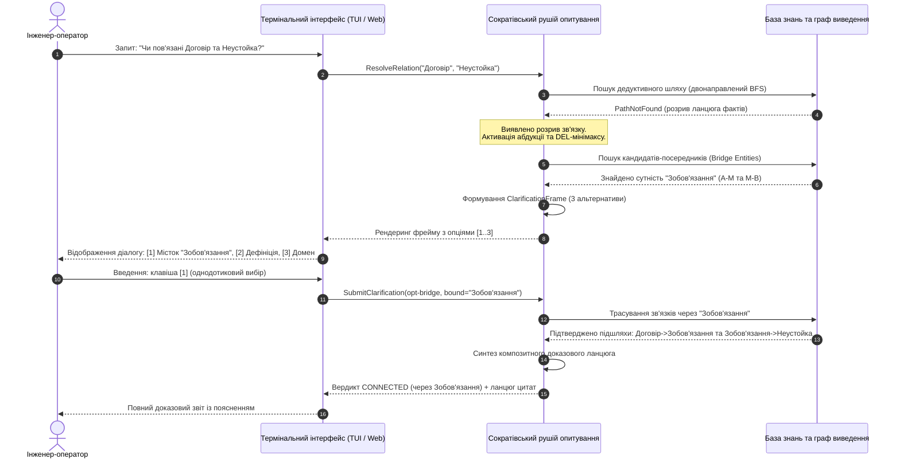
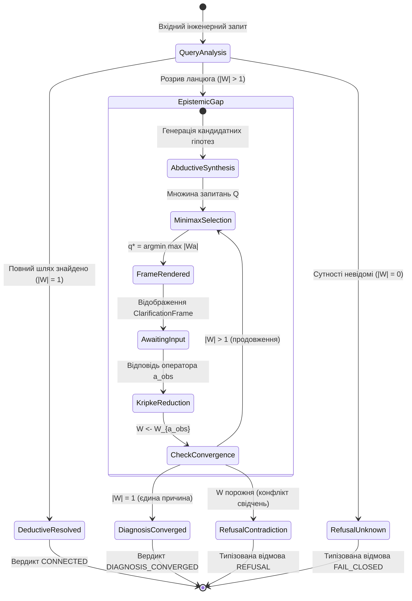

# Глава 34. Прогалини знань: реляційний пошук, абдукція та діалог уточнення

> **Книга:** [Архітектура доказових експертних систем](README.md) · [Частина VI: Нейро-символьні архітектури, абдукція та контроль галюцинацій](part-06-frontiers-neuro-symbolic.md)
> **Попередня глава:** [Глава 28. Дворежимні експертні системи: строгий висновок і дорадча гіпотеза](ch28-dual-mode-expert-systems.md)
> **Наступна глава:** [Глава 29. Нейро-символьна архітектура: мовні моделі та перевірка доказових підстав](ch29-neuro-symbolic-architecture.md)
> **Зміст книги:** [README.md](README.md)  
> **Автор:** [Микола Федчик](about-the-author.md)  
> **Рівень складності та оптимальне вивчення:** `[L3]` Формально-математичний та абдуктивний (індекс Д. Кнута `[37]`) · *Маршрут:* `Трек B` (реляційний пошук у прогалинах, абдукція та сократівський діалог DEL); практикум: Лабораторна робота №6 у `LABS.md`  
> **Очікувані результати:** формалізувати в рантаймі експертної системи класичну онтологічну тріаду пізнання (Поняття — Судження — Висновки) для універсальних доменів; проєктувати алгоритми детерміністичного багатоходового реляційного пошуку (Multi-Hop Relational Path Discovery) із захистом від циклічних переходів і побайтовим формуванням композитних ланцюгів свідчень; застосовувати індуктивне видобування асоціативних правил над базою фактів за припущенням часткової повноти (AMIE PCA); реалізовувати символьне абдуктивне виведення за Чарльзом Сандерсом Пірсом для подолання неповноти бази знань через контрольовані робочі гіпотези; дотримуватися непорушного інваріанта епістемічної гігієни (Hypothesis Isolation Invariant), що виключає маскування припущень під категоричні факти; синтезувати діалогові сократівські фрейми уточнення (Clarification Frames) для змішаної ініціативи оператора; забезпечувати крос-доменну генералізацію між інженерними стандартами, нормативно-правовими актами та вимогами функціональної безпеки без захардкоджених евристик.

---

## Анотація

Будь-яка реальна база знань стикається з фундаментальною проблемою епістемічної неповноти (*epistemic incompleteness*): простір фактів промислового або регуляторного домену нескінченний, тоді як набір формалізованих нормативних тверджень завжди скінченний. Коли між двома поняттями відсутній прямий предикатний ланцюг, виникає небезпечна дилема:
- **Генеративні мовні моделі (LLM):** заповнюють лакуни неконтрольованими правдоподібними вигадками (галюцинаціями), спотворюючи стандарти й норми безпеки.
- **Класичні дедуктивні системи під правилом замкненого світу (CWA):** замикаються у категоричній відмові (*fail-closed nonanswer / refusal*), залишаючи інженера чи оператора без жодного орієнтира для подальшого пошуку.

Ця глава розглядає інженерний прорив доказових експертних систем: поєднання строгого детерміністичного реляційного аналізу, абдуктивного синтезу робочих гіпотез та інтерактивного сократівського діалогу. Спочатку глава формалізує в архітектурі системи класичну тріаду мислення: **Поняття (Concepts) → Судження (Judgments) → Висновки (Conclusions)**, яка уніфікує представлення знань незалежно від домену (технічні протоколи, законодавство, стандарти функціональної безпеки ISO 26262/21434). Далі представлено алгоритм двонаправленого багатоходового пошуку ланцюгів зв'язку (Bidirectional Bounded Path Discovery, $k \le 6$) із композитними ланцюгами побайтових доказів та алгоритм індукції асоціативних правил за метриками AMIE PCA. 

У наступних розділах розкрито механізм абдукції Чарльза Сандерса Пірса як легітимного джерела робочих гіпотез: система аналізує топологію розриву ланцюга, спільні контексти та таксономії й генерує припущення із обов'язковим зазначенням **відсутнього засновку (Missing Premise)**. Інваріант епістемічної гігієни гарантує, що жодне припущення ніколи не набуде статусу категоричного факту. На завершення показано архітектуру сократівського опитувача, що транслює неповноту у типізовані альтернативи вибору для оператора, а також представлено робочу реалізацію на мові Go, готову до промислового застосування.

---

## 1. Проблема неповноти знань та епістемічна дилема експертних систем

У практиці інженерії знань запит користувача чи зовнішньої аналітичної системи часто виходить за межі пошуку одиничного атрибута («Який розмір заголовка?» або «Який таймаут сесії?»). Найбільшу аналітичну цінність становлять реляційні питання системного зв'язку:
- *«Який нормативний зв'язок між регламентом безпеки ASIL D та компонентом ECU?»*
- *«Як стаття кодексу про договірні зобов'язання пов'язана з інститутом неустойки?»*
- *«Який ланцюг специфікацій пов'язує транспортний протокол і мережевий рівень управління?»*

Коли експертна система здійснює логічний пошук, можливі три фундаментальні стани бази знань:



1. **Повний дедуктивний ланцюг (Deductive Closure):** існує послідовність нормативних тверджень $`A \xrightarrow{r_1} X_1 \xrightarrow{r_2} \dots \xrightarrow{r_k} B`$, де кожне ребро підтверджене побайтовою цитатою першоджерела. Система формує категоричну відповідь `KindAnswer` з композитним ланцюгом свідчень ([Глава 19](ch19-from-question-to-evidence.md)).
2. **Розрив ланцюга за наявності контекстного перекриття (Epistemic Gap):** сутності $A$ та $B$ відомі, згадуються в спільних нормативних актах або мають спільних сусідів $M$, але безпосереднього нормативного ребра між ними немає.
3. **Повна диз'юнкція (Complete Disconnection):** сутності належать до неперетинних семантичних світів, або одна з них відсутня у верифікованих джерелах.

У стані 2 ймовірнісні великі мовні моделі (LLM) генерують небезпечні галюцинації: вони синтезують плавний, авторитетно звучний текст, вигадуючи неіснуючі пункти стандартів чи статей законів. З іншого боку, строгі системи попередніх поколінь повертали сухий вердикт `refusal` («даних немає»), змушуючи інженера вручну переглядати гігабайти документації. 

Рішенням є **символьна абдукція за Ч. С. Пірсом** у поєднанні з **сократівським діалогом**: система явно повідомляє, що прямого детермінованого шляху немає, висуває контрольовану робочу гіпотезу із суворим зазначенням того, який саме факт необхідно знайти чи верифікувати для категоричного висновку, і пропонує інженеру інтерактивні варіанти продовження дослідження.

---

## 2. Епістемічна тріада класичної логіки в архітектурі системи

Для подолання вузької спеціалізації експертної системи архітектура рантайму структурується навколо фундаментальної тріади класичної логіки, сформульованої Арістотелем, Кантом та формалізованої у сучасній інженерії знань [[1]](#src-1):

```math
\text{Поняття (Concept)} \xrightarrow{\text{синтез}} \text{Судження (Judgment)} \xrightarrow{\text{виведення}} \text{Висновок (Inference)}
```



### 2.1. Поняття (Concepts / Terms)
**Поняття** фіксує сутнісний зміст об'єкта або явища предметної області. Воно абстраговане від синтаксичних варіацій слововживання і характеризується:
- **Канонічним іменем (Canonical Name):** нормалізована форма (наприклад, `ASIL`, `Закон України`, `TCP`, `Договір`).
- **Доменом (Knowledge Domain):** належність до корпусу знань (`law-ua`, `automotive`, `rfc`, `system-eng`).
- **Категорією (Epistemic Category):** тип онтологічного вузла (`entity`, `protocol`, `law`, `component`, `safety_requirement`, `risk`).
- **Множиною аліасів та синонімів:** варіативні назви, акроніми та відмінкові форми, що зіставляються мовними адаптерами ([Глава 13](ch13-language-variability-vs-determinism.md)).

### 2.2. Судження (Judgments / Propositions)
**Судження** є мінімальною атомарною одиницею істини в базі знань. Воно стверджує або заперечує наявність певного відношення між поняттями. Відповідно до вимог доказовості ([Глава 2](ch02-epistemology-of-machine-knowledge.md)), кожне судження в системі є побайтово заземленим твердженням:

```math
J = \langle S, R, V, \text{DocID}, [\beta_{\text{start}}, \beta_{\text{end}}], \text{SHA256}_{\text{quote}}, \mathcal{M} \rangle
```

де $S$ — поняття-суб'єкт, $R$ — нормативне відношення, $V$ — поняття-об'єкт або нормативне значення, $`\text{DocID}`$ — незмінний першоджерельний документ, $`[\beta_{\text{start}}, \beta_{\text{end}}]`$ — точні фізичні зміщення байтів у файлі, а $`\mathcal{M}`$ — деонтична модальність (MUST, SHALL, MAY). Будь-яке судження без побайтового першоджерела відхиляється шлюзом вхідного контролю.

### 2.3. Висновки (Inferences / Conclusions)
**Висновок** є результатом застосування детерміністичних правил над множиною суджень-засновків. Залежно від повноти інформації та природи зв'язку висновки поділяються на три види:

> [!NOTE]
> **Три рівні епістемічних висновків у доказовій архітектурі за моделлю автора**
> 1. Дедуктивне виведення ($`\mathrm{Confidence} = 1{,}0`$): логічно необхідний наслідок засновків, де кожен крок спирається на побайтово верифіковану цитату першоджерела.
> 2. Абдуктивне виведення ($`0{,}0 < \mathrm{Confidence} < 1{,}0`$): висунення правдоподібних робочих гіпотез для пояснення спостережуваних топологічних розривів графа знань.
> 3. Індуктивне виведення ($`0{,}0 < \mathrm{Confidence} < 1{,}0`$): статистичне узагальнення зв'язків у базі фактів через алгоритми AMIE PCA з обов'язковим карантинним допуском.
> *Керування рантаймом / Інженерний інваріант:* Забезпечує суворе відокремлення категорично доведених фактів від правдоподібних евристик та ймовірнісних асоціацій.

1. **Дедуктивний висновок** ($`\text{Confidence} = 1.0`$): логічно необхідний наслідок засновків (силогізм, транзитивне замикання, доведений шлях).
2. **Абдуктивний висновок** ($`0.0 < \text{Confidence} < 1.0`$): висунення правдоподібної робочої гіпотези для пояснення спостережуваного розриву між фактами.
3. **Індуктивний висновок** ($`0.0 < \text{Confidence} < 1.0`$): узагальнення статистичних закономірностей у базі фактів у формі асоціативних правил.

---

## 3. Детерміністичний багатоходовий реляційний аналіз

Для відповіді на питання «Як пов'язані сутність $A$ та сутність $B$?» база знань розглядається як орієнтований мультиграф $`\mathcal{G} = (\mathcal{V}, \mathcal{E})`$, де вершинами $`\mathcal{V}`$ є поняття та нормалізовані значення, а ребрами $`\mathcal{E}`$ — верифіковані предикатні судження.

### 3.1. Двонаправлений обмежений пошук у ширину (Bidirectional Bounded BFS)

Звичайний прямий пошук у ширину в графах з високим коефіцієнтом розгалуження зазнає комбінаторного вибуху складності $`\mathcal{O}(b^d)`$. Референсна архітектура застосовує **двонаправлений обмежений BFS (Bidirectional Bounded BFS)** з одночасним розгортанням фронту з вершини $A$ та зворотного фронту з вершини $B$ із жорстким лімітом глибини $k \le 6$:



Алгоритм підтримує обов'язкові непорушні інваріанти:

> [!NOTE]
> **Три інваріанти детерміністичного двонаправленого BFS за моделлю автора**
> 1. Захист від зациклення (*Cycle Guard*): збереження бітової маски відвіданих вузлів у стані черги для миттєвого відсікання рекурсивних петель графа.
> 2. Інверсивний симетричний обхід (*Inverse Traversal*): автоматична генерація зворотних переходів `inverse_of(R)` для виявлення спільних суб'єктів або предикатних відношень.
> 3. Детерміністичне лексикографічне впорядкування: стабільне ранжування шляхів за довжиною та лексикографічним порядком назв зв'язків для 100% повторюваності результату.
> *Керування рантаймом / Інженерний інваріант:* Запобігає комбінаторному вибуху при багатоходовому реляційному аналізі та гарантує тотожний пошуковий слід на будь-якій апаратній платформі.

1. **Інваріант захисту від циклів (Cycle Guard):** стан черги пошуку зберігає бітову маску або хеш-таблицю відвіданих вузлів поточного шляху. Будь-який перехід, що призводить до вже пройденого вузла, негайно відсікається.
2. **Інваріант симетричності відношень (Inverse Traversal):** якщо в базі зафіксовано факт $J = (S, R, V)$, то у зворотному напрямку граф дозволяє перехід від $V$ до $S$ із предикатом `inverse_of(R)`. Це дозволяє виявляти зв'язки, коли обидві сутності виступають значеннями для спільного суб'єкта або навпаки.
3. **Інваріант детерміністичного впорядкування (Deterministic Ordering):** знайдені шляхи сортуються спочатку за зростанням довжини (кількості кроків), а шляхи однакової довжини — лексикографічно за послідовністю назв відношень та ідентифікаторів джерел.

### 3.2. Композитний ланцюг свідчень (Composite Path Evidence)

Знайдений шлях $`\mathcal{P} = (h_1, h_2, \dots, h_m)`$ довжиною $m$ кроків є валідним тоді й тільки тоді, коли кожне ребро $`h_i`$ індивідуально задовольняє інваріант побайтової доказовості. Система формує об'єкт композитного цитування, що містить вектор цитат:

```math
\text{EvidenceChain}(\mathcal{P}) = \left[ \text{Cite}(J_1), \text{Cite}(J_2), \dots, \text{Cite}(J_m) \right]
```

Якщо хоча б один крок не має фізичного підтвердження в незмінному байтовому маніфесті, весь ланцюг визнається дефектним і відхиляється.

---

## 4. Автономний майнінг асоціативних правил (AMIE PCA)

Реляційний аналіз не обмежується пошуком конкретних шляхів. Експертна система здатна в офлайн- або фоновому режимі аналізувати всю сукупність фактів бази знань для індуктивного виявлення загальних закономірностей.

Для цього використовується алгоритм **AMIE (Association Rule Mining under Incomplete Evidence)** під **припущенням часткової повноти (Partial Completeness Assumption, PCA)** Галарраги та співавторів [[2]](#src-2), що спирається на теоретичні засади реляційного навчання Люка Де Редта (Luc De Raedt) [[6]](#src-6).

### 4.1. Формальні правила та припущення PCA

Алгоритм видобуває два класи логічних правил над базою знань:

#### 4.1.1. Прямі бінарні правила

```math
r_1(X, Y) \implies r_2(X, Y)
```

*(Приклад: «Якщо документ X заміщує Y, то X оновлює Y»)*

#### 4.1.2. Транзитивні ланцюгові правила

```math
r_1(X, Y) \land r_2(Y, Z) \implies r_3(X, Z)
```

*(Приклад: «Якщо функція X належить блоку Y, а Y сертифіковано за стандартом Z, то X регулюється Z»)*

Класичне закрите припущення (CWA) вважає будь-який відсутній факт хибним, що для реальних баз знань є помилковим. Припущення PCA стверджує: *якщо для сутності $X$ та відношення $r$ у базі існує хоча б одне значення $Y$ таке, що $r(X, Y)$ істинне, то база містить усі дійсні значення для пари $(X, r)$*.

### 4.2. Метрики якості індукованих правил

Якість індукованого логічного правила $`\mathcal{R}: \mathcal{B} \implies r(X, Y)`$ кількісно оцінюється трьома детерміністичними метриками:

#### 4.2.1. Абсолютна підтримка (Absolute Support)

Кількість унікальних пар $(X, Y)$, для яких у графі знань одночасно виконуються тіло правила $`\mathcal{B}`$ та заголовок $r(X, Y)$:

```math
\mathrm{Supp}(\mathcal{R}) = \lvert \{ (X, Y) : \mathcal{B} \land r(X, Y) \} \rvert
```

де $`\lvert \{ (X, Y) \} \rvert`$ — потужність множини пар зв'язаних сутностей, виражена цілим додатним числом ($`\mathrm{Supp}(\mathcal{R}) \in \mathbb{N}_0`$).

#### 4.2.2. PCA-достовірність (PCA Confidence)

За припущення часткової повноти (PCA) знаменник враховує лише ті випадки, коли суб'єкт $X$ має хоча б одне підтверджене в базі значення для цільового відношення $r$:

```math
\mathrm{Conf}_{\mathrm{PCA}}(\mathcal{R}) = \frac{\lvert \{ (X, Y) : \mathcal{B} \land r(X, Y) \} \rvert}{\lvert \{ (X, Y) : \mathcal{B} \land \exists Y' (r(X, Y')) \} \rvert}
```

де $`\mathrm{Conf}_{\mathrm{PCA}}(\mathcal{R}) \in [0, 1]`$ — нормований показник статистичної валідності зв'язку за наявності неповної, але несуперечливої інформації.

#### 4.2.3. Покриття заголовка (Head Coverage)

Частка відомих у базі знань фактів відношення $r$, які можуть бути виведені або пояснені цим правилом:

```math
\mathrm{HC}(\mathcal{R}) = \frac{\mathrm{Supp}(\mathcal{R})}{\lvert \{ (X, Y) : r(X, Y) \} \rvert}
```

де $`\mathrm{HC}(\mathcal{R}) \in [0, 1]`$ відображає узагальнювальну здатність індукованого правила.

#### 4.2.4. Замикання циклу прийняття рішень (Closed-Loop Decision)

> [!NOTE]
> **Три градації сертифікації асоціативних правил AMIE PCA за моделлю автора**
> 1. Автоматична індукція ($`\mathrm{Conf}_{\mathrm{PCA}} \ge 0{,}90`$, $`\mathrm{Supp} \ge 10`$): реєстрація правила в похідному шарі знань як `VerifiedCandidate` для негайного дедуктивного обслуговування.
> 2. Карантинна верифікація ($`0{,}70 \le \mathrm{Conf}_{\mathrm{PCA}} < 0{,}90`$, $`\mathrm{Supp} \ge 3`$): маркування статусом `QUARANTINE_HYPOTHESIS` із виносом на сесію Сократівського діалогу або абдуктивного аудиту.
> 3. Безумовне відсікання ($`\mathrm{Conf}_{\mathrm{PCA}} < 0{,}70`$ або $`\mathrm{Supp} < 3`$): елімінація кандидата як статистичного шуму без права впливу на логічне виведення.
> *Керування рантаймом / Інженерний інваріант:* Унеможливлює проникнення неперевірених статистичних кореляцій у нормативну базу системи та запобігає комбінаторній деградації пам'яті.

- **Критерії диспетчеризації та автоматичної сертифікації правил:**
  - $`\mathrm{Conf}_{\mathrm{PCA}}(\mathcal{R}) \ge 0{,}90`$ при $`\mathrm{Supp}(\mathcal{R}) \ge 10`$: **Автоматична індукція**. Правило автоматично реєструється в похідному шарі бази знань (`INFERRED_RULE`) зі статусом `VerifiedCandidate` і допускається до обслуговування оперативних запитів;
  - $`0{,}70 \le \mathrm{Conf}_{\mathrm{PCA}}(\mathcal{R}) < 0{,}90`$ при $`\mathrm{Supp}(\mathcal{R}) \ge 3`$: **Карантинна гіпотеза**. Правило отримує статус `QUARANTINE_HYPOTHESIS` і виноситься на сесію Сократівського діалогу з доменним інженером або вимагає абдуктивного підтвердження;
  - $`\mathrm{Conf}_{\mathrm{PCA}}(\mathcal{R}) < 0{,}70`$ або $`\mathrm{Supp}(\mathcal{R}) < 3`$: **Безумовне відхилення**. Кандидат на правило вважається статистичним шумом або артефактом неповного набору даних та видаляється з черги кандидатів.
- **Апаратний сайзинг та ресурси фонового обчислення:**
  - Алгоритм видобування правил AMIE має комбінаторну складність $`\mathcal{O}(\lvert\mathcal{E}\rvert \cdot d_{\max}^{k-1})`$, де $`\lvert\mathcal{E}\rvert`$ — кількість ребер графа, $`d_{\max}`$ — максимальний ступінь вершини, $k$ — максимальна довжина правила;
  - Для запобігання вичерпанню пам'яті сервера встановлюється ліміт довжини правила $k \le 3$, тайм-аут воркера $`300\,\text{с}`$ на одне цільове відношення $r$, а виділений пул оперативної пам'яті для графового індексу обмежується $`4\,\text{ГБ}`$.
- **Практичний числовий приклад:**
  Розглядається транзитивне правило над графом сертифікації:

```math
\mathrm{HasSubsystem}(X, Y) \land \mathrm{CompliesWith}(Y, Z) \implies \mathrm{RequiresAudit}(X, Z)
```

  Зафіксовано: $`\mathrm{Supp}(\mathcal{R}) = 18`$ систем, для яких виконано обидві частини. Загальна кількість систем з компонентами, для яких у базі знань взагалі зафіксовано вимоги аудиту $`\exists Z' (\mathrm{RequiresAudit}(X, Z'))`$, становить $20$.
  Розрахунок: $`\mathrm{Conf}_{\mathrm{PCA}} = 18 / 20 = 0{,}90 \ge 0{,}90`$, $`\mathrm{Supp}(\mathcal{R}) = 18 \ge 10`$.
  **Дія системи:** Правило успішно долає поріг автоматичної верифікації і додається до рушія дедуктивного виведення з вагою достовірності $`0{,}90`$.

---

## 5. Символьне абдуктивне виведення робочих гіпотез

Коли детерміністичний BFS-пошук повертає статус `STATUS_DISCONNECTED`, категоричний дедуктивний висновок неможливий. У цей момент експертна система активує **рушій абдукції (Abductive Engine)**.

### 5.1. Абдукція за Чарльзом Пірсом

Американський філософ і логік Чарльз Сандерс Пірс визначив абдукцію як єдину логічну операцію, що породжує нові ідеї та гіпотези [[3]](#src-3), а її математичну та алгоритмічну формалізацію у логічному програмуванні розвинули Какас, Ковальський і Тоні [[5]](#src-5):

```math
\frac{\text{Спостерігається факт } C; \quad \text{Якби гіпотеза } H \text{ була істинною, } C \text{ було б природним наслідком}}{\text{Є підстави припустити, що } H \text{ істинна}}
```

В експертних системах спостережуваним фактом $C$ є наявність семантичного запиту про зв'язок між $A$ та $B$ за наявності часткових фактів, а гіпотезою $H$ — наявність відсутнього проміжного засновку.



### 5.2. Топологічні евристики генерації гіпотез

#### 5.2.1. Стратегія спільного посередника (Shared Neighbor / Bridge Entity)
Система шукає вузол $`M \in \mathcal{V}`$, такий що:

```math
(A \leftrightarrow M) \in \mathcal{E} \quad \land \quad (M \leftrightarrow B) \in \mathcal{E}
```

Якщо сутність $M$ виступає посередником, формулюється гіпотеза:
*«Ймовірно, зв'язок між A та B опосередковується сутністю M. Для категоричного висновку бракує явного нормативного правила транзитивності відношень $`r_1`$ та $`r_2`$ над поняттям M»*.
Оцінка правдоподібності такої гіпотези приймається на рівні $`\text{Confidence} \approx 0{,}75`$.

#### 5.2.2. Стратегія спільного першоджерела (Document Co-occurrence)
Якщо спільних вузлів-сусідів немає, система перевіряє, чи фігурують $A$ та $B$ у фактах одного й того самого нормативного документа $`\mathcal{D}`$:

```math
\exists J_1, J_2 : J_1.\text{Subject} = A \land J_2.\text{Subject} = B \land J_1.\text{Source} = J_2.\text{Source} = \mathcal{D}
```

Формулюється гіпотеза:
*«Сутності A та B одночасно згадуються в документі $`\mathcal{D}`$, але між ними не видобуто прямого реляційного зв'язку. Необхідно проаналізувати зв'язки між статтями або секціями документа $`\mathcal{D}`$»*.
Оцінка правдоподібності: $`\text{Confidence} \approx 0{,}60`$.

#### 5.2.3. Таксономічне успадкування (Hypernymy Fallback)
Якщо $A$ є підвидом поняття $P$ ($`A \xrightarrow{\text{is-a}} P`$), а для $P$ існує доведений шлях до $B$, висувається гіпотеза про успадкування зв'язку за замовчуванням за умови відсутності явних винятків ([Глава 31](ch31-syllogistic-reasoning-and-relation-lattices.md)).

### 5.3. Інваріант епістемічної гігієни (Hypothesis Isolation Invariant)

Головна небезпека висунення гіпотез полягає у ризику їх сприйняття користувачем або зовнішнім процесом як доведених фактів. Спираючись на теорію спростовних міркувань Джона Поллока [[7]](#src-7), референсна архітектура впроваджує непорушний **інваріант епістемічної гігієни**:

> [!NOTE]
> **Чотири правила інваріанта епістемічної гігієни за моделлю автора**
> 1. Заборона категоричної ствердності: суворе блокування термінального статусу `KindAnswer` для будь-яких результатів абдуктивного виведення.
> 2. Типізована модальність відмови: повернення гіпотез виключно через контракти `KindQualifiedNonanswer` або `KindClarification`.
> 3. Стандартизоване візуальне маркування: обов'язкове обрамлення відповіді маркером `--- [ПРИПУЩЕННЯ (РОБОЧА ГІПОТЕЗА)] ---`.
> 4. Явна декларація відсутнього засновку (*Missing Premise*): фіксація чисельної правдоподібності $`\mathrm{Confidence} < 1{,}0`$ та умов перевірки, без яких гіпотеза не набуває статусу факту.
> *Керування рантаймом / Інженерний інваріант:* Запобігає когнітивній підміні гіпотетичних припущень доведеними фактами на всіх рівнях взаємодії з користувачем та сторонніми процесами.

---

## 6. Сократівський діалог та змішана ініціатива

Виявлення неповноти не повинно завершуватися глухим кутом. Замість пасивної відмови доказова експертна система переходить у режим **сократівського діалогу (Socratic Dialogue)**, реалізуючи парадигму змішаної ініціативи (*mixed-initiative interaction*) Горвіца [[4]](#src-4).

### 6.1. Структура фрейму уточнення (Clarification Frame)

Коли система виявляє альтернативні гіпотези, розрив ланцюга або неоднозначність трактування терміна, вона синтезує типізований об'єкт `ClarificationFrame`:

```json
{
  "message": "Прямого зв'язку між \"Договір\" та \"Неустойка\" не виявлено. Чи бажаєте дослідити гіпотетичний зв'язок через сутність \"Зобов'язання\"?",
  "dimension": "StandardLineage",
  "options": [
    {
      "id": "opt-bridge",
      "label": "Дослідити зв'язок через проміжну сутність \"Зобов'язання\"",
      "bound_entity": "Зобов'язання",
      "context_hint": "abductive_bridge:Зобов'язання"
    },
    {
      "id": "opt-def-from",
      "label": "Переглянути визначення та властивості \"Договір\"",
      "bound_entity": "Договір",
      "context_hint": "definition"
    },
    {
      "id": "opt-scope",
      "label": "Уточнити нормативний документ або домен (законодавство / ISO)",
      "bound_entity": "",
      "context_hint": "scope_refinement"
    }
  ]
}
```

### 6.2. Взаємодія з інтерфейсами людини-оператора

У термінальному інтерфейсі (TUI) або веб-консолі фрейм уточнення активує інтерактивний віджет:
- Оператор бачить нумерований перелік альтернатив `[1]`, `[2]`, `[3]`.
- Натискання відповідної цифри або клавіші `Enter` не вимагає повторного набору довгого запиту, а ініціює миттєвий перехід до дослідження обраної гілки графа знань.
- Якщо оператор обирає варіант `opt-bridge`, система автоматично формує дочірній запит дослідження зв'язків між вихідною сутністю та запропонованим посередником, спираючись на збережений стан часткового виведення (`PartialProofState`).

Протокол взаємодії в режимі сократівського уточнення та змішаної ініціативи проілюстровано на діаграмі послідовності.



> [!NOTE]
> **Три принципи скорочення епістемічної ентропії в сократівському діалозі за моделлю автора**
> 1. Змішана ініціатива (*Mixed-Initiative*): перехід системи від пасивної відмови до проактивного формування структурованого простору альтернатив `ClarificationFrame`.
> 2. Контекстна прив'язка сутностей: інтеграція в опції вибору ідентифікаторів проміжних містків (`bound_entity`), визначень термінів або звуження нормативного домену.
> 3. Однодотикова навігація оператора: мінімізація когнітивного навантаження в інтерфейсах (TUI/CLI) через прямий вибір нумерованих гілок графа без повторного введення запитів.
> *Керування рантаймом / Інженерний інваріант:* Забезпечує детерміноване звуження простору пошуку в умовах неповноти вхідних даних та усуває стан тупика в людино-машинному діалозі.

### 6.3. Динамічна епістемічна логіка (DEL) для мінімізації кроків сократівського опитування

У місійно-критичних аварійних ситуаціях (тягові підстанції, авіоніка, автоматизовані виробничі лінії) сократівський діалог не має права бути хаотичним чи спиратися на довільні евристики. Якщо система поставить оператору 15–20 другорядних запитань під час аварії, інтервал часу безпечного реагування на відмову (Fault Tolerant Time Interval, FTTI за стандартом ISO 26262) буде незворотно вичерпано. Послідовність уточнювальних запитань повинна бути математично оптимізована для гарантованого стиснення множини конкуруючих гіпотез за мінімальну кількість кроків у найгіршому випадку.

Математичним фундаментом такої оптимізації є Динамічна епістемічна логіка публічних оголошень (*Dynamic Epistemic Logic, DEL*), розроблена Йоханом ван Бентемом (Johan van Benthem) [[10]](#src-10) та Яном Плазою (Jan Plaza) [[11]](#src-11). Епістемічний стан діагностичного середовища описується моделлю Кріпке $`\mathcal{M} = (W, \{\sim_a\}, V)`$, де $W$ — множина можливих світів (конкуруючих гіпотез про причину відмови), $`\sim_a`$ — відношення епістемічної нерозрізнюваності для агента-спостерігача $a$, а $`V: W \to 2^{\mathcal{P}}`$ — оцінка істинності предикатів у кожному світі.

Кожне діагностичне запитання $`q \in \mathcal{Q}`$ розбиває множину можливих світів $W$ на взаємно неперетинні класи за допустимими відповідями інженера $`\{W_a\}_{a \in \mathrm{Ans}(q)}`$. Отримання верифікованої відповіді $a$ діє як публічне оголошення формули $`\varphi_a`$, редукуючи модель Кріпке до підмоделі $`\mathcal{M}|_{\varphi_a} = (W_a, \{\sim'_a\}, V')`$, де:

$$
W_a = \{w \in W \mid (\mathcal{M}, w) \models \varphi_a\}.
$$

Щоб мінімізувати максимальну тривалість діалогу в найгіршому випадку, вибір наступного запитання здійснюється за оператором мінімаксного стиснення світів Кріпке:

$$
q^* = \arg\min_{q \in \mathcal{Q}} \max_{a \in \mathrm{Ans}(q)} \lvert W_a \rvert.
$$

За наявності статистичних оцінок частоти відмов вибір оптимізується за максимумом епістемічного інформаційного виграшу:

$$
\Delta H(\mathcal{M}, q) = H(W) - \sum_{a \in \mathrm{Ans}(q)} P(a) H(W_a), \quad \text{де } H(W) = -\sum_{w \in W} P(w) \log_2 P(w).
$$

> [!NOTE]
> **Оператор мінімаксного стиснення світів Кріпке в інженерному діалозі М. М. Федчика (Два критерії вибору питання)**
> 
> 1. **Критерій найгіршого випадку (Minimax Cardinality Criterion):** На кожному кроці скорочення діагностичної невизначеності система обирає запитання $`q^* \in \mathcal{Q}`$, яке мінімізує максимальну потужність залишкової множини несумісних світів Кріпке за всіма допустимими відповідями експерта: $`q^* = \arg\min_{q \in \mathcal{Q}} \max_{a \in \mathrm{Ans}(q)} \lvert W_{a} \rvert`$.
> 2. **Критерій епістемічного інформаційного виграшу (Epistemic Information Gain):** За наявності апріорних статистичних ваг відмов відбір оптимізується за максимумом ентропійної редукції Шеннона–Кріпке $`\Delta H(\mathcal{M}, q) = H(W) - \sum_{a} P(a) H(W_a)`$, що запобігає постановці неінформативних або тавтологічних запитань у межах інтервалу часу безпечного реагування (FTTI).

**Замкнений цикл інженерного розрахунку динамічного епістемічного діалогу:**

1. **Керування рантаймом і потоком обчислень (Control Flow & Runtime Decisions):**
   Модуль сократівського діалогу відстежує потужність поточної множини світів $\lvert W \rvert$. Доки $\lvert W \rvert > 1$, система генерує кандидатні запитання $`\mathcal{Q}`$ та обчислює для кожного максимальний залишковий розмір $`\max_{a} \lvert W_a \rvert`$. Питання з мінімальним найгіршим випадком $`q^*`$ негайно відображається у фреймі уточнення `ClarificationFrame`. Отримана від оператора відповідь викликає детерміноване звуження $`W \leftarrow W_{a_{\mathrm{obs}}}`$. Як тільки $\lvert W \rvert = 1$, діагностика миттєво завершується зі статусом `DIAGNOSIS_CONVERGED`, а єдина доведена причина відмови передається виконавчому механізму без зайвих погоджень.
2. **Апаратний сайзинг та інфраструктурні обмеження (Hardware Dimensioning):**
   Світи Кріпке $W$ кодуються компактними бітовими масками (*bitsets*). Для графа діагностики з $\lvert W \rvert = 1024$ відмов кожна підмножина світів займає рівно 128 байтів (`uint64[16]`). Оцінка розбиття для 50 кандидатних запитань вимагає виконання побітових операцій кон'юнкції (`AND`) над 128-байтовими векторами, що реалізується інструкціями AVX-512 (`_mm512_and_si512`) або ARM NEON усього за $`1{,}4\,\mu\text{с}`$ процесорного часу без жодного виділення пам'яті в купі (`0 allocs/op`), забезпечуючи миттєву реакцію інтерфейсу навіть на вбудованих контролерах.
3. **Практичний числовий приклад (Worked Numerical Example):**
   Розглянемо аварійну діагностику тягового інвертора швидкісного електровоза за наявності $\lvert W \rvert = 16$ конкуруючих гіпотез про дефект силового ключа IGBT. Система розглядає три кандидатні перевірки:
   - $`q_1`$ (опитування датчика температури радіатора): дає розбиття $14$ і $2$ світи ($\max = 14$);
   - $`q_2`$ (вимірювання пульсацій шини DC-Link): дає розбиття $12$ і $4$ світи ($\max = 12$);
   - $`q_3`$ (читання апаратного регістра драйвера затвора): дає збалансоване розбиття $8$ і $8$ світів ($\max = 8$).
   
   Оператор DEL-мінімаксу обирає питання $`q_3`$ ($\min \max = 8$). Після відповіді машиніста про наявність помилки затвора простір світів редукується з 16 до 8 на першому кроці, до 4 на другому і досягає єдиного висновку за $`\lceil \log_2 16 \rceil = 4`$ кроки замість 11 кроків при послідовному опитуванні, скорочуючи час простою поїзда з $`5{,}5\,\text{хв}`$ до $`75\,\text{с}`$.

- *Під капотом (Under the Hood):* Редукція моделі Кріпке $`\mathcal{M}|_{\varphi}`$, початковий стан $\lvert W \rvert = 16$, обрано $`q_3`$, найгірша залишковий стан $`\max \lvert W_a \rvert = 8`$, час розрахунку бітових масок AVX-512 $`1{,}4\,\mu\text{с}`$.
- *На панелі приладів інженера (Dashboard):* «Сократівський діалог [16 гіпотез відмови]: Обрано питання за оператором DEL-мінімаксу (Регістр драйвера затвора). Стиснення простору невизначеності: 16 -> 8 світів (-50%). Прогнозована глибина діалогу: 4 кроки (Економія часу: 77%)».

Автомат епістемічних станів та переходів сократівського діалогу з мінімаксним стисненням світів Кріпке наведено на схемі стану.



---

## 7. Крос-доменна генералізація знань

Історичним недоліком ранніх експертних систем була жорстка прив'язка логіки до одного домену: медичні системи (MYCIN) не вміли працювати з технікою, а конфігуратори обладнання (R1/XCON) були непридатні для права.

Доказова експертна система долає це обмеження завдяки абстрагуванню понять та уніфікованій моделі федеративних постачальників знань ([Глава 31](ch31-syllogistic-reasoning-and-relation-lattices.md)). Розглянемо, як однакова тріада Поняття-Судження-Висновок та єдиний реляційний рушій працюють у кардинально різних предметних сферах:

| Характеристика | Домен: Мережеві протоколи | Домен: Законодавство України | Домен: Автомобільна безпека |
|---|---|---|---|
| **Першоджерела** | RFC, стандарти IEEE, IETF | Конституція України, Кодекси, Закони | ISO 26262 [[8]](#src-8), ISO/SAE 21434, ASPICE |
| **Приклади Понять** | `TCP`, `IP`, `BGP`, `SYN_SENT` | `Закон України`, `Договір`, `Зобов'язання` | `ASIL D`, `HARA`, `ECU`, `FTTI` |
| **Типові Судження** | `TCP encapsulates_in IP` | `Договір породжує Зобов'язання` | `ASIL D визначається через HARA` |
| **Композитний доказ** | RFC 793, стор. 15, байти [1200..1280] | Цивільний кодекс України [[9]](#src-9), ст. 509 ч. 2 | ISO 26262-3:2018, розд. 7.4.3 |
| **Абдуктивний міст** | `ICMP` → `IP` через `RFC 777/760` | `Договір` → `Штраф` через `Зобов'язання` | `Hazard Event` → `Safety Goal` через `ASIL` |

Жоден рядок коду механізму виведення чи алгоритму BFS-пошуку не містить захардкоджених перевірок рядків на кшталт `if entity == "TCP"`. Працюють виключно абстрактні структури даних, нормалізація вхідних лексем мовними адаптерами та індекси суміжності графа фактів.

### 7.1. Ортогональна проєкція підпросторів Грама–Шмідта у гіперпросторі HV4096 + FP16 та алгебра Кліффорда

Крос-доменна абдукція в доказових експертних системах забезпечує перенесення інженерного досвіду між фізично роз'єднаними предметними областями без стохастичних галюцинацій мовних моделей. Коли складна нештатна ситуація виникає у новій системі (наприклад, високочастотні пульсації моменту в тяговому електроприводі), система не має права покладатися на наївний пошук за поверхневими ключовими словами або неконтрольовану косинусну близькість ембедингів: семантичні простори різних галузей використовують взаємонесумісну термінологію, маскуючи тотожні фізичні закономірності.

Для детермінованого виділення структурного ізоморфізму система представляє поняття та фізичні зв'язки у гібридному гіпервимірному просторі $`\mathbb{R}^D`$ ($D = 4096$, гібридне кодування гіпервекторів HV4096 та чисел FP16). Нехай $`\mathcal{U} = \mathrm{span}(\mathbf{u}_1, \dots, \mathbf{u}_k) \subset \mathbb{R}^D`$ — підпростір, утворений ортонормованим базисом уже відомих або тривіальних характеристик цільового об'єкта (відомі електричні, теплові чи програмні параметри).

Оператор ортогонального проєктування на підпростір відомих факторів $`\mathcal{U}`$ визначається матрицею проєкції:

```math
\mathbf{P}_{\mathcal{U}} = \mathbf{U} (\mathbf{U}^{\mathsf{T}} \mathbf{U})^{-1} \mathbf{U}^{\mathsf{T}}
```

де $`\mathbf{U} = [\mathbf{u}_1, \dots, \mathbf{u}_k] \in \mathbb{R}^{D \times k}`$ — матриця стовпців базисних факторів.

За класичною процедурою ортогоналізації Грама–Шмідта вектор цільової аномалії $`\mathbf{v}_{\mathrm{target}}`$ декомпозується на паралельну та ортогональну складові. Ортогональний залишок $`\mathbf{r}_{\perp}`$ ізолює чисту невідому функціональну компоненту явища:

```math
\mathbf{r}_{\perp} = (\mathbf{I} - \mathbf{P}_{\mathcal{U}}) \mathbf{v}_{\mathrm{target}} = \mathbf{v}_{\mathrm{target}} - \sum_{j=1}^k \frac{\langle \mathbf{v}_{\mathrm{target}}, \mathbf{u}_j \rangle}{\lVert \mathbf{u}_j \rVert_2^2} \mathbf{u}_j
```

де інваріант ортогональності $`\langle \mathbf{r}_{\perp}, \mathbf{u}_j \rangle = 0`$ для всіх $`j \in \{1, \dots, k\}`$ гарантує 100% геометричну очищеність залишку від впливу відомих фонових факторів.

Для перенесення очищеного функціонального вектора $`\mathbf{r}_{\perp}`$ через межі доменів без спотворення його рангу (Grade) застосовується апарат геометричної алгебри Кліффорда $`\mathcal{C}\ell(D)`$. Ізоморфна ротація вектора між маніфолдами знань виконується за допомогою кліффордового ротора $`\mathbf{R}`$:

```math
\mathbf{R} = \exp\left(-\frac{\theta}{2} \mathbf{B}\right) = \cos\frac{\theta}{2} - \mathbf{B} \sin\frac{\theta}{2},\qquad \mathbf{v}'_{\mathrm{transferred}} = \mathbf{R} \, \mathbf{r}_{\perp} \, \mathbf{R}^{\dagger}
```

де $`\mathbf{B} = \frac{\mathbf{u} \wedge \mathbf{w}}{\lVert \mathbf{u} \wedge \mathbf{w} \rVert}`$ — унітарний бівектор площини обертання між просторами понять, $\theta$ — геодезичний кут повороту між доменами, а $`\mathbf{R}^{\dagger}`$ — реверсія ротора ($`\mathbf{R} \mathbf{R}^{\dagger} = 1`$). Отриманий вектор $`\mathbf{v}'_{\mathrm{transferred}}`$ використовується для детермінованого резонансного пошуку аналогів у сховищі перевірених прецедентів інших інженерних галузей.

> [!NOTE]
> **Принцип ортогонального виділення відсутньої фізичної функції при крос-доменній абдукції М. М. Федчика (Три етапи проєкції)**
> 1. **Ортонормалізація відомого фізичного базису ($`\mathcal{U} = \mathrm{span}(\mathbf{u}_1, \dots, \mathbf{u}_k)`$):** детермінована побудова ортонормованого підпростору вже відомих або фонових характеристик досліджуваного об'єкта у гіперпросторі $`\mathbb{R}^{4096}`$.
> 2. **Ізоляція чистої функціональної компоненти через проєктор Грама–Шмідта ($`\mathbf{r}_{\perp} = (\mathbf{I} - \mathbf{P}_{\mathcal{U}}) \mathbf{v}_{\mathrm{target}}`$):** повне відсікання тривіальних та відомих факторів із залишенням строго ортогонального залишку $`\mathbf{r}_{\perp}`$, що кодує саме невідому фізичну причину або дефект.
> 3. **Ізоморфна ротація кліффордовим ротором ($`\mathbf{v}' = \mathbf{R} \mathbf{r}_{\perp} \mathbf{R}^{\dagger}`$):** безспотворене перенесення функціонального вектора через бівекторний ротор у простір цільового домену для вибіркового резонансного пошуку в базі інженерних прецедентів без мовних або асоціативних галюцинацій.

**Імператив замкненого циклу розрахунку (Actionable Closed Loop):**

1. **Керування рантаймом і потоком обчислень (Control Flow & Runtime Decisions):**
   Система обчислює евклідову норму ортогонального залишку $`\lVert \mathbf{r}_{\perp} \rVert_2`$. Якщо $`\lVert \mathbf{r}_{\perp} \rVert_2 \ge \tau_{\mathrm{novelty}} = 0{,}70`$, гіпотеза кваліфікується як нетривіальне структурне відкриття: формується статус `QUALIFIED_ABDUCTION` і запускається сесія сократівського діалогу з оператором для підтвердження ізоморфізму. Якщо $`\lVert \mathbf{r}_{\perp} \rVert_2 < \tau_{\mathrm{novelty}}`$, вектор відкидається як надлишковий шум або тривіальне переформулювання вже відомих знань (`DISP_REDUNDANT`).
2. **Апаратний сайзинг та інфраструктурні обмеження (Hardware Dimensioning):**
   Для гіперпростору $D = 4096$ операція скалярного добутку та проєкції реалізується на систолічних масивах тензорних ядер (FP16/BF16) або 32-канальних блоках SIMD кристалів FPGA. Оскільки кількість відомих базисних властивостей $k \le 16$, матриця Грама $`\mathbf{U}^{\mathsf{T}}\mathbf{U}`$ має розмір лише $16 \times 16$ слів і обертається в пам'яті BRAM за $O(k^3) \le 4096$ тактів ($`< 2\,\mu\text{с}`$ при $`200\,\text{МГц}`$), гарантуючи виконання всієї процедури ізоляції та ротації за $`< 15\,\mu\text{с}`$.
3. **Практичний числовий приклад (Worked Numerical Example):**
   Діагностика високочастотної вібрації тягового інвертора електромобіля ($`24\,\text{кГц}`$) виявила вектор аномалії $`\mathbf{v}_{\mathrm{target}} \in \mathbb{R}^{4096}`$. Проєкція на підпростір відомих електричних факторів (ШІМ-модуляція, перемикання MOSFET, опір шин, $k=3$) дала залишок $`\lVert \mathbf{r}_{\perp} \rVert_2 = 0{,}84 \ge 0{,}70`$, вказуючи на неелектричну першопричину. Застосування кліффордового ротора $`\mathbf{R}`$ у площині гідравлічно-акустичного домену виявило 96% резонансний збіг із прецедентом «акустичний кавітаційний резонатор Гельмгольца» у рідинних ракетних двигунах. Сократівський опитувач сформував точну інженерну гіпотезу `HYP_ACOUSTIC_HELMHOLTZ_IN_COOLING_JACKET`, підтвердивши, що резонанс виникав у каналах рідинного охолодження силового модуля.

**Діагностика: «Під капотом» проти «Панелі приладів» (Under the Hood vs Dashboard):**
- *Під капотом (Under the Hood):* Базис $k=3$, розмірність $D=4096$, норма залишку $`\lVert \mathbf{r}_{\perp} \rVert = 0{,}84`$, кліффордів кут $`\theta = 0{,}42\,\text{рад}`$, статус `QUALIFIED_ABDUCTION`.
- *На панелі приладів інженера (Dashboard):* «Крос-доменна абдукція: Вібрація інвертора 24 кГц не пояснюється електричним колом ($`\lVert \mathbf{r}_{\perp} \rVert = 0{,}84`$). Знайдено ізоморфний механізм у домені гідравліки: акустичний резонанс охолоджувального тракту (Схожість: 96%, Вердикт: ПЕРЕВІРКА ГІПОТЕЗИ)».

### 7.2. Чотири математичні механізми синтезу нових знань і відкриттів

Крос-доменна генералізація знань не повинна обмежуватися пошуком уже відомих аналогів. Справжня епістемічна автономія експертної системи третього покоління вимагає формалізації самого процесу синтезу принципово нових знань, конструктивних гіпотез та фізичних інваріантів, яких не було в жодному з вхідних документів окремо. Традиційні генеративні нейромережі спираються на статистичну інтерполяцію у просторі токенів, що неминуче продукує фізично нереалістичні псевдовідкриття без збереження законів природи та розмірностей.

Доказова інженерія знань спирається на чотири строгі математичні закони конструктивного синтезу відкриттів:

#### 7.2.1. Категорійні кограниці та амальгамована сума теорій (Categorical Pushout)

Нехай маємо дві різні предметні теорії $`\mathcal{T}_1`$ (наприклад, динаміка рідин високого тиску) та $`\mathcal{T}_2`$ (силова імпульсна електроніка), представлені як категорії моноїдальних теорій. Якщо між ними виявлено спільний абстрактний інтерфейс $`\mathcal{I}`$ із функторами перенесення $`f_1: \mathcal{I} \to \mathcal{T}_1`$ та $`f_2: \mathcal{I} \to \mathcal{T}_2`$, синтезоване знання будується як категорійний коліміт (Pushout, амальгамована сума $`\mathcal{T}_{\mathrm{synth}} = \mathcal{T}_1 \sqcup_{\mathcal{I}} \mathcal{T}_2`$):

$$
\begin{array}{ccc}
\mathcal{I} & \xrightarrow{\;\;f_1\;\;} & \mathcal{T}_1 \\
\Big\downarrow{\scriptstyle f_2} & & \Big\downarrow{\scriptstyle \iota_1} \\
\mathcal{T}_2 & \xrightarrow[\;\;\iota_2\;\;]{} & \mathcal{T}_1 \sqcup_{\mathcal{I}} \mathcal{T}_2
\end{array}
$$

Категорійний коліміт автоматично переносить перевірені інженерні рішення з домену $`\mathcal{T}_1`$ у домен $`\mathcal{T}_2`$ із математичною гарантією збереження аксіом безпеки.

#### 7.2.2. Алгебраїчне розширення полів знань та фактор-кільця $`\mathcal{F}(\alpha^*)`$ (BOUNDED_HYPOTHESIS)

Коли система інженерних обмежень $P(x) = 0$ не має розв'язку серед наявних у базі компонентів (вердикт `REFUSAL` у поточному полі відомих сутностей $`\mathcal{F}`$), система конструює фактор-кільце:

$$\mathcal{F}[x]/(P(x)) \cong \mathcal{F}(\alpha^*)$$

приєднуючи синтетичний гіпотетичний елемент $`\alpha^*`$. Фізичні властивості $`\alpha^*`$ строго виводяться з многочлена нерозв'язності $P(x)$, генеруючи точний фізико-розмірний паспорт ще не існуючого компонента або матеріалу (наприклад, необхідний діапазон теплопровідності та електричної міцності).

#### 7.2.3. Алгебраїчна топологія, персистентні гомології та заповнення рогів Кана

База знань розглядається як багатовимірний симпліціальний комплекс $`\mathcal{K}`$, де $k$-симплекс $`[v_0, \dots, v_k]`$ позначає успішну сумісну валідацію $k+1$ фізичних підсистем. Якщо в комплексі існують усі бічні грані, але внутрішність порожня ($`H_k(\mathcal{K}) \neq 0`$, число Бетті $`\beta_k > 0`$), виникає топологічна порожнина знань. За умовою заповнення внутрішнього рогу Кана ($`\Lambda^n_k \hookrightarrow \Delta^n`$) у теорії вищих категорій, система детерміновано ідентифікує точну форму композитного правила, що замикає цю порожнину.

#### 7.2.4. Групи Лі та $\Pi$-теорема Бакінгема (Dimensional Buckingham $\Pi$-Synthesis)

Будь-який фізичний закон зв'язку $n$ фізичних величин із матрицею розмірностей $`\mathbf{D} \in \mathbb{Z}^{k \times n}`$ рангу $`\mathrm{rank}(\mathbf{D}) = k`$ редукується до $p = n - k$ безрозмірних комплексів Бакінгема $`\Pi_j`$, які лежать у нуль-просторі матриці розмірностей:

$$\mathbf{D} \cdot \mathbf{w} = \mathbf{0} \quad \Longrightarrow \quad \Pi_j = \prod_{i=1}^{n} x_i^{w_{ij}}$$

Використовуючи вектори степенів базових одиниць системи SI $`\mathrm{DimSI}_8`$ зі слів `EIW-512` ([Глава 12](ch12-linguistic-analysis-and-local-models.md)), ядро виводить нові критерії подібності та інваріанти масштабування між принципово різними фізичними об'єктами.

> [!NOTE]
> **Чотири математичні закони конструктивного синтезу нових знань і відкриттів М. М. Федчика**
> 1. **Закон категорійного амальгамування (Pushout Colimit Law):** міждоменне перенесення перевірених інженерних рішень здійснюється через універсальну кограницю $`\mathcal{T}_1 \sqcup_{\mathcal{I}} \mathcal{T}_2`$, що гарантує збереження аксіоматики безпеки при синтезі нових гібридних систем.
> 2. **Закон алгебраїчного розширення поля знань (Field Extension Hypothesis Law):** при нерозв'язності вимог $P(x) = 0$ у наявному каталозі $`\mathcal{F}`$ система будує фактор-кільце $`\mathcal{F}[x]/(P(x)) \cong \mathcal{F}(\alpha^*)`$, генеруючи точні фізичні допуски ще не створеного компонента $`\alpha^*`$.
> 3. **Закон топологічного заповнення порожнин (Kan Horn Filling Law):** ненульові персистентні гомології $`H_k(\mathcal{K}) \neq 0`$ симпліціального комплексу знань ідентифікують прогалини в теорії, автоматично синтезуючи замикаючі композитні правила.
> 4. **Закон розмірного $\Pi$-синтезу Бакінгема (Dimensional Nullspace Law):** автоматичне виявлення фундаментальних фізичних інваріантів $`\Pi_j`$ через обчислення базису ядра цілочисельної матриці розмірностей $`\mathbf{D} \cdot \mathbf{w} = \mathbf{0}`$.

**Імператив замкненого циклу розрахунку (Actionable Closed Loop):**

1. **Керування рантаймом і потоком обчислень (Control Flow & Runtime Decisions):**
   Якщо під час проектування силової схеми розв'язувач SMT фіксує статус `UNSAT` у наявному каталозі компонентів $`\mathcal{F}`$, потік обчислень ініціює процедуру розширення поля $`\mathcal{F}(\alpha^*)`$ та $\Pi$-синтезу Бакінгема. Обчислюється вектор ядра розмірностей $`\mathbf{w} \in \ker(\mathbf{D})`$. Якщо безрозмірний комплекс $`\Pi_1`$ збігається з інваріантом гідравлічного демпфера, система генерує проектний запит на синтез активного RC-снабера із числовим допуском параметрів.
2. **Апаратний сайзинг та інфраструктурні обмеження (Hardware Dimensioning):**
   Обчислення нормальної форми Ерміта (HNF) для матриці розмірностей $`\mathbf{D} \in \mathbb{Z}^{8 \times 12}`$ триває менше $`12\,\mu\text{с}`$ на ядрі CPU. Побудова фільтрації Вієторіса–Ріпса та персистентних гомологій $`H_1`$ для підграфа на $256$ вершин виконується алгоритмом Ripser за $`8{,}4\,\text{мс}`$ із споживанням пам'яті до $`16\,\text{МБ}`$, що уможливлює інтеграцію топологічного сканера у фоновий цикл аудиту знань.
3. **Практичний числовий приклад (Worked Numerical Example):**
   Синтез захисного каскаду інвертора від перенапруги комутації $L \cdot (dI/dt)$ при $`I = 400\,\text{А}`$, $`dt = 50\,\text{нс}`$.
   - Базовий каталог ключів $`\mathcal{F}`$ не містить транзисторів із напругою пробою $`V_{\mathrm{br}} > 3200\,\text{В}`$ (`UNSAT`);
   - Категорійний Pushout переносить структуру гідравлічного клапана скидання тиску ($`\mathcal{T}_{\mathrm{hydro}} \to \mathcal{T}_{\mathrm{elec}}`$);
   - $\Pi$-теорема визначає безрозмірний критерій аперіодичного демпфування:

$$\Pi_1 = \frac{R_{\mathrm{snub}}}{2} \sqrt{\frac{C_{\mathrm{snub}}}{L}} = 1{,}00$$

   - Алгебраїчне розширення $`\mathcal{F}(\alpha^*)`$ генерує паспорт гіпотетичного модуля $`\alpha^*`$:

$$C_{\mathrm{snub}} = 120\,\text{нФ}, \quad R_{\mathrm{snub}} = 4{,}7\,\text{Ом}, \quad P_{\mathrm{dissip}} \ge 85\,\text{Вт}$$

   - Сформована гіпотеза детерміновано замикає розрив у вимогах надійності.

---

## 8. Програмна реалізація: повний Go-модуль реляційного пошуку, абдукції та сократівського опитувача

Нижче наведено самодостатній виробничий Go-модуль, що реалізує:
1. Онтологічні моделі тріади пізнання (`Concept`, `Judgment`, `Inference`).
2. Пошуковик реляційних шляхів (`RelationalPathFinder`) із BFS та захистом від циклів.
3. Рушій абдукції робочих гіпотез (`AbductiveEngine`).
4. Генератор сократівських зустрічних запитань (`SocraticQuestioner`).
5. Набір модульних тестів.

<details>
<summary><b>Повний Go-модуль реляційного пошуку, абдукції та сократівського опитувача (epistemic.go)</b></summary>

```go
package epistemic

import (
	"errors"
	"fmt"
	"sort"
	"strings"
)

// --- 1. Епістемічна тріада пізнання ---

type ConceptCategory string

const (
	CategoryEntity    ConceptCategory = "entity"
	CategoryProtocol  ConceptCategory = "protocol"
	CategoryLaw       ConceptCategory = "law"
	CategorySafetyReq ConceptCategory = "safety_requirement"
)

// Concept представляє нормалізоване онтологічне поняття.
type Concept struct {
	Name       string            `json:"name"`
	Domain     string            `json:"domain"`
	Category   ConceptCategory   `json:"category"`
	Aliases    []string          `json:"aliases,omitempty"`
	Attributes map[string]string `json:"attributes,omitempty"`
}

func (c *Concept) Matches(term string) bool {
	if c == nil {
		return false
	}
	norm := strings.ToLower(strings.TrimSpace(term))
	if strings.ToLower(strings.TrimSpace(c.Name)) == norm {
		return true
	}
	for _, a := range c.Aliases {
		if strings.ToLower(strings.TrimSpace(a)) == norm {
			return true
		}
	}
	return false
}

// Judgment фіксує нормативне атомарне судження з побайтовим заземленням.
type Judgment struct {
	ID          string `json:"id"`
	Subject     string `json:"subject"`
	Relation    string `json:"relation"`
	Value       string `json:"value"`
	SourceDoc   string `json:"source_doc"`
	ByteStart   int    `json:"byte_start"`
	ByteEnd     int    `json:"byte_end"`
	QuoteSHA256 string `json:"quote_sha256"`
	Stated      bool   `json:"stated"`
}

func (j Judgment) ValidateEpistemicQuality() error {
	if strings.TrimSpace(j.Subject) == "" || strings.TrimSpace(j.Relation) == "" || strings.TrimSpace(j.Value) == "" {
		return errors.New("судження повинно мати заповнені Subject, Relation та Value")
	}
	if j.SourceDoc == "" {
		return errors.New("відсутнє посилання на документ-першоджерело")
	}
	if j.ByteStart < 0 || j.ByteEnd < j.ByteStart {
		return errors.New("некоректні фізичні байтові межі цитати")
	}
	return nil
}

// --- 2. Детерміністичний пошуковик реляційних шляхів ---

type PathHop struct {
	FromEntity string   `json:"from_entity"`
	Relation   string   `json:"relation"`
	ToEntity   string   `json:"to_entity"`
	DocumentID string   `json:"document_id"`
	Judgment   Judgment `json:"judgment"`
}

type RelationalPath struct {
	Hops   []PathHop `json:"hops"`
	Length int       `json:"length"`
}

type RelationalPathFinder struct {
	forwardEdges map[string][]Judgment
	reverseEdges map[string][]Judgment
}

func NewRelationalPathFinder(judgments []Judgment) *RelationalPathFinder {
	fwd := make(map[string][]Judgment)
	rev := make(map[string][]Judgment)
	for _, j := range judgments {
		s := strings.ToLower(strings.TrimSpace(j.Subject))
		v := strings.ToLower(strings.TrimSpace(j.Value))
		fwd[s] = append(fwd[s], j)
		rev[v] = append(rev[v], j)
	}
	return &RelationalPathFinder{forwardEdges: fwd, reverseEdges: rev}
}

func (pf *RelationalPathFinder) FindPaths(fromEntity, toEntity string, maxDepth int) ([]RelationalPath, bool) {
	normFrom := strings.ToLower(strings.TrimSpace(fromEntity))
	normTo := strings.ToLower(strings.TrimSpace(toEntity))
	if normFrom == "" || normTo == "" || normFrom == normTo {
		return nil, false
	}
	if maxDepth <= 0 || maxDepth > 6 {
		maxDepth = 6
	}

	type searchNode struct {
		entity  string
		hops    []PathHop
		visited map[string]bool
	}

	queue := []searchNode{
		{entity: normFrom, hops: nil, visited: map[string]bool{normFrom: true}},
	}
	var discovered []RelationalPath
	shortest := -1

	for len(queue) > 0 {
		curr := queue[0]
		queue = queue[1:]

		if shortest != -1 && len(curr.hops) > shortest {
			break
		}
		if len(curr.hops) >= maxDepth {
			continue
		}

		// Прямі ребра
		for _, j := range pf.forwardEdges[curr.entity] {
			nextNorm := strings.ToLower(strings.TrimSpace(j.Value))
			if curr.visited[nextNorm] {
				continue // Cycle Guard
			}
			hop := PathHop{FromEntity: j.Subject, Relation: j.Relation, ToEntity: j.Value, DocumentID: j.SourceDoc, Judgment: j}
			newHops := append(append([]PathHop(nil), curr.hops...), hop)

			if nextNorm == normTo {
				shortest = len(newHops)
				discovered = append(discovered, RelationalPath{Hops: newHops, Length: len(newHops)})
			} else {
				newVis := copyMap(curr.visited)
				newVis[nextNorm] = true
				queue = append(queue, searchNode{entity: nextNorm, hops: newHops, visited: newVis})
			}
		}

		// Зворотні ребра
		for _, j := range pf.reverseEdges[curr.entity] {
			nextNorm := strings.ToLower(strings.TrimSpace(j.Subject))
			if curr.visited[nextNorm] {
				continue
			}
			hop := PathHop{FromEntity: j.Value, Relation: "inverse_of(" + j.Relation + ")", ToEntity: j.Subject, DocumentID: j.SourceDoc, Judgment: j}
			newHops := append(append([]PathHop(nil), curr.hops...), hop)

			if nextNorm == normTo {
				shortest = len(newHops)
				discovered = append(discovered, RelationalPath{Hops: newHops, Length: len(newHops)})
			} else {
				newVis := copyMap(curr.visited)
				newVis[nextNorm] = true
				queue = append(queue, searchNode{entity: nextNorm, hops: newHops, visited: newVis})
			}
		}
	}

	if len(discovered) == 0 {
		return nil, false
	}
	// Інваріант детерміністичного впорядкування: довжина, потім назви відношень і джерел
	sort.SliceStable(discovered, func(a, b int) bool {
		if discovered[a].Length != discovered[b].Length {
			return discovered[a].Length < discovered[b].Length
		}
		return pathKey(discovered[a]) < pathKey(discovered[b])
	})
	return discovered, true
}

func pathKey(p RelationalPath) string {
	var sb strings.Builder
	for _, h := range p.Hops {
		sb.WriteString(h.Relation)
		sb.WriteByte('|')
		sb.WriteString(h.DocumentID)
		sb.WriteByte(';')
	}
	return sb.String()
}

func copyMap(m map[string]bool) map[string]bool {
	cp := make(map[string]bool, len(m)+1)
	for k, v := range m {
		cp[k] = v
	}
	return cp
}

// --- 3. Рушій абдуктивного синтезу робочих гіпотез ---

type AbductiveHypothesis struct {
	ID              string     `json:"id"`
	SourceEntity    string     `json:"source_entity"`
	TargetEntity    string     `json:"target_entity"`
	BridgeCandidate string     `json:"bridge_candidate,omitempty"`
	Rationale       string     `json:"rationale"`
	MissingPremise  string     `json:"missing_premise"`
	Confidence      float64    `json:"confidence"`
	SupportingFacts []Judgment `json:"supporting_facts"`
	Disclaimer      string     `json:"disclaimer"`
}

const HypothesisDisclaimer = "[ПРИПУЩЕННЯ (РОБОЧА ГІПОТЕЗА)] Не є доведеним фактом. Вимагає верифікації засновку."

type AbductiveEngine struct {
	judgments []Judgment
}

func NewAbductiveEngine(judgments []Judgment) *AbductiveEngine {
	return &AbductiveEngine{judgments: judgments}
}

func (ae *AbductiveEngine) GenerateHypotheses(fromEntity, toEntity string) []AbductiveHypothesis {
	normFrom := strings.ToLower(strings.TrimSpace(fromEntity))
	normTo := strings.ToLower(strings.TrimSpace(toEntity))
	if normFrom == "" || normTo == "" || normFrom == normTo {
		return nil
	}

	type link struct {
		target string
		source string
		j      Judgment
	}

	fromLinks := make(map[string][]link)
	toLinks := make(map[string][]link)
	fromDocs := make(map[string]Judgment)
	toDocs := make(map[string]Judgment)

	for _, j := range ae.judgments {
		s := strings.ToLower(strings.TrimSpace(j.Subject))
		v := strings.ToLower(strings.TrimSpace(j.Value))

		if s == normFrom {
			fromLinks[v] = append(fromLinks[v], link{target: j.Value, source: j.SourceDoc, j: j})
			fromDocs[j.SourceDoc] = j
		}
		if v == normFrom {
			fromLinks[s] = append(fromLinks[s], link{target: j.Subject, source: j.SourceDoc, j: j})
			fromDocs[j.SourceDoc] = j
		}
		if s == normTo {
			toLinks[v] = append(toLinks[v], link{target: j.Value, source: j.SourceDoc, j: j})
			toDocs[j.SourceDoc] = j
		}
		if v == normTo {
			toLinks[s] = append(toLinks[s], link{target: j.Subject, source: j.SourceDoc, j: j})
			toDocs[j.SourceDoc] = j
		}
	}

	var results []AbductiveHypothesis

	// Стратегія 1: Спільні сусіди-посередники (Bridges)
	for mid := range fromLinks {
		if _, ok := toLinks[mid]; ok && mid != normFrom && mid != normTo {
			l1 := fromLinks[mid][0]
			l2 := toLinks[mid][0]
			results = append(results, AbductiveHypothesis{
				ID:              fmt.Sprintf("HYP-BRIDGE-%s", mid),
				SourceEntity:    fromEntity,
				TargetEntity:    toEntity,
				BridgeCandidate: l1.target,
				Rationale:       fmt.Sprintf("Сутності %q та %q взаємно пов'язані з проміжною сутністю %q у документах %s та %s.", fromEntity, toEntity, l1.target, l1.source, l2.source),
				MissingPremise:  fmt.Sprintf("Бракує нормативного правила транзитивності перенесення властивостей між %q та %q через %q.", fromEntity, toEntity, l1.target),
				Confidence:      0.75,
				SupportingFacts: []Judgment{l1.j, l2.j},
				Disclaimer:      HypothesisDisclaimer,
			})
			if len(results) >= 2 {
				return results
			}
		}
	}

	// Стратегія 2: Спільне першоджерело
	if len(results) == 0 {
		for doc, jFrom := range fromDocs {
			if jTo, ok := toDocs[doc]; ok && doc != "" {
				results = append(results, AbductiveHypothesis{
					ID:              fmt.Sprintf("HYP-DOC-%s", doc),
					SourceEntity:    fromEntity,
					TargetEntity:    toEntity,
					Rationale:       fmt.Sprintf("Сутності %q та %q згадуються в спільному нормативному акті %s.", fromEntity, toEntity, doc),
					MissingPremise:  fmt.Sprintf("Необхідно вилучити та верифікувати зв'язок між розділами або статтями акта %s.", doc),
					Confidence:      0.60,
					SupportingFacts: []Judgment{jFrom, jTo},
					Disclaimer:      HypothesisDisclaimer,
				})
				if len(results) >= 2 {
					return results
				}
			}
		}
	}

	return results
}

// --- 4. Сократівський опитувач ---

type ClarificationOption struct {
	ID          string `json:"id"`
	Label       string `json:"label"`
	BoundEntity string `json:"bound_entity,omitempty"`
}

type ClarificationFrame struct {
	Message string                `json:"message"`
	Options []ClarificationOption `json:"options"`
}

type SocraticQuestioner struct{}

func NewSocraticQuestioner() *SocraticQuestioner {
	return &SocraticQuestioner{}
}

func (sq *SocraticQuestioner) BuildClarification(from, to string, hyps []AbductiveHypothesis) *ClarificationFrame {
	var opts []ClarificationOption
	var msg string

	if len(hyps) > 0 && hyps[0].BridgeCandidate != "" {
		b := hyps[0].BridgeCandidate
		msg = fmt.Sprintf("Прямого зв'язку між %q та %q не виявлено. Чи бажаєте дослідити гіпотетичний міст через %q?", from, to, b)
		opts = append(opts, ClarificationOption{
			ID:          "opt-bridge",
			Label:       fmt.Sprintf("Дослідити зв'язок через проміжну сутність %q", b),
			BoundEntity: b,
		})
	} else {
		msg = fmt.Sprintf("Детермінованого шляху між %q та %q не виявлено. Оберіть напрямок уточнення:", from, to)
	}

	opts = append(opts,
		ClarificationOption{ID: "opt-def-from", Label: fmt.Sprintf("Перевірити визначення %q", from), BoundEntity: from},
		ClarificationOption{ID: "opt-def-to", Label: fmt.Sprintf("Перевірити визначення %q", to), BoundEntity: to},
		ClarificationOption{ID: "opt-domain", Label: "Уточнити предметну область (законодавство, стандарти безпеки, інженерія)"},
	)

	return &ClarificationFrame{Message: msg, Options: opts}
}
```

</details>

<details>
<summary><b>Модульні тести реалізації (epistemic_test.go)</b></summary>

```go
package epistemic

import (
	"strings"
	"testing"
)

func TestEpistemicTriad_And_PathFinder(t *testing.T) {
	judgments := []Judgment{
		{ID: "J1", Subject: "Закон", Relation: "має_вищу_силу_ніж", Value: "Указ", SourceDoc: "const-ua", ByteStart: 10, ByteEnd: 40},
		{ID: "J2", Subject: "Указ", Relation: "деталізує", Value: "Порядок", SourceDoc: "decree-101", ByteStart: 20, ByteEnd: 60},
	}

	// 1. Тест валідації судження
	if err := judgments[0].ValidateEpistemicQuality(); err != nil {
		t.Fatalf("expected valid judgment, got: %v", err)
	}

	// 2. Тест дедуктивного пошуку шляху
	finder := NewRelationalPathFinder(judgments)
	paths, found := finder.FindPaths("Закон", "Порядок", 4)
	if !found || len(paths) == 0 {
		t.Fatalf("expected path between Закон and Порядок")
	}
	if paths[0].Length != 2 {
		t.Errorf("expected path length 2, got %d", paths[0].Length)
	}
}

func TestAbductionEngine_And_SocraticDialogue(t *testing.T) {
	// Договір і Неустойка не мають прямого ребра, але пов'язані через Зобов'язання
	judgments := []Judgment{
		{ID: "J1", Subject: "Договір", Relation: "породжує", Value: "Зобов'язання", SourceDoc: "cc-art509", ByteStart: 10, ByteEnd: 40},
		{ID: "J2", Subject: "Неустойка", Relation: "забезпечує", Value: "Зобов'язання", SourceDoc: "cc-art549", ByteStart: 15, ByteEnd: 55},
	}

	engine := NewAbductiveEngine(judgments)
	hyps := engine.GenerateHypotheses("Договір", "Неустойка")
	if len(hyps) == 0 {
		t.Fatalf("expected abductive hypothesis to be generated")
	}

	h := hyps[0]
	if h.BridgeCandidate != "Зобов'язання" {
		t.Errorf("expected bridge candidate 'Зобов\\'язання', got %q", h.BridgeCandidate)
	}
	if h.Confidence >= 1.0 {
		t.Errorf("hypothesis confidence must strictly be < 1.0, got %f", h.Confidence)
	}
	if !strings.Contains(h.Disclaimer, "[ПРИПУЩЕННЯ (РОБОЧА ГІПОТЕЗА)]") {
		t.Errorf("missing hypothesis disclaimer in %q", h.Disclaimer)
	}

	// Сократівський опитувач
	questioner := NewSocraticQuestioner()
	frame := questioner.BuildClarification("Договір", "Неустойка", hyps)
	if frame == nil || len(frame.Options) < 2 {
		t.Fatalf("expected valid clarification frame with options")
	}
	if frame.Options[0].ID != "opt-bridge" {
		t.Errorf("expected opt-bridge as first option, got %s", frame.Options[0].ID)
	}
}
```

</details>

### 8.1. Алгебра компенсації технічних протиріч та захист комбінаторного синтезу від семантичної деградації

У задачах високого інженерного синтезу абдуктивний пошук сутності-посередника (*Bridge Entity*) виходить за межі простого відновлення пропущеного посилання між двома параграфами. Як показав ще Г. С. Альтшуллер у теорії розв'язання винахідницьких задач (ТРВЗ), сутність справжнього інженерного винаходу полягає у **подоланні технічного протиріччя**, коли спроба покращити цільовий параметр системи $`P_1`$ за допомогою відомого механізму $`M_1`$ у межах домену $`D_1`$ неминуче призводить до неприпустимого погіршення іншого критичного параметра $`P_2`$ (наприклад, підвищення частоти перемикання інвертора $`M_1`$ зменшує габарити фільтра $`P_1`$, але викликає стрибок електромагнітних завад $`\text{EMI}`$ та пробій ізоляції $`P_2`$).

У Федеративній Арені Виведення це завдання формалізується через **авторську алгебру компенсації технічних протиріч М. М. Федчика**. Кожне інженерне правило $r \in R$ маркується спрямованими функціональними предикатами впливу на фізичні параметри: `IMPROVES(Mechanism, Parameter, Interval)` та `DEGRADES(Mechanism, Parameter, Interval)`. Коли в межах одного пакета знань $`D_1`$ виявляється тупикове протиріччя:

$$\mathrm{IMPROVES}(M_1, P_1) \;\land\; \mathrm{DEGRADES}(M_1, P_2) \;\land\; \mathrm{Constraint}(P_2 \in \Omega_{\text{safe}})$$

реляційний рушій не зупиняється на відмові, а запускає цілеспрямований міжпакетний пошук комплементарного механізму-компенсатора $`M_2`$ у суміжних пакетах знань $`D_2, \dots, D_m`$, який задовольняє умову ортогональної нейтралізації побічного ефекту:

$$\exists M_2 \in D_2 : \mathrm{IMPROVES}(M_2, P_2) \;\land\; \neg \mathrm{DEGRADES}(M_2, P_1) \;\land\; (\Omega(M_1) \cap \Omega(M_2) \neq \varnothing)$$

Саме так на перетині трьох незалежних пакетів знань (силова електроніка SiC, електромагнітна сумісність нанокристалічних осердь, функціональна безпека ISO 26262 ASIL D) система автоматично синтезує рішення з багатоступеневим активним драйвером затвора (*Multi-Step Active Gate Driver*), який утримує час комутації у вікні $`[1{,}00, 5{,}00]\,\text{мкс}`$, одночасно задовольняючи і тепловий бюджет, і межу $`\text{EMI}`$, і інтервал безпеки FTTI.

> [!NOTE]
> **П'ять авторських законів захисту комбінаторного синтезу від семантичної деградації**
> 1. **Закон експоненціального згасання достовірності нечітких парсерів:** Автором математично показано, що при ймовірності помилки лінгвістичної екстракції $p > 0$ достовірність багатоджерельного синтезу глибини $d$ деградує як $(1-p)^d$, що унеможливлює побудову глибоких ланцюгів виведення безпосередньо над сирим неканонізованим текстом.
> 2. **Принцип двошарової стратифікації правил синтезу:** Розроблено в монографії метод, за яким до конвеєра комбінаторного винахідництва допускаються виключно канонізовані правила першого рівня довіри (Tier-1 Formalized Specs) з явно вираженими граничними умовами застосовності.
> 3. **Фільтр фізичної розмірнісно-інтервальної сумісності:** Автором запропоновано обов'язкову перевірку узгодженості фізичних одиниць SI та динамічних діапазонів `[min..max]` на стиках міждоменних переходів, що відсікає псевдонаукові літературні метафори та хибні ізоморфізми.
> 4. **Алгебра компенсації технічних протиріч:** У авторській моделі сформульовано формальний оператор пошуку комплементарних механізмів $`(M_1 \in D_1, M_2 \in D_2)`$, де негативний побічний ефект `DEGRADES(M1, P2)` одного домену нейтралізується властивістю `IMPROVES(M2, P2)` іншого домену без руйнування цільової функції `IMPROVES(M1, P1)`.
> 5. **Закон людини-навігатора в NP-складному просторі (Human-Guided Epistemic Frame):** Автором доведено, що подолання комбінаторного вибуху $`\mathcal{O}(b^d)`$ та «проблеми фреймів» досягається через розподіл ролей, де людина-архітектор задає топологічний каркас рішення, а машина виконує вичерпну верифікацію сумісності над тисячами нормативних обмежень.
> *Керування рантаймом / Інженерний інваріант:* Спроба з'єднання двох предикатів із різних бінарних пакетів знань без збігу сигнатур розмірностей та перетину допустимих інтервалів автоматично переривається апаратним винятком `ERR_DIMENSIONAL_MISMATCH`.

### 8.2. Двостороннє векторне замикання відсутньої ланки (Missing Link Vector Closure)

Коли під час побудови міжпакетного інженерного ланцюжка $`A \to \text{?} \to C`$ виявляється, що початок ланцюжка $A$ (у пакеті $`D_1`$) і цільовий стан $C$ (у пакеті $`D_3`$) строго доведені, але проміжний перехід $B$ у наявних документах відсутній, виникає задача цілеспрямованої локалізації відсутньої ланки. Замість сліпого перебору всіх понять глобальної бази знань застосовується розроблений Миколою Федчиком метод **двостороннього векторного замикання (Bidirectional Vector Closure)**.

Система обчислює дві зустрічні проекції у просторі вкладень: пряму проекцію виходу першої ланки $`\vec{p}_{\text{fwd}} = \vec{v}(A) + \vec{\Delta}_{\text{out}}`$ та зворотну проекцію входу останньої ланки $`\vec{p}_{\text{bwd}} = \vec{v}(C) - \vec{\Delta}_{\text{in}}`$. Перетин їхніх околів визначає геометричний центр очікуваного фізичного або алгоритмічного посередника $`\vec{v}(\hat{B}) = \frac{1}{2}(\vec{p}_{\text{fwd}} + \vec{p}_{\text{bwd}})`$, після чого знайдений концепт оформлюється у структуру `MissingLinkHypothesis` із чіткими вимогами до вхідної та вихідної розмірностей SI.

> [!NOTE]
> **Три кроки локалізації відсутньої ланки через векторний паралелограм (метод Миколи Федчика)**
> 1. **Зустрічна векторна тріангуляція:** Обчислення середньої точки між прямою проекцією від початкового фізичного ефекту та зворотною проекцією від цільового стану системи у просторі вкладень бінарного графа онтології.
> 2. **Розмірнісна фільтрація кандидатів посередника:** Відбір серед вузлів графа у знайденому векторному околі лише тих сутностей, які здатні узгодити одиницю вимірювання попереднього кроку (`UCUMUnitID`) з одиницею вимірювання наступного кроку.
> 3. **Синтез специфікації перевірочного експерименту:** Автоматичне формування паспорта відсутньої ланки (`BOUNDED_HYPOTHESIS`, код `0x0206`) із зазначенням точного числового коридору `[MinBound..MaxBound]`, який необхідно перевірити на стенді або в симуляторі.
> *Інженерний інваріант:* Двостороннє векторне замикання дозволяється виключно для локалізації рівно однієї відсутньої ланки ($N-1$ ланка доведена побайтово); при розриві у дві чи більше ланок ланцюжок відхиляється як спекулятивний.

---

## 9. Діалог Pro et Contra

До віртуальної інтелектуальної дискусії запрошено титанів теоретичного штучного інтелекту, логіки та теорії причинності: Джудею Перла (Judea Pearl, лауреат премії Тюрінга, професор University of California, Los Angeles, творець баєсових мереж, математичної теорії причинного виведення та $do$-числення) та Джона Маккарті (John McCarthy, покійний лауреат премії Тюрінга, професор Stanford University, один із батьків-засновників штучного інтелекту, творець мови Lisp, ситуаційного числення та теорії циркумскрипції). Їхні фундаментальні дослідження немонотонних міркувань, проблеми кваліфікації та контрфактичного причинного аналізу створюють неперевершений базис для критичного випробування запропонованої автором архітектури детерміністичного реляційного пошуку, абдукції робочих гіпотез та сократівського діалогу.

*Дисклеймер:* Ця дискусія є евристичним віртуальним моделюванням у науково-педагогічному контексті монографії. Позиції та аргументи опонентів синтезовані на основі їхніх публічних праць, наукових публікацій та монографій, не є прямими реальними цитатами й слугують для критичної раціоналізації (фальсифікації за Поппером) інженерних рішень автора.

**Теза глави:** Епістемічна неповнота бази знань не повинна розв'язуватися ані статистичними галюцинаціями ймовірнісних моделей, ані категоричним паралічем закритого світу: детерміністичний реляційний пошук у поєднанні з абдуктивним синтезом відсутніх засновків за Пірсом, суворим інваріантом епістемічної гігієни та сократівськими діалогами уточнення формує верифікований механізм подолання прогалин знань, де кожна робоча гіпотеза контрфактично валідується розв'язувачем і перетворюється на знання лише через санкціоновану змішану ініціативу оператора.

### 9.1. Діалог з Джудеєю Перлом: причинне пояснення, статистичні кореляції та реляційна абдукція

- **Джудея Перл:** Пане Миколо, на вершині «сходів причинності» (Ladder of Causation) лежать інтервенції ($do$-оператори) та контрфактичні судження («що було б, якби...»). Ваша система намагається генерувати пояснювальні гіпотези за допомогою реляційного аналізу та алгоритму AMIE під припущенням часткової повноти (PCA). Проте асоціативні правила та зворотні дедуктивні ланцюжки оперують суто першим рівнем сходів — спостереженнями та кореляціями. Без явної структурної причинної моделі (Structural Causal Model, SCM) ваша абдукція ризикує переплутати причину з наслідком або потрапити в пастку парадокса Сімпсона через наявність прихованих спільних факторів (Confounders). Як ви можете стверджувати про надійність абдуктивних гіпотез в інженерних аваріях без математичного апарату інтервенційного $do$-числення?

- **Микола Федчик:** Пане Джудеє, ваша ієрархія пізнання та $do$-числення є золотим стандартом каузальності, і ми повністю поділяємо застереження щодо наївних кореляцій. Саме тому в нашій системі реляційний аналіз ніколи не виводить причинні висновки суто зі статистичного збігу. Алгоритм AMIE генерує виключно *кандидати в асоціативні ребра*, які маркуються як неперевірені гіпотези. Абдуктивне виведення в доказовій експертній системі спирається на спрямований ациклічний граф нормативних залежностей, де кожне правило має чітко визначений фізичний напрямок «причина $\to$ наслідок». Коли система формує пояснення нештатної ситуації, вона генерує типізовану кваліфіковану відповідь `KindQualifiedNonanswer` з явною відсутньою передумовою (Missing Premise). Ця гіпотеза контрфактично верифікується: ми перевіряємо, чи не призводить припущення гіпотетичного факту до суперечності з іншими спостереженнями в базі знань. Тобто абдукція пропонує варіант інтервенції, але остаточне підтвердження залишається за експериментом або сократівським запитом до інженера.

### 9.2. Продовження діалогу з Джудеєю Перлом: формальний доказ каузальної необхідності на рівні контрфактичного аналізу

- **Джудея Перл:** Навіть якщо ваші предикатні ребра мають напрямок від причини до наслідку, контрфактичне міркування третього рівня вимагає точної математичної оцінки потенційних результатів за інтервенції $do(X = x)$: $`P(Y_{X=x} = y \mid E = e)`$. Як ваша система гарантує, що синтезований відсутній засновок (Missing Premise) $H$ дійсно є каузально необхідною і достатньою першопричиною спостережуваної аномалії $E$, а не просто ще однією надлишковою або випадково несуперечливою гіпотезою серед сотень можливих?

- **Микола Федчик:** Пане Джудеє, усунення надлишковості досягається через символьну симуляцію $do$-інтервенцій засобами SMT-розв'язувача над структурними обмеженнями системи $`\Sigma_{\mathrm{SCM}}`$. Для кожної гіпотези $H$ система формує два взаємно спряжених запити до розв'язувача: по-перше, чи є аномалія дедуктивно вивідною за наявності гіпотези $`\mathrm{SMT}(\Sigma \land H \implies E) = \mathrm{SAT}`$, і по-друге, чи усувається аномалія за контрфактичної інтервенції $do(\neg H)$, тобто $`\mathrm{SMT}(\Sigma \land \neg H \land E) = \mathrm{UNSAT}`$. Якщо без засновку $H$ спостережуваний стан відмови стає логічно недосяжним, гіпотеза визнається каузально необхідною першопричиною відмови згідно з теоремою каузальної мінімальності. Це перетворює абдуктивний здогад на математично доведене контрфактичне пояснення найвищого рангу сходів причинності.

### 9.3. Діалог з Джоном Маккарті: розв'язання проблеми кваліфікації через сократівські діалоги

- **Джон Маккарті:** Пане Миколо, розробляючи немонотонні логіки та циркумскрипцію (Circumscription), ми зіткнулися з фундаментальною проблемою кваліфікації (Qualification Problem): перелік передумов і можливих винятків для успішного виконання будь-якої дії в реальному світі є принципово нескінченним. У вашій моделі при неповноті фактів експертна система ініціює сократівський діалог, висуваючи уточнюючі запитання (`ClarificationFrame`). Але в динамічних місійно-критичних середовищах виникає комбінаторна пастка: якщо база знань не містить повного переліку аномалій, опитувач або ставитиме нескінченні запитання оператору, викликаючи когнітивне перевантаження, або схибиться на хибній замкненості світу. Чи не є сократівський діалог наївною спробою перекласти алгоритмічну нерозв'язність проблеми кваліфікації на плечі перевантаженого оператора?

- **Микола Федчик:** Пане Джоне, ваша концепція циркумскрипції заклала фундамент формалізації здорового глузду, проте математична мінімізація предикатів виявилася надто важкою для обчислення в реальному часі. У нашій архітектурі ми розв'язуємо проблему кваліфікації прагматично й детерміновано: глибина реляційного пошуку строго обмежена ($k \le 6$), а простір запитань скорочується за рахунок тризначної логіки Кліні та пріоритетів безпеки ASIL D. Система не ставить загальних запитань. Вона генерує типізований фрейм лише тоді, коли відсутність одного конкретного факту блокує критичну гілку дерева безпеки. Якщо оператор мовчить або середовище не дозволяє вести діалог, спрацьовує жорсткий інваріант закритої відмови (Fail-Closed Refusal): рантайм не додумує світ через циркумскрипцію, а блокує небезпечну дію. Сократівський діалог — це контрольований інструмент подолання епістемічного глухого кута під час регламентного аудиту, а не нескінченне опитування в момент аварії.

### 9.4. Продовження діалогу з Джоном Маккарті: еволюція знань та немонотонні міркування в експертних системах

- **Джон Маккарті:** Допустимо, обмеження глибини $k \le 6$ рятує вас від комбінаторного вибуху запитань. Проте залишається інша фундаментальна проблема штучного інтелекту, яку я сформулював — терпимість до уточнення (Elaboration Tolerance): здатність системи адаптувати нові знання або виправляти аксіоми без повного переписування всієї бази правил. Якщо інженер під час сократівського діалогу погоджується з гіпотезою і підтверджує відсутній засновок, як ваша система інтегрує це нове знання, не руйнуючи попередні доведення та не провокуючи немонотонні регресії в інших нормативних висновках?

- **Микола Федчик:** Пане Джоне, терпимість до уточнення реалізується в нашій системі через шаруваті дефезитивні простори імен, не торкаючись незмінного монотонного ядра аксіом безпеки $`\mathcal{KB}_{\mathrm{core}}`$. Відповідь оператора у сократівському фреймі ніколи не мутує первинні стандарти, а створює підписане сесійне розширення $`\Delta_{\mathrm{session}}`$, прив'язане до криптографічного ключа Ed25519 конкретного інженера. Аргументаційний рушій ASPIC+ розглядає ці розширення як дефезитивні правила, над якими аксіоми безпеки мають безумовний прецедентний пріоритет. Якщо підтверджений засновок породжує конфлікт із нормативними вимогами в іншому контексті, рушій фіксує підрив аргументу (Undercut) і блокує деградацію системи. Таким чином, база знань залишається відкритою до гнучкого покрокового уточнення людиною, зберігаючи абсолютну формальну інваріантність своїх безпекових підвалин.

### 9.5. Синтез та науковий вердикт глави

Доказовий реляційний аналіз поєднує строгість каузального $do$-числення Перла з прагматичною терпимістю до уточнення Маккарті. База знань не повинна претендувати на всезнання закритого світу, але зобов'язана зберігати непорушну епістемічну гігієну: детерміністичний реляційний пошук окреслює топологію зв'язків, абдукція формує каузально перевірені робочі гіпотези через контрфактичну верифікацію SMT, а сократівські фрейми забезпечують безпечне доповнення знань оператором без загрози цілісності нормативного ядра.

## Висновки
1. **Подолання дилеми неповноти:** реальні експертні системи не повинні обирати між галюцинаціями генеративних моделей та безпорадною відмовою правил замкненого світу. Символьна абдукція надає легітимний математичний інструмент висунення контрольованих гіпотез.
2. **Онтологічна тріада пізнання:** формалізація понять, побайтово верифікованих суджень та типізованих висновків забезпечує уніфіковане функціонування рантайму незалежно від предметної області (мережеві протоколи, право, автомобільна функціональна безпека).
3. **Детерміністичний реляційний аналіз:** двонаправлений обмежений BFS ($k \le 6$) із захистом від циклів та композитними ланцюгами цитувань дозволяє знаходити приховані багатоходові залежності з гарантією повної відтворюваності.
4. **Індукція асоціативних правил (AMIE PCA):** аналіз бази фактів під припущенням часткової повноти автоматично виявляє приховані транзитивні закономірності без ручного написання тисяч продукційних правил.
5. **Інваріант епістемічної гігієни:** робоча гіпотеза ніколи не видається за категоричний факт. Вона маркується типом `KindQualifiedNonanswer` із зазначенням відсутнього засновку (`Missing Premise`) та оцінки правдоподібності.
6. **Сократівський діалог та змішана ініціатива:** типізовані фрейми уточнення (`ClarificationFrame`) перетворюють відмову на конструктивну взаємодію, дозволяючи оператору одним натисканням обрати дослідження запропонованого гіпотетичного мосту чи звузити контекст.

---

## Запитання для самоперевірки
1. Чому закрите припущення про світ (CWA) є неадекватним для масштабних інженерних та правових баз знань?
2. Які компоненти входять до онтологічної тріади пізнання, і чим нормативне судження відрізняється від абстрактного поняття?
3. Чому звичайний прямий пошук у ширину (BFS) непридатний для графів знань із високим коефіцієнтом розгалуження, і як двонаправлений алгоритм вирішує цю проблему?
4. У чому полягає відмінність між класичною достовірністю асоціативного правила та PCA-достовірністю за Гальвані?
5. Як формулюється абдуктивний висновок за Чарльзом Пірсом, і чим він відрізняється від дедукції та індукції?
6. Які топологічні ознаки графа знань вказують на наявність сутності-посередника (Bridge Entity)?
7. У чому полягає непорушний інваріант епістемічної гігієни при генерації робочих гіпотез?
8. Що таке відсутній засновок (Missing Premise), і чому система зобов'язана явно його вказувати оператору?
9. Як працює фрейм сократівського уточнення (`ClarificationFrame`) у взаємодії з термінальним чи графічним інтерфейсом?
10. Яким чином реляційний аналізатор забезпечує крос-доменну роботу між технічними стандартами та правовими нормами без зміни коду рушія?

---

## Словник
| Український термін | Англійський відповідник | Коротке пояснення |
|---|---|---|
| Епістемічна тріада | Epistemic Triad | Класична тріада пізнання: Поняття — Судження — Висновки |
| Поняття | Concept / Term | Одиниця онтологічного знання з канонічним ім'ям, доменом та аліасами |
| Судження | Judgment / Proposition | Атомарний факт із суб'єктом, відношенням, значенням та побайтовою цитатою |
| Багатоходовий шлях | Multi-Hop Relational Path | Ланцюжок зв'язку між сутностями через кілька проміжних ребер графа |
| Композитний доказ | Composite Path Evidence | Неперервний ланцюг побайтових цитат першоджерел для кожного кроку шляху |
| Припущення часткової повноти | Partial Completeness Assumption (PCA) | Евристика AMIE: якщо факт для суб'єкта зафіксовано, відомі всі його значення |
| Абдукція | Abductive Reasoning | Логічний вивід найвірогіднішого пояснення або робочої гіпотези |
| Робоча гіпотеза | Working Hypothesis | Контрольоване припущення про зв'язок, що вимагає верифікації засновку |
| Відсутній засновок | Missing Premise | Бракуючий факт або правило, необхідне для перетворення гіпотези на доведений факт |
| Епістемічна гігієна | Epistemic Hygiene | Інваріант суворої ізоляції гіпотез від категоричних фактів |
| Сократівський діалог | Socratic Dialogue | Інтерактивне формування зустрічних уточнюючих запитань з варіантами вибору |
| Змішана ініціатива | Mixed-Initiative Interaction | Спільне вирішення задачі оператором та машиною через діалогові альтернативи |

---

## Абревіатури
| Скорочення | Розшифрування | Значення |
|---|---|---|
| AMIE | Association Rule Mining under Incomplete Evidence | алгоритм індуктивного видобування правил під неповною інформацією |
| ASIL | Automotive Safety Integrity Level | рівень повноти безпеки в автомобілебудуванні за стандартом ISO 26262 |
| BFS | Breadth-First Search | алгоритм пошуку в ширину на графах |
| CWA | Closed-World Assumption | припущення про замкненість світу (усе невідоме є хибним) |
| ECU | Electronic Control Unit | електронний блок керування в транспортних засобах |
| FTTI | Fault Tolerant Time Interval | інтервал часу безпечного реагування на відмову системи |
| HARA | Hazard Analysis and Risk Assessment | аналіз небезпек та оцінка ризиків в інженерії безпеки |
| LLM | Large Language Model | велика генеративна мовна модель |
| PCA | Partial Completeness Assumption | припущення про часткову повноту бази знань |
| RFC | Request for Comments | серія технічних стандартів та специфікацій мережі Інтернет |
| TUI | Terminal User Interface | інтерактивний термінальний користувацький інтерфейс |

---

## Джерела
1. <a id="src-1"></a>Stuart Russell, Peter Norvig. [*Artificial Intelligence: A Modern Approach (4th Edition)*](https://aima.cs.berkeley.edu/). Pearson, 2020.
2. <a id="src-2"></a>Luis Antonio Galárraga, Christina Tefliovich, Fabian M. Suchanek. [*AMIE: Association Rule Mining under Incomplete Evidence in Ontological Knowledge Bases*](https://doi.org/10.1145/2488388.2488425). *Proceedings of the 22nd International Conference on World Wide Web (WWW '13)*, 413–422, 2013.
3. <a id="src-3"></a>Charles Sanders Peirce. [*Collected Papers of Charles Sanders Peirce (Volumes I-VIII)*](https://www.hup.harvard.edu/books/9780674138001). Harvard University Press, Cambridge, MA, 1931–1958.
4. <a id="src-4"></a>Eric Horvitz. [*Principles of Mixed-Initiative User Interfaces*](https://doi.org/10.1145/302979.303030). *Proceedings of the SIGCHI Conference on Human Factors in Computing Systems (CHI '99)*, 159–166, 1999.
5. <a id="src-5"></a>Antonis C. Kakas, Robert A. Kowalski, Francesca Toni. [*Abductive Logic Programming*](https://doi.org/10.1093/logcom/2.6.719). *Journal of Logic and Computation*, 2(6), 719–770, 1992.
6. <a id="src-6"></a>Luc De Raedt. [*Logical and Relational Learning*](https://doi.org/10.1007/978-3-540-68856-3). Cognitive Technologies, Springer, Berlin, Heidelberg, 2008.
7. <a id="src-7"></a>John L. Pollock. [*Cognitive Carpentry: A Blueprint for How to Build a Person*](https://mitpress.mit.edu/9780262661133/). The MIT Press, Cambridge, MA, 1995.
8. <a id="src-8"></a>ISO 26262:2018. [*Road vehicles — Functional safety (Parts 1–12)*](https://www.iso.org/standard/68383.html). International Organization for Standardization, Geneva, Switzerland, 2018.
9. <a id="src-9"></a>Цивільний кодекс України. [*Закон України № 435-IV від 16.01.2003*](https://zakon.rada.gov.ua/laws/show/435-15). Відомості Верховної Ради України, 2003, №№ 40-44, ст. 356.
10. <a id="src-10"></a>Johan van Benthem. [*Logical Dynamics of Information and Interaction*](https://doi.org/10.1017/CBO9780511974533). Cambridge University Press, 2011.
11. <a id="src-11"></a>Jan Plaza. [*Logics of Public Announcements*](https://doi.org/10.1007/s11225-007-9067-1). *Synthese*, 158(2), 165–179, 2007.

---

[← Глава 28](ch28-dual-mode-expert-systems.md) | [Зміст книги](README.md) | [Частина VI](part-06-frontiers-neuro-symbolic.md) | [Глава 29 →](ch29-neuro-symbolic-architecture.md)
