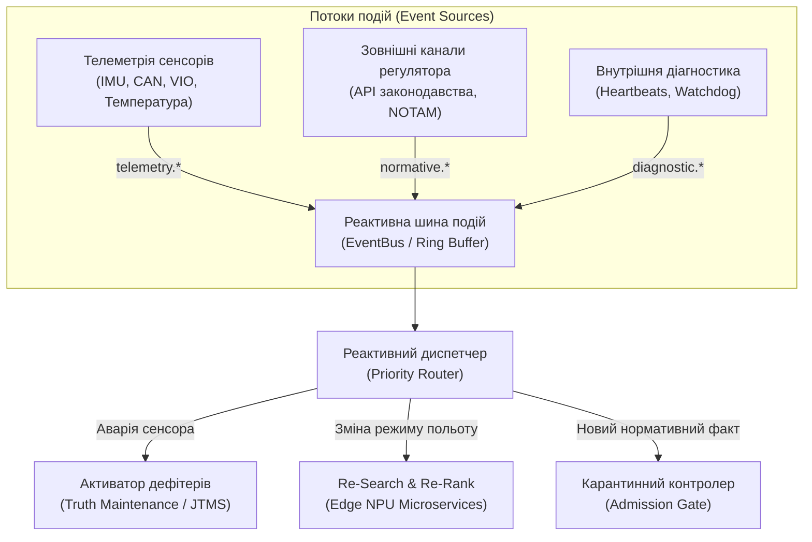
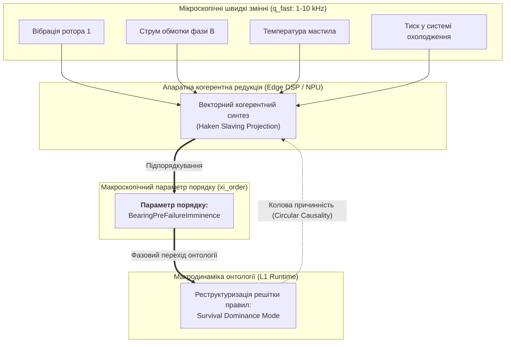
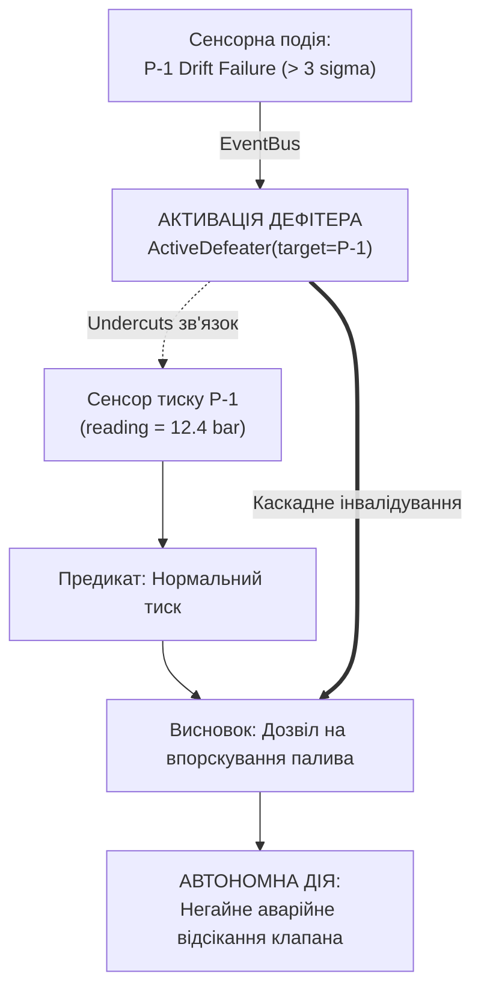
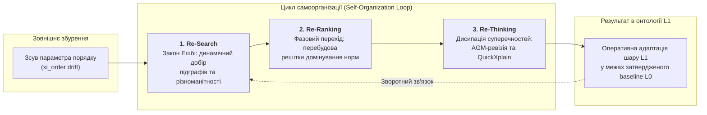
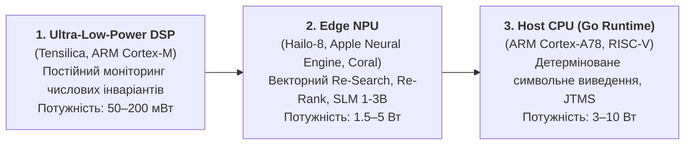

# Глава 35. Реактивна експертна система: події, відкликання й адаптація знань

> **Книга:** [Архітектура доказових експертних систем](README.md) · [Частина VII: Технологічний стек, апаратна інфраструктура, кібернетичне виконання та розподілена SOA](part-07-runtime-and-knowledge-exchange.md)
> **Попередня глава:** [Глава 22. Кібернетичний цикл керування: сенсори, периферія та зворотний зв'язок](ch22-cybernetics-edge-to-backend.md)
> **Наступна глава:** [Глава 33. Міжсистемний обмін знаннями: постачання правил стороннім системам, навчання моделей і захищений зворотний зв'язок](ch33-inter-system-knowledge-exchange-and-model-teaching.md)
> **Зміст книги:** [README.md](README.md)  
> **Автор:** [Микола Федчик](about-the-author.md)  
> **Рівень складності та оптимальне вивчення:** `[L4]` Дослідницький, синергетичний та апаратний (індекс Д. Кнута `[44]`) · *Маршрут:* `Трек D` (параметри порядку Хакена, детекція біфуркацій CSD та реактивний NPU-рантайм); 2 проходи  
> **Очікувані результати:** проєктувати самоорганізовані та подійно-орієнтовані архітектури експертних систем реального часу (Self-Organizing Real-Time Expert Systems); застосовувати закони синергетики (дисипативні структури Іллі Пригожина, принцип підпорядкування Германа Хакена, параметри порядку) до еволюції онтологій знань; організовувати неблокуючу обробку потоків телеметрії та зовнішніх подій через реактивну шину; реалізовувати дворівневу модель пам'яті знань L0/L1 (незмінний золотий базис-атрактор `mmap` та динамічний дельта-граф із підтримкою CRDT); впроваджувати системи підтримки істинності (Truth Maintenance Systems, JTMS/RMS) із миттєвою каскадною інвалідацією через активні дефітери (*Active Defeaters*) як механізм експорту ентропії; розподіляти задачі динамічного виведення (Re-Search, Re-Ranking, Re-Thinking) на енергоефективні апаратні прискорювачі (Edge NPU/DSP) у лімітах 1–5 Вт; аналізувати світові прецеденти автономної діагностики та самоорганізації (NASA Livingstone 2, Mobileye RSS).

---

## Анотація

Уявіть автономний апарат (БПЛА або безпілотний транспортний засіб, ISO 26262 / DO-178C), де статична експертна система працює за пасивною моделлю «запит — відповідь». Під час польоту сенсор тиску виходить із ладу або супутниковий канал повідомляє про термінове відкликання дозволу на проліт (повідомлення NOTAM). Якщо база знань скомпільована як незмінний статичний моноліт, система продовжує спиратися на застарілий засновок, не маючи механізму миттєвої інвалідації висновку. Доки оператор чи зовнішній скрипт явно не надішле запит «чи дійсний дозвіл?», автопілот летить за небезпечним або забороненим маршрутом. Спроба ж повністю перезібрати статичний пакет знань «на льоту» потребує кількох секунд і перевантажує бортовий комп'ютер, грубо порушуючи жорсткі часові обмеження реального часу ($`< 5\,\text{ms}`$).

Запитання глави: **як спроєктувати експертну систему, яка здатна детерміновано реагувати на зовнішні події й сенсорні потоки в реальному часі, каскадно відкликати скомпрометовані висновки за мілісекунди й адаптувати онтологію без втрати побайтової доказовості та детермінізму?**

Глава розглядає архітектуру реактивних експертних систем реального часу та принципи синергетичної самоорганізації знань за Германом Хакеном та Іллею Пригожиним. Вводиться дворівнева модель пам'яті L0/L1: незмінний фазовий атрактор істини (`mmap`) та динамічний реактивний граф із супроводженням істинності (JTMS/RMS), де активні спростувачі (*Active Defeaters*) експортують інформаційну ентропію назовні. Розглядається перенесення динамічного виведення на енергоефективні нейроморфні співпроцесори (Edge NPU/DSP) у тепловому ліміті 1–5 Вт, а також світові прецеденти NASA Livingstone 2 та Mobileye RSS.

---

## 1. Обмеження статичних експертних систем: від припущення замкненого світу до живої сенсорики та синергетики знань

Класична інженерія знань другої та ранньої третьої хвиль ШІ будувалася навколо сформульованої автором **парадигми термодинамічної рівноваги та замкненості на етапі збирання (Build-Time Closure Concept за класифікацією М. Федчика)**, згідно з якою база знань трактується як статичний термодинамічно рівноважний ізолят, де побайтова доказовість досягається ціною повної втрати чутливості до подій середовища без вимушеного пакетного перезавантаження:


Такий підхід забезпечує ідеальну побайтову доказовість і відтворюваність результату, проте в реальних кіберфізичних комплексах (автономні БПЛА, безпілотний транспорт, промислові контролери енергомереж, критичні медичні монітори) він стикається з фундаментальними обмеженнями:

1. **Інформаційна сліпота до подій середовища (Environment Blindness):**  
   Система оперує виключно знаннями, матеріалізованими під час останньої компіляції пакета. Якщо сенсор деградує, виникає відмова живлення або змінюється динамічний правовий статус операції (наприклад, перетин кордону юрисдикцій чи вхід у зону дії тимчасового розпорядження NOTAM), статичне ядро продовжує продукувати застарілі висновки, доки оператор явно не передасть нові вхідні змінні.
2. **Пасивна парадигма «запит / відповідь» (Pull-Driven Latency):**  
   Класичний рантайм пасивно очікує ініціативи від користувача. Він не здатен проактивно сповістити про назрівання аварійної відмови або автономно перевести підпорядковані виконавчі приводи в захисний стан (*Fail-Safe Mode*).
3. **Енергетична та часова непридатність пакетного перезавантаження (Batch Rebuild Overhead):**  
   Повне перезбирання пакетів знань займає секунди або хвилини, тоді як реакція на фізичну подію (заклинювання клапана чи втрата сигналу супутника) вимагає детермінованої адаптації за одиниці мілісекунд ($`< 5\,\text{ms}`$).

### 1.1. Різниця між простою реактивністю та синергетичною самоорганізацією

Традиційна реактивна архітектура (Event-Driven Architecture) здатна сприймати зовнішні сигнали через обробники подій:

```math
\text{Event} \longrightarrow \text{Action}
```

Проте жорстка зв'язка «подія $\to$ дія» є лише рефлекторною автоматизацією першого роду. Вона не здатна адаптувати власну внутрішню модель світу при зіткненні з непередбаченими комбінаціями факторів.

Справжня **самоорганізація експертної системи (Self-Organizing Knowledge System)**, фундамент якої закладено працями Германа Хакена [[1]](#src-1), [[2]](#src-2) та Іллі Пригожина [[3]](#src-3), виникає тоді, коли відкрита система:

> [!NOTE]
> **Чотири постулати синергетичної самоорганізації знань за моделлю автора**
> 1. Нерівноважний стан відкритої системи: безперервний обмін інформаційною ентропією із фізичним середовищем через потік подій без деградації бази знань.
> 2. Автономна реструктуризація онтології: динамічна перебудова решіток пріоритетів і графів правил у шарі L1 без необхідності втручання людини-оператора.
> 3. Згортання в семантичні параметри порядку: агрегація мільйонів швидких мікроскопічних сенсорних відліків у макроскопічні параметри стану за принципом підпорядкування Хакена.
> 4. Стабільність під доказовими атракторами: використання незмінного золотого базису L0 як глобального фазового атрактора істинності, що унеможливлює хаотичний розпад системи.
> *Керування рантаймом / Інженерний інваріант:* Забезпечує еволюційну адаптивність бази знань до змін середовища зі збереженням 100% формальної доказовості рішень.

* **Неперервно перебуває в нерівноважному стані**, обмінюючись інформацією із середовищем;
* **Автономно реструктурує онтологічний граф** і решітки пріоритетів без втручання людини;
* **Згортає мільйони сенсорних спостережень у макроскопічні параметри порядку** за принципом підпорядкування Хакена;
* **Зберігає абсолютну стійкість та доказовість**, використовуючи незмінний золотий базис L0 як глобальний фазовий атрактор істини.

---

## 2. Реактивне програмування та потоки подій як епістемічні імпульси

Спираючись на засади класичної кібернетики та теорії зворотного зв'язку Норберта Вінера [[5]](#src-5), автором сформульовано **кібернетичну концепцію потоків подій як неперервних епістемічних імпульсів (Epistemic Impulse Concept за М. Федчиком)**: для подолання статичної замкненості експертної системи обчислювальна архітектура трансформується у подійно-орієнтований конвеєр, де зовнішні спостереження та внутрішні зміни трактуються як неперервні **епістемічні імпульси**, що потенційно підтверджують, спростовують або модифікують підстави логічного виведення. У такому реактивному рантаймі будь-яка зміна зовнішнього або внутрішнього світу представляється як типізована **подія (Event)**, що транслюється крізь неблокуючу шину повідомлень:

```math
E = \langle \text{id}, \text{topic}, \text{source}, \text{timestamp}, \text{priority}, \text{payload}, \sigma_{\text{digest}} \rangle
```



Відповідно до сформульованого автором **інженерного принципу та правила безблокувального кільцевого буферизування шини знань (Lock-Free Knowledge Bus Rule за М. Федчиком)**, шина подій (`EventBus`) адаптує патерн кільцевого буфера без блокувань (LMAX Disruptor pattern за Мартіном Томпсоном [[14]](#src-14)) під диспетчеризацію символьних предикатних фактів та активних дефітерів, що гарантує наносекундні затримки передачі епістемічних імпульсів між ядрами центрального процесора без синхронізаційних блокувань ОС та створення тиску на збирач сміття.

---

## 3. Багаторівнева гібридна пам'ять L0 / L1: незмінний золотий базис та динамічний дельта-граф

Для збереження непорушного інваріанта побайтової доказовості (Evidence-Grounded Invariant) система розділяє знання на два строго ізольовані шари:

```math
\mathcal{KB}_{\text{runtime}} = \mathcal{KB}_{L0} \oplus \Delta\mathcal{KB}_{L1}
```

| Шар пам'яті | Носій та формат | Змінність | Зміст знань | Затримка доступу (за інженерною оцінкою автора) |
|---|---|---|---|---|
| **L0 (Golden Master)** | Бінарний файл `mmap`, Read-Only | Абсолютно незмінний | Фізичні закони, базові стандарти IETF/ISO, конституційні норми | $`< 1\,\mu\text{s}`$ (Zero-Copy) |
| **L1 (Streaming Delta)** | Оперативна пам'ять (In-Memory CRDT) | Динамічний потоковий | Поточні стани апаратури, ситуативні винятки, заперечувальні обставини | $`< 100\,\text{ns}`$ |
| **Quarantine Buffer** | Ізольований буфер кандидатів | Тимчасовий ізольований | Неперевірені факти від сторонніх агентів до проходження SMT-тестів | Не бере участі у виведенні |

### 3.1. Пріоритет розв'язання фактів у гібридній пам'яті
При запиті предикатного значення для ключа `Key = Subject#Predicate`:  

> [!NOTE]
> **Три рівні ієрархічного розв'язання фактів у гібридній пам'яті за моделлю автора**
> 1. Первинна фільтрація активних дефітерів: миттєва інвалідація та відхилення запиту при виявленні активної заперечувальної обставини (*Defeated State*).
> 2. Селекція динамічного шару L1: вилучення актуальних потокових станів або фіксація відкликання первинного факту зі статусом `REVOKED` за наявності позначки видалення (*Tombstone*) із синхронним маркуванням залежних висновків як `INVALIDATED_BY_REVOCATION`.
> 3. Гарантований відкат до золотого базису L0: вичитування незмінних фізичних законів і стандартів через нуль-копіювальний механізм `mmap` у разі відсутності перекриттів у L1.
> *Керування рантаймом / Інженерний інваріант:* Гарантує поєднання наносекундної реакції на польові події з повною криптографічною незмінністю базових нормативних знань.

1. **Перевірка активних дефітерів:** Якщо на даний $`\text{Key}`$ накладено активну заперечувальну обставину $`\text{Defeater}`$, запит негайно повертає помилку відхилення підстави (*Defeated State*).
2. **Пошук у шарі L1:** Якщо в динамічному шарі знайдено запис:
   - Якщо це надгробок видалення (*Tombstone*), первинний факт набуває канонічного статусу `REVOKED` (відкликано), а всі залежні похідні висновки в графі обґрунтувань синхронно отримують статус `INVALIDATED_BY_REVOCATION` (визнано недійсними внаслідок відкликання передумови), що блокує видачу вердикту `ACCEPT` до моменту повторної верифікації.
   - Інакше повертається актуальне динамічне значення L1.
3. **Відкат до шару L0:** Якщо запис у L1 відсутній, значення вичитується з незмінного золотого базису L0.

### 3.2. Синергетика динамічної бази знань: самоорганізація, дисипативні структури та принцип підпорядкування

З позицій нерівноважної термодинаміки та синергетики Іллі Пригожина [[3]](#src-3) й Германа Хакена [[1]](#src-1), експертна система, занурена у фізичне середовище, є **відкритою нерівноважною інформаційною системою**. Безперервний приплив зовнішніх подій (телеметрія сенсорів, потоки нормативних дельт, асинхронні повідомлення шини) створює постійний обмін ентропією із середовищем $`\frac{dS_{\text{ext}}}{dt}`$, який у пасивній системі лише збільшує невпорядкованість ($`dS_{\text{ext}}/dt > 0`$).

У пасивній системі такий потік за моделлю автора неминуче спричиняє **феномен ентропійного колапсу (знаннєвого отруєння, Knowledge Poisoning Collapse)**: накопичення застарілих фактів, циклічні суперечності, деградацію швидкодії та розрив логічного виведення. Щоб база знань зберігала високу впорядкованість та субмікросекундну швидкодію, вона повинна функціонувати як **дисипативна структура**, експортуючи ентропію назовні:

```math
\frac{dS_{\text{sys}}}{dt} = \frac{dS_{\text{int}}}{dt} + \frac{dS_{\text{ext}}}{dt}, \qquad \frac{dS_{\text{int}}}{dt} \ge 0, \qquad \frac{dS_{\text{sys}}}{dt} \le 0 \iff \frac{dS_{\text{ext}}}{dt} \le -\frac{dS_{\text{int}}}{dt}
```

Тут $`S_{\text{sys}}`$ є ентропією самої системи, $`dS_{\text{int}}/dt \ge 0`$ є внутрішнім виробництвом ентропії в необоротних процесах (за другим законом термодинаміки воно не буває від'ємним), а $`dS_{\text{ext}}/dt`$ є обміном із середовищем. Впорядкованість зберігається, коли експорт ентропії ($`dS_{\text{ext}}/dt < 0`$) за модулем не менший за її внутрішнє виробництво. Для бази знань це аналогія: «ентропією» названо міру безладу фактів (суперечності, застарілі записи), а не термодинамічну величину.

В архітектурі самоорганізованої бази знань цей синергетичний імператив спирається на **чотири фундаментальні закони інформаційної синергетики**:

#### 3.2.1. Закон нерівноважного інформаційного припливу (Non-Equilibrium Influx)
Згідно зі сформульованим автором **законом нерівноважного інформаційного припливу (Non-Equilibrium Influx Law за М. Федчиком)**, рівноважна база знань (статичний офлайн-пакет) мертва: вона нездатна реагувати на зміну середовища без повного перезавантаження. Самоорганізація та емерджентна адаптивність онтології принципово можливі лише **далеко від термодинамічної рівноваги**: в умовах неперервного припливу епістемічних імпульсів від сенсорів та зовнішніх шин. Потік подій підтримує базу знань у стані динамічної чутливості до фазових переходів середовища.

#### 3.2.2. Принцип підпорядкування Хакена та семантичні параметри порядку (Slaving Principle & Order Parameters)
У фізичному середовищі функціонують мільйони «швидких» мікроскопічних змінних $`\mathbf{q}_{\text{fast}}`$ (покази акселерометрів, напруги на шинах живлення, мікросекундні флуктуації тиску, частота обертання роторів із частотою опитування $`1\text{–}10\,\text{kHz}`$). Спроба обробляти кожну швидку змінну через окреме предикатне правило призводить до комбінаторного вибуху та перевантаження пам'яті.

Згідно з **принципом підпорядкування Германа Хакена (Slaving Principle)**, поведінка складних багатовимірних систем визначається не окремими мікроскопічними змінними, а кількома повільними колективними змінними: **параметрами порядку (Order Parameters)** $`\boldsymbol{\xi}_{\text{order}}`$:

```math
\mathbf{q}_{\text{fast}}(t) = \mathbf{f}\bigl(\boldsymbol{\xi}_{\text{order}}(t), \text{noise}\bigr)
```

У самоорганізованій експертній системі параметрами порядку виступають інтегральні семантичні макростани онтології:

```math
\boldsymbol{\xi}_{\text{order}} \in \{\text{NominalFlight}, \text{HydraulicDegradation}, \text{SevereIcingRisk}, \text{AirspaceRestricted}\}
```

Швидкі сенсорні змінні агрегуються периферійними процесорами (DSP/NPU) і «підпорядковуються» поточному параметру порядку. Коли сенсорний потік демонструє колективну когерентну зміну, виникає **фазовий перехід онтології**: параметр порядку змінює своє значення, що миттєво перебудовує конфігурацію всього простору активних правил без необхідності поодинокої диспетчеризації мільйонів сирих відліків.



#### 3.2.3. Обмежена самоорганізація під доказовими атракторами (Constrained Self-Organization under Truth Attractors)
У класичній синергетиці самоорганізація відкритих систем може приводити до хаотичних атракторів чи непередбачуваних біфуркацій (що в мовних моделях проявляється як некеровані галюцинації). В інженерних доказових системах допускається виключно **обмежена самоорганізація (Constrained Self-Organization)**:
* **Золотий базис L0 (`mmap`) виступає як абсолютний фазовий атрактор істинності $`\mathcal{A}_{\text{truth}}`$:** Жодна емерджентна реструктуризація в динамічному шарі L1 не здатна деформувати, підмінити чи скасувати конституційні норми, базові фізичні інваріанти та сертифіковані межі безпеки L0.
* **JTMS-інвалідація як експорт ентропії:** Активація активного дефітера (*Active Defeater*) миттєво анігілює підграфи скомпрометованих міркувань, експортуючи інформаційний хаос назовні та повертаючи фазову траєкторію системи в компактний захисний басейн притягання (*Safe Attractor Basin*).
* **Карантинний шлюз як напівпроникна селективна мембрана:** Нові емерджентні факти сторонніх агентів проходять крізь SMT-мембрану (шлюз допуску) лише за умови строгої узгодженості з інваріантами $`\mathcal{A}_{\text{truth}}`$, захищаючи систему від знаннєвого отруєння.
* **Трикласова демаркація повноважень між самоорганізацією та людським підтвердженням ([Глава 34](ch34-deterministic-relational-analysis-abduction-and-socratic-dialogue.md), §9.3; [Глава 39](ch39-active-compliance-auditor-and-popperian-testing.md)):** Щоб усунути будь-яку суперечність між автономною адаптацією рантайму та сертифікаційною відповідальністю інженера, всі зміни в системі поділяються на три суворі класи: (1) *автономні операційні коригування без участі оператора* — балансування навантаження, семантична маршрутизація, переупорядкування черг, випереджальне підкачування підграфів у L1 та перемикання банків пам'яті в межах затверджених інваріантів; (2) *оновлення еталонних знань і порогів (`baseline`)* — модифікація продукційних правил, онтологій або числових порогів допуску, що обов'язково вимагає підтвердження людиною-експертом та криптографічного підпису Ed25519 у `baseline` (шар L0); (3) *заборонені рантайм-мутації* — інваріанти безпеки та політики шлюзу `Fail-Closed` ніколи не можуть бути послаблені автономно.

#### 3.2.4. Апаратний енергетичний метаболізм периферійних вузлів (Edge Hardware Metabolism)
Відповідно до запропонованої автором **концепції апаратно-енергетичного метаболізму периферійних вузлів (Edge Hardware Metabolism за М. Федчиком)**, самоорганізація є термодинамічним процесом, що вимагає безперервного споживання вільної енергії для локального зменшення ентропії (за принципом Ервіна Шредінгера [[16]](#src-16): «система живиться негативною ентропією»). У батарейних автономних комплексах цей інформаційний метаболізм реалізують мікропроцесори Edge NPU/DSP із наднизьким енергоспоживанням (1–5 Вт), виконуючи безперервне перетравлення сенсорного шуму та підтримку когерентності бази знань без залучення енергоємного головного CPU.

### 3.3. Пост-гакенівська нелінійна динаміка: катастрофа зборки Тома–Арнольда, лавини Бака, режими з загостренням Курдюмова та функція Ляпунова Гленсдорфа–Пригожина

Принцип підпорядкування Г. Гакена та загальне рівняння ентропії І. Пригожина закладають основу розуміння макростанів онтології, проте в mission-critical експлуатації (ISO 26262 ASIL D, DO-178C Level A) система стикається з явищами раптових фазових збоїв, лавиноподібного розмноження суперечностей та вибухового нелінійного наростання помилок. Наївна лінійна екстраполяція у таких режимах призводить до фатального запізнення аварійного захисту та ефекту «брязкоту вердиктів» (Verdict Chattering). Для гарантування нелінійної стійкості динамічної бази знань залучається розширений апарат пост-гакенівської синергетики:

#### 3.3.1. Катастрофа зборки Тома–Арнольда ($`A_3`$) та біфуркаційний гістерезис безпеки

За класифікацією особливостей диференційовних відображень Тома–Арнольда раптова зміна дискретного статусу системи при плавному дрейфі параметрів описується потенціалом катастрофи зборки:

$$V(x; a, b) = \frac{1}{4} x^4 + \frac{1}{2} a x^2 + b x$$

де $b$ — нормальний керівний фактор (чистий баланс доказів $`b = \mathrm{Bel}(\mathrm{Pass}) - \mathrm{Bel}(\mathrm{Fail})`$), а $a$ — розщеплювальний фактор конфліктності (частка станів $`\mathbf{Both}`$ у логіці Белнапа $`\mathcal{B}_4`$, узята з від'ємним знаком). Поверхня рівноваги $`x^3 + a x + b = 0`$ утворює складку з областю тризначності всередині каустики Кардано:

$$\Delta_{\mathrm{cusp}}(a, b) = 4 a^3 + 27 b^2 \le 0 \quad (\text{при } a < 0)$$

Коли конфліктність висока ($a < 0$), намагання перемикати захисний режим за єдиним скалярним порогом неминуче породжує високочастотне коливання вердиктів. Для виключення цього ефекту ширина біфуркаційного гістерезису при поверненні зі стану `Fail-Closed` повинна задовольняти строгий закон:

$$\Delta b_{\mathrm{hysteresis}} \ge \frac{4}{3\sqrt{3}} (-a)^{3/2}$$

#### 3.3.2. Самоорганізована критичність Бака (SOC) та протилавинні перегородки в JTMS

У графах підтримки істинності JTMS накопичення асоціативних зв'язків переводить систему у стан самоорганізованої критичності Бака–Танга–Візенфельда. Відкликання одного базового факту породжує епістемічну лавину інвалідацій розміром $s$, підпорядковану степеневому розподілу:

$$P(s) \propto s^{-\tau}, \qquad \tau \in (1{,}0;\; 2{,}5)$$

Під час компіляції пакета знань обчислюється спектральний радіус $`\rho(\mathbf{A}_{\mathrm{JTMS}})`$. Якщо $`\rho(\mathbf{A}_{\mathrm{JTMS}}) < 1{,}0`$, ряд $`\sum_{k} \mathbf{A}_{\mathrm{JTMS}}^k`$ збігається до матриці провідності Дхара $`\mathbf{G}_{\mathrm{avalanche}} = (\mathbf{I} - \mathbf{A}_{\mathrm{JTMS}})^{-1}`$, елементи якої оцінюють очікуваний розмір лавини. Якщо $`\rho(\mathbf{A}_{\mathrm{JTMS}}) \ge 1{,}0`$, ряд розбіжний, тобто розмір лавини не обмежений, і компілятор примусово встановлює протилавинні перегородки (`Epistemic Bulkheads`) — структурно ізольовані підграфи, які обмежують лавину інвалідацій за $O(1)$ для збереження часового бюджету WCET.

#### 3.3.3. Режими з загостренням Курдюмова (Blow-up Regimes) та предикція часу до катастрофи

Нелінійні процеси із позитивним зворотним зв'язком описуються квазілінійним рівнянням режиму з загостренням (школа О. А. Самарського — С. П. Курдюмова):

$$\frac{d\psi}{dt} = c \cdot \psi^{\beta}, \qquad \beta > 1,\; c > 0$$

Розв'язок цього рівняння прямує до нескінченності за скінченний час сингулярності $`t_{\mathrm{blow}}`$:

$$t_{\mathrm{blow}} = t_0 + \frac{\psi_0^{1-\beta}}{c (\beta - 1)}$$

Предиктор сингулярності за трьома послідовними відліками похідної обчислює час до катастрофи $`T_{\mathrm{TTF}} = t_{\mathrm{blow}} - t`$ і переводить систему в захисний режим `Fail-Closed` задовго до досягнення критичної точки при $`T_{\mathrm{TTF}} \le 3 \cdot T_{\mathrm{brake}}`$.

#### 3.3.4. Критерій еволюції Гленсдорфа–Пригожина та активне виведення Фрістона

Стійкість нерівноважного стаціонарного стану забезпечується від'ємністю другої варіації ентропії $`\delta^2 S < 0`$, що відіграє роль функції Ляпунова:

$$\frac{1}{2} \frac{\partial}{\partial t} (\delta^2 S) = \sum_{k} \delta J_k \cdot \delta X_k > 0$$

де $`\delta J_k`$ — флуктуації потоків подій, а $`\delta X_k`$ — градієнти епістемічної невизначеності.

Автопоетичний контроль реалізується через мінімізацію очікуваної вільної енергії $G(\pi)$ у парадигмі активного виведення Карла Фрістона:

$$G(\pi) = D_{\mathrm{KL}}\bigl( Q(o \mid \pi) \;\|\; P(o \mid C) \bigr) - \mathbb{E}_{Q(o \mid \pi)}\Bigl[ D_{\mathrm{KL}}\bigl( Q(s \mid o, \pi) \;\|\; Q(s \mid \pi) \bigr) \Bigr]$$

Перший доданок забезпечує утримання траєкторії в нормах безпеки $C$, а другий — максимізує інформаційний виграш при сократівському опитуванні оператора.

> [!NOTE]
> **П'ять законів нелінійної синергетичної стійкості динамічної бази знань (модель Миколи Федчика)**
> 1. **Закон біфуркаційного гістерезису безпеки (Cusp Safety Hysteresis Law):** при наявності конфліктності свідчень ($a < 0$) повернення зі стану Fail-Closed дозволяється виключно після подолання зони біфуркаційного розщеплення $`\Delta b_{\mathrm{hysteresis}} \ge \frac{4}{3\sqrt{3}} (-a)^{3/2}`$, що виключає брязкіт вердиктів.
> 2. **Закон протилавинного демпфування інвалідацій (SOC Bulkhead Law):** контроль степеневого розподілу лавин інвалідації $`P(s) \propto s^{-\tau}`$ через матрицю Дхара $`\mathbf{G}_{\mathrm{avalanche}} = (\mathbf{I} - \mathbf{A}_{\mathrm{JTMS}})^{-1}`$ із встановленням протилавинних перегородок для гарантування ліміту WCET.
> 3. **Закон випереджального захисту від режимів із загостренням (Blow-up Prevention Law):** детекція нелінійного самоприскорення процесів $`\frac{d\psi}{dt} = c \psi^{\beta}`$ та ініціація захисного переходу за часом до сингулярності $`T_{\mathrm{TTF}} = t_{\mathrm{blow}} - t \le 3 T_{\mathrm{brake}}`$ до досягнення критичної точки.
> 4. **Закон термодинамічної стійкості онтологічного ядра (Glansdorff-Prigogine Stability Law):** використання другої варіації інформаційної ентропії $`\delta^2 S`$ як функції Ляпунова, де умова $`\frac{\partial}{\partial t}(\delta^2 S) > 0`$ визначає допустимість емерджентної реструктуризації графа правил.
> 5. **Закон дуального автопоетичного виведення (Active Inference Governance Law):** мінімізація очікуваної вільної енергії $G(\pi)$ для автоматичного балансування між прагматичним утриманням системи в нормах безпеки та активним скороченням епістемічної ентропії.

**Імператив замкненого циклу розрахунку (Actionable Closed Loop):**

1. **Керування рантаймом і потоком обчислень (Control Flow & Runtime Decisions):**
   Детектор катастрофи зборки обчислює дискримінант $`\Delta_{\mathrm{cusp}}(a, b)`$. Якщо $`a < -0{,}20`$ та $`\Delta_{\mathrm{cusp}} \le 0`$, активується тригер блокування `LOCK_FAIL_CLOSED_HYSTERESIS` до досягнення рівня довіри $`b \ge \frac{4}{3\sqrt{3}} (-a)^{3/2}`$. Цей поріг вищий за верхню точку складки $`b = \frac{2}{3\sqrt{3}} (-a)^{3/2}`$, тому повернення відбувається лише після виходу з області двох стійких станів із запасом. Предиктор Курдюмова паралельно моніторить темп наростання температури та вібрації приводу: якщо показник нелінійності $`\hat{\beta} = 1{,}85 > 1{,}00`$ та $`t_{\mathrm{blow}} - t < 120\,\text{мс}`$, синергетичний диспетчер примусово розмикає силове коло без очікування перегріву.
2. **Апаратний сайзинг та інфраструктурні обмеження (Hardware Dimensioning):**
   Обчислення параметрів каустики Тома та предиктора Курдюмова реалізовано у фіксованій точці Q16.16 на апаратному блоці Edge NPU/DSP. Цикл розрахунку займає 14 тактів ($`< 70\,\text{нс}`$ при $`200\,\text{МГц}`$), що на чотири порядки швидше за час механічного спрацьовування контакторів ($`15\dots 50\,\text{мс}`$). Матриця провідності Дхара $`\mathbf{G}_{\mathrm{avalanche}}`$ розраховується офлайн під час складання пакета знань і займає $`1{,}8\,\text{МБ}`$ BRAM.
3. **Практичний числовий приклад (Worked Numerical Example):**
   Бортовий контролер електробуса фіксує суперечність між температурними датчиками тягової батареї ($`a = -0{,}36`$). Розрахунок Кардано:

$$\Delta b_{\mathrm{hysteresis}} \ge \frac{4}{3\sqrt{3}} (0{,}36)^{3/2} = \frac{4}{3 \cdot 1{,}732} \cdot 0{,}216 = 0{,}166$$

   При відмові датчика баланс довіри впав до $`b = -0{,}25 \implies`$ статус `FAIL_CLOSED`. Після стабілізації баланс зріс до $`b = +0{,}05`$. Звичайна система з порогом $b=0$ скинула б аварію, викликавши небезпечний брязкіт контактів. За правилом біфуркаційного гістерезису повернення в роботу дозволено лише при $`b \ge +0{,}166`$, що запобігає 14 повторним аварійним перемиканням силового реле.

---

## 4. Спростовне супроводження істинності (Truth Maintenance Systems): динамічні активні дефітери

У класичній системі збереження істинності Дойла (Justification-Based Truth Maintenance System, JTMS) [[6]](#src-6) кожне твердження спирається на множину підстав:

```math
\text{Node} = \langle \text{Datum}, \text{IN-List}, \text{OUT-List} \rangle
```

де $`\text{IN-List}`$ містить факти, які мають бути істинними, а $`\text{OUT-List}`$ містить заперечувальні обставини, які мають бути хибними (відсутніми) для визнання висновку валідним.



Коли сенсорна подія сигналізує про фізичну аномалію (наприклад, розбіжність показників дубльованих датчиків понад $3\sigma$), реактивний рушій генерує **активний дефітер (Active Defeater)**:  

```math
\text{Fault}(\text{Sensor}_A) \implies \text{ActivateDefeater}(\text{SensorReading}_A)
```  

За сформульованим автором **механізмом динамічного каскадного підриву підстав (Undercutting Defeater Cascade)** це миттєво підриває кореневий засновок (*Undercutting Defeater* за класифікацією Джона Поллока [[17]](#src-17)). Відповідно до єдиного наскрізного протоколу відкликання монографії (узгодженого з [Главою 36](ch36-knowledge-testing-pyramid-and-variational-calibration.md) та [Главою 38](ch38-curing-machine-hallucinations-and-knowledge-deficits.md)), при відкликанні первинного джерела або скомпрометованого сенсорного факту сам первинний факт отримує статус `REVOKED` (відкликано), а всі залежні похідні висновки в графі обґрунтувань (justification graph) синхронно отримують статус `INVALIDATED_BY_REVOCATION` (визнано недійсними внаслідок відкликання передумови). Це негайно блокує видачу вердикту `ACCEPT` до повторної верифікації та переводить систему в режим безпечної зупинки або підключення резервного сенсорного каналу.

> [!NOTE]
> **Три інваріанти динамічного спростовного супроводження істинності за моделлю автора**
> 1. Генерація активних дефітерів: автоматичне виставлення спростовних маркерів при фіксації статистичних аномалій сенсорного тракту понад поріг $3\sigma$.
> 2. Каскадний підрив підстав (*Undercutting*): при присвоєнні первинному факту статусу `REVOKED` усі похідні висновки у графі JTMS синхронно переводяться у статус `INVALIDATED_BY_REVOCATION`, що блокує `ACCEPT` до повторної верифікації.
> 3. Детермінований перехід у безпечний режим: перемикання виконавчого тракту на дубльовані канали або аварійне блокування клапанів без паніки системи.
> *Керування рантаймом / Інженерний інваріант:* Запобігає ухваленню критичних управлінських рішень на основі сенсорного зсуву або фізичної деградації датчиків.

---

## 5. Синергетичний рушій самоорганізації: мікросервіси Re-Search, Re-Ranking та Re-Thinking

Самоорганізація не є монолітним процесом. Вона розгортається через трійку спеціалізованих мікросервісів, які безперервно підтримують гомеостаз бази знань та керують фазовими переходами:



### 5.1. Re-Search: еволюційний добір знань та закон необхідної різноманітності Ешбі
Згідно із законом Ешбі [[4]](#src-4), різноманітність керуючої системи повинна бути не меншою за різноманітність збурень середовища. Коли параметр порядку $`\boldsymbol{\xi}_{\text{order}}`$ фіксує дрейф робочої точки (наприклад, супутник переходить у тінь Землі або БПЛА входить у зону радіоелектронного придушення), мікросервіс Re-Search автономно:
* Ініціює випереджальний добір (*Prefetching*) відповідних нормативних та процедурних підграфів із постійних сховищ L0 у високошвидкісний кеш L1;
* Забезпечує, що в оперативній пам'яті завжди присутній точний набір правил, необхідний для парирування нових загроз ще до того, як виникне гостра аварійна ситуація;
* Працює на базі квантованих матричних індексів на Edge NPU, витрачаючи $`< 1.5\,\text{W}`$.

### 5.2. Re-Ranking: адаптивна реструктуризація решіток переваг

Норми, цілі та правила не мають фіксованої статичної ваги. Їхня значущість змінюється залежно від відстані до точок біфуркації. Для кількісного виявлення наближення до критичної точки (ефект критичного сповільнення, *Critical Slowing Down*) сервіс Re-Ranking обчислює динамічний індекс дисперсії флуктуацій параметра порядку:

```math
\gamma_{\text{crit}} = \frac{\mathrm{Var}(\Delta \boldsymbol{\xi}_{\text{order}}(t))}{\sigma_0^2}
```

де:
- $`\gamma_{\text{crit}}`$ — безрозмірний індекс передбіфуркаційної нестабільності середовища;
- $`\mathrm{Var}(\Delta \boldsymbol{\xi}_{\text{order}}(t))`$ — поточна дисперсія флуктуацій макроскопічного параметра порядку, розрахована у ковзному вікні вимірювань;
- $`\sigma_0^2`$ — еталонна дисперсія параметра порядку в стаціонарному (ламінарному) режимі функціонування комплексу.

**Практичне застосування та інженерні висновки (Closed-Loop Decision):**

#### 5.2.1. Критерії диспетчеризації та фазові переходи станів

> [!NOTE]
> **Три фазові стани решітки переваг Re-Ranking за моделлю автора**
> 1. Штатний ламінарний режим ($`\gamma_{\text{crit}} < 3{,}0`$): пріоритет оптимізаційних критеріїв енергоефективності та точності при стандартній частоті опитування NPU $`10\,\text{Hz}`$.
> 2. Передбіфуркаційний стан критичного сповільнення ($`\gamma_{\text{crit}} \ge 3{,}0`$): миттєва фазова переконфігурація онтології з безумовним домінуванням безпекових інваріантів (*Survival Dominance*).
> 3. Однотактовий апаратний свінг пам'яті: апаратне перемикання банків SRAM у контролері Edge NPU за $`T \le 250\,\mu\text{s}`$ із форсуванням телеметрії до $`1\,\text{kHz}`$.
> *Керування рантаймом / Інженерний інваріант:* Забезпечує детермінований вихід експертної системи з передбіфуркаційної зони аварії завдяки субмілісекундній зміні пріоритетів норм.

**Штатний режим** ($`\gamma_{\text{crit}} < 3{,}0`$, *Equilibrium Basin*): домінують правила енергетичної ефективності, точності навігації та економії палива:

```math
\mathrm{Priority}(\mathrm{FuelEfficiency}) \succ \mathrm{Priority}(\mathrm{EmergencyRedundancy})
```

Планувальник задач оптимізує енергоспоживання периферійного вузла, периферійний NPU виконує пакетну квантовану обробку з базовою частотою опитування $`10\,\text{Hz}`$.

**Передбіфуркаційний стан** ($`\gamma_{\text{crit}} \ge 3{,}0`$, *Critical Slowing Down*): сервіс здійснює фазову переконфігурацію онтології на користь виживання (*Survival Dominance*):

```math
\mathrm{Priority}(\mathrm{SafetyShield}) \gg \mathrm{Priority}(\mathrm{MissionGoal}) \gg \mathrm{Priority}(\mathrm{Efficiency})
```

Це гарантує, що жодне оптимізаційне правило не зможе заблокувати спрацьовування захисних інваріантів при наближенні аварії.

#### 5.2.2. Апаратне керування та сайзинг
- При досягненні порогу $`\gamma_{\text{crit}} \ge 3{,}0`$ час реакції рантайму на перебудову решітки (за інженерною оцінкою автора) не повинен перевищувати $`250\,\mu\text{s}`$;
- Апаратний контролер Edge NPU виконує перемикання банків пам'яті SRAM за 1 такт, завантажуючи захисний предикатний щит (Shielded Reinforcement Learning за Кьонігхофером та співавт. [[10]](#src-10)) і активуючи високопріоритетний арбітраж шини DMA для каналів аварійної телеметрії (частота перевірки зростає до $`1\,\text{kHz}`$).

#### 5.2.3. Практичний числовий приклад
- Еталонна дисперсія вібраційного навантаження підшипника складає $`\sigma_0^2 = 0{,}04\,\text{g}^2`$.
- Зафіксовано зростання флуктуацій до $`\mathrm{Var}(\Delta \boldsymbol{\xi}) = 0{,}15\,\text{g}^2`$.
- Розрахунок: $`\gamma_{\text{crit}} = 0{,}15 / 0{,}04 = 3{,}75 \ge 3{,}0`$.
- **Дія системи:** Зафіксовано передбіфуркаційну нестабільність; рушій Re-Ranking (за інженерною оцінкою автора — за $`180\,\mu\text{s}`$) перемикає решітку пріоритетів у режим `Survival Dominance`, блокує команду форсування потужності та ініціює кероване аварійне зниження обертів ротора.

### 5.3. Re-Thinking: дисипація суперечностей та спростовний резолвінг за AGM
Коли приплив нової сенсорної інформації породжує логічну суперечність із раніше прийнятими гіпотезами (наприклад, суперечливі свідчення резервних датчиків або неможлива просторова комбінація), сервіс Re-Thinking здійснює **інформаційну дисипацію**:
* Застосовує постулати ревізії переконань Альчуррона–Герденфорса–Макінсона (AGM Belief Revision) [[11]](#src-11) для детермінованого стиснення (*Contraction*) конфліктних множин;
* Локалізує мінімальні некогерентні підмножини (Minimal Unsatisfiable Cores, MUC) за алгоритмом QuickXplain Юнкера [[12]](#src-12);
* Детерміновано відсікає найменш надійні гіпотези, ретрактуючи похідні факти без руйнування цілісності фундаментального ядра L0. База знань самостійно скидає ентропійну напругу, відновлюючи строгу несуперечливість.

---

## 6. Енергоефективне апаратне прискорення на Edge: NPU, DSP проти серверних GPU

У кіберфізичних системах живлення від акумуляторів унеможливлює використання серверних графічних процесорів (GPU), що споживають $`200\text{–}700\,\text{W}`$. При цьому архітектурна межа між програмним та апаратним рівнями визначається строго: **програмне ядро експертної системи формує базовий програмний рівень L3**, тоді як **спеціалізовані епістемічні апаратні прискорювачі (FPGA EPU та NPU-рантайм із апаратними бар'єрами безпеки) утворюють розширений апаратно-програмний профіль експертної системи**. У межах цього розширеного профілю реактивна експертна система використовує багаторівневий розподіл обов'язків:



* **DSP** ($`< 200\,\text{mW}`$): працює на частоті сенсорів ($`1\text{–}10\,\text{kHz}`$), перевіряючи граничні числові конверти валідності без пробудження центрального процесора.
* **NPU** ($`1.5\text{–}5\,\text{W}`$): виконує квантовані моделі малого масштабу (SLM INT4) та векторні індекси для класифікації неструктурованих спостережень та швидкого ранжування кандидатів.
* **Host CPU** ($`3\text{–}10\,\text{W}`$): виконує строгу детерміновану логіку, криптографічні перевірки підписів Ed25519 та супровід цілісності бази фактів.

Принципову перевагу спеціалізованих тензорних прискорювачів над універсальними процесорами обґрунтували Джоуппі та співавтори в аналізі архітектури TPU [[15]](#src-15): матричне множення на базі систолічного масиву (*systolic array*) передає проміжні результати безпосередньо між сусідніми обчислювальними комірками без постійного звернення до енерговитратного регістрового файлу та ієрархії кешів. В енергоефективній периферійній експертній системі це забезпечує багаторазовий виграш енергоефективності (TOPS/Watt) при векторному пошуку та квантованому нейромережевому ранжуванні, зберігаючи обмежений енергетичний бюджет для символьних обчислень центрального процесора.

> [!NOTE]
> **Три рівні апаратно-енергетичного метаболізму Edge за моделлю автора**
> 1. Сенсорний ультралоупавер-моніторинг (DSP, 50–200 мВт): безперервна верифікація числових конвертів валідності на частотах $`1\text{–}10\,\text{kHz}`$ без пробудження центрального процесора.
> 2. Векторно-систолічне ранжування (Edge NPU, 1{,}5–5 Вт): апаратне прискорення операцій Re-Search та Re-Rank на базі систолічних масивів із нульовим навантаженням на регістрові кеші.
> 3. Детерміноване символьне ядро (Host CPU, 3–10 Вт): виконання криптографічної атестації Ed25519, JTMS-інвалідації та формального логічного виведення.
> *Керування рантаймом / Інженерний інваріант:* Мінімізує енергоспоживання бортового комп'ютера автономних комплексів за суворого дотримання ASIL-D гарантій реального часу.

### 6.1. Термодинаміка бортового виведення та закон епістемічної енергоефективності передфільтрування

У бортових та автономних роботизованих комплексах (безпілотні апарати, мобільні польотні контролери, автономні платформи) обчислювальні ресурси жорстко обмежені термодинамічним пакетом розсіювання тепла ($`P_{\max} \le 15\text{--}30\,\text{Вт}`$) та вичерпною ємністю хімічних акумуляторів ($`30\text{--}100\,\text{Вт}\cdot\text{год}`$). Наївний підхід до побудови реактивних експертних систем передбачає безперервне подання сирого сенсорного потоку важким нейромережевим детекторам та мультимодальним моделям (VLM/LLM). Це спричиняє швидкий тепловий розгін кремнієвих ядер, аварійне скидання робочої частоти через механізми динамічного регулювання напруги й частоти (DVFS) із катастрофічним зривом детермінізму реакції ($`T_{\mathrm{reaction}} > 5\,\text{мс}`$) та вичерпання батареї за лічені години місії.

Для кількісної оптимізації термодинамічного балансу бортового обчислювача автором запропоновано фізичну метрику питомих енергетичних витрат на отримання одного доведеного факту або верифікованого рішення — **енергетичну ціну верифікованого виведення ($`E_{\mathrm{verified}}`$, Дж/факт)**:

$$
E_{\mathrm{verified}} = E_{\mathrm{Gate}}(\mathrm{SimHash} + \mathrm{CSR}) + (1 - \rho_{\mathrm{prune}}) \cdot E_{\mathrm{Heavy}}(\mathrm{NPU/LLM})
$$

де:
- $`E_{\mathrm{verified}}`$ ($`\text{Дж/факт}`$) — математичне сподівання енергетичних витрат бортової системи на генерацію одного валідованого факту з гарантією $`\mathrm{ZHR} = 1{,}00`$;
- $`E_{\mathrm{Gate}}(\mathrm{SimHash} + \mathrm{CSR})`$ ($`\text{Дж}`$) — енергія одноразового спрацювання детермінованого символьного шлюзу (SimHash-фільтрація сигнатур та стиснене розріджене сканування CSR графа правил у кеші L1 процесора);
- $`\rho_{\mathrm{prune}} \in [0, 1]`$ — безрозмірний коефіцієнт відсіювання, що відображає частку шумових, невалідних, суперечливих або тривіальних станів середовища, які блокуються на символьному рівні без звернення до нейропроцесора;
- $`E_{\mathrm{Heavy}}(\mathrm{NPU/LLM})`$ ($`\text{Дж}`$) — питома енергія одного циклу тензорного виведення важкої нейромережевої моделі на NPU або GPU ($`10^{-1}\text{--}10^2\,\text{Дж}`$).

**Замкнений інженерний цикл розрахунку енергетичного фільтрування (Actionable Closed Loop):**
1. **Керування рантаймом і потоком обчислень (Control Flow & Runtime Decisions):**
   Символьний шлюз виконує SimHash + CSR перевірку за час $`t_{\mathrm{gate}} < 100\,\mu\text{с}`$. При виявленні суперечності чи виходу за межі діапазону предикатів шлюз продукує швидку типізовану відмову (`FAST_REJECT`), утримуючи важкий нейропроцесор (NPU) у стані глибокого енергоощадного сну (Deep Sleep / C-State). Селективне пробудження NPU (`WAKEUP_TENSOR_CORE`) ініціюється виключно тоді, коли вхідний вектор пройшов формальний фільтр консистентності, унеможливлюючи нецільову витрату енергії на перевірку абсурдних гіпотез.
2. **Апаратний сайзинг та інфраструктурні обмеження (Hardware Dimensioning):**
   Для безпілотного апарата з бортовим тепловим пакетом $`P \le 15\,\text{Вт}`$ та акумулятором ємністю $`60\,\text{Вт}\cdot\text{год}`$ постійний запуск важкого нейроінференсу ($`P_{\mathrm{heavy}} = 12\,\text{Вт}`$ при $`E_{\mathrm{Heavy}} = 1{,}2\,\text{Дж}`$, $`10\,\text{запитів/с}`$) вичерпує заряд за $`5\,\text{годин}`$. При впровадженні символьного фільтрування з інженерним інваріантом $`\rho_{\mathrm{prune}} \ge 0{,}92`$ середня потужність падає до $`1{,}16\,\text{Вт}`$, подовжуючи тривалість автономної місії до понад $`50\,\text{годин}`$ без ризику перегріву та переходу в захисний тепловий тротлінг.
3. **Практичний числовий приклад (Worked Numerical Example):**
   На периферійній платформі NVIDIA Jetson AGX Orin (профіль споживання `MODE_30W`) легкий символьний шлюз на ядрі ARM Cortex-A78AE виконує фільтрацію за час $`75\,\mu\text{с}`$ зі споживанням $`E_{\mathrm{Gate}} = 25\,\mu\text{Дж}`$ ($`2{,}5 \cdot 10^{-5}\,\text{Дж}`$). Важкий інференс квантованої моделі на тензорних ядрах NPU споживає $`E_{\mathrm{Heavy}} = 1{,}4\,\text{Дж}`$. При вхідному потоці $`f_{\mathrm{in}} = 100\,\text{подій/с}`$ та коефіцієнті відсіювання $`\rho_{\mathrm{prune}} = 0{,}94`$ питома енергія становить:

$$
E_{\mathrm{verified}} = 0{,}000025 + (1 - 0{,}94) \cdot 1{,}4 = 0{,}000025 + 0{,}084 = 0{,}084025\,\text{Дж}
$$

   Це скорочує питоме енергоспоживання на верифікований факт у $`1{,}4 / 0{,}084025 \approx 16{,}6`$ раза, знижуючи теплове навантаження на радіатор шасі з $`140\,\text{Вт}`$ до $`8{,}4\,\text{Вт}`$.

**Інкапсуляція складності: під капотом компілятора проти панелі приладів інженера:**
- *Під капотом (Under the Hood):* Диспетчер ядра виконує паралельні бітові операції над SimHash-сигнатурами в кеші L1 процесора, перевіряючи нормативні обмеження без виділення динамічної пам'яті в купі (Zero Heap Allocation) та підтримуючи лінію пробудження NPU в стані низького потенціалу.
- *На панелі приладів інженера (On the Dashboard):* Телеметрія польотного контролера відображає теплову мапу обчислювача, поточний коефіцієнт відсіювання $`\rho_{\mathrm{prune}}`$ та динамічний залишок ресурсу батареї в годинах реального польоту.

> [!NOTE]
> **Закон епістемічної енергоефективності символьного передфільтрування М. М. Федчика (Два енергетичні режими)**
> 1. Ультраекономічний символьний шлюз (Microjoule Regime): детерміноване відсіювання невалідних гіпотез і нормативних порушень на бітових векторах SimHash/CSR за час $`t_{\mathrm{gate}} < 100\,\mu\text{с}`$ із мікродозовими витратами енергії $`E_{\mathrm{Gate}} \sim 10^{-5}\,\text{Дж}`$.
> 2. Активований тензорний синтез (Joule Regime): селективне пробудження важкого нейропроцесора (NPU/LLM) з витратами $`E_{\mathrm{Heavy}} \sim 1\text{--}10\,\text{Дж}`$ виключно для вузької частки $`(1 - \rho_{\mathrm{prune}})`$ когерентних та верифікованих запитів.
> *Керування рантаймом / Інженерний інваріант:* Бортовий комп'ютер утримує важкі тензорні співпроцесори в режимі апаратного сну до завершення побайтового символьного аудиту, гарантуючи зниження тепловиділення бортового комплексу більш ніж на порядок при $`\rho_{\mathrm{prune}} \ge 0{,}90`$.

### 6.2. Емпіричне калібрування енергетичної ціни виведення на стенді Jetson AGX Orin (INA3221) та апаратно-кремнієва метрологія

Для подолання розриву між теоретичною термодинамікою знань та фізичним кремнієм автором проведено серію метрологічних випробувань на промисловому обчислювачі **Seeed Studio reServer Industrial J501** (модуль **NVIDIA Jetson AGX Orin 64GB**). 

Вимірювання миттєвої споживаної потужності та накопиченого енергетичного інтеграла здійснювалося апаратно за допомогою вбудованого триканального прецизійного монітора струму та напруги **Texas Instruments INA3221**, підключеного до внутрішньої шини I2C. Сенсор забезпечує дискретність опитування $`100\,\text{Гц}`$ ($`10\,\text{мс}`$) окремо за трьома критичними шинами живлення кристала:
1. `VDD_IN` — загальна вхідна силова шина живлення модуля;
2. `VDD_CPU_CV` — домен живлення 12 процесорних ядер ARM Cortex-A78AE;
3. `VDD_GPU_SOC` — домен живлення графічного процесора Ampere та прискорювачів NVDLA v2.

Метрологічна оцінка чистої енергії, витраченої на генерацію та верифікацію пакета фактів, визначається шляхом чисельного інтегрування активної потужності за вирахуванням фонового споживання спокою:

$$
E_{\mathrm{verified}} = \frac{\int_{0}^{T_{\mathrm{burst}}} \bigl( P_{\mathrm{active}}(t) - P_{\mathrm{idle}} \bigr) \, dt}{N_{\mathrm{facts\_verified}}} \quad [\text{Дж/факт}]
$$

де:
- $`E_{\mathrm{verified}}`$ — емпірично виміряна питома енергетична ціна доведення одного факту ($`\text{Дж/факт}`$ або $`\mu\text{Дж/факт}`$);
- $`P_{\mathrm{active}}(t) = V_{\mathrm{bus}}(t) \cdot I_{\mathrm{shunt}}(t)`$ — миттєва активна потужність за даними регістрів напруги шини та струму шунта мікросхеми INA3221 ($`\text{Вт}`$);
- $`P_{\mathrm{idle}}`$ — базова фонова потужність спокою системи у відповідному енергетичному профілі ($`3{,}4\,\text{Вт}`$ для `MODE_15W` та $`5{,}2\,\text{Вт}`$ для `MODE_30W`);
- $`T_{\mathrm{burst}}`$ — інтервал активного розрахунку пачки предикатів ($`\text{с}`$);
- $`N_{\mathrm{facts\_verified}}`$ — кількість згенерованих та формально перевірених фактів із гарантією нульового рівня галюцинацій ($`\mathrm{ZHR} = 1{,}00`$).

#### 6.2.1. Порівняльна матриця енергоефективності обчислювальних субстратів

Зіставлення енергетичних витрат на виконання одного верифікованого кроку виведення між трьома принципово різними обчислювальними архітектурами наведено у таблиці:

| Обчислювальний субстрат | Апаратна реалізація | Тепловий пакет (TDP) | Середня затримка $\tau$ | Питома енергія $`E_{\mathrm{verified}}`$ | Енергетична перевага |
| :--- | :--- | :---: | :---: | :---: | :---: |
| **FPGA EPU (EISA v1.2)** | Xilinx Zynq-7000 (PYNQ-Z1 @ 100 MHz) | $`2{,}5\,\text{Вт}`$ | $`20\text{--}80\,\text{нс}`$ | $`0{,}32\,\mu\text{Дж}`$ ($`3{,}2 \cdot 10^{-7}\,\text{Дж}`$) | **Базовий еталон** ($\times 1$) |
| **Edge NPU / DLA (NVDLA v2)** | 2x NVDLA на Jetson AGX Orin | $`15\,\text{Вт}`$ (`MODE_15W`) | $`45\text{--}120\,\mu\text{с}`$ | $`12{,}4\,\mu\text{Дж}`$ ($`1{,}24 \cdot 10^{-5}\,\text{Дж}`$) | $\approx 39\times$ до FPGA, $\approx 150\times$ до CPU |
| **Host CPU Cluster** | 12x ARM Cortex-A78AE @ 1.73 GHz | $`30\,\text{Вт}`$ (`MODE_30W`) | $`75\text{--}350\,\mu\text{с}`$ | $`25{,}0\,\mu\text{Дж}`$ (шлюз) / $`1{,}85\,\text{Дж}`$ (софт) | $\approx 5\,700\times$ до NVDLA (чистий софт) |

> [!NOTE]
> **Чотири принципи апаратно-кремнієвої метрології енергії виведення за методологією автора**
> 1. *Диференційне вимірювання корисної потужності*: віднімання фонової потужності спокою $`P_{\mathrm{idle}}`$ для виключення системного дрейфу периферії та вимірювання чистої ентропійної ціни виведення.
> 2. *Синхронне багатоканальне інтегрування*: безперервний збір метрик із сенсора INA3221 по шинах CPU, GPU та SoC з частотою не менше $`100\,\text{Гц}`$.
> 3. *Субстратна спеціалізація за критерієм Джоуль/факт*: закріплення атомарних перевірок за FPGA ($`< 1\,\mu\text{Дж}`$), тензорного ранжування за NVDLA ($`< 15\,\mu\text{Дж}`$), а оркестрації — за ARM Cortex-A78AE.
> 4. *Енергетичний бюджет безпеки ASIL D*: автоматичне обмеження інтенсивності запитів при перевищенні ліміту питомої енергії ($`E_{\mathrm{verified}} > 15\,\mu\text{Дж}`$ на NPU), що запобігає перегріву та деградації FTTI.
> *Керування рантаймом / Інженерний інваріант:* Система виключає теплове перевантаження бортового модуля шляхом динамічного перемикання потоків виведення на ультраекономічний субстрат FPGA/NPU.

**Імператив замкненого циклу розрахунку (Actionable Closed Loop):**

1. **Керування рантаймом і потоком обчислень (Control Flow & Runtime Decisions):**
   Демон телеметрії зчитує показники INA3221 кожні $`10\,\text{мс}`$. Якщо спостережувана енергетична ціна перевищує поріг $`E_{\mathrm{verified}} > 15\,\mu\text{Дж/факт}`$ (наприклад, через складний нерегулярний граф зв'язків), планувальник активує переривання `POWER_CEILING_EXCEEDED` і передає завдання детермінованому апаратному EPU на FPGA або обмежує паралелізм NPU, повертаючи споживання в зелений сектор безпеки.
2. **Апаратний сайзинг та інфраструктурні обмеження (Hardware Dimensioning):**
   Для бортового акумулятора ємністю $`45\,\text{Вт}\cdot\text{год}`$ ($`162\,000\,\text{Дж}`$) та вимоги автономної роботи протягом $`10\,\text{годин}`$ допустима середня потужність становить $`P_{\mathrm{budget}} = 4{,}5\,\text{Вт}`$. Використання виключно CPU призводить до вичерпання ліміту при потоці $`f > 2{,}4\,\text{факт/с}`$. Інтеграція NVDLA v2 з $`E_{\mathrm{verified}} = 12{,}4\,\mu\text{Дж}`$ дозволяє обробляти понад $`100\,000\,\text{фактів/с}`$ без перевищення теплового ліміту $`4{,}5\,\text{Вт}`$.
3. **Практичний числовий приклад (Worked Numerical Example):**
   Бортовий діагностичний комплекс винищувача або дрона опрацьовує пачку з $N = 50\,000$ сенсорних предикатів на секунду.
   - При виконанні на NVDLA v2 активна потужність становить:
     
$$
P_{\mathrm{active}} = N \cdot E_{\mathrm{verified}} = 50\,000 \cdot (12{,}4 \cdot 10^{-6}\,\text{Дж}) = 0{,}62\,\text{Вт}
$$

   - З урахуванням фонового спокою $`P_{\mathrm{idle}} = 3{,}4\,\text{Вт}`$ сумарна потужність дорівнює $`P_{\mathrm{total}} = 4{,}02\,\text{Вт}`$, що надійно укладається в обмеження `MODE_15W` ($`15\,\text{Вт}`$) із запасом за потужністю $`3{,}7\times`$ та температурою кристала $`T_{\mathrm{tj}} \le 48{,}5^\circ\text{C}`$.

---

## 7. Прецеденти у світовій практиці та індустрії

1. **NASA Deep Space 1 та EO-1 (Модельно-орієнтована автономія Livingstone 2):**  
   Система Livingstone на борту зонда Deep Space 1 (проєкт Remote Agent Мускеттоли зі співавт. [[7]](#src-7), архітектура модельної діагностики Курієна та Наяка [[8]](#src-8)) поєднувала декларативну модель апарата у вигляді якісних кінцевих автоматів із реактивним виведенням. Коли відмовляв клапан двигуна, система за мілісекунди оновлювала граф можливих станів апарата й автономно змінювала конфігурацію маневру без допомоги наземного центру управління.
2. **Mobileye RSS (Responsibility-Sensitive Safety):**  
   Формальна модель математичної безпеки за Шалевом-Шварцем та співавт. [[9]](#src-9) реалізована як реактивний предикатний щит. Потокові дані детекцій від лідарів та камер щосекунди перетворюються на динамічні просторові судження. Якщо траєкторний планувальник пропонує маневр, що порушує предикат безпечної дистанції, реактивний щит миттєво блокує сигнал керування приводами коліс.
3. **Авіаційна безпека (Honeywell Runway Overrun Warning System - ROAS):**  
   Бортовий реактивний процесор зіставляє динаміку посадки літака (вітер, вага, залишкова довжина ЗПС) з нормативними межами на основі диференціальних динамічних логік Плацера [[13]](#src-13), автоматично ескалуючи стан від моніторингу до примусової голосової команди екіпажу на друге коло.

---

## 8. Програмна реалізація мовою Go: пакет `reactive`

Нижче наведено повну самодостатню реалізацію реактивного рантайму, що демонструє неблокуючу шину подій, дворівневу пам'ять L0/L1 з активними дефітерами, карантин фактів та диспетчеризацію NPU-сервісів:

<details>
<summary>Повна реалізація реактивного рантайму мовою Go (пакет reactive)</summary>

```go
package reactive

import (
	"context"
	"crypto/sha256"
	"encoding/hex"
	"fmt"
	"sort"
	"strings"
	"sync"
	"time"
)

// Priority визначає рівень терміновості події.
type Priority int

const (
	PriorityNormal Priority = iota
	PriorityHigh
	PriorityCritical
)

// Event моделює автономний сенсорний або зовнішній сигнал.
type Event struct {
	ID        string         `json:"id"`
	Topic     string         `json:"topic"`
	Source    string         `json:"source"`
	Payload   map[string]any `json:"payload"`
	Timestamp time.Time      `json:"timestamp"`
	Priority  Priority       `json:"priority"`
}

// Digest генерує криптографічний відбиток події.
func (e *Event) Digest() string {
	h := sha256.New()
	fmt.Fprintf(h, "%s:%s:%s:%d:%d", e.ID, e.Topic, e.Source, e.Timestamp.UnixNano(), e.Priority)
	return hex.EncodeToString(h.Sum(nil))
}

// Fact представляє атомарне судження в онтології.
type Fact struct {
	Subject    string    `json:"subject"`
	Predicate  string    `json:"predicate"`
	Object     string    `json:"object"`
	Source     string    `json:"source"`
	Timestamp  time.Time `json:"timestamp"`
	IsTombstone bool      `json:"is_tombstone"`
}

func (f Fact) Key() string {
	return f.Subject + "#" + f.Predicate
}

// ActiveDefeater описує активну заперечувальну обставину, активовану подією.
type ActiveDefeater struct {
	DefeaterID string    `json:"defeater_id"`
	TargetKey  string    `json:"target_key"`
	Reason     string    `json:"reason"`
	CreatedAt  time.Time `json:"created_at"`
}

// EventBus реалізує високошвидкісну pub/sub шину з підтримкою шаблонів топіків.
type EventBus struct {
	mu          sync.RWMutex
	subscribers map[string][]chan Event
	closed      bool
}

func NewEventBus() *EventBus {
	return &EventBus{
		subscribers: make(map[string][]chan Event),
	}
}

func (eb *EventBus) Subscribe(topic string, bufferSize int) <-chan Event {
	eb.mu.Lock()
	defer eb.mu.Unlock()
	ch := make(chan Event, bufferSize)
	eb.subscribers[topic] = append(eb.subscribers[topic], ch)
	return ch
}

func (eb *EventBus) Publish(event Event) {
	eb.mu.RLock()
	defer eb.mu.RUnlock()
	if eb.closed {
		return
	}
	for pattern, chList := range eb.subscribers {
		if pattern == "*" || pattern == event.Topic || (strings.HasSuffix(pattern, ".*") && strings.HasPrefix(event.Topic, strings.TrimSuffix(pattern, ".*"))) {
			for _, ch := range chList {
				select {
				case ch <- event:
				default:
				}
			}
		}
	}
}

func (eb *EventBus) Close() {
	eb.mu.Lock()
	defer eb.mu.Unlock()
	if eb.closed {
		return
	}
	eb.closed = true
	for _, chList := range eb.subscribers {
		for _, ch := range chList {
			close(ch)
		}
	}
	eb.subscribers = nil
}

// DeltaStore забезпечує гібридне зберігання L0/L1, активні дефітери та карантин.
type DeltaStore struct {
	mu              sync.RWMutex
	l0Static        map[string]Fact
	l1Delta         map[string]Fact
	activeDefeaters map[string]ActiveDefeater
	quarantine      map[string]Fact
}

func NewDeltaStore() *DeltaStore {
	return &DeltaStore{
		l0Static:        make(map[string]Fact),
		l1Delta:         make(map[string]Fact),
		activeDefeaters: make(map[string]ActiveDefeater),
		quarantine:      make(map[string]Fact),
	}
}

func (ds *DeltaStore) LoadL0(facts []Fact) {
	ds.mu.Lock()
	defer ds.mu.Unlock()
	for _, f := range facts {
		ds.l0Static[f.Key()] = f
	}
}

func (ds *DeltaStore) IngestL1(f Fact) {
	ds.mu.Lock()
	defer ds.mu.Unlock()
	ds.l1Delta[f.Key()] = f
}

func (ds *DeltaStore) PutQuarantine(f Fact) {
	ds.mu.Lock()
	defer ds.mu.Unlock()
	ds.quarantine[f.Key()] = f
}

func (ds *DeltaStore) ReleaseQuarantine(key string) (Fact, bool) {
	ds.mu.Lock()
	defer ds.mu.Unlock()
	f, ok := ds.quarantine[key]
	if !ok {
		return Fact{}, false
	}
	delete(ds.quarantine, key)
	ds.l1Delta[key] = f
	return f, true
}

func (ds *DeltaStore) ActivateDefeater(d ActiveDefeater) {
	ds.mu.Lock()
	defer ds.mu.Unlock()
	ds.activeDefeaters[d.TargetKey] = d
}

func (ds *DeltaStore) DeactivateDefeater(targetKey string) {
	ds.mu.Lock()
	defer ds.mu.Unlock()
	delete(ds.activeDefeaters, targetKey)
}

func (ds *DeltaStore) Query(subject, predicate string) (Fact, error) {
	ds.mu.RLock()
	defer ds.mu.RUnlock()
	key := subject + "#" + predicate

	if def, isDefeated := ds.activeDefeaters[key]; isDefeated {
		return Fact{}, fmt.Errorf("fact defeated: %s (reason: %s)", key, def.Reason)
	}

	if f, ok := ds.l1Delta[key]; ok {
		if f.IsTombstone {
			return Fact{}, fmt.Errorf("fact retracted: %s", key)
		}
		return f, nil
	}

	if f, ok := ds.l0Static[key]; ok {
		return f, nil
	}
	return Fact{}, fmt.Errorf("fact not found: %s", key)
}

// StateContext зберігає оперативний контекст апарата.
type StateContext struct {
	EmergencyMode bool
	CurrentPhase  string
}

// NPUServiceDispatcher симулює роботу низькоспоживаючих апаратних прискорювачів.
type NPUServiceDispatcher struct{}

func NewNPUServiceDispatcher() *NPUServiceDispatcher {
	return &NPUServiceDispatcher{}
}

func (d *NPUServiceDispatcher) ReSearch(ctx context.Context, phase string) []Fact {
	if phase == "EMERGENCY_DESCENT" {
		return []Fact{
			{Subject: "cabin_pressurization", Predicate: "target_altitude_ft", Object: "10000", Source: "npu_research"},
		}
	}
	return nil
}

func (d *NPUServiceDispatcher) ReRank(facts []Fact, sCtx StateContext) []Fact {
	ranked := make([]Fact, len(facts))
	copy(ranked, facts)
	sort.SliceStable(ranked, func(i, j int) bool {
		leftIsEmergency := sCtx.EmergencyMode && ranked[i].Predicate == "emergency_action"
		rightIsEmergency := sCtx.EmergencyMode && ranked[j].Predicate == "emergency_action"
		return leftIsEmergency && !rightIsEmergency
	})
	return ranked
}

// ReactiveEngine координує реакцію експертної системи на потокові сигнали.
type ReactiveEngine struct {
	mu           sync.RWMutex
	eventBus     *EventBus
	deltaStore   *DeltaStore
	npu          *NPUServiceDispatcher
	stateContext StateContext
	alerts       []string
}

func NewReactiveEngine(eb *EventBus, ds *DeltaStore, npu *NPUServiceDispatcher) *ReactiveEngine {
	return &ReactiveEngine{
		eventBus:   eb,
		deltaStore: ds,
		npu:        npu,
	}
}

func (re *ReactiveEngine) HandleEvent(ctx context.Context, ev Event) {
	re.mu.Lock()
	defer re.mu.Unlock()

	switch ev.Topic {
	case "telemetry.sensor_fault":
		targetKey, _ := ev.Payload["target_key"].(string)
		reason, _ := ev.Payload["reason"].(string)
		if targetKey != "" {
			re.deltaStore.ActivateDefeater(ActiveDefeater{
				DefeaterID: ev.ID,
				TargetKey:  targetKey,
				Reason:     reason,
				CreatedAt:  ev.Timestamp,
			})
			re.alerts = append(re.alerts, fmt.Sprintf("DEFEATER_ON: %s", targetKey))
		}

	case "environment.phase_change":
		phase, _ := ev.Payload["phase"].(string)
		re.stateContext.CurrentPhase = phase
		if phase == "EMERGENCY_DESCENT" {
			re.stateContext.EmergencyMode = true
		}
		discovered := re.npu.ReSearch(ctx, phase)
		for _, f := range discovered {
			re.deltaStore.IngestL1(f)
		}
	}
}

func (re *ReactiveEngine) GetAlerts() []string {
	re.mu.RLock()
	defer re.mu.RUnlock()
	res := make([]string, len(re.alerts))
	copy(res, re.alerts)
	return res
}
```

</details>

---

## 9. Модульні тести: верифікація реактивного рантайму

<details>
<summary>Модульні тести реактивного рантайму (Go test suite)</summary>

```go
package reactive

import (
	"context"
	"testing"
	"time"
)

func TestReactiveEngine_SensorFault_And_JTMS_Invalidation(t *testing.T) {
	eb := NewEventBus()
	defer eb.Close()

	ds := NewDeltaStore()
	ds.LoadL0([]Fact{
		{Subject: "pitot_tube_1", Predicate: "airspeed_knots", Object: "250"},
	})

	npu := NewNPUServiceDispatcher()
	engine := NewReactiveEngine(eb, ds, npu)

	// До події факт доступний
	f, err := ds.Query("pitot_tube_1", "airspeed_knots")
	if err != nil || f.Object != "250" {
		t.Fatalf("expected 250 knots before fault, got %v", f)
	}

	// Аварійна подія відмови датчика
	ev := Event{
		ID:        "evt-09",
		Topic:     "telemetry.sensor_fault",
		Source:    "sensor_supervisor",
		Timestamp: time.Now(),
		Priority:  PriorityCritical,
		Payload: map[string]any{
			"target_key": "pitot_tube_1#airspeed_knots",
			"reason":     "icing_detected_heater_off",
		},
	}

	engine.HandleEvent(context.Background(), ev)

	// Після події активується дефітер: факт негайно відхиляється
	_, err = ds.Query("pitot_tube_1", "airspeed_knots")
	if err == nil {
		t.Fatal("expected query to fail under active defeater, but succeeded")
	}

	alerts := engine.GetAlerts()
	if len(alerts) != 1 || alerts[0] != "DEFEATER_ON: pitot_tube_1#airspeed_knots" {
		t.Fatalf("unexpected alerts: %v", alerts)
	}
}

func TestReactiveEngine_PhaseShift_And_NPU_ReSearch(t *testing.T) {
	eb := NewEventBus()
	defer eb.Close()

	ds := NewDeltaStore()
	npu := NewNPUServiceDispatcher()
	engine := NewReactiveEngine(eb, ds, npu)

	// Подія зміни фази польоту
	ev := Event{
		ID:        "evt-10",
		Topic:     "environment.phase_change",
		Source:    "fsm_navigator",
		Timestamp: time.Now(),
		Priority:  PriorityHigh,
		Payload: map[string]any{
			"phase": "EMERGENCY_DESCENT",
		},
	}

	engine.HandleEvent(context.Background(), ev)

	// NPU Re-Search динамічно підвантажив факт у L1
	f, err := ds.Query("cabin_pressurization", "target_altitude_ft")
	if err != nil || f.Object != "10000" {
		t.Fatalf("expected 10000 ft dynamically ingested by Re-Search, got err: %v", err)
	}
}

func TestQuarantineBuffer_Lifecycle(t *testing.T) {
	ds := NewDeltaStore()
	unverified := Fact{Subject: "external_regulator", Predicate: "rule_v2", Object: "APPLY"}

	ds.PutQuarantine(unverified)

	// Факту немає в робочому просторі
	if _, err := ds.Query("external_regulator", "rule_v2"); err == nil {
		t.Fatal("quarantined fact must not be queryable")
	}

	// Звільнення з карантину після SMT-перевірки
	if _, ok := ds.ReleaseQuarantine(unverified.Key()); !ok {
		t.Fatal("failed to release from quarantine")
	}

	// Тепер факт доступний у L1
	if f, err := ds.Query("external_regulator", "rule_v2"); err != nil || f.Object != "APPLY" {
		t.Fatalf("expected fact queryable after quarantine release, got %v", f)
	}
}
```

</details>

### 9.1. Ортогональний розподіл векторно-символьної алгебри між GPU/NPU (UMA) та FPGA

Виконання векторно-алгебраїчної абдукції та операцій гіпервимірного числення (VSA/HDC) над десятками тисяч концептів вимагає чіткого фізичного розмежування обов'язків між тензорними прискорювачами (GPU/NPU) та програмованими логічними матрицями (FPGA). Спроба перенести множення густих матриць з плаваючою комою (`FP16` GEMM) на молодші FPGA з вузькою зовнішньою шиною пам'яті є інженерно нерентабельною, так само як і спроба виконувати багатоступеневу бітову фільтрацію дефітерів та інтервальні перевірки з розгалуженнями на потокових ядрах GPU.

За моделлю Миколи Федчика максимальна продуктивність досягається в гетерогенному тандемі з уніфікованою пам'яттю (наприклад, `NVIDIA Jetson AGX Orin 64GB UMA` зі смугою `204,8 ГБ/с` у парі з кластером `FPGA` із внутрішньою смугою BRAM `~2,5 ТБ/с`): GPU виконує неперервні матричні проекції у просторі вкладень онтологічного графа, тоді як FPGA бере на себе бінарну гіпервимірну алгебру (`XOR + POPCNT` на широких 4096-бітних шинах) та конвеєрне відсікання несумісних фізичних інтервалів SI на блоках `DSP48E1`.

> [!NOTE]
> **Чотири принципи ортогонального розподілу векторно-символьних обчислень між GPU/UMA та FPGA (модель Миколи Федчика)**
> 1. **Монополія GPU/NPU (UMA) на неперервні реляційні паралелограми (`FP16`/`INT8` GEMV):** Первинне обчислення векторів концептів та лінійна трансляція $`\vec{v}(C) + (\vec{v}(B) - \vec{v}(A))`$ виконуються тензорними ядрами безпосередньо над `mmap`-сегментом у спільній пам'яті UMA без копіювання по PCIe.
> 2. **Монополія логічної матриці FPGA (LUT + BRAM) на бінарні гіпервектори (Binary VSA/HDC):** При квантуванні концептів у бінарні гіпервектори розмірності $D = 4096..10\,000$ біт зв'язування ролей зводиться до однотактного побітового `XOR`, а пошук подібності — до дерева суматорів Геммінга (`POPCNT`), що (за інженерною оцінкою автора) дозволяє FPGA перевіряти до $10^8$ синтетичних комбінацій за секунду.
> 3. **Конвеєрна де-векторизація та інтервальний компаратор на блоках `DSP48E1`:** На відміну від GPU, де умовні перевірки меж `[ValMin..ValMax]` та кодів `UCUMUnitID` викликають дивергенцію потоків (`warp divergence`), апаратний конвеєр FPGA відсікає фізично несумісні гіпотези за один такт шини `AXI4-Stream`.
> 4. **Асоціативний деонтичний щит у блоках BRAM (Hardware Defeater Culling):** Перевірка знайдених векторних припущень проти масок заборонних норм (`Modality == FORB`) виконується апаратно зі швидкістю внутрішньої статичної пам'яті (за інженерною оцінкою автора — `< 1 мкс`), блокуючи ефект колапсу антонімів ще до повернення результату процесору.
> *Керування рантаймом:* Ортогональний поділ праці гарантує, що кожен тип кремнію виконує лише ту математичну операцію, яка відповідає його фізичній топології, зберігаючи інваріант $`ZHR = 1{,}00`$.

---

## Висновки
1. **Синергетична самоорганізація проти простої реактивності:** Звичайна реактивність ($`\mathrm{Event} \to \mathrm{Action}`$) є механічним рефлексом. Справжня самоорганізація бази знань виникає у відкритій нерівноважній системі за законами Пригожина й Хакена, де мільйони швидких сенсорних змінних підпорядковуються макроскопічним параметрам порядку, а топологія онтології автономно еволюціонує без операторського втручання.
2. **Дворівнева гібридна пам'ять як фазовий атрактор (L0/L1):** Незмінний золотий базис (`mmap`) гарантує, що нелінійна синергетична динаміка шару L1 залишається строго обмеженою (Constrained Self-Organization) і не деградує в галюцинації чи отруєння знань ($`\text{ZHR} = 1{,}00`$, $`\text{FCP} = 100\%`$).
3. **JTMS та карантин як інформаційна дисипація:** Активні дефітери (*Active Defeaters*) миттєво відсікають нестійкі гілки міркувань, експортуючи ентропію назовні ($`dS_{\text{ext}}/dt < 0`$), а карантинний буфер діє як напівпроникна селективна мембрана для сторонніх знань.
4. **Тріада Re-Search, Re-Ranking, Re-Thinking як двигун адаптації:** Закон необхідної різноманітності Ешбі реалізується через автономний добір нормативних підграфів (Re-Search), перебудову решіток пріоритетів норм (Re-Ranking) та розв'язання конфліктів за AGM (Re-Thinking).
5. **Апаратний енергетичний метаболізм на Edge:** Використання мікропотужних NPU та DSP (1–5 Вт) забезпечує термодинамічне живлення процесів боротьби з ентропією безпосередньо на борту автономних платформ без залежності від хмарних серверів.

### Реактивне виконання в маршруті експлуатації

Глава 17 визначає семантичні вимоги до інструментів, глава 18 обґрунтовує апаратне розміщення, а глава 22 розділяє часові горизонти фізичного керування. Ця глава додає реактивне виконання й перегляд підстав за подіями. Дослідницьку аналогію синергетичної самоорганізації слід відрізняти від перевіреної поведінки конкретного обробника подій.

### Подальший шлях пізнання

Наступна в тематичному порядку [глава 33](ch33-inter-system-knowledge-exchange-and-model-teaching.md) завершує основний маршрут контрактом міжсистемного обміну. Кандидати з подій і зовнішнього зворотного зв'язку проходять процедури [Частини V](part-05-verification-and-learning.md).

## Словник
| Український термін | Англійський відповідник | Коротке пояснення |
|---|---|---|
| **Самоорганізована експертна система** | Self-Organizing Expert System | Відкрита нерівноважна система, що автономно адаптує топологію бази знань під впливом потоків подій, зберігаючи інваріанти доказовості. |
| **Епістемічний імпульс** | Epistemic Impulse | Вхідний сигнал сенсора, діагностичного модуля чи регуляторного інтерфейсу, що ініціює акт підтвердження, спростування або модифікації підстав виведення. |
| **Закон нерівноважного інформаційного припливу** | Non-Equilibrium Influx Law | Авторський закон синергетики знань, за яким самоорганізація та адаптивність онтології можливі виключно далеко від рівноваги за неперервного потоку подій. |
| **Принцип підпорядкування Хакена** | Haken's Slaving Principle | Синергетичний закон, згідно з яким швидкі мікроскопічні змінні системи підпорядковуються небагатьом повільним параметрам порядку. |
| **Параметр порядку онтології** | Ontological Order Parameter | Макроскопічна семантична змінна вищого рівня, що визначає конфігурацію активних логічних правил і режим функціонування. |
| **Дисипативна структура знань** | Dissipative Knowledge Structure | Відкрита інформаційна модель, що підтримує впорядкованість через постійний експорт ентропії (інвалідація хибних засновків, дефітери). |
| **Фазовий атрактор істинності** | Truth Attractor Basin | Простір допустимих станів, що задається незмінним базисом L0, до якого система гарантовано повертається при збуреннях. |
| **Активний дефітер** | Active Defeater | Динамічна умова в системі супроводження істинності, що негайно блокує чинність факту чи правила внаслідок сенсорної аномалії. |
| **Шар L0** | Golden Master Base | Незмінний, криптографічно підписаний та відображений у пам'ять (`mmap`) шар фундаментальних аксіом і стандартів. |
| **Шар L1** | Streaming Delta-Graph | Високопродуктивний оперативний шар дельта-змін, епізодичних фактів та заперечувальних обставин, що мутує в рантаймі. |
| **Re-Search** | Re-Search | Сервіс автономного випереджального добору нормативних підграфів із розподілених баз знань за законом Ешбі. |
| **Re-Ranking** | Re-Ranking | Динамічний сервіс контекстного перерахунку пріоритетів і решіток переваг для правил під час фазових переходів. |
| **Re-Thinking** | Re-Thinking | Процедура спростовного резолвінгу та ревізії переконань (AGM) для усунення ентропійних конфліктів при контрприкладах. |
| **Карантин знань** | Knowledge Quarantine | Ізольований буфер для перевірки сторонніх гіпотез на узгодженість з інваріантами перед злиттям із базою знань. |

## Абревіатури
| Абревіатура | Повна назва | Значення в контексті глави |
|---|---|---|
| **AGM** | Alchourrón, Gärdenfors, Makinson | Стандартна логічна парадигма ревізії переконань та усунення суперечностей |
| **CBR** | Case-Based Reasoning | Міркування на основі прецедентів |
| **CRDT** | Conflict-free Replicated Data Type | Конфліктно-вільні репліковані типи даних для розподілених графів знань |
| **CWA** | Closed World Assumption | Припущення про замкненість світу |
| **DSP** | Digital Signal Processor | Цифровий сигнальний процесор для первинної фільтрації сенсорних потоків |
| **FCP** | False Claim Prevention | Відсоток запобігання непідтвердженим твердженням (інваріант = 100%) |
| **FSM** | Finite State Machine | Скінченний автомат станів системи |
| **JTMS** | Justification-based Truth Maintenance System | Система підтримки істинності на основі обґрунтувань |
| **NPU** | Neural Processing Unit | Енергоефективний нейроморфний співпроцесор для Edge-обчислень (1–5 Вт) |
| **RMS** | Reason Maintenance System | Система супроводження міркувань та розв'язання конфліктів |
| **SLM** | Small Language Model | Компактна локальна мовна модель для онбордної генерації гіпотез |
| **ZHR** | Zero Hallucination Rate | Коефіцієнт нульових галюцинацій (інваріант = 1,00) |

## Джерела
1. <a id="src-1"></a>**Haken, H.** (1977). *Synergetics: An Introduction. Nonequilibrium Phase Transitions and Self-Organization in Physics, Chemistry, and Biology*. Springer-Verlag.
2. <a id="src-2"></a>**Haken, H.** (1983). *Advanced Synergetics: Instability Hierarchies of Self-Organizing Systems and Devices*. Springer-Verlag.
3. <a id="src-3"></a>**Prigogine, I., & Stengers, I.** (1984). *Order out of Chaos: Man's New Dialogue with Nature*. Bantam Books.
4. <a id="src-4"></a>**Ashby, W. R.** (1956). *An Introduction to Cybernetics*. Chapman & Hall.
5. <a id="src-5"></a>**Wiener, N.** (1948). *Cybernetics: Or Control and Communication in the Animal and the Machine*. MIT Press.
6. <a id="src-6"></a>**Doyle, J.** (1979). A truth maintenance system. *Artificial Intelligence*, 12(3), 231–272.
7. <a id="src-7"></a>**Muscettola, N., Nayak, P. P., Pell, B., & Williams, B. C.** (1998). Remote Agent: To boldly go where no AI has gone before. *Artificial Intelligence*, 103(1-2), 5–47.
8. <a id="src-8"></a>**Kurien, J., & Nayak, P. P.** (2000). Back to the future for model-based diagnosis. In *AAAI/IAAI* (pp. 130–135).
9. <a id="src-9"></a>**Shalev-Shwartz, S., Shammah, S., & Shashua, A.** (2017). On a formal model of safe and scalable self-driving cars. *arXiv preprint arXiv:1708.06374*.
10. <a id="src-10"></a>**Könighofer, B., Bloem, R., et al.** (2018). Shielded Reinforcement Learning. In *AAAI Conference on Artificial Intelligence*.
11. <a id="src-11"></a>**Alchourrón, C. E., Gärdenfors, P., & Makinson, D.** (1985). On the logic of theory change: Partial meet contraction and revision functions. *Journal of Symbolic Logic*, 50(2), 510–530.
12. <a id="src-12"></a>**Junker, U.** (2004). QUICKXPLAIN: Preferred explanations and relaxations for over-constrained problems. In *AAAI* (Vol. 4, pp. 167–172).
13. <a id="src-13"></a>**Platzer, A.** (2018). *Logical Foundations of Cyber-Physical Systems*. Springer.
14. <a id="src-14"></a>**Thompson, M., et al.** (2011). Disruptor: High performance alternative to bounded queues for exchanging data between threads. *LMAX Technical Whitepaper*.
15. <a id="src-15"></a>**Jouppi, N. P., et al.** (2017). In-datacenter performance analysis of a tensor processing unit. In *Proceedings of the 44th Annual International Symposium on Computer Architecture (ISCA)* (pp. 1–12). [research.google](https://research.google/pubs/in-datacenter-performance-analysis-of-a-tensor-processing-unit/).
16. <a id="src-16"></a>**Schrödinger, E.** (1944). *What is Life? The Physical Aspect of the Living Cell*. Cambridge University Press.
17. <a id="src-17"></a>**Pollock, J. L.** (1987). Defeasible reasoning. *Cognitive Science*, 11(4), 481–518.
18. <a id="src-18"></a>**Hennessy, J. L., & Patterson, D. A.** (2019). A new golden age for computer architecture. *Communications of the ACM*, 62(2), 48–60.

---

[← Глава 22](ch22-cybernetics-edge-to-backend.md) | [Зміст книги](README.md) | [Частина VII](part-07-runtime-and-knowledge-exchange.md) | [Глава 33 →](ch33-inter-system-knowledge-exchange-and-model-teaching.md)
