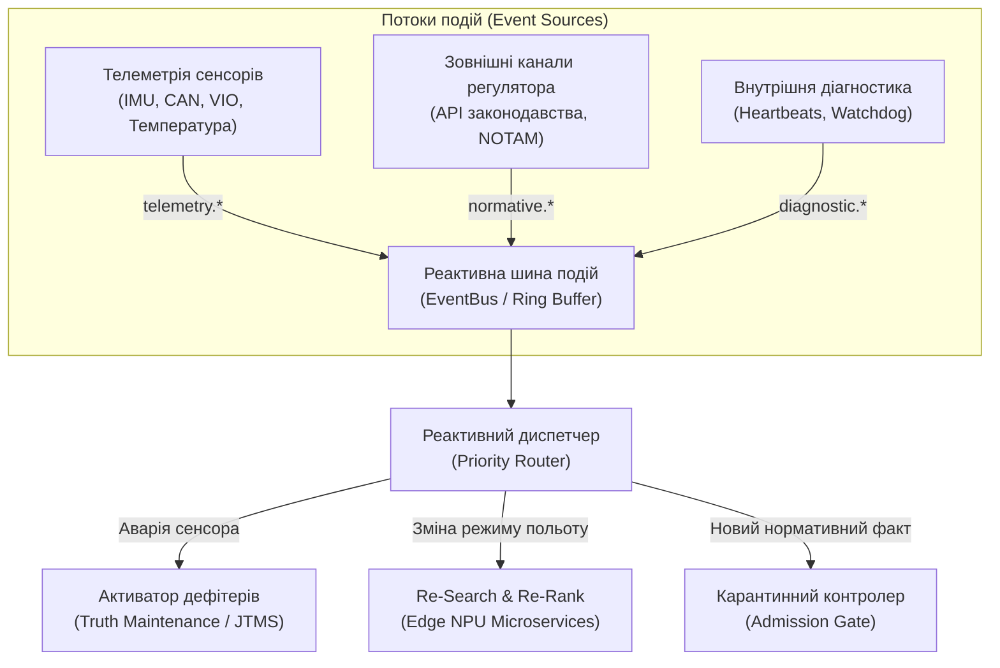
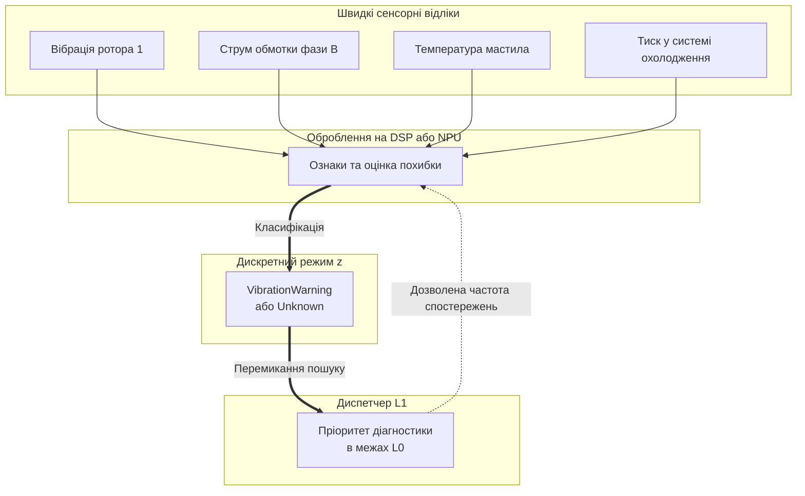
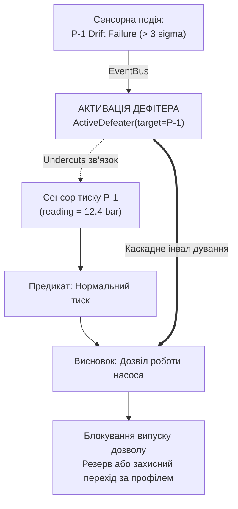
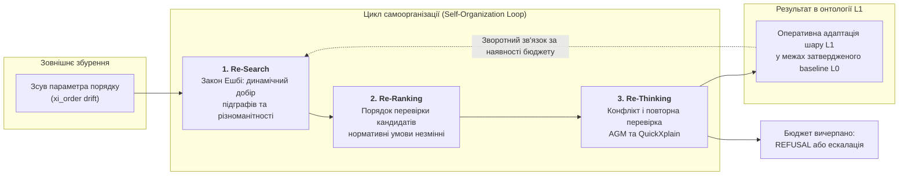
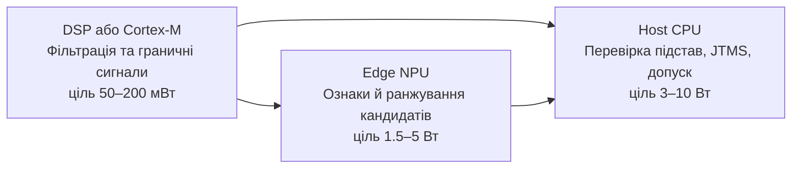

# Глава 35. Реактивна експертна система: події, відкликання й адаптація знань

> **Книга:** [Архітектура доказових експертних систем](README.md) · [Частина VII: Технологічний стек, апаратна інфраструктура, кібернетичне виконання та розподілена SOA](part-07-runtime-and-knowledge-exchange.md)
> **Попередня глава:** [Глава 22. Кібернетичний цикл керування: сенсори, периферія та зворотний зв'язок](ch22-cybernetics-edge-to-backend.md)
> **Наступна глава:** [Глава 33. Міжсистемний обмін знаннями: постачання правил стороннім системам, навчання моделей і захищений зворотний зв'язок](ch33-inter-system-knowledge-exchange-and-model-teaching.md)
> **Зміст книги:** [README.md](README.md)
> **Автор:** [Микола Мартинович Федчик](about-the-author.md)
> **Підготовка читача:** для початку достатньо розуміти правило «якщо — то», граф залежностей і час у мілісекундах; похідні, власні значення та статистичні оцінки пояснено перед застосуванням.
> **Очікувані результати:** простежити відкликання показу датчика до блокування залежного висновку; спроєктувати взаємодію L0/L1, черги подій і системи підтримки обґрунтувань; відрізняти авторську синергетичну модель від теореми стійкості; оцінювати бюджет реакції та роль NPU без передачі йому нормативного допуску.

---

## Анотація

Реактивна експертна система має переглядати рішення тоді, коли змінюються його підстави, а не лише після нового запиту користувача. Розглянемо навчальний приклад: правило дозволяє роботу насоса за справного датчика тиску, але діагностика відкликає цей показ. Якщо раніше виданий дозвіл залишається чинним, правильне правило застосовується до вже непридатної передумови. Завдання глави — простежити цю подію від приймання до відкликання залежного висновку й контрольованого переходу до визначеного профілем стану. Бюджет 5 мс далі використано як навчальну проєктну вимогу, не як універсальну норму чи виміряну швидкодію.

Запитання глави: **як спроєктувати експертну систему, яка здатна детерміновано реагувати на зовнішні події й сенсорні потоки в реальному часі, каскадно відкликати скомпрометовані висновки за мілісекунди й адаптувати онтологію без втрати побайтової доказовості та детермінізму?**

Спочатку введено подію, незмінну версію правил L0 і динамічні спостереження L1, потім — залежності, часові обмеження та адаптацію параметрів. Авторська синергетична модель використовує праці Хакена й Пригожина як джерело ідей про агрегування та впорядкування; сама аналогія не доводить істинності фактів або стійкості фізичного об'єкта. Висновок про стійкість потребує окремої моделі й перевірених передумов, а NPU може пропонувати ознаки та параметри, але не надавати нормативний допуск. Прецеденти NASA Livingstone 2 та Mobileye RSS розглянуто як обмежені за сферою приклади, не як підтвердження всіх пропозицій глави.

---

## 1. Обмеження статичних експертних систем: від припущення замкненого світу до живої сенсорики та синергетики знань

Статичне правило насоса «дозвіл потребує справного датчика» не повинне змінюватися після кожного вимірювання, але його передумови мають оновлюватися. Для цього достатньо вже знайомих понять правила, факту й залежного висновку. Проблема виникає не від незмінності файла, а від відсутності шляху, яким нова діагностика відкликає стару передумову. У цій монографії автором запропоновано **парадигму замкненості на етапі збирання (Build-Time Closure Concept)** як назву саме такого невдалого проєктного припущення. Це не характеристика всіх класичних експертних систем і не тотожність припущенню замкненого світу: останнє визначає логічне трактування відсутнього факту, а не спосіб оновлення пам'яті.

<a id="obj-35-1"></a>

**Діаграма 35.1. Пасивне застосування незмінної версії правил**


Незмінна версія допомагає відтворити байти джерела; правильність застосування правила все одно перевіряється окремо. Для насоса можна відтворити три незалежні дефекти пасивного проєкту:

1. **Інформаційна сліпота до подій середовища:** діагностика відмови P-1 не потрапила до рушія; старий показ і далі доступний.
2. **Пасивна затримка опитування:** діагностика доступна, але залежний дозвіл переглядається лише після запиту. Опитування раз на 100 мс може додати майже 100 мс очікування; воно не задовольняє навчальний бюджет 5 мс.
3. **Надмірне пакетне оновлення:** заради одного відкликання перебудовується весь пакет. Умовне перезбирання за 2 с перевищило б цей бюджет у 400 разів. Це розрахунок за заданим часом, не вимірювання компілятора.

Отже, правила можна залишити незмінними, якщо змінювати статус передумов і повторно перевіряти рішення. Далі потрібно відрізнити таку реакцію від дозволеної адаптації самого способу пошуку.

### 1.1. Різниця між простою реактивністю та синергетичною самоорганізацією

Реактивність розв'язує задачу своєчасного виклику обробника: подія діагностики запускає перегляд дозволу. Найпростіший ланцюжок можна записати як схему, а не як фізичний закон:

<a id="obj-35-2"></a>

**Формула (35.2). Подія та визначена реакція**

$$
\text{Event} \longrightarrow \text{Action}
$$

Тут Event — типізоване повідомлення, Action — визначена програмна реакція; обидва об'єкти не мають фізичної розмірності. Наприклад, `sensor_fault(P-1)` активує заборону використання показу P-1. Такий обробник уже корисний і може бути складним. Авторська **самоорганізація** додає інше: вибір наступних підграфів для перевірки, частоти спостереження та порядку пошуку в дозволених межах.

Ідеї Хакена [[1]](#src-1), [[2]](#src-2) та Пригожина [[3]](#src-3) мотивують цю авторську архітектурну модель, але їхні фізичні результати не переносяться на програму без побудови відповідної динаміки:

> [!NOTE]
> **Чотири постулати синергетичної самоорганізації знань за моделлю автора**
> 1. Події оновлюють спостереження й статуси підстав, але не отримують довіру лише через факт надходження.
> 2. Автономна перебудова L1 охоплює черги та дозволені індекси, а зміна нормативних правил потребує окремого затвердження.
> 3. Агреговані ознаки стискають потік для вибору перевірок; сирі відліки та діагностичні винятки зберігають своє значення.
> 4. L0 задає незмінну версію обмежень, метафорично названу доказовим атрактором; це не теорема глобальної стійкості.
> *Керування рантаймом / Інженерний інваріант:* Адаптація не скасовує незалежної перевірки джерел, передумов і допуску.

Для насоса адаптація може підняти пріоритет перевірки резервного P-2 після відмови P-1. Вона не може самостійно оголосити P-2 справним або послабити допустимий тиск. Щоб це розмежування працювало, спочатку потрібен точний формат події.

---

## 2. Реактивне програмування та потоки подій як епістемічні імпульси

Потік подій потрібний, щоб діагностика P-1 досягла саме тих обробників, які відповідають за його показ і дозвіл насоса. Передумовою є розрізнення повідомлення й факту: повідомлення ще може бути дубльованим, простроченим або підробленим. Спираючись на кібернетичну ідею зворотного зв'язку [[5]](#src-5), у цій монографії автором запропоновано називати такий сигнал **епістемічним імпульсом**: він ініціює перевірку підстав, а не автоматичне встановлення істини.

<a id="obj-35-3"></a>

**Формула (35.3). Поля типізованої події**

$$
E = \langle \text{id}, \text{topic}, \text{source}, \text{timestamp}, \text{priority}, \text{payload}, \sigma_{\text{digest}} \rangle
$$

Тут $E$ — скінченний запис; id, topic і source — непорожні ідентифікатори події, маршруту й заявленого джерела; timestamp — час створення в узгодженій шкалі з явно заданою похибкою (с); priority — одне зі значень Normal, High, Critical; payload — типізовані дані, наприклад ключ P-1 і причина відкликання. $`\sigma_{\text{digest}}`$ — 256-бітний SHA-256 канонічного подання перших шести полів, без самого дайджесту. Назва символу не означає цифрового підпису: хеш виявляє зміну відносно довіреного еталона, але не автентифікує джерело. Для віддалених подій потрібні окремі підпис, перевірка повноважень і захист від повторів; міжвузловий час не є автоматично монотонним.

**Приклад.** Подія `evt-09`, topic `telemetry.sensor_fault`, payload `P-1#pressure` блокує використання цього ключа після перевірки джерела й свіжості. Дублікат має бути ідемпотентним; запізніла подія «справний» не повинна зняти новіше відкликання. Лістинг нижче демонструє локальний обробник, не повний мережевий протокол.

<a id="obj-35-4"></a>

**Діаграма 35.4. Маршрутизація подій і відокремлення кандидатів**



Авторське **правило безблокувального кільцевого буферизування шини знань (Lock-Free Knowledge Bus Rule)** пропонує досліджувати попередньо виділені буфери на основі Disruptor [[14]](#src-14), коли блокування чи виділення пам'яті порушують бюджет. Lock-free означає системний прогрес, не обмежений час кожної операції. Go-канал із `select-default` лише не чекає вільного місця в каналі; mutex, планувальник і GC залишаються.

Черга місткістю 64 записи при надходженні 100 подій і нульовому споживанні не вмістить 36. Втрата критичного відкликання неприйнятна: потрібні явна помилка, блокування подальшого випуску й повторна звірка стану. Події телеметрії можна агрегувати лише за окремою політикою. Отже, неблокуюча доставка сама не розв'язує задачі надійності; наступний крок — зберегти результат події у пам'яті.

---

## 3. Багаторівнева гібридна пам'ять L0 / L1: незмінний золотий базис та динамічний дельта-граф

Дворівнева пам'ять дозволяє відкликати показ P-1 без переписування затвердженого правила насоса. Потрібно знати лише словник «ключ — значення» та версію документа. L0 містить затверджену версію правил і джерел; L1 — спостереження, статуси й позначки відкликання. Це логічні назви шарів знань, не рівні процесорного кешу.

<a id="obj-35-5"></a>

**Формула (35.5). Накладання базової версії та дельт**

$$
\mathcal{KB}_{\text{runtime}} = \mathcal{KB}_{L0} \oplus \Delta\mathcal{KB}_{L1}
$$

Тут $`\mathcal{KB}_{\text{runtime}}`$ — доступний для поточної версії запиту стан, $`\mathcal{KB}_{L0}`$ — скінченна базова множина записів, $`\Delta\mathcal{KB}_{L1}`$ — скінченна множина актуальних дельт. Оператор $\oplus$ означає алгоритм накладання з §3.1, а не пряму суму векторних просторів; фізичних одиниць тут немає. Наприклад, L0 зберігає останній прийнятий P-1, L1 — його tombstone; результат накладання є відмовою, не старим показом.

<a id="obj-35-6"></a>

**Таблиця 35.6. Шари знань і часові передумови**

| Шар пам'яті | Носій та формат | Змінність | Зміст знань | Часова передумова |
|---|---|---|---|---|
| **L0 (Golden Master)** | Read-Only `mmap` або навчальна мапа | Незмінний у межах версії | Затверджені правила й версійовані джерела | Page faults, кеші та синхронізація входять до вимірювання |
| **L1 (Streaming Delta)** | Оперативна пам'ять; CRDT лише за заданою семантикою злиття | Події та дельти | Стани апаратури, винятки, відкликання | Скінченний обсяг і контроль актуальності |
| **Quarantine Buffer** | Ізольований буфер кандидатів | Тимчасовий ізольований | Неперевірені факти від сторонніх агентів до проходження SMT-тестів | Не бере участі у виведенні |

### 3.1. Пріоритет розв'язання фактів у гібридній пам'яті
Пріоритет потрібний, щоб відкликання не загубилося під час пошуку резервного значення. Ключ утворено з ідентифікатора об'єкта та предиката; у навчальному коді символ `#` у цих частинах не допускається. Для одночасного читання потрібен узгоджений знімок статусів:

> [!NOTE]
> **Три рівні ієрархічного розв'язання фактів у гібридній пам'яті за моделлю автора**
> 1. Активний дефітер блокує відповідну підставу незалежно від наявності її старого значення.
> 2. Запис L1 повертає актуальне дозволене значення або tombstone зі статусом `REVOKED`; залежні результати не випускаються до повторної перевірки.
> 3. Пошук переходить до L0 лише за відсутності перекриття, з урахуванням свіжості й області застосування запису.
> *Керування рантаймом / Інженерний інваріант:* Tombstone не є промахом кешу; відкат не повинен відновити відкликану підставу.

1. **Перевірка активних дефітерів:** Якщо на даний $`\text{Key}`$ накладено активну заперечувальну обставину $`\text{Defeater}`$, запит негайно повертає помилку відхилення підстави (*Defeated State*).
2. **Пошук у шарі L1:** Якщо в динамічному шарі знайдено запис:
   - Якщо це надгробок видалення (*Tombstone*), первинний факт набуває канонічного статусу `REVOKED` (відкликано), а всі залежні похідні висновки в графі обґрунтувань синхронно отримують статус `INVALIDATED_BY_REVOCATION` (визнано недійсними внаслідок відкликання передумови), що блокує видачу вердикту `ACCEPT` до моменту повторної верифікації.
   - Інакше повертається актуальне динамічне значення L1.
3. **Відкат до шару L0:** Якщо запис у L1 відсутній, значення вичитується з незмінного золотого базису L0.

**Логічний приклад.** P-1 мав 12,4 bar у L0; новий допустимий показ 12,1 bar у L1 перекриває його. Tombstone замість нового показу дає `REVOKED`, а не 12,4 bar. Видалення дефітера не є новим вимірюванням, тому саме собою не поновлює відкликаний факт. CRDT забезпечує збіжність реплік лише за своїми умовами, не фізичну правильність чи відсутність нормативного конфлікту. Тепер можна пояснити, навіщо взагалі агрегувати динамічні спостереження.

### 3.2. Потоковий баланс робочої пам'яті, агрегація сенсорних вікон та керування режимами перевірок

У реактивній експертній системі робоча пам'ять безперервно приймає потік сенсорних подій, оновлює залежні обґрунтування в графі `JTMS` і витісняє застарілі записи за часом життя (`TTL`). Якщо швидкість надходження нових фактів стабільно перевищує сумарну швидкість їхньої експірації та логічної інвалідації, виникає переповнення робочої пам'яті та накопичення суперечливих застарілих тверджень (**Knowledge Backlog Saturation**).

Для контролю місткості робочої пам'яті на кожному дискретному кроці диспетчера $k$ обчислюється баланс кількості активних фактів:

<a id="obj-35-7"></a>

**Формула (35.7). Баланс активних фактів робочої пам'яті JTMS**

$$
N_{k+1} = N_k + A_k - E_k^{\mathrm{TTL}} - R_k^{\mathrm{retract}}, \qquad \Delta N_k = N_{k+1} - N_k \le 0 \iff E_k^{\mathrm{TTL}} + R_k^{\mathrm{retract}} \ge A_k
$$

Тут $`N_k \in \mathbb{N}_0`$ — кількість активних записів у робочій пам'яті на початку $k$-го циклу (одиниць), $`A_k \ge 0`$ — кількість нових валідованих фактів, що надійшли за цикл, $`E_k^{\mathrm{TTL}} \ge 0`$ — кількість записів, вилучених після завершення їхнього вікна свіжості `TTL`, а $`R_k^{\mathrm{retract}} \ge 0`$ — кількість залежних вузлів, інвалідованих процедурою ретракції `JTMS`. При надходженні $`A_k = 200`$ фактів/с та сумарному очищенні $`E_k^{\mathrm{TTL}} + R_k^{\mathrm{retract}} = 300`$ фактів/с чистий приріст становить $`\Delta N_k = -100`$ фактів/с, що гарантує утримання пам'яті в межах виділеного статичного пулу.

Наступні чотири підпункти визначають інженерні правила оброблення високочастотного потоку телеметрії в рантаймі:

#### 3.2.1. Вимога своєчасної актуалізації робочих фактів (Bounded-Latency Influx)
Потік спостережень зобов'язаний своєчасно оновлювати стан обґрунтувань, щоб рішення не спиралося на застарілі покази насоса. Кожне релевантне перевищення порогу або відмова датчика (наприклад, `P-1`) має запускати інкрементальний перерахунок залежних вузлів `JTMS` у межах поточного циклу керування, а резервний канал (`P-2`) залучається лише після перевірки його власної свіжості та справності.

#### 3.2.2. Експоненційно зважена агрегація швидких відліків із піковим детектором (EWMA + Peak Envelope)
Коли датчик вібрації або струму генерує тисячі відліків за секунду, подавати кожен сирий відлік у символьний граф правил неефективно. Водночас просте середнє арифметичне може приховати короткий ударний імпульс. Тому на рівні попереднього оброблення (`DSP`/`NPU`) швидкий потік стискається до пари інформативних ознак вікна — експоненційно зваженого рухомого середнього (`EWMA`) та амплітудного максимуму за останні $W$ відліків:

<a id="obj-35-8"></a>

**Формула (35.8). Агрегація швидких відліків: згладжений тренд та пікова обвідна**

$$
\bar{x}_k = \alpha x_k + (1 - \alpha)\bar{x}_{k-1}, \qquad p_k = \max_{0 \le j < W} \lvert x_{k-j} \rvert, \qquad \alpha \in (0, 1]
$$

Тут $`x_k`$ — поточний нормований відлік датчика, $`\bar{x}_k`$ — згладжена оцінка повільного тренду з коефіцієнтом забування $\alpha$, $W \ge 1$ — розмір ковзного вікна (відліків), а $`p_k`$ — пікова амплітуда на вікні. Обидві ознаки мають одиниці вхідного каналу (або безрозмірні після нормування). Наприклад, для трьох послідовних відліків вібрації $`0{,}1;\; 0{,}2;\; 0{,}3\,\text{g}`$ середній рівень становить $`0{,}2\,\text{g}`$, тоді як піковий детектор $`p_k = 0{,}3\,\text{g}`$ гарантовано зберігає максимальне навантаження для перевірки граничного правила безпеки.

Для диспетчера перевірок числові ознаки переводяться у скінченну дискретну мітку операційного режиму:

<a id="obj-35-9"></a>

**Формула (35.9). Дискретна мітка режиму**

$$
z \in \{\text{Nominal}, \text{SensorDegraded}, \text{VibrationWarning}, \text{Unknown}\}
$$

Мітка $z$ не має одиниць і обирається за затвердженою таблицею умов; `Unknown` не можна прирівнювати до `Nominal`. У прикладі відмова P-1 дає `SensorDegraded`, піднімає пріоритет P-2 і не змінює правила дозволу насоса.

<a id="obj-35-10"></a>

**Діаграма 35.10. Агрегування спостережень і вибір перевірок**



#### 3.2.3. Ретракція недійсних обґрунтувань та ізоляція мутацій (Constrained Runtime Adaptation)
Обмежена адаптація пошуку потрібна, щоб зміна операційного режиму в шарі `L1` ніколи не перетворювалася на самовільну модифікацію нормативних дозволів шару `L0` ($`\mathcal A_{\text{truth}}`$ позначає множину допустимих за `L0` станів):
* **L0 як межа версії:** L1 не переписує байти L0, але може блокувати застосування його запису через відкликання чи зміну області чинності.
* **JTMS-інвалідація як детерміноване очищення похідних висновків:** непридатні обґрунтування виключаються з активного випуску; записи аудиту зберігаються.
* **Карантинний шлюз вхідних фактів:** SMT- та інтервальна перевірки встановлюють узгодженість формалізованих умов до їх запису в робочу пам'ять.
* **Трикласова демаркація повноважень між самоорганізацією та людським підтвердженням ([Глава 34](ch34-deterministic-relational-analysis-abduction-and-socratic-dialogue.md), §9.3; [Глава 39](ch39-active-compliance-auditor-and-popperian-testing.md)):** Щоб усунути будь-яку суперечність між автономною адаптацією рантайму та сертифікаційною відповідальністю інженера, всі зміни в системі поділяються на три суворі класи: (1) *автономні операційні коригування без участі оператора* — балансування навантаження, семантична маршрутизація, переупорядкування черг, випереджальне підкачування підграфів у L1 та перемикання банків пам'яті в межах затверджених інваріантів; (2) *оновлення еталонних знань і порогів (`baseline`)* — модифікація продукційних правил, онтологій або числових порогів допуску, що обов'язково вимагає підтвердження людиною-експертом та криптографічного підпису Ed25519 у `baseline` (шар L0); (3) *заборонені рантайм-мутації* — інваріанти безпеки та політики шлюзу `Fail-Closed` ніколи не можуть бути послаблені автономно.

#### 3.2.4. Енергетичний бюджет периферійних вузлів (Edge Power Budget)
Енергетична модель потрібна, бо частіша діагностика резервного датчика витрачає заряд акумулятора автономного вузла. Практичне інженерне рішення спирається на прямий облік енергії в джоулях, потужності у ватах і часу роботи: для умовних $`2\,\text{Вт}`$ протягом $`10\,\text{с}`$ потрібно $`20\,\text{Дж}`$, а діапазон $`1\text{–}5\,\text{Вт}`$ є типовим тепловим пакетом периферійного співпроцесора. Детальний розрахунок енергобюджету наведено в §6; спершу розглянемо математичні механізми захисту рантайму від брязкоту перемикань, каскадних перевантажень і розбіжності черг.

### 3.3. Механізми стійкості реактивного рантайму: двопороговий гістерезис, обмеження каскадів JTMS, час до насичення черги та дискретна функція Ляпунова

Щоб реактивна база знань працювала стабільно в умовах зашумленої телеметрії та інтенсивних потоків подій, диспетчер повинен розв'язати чотири конкретні алгоритмічні задачі: (1) унеможливити високочастотний брязкіт (`chattering`) при коливаннях сигналу поблизу порогу безпеки; (2) обмежити глибину каскадного перерахунку `JTMS`; (3) спрогнозувати час до переповнення черги оновлень під час пікового шторму подій; (4) гарантувати монотонне згасання черги перерахунку після усунення збурення. Кожну з цих чотирьох задач нижче формалізовано відповідною дискретною моделлю.

#### 3.3.1. Двопороговий автомат гістерезису безпеки (дискретний тригер Шмітта)

Якщо блокування та відновлення дозволу відбуваються за одного й того самого числового порогу, будь-який високочастотний шум датчика навколо межі викликає лавину перемикань стану на кожному такті. Щоб усунути це явище, монітор безпеки використовує двопороговий автомат гістерезису (дискретний аналог тригера Шмітта [[19]](#src-19)) із розділеними порогами спрацювання $`\theta_{\mathrm{trip}}`$ та відновлення $`\theta_{\mathrm{recover}}`$ і лічильником підтвердження стабільності:

<a id="obj-35-11"></a>

**Формула (35.11). Функція переходів двопорогового автомата режиму захисту**

$$
m_k = \begin{cases}
1\;(\text{BLOCKED}), & \text{якщо } u_k \le \theta_{\mathrm{trip}}, \\
0\;(\text{NOMINAL}), & \text{якщо } u_k \ge \theta_{\mathrm{recover}} \;\land\; c_k \ge K_{\mathrm{hold}}, \\
m_{k-1}, & \text{інакше},
\end{cases}
$$

Тут $`m_k \in \{0, 1\}`$ — дискретний стан блокування на кроці $k$ ($0$ — штатний дозвіл, $1$ — захисне блокування); $`u_k \in \mathbb{R}`$ — поточний нормований запас безпеки або баланс довіри до каналу; $`\theta_{\mathrm{trip}}`$ — поріг миттєвого блокування; $`\theta_{\mathrm{recover}}`$ — вищий поріг повернення в роботу; $`c_k \in \mathbb{N}_0`$ — кількість послідовних тактів, протягом яких показ утримується не нижче $`\theta_{\mathrm{recover}}`$; $`K_{\mathrm{hold}} \ge 1`$ — мінімальна витримка для зняття блокування.

Порядок порогів та рекурентне правило лічильника підтвердження визначаються співвідношеннями:

<a id="obj-35-12"></a>

**Формула (35.12). Умова розділення порогів та лічильник підтвердження відновлення**

$$
\theta_{\mathrm{trip}} < \theta_{\mathrm{recover}}, \qquad
c_k = \begin{cases}
c_{k-1} + 1, & \text{якщо } u_k \ge \theta_{\mathrm{recover}}, \\
0, & \text{якщо } u_k < \theta_{\mathrm{recover}}.
\end{cases}
$$

Ширина зони утримання (мертвої зони гістерезису) обирається за середньоквадратичним рівнем шуму каналу $`\sigma_{\mathrm{noise}} > 0`$ та захисним коефіцієнтом $`k_\sigma \ge 3`$:

<a id="obj-35-13"></a>

**Формула (35.13). Ширина смуги гістерезису відносно рівня шуму**

$$
\Delta u_{\mathrm{hysteresis}} = \theta_{\mathrm{recover}} - \theta_{\mathrm{trip}} \ge 2 k_\sigma \sigma_{\mathrm{noise}}.
$$

Усі величини вимірюються в одиницях показника $`u_k`$ (або є безрозмірними після нормування). Наприклад, за порогу блокування $`\theta_{\mathrm{trip}} = -0{,}10`$ і порогу повернення $`\theta_{\mathrm{recover}} = +0{,}10`$ ширина смуги гістерезису дорівнює $`\Delta u_{\mathrm{hysteresis}} = 0{,}20`$. На послідовності вхідних значень $`-0{,}12;\; +0{,}05;\; +0{,}11`$ (при $`K_{\mathrm{hold}} = 1`$) перший відлік $`-0{,}12 \le -0{,}10`$ миттєво переводить монітор у стан $`m_1 = 1`$ (`BLOCKED`), другий відлік $`+0{,}05 \in (-0{,}10;\, +0{,}10)`$ утримує блокування $`m_2 = 1`$, і лише третій відлік $`+0{,}11 \ge +0{,}10`$ дозволяє повернення в $`m_3 = 0`$.

#### 3.3.2. Каскадне поширення ретракцій та протилавинні перегородки в JTMS

Протилавинна модель потрібна, бо один показ P-1 може підтримувати багато дозволів. Розподіл розмірів каскадів інвалідації [[20]](#src-20) оцінюють на журналах відкликань. На скінченній множині розмірів емпіричну або модельну степеневу апроксимацію записують із нормуванням:

<a id="obj-35-14"></a>

**Формула (35.14). Нормована гіпотеза розміру каскаду**

$$
P(s)=\frac{s^{-\tau}}{\sum_{j=1}^{M}j^{-\tau}},\qquad s=1,\ldots,M,\quad \tau>0.
$$

Тут $s$ і $j$ — цілі кількості вершин, $M\ge1$ — максимум, $\tau$ — безрозмірний параметр, $P(s)$ — імовірність. При $M=2$, $\tau=1$ ваги 1 і 1/2 після нормування дають 2/3 і 1/3.

Інше корисне наближення — стаціонарний процес розгалуження зі скінченною невід'ємною матрицею середньої кількості залежних нащадків [[21]](#src-21):

<a id="obj-35-15"></a>

**Формула (35.15). Ряд Неймана в моделі середніх переходів**

$$
\mathbf G_{\mathrm{avalanche}}=\sum_{k=0}^{\infty}\mathbf A^k=(\mathbf I-\mathbf A)^{-1},\qquad \rho(\mathbf A)<1.
$$

Тут $`\mathbf A\in\mathbb R_{\ge0}^{n\times n}`$ — матриця очікуваних переходів між $n\ge1$ типами подій, $\mathbf I$ — одинична матриця, $k$ — номер покоління, $\rho$ — спектральний радіус, тобто найбільший модуль власного значення. Елементи $\mathbf G$ — очікувані кількості відвідувань, усі величини безрозмірні. Для скаляра $`A=0{,}5`$ очікуваний підсумок 1+0,5+0,25+… дорівнює 2. Очікування не є максимальною тривалістю виконання.

У скінченному JTMS з множиною відвіданих вершин навіть цикл не робить одноразову ретракцію нескінченною. Обхід коштує $O(V+E)$ для $V$ вершин і $E$ ребер; $\rho\ge1$ не доводить необмеженого розміру такого обходу. **Epistemic Bulkheads** у моделі автора обмежують розмір секції й блокують випуск забрудненої секції до завершення перерахунку. Наприклад, секція з 100 вершинами і 200 ребрами потребує до 300 одиничних відвідувань; якщо одна операція має обґрунтовану верхню межу 2 мкс, сам обхід укладається в 600 мкс, без черги й синхронізації.

#### 3.3.3. Динаміка насичення черги перерахунку та залишковий час до переповнення буфера (`Time-to-Saturation`)

Якщо під час аварійного шторму подій інтенсивність надходження нових інвалідацій перевищує гарантовану пропускну здатність обробника `JTMS`, черга відкладених вузлів зростає і за скінченний час вичерпує виділений статичний буфер [[22]](#src-22). Нехай поточне навантаження черги описується нормованим коефіцієнтом заповнення або швидкістю росту черги:

<a id="obj-35-16"></a>

**Формула (35.16). Швидкість накопичення черги перерахунку в режимі перевантаження**

$$
\frac{dQ}{dt} = \lambda_{\mathrm{in}} \bar{s}_{\mathrm{cascade}} - \mu_{\mathrm{drain}} = v_{\mathrm{net}} > 0, \qquad Q(t_0) = Q_0 \in [0, Q_{\max}).
$$

Тут $Q(t)$ — поточна кількість вузлів у черзі перерахунку (одиниць), $`Q_{\max}`$ — гранична ємність статичного буфера черги, $`\lambda_{\mathrm{in}}`$ — частота вхідних подій інвалідації ($`\text{с}^{-1}`$), $`\bar{s}_{\mathrm{cascade}} \ge 1`$ — середня кількість вузлів каскаду на одну подію, $`\mu_{\mathrm{drain}} > 0`$ — швидкість розбору черги рушієм ($`\text{вузлів/с}`$), а $`v_{\mathrm{net}} > 0`$ — чиста швидкість приросту черги в режимі перевантаження ($`\text{вузлів/с}`$). Час досягнення межі буфера $`t_{\mathrm{sat}}`$ та залишковий запас часу $`T_{\mathrm{TTF}}`$ дорівнюють:

<a id="obj-35-17"></a>

**Формула (35.17). Час насичення буфера черги та залишковий час до відмови**

$$
t_{\mathrm{sat}} = t_0 + \frac{Q_{\max} - Q_0}{\lambda_{\mathrm{in}}\bar{s}_{\mathrm{cascade}} - \mu_{\mathrm{drain}}}, \qquad
T_{\mathrm{TTF}} = t_{\mathrm{sat}} - t.
$$

Тут $`t_{\mathrm{sat}}`$ і $`T_{\mathrm{TTF}}`$ вимірюються в секундах. Наприклад, якщо буфер вміщує $`Q_{\max} = 400`$ вузлів, у початковий момент $`Q_0 = 200`$ вузлів, а перевищення припливу над розбором становить $`v_{\mathrm{net}} = 200\,\text{вузлів/с}`$, то початковий запас часу до переповнення дорівнює $`T_{\mathrm{TTF}}(t_0) = (400 - 200)/200 = 1{,}0\,\text{с}`$, а через $`0{,}8\,\text{с}`$ зменшується до $`0{,}2\,\text{с}`$. За часу перемикання на деградований профіль фільтрації $`0{,}1\,\text{с}`$ і трикратного запасу ($`0{,}3\,\text{с}`$) сторожовий монітор завчасно вмикає дроселювання некритичних подій (`Admission Throttling`), запобігаючи втраті аварійних повідомлень.

#### 3.3.4. Функція Ляпунова для контролю збіжності черги ретракцій та інформаційний вибір спостереження

Щоб формально гарантувати, що після ввімкнення дроселювання або спаду вхідного сплеску черга нерозібраних вузлів $q(t)$ монотонно повертається до нуля, застосовують прямий метод функцій Ляпунова [[23]](#src-23), [[24]](#src-24). Розглянемо нормоване відхилення заповнення черги $q(t) \in [0, 1)$ за швидкості чистого дренажу $\lambda > 0$ ($`\text{с}^{-1}`$) і квадратичну функцію енергії черги $`W(q) = \frac{1}{2}a q^2`$ ($a > 0$ — ваговий коефіцієнт штрафної вартості затримки):

<a id="obj-35-18"></a>

**Формула (35.18). Баланс швидкості релаксації та зміни квадратичної функції черги**

$$
\frac{dq}{dt} = -\lambda q, \qquad W(q) = \frac{1}{2} a q^2, \qquad \frac{dW}{dt} = a q \frac{dq}{dt} = -a \lambda q^2 \le 0.
$$

Тут $t \ge 0$ — час (с), $q(t)$ — безрозмірна нормована довжина черги, $\lambda > 0$ — гарантований коефіцієнт переваги швидкості обробки над припливом ($`\text{с}^{-1}`$), $a > 0$ — безрозмірна або вартісна вага черги. При $\lambda > 0$ та $q \ne 0$ похідна $`\dot{W} = -a\lambda q^2 < 0`$ строго від'ємна, звідки розв'язок $`q(t) = q(0)e^{-\lambda t}`$ та енергія $`W(t) = W(0)e^{-2\lambda t}`$ експоненційно спадають до нуля.

**Числовий розрахунок і граничні режими.**
При $a = 2$, $`q(0) = 0{,}2`$ і $`\lambda = 3\,\text{с}^{-1}`$ початкове значення становить $`W(0) = 0{,}04`$, а швидкість спадання $`\dot{W}(0) = -2 \cdot 3 \cdot 0{,}04 = -0{,}24\,\text{с}^{-1}`$. Через $`t = 1/3\,\text{с}`$ відхилення черги зменшується до $`0{,}2/e \approx 0{,}0736`$, а $W$ — до $`0{,}04 e^{-2} \approx 0{,}00541`$. Якщо ж пропускна здатність лише дорівнює припливу ($\lambda = 0$), то $`\dot{W} = 0`$ і черга не розвантажується; при перевантаженні ($`\lambda = -3\,\text{с}^{-1} < 0`$) похідна $`\dot{W} = +0{,}24 > 0`$, і черга експоненційно зростає до межі $q=1$ за $`t = \ln(5)/3 \approx 0{,}536\,\text{с}`$.

Для нормованої похибки оцінювання стану $e(t)$ умова асимптотичної стійкості Ляпунова має канонічний вигляд:

<a id="obj-35-19"></a>

**Формула (35.19). Перевірка функції Ляпунова**

$$
\dot e=-k e,\qquad W(e)=\frac12e^2,\qquad \dot W=-k e^2<0\quad(e\ne0,\ k>0).
$$

Тут $e\in\mathbb R$ — нормована похибка, $k$ — стала швидкість корекції (с⁻¹), $W$ — безрозмірний квадрат похибки, $`\dot W`$ — с⁻¹. При $`e=0{,}2`$, $k=2$ с⁻¹ маємо $`W=0{,}02`$ і похідну −0,08 с⁻¹.

Коли після відмови основного датчика `P-1` система має обрати найінформативніший діагностичний запит або резервний канал із множини допустимих планів $\pi$, використовують інформаційно-цільовий критерій [[25]](#src-25) (сума розбіжності з безпечним цільовим профілем за мінусом очікуваного інформаційного виграшу):

<a id="obj-35-20"></a>

**Формула (35.20). Інформаційно-цільовий критерій вибору діагностичного спостереження**

$$
G(\pi) = D_{\mathrm{KL}}\bigl( Q(o \mid \pi) \;\|\; P(o \mid C) \bigr) - \mathbb{E}_{Q(o \mid \pi)}\Bigl[ D_{\mathrm{KL}}\bigl( Q(s \mid o, \pi) \;\|\; Q(s \mid \pi) \bigr) \Bigr]
$$

Тут $\pi$ — один зі скінченної множини планів спостереження; $o$ — результат вимірювання, $s$ — прихований стан; $Q$ — прогнозні розподіли, $P(o\mid C)$ — бажаний розподіл за контекстом переваг $C$. $`D_{\mathrm{KL}}`$ — дивергенція Кульбака–Лейблера, $\mathbb E$ — математичне сподівання. Розподіли нормовані й невід'ємні, у знаменниках KL потрібні додатні ймовірності там, де чисельник додатний; за натурального логарифма результат у натах. Для скінченних розподілів її обчислюють так:

<a id="obj-35-21"></a>

**Формула (35.21). KL-дивергенція скінченних розподілів**

$$
D_{\mathrm{KL}}(q\|r)=\sum_{j=1}^{m}q_j\ln\frac{q_j}{r_j}.
$$

Тут $m\ge1$ — кількість результатів, $j$ — індекс, $`q_j,r_j\in[0,1]`$ — нормовані ймовірності; нульовий доданок за $`q_j=0`$ визначено як 0. У навчальному прикладі два результати мають прогнозні ймовірності 0,5 і 0,5, бажані — 0,8 і 0,2. Перший доданок критерію дорівнює 0,5·ln(0,5/0,8) + 0,5·ln(0,5/0,2) ≈ 0,22314 нат. При рівноймовірних двох прихованих станах і безпомилковому в цій моделі P-2 кожний результат дає точковий апостеріорний розподіл: його KL до попереднього розподілу становить ln 2 ≈ 0,69315 нат. Тому критерій для P-2 приблизно −0,47000 нат. Непридатний повтор P-1, який не змінює переконань, дає виграш 0 і критерій 0,22314 нат. Менший бал обирає P-2. Спочатку незалежний шлюз вилучає заборонені плани: штраф у цільовій функції не замінює нормативної допустимості.

> [!NOTE]
> **П'ять інваріантів динамічної стійкості реактивної бази знань (авторська модель)**
> 1. **Інваріант двопорогового гістерезису:** розносити пороги блокування $`\theta_{\mathrm{trip}}`$ та відновлення $`\theta_{\mathrm{recover}}`$ на величину не менше $`2k_\sigma\sigma_{\mathrm{noise}}`$ із обов'язковою витримкою $`K_{\mathrm{hold}}`$ стабільних циклів.
> 2. **Інваріант секціонування каскадів (`JTMS Bulkheads`):** обмежувати розмір секції залежностей та блокувати випуск зачепленої секції до завершення обходу $O(V+E)$.
> 3. **Інваріант контролю насичення черги (`Time-to-Saturation`):** обчислювати залишковий час до переповнення буфера $`T_{\mathrm{TTF}}`$ і вмикати дроселювання некритичних подій при зниженні запасу до межі захисного переходу.
> 4. **Інваріант збіжності черги за Ляпуновим:** гарантувати додатну швидкість чистого дренажу $\lambda > 0$ у режимі дроселювання, забезпечуючи монотонне спадання квадратичної функції черги $`\dot{W} = -a\lambda q^2 < 0`$.
> 5. **Інваріант інформаційно-цільового опитування:** обирати діагностичний запит з максимальним інформаційним виграшем виключно серед планів, попередньо допущених шлюзом безпеки.
> *Керування рантаймом / Інженерний інваріант:* Жоден адаптивний механізм черги чи опитування не змінює нормативних правил шару `L0`.

Для насоса ці моделі утворюють послідовність дій: гістерезис утримує режим діагностики, обмежений обхід відкликає залежні дозволи, а добір запиту шукає резервну підставу. Випуск нового дозволу все одно потребує правил і свіжих доказів. Апаратний час потребує RTL, синтезних звітів і вимірювання; місткість пам'яті — розмірності матриці й формату елементів; ефект гістерезису — журналу випробування. Таких артефактів у цьому викладі немає. Далі перейдемо від прогнозних моделей до конкретного алгоритму підтримки обґрунтувань.

---

## 4. Спростовне супроводження істинності (Truth Maintenance Systems): динамічні активні дефітери

Система підтримки обґрунтувань потрібна, щоб відмова P-1 відкликала не лише показ, а й дозвіл насоса. Передумовою є граф: вершини — твердження, ребра — залежності. У JTMS Дойла [[6]](#src-6) мітка прийняття означає підтримку в поточному наборі припущень, не об'єктивну істину. Спрощений запис одного обґрунтування такий:

<a id="obj-35-22"></a>

**Формула (35.22). Спрощене обґрунтування JTMS**

$$
\text{Node} = \langle \text{Datum}, \text{IN-List}, \text{OUT-List} \rangle
$$

Тут Node — вершина висновку, Datum — його зміст, IN-List — скінченна множина потрібних прийнятих підстав, OUT-List — скінченна множина підстав, які не повинні бути прийнятими. Це логічні об'єкти без одиниць. Відсутність мітки IN в OUT-List не тотожна фізично доведеній хибності. Наприклад, дозвіл насоса потребує справності P-1 і допустимого тиску, а діагностична відмова P-1 підриває це обґрунтування. Якщо є незалежне обґрунтування через P-2, його перевіряють окремо; відкликання однієї гілки не обов'язково спростовує сам висновок.

<a id="obj-35-23"></a>

**Діаграма 35.23. Відкликання показу та перевірка залежного дозволу насоса**



Коли довірена діагностика встановила непридатність показу, авторський механізм **активного дефітера** перетворює її результат на блокування підстави:

<a id="obj-35-24"></a>

**Формула (35.24). Діагностичний стан і блокування підстави**

$$
\text{Fault}(\text{Sensor}_A) \implies \text{ActivateDefeater}(\text{SensorReading}_A)
$$

Fault — підтверджений діагностикою стан, Sensor A — ідентифікатор датчика, SensorReading A — конкретна підстава з версією/часом, ActivateDefeater — дія блокування; це правило над дискретними об'єктами без одиниць. Статистичне відхилення може ініціювати діагностику, але не завжди доводить відмову. Для прикладу, стандартне відхилення різниці двох справних показів 0,1 bar дає поріг 3σ = 0,3 bar; різниця 0,5 bar запускає перевірку. Значущість залежить від розподілу, кореляції, кількості перевірок і калібрування; універсального безпомилкового правила «3σ означає поломку» немає.

За авторським **механізмом динамічного каскадного підриву підстав (Undercutting Defeater Cascade)** дефітер атакує придатність обґрунтування, як у спростовних міркуваннях Поллока [[17]](#src-17). Первинна підстава отримує `REVOKED`, залежні результати — `INVALIDATED_BY_REVOCATION` до повторної перевірки, узгоджено з [главою 36](ch36-knowledge-testing-pyramid-and-variational-calibration.md) та [главою 38](ch38-curing-machine-hallucinations-and-knowledge-deficits.md). Негайно блокується новий випуск, а повний обхід може завершуватися пізніше. Час реакції включає приймання події, синхронізацію, перерахунок і доставку; вже видані дозволи потребують окремого протоколу відкликання/строку чинності. Фізична зупинка не завжди безпечна: насос охолодження інколи треба залишити працювати. Профіль об'єкта, а не слово `REFUSAL`, визначає захисну дію.

> [!NOTE]
> **Три інваріанти динамічного спростовного супроводження істинності за моделлю автора**
> 1. Діагностика має визначені одиниці, поріг, джерело та версію; сама аномалія не надає нормативного вердикту.
> 2. Відкликання блокує випуск залежних результатів до повторної перевірки, навіть якщо старі байти залишаються в L0.
> 3. Виконавчий тракт переходить до резерву або захисного режиму лише за затвердженим профілем об'єкта й часовим бюджетом.
> *Керування рантаймом / Інженерний інваріант:* Завершення обходу доводить обробку зареєстрованих залежностей, не повноту моделі світу.

Отже, відкликання визначає, чого більше не можна використовувати. Наступне питання — де шукати нові підстави, не послаблюючи правил.

---

## 5. Синергетичний рушій самоорганізації: мікросервіси Re-Search, Re-Ranking та Re-Thinking

Рушій адаптації потрібний, щоб після блокування P-1 не перебирати безладно всю базу знань. Маючи граф залежностей і карантин, можна розділити роботу на добір кандидатів, порядок їх перевірки та аналіз конфлікту. Авторська тріада **Re-Search, Re-Ranking, Re-Thinking** описує ці функції; вони не обов'язково є окремими мережевими мікросервісами. Усі працюють у скінченному бюджеті спроб, а вичерпання бюджету дає непідтверджений результат, не дозвіл.

<a id="obj-35-25"></a>

**Діаграма 35.25. Обмежений цикл добору та перевірки кандидатів**



### 5.1. Re-Search: еволюційний добір знань та закон необхідної різноманітності Ешбі
Re-Search потрібний для добору резервної процедури, коли показ P-1 відкликано. Закон необхідної різноманітності Ешбі [[4]](#src-4) пов'язує можливості регулятора з різноманітністю збурень за заданими спостережуваністю й допустимими результатами; проста кількість правил не гарантує керованості. У прикладі є дві перевірені процедури: перевірити P-2 або перейти до профільного обмеженого режиму. Векторний індекс може швидко запропонувати першу, але відсутність другої не дає права її вигадати. Підкачування затвердженого підграфа відрізняється від генерації нового факту: новий кандидат іде в карантин. Енергоспоживання нижче 1,5 Вт — можлива ціль конфігурації, не наслідок закону Ешбі.

### 5.2. Re-Ranking: адаптивна реструктуризація решіток переваг

Re-Ranking потрібний, щоб за зростання вібрації спершу перевірити справність насоса, а вже потім оптимізувати витрати. Змінюється порядок обчислень, не чинність заборони. **Критичне сповільнення (CSD)** означає повільніше повернення до рівноваги в деяких моделях поблизу втрати стійкості [[26]](#src-26). За сталого шуму й повільного дрейфу параметра це може супроводжуватися зростанням дисперсії та автокореляції. Але зміна шуму чи режиму дає схожий сигнал, а деякі відмови взагалі не мають такого попередження. Авторський індекс нижче є сигналом діагностики, не універсальним прогнозом аварії:

<a id="obj-35-26"></a>

**Формула (35.26). Віконна оцінка дисперсії та індекс попередження**

$$
\gamma_{\text{crit}} = \frac{\widehat{\mathrm{Var}}(y)}{\sigma_0^2},\qquad
\widehat{\mathrm{Var}}(y)=\frac{1}{n-1}\sum_{i=1}^{n}(y_i-\bar y)^2,\qquad
\bar y=\frac1n\sum_{i=1}^{n}y_i.
$$

де:
- $`y_i`$ — скінченний відлік однієї числової ознаки вібрації після однакового оброблення, у g (одиницях стандартного прискорення вільного падіння); дискретні назви режимів не мають дисперсії без числового кодування;
- $n\ge2$ — кількість відліків у вікні, $i$ — їхній номер; $`\bar y`$ — середнє у g, оцінка дисперсії — g²;
- $`\sigma_0^2>0`$ — базова дисперсія у g² для того самого режиму, смуги частот і способу оцінки;
- $`\gamma_{\text{crit}}\ge0`$ — безрозмірне відношення. Нульовий базис, NaN чи недостатнє вікно дають `Unknown`, не нульовий ризик.

Наприклад, відліки −0,2; 0; 0,2 g мають середнє 0 і вибіркову дисперсію 0,04 g²; при базисі 0,04 g² індекс дорівнює 1. Це розбір обчислення, не достатній обсяг калібрувальної вибірки. Для реального монітора задають тривалість вікна, частоту, тренд і прийнятні частоти хибних сигналів та пропусків.

**Практичне застосування та інженерні висновки (Closed-Loop Decision):**

#### 5.2.1. Критерії диспетчеризації та фазові переходи станів

> [!NOTE]
> **Три фазові стани решітки переваг Re-Ranking за моделлю автора**
> 1. Штатний режим: діагностика не виявила підстав для попередження, але інваріанти безпеки залишаються чинними.
> 2. Попередження: за навчальним порогом входу 3,0 підвищується пріоритет діагностики, без автоматичного висновку про біфуркацію.
> 3. Невизначений стан: при непридатних даних оптимізаційний випуск блокується, запитується резерв або ескалація.
> *Керування рантаймом / Інженерний інваріант:* Повернення з попередження потребує окремого нижчого порогу й витримки; відсутність CSD не дозволяє ігнорувати прямий сигнал відмови.

Щоб відношення переваг не приховувало послаблення захисту, оптимізаційний вибір виконують лише на множині незалежно допущених дій:

<a id="obj-35-27"></a>

**Формула (35.27). Оптимізація серед допущених дій**

$$
u^*=\underset{u\in U_{\mathrm{allowed}}}{\arg\min}\ J(u).
$$

Тут $u$ — дискретна дія, $`U_{\mathrm{allowed}}`$ — скінченна множина дій, допущених шлюзом для поточного стану; $J$ — задана вартість, наприклад Дж за цикл; $`u^*`$ — мінімізатор із визначеним правилом розв'язання нічиєї. Порожня множина дає відмову. Якщо перевірені режими насоса витрачають 2 і 3 Дж, обирають перший; за відкликання його передумови він вилучається з множини незалежно від ціни. Повільний цикл ранжування 10 Гц має період 100 мс і не може сам забезпечувати реакцію 5 мс: аварійний тракт повинен бути окремим.

У режимі попередження змінюється пріоритет завдань перевірки:

<a id="obj-35-28"></a>

**Формула (35.28). Порядок виконання перевірок**

$$
\mathrm{CheckSafety}\succ\mathrm{CheckMission}\succ\mathrm{OptimizeEfficiency}.
$$

Символ $\succ$ означає строгий порядок диспетчеризації трьох названих класів без фізичних одиниць, не більшу «силу істини». При спільній черзі діагностика P-2 випереджає оптимізацію витрат, але потрібні також обмежені черги й відсутність інверсії пріоритетів. Сам запис порядку не доводить виконання дедлайну.

#### 5.2.2. Апаратне керування та сайзинг
Апаратний бюджет потрібний, щоб зміна пріоритетів не з'їла час на власне перевірку. Ціль 250 мкс стосується диспетчера після готовності ознак, не всього спостереження: вікно 100 відліків при 1 кГц охоплює близько 100 мс. Перемикання вказівника банку за один такт не включає завантаження, когерентність і DMA. Праці про shielded reinforcement learning [[10]](#src-10) мотивують окремий захисний шлюз, але не вимірюють цей NPU і не дозволяють йому змінювати норми.

#### 5.2.3. Практичний числовий приклад
Приклад завершує задачу насоса: за навчальними даними базис 0,04 g², поточна оцінка 0,15 g² дають індекс 3,75. Поріг входу 3,0 переводить монітор у попередження; повернення дозволено лише при індексі не вище 2,0 у трьох послідовних придатних вікнах. Послідовність 3,75; 2,5; 1,9; 1,8; 1,7 залишає попередження до останнього вікна. Пороги безрозмірні, витримка — три вікна з відомою тривалістю; це проєктний приклад для подальшого калібрування, не вимога стандарту. Час диспетчеризації слід виміряти за окремим протоколом. Результат — пріоритетна перевірка резерву; факт аварії та дозвіл на зміну обертів потребують інших підстав.

### 5.3. Re-Thinking: дисипація суперечностей та спростовний резолвінг за AGM
Re-Thinking потрібний, коли P-1 і P-2 дали несумісні твердження, а просте ранжування не усуває конфлікт. AGM [[11]](#src-11) описує властивості скорочення й ревізії логічно замкнених множин переконань; самі постулати не обирають, який датчик правий. QuickXplain [[12]](#src-12) за несуперечливого фонового набору й монотонного оракула узгодженості знаходить конфлікт, мінімальний за включенням, не обов'язково найменший за кількістю. Вартість виклику оракула не обов'язково поліноміальна.

**Логічний приклад.** У фіксованому знімку P-1 стверджує «тиск не вище 10 bar», P-2 — «тиск понад 12 bar». Два твердження разом несумісні; кожне окремо допустиме. Після відкликання P-1 перевіряють увесь знімок повторно: там може залишатися інший незалежний конфлікт. При нестабільному оракулі або зміні даних під час пошуку мінімальність не забезпечена. Бюджет у три спроби завершує цикл навіть без відповіді, але не доводить істину; невирішений конфлікт дає `REFUSAL` або ескалацію. Далі потрібно оцінити, скільки енергії коштує така перевірка й що саме можна прискорити.

---

## 6. Енергоефективне апаратне прискорення на Edge: NPU, DSP проти серверних GPU

Апаратне прискорення потрібне, якщо діагностика насоса не вкладається в ресурсний бюджет після програмної оптимізації. Спочатку слід розрізняти потужність у ватах, енергію в джоулях і затримку в секундах. Акумулятор не забороняє GPU як клас, але може не забезпечувати конкретний режим. У класифікації книги програмне ядро належить до L3, а FPGA та NPU утворюють розширений профіль. NPU — нейромережевий, не обов'язково нейроморфний процесор; його тензорні оцінки залишаються кандидатами, а символьне ядро перевіряє допуск.

<a id="obj-35-29"></a>

**Діаграма 35.29. Розподіл обчислень без передачі нормативного допуску моделі**



Для насоса DSP може обчислити ознаку вібрації й незалежний граничний сигнал; NPU — запропонувати підграф резервної діагностики; CPU — перевірити його версію та підстави. Діапазони на схемі є цілями, не вимірюваннями кожної названої архітектури. Підтримка INT4, конкретних операторів і SLM залежить від компілятора, пам'яті та прискорювача; сама назва NPU цього не обіцяє.

Аналіз TPU Джоуппі та співавт. [[15]](#src-15) пояснює виграш спеціалізації на певних матричних навантаженнях: систолічний масив повторно використовує операнди між сусідніми комірками, зменшуючи частину переміщень. Це не нульовий трафік пам'яті й не перевага на кожному графовому алгоритмі. TOPS означає трильйони визначених виробником операцій за секунду, залежно від точності й обліку розрідженості; TOPS/Вт не задає затримку повного запиту. Передавання даних, черга й перевірка CPU можуть домінувати. Тому наступний розрахунок оцінює весь погоджений шлях, а не лише множення.

> [!NOTE]
> **Три рівні апаратно-енергетичного метаболізму Edge за моделлю автора**
> 1. DSP обробляє числовий потік у визначеному бюджеті; прямі сигнали небезпеки не чекають нейромережевого ранжування.
> 2. NPU прискорює сумісні моделі ознак і кандидатів; адаптація їхніх параметрів не змінює нормативної допустимості дій.
> 3. CPU або окремий перевірений логічний прискорювач перевіряє підстави й випуск результату.
> *Керування рантаймом / Інженерний інваріант:* Розподіл ролей є авторською архітектурною пропозицією; часові й енергетичні гарантії потребують вимірювань і аналізу конкретної платформи.

### 6.1. Термодинаміка бортового виведення та закон епістемічної енергоефективності передфільтрування

Передфільтрування потрібне, щоб не запускати дорогу модель для кожного повторного або явно непридатного повідомлення насоса. Потрібні частота входу, частка відсіяних подій і енергія кожного етапу. SimHash є наближеним пошуком схожості, а CSR — форматом розрідженого графа; жоден сам собою не перевіряє нормативної істини. Евристичний фільтр не повинен губити критичні відкликання, а його пропуски треба оцінювати на контрольних даних.

Авторська **енергетична ціна верифікованого виведення** потребує явного знаменника. Спочатку обчислюють енергію на вхідну подію, а потім — на прийнятий результат:

<a id="obj-35-30"></a>

**Формула (35.30). Енергія на вхід і на прийнятий результат**

$$
E_{\mathrm{event}}=E_{\mathrm{Gate}}+(1-\rho_{\mathrm{prune}})(E_{\mathrm{Heavy}}+E_{\mathrm{Check}}),\qquad
E_{\mathrm{verified,dyn}}=\frac{E_{\mathrm{event}}}{p_{\mathrm{accept}}}.
$$

де:
- $`E_{\mathrm{Gate}}\ge0`$ — середня додаткова енергія фільтра (Дж/вхідну подію);
- $`\rho_{\mathrm{prune}}\in[0,1]`$ — частка входів без важкого етапу;
- $`E_{\mathrm{Heavy}},E_{\mathrm{Check}}\ge0`$ — умовні середні енергії синтезу кандидата й остаточної перевірки (Дж/подію, що пройшла фільтр);
- $`p_{\mathrm{accept}}\in(0,1]`$ — частка всіх входів, що дали один прийнятий результат; при нульовій частці метрика на прийнятий факт не визначена;
- $`E_{\mathrm{event}}`$ — Дж/вхід, $`E_{\mathrm{verified,dyn}}`$ — Дж/прийнятий результат понад фон. Формула припускає один кандидат на прохід; за повторів ураховують усі спроби. За цієї передумови частка прийняття не перевищує частки проходів фільтра. Якщо відсіяно всі входи, прийнятих результатів немає й метрика на прийнятий результат не визначена. Енергетичний підрахунок не гарантує правильність результату.

**Новий навчальний приклад.** Для розбору формули задамо умовні 40 мкДж на фільтр, 0,8 Дж на важкий етап і частку відсіву 0,75. Ці нові вхідні дані не відтворюють історичних вимірювань і не приписані FPGA, DLA або CPU. Спочатку, тимчасово не враховуючи остаточну перевірку, одержуємо:

<a id="obj-35-31"></a>

**Формула (35.31). Неповний енергетичний розрахунок**

$$
E_{\mathrm{event,partial}}=0{,}000040+(1-0{,}75)\cdot0{,}8=0{,}20004\;\text{Дж/вхід}.
$$

Новий індекс partial означає неповний облік; усі доданки вже визначено. При заданій частці прийняття 0,20 це щонайменше 1,0002 Дж на прийнятий результат, а не 0,20004. За 2 входів/с неповна динамічна потужність становить 0,40008 Вт. Цей розрахунок показує вплив знаменника й пропущених витрат; він не встановлює виміряної економії або переваги платформи.

Для рішення про батарею потрібні також фонове споживання й частота входу:

<a id="obj-35-32"></a>

**Формула (35.32). Повна потужність і час батареї**

$$
P_{\mathrm{total}}=P_{\mathrm{idle}}+f_{\mathrm{in}}E_{\mathrm{event}},\qquad
T_{\mathrm{battery}}=\frac{W_{\mathrm{battery}}}{P_{\mathrm{total}}}.
$$

Тут $`P_{\mathrm{total}}>0`$ і $`P_{\mathrm{idle}}\ge0`$ — вати, $`f_{\mathrm{in}}\ge0`$ — події/с, $`W_{\mathrm{battery}}>0`$ — доступна енергія батареї у Вт·год, $`T_{\mathrm{battery}}`$ — години; енергія на подію — у джоулях. Передумови — сталий репрезентативний потік і однаковий фон; втрати перетворення та решту обладнання треба включити в бюджет. Продовжимо новий навчальний приклад: задамо 0,02 Дж на остаточну перевірку кожного входу, що пройшов фільтр. Повний облік названих етапів за формулою (35.30) дає 0,20004 + 0,25·0,02 = 0,20504 Дж/вхід, або 1,0252 Дж/прийнятий результат. Для 2 подій/с динамічна потужність становить 0,41008 Вт. За умовного фону 0,3 Вт повна потужність дорівнює 0,71008 Вт; умовна батарея 24 Вт·год дала б близько 33,80 год лише цьому обчислювачу. Тривалість місії всього апарата з цього не випливає.

Практична дія для насоса — обмежити частоту необов'язкових запитів і виміряти повний шлях, не відкидати сигнал несправності заради економії. Потрібно врахувати пробудження прискорювача, передавання даних, перевірку та частку відмов. Перевірка розмірності допомагає: події/с, помножені на Дж/подію, дають Дж/с, тобто вати.

> [!NOTE]
> **Авторський закон епістемічної енергоефективності передфільтрування: два енергетичні режими**
> 1. Дешевий фільтр може зменшити число важких викликів, якщо його вартість і пропуски критичних подій контрольовано.
> 2. Дорогий синтез кандидата потребує наступної незалежної перевірки; частка викликів не тотожна частці прийнятих фактів.
> *Керування рантаймом / Інженерний інваріант:* Економію визначає повний виміряний бюджет, не сам поріг відсіву 0,90.

### 6.2. Емпіричне калібрування енергетичної ціни виведення на стенді Jetson AGX Orin (INA3221) та апаратно-кремнієва метрологія

Емпіричне калібрування потрібне, щоб підставити в попередній бюджет виміряні, а не бажані енергії. Автором повідомлено про серію метрологічних випробувань на **Seeed Studio reServer Industrial J501** з **NVIDIA Jetson AGX Orin 64GB**; окреме повідомлення стосується FPGA. Нижче збережено опис стенда, метод і окремі авторські повідомлення про енергію зі статусом **«не перевірено»**. Це історичні повідомлення автора, не навчальні дані. Під час перевірки доступних матеріалів знайдено методичний опис, але не первинні ряди напруги, струму й часу, калібрування, межі живлення, версії програм, повтори та лічильники прийнятих результатів саме цих вимірювань. Інший оповідний опис із відмінними конфігураціями й числами їх не підтверджує. Тому ці енергії не є перевіреним рейтингом платформ, підставою сайзингу або гарантією. Жодного нового апаратного запуску в межах цього викладу не заявлено.

За описом автора, напругу й струм зчитували через вбудований монітор **Texas Instruments INA3221** на I2C з програмною частотою опитування 100 Гц (крок 10 мс). Частота читання не дорівнює автоматично частоті незалежних перетворень: потрібні налаштування перетворення й усереднення сенсора. У записі наведено такі назви шин; їхню відповідність конкретній платі та конфігурації потрібно звірити з її документацією, не сумувати вхідну шину з її складовими:
1. `VDD_IN` — загальна вхідна силова шина живлення модуля;
2. `VDD_CPU_CV` — домен живлення 12 процесорних ядер ARM Cortex-A78AE;
3. `VDD_GPU_SOC` — домен живлення графічного процесора Ampere та прискорювачів NVDLA v2.

Метрологічна оцінка чистої енергії, витраченої на генерацію та верифікацію пакета фактів, визначається шляхом чисельного інтегрування активної потужності за вирахуванням фонового споживання спокою:

<a id="obj-35-33"></a>

**Формула (35.33). Різницевий інтеграл на прийнятий результат**

$$
E_{\mathrm{verified,dyn}} = \frac{\int_{0}^{T_{\mathrm{burst}}} \bigl( P_{\mathrm{active}}(t) - P_{\mathrm{idle}} \bigr) \, dt}{N_{\mathrm{facts\_verified}}}.
$$

де:
- $`E_{\mathrm{verified,dyn}}`$ — додаткова питома енергія понад фон (Дж/прийнятий результат), а не вся енергія пристрою;
- $`P_{\mathrm{active}}(t)\ge0`$ — потужність на обраній межі вимірювання (Вт), отримана як добуток напруги у вольтах і струму в амперах з урахуванням калібрування шунта;
- $`P_{\mathrm{idle}}\ge0`$ — базова фонова потужність спокою системи (Вт), яку слід виміряти за тієї самої конфігурації та межі живлення, що й активну потужність;
- $`T_{\mathrm{burst}}>0`$ — тривалість пачки (с), $t$ — час від її початку;
- $`N_{\mathrm{facts\_verified}}>0`$ — ціла кількість результатів, прийнятих за явно заданим критерієм; сам лічильник не доводить нульових помилок.

**Новий навчальний приклад інтегрування.** Задамо умовне стале перевищення фону на 0,4 Вт протягом 2 с і 10 000 прийнятих результатів. Це окремі нові вхідні дані для пояснення методу, не реконструкція авторського досліду. Енергія пачки дорівнює 0,8 Дж, питома енергія — 80 мкДж. При кроці 10 мс це 200 інтервалів, а не вимірювання тривалості одного мікросекундного кроку. Для змінного сигналу інтеграл оцінюють, наприклад, трапеціями між часовими мітками; від'ємна різницева оцінка в межах шуму потребує аналізу невизначеності, не автоматичного обрізання до нуля. Без однакового навантаження й критерію прийняття порівнювати субстрати некоректно.

#### 6.2.1. Порівняльна матриця енергоефективності обчислювальних субстратів

Нижче окремо наведено чотири неперевірені авторські повідомлення, а не результати порівняльного тесту. Конфігурації відтворюють опис автора; назва профілю потужності не є виміряною потужністю окремої операції. Знаменник питомої енергії, облік фону й повноту витрат кожного етапу не звірено за первинним протоколом; жодне число не можна автоматично трактувати як джоулі на остаточно прийнятий результат усієї системи.

<a id="obj-35-34"></a>

**Таблиця 35.34. Окремі неперевірені авторські повідомлення про енергію**

| Етап за повідомленням автора | Заявлена конфігурація | Повідомлена питома енергія | Статус і межі |
| :--- | :--- | :---: | :--- |
| **FPGA, логічний прискорювач** | Xilinx Zynq-7000 (PYNQ-Z1 @ 100 MHz) | 0,32 мкДж | Не перевірено; потрібні окремий протокол FPGA, межа живлення й критерій результату |
| **DLA (NVDLA v2)** | Jetson AGX Orin, `MODE_15W` | 12,4 мкДж | Не перевірено; потрібні модель, розмір пачки, межа живлення й критерій результату |
| **Host CPU, шлюз** | ARM Cortex-A78AE @ 1.73 GHz, `MODE_30W` | 25,0 мкДж | Не перевірено; повідомлення про шлюз не характеризує весь програмний шлях |
| **Host CPU, програмний етап** | ARM Cortex-A78AE @ 1.73 GHz, `MODE_30W` | 1,85 Дж | Не перевірено; окремий етап, не еквівалент операції шлюзу, FPGA або DLA |

Первинні протоколи не встановлюють еквівалентного навантаження й однакових меж роботи для цих повідомлень. Тому з наведених енергій не виводяться рейтинг платформ, коефіцієнти виграшу чи прискорення. INA3221 на описаному модулі не є достатнім протоколом вимірювання окремої FPGA, а DLA виконує підтримувану тензорну модель, не довільний JTMS/SMT-крок.

> [!NOTE]
> **Чотири принципи апаратно-кремнієвої метрології енергії виведення за методологією автора**
> 1. Віднімати фон лише за однакової конфігурації та разом з оцінкою похибки; окремо звітувати повну енергію.
> 2. Фіксувати часові мітки, частоту перетворень і межу вимірювання; не додавати повторно вхідну шину й складові.
> 3. Порівнювати однакові навантаження та критерії прийнятого результату, з урахуванням передавання й перевірки.
> 4. Пороги потужності й енергії калібрувати для платформи; 15 мкДж/результат є проєктним прикладом, не вимогою ASIL D.
> *Керування рантаймом / Інженерний інваріант:* Перевищення бюджету обмежує необов'язкові обчислення, не вимикає критичний захист і не доводить температуру кристала.

**Рішення за бюджетом.** Допустиму середню потужність визначають за доступною енергією батареї й тривалістю роботи. Після віднімання виміряного фону перевіряють, чи вкладається в залишок повний шлях оброблення заданого потоку за формулою (35.32). Питому енергію слід отримати за протоколом формули (35.33) з тим самим критерієм результату, а час, пакетування та сумісність операторів перевірити окремо. Неперевірені повідомлення таблиці 35.34 не дозволяють обчислити гарантовану частоту результатів або вибрати платформу за енергетичною перевагою. Навчальний розрахунок батареї в §6.1 відділено від цих історичних даних.

Окреме авторське повідомлення про температуру 48,5 °C також має статус **«не перевірено»**: для його підтвердження потрібні журнал, температура довкілля й режим охолодження. Це не звірена телеметрія, не результат енергетичного розрахунку та не доказ охолодження або виграшу платформи. Також не випливає, що за 100-Гц телеметрією можна реалізувати захист із реакцією 5 мс. Отже, енергетична модель не замінює метрології та часового аналізу. Далі зіставимо цей поділ ролей з відомими напрямами практики.

---

## 7. Прецеденти у світовій практиці та індустрії

Прецеденти потрібні для перевірки архітектурної ідеї, а не для запозичення чужих часових гарантій. Уже відомі два рівні: модель стану й окрема перевірка допустимих дій. Читач має шукати саме цю відповідність, не тотожність кожного продукту авторській L0/L1-моделі.

1. **NASA Remote Agent і модельна діагностика Livingstone.** Праці [[7]](#src-7), [[8]](#src-8) є базисом модельно-орієнтованої автономії й діагностики. Для прикладу насоса відповідність така: спостереження звужує набір можливих станів, після чого перевіряється конфігурація. Ці посилання не підтверджують тут змішаний сюжет Deep Space 1 / EO-1 / Livingstone 2 чи конкретну мілісекундну реакцію клапана; місію, версію й затримку потрібно перевіряти окремо.
2. **Responsibility-Sensitive Safety (RSS).** Формальна модель [[9]](#src-9) задає умови безпечної поведінки за своїх припущень. Корисна аналогія для насоса — перевіряти пропозицію планувальника незалежним правилом. Формальна умова дистанції не доводить безпомилковість сприйняття й не задає частоту або апаратну затримку конкретної реалізації Mobileye.
3. **Моніторинг посадки та диференціальна динамічна логіка.** Порівняння стану з межею гальмування ілюструє задачу, подібну до перевірки фізичного режиму насоса. Праця Плацера [[13]](#src-13) дає формальний апарат для гібридних моделей, але не є протоколом продукту Honeywell ROAS. Застосування цієї логіки саме в названому продукті й конкретні автоматичні дії тут не підтверджено.

Таким чином, корисний висновок із прецедентів — явні моделі стану й умов дій. У наступному лістингу можна перевірити значно вужче твердження: відкликану підставу не можна непомітно відновити, а кандидат моделі не повинен одразу стати дозволеним фактом.

---

## 8. Програмна реалізація мовою Go: пакет `reactive`

Лістинг реалізує названі методи накладання L0/L1 (§3.1), консервативного відкликання залежностей (§4) та карантину кандидатів Re-Search (§5). Вхід — скінченні мапи фактів, граф залежностей і локальні перевірені події; результат — факт або типізована відмова, не фізична команда. Для насоса реєструють залежність `P-1#pressure` → `pump#permit`, після чого відмова P-1 блокує обидва ключі. Обхід з множиною відвіданих вершин завершується навіть за циклу, коштуючи $O(V+E)$; завершеність не доводить повноти зареєстрованих залежностей.

Це навчальна бібліотека, не повний JTMS: кожне зареєстроване ребро вважається необхідною залежністю, альтернативні обґрунтування не поновлюються автоматично. Мапи замінюють `mmap` і CRDT, mutex не є lock-free, `HandleEvent` викликається явно, а NPU замінено на поданий у тесті список кандидатів. Довірений викликаючий код відповідає за автентичність, свіжість, валідацію ключів без `#` та обмеження розміру входів. `ReleaseQuarantine` приймає результат зовнішньої перевірки; він не реалізує SMT, підпис або саму політику допуску. `IngestL1` — привілейований шлях уже перевірених спостережень, не API моделі.

`Publish` повертає помилку при переповненні; часткова доставка можлива, тому викликаючий код має заблокувати подальший випуск і звірити стан перед повтором. Це контракт обробки втрати, не реалізований тут стійкий транспорт. SHA-256 охоплює JSON-подання payload разом з метаданими й відхиляє непредставні JSON-значення; такий локальний відбиток не є міжмовним канонічним протоколом чи підписом. Код не обіцяє WCET або апаратної швидкодії.

<details>
<summary>Навчальна бібліотека накладання, відкликання та карантину (пакет reactive)</summary>

```go
package reactive

import (
	"context"
	"crypto/sha256"
	"encoding/hex"
	"encoding/json"
	"fmt"
	"sort"
	"strings"
	"sync"
	"time"
)

// Priority визначає рівень терміновості події.
type Priority int

const (
	PriorityNormal Priority = iota
	PriorityHigh
	PriorityCritical
)

// Event моделює автономний сенсорний або зовнішній сигнал.
type Event struct {
	ID        string         `json:"id"`
	Topic     string         `json:"topic"`
	Source    string         `json:"source"`
	Payload   map[string]any `json:"payload"`
	Timestamp time.Time      `json:"timestamp"`
	Priority  Priority       `json:"priority"`
}

// Digest генерує криптографічний відбиток події.
func (e Event) Digest() (string, error) {
	e.Timestamp = e.Timestamp.UTC()
	encoded, err := json.Marshal(e)
	if err != nil {
		return "", err
	}
	digest := sha256.Sum256(encoded)
	return hex.EncodeToString(digest[:]), nil
}

// Fact представляє атомарне судження в онтології.
type Fact struct {
	Subject     string    `json:"subject"`
	Predicate   string    `json:"predicate"`
	Object      string    `json:"object"`
	Source      string    `json:"source"`
	Timestamp   time.Time `json:"timestamp"`
	IsTombstone bool      `json:"is_tombstone"`
}

func (f Fact) Key() string {
	return f.Subject + "#" + f.Predicate
}

// ActiveDefeater описує активну заперечувальну обставину, активовану подією.
type ActiveDefeater struct {
	DefeaterID string    `json:"defeater_id"`
	TargetKey  string    `json:"target_key"`
	Reason     string    `json:"reason"`
	CreatedAt  time.Time `json:"created_at"`
}

// EventBus реалізує високошвидкісну pub/sub шину з підтримкою шаблонів топіків.
type EventBus struct {
	mu          sync.RWMutex
	subscribers map[string][]chan Event
	closed      bool
}

func NewEventBus() *EventBus {
	return &EventBus{
		subscribers: make(map[string][]chan Event),
	}
}

func (eb *EventBus) Subscribe(topic string, bufferSize int) <-chan Event {
	eb.mu.Lock()
	defer eb.mu.Unlock()
	ch := make(chan Event, bufferSize)
	if eb.closed {
		close(ch)
		return ch
	}
	eb.subscribers[topic] = append(eb.subscribers[topic], ch)
	return ch
}

func (eb *EventBus) Publish(event Event) error {
	eb.mu.RLock()
	defer eb.mu.RUnlock()
	if eb.closed {
		return fmt.Errorf("event bus closed")
	}
	for pattern, chList := range eb.subscribers {
		if pattern == "*" || pattern == event.Topic || (strings.HasSuffix(pattern, ".*") && strings.HasPrefix(event.Topic, strings.TrimSuffix(pattern, "*"))) {
			for _, ch := range chList {
				select {
				case ch <- event:
				default:
					return fmt.Errorf("event delivery incomplete: %s", event.ID)
				}
			}
		}
	}
	return nil
}

func (eb *EventBus) Close() {
	eb.mu.Lock()
	defer eb.mu.Unlock()
	if eb.closed {
		return
	}
	eb.closed = true
	for _, chList := range eb.subscribers {
		for _, ch := range chList {
			close(ch)
		}
	}
	eb.subscribers = nil
}

// DeltaStore забезпечує гібридне зберігання L0/L1, активні дефітери та карантин.
type DeltaStore struct {
	mu              sync.RWMutex
	l0Static        map[string]Fact
	l1Delta         map[string]Fact
	activeDefeaters map[string]ActiveDefeater
	quarantine      map[string]Fact
	dependents      map[string][]string
	invalid         map[string]string
	l0Loaded        bool
}

func NewDeltaStore() *DeltaStore {
	return &DeltaStore{
		l0Static:        make(map[string]Fact),
		l1Delta:         make(map[string]Fact),
		activeDefeaters: make(map[string]ActiveDefeater),
		quarantine:      make(map[string]Fact),
		dependents:      make(map[string][]string),
		invalid:         make(map[string]string),
	}
}

func (ds *DeltaStore) LoadL0(facts []Fact) error {
	ds.mu.Lock()
	defer ds.mu.Unlock()
	if ds.l0Loaded {
		return fmt.Errorf("L0 version already loaded")
	}
	for _, f := range facts {
		ds.l0Static[f.Key()] = f
	}
	ds.l0Loaded = true
	return nil
}

func (ds *DeltaStore) IngestL1(f Fact) error {
	ds.mu.Lock()
	defer ds.mu.Unlock()
	if _, invalid := ds.invalid[f.Key()]; invalid {
		return fmt.Errorf("revalidation required: %s", f.Key())
	}
	ds.l1Delta[f.Key()] = f
	if f.IsTombstone {
		ds.invalidateLocked(f.Key())
	}
	return nil
}

func (ds *DeltaStore) PutQuarantine(f Fact) {
	ds.mu.Lock()
	defer ds.mu.Unlock()
	ds.quarantine[f.Key()] = f
}

func (ds *DeltaStore) ReleaseQuarantine(key string, approved bool) (Fact, bool) {
	ds.mu.Lock()
	defer ds.mu.Unlock()
	f, ok := ds.quarantine[key]
	if !ok || !approved || ds.invalid[key] != "" || f.IsTombstone {
		return Fact{}, false
	}
	delete(ds.quarantine, key)
	ds.l1Delta[key] = f
	return f, true
}

func (ds *DeltaStore) ActivateDefeater(d ActiveDefeater) {
	ds.mu.Lock()
	defer ds.mu.Unlock()
	ds.activeDefeaters[d.TargetKey] = d
	ds.invalidateLocked(d.TargetKey)
}

func (ds *DeltaStore) AddDependency(premise, derived string) {
	ds.mu.Lock()
	defer ds.mu.Unlock()
	ds.dependents[premise] = append(ds.dependents[premise], derived)
	if ds.invalid[premise] != "" {
		ds.invalidateLocked(premise)
	}
}

func (ds *DeltaStore) invalidateLocked(target string) {
	queue := []string{target}
	visited := make(map[string]bool)
	for offset := 0; offset < len(queue); offset++ {
		key := queue[offset]
		if visited[key] {
			continue
		}
		visited[key] = true
		if key == target || ds.invalid[key] == "REVOKED" {
			ds.invalid[key] = "REVOKED"
		} else {
			ds.invalid[key] = "INVALIDATED_BY_REVOCATION"
		}
		queue = append(queue, ds.dependents[key]...)
	}
}

func (ds *DeltaStore) DeactivateDefeater(targetKey string) {
	ds.mu.Lock()
	defer ds.mu.Unlock()
	delete(ds.activeDefeaters, targetKey)
}

func (ds *DeltaStore) Query(subject, predicate string) (Fact, error) {
	ds.mu.RLock()
	defer ds.mu.RUnlock()
	key := subject + "#" + predicate

	if status := ds.invalid[key]; status != "" {
		return Fact{}, fmt.Errorf("%s: %s", status, key)
	}
	if def, isDefeated := ds.activeDefeaters[key]; isDefeated {
		return Fact{}, fmt.Errorf("fact defeated: %s (reason: %s)", key, def.Reason)
	}

	if f, ok := ds.l1Delta[key]; ok {
		if f.IsTombstone {
			return Fact{}, fmt.Errorf("fact retracted: %s", key)
		}
		return f, nil
	}

	if f, ok := ds.l0Static[key]; ok {
		return f, nil
	}
	return Fact{}, fmt.Errorf("fact not found: %s", key)
}

// StateContext зберігає оперативний контекст апарата.
type StateContext struct {
	EmergencyMode bool
	CurrentPhase  string
}

// NPUServiceDispatcher симулює роботу низькоспоживаючих апаратних прискорювачів.
type NPUServiceDispatcher struct {
	Candidates []Fact
}

func NewNPUServiceDispatcher() *NPUServiceDispatcher {
	return &NPUServiceDispatcher{}
}

func (d *NPUServiceDispatcher) ReSearch(ctx context.Context, phase string) []Fact {
	if phase == "" || ctx.Err() != nil {
		return nil
	}
	return append([]Fact(nil), d.Candidates...)
}

func (d *NPUServiceDispatcher) ReRank(facts []Fact, sCtx StateContext) []Fact {
	ranked := make([]Fact, len(facts))
	copy(ranked, facts)
	sort.SliceStable(ranked, func(i, j int) bool {
		leftIsEmergency := sCtx.EmergencyMode && ranked[i].Predicate == "emergency_action"
		rightIsEmergency := sCtx.EmergencyMode && ranked[j].Predicate == "emergency_action"
		return leftIsEmergency && !rightIsEmergency
	})
	return ranked
}

// ReactiveEngine координує реакцію експертної системи на потокові сигнали.
type ReactiveEngine struct {
	mu           sync.RWMutex
	eventBus     *EventBus
	deltaStore   *DeltaStore
	npu          *NPUServiceDispatcher
	stateContext StateContext
	alerts       []string
}

func NewReactiveEngine(eb *EventBus, ds *DeltaStore, npu *NPUServiceDispatcher) *ReactiveEngine {
	return &ReactiveEngine{
		eventBus:   eb,
		deltaStore: ds,
		npu:        npu,
	}
}

func (re *ReactiveEngine) HandleEvent(ctx context.Context, ev Event) {
	re.mu.Lock()
	defer re.mu.Unlock()

	switch ev.Topic {
	case "telemetry.sensor_fault":
		targetKey, _ := ev.Payload["target_key"].(string)
		reason, _ := ev.Payload["reason"].(string)
		if targetKey != "" {
			re.deltaStore.ActivateDefeater(ActiveDefeater{
				DefeaterID: ev.ID,
				TargetKey:  targetKey,
				Reason:     reason,
				CreatedAt:  ev.Timestamp,
			})
			re.alerts = append(re.alerts, fmt.Sprintf("DEFEATER_ON: %s", targetKey))
		}

	case "environment.phase_change":
		phase, _ := ev.Payload["phase"].(string)
		re.stateContext.CurrentPhase = phase
		if phase == "EMERGENCY_DESCENT" {
			re.stateContext.EmergencyMode = true
		}
		discovered := re.npu.ReSearch(ctx, phase)
		for _, f := range discovered {
			re.deltaStore.PutQuarantine(f)
		}
	}
}

func (re *ReactiveEngine) GetAlerts() []string {
	re.mu.RLock()
	defer re.mu.RUnlock()
	res := make([]string, len(re.alerts))
	copy(res, re.alerts)
	return res
}
```

</details>

---

## 9. Модульні тести: верифікація реактивного рантайму

Тести потрібні, щоб відрізнити заявлену архітектуру від поведінки лістингу. Їх запускають разом із бібліотечним блоком у пакеті `reactive`, не через `go run`: пакета `main` тут немає. Перший тест має позитивний контроль до відмови та перевіряє залежний дозвіл після неї; другий відкидає стару поведінку прямого допуску NPU; третій перевіряє відмову в карантині. Додаткові тести покривають переповнення, межу топіка, хеш payload, циклічні залежності, tombstone й повторне завантаження L0. Очікуваний результат — усі тести PASS; це не апаратний експеримент і не доказ відсутності всіх гонитв чи логічних помилок.

<details>
<summary>Модульні тести реактивного рантайму (Go test suite)</summary>

```go
package reactive

import (
	"context"
	"math"
	"strings"
	"sync"
	"testing"
	"time"
)

func TestReactiveEngine_SensorFault_And_JTMS_Invalidation(t *testing.T) {
	eb := NewEventBus()
	defer eb.Close()

	ds := NewDeltaStore()
	ds.LoadL0([]Fact{
		{Subject: "P-1", Predicate: "pressure", Object: "12.4"},
		{Subject: "pump", Predicate: "permit", Object: "ALLOW"},
	})
	ds.AddDependency("P-1#pressure", "pump#permit")

	npu := NewNPUServiceDispatcher()
	engine := NewReactiveEngine(eb, ds, npu)

	// До події факт доступний
	f, err := ds.Query("pump", "permit")
	if err != nil || f.Object != "ALLOW" {
		t.Fatalf("expected permit before fault, got %v", f)
	}

	// Аварійна подія відмови датчика
	ev := Event{
		ID:        "evt-09",
		Topic:     "telemetry.sensor_fault",
		Source:    "sensor_supervisor",
		Timestamp: time.Now(),
		Priority:  PriorityCritical,
		Payload: map[string]any{
			"target_key": "P-1#pressure",
			"reason":     "diagnostic_failure",
		},
	}

	engine.HandleEvent(context.Background(), ev)

	// Після події активується дефітер: факт негайно відхиляється
	_, err = ds.Query("pump", "permit")
	if err == nil || !strings.Contains(err.Error(), "INVALIDATED_BY_REVOCATION") {
		t.Fatalf("expected dependent invalidation, got %v", err)
	}
	ds.DeactivateDefeater("P-1#pressure")
	if _, err := ds.Query("P-1", "pressure"); err == nil {
		t.Fatal("deactivation must not restore a revoked reading")
	}

	alerts := engine.GetAlerts()
	if len(alerts) != 1 || alerts[0] != "DEFEATER_ON: P-1#pressure" {
		t.Fatalf("unexpected alerts: %v", alerts)
	}
}

func TestReactiveEngine_PhaseShift_And_NPU_ReSearch(t *testing.T) {
	eb := NewEventBus()
	defer eb.Close()

	ds := NewDeltaStore()
	npu := NewNPUServiceDispatcher()
	candidate := Fact{Subject: "P-2", Predicate: "diagnostic_check", Object: "REQUEST", Source: "advisory"}
	npu.Candidates = []Fact{candidate}
	engine := NewReactiveEngine(eb, ds, npu)

	ev := Event{
		ID:        "evt-10",
		Topic:     "environment.phase_change",
		Source:    "fsm_navigator",
		Timestamp: time.Now(),
		Priority:  PriorityHigh,
		Payload: map[string]any{
			"phase": "RESERVE_CHECK",
		},
	}

	engine.HandleEvent(context.Background(), ev)

	if _, err := ds.Query("P-2", "diagnostic_check"); err == nil {
		t.Fatal("NPU candidate must remain quarantined")
	}
	if _, ok := ds.ReleaseQuarantine(candidate.Key(), false); ok {
		t.Fatal("rejected candidate must not enter L1")
	}
	if _, ok := ds.ReleaseQuarantine(candidate.Key(), true); !ok {
		t.Fatal("trusted checker approval must release candidate")
	}
}

func TestQuarantineBuffer_Lifecycle(t *testing.T) {
	ds := NewDeltaStore()
	unverified := Fact{Subject: "external_regulator", Predicate: "rule_v2", Object: "APPLY"}

	ds.PutQuarantine(unverified)

	// Факту немає в робочому просторі
	if _, err := ds.Query("external_regulator", "rule_v2"); err == nil {
		t.Fatal("quarantined fact must not be queryable")
	}

	if _, ok := ds.ReleaseQuarantine(unverified.Key(), false); ok {
		t.Fatal("missing approval must keep quarantine")
	}
	if _, ok := ds.ReleaseQuarantine(unverified.Key(), true); !ok {
		t.Fatal("failed to release from quarantine")
	}

	// Тепер факт доступний у L1
	if f, err := ds.Query("external_regulator", "rule_v2"); err != nil || f.Object != "APPLY" {
		t.Fatalf("expected fact queryable after quarantine release, got %v", f)
	}
}

func TestEventBusOverflowBoundaryAndClose(t *testing.T) {
	bus := NewEventBus()
	stream := bus.Subscribe("telemetry.*", 1)
	if err := bus.Publish(Event{Topic: "telemetryX"}); err != nil {
		t.Fatal(err)
	}
	select {
	case <-stream:
		t.Fatal("prefix without dot must not match")
	default:
	}
	if err := bus.Publish(Event{ID: "first", Topic: "telemetry.fault"}); err != nil {
		t.Fatal(err)
	}
	if err := bus.Publish(Event{ID: "second", Topic: "telemetry.fault"}); err == nil {
		t.Fatal("overflow must be observable")
	}
	if event := <-stream; event.ID != "first" {
		t.Fatal("first event must be preserved")
	}
	bus.Close()
	bus.Close()
	if err := bus.Publish(Event{}); err == nil {
		t.Fatal("closed bus must reject publication")
	}
	if _, open := <-bus.Subscribe("*", 1); open {
		t.Fatal("subscription after close must be closed")
	}
}

func TestDigestIncludesPayloadAndRejectsNonFinite(t *testing.T) {
	event := Event{Payload: map[string]any{"reading": 1.0}}
	before, err := event.Digest()
	if err != nil {
		t.Fatal(err)
	}
	event.Payload["reading"] = 2.0
	after, err := event.Digest()
	if err != nil || before == after {
		t.Fatal("payload change must change digest")
	}
	event.Payload["reading"] = math.NaN()
	if _, err := event.Digest(); err == nil {
		t.Fatal("non-finite JSON payload must fail")
	}
}

func TestTombstoneCycleAndImmutableVersion(t *testing.T) {
	store := NewDeltaStore()
	if err := store.LoadL0([]Fact{
		{Subject: "P-1", Predicate: "pressure", Object: "12.4"},
		{Subject: "pump", Predicate: "permit", Object: "ALLOW"},
	}); err != nil {
		t.Fatal(err)
	}
	if err := store.LoadL0(nil); err == nil {
		t.Fatal("loaded L0 must not be overwritten")
	}
	store.AddDependency("P-1#pressure", "pump#permit")
	store.AddDependency("pump#permit", "P-1#pressure")
	if err := store.IngestL1(Fact{Subject: "P-1", Predicate: "pressure", IsTombstone: true}); err != nil {
		t.Fatal(err)
	}
	for _, query := range [][2]string{{"P-1", "pressure"}, {"pump", "permit"}} {
		if _, err := store.Query(query[0], query[1]); err == nil {
			t.Fatal("cycle must terminate with both keys blocked")
		}
	}
	if err := store.IngestL1(Fact{Subject: "P-1", Predicate: "pressure", Object: "12.4"}); err == nil {
		t.Fatal("ordinary ingest must not restore revoked fact")
	}
	if _, err := store.Query("missing", "fact"); err == nil {
		t.Fatal("unknown key must fail")
	}
}

func TestReRankStableWithoutAdmission(t *testing.T) {
	dispatcher := NewNPUServiceDispatcher()
	facts := []Fact{
		{Subject: "first", Predicate: "normal"},
		{Subject: "second", Predicate: "emergency_action"},
		{Subject: "third", Predicate: "normal"},
	}
	ranked := dispatcher.ReRank(facts, StateContext{EmergencyMode: true})
	if ranked[0].Subject != "second" || ranked[1].Subject != "first" || ranked[2].Subject != "third" {
		t.Fatal("emergency queue priority and stable ties expected")
	}
	if facts[0].Subject != "first" {
		t.Fatal("ranking must not mutate input")
	}
	if len(dispatcher.ReRank(nil, StateContext{})) != 0 {
		t.Fatal("empty candidates must remain empty")
	}
	ctx, cancel := context.WithCancel(context.Background())
	cancel()
	dispatcher.Candidates = facts
	if len(dispatcher.ReSearch(ctx, "RESERVE_CHECK")) != 0 {
		t.Fatal("cancelled search must not return candidates")
	}
}

func TestConcurrentReadRevokeAndBusClose(t *testing.T) {
	store := NewDeltaStore()
	store.LoadL0([]Fact{{Subject: "P-1", Predicate: "pressure", Object: "12.4"}})
	bus := NewEventBus()
	bus.Subscribe("*", 16)
	var workers sync.WaitGroup
	for worker := 0; worker < 4; worker++ {
		workers.Add(1)
		go func() {
			defer workers.Done()
			for attempt := 0; attempt < 20; attempt++ {
				store.Query("P-1", "pressure")
				bus.Publish(Event{Topic: "telemetry.fault"})
			}
		}()
	}
	store.ActivateDefeater(ActiveDefeater{TargetKey: "P-1#pressure"})
	bus.Close()
	workers.Wait()
	if _, err := store.Query("P-1", "pressure"); err == nil {
		t.Fatal("completed revocation must block all subsequent queries")
	}
}
```

</details>

### 9.1. Ортогональний розподіл векторно-символьної алгебри між GPU/NPU (UMA) та FPGA

Розподіл векторно-символьних операцій потрібний лише після перевірки семантики лістингу: швидше обчислення неправильного допуску не покращує систему. Для насоса векторний пошук може запропонувати схожий випадок P-2, а інтервальний компаратор — відкинути несумісні одиниці. GPU/NPU зручні для підтримуваних матричних операцій, FPGA — для спеціально синтезованих бітових трактів. Проте жодна з цих ролей не є апаратною «монополією»: результат залежить від розміру задачі, точності, пам'яті й вартості передавання [[18]](#src-18).

Авторська модель гетерогенного тандему поєднує спільну пам'ять CPU/GPU та окремий FPGA-прискорювач. Спільна адресація не робить зовнішню FPGA автоматично учасником тієї самої когерентної пам'яті й не усуває DMA/синхронізацію. Номінальні 204,8 ГБ/с зовнішньої пам'яті Jetson AGX Orin 64GB не є виміряною наскрізною швидкістю запиту. Сумарна пропускна здатність портів BRAM стосується іншої межі та потребує конфігурації портів, тактової частоти й характеру доступу; сама назва пам'яті не доводить максимальності продуктивності.

**Розрахунковий приклад.** Гіпервектор 4096 біт займає 512 байтів. Одне зв'язування XOR потребує 64 операцій над 64-бітними словами в послідовному словному поданні. Повністю паралельний FPGA-тракт може виконати XOR за один такт після готовності операндів, але пошук подібності потребує ще POPCNT, пам'яті й вибору кандидата. Ціль 10⁸ пар/с при читанні двох нових векторів на пару означає 102,4 ГБ/с лише вхідних даних; при повторному використанні одного вектора потреба змінюється. Це сайзинг, не стендовий результат. Аналогія векторів не встановлює нормативного слідування, навіть якщо відстань Геммінга мала.

> [!NOTE]
> **Чотири принципи ортогонального розподілу векторно-символьних обчислень між GPU/UMA та FPGA (авторська модель)**
> 1. Тензорні проєкції добирають кандидатів; підтримку формату й операцій перевіряють на обраному GPU/NPU.
> 2. Бітові XOR і POPCNT можна синтезувати на FPGA; ширина тракту, ресурси та затримка потребують звіту синтезу й вимірювання.
> 3. Інтервальний компаратор має перевіряти узгоджені одиниці й межі; один конвеєрний такт не є часом повного допуску.
> 4. Маска заборон прискорює лише формалізовану частину перевірки; відсутність збігу не доводить дозволу, повноти норм або нульових помилок.
> *Керування рантаймом:* Апаратна спеціалізація змінює вартість операцій, не силу доказового висновку.

Отже, тести бібліотеки й розрахунок апаратного бюджету відповідають на різні питання. Перше — чи дотримано конкретного контракту програми; друге — чи є сенс будувати прискорювач. Жодне не замінює зовнішньої перевірки моделі або фізичного об'єкта.

---

## Висновки

Для наскрізного прикладу отримано конкретний результат: після відкликання P-1 старий показ не повертається через L0, залежний дозвіл насоса блокується, а перевірка P-2 є лише кандидатом на нову підставу.

1. **Реакція й адаптація мають різні повноваження.** Подія змінює статуси, адаптація — пошук і черги; затверджені умови допуску не послаблюються нейромережею.
2. **L0/L1 зберігає версію та актуальність, не створює істини.** Tombstone блокує відкат, а повторне прийняття потребує окремої перевірки джерела й обґрунтування.
3. **Нелінійні моделі придатні за своїх умов.** Ширина складок не є порогом дозволу, CSD — не універсальний прогноз, локальна стійкість — не глобальна. Термодинамічна аналогія не замінює доказу.
4. **Скінченний цикл обмежує час роботи, не доводить відповідь.** Обхід зареєстрованих залежностей і бюджет спроб завершуються відмовою, якщо доказів бракує. QuickXplain не гарантує усунення всіх конфліктів після першого знайденого ядра.
5. **Апаратний бюджет потребує повного знаменника.** Дж/вхід відрізняються від Дж/прийнятий результат, динамічна потужність — від повної, TOPS — від затримки запиту. Окремі авторські енергетичні повідомлення збережено як неперевірені, без рейтингу платформ; вони не є підставою сайзингу або гарантією.

### Реактивне виконання в маршруті експлуатації

Глава 17 визначає семантичні вимоги до інструментів, глава 18 обґрунтовує апаратне розміщення, а глава 22 розділяє часові горизонти фізичного керування. Ця глава додає реактивне виконання й перегляд підстав за подіями. Дослідницьку аналогію синергетичної самоорганізації слід відрізняти від перевіреної поведінки конкретного обробника подій.

### Подальший шлях пізнання

Наступна в тематичному порядку [глава 33](ch33-inter-system-knowledge-exchange-and-model-teaching.md) завершує основний маршрут контрактом міжсистемного обміну. Кандидати з подій і зовнішнього зворотного зв'язку проходять процедури [Частини V](part-05-verification-and-learning.md).

## Словник
<a id="obj-35-35"></a>

**Таблиця 35.35. Терміни глави**

| Український термін | Англійський відповідник | Коротке пояснення |
|---|---|---|
| **Самоорганізована експертна система** | Self-Organizing Expert System | Авторська модель адаптації пошуку й оперативних структур за подіями в межах затверджених обмежень. |
| **Епістемічний імпульс** | Epistemic Impulse | Вхідний сигнал сенсора, діагностичного модуля чи регуляторного інтерфейсу, що ініціює акт підтвердження, спростування або модифікації підстав виведення. |
| **Закон нерівноважного інформаційного припливу** | Non-Equilibrium Influx Law | Авторська вимога доставки релевантних змін до перегляду підстав; не фізична теорема про програму. |
| **Принцип підпорядкування Хакена** | Haken's Slaving Principle | Локальна редукція за розділення часових масштабів і згасання швидких мод; не властивість довільних даних. |
| **Параметр порядку онтології** | Ontological Order Parameter | Макроскопічна семантична змінна вищого рівня, що визначає конфігурацію активних логічних правил і режим функціонування. |
| **Дисипативна структура знань** | Dissipative Knowledge Structure | Авторська аналогія перегляду непридатних обґрунтувань; не вимірювання фізичної ентропії. |
| **Фазовий атрактор істинності** | Truth Attractor Basin | Авторська метафора множини обмежень L0; існування динамічного притягання не встановлено. |
| **Активний дефітер** | Active Defeater | Динамічна умова в системі супроводження істинності, що негайно блокує чинність факту чи правила внаслідок сенсорної аномалії. |
| **Шар L0** | Golden Master Base | Незмінний, криптографічно підписаний та відображений у пам'ять (`mmap`) шар фундаментальних аксіом і стандартів. |
| **Шар L1** | Streaming Delta-Graph | Високопродуктивний оперативний шар дельта-змін, епізодичних фактів та заперечувальних обставин, що мутує в рантаймі. |
| **Re-Search** | Re-Search | Сервіс автономного випереджального добору нормативних підграфів із розподілених баз знань за законом Ешбі. |
| **Re-Ranking** | Re-Ranking | Зміна порядку перевірки кандидатів без зміни нормативного допуску. |
| **Re-Thinking** | Re-Thinking | Процедура спростовного резолвінгу та ревізії переконань (AGM) для усунення ентропійних конфліктів при контрприкладах. |
| **Карантин знань** | Knowledge Quarantine | Ізольований буфер для перевірки сторонніх гіпотез на узгодженість з інваріантами перед злиттям із базою знань. |

## Абревіатури
<a id="obj-35-36"></a>

**Таблиця 35.36. Скорочення глави**

| Абревіатура | Повна назва | Значення в контексті глави |
|---|---|---|
| **AGM** | Alchourrón, Gärdenfors, Makinson | Стандартна логічна парадигма ревізії переконань та усунення суперечностей |
| **CBR** | Case-Based Reasoning | Міркування на основі прецедентів |
| **CRDT** | Conflict-free Replicated Data Type | Конфліктно-вільні репліковані типи даних для розподілених графів знань |
| **CWA** | Closed World Assumption | Припущення про замкненість світу |
| **DSP** | Digital Signal Processor | Цифровий сигнальний процесор для первинної фільтрації сенсорних потоків |
| **FCP** | False Claim Prevention | Ціль запобігання непідтвердженим твердженням; потрібні означена вибірка й критерій помилки |
| **FSM** | Finite State Machine | Скінченний автомат станів системи |
| **JTMS** | Justification-based Truth Maintenance System | Система підтримки істинності на основі обґрунтувань |
| **NPU** | Neural Processing Unit | Нейромережевий прискорювач; підтримувані моделі й потужність залежать від реалізації |
| **RMS** | Reason Maintenance System | Система супроводження міркувань та розв'язання конфліктів |
| **SLM** | Small Language Model | Компактна локальна мовна модель для онбордної генерації гіпотез |
| **ZHR** | Zero Hallucination Rate | Позначення цілі нульових непідтверджених відповідей; не наслідок L0, NPU або завершеності циклу |

## Джерела
1. <a id="src-1"></a>**Haken, H.** (1977). *Synergetics: An Introduction. Nonequilibrium Phase Transitions and Self-Organization in Physics, Chemistry, and Biology*. Springer-Verlag.
2. <a id="src-2"></a>**Haken, H.** (1983). *Advanced Synergetics: Instability Hierarchies of Self-Organizing Systems and Devices*. Springer-Verlag.
3. <a id="src-3"></a>**Prigogine, I., & Stengers, I.** (1984). *Order out of Chaos: Man's New Dialogue with Nature*. Bantam Books.
4. <a id="src-4"></a>**Ashby, W. R.** (1956). *An Introduction to Cybernetics*. Chapman & Hall.
5. <a id="src-5"></a>**Wiener, N.** (1948). *Cybernetics: Or Control and Communication in the Animal and the Machine*. MIT Press.
6. <a id="src-6"></a>**Doyle, J.** (1979). A truth maintenance system. *Artificial Intelligence*, 12(3), 231–272.
7. <a id="src-7"></a>**Muscettola, N., Nayak, P. P., Pell, B., & Williams, B. C.** (1998). Remote Agent: To boldly go where no AI has gone before. *Artificial Intelligence*, 103(1-2), 5–47.
8. <a id="src-8"></a>**Kurien, J., & Nayak, P. P.** (2000). Back to the future for model-based diagnosis. In *AAAI/IAAI* (pp. 130–135).
9. <a id="src-9"></a>**Shalev-Shwartz, S., Shammah, S., & Shashua, A.** (2017). On a formal model of safe and scalable self-driving cars. *arXiv preprint arXiv:1708.06374*.
10. <a id="src-10"></a>**Könighofer, B., Bloem, R., et al.** (2018). Shielded Reinforcement Learning. In *AAAI Conference on Artificial Intelligence*.
11. <a id="src-11"></a>**Alchourrón, C. E., Gärdenfors, P., & Makinson, D.** (1985). On the logic of theory change: Partial meet contraction and revision functions. *Journal of Symbolic Logic*, 50(2), 510–530.
12. <a id="src-12"></a>**Junker, U.** (2004). QUICKXPLAIN: Preferred explanations and relaxations for over-constrained problems. In *AAAI* (Vol. 4, pp. 167–172).
13. <a id="src-13"></a>**Platzer, A.** (2018). *Logical Foundations of Cyber-Physical Systems*. Springer.
14. <a id="src-14"></a>**Thompson, M., et al.** (2011). Disruptor: High performance alternative to bounded queues for exchanging data between threads. *LMAX Technical Whitepaper*.
15. <a id="src-15"></a>**Jouppi, N. P., et al.** (2017). In-datacenter performance analysis of a tensor processing unit. In *Proceedings of the 44th Annual International Symposium on Computer Architecture (ISCA)* (pp. 1–12). [research.google](https://research.google/pubs/in-datacenter-performance-analysis-of-a-tensor-processing-unit/).
16. <a id="src-16"></a>**Schrödinger, E.** (1944). *What is Life? The Physical Aspect of the Living Cell*. Cambridge University Press.
17. <a id="src-17"></a>**Pollock, J. L.** (1987). Defeasible reasoning. *Cognitive Science*, 11(4), 481–518.
18. <a id="src-18"></a>**Hennessy, J. L., & Patterson, D. A.** (2019). A new golden age for computer architecture. *Communications of the ACM*, 62(2), 48–60.
19. <a id="src-19"></a>**Thom, R.** (1975). *Structural Stability and Morphogenesis*. W. A. Benjamin. Класичний базис нормальних форм; не валідація авторської моделі довіри.
20. <a id="src-20"></a>**Bak, P., Tang, C., & Wiesenfeld, K.** (1987). Self-organized criticality: An explanation of the 1/f noise. *Physical Review Letters*, 59, 381–384.
21. <a id="src-21"></a>**Dhar, D.** (1990). Self-organized critical state of sandpile automaton models. *Physical Review Letters*, 64, 1613–1616.
22. <a id="src-22"></a>**Samarskii, A. A., Galaktionov, V. A., Kurdyumov, S. P., & Mikhailov, A. P.** (1995). *Blow-up in Quasilinear Parabolic Equations*. Walter de Gruyter.
23. <a id="src-23"></a>**Glansdorff, P., & Prigogine, I.** (1971). *Thermodynamic Theory of Structure, Stability and Fluctuations*. Wiley.
24. <a id="src-24"></a>**Khalil, H. K.** (2002). *Nonlinear Systems*, 3rd ed. Prentice Hall.
25. <a id="src-25"></a>**Friston, K., et al.** (2017). Active inference: A process theory. *Neural Computation*, 29(1), 1–49. Теоретичний базис; застосування критерію до запитів у главі — авторська пропозиція.
26. <a id="src-26"></a>**Scheffer, M., et al.** (2009). Early-warning signals for critical transitions. *Nature*, 461, 53–59.

---

[← Глава 22](ch22-cybernetics-edge-to-backend.md) | [Зміст книги](README.md) | [Частина VII](part-07-runtime-and-knowledge-exchange.md) | [Глава 33 →](ch33-inter-system-knowledge-exchange-and-model-teaching.md)
