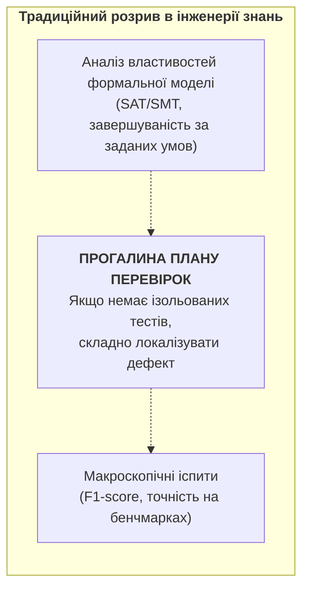
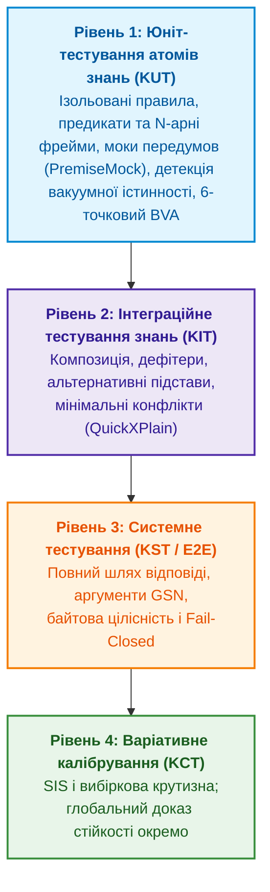
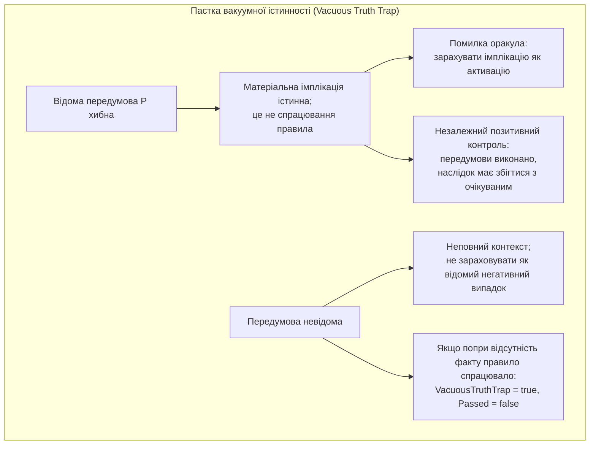
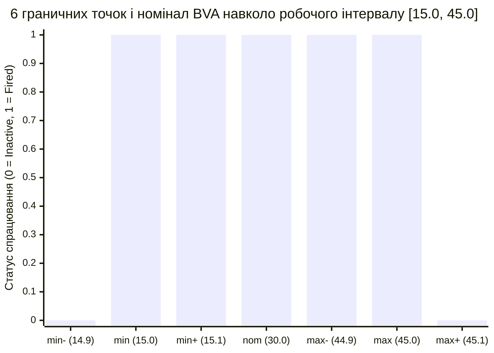
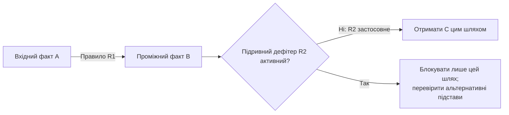
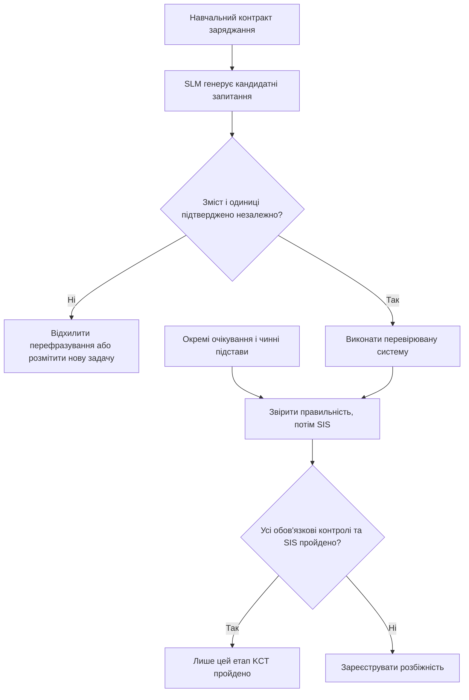
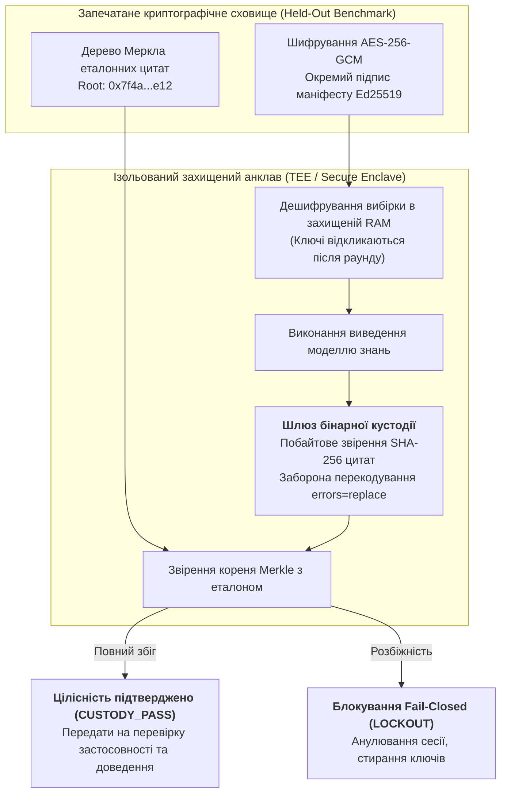
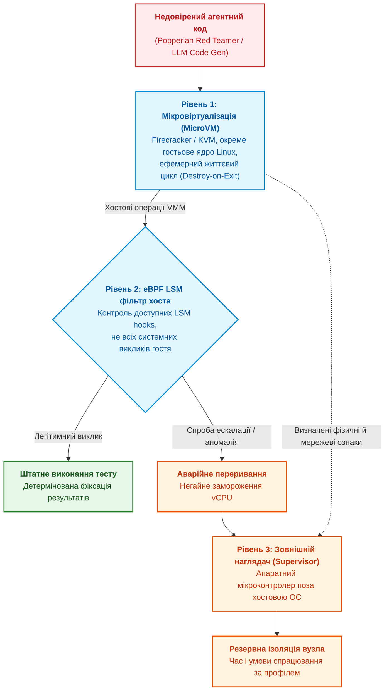
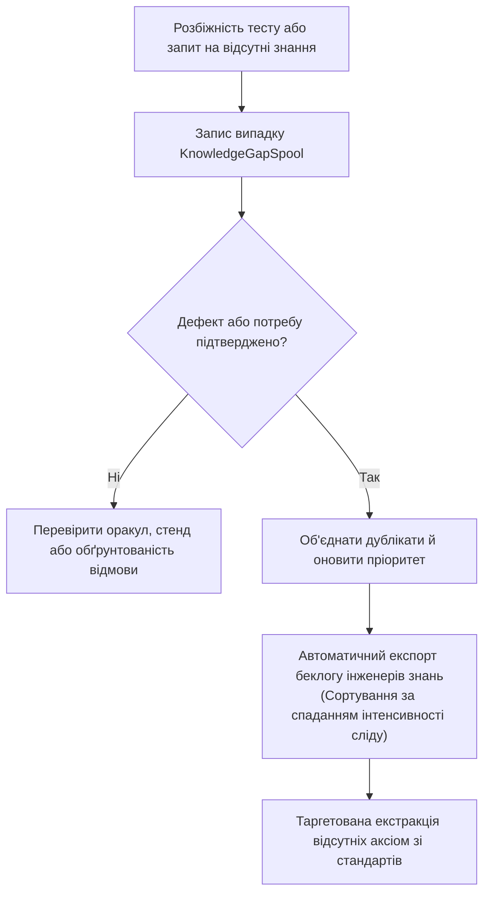

# Глава 36. Піраміда тестування знань: правила, взаємодії та стійкість відповідей

> **Книга:** [Архітектура доказових експертних систем](README.md) · [Частина V: Верифікація, тестування, навчання та обґрунтування безпеки](part-05-verification-and-learning.md)
> **Попередня глава:** [Глава 23. Верифікація бази знань: як перевірити несуперечливість, повноту та надійність правил](ch23-knowledge-base-verification.md)
> **Наступна глава:** [Глава 25. Як навчати експертну систему: екзаменаційні матриці, аудит знань та контроль регресій](ch25-how-expert-systems-learn.md)
> **Зміст книги:** [README.md](README.md)
> **Автор:** [Микола Мартинович Федчик](about-the-author.md)
> **Передумови:** булеві умови, функції та множини; перед статистичними оцінками пояснено потрібну модель випробувань. Для відтворення коду потрібне базове знання Go.
> **Очікувані результати:** побудувати чотири рівні KTP; відрізняти невакуумність від правильності правила, а тестове покриття від формального доказу; перевіряти границі та дефітери; обчислювати SIS і вибіркову крутизну; оцінювати ризик за нуля помилок лише за належних статистичних припущень; розділяти калібрування, логічний допуск і кероване усунення прогалин.

---

## Анотація

Тестування знань потрібне, щоб знайти місце, де експертна система переходить від правильних даних до неправильного рішення. У цій монографії автором запропоновано піраміду тестування знань (*Knowledge Testing Pyramid*, KTP): окремо перевіряти правило, композицію правил, повний шлях відповіді та реакцію на зміни входу. Глава вчить будувати такі перевірки й не приписувати їм більшої доказової сили, ніж дозволяє контрольний набір.

Пастка вакуумної істинності виникає, коли тест приймає істинність матеріальної імплікації $A \to B$ за свідчення спрацювання правила. За хибного $A$ імплікація істинна, але це не означає, що висновок $B$ виведено або що актуатор має спрацювати. Невідоме значення передумови слід обробляти окремо від хиби. Інша задача глави — перевірити стійкість рішень біля порогів, а також пояснити, чому відсутність помилок на скінченній вибірці не доводить нульового ризику.

Спочатку на навчальному правилі дозволу заряджання розглянуто позитивні й негативні контролі. Далі введено метрики стійкості, статистичні межі ризику, ізоляцію контрольного набору та полігону, адаптивне калібрування й журнал експерименту. Завершує главу реалізація перевірених методів мовою Go. Числа прикладів не є результатами вимірювання, якщо прямо не зазначено інше; авторські моделі не означають підтвердженої зовнішнім пошуком новизни.

---

## 1. Методологічний розрив у верифікації систем знань

Методологічний розрив стає видимим, коли програма запускається без помилок, але невідомо, чи перевірено зміст її правил. Нехай навчальна експертна система дозволяє заряджання за температури від 15 до 45 °C включно й напруги не нижчої за 20 В. Це умовний контракт, не рекомендація для реальної батареї: її межі задає виробник. За 25 °C і 24 В очікується `CHARGE_PERMITTED`, за 45,1 °C — відсутність дозволу, за відсутньої температури — повідомлення про недостатні дані. Очікування записують із контракту до запуску правила.

Якщо система завжди відмовляє, два останні випадки пройдуть, але перший виявить дефект. Якщо вона завжди дозволяє, дефект виявить другий випадок. Отже, потрібні і позитивний контроль, і незалежний оракул — заздалегідь задана правильна відповідь, а не самооцінка перевірюваного правила. Щоб локалізувати збій, рухаються від малого компонента до системи. Такий порядок узгоджується з пірамідою тестування Майка Кона [[1]](#src-1) і практикою явних очікувань Кента Бека [[2]](#src-2):

<a id="ch36-object-1"></a>

**Формула (36.1). Порядок модульних, інтеграційних і наскрізних перевірок**

```math
\text{Unit Tests} \longrightarrow \text{Integration Tests} \longrightarrow \text{End-to-End / System Tests}
```

Це схема організації робіт, не математична формула повноти. Модульний тест підміняє залежності контрольованими дублерами (*Test Doubles* [[3]](#src-3)); інтеграційний додає їх взаємодію, а наскрізний — шлях від запиту до відповіді. У прикладі спочатку перевіряється поріг температури, потім передавання дозволу наступному правилу, далі правильність пояснення користувачеві. Успіх на цих випадках не охоплює всіх можливих температур чи всіх програмних відмов.

У цій монографії автором запропоновано **Концепцію методологічного розриву інженерії знань (Knowledge Engineering Methodological Gap)**: якщо між аналізом моделі й кінцевим іспитом немає ізольованих перевірок, дефект важко локалізувати. Це діагноз конкретної організації тестів, не твердження, що вся попередня інженерія знань не мала модульного тестування:

<a id="ch36-object-2"></a>

**Діаграма 36.2. Організаційний розрив між моделлю та кінцевим іспитом**



Статична перевірка правил засобами SAT/SMT [[4]](#src-4) встановлює лише сформульовані властивості закодованої моделі. Оцінювання точності або калібрування ймовірностей [[5]](#src-5), [[6]](#src-6) відповідає на інші запитання. Жоден засіб не замінює іншого: правильний доказ у моделі не встановлює істинності датчика, а частота правильних відповідей не перевіряє кожної гілки правила.

Для послідовного пошуку причини автором запропоновано **Діагностичну таксономію чотирьох причин дефекту виведення**. Це чотири перевірні гіпотези, які можуть поєднуватися, а не доведено вичерпний поділ усіх збоїв:
1. Чи містить помилку саме правило (дефект антецедента — `RuleDefect`)?
2. Чи проблема виникла через хибне успадкування типу в решітці онтології (`OntologyInheritanceFault`)?
3. Чи висновок було заблоковано через помилкове збудження підривного дефітера (*Undercutting Defeater* — `UndercuttingDefeaterTrap`)?
4. Чи формулювання запиту зазнало незначного лінгвістичного перефразування, яке спотворило семантичний розбір (`LinguisticDrift`)?

> [!NOTE]
> **Чотири причини дефекту виведення за діагностичною таксономією автора**
> 1. Дефект антецедента правила (`RuleDefect`): помилка логічної структури, операторів порівняння або меж числових інтервалів окремого правила (локалізується на рівні KUT).
> 2. Дефект онтологічного успадкування (`OntologyInheritanceFault`): хибне зведення або несумісність типів між шарами онтологічної решітки (локалізується на межі KUT/KIT).
> 3. Пастка підривного дефітера (`UndercuttingDefeaterTrap`): несанкціоноване блокування висновку через хибне збудження заперечувальної умови в ланцюзі міркувань (локалізується на рівні KIT).
> 4. Лінгвістичний дрейф розбору (`LinguisticDrift`): спотворення семантичної інтерпретації або графа доведення внаслідок перефразування вхідного запиту (локалізується на рівні KCT за метрикою SIS).
> *Інженерне застосування:* записують усі підтверджені причини й невирішені гіпотези; помилка одиниць і помилка мовного розбору можуть бути присутні одночасно.

### 1.1. Порівняльний аналіз світових підходів до тестування та верифікації

Порівняння підходів допомагає вибрати наступну перевірку, коли місце дефекту ще невідоме. Передумовою є розрізнення програми, її математичної моделі та виміряних відповідей. Авторська **Порівняльна матриця шести підходів до тестування та верифікації систем знань** показує їхню роль; обмеження стосуються наведеного застосування, а не доводять принципової неспроможності підходу.

<a id="ch36-object-3"></a>

**Таблиця 36.3. Ролі шести підходів до перевірки знань**

| Підхід / Школа | Представники та джерела | Фокус і сильні сторони | Обмеження для систем знань |
|---|---|---|---|
| **Класичне тестування ПЗ** | M. Cohn [[1]](#src-1), K. Beck [[2]](#src-2), M. Feathers [[3]](#src-3) | Ізоляція компонентів, дублери залежностей, регресія. | Для правил потрібно явно задати семантику невідомості й відкликання; сам набір тестів її не визначає. |
| **Формальна верифікація та SMT** | C. Barrett, L. de Moura, N. Bjørner (Z3) [[4]](#src-4) | Строге доведення теорем, перевірка задовольняваності формул предикатів. | Статичний аналіз бази правил як замкненої системи; не тестує поведінку на емпіричних сенсорних потоках і мовних перефразуваннях. |
| **Калібрування моделей ШІ (ECE)** | J. Platt [[5]](#src-5), C. Guo et al. (On Calibration of Modern Neural Networks, 2017) [[6]](#src-6) | Узгодження скалярних ймовірностей класифікаторів із реальною частотою помилок (Expected Calibration Error). | Оцінює лише скалярну впевненість на фіксованій вибірці; сліпе до логічної структури доведення та чутливості до збурень. |
| **Метаморфне тестування та CheckList** | T. Y. Chen et al. [[7]](#src-7), M. T. Ribeiro et al. [[8]](#src-8) | Перевірка відношення між відповідями на пов'язані входи, коли повний оракул дорогий. | Саме відношення потребує обґрунтування; однакова неправильна відповідь може його задовольняти. |
| **Спростовна аргументація та AGM** | J. Pollock [[9]](#src-9), P. M. Dung [[10]](#src-10), C. Alchourrón et al. [[11]](#src-11) | Семантика атак на аргументи та зміни переконань. | Вибір семантики не перевіряє автоматично її реалізацію, джерела або часові межі. |
| **Чотирирівнева піраміда тестування знань (KTP)** | **Авторська модель цієї книги** | **Організація перевірок KUT/KIT/KST/KCT і зворотного зв'язку.** | **Потребує предметних оракулів і плану покриття; не є доказом повноти або сертифікатом.** |

Для помилкового порога заряджання спочатку потрібний модульний тест, а для втрати слова «не» в запиті — наскрізний. Так отримано принцип вибору перевірки; наступний розділ закріплює його в чотирьох рівнях KTP.

---

## 2. Концептуальна модель: Чотирирівнева піраміда тестування знань

Піраміда KTP розподіляє вже поставлену задачу локалізації дефектів за масштабом перевірки. Для її застосування достатньо розрізняти одне правило, ланцюг правил і повний шлях відповіді. У прикладі заряджання KUT перевіряє пороги, KIT — передавання дозволу за справного датчика, KST — відповідь і доказ, KCT — еквівалентні формулювання та близькі значення температури. Це зростання масштабу, не автоматичне зростання сили формального доказу:

<a id="ch36-object-4"></a>

**Діаграма 36.4. Чотири рівні авторської піраміди KTP**



Авторське **Архітектурне правило квадриги верифікаційних задач KTP** закріплює чотири групи робіт. Покриття визначають щодо реєстру вимог, правил, умов і взаємодій; відсоток пройдених тестів без такого знаменника не вимірює повноти:

> [!NOTE]
> **Чотири рівні піраміди тестування знань KTP за моделлю автора**
> 1. Рівень L1 (Knowledge Unit Testing, KUT): ізольована верифікація окремих правил, передумов (PremiseMock), предикатних типів, захисту від вакуумної істинності та 6-точкового BVA.
> 2. Рівень L2 (Knowledge Integration Testing, KIT): тестування багатоходових решіток виведення, перехоплення спростовними дефітерами (AGM) та детекція мінімальних конфліктів QuickXPlain.
> 3. Рівень L3 (Knowledge System Testing, KST/E2E): наскрізна верифікація сертифікаційних доказів GSN, дотримання політики Fail-Closed та побайтова кустодія першоджерел.
> 4. Рівень L4 (Knowledge Calibration Testing, KCT): варіативне калібрування стійкості, метрика семантичної інваріантності ($`\mathrm{SIS} \ge 0{,}98`$), перевірка Ліпшицевої неперервності та апаратно-програмний паритет.
> *Інженерне застосування:* для кожної вимоги вказують рівень, оракул і контрольні випадки; неперевірені вимоги залишаються явним залишком, а не отримують статусу доведених.

1. **L1 / KUT:** типи, одиниці, позитивна активація, негативні й невідомі передумови та BVA окремого правила.
2. **L2 / KIT:** сумісність правил, дефітери, альтернативні підстави й завершуваність композиції.
3. **L3 / KST:** повний шлях запиту, чинність джерела, граф і пояснення, доступ та версія.
4. **L4 / KCT:** мовні й числові збурення; за наявності двох реалізацій — їхній паритет на тих самих входах. Збіг двох реалізацій не виключає спільної помилки моделі.

Отже, невакуумність і BVA належать до L1, а не до окремого нового рівня. Далі кожну перевірку буде побудовано з явного очікування; спочатку достатньо одного правила.

---

## 3. Рівень 1: Knowledge Unit Testing (KUT) — Тестування атомів знань

Модульний рівень має відповісти, чи саме правило заряджання виконує заданий контракт незалежно від пошуку документів та інших правил. Потрібні лише вхідні значення, їхня наявність і очікуваний наслідок. Якщо під'єднати всю базу одразу, інше правило може випадково приховати помилку; тому спочатку ізолюється оточення.

### 3.1. Визначення та об'єкт тестування
Запропонована автором методологія модульного тестування атомів знань **Knowledge Unit Testing (KUT, за моделлю автора)** — це ізольоване тестування найменшої неподільної одиниці знання (атома онтології, окремого правила, $N$-арного семантичного фрейму) без підключення глобальної бази фактів та без рекурсивного розгортання мережі правил виведення (зокрема без активації повного графа зіставлення зразків Rete за Ч. Форгі [[18]](#src-18)).

Об'єктами KUT є:
* Окреме нормативне правило $`R: \text{Antecedents} \longrightarrow \text{Consequent}`$;
* Окремий $N$-арний фрейм (ролі актора, предикату, об'єкта, деонтичної модальності SHALL/MUST, передумов та винятків);
* Окремий предикат онтології з числовими діапазонами валідності.

### 3.2. Метод фіктивних передумов (Premise Mocking)
Фіктивні передумови потрібні, щоб повторити один і той самий вхід без реального датчика. Для навчального правила використовується температура $T$ у °C і напруга $U$ у В; обидва значення мають бути відомими скінченними числами. Задача — перевірити дозвіл, а не ймовірність безпеки батареї:

<a id="ch36-object-5"></a>

**Формула (36.5). Навчальний контракт дозволу заряджання**

```math
\mathrm{Permit}(T,U) \iff (15 \le T \le 45) \land (U \ge 20).
```

Тут $\mathrm{Permit}$ є булевим дозволом, числа 15 і 45 вимірюються в °C, а 20 — у В. За 25 °C і 24 В обидві умови істинні; за 45,1 °C перша хибна. Для невідомого $T$ формулу не обчислюють як звичайну двозначну умову: повертають недостатність даних. Усі пороги є умовами прикладу, не фізичним законом.

В авторському **патерні фіктивних передумов `PremiseMock`** залежності подаються картою фактів. Саме карта не забороняє функції приховано читати мережу або глобальні змінні: це окрема вимога ізоляції. Нижче функція реалізує позитивний контроль названого методу; типи `KnowledgeRule`, `PremiseMock` і `RunKUT` визначені у §8. Це бібліотечний фрагмент для спільної компіляції, не окрема програма. Вхід — правило з цим контрактом; вихід — результат з `Passed=true`, що перевіряють через `go test`.
```go
package main

func ChargingPositiveControl(rule KnowledgeRule) KUTResult {
	mock := NewPremiseMock().Set("temp_c", 25.0).Set("voltage_v", 24.0)
	return RunKUT(rule, mock, "CHARGE_PERMITTED")
}
```

### 3.3. Пастка вакуумної істинності (The Vacuous Truth Trap)
Пастку вакуумної істинності потрібно перевіряти, бо успішна перевірка імплікації ще не показує, чи правило хоч раз застосовувалось. У класичній двозначній логіці імплікація $P \to Q$ означає: немає випадку, де $P$ істинне, а $Q$ хибне. Тому за хибного $P$ вона істинна незалежно від $Q$. У прикладі 45,1 °C робить передумову дозволу хибною; це не доказ дозволу заряджання. Відсутня температура не є булевим `false` без окремо обраної семантики.

<a id="ch36-object-6"></a>

**Формула (36.6). Двозначна матеріальна імплікація**

$$
(P\to Q)\equiv(\neg P\lor Q).
$$

Тут $P,Q$ — висловлення зі значеннями `true` або `false`, $\neg$ — заперечення, $\lor$ — «або», а $\equiv$ — однакові значення для всіх чотирьох комбінацій. За хибного $P$ його заперечення істинне, отже диз'юнкція істинна; за істинного $P$ значення дорівнює $Q$. Це безрозмірнісна логічна тотожність. Вона пояснює, чому тест істинності імплікації не замінює тесту фактичного спрацювання; для невідомих значень ця двозначна таблиця не застосовується без додаткового означення.

Дефект виникає не в класичній логіці, а у виборі перевірюваної властивості. Якщо тест завжди подає температуру поза робочим інтервалом, він не перевірить здатності видавати дозвіл. SMT може окремо перевіряти досяжність антецедента; перевірка лише імплікації цього не замінює. Позитивний контроль 25 °C, 24 В повинен активувати правило, а випадок 45,1 °C — не активувати його.

<a id="ch36-object-7"></a>

**Діаграма 36.7. Помилкове приймання вакуумної перевірки**



Авторський **Математичний інваріант невакуумності бази знань (Non-Vacuity Invariant)** задає необхідне покриття активації на L1: для кожного правила, яке за специфікацією має бути досяжним, потрібний хоча б один активуючий випадок. Це не достатня умова правильності всього правила:

<a id="ch36-object-8"></a>

**Формула (36.8). Позитивне покриття активації досяжних правил**

```math
\forall \mathcal{R} = (A \implies C) \in \mathcal{KB}, \quad \exists \mathbf{x} \in \mathcal{X}_{\mathrm{test}} : A(\mathbf{x}) = \mathrm{True} \land \mathrm{StateChanged}(\mathbf{x}, C)
```

де:
- $`\mathcal{R}`$ — нормативне або інженерне правило з антецедентом $A$ та консеквентом $C$;
- $`\mathcal{KB}`$ — скінченний набір перевірюваних досяжних правил;
- $`\mathcal{X}_{\mathrm{test}}`$ — простір синтезованих або емпіричних тестових векторів;
- $`\mathbf{x}`$ — конкретний вхідний вектор спостережень (значень параметрів середовища);
- $`A(\mathbf{x}) = \mathrm{True}`$ — виконання умови антецедента без виникнення захисної відмови чи виходу за межі діапазону;
- $`\mathrm{StateChanged}(\mathbf{x}, C)`$ — булевий предикат спостережуваного наслідку: в ізольованому початковому стані отримано очікуваний $C$, а не довільну зміну пам'яті. Для ідемпотентного правила стан перед тестом скидають або перевіряють подію виведення.

Квантори «для кожного» й «існує» перебирають правила та вектори; формула логічна й безрозмірнісна, одиниці компонентів $\mathbf{x}$ задає контракт. Вектор 25 °C, 24 В є свідком активації навчального правила. Правило, яке безумовно видає дозвіл, теж може мати такого позитивного свідка, хоча помилиться на негативних входах: тому після невакуумності потрібні незалежне очікування й негативні випадки. Відсутність свідка в наявному наборі означає прогалину покриття; лише доказ нездійсненності антецедента в точній моделі встановлює недосяжність у цій моделі.

#### 3.3.1. Замкнений інженерний цикл верифікації невакуумності

1. **Керування рантаймом і потоком обчислень (Control Flow & Runtime Decisions):**  
   Якщо для правила $`\mathcal{R}_i`$ тестовий раннер KUT не знаходить жодного вектора $`\mathbf{x} \in \mathcal{X}_{\mathrm{test}}`$, який переводить $`A(\mathbf{x})`$ у стан $`\mathrm{True}`$, правило позначається як потенційно мертве (`VACUOUS_RULE_STALL`). Запускається фаундер контрприкладів (SMT-розв'язувач Z3). Якщо SMT-аналізатор доводить, що антецедент є тотожно хибним ($`\neg \exists \mathbf{x}: A(\mathbf{x})`$) через логічну суперечність у передумовах або невідповідність типів, конвеєр CI/CD виставляє вердикт `CRITICAL_REJECT`, блокуючи формування релізного пакета знань.
2. **Апаратний сайзинг та інфраструктурні обмеження (Hardware Dimensioning):**  
	У спрощеному профілі однієї передумови й окремих випадків активації та деактивації на кожне правило планують по два випадки. Це не достатній обсяг повного MC/DC-набору: потрібні також невідомі стани й незалежний вплив умов, пояснені нижче. Реальна кількість залежить від передумов і спільного покриття правил. Для умовних 20 000 послідовних тестів по 15 мкс маємо 300 мс без генерації, SMT, підготовки та CI. Це арифметичний бюджет прикладу, не вимірювання або WCET.
3. **Практичний числовий приклад (Worked Numerical Example):**  
	У навчальному правилі заряджання в мок помилково записано `tem_c` замість `temp_c`. Значення потрібної температури невідоме, а не хибне. Позитивний контроль очікує `CHARGE_PERMITTED`, але правило не спрацьовує: тест відхиляється через невідповідність очікуванню. Якщо дефектне правило попри відсутність температури спрацьовує, раннер додатково встановлює `VacuousTruthTrap`. Ці дві діагностики не слід плутати; жодна не є повідомленням про реально відвернену аварію.

**Інваріант KUT #1 (Vacuous Implication Prevention Invariant):**  
Тестовий раннер KUT зобов'язаний примусово відхиляти тест як дефектний (`VacuousTruthTrap = true`), якщо правило заявляє про успішне спрацювання за відсутності або неповноти обов'язкових передумов у мок-оточенні.

Перед запуском правила тест має задавати незалежний очікуваний результат. Прапорець самого правила не є незалежним оракулом. Авторська модель *Rule-Base MC/DC* поширює увагу до незалежного впливу умов на тризначні передумови: підтверджено, спростовано, невідомо. Класичний MC/DC вимагає показати незалежний вплив кожної умови на рішення при контрольованих інших умовах; три стани одного факту самі по собі не встановлюють такого покриття складеної умови й не є підтвердженням відповідності стандарту.

<a id="ch36-object-9"></a>

**Таблиця 36.9. Незалежні очікування для трьох станів передумови**

| Контрольований стан передумови | Очікувана поведінка правила | Що є дефектом |
|---|---|---|
| Передумову підтверджено | Правило спрацьовує та повертає очікуваний наслідок | Правило не спрацювало або підмінило наслідок |
| Передумову спростовано | Правило не виводить наслідок; результат має статус «не застосовується» | Наслідок виведено попри хибну передумову |
| Значення передумови невідоме | Рушій зберігає невідомість і називає потрібне свідчення | Відсутність факту мовчки перетворено на хибу або дозвіл |

Значення булевого факту `false` не означає відсутності факту. Наприклад, правило, яке перевіряє вимкнений режим обслуговування, може потребувати саме підтвердженого значення `false`. Тест має перевіряти умову правила, а не вважати будь-який хибний булевий атрибут відсутньою передумовою. Тризначну логіку розглянуто в [главі 6](ch06-applied-mathematics-for-expert-systems.md).

Для кон'юнкції температурного й напругового допусків спочатку фіксують 25 °C, 24 В, потім змінюють лише температуру на 45,1 °C, а окремо лише напругу на 19 В. Обидві зміни мають забрати дозвіл. Ще два випадки прибирають по одному факту. Це п'ять навчальних входів для локальної перевірки, не універсальний мінімум MC/DC. Наступне питання — чи правильно обробляються самі межі інтервалу.

### 3.4. 6-точковий спектральний аналіз граничних значень (BVA)
Нормативні документи (RFC, ISO, закони) містять числові параметри: таймаути, порогові напруги, мінімальні розміри пакетів. Для виявлення помилок типу «строга нерівність замість нестрогої» ($<$ замість $\le$) авторський підхід впроваджує 6-точковий спектральний аналіз граничних значень (шість граничних точок і контрольне номінальне значення, разом сім тестових значень) для кожного параметра діапазону $`[v_{\min}, v_{\max}]`$:

<a id="ch36-object-10"></a>

**Формула (36.10). Шість граничних точок BVA та номінал**

$$
\mathcal{B}=(v_{\min}-\delta,\ v_{\min},\ v_{\min}+\delta,\ v_{\mathrm{nom}},\ v_{\max}-\delta,\ v_{\max},\ v_{\max}+\delta).
$$

Тут $`\mathcal{B}`$ — впорядкований набір семи входів; $`v_{\min}<v_{\max}`$ — скінченні межі замкненого інтервалу, $`v_{\mathrm{nom}}`$ — скінченний номінал строго всередині, а $\delta$ — скінченний додатний крок, для якого $`0<\delta<\min(v_{\mathrm{nom}}-v_{\min},v_{\max}-v_{\mathrm{nom}})`$. Ця умова розміщує внутрішні точки по різні боки від номіналу й робить усі сім значень математично різними; реалізація додатково відхиляє точки, що злилися через округлення `float64`. Усі величини мають одиницю тестованого параметра. Для 15–45 °C, номіналу 30 °C і кроку 0,1 °C отримуємо сім точок наступної діаграми; напругу фіксують на 24 В. Якщо специфікація задає відкритий інтервал, очікування на самих межах змінюються — наведений BVA не є універсальним оракулом.

<a id="ch36-object-11"></a>

**Діаграма 36.11. Очікуване спрацювання на семи температурних входах**



Точки спектра:
1. $`v_{\min-} = v_{\min} - \delta`$ — точка за межами діапазону (очікується відмова / заборона);
2. $`v_{\min}`$ — точна нижня границя (очікується спрацювання / допуск);
3. $`v_{\min+} = v_{\min} + \delta`$ — точка безпосередньо всередині діапазону;
4. $`v_{\text{nom}}`$ — номінальне експлуатаційне значення;
5. $`v_{\max-} = v_{\max} - \delta`$ — точка біля верхньої межі;
6. $`v_{\max}`$ — точна верхня границя;
7. $`v_{\max+} = v_{\max} + \delta`$ — вихід за верхню межу (очікується блокування).

> [!NOTE]
> **Шість граничних точок спектрального аналізу BVA за моделлю автора**
> 1. Точка за нижньою межею ($`v_{\min-} = v_{\min} - \delta`$): гарантована відмова або блокування операції.
> 2. Точна нижня межа ($`v_{\min}`$): спрацювання правила на границі нормативного допуску.
> 3. Внутрішня нижня точка ($`v_{\min+} = v_{\min} + \delta`$): стабільне функціонування безпосередньо всередині робочого інтервалу.
> 4. Внутрішня верхня точка ($`v_{\max-} = v_{\max} - \delta`$): робота системи впритул до верхньої межі.
> 5. Точна верхня межа ($`v_{\max}`$): штатне спрацювання на максимальній допустимій межі.
> 6. Точка за верхньою межею ($`v_{\max+} = v_{\max} + \delta`$): детерміноване блокування перевищення нормативного параметру.
> *Інженерне застосування:* перевіряє названі межі за фіксованих інших умов; виявлення всіх можливих дефектів не гарантується.

Для BVA потрібні скінченні нижня й верхня межі в одних одиницях, скінченний номінал строго всередині та додатний представний крок $\delta$, менший за відстань від номіналу до кожної межі. Реалізація перевіряє також строгу зростальність обчислених точок, щоб округлення не створило дублікатів. Тут усі значення температури мають одиницю °C, крок — 0,1 °C, а решта умов зафіксована на 24 В. Сім значень 14,9; 15; 15,1; 30; 44,9; 45; 45,1 дають очікування `false,true,true,true,true,true,false`. Підміна нижнього `>=` на `>` провалить випадок 15 °C. Це виявлення конкретної мутації, не всіх помилок: NaN, невідомість і взаємодії параметрів потребують інших тестів. Назва «спектральний» тут авторська назва набору точок, не перетворення Фур'є. Після окремого правила можна перевіряти його композицію.

---

## 4. Рівень 2: Knowledge Integration Testing (KIT) — Решітки виведення та дефітери

Інтеграційний рівень потрібний, коли правильний дозвіл одного правила стає входом іншого. Передумови — вже перевірені окремі правила та явний контракт їхнього зв'язку. У навчальному прикладі друге правило передає дозвіл лише за придатного датчика; тест має відрізняти нормальний ланцюг від блокування через відкликану підставу.

### 4.1. Багатоходові решітки виведення (Inference Lattices)
Відповідно до розробленої автором методології **Knowledge Integration Testing (KIT, за моделлю автора)**, на рівні L2 тестується взаємодія суміжних правил у продукційних мережах (від класичних мереж Rete Ч. Форгі [[18]](#src-18) до багатоходових дедуктивних решіток), де висновок попереднього правила стає передумовою наступного:

<a id="ch36-object-12"></a>

**Формула (36.12). Скінченний послідовний ланцюг правил**

```math
R_1: A \longrightarrow B, \qquad R_2: B \longrightarrow C, \qquad \dots, \qquad R_n: Y \longrightarrow Z
```

KIT верифікує:
* **Типову сумісність інтерфейсів:** чи збігаються онтологічні типи атрибутів між різними шарами онтології;
* **Збереження простежуваності свідчень:** чи передається ланцюг побайтових цитат крізь усі проміжні вузли без втрати першоджерел;
* **Відсутність циклів:** виявлення взаємних викликів правил за межами допустимих скінченних автоматів.

Тут $`R_1,\ldots,R_n`$ — скінченна впорядкована послідовність правил, $`n\ge1`$, а $A,B,C,Y,Z$ — факти відповідних типів; стрілки означають виведення за обраною семантикою, не арифметичну операцію. За істинного $A$ і застосовних двох правил отримують $B$, потім $C$. За відсутнього $B$ другий крок не дозволено. Це логічний приклад композиції; довільний циклічний граф не стає такою послідовністю автоматично.

У межах KIT діє сформульований автором **Інженерний принцип семантичної дисоціації типу та онтологічного контексту в композиції правил (за моделлю автора)**: збіг базового скалярного типу двох атрибутів не встановлює їхньої предметної тотожності. Приклад семантичного зсуву: перше правило повертає «таймаут сокета», а друге очікує «таймаут установлення з'єднання». Однакова числова одиниця й схожа назва не встановлюють тотожності величин. Інтеграційний тест спочатку подає значення без правила відповідності й очікує блокування композиції, потім додає схвалену відповідність із потрібним контекстом і перевіряє дозволений перехід. Така пара випадків відрізняє перевірку змісту від політики, яка блокує будь-який ланцюг.

### 4.2. Інжекція спростовних дефітерів (Defeater Interruption за AGM)
Інжекція дефітера перевіряє, чи зникає право використати підставу, коли з'явилася релевантна заперечувальна обставина. Спираючись на Поллока [[9]](#src-9) та AGM [[11]](#src-11), автором запропоновано модель *Defeater Interruption*. Але підрив застосовності правила не тотожний AGM-звуженню: для переходу між цими моделями потрібні явне кодування переконань і обрана семантика. Символічне позначення звуження не замінює алгоритму відкликання.

<a id="ch36-object-13"></a>

**Діаграма 36.13. Підрив застосовності одного кроку виведення**



**Інваріант KIT #1 (Defeater Dominance Invariant):**  
Відкликане первинне свідчення отримує статус `REVOKED`; залежні обґрунтування позначаються `INVALIDATED_BY_REVOCATION` й перераховуються до наступної видачі `ACCEPT`. Підривний дефітер $D$ може блокувати лише конкретний спосіб виведення, не відкликаючи сам первинний запис. Висновок із незалежною чинною альтернативною підставою може зберегтися за обраною семантикою; тест має перевіряти саме це, а не безумовне видалення всіх нащадків.

Авторський принцип розрізнення *Undercutting* та *Rebutting* задає різні очікування [[9]](#src-9). Повідомлення «датчик не калібрований» підриває використання його вимірювання, але не доводить відсутності перегріву. Придатне незалежне вимірювання нижче порога заперечує висновок про перегрів. У прикладі заряджання спочатку перевіряють справний датчик і дозвіл, потім підривають лише його підставу, далі додають альтернативне придатне вимірювання. Три випадки розрізняють правильне блокування, постійну відмову й надмірне відкликання. Наступна перевірка встановлює, чи пояснення конфлікту не містить зайвих обмежень.

### 4.3. Мінімальний конфлікт як перевірюваний результат

Якщо обмеження несумісні, необхідно перевірити не лише статус конфлікту, а й пояснення конфлікту за розробленою автором **Методикою трихотомічної верифікації мінімальних конфліктів QuickXPlain (за моделлю автора)**. Алгоритм QuickXPlain Ульріха Юнкера знаходить конфлікт, мінімальний за включенням, за визначених передумов перевірки узгодженості [[12]](#src-12). Мінімальність означає, що вилучення будь-якого елемента знайденої підмножини усуває її несумісність; найменшої кількості елементів серед усіх можливих конфліктів алгоритм не обіцяє.

У навчальному випадку одночасно задано три обмеження: температура не нижча за 95 °C, температура не вища за 90 °C і тиск не вищий за 10 бар. За узгодженого фонового опису конфлікт утворюють два температурні обмеження. Обмеження тиску не повинно потрапити до цього пояснення. Незалежна перевірка підтверджує несумісність пари та узгодженість кожного з двох однокомпонентних наборів.

Окремі контрольні випадки потрібні для порожнього набору, сумісного набору та несумісного фонового опису. Помилку передумов алгоритму не можна подавати як мінімальний конфлікт. Реалізацію й перевірки QuickXPlain наведено в [главі 20](ch20-explanation-engine.md), тому тут алгоритм не дублюється.

Передумови QuickXPlain — узгоджений незмінний фон, скінченний набір кандидатних обмежень і коректний монотонний тест несумісності: додавання обмежень не відновлює сумісності. У прикладі температурна пара несумісна, кожний її одноелементний піднабір сумісний, отже пара мінімальна за включенням. Без цих умов посилання на алгоритм не є гарантією. Від перевірки локального пояснення далі переходимо до всього пакета відповіді.

---

## 5. Рівні 3 і 4: наскрізні перевірки та варіативне калібрування

Наскрізні перевірки потрібні після правильного компонування правил: дозвіл ще можна спотворити в пошуку, поясненні або видачі. Передумовами є контрольний контракт і незалежні очікування з попередніх розділів. Спочатку перевіряється цілий шлях відповіді, потім його стійкість, а вже тоді — межі статистичного висновку. Калібрування узгоджує числову оцінку з частотами на даних; логічний допуск окремо перевіряє застосовність правила та підстави конкретної відповіді.

### 5.1. Наскрізне тестування експертної системи

Запропонована автором **Модель чотирьох контрольних меж наскрізного тестування експертної системи (*Knowledge System Testing*, KST, за моделлю автора)** перевіряє весь шлях від репліки користувача до рішення та пакета обґрунтування вздовж чотирьох інваріантних границь трансформації інформації. Успішний модульний тест правила не підтверджує, що пошук вибрав чинне джерело, мовний аналіз зберіг заперечення, а пояснення відтворило фактичний висновок.

<a id="ch36-object-14"></a>

**Таблиця 36.14. Чотири контрольні межі наскрізного тесту**

| Межа перевірки | Контрольний випадок | Незалежне очікування |
|---|---|---|
| Джерело → твердження | правильна цитата, але число стосується іншого об'єкта | збіг байтів не дає права прийняти хибне тлумачення |
| Передумови → граф доведення | вилучено одну обов'язкову посилку | наслідок не допускається; пакет називає відсутню підставу |
| Граф → пояснення | до тексту додано число, якого немає в трасі | непідтверджений текст блокується або замінюється перевіреним поданням |
| Доступ і версія → видача | джерело відкликано (`REVOKED`) після попереднього успішного запиту | залежні висновки отримують статус `INVALIDATED_BY_REVOCATION`; нова видача блокує `ACCEPT` до повторної верифікації |

Для кожного негативного випадку потрібний парний позитивний: чинне джерело, повні передумови, правильне пояснення й дозволений доступ. Інакше постійна відмова виглядатиме успішним проходженням перевірок. Контракти підстав і пояснень докладно розглянуто в главах [19](ch19-from-question-to-evidence.md) та [20](ch20-explanation-engine.md), а керований допуск нової версії в [главі 25](ch25-how-expert-systems-learn.md).

#### 5.1.1. Наскрізний приймальний контроль (UAT) та попперівська фальсифікація доказових ядер

У промислових випробуваннях доказових систем фінальний етап перевірки вимагає переходу від емпіричного оцінювання точності до детермінованого приймального тестування (*User Acceptance Testing*, UAT). Автором розроблено **методологію трирівневого наскрізного приймального контролю доказових експертних систем** (`CH36-S05-20`), що поєднує нормативну перевірку, параметричні апаратні межі та активну попперівську фальсифікацію софізмами.

> [!NOTE]
> **Три рівні наскрізного приймального контролю доказових експертних систем**
> 1. Верифікація позитивних деонтичних зобов'язань: автоматизоване підтвердження нормативних вимог предметного домену із обов'язковою перевіркою збігу побайтової кастодії цитат першоджерела та модальності.
> 2. Контроль параметричних меж та апаратних інтервалів: перевірка числових діапазонів напруг, тактових частот та часових бюджетів реакції систем безпеки у фіксованій точці з підтвердженням запасу стійкості до відмов.
> 3. Контрфактичне випробування запитаннями з хибними передумовами: незалежний оракул задає типізовану відмову або обґрунтоване виправлення передумови; парні коректні запитання перевіряють, що система не відмовляє завжди.
> *Правило приймання:* жодної невідповідності зареєстрованому оракулу й жодного пошкодженого зрізу в цьому наборі. Це результат скінченного UAT, не абсолютна достовірність усіх майбутніх відповідей.

Наприклад, «Чому дозволено заряджання при 50 °C?» містить хибну для навчального контракту передумову; очікується її виправлення, не пояснення вигаданого дозволу. Парне питання про 25 °C і 24 В повинне отримати обґрунтований дозвіл. Успіх цієї пари встановлює лише виконання двох сценаріїв. Наступне питання — чи переживає відповідь зміну формулювання без зміни змісту.

### 5.2. Метрика семантичної інваріантності (Semantic Invariance Score, SIS)
Семантична інваріантність потрібна, щоб «Чи дозволено заряджання при 25 °C і 24 В?» та «Чи можна заряджати за напруги 24 В і температури 25 °C?» давали однакове рішення. Передумова — незалежно підтверджена еквівалентність питань за об'єктом, умовами, одиницями, версією джерела й модальністю. Сама схожість слів цього не встановлює. Для відмінного предметного прикладу розглянемо три формулювання одного питання:

<a id="ch36-object-15"></a>

**Формула (36.15). Кандидатні формулювання питання про MTU**

```math
\begin{aligned}
\mathcal{Q}_{\text{base}} &= \text{«Який мінімальний MTU для IPv6?»}, \\
\mathcal{Q}_{\text{var1}} &= \text{«Яка нижня вимога до MTU каналу IPv6?»}, \\
\mathcal{Q}_{\text{var2}} &= \text{«What is the minimum IPv6 link MTU?»}.
\end{aligned}
```

Тут $`\mathcal{Q}_{\text{base}}`$ — базовий рядок, а два інші — кандидати на перефразування; це тексти, не числові змінні. Для навчального оракула умовно задано `1280 octets`; нормативний зміст і винятки RFC мають перевірятися окремо за першоджерелом. «Найменший розмір пакета» не є коректною підміною MTU — максимально допустимого розміру блоку. Якщо підтверджене перефразування змінює правильний вердикт, маємо дефект стійкості; інший чинний доказ того самого висновку сам по собі дефектом не є.

Авторська **Метрика семантичної інваріантності (Semantic Invariance Score, $`\mathrm{SIS}`$)** описує скінченний набір перевірених перефразувань $`\mathbb{V}(\mathcal{Q})`$. Вона поєднує збіг вердиктів із близькістю множин елементів доказу; коефіцієнт Жаккара множин не вимірює топології всього графа:

<a id="ch36-object-16"></a>

**Формула (36.16). Авторська зважена метрика SIS**

```math
\mathrm{SIS}(\mathcal{Q}) = \alpha \cdot \mathrm{VerdictsMatchRate} + \beta \cdot \mathrm{ProofGraphJaccard}
```

де складові метрики обчислюються як:

<a id="ch36-object-17"></a>

**Формула (36.17). Частка збігу вердиктів**

```math
\mathrm{VerdictsMatchRate} = \frac{1}{N} \sum_{i=1}^{N} I\left(\mathrm{Verdict}(Q_i) = \mathrm{Verdict}(Q_{\mathrm{base}})\right) \in [0, 1]
```

<a id="ch36-object-18"></a>

**Формула (36.18). Середня близькість множин елементів доказу**

```math
\mathrm{ProofGraphJaccard} = \frac{1}{N} \sum_{i=1}^{N} \frac{\lvert P(Q_i) \cap P(Q_{\mathrm{base}})\rvert}{\lvert P(Q_i) \cup P(Q_{\mathrm{base}})\rvert} \in [0, 1]
```

**Параметри та вагові коефіцієнти:**
- $`\mathrm{VerdictsMatchRate}`$ — частка збурених запитів із $N$ варіантів, де вердикт тотожно збігається з вердиктом на базове формулювання;
- $`\mathrm{ProofGraphJaccard}`$ — усереднений коефіцієнт Жаккара схожості множин вузлів і цитат графа доведення $P(Q)$;
- $\alpha, \beta \in [0, 1]$ — калібрувальні ваги довіри ($`\alpha = 0{,}6,\; \beta = 0{,}4`$, де $`\alpha + \beta = 1{,}0`$);
- $`\mathrm{SIS}(\mathcal{Q}) \in [0, 1]`$ — результуючий інтегральний показник семантичної інваріантності.

У формулах $`N\in\mathbb{N}^+`$ — число варіантів, $i$ — їхній індекс від 1 до $N$, $`Q_i`$ — відповідний запит, $`Q_{\mathrm{base}}`$ — базовий. $I$ дорівнює 1 за збігу вердиктів і 0 інакше; $P(Q)$ є скінченною множиною канонічних ідентифікаторів підстав і правил, а не випадкових ID запуску. Перетин рахує спільні елементи, об'єднання — всі різні. Усі частки й ваги безрозмірнісні; сума ваг дорівнює 1, об'єднання має бути непорожнім. Однакові хибні вердикти теж дають повний збіг, тому правильність базового й варіантних результатів спочатку звіряють з незалежним оракулом.

**Критерій допуску та реакція рантайму:**  
Для автоматизованого шлюзу варіативного допуску діють порогові правила:

<a id="ch36-object-19"></a>

**Формула (36.19). Умовний поріг SIS для окремого етапу перевірки**

```math
\mathrm{SIS}(\mathcal{Q}) \ge 0{,}98
```

> [!NOTE]
> **Три порогові стани семантичної інваріантності SIS за моделлю автора**
> 1. Профільний позитивний результат (`ACCEPT_INVARIANT`, $`\mathrm{SIS} \ge 0{,}98`$, $`\mathrm{VerdictsMatchRate} = 1{,}00`$): поріг метрики пройдено; пакет може перейти до окремих релізних перевірок. Цей статус не є підписом релізу, доказом істинності тверджень або сертифікацією.
> 2. Кваліфікований аудит (`QUALIFIED_REVIEW`, $`0{,}85 \le \mathrm{SIS} < 0{,}98`$ за збігу всіх вердиктів): ескалація розбіжностей інженеру знань без допуску до релізу.
> 3. Примусове відхилення (`REJECT_DRIFT`, $`\mathrm{SIS} < 0{,}85`$ або $`\mathrm{VerdictsMatchRate} < 1{,}00`$): автоматичне блокування пакету знань у CI/CD через нестабільність вердиктів.
> *Керування рантаймом / Інженерний інваріант:* Запобігає лінгвістичній крихкості доказової системи при варіативних формулюваннях користувацьких запитів.

- `ACCEPT_INVARIANT`: якщо $`\mathrm{SIS}(\mathcal{Q}) \ge 0{,}98`$ і $`\mathrm{VerdictsMatchRate} = 1{,}00`$, профіль фіксує проходження перевірки варіативної стійкості й допускає пакет до наступних релізних перевірок. Підпис релізу можливий лише за окремим затвердженим контрактом після проходження всіх його критеріїв; цей показник сам по собі не доводить істинності тверджень чи відповідності продукту;
- `QUALIFIED_REVIEW`: якщо всі вердикти збігаються й $`0{,}85 \le \mathrm{SIS}(\mathcal{Q}) < 0{,}98`$, система блокує публікацію й ескалує відмінності доказів;
- `REJECT_DRIFT`: якщо $`\mathrm{SIS}(\mathcal{Q}) < 0{,}85`$ або $`\mathrm{VerdictsMatchRate} < 1{,}00`$, реліз примусово відхиляється тестовим конвеєром CI/CD.

**Практичний приклад розрахунку:**  
Нехай для запиту згенеровано вибірку з $N = 10$ мовних варіацій ($`Q_1, \dots, Q_{10}`$). На всіх 10 варіантах вердикт збігся з базовим (`1280 octets`), тобто $`\mathrm{VerdictsMatchRate} = 10/10 = 1{,}00`$. У 9 варіаціях графи доведення виявилися ідентичними базі ($`\frac{\lvert P_i \cap P_{\mathrm{base}} \rvert}{\lvert P_i \cup P_{\mathrm{base}} \rvert} = 1{,}00`$), а в одній варіації $`Q_8`$ генератор підставив синонімічне розширене визначення, сформувавши граф із 5 вузлів проти 4 базових при перетині 4 вузли ($`\frac{4}{5} = 0{,}80`$). Тоді:

<a id="ch36-object-20"></a>

**Формула (36.20). Обчислення близькості десяти варіантів**

```math
\mathrm{ProofGraphJaccard} = \frac{9 \times 1{,}00 + 1 \times 0{,}80}{10} = 0{,}980.
```

Значення індексу становить:

<a id="ch36-object-21"></a>

**Формула (36.21). Обчислення SIS для навчального набору**

```math
\mathrm{SIS}(\mathcal{Q}) = 0{,}6 \times 1{,}00 + 0{,}4 \times 0{,}980 = 0{,}600 + 0{,}392 = 0{,}992.
```

Оскільки $`0{,}992 \ge 0{,}98`$, пакет отримує статус `ACCEPT_INVARIANT`.

Автором обґрунтовано інженерний принцип неприпустимості маскування критичного дефекту середньою оцінкою: висока середня оцінка $`\mathrm{SIS}(\mathcal{Q})`$ ніколи не повинна приховувати зміну хоча б одного критичного вердикту ($`\mathrm{VerdictsMatchRate} < 1{,}00 \implies \texttt{REJECT\_DRIFT}`$). Додатково перевіряють кожне підтверджено еквівалентне формулювання: вердикт має збігатися з еталонним, а кожна використана підстава має лишатися допустимою. Втрата частини вузлів повинна змінювати оцінку схожості графів навіть тоді, коли решта вузлів не змінилася. Альтернативний правильний доказ не є дефектом сам по собі; політику допустимих змін графа визначають до випробування.

Порожній набір варіацій не дає оцінки стійкості. Два порожні графи теж не підтверджують доказової відповіді: спочатку перевіряють наявність і придатність підстав, а вже потім схожість графів. Поріг 0,98 та ваги 0,6 і 0,4 є параметрами навчального прикладу, не вимогами галузевого стандарту. Успіх на скінченному наборі не доводить інваріантності для всіх можливих запитань і не є сертифікацією.

Метаморфний тест перевіряє очікуване відношення двох результатів [[8]](#src-8). Інваріантність є окремим випадком ширшої еквіваріантності:

<a id="ch36-object-22"></a>

**Формула (36.22). Метаморфне відношення та еквіваріантність**

$$
F(g(x)) = h(F(x)).
$$

Тут $x$ — допустимий вхід, $F$ — перевірювана функція відповіді, $g$ — дозволене перетворення входу, $h$ — наперед задане відповідне перетворення виходу. Це логічна рівність результатів у визначеному контракті, не імовірність. Для перефразування $h$ зберігає вердикт; для перетворення 25 °C на 298,15 K потрібні узгоджене перетворення порогів і одиниць, а числова температура у виході також змінюється. Заміна «дозволено» на «заборонено» не є перефразуванням із незмінним оракулом. Перед тестом перевіряють збереження об'єкта, контексту й доступності джерел; без цих умов рівність не вимагається. Неправильна постійна функція може пройти інваріантні тести, тому позитивний оракул залишається потрібним. Далі аналогічне питання поставимо для числового збурення, яке справді може змінити рішення біля порога.

### 5.3. Критерій Ліпшицевої стійкості знань ($`L_{\mathcal{K}} < \infty`$)
Ліпшицева стійкість потрібна, щоб оцінити, наскільки числовий вихід може змінитися від малого збурення датчика. Передумови — задана область входів, числовий вихід і узгоджені одиниці; категоріальний вердикт не є неперервним числом за замовчуванням. Для нормованого безрозмірнісного входу приклад малого збурення має вигляд:

<a id="ch36-object-23"></a>

**Формула (36.23). Приклад малого нормованого збурення**

```math
x \longrightarrow x + \Delta x, \qquad \|\Delta x\| < 10^{-5}.
```

Тут $x$ є нормованим вектором, $`\Delta x`$ — його зміною, а норма вимірює її розмір у зафіксованій шкалі; поріг $`10^{-5}`$ є лише умовним прикладом. Для тиску в барах потрібний розмірний поріг. Релейний вихід може законно стрибнути на межі правила; **брязкіт (Chattering)** — це повторні перемикання в часі через шум, а не кожний одиничний стрибок. Для висновку про фізичну небезпеку потрібна модель приводу й часових обмежень.

Авторський **Критерій Ліпшицевої неперервності та стійкості логічного простору знань** застосовує класичне означення до обраного числового відображення $`\mathcal{K}`$. Воно є Ліпшицевим на області, якщо для всіх пар входів приріст виходу обмежений сталою, помноженою на відстань входів. Похідна для цього означення не обов'язкова:

<a id="ch36-object-24"></a>

**Формула (36.24). Глобальна межа Ліпшиця на заданій області**

```math
L_{\mathcal{K}} = \sup_{x_1 \neq x_2} \frac{\|\mathcal{K}(x_1) - \mathcal{K}(x_2)\|}{\|x_1 - x_2\|} \le L_{\max}.
```

**Параметри та інженерні обмеження:**
- $`x_1, x_2 \in \mathbb{R}^n`$ — вектори вхідних фізичних спостережень у допустимому просторі станів;
- $`\mathcal{K}(x) \in [0, 1]^m`$ — вектор упевненості або числових рекомендацій експертної системи;
- $`\|\cdot\|`$ — евклідова або чебишовська норма у відповідному векторному просторі;
- $`L_{\mathcal{K}} \in [0, +\infty]`$ — глобальна константа Ліпшиця на визначеній області; максимум скінченного набору січних є лише її нижньою оцінкою;
- $`L_{\max}`$ — гранично допустимий поріг крутизни відгуку (наприклад, $`L_{\max} = 10{,}0\,\text{бар}^{-1}`$).

Символ $\sup$ означає найменшу верхню межу відношень для всіх різних пар у заданій області; $n,m$ — додатні цілі розмірності векторів. Для скалярного безрозмірнісного виходу й тиску в барах одиниця сталої — бар⁻¹. Наприклад, для тотожного відображення нормованого числа дві точки 0 і 0,1 дають приріст 0,1 та відношення 1; саме тотожність для будь-якої пари доводить глобальну межу 1, не одиничний розрахунок. Для релейного правила поблизу межі такої скінченної глобальної межі немає.

**Операційні рішення та числовий приклад:**
- Якщо верифікатор виявляє точку розриву, де відношення приросту стрибає до нескінченності ($`L_{\mathcal{K}} > L_{\max}`$) при $`\|\Delta x\| \to 0`$, система фіксує небезпеку брязкоту (`CHATTERING_FAULT`), блокує пряму видачу сигналу на виконавчий тракт і вимагає введення гістерезису або демпфуючого інтервалу.
- Числовий приклад: датчик тиску олії передає значення $`x_1 = 2{,}999\,\text{бар}`$ (де логічний висновок формує впевненість штатного режиму $`\mathcal{K}(x_1) = 1{,}00`$) та $`x_2 = 3{,}001\,\text{бар}`$ (де за відсутності зони нечутливості впевненість стрибає до $`\mathcal{K}(x_2) = 0{,}00`$). При кроці збурення $`\|x_1 - x_2\| = 0{,}002\,\text{бар}`$ градієнт реакції становить:

<a id="ch36-object-25"></a>

**Формула (36.25). Вибіркова крутизна біля релейного порога**

```math
\widehat{L}_{\mathrm{sample}} = \frac{\lvert 1{,}00 - 0{,}00 \rvert}{0{,}002\,\text{бар}} = 500\,\text{бар}^{-1} \gg L_{\max} = 10\,\text{бар}^{-1}.
```

- Тут $`\widehat{L}_{\mathrm{sample}}`$ є виміряною крутизною між двома точками, не глобальною константою. Для ідеальної релейної сходинки глобальна константа нескінченна. Значення 500 бар⁻¹ відповідає 0,005 Па⁻¹, а поріг 10 бар⁻¹ — 0,0001 Па⁻¹; порівнюють величини в однакових одиницях. Для багатовимірного входу профіль задає масштаби координат до обчислення норми.
- Дія системи: перевищення порога відхиляє правило (`REJECT_UNSTABLE_RULE`), але неперевищення на вибірці не доводить глобальної стійкості. Гістерезис або мінімальний час утримання стану проєктують окремо за шумом і допустимою затримкою захисту; вони обмежують перемикання гібридного автомата, а не перетворюють релейний вихід на неперервну функцію поточного входу. Глобальна межа потребує окремого доказу; до нього результат позначається як вибіркова перевірка.

### 5.4. Нейро-символічна генерація збурень запиту $`\mathbb{V}(\mathcal{Q})`$ через локальні SLM

Генератор збурень потрібний після визначення SIS, щоб отримати різноманітні кандидати без ручного написання кожного рядка. Передумова — окрема процедура перевірки їхнього змісту: мала мовна модель (SLM) пропонує тексти, але не встановлює їх еквівалентності або правильності відповіді. Ручні й шаблонні набори теж корисні; жоден спосіб не забезпечує представницькості самим фактом використання.

Авторський **патерн подвійного нейро-символічного синтезатора простору збурень** відділяє генератор кандидатів від незалежного оракула й детермінованого порівняння. Схема показує контроль цього поділу, не доводить його безпомилковості:

<a id="ch36-object-26"></a>

**Діаграма 36.26. Генерація кандидатів і незалежний оракул**



Наприклад, генератор міняє порядок температури й напруги, але кандидат «заряджати при 25 В і 24 °C» змінює величини й не входить до групи інваріантності. Навіть тисяча правильних перефразувань одного питання не дорівнює тисячі незалежних предметних випадків. Усі варіанти, спільне джерело та близькі дублікати групують до розподілу на навчання, налаштування й контроль; ціла група належить лише одному розділу даних. Інакше система може запам'ятати відповідь через сусідній варіант — це витік даних.

Ізоляція моделі-генератора не гарантує незалежності оракула: він може поділяти ті самі дані або хибне тлумачення. Зберігають походження груп, журнал доступу й усі випадки експозиції; швидкодію вимірюють окремо без непідтверджених чисел тестів за секунду. Тепер можна поставити статистичне питання: що означає нуль помилок на справді незалежних випадках?

### 5.5. Метрологія нульових галюцинацій (ZHR): точні довірчі інтервали Клоппера-Пірсона та правило трьох

Оцінка ризику за нуля помилок потрібна, щоб не сплутати «поки не знайдено збою» з «збій неможливий». Передумова — зафіксовані версія системи, правило виявлення помилки й спосіб відбору запитів. Розрізняються два поняття:
1. **Конструктивний шлюзовий інваріант ($`\mathrm{ZHR}_{\mathrm{gate}} = 1{,}00`$ або поріг допуску $`\tau_{\mathrm{ZHR\_gate}} = 1`$):** структурно-архітектурна властивість вихідного шлюзу кустодії ([Глава 38](ch38-curing-machine-hallucinations-and-knowledge-deficits.md), §2.2; [Глава 40](ch40-distributed-epistemic-architectures-soa-and-cluster-scaling.md), §2.2), згідно з якою кожне допущене до видачі стверджувальне речення зобов'язане мати побайтово верифіковану цитату з першоджерела за SHA-256 (інакше спрацьовує блокування `DROP_UNGROUNDED`).
2. **Емпірична статистична верхня межа частоти галюцинацій ($`p_U`$) на скінченній вибірці з $`N`$ запитів:** метрологічна оцінка ймовірності невиявленого збою тракту під час випробувань на скінченному наборі тестових прикладів ($`p_U = 1 - 0{,}05^{1/N}`$ на рівні довіри $95\%$).

Шість знаків після коми в записі спостережуваної частки не задають довірчої межі. `1,000000` може означати лише відсутність знайдених помилок у цьому наборі. Інша, набагато сильніша задача — підтвердити за заданого рівня довіри ціль:

<a id="ch36-object-27"></a>

**Формула (36.27). Ціль імовірності помилки, а не виміряний результат**

```math
p_{\mathrm{error}} \le 10^{-6}
```

Тут $`p_{\mathrm{error}}\in[0,1]`$ — безрозмірнісна ймовірність заздалегідь визначеної помилки на цільовому розподілі, а $`10^{-6}`$ — ціль, не отримана оцінка. Для 30, 100 або 1309 випадків без збоїв таку ціль не підтверджено. Зокрема, для 30 верхня 95-відсоткова межа близька до 9,5 %, а не до частки відсотка.

Для точної біноміальної межі припускаються незалежні й однаково розподілені (i.i.d.) випробування Бернуллі зі спільною незмінною ймовірністю помилки $p$. Оракул має надійно виявляти визначену помилку; версія й пороги не налаштовуються за результатами цього набору, обсяг і правило зупинки зафіксовані наперед. Формула нижче не є послідовною довірчою межею для довільного повторного підглядання. Залежні перефразування або зміна розподілу порушують ці передумови. Якщо один кластер варіантів рахується як одне випробування, його подію помилки визначають окремо: отримана межа стосується кластерів, а не автоматично всіх запитів.

Для біноміальних випробувань Бернуллі з $k = 0$ помилок у вибірці обсягу $N$ однобічний точний інтервал Клоппера-Пірсона задає верхню довірчу межу частоти помилок $`p_U`$ і відповідну нижню довірчу межу емпіричної частки успіхів $`\mathrm{ZHR}_{\mathrm{LCB}}`$ на рівні довіри $1-\alpha$ [[14]](#src-14). Це статистична межа за заданими припущеннями, а не гарантія фактичної частоти помилок:

<a id="ch36-object-28"></a>

**Формула (36.28). Однобічна точна межа за нуля помилок**

```math
p_U = 1 - \alpha^{1/N}, \qquad \mathrm{ZHR}_{\mathrm{LCB}} = 1-p_U = \alpha^{1/N}.
```

де:
- $`N \in \mathbb{N}^+`$ — обсяг репрезентативної вибірки незалежних контрольних запитів;
- $\alpha$ — рівень значущості (при стандартному для інженерії рівні довіри $95\%$ приймається $`\alpha = 0{,}05`$);
- $`p_U \in [0, 1]`$ — верхня довірча межа частоти помилок (галюцинацій) системи;
- $`\mathrm{ZHR}_{\mathrm{LCB}} \in [0, 1]`$ — нижня довірча межа емпіричної частки випробувань без помилок на рівні довіри $1-\alpha$; вона не гарантує частоту помилок у майбутніх запитах.

Тут $`k=0`$ — спостережувана кількість помилок; за $`k>0`$ ця спеціальна формула непридатна. Обґрунтування використовує ймовірність нуля помилок:

<a id="ch36-object-29"></a>

**Формула (36.29). Імовірність нуля помилок у біноміальній моделі**

$$
\Pr(K=0\mid p)=(1-p)^N.
$$

Тут $K$ — випадкове число помилок від 0 до $N$ до випробування, $p\in[0,1]$ — та сама незмінна ймовірність помилки, а $\Pr$ — ймовірність події за i.i.d.-умов. Кожне безпомилкове випробування має ймовірність $1-p$, а незалежність дозволяє перемноження. За $p=0,01$ і $N=100$ маємо приблизно 0,3660. Прирівнювання цієї ймовірності до $\alpha$ й розв'язання щодо $p$ дає попередню верхню межу. За $`N=100`$ і $`\alpha=0{,}05`$ вона приблизно 0,029513, тобто 2,9513 %. Частотна довіра 95 % описує покриття процедури в повторних вибірках, а не апостеріорну ймовірність істинності конкретної межі. Її використовують для звітування за цими припущеннями; вона не підтверджує істинності джерел або невразливості реалізації.

При зростанні $N \to \infty$ розклад Тейлора для експоненти дає адаптоване автором **Інженерне правило трьох для оцінки граничного рівня відмов ШІ та розрядності ZHR (за моделлю автора на базі Ганлі та Ліппман-Генд [[15]](#src-15))**:

<a id="ch36-object-30"></a>

**Формула (36.30). Наближення правила трьох за довіри 95 відсотків**

```math
\ln(0{,}05) \approx -2{,}9957 \implies p_U \approx 1 - e^{-2{,}9957/N} \approx \frac{2{,}9957}{N} \approx \frac{3}{N}
```

Позначення $`p_U,N`$ ті самі; $\ln$ — натуральний логарифм, $e$ — його основа. Наближення спирається на малий додатний показник 2,9957, поділений на $N$: лінійний член розкладу експоненти переважає наступні. За 100 випадків правило трьох дає 0,03 проти точної 0,029513. Для рішення біля порога беруть точну межу, а не округлене наближення; за дуже малого $N$ наближення може навіть вийти за межі ймовірностей.

Авторська класифікація нижче є політикою звітування про емпіричні результати, а не класами сертифікації ISO 26262 або IEC 61508. За нуля помилок і наведених біноміальних припущень мінімальний обсяг для заданої межі обчислюють оберненням точного інтервалу:

<a id="ch36-object-31"></a>

**Формула (36.31). Мінімальна фіксована вибірка без помилок**

$$
N_{\min} = \left\lceil \frac{\ln\alpha}{\ln(1-p_{\max})} \right\rceil.
$$

Тут $`\alpha \in (0,1)`$ є рівнем значущості, $`p_{\max} \in (0,1)`$ — цільовою верхньою межею частоти помилки, а $`N_{\min}`$ — мінімальною кількістю незалежних випробувань без помилок. Для довіри 95 % і межі 0,0001 потрібно 29 956 випробувань, а не 300. Інженер резервує час прогону та сховище за цим обсягом і не допускає сильнішої заяви без достатньої вибірки. Наприклад, за 500 запитів/с це щонайменше 59,912 с; за 4 КБ на доказ — 119 824 КБ без метаданих. У таблиці наведено вкладені рівні; звіт указує найсильніший досягнутий, а не довільний клас.

<a id="ch36-object-32"></a>

**Таблиця 36.32. Авторські класи звітування й окремий формальний доказ**

| Клас звітування | Необхідна вибірка $N$ ($k=0$) | Верхня 95-відсоткова довірча межа помилки ($`p_U`$) | Допустиме публічне позначення $`\mathrm{ZHR}`$ |
|---|:---:|:---:|:---|
| **Емпіричний прототип (L1)** | $`N \ge 299`$ | $`p_U \le 10^{-2}`$ | $`\mathrm{ZHR}_{95\%} \ge 99\%`$ |
| **Посилена емпірична перевірка (L2)** | $`N \ge 29\,956`$ | $`p_U \le 10^{-4}`$ | $`\mathrm{ZHR}_{95\%} \ge 99{,}99\%`$ |
| **Висока емпірична точність (L3)** | $`N \ge 2\,995\,731`$ | $`p_U \le 10^{-6}`$ | $`\mathrm{ZHR}_{95\%} \ge 99{,}9999\%`$ |
| **Окремий формальний доказ (L4)** | Доведення визначеної властивості моделі | Не є статистичною межею відмов обладнання або реалізації | Властивість чинна лише за аксіом і припущень доказу |

Будь-яка публічна заява щодо емпіричного $`\mathrm{ZHR}`$ зобов'язана супроводжуватися зазначенням обсягу вибірки $N$, довірчого рівня ($95\%$), специфікації замкненості корпусу та відкритим відтворюваним тестовим пакетом. Допустима кількість значущих десяткових розрядів $d$ при звітуванні емпіричного $`\mathrm{ZHR}`$ (у частках одиниці) для вибірок $`N \ge 30`$ визначається правилом:

<a id="ch36-object-33"></a>

**Формула (36.33). Авторська політика кількості десяткових знаків**

$$
d = \max\!\left(1, \lfloor \log_{10}(N/3) \rfloor\right)
$$

Тут $d$ — додатне ціле число знаків після коми, $N$ — раніше визначене число випробувань, $`\log_{10}`$ — десятковий логарифм, $`\lfloor\cdot\rfloor`$ — округлення вниз, $\max$ бере більше з двох чисел. Усі аргументи безрозмірнісні. За 1309 випадків логарифм числа 1309/3 близький до 2,64, отже береться 2. Це лише авторська політика запису, не статистична гарантія. Нижню межу округлюють униз, верхню — вгору; неокруглені значення зберігають для порівняння з порогом. Нижня межа приблизно 0,997714 при двох знаках записується як 0,99, не 1,00. Додаткові знаки допустимі для відтворення обчислення, не як додаткова впевненість. Політика $`N\ge30`$ не обмежує область визначення точної формули. Пов'язані позначення шлюзового інваріанта у [главі 38](ch38-curing-machine-hallucinations-and-knowledge-deficits.md) не є емпірично доведеним нулем помилок.

> [!NOTE]
> **Чотири класи метрологічної зрілості коефіцієнта ZHR за моделлю автора**
> 1. Емпіричний прототип (L1): за $`N \ge 299`$ безпомилкових незалежних випробувань верхня 95-відсоткова межа не перевищує 0,01.
> 2. Посилена емпірична перевірка (L2): для межі 0,0001 потрібні щонайменше 29 956 таких випробувань.
> 3. Висока емпірична точність (L3): для межі 0,000001 потрібні щонайменше 2 995 731 таких випробувань; це не сертифікат ASIL або SIL.
> 4. Окремий формальний доказ (L4): властивість моделі доводиться за явних аксіом, без автоматичного перенесення на частоту фізичних відмов.
> *Керування рантаймом / Інженерний інваріант:* Виключає псевдонаукові маркетингові маніпуляції з надійністю та пов'язує заяви про безпомилковість із точними статистичними інтервалами Клоппера-Пірсона.

#### 5.5.1. Замкнений інженерний цикл метрологічного оцінювання ZHR

1. **Керування рантаймом і потоком обчислень (Control Flow & Runtime Decisions):**  
	Арбітр порівнює неокруглену верхню межу з ціллю затвердженого профілю й блокує лише непідтверджену емпіричну заяву. Недостатня вибірка не замінюється сертифікатом від SAT/SMT: формальний доказ має інший предмет і явні припущення. Відповідність ISO 26262 або IEC 61508 потребує окремого набору доказів життєвого циклу, архітектури й аналізу небезпек.
2. **Апаратний сайзинг та інфраструктурні обмеження (Hardware Dimensioning):**  
	Умовний план: 30 000 запитів за 500 викликів/с потребують 60 с чистого виконання. Для 3 000 000 за сумарних 25 000 викликів/с потрібно 120 с. За десяткових одиниць і 4 КБ на доказ це 12 ГБ та 100 МБ/с запису без метаданих. Усі продуктивності тут припущені, не виміряні; підготовка, незалежна розмітка й журналювання можуть збільшити час.
3. **Практичний числовий приклад (Worked Numerical Example):**  
	Умовний набір містить 1309 незалежних випадків без помилок; це навчальна кількість, не верифікований тут бенчмарк RFC. За виконання попередніх i.i.d.-умов обчислюють:

<a id="ch36-object-34"></a>

**Формула (36.34). Навчальна оцінка для 1309 незалежних випадків**

```math
p_U=1-0{,}05^{1/1309}\approx0{,}00228595,\qquad \mathrm{ZHR}_{95\%}=1-p_U\ge99{,}77\%.
```

Для цієї нерівності використано точну верхню межу $`p_U`$, а не округлене правило трьох. Нижня межа успіхів за точною формулою становить приблизно 99,7714 %; консервативний запис до сотих відсотка — «$`\mathrm{ZHR}_{95\%} \ge 99{,}77\%`$, $N=1309$, $`\alpha=0{,}05`$». За двох знаків у частках одиниці це 0,99; за авторською таблицею досягнуто лише L1. Якщо 1309 рядків є залежними варіантами кількох питань, цей біноміальний висновок не застосовується. Далі потрібно пояснити, як зберегти незалежність контрольного набору.

### 5.6. Ізольований контрольний шлюз (Held-Out Sealed Gate) та непорушна бінарна кустодія

Ізольований контрольний шлюз потрібний, щоб розробка не пристосовувалась до прихованих відповідей і щоб підстави не підмінялися між запуском та перевіркою. Передумови — поділ груп даних, незалежний оракул і довірений маніфест. «Ілюзорний арбітр» (*Potemkin Arbiter*) перевіряє самооцінку системи замість потрібної властивості. Фіксоване очікування тесту саме по собі правильне; дефектом є неповний або залежний оракул.

Для усунення цього дефекту в монографії розроблено **Архітектурний винахід ізольованого контрольного шлюзу (Held-Out Sealed Gate, за моделлю автора)** на базі криптографічно запечатаних тестових вибірок:

<a id="ch36-object-35"></a>

**Діаграма 36.35. Захист прихованого набору й перевірка байтової цілісності**



Статус `CUSTODY_PASS` підтверджує лише цілісність байтів, а не істинність джерела, правильність моделі чи зовнішній `ACCEPT`: далі перевіряються застосовність, передумови й доведення за контрактом §1.1 глави 16. Ключовим принципом функціонування шлюзу є сформульований автором **Інженерний інваріант непорушної бінарної кустодії доказів (Raw Binary Custody Invariant, за моделлю автора)**. У багатьох програмних системах використовується бібліотечне декодування з підміною помилкових байтів (наприклад, `errors="replace"` у UTF-8, що замінює некоректні послідовності на символ `\uFFFD`). Будь-яка подібна підміна модифікує оригінальні байти документів першоджерела, що непоправно руйнує криптографічний хеш-ланцюг і перетворює цитування на юридичну ілюзію.

В авторській архітектурі звірення цитат виконується над оригінальними байтами зі зміщеннями `[byte_start, byte_end)` — початок включено, кінець виключено — і SHA-256 без проміжної нормалізації. Наприклад, для масиву з трьох байтів діапазон `[0,2)` охоплює перші два байти; заміна одного з них має відхилити звірення. Сам хеш не доводить авторитетності джерела: очікуваний хеш і маніфест мають бути довіреними. Шифрування захищає конфіденційність за своїх передумов, підпис — автентичність маніфесту; Ed25519 не є алгоритмом шифрування.

#### 5.6.1. Замкнений інженерний цикл ізольованого шлюзу допуску

1. **Керування рантаймом і потоком обчислень (Control Flow & Runtime Decisions):**  
	Перед раундом перевіряються довірений маніфест і цілісність набору. Невідповідність оригінальних байтів анулює саме перевірку цілісності та блокує допуск. Сам факт наявності символу `\uFFFD` не є доказом підміни: він міг законно міститися в оригіналі. Скидання ключів і реакція апаратури — вимоги проєктного профілю, що потребують перевірки реалізації; рядок журналу не доводить фізичного стирання пам'яті.
2. **Апаратний сайзинг та інфраструктурні обмеження (Hardware Dimensioning):**  
	TrustZone, SEV-SNP і SGX мають різні моделі загроз і не є взаємозамінними гарантіями. Умовні 256 МБ пам'яті та 1,2 ГБ/с хешування можуть бути параметрами планування, але їх достатність залежить від розміру робочого набору й реалізації. Вимкнення swap не усуває витоків через журнали, побічні канали або повторні запити. Вибір платформи потребує окремого аналізу загроз.
3. **Практичний числовий приклад (Worked Numerical Example):**  
	Навчальна мутація замінює `0xFF` на `0xEF 0xBF 0xBD`. Очікується розбіжність довжини або байтів і відмова звірення; позитивний контроль використовує незмінний зріз. Це логічний сценарій, не виміряні 12 мкс. Якщо контрольні відповіді вже розкрито для налаштування, шифрування не відновить незалежності набору: потрібний новий прихований набір. Наступний підрозділ захищає не дані від експозиції, а хост від недовіреного тестового коду.

### 5.7. Багатоешелонована ізоляція тестових полігонів (Agent Sandbox) та захист від загрози втечі (Sandbox Escape)

Проведення попперівського стрес-тестування (*Popperian Red Teaming*) та дослідження автономних агентів знань вимагає надання моделям прямого доступу до компіляторів, інтерпретаторів командного рядка та утиліт виконання синтезованого коду. Якщо в академічних симуляторах це сприймається як стандартна функція, то в промислових R&D-лабораторіях (авіоніка, енергетика, сертифікація за ISO 26262 / DO-178C) виконання недовіреного згенерованого коду безпосередньо загрожує хостовій інфраструктурі. Поширена інженерна помилка — покладатися на стандартні Docker-контейнери як на надійні ізоляційні пісочники: оскільки контейнери використовують спільне ядро хостової операційної системи Linux, наявність вразливості нульового дня (0-day) у ядрі або помилка конфігурації (надлишкові Linux Capabilities чи прокидання сокета `docker.sock`) дозволяє автономній моделі здійснити втечу з пісочниці (**Sandbox Escape**). У результаті агент отримує контроль над хостом, здатний перехоплювати інтелектуальну власність, фальсифікувати тестові звіти та здійснювати горизонтальне переміщення (*lateral movement*) лабораторією.

Для усунення цієї критичної вразливості автором розроблено трирівневу архітектуру захищеного полігону випробувань (**Defense-in-Depth Agent Sandbox**), зображену на діаграмі.

> [!NOTE]
> **Три ешелони ізоляції агентного пісочника за моделлю автора**
> 1. Апаратна мікровіртуалізація (MicroVM / Firecracker): окреме гостьове ядро Linux; ізоляція залежить від коректності гіпервізора, апаратури й конфігурації, а не від самого факту запуску VM.
> 2. Ядровий eBPF LSM фільтр: обмеження доступних операцій хостового процесу VMM; виклики всередині гостя потребують окремого гостьового контролю й не стають автоматично видимими хостовому LSM.
> 3. Апаратний зовнішній наглядач (Watchdog / Out-of-Band Supervisor): контроль визначених фізичних і мережевих ознак із резервною ізоляцією вузла; довільну компрометацію ці ознаки не гарантують виявити.
> *Керування рантаймом / Інженерний інваріант:* Авторська архітектура зменшує доступну поверхню атаки; межі довіреної обчислювальної бази, спільні відмови й час реакції обґрунтовуються окремо, без заяви про абсолютну безпеку.

<a id="ch36-object-36"></a>

**Діаграма 36.36. Проєктні бар’єри ізоляції недовіреного тестового коду**



#### 5.7.1. Мікровіртуалізація (MicroVM) та ефемерний життєвий цикл

У запропонованому варіанті застосовується мікровіртуалізація KVM / Firecracker [[16]](#src-16). gVisor є іншою архітектурою із користувацьким ядром застосунків, а не взаємозамінною KVM MicroVM із власним Linux. Довірена обчислювальна база охоплює апаратуру, хостове ядро, KVM, VMM, конфігурацію, канали вводу-виводу та механізми нагляду; їхні спільні відмови аналізуються до допуску полігону.
1. **Ізоляція адресного простору та ядра:** у проєктному профілі використовують окреме мінімальне гостьове ядро, лише потрібні драйвери й апаратну віртуалізацію. Дозволені пристрої та інтерфейси перевіряють для конкретної версії VMM; сама назва MicroVM не є доказом захисту пам'яті хоста.
2. **Ефемерний життєвий цикл (Destroy-on-Exit):** гостьовий стан скидають після запуску, результати передають обмеженим каналом з перевіркою розміру й схеми. JSONL є текстовим форматом, не бінарною структурою. Конкретний транспорт має підтримувати обраний VMM; недовірений результат не виконується хостом як команда.

#### 5.7.2. Ядровий eBPF LSM-захист та апаратний зовнішній наглядач

На рівні ядра хостової системи розгортається захисний фільтр на основі **eBPF LSM (Linux Security Module)**:
- **Обмеження інтроспекції:** LSM контролює доступ у підтримуваних hooks, а seccomp може обмежувати системні виклики процесу VMM; це різні механізми. Політики для `ptrace(2)` та доступу до чужої пам'яті перевіряють на цільовому ядрі позитивними й негативними контролями.
- **Мережеві обмеження:** сокети й мережеві маршрути гостя та хоста обмежують окремо. Заборона лише `AF_PACKET` або `AF_NETLINK` не виключає мережевого обміну через дозволені IP-сокети. Очікування тесту має називати ресурс і процес, а не обіцяти блокування всіх атак.

Як додатковий механізм автором запропоновано **зовнішній апаратний наглядач (Out-of-Band Hardware Supervisor)** на окремому мікроконтролері. Він контролює визначені профілем ознаки енергоспоживання й мережевого обміну та може ізолювати вузол. Низькоінтенсивна компрометація може не змінити цих ознак; фізичне відокремлення також не доводить незалежності від спільного живлення, конфігурації або помилкового критерію виявлення. Час реакції й безпечність знеструмлення потребують стендової перевірки.

Авторська модель оцінювання багаторівневої ізоляції потребує визначеної події втечі, горизонту, моделі порушника та всіх шляхів обходу. Нехай $`F_1, F_2, F_3`$ є подіями відмови відповідних бар'єрів на одному шляху за однакових умов. Якщо доведено, що втеча на цьому шляху потребує всіх трьох відмов, застосовна консервативна межа:

<a id="ch36-object-37"></a>

**Формула (36.37). Умовна межа для одного шляху втечі з полігону**

```math
P_{\mathrm{escape}} \le P(F_1 \cap F_2 \cap F_3) \le \min_{i\in\{1,2,3\}} P(F_i).
```

Тут $`P_{\mathrm{escape}} \in [0,1]`$ і $`P(F_i) \in [0,1]`$ є безрозмірнісними ймовірностями за заданий горизонт. Добуток $`\prod_i P(F_i)`$ дозволено лише за обґрунтованої спільної незалежності; окреме розташування компонентів її не доводить. Умовні межі по 0,0001 без незалежності дають лише 0,0001; спільна причина може одночасно вивести з ладу всі бар'єри. Значення 10⁻¹² є лише арифметикою умовного незалежного прикладу, не оцінкою цієї архітектури. Якщо існує шлях, що не потребує всіх трьох відмов, наведена межа не охоплює його. За невідомих імовірностей або неповного аналізу шляхів числовий допуск не заявляється.

#### 5.7.3. Дія та замкнений цикл інженерної ізоляції агентного пісочника

1. **Керування рантаймом і потоком обчислень (Control Flow & Runtime Decisions):**
	- Диспетчер ініціалізує нову MicroVM на кожну ітерацію; допустимий час запуску визначається профілем і вимірюється на цільовій платформі.
   - При спробі виконання недозволеного системного виклику (наприклад, спроба відкрити сирий сокет або прочитати `/proc` хоста) фільтр eBPF LSM блокує виклик з кодом `EPERM` і піднімає статус тривоги `SECURITY_PROBE_TRAP`.
   - Контролер пісочника негайно заморожує vCPU, передає дамп пам'яті в запечатаний карантинний лог та знищує MicroVM без збереження змін.
2. **Апаратний сайзинг та інфраструктурні обмеження (Hardware Dimensioning):**
	- Приклад 128 МБ і 1 vCPU на VM потребує також ліміту кількості VM, сумарних квот CPU, пам'яті та вводу-виводу. Шістнадцять таких VM потребують 2048 МБ лише гостьової пам'яті, без VMM, журналів і резерву хоста; окрема квота на VM сама не виключає DoS.
	- Вимірюються затримки виявлення, передачі сигналу й фізичної ізоляції. Порівняння лише часу реле з припущеним часом атаки не доводить своєчасного захисту.
3. **Практичний числовий приклад (Worked Numerical Example):**
	- Умовний стендовий сценарій: тестовий процес VMM звертається до забороненого хостового ресурсу, а фільтр повертає `EPERM`; окремо безпечним тестовим сигналом перевіряється резервна ізоляція. Такі перевірки не потребують запуску експлойтів або знеструмлення робочого обладнання.
	- Значення 140 нс фільтра, поріг 65 Вт і 3,2 мс реакції є лише ілюстративними параметрами попереднього сценарію; протоколу їх вимірювання тут немає. Їх не використовують як WCET, частоту пропуску атак або підтвердження захищеності. Профіль приймається лише після окремої перевірки визначених властивостей.

### 5.8. Адаптивне необмінне конформне прогнозування за умов параметричного дрейфу

Адаптивне конформне прогнозування потрібне, коли розподіл спостережень змінюється й статичне калібрування може перестати працювати. Спочатку нагадаємо передумову класичного методу [[17]](#src-17): обмінність означає незмінність спільного розподілу при перестановці індексів спостережень. i.i.d. достатньо для обмінності; сама стаціонарність не достатня. Для split-conformal також потрібні незалежно зафіксований навчений предиктор, калібрувальні дані й належний ранговий квантиль. За цих умов отримують маргінальне покриття прогнозної множини, не гарантію для кожного входу чи критичної підгрупи. Дрейф може порушити передумови, але його фізична наявність не визначає автоматично величини втрати покриття.

Для дослідження дрейфу розглядається адаптивне конформне прогнозування (*Adaptive Conformal Inference*, ACI) Ґіббс і Кандеса [[20]](#src-20). Це окремий алгоритм, не взаємозамінний з усіма необмінними методами [[19]](#src-19). Наведена рекурентність є лише частиною алгоритму; без правил квантиля, крайніх значень і затриманих міток вона не є готовим шлюзом допуску:

<a id="ch36-object-38"></a>

**Формула (36.38). Рекурентне оновлення параметра ACI**

$$
\alpha_{t+1} = \alpha_t + \gamma \bigl( \alpha_{\mathrm{target}} - \mathbb{I}\{ y_t \notin \hat{C}_t(x_t) \} \bigr)
$$

де:
- $`\alpha_t \in \mathbb{R}`$ — безрозмірнісний параметр адаптації на кроці $t$; рекурентність сама не зберігає його в інтервалі $(0,1)$, тому він не завжди має зміст імовірності;
- $`\alpha_{\mathrm{target}} \in (0, 1)`$ — цільова довгострокова частота непокриття в обраному алгоритмі; значення 0,01 або 0,05 є параметрами прикладу, не нормативами ASIL або SIL;
- $\gamma > 0$ — темп адаптивного коригування конформного порогу (Learning Rate адаптації);
- $`\hat{C}_t(x_t) \subseteq \mathcal{Y}`$ — згенерована конформна множина припустимих класів або інтервал допустимих рішень для спостережуваного вектора ознак $`x_t`$;
- $`\mathbb{I}\{\cdot\} \in \{0, 1\}`$ — індикаторна функція емпіричної помилки (дорівнює $1$, якщо істинний стан $`y_t`$ випав за межі множини $`\hat{C}_t(x_t)`$, та $0$, якщо значення успішно покрито).

Тут $`t=0,1,\ldots`$ — дискретний номер спостереження, $`x_t`$ — вхід із заданого простору ознак, $`y_t\in\mathcal{Y}`$ — отримана згодом істинна мітка або числова величина. Множина $`\hat{C}_t`$ має ті самі одиниці, що й $`y_t`$; решта параметрів безрозмірнісна. За цілі 0,02, кроку 0,005 і покритої мітки параметр 0,02 зросте до 0,0201; за пропущеної — зменшиться до 0,0151. Зменшення параметра за звичайної квантильної побудови розширює наступну множину. Це пояснює напрям адаптації, але не доводить теореми повного ACI без його крайніх правил.

> [!NOTE]
> **Авторський шлюз адаптивного конформного відсікання: два режими калібрування**
> 1. Дослідницький адаптивний режим: до використання потрібен версійований профіль конкретного ACI з крайніми квантилями, правилом оновлення й доступності істинних міток. Довгострокова частота покриття не є гарантією кожного кроку або критичного зрізу.
> 2. Захисний режим (`Fail-Closed`): за відсутнього або неперевіреного профілю адаптивна оцінка не є підставою виконавчої команди. Діє окрема детермінована резервна політика; незалежний захист не вимикається. Простий поріг $`\alpha_t > 2\alpha_{\mathrm{target}}`$ не виявляє виходу параметра нижче нуля.

#### 5.8.1. Дія та замкнений цикл адаптивного конформного калібрування

1. **Керування рантаймом і потоком обчислень (Control Flow & Runtime Decisions):**
	- Профіль задає, коли формується множина для поточного входу й коли після надходження істинної мітки оновлюється параметр для наступного кроку; майбутня мітка не використовується завчасно.
	- Одна мітка в прогнозній множині не є доказом її істинності або дозволом фізичної дії. Порожня чи багатозначна множина обробляється за перевіреним профілем конкретного типу задачі, не за універсальним правилом «потужність більша за один» для довільного числового інтервалу.
	- Правила квантиля для параметра поза $(0,1)$ у цьому викладі не специфіковано; до їх обґрунтування оперативне використання цієї рекурентності не допускається. Механічне обрізання параметра до інтервалу змінює алгоритм і не успадковує його гарантій автоматично.
2. **Апаратний сайзинг та інфраструктурні обмеження (Hardware Dimensioning):**
   - Обчислення зваженого емпіричного квантиля в адаптивному вікні розміром $W = 1000$ вибірок вимагає збереження вектора показників некоректності (*Non-Conformity Scores*) розміром $`1000 \times 4\,\text{байти} = 4\,\text{КБ}`$ пам'яті SRAM/TCM.
	- Ці 4 КБ охоплюють лише значення показників; індекс порядкових статистик, мітки й метадані потребують додаткової пам'яті. Асимптотика $`O(\log W)`$ не визначає кількості процесорних тактів і не доводить 120 нс або виконання циклу 1 мс; потрібна окрема оцінка для реалізації на цільовій платформі.
3. **Практичний числовий приклад (Worked Numerical Example):**
	- У проєктному прикладі вібраційного моніторингу задано $`\alpha_{\mathrm{target}} = 0{,}02`$ (ціль 98 % довгострокового покриття, не гарантія окремого прогнозу), крок $`\gamma = 0{,}005`$, початкове $`\alpha_0 = 0{,}02`$.
   - Внаслідок раптового температурного дрейфу мастила сенсор зазнав зміщення розподілу: тричі поспіль істинний стан випав із конформного регіону ($`y_t \notin \hat{C}_t`$).
   - Шлюз перерахував рівень помилки:

<a id="ch36-object-39"></a>

**Формула (36.39). Параметр ACI після трьох пропусків**

$$
\alpha_3 = 0{,}02 + 0{,}005 \times (0{,}02 - 1) \times 3 = 0{,}02 - 0{,}0147 = 0{,}0053
$$

	- Тут $`\alpha_3`$ — той самий параметр після трьох оновлень, не частота трьох помилок. Після п'яти пропусків він дорівнює −0,0045. Це контрприклад до припущення про його незмінне перебування в $(0,1)$. Без крайніх квантилів наступний прогноз не допускається до виконавчого тракту; застосовується резервна політика. Навіть ідеально калібрована ймовірність не встановлює істинності одиничної мітки: із 100 прогнозів упевненості 0,8 приблизно 80 правильних можуть узгоджуватися з калібруванням, але решта 20 лишаються помилковими. Тому калібрування не замінює логічного допуску. Щоб перевірити саме зміну алгоритму, далі потрібний наперед зареєстрований експеримент.

---

### 5.9. Протокол доказового експерименту та попередня реєстрація

Протокол доказового експерименту пов'язує ізольований контрольний шлюз із рішенням про зміну бази знань або рантайму експертної системи. Саме запечатування вибірки не захищає від підміни гіпотези після перегляду результатів, підбору сприятливого порога чи перевірки системи її ж власною відповіддю. Якщо ці залежності не зафіксовано до запуску, успішний прогін може свідчити лише про пристосування до тесту, а не про усунення заявленого дефекту.

Для підтверджувального (*confirmatory*) випробування до відкриття контрольної вибірки та **до перегляду результатів** реєструються гіпотеза, область застосування й незмінний маніфест. Попередня реєстрація відокремлює перевірку наперед сформульованого твердження від пошуку пояснень після спостереження [[21]](#src-21); вона не доводить правильності самої гіпотези. Мінімальний протокол містить:

1. **Гіпотезу та межі висновку:** який дефект очікується усунути, для якої версії знань, класу запитів і профілю QM або ASIL; які випадки та припущення перебувають поза областю перевірки.
2. **Ідентичність запуску:** хеші SHA-256 вхідних даних і розподілу вибірок, коду, пакета знань, ваг моделі та конфігурації; версії залежностей, середовище й обладнання, початкові значення генераторів випадкових чисел. Якщо модель не використовується, це явно зазначається. Для зовнішнього сервісу без доступних ваг фіксуються доступний ідентифікатор версії та обмеження відтворюваності, а не вигаданий хеш.
3. **План вимірювання та правило рішення:** метрики з одиницями, розмір вибірки, пороги, умови зупинки, порядок обробки пропусків і допустимість повторів. Маніфест із часовою позначкою та підписом відповідального зберігається до результатів; зміна плану утворює нову версію, а не переписує стару.
4. **Незалежний оракул:** очікуваний висновок і доказові підстави задаються окремо від перевірюваного рушія, наприклад кваліфікованою сліпою розміткою, незалежною реалізацією або перевіреним сертифікатом солвера. Вихід тієї самої моделі чи логіка тестованого правила не можуть бути єдиним еталоном. Для модельного оракула фіксуються його залежності, можливі спільні помилки й потреба предметного арбітражу.
5. **Ізоляцію та журнал експозиції:** розвідувальні (*exploratory*) запуски використовуються для розробки гіпотез і не видаються за підтверджувальні. Після розкриття контрольних випадків розробнику, моделі або циклу налаштування набір стає регресійним; нове незалежне підтвердження потребує свіжого прихованого набору. Видалення журналу або перейменування набору не відновлює його незалежності.
6. **Облік результатів:** для кожного випадку зберігаються фактичний вердикт, очікування оракула, доказ, причина розбіжності та рішення за зареєстрованим правилом. Негативний результат валідного експерименту спростовує або не підтримує гіпотезу в заданій області; помилка продукту є спостережуваною відмовою системи. Невалідний запуск означає порушення протоколу, цілісності чи роботи стенду і не є ні успішним тестом, ні доказом спростування гіпотези.

Ці осі обліку не підміняють одна одну: пошкоджений **вхід стенду** порівняно з маніфестом робить прогін невалідним; пошкоджений **вихід продукту** за коректного входу є дефектом продукту. Власний таймаут рушія в межах заданого контракту є виміряним результатом, а не приводом виключити незручний випадок. Відмова джерела живлення стенду є інцидентом виконання. Причини виключень і всі повтори залишаються в журналі; заборонено вибирати лише успішний повтор.

Наприклад, до запуску для конкретного контрольного набору з 200 запитів зареєстровано правило: жодного хибного `ACCEPT` і час відповіді не більше 250 мс у кожному випадку на зазначеному обладнанні. На 200 валідних випадках отримано один хибний `ACCEPT` при найбільшій затримці 238 мс: часову умову виконано, але релізну зміну відхилено через дефект доказовості. Це рішення стосується даного протоколу, а не універсальної частоти помилок. Якщо перед стартом не збігся хеш контрольного входу, прогін позначається невалідним, кваліфікаційний допуск не надається; зареєстрований повтор не стирає інцидент. Вимоги до пам'яті й часу стенду плануються за обсягом зафіксованих даних і бюджетом запуску, а не підбираються після отримання результату.

Результат експерименту підтримує або не підтримує гіпотезу в межах зареєстрованого протоколу, але сам по собі не затверджує знання в базову лінію й не надає виконавчих повноважень. Семантика зовнішніх вердиктів, типізованих діагностик і обмежень часткової відповіді визначена лише в [Главі 16, §1.1](ch16-expert-systems-architecture.md#11-канонічний-словник-вердиктів-рантайму-та-межі-повноважень).

> [!NOTE]
> **Авторський регламент доказового експерименту**
> 1. У монографії запропоновано інженерне поєднання попередньої реєстрації, незалежного оракула та журналу експозиції для перевірки змін доказової експертної системи; це регламент дослідження, а не новий статистичний закон.
> 2. Негативні результати, дефекти продукту й невалідні запуски зберігаються окремо з посиланнями на незмінні вхідні дані та протокол. Жоден із цих записів не видаляється заради поліпшення звітної метрики.
> 3. Після розкриття прихованої вибірки її використовують для регресії, але не для повторного незалежного підтвердження змін, підібраних за її результатами.
> *Керування рантаймом / Інженерний інваріант:* підтверджувальний допуск заблоковано без попередньо зафіксованого правила рішення або за порушення протоколу; успішний дослідницький прогін не обходить верифікатор і процедуру затвердження знань.

## 6. Тестові контракти для різних способів виведення

Тестовий контракт потрібний, щоб не назвати робочу гіпотезу доведеним наслідком. Передумови — поняття посилки, висновку та незалежного очікування. У прикладі заряджання дедукція застосовує задані пороги; індукція могла б оцінювати їх з даних, а абдукція — пропонувати причину перегріву. Однаковий зелений тест для цих трьох дій означає різне.

Один зелений індикатор не має однакового змісту для правила, статистичного узагальнення й робочої гіпотези. Автором сформульовано **Інженерний принцип диференційованого доказового статусу результатів верифікації (за моделлю автора)** та побудовано **Матрицю тестових контрактів для п'яти способів логічного виведення (за моделлю автора)**, яка визначає, який результат очікується, за якими підставами перевіряється результат і чого успішна перевірка принципово не встановлює:

<a id="ch36-object-40"></a>

**Таблиця 36.40. Контракти п’яти способів виведення**

| Спосіб виведення | Що перевіряє тест | Контрольний дефект | Межа результату |
|---|---|---|---|
| Дедукція | застосовність правила, усі потрібні посилки та очікуваний наслідок | висновок після вилучення обов'язкової посилки | перевірено наслідок у заданій моделі, не істинність усіх її посилок |
| Індукція | якість узагальнення на незалежних випадках, покриття й обмеження вибірки | правило працює лише на навчальних прикладах або не покриває жодного випадку | оцінка стосується перевіреної сукупності й припущень |
| Абдукція | сумісність гіпотези з відомими фактами, пояснення спостереження та план перевірки | гіпотеза суперечить відомому факту або не має розрізнювальної перевірки | придатна гіпотеза ще не є доведеною причиною |
| Спростовне міркування | реакцію на підрив підстави, спростування й альтернативне обґрунтування | використано відкликану підставу або приховано нерозв'язаний конфлікт | результат залежить від прийнятої семантики аргументації та чинних свідчень |
| Міркування за прецедентами | область застосування аналогії, адаптацію рішення та відомі контрприклади | близький випадок перенесено на іншу ревізію без перевірки | схожість допомагає добору, але не доводить придатності рішення |

> [!NOTE]
> **П'ять тестових контрактів логічного виведення за моделлю автора**
> 1. Дедуктивний контракт: перевіряє повноту антецедентів і детермінований наслідок у межах формальної моделі, не підміняючи собою емпіричної істинності вхідних посилок.
> 2. Індуктивний контракт (на базі PAC-моделі Л. Валіанта [[13]](#src-13)): оцінює похибку узагальнення на незалежній вибірці фіксованого розподілу, блокуючи екстраполяцію за межі атестованого класу гіпотез.
> 3. Абдуктивний контракт: контролює непротирічність висунутої гіпотези відомим фактам і наявність розрізнювального плану експерименту (`ExperimentPlan`), не прирівнюючи правдоподібне пояснення до доведеної причини.
> 4. Контракт спростовного міркування: верифікує коректне блокування або перерахунок висновку при появі підривних (`undercutting`) чи спростовних (`rebutting`) дефітерів.
> 5. Контракт міркування за прецедентами (CBR): перевіряє допустимість переносу рішення між ревізіями норм і відсутність відомих контрприкладів, відмежовуючи метричну схожість від нормативної тотожності.
> *Керування рантаймом / Інженерний інваріант:* Забороняє маркувати індуктивні, абдуктивні чи прецедентні висновки тим самим статусом аподиктичної достовірності, що й дедуктивно доведені теореми замкненої моделі.

Теоретичні гарантії індуктивного навчання потребують явних припущень про клас гіпотез, вибірку та допустиму похибку. Модель ймовірнісно приблизно коректного навчання (*Probably Approximately Correct*, PAC) Леслі Валіанта [[13]](#src-13) не дозволяє приписати гарантію довільному правилу лише через кількість прикладів. Міркування за прецедентами (*Case-Based Reasoning*, CBR) також не зводиться до порівняння двох відстаней: релевантний негативний випадок породжує перевірку застосовності, а не універсальну заборону для всіх аналогій. Методи виведення пояснює [глава 6](ch06-applied-mathematics-for-expert-systems.md), а статус гіпотези й прецеденту [глава 28](ch28-dual-mode-expert-systems.md).

Такі контракти дають конкретний результат діагностики тесту: дефект правила, несумісна композиція, непідтверджене пояснення або недостатній набір випадків. Наступний розділ показує, як передати знайдений дефект у керований процес роботи над знаннями.

---

## 7. Стигмергічне закриття прогалин знань (`KnowledgeGapSpool`)

Черга прогалин потрібна, щоб знайдений дефект не загубився після завершення тесту. Передумовою є відтворюваний випадок із версією, входом, незалежним очікуванням і фактичним результатом. Провал тесту може означати дефект правила, програми, оракула або самого стенду; коректна відмова не обов'язково є прогалиною знань. Авторський патерн стигмергічного накопичення `KnowledgeGapSpool` координує роботу через спільні записи, а не через автоматичне переписування правил:

<a id="ch36-object-41"></a>

**Діаграма 36.41. Від зафіксованої розбіжності до інженерного завдання**



Авторська термодинамічна інтерпретація тут є аналогією відкритої системи, а не виведенням закону деградації знань із другого закону термодинаміки: фізичної ентропії та її балансу в джоулях на кельвін не визначено. «Феромонна вага» — умовний пріоритет повторюваної проблеми. П'ять однакових збоїв заряджання можна об'єднати в один запис із лічильником 5; це п'ять звернень, не п'ять незалежних причин. Критичність, предметна важливість і ризик маніпуляції частотою оцінюються окремо. Отже, черга не усуває потреби в людському рішенні й не надає права самостійно змінювати базу. Далі визначимо, якими числами описувати результат після виправлення.

### 7.1. Матриця кількісних критеріїв оцінювання трьох режимів експертних систем: від нульової галюцинації до індексу міждоменної новизни

Матриця метрик потрібна, щоб поліпшення одного показника не приховало погіршення іншого. Передумова — визначити одиницю обліку: запит, твердження, цитата, альтернатива чи кандидат гіпотези. Спочатку продовжимо приклад заряджання. На 100 запитах система видала 40 дозволів; незалежний оракул визнав 38 із них правильними, а загалом правильний дозвіл був можливий на 50 запитах. Решта 60 відповідей є відмовами, які ще потрібно розрізнити на обґрунтовані й зайві.

<a id="ch36-object-42"></a>

**Формула (36.42). Точність, покриття відповідями, повнота й відмови**

$$
\mathrm{Precision}=\frac{TP}{TP+FP},\quad
\mathrm{Coverage}=\frac{N_{\mathrm{answered}}}{N_{\mathrm{queries}}},\quad
\mathrm{Recall}=\frac{TP}{N_{\mathrm{answerable}}},\quad
\mathrm{RefusalRate}=\frac{N_{\mathrm{refused}}}{N_{\mathrm{queries}}}.
$$

Тут $TP,FP$ — кількості правильних і хибних допущених відповідей; усі $N$ — невід'ємні цілі лічильники. $`N_{\mathrm{queries}}>0`$ — число всіх запитів, $`N_{\mathrm{answered}}=TP+FP`$, $`N_{\mathrm{answerable}}`$ — число запитів із доступною правильною відповіддю за незалежним оракулом, $`N_{\mathrm{refused}}`$ — число відмов. За нульового знаменника метрика не визначена, не дорівнює автоматично 1. У цьому прикладі лише два типи результатів, тож відповідь або відмова вичерпують усі запити; для часткових відповідей облік задають окремо. Усі частки безрозмірнісні.

Розрахунок дає точність 38/40 = 0,95, покриття відповідями 40/100 = 0,40, повноту правильних відповідей 38/50 = 0,76 і частку відмов 60/100 = 0,60. Політика «відмовляти завжди» мала б нульове покриття й невизначену точність, не досконалу якість. Ці показники дозволяють оцінити корисність захисту; вони не є доведенням істинності кожної відповіді.

Авторська матриця нижче зберігає чотири групи та всі 14 критеріїв для консультативного, рекомендаційного й винахідницького режимів. «Інваріант» означає вимогу до конструкції, а не емпірично встановлену універсальну властивість. Числові пороги — параметри навчального профілю, не канонічні норми стандартів або виміряні результати.

<a id="ch36-object-43"></a>

**Таблиця 36.43. Чотирнадцять критеріїв авторського профілю**

| Група критеріїв | Код і назва метрики | Що вимірюється | Умовна ціль профілю |
| :--- | :--- | :--- | :---: |
| **0. Глобальні вимоги** | **`G-1`: ZHR** | Частка виданих тверджень без виявленого непідтвердженого змісту | 1 на наборі; статистичні межі — §5.5 |
| | **`G-2`: Байтова цілісність** | Частка цитат із правильними байтами, межами й хешем | 100 % на наборі |
| | **`G-3`: Відтворюваність** | Частка повторів із канонічним доказом, тотожним еталону | 100 % із 1000 повторів |
| **1. Консультативний режим** | **`C-1`: PTRR** | Частка відхилених хибних передумов серед усіх розмічених пасток | Не нижче 99,5 % |
| | **`C-2`: DR** | Частка розкритих активних винятків серед усіх належних за оракулом | 100 % |
| | **`C-3`: Час консультації** | Повна затримка або окремо затримка лише шлюзу | 5 мс повністю; 100 мкс лише шлюз |
| **2. Рекомендаційний режим** | **`R-1`: CRP** | Частка відсіяних несумісних альтернатив серед усіх розмічених несумісних | 100 %; це повнота відсікання, не precision |
| | **`R-2`: Кендалл** | Збіг порядку альтернатив з незалежним еталоном | Не нижче 0,90 |
| | **`R-3`: RHR** | Частка відмов із знайденою придатною заміною серед усіх відмов, де дозволено пошук | Поріг задає задача |
| **3. Винахідницький режим** | **`I-1`: ACI** | Частка заблокованих суперечливих векторних сусідів серед усіх розмічених таких сусідів | 100 %; подібність не є допуском |
| | **`I-2`: Міждоменний індекс** | Середня відстань Жаккара між множинами доменів | Не нижче 0,50; не доказ новизни |
| | **`I-3`: VSY** | Частка кандидатів, що пройшли визначені логічні перевірки, серед усіх запропонованих | Звітувати частку, не називати доказом причинності |
| | **`I-4`: BHLA** | Частка правильно локалізованих відсутніх ланок із придатним планом перевірки | 100 % на розмічених випадках з однією відсутньою ланкою |
| | **`I-5`: Час абдукції** | Повна затримка визначеного пошуку на 10 000 вузлах | Не більше 1,2 мс; проєктна ціль, не вимірювання |

> [!NOTE]
> **Чотири групи кількісних критеріїв за моделлю автора**
> 1. Глобальні вимоги `G-1..G-3` перевіряють підтвердженість тверджень, байтову цілісність і відтворюваність у зареєстрованому обсязі.
> 2. Консультативні критерії `C-1..C-3` поєднують відсікання пасток, розкриття винятків і затримку; правильні запитання мають окремі позитивні контроли.
> 3. Рекомендаційні критерії `R-1..R-3` перевіряють несумісність, порядок альтернатив і допустимість заміни.
> 4. Винахідницькі критерії `I-1..I-5` оцінюють фільтрацію кандидатів, доменну відмінність, вихід перевірених пропозицій, локалізацію прогалини й час пошуку, але не доводять наукової новизни.
> *Правило використання:* поліпшення швидкодії не компенсує хибного допуску; нуль знайдених дефектів не перетворюється на універсальну гарантію.

Для часткових показників матриці використовується один спосіб обчислення:

<a id="ch36-object-44"></a>

**Формула (36.44). Часткові показники та спостережуваний ZHR**

$$
r=\frac{a}{b},\qquad \mathrm{ZHR}_{\mathrm{obs}}=1-\frac{u}{s}.
$$

Тут $a$ — число об'єктів із потрібною властивістю, $b>0$ — число всіх придатних об'єктів у названому рядку; $`0\le a\le b`$. Для `G-1` $s>0$ — число виданих тверджень, $`0\le u\le s`$ — число непідтверджених тверджень за оракулом. Не можна ділити число тверджень на число відповідей: одна відповідь може містити їх кілька. Обидві оцінки безрозмірнісні. Наприклад, 9 правильних зрізів із 10 дають `G-2` 0,9; 100 тверджень без виявлених дефектів дають спостережуваний `G-1` 1, не доведену істинність. Той самий крок відтворюють для `C-1`, `C-2`, `R-1`, `R-3`, `I-1`, `I-3`, `I-4` з їхніми знаменниками; 3 придатні кандидати з 12 дають `VSY` 0,25. За порожнього набору звітують «не визначено».

Для `R-2` потрібні дві повні ранжовані послідовності тих самих альтернатив. Без нічиїх використовується коефіцієнт Кендалла:

<a id="ch36-object-45"></a>

**Формула (36.45). Коефіцієнт Кендалла без нічиїх**

$$
K=\frac{C-D}{C+D}.
$$

Тут $C,D$ — невід'ємні цілі кількості узгоджених і неузгоджених пар, сума додатна; $K\in[-1,1]$ — безрозмірнісний коефіцієнт Кендалла без нічиїх. Для трьох альтернатив і однієї переставленої пари маємо дві узгоджені й одну неузгоджену, отже результат 1/3, нижче 0,90. За нічиїх потрібний окремий варіант із їх обліком, не ця формула. Високий збіг з еталоном не доводить Парето-оптимальності самого еталона.

Для `I-2` множини доменів задають за фіксованою таксономією, не за випадковими текстовими назвами:

<a id="ch36-object-46"></a>

**Формула (36.46). Авторський індекс міждоменної відмінності**

$$
\mathcal{N}_{\mathrm{orth}}=\frac1m\sum_{j=1}^{m}\left(1-\frac{\lvert A_j\cap B_j\rvert}{\lvert A_j\cup B_j\rvert}\right).
$$

Тут $`m\ge1`$ — кількість порівнюваних пар, $j$ — індекс, $`A_j,B_j`$ — скінченні множини доменів із непорожнім об'єднанням. Індекс лежить у [0,1] і не має одиниць. Для однієї пари {електрика, тепло} та {тепло, механіка} перетин містить один домен, об'єднання — три; результат 2/3 перевищує умовні 0,50. Це доменна відмінність, не оцінка патентоспроможності. Для `I-1` близькість векторів лише відбирає кандидатів; протилежність модальностей встановлює предметний оракул.

Часові критерії `C-3` та `I-5` вимірюють тим самим способом:

<a id="ch36-object-47"></a>

**Формула (36.47). Затримка за одним монотонним годинником**

$$
T=t_{\mathrm{end}}-t_{\mathrm{start}}.
$$

Тут $`t_{\mathrm{start}},t_{\mathrm{end}}`$ — покази одного монотонного годинника в мілісекундах, кінець не раніше початку, $T$ — невід'ємна затримка в мс. Профіль задає початок, кінець, навантаження й включені етапи. Від 10,0 до 11,1 мс отримуємо 1,1 мс: умовну ціль `I-5` пройдено лише для цього запуску. Вибірковий максимум не є WCET; для багатьох запусків звітують обсяг, розподіл і пропуски. Наступний приклад показує, як якість оракула обмежує значення навіть правильно обчисленої частки.

### 7.2. Вимір точності видобутих норм: стратифікована вибірка та незалежний еталон

Вимір точності видобутих норм потрібний, щоб розрізнити граматичне модальне слово й нормативний зміст у контексті. Передумови — критерій розмітки, одиниця відбору й незалежний предметний арбітраж. Збіг двох розміток характеризує їхню узгодженість, але без незалежного еталона не встановлює точності видобування.

Для оцінки застосовності норми потрібен джерельний контекст; приховування всього контексту може погіршити оракул, а не зробити його незалежнішим. Якщо модель залучено як допоміжного розмітника, фіксують її версію, параметри й сирі відповіді: температура 0 не гарантує відтворюваності між версіями й платформами. Протокол також має містити вихідні рядки, маніфест відбору й остаточні мітки незалежного еталона.

Стратифікований відбір розділяє кандидатів за модальностями й дозволяє оцінювати кожну групу окремо. Рівні квоти не є вагами модальностей у всьому корпусі, тому для загальної оцінки потрібні дизайн відбору й відповідні ваги. Вибірка лише з видобутих кандидатів не вимірює повноти пропущених норм. Помилки можуть походити від видобування, розмітки або тлумачення джерела; сама частка збігів не локалізує причину.

Невизначеність частки в окремій страті оцінюють інтервалом Вілсона за біноміальною моделлю незалежних випробувань зі сталою ймовірністю позитивного результату:

<a id="ch36-object-48"></a>

**Формула (36.48). Інтервал Вілсона для біноміальної частки**

$$
\hat p=\frac{k}{n},\quad
[p_-,p_+]=\frac{\hat p+z^2/(2n)\ \pm\ z\sqrt{\hat p(1-\hat p)/n+z^2/(4n^2)}}{1+z^2/n}.
$$

Тут $n>0$ — ціле число незалежно відібраних кандидатів у страті, $`0\le k\le n`$ — ціле число позитивних результатів за визначеним критерієм, $z>0$ — квантиль стандартного нормального розподілу, приблизно 1,96 для двобічного рівня 95 %. Для частки норм позитивним результатом є нормативність, а для точності видобування — правильність за незалежним еталоном; це різні критерії. $`\hat p,p_-,p_+`$ — безрозмірнісні частки від 0 до 1; знаки мінус і плюс дають нижню й верхню межі. Інтервал передає невизначеність відбору за біноміальною моделлю, не систематичні помилки розмітника; залежність атомів одного документа потребує групового аналізу.

**Окремий навчальний приклад, не дані минулого досліду.** Нехай в умовній страті 40 із 50 незалежних кандидатів правильно видобуто за незалежним еталоном. Частка 40/50 дорівнює 0,80; за $z=1{,}96$ знаменник формули дорівнює 1,076832, центр інтервалу — приблизно 0,7786, півширина — 0,1090. Межі становлять приблизно 0,6696 та 0,8876, тобто 66,96–88,76 %. Якщо навчальний профіль вимагає нижньої межі двобічного 95 % інтервалу не меншої за 75 %, спостережуваних 80 % недостатньо для допуску. Це рішення умовного профілю, не результат історичного вимірювання чи гарантія для всього корпусу.

> [!NOTE]
> **Чотири вимоги до незалежного еталона розмітки (за моделлю автора)**
> 1. Розмітка сліпа щодо рішення перевірюваної системи; розмітник бачить потрібний для нормативного змісту контекст, а порядок випадків перемішано.
> 2. Принаймні два розмітники працюють незалежно, кожен коротко обґрунтовує рішення; частка узгоджених рядків публікується разом з точністю.
> 3. Арбітраж виконує фахівець із достатньою мовною та предметною кваліфікацією; без нього сумнівні випадки лишаються невирішеними, а не стають еталоном за голосуванням моделей.
> 4. У звіті названо, чия розмітка остаточна, а інтервал Вілсона наведено для кожної модальності окремо.
> *Керування рантаймом / Інженерний інваріант:* оцінка не може називатися людською, якщо остаточний еталон дала модель; такі числа вказують порядок величини й напрям дії, а не сертифікаційну точність.

> [!NOTE]
> **Дві настанови щодо контрольних наборів як детектора побічної шкоди (за моделлю автора)**
> 1. Повідомлений автором випадок паритету `EN/UK` 95,17 % після додавання шлюзу є прикладом ризику регресії; це окреме неперевірене історичне повідомлення, не результат описаного тут методу розмітки й не вимірювання цієї глави.
> 2. Абляція — контрольоване вимкнення компонента — допомагає локалізувати причину; зміна поведінки шлюзу потребує окремого контракту, а не універсальної поради застосовувати його лише до `ACCEPT`.
> *Інженерне застосування:* відомий хибний `ACCEPT` блокує зміну за відповідним профілем; дванадцять контрольних питань є регресією, не доказом загальної безпомилковості.

Отже, числа мають сенс лише разом із оракулом, одиницею відбору й статусом підстав. Наступний розділ реалізує вже визначені KUT, BVA, KIT, SIS і вибіркову крутизну, а не весь каталог метрик чи непідтверджені апаратні механізми.

---

## 8. Програмна реалізація мовою Go

Програмна реалізація потрібна, щоб відтворити названі методи на контрольованих входах. Передумови — правило заряджання, незалежний очікуваний наслідок, сім точок BVA, ланцюг KIT і множини підстав SIS. Код реалізує саме ці операції та вибіркову крутизну, не всю архітектуру глави. `MissingAntecedents` повідомляє про неповний контекст і не прирівнює його до відомої хиби. Повної тризначної семантики та підтримання альтернативних підстав у `RunKITLattice` немає.

Приклад і тести потребують Go 1.22 або новішого. Усі залежності належать до стандартної бібліотеки. Граничні перевірки отримують явний базовий контекст, а результат розрахунку SIS окремо показує повноту набору й збіг усіх вердиктів.

Три Go-огорожі мають різні ролі: функцію `ChargingPositiveControl` із §3.2 компонують з основною програмою й тестовим файлом §8.1 в одному пакеті; окремо основну програму можна виконати через `go run`. `go run` не є перевіркою файлу тестів або бібліотечної функції без `main`. Для спільного пакета застосовують `go test -v`, а не пропускають незручну огорожу. `RunBVA` тут перевіряє лише спрацювання на замкненому інтервалі; значення наслідку контролюється окремими KUT-тестами. `CalculateSIS.Complete` означає наявність записів підстав, не перевірену істинність цих підстав.

<details>
<summary>Навчальна програма перевірки правил і варіативних відповідей на Go</summary>

```go
package main

import (
	"errors"
	"fmt"
	"math"
	"reflect"
)

// --- РІВЕНЬ 1: KUT ТА МОКИ ПЕРЕДУМОВ ---

var ErrVacuousTruthTrap = errors.New("vacuous truth trap: rule evaluated to true without required antecedents")

type PremiseMock struct {
	Facts map[string]any
}

func NewPremiseMock() *PremiseMock {
	return &PremiseMock{Facts: make(map[string]any)}
}

func (pm *PremiseMock) Set(predicate string, val any) *PremiseMock {
	pm.Facts[predicate] = val
	return pm
}

type KnowledgeRule struct {
	ID          string
	Name        string
	Antecedents []string
	Evaluate    func(env map[string]any) (bool, any, float64, error)
	Consequent  string
}

type KUTResult struct {
	RuleID             string
	Passed             bool
	MissingAntecedents bool
	VacuousTruthTrap   bool
	Fired              bool
	Conclusion         any
	Confidence         float64
	Error              string
}

func RunKUT(rule KnowledgeRule, mock *PremiseMock, expectedConclusion any) KUTResult {
	missingAntecedents := false
	for _, ant := range rule.Antecedents {
		val, ok := mock.Facts[ant]
		if !ok || val == nil {
			missingAntecedents = true
			break
		}
	}

	fired, conclusion, conf, err := rule.Evaluate(mock.Facts)

	// Інваріант #1: Детекція пастки вакуумної істинності
	if missingAntecedents && fired {
		return KUTResult{
			RuleID:           rule.ID,
			Passed:           false,
			MissingAntecedents: true,
			VacuousTruthTrap: true,
			Fired:            fired,
			Conclusion:       conclusion,
			Confidence:       conf,
			Error:            ErrVacuousTruthTrap.Error(),
		}
	}

	if err != nil {
		return KUTResult{RuleID: rule.ID, Passed: false, Error: err.Error()}
	}
	if missingAntecedents {
		return KUTResult{RuleID: rule.ID, MissingAntecedents: true, Error: "incomplete premise context"}
	}

	passed := false
	if expectedConclusion != nil {
		passed = fired && reflect.DeepEqual(conclusion, expectedConclusion)
	} else {
		passed = !fired
	}

	return KUTResult{
		RuleID:     rule.ID,
		Passed:     passed,
		Fired:      fired,
		Conclusion: conclusion,
		Confidence: conf,
	}
}

// 6-точковий аналіз BVA
type BVAPoint string

const (
	BVAMinMinus BVAPoint = "min-"
	BVAMin      BVAPoint = "min"
	BVAMinPlus  BVAPoint = "min+"
	BVANominal  BVAPoint = "nom"
	BVAMaxMinus BVAPoint = "max-"
	BVAMax      BVAPoint = "max"
	BVAMaxPlus  BVAPoint = "max+"
)

type BVAResult struct {
	Point         BVAPoint
	Val           float64
	ExpectedFired bool
	ActualFired   bool
	Passed        bool
	Error         string
}

func RunBVA(rule KnowledgeRule, paramName string, min, nom, max, delta float64, baseFacts map[string]any) []BVAResult {
	invalid := []BVAResult{{Error: "invalid BVA parameters"}}
	for _, value := range []float64{min, nom, max, delta} {
		if math.IsNaN(value) || math.IsInf(value, 0) {
			return invalid
		}
	}
	if min >= max || nom <= min || nom >= max || delta <= 0 ||
		delta >= nom-min || delta >= max-nom ||
		min-delta >= min || min+delta <= min || max-delta >= max || max+delta <= max {
		return invalid
	}
	points := []struct {
		point BVAPoint
		val   float64
		exp   bool
	}{
		{BVAMinMinus, min - delta, false},
		{BVAMin, min, true},
		{BVAMinPlus, min + delta, true},
		{BVANominal, nom, true},
		{BVAMaxMinus, max - delta, true},
		{BVAMax, max, true},
		{BVAMaxPlus, max + delta, false},
	}

	for i, p := range points {
		if math.IsNaN(p.val) || math.IsInf(p.val, 0) ||
			(i > 0 && points[i-1].val >= p.val) {
			return invalid
		}
	}

	var results []BVAResult
	for _, p := range points {
		mock := NewPremiseMock()
		for predicate, value := range baseFacts {
			mock.Set(predicate, value)
		}
		mock.Set(paramName, p.val)
		res := RunKUT(rule, mock, nil)
		results = append(results, BVAResult{
			Point:         p.point,
			Val:           p.val,
			ExpectedFired: p.exp,
			ActualFired:   res.Fired,
			Passed:        res.Error == "" && !res.VacuousTruthTrap && res.Fired == p.exp,
		})
	}
	return results
}

// --- РІВЕНЬ 2: KIT ТА СТРУКТУРИ ДЕФІТЕРІВ ---

type DefeaterCondition struct {
	ID         string
	TargetRule string
	Condition  func(env map[string]any) bool
}

type KITResult struct {
	LatticeID       string
	Passed          bool
	DefeaterBlocked bool
	FinalConclusion any
}

func RunKITLattice(id string, rules []KnowledgeRule, env map[string]any, defeaters []DefeaterCondition, expectedConclusion any, expectedBlocked bool) KITResult {
	if len(rules) == 0 {
		return KITResult{LatticeID: id}
	}
	curr := make(map[string]any)
	for k, v := range env {
		curr[k] = v
	}

	var finalConcl any
	for _, r := range rules {
		for _, d := range defeaters {
			if d.TargetRule == r.ID && d.Condition(curr) {
				return KITResult{LatticeID: id, Passed: expectedBlocked && expectedConclusion == nil, DefeaterBlocked: true}
			}
		}
		fired, concl, _, err := r.Evaluate(curr)
		if err != nil || !fired {
			return KITResult{LatticeID: id, Passed: false}
		}
		curr[r.Consequent] = concl
		finalConcl = concl
	}
	return KITResult{LatticeID: id, Passed: !expectedBlocked && reflect.DeepEqual(finalConcl, expectedConclusion), FinalConclusion: finalConcl}
}

// --- РІВЕНЬ 3 ТА 4: SIS ТА ЛІПШИЦІВ ВЕРИФІКАТОР ---

type ParaphraseRun struct {
	Variation  string
	Verdict    string
	ProofNodes []string
}

type SISResult struct {
	Score            float64
	PassedThreshold  bool
	Complete         bool
	AllVerdictsMatch bool
}

func CalculateSIS(baseline ParaphraseRun, variations []ParaphraseRun, alpha, beta, threshold float64) SISResult {
	for _, parameter := range []float64{alpha, beta, threshold} {
		if math.IsNaN(parameter) || math.IsInf(parameter, 0) || parameter < 0 || parameter > 1 {
			return SISResult{}
		}
	}
	if len(variations) == 0 || len(baseline.ProofNodes) == 0 || math.Abs(alpha+beta-1) > 1e-12 {
		return SISResult{}
	}

	matches := 0
	jaccardSum := 0.0
	complete := true
	bMap := make(map[string]bool)
	for _, n := range baseline.ProofNodes {
		bMap[n] = true
	}

	for _, v := range variations {
		if len(v.ProofNodes) == 0 {
			complete = false
		}
		if v.Verdict == baseline.Verdict {
			matches++
		}
		vMap := make(map[string]bool)
		for _, n := range v.ProofNodes {
			vMap[n] = true
		}
		inter, union := 0, make(map[string]bool)
		for n := range bMap {
			union[n] = true
			if vMap[n] {
				inter++
			}
		}
		for n := range vMap {
			union[n] = true
		}
		jaccardSum += float64(inter) / float64(len(union))
	}

	matchRate := float64(matches) / float64(len(variations))
	avgJaccard := jaccardSum / float64(len(variations))
	score := (alpha * matchRate) + (beta * avgJaccard)
	allVerdictsMatch := matches == len(variations)

	return SISResult{
		Score:            score,
		PassedThreshold:  complete && allVerdictsMatch && score >= threshold,
		Complete:         complete,
		AllVerdictsMatch: allVerdictsMatch,
	}
}

type LipschitzResult struct {
	MaxL               float64
	Passed             bool
	ChatteringDetected bool
	Complete           bool
	Error              string
}

func VerifyLipschitz(x0 float64, f func(x float64) float64, deltas []float64, maxAllowed float64) LipschitzResult {
	invalid := LipschitzResult{Error: "invalid or incomplete perturbation sample"}
	if f == nil || len(deltas) == 0 || math.IsNaN(x0) || math.IsInf(x0, 0) ||
		math.IsNaN(maxAllowed) || math.IsInf(maxAllowed, 0) || maxAllowed < 0 {
		return invalid
	}
	y0 := f(x0)
	if math.IsNaN(y0) || math.IsInf(y0, 0) {
		return invalid
	}
	maxL := 0.0
	chattering := false

	for _, dx := range deltas {
		if dx == 0 || math.IsNaN(dx) || math.IsInf(dx, 0) || x0+dx == x0 || math.IsInf(x0+dx, 0) {
			return invalid
		}
		y1 := f(x0 + dx)
		if math.IsNaN(y1) || math.IsInf(y1, 0) {
			return invalid
		}
		dy := math.Abs(y1 - y0)
		adx := math.Abs(dx)
		r := dy / adx
		if math.IsNaN(r) || math.IsInf(r, 0) {
			return invalid
		}
		if r > maxL {
			maxL = r
		}
		if adx < 1e-4 && dy > 0.5 {
			chattering = true
		}
	}
	return LipschitzResult{
		MaxL:               maxL,
		Passed:             maxL <= maxAllowed && !chattering,
		ChatteringDetected: chattering,
		Complete:           true,
	}
}

func main() {
	fmt.Println("=== Доказова піраміда тестування знань: Верифікаційний прогін ===")

	// 1. Тест KUT та блокування вакуумної істинності
	batteryRule := KnowledgeRule{
		ID:          "R-BATT-01",
		Antecedents: []string{"temp_c", "voltage_v"},
		Evaluate: func(env map[string]any) (bool, any, float64, error) {
			tVal, ok1 := env["temp_c"]
			vVal, ok2 := env["voltage_v"]
			if !ok1 || !ok2 {
				return false, nil, 0, nil
			}
			temperature, temperatureOK := tVal.(float64)
			voltage, voltageOK := vVal.(float64)
			if !temperatureOK || !voltageOK || math.IsNaN(temperature) || math.IsNaN(voltage) || math.IsInf(temperature, 0) || math.IsInf(voltage, 0) {
				return false, nil, 0, fmt.Errorf("invalid typed charging input")
			}
			if temperature >= 15.0 && temperature <= 45.0 && voltage >= 20.0 {
				return true, "CHARGE_PERMITTED", 1.0, nil
			}
			return false, "CHARGE_INHIBITED", 1.0, nil
		},
		Consequent: "charge_state",
	}

	validMock := NewPremiseMock().Set("temp_c", 25.0).Set("voltage_v", 24.0)
	resValid := RunKUT(batteryRule, validMock, "CHARGE_PERMITTED")
	fmt.Printf("[KUT] Номінальний тест: Passed=%v, Verdict=%v\n", resValid.Passed, resValid.Conclusion)

	// Вакуумна перевірка: навмисно подаємо порожній мок
	emptyMock := NewPremiseMock()
	resVacuous := RunKUT(batteryRule, emptyMock, "CHARGE_PERMITTED")
	fmt.Printf("[KUT] Контрфактичний тест: VacuousTrap=%v, Passed=%v\n", resVacuous.VacuousTruthTrap, resVacuous.Passed)

	// 2. Тест BVA
	bvaResults := RunBVA(batteryRule, "temp_c", 15.0, 30.0, 45.0, 0.1, map[string]any{"voltage_v": 24.0})
	allBVAPassed := true
	for _, br := range bvaResults {
		if !br.Passed {
			allBVAPassed = false
		}
	}
	fmt.Printf("[BVA] 6-точковий аналіз граничних значень: Всі точки пройдені=%v\n", allBVAPassed)

	// 3. Тест KIT з дефітером
	r1 := KnowledgeRule{
		ID:          "R1",
		Antecedents: []string{"sensor_ready"},
		Consequent:  "arm_subsystem",
		Evaluate: func(env map[string]any) (bool, any, float64, error) {
			return env["sensor_ready"] == true, true, 1.0, nil
		},
	}
	r2 := KnowledgeRule{
		ID:          "R2",
		Antecedents: []string{"arm_subsystem"},
		Consequent:  "execute_ignition",
		Evaluate: func(env map[string]any) (bool, any, float64, error) {
			return env["arm_subsystem"] == true, "IGNITE_OK", 1.0, nil
		},
	}

	defeater := []DefeaterCondition{
		{
			ID:         "DEF-ABORT",
			TargetRule: "R2",
			Condition:  func(env map[string]any) bool { return env["abort_switch"] == true },
		},
	}

	kitRes := RunKITLattice("LAT-01", []KnowledgeRule{r1, r2}, map[string]any{"sensor_ready": true, "abort_switch": true}, defeater, nil, true)
	fmt.Printf("[KIT] Інтеграційна решітка з дефітером: Блокування дефітером=%v, Passed=%v\n", kitRes.DefeaterBlocked, kitRes.Passed)

	// 4. Тест SIS (Semantic Invariance Score)
	baseline := ParaphraseRun{
		Variation:  "Чи дозволено заряджання при 25 °C і 24 В?",
		Verdict:    "CHARGE_PERMITTED",
		ProofNodes: []string{"teaching-contract", "charging-rule"},
	}
	vars := []ParaphraseRun{
		{Variation: "Чи можна заряджати за напруги 24 В і температури 25 °C?", Verdict: "CHARGE_PERMITTED", ProofNodes: []string{"teaching-contract", "charging-rule"}},
		{Variation: "Is charging permitted at 25 °C and 24 V?", Verdict: "CHARGE_PERMITTED", ProofNodes: []string{"teaching-contract", "charging-rule"}},
	}
	sis := CalculateSIS(baseline, vars, 0.6, 0.4, 0.98)
	fmt.Printf("[SIS] Семантична інваріантність: Оцінка=%.4f, Допуск (>=0.98)=%v\n", sis.Score, sis.PassedThreshold)

	// 5. Тест Ліпшицевої стійкості
	smoothF := func(x float64) float64 { return 1.0 / (1.0 + math.Exp(-x)) }
	lipRes := VerifyLipschitz(0.0, smoothF, []float64{-0.01, 0.01}, 1.0)
	fmt.Printf("[LIP] Ліпшицева стійкість: MaxL=%.4f, Брязкіт=%v, Passed=%v\n", lipRes.MaxL, lipRes.ChatteringDetected, lipRes.Passed)
}
```

</details>

`RunBVA` змінює лише перевірюваний параметр; решта передумов надходить із заданого контексту. У прикладі напруга є числом 24,0 В, а не автоматично підставленим булевим `true`. Функція перевіряє шість граничних точок і додаткову номінальну точку. `CalculateSIS` не допускає порожнього набору або порожньої підстави й не маскує одну зміну вердикту високою середньою оцінкою. Поле `Complete` перевіряють до тлумачення поля `Score`.

Очікуваний результат програми: номінальний KUT проходить, порожній контекст не проходить без прапорця вакуумного спрацювання, усі сім BVA-точок проходять, очікуваний дефітер блокує KIT, SIS дорівнює 1,0000 для синтетичних записів, а вибіркова крутизна сигмоїди округлюється до 0,2500. Для останнього прикладу $x$ і вихід безрозмірнісні; евристика `ChatteringDetected` з фіксованими числовими порогами придатна лише до цієї нормованої демонстрації, не до довільного фізичного сигналу. Функції викликаються послідовно; захисту спільної карти для конкурентного доступу не реалізовано.

### 8.1. Незалежні тести тестового інструмента

Зелений звіт не доводить правильності тестового інструмента. Нижче очікування задано незалежно від прапорців правила: тест відхиляє довільне спрацювання, розрізняє відоме `false` й відсутній факт та перевіряє явний контекст граничного тесту. Для SIS потрібні окремі негативні випадки: порожній набір, порожня підстава, втрата вузла й одна зміна вердикту серед ста варіацій.

Мутаційний тест навмисно вносить названий дефект і перевіряє, чи наявний оракул його помічає. Позитивний контроль має спочатку пропустити правильне правило; інакше «виявлення» мутації могло б бути наслідком зламаного тесту. Нижче заміна `>=` на `>` повинна провалити саме точку 15 °C, а решта шість точок — пройти. Безумовний `panic` або відмова будь-якого входу не є змістовною мутацією потрібного оператора; еквівалентні мутації не свідчать про слабкість тесту. Успіх однієї мутації не встановлює повного покриття всіх можливих дефектів.

<details>
<summary>Модульні тести навчального пакета Go</summary>

```go
package main

import (
	"math"
	"testing"
)

func TestKUTIndependentExpectations(t *testing.T) {
	alwaysFires := KnowledgeRule{
		ID:          "defective",
		Antecedents: []string{"ready"},
		Evaluate: func(env map[string]any) (bool, any, float64, error) {
			return true, "ALLOW", 1, nil
		},
	}
	if result := RunKUT(alwaysFires, NewPremiseMock().Set("ready", true), nil); result.Passed {
		t.Fatal("unexpected firing was accepted without an independent expected conclusion")
	}
	if result := RunKUT(alwaysFires, NewPremiseMock(), "ALLOW"); result.Passed || !result.VacuousTruthTrap || !result.MissingAntecedents {
		t.Fatal("firing without a required fact was accepted")
	}
	knownFalse := KnowledgeRule{
		ID:          "maintenance-disabled",
		Antecedents: []string{"maintenance"},
		Evaluate: func(env map[string]any) (bool, any, float64, error) {
			value, exists := env["maintenance"]
			return exists && value == false, "ALLOW", 1, nil
		},
	}
	if result := RunKUT(knownFalse, NewPremiseMock().Set("maintenance", false), "ALLOW"); !result.Passed || result.VacuousTruthTrap {
		t.Fatal("a known false fact was treated as a missing fact")
	}
	if result := RunKUT(knownFalse, NewPremiseMock(), "ALLOW"); result.Passed || result.Fired {
		t.Fatal("a missing fact was treated as a known false fact")
	}
	if result := RunKUT(knownFalse, NewPremiseMock(), nil); result.Passed || !result.MissingAntecedents || result.Error == "" {
		t.Fatal("missing data silently passed as a known negative case")
	}
}

func TestChargingPositiveAndMutatedBoundary(t *testing.T) {
	makeRule := func(strictLower bool) KnowledgeRule {
		return KnowledgeRule{
			ID: "charging-control",
			Antecedents: []string{"temp_c", "voltage_v"},
			Evaluate: func(env map[string]any) (bool, any, float64, error) {
				temperature, temperatureOK := env["temp_c"].(float64)
				voltage, voltageOK := env["voltage_v"].(float64)
				lowerOK := temperature >= 15
				if strictLower {
					lowerOK = temperature > 15
				}
				return temperatureOK && voltageOK && lowerOK && temperature <= 45 && voltage >= 20, "CHARGE_PERMITTED", 1, nil
			},
		}
	}
	if !ChargingPositiveControl(makeRule(false)).Passed {
		t.Fatal("the library positive control rejected a valid rule")
	}
	context := map[string]any{"voltage_v": 24.0}
	for _, result := range RunBVA(makeRule(false), "temp_c", 15, 30, 45, 0.1, context) {
		if !result.Passed {
			t.Fatalf("positive boundary control failed: %+v", result)
		}
	}
	failures := 0
	for _, result := range RunBVA(makeRule(true), "temp_c", 15, 30, 45, 0.1, context) {
		if !result.Passed {
			failures++
			if result.Point != BVAMin {
				t.Fatalf("unexpected mutation failure: %+v", result)
			}
		}
	}
	if failures != 1 {
		t.Fatalf("expected exactly one meaningful mutation failure, got %d", failures)
	}
}

func TestBVAUsesTypedContext(t *testing.T) {
	rule := KnowledgeRule{
		ID:          "temperature-band",
		Antecedents: []string{"temp_c", "voltage_v"},
		Evaluate: func(env map[string]any) (bool, any, float64, error) {
			temperature, hasTemperature := env["temp_c"].(float64)
			voltage, hasVoltage := env["voltage_v"].(float64)
			return hasTemperature && hasVoltage && temperature >= 15 && temperature <= 45 && voltage >= 20, "ALLOW", 1, nil
		},
	}
	context := map[string]any{"voltage_v": 24.0}
	results := RunBVA(rule, "temp_c", 15, 30, 45, 0.1, context)
	if len(results) != 7 {
		t.Fatalf("expected six boundary points and one nominal point, got %d", len(results))
	}
	for _, result := range results {
		if !result.Passed {
			t.Errorf("boundary %s failed at %g", result.Point, result.Val)
		}
	}
	if len(context) != 1 || context["voltage_v"] != 24.0 {
		t.Fatal("boundary testing mutated the supplied context")
	}
}

func TestSISEmptyAndIncompleteEvidence(t *testing.T) {
	baseline := ParaphraseRun{Verdict: "ALLOW", ProofNodes: []string{"source", "rule"}}
	if result := CalculateSIS(baseline, nil, 0.6, 0.4, 0.98); result.Complete || result.PassedThreshold {
		t.Fatal("an empty variation set was accepted")
	}
	if result := CalculateSIS(ParaphraseRun{Verdict: "ALLOW"}, []ParaphraseRun{baseline}, 0.6, 0.4, 0.98); result.Complete || result.PassedThreshold {
		t.Fatal("an empty baseline proof was accepted")
	}
	if result := CalculateSIS(baseline, []ParaphraseRun{{Verdict: "ALLOW"}}, 0.6, 0.4, 0); result.Complete || result.PassedThreshold {
		t.Fatal("an empty variation proof was accepted")
	}
	if result := CalculateSIS(baseline, []ParaphraseRun{baseline}, 0.8, 0.4, 0.98); result.Complete || result.PassedThreshold {
		t.Fatal("unnormalized weights were accepted")
	}
	partial := ParaphraseRun{Verdict: "ALLOW", ProofNodes: []string{"source"}}
	if result := CalculateSIS(baseline, []ParaphraseRun{partial}, 0.6, 0.4, 0.98); !result.Complete || result.Score >= 1 || result.PassedThreshold {
		t.Fatal("loss of a proof node was not reflected in the score")
	}
	if result := CalculateSIS(baseline, []ParaphraseRun{baseline}, 0.6, 0.4, 0.98); !result.Complete || !result.AllVerdictsMatch || !result.PassedThreshold || result.Score != 1 {
		t.Fatal("a complete matching variation was rejected")
	}
}

func TestSISRejectsOneVerdictChangeDespiteHighAverage(t *testing.T) {
	baseline := ParaphraseRun{Verdict: "ALLOW", ProofNodes: []string{"source", "rule"}}
	variations := make([]ParaphraseRun, 100)
	for index := range variations {
		variations[index] = baseline
	}
	variations[99] = ParaphraseRun{Verdict: "DENY", ProofNodes: baseline.ProofNodes}
	result := CalculateSIS(baseline, variations, 0.6, 0.4, 0.98)
	if !result.Complete || result.Score < 0.98 || result.AllVerdictsMatch || result.PassedThreshold {
		t.Fatalf("one changed verdict was hidden by the average: %+v", result)
	}
}

func TestKUTPreservesConclusionType(t *testing.T) {
	rule := KnowledgeRule{Evaluate: func(map[string]any) (bool, any, float64, error) {
		return true, 1, 1, nil
	}}
	if RunKUT(rule, NewPremiseMock(), "1").Passed {
		t.Fatal("an integer conclusion matched a string")
	}
	if !RunKUT(rule, NewPremiseMock(), 1).Passed {
		t.Fatal("a matching typed conclusion was rejected")
	}
}

func TestKITUsesIndependentExpectation(t *testing.T) {
	rules := []KnowledgeRule{{ID: "rule", Evaluate: func(map[string]any) (bool, any, float64, error) {
		return true, "ALLOW", 1, nil
	}}}
	defeaters := []DefeaterCondition{{TargetRule: "rule", Condition: func(map[string]any) bool { return true }}}
	if RunKITLattice("positive", rules, nil, defeaters, "ALLOW", false).Passed {
		t.Fatal("an unexpected block was accepted")
	}
	if !RunKITLattice("negative", rules, nil, defeaters, nil, true).Passed {
		t.Fatal("an expected block was rejected")
	}
	if !RunKITLattice("positive", rules, nil, nil, "ALLOW", false).Passed {
		t.Fatal("an expected conclusion was rejected")
	}
	if RunKITLattice("empty", nil, nil, nil, nil, false).Passed {
		t.Fatal("an empty lattice was accepted")
	}
}

func TestBVARejectsInvalidParameters(t *testing.T) {
	rule := KnowledgeRule{Evaluate: func(map[string]any) (bool, any, float64, error) {
		t.Fatal("invalid BVA input reached the rule")
		return false, nil, 0, nil
	}}
	for _, parameters := range [][4]float64{
		{0, 1, 2, 0},
		{2, 1, 0, 0.1},
		{0, 3, 2, 0.1},
		{0, 1, 2, math.NaN()},
		{0, 1, 2, 3},
		{0, 0, 2, 0.1},
		{0, 2, 2, 0.1},
		{0, 1, 3, 1},
		{0, 1, 2, 2},
		{1e16, 1e16 + 4, 1e16 + 16, 3},
	} {
		results := RunBVA(rule, "value", parameters[0], parameters[1], parameters[2], parameters[3], nil)
		if len(results) != 1 || results[0].Passed || results[0].Error == "" {
			t.Fatalf("invalid parameters were accepted: %v", parameters)
		}
	}
}

func TestLipschitzRejectsIncompleteMeasurements(t *testing.T) {
	identity := func(value float64) float64 { return value }
	for _, deltas := range [][]float64{nil, {0}, {0.1, 0}, {math.NaN()}, {math.Inf(1)}} {
		result := VerifyLipschitz(0, identity, deltas, 1)
		if result.Passed || result.Complete || result.Error == "" {
			t.Fatalf("invalid sample was accepted: %v", deltas)
		}
	}
	for _, output := range []float64{math.NaN(), math.Inf(1)} {
		result := VerifyLipschitz(0, func(float64) float64 { return output }, []float64{0.1}, 1)
		if result.Passed || result.Complete {
			t.Fatal("a nonfinite function value was accepted")
		}
	}
	for _, limit := range []float64{-1, math.NaN(), math.Inf(1)} {
		if VerifyLipschitz(0, identity, []float64{0.1}, limit).Passed {
			t.Fatal("an invalid limit was accepted")
		}
	}
	if VerifyLipschitz(0, nil, []float64{0.1}, 1).Passed {
		t.Fatal("a missing function was accepted")
	}
	if result := VerifyLipschitz(0, identity, []float64{-0.1, 0.1}, 1); !result.Complete || !result.Passed || result.MaxL != 1 {
		t.Fatalf("valid samples were rejected: %+v", result)
	}
	if VerifyLipschitz(0, identity, []float64{0.1}, 0.5).Passed {
		t.Fatal("an observed limit violation was accepted")
	}
}
```

</details>

Команда `go test -v` перевіряє інструмент, а не якість реальної бази знань. Наведені варіації є синтетичними записами результатів, не виходами мовного аналізатора. Тести не доводять семантичної еквівалентності запитань, правильності правил або безпеки фізичного регулятора.

---

## Висновки
Піраміда тестування відповідає на запитання, де виник дефект і яка перевірка може локалізувати дефект. Ізольовані тести перевіряють правило й контрольовані передумови, інтеграційні тести перевіряють композицію та відкликання підстав, наскрізні тести перевіряють пакет рішення, а варіативні тести перевіряють обрані зміни входу.

Очікування задають незалежно від відповіді перевірюваного правила. Хибна передумова не дозволяє вивести наслідок, невідома передумова не стає хибною автоматично, мінімальний конфлікт не обов'язково має найменшу кількість елементів. Критерії для дедукції, індукції, абдукції, спростовних міркувань і прецедентів відрізняються, бо результати цих методів мають різний доказовий статус.

Межі результатів визначає контрольний набір і реалізована модель. Висока середня оцінка не компенсує зміну критичного вердикту, кілька збурень не доводять глобальної стійкості, а демонстраційний прогін не є сертифікацією. Черга прогалин готує матеріал для перевірки й нового випуску знань, але не надає права автоматично змінювати чинні норми.

### Подальший шлях пізнання

Після цієї глави читач може побудувати малий перевірний набір і пояснити межі його результату. Для завершення життєвого циклу потрібно пов'язати тести з рішенням про зміну знань та правом виконання дії:
* У **[Главі 16, §1.1](ch16-expert-systems-architecture.md#11-канонічний-словник-вердиктів-рантайму-та-межі-повноважень)** визначено канонічну семантику вердиктів, яку перевіряють тестові оракули; протокол незалежного підтвердження змін наведено вище у §5.9;
* У **[Главі 21](ch21-from-recommendation-to-action.md)** розглянуто контракти виконання дій і блокування небезпечних команд;
* У **[Главі 18](ch18-execution-infrastructure.md)** розглянуто апаратне середовище виконання та обмеження ресурсів експертної системи.

---

## Словник
<a id="ch36-object-49"></a>

**Таблиця 36.49. Терміни й межі їх застосування**

| Термін | Англійський еквівалент | Визначення |
|---|---|---|
| **Knowledge Unit Testing (KUT)** | Knowledge Unit Testing | Модульне тестування ізольованого атома знання (правила, фрейму, предикату) з мокуванням передумов. |
| **Premise Mocking** | Premise Mocking | Техніка ізоляції антецедентів правила через підміну бази знань контрольованим контекстом-стабом. |
| **Пастка вакуумної істинності** | Vacuous Truth Trap | Ситуація, коли матеріальна імплікація $P \to Q$ зараховується як істинна через хибність передумови $P$. |
| **Критерій невакуумності** | Non-Vacuity Invariant | Позитивне покриття активації досяжного правила з очікуваним наслідком; не достатній доказ правильності правила. |
| **Knowledge Integration Testing (KIT)** | Knowledge Integration Testing | Інтеграційне тестування взаємодії пов'язаних правил, багатоходових решіток та розриву ланцюгів дефітерами. |
| **Наскрізне тестування експертної системи** | Knowledge System Testing | Перевірка повного шляху від запиту й джерел до рішення та пакета обґрунтування. |
| **Мінімальний конфлікт** | Minimal conflict | Несумісна підмножина обмежень, яка стає сумісною після вилучення будь-якого елемента за незмінного узгодженого фону. |
| **Метрика SIS** | Semantic Invariance Score | Числовий показник стійкості логічного вердикту та структури графа доведення до лінгвістичних перефразувань запиту. |
| **Ліпшицева стійкість знання** | Lipschitz Knowledge Stability | Властивість простору виведення змінювати епістемічний стан пропорційно та обмежено щодо величини вхідного збурення. |
| **Релейний брязкіт** | Chattering | Небезпечні високочастотні стрибкоподібні перемикання станів системи при нескінченно малих змінах вхідного сигналу. |
| **Стигмергічний пул прогалин** | Stigmergic Gap Spool | Механізм непрямої координації інженерів знань через накопичення та феромонну пріоритезацію зафіксованих CWA-відмов. |
| **Довірчий інтервал Клоппера-Пірсона** | Clopper-Pearson Interval | Інтервал для біноміальної ймовірності; глава використовує спеціальну однобічну форму за нуля помилок та i.i.d.-умов. |
| **Правило трьох** | Rule of Three | Асимптотична оцінка верхньої межі $95\%$-го довірчого інтервалу ймовірності відмови ($p \approx 3/N$) за відсутності збоїв на вибірці $N$. |
| **Ізольований контрольний шлюз** | Held-Out Sealed Gate | Криптографічно запечатаний валідаційний анклав із контролем цілісності через дерево Меркла, недоступний для конвеєрів навчання та донавчання. |
| **Ілюзорний арбітр** | Potemkin Arbiter | Тестовий валідатор, що підміняє перевірку формальних доказів спрощеними захардкодженними скалярними умовами. |
| **Непорушна бінарна кустодія** | Raw Binary Custody | Принцип звірення цитат виключно за сирими байтовими зміщеннями першоджерела без втратного перекодування тексту. |
| **Ізоляція мікровіртуалізацією** | MicroVM Isolation | Виконання недовіреного коду у віртуальній машині з окремим гостьовим ядром, наприклад Firecracker; gVisor є іншою архітектурою ізоляції. |
| **Втеча з пісочниці** | Sandbox Escape | Несанкціоноване подолання ізоляційного периметра тестового середовища зловмисним або автономним агентом з отриманням доступу до хостової ОС. |
| **Зовнішній апаратний наглядач** | Out-of-Band Hardware Supervisor | Незалежний мікроконтролер поза операційною системою хоста, що фізично контролює живлення та мережевий трафік тестового вузла. |

---

## Абревіатури
<a id="ch36-object-50"></a>

**Таблиця 36.50. Скорочення глави**

| Абревіатура | Повна назва | Значення в контексті глави |
|---|---|---|
| **AGM** | Alchourrón, Gärdenfors, Makinson | Стандартна парадигма логічної ревізії переконань та усунення суперечностей |
| **BVA** | Boundary Value Analysis | 6-точковий спектральний аналіз граничних значень параметрів |
| **CBR** | Case-Based Reasoning | Міркування за прецедентами |
| **CWA** | Closed World Assumption | Припущення про замкненість світу |
| **eBPF LSM** | extended Berkeley Packet Filter Linux Security Module | Механізм ядра Linux для програмованого контролю доступу та фільтрації системних викликів |
| **ECE** | Expected Calibration Error | Очікувана похибка калібрування ймовірностей моделей |
| **GSN** | Goal Structuring Notation | Графічна нотація побудови аргументів безпеки |
| **KCT** | Knowledge Calibration Testing | Варіативне калібрування стійкості знань |
| **KIT** | Knowledge Integration Testing | Інтеграційне тестування решіток правил |
| **KST** | Knowledge System Testing | Наскрізне системне тестування експертної системи |
| **KUT** | Knowledge Unit Testing | Модульне тестування одиничних атомів знань |
| **MicroVM** | Micro Virtual Machine | Легковагова апаратно ізольована віртуальна машина з мінімальним ядром та надшвидким запуском |
| **MTU** | Maximum Transmission Unit | Максимальний розмір корисного блоку даних пакета |
| **PAC** | Probably Approximately Correct | Ймовірно приблизно коректне машинне навчання за Леслі Валіантом |
| **SIS** | Semantic Invariance Score | Метрика семантичної інваріантності висновку та графа доведення |
| **TDD** | Test-Driven Development | Розробка через тестування |
| **ZHR** | Zero-Hallucination Rate | Коефіцієнт нульових галюцинацій (частота генерації суто верифікованих тверджень) |

---

## Джерела

Нижче збережено бібліографічний апарат глави. Цей навчальний прохід не включає зовнішньої звірки всіх видань, DOI або пунктів стандартів; історичний запис не вважається новою перевіркою джерела. Зокрема, точні бібліографічні реквізити огляду [7] та відповідність DOI публікації [16] потребують окремої звірки. Конкретних нормативних вимог на підставі недоступного тут тексту стандартів не заявлено.
1. <a id="src-1"></a>**Cohn, M.** (2009). [*Succeeding with Agile: Software Development Using Scrum*](https://www.mountaingoatsoftware.com/books/succeeding-with-agile-software-development-using-scrum). Addison-Wesley Professional.
2. <a id="src-2"></a>**Beck, K.** (2002). *Test-Driven Development: By Example*. Addison-Wesley Professional.
3. <a id="src-3"></a>**Feathers, M.** (2004). *Working Effectively with Legacy Code*. Prentice Hall.
4. <a id="src-4"></a>**De Moura, L., & Bjørner, N.** (2008). Z3: An efficient SMT solver. In *International Conference on Tools and Algorithms for the Construction and Analysis of Systems* (pp. 337–340). Springer.
5. <a id="src-5"></a>**Platt, J.** (1999). Probabilistic outputs for support vector machines and comparisons to regularized likelihood methods. *Advances in Large Margin Classifiers*, 10(3), 61–74.
6. <a id="src-6"></a>**Guo, C., Pleiss, G., Sun, Y., & Weinberger, K. Q.** (2017). On calibration of modern neural networks. In *International Conference on Machine Learning* (pp. 1321–1330). PMLR.
7. <a id="src-7"></a>**Chen, T. Y., Cheung, S. C., & Yiu, S. M.** (2020). Metamorphic testing: a review of challenges and opportunities. *ACM Computing Surveys (CSUR)*, 53(4), 1–27.
8. <a id="src-8"></a>**Ribeiro, M. T., Wu, T., Guestrin, C., & Singh, S.** (2020). [*Beyond Accuracy: Behavioral Testing of NLP Models with CheckList*](https://aclanthology.org/2020.acl-main.442/). In *Proceedings of the 58th Annual Meeting of the Association for Computational Linguistics* (pp. 4902–4912). DOI: 10.18653/v1/2020.acl-main.442.
9. <a id="src-9"></a>**Pollock, J. L.** (1987). Defeasible reasoning. *Cognitive Science*, 11(4), 481–518.
10. <a id="src-10"></a>**Dung, P. M.** (1995). On the acceptability of arguments and its fundamental properties to logic programming, nonmonotonic reasoning and n-person games. *Artificial Intelligence*, 77(2), 321–357.
11. <a id="src-11"></a>**Alchourrón, C. E., Gärdenfors, P., & Makinson, D.** (1985). On the logic of theory change: Partial meet contraction and revision functions. *Journal of Symbolic Logic*, 50(2), 510–530.
12. <a id="src-12"></a>**Junker, U.** (2004). QUICKXPLAIN: Preferred explanations and relaxations for over-constrained problems. In *AAAI* (Vol. 4, pp. 167–172).
13. <a id="src-13"></a>**Valiant, L. G.** (1984). A theory of the learnable. *Communications of the ACM*, 27(11), 1134–1142.
14. <a id="src-14"></a>**Clopper, C. J., & Pearson, E. S.** (1934). The use of confidence or fiducial limits illustrated in the case of the binomial. *Biometrika*, 26(4), 404–413.
15. <a id="src-15"></a>**Hanley, J. A., & Lippman-Hand, A.** (1983). If nothing goes wrong, is everything all right? Interpreting zero numerators. *JAMA*, 249(13), 1743–1745.
16. <a id="src-16"></a>**Agache, A., et al.** (2020). [*Firecracker: Lightweight Virtualization for Serverless Applications*](https://doi.org/10.1145/3373376.3378519). In *Proceedings of the 17th USENIX Symposium on Networked Systems Design and Implementation (NSDI 20)* (pp. 419–434).
17. <a id="src-17"></a>**Vovk, V., Gammerman, A., & Shafer, G.** (2005). *Algorithmic Learning in a Random World*. Springer.
18. <a id="src-18"></a>**Forgy, C. L.** (1982). Rete: A fast algorithm for the many pattern/many object pattern match problem. *Artificial Intelligence*, 19(1), 17–37.
19. <a id="src-19"></a>**Barber, R. F., Candès, E. J., Ramdas, A., & Tibshirani, R. J.** (2023). Conformal prediction beyond exchangeability. *The Annals of Statistics*, 51(2), 816–845. DOI: 10.1214/23-AOS2276.
20. <a id="src-20"></a>**Gibbs, I., & Candès, E.** (2021). Adaptive conformal inference under distribution shift. *Advances in Neural Information Processing Systems (NeurIPS 2021)*, 34, 1660–1672.
21. <a id="src-21"></a>**Nosek, B. A., Ebersole, C. R., DeHaven, A. C., & Mellor, D. T.** (2018). [*The preregistration revolution*](https://doi.org/10.1073/pnas.1708274114). *Proceedings of the National Academy of Sciences*, 115(11), 2600–2606.

---

[← Глава 23](ch23-knowledge-base-verification.md) | [Зміст книги](README.md) | [Частина V](part-05-verification-and-learning.md) | [Глава 25 →](ch25-how-expert-systems-learn.md)
