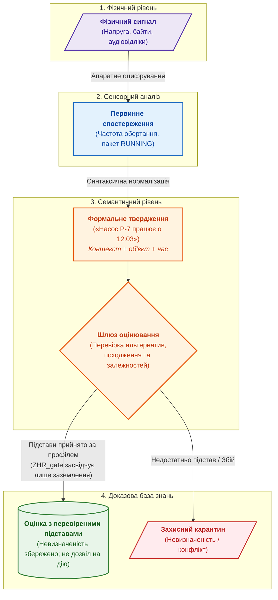
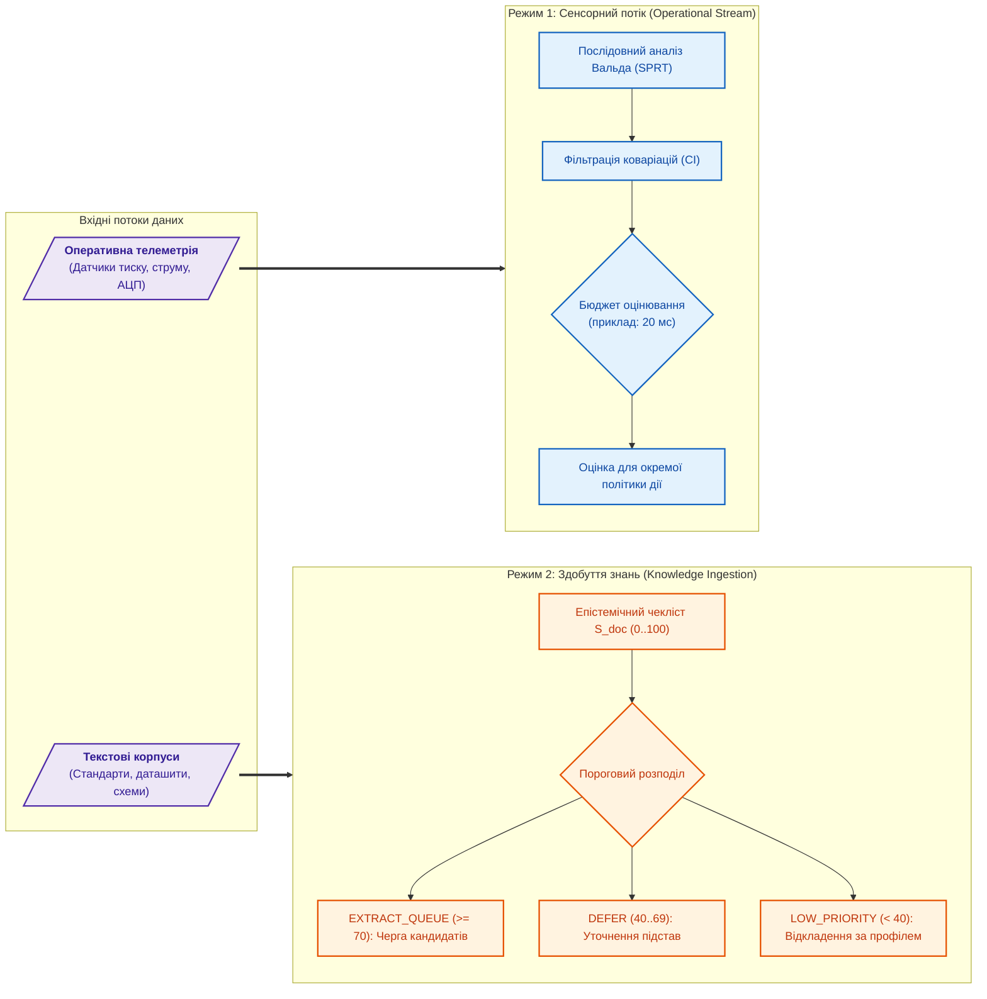
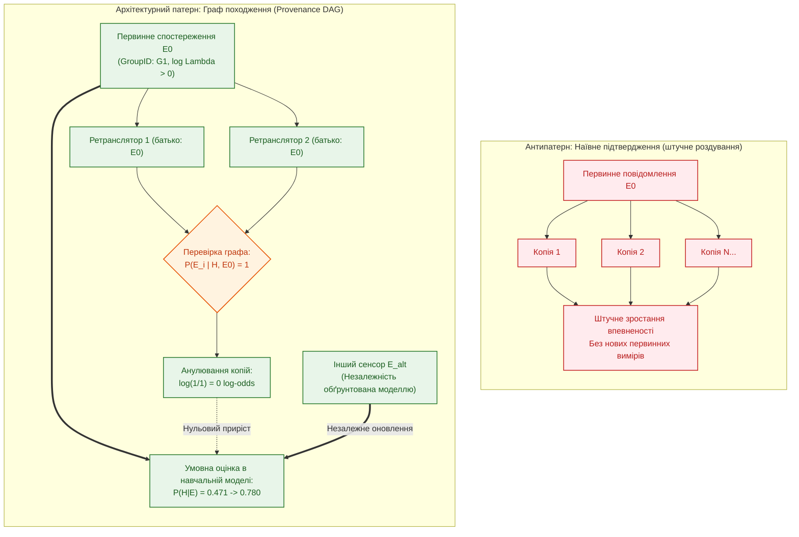
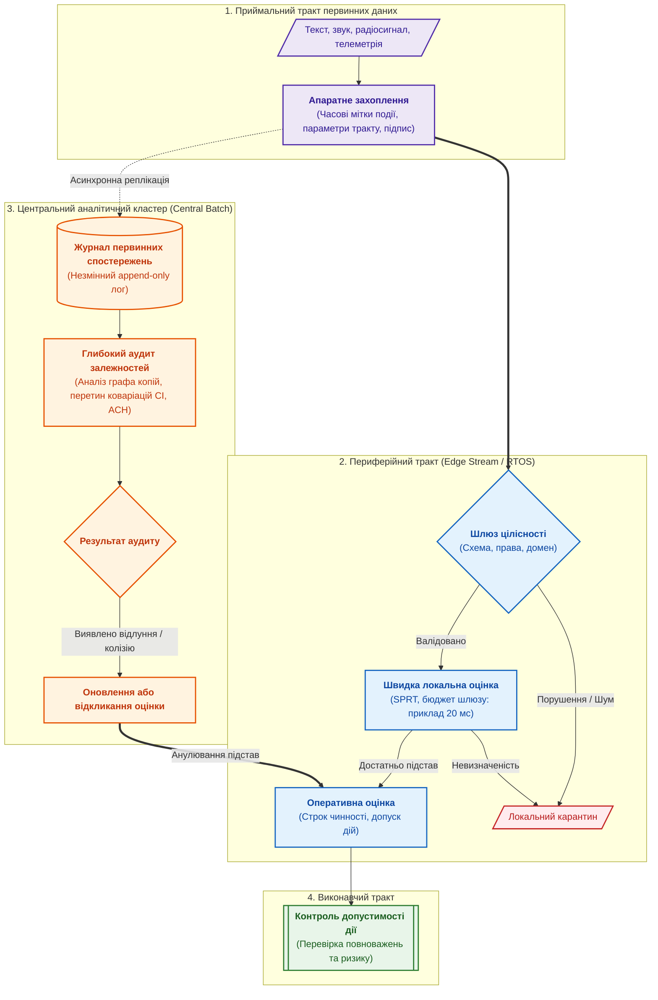
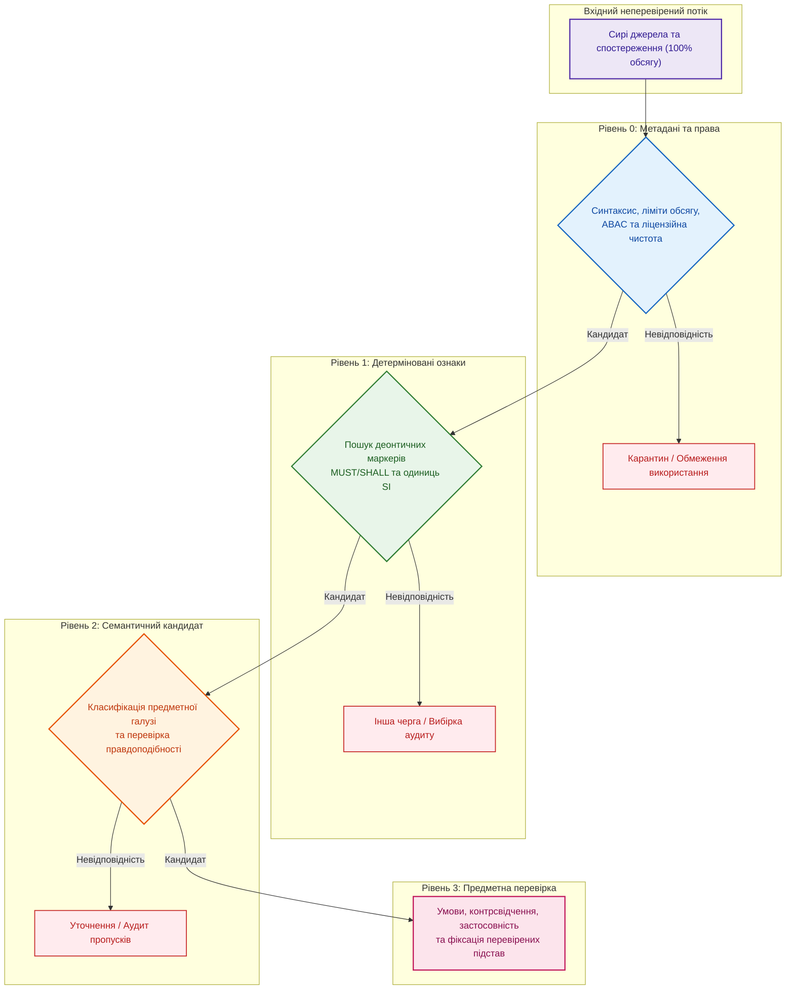

# Глава 37. Оцінювання вхідної інформації: джерела, свідчення та невизначеність

> **Книга:** [Архітектура доказових експертних систем](README.md) · [Частина III: Оцінювання вхідної інформації, здобуття знань та мовний аналіз](part-03-knowledge-engineering-nlp.md)
> **Попередня глава:** [Глава 32. Незмінні пакети знань: побайтовий допуск, індекси та відображення в пам'ять](ch32-high-performance-knowledge-packs-mmap-and-harvesting.md)
> **Наступна глава:** [Глава 10. Системи здобуття знань: джерела, допуск і життєвий цикл](ch10-knowledge-acquisition-systems.md)
> **Зміст книги:** [README.md](README.md)
> **Автор:** [Микола Мартинович Федчик](about-the-author.md)
> **Передумови й маршрут:** від розрізнення повідомлення та факту до умовної ймовірності, логарифмів і дисперсії; потрібні поняття нагадано перед розрахунками. `Трек B`: приймання, оцінювання, перевірка альтернатив і рішення.
> **Очікувані результати:** розділяти сигнал, джерело й твердження; оцінювати незалежність свідчень, невизначеність і суперечності; будувати автоматичний шлюз допуску для потокової та пакетної обробки без обов'язкового ручного перегляду кожного повідомлення.

## Анотація

Оцінювання вхідної інформації потрібне експертній системі ще до застосування правил: доставлене повідомлення не обов'язково правильно описує світ. Наскрізна задача глави — з'ясувати, чи працює насос P-7 о 12:03, коли є текст оператора, звук і цифровий статус. Потрібно перевірити об'єкт, час і походження кожного свідчення, відрізнити копії від незалежних спостережень і вирішити, якої перевірки бракує. Підозра в помилці або підміні є приводом для перевірки, а не доказом хибності повідомлення чи наміру його автора.

У цій монографії запропоновано архітектурну модель шлюзу допуску інформації (`IngressAdmissionGate`) для експертної системи: вона відокремлює приймання даних від оцінювання та рішення. Спочатку розглянуто роботу з джерелами й первинним носієм, потім — невизначеність, альтернативи й вибір наступної дії. Це авторське поєднання відомих методів, а не доведено нова реалізація чи гарантія допуску: імовірність залежить від моделі, бал визначає лише чергу перевірок, а рішення потребує окремих підстав і повноважень. Карантин або `DEFER` для аналітичного висновку не вимикає незалежного протиаварійного захисту. Навчальні числа нижче не є вимірами промислового стенда або нормативними порогами.

## 1. Від повідомлення до знання

На вузол надходять три повідомлення: текст «насос працює», звук із характерною частотою обертання й цифровий пакет зі статусом `RUNNING`. Три повідомлення ще не означають три незалежні підтвердження. Текст і пакет могли бути породжені одним контролером, а звук міг належати сусідньому насосу. Потрібно встановити об'єкт, час, походження й альтернативне пояснення кожного повідомлення.

Поки що достатньо розрізняти прийняті дані та висновок із них; знання теорії ймовірностей не потрібне. Зафіксуємо навчальний випадок: оператор переписав статус контролера, а мікрофон записав звук без точної прив'язки до P-7. Маємо одну первинну підставу про статус і одне спостереження невстановленого об'єкта, а не три докази роботи P-7. Першою корисною дією буде перевірка часу контролера й тотожності джерела звуку.

У цій главі розвідка означає аналітичну діяльність із перетворення неповних відомостей на обґрунтовану оцінку для рішення. Авторський зв'язок між «відати», «знати» й розвідувальною роботою є смисловим входом до теми, не етимологічним доказом походження слова. Спільне з інженерією знань полягає у встановленні підстав, альтернатив і меж висновку.

Для навчального трасування підстав використано чотири рівні подання входу. Це педагогічна схема, не універсальна онтологія:

<a id="obj-37-1"></a>

**Таблиця 37.1. Чотири рівні подання вхідної інформації**

| Об'єкт | Що відомо | Чого ще не встановлено |
|---|---|---|
| Сигнал | приймач зафіксував напругу, відліки або байти | що сигнал означає |
| Спостереження | аналізатор виділив слово, частоту, геометричний контур або подію | чи правильно визначено об'єкт і контекст |
| Твердження | зафіксовано «насос P-7 працює о 12:03» | чи достатні підстави твердження |
| Оцінка | відомі перевірки, альтернативи й невизначеність | чи дозволено використовувати оцінку для конкретної дії |

Діаграма ілюструє шлях трансформації фізичного сигналу до оцінки з перевіреними підставами й збереженою невизначеністю; заземлення не встановлює фізичної істинності чи дозволу на дію:

<a id="obj-37-2"></a>

**Діаграма 37.2. Від фізичного сигналу до оцінки з підставами**



Підпис цифрового пакета підтверджує автора підпису та цілісність пакета за прийнятої моделі ключів, але не справність датчика. Якісний звук підтверджує якість запису, але не тотожність насоса. Показник $`\mathrm{ZHR}_{\mathrm{gate}}=1{,}0`$ означає, що стверджувальні відповіді мають побайтове заземлення; він не доводить фактичного стану насоса й сам по собі не дає допуску до дії. Перший авторський інженерний принцип глави: інформацію неприпустимо допускати у базу фактів лише за фактом того, що канал доставив повідомлення без помилки.

Отже, для P-7 спочатку потрібен план перевірки, а не відсоток довіри. Наступний огляд показує, звідки взято дисципліну такого плану: кожний підхід оцінюється за тим, яку помилку він допомагає помітити, а не за авторитетністю назви служби.

## 2. Дев'ять аналітичних традицій: метод, свідчення й межі перенесення

Аналітичні традиції потрібні тут для розв'язання вже поставленої задачі: як не закрити питання P-7 після першого переконливого повідомлення. Підставою порівняння є розрізнення первинного спостереження, інтерпретації та альтернативи з §1. У прикладі альтернатива «статус застарів» вимагає перевірки годинника, а альтернатива «чути сусідній насос» — просторової прив'язки; жодна з них ще не доведена.

Розвідувальні служби не публікують повних робочих алгоритмів. Тому порівнювати потрібно конкретні доступні документи, а не приписувати країні «байєсівську» чи «нейромережеву» школу за загальним враженням. Нижче офіційний опис діяльності відокремлено від історичного дослідження та авторської пропозиції для експертної системи (ЕС). Відсутність відкритої методики означає прогалину цього огляду, а не відсутність аналітичних засобів у служби.

### 2.1. Радянська традиція: індикатори й небезпека замкненої картини

Бенджамін Фішер у дослідженні програми РЯН, присвяченої ранньому попередженню про ракетно-ядерний напад, описує організацію спостереження за індикаторами намірів у 1980-х роках [[3]](#src-3). Це ретроспективне американське дослідження радянської практики, не загальнодоступний радянський нормативний алгоритм. Придатний для перенесення елемент: заздалегідь визначені ознаки, строки спостереження й критерії перегляду оцінки. Непридатне перенесення: накопичувати будь-які зміни як підтвердження єдиної наперед обраної загрози.

Тімоті Томас аналізує теорію рефлексивного керування з радянськими витоками й подальшими російськими розробками [[4]](#src-4). Для ЕС це адаптація загального аналізу загроз: повідомлення можуть бути сформовані так, щоб змінити модель рішення одержувача, тому варто перевіряти залежність повідомлень і альтернативи навмисного введення в оману. Сам факт походження повідомлення з певної країни не є доказом обману. Відкриті джерела цього огляду не встановлюють універсальної радянської числової шкали достовірності або її реалізації у програмі.

### 2.2. Американська традиція: аналіз конкуруючих гіпотез

Г'юер пропонує аналіз конкуруючих гіпотез (*Analysis of Competing Hypotheses*, ACH): зіставити ті самі свідчення з кількома поясненнями, шукати несумісності та перевіряти залежність результату від припущень [[1]](#src-1). За авторським інженерним принципом пріоритету спростувальної сили свідчень (*Informativeness*), для насоса P-7 альтернативами є робота насоса, шум сусіднього агрегата та застарілий статус контролера. Звук, можливий за всіх трьох пояснень, сам по собі не визначає переможця. Нульовий діагностичний внесок можна приписати йому лише за однакової правдоподібності в порівнюваних моделях; сама можливість звуку не встановлює такої рівності.

Матриця ACH дисциплінує аналіз, але не перетворює кількість позначок «узгоджується» на апостеріорну ймовірність. У програмному поданні потрібні гіпотези, свідчення, зв'язки підтримки й спростування та залежності між свідченнями. Математичну вагу дає модель правдоподібності, розглянута в розділі 7, а не назва методу. Американська традиція неоднорідна: рекомендації аналітикам, військові процедури й стандарти обміну не є одним алгоритмом.

### 2.3. Британська традиція: дві мови невизначеності

Відкрита британська настанова 2025 року містить шкалу словесного вираження ймовірності PHIA, тобто *Professional Head of Intelligence Assessment*, і рейтинги аналітичної впевненості *Analytical Confidence Ratings* (AnCR) [[2]](#src-2). Ймовірність відповідає на питання, наскільки можливе твердження. AnCR відповідає на питання, наскільки міцні підстави оцінки та наскільки оцінка може змінитися після отримання нових відомостей. AnCR враховує інформаційну основу, строгість аналізу та складність і мінливість середовища.

За авторським принципом ортогональності ймовірності та аналітичної впевненості, оцінка «ймовірно, насос працює; впевненість низька через невстановлену тотожність джерела звуку» не є суперечністю: інтервал імовірності та причина невпевненості мають зберігатися в ЕС окремими ортогональними полями. Приблизні діапазони PHIA не є суцільним набором програмних порогів: між опублікованими діапазонами є проміжки, а їхні межі приблизні. ЕС не повинна автоматично підставляти середину словесного діапазону як виміряну ймовірність.

### 2.4. Німецька традиція: перевірка й предметне ущільнення

Федеральна розвідувальна служба Німеччини (*Bundesnachrichtendienst*, BND) у відкритому описі аналітичної роботи зазначає, що відомості нерідко надходять неповними або як непідтверджена чутка; аналітики перевіряють зміст і формують узагальнену картину [[5]](#src-5). Опис також підкреслює предметні знання й добір методу під питання. Це офіційне повідомлення про принципи роботи, не оприлюднений набір коефіцієнтів.

Для ЕС важливо фіксувати межі компетентності джерела: експерт із мережевого трафіку не є автоматично експертом з акустики насоса. Реєстр джерел має розрізняти домен, метод вимірювання й область калібрування. Узагальнення не повинне стирати посилання на первинні відомості. Це застосування стандартного правила оцінювання експертності, а не окремий принцип «доменного суверенітету». Конкретний алгоритм BND для обчислення достовірності цей огляд не встановлює.

### 2.5. Французька традиція: цикл запиту й взаємодоповнювальні сенсори

Дирекція військової розвідки Франції (*Direction du renseignement militaire*, DRM) описує чотирифазний розвідувальний цикл, спрямований на задоволення інформаційних потреб, і взаємодоповнюваність сенсорів [[6]](#src-6). DRM підтримує військових та політичних споживачів оцінок. Відкритий опис не дає підстав приписувати всім французьким службам одну математичну модель.

Для ЕС застосовуються відомі принципи активного вимірювання й аналізу спільних причин похибки (*Common Cause Failures*, CCF): запит спостереження пов'язують із питанням, яке воно допоможе розрізнити, а залежності сенсорів перевіряють окремо. Камера потрібна не тому, що доступна ще одна модальність, а тому, що зображення може відрізнити P-7 від сусіднього насоса. Однаковий час, спільне живлення або одна базова модель можуть робити результати залежними.

### 2.6. Японська традиція: міжвідомче узагальнення та координація

Поточний відкритий опис Секретаріату Кабінету Японії охоплює Національну розвідувальну раду й Національне розвідувальне бюро: збирання відомостей, міжвідомче узагальнення, комплексний аналіз та оцінювання [[7]](#src-7). Назви на актуальній сторінці відрізняються від поширеної в старіших матеріалах назви Кабінетного бюро розвідки й досліджень (*Cabinet Intelligence and Research Office*, CIRO). Огляд фіксує стан сторінки на 4 жовтня 2026 року, а не переносить стару структуру на сьогодення.

Як авторський інженерний принцип узгодження об'єктів, часу та походження фактів при міжвідомчому злитті встановлено: передавання одного повідомлення через два відомства не створює двох незалежних спостережень. Для вирішення цієї задачі в ЕС застосовуються графи походження й детерміноване зіставлення сутностей, хоча ця архітектурна пропозиція не є твердженням про конкретний закритий японський алгоритм.

### 2.7. Китайська традиція: відбір, інтеграція й технологічна обробка

Стаття 22 китайського Закону про національну розвідку говорить про застосування науково-технічних засобів для розрізнення, відбору, узагальнення й аналітичного оцінювання відомостей. Тут використано відкритий неофіційний англійський переклад China Law Translate редакції 2018 року [[8]](#src-8). Закон задає повноваження й напрям розвитку, не специфікацію машинного оцінювача.

Для ЕС цей напрям означає послідовність фільтрації, нормалізації, інтеграції й перевірки. Публікації про китайські дослідження штучного інтелекту або злиття сенсорів не доводять, що певний розвідувальний орган використовує саме ці алгоритми. В огляді не підтверджено загальної китайської шкали достовірності чи еквівалентності її категорій британським AnCR.

### 2.8. Ізраїльська традиція: критика незмінної концепції

Урі Бар-Йосеф та Арі Круглянскі досліджують аналітичний провал перед війною 1973 року через психологічну потребу в когнітивній завершеності, тобто схильність рано закрити питання й утримувати прийняте пояснення [[9]](#src-9). Це науковий аналіз конкретного випадку, не офіційна сучасна доктрина всіх ізраїльських служб. Його інженерний наслідок: успішне в минулому пояснення має залишатися відкритим до спростування.

Для ЕС запропоновано процедуру перевірки стійкості прийнятого пояснення: пошук контрприкладу, журнал відхилених альтернатив і аналіз чутливості до вилучення найсильнішого свідчення. Це авторське застосування відомої фальсифікаційної практики, а не новий принцип і не валідований універсальний регламент. Популярний сюжет про «десятого аналітика», який завжди заперечує решті, тут не використовується як доказ. Алгоритмічна незгода має спиратися на перевірюване альтернативне пояснення, а не на автоматичне заперечення кожного висновку.

### 2.9. Українська традиція: аналітичне опрацювання та зовнішня перевірка моделей

Закон України «Про розвідку», зокрема статті 6 і 12, відокремлює добування, аналітичне опрацювання, оброблення й надання відомостей, а також передбачає роботу з інформаційними ресурсами [[10]](#src-10). Юридичне визначення розвідувальної інформації в цьому законі вужче за побутове або загальнонаукове значення терміна. Тому відкриті публікації та дослідження не можна автоматично називати розвідувальною інформацією в юридичному сенсі.

Українська кібернетична школа дає окрему наукову основу: метод групового урахування аргументів (МГУА, *Group Method of Data Handling*, GMDH), пов'язаний із працями Олексія Григоровича Івахненка та Валентина Григоровича Лапи, використовує зовнішній критерій для вибору структури моделі [[11]](#src-11). Історичні праці та пізніший огляд Шмідхубера в цьому джерелі не є одним свідченням про всі питання пріоритету; тут потрібний саме принцип розділення даних. На одній частині даних оцінюють параметри, на іншій порівнюють моделі. Наприклад, точніше відтворення навчального шуму в записі P-7 не є поліпшенням, якщо на відкладених записах зростає число помилок. Вибір моделі за перевірочною частиною також пристосовує її до цих даних, тому для остаточного оцінювання потрібна ще не використана тестова частина; залежні фрагменти одного запису не розподіляють між частинами як незалежні випадки. Для ЕС це застосування усталеної практики зовнішньої валідації моделей, а не твердження про впровадження МГУА у конкретній службі. Цей огляд не встановлює числових порогів реальних українських розвідувальних органів.

Порівняння не дає рейтингу країн. Для підсумку цієї глави сформульовано п'ять практичних вимог до обраного профілю ЕС: реєструвати підстави, утримувати альтернативи, перевіряти незалежність каналів, відокремлювати невизначеність від рішення й допускати перегляд оцінки. Це навчальний чекліст, не вичерпний набір вимог для всіх систем. Спільний машинний контракт потрібний незалежно від країни походження методики.

> [!NOTE]
> **П'ять практичних вимог до профілю експертної системи**
> 1. Реєстрація первинних підстав: кожне твердження зобов'язане посилатися на верифікований носій, час і вимірювальний тракт.
> 2. Утримання конкуруючих альтернатив: збереження активного журналу альтернативних пояснень до моменту їхнього формального спростування.
> 3. Верифікація незалежності каналів: блокування повторного підрахунку ретрансльованих копій та контроль спільних причин похибки (`GroupID`).
> 4. Відокремлення невизначеності від рішення: ортогональний облік імовірності події та аналітичної впевненості окремо від порогів спрацювання приводів.
> 5. Відкритість до перегляду оцінки: автоматичний перерахунок або відкликання похідних висновків у разі надходження нових контрсвідчень чи компрометації джерела.
> *Керування рантаймом / Інженерний інваріант:* Уніфікує аналітичну дисципліну дев'яти розвідувальних традицій у єдиний детермінований машинний контракт шлюзу допуску ЕС.

## 3. Правоохоронна аналітика: зв'язок не дорівнює доказу вини

Правоохоронна аналітика загострює попереднє питання: які наслідки дозволено робити зі знайденого зв'язку? Для розуміння достатньо поняття графа як об'єктів і підписаних зв'язків між ними. Як переписаний оператором статус P-7 не є новим виміром, так спільний запис про адресу не є незалежним доказом спільної дії людей.

У розслідуванні дві особи можуть мати спільну адресу, телефон або контрагента без спільної протиправної діяльності. За авторським інженерним принципом розмежування топологічного зв'язку та доказу вини, граф зв'язків у ЕС слугує виключно для формування перевірюваних версій, а не для автоматичного присвоєння статусу «винний». Посібник Управління ООН з наркотиків і злочинності (*United Nations Office on Drugs and Crime*, UNODC) розглядає оцінювання джерел і даних, аналіз зв'язків, хронологію подій та національну модель поліцейської аналітики Великої Британії [[12]](#src-12).

### 3.1. Національні та міжнаціональні структури

Федеральне бюро розслідувань США (*Federal Bureau of Investigation*, FBI) публічно описує використання аналітики для рішень і міжвідомчого обміну та підпорядкування збирання законодавчим і процесуальним вимогам [[13]](#src-13). Британський приклад у посібнику UNODC пов'язує аналітичні продукти з інформаційними потребами й пріоритетами роботи, але історичний посібник не слід приймати за чинну специфікацію кожного британського поліцейського підрозділу.

Міжнародна організація кримінальної поліції INTERPOL описує оперативні й стратегічні аналітичні звіти та структуровані аналітичні файли [[14]](#src-14). Агентство Європейського Союзу зі співробітництва правоохоронних органів Europol описує тематичні аналітичні проєкти, обмеження мети використання й підтримку національних розслідувань [[15]](#src-15). Міжнародна організація може збирати повідомлення багатьох учасників; кількість учасників не встановлює незалежності первинних джерел.

Для українського правоохоронного застосування окремий рівень становлять норми Кримінального процесуального кодексу України, зокрема статті 17, 84, 86 і 94: презумпція невинуватості, джерела доказів, допустимість та оцінка доказів [[16]](#src-16). Аналітичний бал ЕС не замінює процесуального рішення. Перегляд повідомлення людиною можна прибрати з рутинного первинного сортування, але не оголосити скасованими законні повноваження слідчого, прокурора чи суду.

<a id="obj-37-3"></a>

**Таблиця 37.3. Правоохоронні задачі та межі аналітичного висновку**

| Аналітична задача | Придатний метод | Обов'язкове обмеження |
|---|---|---|
| Зіставлення записів про об'єкт | нормалізація та зіставлення сутностей | однакове ім'я не доводить тотожності людини |
| Виявлення зв'язків | графові запити, часові й просторові зіставлення | ребро має тип, джерело й статус перевірки |
| Упорядкування версій | ACH, байєсівська модель, контрприклади | версія не є встановленим фактом |
| Визначення пріоритету перевірки | очікувана користь, наслідки, строки | пріоритет не є оцінкою вини |
| Підготовка матеріалу для провадження | ланцюг зберігання й перевірка первинних носіїв | технічна цілісність не замінює процесуальної допустимості |

Отже, за сформульованим автором інженерним інваріантом нерозривності ланцюга зберігання (*Chain of Custody*), правоохоронна аналітика додає до звичайної інженерії знань цільове обмеження мети використання та обов'язкову кустодію первинних носіїв. Далі потрібно визначити, як ці вимоги працюють із машинними повідомленнями про інциденти.

## 4. Кіберзахист: від спрацювання детектора до підтвердженого інциденту

У кіберзахисті потрібно перевірити ту саму межу між підставою та висновком, але вже для машинного сигналу тривоги. Детектор — правило або модель, яка позначає певну ознаку; інцидент — подія, що відповідає окремим критеріям порушення. Не кожне спрацювання задовольняє ці критерії, як не кожен звук підтверджує роботу P-7.

Детектор позначив незвичний вхід у мережевий сервіс. Подію може пояснювати порушення безпеки, планова робота адміністратора або неправильний годинник вузла. Форум команд реагування та безпеки (*Forum of Incident Response and Security Teams*, FIRST) у рамці послуг команд реагування на комп'ютерні інциденти (*Computer Security Incident Response Teams*, CSIRT) розділяє моніторинг, аналіз подій, кваліфікацію, приймання повідомлень, аналіз інцидентів і артефактів [[17]](#src-17). Описана рамка не задає універсального порога «це точно атака».

Національний інститут стандартів і технологій США (*National Institute of Standards and Technology*, NIST) у спеціальній публікації (*Special Publication*, SP) 800-61 Rev. 3, опублікованій 2025 року, пов'язує реагування на інциденти з керуванням кіберризиком [[18]](#src-18). Для прикладу ЕС у цій главі використано п'ять стадій переходу від сенсорного сигналу до захисної реакції: сигнал детектора → кандидат інциденту → підтверджений інцидент → оцінка впливу → рішення про реакцію. Це локальна адаптація усталеного incident-response workflow, а не нова модель реагування. Підтвердження інциденту й установлення його причини мають різні підстави.

### 4.1. Валідація, верифікація й повторна перевірка

В авторському профілі цієї глави введено строге онтологічне розмежування: **валідація входу** означає перевірку придатності даних до визначеної задачі (чи правильно визначено об'єкт, час і спосіб отримання), тоді як **верифікація обробки** означає перевірку виконання заданих вимог (схеми, одиниць, цілісності, часових правил і алгоритму). Терміни в різних стандартах мають власні визначення; наведене авторське розмежування є формальним контрактом цієї глави, а не заміною всіх стандартних визначень.

<a id="obj-37-4"></a>

**Таблиця 37.4. Перевірки повідомлення про кіберінцидент**

| Етап | Що перевіряє ЕС | Що не можна вважати доведеним |
|---|---|---|
| Приймання | формат, ліміти розміру, дозволений канал, ідентичність повідомлення | факт інциденту |
| Перевірка артефакта | хеш, підпис за потреби, наявність первинного носія, історія передачі | правдивість інтерпретації |
| Зіставлення | актив, користувацький обліковий запис, час, конфігурація детектора | тотожність фактичної людини обліковому запису |
| Кореляція | зв'язок подій і спільне походження | незалежне підтвердження кожної копії |
| Кваліфікація | пояснення спрацювання та альтернативи, фактичний вплив | причина, мотив або автор інциденту |
| Повторна перевірка | нові свідчення, зміна версії правила, відкликання індикатора | чинність старого рішення після зміни підстав |

Повідомлення й вкладення розбирають в ізольованому середовищі з лімітами ресурсів, як рекомендує FIRST. Відсутність спрацювання у випробувальному середовищі не доводить нешкідливості артефакта: могли не виконатися потрібні умови. Так само три антивірусні висновки не є трьома незалежними оцінками, якщо рушії використовують спільну базу сигнатур.

### 4.2. Не плутати достовірність, тяжкість і межі поширення

Протокол світлофорного маркування (*Traffic Light Protocol*, TLP) версії 2.0 визначає межі поширення відомостей, не їхню істинність [[19]](#src-19). `TLP:CLEAR` означає відсутність обмежень цього протоколу на поширення, але не звільняє від авторського права та інших правових вимог. `TLP:RED` не робить повідомлення надійнішим.

Загальна система оцінювання вразливостей (*Common Vulnerability Scoring System*, CVSS) версії 4.0 оцінює характеристики й тяжкість вразливості [[20]](#src-20). Бал 9,8 не означає ймовірності інциденту 98 %. За авторським принципом ортогонального розмежування достовірності, тяжкості та меж поширення інформації, для того самого активу в ЕС зберігаються окремі незалежні оцінки достовірності повідомлення, тяжкості наслідків і права виконати захисну дію.

Для аналізу повідомлення про несанкціонований витік у цій главі розділено п'ять тверджень: публікація існує; наданий зразок справжній; дані належать організації; дані актуальні; отримання даних було несанкціонованим. Це декомпозиція конкретного кейсу, не повна універсальна модель, а твердження не обов'язково незалежні. Справжній зразок не доводить решти пунктів. Перевірка відбувається на дозволеній контрольній вибірці без зайвого поширення персональних даних. Машинний пошук підробки є підставою для обережності, а не автоматичним установленням навмисного обману.

У навчальному випадку журнал підтверджує незвичний вхід, а погоджена заявка адміністратора пояснює його як планову роботу. Це підстава переглянути кваліфікацію, не стерти первинний журнал і не оголосити будь-яку майбутню тривогу безпечною. Щоб таке зіставлення було відтворюваним, далі визначимо, що саме зберігати для кожної модальності.

## 5. Текст, звук, радіохвилі та зображення: контракт первинного спостереження

Контракт первинного спостереження потрібний, щоб повернутися від висновку до даних, на яких він побудований. Уже відомі об'єкт, час і походження; тепер потрібно зберегти ще й перевірний фрагмент носія. Напис «насос зупинено» може бути цитатою журналу або гіпотезою розпізнавача мовлення. Якщо залишити лише цей напис, повторно перевірити пропущене заперечення в аудіо буде неможливо. У цій монографії запропоновано інженерний контракт `ObservationContract`: первинний запис, координати фрагмента, опис вимірювального тракту й ланцюг перетворень. Це специфікація походження мультимодальних даних, а не гарантія автентичності чи автоматичного виявлення кожної підміни.

<a id="obj-37-5"></a>

**Таблиця 37.5. Первинний носій і межі розпізнавання різних модальностей**

| Вхід | Швидка перевірка придатності | Що зберігати як підставу | Межа розпізнавання |
|---|---|---|---|
| Цифровий текст | кодування, структура, мова, заперечення, числа й одиниці | первинні байти, діапазон цитати, редакція | точна цитата може містити хибне повідомлення |
| Друковані чи рукописні символи | різкість, контраст, нахил, альтернативні прочитання | зображення, ділянка, версія оптичного розпізнавання (*Optical Character Recognition*, OCR) | розпізнане «8» може бути «3» |
| Аналоговий звук | насичення, шум, смуга частот, справність тракту | відліки після аналого-цифрового перетворення, час, калібрування | гучність не визначає джерела або змісту |
| Цифровий звук | пропуски кадрів, кодек, часові мітки | первинний запис і часовий інтервал | текст автоматичного розпізнавання мови (*Automatic Speech Recognition*, ASR) є похідною гіпотезою |
| Радіосигнал | смуга приймача, частота дискретизації, насичення, калібрування | прийняті відліки або перевірений опис ознак | наявність випромінювання не доводить автора чи наміру |
| Зображення й відео | геометрія, освітлення, час кадру, дублікати | кадри, ділянки, параметри камери й обробки | підпис або координати файла не доводять місця знімання |
| Аналоговий пороговий вихід | дрейф порога, невизначеність, гістерезис | значення порога, версія калібрування, часовий журнал | компаратор видає рішення за порогом, не встановлює семантичної істинності |

Для повторної перевірки аналогового входу потрібно зберегти оцифроване спостереження разом з описом вимірювального тракту: минулу неперервну хвилю неможливо перечитати без запису. Це вимога простежуваності вимірювання, а не окремий авторський принцип. Підпис вузла після перетворення засвідчує запис, не достовірність фізичного явища до приймача. Перевірку наближеного числового кандидата визначено в [Главі 18, §8.3.1](ch18-execution-infrastructure.md#831-запас-до-порога-та-чинна-межа-сумарної-похибки); пропуски до такої перевірки потребують окремого аудиту.

Для звуку P-7 потрібно зберегти частоти до заданої межі. Нагадаємо умову теореми дискретизації: ідеальний рівномірний запис дійсного низькочастотного сигналу з обмеженим спектром допускає його відновлення, якщо частота відліків перевищує подвоєну верхню частоту [[21]](#src-21):

<a id="obj-37-6"></a>

**Формула (37.6). Умова ідеальної низькочастотної дискретизації**

$$
f_s>2B.
$$

Тут $`B>0`$ — верхня частота спектра в герцах, $`f_s>0`$ — число рівномірних відліків за секунду, теж у герцах. Ідеальне твердження передбачає спектр без складових вище $B$ та точні відліки; реальний тракт потребує протиаліасного фільтра й запасу на його перехідну смугу. За $`B=8000\,\text{Гц}`$ межа дорівнює 16 000 Гц; вибір 24 000 Гц задовольняє нерівність, але придатність конкретного фільтра ще перевіряють. Це зберігає частотну інформацію в моделі, не доводить тотожності P-7 чи правдивості повідомлення. Для смугових і комплексних сигналів умови інші.

Запропонований автором дев'ятипараметричний паспорт первинного спостереження містить дев'ять груп полів: (1) первинний ідентифікатор, (2) модальність, (3) ідентифікатор об'єкта, (4) час події та час приймання, (5) координати, (6) похибку часової й просторової прив'язки, (7) ланцюг перетворень, (8) версії моделей, (9) джерело та групу залежності. Запис без первинного фрагмента може залишитися сигналом для пошуку, але не повною підставою доказового висновку. Наступний крок: класифікувати стан самого твердження.

Кожен сигнал, спостереження, твердження й оцінка отримує окремий ідентифікатор та зберігає типізовані посилання на батьківські об'єкти й перетворення, що його утворили: спостереження посилається на сигнал, твердження — на спостереження та визначений об'єкт, оцінка — на твердження й версію аналізатора. Ідентичність об'єкта не виводиться лише з модальності, часу чи близькості координат. Якщо об'єкт не встановлено, це фіксується як `Unknown`; повідомлення не зливається із записом сусіднього об'єкта, а об'єктно-специфічне твердження відкладається (`DEFER`) до уточнення ідентичності.

### 5.1. Незалежний аудит мовчазних пропусків

Аудит мовчазних пропусків доповнює контракт первинного спостереження там, де аналоговий детектор або попередній фільтр визначає, які кандидати взагалі побачить цифровий шлюз ЕС. Якщо подію відсіяно до шлюзу, бездоганна перевірка допущених кандидатів її не поверне: журнал спрацювань не містить знаменника для оцінки повноти виявлення. Тому перевірка лише пробуджень детектора створює систематичну сліпу зону.

Незалежний від рішень детектора розклад вибірки має захоплювати сирі відліки **до фільтрації**, зокрема коли детектор мовчить. Зберігають часові мітки, хеш вікна, версії фільтра й калібрування; незалежний еталонний розмічувач (оракул) визначає наявність події за наперед заданим критерієм, із контрольним вимірюванням або експертним підтвердженням за потреби. Повторний запуск того самого детектора не є незалежною істиною розмітки (*ground truth*). Непевна розмітка або відсутні сирі дані означають невідому спостережуваність, не успішний аудит.

Окремо звітують **повноту виявлення**: частку позначених детектором серед усіх підтверджених оракулом цільових подій аудиту; та **хибні допуски**: частку хибних серед допущених цифровим шлюзом кандидатів на окремій розміченій вибірці. Їхні знаменники різні. Для пропусків $n$ — кількість різних підтверджених цільових подій, не число сирих вікон, відліків або пробуджень; повторні вікна однієї події рахують один раз.

Якщо пропусків нуль, за біноміальною моделлю незалежних однаково розподілених подій (IID) точна однобічна верхня 95-відсоткова довірча межа ймовірності пропуску має вигляд:

<a id="obj-37-7"></a>

**Формула (37.7). Верхня межа ймовірності пропуску за нуля спостережених пропусків**

$$
p_U=1-0{,}05^{1/n}\approx\frac{3}{n}.
$$

Тут $`p_U\in[0,1]`$ — безрозмірна верхня довірча межа, $`n\in\mathbb{N}^{+}`$ — число підтверджених подій без пропуску; $0{,}05$ — рівень значущості, а $3/n$ — лише наближення для великого $n$. Вибірка має репрезентувати заявлений експлуатаційний профіль; корельовані події, упереджений відбір або зміна профілю не дозволяють механічно застосувати цю межу. Статистичний метод, а не новий авторський закон, розглянуто в [Главі 36, §5.5](ch36-knowledge-testing-pyramid-and-variational-calibration.md#55-метрологія-нульових-галюцинацій-zhr-точні-довірчі-інтервали-клоппера-пірсона-та-правило-трьох).

**Проєктний розрахунок, не виконаний експеримент.** Для $n=3000$ підтверджених подій і нуля пропусків точна межа $`p_U\approx0{,}0009981\le0{,}001`$ задовольняє ілюстративний критерій профілю з довірою 95 % лише за наведених припущень. Це не універсальна частота відмов і не сертифікат ASIL. Для одного каналу 10 000 відліків/с по 2 байти двосекундний кільцевий буфер потребує 40 000 байтів без метаданих; пропускну здатність незалежного захоплення й час оракула резервують окремо, не дозволяючи фільтру відкинути аудитні дані.

> [!NOTE]
> **Два правила незалежного аудиту відсіяних подій**
> 1. Перевірку числових кандидатів відокремлюють від аудиту повноти їх надходження: цифровий перерахунок не бачить відсіяної події.
> 2. Якщо аудит не пройдено або його результат невідомий (зокрема замало подій чи втрачено записи), прискорений профіль ізолюють і передають на інженерний розгляд; відсутність сигналу позначають `UNKNOWN_OBSERVABILITY`, а не «сенсор підтвердив безпеку».
> *Керування рантаймом:* Повернення до перевіреного повного цифрового приймання можливе лише в його ресурсних межах; інакше застосовується визначений для системи захисний режим.

## 6. Категорії достовірності: багатовісна таксономія

Категорії достовірності допомагають записати результат перевірки носія без передчасного рішення про істину. Для P-7 можна одночасно мати справний запис, невідому тотожність насоса й непідтверджене твердження. Якщо звести ці ознаки до одного бала, зникне причина невизначеності. Посібник UNODC описує двовісне оцінювання: надійність джерела A–F та оцінку самого повідомлення 1–6 [[12]](#src-12). Нижче це профіль 6×6; тотожність кожного формулювання певній редакції NATO STANAG 2022 у цьому проході не встановлено, тому наведені категорії не подаються як перевірена нормативна вимога НАТО.

<a id="obj-37-8"></a>

**Таблиця 37.8. Окремі категорії джерела й повідомлення**

| Код джерела | Значення у профілі 6×6 | Код повідомлення | Значення у профілі 6×6 |
|---|---|---|---|
| A | повністю надійне за наявною історією | 1 | підтверджене іншими незалежними джерелами |
| B | зазвичай надійне | 2 | ймовірно правдиве |
| C | досить надійне | 3 | можливо правдиве |
| D | зазвичай ненадійне | 4 | сумнівне |
| E | ненадійне | 5 | малоймовірне, з відомостями на користь протилежного |
| F | надійність неможливо оцінити | 6 | правдивість неможливо оцінити |

Це скорочений переказ категорій, не таблиця відсотків. Код F6 не означає ні «найгірше джерело», ні ймовірність 0,5. A1 не означає математичної певності. Той самий посібник наводить іншу шкалу $4\times4$, у якій оцінювання змісту більше спирається на особисту обізнаність джерела та підтвердження. Зведення 4×4 до 6×6 за однаковими номерами без урахування визначень некоректне.

Для прикладового профілю ЕС пропонується зберігати окремі осі замість однієї категорії; це схема метаданих, не валідована міра достовірності, а окреме поле не означає статистичної незалежності:

<a id="obj-37-9"></a>

**Таблиця 37.9. Сім категоріальних осей прикладового профілю**

| Вісь | Приклади значень | Чого значення не означає |
|---|---|---|
| Епістемічний тип | спостереження, повідомлене твердження, висновок, гіпотеза, норма | гіпотеза не стає фактом від високого бала |
| Стан підтвердження | невизначене, припустиме як гіпотеза, ймовірно підтримане, підтверджене за профілем, спростоване за профілем | підтвердження не універсальне поза областю перевірки |
| Суперечність | не виявлена, виявлена, нерозв'язана | суперечність не встановлює, яке джерело помилилося |
| Маніпуляція | ознак не встановлено, підозра, підтверджена підробка носія | підробка носія не завжди встановлює намір конкретної людини |
| Чинність | поточне, застаріле, відкликане | застаріле повідомлення могло бути істинним у минулому |
| Придатність | придатне, пошкоджене, поза моделлю, бракує контексту | непридатність до аналізу не означає хибності |
| Операційний допуск | дозволене для задачі, карантин, відкладена перевірка, відхилене | дозвіл використання не дорівнює доказу істинності |

Сім категоріальних осей доповнюють, а не замінюють окремі оцінки ймовірності, аналітичної впевненості, надійності джерела, достовірності повідомлення, тяжкості наслідків і права дії з §2.3 та §4.2. Наприклад, повідомлення про відмову насоса P-7 може описувати наслідки високої тяжкості, залишаючись непідтвердженим і маючи низьку аналітичну впевненість. Його допуск до задачі додаткової діагностики не підтверджує правдивість повідомлення й не надає права виконати конкретну дію. У записі та звіті ці оцінки зберігаються окремо: підвищення тяжкості не повинно автоматично підвищувати достовірність, а операційний допуск до задачі не підміняє перевірку повноважень.

В авторській п'ятизначній термінологічній шкалі епістемічної кваліфікації тверджень «достовірна» в інженерному профілі означатиме: твердження достатньо підтверджене за визначеною процедурою й у зазначеному контексті. «Припустима» означатиме допустиму робочу гіпотезу, не автоматично дозволену підставу дії. «Сумнівна» означатиме слабкі або нестійкі підстави. «Хибна» потребуватиме свідчення спростування. «Оманлива» потребуватиме окремого обґрунтування маніпуляції; низької ймовірності для такої мітки недостатньо.

Отже, таблиці категорій потрібні для сумісності та пояснення, а не як універсальна арифметика довіри. Для обчислення потрібні визначена подія, модель її спостереження й контроль залежностей.

### 6.1. Об'єктивізація шкали NATO 6×6 для автономних систем

Об'єктивізація шкали в заголовку означає відтворюваність процедури, не перетворення словесної категорії на встановлену ймовірність. Потрібно відповісти, чому конкретне джерело P-7 отримало категорію, а не вгадувати її за офіційним стилем тексту. Наведені нижче критерії є авторською інженерною адаптацією, не відтворенням перевіреного тексту STANAG. Чинний підпис підтверджує походження; він не робить датчик безпомилковим.

Для відтворюваного призначення категорій у межах локального профілю потрібно зафіксувати область, версію, критерії історії й порядок розв'язання неоднозначності. Наведені нижче правила є інженерною адаптацією, не підтвердженою шкалою NATO:
1. **Категоріальний код надійності джерела A–F:**
    - $A$ (повністю надійне за наявною історією): профільна перевірена історія задовольняє всі критерії цієї категорії; назва не означає нульової майбутньої помилки.
    - $B$ (зазвичай надійне): застосовна історія задовольняє критерії B, але не A.
    - $C$ (досить надійне): історія підтримує обмежене використання за критеріями C.
    - $D$ (зазвичай ненадійне): перевірена історія містить помилки, що відповідають критеріям D; сам статус чернетки цього не доводить.
    - $E$ (ненадійне): є задокументовані підстави категорії E; неофіційна публікація сама по собі не є такою підставою.
    - $F$ (неможливо оцінити): історії або застосовного критерію бракує, навіть якщо підпис чинний. Числових меж A–E тут не калібровано: без затвердженого профілю автоматичний класифікатор повертає F.
2. **Категоріальний код обґрунтованості повідомлення 1–6:**
    - $1$ (підтверджене за профілем): є застосовні первинні підстави, перевірка залежностей та виконані критерії підтвердження. Різні `GroupID` чи однакові числа самі цього не встановлюють.
    - $2$ (ймовірно правдиве): є підстави відповідної категорії профілю; одного збігу з очікуваною моделлю недостатньо.
    - $3$ (можливо правдиве): є обмежена підтримка за профілем; відсутність суперечності без підтримки залишає категорію 6.
   - $4$ (сумнівне): твердження містить граничні параметричні відхилення або внутрішні неузгодженості;
    - $5$ (малоймовірне): є перевірні контрсвідчення; суперечність моделі спочатку потребує перевірки її застосовності, одиниць і версії.
   - $6$ (неможливо оцінити): бракує контексту, розмірностей або часових меж спостереження.

### 6.2. Два режими входу та дискретний епістемічний чекліст для корпусів знань

Два режими входу розділяються за бюджетом і підставами оцінки, а не за нібито різною логікою істини. Для P-7 потік відліків може мати калібровану модель, а новий даташит — лише перевірене походження. За авторським принципом дуалізму режимів розглянемо:
1. **Режим оперативної сенсорної телеметрії (Operational Sensing Stream):** потоки струму, тиску, вібрації. Дедлайн визначає конкретна задача; 20 мс нижче — навчальний бюджет, не спільна норма. Моделі ймовірності застосовні лише за перевірених параметрів; автоматичної відомості частот відмов немає.
2. **Режим семантичного здобуття знань (Knowledge Ingestion & Crystallization):** періодичне або дефіцитно-орієнтоване викачування нормативних документів, інженерних регламентів, даташитів компонентів та схем для компіляції нових баз знань.

Для довільного документа зазвичай не задано ні апріорної ймовірності конкретного твердження, ні моделі його спостереження. Вигадувати їх не можна. Байєсівська модель для тексту можлива, якщо ці підстави справді визначено й перевірено, але сам вихід класифікатора ще не є каліброваною ймовірністю [[22]](#src-22). Тому нижче авторський бал планує обсяг перевірки, не замінює невідоме відношення правдоподібностей.

Для текстових корпусів запропоновано **дискретний епістемічний чекліст (Epistemic Scorecard)**. Спершу заповнюють атрибути з перевірними підставами, а не з самоопису документа; невідоме значення не зараховують як виконаний критерій. Ваги таблиці — умовний авторський профіль у балах, не виміряні ймовірності:

<a id="obj-37-10"></a>

**Таблиця 37.10. Умовні ваги дискретного чекліста документів**

| Компонент оцінювання | Критерій | Внесок у бал |
|---|---|---|
| **Базова авторитетність джерела** | Офіційний затверджений стандарт (ISO, IEC, SAE, IEEE, RFC) | $+40$ |
| | Сертифікований OEM-даташит компонента / заводська інструкція | $+30$ |
| | Внутрішній затверджений регламент / звіт стендових випробувань | $+20$ |
| | Неверифіковане зовнішнє джерело / інтернет-публікація | $+5$ |
| **Параметрична строгість тверджень** | Наявність чітких числових меж $[Min, Max]$ із розмірностями SI | $+20$ |
| | Наявність явно визначених умов відмови чи аварійних меж (`DEFEATERS`) | $+20$ |
| | Наявність криптографічного цифрового підпису автора або репозиторію | $+20$ |
| **Запобіжні штрафи (Red Flags)** | Документ має статус відкликаного або застарілого (*Superseded / Deprecated*) | $-50$ |
| | Виявлено логічні софізми (коло у доведенні, підміна тези) | $-30$ |
| | Перевірена суперечність застосовній фізичній моделі | $-100$ і окрема перевірка конфлікту |

Щоб від'ємна сума не створювала іншої шкали, обмежимо результат:

<a id="obj-37-11"></a>

**Формула (37.11). Обмежений бал планування перевірки документа**

$$
S_{\mathrm{doc}}=\min(100,\max(0,A+20N+20D+20K-50R-30F-100V)).
$$

Тут $`A\in\{5,20,30,40\}`$ — одна, не сума, базова категорія таблиці; $`N,D,K,R,F,V\in\{0,1\}`$ — відповідно перевірені ознаки числових меж, умов відмови, підпису, застарілості, логічного дефекту й фізичного конфлікту. Усі доданки мають одиницю «бал», результат належить [0,100]. Неповні метадані позначають окремо: арифметика не робить їх відомими. Для підписаного даташита P-7 з межами, але без умов відмови, маємо 30+20+0+20=70 балів. Якщо він замінений новою редакцією, 70−50=20 балів. Перший випадок отримує вищий пріоритет перевірки; жодний із двох ще не дає готового правила керування.

**Операційні пороги планування перевірки:**

> [!NOTE]
> **Три маршрути документа за балом планування перевірки**
> 1. `EXTRACT_QUEUE`, від 70 балів: постановка в чергу екстракції кандидатів після перевірки цілісності та прав; не допуск витягнених тверджень до бази фактів.
> 2. `DEFER`, від 40 до менш ніж 70 балів: спочатку уточнення бракуючих підстав; сама санкція інженера не доводить змісту.
> 3. `LOW_PRIORITY`, менш ніж 40 балів: низький пріоритет або відкладення за ресурсним профілем, не автоматичний висновок «хибне». Істотне контрсвідчення з такого джерела не можна мовчки втратити.
> *Керування рантаймом / Інженерний інваріант:* Бал визначає чергу й витрати перевірки. Порушена цілісність чи нерозв'язаний конфлікт не компенсуються іншими балами; потрібний окремий карантин або розгляд.

Діаграма відображає дуальну архітектуру вхідного оцінювання та маршрутизацію потоків:

<a id="obj-37-12"></a>

**Діаграма 37.12. Різні бюджети телеметрії та здобуття знань**



---

## 7. Ймовірнісна оцінка: сила свідчення, залежність і невизначеність

Після категорій і черги перевірок виникає нове питання: наскільки конкретне спостереження змінює оцінку гіпотези? Бал документа цього не показує. Потрібні умовні ймовірності: частки спрацювань за наявності й за відсутності події в однаковому часовому вікні. Далі спочатку розберемо один детектор несправності P-7, потім залежні копії, неточні параметри та числове злиття вимірів.

### 7.1. Від базової частоти до відношення правдоподібностей

Базова частота потрібна, щоб зрозуміти, скільки серед тривог може бути справжніх несправностей P-7. Для наступних розрахунків $H$ означає «P-7 несправний у визначеному вікні спостереження», $`\neg H`$ — відсутність цієї несправності, а $E$ — спрацювання детектора. Це вже діагностична версія початкового питання про роботу насоса, не твердження, що будь-яка несправність означає зупинку. Нагадаємо правило Байєса: умовна ймовірність переоцінює гіпотезу після спостереження за заданою спільною моделлю [[38]](#src-38). У формі шансів воно має простий вигляд:

<a id="obj-37-13"></a>

**Формула (37.13). Байєсівське оновлення шансів і повернення до ймовірності**

```math
O(H\mid E)=O(H)\,\Lambda(E),\qquad O(H)=\frac{P(H)}{1-P(H)},\qquad
\Lambda(E)=\frac{P(E\mid H)}{P(E\mid\neg H)},\qquad
P(H\mid E)=\frac{O(H\mid E)}{1+O(H\mid E)}.
```

**Параметри та допустимі діапазони:**
- $P(H) \in (0, 1)$ — апріорна ймовірність події в заданому вікні; це безрозмірна величина, не інтенсивність відмов за годину.
- $O(H) \in (0, \infty)$ — апріорні шанси події (безрозмірнісне відношення ймовірності події до ймовірності її відсутності).
- $P(E\mid H) \in [0, 1]$ — чутливість детектора (частка істинно позитивних спрацювань, True Positive Rate).
- $P(E\mid\neg H) \in [0, 1]$ — рівень хибних тривог детектора (частка хибно позитивних спрацювань, False Positive Rate).
- $\Lambda(E) \in [0, \infty)$ — відношення правдоподібностей (*Likelihood Ratio*, LR), що вимірює діагностичну силу свідчення $E$. Знаменник зобов'язаний бути ненульовим ($P(E\mid\neg H) > 0$).
- $O(H\mid E) \in [0, \infty)$ — оновлені апостеріорні шанси гіпотези після надходження свідчення $E$.

**Практичне застосування та інженерні висновки:**
- Розрахунок виконується сервісом валідації свідчень при кожній зміні дискретного стану вхідних сенсорів.
- Градація діагностичної сили: значення $\Lambda(E) > 1$ підтримує $H$, $\Lambda(E) = 1$ не змінює шансів цієї гіпотези, $\Lambda(E) < 1$ підтримує $`\neg H`$ у цій моделі. Нейтральне для гіпотези повідомлення все одно може бути важливим для аудиту чи перевірки тракту.
- Авторський приклад розмежування оцінки несправності й дозволу захисної дії: нехай базова частота відмови $`P(H) = 0{,}01`$, чутливість $`P(E\mid H) = 0{,}90`$, а рівень хибних тривог $`P(E\mid\neg H) = 0{,}10`$, що дає $`\Lambda(E) = 9{,}0`$. Апостеріорна ймовірність після спрацювання детектора становить $`P(H\mid E) = \frac{0{,}009}{0{,}108} = \frac{1}{12} \approx 0{,}083`$ (8,3 %). Це число саме по собі не дозволяє ні наказати, ні заборонити аварійну зупинку. У спрощеній моделі §8 за втрат від хибної дії 1 та пропуску 99 умовних грошових одиниць очікувані втрати дії становлять $`11/12 \approx 0{,}917`$, а бездіяльності $`99/12 = 8{,}25`$: поріг 0,01 перевищено. За обернених втрат поріг 0,99 не досягнуто. Остаточну дію визначає попередньо затверджений профіль небезпек, повноважень і часу реакції, а не вимога довести гіпотезу як факт. Статус `DEFER_INSUFFICIENT_EVIDENCE` означає недостатність підстав для твердження; він не скасовує передбаченого профілем автономного захисту або резервного переходу до безпечного стану. Додаткові спостереження збирають лише в межах доступного часового бюджету.

Для перевірки арифметики уявімо 10 000 незалежних діагностичних вікон із тими самими навчальними частками: 100 несправних і 9900 інших. Детектор подасть 90 істинних та 990 хибних тривог; серед 1080 тривог частка несправностей становить 90/1080, тобто ті самі 8,3 %. Параметри прикладу задано, не виміряно; невідомі частоти не можна замінити цими числами. Наступне питання — що зміниться, якщо 1080 повідомлень містять копії.

### 7.2. Десять копій не створюють десяти підтверджень

Десять копій потребують іншого обліку, ніж десять вимірів. Щоб повторно передане повідомлення не виглядало новим виміром, його походження зіставляють із уже врахованими спостереженнями. За детермінованої копії, що не додає інформації про $H$, умовне відношення правдоподібностей дорівнює одиниці й логарифмічний приріст дорівнює нулю. Це наслідок умовної моделі та provenance-обліку, не окремий статистичний закон. Для багатьох спостережень множення відношень зручно замінити додаванням натуральних логарифмів; ланцюгове правило дає точну тотожність, якщо всі використані умовні ймовірності визначені й додатні:

<a id="obj-37-14"></a>

**Формула (37.14). Ланцюгове накопичення свідчень з урахуванням історії**

```math
\log O(H\mid E_{1:n})=\log O(H)+
\sum_{i=1}^{n}\log\frac{P(E_i\mid H,E_{1:i-1})}{P(E_i\mid\neg H,E_{1:i-1})}.
```

**Параметри та допустимі діапазони:**
- $\log O(H) \in (-\infty, +\infty)$ — початковий натуральний логарифм шансів; усі логарифми тут безрозмірні, у натах, не в децибелах.
- $`E_i`$ — $i$-те вхідне спостереження в потоковому пулі фактів ($i = 1, \dots, n$).
- $`E_{1:i-1}`$ — історія спостережень від 1 до $i-1$, без поточного кроку; за $i=1$ вона порожня. $`E_{1:n}`$ — вся послідовність, $`n\ge1`$ — ціле число спостережень.
- $`\frac{P(E_i\mid H,E_{1:i-1})}{P(E_i\mid\neg H,E_{1:i-1})}`$ — умовне відношення правдоподібностей свідчення $`E_i`$ з урахуванням історії $`E_{1:i-1}`$.
- $`\log O(H\mid E_{1:n})`$ — результуючі логарифмічні шанси гіпотези після обробки серії свідчень. Для скінченного запису всі умовні правдоподібності за обома гіпотезами мають бути строго додатними, а кожна умова історії мати ненульову ймовірність. Нульова правдоподібність потребує окремого граничного випадку або відмови від цього скінченного обчислення.

**Практичне застосування та інженерні висновки:**
- Шлюз веде спрямований граф походження (*provenance graph*). Спрощення до коефіцієнтів без історії дозволене, коли модель обґрунтовує умовну незалежність і за $H$, і за $`\neg H`$. Граф може виявити спільного предка, але відсутність ребра чи різні `GroupID` самі не доводять незалежності фізичних похибок.
- Для детермінованої копії, заданої історією, повтор уже врахованого вмісту без нової інформації про $H$ має умовні відношення правдоподібностей, рівні одиниці, і нульовий внесок. Якщо сам факт поширення повідомлення може залежати від події, це інше спостереження й потребує окремої моделі; його не можна автоматично оцінити як незалежний вимір.
- У новому навчальному профілі P-7 початкові шанси становлять 1/9. Перше свідчення з $\Lambda=8$ дає шанси 8/9 і ймовірність 8/17, приблизно 0,471. Десять детермінованих передруків залишають цей результат. Друге свідчення з $\Lambda=4$ дає шанси 32/9 і ймовірність 32/41, приблизно 0,780, лише якщо незалежність обґрунтована за обома гіпотезами. Оптичний та акустичний канали не незалежні автоматично. Якщо залежність невідома, потрібна спільна модель або `DEFER`, не множення коефіцієнтів.

> [!NOTE]
> **Три правила обліку залежних і повторних повідомлень**
> 1. Ведення графа походження (*Provenance Graph*): фіксація первинних джерел і спільних причин; незалежність додатково обґрунтовується моделлю.
> 2. Анулювання повторних копій: детерміноване прирівнювання умовного відношення правдоподібностей дублікатів до одиниці ($`\frac{1}{1} = 1`$) із нульовим приростом шансів ($\log 1 = 0$).
> 3. Групування за пулами залежності `GroupID`: різні мітки не є доказом незалежності; без спільної моделі невідому залежність не ігнорують.
> *Керування рантаймом:* За умов моделі запобігає повторному обліку однієї й тієї самої детермінованої копії; залежність інших повідомлень встановлюють окремо.

Діаграма демонструє різницю між наївним псевдопідтвердженням дублікатів та детермінованим колапсом копій на графі походження:

<a id="obj-37-15"></a>

**Діаграма 37.15. Копії повідомлення не є новими вимірами**



### 7.3. Інтервал оцінки замість удаваної точності

Інтервал оцінки потрібний, коли параметри моделі P-7 відомі лише в межах. Точкова оцінка не є помилкою сама по собі, але приховувати її невизначеність не можна. Спершу нагадаємо два взаємно обернені перетворення: логіт переводить імовірність у логарифм шансів, сигмоїда повертає її назад:

<a id="obj-37-16"></a>

**Формула (37.16). Логіт і логістична сигмоїда**

$$
\mathop{\mathrm{logit}}(p)=\log\frac{p}{1-p},\qquad
\sigma(L)=\frac{1}{1+e^{-L}}.
$$

Тут $`p\in(0,1)`$, $`L\in\mathbb{R}`$, $e$ — основа натурального логарифма. Усі величини безрозмірні; за скінченного $L$ результат належить (0,1). Для $p=0{,}1$ шанси 1/9, логіт приблизно −2,197, а сигмоїда цього значення повертає 0,1. Обидві функції монотонно зростають, тому крайні допустимі входи дають межі виходу. За обґрунтованої умовної незалежності груп і заданих меж усіх коефіцієнтів авторська інтервальна модель має вигляд:

<a id="obj-37-17"></a>

**Формула (37.17). Авторська оболонка оцінок за заданих меж параметрів**

```math
L_{\min}=\mathop{\mathrm{logit}}(p_{0,\min})+\sum_{g\in\mathcal{G}}\ell_{g,\min},\qquad
L_{\max}=\mathop{\mathrm{logit}}(p_{0,\max})+\sum_{g\in\mathcal{G}}\ell_{g,\max},\qquad
[p_{\min},p_{\max}]=[\sigma(L_{\min}),\sigma(L_{\max})].
```

**Параметри та допустимі діапазони:**
- $`p_{0,\min}, p_{0,\max} \in (0, 1)`$ — межі інтервалу апріорної ймовірності за умови $`p_{0,\min} \le p_{0,\max}`$.
- $`\mathcal{G}`$ — скінченна множина груп, незалежність яких обґрунтована за обома гіпотезами.
- $`\ell_{g,\min}, \ell_{g,\max} \in (-\infty, +\infty)`$ — нижня та верхня межі логарифма відношення правдоподібностей для незалежної групи $g$ ($`\ell_{g} = \log \Lambda_g`$).
- $`L_{\min},L_{\max}\in\mathbb{R}`$ — межі натурального логарифма шансів; для кожної групи нижня межа не перевищує верхньої.
- $`[p_{\min}, p_{\max}] \subseteq [0, 1]`$ — оболонка результатів у заданій множині параметрів, не автоматично статистичний довірчий інтервал.

Оболонка гарантована в математичній моделі лише якщо справжні параметри належать указаним межам і не порушено модель спостережень. За зв'язаних параметрів прямокутне охоплення може бути ширшим за досяжну множину. Невідомий коефіцієнт чи невідома залежність означає відсутність числової підстави; інтервал не вигадують. Для машинної гарантії меж потрібне також спрямоване округлення, якого навчальний код §11 не реалізує.

**Практичне застосування та інженерні висновки:**
- За запропонованим автором трипороговим правилом епістемічної маршрутизації інтервальної оцінки модуль зіставляє $`[p_{\min}, p_{\max}]`$ із порогами затвердженого профілю рішення. Пороги є параметрами профілю, а не універсальними константами монографії:
    - Поріг підтримки гіпотези: якщо $`p_{\min} \ge \tau_{\mathrm{accept}}`$, оцінка отримує `SUPPORTED` за профілем; підстави, застосовність і право використання перевіряються окремо. Значення 0,95 — демонстраційне.
    - Поріг відхилення гіпотези: якщо $`p_{\max} \le \tau_{\mathrm{reject}}`$, гіпотеза отримує статус `COUNTER_SUPPORTED`. Значення $`0{,}05`$ наведено лише як демонстраційний приклад.
    - Зона відкладення: якщо жодної порогової умови не виконано, результат `DEFER`. Це третій результат двопорогового правила; історична авторська назва «трипорогове» позначає три маршрути, а не три числові межі.
- Профіль має задавати джерело та версію порогів і задовольняти умову $`0 \le \tau_{\mathrm{reject}} < \tau_{\mathrm{accept}} \le 1`$. Якщо профіль, його джерело чи версія відсутні або порядок порушено, система не видає `SUPPORTED` чи `COUNTER_SUPPORTED`, а відкладає рішення (`DEFER`).
- Числовий сценарій: за апріорного інтервалу $`[0{,}05; 0{,}15]`$ і двох незалежних груп із межами $`\Lambda_1 \in [6; 10]`$ та $`\Lambda_2 \in [2; 5]`$ система отримує результуючий діапазон $`[0{,}387; 0{,}898]`$. За ілюстративного порога підтвердження 0,95 гіпотеза залишається в стані `DEFER`. Допустимість захисної дії оцінюється окремо за втратами, повноваженнями й часовим бюджетом: відкладене підтвердження факту не є наказом утримувати захист. За відсутності підстав для нової команди зберігається незалежний захисний механізм і виконується лише попередньо визначена резервна політика.

Розрахунок меж можна перевірити без логарифмів: нижні шанси — (0,05/0,95)·6·2=12/19, тому нижня ймовірність 12/31; верхні — (0,15/0,85)·10·5=150/17, тому верхня ймовірність 150/167. Наведені десяткові значення округлено для читання, не назовні для гарантованої машинної оболонки.

**Від дослідницької моделі до вбудованого розрахунку.** Ймовірнісне програмування дає змогу описати модель спостережень і досліджувати її невизначені параметри. Наприклад, `Turing.jl` на мові Julia підтримує байєсівське виведення та автоматичне диференціювання [[39]](#src-39), а `Gen.jl` — програмовані алгоритми виведення [[40]](#src-40). Бібліотека `MeasureTheory.jl` надає засоби роботи з мірами, на яких ґрунтуються ймовірнісні моделі [[41]](#src-41). Далі наведено один можливий шлях перенесення обмежених обчислень у системний компонент; це не єдиний алгоритм і не доказ коректності кожного застосування.

> [!NOTE]
> **Три різні інструменти оцінювання невизначеності**
> 1. *Оновлення довіри до каналу:* для наперед визначеної бета-біноміальної моделі враховувати перевірені спостереження та явно задавати апріорні параметри; копії й залежні повідомлення не видавати за незалежні підтвердження.
> 2. *Узгодження оцінок:* метод Девіда — Скіна [[42]](#src-42) може оцінювати приховані класи й похибки джерел за прийнятою моделлю; недостатність даних, залежність джерел або неоднозначність моделі залишаються окремими обмеженнями, а не автоматично доведеною істиною.
> 3. *Метрологічний супровід:* дуальні числа можуть обчислювати чутливість моделі, а оцінка невизначеності за GUM [[43]](#src-43) потребує заданих похибок і врахування кореляцій. Якщо ці відомості відсутні, числовий інтервал не вигадують.
> *Інженерний інваріант:* Оцінка ймовірності допомагає впорядкувати перевірку, але не замінює доказ, повноваження на дію та незалежний захист.

У навчальному прикладі апріорний розподіл довіри до каналу має параметри $`\mathrm{Beta}(1,1)`$. Якщо з трьох умовно незалежних перевірених повідомлень два підтверджено й одне спростовано, модель дає $`\mathrm{Beta}(3,2)`$ із середнім $`3/5=0{,}6`$. Це оцінка параметра каналу за зазначених припущень, а не ймовірність істинності довільного нового твердження. Автор пропонує перенести потрібний обмежений набір моделей у нативне ядро системної мови з детермінованими алгоритмами там, де вони застосовні. Це може зменшити залежності й спростити перевірку порівняно з окремим середовищем моделювання, але не відтворює всі можливості загального ймовірнісного програмування; відтворюваність залежить також від входів і середовища обчислення, а час виконання та придатність до реального часу потрібно вимірювати окремо.

Для розбору наведеного прикладу нагадаємо бета-модель. Її невідомий параметр — частка правильних повідомлень у незмінному класі задач; після незалежно перевірених успіхів і невдач оновлюються параметри розподілу:

<a id="obj-37-18"></a>

**Формула (37.18). Бета-оновлення параметра каналу за перевіреними результатами**

$$
\vartheta\mid s,f\sim\mathrm{Beta}(\alpha+s,\beta+f),\qquad
\mathbb{E}[\vartheta\mid s,f]=\frac{\alpha+s}{\alpha+\beta+s+f}.
$$

Тут $`\vartheta\in[0,1]`$ — безрозмірна частка правильних повідомлень, $`\alpha,\beta>0`$ — апріорні параметри, $`s,f\in\{0,1,2,\ldots\}`$ — числа успіхів і невдач, $`\mathbb{E}`$ — математичне сподівання. Передумови: випробування Бернуллі зі спільним незмінним параметром та умовною незалежністю за заданого $\vartheta$, а правильність установлює окрема перевірка. За $`\alpha=\beta=1`$, $s=2$, $f=1$ параметри стають 3 і 2, а середнє — 0,6, як у збереженому прикладі. Зміна домену чи умов каналу порушує просту модель; 0,6 не підставляють як імовірність довільного твердження.

Метод Девіда — Скіна оцінює класи та похибки розмітників, а не фізичний стан насоса без моделі й даних. Дуальні числа зберігають значення та похідну для обчислення чутливості; вони не постачають невідомих похибок датчика. GUM потребує входів метрологічної моделі, тоді як бібліотеки ймовірнісного програмування допомагають дослідити модель. Жодний із цих інструментів сам не перетворює пропозицію в гарантовану програму реального часу. Далі розглянемо іншу невизначеність: два числові виміри з невідомою взаємною кореляцією.

### 7.4. Конфлікт і невідома кореляція

Конфлікт і невідома кореляція — різні проблеми. Два датчики тиску P-7 можуть мати спільний температурний дрейф, тому злиття як незалежних вимірів може занизити похибку. Нагадаємо: дисперсія вимірює середній квадрат відхилення, а коваріаційна матриця описує його для вектора величин. Метод перетину коваріацій (*Covariance Intersection*, CI) Джулієра та Ульмана [[23]](#src-23) дає консервативне злиття за невідомої взаємної кореляції, якщо обидві вхідні оцінки вже узгоджені: їхні матриці є коректними верхніми межами коваріації похибки щодо того самого стану. Це не спосіб виправити невідоме зміщення, підміну об'єкта чи невірно задану вхідну похибку:

<a id="obj-37-19"></a>

**Формула (37.19). Перетин коваріацій для двох оцінок одного стану**

```math
P_{\mathrm{CI}}^{-1}=\omega P_1^{-1}+(1-\omega)P_2^{-1},\qquad
\hat x_{\mathrm{CI}}=P_{\mathrm{CI}}\bigl(\omega P_1^{-1}\hat x_1+(1-\omega)P_2^{-1}\hat x_2\bigr),\qquad 0\le\omega\le1.
```

**Параметри та допустимі діапазони:**
- $`\hat x_1, \hat x_2 \in \mathbb{R}^d`$ — оцінки одного й того самого стану з однаковими координатами, одиницями й часом; $`d\ge1`$ — ціла розмірність. Не можна злити температуру одного датчика з тиском іншого як дві оцінки однієї величини.
- $`P_1, P_2 \in \mathbb{S}_{++}^d`$ — симетричні додатно визначені матриці меж похибки розмірності $`d\times d`$; індекси 1, 2 позначають канали. Діагональні елементи мають одиниці квадратів координат, позадіагональні — добутків одиниць. Степінь −1 означає обернену матрицю.
- $\omega \in [0, 1]$ — ваговий скалярний коефіцієнт опуклого поєднання матриць інформації.
- $`P_{\mathrm{CI}} \in \mathbb{S}_{++}^d`$ — результуюча консервативна матриця коваріації похибки об'єднаної оцінки.
- $`\hat x_{\mathrm{CI}} \in \mathbb{R}^d`$ — результуючий вектор оцінки стану після злиття.

**Практичне застосування та інженерні висновки:**
- Вагу можна добирати за сумою діагональних елементів (слідом) або визначником коваріації; пошук Золотого перетину потребує застосовної неперервної одновимірної цілі, перевірки кінців і заданої точності. Для різнорозмірних координат слід спершу визначити нормування, інакше сума квадратів кельвінів і паскалів не має потрібного фізичного змісту.
- Навчальний розрахунок: тиски 40 і 42 кПа, обидві дисперсії 4 кПа², вага 0,5. Зважена інформація становить 0,5/4+0,5/4=0,25 кПа⁻²; обернення дає 4 кПа². Злите значення — 4·(0,5·40/4+0,5·42/4)=41 кПа. За повністю спільної похибки усереднення не зменшує дисперсію до 2 кПа², як зробила б модель незалежних вимірів. CI зберігає консервативну межу лише за названих передумов; геометричний перетин множин не є операцією над матрицями.
- За авторським інваріантом оптимізації ваги та ізоляції каналів результат порівнюють із допуском конкретного вимірювального профілю. За умовного допуску 3 кПа² значення 4 кПа² не проходить; воно не стає «хибним тиском», а позначається недостатньо точним для цієї задачі. Універсальний числовий допуск ISO 26262 тут не встановлено. Велика дисперсія не доводить розсинхронізації, а малий слід не виключає конфлікту: суперечність показів перевіряють окремо, зберігаючи обидва первинні записи.

## 8. Експертний скепсис як алгоритм

Експертний скепсис об'єднує вже пояснені перевірки в процедуру: чи витримає оцінка P-7 інше пояснення, втрату джерела або зміну допустимого параметра? Потрібні походження з §5, категорії з §6 і моделі з §7. Скепсис не означає довільного заниження ймовірностей: підозріле повідомлення може бути правильним, а офіційне — помилковим. Авторський семикроковий алгоритм задає порядок перевірок, не гарантію розпізнавання кожного обману:

1. Сформувати твердження з об'єктом, часом, одиницями й областю застосування; нечіткий вхід залишити невизначеним.
2. Перевірити носій, дозволеність використання, справність тракту й криптографічний цифровий підпис (узгоджено з [Главою 33](ch33-inter-system-knowledge-exchange-and-model-teaching.md), §7.3): вхідний факт або пакет знань із недійсним криптографічним підписом чи порушеною цілісністю одночасно відхиляється від допуску до логічного виведення зі статусом `REFUSAL` **та** ізолюється в буфері `QUARANTINE` із записом у незмінний журнал аудиту (immutable audit log).
3. Відновити первинні спостереження; копії не рахувати повторно, залежні групи не зливати без спільної моделі.
4. Побудувати щонайменше предметну альтернативу й альтернативу похибки спостереження; генератор гіпотез не затверджує власних гіпотез.
5. Обчислити оцінку з невизначеністю та явно перевірити контрсвідчення; нерозв'язаний конфлікт не приховувати середнім балом.
6. Перевірити чутливість: вилучити найсильніше незалежне свідчення, змінити допустимі параметри й повторити розрахунок.
7. Допустити оцінку лише до конкретної задачі або запросити додаткове спостереження; після відкликання підстав перерахувати залежні висновки.

Скінченний автомат реалізації семикрокового алгоритму експертного скепсису подано на діаграмі переходів станів:

<a id="obj-37-20"></a>

**Діаграма 37.20. Семикрокова перевірка підстав і відкладення висновку**

```mermaid
stateDiagram-v2
    accTitle: Семикроковий детермінований алгоритм експертного скепсису
    accDescr: Перевірка підстав до допуску оцінки до задачі або відкладення; дозвіл дії та незалежний захист є окремими механізмами.

    [*] --> S1_Framing : Вхідне повідомлення
    
    state S1_Framing {
        [*] --> ParameterBinding
        ParameterBinding --> TemporalCheck
    }
    note right of S1_Framing : Крок 1. Фіксація об'єкта, часу, одиниць і області

    S1_Framing --> S2_TransportCheck : Повне формулювання
    S1_Framing --> Deferred : Нечіткий вхід [Underconstrained]

    state S2_TransportCheck {
        [*] --> SignatureVerify
        SignatureVerify --> IntegrityValidation
    }
    note right of S2_TransportCheck : Крок 2. Перевірка носія, цілісності та прав

    S2_TransportCheck --> S3_LineageRecovery : Тракт справний
    S2_TransportCheck --> Quarantined : Збій цілісності / підпису [REFUSAL + QUARANTINE + AuditLog]

    S3_LineageRecovery --> S4_DualHypothesis : Групи залежності виділено
    note right of S3_LineageRecovery : Крок 3. Контроль відлуння (Circular Reporting)

    S4_DualHypothesis --> S5_ProbInterval : Альтернативи згенеровано
    note right of S4_DualHypothesis : Крок 4. Предметна альтернатива + модель похибки

    S5_ProbInterval --> S6_SensitivityTest : Інтервал розраховано
    S5_ProbInterval --> Deferred : Немає моделі / конфлікт / невідомі параметри
    note right of S5_ProbInterval : Крок 5. Обчислення невизначеності та контрсвідчень

    S6_SensitivityTest --> S7_TaskAdmission : S_leave <= tau_fragile (Стійкий)
    note right of S6_SensitivityTest : Крок 6. Тест вилучення групи (Leave-One-Group-Out)
    
    S6_SensitivityTest --> FragileEvidence : S_leave > tau_fragile (Крихкий)

    state S7_TaskAdmission {
        [*] --> ScopeBinding
        ScopeBinding --> AdmittedForTask
    }
    note right of S7_TaskAdmission : Крок 7. Допуск до задачі або запит свідчення

    AdmittedForTask --> [*]
    FragileEvidence --> Deferred : Додаткова перевірка за бюджетом
    Quarantined --> [*]
    Deferred --> [*]
```



Для діагностики залежності висновку від окремої групи обчислюють показник чутливості *Leave-One-Group-Out*; він показує зсув обраної оцінки після вилучення групи, а не самостійно доводить крихкість чи хибність висновку:

<a id="obj-37-21"></a>

**Формула (37.21). Максимальний зсув оцінки після вилучення групи**

```math
S_{\mathrm{leave}}=\max_{g\in\mathcal{G}}\left|p(H\mid E)-p(H\mid E\setminus E_g)\right|.
```

**Параметри та допустимі діапазони:**
- $p(H\mid E) \in [0, 1]$ — апостеріорна ймовірність гіпотези $H$, розрахована за повним набором наявних свідчень $E$.
- $`\mathcal{G}`$ — скінченна непорожня множина груп свідчень, обраних профілем для аналізу; належність до різних груп сама не доводить статистичної незалежності. За відсутності груп максимум не визначений: показник не обчислюють і не прирівнюють до нульового зсуву.
- $`E_g`$ — підмножина спостережень, що належать до групи залежності $g$ (наприклад, усі повідомлення від одного оптичного сенсора або телеметричного шлюзу).
- $`E\setminus E_g`$ — редукований набір свідчень після тимчасового вилучення всієї групи $g$.
- $`p(H\mid E\setminus E_g) \in [0, 1]`$ — перерахована апостеріорна ймовірність без урахування свідчень групи $g$.
- $`S_{\mathrm{leave}} \in [0, 1]`$ — безрозмірнісний показник чутливості в заданій моделі (максимальний абсолютний зсув імовірності).

**Практичне застосування та інженерні висновки:**
- Розрахунок чутливості перевіряє підстави нової аналітично рекомендованої команди, якщо для цього є бюджет. Він не є умовою дозволу незалежному апаратному захисту виконати свою попередньо визначену функцію.
- Якщо показник перевищує $`\tau_{\mathrm{fragile}}\in[0,1]`$, профіль позначає сильну залежність від групи. Значення 0,25 нижче умовне; статистичного обґрунтування універсального порога немає. Великий зсув не доводить несправності джерела, малий — правильності висновку.
- Приклад розрахунку: у конфігурації §7.2 вилучення другої групи дає різницю 32/41−8/17, приблизно 0,310. Вилучення першої дає 32/41−4/13=252/533, приблизно 0,473. Отже, максимальний зсув становить приблизно 0,473 і перевищує умовний поріг 0,25. Округлюють остаточну різницю, не ймовірності перед відніманням; для інтервального варіанта потрібно окремо визначити спосіб порівняння оболонок.
- Інженерне рішення: система призначає твердженню категорію `FRAGILE_EVIDENCE` і передає профілю дії результат перевірки залежності. Нова незворотна команда без достатніх підстав не допускається; передбачений незалежний захист не вимикається. Ескалація оператору можлива лише тоді, коли очікування відповіді вкладається в бюджет захисту; інакше застосовується затверджена резервна політика.

> [!NOTE]
> **Три кроки профільного застосування аналізу Leave-One-Group-Out**
> 1. Кількісний розрахунок крихкості: визначення показника $`S_{\mathrm{leave}} = \max_{g\in\mathcal{G}}|p(H\mid E) - p(H\mid E\setminus E_g)|`$ шляхом послідовного вилучення груп свідчень.
> 2. Позначення залежності: категорія `FRAGILE_EVIDENCE` за перевищення профільного порога; 0,25 у прикладі не є нормативною межею або доказом відмови датчика.
> 3. Допуск дії за профілем: недостатність підстав блокує нову непогоджену команду, але не скасовує незалежного захисту; ескалація або резервна дія визначаються дозволеним часом реакції.
> *Керування рантаймом:* Показник може спрямувати додаткову перевірку; він не вимикає незалежного захисту й не встановлює хибність висновку.

Ціна помилки визначає вибір дії, не фізичну істинність. Щоб відтворити приклад §7.1, розглянемо лише дві дії: виконати захід або утриматися; правильний вибір має нульові втрати, хибний — задану вартість. Порівняння очікуваних втрат дає:

<a id="obj-37-22"></a>

**Формула (37.22). Поріг вибору між двома діями за спрощеною матрицею втрат**

$$
R_{\mathrm{act}}=(1-p)C_{\mathrm{FP}},\qquad
R_{\mathrm{wait}}=pC_{\mathrm{FN}},\qquad
R_{\mathrm{act}}<R_{\mathrm{wait}}\ \Longleftrightarrow\
p>\frac{C_{\mathrm{FP}}}{C_{\mathrm{FP}}+C_{\mathrm{FN}}}.
$$

Тут $`p\in[0,1]`$ — оцінка несправності, $`C_{\mathrm{FP}},C_{\mathrm{FN}}\ge0`$ — втрати від зайвої дії та пропуску в однакових умовних грошових одиницях, їхня сума додатна; $`R_{\mathrm{act}},R_{\mathrm{wait}}`$ — очікувані втрати в тих самих одиницях. За рівності потрібне правило профілю. Для вартостей 99 і 1 поріг 0,99, для 1 і 99 — 0,01. За $p=1/12$ у другому випадку отримуємо 11/12 проти 99/12: захід має меншу очікувану втрату в цій моделі. Якщо сама дія має втрати за справжньої несправності або не усуває її наслідку, матриця втрат інша й цей поріг не застосовний. За інтервалу перевіряють порівняння для всіх допустимих значень або визначений профілем робастний критерій. Менша очікувана втрата ще не надає повноважень; їх контролює окрема політика [глави 21](ch21-from-recommendation-to-action.md).

За сформульованим автором інженерним принципом моделі спостережуваності для негативних свідчень, відсутність сигналу потребує явної моделі здатності виявлення: твердження «на камері немає насоса» підтримує гіпотезу відсутності лише за доведеної видимості, геометричного покриття й здатності детектора знайти насос. Відсутність журналу на вузлі, який не вів журналювання, не є свідченням відсутності інциденту.

У нейро-символьному тракті ([Главі 29](ch29-neuro-symbolic-architecture.md)) повноту індексу та повноту відбору кандидатів потрібно перевіряти окремо. $`\mathrm{Cov}_{\mathrm{index}}(q)`$ засвідчує доступність очікуваних секцій індексу для запиту $q$, але не показує, чи пошук повернув потрібні правила-дефітери. $`\mathrm{Recall}_{\mathrm{cand}}(q)`$ оцінює частку релевантних дефітерів, знайдених каналами пошуку, відносно незалежно розміченого еталонного набору для відповідного класу запиту й профілю. Значення $`\mathrm{Cov}_{\mathrm{index}}(q) = 1{,}0`$ саме по собі не доводить повноти відбору; числовий поріг `Recall_cand` має бути заданий валідованим профілем, а не виводитися з покриття індексу.

Успішний пошук без заперечень означає лише «заперечень не знайдено в перевіреній області». Навіть висока повнота на тестовому наборі не доводить повноти для нового запиту. У профілі з трьома каналами перевіряють щільний векторний пошук, лексичний BM25 та сусідів графа на відстані одного ребра. За невідомого еталона, недоступного каналу або невиконаного критерію профілю результат `UNKNOWN_OBSERVABILITY` означає «невідомо», не хибність гіпотези й не наказ вимкнути захист. Для камери P-7 закритий об'єктив дає саме такий результат; для тестового набору зі 100 відомими запереченнями й 90 знайденими повнота становить 90 %, а не гарантію для 101-го випадку. Далі потрібно вмістити ці перевірки в часовий бюджет.

## 9. Реальний час і пакетна обробка без перегляду кожного повідомлення

Периферійний вузол має обмеження часу й енергії; центральний аналітичний сервер може повторно зіставити довші часові ряди та більші графи. Обидва режими повинні використовувати один контракт свідчень і однакові правила залежностей. Різниця полягає в бюджеті обчислень та доступних відомостях, не в дозволі периферійному вузлу називати слабкий сигнал фактом.

Діаграма показує, як вихід швидкої оцінки залишається відкритим до пізнішого перегляду:

<a id="obj-37-23"></a>

**Діаграма 37.23. Потокова оцінка й пізніший пакетний перегляд**



Журнал та механізм водяних міток за моделлю потокової обробки даних (*Dataflow Model*) із розділенням часу події та часу обробки [[25]](#src-25) дозволяють пояснити не тільки поточну оцінку, а й рішення, яке було доступне вузлу до приходу запізнілих даних. Відкликане рішення не стирається, але не залишається чинною підставою нового висновку. Динамічний шар фактів і механізм відкликання пов'язуються з [главою 35](ch35-self-organizing-expert-systems-synergetics-and-npu-runtime.md).

<a id="obj-37-24"></a>

**Таблиця 37.24. Відмінність бюджетів за спільного контракту свідчень**

| Властивість | Потоковий периферійний режим | Пакетний режим |
|---|---|---|
| Фізична якість | локальні порогові перевірки й діагностика тракту | перевірка дрейфу та історії калібрування |
| Походження | доступний локальний граф спостережень | зіставлення походження між вузлами й постачальниками |
| Альтернативи | перевірені обмежені моделі | ширший аналіз гіпотез і довших часових рядів |
| Невизначеність | явна відмова за нестачі підстав | повторний розрахунок із новими відомостями |
| Дія | лише попередньо дозволена політикою | може підготувати нове обґрунтування, але не підмінює повноважень |
| Відтворення | за зафіксованими входами й версіями | відтворення та пояснення відмінності з раннім результатом |

### 9.1. Послідовне рішення зі скінченним бюджетом

Послідовне рішення потрібне, щоб не чекати фіксованої кількості відліків, коли підстав для вибору між двома моделями вже досить. Для P-7 це моделі норми та несправності, а не всі можливі фізичні причини. Послідовний тест відношення правдоподібностей (*Sequential Probability Ratio Test*, SPRT) Вальда [[24]](#src-24) накопичує вже знайомі логарифмічні внески. Наведена проста форма передбачає дві повністю задані прості гіпотези, незалежні однаково розподілені відліки за кожної з них та додатні правдоподібності. Корельовану вібраційну серію не можна оголосити такою вибіркою лише через високу частоту запису:

<a id="obj-37-25"></a>

**Формула (37.25). Статистика SPRT та приблизні межі зупинки**

```math
Z_n=\sum_{i=1}^{n}\log\frac{f_1(x_i)}{f_0(x_i)},\qquad
a\approx\log\frac{\beta}{1-\alpha},\qquad
b\approx\log\frac{1-\beta}{\alpha}.
```

**Параметри та допустимі діапазони:**
- $`x_i`$ — $i$-й виміряний відлік фізичної величини (наприклад, вібраційне прискорення у $`\text{м/с}^2`$ або мережевий джиттер у $`\text{мс}`$).
- $`f_0(x), f_1(x)`$ — задані густини або ймовірності відліку за моделями норми $`H_0`$ та несправності $`H_1`$; їхні одиниці однакові, тому відношення безрозмірне. Для наведеної скінченної статистики обидві величини на спостережених відліках строго додатні. Нульове значення потребує окремо визначеної граничної обробки; відношення нуля до нуля не є свідченням на користь жодної моделі.
- $`\alpha \in (0, 0{,}5)`$ — проектна гранична ймовірність помилки I роду (хибна тривога, False Alarm Rate).
- $`\beta \in (0, 0{,}5)`$ — проектна гранична ймовірність помилки II роду (пропуск аварійного стану, Missed Detection Rate).
- $a, b \in (-\infty, +\infty)$ — нижній та верхній пороги ухвалення рішення ($a < 0 < b$).
- $`Z_n \in (-\infty, +\infty)`$ — кумулятивна статистика в натах після $`n\ge1`$ спостережень; перед початком тесту вона нульова. Приблизні пороги не є автоматично точно витриманими ймовірностями помилки: потрібно врахувати перестрибування меж і перевірити обрані розподіли.

**Практичне застосування та інженерні висновки:**
- Алгоритм виконується ітеративно на кожному кроці квантування часу:
    - Якщо $`Z_n \ge b`$, обирається $`H_1`$ у межах тесту з ненульовим ризиком помилки; це не доказ істини й не безумовна команда захисту.
    - Якщо $`Z_n \le a`$, обирається $`H_0`$ у межах тесту, не доводиться глобальна безпека вузла. Новий тест потребує визначеного профілем нового вікна; багаторазовий перезапуск змінює сумарний ризик.
    - Якщо $`a < Z_n < b`$, тест продовжується лише за наявного бюджету.
- У профілі обмеженого SPRT (`SPRT_TIMEOUT_INCONCLUSIVE`), якщо число відліків досягло $`N_{\max}`$ або сплив дозволений час, а межі не перетнуто, результат залишається невизначеним. Це правило зупинки не є новим статистичним інваріантом; усічення змінює характеристики класичного тесту й потребує окремої перевірки. Випадковий вибір моделі не замінює недостатніх підстав; резервний режим визначає попередньо затверджена політика захисту. Для $`\alpha = \beta = 0{,}01`$ приблизні пороги дорівнюють −4,595 та +4,595.

Тут $`N_{\max}\ge1`$ — цілий ліміт кількості відліків, а не час у секундах; незалежний таймер також може зупинити тест. Для навчального бінарного детектора ймовірність «плюса» задано як 0,8 за несправності та 0,2 за норми: плюс додає ln(4), мінус — ln(1/4). Чотири плюси дають приблизно 5,545 і перетинають верхню межу; три дають 4,159 і ще не перетинають. За ліміту трьох відліків результат другого випадку — тайм-аут, не «майже доведена несправність». Чергування плюсів і мінусів може залишати суму біля нуля. Усічення змінює характеристики класичного необмеженого тесту; їх перевіряють окремо, а незалежний захист не чекає завершення аналітики понад дозволений час.

### 9.2. Запізнення, перевантаження й часові мітки

Запізнення важливе тому, що правильна оцінка P-7 після дедлайну може вже не допомогти потрібній дії. Потрібно відрізняти час фізичної події від часу приймання та не складати мітки різних годинників без відомої похибки синхронізації. Нижче WCET означає обґрунтовану верхню межу часу виконання, а FTTI — інтервал від відмови до небезпечного наслідку для конкретної функції. Точні нормативні положення ISO 26262 чи IEC 61508 тут не перевірено; це навчальна бюджетна модель, не висновок відповідності. Спочатку виділимо програмному шлюзу власний бюджет:

<a id="obj-37-26"></a>

**Формула (37.26). Бюджет часу програмного шлюзу**

```math
T_{\mathrm{queue}}+T_{\mathrm{capture}}+T_{\mathrm{parse}}+T_{\mathrm{checks}}+T_{\mathrm{inference}}+T_{\mathrm{dispatch}}\le D.
```

**Параметри та допустимі діапазони:**
- $`T_{\mathrm{queue}}`$ — максимальний час перебування вхідного повідомлення у черзі приймання ($`\text{мс}`$).
- $`T_{\mathrm{capture}}`$ — апаратна затримка фізичного зчитування сигналу або оцифрування АЦП ($`\text{мс}`$).
- $`T_{\mathrm{parse}}`$ — час синтаксичного розбору пакета, перевірки схеми та десеріалізації структури ($`\text{мс}`$).
- $`T_{\mathrm{checks}}`$ — час валідації криптографічних підписів, обчислення хешів та перевірки прав доступу ($`\text{мс}`$).
- $`T_{\mathrm{inference}}`$ — час виконання алгоритму оцінювання свідчень (SPRT, інтервальний логіт-висновок або CI) ($`\text{мс}`$).
- $`T_{\mathrm{dispatch}}`$ — час запису результату в журнал походження та передачі команди виконавчому механізму ($`\text{мс}`$).
- $D$ — виділений бюджет програмного шлюзу, а не весь FTTI; $`D = 20\,\text{мс}`$ є лише прикладом профілю.

Усі шість складових невід'ємні, $D>0$; межі етапів мають не перекриватися. Умовні межі 1, 2, 3, 4, 6 і 2 мс дають 18 мс, тобто вкладаються у 20 мс із залишком 2 мс. Це перевірка бюджету за припущеннями, не доказ, що реальний процесор забезпечить ці межі. Прострочений пакет зберігають для аудиту, але не видають за свіжий вимір.

Щоб захист завершився до появи небезпечного наслідку, інженер окремо перевіряє повний часовий баланс:

<a id="obj-37-27"></a>

**Формула (37.27). Повний часовий баланс до небезпечного наслідку**

$$
T_{\mathrm{sample}} + T_{\mathrm{detect}} + D + T_{\mathrm{actuate}} + T_{\mathrm{margin}} \le T_{\mathrm{FTTI}}.
$$

Тут $`T_{\mathrm{sample}} \ge 0`$ є граничним очікуванням потрібного відліку, $`T_{\mathrm{detect}} \ge 0`$ — затримкою виявлення поза шлюзом, $`T_{\mathrm{actuate}} \ge 0`$ — фізичною затримкою виконавчого механізму, $`T_{\mathrm{margin}} \ge 0`$ — запасом на похибку годинника й невраховані затримки, а $`T_{\mathrm{FTTI}} > 0`$ — інтервалом, установленим аналізом небезпек для конкретної функції. Усі величини задаються в мілісекундах; межі етапів не повинні дублювати вже врахований час. Якщо баланс не виконується, профіль не допускають: потрібні коротший шлях захисту, менший період опитування або швидший виконавчий механізм. Наприклад, 5 мс очікування, 3 мс виявлення, 20 мс шлюзу, 8 мс фізичної дії та 4 мс запасу дають 40 мс за FTTI 50 мс. Виконавчий механізм із затримкою 25 мс збільшує суму до 57 мс і робить цей профіль неприйнятним навіть за незмінної швидкості шлюзу. Це проєктний розрахунок, не результат вимірювання WCET.

**Практичне застосування та інженерні висновки:**
- Усі складові оцінюються для цільової апаратної платформи (ARM Cortex-R / Infineon AURIX), черг, пріоритетів і допустимого навантаження. Максимум виміряних прогонів є експериментальною оцінкою, не доведеною межею WCET; потрібне окреме обґрунтування верхніх меж.
- За авторським двоступеневим протоколом вибіркового скидання навантаження (*load shedding*) та резервного переходу профіль може запускати розвантаження раніше дедлайну. Ілюстративна межа 85 % бюджету дає 17 мс за D=20 мс; сума 18 мс її вже перевищує. Скорочують лише необов'язкову аналітику й розширений контекст, не перевірки цілісності та не мінімальний журнал. Вибір 85 % потребує окремого обґрунтування для платформи.
- Якщо $\sum T > D$, шлюз фіксує `DEADLINE_EXCEEDED`; прострочені пакети позначаються непридатними для поточного рішення, а не автоматично хибними. Попередньо визначений незалежний захист виконує резервну дію в залишку FTTI. Мінімальний журнал входу, версії профілю, вердикту й переходу стану зберігається також за перевантаження.

### 9.3. Патерн Fail-Early: каскадна воронка попереднього відсіювання

Каскадна воронка потрібна для економії перевірок у пакетному здобутті знань: дешевші етапи вирішують, чи варто витрачати ресурс дорожчих. Це не продовження 20-мс тракту захисту P-7. Потрібні вже введені контракт носія й розділення релевантності та допуску. Коротка нерозмічена нотатка про несправність може бути важливішою за довгий підписаний документ; тому відсіювання саме потребує аудиту пропусків із §5.1. **Fail-Early Funnel** у цій главі — схема маршрутизації для корпусного конвеєра, а не нова теорія: вона визначає чотири рівні, але не гарантує частки відсіву чи затримки без випробування.

> [!NOTE]
> **Чотири рівні каскадної маршрутизації Fail-Early**
> 1. Рівень 0, метадані й права: формат, обсяг, дозволеність використання та наявність первинного носія; невідомі метадані позначають, не вигадують.
> 2. Рівень 1, детерміновані ознаки: пошук чисел, одиниць і нормативних слів для маршрутизації. Відсутність MUST/SHALL не доводить нерелевантності документа.
> 3. Рівень 2, семантичний кандидат: SLM пропонує домен і фрагменти для перевірки; її правдоподібність не є фізичним доказом.
> 4. Рівень 3, предметна перевірка: екстракція умов і контрсвідчень, перевірка цитат та застосовності; ресурсоємний аналіз не обіцяє вичерпності поза заданою моделлю.
> *Керування рантаймом / Інженерний інваріант:* Черги й ліміти обмежують витрати; аудит відсіяного входу перевіряє, чи не втрачено потрібних підстав. Ліцензійне обмеження є окремим рішенням про використання, не оцінкою правдивості.

Діаграма показує маршрут кандидатів; бічні гілки залишають записи для аудиту, а не оголошують матеріал хибним:

<a id="obj-37-28"></a>

**Діаграма 37.28. Рівні Fail-Early з аудитом відкладених кандидатів**



Для оцінки витрат нехай частина документів проходить кожний рівень далі. Середня вартість на один початковий документ без урахування черг має вигляд:

<a id="obj-37-29"></a>

**Формула (37.29). Середні витрати каскаду на початковий документ**

$$
\bar T=t_0+r_0t_1+r_0r_1t_2+r_0r_1r_2t_3.
$$

Тут $`t_0,t_1,t_2,t_3\ge0`$ — умовні середні витрати рівнів у мілісекундах на документ, $`r_0,r_1,r_2\in[0,1]`$ — частки переходу до наступного рівня серед входів саме поточного рівня; $`\bar T`$ має одиницю мс на початковий документ. Припущено послідовний облік витрат і репрезентативні середні в кожній черзі. У навчальному наборі з 1000 документів далі проходять 400, потім 150 і 50: частки 0,4; 0,375; 1/3. За умовних витрат 0,1; 2; 100 і 1000 мс маємо 0,1+0,4·2+0,15·100+0,05·1000=65,9 мс на документ. Це не бенчмарк і не WCET; аудит та повтори додають витрати. Частка відсіву не показує якості: серед 950 відкладених можуть бути важливі контрсвідчення.

Документ або вкладення може містити навмисні команди «ігноруй перевірку», підроблені часові мітки чи чужі `GroupID`. Вміст обробляють як дані, не як політику інструмента; довірені атрибути походження та прав визначає локальна перевірка. Розширення файла не замінює перевірки формату, а коректна розмірність не доводить фізичної правдоподібності: тиск 1000 бар може бути допустимий в одній установці й неприйнятний в іншій. Невідома ліцензія потребує з'ясування дозволеного використання; назва GPL/AGPL сама по собі не встановлює заборони читання чи аналізу. Отже, каскад керує ресурсами, а наступний огляд програм пояснює, які саме дані можуть постачати зовнішні інструменти.

## 10. Аналітичні програми: що вони дають доказовій ЕС

Аналітичні програми розглядаються після контракту входу, щоб вибирати постачальника потрібних даних, а не делегувати йому істинність. Для P-7 потрібні первинний запис, час і походження кожного ребра; красиве зображення графа цього не замінює. Стаття [[26]](#src-26) розглядає розвідку з відкритих джерел (*Open-Source Intelligence*, OSINT) у військовому контексті. OSINT характеризує походження, не гарантує відкритої ліцензії або правдивості. Категорії за зображеннями (IMINT), геопросторовими даними (GEOINT), сигналами (SIGINT) та людськими джерелами (HUMINT) можуть перетинатися для одного повідомлення, не створюючи додаткових незалежних свідчень.

Таблиця нижче зберігає огляд відкритих описів постачальників із попередньої редакції. У поточному проході їх не перевірено зовнішнім зверненням; це не незалежний рейтинг точності чи швидкодії. Для кожного продукту зазначено область роботи й перевірку, яку має вимагати власник ЕС.

<a id="obj-37-30"></a>

**Таблиця 37.30. Ролі аналітичних продуктів і контракт приймання даних**

| Постачальник і продукт | Публічно описана спеціалізація | Корисний результат для ЕС | Що окремо перевіряти перед автоматичним допуском |
|---|---|---|---|
| i2 Group / N. Harris Computer Corporation: i2 Analyst's Notebook [[27]](#src-27) | сутності, зв'язки, події, часові подання, аналіз мереж | структуровані кандидати зв'язків і часові ланцюги | джерело кожного ребра, версія імпорту, незлиті альтернативи |
| Palantir Technologies: Gotham та Foundry [[28]](#src-28) | інтеграція різнорідних даних, операційні подання й робочі процеси | узгоджений об'єктний контекст і походження перетворень | семантика полів, залежні джерела, повноваження, можливість відтворення |
| Maltego Technologies: Maltego Graph та пов'язані продукти [[29]](#src-29) | аналіз зв'язків, підключення джерел, пошук і моніторинг OSINT | граф отриманих відомостей із прив'язкою до запитів | версія перетворення, первинний запис, спільний постачальник даних |
| DataWalk [[30]](#src-30) | інтеграція даних, онтологія, граф знань, зіставлення сутностей | спільне подання об'єктів із багатьох сховищ | хибні злиття та розділення сутностей, коректність онтологічних відповідностей |
| Recorded Future [[31]](#src-31) | аналітика кіберзагроз, цифрових ризиків та пріоритизація | зовнішні індикатори й пояснення ризикових оцінок | час чинності, локальна застосовність, причина бала, хибні спрацювання |
| ChapsVision: Argonos та засоби аналітичного опрацювання [[32]](#src-32) | інтеграція неоднорідних даних, пошук, аналіз тексту, звуку й зображень | нормалізовані записи та кандидати змістових зв'язків | похибка кожного перетворення, джерело, локальне розгортання й права доступу |
| Esri: ArcGIS Pro [[33]](#src-33) | просторовий аналіз, робота із зображеннями, 2D/3D та часовими даними | координати, зміни, геометричні й часові відношення | система координат, просторова похибка, час знімання, геометричні перетворення |
| MISP (*Malware Information Sharing Platform*, історична назва платформи обміну відомостями про шкідливе програмне забезпечення) [[34]](#src-34) | структурований обмін індикаторами, подіями, таксономіями й спостереженнями | машинно-читані відомості про кіберзагрози | походження, дублікати, відкликання та правила довіри спільноти |
| Microsoft: Sentinel [[35]](#src-35) | керування інформацією й подіями безпеки (*Security Information and Event Management*, SIEM), аналітичні правила та інциденти | корельовані події й кандидати інцидентів | версія правила, повнота журналів, точність прив'язки активів, хибні тривоги |

Зіставлення категорій дає різні архітектурні ролі. Ситуаційна обізнаність і командування та керування (*Command and Control*, C2) споживають поточну картину; графові платформи структурують зв'язки; геоінформаційні програми перевіряють просторові твердження; засоби аналітики кіберзагроз (*Cyber Threat Intelligence*, CTI) постачають індикатори; SIEM зіставляє локальні події. Жодна з цих ролей сама не дорівнює експертному допуску знання.

**i2 Analyst's Notebook не слід плутати з Jupyter Notebook.** Перший продукт є спеціалізованим засобом візуального аналізу. Виконуваний дослідницький блокнот може допомогти перерахувати формулу, але не замінює моделі джерел і структури справи. У поточних матеріалах i2 постачальником зазначено i2 Group / N. Harris Computer Corporation; стару назву «IBM i2» не слід без перевірки використовувати як поточне найменування постачальника.

Назва «Cobwebs Web Intelligence» із початкового переліку потребує окремої звірки чинного продукту, постачальника та умов використання. Під час цього огляду сторінки PenLink/Tangles повертали перенаправлення на сторонні службові адреси, тому поточні характеристики, власність і програмний інтерфейс Cobwebs/Tangles не вважаються підтвердженими. Непідтверджений рядок не включено до порівняння підтверджених продуктів. Аналогічно загальний напис «ChapsVision OSINT» не є точною версією продукту; для випробування потрібні назва компонента й його конфігурація.

### 10.1. Чого бракує графу для доказового висновку

За запропонованою автором концепцією типізованого аргументаційного графа на противагу візуальній топології зв'язків, візуальний граф може показати шлях між насосом, звуком і контролером, але для доказового висновку потрібно формально зафіксувати епістемічний тип кожного ребра: «повідомляє про», «отримано з», «підтверджує», «суперечить» або «скопійовано з». Наявність шляху не доводить композиції довільних відношень. Центральність вузла чи щільність зв'язків не є ймовірністю правдивості твердження.

У приймальному випробуванні платформа має експортувати первинні ідентифікатори, походження, час, версію перетворення, невизначеність та статус оцінки. ЕС повинна отримувати запис, а не лише зображення графа. Потрібно перевірити повторний імпорт, копії одного повідомлення, два різні об'єкти з однаковим ім'ям, відсутній первинний носій і відкликання свідчення. Якщо платформа не експортує потрібного поля, відсутність потрібно позначити; адаптер не має вигадувати його.

### 10.2. Стандартизований обмін не означає стандартизованої істинності

За сформульованим автором інженерним принципом семантичної дисоціації стандартизованого обміну та фактичної істинності, синтаксична відповідність формату передачі не гарантує достовірності змісту. Мова структурованого подання відомостей про загрози (*Structured Threat Information Expression*, STIX) 2.1 розділяє спостережені дані, індикатор, спостереження загрози, звіт і думку [[36]](#src-36). Поле `confidence` від 0 до 100 передає впевненість автора у правильності даних. Стандарт не робить це поле каліброваною ймовірністю; пропущене поле означає невизначену впевненість, не нульову. Нормативні таблиці перетворення шкал STIX забезпечують сумісне подання, а не емпіричне калібрування чужої оцінки.

Формат обміну описом інцидентів (*Incident Object Description Exchange Format*, IODEF) призначений для структурованої передачі повідомлень про інциденти. Його версію 2 визначено документом RFC 7970 із серії *Request for Comments*, документів інтернет-стандартизації [[37]](#src-37). Нотація об'єктів JavaScript (*JavaScript Object Notation*, JSON) та розширювана мова розмітки (*Extensible Markup Language*, XML) задають способи структурованого запису. Документ JSON або XML, що проходить перевірку схеми, може містити хибні відомості. IODEF використовує XML; розділ 4.3 RFC 7970 прямо вимагає перевірок семантичних обмежень на додачу до схеми. Стандартний об'єкт `Incident` у STIX 2.1 також не є повною моделлю розслідування; потрібний профіль або розширення, що зберігає критерії підтвердження.

Для периферійного вузла доцільно компілювати обмежені правила й калібровані моделі з перевіреної версії знань, а не переносити всю серверну платформу на борт. Центральна платформа зберігає історію, просторові подання та ширший граф. Шлюз ЕС перевіряє відомості після інтеграції, а автоматичне рішення залишається прив'язаним до версій усіх компонентів.

### 10.3. Розділення інфраструктурного екстрактора та епістемічного контролера

Поширена інженерна помилка полягає у спробі вбудувати підтримку всіх існуючих корпоративних файлових форматів (CAD/CAM, PDF, Word, XML, Confluence, PLM Teamcenter) безпосередньо в логічне ядро експертної системи. Це призводить до розмивання архітектурних меж і перетворення ядра на громіздкий конвертер форматів.

Доказове проектування вимагає строгого розмежування обов'язків:

> [!NOTE]
> **Три засади розділення транспорту та епістемічного контролю за моделлю автора**
> 1. Ізоляція транспортного конвеєра: делегування конвертації пропрієтарних бінарних форматів (CAD, PDF, Office) зовнішнім відкритим утилітам без розбухання логічного ядра.
> 2. Суверенітет епістемічного контролера: зосередження ядра ЕС виключно на побайтовій кустодії, валідації походження та алгоритмічному скепсисі.
> 3. Контракт спостереження: передача нормалізованого фрагмента разом із прив'язкою до первинного байтового образу, походженням і версією конвертера. Хеш фіксує цілісність відомого об'єкта, але сам не встановлює довіру до конвертера чи правильність перетворення.
> *Інженерне застосування:* Таке розділення спрощує ізоляцію й аудит компонентів; безпечність інтеграції додатково перевіряють контролем версій, прав, ресурсів і тестами перетворень.

1. **Інфраструктурний конвеєр перетворень (Ingestion Transport Layer):**
   - Делегується надійним, зрілим відкритим утилітам: Apache Tika, Pandoc, Unstructured для нормалізації документів у текстовий вигляд, а також векторним і текстовим індексаторам (pgvector у PostgreSQL, Ripgrep, Meilisearch) для швидкого первинного пошуку за ключовими словами;
   - Завдання цього рівня суто технічне: доставити сирий фрагмент даних у пам'ять із фіксацією вихідного шляху (URI) та типу носія.
2. **Епістемічний контролер допуску (Epistemic Governance & Custody Layer):**
   - Ядро доказової ЕС не бере участі в низькорівневому парсингу пропрієтарних бінарників;
   - Воно отримує нормалізований фрагмент разом із його первинним байтовим образом, обчислює контрольний хеш (SHA-256), перевіряє ланцюг зберігання, виконує алгоритмічний скепсис і генерує контракт спостереження.

Для P-7 корисний результат розділення — можливість повторно відкрити фрагмент первинного журналу, навіть якщо конвертер змінив розпізнаний текст. Хеш нормалізованого тексту без відображення на первинний носій цього не забезпечує. Зовнішній конвертер також потребує ізоляції, лімітів та контролю версії; його зрілість не є гарантією безпеки. Наступний модуль показує лише інтервальний розрахунок після таких перевірок, а не всю цю інфраструктуру.

## 11. Навчальний алгоритм: інтервал, копії та відкладене рішення

Повний аналізатор тексту, звуку або інцидентів виходить за межі одного прикладу. Невеликий модуль нижче перевіряє конкретну властивість: повторне надходження того самого первинного спостереження не збільшує впевненість. Модуль застосовує інтервальну модель розділу 7.3 та відмовляється від злиття залежних спостережень без спільної моделі.

Потрібні Go 1.22 або новіша версія й стандартна бібліотека. `Gate` має надходити від довірених локальних перевірок, не з поля зовнішнього повідомлення. Коефіцієнти, групи залежності й їхня емпірична каліброваність [[22]](#src-22) також встановлюються довіреним адаптером; програма не перевіряє криптографії, не розпізнає сигналу й не доводить незалежності груп. Результат `SUPPORTED` означає підтримку гіпотези в навчальному профілі, не універсально доведений факт або дозвіл дії.

Вхід тесту продовжує §7.3: апріорні межі 0,05–0,15, дві групи з відношеннями 6–10 та 2–5, пороги 0,05 і 0,95. `LogLR` зберігає натуральні логарифми відношень, `Prior` — безрозмірні ймовірності. `Assess` перевіряє поля, прибирає точні повтори, сортує групи, додає межі логарифмів і повертає інтервал та статус; очікувано близько [0,387; 0,898] і `DEFER`. Порівняння цього результату з незалежно обчисленими дробами в тесті перевіряє арифметику, а повтор спостереження — захист від відлуння. Обов'язковий профіль версій і доведення походження лежать поза цим навчальним API.

<details>
<summary>Go: інтервальний оцінювач із контролем походження (assessment.go)</summary>

```go
package assessment

import (
	"math"
	"sort"
)

type Interval struct {
	Low, High float64
}

type Evidence struct {
	ObservationID string
	GroupID       string
	LogLR         Interval
}

type Gate struct {
	Integrity, Applicable, Calibrated, ConflictFree bool
}

type Policy struct {
	Prior                    Interval
	RejectBelow, AcceptAbove float64
	MinGroups, MaxItems      int
}

type Result struct {
	Kind, Reason string
	Probability  Interval
	Groups       int
}

func finite(value float64) bool {
	return !math.IsNaN(value) && !math.IsInf(value, 0)
}

func sigmoid(value float64) float64 {
	if value >= 0 {
		return 1 / (1 + math.Exp(-value))
	}
	exponential := math.Exp(value)
	return exponential / (1 + exponential)
}

func Assess(policy Policy, gate Gate, inputs []Evidence) Result {
	hold := func(reason string) Result { return Result{Kind: "DEFER", Reason: reason} }
	values := []float64{policy.Prior.Low, policy.Prior.High, policy.RejectBelow, policy.AcceptAbove}
	for _, value := range values {
		if !finite(value) {
			return hold("invalid_policy")
		}
	}
	if policy.Prior.Low <= 0 || policy.Prior.High >= 1 || policy.Prior.Low > policy.Prior.High ||
		policy.RejectBelow <= 0 || policy.AcceptAbove >= 1 || policy.RejectBelow >= policy.AcceptAbove ||
		policy.MinGroups < 1 || policy.MaxItems < 1 {
		return hold("invalid_policy")
	}
	if !gate.Integrity {
		return Result{Kind: "QUARANTINE", Reason: "integrity"}
	}
	if !gate.Applicable || !gate.Calibrated || !gate.ConflictFree {
		return hold("gate")
	}
	if len(inputs) == 0 || len(inputs) > policy.MaxItems {
		return hold("input_budget")
	}
	observations := make(map[string]Evidence)
	groups := make(map[string]Evidence)
	for _, input := range inputs {
		if input.ObservationID == "" || input.GroupID == "" || !finite(input.LogLR.Low) ||
			!finite(input.LogLR.High) || input.LogLR.Low > input.LogLR.High {
			return hold("invalid_evidence")
		}
		if previous, found := observations[input.ObservationID]; found {
			if previous != input {
				return hold("observation_identity_conflict")
			}
			continue
		}
		if _, found := groups[input.GroupID]; found {
			return hold("joint_model_required")
		}
		observations[input.ObservationID] = input
		groups[input.GroupID] = input
	}
	identifiers := make([]string, 0, len(groups))
	for identifier := range groups {
		identifiers = append(identifiers, identifier)
	}
	sort.Strings(identifiers)
	low := math.Log(policy.Prior.Low) - math.Log1p(-policy.Prior.Low)
	high := math.Log(policy.Prior.High) - math.Log1p(-policy.Prior.High)
	for _, identifier := range identifiers {
		low += groups[identifier].LogLR.Low
		high += groups[identifier].LogLR.High
		if !finite(low) || !finite(high) {
			return hold("numeric_budget")
		}
	}
	result := Result{Kind: "DEFER", Reason: "insufficient_support",
		Probability: Interval{sigmoid(low), sigmoid(high)}, Groups: len(groups)}
	if result.Groups < policy.MinGroups {
		return result
	}
	if result.Probability.Low >= policy.AcceptAbove {
		result.Kind, result.Reason = "SUPPORTED", "profile_threshold"
	} else if result.Probability.High <= policy.RejectBelow {
		result.Kind, result.Reason = "COUNTER_SUPPORTED", "profile_threshold"
	}
	return result
}
```

</details>

Сортування груп забезпечує однаковий порядок числового підсумовування на тій самій платформі. Це не обіцянка побітової тотожності математичної бібліотеки всіх платформ. У реальній реалізації потрібно обмежити абсолютні значення логарифмічних шансів і перевірити поведінку біля порогів; за потреби застосувати інтервальну арифметику зі спрямованим округленням. Порожній ідентифікатор або нескінченний коефіцієнт дає відкладене рішення, не мовчазний допуск. Для результату з `Groups == 0` поле `Probability` не обчислене; нульові значення цього поля не означають нульової ймовірності гіпотези.

Тести охоплюють копії, порядок надходження, залежні групи, пошкоджені входи й числову невизначеність. Окремий випадок показує, що достовірне за профілем контрсвідчення може підтримати протилежну гіпотезу, але не встановлює навмисного обману.

<details>
<summary>Go: контрольні випадки (assessment_test.go); запуск go test assessment.go assessment_test.go</summary>

```go
package assessment

import (
	"math"
	"testing"
)

func TestAssessment(t *testing.T) {
	policy := Policy{Prior: Interval{0.05, 0.15}, RejectBelow: 0.05,
		AcceptAbove: 0.95, MinGroups: 2, MaxItems: 100}
	gate := Gate{true, true, true, true}
	first := Evidence{"controller-1", "controller", Interval{math.Log(6), math.Log(10)}}
	second := Evidence{"sound-1", "microphone", Interval{math.Log(2), math.Log(5)}}
	baseline := Assess(policy, gate, []Evidence{first, second})
	if baseline.Kind != "DEFER" || baseline.Groups != 2 ||
		math.Abs(baseline.Probability.Low-0.3870967741935484) > 1e-12 ||
		math.Abs(baseline.Probability.High-0.8982035928143712) > 1e-12 {
		t.Fatalf("unexpected baseline: %+v", baseline)
	}
	if copyResult := Assess(policy, gate, []Evidence{first, first, second}); copyResult != baseline {
		t.Fatalf("copy changed assessment: %+v", copyResult)
	}
	if reordered := Assess(policy, gate, []Evidence{second, first}); reordered != baseline {
		t.Fatalf("order changed assessment: %+v", reordered)
	}
	strong := Evidence{"camera-1", "camera", Interval{math.Log(100), math.Log(120)}}
	if supported := Assess(policy, gate, []Evidence{first, second, strong}); supported.Kind != "SUPPORTED" {
		t.Fatalf("expected supported: %+v", supported)
	}
	negative := []Evidence{
		{"negative-1", "negative-a", Interval{math.Log(0.01), math.Log(0.02)}},
		{"negative-2", "negative-b", Interval{math.Log(0.01), math.Log(0.02)}},
	}
	if result := Assess(policy, gate, negative); result.Kind != "COUNTER_SUPPORTED" {
		t.Fatalf("expected counter-support: %+v", result)
	}
	dependent := second
	dependent.GroupID = first.GroupID
	mutated := first
	mutated.GroupID = "forged-independent"
	invalid := first
	invalid.LogLR.Low = math.NaN()
	for _, testCase := range []struct {
		name, reason string
		inputs       []Evidence
	}{
		{"dependent", "joint_model_required", []Evidence{first, dependent}},
		{"changed_identity", "observation_identity_conflict", []Evidence{first, mutated}},
		{"nonfinite", "invalid_evidence", []Evidence{invalid}},
		{"empty", "input_budget", nil},
	} {
		t.Run(testCase.name, func(t *testing.T) {
			result := Assess(policy, gate, testCase.inputs)
			if result.Kind != "DEFER" || result.Reason != testCase.reason {
				t.Fatalf("unexpected: %+v", result)
			}
		})
	}
	for _, testCase := range []struct {
		name string
		gate Gate
		kind string
	}{
		{"integrity", Gate{false, true, true, true}, "QUARANTINE"},
		{"conflict", Gate{true, true, true, false}, "DEFER"},
		{"uncalibrated", Gate{true, true, false, true}, "DEFER"},
		{"out_of_scope", Gate{true, false, true, true}, "DEFER"},
	} {
		t.Run(testCase.name, func(t *testing.T) {
			if result := Assess(policy, testCase.gate, []Evidence{first, second, strong}); result.Kind != testCase.kind {
				t.Fatalf("gate bypass: %+v", result)
			}
		})
	}
}
```

</details>

Навчальний модуль виконує автоматичне первинне рішення без читання кожного повідомлення людиною. Модуль не є повною розвідувальною платформою, не виявляє всіх підробок і не виконує процесуальних рішень. Власник ЕС заздалегідь затверджує області моделей і політику, а аудит та перегляд потрібні для нових класів входу й небезпечних наслідків. Доказова перевірка таких властивостей пов'язується з [главою 36](ch36-knowledge-testing-pyramid-and-variational-calibration.md).

## Висновки

Текст, звук, радіосигнал або зображення стає підставою висновку не після успішного приймання, а після перевірки носія, походження, застосовності, змісту й незалежності підтверджень. Розвідувальні та правоохоронні методики дають дисципліну роботи з альтернативами й невизначеністю; практики CSIRT додають кваліфікацію інциденту, збереження артефактів і повторну перевірку. Математичний апарат перетворює ці вимоги на відношення правдоподібностей, інтервали, правила злиття та критерії зупинки, якщо виконано припущення моделей.

Розгляд дев'яти традицій не встановив дев'яти універсальних національних алгоритмів. Там, де оприлюднено лише повноваження або загальну процедуру, конкретні коефіцієнти залишилися невідомими. Комерційні програми допомагають інтегрувати, структурувати й візуалізувати відомості, але потрібний ЕС контракт доказів визначає власник застосування, не рекламна назва платформи.

Для P-7 отримано завершений маршрут: зберегти первинний запис, уточнити об'єкт і час, не рахувати копії, задати або чесно визнати невідомою модель спостереження, перевірити альтернативи й лише тоді передати оцінку окремій політиці дії. Два свідчення в навчальному профілі дали інтервал приблизно [0,387; 0,898] і `DEFER`; це не спростування несправності й не скасування незалежного захисту. «Сумнівне», «хибне», «оманливе» й «непридатне» залишаються різними статусами.

Підсумкове розділення телеметрії та пакетного здобуття знань описує профіль цієї архітектури, а не універсальний принцип. Воно не забороняє ймовірнісних моделей тексту за належних підстав. Scorecard та Fail-Early планують перевірки, не доводять змісту й не гарантують якості відсіяного входу. Вбудовані ймовірнісні моделі є архітектурною пропозицією; зовнішня наукова перевірка, нормативні положення, розпізнавання в полі й затримки на цільовому вузлі цим проходом не підтверджені. У наступній за маршрутом [главі 10](ch10-knowledge-acquisition-systems.md) постає підготовлене питання: як перетворити вже оцінені джерела на версійовані правила й підтримувати їхню чинність.

## Словник

<a id="obj-37-31"></a>

**Таблиця 37.31. Терміни оцінювання вхідної інформації**

| Термін | Значення в цій главі |
|---|---|
| Аналітична впевненість | оцінка міцності та стійкості підстав висновку, окрема від імовірності твердження |
| Група залежності | спостереження, які не можна враховувати як незалежні без спільної моделі |
| Первинне спостереження | зафіксований результат отримання даних до передруків і похідних інтерпретацій |
| Кваліфікація інциденту | перевірка, чи потенційний інцидент відповідає визначеним критеріям, і встановлення його категорії |
| Ланцюг зберігання | історія отримання, передачі, доступу й обробки носія з перевірками цілісності |
| Алгоритмічний скепсис | відтворювана перевірка підстав, альтернатив, залежностей, контрсвідчень і чутливості висновку |
| Оболонка оцінок | межі результатів для визначеної множини допустимих параметрів, не обов'язково довірчий інтервал |
| Перетин коваріацій | спосіб обережного злиття узгоджених числових оцінок за невідомої взаємної кореляції |
| Водяна мітка | оцінка прогресу потоку за часом подій для керування вікнами й запізненням [[25]](#src-25) |
| Відкладене рішення | явний результат нестачі підстав або бюджету, не твердження про хибність входу |
| Епістемічний чекліст | авторська бальна шкала планування перевірки документа; не ймовірність і не дозвіл використати його твердження |
| Каскадна воронка | конвеєр розподілу витрат перевірки між рівнями з окремим аудитом пропусків |

## Абревіатури

<a id="obj-37-32"></a>

**Таблиця 37.32. Скорочення глави**

| Скорочення | Розшифрування |
|---|---|
| ЕС | експертна система |
| РЯН | ракетно-ядерний напад; назва радянської програми попередження |
| ACH | Analysis of Competing Hypotheses, аналіз конкуруючих гіпотез |
| PHIA | Professional Head of Intelligence Assessment, керівник професійної спільноти розвідувального оцінювання |
| AnCR | Analytical Confidence Rating, рейтинг аналітичної впевненості |
| BND | Bundesnachrichtendienst, Федеральна розвідувальна служба Німеччини |
| DRM | Direction du renseignement militaire, Дирекція військової розвідки Франції |
| CIRO | Cabinet Intelligence and Research Office, історична назва японського Кабінетного бюро розвідки й досліджень |
| МГУА | метод групового врахування аргументів |
| UNODC | United Nations Office on Drugs and Crime, Управління ООН з наркотиків і злочинності |
| FBI | Federal Bureau of Investigation, Федеральне бюро розслідувань США |
| FIRST | Forum of Incident Response and Security Teams, Форум команд реагування та безпеки |
| CSIRT | Computer Security Incident Response Team, команда реагування на комп'ютерні інциденти |
| NIST | National Institute of Standards and Technology, Національний інститут стандартів і технологій США |
| SP | Special Publication, спеціальна публікація NIST |
| TLP | Traffic Light Protocol, протокол світлофорного маркування меж поширення |
| CVSS | Common Vulnerability Scoring System, загальна система оцінювання вразливостей |
| OCR / ASR | Optical Character Recognition / Automatic Speech Recognition, оптичне розпізнавання символів / автоматичне розпізнавання мови |
| CI | Covariance Intersection, перетин коваріацій |
| SPRT | Sequential Probability Ratio Test, послідовний тест відношення правдоподібностей |
| OSINT | Open-Source Intelligence, розвідка з відкритих джерел |
| IMINT / GEOINT | Imagery Intelligence / Geospatial Intelligence, розвідка за зображеннями / геопросторова розвідка |
| SIGINT / HUMINT | Signals Intelligence / Human Intelligence, розвідка за сигналами / людськими джерелами |
| C2 | Command and Control, командування та керування |
| CTI | Cyber Threat Intelligence, аналітика кіберзагроз |
| SIEM | Security Information and Event Management, керування інформацією й подіями безпеки |
| MISP | Malware Information Sharing Platform, історичне розшифрування назви платформи обміну відомостями про загрози |
| STIX | Structured Threat Information Expression, структуроване подання відомостей про загрози |
| IODEF | Incident Object Description Exchange Format, формат обміну описом інцидентів |
| RFC | Request for Comments, серія документів інтернет-стандартів |
| JSON / XML | JavaScript Object Notation / Extensible Markup Language, нотація об'єктів JavaScript / розширювана мова розмітки |
| FP / FN | False Positive / False Negative, хибний позитивний результат / пропуск |
| LR | Likelihood Ratio, відношення правдоподібностей; LogLR у коді є його логарифмом |

## Джерела
1. <a id="src-1"></a>Richards J. Heuer, Jr. *Psychology of Intelligence Analysis*. Central Intelligence Agency, Center for the Study of Intelligence, 1999. Особливо глави 3, 5, 8 і 11. [Відкрита публікація](https://www.cia.gov/resources/csi/books-monographs/psychology-of-intelligence-analysis-2/).
2. <a id="src-2"></a>UK Intelligence Analysis Profession. *Explaining Uncertainty in UK Intelligence Assessment*. 24 March 2025. [PHIA Probability Yardstick та Analytical Confidence Ratings](https://www.gov.uk/government/publications/explaining-uncertainty-in-uk-intelligence-assessment/explaining-uncertainty-in-uk-intelligence-assessment).
3. <a id="src-3"></a>Benjamin B. Fischer. *A Cold War Conundrum: The 1983 Soviet War Scare*. CIA, Center for the Study of Intelligence. Ретроспективне дослідження програми РЯН. [Відкрита публікація](https://www.cia.gov/resources/csi/books-monographs/a-cold-war-conundrum/).
4. <a id="src-4"></a>Timothy L. Thomas. *Russia's Reflexive Control Theory and the Military*. Journal of Slavic Military Studies, 2004. [DOI](https://doi.org/10.1080/13518040490450529). Дослідження зовнішнього автора, не нормативний документ радянської служби.
5. <a id="src-5"></a>Bundesnachrichtendienst. *Analyse: Was uns auszeichnet*. Офіційний опис аналітичної роботи. [BND](https://www.bnd.bund.de/DE/Die_Arbeit/Analyse/analyse_node.html).
6. <a id="src-6"></a>Direction du renseignement militaire. *Nos missions; Le cycle du renseignement*. [Міністерство збройних сил Франції](https://www.defense.gouv.fr/drm/nos-missions).
7. <a id="src-7"></a>Cabinet Secretariat of Japan. *National Intelligence Council and National Intelligence Bureau*. Поточна сторінка японською мовою, станом на 2026-10-04. [Секретаріат Кабінету](https://www.cas.go.jp/jp/gaiyou/jimu/nic_nib.html).
8. <a id="src-8"></a>*PRC National Intelligence Law*, adopted 2017, amended 2018, articles 3 and 22. Неофіційний англійський переклад. [China Law Translate](https://www.chinalawtranslate.com/en/national-intelligence-law-of-the-p-r-c-2017/).
9. <a id="src-9"></a>Uri Bar-Joseph, Arie W. Kruglanski. *Intelligence Failure and Need for Cognitive Closure: On the Psychology of the Yom Kippur Surprise*. Political Psychology, 2003. [DOI](https://doi.org/10.1111/0162-895X.00317).
10. <a id="src-10"></a>Закон України *«Про розвідку»*, № 912-IX від 17.09.2020. Статті 1, 6, 12. [Верховна Рада України](https://zakon.rada.gov.ua/laws/show/912-20#Text).
11. <a id="src-11"></a>A. G. Ivakhnenko, V. G. Lapa. *Cybernetics and Forecasting Techniques*. American Elsevier, New York, 1967 (першоджерело 1965 р.: О. Г. Івахненко, В. Г. Лапа, *Кибернетические предсказывающие устройства*, Київ: Наукова думка, 1965); A. G. Ivakhnenko. *Polynomial Theory of Complex Systems*. IEEE Transactions on Systems, Man, and Cybernetics, SMC-1(4), 1971, pp. 364-378. [DOI](https://doi.org/10.1109/TSMC.1971.4308320); J. Schmidhuber. *Deep Learning in Neural Networks: An Overview*. Neural Networks, 61, 2015, pp. 85-117. [DOI](https://doi.org/10.1016/j.neunet.2014.09.003).
12. <a id="src-12"></a>United Nations Office on Drugs and Crime. *Criminal Intelligence: Manual for Analysts*. 2011. Особливо розділи 3–6, таблиці 4-1–4-4. [Відкритий PDF](https://www.unodc.org/documents/organized-crime/Law-Enforcement/Criminal_Intelligence_for_Analysts.pdf).
13. <a id="src-13"></a>Federal Bureau of Investigation. *Intelligence*. Офіційний опис аналітичної діяльності та обмежень збирання. [FBI](https://www.fbi.gov/how-we-investigate/intelligence).
14. <a id="src-14"></a>INTERPOL. *Criminal intelligence analysis*. [Офіційний опис](https://www.interpol.int/How-we-work/Criminal-intelligence-analysis).
15. <a id="src-15"></a>Europol. *Europol Analysis Projects*. Оновлено 14.08.2025. [Офіційний опис](https://www.europol.europa.eu/operations-services-innovation/europol-analysis-projects).
16. <a id="src-16"></a>*Кримінальний процесуальний кодекс України*, № 4651-VI від 13.04.2012. Статті 17, 84, 86, 94. [Верховна Рада України](https://zakon.rada.gov.ua/laws/show/4651-17#Text).
17. <a id="src-17"></a>FIRST. *CSIRT Services Framework*, Version 2.1. Опис послуг, не конкретний алгоритм реалізації. Розділи 5, 6, 8. [Текст рамки](https://www.first.org/standards/frameworks/csirts/csirt_services_framework_v2.1).
18. <a id="src-18"></a>Alexander Nelson, Sanjay Rekhi, Murugiah Souppaya, Karen Scarfone. *Incident Response Recommendations and Considerations for Cybersecurity Risk Management: A CSF 2.0 Community Profile*. NIST SP 800-61 Rev. 3, April 2025. [Офіційна публікація](https://csrc.nist.gov/pubs/sp/800/61/r3/final).
19. <a id="src-19"></a>FIRST. *Traffic Light Protocol: Definitions and Usage Guidance*, Version 2.0. 2022. [Специфікація](https://www.first.org/tlp/).
20. <a id="src-20"></a>FIRST. *Common Vulnerability Scoring System version 4.0: Specification Document*. [Специфікація](https://www.first.org/cvss/v4.0/specification-document).
21. <a id="src-21"></a>Claude E. Shannon. *Communication in the Presence of Noise*. Proceedings of the IRE, 37(1), 1949, pp. 10-21. [DOI](https://doi.org/10.1109/JRPROC.1949.232969).
22. <a id="src-22"></a>Chuan Guo, Geoff Pleiss, Yu Sun, Kilian Q. Weinberger. *On Calibration of Modern Neural Networks*. ICML 2017, PMLR 70, pp. 1321-1330. [Стаття](https://proceedings.mlr.press/v70/guo17a.html).
23. <a id="src-23"></a>Simon J. Julier, Jeffrey K. Uhlmann. *A Non-divergent Estimation Algorithm in the Presence of Unknown Correlations*. American Control Conference, 1997. [DOI](https://doi.org/10.1109/ACC.1997.609105).
24. <a id="src-24"></a>Abraham Wald. *Sequential Tests of Statistical Hypotheses*. Annals of Mathematical Statistics, 16(2), 1945, pp. 117-186. [DOI](https://doi.org/10.1214/aoms/1177731118).
25. <a id="src-25"></a>Tyler Akidau et al. *The Dataflow Model: A Practical Approach to Balancing Correctness, Latency, and Cost in Massive-Scale, Unbounded, Out-of-Order Data Processing*. Proceedings of the VLDB Endowment, 8(12), 2015, pp. 1792-1803. [Сторінка авторської публікації](https://research.google/pubs/the-dataflow-model-a-practical-approach-to-balancing-correctness-latency-and-cost-in-massive-scale-unbounded-out-of-order-data-processing/), [PDF журналу](https://www.vldb.org/pvldb/vol8/p1792-akidau.pdf).
26. <a id="src-26"></a>Agata Ziółkowska. *Open source intelligence (OSINT) as an element of military recon*. Security and Defence Quarterly, 19(2), 2018, pp. 65-77. Оглядова стаття, не каталог перевірених продуктів. [DOI](https://doi.org/10.5604/01.3001.0012.1474), [сторінка журналу](https://securityanddefence.pl/Open-source-intelligence-OSINT-as-an-element-of-military-recon%2C103337%2C0%2C2.html).
27. <a id="src-27"></a>i2 Group. *i2 Analyst's Notebook*. [Опис продукту](https://i2group.com/solutions/i2-analysts-notebook).
28. <a id="src-28"></a>Palantir Technologies. *Gotham*; *Foundry Data Integration*. [Gotham](https://www.palantir.com/platforms/gotham/), [Foundry](https://www.palantir.com/platforms/foundry/data-integration/).
29. <a id="src-29"></a>Maltego Technologies. *Maltego investigation platform*. [Продукти й опис](https://www.maltego.com/).
30. <a id="src-30"></a>DataWalk. *DataWalk platform*. [Опис платформи](https://datawalk.com/).
31. <a id="src-31"></a>Recorded Future. *Threat intelligence platform*. [Опис продуктів](https://www.recordedfuture.com/).
32. <a id="src-32"></a>ChapsVision. *Argonos and analytical capabilities*. [Продукти й можливості](https://www.chapsvision.com/).
33. <a id="src-33"></a>Esri. *ArcGIS Pro*. [Опис продукту](https://www.esri.com/en-us/arcgis/products/arcgis-pro/overview).
34. <a id="src-34"></a>MISP Project. *MISP: Open Source Threat Intelligence and Sharing Platform*. [Документація](https://www.misp-project.org/).
35. <a id="src-35"></a>Microsoft. *Microsoft Sentinel overview*. [Документація](https://learn.microsoft.com/en-us/azure/sentinel/overview).
36. <a id="src-36"></a>Bret Jordan, Rich Piazza, Trey Darley, eds. *STIX Version 2.1*. OASIS Standard, 10 June 2021. Розділи 3.2, 3.6, 4.6, 4.14, 5.2. [Специфікація](https://docs.oasis-open.org/cti/stix/v2.1/os/stix-v2.1-os.html).
37. <a id="src-37"></a>Roman Danyliw. *RFC 7970: The Incident Object Description Exchange Format Version 2*. November 2016. [RFC Editor](https://www.rfc-editor.org/rfc/rfc7970.html).
38. <a id="src-38"></a>David A. Schum. *The Evidential Foundations of Probabilistic Reasoning*. Northwestern University Press, 1994.
39. <a id="src-39"></a>Hong Ge, Kai Xu, Zoubin Ghahramani. *Turing: A Language for Flexible Probabilistic Inference*. AISTATS, PMLR 84, 2018, pp. 1682–1690. [Публікація](https://proceedings.mlr.press/v84/ge18b.html).
40. <a id="src-40"></a>Marco F. Cusumano-Towner, Feras A. Saad, Alexander K. Lew, Vikash K. Mansinghka. *Gen: A General-Purpose Probabilistic Programming System with Programmable Inference*. PLDI, 2019, pp. 221–236. [DOI](https://doi.org/10.1145/3314221.3314642).
41. <a id="src-41"></a>MeasureTheory.jl contributors. *MeasureTheory.jl documentation*. [Документація](https://juliamath.github.io/MeasureTheory.jl/stable/).
42. <a id="src-42"></a>A. P. Dawid, A. M. Skene. *Maximum Likelihood Estimation of Observer Error-Rates Using the EM Algorithm*. Applied Statistics, 28(1), 1979. [DOI](https://doi.org/10.2307/2346806).
43. <a id="src-43"></a>Joint Committee for Guides in Metrology. *Evaluation of measurement data — Guide to the expression of uncertainty in measurement*. JCGM 100:2008. [DOI](https://doi.org/10.59161/JCGM100-2008E).

---

[← Глава 32](ch32-high-performance-knowledge-packs-mmap-and-harvesting.md) | [Зміст книги](README.md) | [Частина III](part-03-knowledge-engineering-nlp.md) | [Глава 10 →](ch10-knowledge-acquisition-systems.md)
